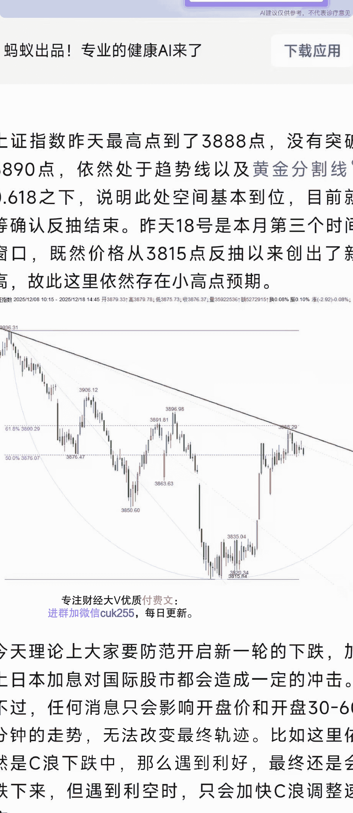
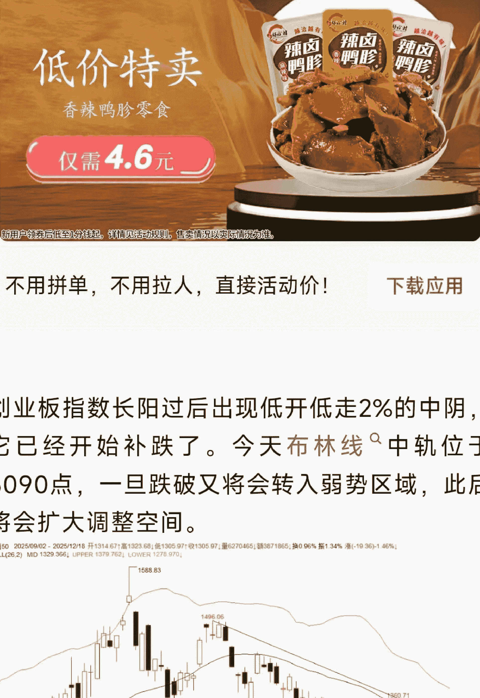
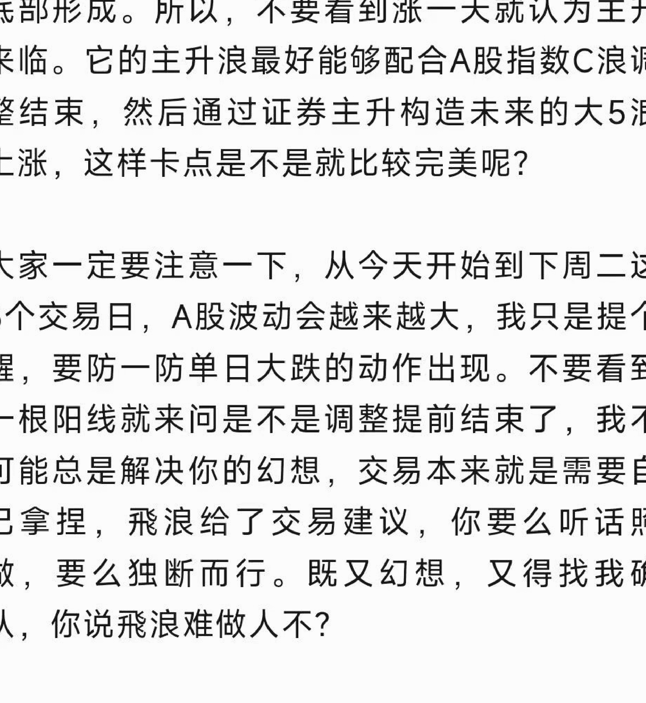

# 周五（12日号）交易策略：未来3个交易日非常重要

海股技术课程 金融不是你的青韭菜
2025年02月19日 03:00 🕒

提示：历史复盘，点击下方“海股技术课程”的橙

周五到下周一，未来3天不要空闲。周一到周五要留七天时间，或者在五前留出时间。周五就开始处理事情要及时处理，以免在周末出现问题。由于周末的影响，所以大家可以留出时间或者通过公众号发布策略，周五后也会在公众号见面了。

周五到下周一，
海股技术课程 金融不是你的青韭菜

前两篇策略回顾：
周四（11日号）交易策略：要关注这些细节
周三（12日号）交易策略：展望2026年第第一次大行情

上证指最高天跌到3880点，3890点，依旧处于均线和量价分线0.618之下，说明大趋势依然安全，目前尚等确认反弹结束。昨天是本月第三个回口，价格从3815点反弹以来创造了新高，故依然处于高点附近。

国证2000最高天跌破0.618位置，趋势也开始走低。这是一波下回调，回回到支撑线上，说明趋势依然要持稳，而且这个指数从11月24号以来反弹力度也比较类似，下周需要防范下破的动作出来，防一单线行情中长幅的下跌。

创业板指从最高后出现低迷2%的调整，已经开始洗了。今天上证林中中位3090点，一旦跌破又将带入调整颈部，此处将放大调整空间。

# 深度视野优质集群（链接优质社群，助你成功）

全部包含以下内容：限时优惠188/年 加微信cuk255

- ① 吃瓜群众倍时训练文时群群对话（原价 365 元/年）
- ② 子明私享汇（含）内部文章
- ③ 政事室（郭明）付费内容额外加送顺子明群
- ④ 米联锦顶【作者米横】（原价 599 元/年）
- ⑤ 欧洲金雀会员专属文章（原价 328 元/年）
- ⑥ 砖万瓦内部文档（原价 400 元/年）
- ⑦ 卢文青读书会专属文章（原价 699 元/年）
- ⑧ 鉴茶财经知识星球（原价 3310 元/年）
- ⑨ 猫哥的视界知识星球文章（原价 299 元/年）
- ⑩ 财经周刊【独家新闻】（原价 1498 元/年）
- ⑪ 杨世在金钱圈（原价 2200 元/年）
- ⑫ 森淼财经知识星球（原价 1600 元/年）
- ⑬ 激泽异读付费文章（持续更新）
- ⑭ 司马林解读全套音频和全套书籍珍藏无割减（原价 2.3 万）
- ⑮ 虚构三部[民国梦、帝国战略、不被理解的 MAO]（原价 599 元）
- �� 克知识星球文章（原价 268 元/年）
- ⑰ 额外再送：卢薛元新浪微博付费专栏、三村丰老王、三花九洞文集

不定期内容：……（更多资源写不下去了）

- ① 守夜人司令星球、接换魔王后星球、成战后财富圈、雪雪花甲头等
- ② A视野、大树乡谈、江初付阳、泮咩说、上海家学等付费文集
- ③ 西凤付费文章、老端、赢在八小时之外、局人的视界、升值、老体制内等其它一些大V付费文集（每月不低于600 元付费文集）

# 限时优惠188/年 低成本链接全大V优质内容

深度视野文集 进群微信cuk255

深度视野（付费文集）

