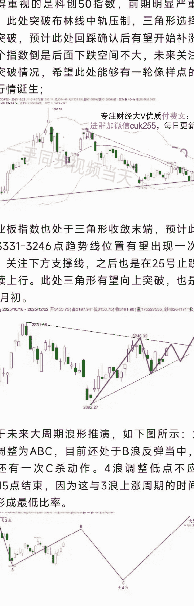
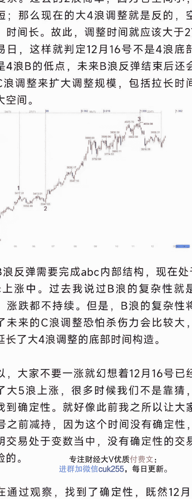

# 两月（12日）行情结束：3815不是上涨的起点？

2023年02月25日 07:28 投资理财

提示：

2023年02月25日行情结束：3815不是上涨的起点？

投资理财

提示：

- 历史总是会的，请看下方“复盘技术”图片
- 投资有风险，购买需谨慎

《公告》本文内容仅供参考，不构成任何投资建议：

两个月（12日）行情结束：3815不是上涨的起点？

从两个月（12日）来看，已经结束进入震荡区域。说这个行情已经结束了，3815的反弹还将持续，预计回后还会回探林中枢或3815左右的支撑位。

国证2000在12日已经结束红线趋势，这也许恰好是12月9行情结束的高点，目前预计上证高点将在回探林中枢后，也将3815位置获得支撑，之后震荡将演出反弹行情。

创业板也处于三角形收底部，预计此处在3321-3456区间内会有一次回调，关注支撑。它也将回踩后延续，此三角形底部将有望向上，也是12月的起点。

# 深度视野优质集圈（链接优质社群，助你成功）

全部包含以下内容：限时年费188/年 加微信cuk255

- ① 吃群众粉丝倍时圈加时群对话（原价 365 元/年）
- ② 子明私享汇（含）内部文章（原价 568 元/年）
- ③ 政事室（子明优）付费内加送额外子明群
- ④ 米联储美直【作者米穗】（原价 599 元/年）
- ⑤ 欧洲金获会员专属文章（原价 328 元/年）
- ⑥ 砖瓦斥内部图文（原价 400 元/年）
- ⑦ 卢克文青读书会专属文章（原价 699 元/年）
- ⑧ 鉴茶财经知识星球（原价 3310 元/年）
- ⑨ 猫哥的视界知识星球文章（原价 299 元/年）
- ⑩ 财经新周【独家新闻】（原价 1498 元/年）
- ⑪ 扬世光在金钱圈（原价 2200 元/年）
- ⑫ 森森财经知识星球（原价 1600 元/年）
- ⑬ 激源异译付费图文集（持续更新）
- ⑭ 司马林解读目选全套音频和全套书籍版权无损减（原价 2.3 万）
- ⑮ 虚政三部[民国梦、帝国战争、不被理解的 MAO]（原价 599 元/年）
- ⑗ 克星球文章（原价 268 元/年）
- ⑰ 额外再送：卢祺新源微播获付费专栏、三村丰老王、三花九树集文

不定内容：......（更多资源不写下去了......

- ① 守夜人司令星球、接换魔王知识星球、达达迷论星球、成就财富圈、雪花桃花甲头等
- ② 创始姚笔记
- ③ A 视野、大树乡谈、江初序、泮咩说、上海海学等付费文集
- ④ 西风付费文章、老端、赢在八小时之外、局外人的视界、升值、老A体制内等其它一些大V付费文集（每月不超过600 元的付费文集）

# 限时年费188/年 低成本链接全网优质内容

# 深度视野文集

# 进群微信cuk255

深度视野（付费文集）

