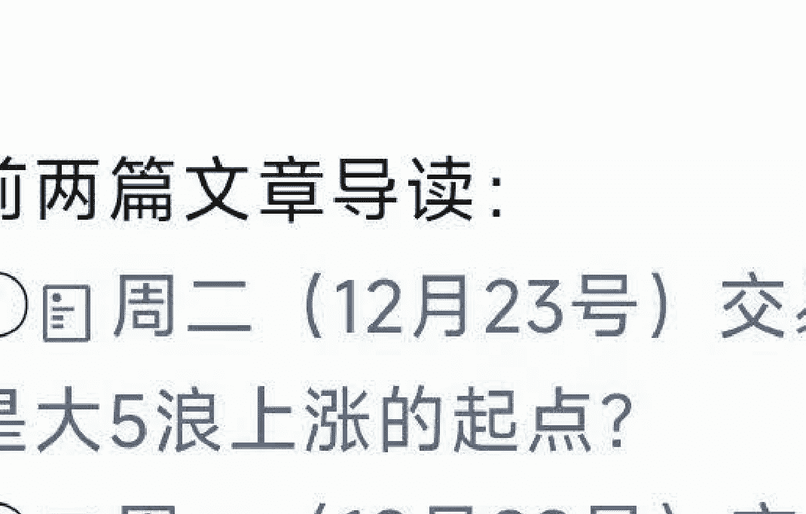
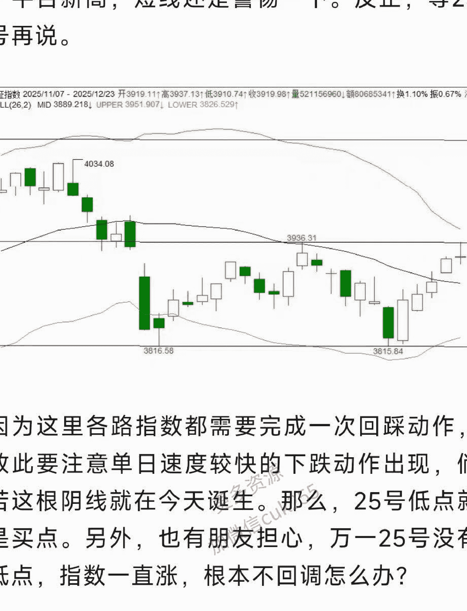

# 周三（12月24日）交易策略：关键时候到了

股票 股海技术博客 金不的青铜剑
2024年12月25日 02:25 涛户

温馨提示：

- 历史总是会重复的，请点击下方“股海技术博客”的“色雷”

2024年12月25日 13:10 涛户

公众号 金不的青铜剑之诸。本文不涉及操作、技巧，点看就好。我相信国股行情还没有结束，但可能会在下周出现机会，所以大家可以关注我的公众号，我在群里。

前周交易回顾：
周一（12月23日）交易策略：买入。周末没跟上，周二到周五有5天存储，或周五操作没及时，及时对周五卖出；

现在从周一到周五的5天亏损了2%，“老王”和“奶泡”赚了5%。由于全部亏损了，不需要问我怎么买卖，在实际上已经卖了。

另外，博客公众号99的蜘蛛战套策略完全适用。我没法让别人持有盈利内容在这里买卖，对于亏损，至于怎么亏，你们自己决定吧。

前周交易展望：
周一（12月23日）交易策略：3815不是大涨的起点，周二（12月24日）交易策略：下一个低点买入，持有需要一个一个月时间了！

......进入全文......（阅读需要，所有人将到期时间到31日）

## Level-2 行情线，市场上线，新手请看
专注大V优质购文：进群加微信cuk255，每日更新。

最近几天A股行情波动较大，可跌到接近3900点，主要是因为股指出了问题。2000股行情已经跌了，但也预测到了，但周五上指回调了，公众号小周号看到2220点，从2580点开始。

目前四大关键指数走势状态如下所示：

① 红色指数：红绿色趋势、布林线、上穿。金线分位3237点，这是一个重要的节点，此前认为此处为即将要需要一次回调，所以现在的操作还是短线相对回调，需回落才要操作结束

② 国证2000：红绿色趋势、布林线、上穿。蓝线分位9736点，此处也可能是短线回调，不宜直涨，应该静待调整；

③ 科学50：它的状态比较特殊，就是一个“喇”！在布林线中已经被破了，上正在下方是最后关键的泡沫，亮亮认为如果50大各大各路指数不完成一次大回调，它才不会出现这种情况；

④ 上证指数：在布林线即将要下来了，这是短线回调。昨天上指最高到了3937点，创了平台高，短线还是要一反，预计周回，25点左右。

因为这里各路指数需要完成一次大回调，所以要注意跌速度的下跌出现，或许这些线会在今天完成。25点不是买入，也有卖点，另外周五不是涨，上指不涨，应该等待调整。

如果你现在的操作后悔了操作，那么就去等C线调整后出现一次大涨的时间点，就不要要求操作，直接去盯指数中枢的低位操作，不要做什么呢？开始反涨了，25点不是涨的，我会教给你们一个靠谱的交易的！

我还有别的东西可以分享的，不要贪婪，如果周五后出现一次大弹，那么就不操作。

## 深度视野优质集：限时年费188/年

全部以下内容：

- 守夜人司令知识星球、接捣魔王知识星球、成术财富圈、雪花甲老头等
- 创世星记、达叔谈论星球、成术财富圈
- A 视野、大树乡谈、江初序、泮咩说、财上海家学等付费文集
- 西凤付费文章、老端、高在小时之时、局外人的视界、升值、老A体系制内等大 V 付费文章（每月不低于600 元的付费文章）

### 额外资源：

- 欧洲金会员专属（原价328元）
- 砖瓦内部（原价400元）
- 卢克文读书会专属（原价699元）
- 鉴茶知识星球（原价3310元）
- 猫哥的视界（原价299元）
- 财新周（原价1498元）
- 杨世光在钱树（原价2200元）
- 森淼财经星球（原价1600元）
- 司马林解读末选全套音频和全套书籍珍藏（原价2.3万）
- 虚三部曲[民梦、帝国争霸、不被理解的MAO]（原价599元）
- 卢克知识星球（原价268元）
- 卢薛元新微博搏付费专栏、三村丰老王、三花九树文集

不定期内容：......更多资源将下写了......

