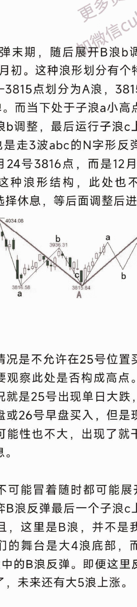
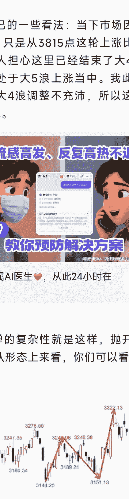

# 周四（12月25日）期货交易：交易思路和对策

发布：期货交易 作者：李博
2021-12-25 07:30 · 阅读 · 1人

温馨提示：
一、历史不会重演，请务必上方“期货黑色主题”谨慎

二、今天周四（12月25日）的交易思路如下：关注周五反弹。
三、目前盘面尚未出现反弹的信号，但市场依然在低位反复震荡，因此上不要急于预判周五的反弹。如果周五没有出现反弹的信号，那么我们要及时离场或继续观望。

前两天的交易思路：
一、周三（12月24日）交易：关键到期
二、周二（12月23日）交易：3815不是大低反弹吗？

......进入常规......（阅读期货黑的要素，所有人处理期为1月31日）

24号线上，没有出现突破，说明这24号线低点不是反弹。那么3815不是大低反弹吗？为什么就不算反弹？我判断反弹的逻辑是：一、要有量突破；二、要有回踩不破。如果没有这两个点，那么即使是大低反，就不算反弹。如果没有量突破，那么3815就不算反弹吗？

如果这种行情不是在25号进入的，那么现在就必须及时离场。目前的情况是25号还没有大反弹，但如果你是在25号入场的，那么现在就可以继续持有。但是如果周五没有反弹，那么我们就要及时离场了。

我们不要在行情反弹的时候去追反弹，在行情反跌的时候去追空，这样会亏损的。我的策略是：周五如果有反弹，这只是一个机会，机会还有很多。

A在反弹之前卖，错失的是机会；B在反弹之后买，亏损的是利润；或者等在反弹开始后分批入场，这样风险比较小：

# 深度视野优质集圈，链接优质群群，助你成功

全部包含以下内容：限时年费188/年 加微信cuk255

- 1 吃瓜群众含实时圈文加时群聊对话（原价 365 元/年）
- 2 子明私享（会）内部文章（原价 568 元/年）
- 3 政事堂（原子明）付费内容加再送顺子明群聊
- 4 米联储闲间【作者米糕】原价 599 元/年）
- 5 欧洲金雀会员专属文章（原价 328 元/年）
- 6 传五厂内部圈文（原价400 元/年）
- 7 卢克文青读书会专属文章（原价 699 元/年）
- 8 鉴茶财经知识星球（原价 3310 元/年）
- 9 猫哥的视界知识星球（原价 299 元/年）
- 10 财新周刊【独家新闻】原价 1498 元/年）
- 11 杨世光在金钱（原价 2200 元/年）
- 12 森森财经知识星球（原价 1600 元/年）
- 13 源译译付费文集（持续更新）

# 深度视野文集
进群微信cuk255

- 14 司马林解谋逸全套音频和全书珍藏无删（原价2.3 万）
- 15 虚虚三部曲【民国梦、帝国战争、不被理解的MAO】原价 599 元）
- 16 卢克文知识星球文章（原价 268 元/年）
- 17 额外再送：卢锐新微爆付费专栏、三村边老王、三花九洞文集

不定期内容：（更多资源不下去了……）

- ① 守夜人司令知识星球、接鸽魔王知识星球、生财知识星球、
- ② 创始笔记、达沃译论知识星球、成付财富圈、雪花甲老头等
- ③ A 视野、大树乡谈、江初视野、咩咩说、上海海学等付费文集
- ④ 西风付费文章、老端、赢在八小时之外、局人的视野、升值、老A体制内等其它一些大V付费文章（每月不超过600元付费文集）
