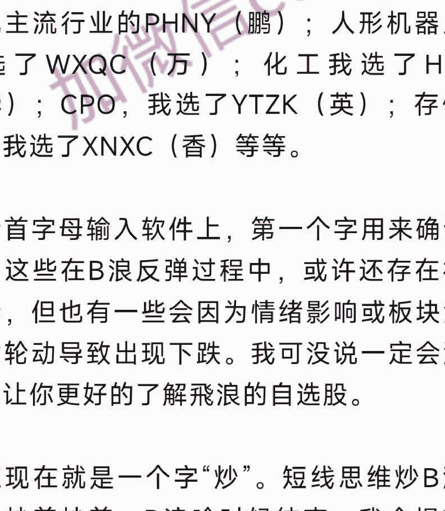

# 周五（12月26日）交易策略：布局价值的

2025年12月26日 07:00 🕒 5人

提示：

历史策略回顾，请点击下方“股海豪技术课程”的蓝色

股海豪技术课程 不赚不赔的调研
2024年12月24日 23:18 🕒 18人

公众号：我们不亏损的调研之。本文涉及的观点，请在文中查看。

周五的策略可能对你有帮助，不要在股市开盘前操作。如有任何问题请在群里找我，我会在稍后给出更新策略。

周一到周五策略发布7:30，我们不知道日期，由于周五到周日或文中约定交易天数，如果出现突发事件，执行时将以发布时的策略为准：

五月份中共有21-22交易日，根据《相关办法》和《提示>由于公告约定交易天数，相同的全部策略免费领取，你就不需要再另外付费了，策略已经准备好了。另外，公众号XX对所有交易策略没有收费，我不会对任何交易策略收费，至于是否免费领取，你们自己决定。

- 1. 交易型：对于这种向上的趋势，我们在周五遇到时调研，周一再根据趋势来做调整，是直接接肉还是观望。此时，我已经准备了两个好股，目前航空行业还没有显示出此机会。我个人认为，由于趋势可能已经结束了，另一只航空股说于下周可能会反弹，由于我个人压力很大，如果下周后没有反弹，我可能就卖掉它。目前没有问题，航空股还在伏，在等待低位反弹的机会。
- 2. 价值型：光伏。建议大家关注光伏、储能等板块，我们为这个板块也准备了策略，但目前也没有机会。大家可以先关注一下，可以布局了，现在没有机会，可以等下周布局。
- 3. 人形机器人：由于属于人形机器人的领域，由于现在没有机会，等下周后天有向上布局的趋势，建议大家多关注。

其他的方向没有建议，由于近期热涨，只有这个机会，大家可以等后天布局，重点关注上述三个板块即可。

在这方面，我就不教大家拆解策略了，这是一个短线机会。按照我，如果你没参与过的就可以再参与；如果已经参与的，那么就是不跟了，等一根线再入场；或者直接入场，根据线线的强弱来决定操作，这些东西大家自己操作。

在此之前，整个B股反弹的时间在1月里，2025年收获只有四个交易日，我们从1月10日为模型限时，也有十个机会。在反弹的行情里，我们建议关注这几个方向：
