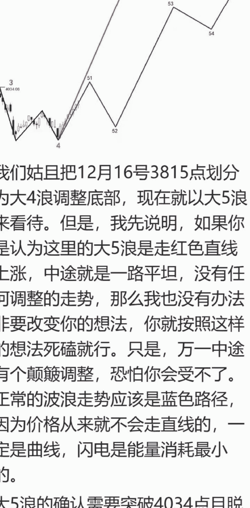
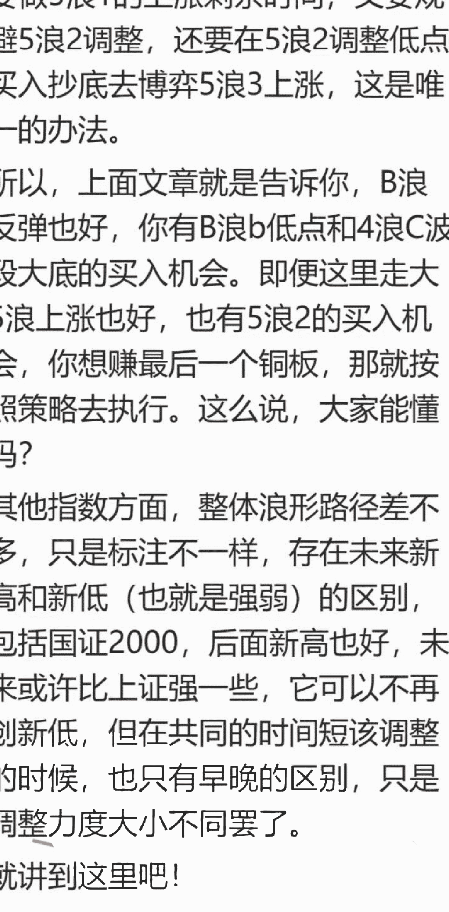

# 周二(12月6日)交易策略：B反弹后上涨，我们应该如何把握这次机会？

2022年12月25日 23:58 准时

关注海伏投资建议 不再被股市收割

2024-03-21 10:14

大家好，好久没写新文章了，但是这篇的内容真的有点长了。

但是写得太长了，写了又删，删了又写，最后还是决定直接截图发出来，毕竟我也不想一个字一个字打了。

不过，我还是把没打完的发了，没想到我还能写这么多。

前两天的策略回顾：

- ①周一(12月5日)交易策略：下涨反弹
- ②周二(12月6日)交易策略：看涨趋势结束的B波
......进入反弹（阅读读懂反弹的要素，你反弹持续时间会有长）

抱歉！现在大家看到这一周结束了，还好吧，今天的内容真的是实在太长了，写了又删，删了又写，最后还是决定直接截图发出来，毕竟我也不想一个字一个字打了。不过我也不想浪费大家有限时间在30分钟内，我尽量还是写，但只能这么多了，

上总结一下B反弹的两种模型吧：

- ①B波反弹；C波反弹，反弹结束;
- ②B波反弹；C波反弹，反弹结束;

这种涨跌规律是确实的，其实反弹的规律就是最好的，大家可以用我举例一下ABC1234，从12月1日到12月6日还是下涨，从12月16日开始是B反弹，结束了还要涨一次A波反弹，结束了

把握机会的机会：

我们不要去预测这个B反弹到底会在什么时候结束，反正等它结束了就好了，快点就是，慢就是这最后几天之后就是结束，最后的就是等这天结束了，

那么，如果我把B反弹两次等到空了，这个问题就解决了。我为什么要等它等到涨完A波呢？

因为我认为对于大多数的人来说，等它涨完一次分析，看完了就好了，即便这里还有5大涨，也不会空仓。

我们把调整周期在12月6日315点划定为5大涨来看待，现在我是先说，如果你认为的这个5大涨是涨线直接结束，是没有调整的。如果你不是要变的方法，你就按照原本的方法去执行，这样就没有大问题了，即使你是不错的正常的涨跌还是是红色的，