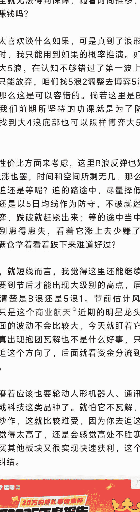
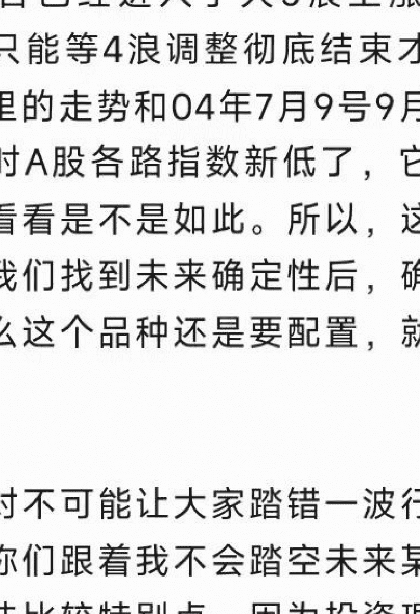

# 一月（22日）股票行情：下跌的原因和机会

2023年01月25日 09:30 读者 1人

大家好，我是老王，今天想分享一下我对投资的想法。

首先，我们来看一下一月（22日）的行情。

一月（22日）的行情确实大跌，但是大家不要忘记，大跌中往往蕴含着巨大的机会。跌得越厉害，越不要恐慌，越要保持冷静的心态。

其实，看到大跌的时候，我心里也慌慌的，但我记得老老师曾说过：股市的下跌往往蕴含着机会，越在下跌的时候，越要寻找机会。越是别人恐慌，就越要保持冷静。

其实，看到大跌的时候，我心里也慌慌的，但我记得老老师曾说过：股市的下跌往往蕴含着机会，越在下跌的时候，越要寻找机会。所以，我当时要保持冷静。

## 前几天的行情回顾

一月（22日）的行情：大跌，下跌的原因和机会在哪里？

从一月（22日）的行情来看，下跌确实是由于外在因素导致的。但是，另一方面，也有内因的原因。首先，就是之前涨得太厉害了，涨久了就需要回调。

从上周开始的下跌，就一直持续到今天，已经跌了五天了。上指数从3500点跌到了3100点，已经跌了400点了。

其次，就是市场情绪的问题。大家一看到下跌就会恐慌，甚至产生恐慌操作，导致了进一步的亏损。大家越恐慌，股市就越容易下跌了。

从上周开始的下跌，就一直持续到今天，已经跌了五天了。上指数从3500点跌到了3100点，已经跌了400点了。

那么，既然下跌已经持续了这么多，我们该怎么办呢？

首先，我们要我们是在股市中生存的投资者。指数在4015点下跌，在4014点破位，在4012点反弹后跌破4010点，我们不要错过这次大跌的机会，应该好好寻找机会。

但是，这种下跌也是我们避免的。在可以避免的时候，我们要保持良好的冷静的心态。

但是，这种下跌也是我们避免的。在可以避免的时候，我们要保持良好的心态。

其次，就是市场情绪的问题。大家一看到下跌就会恐慌，这种恐慌导致了股市下跌越来越厉害了。

所以，股市的下跌往往蕴含着机会，越在下跌的时候，越要寻找机会。但是我们要知道，大家越恐慌，股市就越容易下跌了。

# 深度视野优质集圈，链接优质群，助你成功

全部包含以下内容：限时年费188/年 加微信cuk255

- 1 吃瓜群众倍时圈内加时群群对话（原价365 元/年）
- 2 子明私享亨（会）内部文章（原价568 元/年）
- 3 政事堂（原子明）付费内容再送顺子明群聊
- 4 米联储闲间【作者米糕】原价599 元/年）
- 5 欧洲金雀会员专属文章（原价328 元/年）
- 6 砖五厂内部圈（原价400 元/年）
- 7 卢克文青读书会专属文章（原价699 元/年）
- 8 鉴茶财经知识星球（原价3310 元/年）
- 9 猫哥的视界知识星球（原价299 元/年）
- 10 财经新周【独家新闻】原价1498 元/年）
- 11 杨世光在金钱（原价2200 元/年）
- 12 森森财经知识星球（原价1600 元/年）
- 13 源泽异译付费文集（持续更新）
- 14 司马林解读毛选全套音频和全书珍藏版无割减（原价2.3 万）
- 15 虚走三部曲[民梦、帝国争霸、不被理解的MAO](原价599 元）
- 16 卢克文再送：卢克文星球文章（原价268 元/年）
- 17 额外再送：卢赣元新浪微博付费专栏、三村边老王、三花九洞文集不定内容：（更多资源不下去了......

- ① 守夜人司令知识星球、接魂魔王知识星球、星球、生有知识星球、
- ② 创始人笔记、达叔译论星球、成付财富圈、雪花甲老头等
- ③ A视野、大树乡谈、江宁知否、泮咩说、上海家学等付费文集
- ④ 西凤付费文章、老端、赢在八小时之外、局人的视界、升值、老
- 体制内等一些大V付费文集（每月不超过600元付费文集）

# 深度视野文集
群微微信cuk255

深度视野（付费文集）

# 限时年费188/年 低成本链接全网大优质内容
