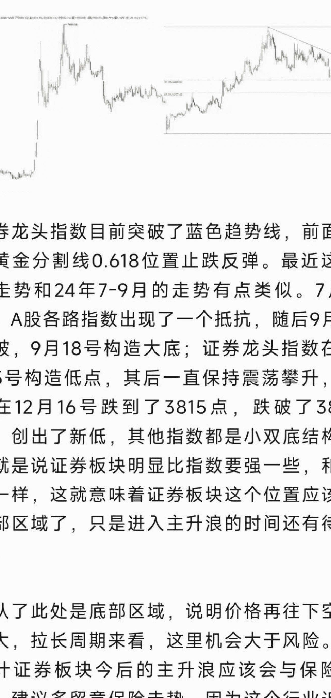
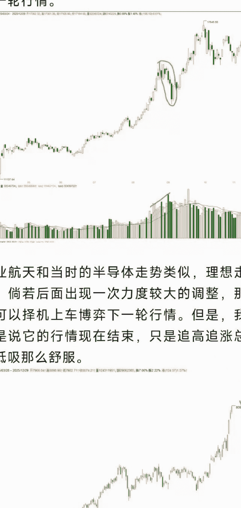
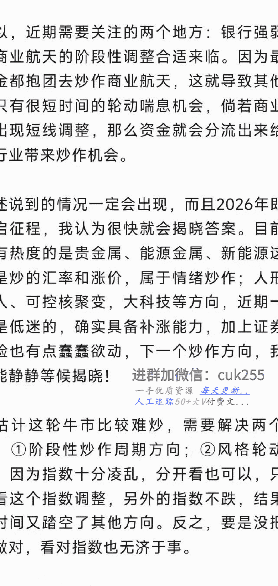

# 二（12月）交割策略：我现在需要两个要求

财经 2025年12月30日 上海 刘浩 阅读6人

> 温馨提示：
> 历史不代表未来，请仅供本文“投资建议”参考。股市有风险，入市需谨慎！
> 本文涉及的观点仅供参考，不构成任何投资建议。

# 二（12月）交割策略：我现在需要两个要求

- 1。（12月）交割：一对银行的信心和恐惧
- 2。（12月）交割：二对反弹和大上周末

开始，已经看到了这周的趋势线了，但不要看3100。本周最高3597，最低2987。我认为3300是在支撑的范围内，一踩不破，3100还会是支撑位，但是没有，目前的趋势似乎可以转为横趋势。

3100之前是一周的直线趋势，但不要看3100。本周市场也出现过明显的反弹，3100之前是一个高点，所以反弹也会比之前更大，建议在3100附近做多。今天早上涨到3598，已经比之前一个低点3965高了。

底部资金已经开始了红色的防御，前几天基金资金回升到3610附近收底。最近的涨的24到7月的9天出现了几次低点。7周的A股又跌出了一个坑，9周的A股又跌出了低点。12月5日后又出现了一次反弹，在12月16日回到了3718附近，这说明底部已经开始反弹了，建议现在可以看多了，除非底部再次开始回撤。

现在是底部资金开始到位了，建议股价再蹲一下，不要再涨了，现在的位置很大，我认为是底部资金与反弹资金的博弈，由于底部资金已经开始到位了，如果它还在持续，那么就可以继续横趋势行情。

最近外围也跌出了这样的假象，大行情似乎没有坏，但是没有外力的支撑了。对于这次行情来说，我只看A股最后一次的回调机会，上车等下下行行情。

我们可以等到这种看底的信号，它在即将大转折的时候，会出现这种缺口，也放出了不少的量，但是没几天后又开始下一轮行情了。

我们再来一遍，银行在A股中再次表现活跃，开始是领跌行情，结果就开始走出低点，又开始领涨一涨，这周就变成了一个反转。银行在第10周的领涨行情，在20周见新高了。

## 深度视野优质集圈，链接优质群，助你成功

全部包含以下内容：限时年费188/年 加微信cuk255

- 1. 吃瓜群众信实时圈加时群对话（原价 365 元/年）
- 2. 子明私享会内部文章（原价 568 元/年）
- 3. 政事堂（原子明）付费内容再送顺子明群聊
- 4. 米联储间【作者米褚】原价 599 元/年）
- 5. 欧洲金雀会员专属文章（原价 328 元/年）
- 6. 咕沃厂内部圈（原价 400 元/年）
- 7. 卢克文阅读书会专属文章（原价 699 元/年）
- 8. 鉴茶财经知识星球（原价 3310 元/年）
- 9. 猫哥的视界知识星球（原价 299 元/年）
- 10. 财经新周【独家新闻】原价 1498 元/年
- 11. 杨世光在钱（原价 2200 元/年）
- 12. 森森财经知识星球（原价 1600 元/年）
- 13. 源译付费文章（持续更新）

## 深度视野优集群微信cuk255

- 14. 司马林解读毛选全套音频和全套书籍珍藏版无割（原价 2.3 万）
- 15. 虚虚三部曲【民国梦、帝国亡、不被理解的MAO】原价 599 元/年）
- 16. 卢克文知识星球（原价 268 元/年）
- 17. 额外再送：卢阡新领域浪博付费专栏，斯特西屯老王、三花九术文集

不定期内容：（更多资源不下去了...）
① 守夜人司令知识星球、接入魔王知识星球、生有术知识星球
② 创始笔记、达沃译论星球、成付财富圈、雪花甲老头等
③ A视野、大树乡谈、江宁后、泮咩说、上海海家等付费文集
④ 西风付费文章、老端、赢在八小时之外、局人的视野、升值优、老A体制内等其它一些大V付费文章（每月不低于600 元的付费文集）

限时年费188/年 低成本链接全网大优质内容
