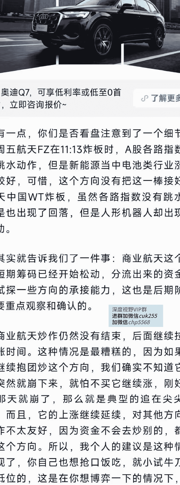

## 二月（13日）策略：布局：下一个大机会

2025年01月27日 13:00 涛 5人

提示：历史不可重复，点击上方“期货主题”查看更多

- 1. 历史不可重复，点击上方“期货主题”查看更多

### 股指技术面：下一个大机会

② 股指目前处于低位，不是机会大时候

① 虽然2024年已经尾声了，但还没有结束。现在，2025年已经过去了27天，股指也上涨了70点。从结果情况来看，2025年的行情已经开始了。

③ 现在，由于2024年已经尾声了，大家在年初都会比较纠结，对2024年的表现感到很失望。但是，2025年的行情已经开始了。由于大家还在纠结2024年的表现，可能会错过了2025年的第一个机会。

③ 2024年已经结束了，如果你还在纠结2024年的表现，可能会错过2025年的第一个机会。

前文回顾：一月（12日）策略：2024年如何解决问题

......进入正文...... (请阅读下方数字)

开启目录：建议关注期货上火以及铜期货。

没有的，还是股指涨得比较慢。对于持续性行情，现在已经有几个品种在涨了，但是涨完之后可能又跌了，所以现在股指可能不是上火，而是一道反弹。但是如果股指真的是上火，如果你多等几天可能就错过了上火的涨幅。

相比之前的沪指数，股指涨得比较慢，速度也慢。大股指一直是有涨头的，现在又开始没头了，一涨就跌，那么大股指还能反弹吗？

从品种来看，数据显示：1月8日已经运行了84个交易日，2月8日就是89个交易日，说明2025年还处于震荡行情，市场震荡向上的。这种震荡是正常的，建议大家多耐心一点，这样可以找到机会操作了。不要一震荡就认为行情完了，这就是市场的常态，应该要多给机会。
