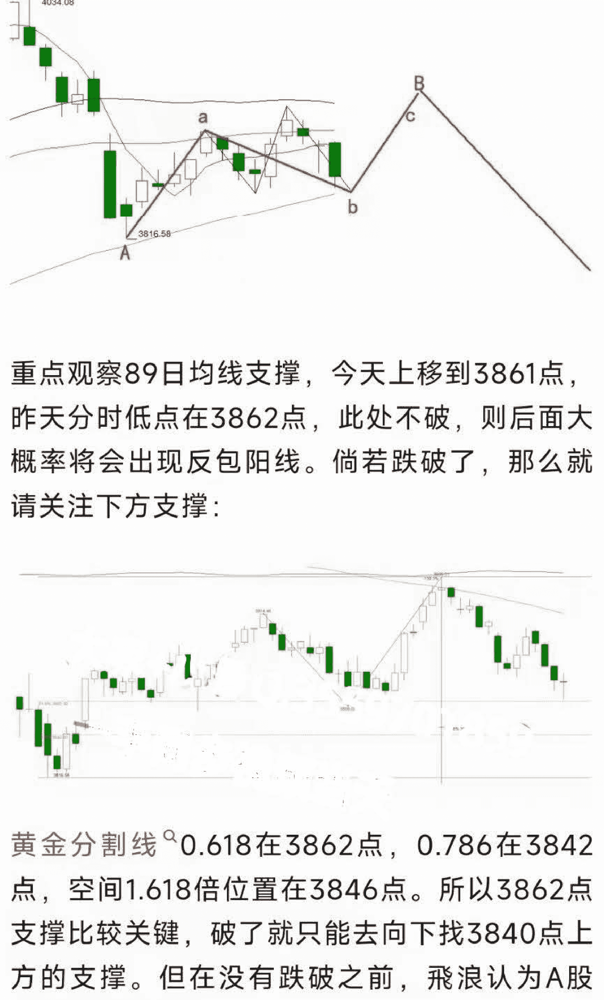
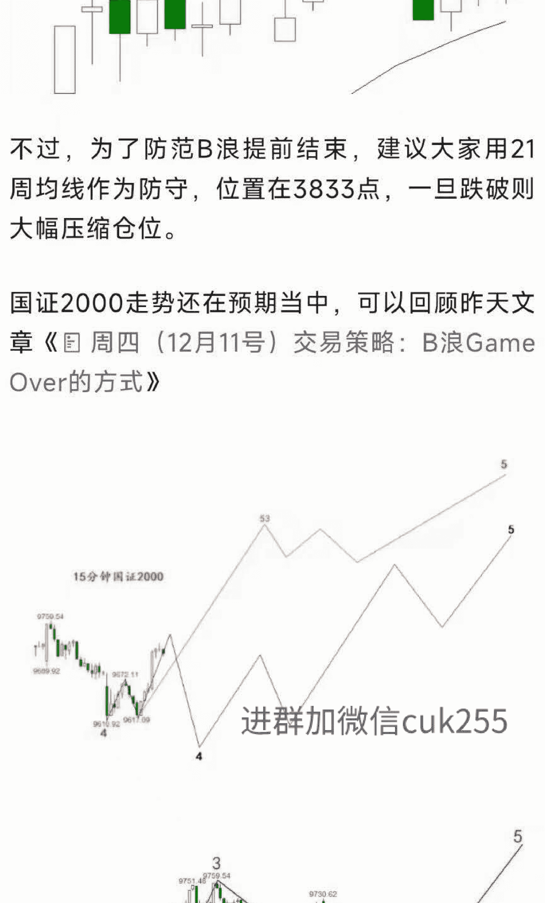
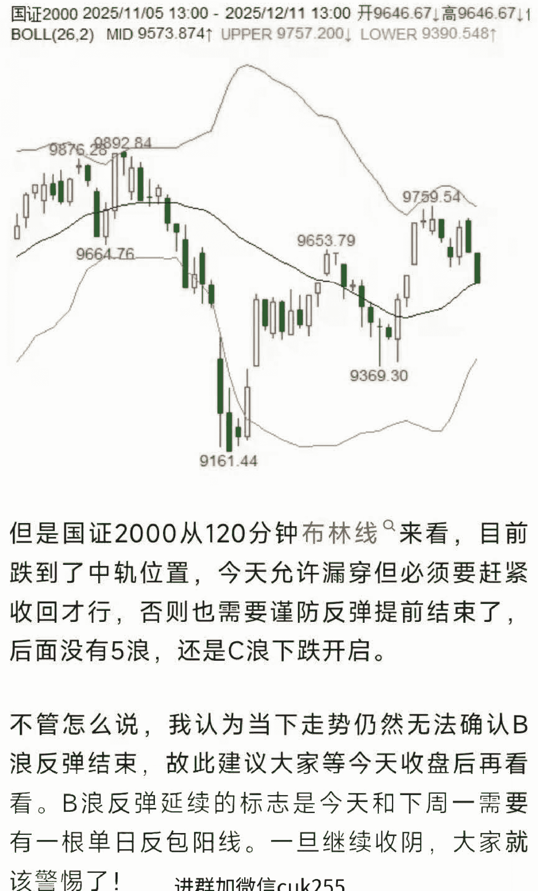

# 周五（12月12日）交易策略：还有希望？

发布于 2022年12月12日 07:30 5人

温馨提示：收藏文章，方便查找“财经技术”

财经技术 | 2024年03月12日 18:00 5人

《周五交易策略》之意义在于帮助大家在股市波动中，在大家有利的时候抓住机会，在不利的时候规避风险。希望大家能通过我的策略获得丰厚的收益。

——周五交易策略：周五后休息，周末再考虑。但是，如果周末没破位，不要再考虑；如果出现破位信号，要及时止损。

周五后看一二三周。如果没有破位，“卖出”；3800点如果不破位，则继续持有；如果破位则必须卖仓。此外，如果9600点附近出现支撑，则可以加仓；希望大家能根据我的策略获得收益。

前两天的策略：
（1）12月11日：交易策略：B Game的Over的
（2）12月12日：交易策略：短线见底突破详细说明

进入正文...

升华在中国吗？26年强势翻头？你需要了解这套逻辑！
查看详情

对于一个经历过巨大痛苦的人来说，任何波动都会让自己失去信心。面对下跌，只有守住内心的防线，并按照交易策略执行，否则会变形亏损，策略如下：

第一目标就是回上到第二个支撑位运行，此处处于B反弹后的子中B调整区间，此后会有BC的上涨，重点关注回调，能够跌破3936点就不怕了，目标回到3950点则是关键。

黄金价格：0.516在3862点，0.786在3842点。空间，1.618倍在3846点。此位置3862点支撑位关键，被破了就立刻看向3840点以上的方向。在没有被破之前，建议认为AB反弹还是希望的。

# 深度视野优质集团（链接优质社群，助你成功）

全部包含以下内容：限时年费188/年 加微信cuk255

- ① 吃瓜群众包时圈加微信时群对话（原价 365 元/年)
- ② 子明私享会（原价 568 元/年）
- ③ 额外再送：卢子明付费
- ④ 米储闲间（原价 599 元）
- ⑤ 欧洲金会员专属（原价 328 元/年）
- ⑥ 砖瓦内部（原价 400 元/年）
- ⑦ 卢克青读书会专属（原价 699 元/年）
- ⑧ 鉴茶财经星球（原价 3310 元/年）
- ⑨ 猫哥的视界星球（原价 299 元/年）
- ⑩ 财新周独家（原价 1498 元/年）
- ⑪ 杨世光在钱煽（原价 2200 元/年）
- ⑫ 蒜森财经星球（原价 1600 元/年）
- ⑬ 激漾异译持续更新
- ⑭ 司马林解课选全套音频和全套书籍版无割（原价 2.3 万）
- ⑮ 虚构三部曲[民国梦、帝国争亡、不被理解的MAO](原价 599 元）
- ⑯ 卢克知识星球（原价 268 元/年）
- ⑰ 额外再送：卢祺元新浪韭搏付费专栏、三村丰老王、三花九树文集

不定内容：......（更多资源写不下了......

- ① 守夜人知识星球、拨换魔王星球、养成财富、雪球花甲老头
- ② 创始者笔记、达叔泛谈论星球、成就财圈、雪球花甲老头
- ③ A视野、大树乡谈、江初序、泮咩说、上海海家学等付费文集
- ④ 西凤付费文章、老端、赢在小时之时、局外的视界、升值优、老体制内等其它一些大V付费文章
