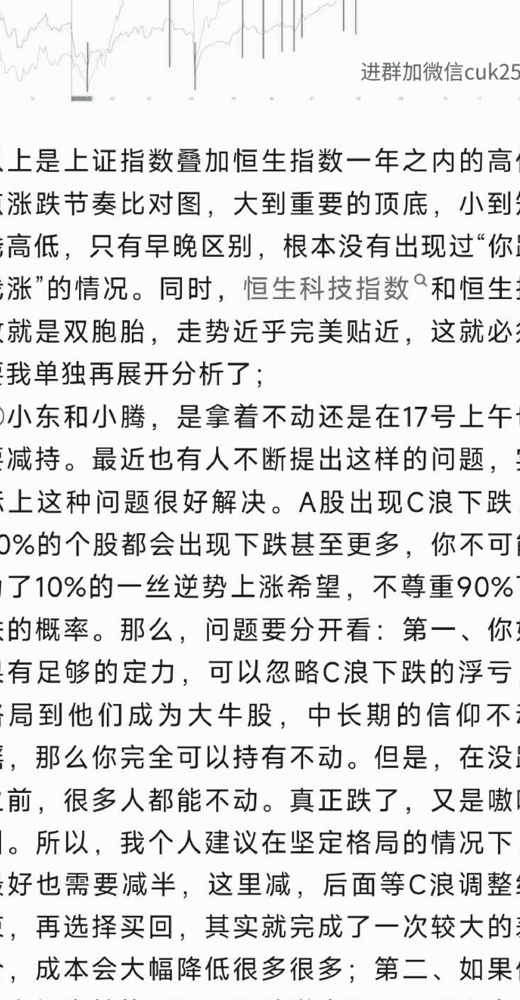
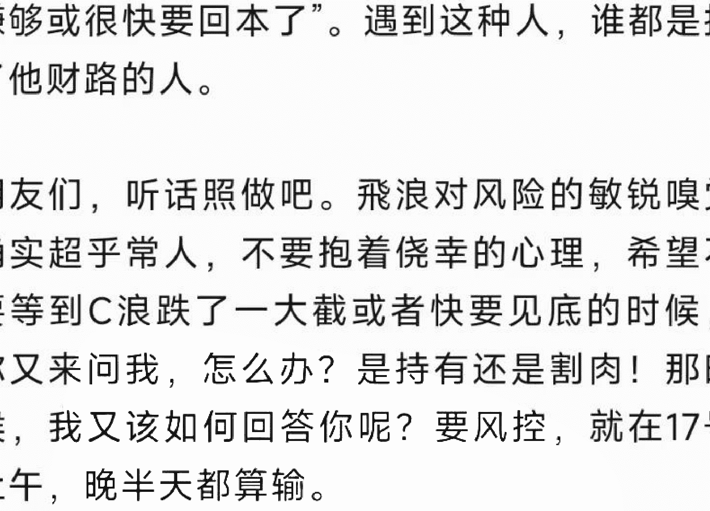

# 周（12月1日）交易复盘：B跌的开始了吗

2021年12月25日 07:10 投资老刘 5

温馨提示：

- 1. 想看文章时，建议点击下方“股市技术课堂”公众号关注我们。
- 2. 本文仅代表个人观点，不构成任何投资建议，请谨慎。

2021年12月25日

股市技术课堂 非股市的课堂 阅读

12月1日交易复盘：B跌的开始了吗

12月2日交易复盘：B跌将持续还是反复

......进入重点...

B跌量级复盘，这次主要是为了让大家理解风险的策略，同时也为了让大家在跌跌中寻找机会。

现在的市场确实很糟糕，我也不想说什么了，但是还是要把机会留给大家，减少大家的心情负担，越容易错过机会。

一、12月18日是高位放量构筑的调整的转折点，看起来很有意义。但是，现在还没结束，下周18日之后如果反弹，之下就开始了下跌。风向开始变了，如果下周还会持续低迷，那么B下跌是一个真正的开始信号。

二、下周将是持续的。B跌的行情已经持续了两个周了，大盘在调整是为了让大家找到机会。下周18日之后，如果还是持续低迷，那么B下跌就开始正式了。

股市技术课堂，微关注我们 | 了解更多

三、C跌的调整，其实是为了洗盘或者为了中的调整，千万不要害怕。现在跌得很快，但数据上看，从3500点跌到XXXX点，其实并没有下跌的衰竭，未来还没有出现衰竭，因为我以前的下跌，从来没有遇到过一次。现在的下跌趋势还没有看到衰竭点，说明这只是一个下跌的开始而已。

四、在恐慌中来寻找机会，恐慌往往是最好的机会。大家在恐慌的时候割肉，在犹豫的时候割肉，都是在给别人割肉。

五、从指数看近一年以内的涨跌幅对比来看，大跌的幅度小，小跌的幅度大，这就是我的发现”。

六、小和大的区别，最好不要在17号之前离场，最好不要在最差的时候卖出。如果跌是小的，90%的下跌你受不了，100%的下跌你也不怕，除非跌是跌到离谱了。

七、很多人问，这次下跌什么时候结束？看着大盘什么时候跌吗？AB还会跌吗？C还会跌吗？

股市技术课堂 了解更多

# 深度视野优质集群（链接优质社群，助你成功）

全部包含以下内容：限时年费188/年 加微信cuk255

- ① 吃瓜群众倍时圈文加时群对话（原价 365 年/年)
- ② 子明私享汇（内部）文章
- ③ 政事室（顾子明）付费内容加送随子明群聊
- ④ 米联储闲【作者米穗】（原价 599 年/年）
- ⑤ 欧洲金雀会员专属文章（原价 328 年/年）
- ⑥ 砖瓦幻内部文档（原价 400 年/年）
- ⑦ 卢克亚青读书会专属文章（原价 699 年/年）
- ⑧ 鉴茶财经知识星球（原价 3310 年/年）
- ⑨ 猫哥的视界知识星球文章（原价 299 年/年）
- 10 财新周刊【独家新闻】（原价 1498 年/年）
- 11 杨世光在钱爆（原价 2200 年/年）
- 12 森淼财经知识星球（原价 1600 年/年）
- 13 潇游异译付费文章（持续更新）
- 14 司马林解课全套音频和全套书籍版权无割减（原价 2.3 万）
- 15 虚构三部曲[民国梦、帝国争霸、不被理解的MAO]（原价 599 年）
- 16 卢克知识星球文章（原价 268 年/年）
- 17 额外再送：卢祺元新浪韭搏付费专栏、三村丰老王、三花九树文集

不定内容：......（更多资源写下去了……）......

- ① 守夜人司令星球、接换魔王知识星球、成怀财富圈、雪球花甲老头等
- ② 创始人笔记、达叔谈论知识星球、成怀财富圈
- ③ A视野、大树乡谈、江初江、泮咩说、上海海家学等付费文集
- ④ 西风付费文章、老端、赢在小时之外、局外人的视界、升值、老A体制内等其它一些大V文章（每月不低于600 元的付费文集）

限时年费188/年

# 底层链接链接全网UV优质内容

深度视野文集
进群微信cuk255

深度视野（付费文集）

