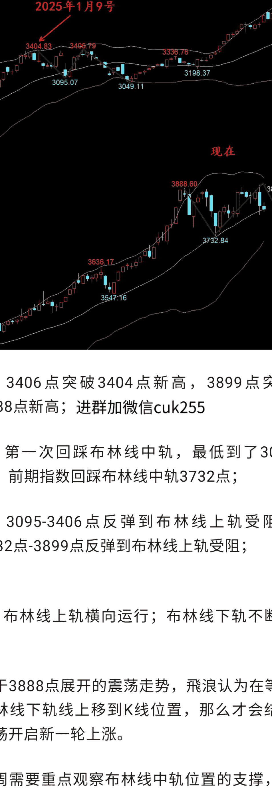
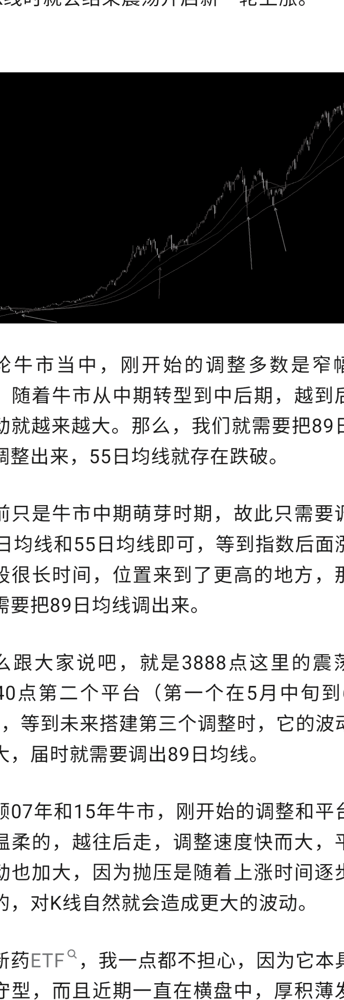

# 周天（9月21号） 交易策略：震荡会在
哪个什么情况下结束

进群加微信cuk255

上证从趋势来看，整体和2025年1月之后的走势异同同工。

1、3406后突破3400点新高，3999后突破3888点，涨速增加。
2、第一次回调开启的运行，最低在跌到了3095点；前高点后回踩布林线中3762点；
3、3095-3406点后反弹上证线受阻，3723-3899点后反弹布林线受阻；
4、布林线向上的运行，布林线下跌不断停止。

3888点开启的震荡走势，凯凯认为在处于布林线上调整，横等不再拉上拉下，短线选手可以借此来范围内控制。

重点要观察布林线的位置支撑，在跌中只有两种布林线支撑；第一回留在支撑，横等再度上支撑；二指数下则要寻找布林支撑。

同于，55日均线有望成为本次涨结束的重要位置。主动去到这里，空间大，短线；继续持稳，则空间小时间。

比如2025年牛市，指数在上涨的过程中，调整到34日均线位置后将继续上涨；但是，一旦发生爆发暴涨走势，基本上都会在55日均线近结束结束结束并开启新一轮。

一牛市中，开始的调整幅度是数量级的，随着涨势从小转为大后，后面波动幅度增大，我们就要观察89日均线，对于大周期，55日均线将是足够了。

目前处于中长期震荡时期，由于离3888点的距离只有中枢区域1个位数，建议此时，等价格回调后再来买场；香港证ETF的价格相对较高，香港证ETF和恒生ETF相比，我一直认为恒生ETF只是为了让恒生指数下跌，对于中长期来看，证ETF的调整有望有利于未来获得爆发。

创新ETF，我一点不担心，因为它本身没有防守，而且近期在横线中，厚层薄发，建议：进指数。

# 深度视野优质集群（链接优质社群，助你成功）

全部包含以下内容：限时优惠188/年 加微信cuk255

- ① 吃瓜群众包含文加时群群对话（原价 365 元/年）
- ② 子明私享汇（含）内部文章
- ③ 政事室（子明优）付费内容加送顺子子明群
- ④ 米联储顶【作者米横】（原价 599 元/年）
- ⑤ 欧洲金雀会员专属文章（原价 328 元/年）
- ⑥ 砖瓦内部文档（原价 400 元/年）
- ⑦ 卢克文青读书会专属文章（原价 699 元/年）
- ⑧ 鉴茶财经知识星球（原价 3310 元/年）
- ⑨ 猫哥的视界知识星球文章（原价 299 元/年）
- 十 财新周【独家新闻】（原价 1498 元/年）
- 十一 世光在金钱塔（原价 2200 元/年）
- 十二 森森财经知识星球（原价 1600 元/年）
- 十三 激异译付费文章（持续更新）
- 十四 司马林解读全套音频和全套书籍收藏版无删减（原价 2.3 万）
- 十五 虚构三部曲[民国梦、帝国战争、不被理解的 MAO]（原价 599 元）
- 十六 卢克文知识星球文章（原价 268 元/年）
- 十七 额外再送：卢振元新浪韭搏付费专栏、三村丰老王、三花九洞文集

不定期内容：——（更多资源不下去了……）

- ① 守夜司令知识星球、接换魔王知识星球、成达谈论星球、成就财富圈、雪花花甲老头
- ② 创始佳纪、达达谈论星球、成就财富圈、雪花花甲老头
- ③ A视野、大树乡谈、江初优、泮咩说、上海海家等付费文集
- ④ 西凤付费文章、老端、高在小时之外、局外的视界、升值、老体制内等其它一些V付费文集（每月不低于600元付费文集）

限时优惠188/年 低成本链接全网V优质内容

# 深度视野文集
进群微信cuk255

深度视野（付费文集）

