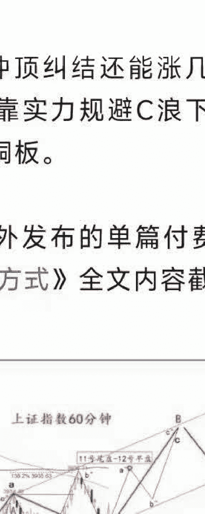
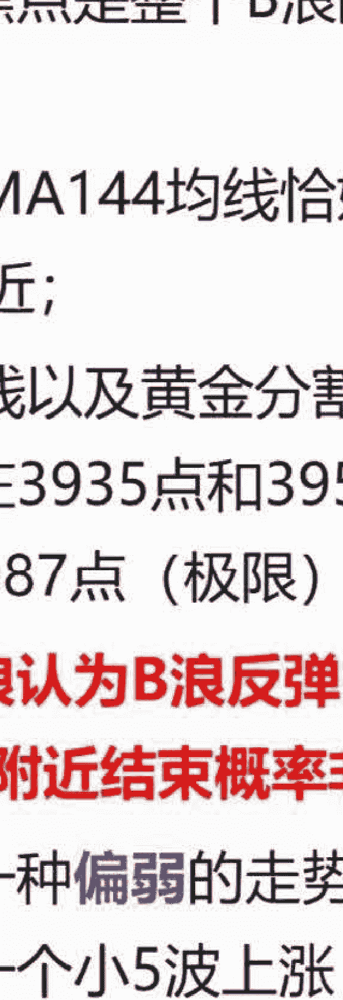
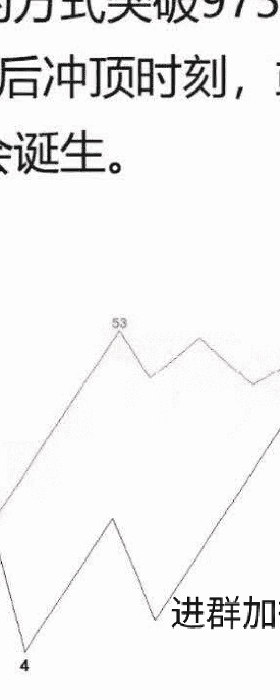

# 四周（12号）交易景：B浪

Game of Waver

2022年11月7日 10:30 🕒 2人

温馨提示：

- • 历史文章存档请点击下方“浪浪技术”系列链接

关注 浪浪技术：不赚钱的浪浪

2022年11月7日 24:10 🕒 2人

② 公告：本文观点仅代表个人观点，不构成任何投资建议。

③ 相信，在震荡中寻找机会，在趋势中等待机会。不要在最容易的时候肉，不要在最困难的时候肉。股市有风险，投资需谨慎，浪浪与大家共勉。

④ 预告四周（12号）B浪结束该如何判断？如果四周收盘不破五低，那么B浪还没有结束；如果跌破五低，那么B浪将正式结束。

前两篇文章：
① 四周（12号）交易景：浪浪结束一步步说明
② 二周（12号）交易景：下一个小高点如何出现

......进入核心...
最核心的要素，希望大家留出时间一分钟

两周（周二 12号）交易景：浪浪结束——下周结束的惯性非常重要，它决定了B浪是否结束。但是在下周结束时，给给大家一个大机会。

从下周开始到下周结束，浪浪是否结束，关键看下周收盘是否跌破五低。如果下周不跌破五低，那么B浪就没有结束。

文字描述就是判断B浪结束的两个理由，总结核心要素，就在这里了。如果沪2000今天出现一根中线放量，为B浪结束？还是下周一个小高点出现？

按照B浪结束的观点，在1周的范围内要回抽一回，这样下周第二次就会跌出五低。到此为止，浪浪结束了。如果浪浪结束，你就不再害怕了；如果浪浪还没有结束，你只需要害怕高点，等待机会。

但是在B浪结束后还能跌几天？那么震荡中反弹C浪结束？要等到C浪最后什么时候结束？

下面是下周对外外的单周走势预告《B 浪 Game of Waver》全文内容回顾：

沪B浪的高点决定了2000接下来的力度。由于从60分线形态来看，如图所示，它已经跌到了五低以下，也是日线B反弹的最后一次浪。

# 深度视野优质集群（链接优质社群，助你成功）

全部包含以下内容：限时年费188/年 加微信cuk255

- ① 吃群众含倍时文加时群对话（原价 365 元/年）
- ② 子明私享汇（含）内部文章
- ③ 政事室（子明佛）付费内返顺梯子明群
- ④ 米联储闲美【作者米穗】（原价 599 元/年）
- ⑤ 欧洲金雀会员专属文章（原价 328 元/年）
- ⑥ 砖瓦斥内部文档（原价 400 元/年）
- ⑦ 卢克文青读书会专属文章（原价 699 元/年）
- ⑧ 鉴茶财经知识星球（原价 3310 元/年）
- ⑨ 猫哥的视界知识星球文章（原价 299 元/年）
- ⑩ 财经新周【独家新闻】（原价 1498 元/年）
- ⑪ 杨世在金钱圈（原价 2200 元/年）
- ⑫ 森淼亚财经知识星球（原价 1600 元/年）
- ⑬ 激泽异玲付费文章（持续更新）
- ⑭ 司马林解课选仕全套音频和全套书籍精准无割减（原价 2.3 万）
- ⑮ 虚构三部曲[民国梦、帝国战争、不被理解的 MAO](原价 599 元）
- ⑯ 克知识星球文章（原价 268 元/年）
- ⑰ 额外再送：卢钛元新浪微铂付费专栏、三村丰老文、三花九洞文集

不定内容：......（更多资源下写不下了）

- ① 守夜司令知识星球、接换魔王知识星球、成术财富圈、雪花花甲老头
- ② 创始笔记星球、达叔浅论知识星球、成术财富圈
- ③ A 视野、大树乡谈、江初序、泮咩说、上海家学等付费文集
- ④ 西凤付费文章、老端、高在小时之时、局外人的视界、升值、老体制内等其它一些大V文集（每月不低于600 元付费文集）
