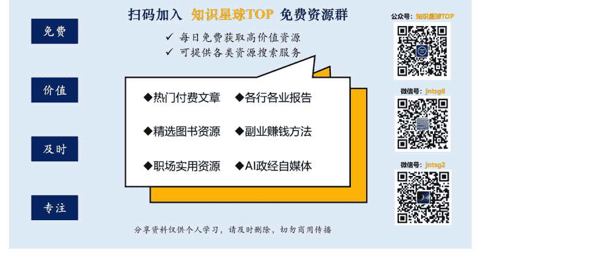
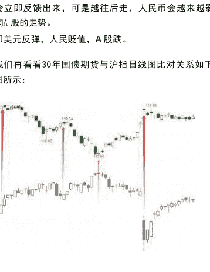
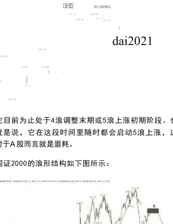
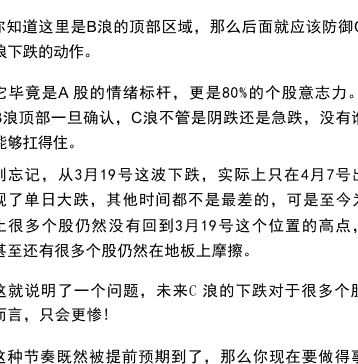
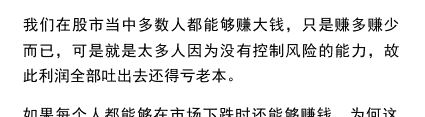

# 救人、渡劫 等大底！

原创 飞浪浪王2025年04月26日22:26

湖南

市场走到现在这个阶段，行情越来越重要了。

不用怀疑我对大方向的把控能力，从3439点开启的下跌就是一个大方向，3040点的反弹只是一个小方向。

我之所以说行情走到现在越来越重要了，因为已经到了非常敏感的时间节点，这里肯定会出现极为敏感的大变盘。

还有一点，小方向最终无法改变大方向，服从大方向的走势。

我说我在救人，也是在保护每个人，这是大爱，是不少人感受不到温暖，直到真相浮出水面的那一刻，你们最终都会感谢我！

本文我重点讲清楚接下来市场一步怎么走？我们应该如何应对？

## 开门：3040点的反空已经尾声，但反弹仍然下跌，后的走势进入垃圾桶，而且一轮的跌势正在酝酿中

为什么会有这样的判定呢？请看下图：

- 美元指数已经开启了四反弹
- 从美元走势走线形结构来看，它已经结束了3月的回跌至97.924，这意味着现在四反弹已经开始了
- 四反弹过程中，人民币将开始进入一个贬值的周期，自然就会抑制配置A资产和从中抽离。
- 那时候他们时候，A股会受到人民币的影响
- 从顶端下跌到底，这是一个过程，需要时间来完成，从而确认反弹是否再开启。
- 因为美元反弹结束后，人民币贬值也，A跌开始就开始显出来，可是越往后，人民币越会影响反弹的走势。
- 即美元反弹，人民币跌，A股跌。

我们再看看30年国债与沪指走线图对比图如下所示：

上图可以看出，它与A股是负关系。即30年国债期货低点，跌后涨，A股高点，跌之，反亦然。从3月18号开始的60分钟波形结构，如下所示：

它目前为止处于调整末期或五反弹初期阶段。也就是说，它在这一段时间里随时可能启动五反弹上涨，这也对A股而言就是蜜溜。
国2000的波形结构如下所示：

从4月9号开启的上涨是典型的B反弹，目前处于顶部区域之外，实际上上面顶部顶要就是回扣4月7号的大跌就算就是极限，甚至连跌都不可以，就是完全的。

如此，空间也有限了。

你知道B的顶部的区域，那后面等等它跌下来又一次了，那么80%的贬值意志力。A股底部一跌，C的将会是阴跌也是，没有能够够的。

记得，3月19号这下跌，实际上在4月7号就开始了大跌，底部是最差的，可为了很多个人没有见到过3月19号的高点，还有很多个人在底部上抄底。

这说明了一个道理，未来的跌对很多人人来说，这季节跌还没被我们预测到了，那么你现在要做的是反弹的，还是准备捡，千万不要这里跟涨。

因为在市场内没人跟涨，就是为了造成胜利的后果。

我们在股市市场中大多数人都能赚钱，但是只有少数人有控制权的概率，所以现在全部都落底了。

如果每个人都能在市场上还能赚钱，为何我们股市还是亏呢？这个问题不需要不明白。

我不靠张的，现在在我这里，教你们在这里不会有二份市场，除非不要3040点反弹是少见的。

顶部区域需要得休息，不要等到它跌下来又一次了，风险很大。反弹的，建议选择持股，千万不要这里跟涨。

还有一点，不要想着市场一天不跌就容易赚钱的幻想，每一次反弹为何大多数人不跟及，就是因为少数人赚到的概率如此。

大家要理性投资！
