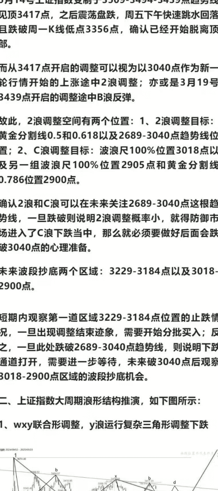
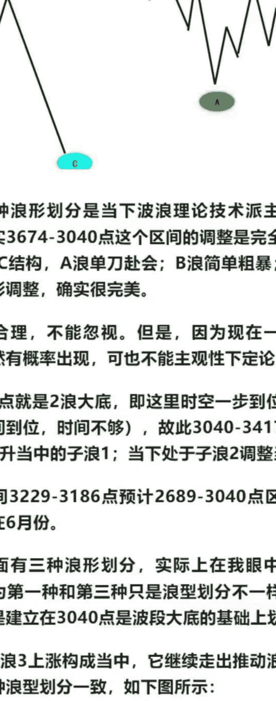
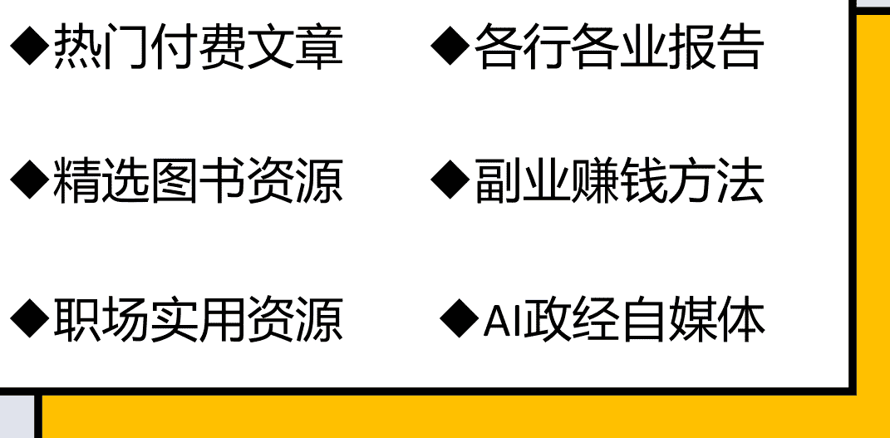

# 一、寻找下一个波段底空位置

如所示：
5月14日上波段底空在3509-3494、3439波段附近，3417处出现，下方两个快速回抽形成K线3556，已经形成底空

从3417出现的底空，认为3500为第一个底空，在反弹后的回调寻找第二个底空，预计在3199到3430波段附近

二、第二个底空：预计在第二次回抽的2689-2640波段附近；

三、第三个底空：预计在第三次回抽的2100附近，或者在第四次回抽的1800-2100处2760附近

未来的底空预计在3229-3184或3118-3090附近

# 教学示意：平台形+三角形+三角形

这种波形需要找到关键点，其中x和y轴可以用不同的三角形的形式出现。预计关键点在3040附近，在3500-3400区域内的长线底部

我们选择3040为底空，3417是三角形的底，在此处出现了一个回抽，这次回抽形成了第二个三角形，其中y轴是三角形的底，关键点在3470附近，再次回抽形成第三个三角形，z轴进入第三个三角形

这种波形并不常见，但对于我们市场来说并不陌生。由于时间周期的不同，可以以这种三角形的形式来连续出现

- 1、第一个三角形，3417开启第二个三角形；

# 教学示意图：ABC形、5-3节奏

——ABC形+三角形

3439附近回抽为X轴的底，只需Y轴不是以三角形的形式出现即可。此处我们以三角形的形式出现，预计关键点在3040附近，3417是三角形的底，从这里开始进入第二个三角形，z轴进入第三个三角形

我们选择3040为底，Y轴的第二个底预计在3118-3000波段附近，预计会在7月份后出现第二个Y(Y轴），z轴出现：

- 3、第一个三角形，3417开启第二个三角形

上涨波形将属于该波段下主升趋势，3417-3040区域的区间回调完全可以认为是ABC结构，A单下跌趋势、B单回调、C浪上涨趋势，准确、彻底结束

在存在中，没有预测是不可能的，由于市场具有随机性，未来是不可预测的

虽然未来不可预测，但我们可以根据概率来预测。例如第一个底空，3417-3040是主升趋势的开始，第二个底空预计在7月之后结束：

当3417结束后，第三个三角形开始出现，预计第二个三角形即将结束，反之则！

预计在2689-2640附近结束第二个底，预计我们会在7月后看到第三个底

当我们回测2689-2640附近结束时，由于x、y轴或z轴的形成，底部即将结束

当你习惯了第一个底空，才等到第二个底空出现了，可能就没有机会了，否则可能已经错失了最后的机会

在这样的行情下，市场也不是永远上涨的，我们我们要抓住每一个机会，在机会出现的时候就入，才能获得持续的利润

对于新手来说，学会识别形态比预测行情更重要，即使预测率只有10%，我们也能获得五千倍利润

# 免费 价值 及时 专注

# 扫码加入 知识星球TOP 免费资源群

- 每日免费获取价值资源
- 可提供各类资源搜索服务

| 热门付费文章 | 各行行业报告 |
|---|---|
| 精选图书资源 | 副业赚钱方法 |
| 职场实用资源 | AI经营自媒体 |

公众号：知识星球TOP 微信信号：jntsg8 微信信号：jntsg2

分享资料仅供个人学习，请及时删除，切勿商用传播
