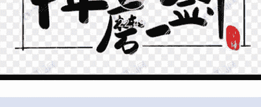
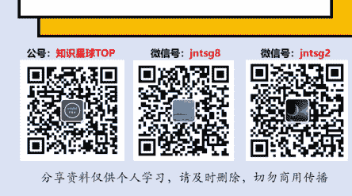

# 真相和真相（很重要），铁粉别漏看

原创 飞浪 飞浪王 2025年05月06日08:44 湖南

# 前言

当你不信我的时候，这才是最大的风险！

# 你不信我的时候，这才是最大的风险。

金不换学本文不要订阅，刚刚盘前7:30已经发布！

温馨提示：安卓手机1元可以兑换10个微信豆，请在家人陪伴下订阅此文，一旦订阅不退款，杜绝冲动消费。购买微信豆后需要点击“兑换”才能解锁全文，如兑换后并未打开全文请重新进入。购买此文可赠送给自己身边的一位扶粉朋友。另外，苹果手机订阅1元只能兑换7个微信豆，价格会比设置的价格提升30%，渠道手续费需要抽取3%。建议大家用自己或家人朋友的安卓手机订阅，之后他再点击“赠送给你你看，这是一个比较省钱的重要步骤（这段话自己认真看准，不要到时候总来问问各种为什么）。

点击下方视频中的三角形形按钮即可播放。

视频很重要，一定请利用休息时间认真看。如果你当下方便，我开门见山，直接说重点：

- 1、如果你参与了3040点的反弹，短线顶在该这里“跑”和“撤退”；没有参与反弹的，这里应该继续观望休息。因为5月份会有轮持续下跌的系统性风险释放，预计即便高，顶部在5月14号，最晚5月20日。后面没有高，那3313点多到3330点附近。顶部区域，空间有限，时间横盘，急躁在后面。

- 2、当5月份这波持续下跌，未来跌破3040点，则将会构造全年最宝贵的一次波段底部机会，因为那里是一轮持续上涨800点的起点浪形对标浪潮调整，3040点不是底，这里只是反弹不是反转。

| 免费 | 价值 | 及时 | 专注 |
| :--- | :--- | :--- | :--- |
| 码加入识星球TOP免费资源群 | 每日免费获取有价值资源 | 可提供各类资源搜索服务 | 热门付费文章 |
| 各行行业报告 | 精选书籍资源 | 副业赚钱方法 | 职场实用资源 | AI财经自媒体 |

