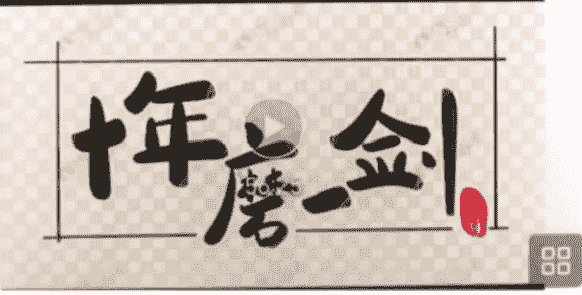
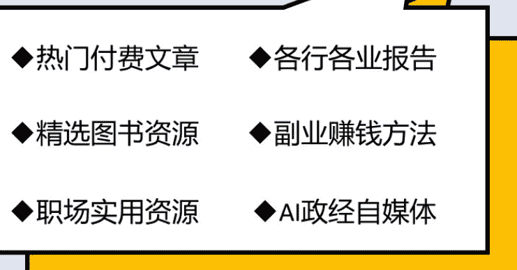

# 20250616飞狼王

下面这期视频，昨晚10:30加班录制了一个小时才赶出来的。针对形态选股的标准条件，在视频当中对评论区朋友们选选出来的个股做出了一个统一的回复。

这期视频系统性纠正选择符合标准模式方面的错误，务必诸位一定要抽出您宝贵的一个小时认真看。或许对您而言工作实在太忙，但关系到知识体系方面，我不可能强任任何人都要学，但是对于想学的朋友请配合一下看完。

主要是问题都在里面说清楚了，如果你不认真看，后面重复犯同样的选股错误，这只会浪费自己更多的宝时间。

听我的，认真看完，少走很多弯路！至少看完了，你就知道哪些个股符合条件，哪些个股不符合条件，问题出在哪里，选择了符合标准个股的朋友条件满足。

微信信号：jnts8

微信信号：jnts2

免费进资料群

加微信号jnts2，免费进资料群

飞狼再次强调：我除了讲符合形态标准的成功案例给出了代码之外，其他股从未提供，更不会推荐，凡是买入出现亏损后后果自负。而且这些股票都是由朋友们自行选出的，我只是负责讲解是否符合标准。所有的股票只作为技术交流学习的标，不作为买卖依据。股市有风险，投资需慎

成功案例讲解，视频当中讲得很清楚，也请各位抽出宝贵时间认真看过：资料群：kaiwu7878

以下是昨天评论区选出符合标准股票的朋友归纳总结的列表，后面持续跟踪中：

- 1、宝丰能源
- 2、川闰传媒
- 3、丹化科技
- 4、恒光股份
- 5、章源药
- 6、力生制药
- 7、今创集团
- 8、翰宇药业

加微信号jntsg2，免费进资料群

- 9、纳尔股份
- 10、大洋生物

## III、蓝焰控股

总共二只由朋友们选出来的个股，这就是人多力量大。对于不会选股的有了了参考标准，对于会选股的有了更多选择。

我再来做一个总结：

- I买信号观察：1号股、3号股、4号股、5号股、8号股、11号股；
- N2买信号观察：2号股、6号股、7号股、9号股、10号股。资料群：kaiwu7878

行情方面，请参考前文《周六（6月14号）关于短线，我的眼神！》其中的讲解，预计16/17市场将会再次形成小低点，对于短线交易的朋友可以小试水，仓位根据自己最舒服的水准自行拿捏。

30年国债ETF，请注意一下，因为它已经接近低线位置，如后一旦突破则继续持有，一旦无法突破且跌破5日均线可采取减持或止损止盈，这里主要因为短线行情构造小低点，它与指数构造相反，届时需要注意灵活应对。

在5日均线没破就持有，反正就按照这条线来应对对即可。

我今天不想对市场有太多的讲解，因为具体周末文章讲得实在太太太细了，太详细了，按照策略执行即可。

加微jntsg2，免费进资料群

如果这里短线低点成立，我会在今后给出短线卖点的，届时再说。这段时间对于指数分析会慢慢消化，关键时刻会说的，我重点会讲形态选股的方法。

祝大家投资愉快！

免费 价值 及时 专注

## 扫码加入 知识星球TOP 免费资源群

- 每日免费获取有价值资源
- 可提供各类资源搜索服务

公号：知识星球TOP 微信号：jntg8 微信号：jntsg2

分享资料仅供个人学习，请及时删除，切勿商用传播

加微信号jntsg2，免费进资料群
