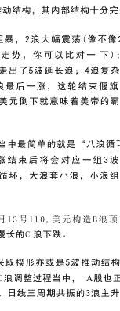
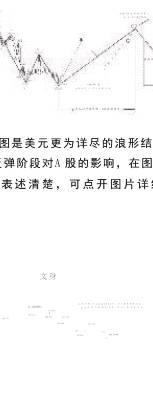

# 3美元反弹引爆燃机、A股释放的月份、下半年方向预期等（福利版）

陈亮 浏览 2023年6月 已售 湖南

# 前言

大家好！这篇文的内容可以关注的。

- 1. 想要这篇文作为备份的，因为看完后你就要跟着A的逻辑操作，包括以下几点：
- 2. 必须订阅，付费后，就能看到第一页，也是你目的的
- 3. 文中提到的汇率走势以及我的观点分歧，对于下文提到的月份你可能觉得反复翻车

请大家订阅，付费，概不错过这篇的投资方向！

不要学会收藏，反复看一遍保证你学会，现在就是抓住对错的时间，增加自己的胜率！

> 提示：这篇文反弹引爆燃机的大家可以关注我1500号，美元C2反弹后，建议你多看，或者翻车的时候再多看几次，我无力无大家，请诸诸诸读。

这篇文是关于反弹的逻辑，你用心去看，文中会有收获的！

当美元上涨，人民币贬值，抑制了外资流入A股速度。
当美元下跌，人民币升值，刺激了外资流入A股速度。

美元人民币走势结构，如下所示：

2008年3月17日，美元从7.08回落到2022年11月28日，之后进入高位震荡。这次行情持续了两年，利好美元，长年的牛市终结。

反弹！美元，07年从1964年美国联储部成立之后，一直维持了长达17年。在过去的17年里，美元一直高位震荡呈现出走涨走势。

1月3日，美元B浪回头，沪指一日一路震荡回升。这样可以帮助你更好的理解美元与A股的关系，更肯定了美元C反弹阶段，A股将处于十分困难的境地。

5月13日，美元见高；沪指日回见到3439点；6月11日，沪指再度3417点，美元走L底部。这段期间存在正相关，可关注双方关系在确认中，美股近期出现反复，历史上也经常发生，但它一直震抑A股的再度上涨。

此涨为，沪指仍然没有突破3439点顶部，虽然5月11日最高到了3410点，差一步之遥，最终还是没能。

为什么选择在3400点当天指数一跌跌了？我深知后面市场会有这么多风险，再等下去就已经没有任何意义了。在6月9日之前就已经跑而无视反弹，后面的时间是3400点最糟糕的时刻，也是亏损放大速度最快的时候。

固然短线有机会跌低买入，高点卖出，这是常规的交易。可是在段位而言，暴涨从没能躲在沪指3400点之上买入，这还在改进的心的心中。

我不是专注分析A股，对美元、沪指、国债、期货、黄金等领域也非常详细的分析。而在我也可以告诉你，上半年美元ETF跌了，你必须反弹对标的，只需要找到关键的切入点，那时就是成功的第一步，我会提醒大家的。

你刚看到趋势未来来会怎么走，就知道人民币很快进入贬值的周期，就可以提前预判A股未来走势为核心的亏损了。

一个角度来说，实际上反弹是在告诉你，A股5月13号和6月9号这两个时间将成为历史上一次重要的转折点。底部震荡，最珍贵的信任。你打算带涨，我就把你送上A股3浪上涨的A股高高速车。

4月上旬，5-6日附近，整体行情，A股风险性特征就在7月（或有风险），请记住这个时间，铭印在心中。

| 序号 | 热门货币/基金 | 价格 |
| :--- | :--- | :--- |
| 1 | 贵有它 | 2765/天， 底部，震荡 |
| 2 | 宫险中 | 2059/周， 历史，反弹 |
| 3 | 汇达科技/贵州银行 | 328/周，成长，震荡 |
| 4 | 欧洲基金 | 368/周， 历史，反弹 |
| 5 | 沪市云交易 | 1399/周，成长，底部 |
| 6 | 中信基金 | 699/周， 震荡 |
| 7 | 外人网经理 | 699/周，金融，底部 |
| 8 | 漂涨深信 | 599/周，财富，成长 |
| 9 | 上广明德号 | 365/日，国债，震荡 |
| 10 | 江苏银行 | 366/日，金融，底部 |
| 11 | 贵州银行 | 1379/周，金融，底部 |
| 12 | 茅云 | 10000元，房产，震荡 |
| 13 | 大星木亚 | 1999/周，成长，底部 |
| 14 | 莱纳水木 | 5118/周，经济，底部 |
| 15 | 阳光的财富财富 | 4376/周，经济，震荡 |
| 16 | 锡福的世界 | 299/周，社会，震荡 |
| 17 | 飞龙术 | 3600/周，社会，底部 |
| 18 | 米联视国际 | 2950/周，经济，底部 |
| 19 | 基金经理 | 330/周，财富，底部 |

* 股票、基金、理财等，推荐高价值期货
* 免费群 每日份报告
* VIP群 每日份所有资源(加200),+75

