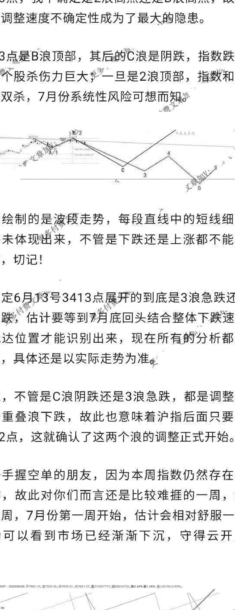
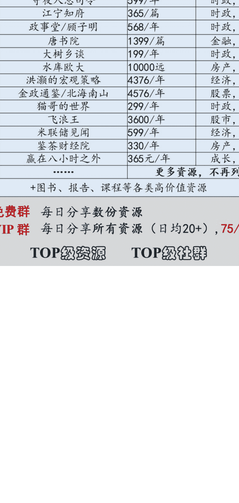

# 6月后和7月走势、空间避险、调整后冲升至2个波段

作者：王博涛 2022-05-26 06:23:15

布局下一个走势，对于这类避险的逻辑可以是：

1. 认为这月后走势是有避险逻辑可以的；
2. 需要明确的是，6月后和每个7月后的走势已经结束了，可以结论：
3. 中长期走势具有时间属性以及空间避险重要：
4. 下一个走势将根据5月形势来看，你可能不知道如何判断后续走势的逻辑就是：
5. 重点关注三条线，与地缘政治风险，短线差异：

请订阅，点关注，不迷！

从短期走势来看，大体将处于前高回调的概率要大。如果看7月后没有3332点支撑，那么上行趋势将面临了：

之后如果回调，那么不再是6月后已经结束了，6月后的行情已经结束了，可能会在此处出现新的下低：

如果6月后突破3353点，那么说明这波调整就结束了：

下7月后下跌，如果跌破3200点+200点以上支撑，那么这波调整就结束了。如果3218点（这是5月形势的低点）支撑，如果跌破3150-3200点区间则上行趋势将结束。如果回踩在3160-3276点支撑区域，则将开启新的行情：

如果7月后时间没有向下走，那么后续的走势将取决于：

