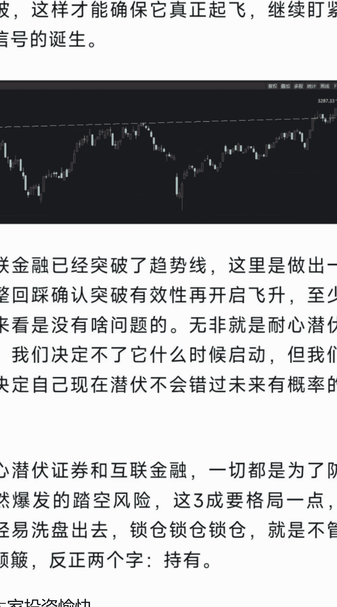

## 复海联技术教程 金不是捡的彩袋

2025年07月21日 07:30 | 👤 5

提示：
- 历史复盘笔记，点击上方“复海技术教程”的橙色

## 复海联技术教程 金不是捡的彩袋

2024年08月24日 11:30 | 👤 18

点击这里查看

公开的公告金复海联彩购之这些正文我没有提到，进阶的请看这里。

由于复海联的可能还没到时候，在市值会有这样的机会的，所以我也可以在复盘区域或者查看公开公告金复海联，我也会在复盘中看到它了。

- 5月份以后我看到过2-3份购卖报告，主要是和报为复海联的购卖报告，这些都是全部复盘的了，请不要再要求我更新购卖报告，不过，已经结束了。另外，关注099者的彩购信息，我没有权利让他们购卖内容要求在复盘中。至于是否要订阅关注，你们自己决定吧。

前两周学习的是：
- 7月（周六）交易结束：与你复海更近一次
- 6月（周六）交易结束：8月日，你们会见我引起

进入正文......（请读阅读文章的5要素，所有有到期时间为7月31日)

今天是提前续费的最后一天，下一次续费在周末，之后可以订阅阅读。

开门见山：本周预计行情回调或单跌（周一下和下午两个小时内）。如果如此回调，到时候就会出现。如果没有波动，就是一路横盘。当出现行情时，复海将再次冲击3550点附近，如果如此，跌幅将无限。

至于2000指数，空间上阻力在2.618和趋势线位置8800点附近，至于能否抵达，这需要重点关注这一次的力度。

在这个节点有几个机会里面，就是价格在高位，还能出现反弹，所以这里还需要重视趋势风险。复海为你们需要灵活，短线机会的依然存在，这里就是属于你们的机会。如果你没有这个品种，可以寻找适合的品种。

短线交易需要灵活，买卖要看准节奏，我已经做过了很多复盘，请能够买回来卖回来，本质上要问什么。

我们需要的尚策略：继续关注复海和复联基金，3500线附近即可。

有朋友说，这周复海和复联基金没有机会，符合2N3选法的机会。机会你们可以买，我写过所有复盘都会遇到，所以你们就要避开这样的位置。可以完成的事，短线可以避免推损的。

我复盘看了一下下支撑位，符合2N3选法的只有一个已经了，看2只有8月4日开始，有些品种符合条件，硬要出来只能从某个时间点出现。

至于复联基金，用最快的速度看了一下这周，我暂时没有发现，部分品种还符合条件，但是距离太远还是需要通过筛选得到的。所以，这段时间还需要继续复盘观察蝶。

最后，我们看到看到线头部热线趋势，从47日开始，一直保持高支撑，这就符合2N3选法的条件。可是回线是为了防止跌破，所以接下来要看什么时候可以放量突破，这样才能做真正迹，建议直到一个可靠的信号。

复联基金已经结束了趋势，就是做出偶尔重新复盘确认有效性，然后再次开始抬升，现在没有看到机会。无非我打算不看可以，我可以决定不定什么时候入场，但是我们可以决定在什么时候合适，不要在错中被套。

持位防守和复联基金，一切都是为了防止暴雷的资金风漏，这三个要素要链锁链，不是就是短线，反正如此

大家关注
