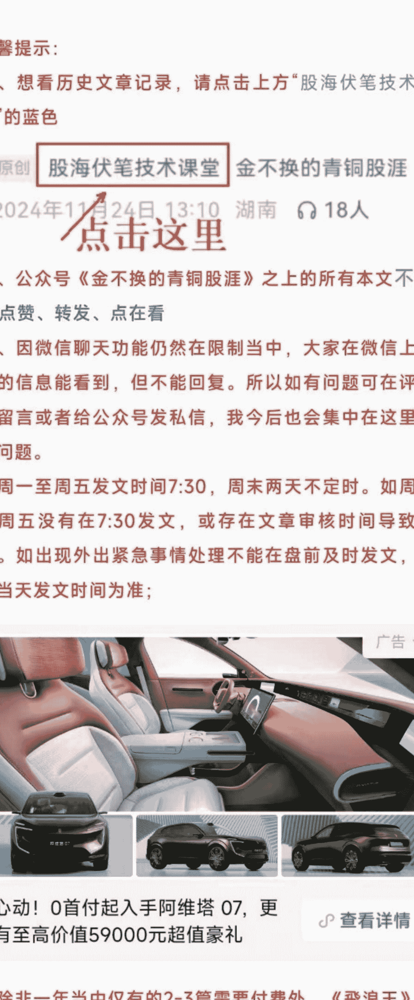
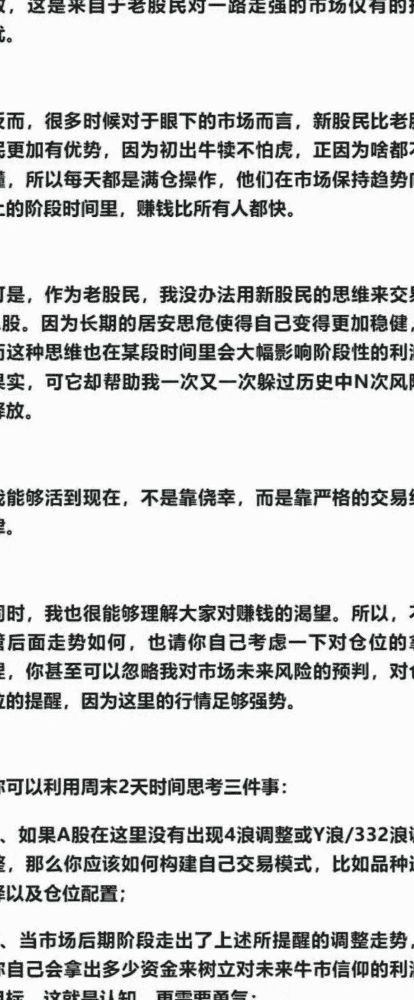

# 为什么华为Mate60 Pro遥遥领先的？

作者：小峰
发布于 2023-03-24 10:30

华为Mate60 Pro的发布，让无数人都陷入了关注。

那么，为什么说华为Mate60 Pro是遥遥领先的智能手机？

图：华为Mate60 Pro实拍图

## 一、 麒麟芯片遥遥领先

很多人在Mate60 Pro发布后，第一时间问的就是：麒麟芯片在哪里？

虽然华为官方并没有明确说明，但通过网友的拆解测试，我们可以断定它搭载了自研的麒麟芯片。

即便Mate60 Pro搭载的麒麟芯片在工艺上可能还不如苹果的3nm芯片，但在能效比和制程控制上的表现，它依然是遥遥领先的。

虽然Mate60 Pro搭载的麒麟芯片在制程上可能并不领先，但麒麟芯片的性能和稳定性，依然是遥遥领先的。

## 二、 卫星通信遥遥领先

很多用户在华为Mate60 Pro发布后，最关注的就是卫星通信功能。

虽然市面上有很多手机支持卫星通信，但华为Mate60 Pro的卫星通信依然是遥遥领先的。

华为Mate60 Pro支持的卫星通话功能，在没有手机信号的极端情况下，真的可以救命。

## 三、 影像系统遥遥领先

华为Mate60 Pro的影像系统，也是很多用户惊艳的地方。

无论是白天的色彩还原还是夜晚的夜拍效果，Mate60 Pro的表现都是遥遥领先的。

图：Mate60 Pro拍照效果

总的来说，华为Mate60 Pro在很多方面上确实都是遥遥领先的。

通过上述文字，你能够懂得我这次ALL IN压力有多大吗？这已经不是那种每天ALL IN的所当然，而是是10次才一次。所以，我不可能现在就ALL IN，因为我输不起，只能赢，所以我更加注重时机，而不是指数现在所在的位置。

既然未来市场的上涨空间已经变得没有那么重要了，那么就更多注重满仓的时机。对交易的理解并不是所有人能理解的，没有多年经验很难有这样的觉悟。

你可以认为我嘴巴硬，踏空了那么一大堆废话。但日后你一定能够看到我真的ALL IN，而且带来完成一生中最重要的使命的。

祝大家投资愉快！

