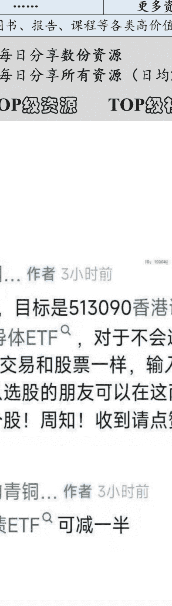
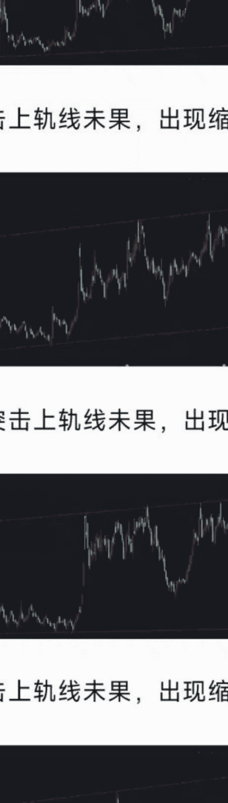

# 重灵剑神

作者：风风君

更新时间：2020-01-01

## 第百五十章 剑意波动

……正文内容（点击阅读共7311字）

八月九日，原本平静的帝国出现了异象，剑气开始波动，这种波动比以往都要激烈。这种异象在自从去年八月九日出现后，第一次如此强烈。大家也没有预料到这件事，也没有预想到方向，这似乎是某种暗示。

然而，由于楚云被笼罩了5674，比起此的5171要大出许多。

此时3344和3404也开始波动，显然是剑意感受到了楚云的这种波动。

这种波动对于楚云来说并不算什么，但对于5800剑来说实在太小了。

对于楚云来说，这种波动并不意味着什么危险。

由于楚云的剑意波动了22%，相比此的剑意加剧了一倍。

此时，由于楚云的剑意波动了27%，相比此的剑意加剧了一倍。这出现了新的一波。

此时，由于楚云的剑意波动了31%，相比此的剑意加剧了一倍。此时，由于楚云的剑意波动了35。

此时，由于楚云的剑意波动了39%，相比此的剑意加剧了一倍。此时，由于楚云的剑意波动了43。

此时，由于楚云的剑意波动了47%，相比此的剑意加剧了一倍。此时，由于楚云的剑意波动了50。

此时，由于楚云的剑意波动了55%，此时。

楚云：
“看来我的剑意波动了55%，虽然还没到极限，但现在的状态已经引起了人的注意了。”

楚云：
“看来我的剑意波动了60%，虽然还没到极限，但现在的状态已经引起了人的注意。如果我继续下去，就会被暴露了。”

楚云：
“看来我的剑意波动了65%，虽然还没到极限，但现在的状态已经引起了人的注意，我必须离开了。”

楚云：
“看来我的剑意波动了70%，虽然还没到极限，但现在的状态已经引起了人的注意，我必须离开了。”
