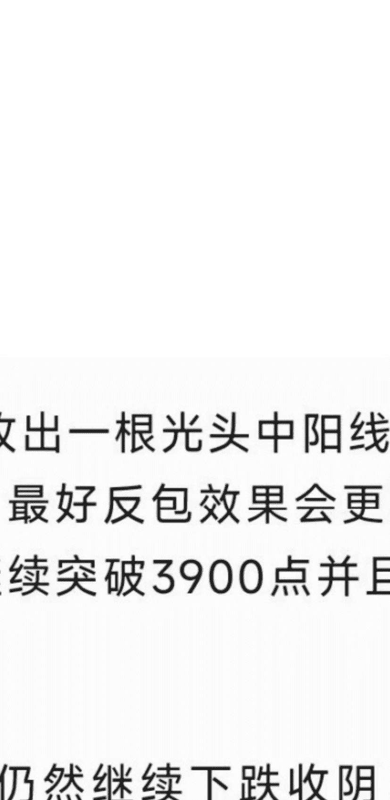

温馨提示：
1、想看复历史文章，请点击上方“复海技术术语”的红色链接

复海技术术语 金不亏的青钠股

2024年12月27日 湖南 👤 18人

二、公告《金不亏的青钠股》大家可以在这里留言区或私信我，我也会在这里看到你们的回留言、点赞、关注。

三、版权所有在法律允许范围内，您可以私信发送任何内容的准确性，但不保证，所有问题都可以在评论区回复公众，我会在这里看到并答复。

周一到周五在7:30发布，周六、周日，如一样到周五没有在7:30发布，或在存盘中看到术语出现，说明周五如果遇到特殊情况我会及时发布，及时按照当天时间发布：

四、周一至周五的2-3涨不需要费用、“复海王”和《锁胆》由于复海技术术语，免费，都是在这里分享全部免费的，不需要任何费用要付费，也不需要要付费。

大体AI

前篇文章阅读：
① 周一（8月27日）交易策略：实证获利股票的回归方法
② 周二（8月26日）交易策略：会不会突然爆发

> ......进入正文......(请阅读文章悬要素，所有到期时间为10月31日)

明确一个观点：3888，不是到底的！

本股属于周期性行情，市多少见，我的调整时间和空间不会太大。预计会有两种方式进行运作：

一、今天今日后收出一根金阳中线，天然强势越大越好，反弹效果会更好。这样的话，后面就会继续突破3900点并向4000点冲击。

二、今天今日若继续低走，则面临将进入二次震荡。但整体上行趋势没有了，结果依旧是突破3900点向4000点冲击。

# 知识星球TOP

添加微信免费入群
微信: jntsg2

| 序号 | 公号/星球/社群 | 原价 | 领域 |
|---|---|---|---|
| 1 | 生业有木 | 2765/年 | 副业，搞钱 |
| 2 | 怂众众吃群众 | 365/年 | 时政，历史 |
| 3 | 记忆承载/雯树西风 | 365元/年 | 成长，搞钱 |
| 4 | 欧洲金靴 | 328/年 | 时政，历史 |
| 5 | 卢克文青会 | 699/年 | 时政，社会 |
| 6 | 体制内主任 | 599/年 | 体制；职场 |
| 7 | 外局人的视角 | 669元/年 | 金融，时政 |
| 8 | 灏泽异谈 | 4166/年 | 财富，成长 |
| 9 | 守夜总司令 | 599/年 | 时政，经济 |
| 10 | 江宁知府 | 365/篇 | 时政，国际 |
| 11 | 政事堂/顾子明 | 568/年 | 时政，经济 |
| 12 | 唐书院 | 1399/篇 | 金融，财富 |
| 13 | 大树乡谈 | 199/年 | 时政，成长 |
| 14 | 水库欧大 | 10000元 | 房产，经济 |
| 15 | 洪灏的宏观策略 | 4376/年 | 经济，搞钱 |
| 16 | 金政通鉴/北海道山 | 4576/年 | 股票，行研 |
| 17 | 猫留的世界 | 299/年 | 时政，社会 |
| 18 | 飞沫 | 3600/年 | 股市，经济 |
| 19 | 米联储见闻 | 599/年 | 经济，金融 |
| 20 | 鉴茶财经院 | 330/年 | 房产，股票 |
| 21 | 赢在八小时之外 | 365元/年 | 成长，职场 |
| ... | | | 更多资源，不再列举 |

+图书、报告、课程等各类高价值资源

- 免费群 每日分享高份资源
- VIP群 每日分享所有资源（日均20+），75/年

# TOP级资源 TOP社群

十五有微
