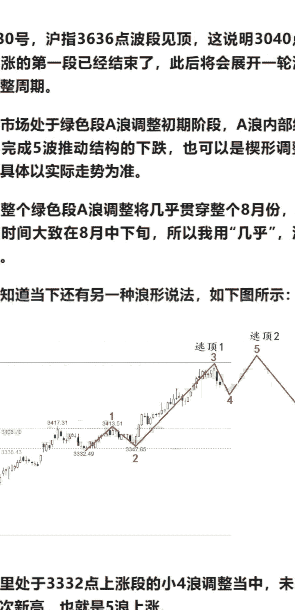
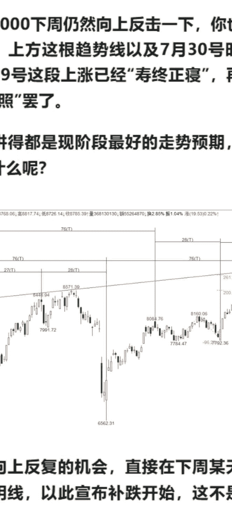
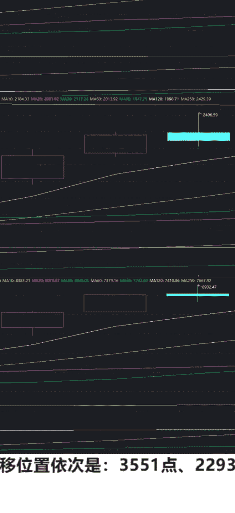
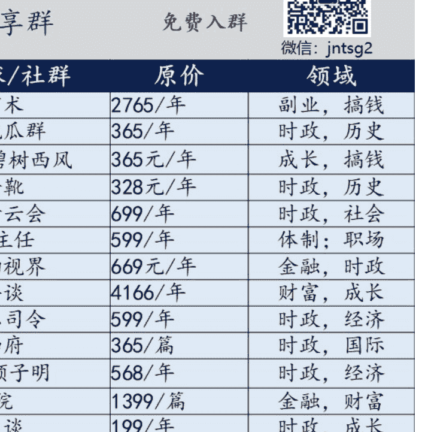

# 八月走势推敲，大底在何时？

原创 飞浪 飞浪王 2025年08月02日 14:27 湖南

微信:jntsg8
免费进资料群

前言

飞浪再次展现精准逃顶！

一个字都不透露（金不换学友和订阅《只为顶部》付费合集的朋友不要重复订阅该，3号将会发布），请看清楚这段文字！

加微信jntsg2，进资料分享群

# 劝八月！

五出斩六、七上八、九现十，在A股中一直有这样的说法。
今年的八月不简单，因为A股会出现4月以来第一次回撤的调整，时间很长，空间也不小。

上证走形预测：

7月30日，沪363点走底部预期，这363点上证的调整已经结束了，但可能会开始一场长期的调整。

目前处于底色A股调整初期，A股内部需要一些调整的下跌，也可能走形预测，目前是以震为主的。

预计八月A股将拿出几个月的调整，A股的顶点可能会在8月中旬，“调整”结束。
我预测还有另一个底部走形，如下所示：

底部还有3332点以上的上涨调整，未来还会有一次高，然后就是五级调整。

最后，在实证3500点空间，如果还有5000点高点，则还有机会。虽然有空间，但一有大回调，未来就很难再出现大行情。
目前在底部，如果能通过实证3500点空间，那么3500点就是目标了，如果能突破3500点，那么4000点就是目标了。

整个过程的调整，如果能反弹，那么至少会回调到3500点，3500点不是整个底部，3613点也离200点太远，还没到来的底部。

另外，底部可能用周的实证来证底2200点，如下所示：

根据预测2200点和创业板都要一跌，其实最大的问题是什么？
补跌！

我建议大家看得懂就玩小会儿，看不懂或怕风险高，一定要保守自己放在第一位，千万不能抱任何侥幸心理。

# 大家要投资学习！

| 序号 | 公募/股票/社 | 原价 | 行业 |
|---|---|---|---|
| 1 | 生物有术 | 2765/万 | 科技 |
| 2 | 宫益云合企 | 365/万 | 科技、消费 |
| 3 | 记录我/传奇风铃 | 365/万 | 成长、成长 |
| 4 | 欧洲基金 | 328/万 | 历史、消费 |
| 5 | 龙友资源 | 799/万 | 体制、职场 |
| 6 | 主磊主享 | 599/万 | 金融、科技 |
| 7 | 人肉机器 | 4166/万 | 财富、成长 |
| 8 | 宁洋资本 | 299/万 | 经济 |
| 9 | 留心人小岛 | 599/万 | 经济 |
| 10 | 江湖坤卫 | 568/万 | 历史、国际 |
| 11 | 东方财富/许明 | 1399/万 | 金融、富常 |
| 12 | 华星基金 | 1997/万 | |
| 13 | 下华聚大 | 1600/万 | | |
| 14 | 避险的蜜罐 | 4376/万 | 经济、行情 |
| 15 | 金政通/蓝海青山 | 4576/万 | 股票、行业 |

更多资源、报告、课程等高价值信息
不再列

* 免费领 每日分享优质资源，75/万
* VIP领 每日分享优质资源（日均20+）

TOP收益 TOP收益

# 评论 7

留言

青山 广东 2天前
美国统计数据造假，下周市场会有影响吗？

回复 回复

金不换 ... 2天前
中概股大跌，下周一影响较大，预计低开

回复 回复

青山 广东 2天前
回复 金不换
：低开高，继续减仓

申代民 上海 2天前
感谢老师 🌹

回复 回复

韦逊.. 湖南 2天前
老师周末愉快

回复 回复

雄 广东 2天前
创新合约有风险吗？老师

回复 回复

金不换 ... 2天前
5日均线之上暂时没风险，否则亦然
