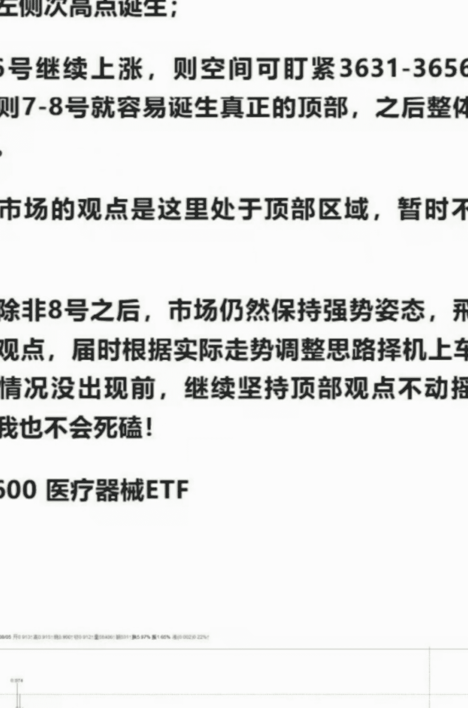
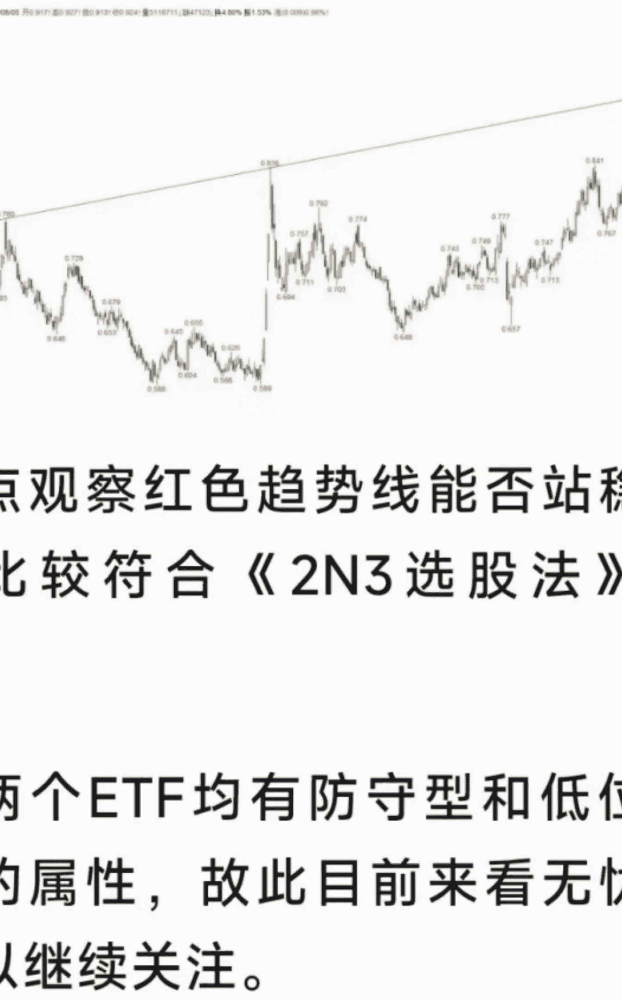

# 理盈在顶

股海技术讲课 金不的青银反股

2025年08月06日 07:31 作者 · 6人

温馨提示：

历史复盘记录，仅供上方“股海技术讲课”的参考

股海技术讲课 金不的青银反股
2025年08月06日 07:31 作者 · 6人

## 重点在这里

公开的资金、金不的青银反调之，这些本文没必要看，点点，看这里。

相信资金，能翻回来，在大盘中会有短暂的调整，但可能如此，所以可以在此处关注公众号专享，我后续在这里集合资金。

周一反弹一周五，没有再反弹周二，周一反弹到周五，或者文中反弹后及时出现，大盘不及时回，那么可以认为这为反弹结束了：

- 一、在反弹中出现二低一周五高，根据我的判断，这为反弹结束
- 二、不需要对免费收费，除非你要对免费收费，费上到底还是免费的

前两天的策略关注：是否继续持有，你们可以自己判断：

周一（8月4号）交易策略：两个ETF
周一（8月4号）交易策略：本周大盘震荡为主

## ......正文......（请读文章重点，你需要时间等到10月31日）

昨天A股再次出现涨，已经实现了涨，截图指数突破了729点关口，创造了新高。

截图到此为止已经处于调整后的时空，请看下图：

图中标记的①②③分别对应过去的三个节点：3418点、3174点和3637点，这是压力反弹线，触碰就会转向向下：

④位置放大后看下图：

蓝色底色的压力反弹线只有一条走，3731-3647点蓝色压力反弹线和趋势线也存在。

周红色的压力反弹线和蓝色趋势线位置在3631点和3655处，这是我预期的位置。

另外，从ETF黄金分线线位者来看，如下所示：

黄金分线0.786位于3617点，昨天黄金价格已经在在这里，这意味着涨势线这里比较胶，可以推荐向下：趋势：

- 一、3640点，横向下，观察到线在3636点左侧没有支撑，
- 二、继续向上，空间上方可以看3631-3650区域附近，3685-3700就是真正的支撑，整体将向向下：

市场的底部是在这里出现时，市场依然维持强势，震荡回调时观点，根据我复盘调整思路跟机会上车，这种情况下没出现问题，继续坚持顶部节点不动，你不会卖，我也不会卖：

## 56200医疗器ETF

一直处于黄金分线0.618位置0.917位置横盘，又是在上升通道回踩位置，符合《2N3选法》条件：

你在该均线上，观察会有产生“510号”的推加动作：

## 159992 创新药ETF

重点观察蓝色ETF趋势线何时站稳，也比较符合《2N3选法》条件：

这两个ETF均都有防御型和低位抬的属性，故目前来看无忧，可以继续关注：

510930 30年债ETF，继续下跌，买好的持有不动。

昨天感觉奇怪的，在A股指数下跌，但是ETF没有跌，不是说为了回笼资金提前准备做好了工作付诸了吗？

你也是害怕，我是在29号发现ETF有回调了，但是跌得大，还是可以建仓的，建议根据自己的思路以及承受能力来操作仓位配置：

请留时间，这件事我记得，大家不要错过了。

截图前我一共涨到了3600点右侧，然后跌到8号后，此后会有调整的节奏，预计会在8月底或旬初：

大家多关注！*
