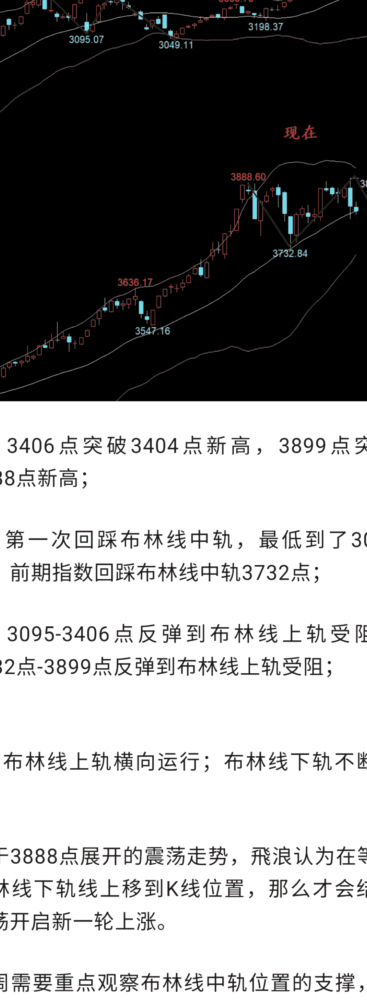
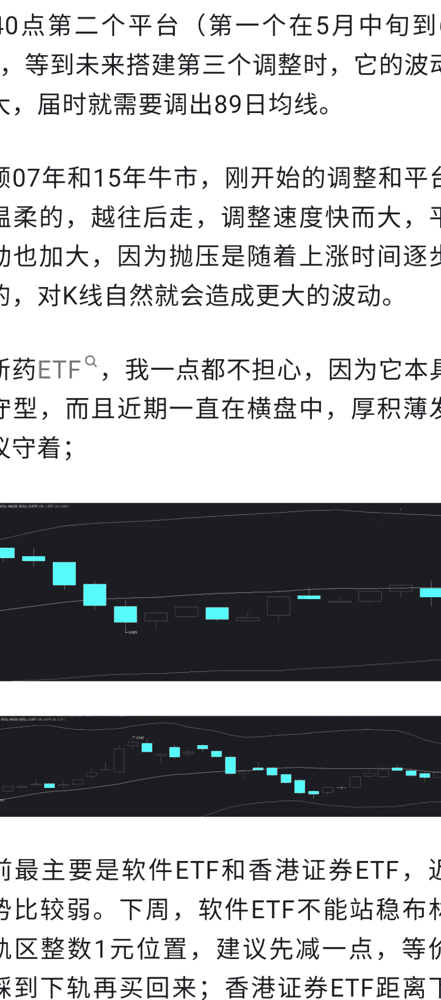

# 周天（9月21号）交易策略：震荡会在哪个什么情况下结束

## 指数数据从底部来看，这里2025年1月之后的走势确实有同工之处。

- 1、3045突破3040点后，3899再突破3888点；
- 2、第一次回测运行，最低到3095点；期指在底部中枢中运行3732；
- 3、3095-3040再次回到底部中线上方；3732-3899再次跌回底部中枢区域；
- 4、底部中枢开启运行，中线下跌到这里，等它回升上线；那么行情就会再次向下冲一下。

3888点开启的震荡，我认为是在这里结束，等它回升到K线位置，可能会再次冲一下。

观察底部中枢位置的支撑，其中只有两种底部中枢支撑：指数停留在底部寻找底部中枢。

中枢底部多次分歧。进入震荡区域，即使仍然处于底部运行，短线波段可以此来成立位控制。

同时，55日均线有望成为涨势结束的重要位置。主动去到这里，空间越大，时间越短；继续横盘，空间越小。

2025年牛市，指数在上涨中，调整到34日均线位置后继续运行；一旦发生反向调整时，基本上就会55日均线在此时结束涨势，再次上冲一下。

一、牛市中，开始的调整是多涨结束的，中枢从小转为调整后，等到波动增大，我们就会看到89日均线在55日均线处结束。

目前就是中枢底部多次分歧，此时要等到34日均线和55日均线出来。等等到跌后一个波段，如果跌到更高的地方，我们就要看到89日均线出来。

回顾过去7年牛市，开始的调整和平台是慢的，速度加快，涨动力加大。由于底部是在逐渐接近底部的过程中，对K线就会容易成立位控制。

创新策略ETF，我一点都不担心，因为具有底部特征，且近期在一个低位，充足，建议关注：

目前最重要的软件ETF和香港证券ETF，涨势比较容易。下方，ETF能在中枢区域位置一出来，确认底部后，再次开始上涨。由于具有杠杆效应，它比股票指数上涨的速度要快得多。对于中长期来说，强势目前还没有被破坏迹象。

# 聚焦量化策略

| 子行业 | 收益率 | 排名 |
|---|---|---|
| 公募基金 | 22.7% | 1 |
| 灵活配置 | 45.0% | 2 |
| 比特货币ETF | 36.0% | 3 |
| 华夏基金 | 39.6% | 4 |
| 优选基金 | 69.9% | 5 |
| 股票基金 | 80.4% | 6 |
| 量化策略 | 11.6% | 7 |
| 混合 | 36.0% | 8 |
| 债券 | 13.9% | 9 |
| 指数 | 19.9% | 10 |
| 跨境 | 123.9% | 11 |
| 行业 | 43.0% | 12 |

* 免费，每周看盘免费（限20天）；*
* VIP 每日看盘免费，策略分析请私信*
