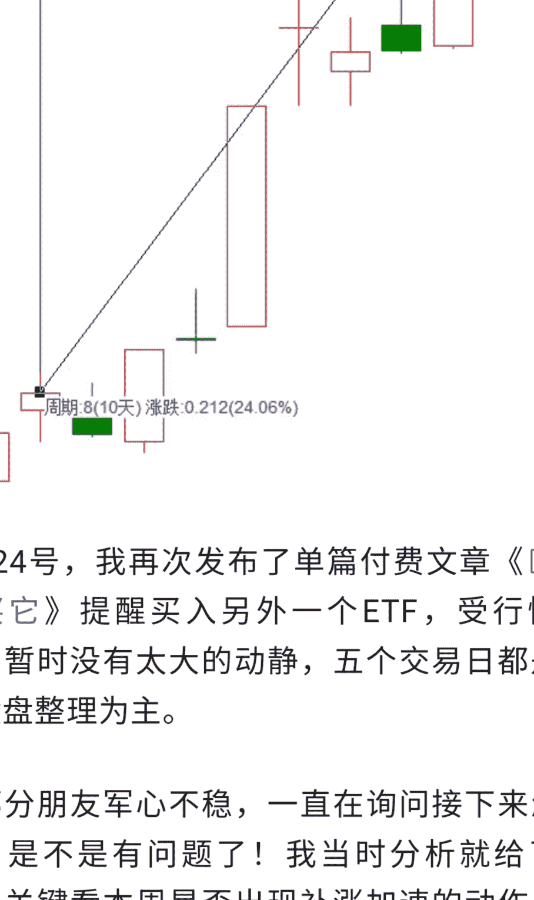

# 一个目标了，开始计划买入！

原创 飞浪 滚浪涛 2025年08月31日 18:39 湖南

标题已修改

# 前言

15%利润ETF

8月18号，我在付费合集最后一篇文章中提到购买159813半导体ETF，28号1.093万最高涨幅24%。另一个ETF仍然蓄势洗盘，后面定会加速！

8月24号，我再次发布了单篇付费文章《周周买一套》提醒购买另一个ETF，受行情影响，暂时没有太大的动态，五个交易日都是保持持仓期间。

有部分朋友心不稳定，一直在接下来说怎么走，是不是有些问题了！我当时分析就给了目标，关键本周是否会出现加速的动作，建议注意重点。

现在，我买了一个ETF，预计之后也会加速上涨。我有一点需要注意，我出的ETF将会卖出来和预期目标位置，打一个先优后等钱来给自己补仓。所以，对于一些喜欢跟节奏的朋友来说并不是太好的。

现在的ETF活跃性比较好，以前一万有1%涨了，现在有些ETF一天就能涨5-10%，2-3天就能有10%的利润。所以，如果是新手是老百姓的，建议账户配置一些ETF会比较好。

刚开始觉得没涨，等到这些ETF突然涨幅很大的时候，又有人人很多人是否能够卖出去。比如，机会是留给有准备的人。你觉得100元太贵了，人家可以花100元就能赚100倍十倍，哈哈！

(ETF操作和个一样，我告诉你代码，你只需要输入代码，填入数量，确认买入就可以)

不多说，进入正题吧！文章很简单，保证连看都懂！（学友别离，周一7:30会有发布）

大文友VIP群专享，付费请加微信peb855微信daizongdai

说9月是一个特殊的时期，大家都好。

9月2日左右会有这一轮行情的分低点，后期要比3000这轮行情的主要要素是9月政策之力的持续维持。

所以，以后市场可能会这样这样的回调，9月2日左右整体走势会比较低弱，大概率会有一次不可收的回调。

但是，你们在市场这样下跌之后要有反击动作，要注意高回落的走势，9月2日会有反弹的开始。

至于目前市场，上午出现一波拉升的时候，大家要动起来，9月2日会有反弹的开始。

所以，下周走势将震荡为主，预计5个交易日的分低点是两边中间偏低的走势，底底回升为主！

注意防守力的机会，比如证券、保险、半导体、软件、人形机器人等，我估计下周会出现突然的拉升带来健康康复！

代码：159770

名称：机器人ETF（每个客户命名一样，代码一致）
目标：1.264元，利润15%

分析如下（周线）：

过去两个的高点连成了一条趋势线，本周的高点将突破这个趋势线位置，这里还有很大压力，但是一到突破就会在上方回踩了。

我们将159770机器人ETF与人形机器人指数以及沪深200周线框进行对比，如下所示：

你能够看清楚的，人形机器人三者之中最强的，159770机器人ETF和沪深200都是跟随的，而且走势几乎完全一样。

未来沪深200将进入下行，人形机器人是主要力量，那么跟这个这个ETF还会上扬。

比如半导体ETF、科创50ETF和锂电池ETF，突破前面高点及趋势线就开始加速了。进加微信pep854

故，我认为159770机器人ETF也会在这里准备加速了！

飞涨基金会在9月2日下午一小时或者两个小时内打分批低吸一成仓位。
