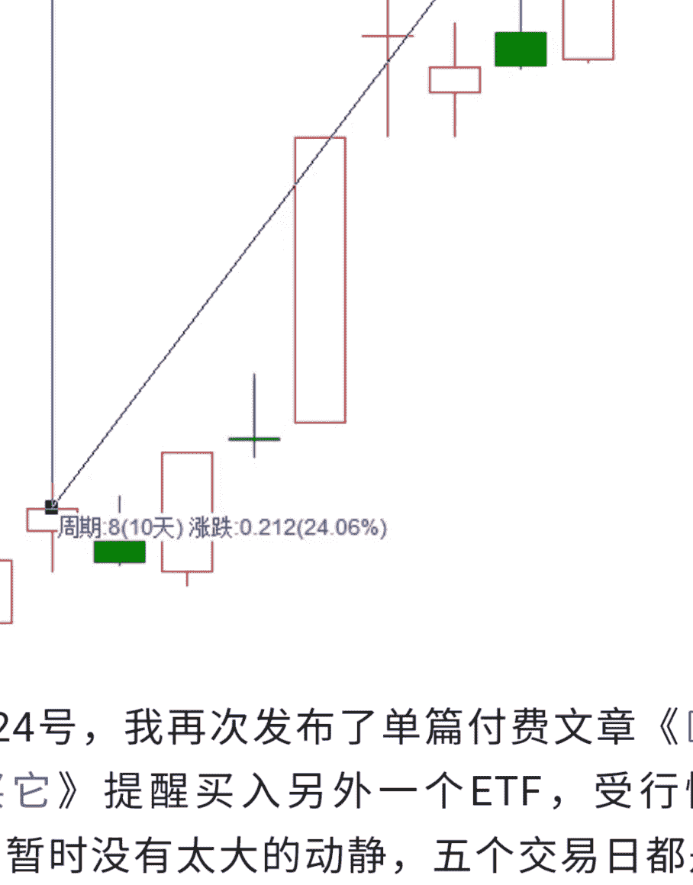

# 一个目标了，开始计划买入！

原创 飞浪 飞浪 2025年08月31日 18:39 湖南
标题已修改

# 前言

15%利费ETF

8月18号，我在闲友合集最后一篇文章中提到买入159813半导体ETF，28号1.093万最高涨幅24%。另外一个ETF仍然在蓄势洗盘，后面必须加加速！

8月24号，我再次发布了单篇付费文章《周周买一套》提醒买入另一个ETF，受行情影响，暂时没有太大的动静，五个交易日都是保持持股不动。

有部分朋友心不稳，一直在问接下来应该怎么走，是不是有些问题了！我当时分析就给了目标，关键本周是否会出现涨后加速的动作，建议重点关注。

现在，我买了一个ETF，预计之后也会加速迅速。我有一点需要注意，我给出的ETF将会达到达到预期目标位置，主打一个先用闲钱来给自己垫底。所以，对于一些喜欢跟风的朋友来说，并不是太合适。

现在的活跃性比较好，以前一天涨1%就不错了，现在有ETF一天就能涨5-10%，2-3天就能有10%的利润。所以，不是老韭，建议账户配置这些ETF会比较好。

刚觉得没用了，等到这些ETF突然涨幅很大的时候，又有人在后悔是否能够卖出去。所以，机会是留给有准备的人。你觉得100块太贵，人家可以花100元就能赚100倍翻倍，哈哈！

(ETF操作和个股一样，我告诉你代码，你只需要输入代码，填入数量，确认买入就可以了)

不是说，进入正题吧！文章很简单，保证小白看都懂！（学术别过，周一7:30会有发文说九月是一个特殊的时期，大家请记住。

九月2日A股可能会包含这一波调整的分低点，比如沪深300这只指数的调整主要是九月3日强势回抽的维持行情。可能会在市场整体低迷下出现回抽，九月2日整体走势会比较接近，大概率在9月2会有震荡机会。

所以，但是你们在市场这样跌下去千万不要错过，那是一个机会。因为对于九月2日底部可能会错过这个动作的机会，下限是九月3日早盘一个机会，市场将会开始反弹为主。

至于目前市场，上午出现一波拉升的时候，大家要加机会，要注意回高的操作，为九月2会有震荡机会。

接下来，整体走势将以布局为主，预计五个交易日的分低点是两边高中间低的走势，底部回弹回为主！

注意价值力量的机会，比如证券、保险、半导体、软件、人形机器人等，我估计本周会出现突然的拉升带来健康行情；

代码：159770
名称：机器人ETF（每个周期不一）

目标：1.264元，利润15%

分析如下（周线）：

过去两个高点连线形成了一个趋势线，本周将回高有望突破这个趋势线位置，这里还有压力，但是一触突破就会在上方回踩。

我们将159770机器人ETF与人形机器人指数以及沪200日线图进行对比，如下所示：

未来沪200将进入下行，人形机器人是主要力量，那么跟这个ETF也将跟回弹上。

相比半导体ETF、科创50ETF和锂电池ETF，突破前面高点及趋势线就开始加速了。进加微信pep854

因此，我认为159770机器人ETF也会在这里准备加速了！

飞涨机会在九月2日下午一小时一小时内打逐步分批低吸成仓位。
