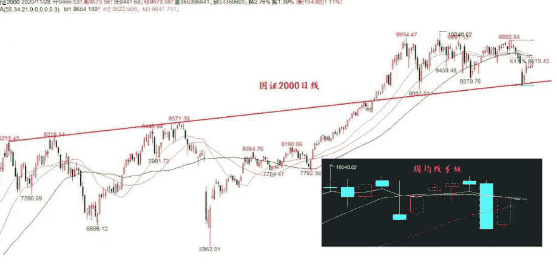
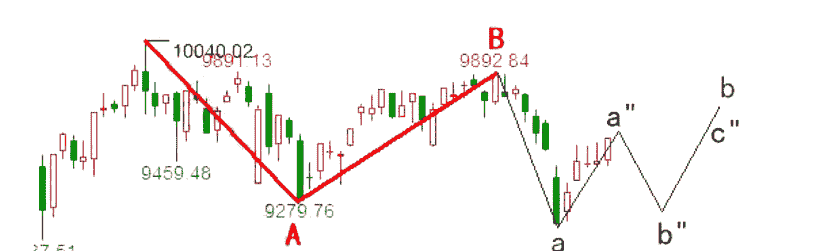
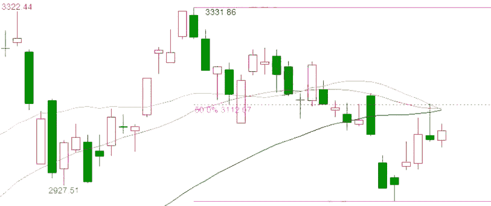
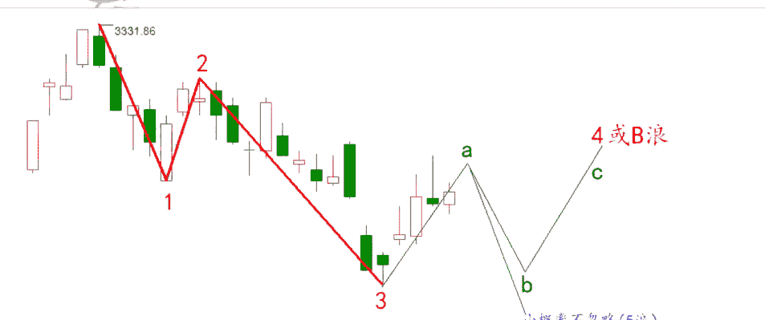
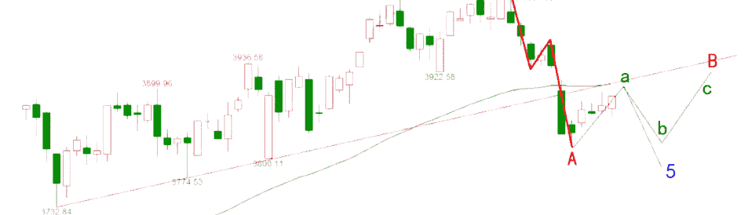

# 下一个短线高点在哪里？我们在这里撤退，低点时间买回！

原创 飞浪 飞浪王 2025年11月30日 20:51 湖南

## 前言

下一个短线高点在哪里？我们在这里撤退，低点时间买回！

下一个短线高点在哪里？我们在这里撤退，低点时间买回：

本文清楚了哪个时候产生高点，短线需要调整调整风险。此处比较适合短线先减持，之后找低点买回。段位上可以根据短线离选择，还需考虑个股与指数之间的差异。

本文“开门见山”这段话，人都能懂！（学友别订阅，周一开前7:30发，高点前文早就明确了，只是发确认一遍）

## 开门见山：1号是高点时间，预计此处折向向下，建议短线此处不要追涨高，且仓位重的持个股与指数协调性相符可以选择减持，等待下一个低点时间买回。

## 一、国证2000阻力分布以及波浪结构

阻力分布，如下所示：

深度视野VIP群 人工追踪50+大V 进群加微信cuk255 微信chp5568

国证2000日线上反弹了黄金分割线618位置，同时21、34、55日线聚焦在一个区域内，其周期区间在9613-9660点。同时，5周线和10周线线下周聚焦在3960点附近。故此，这是容易产生短线高点；

浪形结构，如下所示：

从浪形结构来看，国证2000日级处于C浪下，图对于C浪的浪线聚焦在一个位置描述暂定调整，并以5波推动浪结构视为操作，可以将a浪看作是1，b浪可以调换2，以此类推。预计此处将会构造B浪平台反弹中的子浪a高点，其后展开子浪b调整。强调，即便此面浪b跌破21号低点，也是合理的，这是空荡的下跌，不妨碍未来展开B浪c上涨的预期。

## 二、创业板国证2000阻力位分布以及浪形结构：

阻力位分布，如下所示：

黄金分割线0.5(周四精准抵达此处受影响回落)以及21、34、55日根线聚焦在一个位置，产生共振，故此此处是重压区域。短线此处恐怕很难逾越，预计此处将会构造短线高点；

浪形结构，如下所示：

从创业板浪形结构来看，它的下跌整体是没有结束的。即便从24浪展开反弹，只是4浪或B浪的重叠上涨。预计此构造造成B/4浪的子浪高，其后开展浪B下跌。值得注意的是当创业板未来未出现小概率创新低走势，那么就可以否定4浪反弹，应该是B浪或5浪下跌。这个就是踏浪的环节，需要等未来更多的K线确认后才能继续推演一步走势。

## 三、上指数阻力分布及浪形结构

如下所示，空间和浪型放在一张图上，它已经：

55日均线和红色趋势是短线浪，目标位置在3908点。浪上与创业板浪形非常接近。此处构造高点，属于4浪或B浪高点。当前回破816点，确认此处是4浪高，5浪结束就是非常不错的短线机会。同时B浪5浪的低点，属于一个重叠机会。只是浪级别不同，对应的浪时间和空间不一样。本文分析三个指数的阻力分布和浪形结构。A股没有分析的指数都是三个之一的运行，就不需要进行分析。预测21号将构造浪形结构，其后转向，建议整体风险。

至于指数和个股方面，近期出现调整，也有板块和个股上涨的机会。建议大家一定要考虑个股和指数之间的协调性和一致性，看到个股与指数走势一致，以此作为买卖标准即可。要是指数跌，反而不需要。

## 高点构造分类：

- ①当周一路指数中很强大，稳健则可以借助拉动操作，激进派等到2号选择减持。只是为了下博弈更高的位置，但容易出现下跌后错过机会，这一点确实要自己拿；
- ②当周一路指数表现比较弱，建议不要涨，应该当指数跌直接减持，不要等2号更高的位置；
- ③当周一路指数根本没有拉高机会，那么被5日均线必须要减持。沪指、国证2000、创业板5日均线在位置依次3877点、9507点、3032点。

最后，这里强调一件事：这里只是短线高点，只适合短线交易，波段选手不是持股不动，你也可以选择，考虑到个股与指数之间的差异，中长持股是不可能的，这就让你自己拿各取所需。(img/1c713f0e11627201e1eb5abafd2e98e3_3_0.png)

### 深度视野优质（助你成功）全部包含以下内容：限时年费188/年

- ① 吃瓜粉丝圈对话（原价365 元/年）
- ② 子明私享汇（含内部文章）
- ③ 政治室付费内容加送群资料
- ④ 米联储闲闲【作者米穗】（原价599 元/年）
- ⑤ 欧洲金雀专属文章（原价328 元/年）
- ⑥ 砖瓦斥文档（原价400 元/年）
- ⑦ 卢克文青读书会专属文章（原价699 元/年）
- ⑧ 鉴茶财经知识星球（原价3310 元/年）
- ⑨ 猫哥的视界知识星球（原价299 元/年）
- ⑩ 财新周刊【独家新闻】（原价1498 元/年）
- ⑪ 杨世光在金钱坝（原价2200 元/年）
- ⑫ 蒜森财经知识星球（原价1600 元/年）
- ⑬ 极游译付费文章（持续更新）
- ⑭ 司马林解课全套音频和全套书籍藏版无删减（原价2.3 万）
- ⑮ 虚构三部曲[民国梦、帝国扩张、不被理解的MAO]（原价599 元/年）
- ⑯ 卢克文星球文章（原价268 元/年）
- ⑰ 额外再送：卢户元新浪韭博专栏、三村丰老王、三花九树文集

不定内容：......（更多资源不下去了......）

- ① 守夜人知识星球、接魂魔王知识星球、成术花论知识星球、成就财富、雪花花甲老头等
- ② 创始笔记、达叔谈论知识星球、成术发财富
- ③ A视野、大树乡谈、江初序、咩说什么、财上海家学等付费文集
- ④ 西风付费文章、老端、赢在八小时之外、局外的视界、升值记、老体制内等一些大V付费文集限时年费188/年

### 底层链接链全网大V优质内容

深度视野（付费文集）

### 深度视野文集

### 进群微信cuk255

