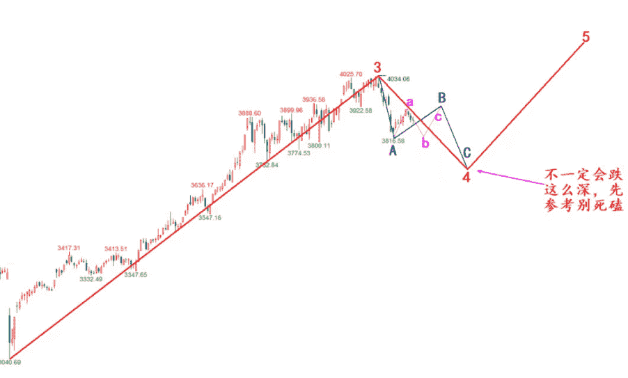

# 保好命，设门槛！C浪下跌长啥样?

原创飞浪 飞浪王2025年12月4日 16:04 湖南

## 前言

C浪下跌长啥样?

C浪下跌长啥样?

我反正是不敢公布波浪的虾子，再违规就是禁言一周。这篇文章设置门槛，你看了几的自然会懂，小白直盯着下面三种颜色的线条方向，看了就能懂。大白有基础的，大、中、小三个方向的涨跌节奏都说了，未来只是用时间来束缚高低点即可。（作业别订，明天见7:30文章会议）

大、中、小三个方向的节奏请看上图，大是红色路径，中是蓝色路径，小是紫色路径。紫色路径是蓝色路径的中继下跌性质；蓝色路径是红色路径的中继上涨性质。

B浪高点在12月1号，后面找B低点买入，再找B高点卖出。注意，这个C浪下跌会比较劲，对个股来说风险很大。所以，B浪进顶要十分重要，可以让你避免20%幅度被套和获利回调。届时会一进入准回

同时，C浪一调整结束，就是4浪底部，那里是非常好的抄底机会。

我确实不公布这张图，因为这个C浪下跌让很多人认为飞浪在看空A股，实际上大周周期的5浪的上涨，我还是看过的。

没办法，必须要设置一下门槛，免得亏狗命了！

飞浪

> 登四干，不忘回眸一笑，尔敢同行

作者提示 投资观点，仅供参考
修改于2025年12月4日

## 留言

写留言

## 深度视野优质集团（链接优质群，助你成功）

全部包含以下内容：限时年费188/年 加微信cuk255

- ① 吃群众粉丝倍时文档加时群对话（原价 365 元/年）
- ② 子明私享汇（内部）文章
- ③ 政事室（顾子明）付费内容加再送顾子明群
- ④ 米联储闲美【作者米穗】（原价 599 元/年）
- ⑤ 欧洲金雀会员专属文章（原价 328 元/年）
- ⑥ 砖瓦斥内部文档（原价 400 元/年）
- ⑦ 卢克文青读书会专属文章（原价 699 元/年）
- ⑧ 鉴茶财经知识星球星球（（原价 3310 元/年）
- ⑨ 猫哥的视界知识星球文章（原价 299 元/年）
- 10 财新周【独家新闻】（原价 1498 元/年）
- 11 杨世光在金钱爆发（原价 2200 元/年）
- 12 森淼财经知识星球（原价 1600 元/年）
- 13 潇游异译付费文章（持续更新）
- 14 司马林解课全套音频和全套书籍收藏版无割减（原价 2.3 万）
- 15 虚构三部【民国梦、帝国兴亡、不被理解的 MAO】（原价 599 元）
- 16 卢克知识星球文章（原价 268 元/年）
- 17 额外再送：卢祺元新浪韭搏付费专栏、三村丰老王、三花九洞文集

不定内容：……更多资源将下去了......

- ① 守夜人司令星球、接换魔王知识星球、成术花诸富、雪球花甲老头等
- ② 创始笔记、达叔谈论知识星球、成术财富、雪球花甲老头等
- ③ A 视野、大树乡谈、江初序、咩咩说、上海海家学等付费文集
- ④ 西凤付费文章、老端、赢在八小时之外、局外的视界、升值优、老体制内等等其它一些 V 付费文章（每月不超过 600 元的付费文集）

## 限时年费188/内 基础链接全网V优质内容

## 深度视野文集
进群微信cuk255

深度视野（付费文集）

