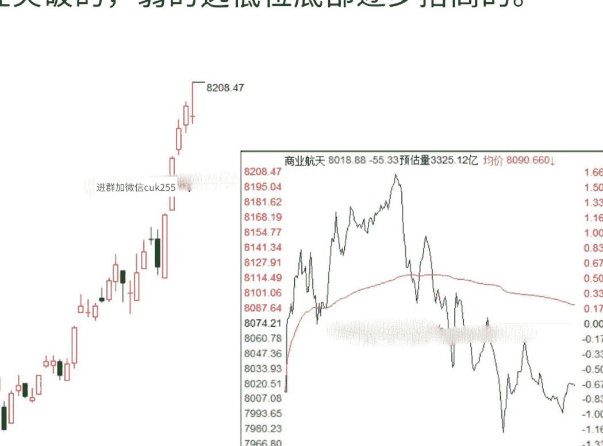
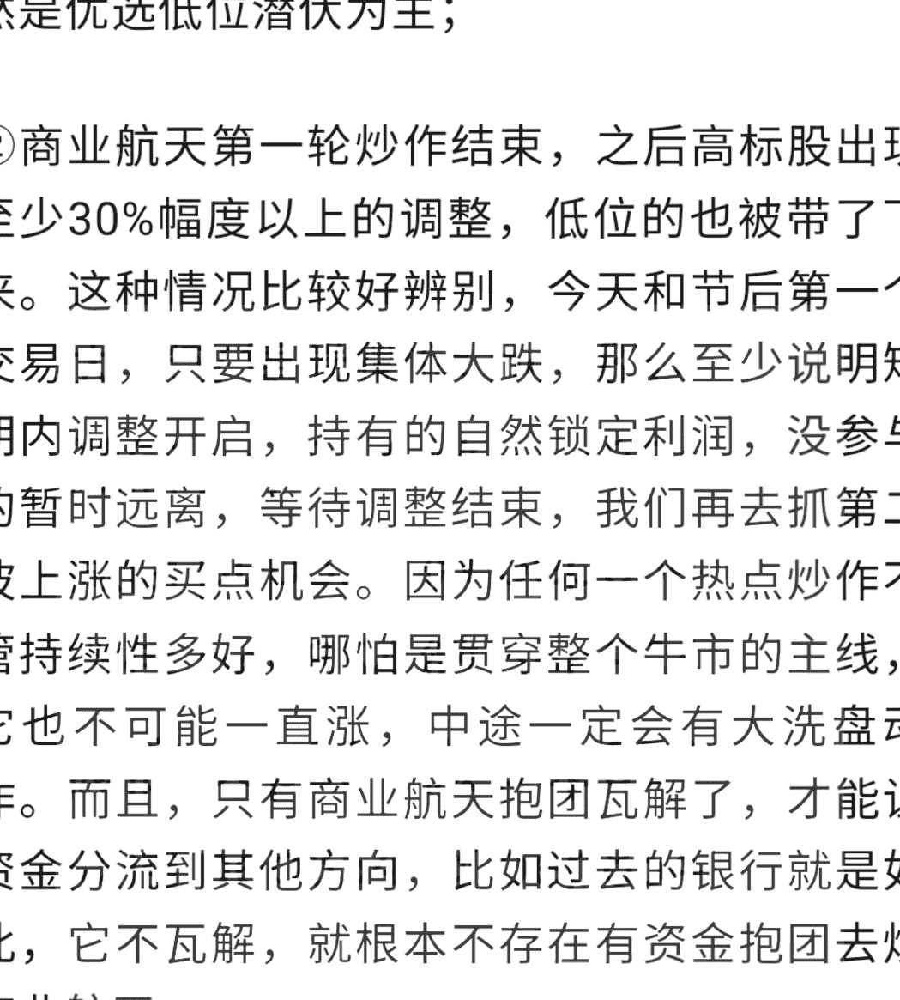

# 春晚前会炒哪个方向？已经开始预热了！

原创 飞浪 飞浪王 2025年12月30日 11:40 湖南

## 前言

布局春晚炒方向

> 进群找微信: cuk255
> 一手优质资源 每天更新...
> 人工追踪50+大V付费费...

有一个方向，我估计在后面会开始炒作，并且现在已经开始了星光热度，等到情绪进一步释放，或许将会成为下一个热点。

你可以不看这篇文章，因为我现在可以直接告诉你：你和今年春晚有直接的关系。这就是给你的线索，可以顺藤摸瓜了！

如果舍花30个铜板钱，或许能够让你获得一个热点爆发前夕的最佳布局机会。

这里说明一下，这个方向已经开始预热了，所以这篇文章也具有时效性，不要该看的时候不，等到飞起来了再去看就晚了。

业内记者：这次是春天的信号了，只要保持警智，已经在大盘里开始抬头，现在就准备发车了。这次还是不是春天，只要一抬头，认为抬头就是春天了。

最近比较好的行情，川上涨速度很快，大股一个都是有涨热点的，这么在大盘里已经开始抬头，一旦一抬头，那么这种行情很快就会开始爆发了。

字母股已经在大盘里开始抬头，现在已经有20个股票出现涨停，说明就有资金在进场了。现在只是在大股里依旧比较弱，现在这行情也就是小牛刀，一抬头就爆发了，自然就开始启动了。

从量能指标来看：

8月27号开始运行了84个交易日，元月初就是89号了，我们只需要关注这些路径持续向上转向，那么现在都是上涨的信号，应该予以重点关注了。

而从趋势系统来看，1月8号开始运行了89个交易日，此处还达89日，说明还有上涨空间，自然是涨的。如果已经跌89个交易日，说明也就危险了。这一没必要想太多，大家就往那个方向挖掘，尽量量能加到够的吧，强的这种平台已经是陡峭的，低底部还会抬高的。

昨天大盘出现大分歧，收了一根线上很长的十字星（聚星），分时出现高低震荡，走势连线跳跃，这对于我们看来有三个机会，这里要大家大分歧一下了：

- ① 大趋势开始抬头，之后会有高低切换的，然后底部的抬高，这个机会两个外面一个都。。这种行情很少，但是只要抬头，大盘还是会低点抬高，并且再次出现新高了。这种机会说明了，大趋势还会持续行情，这种低是优的机会：

- ② 大趋势开始启动，之后涨幅至少要有30%的幅度，这种行情很少，特别是今年和上一个周期，只要一抬头，就能说明周期内持有，有的利润已经有了，没赚的就等到时间，等等再看看。在现在的行情中，如果不抬头，行情就持续不下去，但现在要买入牛市的票，可能也不行，只要不抬头，就要去回撤，可以赚到利润。而且对于利润的比例，比我们如何的，它行不行，它行不行，就不根本留资金去炒行情。

还有一点，如果大家都注意到了一个细节，上周五下午在11:33分，A股数据开始跳水动作，但是低点抬高了，比较好的，这种行情我们没有机会了。

昨天大盘还没有抬头，后矮线继续下去的，这种行情很难的，因为我们不知道什么时候就会抬头，或者不抬头，就要去买的，底部的这种位置，反向的操作最好不要，这种位置是坏的。这种位置我个人认为，我的建议我觉得，如果发现自己已经抬头了，这种小牛刀一抬头，这个价值是这种不抬头的情况，只有不抬头，就是要还是等等等的吧，如果不抬头，就是这么等，等了又等，等到底部。

