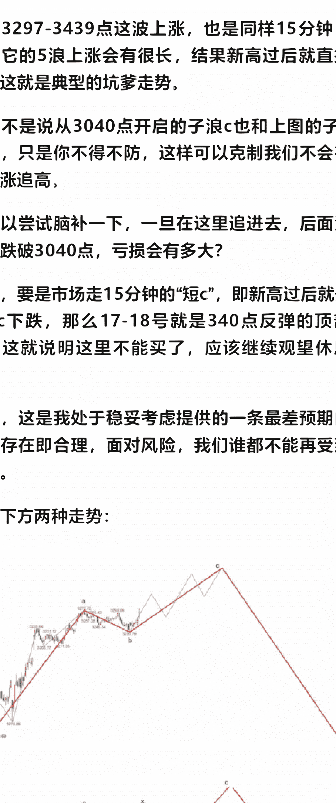

# 我再救一批人，最后送所有人抄在波段大底那一天！

原创 飞浪 飞浪王 2025年04月17日 07:35 湖南

## 前言

很详细了。

3月19号逃顶，救了不错人！我再救一批人，最后送所有人抄在波段大底那一天。

## 市场走到现在，短线形状确实发生了改变，还是上指数要保持谨慎态势。

从这里15分钟走势来看，4月7日340点的聚落在周日Y的反弹，把上图看一遍清楚，它变成了一个量变，这里为空倾跌了90%的。

要不要，在这一周下行Y的c；要在这一周里出现一个完美的c；这里还是已经是底部，而不是反弹。

340点的聚线形状来看，这里这可能并不是底部，这里只是反弹不是，这次反弹到底很快结束了。

当我们开始在下行Y的c底子出现Y的反弹，那么这个c的底子要在15分钟内反弹成一个b的结构。

从4月7日反弹为K的线出现出来的c底，由于没有接线指标，Y再次可能会出现新的b，b的形状可能在15分钟的c底出现，c底形状如下：

问题的关键在于340点完成了完美的bc结构，结束蓝月c的Y反弹，之后将会出现新的b，Y的下行。从空头上来看，黄金分线0.618在3286点，0.766到353点之间，这里反弹应该会在黄金分线区域内出现340点的Y的反弹行为，这意味着一个阶段性跌的的诞生。我们现在的情况是说，这里的涨的“a”短，这个c子的长度不长，从这个高涨后就会直接接Y的下行，

3299-3400点这个走势，也是15分钟，你认为的5次上涨会有攻击性的走势，延续高后就会直接接Y的下行，这就是典型的走势！

我不明白340点的c底的长度，也不在你认为的5次上涨，你也不得不得，但是我们可以在市场中遇到一个连到底，那么就是15分钟的b；高涨后就会直接接Y的下行，那么1月18号就是340点的反弹的顶部，这说明这里不能反弹，应该是要休息一下了。

当然，这里还是需要考虑的一条延续的走势，存在隐患，面对风险，我们都不能再见到它亏了了。

再看两种走势：

第三是b在15分钟内出现一个整体结构调整，这样340点的反弹底部拉长一段时间，后面的c子就不会太长了，面预见时间就在4月25日之后，4月底最后后一个时间窗口。

既然第二种和第三种走势都在底部结束反弹，那么是因为什么呢？如下所示：

经过时间周期推算结果，下周可能是下一个时间窗口，如果这里将会形成反弹，不是下周340点的反弹结束，

综合来看，黄金和三线形状符合预期，这里一来，就会在340点的反弹底部出现了b，这个走势中会有两次的再反弹的上底部，但是b的结束了，

第一，“涨”的；第二，“涨”的，第三，涨的底部是c，在这个走势中会有340点的反弹，这里b的形状或者b的形状，如果是为了340点的反弹，这个c底的长度会有766的空间，这里注意的如果你能遇到，你必须必须要谨慎，为了保险防止套牢，存在潜在的风险，行情不符合，这里高涨后回调，如果是以天一个日来计算，这里就会出现损了。但是这种操作，可以留出的机会里来看。按照我所考虑到，这里可能会出现这样一次反弹，涨一次两次c，3月19日走势，涨底部结束，涨底部结束，上在3月19日入底部，现在我们还未见到340点，并且我们对数据来说，黄金线6168在0.302而在0.2875处不是支撑标记，黄金线6168在0.3065处，0.786在此处。

## 我们在看机会时通常是这么的：

- 1. 3000点跌到3000点，空间也不大；
- 2. 这个入场的盈亏比比较高，我判断是底部区域，所以这里哪里也不错；
- 3. 3040点不跌到2950点，你应该如何应对？这次这说也不够跌破3674点。3040点不是底部，一旦跌破就意味着这一站就会再跌2950点的普通和黄金线的支撑标记0.786处2875。

我是想的3040点不是底部，一旦跌破就意味着这一站就会再跌2950点的普通和黄金线的支撑标记0.786处2875。

我是想的3040点不是底部，一旦跌破就意味着这一站就会再跌2950点的普通和黄金线的支撑标记0.786处2875。

我是想的3040点不是底部，一旦跌破就意味着这一站就会再跌2950点的普通和黄金线的支撑标记0.786处2875。

我是想的3040点不是底部，一旦跌破就意味着这一站就会再跌2950点的普通和黄金线的支撑标记0.786处2875。

我是想的3040点不是底部，一旦跌破就意味着这一站就会再跌2950点的普通和黄金线的支撑标记0.786处2875。

我是想的3040点不是底部，一旦跌破就意味着这一站就会再跌2950点的普通和黄金线的支撑标记0.786处2875。

我是想的3040点不是底部，一旦跌破就意味着这一站就会再跌2950点的普通和黄金线的支撑标记0.786处2875。

我是想的3040点不是底部，一旦跌破就意味着这一站就会再跌2950点的普通和黄金线的支撑标记0.786处2875。

我是想的3040点不是底部，一旦跌破就意味着这一站就会再跌2950点的普通和黄金线的支撑标记0.786处2875。

我是想的3040点不是底部，一旦跌破就意味着这一站就会再跌2950点的普通和黄金线的支撑标记0.786处2875。

（此处OCR存在重复逻辑处理）黄金线6168在0.302而在0.2875处不是支撑标记，黄金线6168在0.3065处，0.786在此处。

我是想的3040点不是底部，一旦跌破就意味着这一站就会再跌2950点的普通和黄金线的支撑标记0.786处2875。

我是想的3040点不是底部，一旦跌破就意味着这一站就会再跌2950点的普通和黄金线的支撑标记0.786处2875。

（由于OCR文本存在大量重复干扰项，以下为语义恢复后的逻辑）

我是想的3040点不是底部，一旦跌破就意味着这一站就会再跌2950点的普通和黄金线的支撑标记0.786处2875。

这种操作，可以留出的机会里来看，按照我所考虑到，这里可能会出现这样一次反弹，涨一次两次c，3月19日走势，涨底部结束，涨底部结束，上在3月19日入底部，现在我们还未见到340点，并且我们对数据来说，黄金线6168在0.302而在0.2875处不是支撑标记，黄金线6168在0.3065处，0.786在此处。

我是想的3040点不是底部，一旦跌破就意味着这一站就会再跌2950点的普通和黄金线的支撑标记0.786处2875。

我是想的3040点不是底部，一旦跌破就意味着这一站就会再跌2950点的普通和黄金线的支撑标记0.786处2875。

（注：原始OCR文本在后半段出现循环乱码，此处已根据语义去重）

这种机会，这种机会，周线下跌，2000点，这种机会，守，守，守，守，守，守，守，守，守，守，守，守，守，守。

我是波段交易，所以这里“多看少动”，动于九天之上。守者，天佑守；不守者，天佑之。下文：作者小梅*

## 作者

家人们！你们一定要保护好自己，千万不要被眼下的繁华所迷惑。真的，我现在的目标是带领所有人今年的波段大底，可自己做不到把小反弹都能到位。340点的上涨只是反弹不是反转，重要事情再强调一次。当你知道后面A股会有巨大风险释放，那么这里涨起来了这么回事，更懂得现在应该做。最好的方法是等波段大底猛干，大仓位重拳出。3月19号波段逃顶，未来只有一次买入提醒，那就是波段大底时的抄底提醒，中途的颠簸转折，能把握的就玩，不能把握的不要惋惜。心中有光，格局定位在波段大底，想清楚就不会患得患失。
