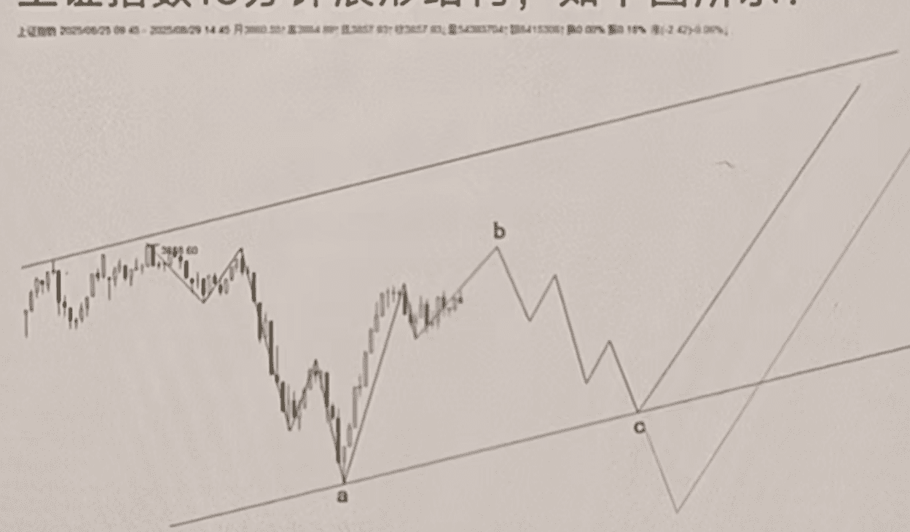
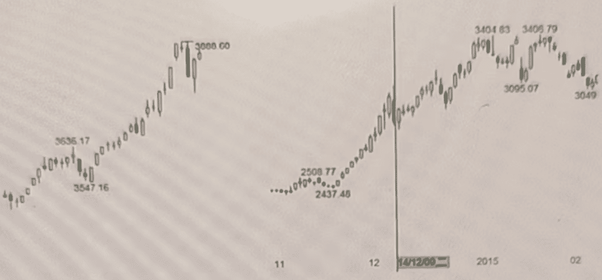
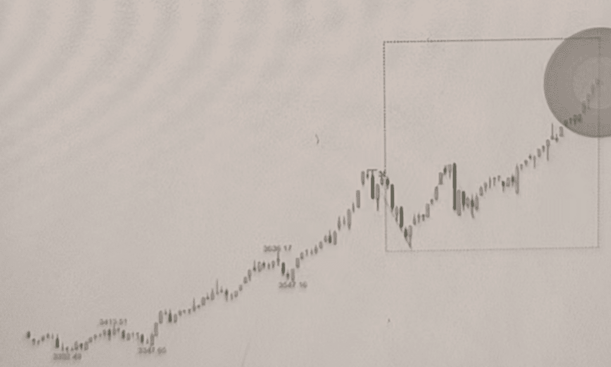
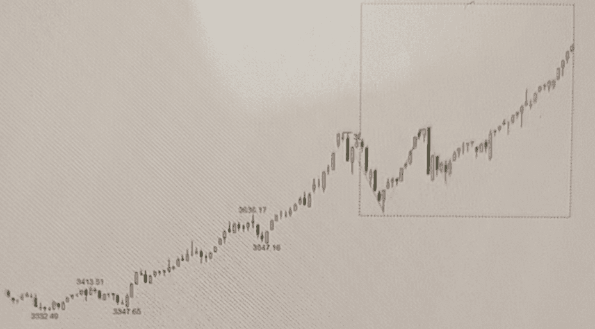

## 周天（8月31日）交易策略

今天重点讲解的走势节奏，有一句话，我这里提前说明：前阶段分化比较大，不要只看一个指数决定买卖，应该重视其他指数趋势。目前市场基本上没有结构性的迹象，只是部分指数出现了震仓、洗盘行为，为这只是单面的。所以，即便遇到小高点，既然不是结构性大坏，就没有必要减仓，反而要利用调整进行加仓。

上证指数15分钟波形结构，如下所示：

图上的走势是波浪形式大概会这么这样的路径，并不是说至少是不差。比如，b浪取点可以高于3888，c的取点也可以低于a的低点（8.28号3761点），但捷就是一个平台调整。

只是处于市场比较优势，故此下周不会b的高高高于3888，c的低不会破3761点呢？

我认为先按照图片来看着急，至于市场底部怎么走，这个平台调整到底是、收敛、扩还是顺势，怎么变就是一个平台调整。

这个平台调整将是重点。

尾涨将在9月2-3号两个交易日结束调整，之后市场将会继续上行。

- 1、9月2-3号，股市下跌，不是是否低于3761，波浪再次提升仓位；
- 2、这次重点加仓159813半导体ETF、513090香港证券ETF也会再次批仓位，这两个标的加仓比例还是1成，半导体也多一些，证券会一些，因为证券此前加仓了一些。

交易策略：

预计证券、软件将开始补涨，半导体也会再次行情起航，所以这是绝佳的加仓机会。

至于8月27日的下跌动作，有点类似于2014年12月9号，之后市场继续上涨；

当然，你可以认为这在这里运行一个震荡调整，还是最后会继续上行，具体看看图中行情日。哦，不要觉得这这里会有很多人的动作操作，即便整体还是以横盘为主，空间小，何时来，所以浅涨时加仓，最终买到满仓为止。

上面两种走势，波浪不为不是第一种还是第二种，我们都没有必须要

至于8月27日的下跌动作，有点类类似于2014年12月9号，之后市场继续上涨。

当然，你可能认为如此指数在这里运行一个震荡调整，最终还是会继续上行。具体上看图就会明白。所以，不要觉得这里会有非常大的波动，，即便整体也是横盘震荡为主，空间横，时间来说，所以还会跌加仓，最终买到满为为止。

今年下半年目标站稳4000点，极有可能冲击4400点。目前还在3900点之下，以3888点计算，还有500点空间。

你别不相信，证券至今为止都没有底部，更没有加速，它都还没启动，可见意见，这就就能说明市场后面还有一张王牌没打出来，就是预期！

所以，现在是六个字：持仓、加仓和调仓。我们先把持仓、加仓做好，未来跟风格切换节点来进行调仓。注意，调仓也是平移，不是减仓！

大家投资愉快！
