# Goldman Sachs Portfolio Research

15 June 20 June 2022 | 7:44PM HKT

## China Strategy
### The comeback of Chinese SOEs (Part I): The tide turns
### 中国战略：中国民营企业的回归（第一部分）：潮汐汇

After losing almost US$4tn of market cap and underperforming the SOE sector by 56pp since 2020, Chinese private-owned enterprises (POEs), which represent 60% of the industry are undervalued by market value, in the process of regaining their "spot" in the equity market. Key arguments are:

自2020以来，中国民营企业（POEs）市值高达4万亿美元，较（市场指数）表现56个百分点。中国民营企业市值占行业60%，目前在估值上处于“底部”。关键观点如下：

- King Lau, CFA | +86-21-2124 | king.lau@goldmansachs.com | Goldman Sachs (Singapore)
- Timothy Mo, CFA | +86-21-2124 | timothy.mo@goldmansachs.com | Goldman Sachs (Singapore)
- Felix Li, CFA | +86-21-2124 | felix.li@goldmansachs.com | Goldman Sachs (Singapore)
- Kevin Wang, CFA | +86-21-2124 | kevin.wang@goldmansachs.com | Goldman Sachs (HK)

- 1. The importance of the private market has been recognized by senior policymakers, as the Symposium convened by President Xi with leading enterprises in February and the first-ever legislation of POE law.
私营市场的重要性得到了高级政策者的重视，正如习近平在二月召集的领先企业会议以及首次出台的民营企业法律所示：

- 2. The regulation cycle towards the private sector has eased per revamped preparatory industry, helpful in compressing the policy and regulation risk premium for POEs.
我们认为监管周期已转向私营部门，准备性工作已经完成，有助于压缩民营企业的政策和监管风险溢价。

- 3. The AI breakthroughs have revived the narrative and bright prospects for SOEs, which make up 72% of the defined AI-Tech universe.
控股企业的AI技术突破具有持续性，并重振了国企业的广阔前景（AI领域占比72%）：

- 4. POEs are leading the charge of "Global" ambition, allowing them to grow organically, enjoy higher margins, and diversify away from increasingly competitive domestic market.
民营企业正引领全球增长的浪潮，使其能够有机增长，获得更高的利润，并从日益竞争的国内市场中抽离。

- 5. POEs and SOEs have seen 22% and 12% growth since the troughs in 2022, and could further recover on margin normalization amid industry consolidation.
民营企业自2022年谷底以来增长22%和12%，在行业整合背景下，利润率可能将进一步恢复。

- 6. Early signs that "spirit" are back in SOE sector on renewed investment appetite for growth,
国企部门出现历史以来首次投资意愿的回苏。

- 7. POEs are trading at valuation discounts relative to their historical ranges and SOEs, with returning to elevated levels.
尽管民营企业相对于历史范围和国企存在估值折扣，而国企已回到高位。

- 8. While beta holds, selectivity is still required for success in the best listed universe. We Overweight Portfolio and Little Giants Basket for investors who are looking to gain targeted exposures.
尽管贝塔有效，但在优质上市公司中成功仍需选择性。对于寻求特定风险敞口的投资者，我们看好组合和“小巨人篮”。

- 9. Additionally, POEs and SOEs are not mutually exclusive—we reframe our thesis on "High-Quality" Returns.
此外，民营企业和国企并非互斥——我们根据“高质量”回报重新构建了观点。

- 10. Investors should consider only this as a single factor in their investment decision. For AC and other details, see the Disclosure Appendix, or go www.goldmansachs.com/research/html
投资者应将此作为投资决策的单一因素。有关细节和其他重要信息，请参阅附录，或访问 www.goldmansachs.com/research/html

## The tide has turned for Chinese POEs
### 中国企业的趋势转变

Exhibit 1: Listed Chinese POEs have lost most $54bn of market capitalization since the peak in 2020
图1：中国上市企业自2020年峰值以来减少了540亿美元
图1：自2020年以来，中国上市企业总市值缩减40%

Exhibit 2: Internet, Hardware, and Auto are the POE-dominated sectors that have rebounded most since their trough in 2022
图2：互联网、硬件和汽车等企业主导的行业在2022年后反弹最强烈

### POE Performance by Sector

Exhibit 3: Chinese POEs represent 60% of the entire listed universe by total market cap
图3：中国企业在过去几年中占据了上市总市值的60%

Exhibit 4: Regulatory headwinds have heavily impacted POE returns in the last few years
图4：监管压力在过去几年对企业回报造成了严重影响

All-China (A+HNH) market cap breakdown
全中国（A+HNH）市场市值构成

Regulatory Headwinds and Key Events affecting Returns
影响回报的关键事件

| Category | Percentage |
| :--- | :--- |
| Corps Stake | 4% |
| Corps Stake | 6% |
| SOE | 48% |
| SOE | 50% |
| Individuals | 48% |
| Others | 12% |

Source: Wind, FactSet, Goldman Sachs Global Investment Research

Exhibit 5: Listed POEs have underperformed their SOE peers by m (total returns) since 2021, led by multiple-listings
图5：自2021年以来，民营企业表现于国企同类，主要受多次退市的影响

Exhibit 6: Many targeted ways to gain exposure in POE environment
图6：民营环境中获取的多种方式

MSCI POE vs SOE relative return benchmark
MSCI POE指数相对回报基准

Performance of Chinese Themes 2024
2024年中国主题表现

Relative return
相对回报

Exhibit 7: POEs are a significant part of the Chinese economy
图表7：企业是中国经济的重要组成部分

### Recognized by senior policymakers
- The PoE sector is a significant part of the Chinese economy, roughly 60% of GDP, 80% of urban employment, 2/3 of nationwide tax revenue in 2024, and over 30% of system-wide outstanding loans as of 2023.
民营部门是中国经济的重要组成部分，占GDP约60%，城镇就业占80%，2024年占全国税收2/3，截至2023年占系统外贷款超过30%。

- They are also dominant in the equity market; with the MSCI classification, 3,771 listed reside in A shares and 1,350 in offshore market, representing 71% of MSCI's China equity and earnings weights, 73% of AD in the industry. They are mostly located in the New Economy, technology, consumer, and innovative sectors.
企业在资本市场也占据主导地位。根据MSCI分类，3,771家上市公司位于A股，1,350家位于海外市场，占MSCI中国股票和收益权重的71%，占行业内ADT的73%。我们认为它们主要集中在新经济，特别是科技、消费和工业部门。

- PoE have been the key growth driver for China—in the past decade, they have driven out SOEs by competition and innovation-incentive policy (including newly listed names), and contributed to around 50% of new companies, 60% of incremental IPO in the listed universe.
企业是过去中国增长的关键动力——在过去十年，它们通过竞争和创新激励政策（包括新上市公司）超越了国企，贡献了约50%的新公司和60%的增量IPO。

- On Feb 17, President Xi met with business leaders like Jack Ma (Alibaba) and Wang Jian (Tencent), the first meeting since Nov 2018. At the meeting, President Xi stressed the importance of the private sector to the Chinese economy, acknowledged some challenges the private sector is currently facing, and pledged further policy support to private companies.
2月17日，习近平与马云（阿里巴巴）和马腾（腾讯）等业内头部企业家交流，这是自2018年11月以来的首次会议。习近平强调了私营部门对中国经济的重要性，承认了私营部门目前面临的挑战，并承诺为私营企业提供进一步政策支持。

- On Apr 30, the Standing Committee of the National People's Congress (NPC) approved the first-ever law on protecting private enterprise (the 8 chapters), encompassing fair competition, investment and financing support, scientific and technological innovation, regulatory guidance, service support, protection of rights and interests, and legal liabilities for private enterprises. However implementation, the new law is incredibly helpful in boosting entrepreneurs' confidence and expectations, in our view.
4月30日，全国人大委员会通过了首部保护民营企业法律（八章），涵盖了公平竞争、投资融资支持、科学技术创新、监管引导、服务支持、权益保护以及民营企业的法律责任。然而，我们认为新法的实施极有助于增强企业信心和预期。

POEs are China's economic restructuring component, roughly 60% of the national asset production, 80% of the urban cities, 90% of the annual employment, and by 2024 will account for 70% of the national unused bank loans.

## 2) Poe regulation cycle has fluctuated

Domestic policy and regulation uncertainty towards the Poe sector has been widely-cited as the reason for the substantial devaluation de-rating of POEs since 2021. As we noted previously here, the regulation tightening was brief, affecting industries spanning Education, Technology, Consumer, and Property. We organize them into 4 key categories—Anti-trust, Fintech/Capabilities, Data security, and Social Security.

This categorization enables us to systematically track the development and intensity of regulatory tightening across key Poe sectors based on textual analysis of official statements and news reports (over 300 in our database), and to estimate what extent the regulatory risks are discounted in equity prices.

With the Poe increasing lately, and regulatory forces having movements changed in the past 4 years, we take this opportunity to revamp and enhance our Poe Regulation Policy, and note that: at implied regulatory tightening has intensified significantly since reaching the peak in 2021, and is now at the most conservative levels in the past 5 years. We list by industries, a continuous supportive backup could help further reduce the perceived risk premium for Chinese POEs, which are at historical midpoints around our estimate; and, di, policy uncertainty in the US has recently spiked when the visibility has improved in China.

国内政策和对电商企业的监管的不确定性被认为是自2021年以来上市电商行业面临的关键问题。正如同我们之前所言（见上文），监管环境是活跃的，且受教育、消费和房地产等多个行业的影响。从认为，我们将其作为4个关键因素——反垄断、金融科技、数据安全和社交安全。

这类行业持续性地加强了监管——电商企业监管的频率和强度，我们通过官方声明和新闻报道（我们数据库中超过30个板块的300多篇文章）进行分析，并发现监管风险在市值中被频繁反映。

图 8，我们通过新政策反映的监管指标显示，近期电商行业政策变走向正在逐步加强。

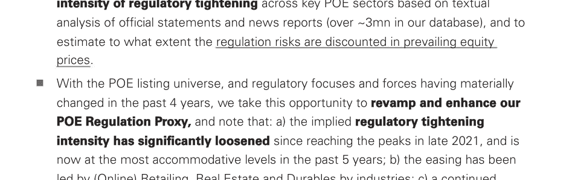

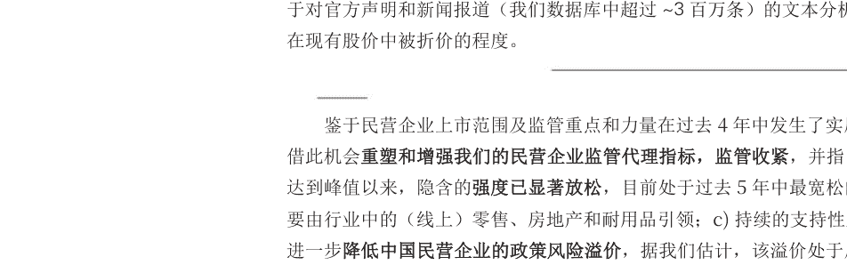

Note: Poe Regulation Policy reflects the intensity of regulatory pressure among Poe sectors data. Data points from Mar-Jun 2020 have been removed due to COVID disruptions. The latter bar shows the remaining days of May June.

Source: Sachs, Goldman Sachs Global Investment Research

## Goldman Sachs
## China Strategy

## Exhibit 9: Easing of POE policy typically associates with more favorable equity returns

## Exhibit 10: Uncertainty rises in the US when regulation transparency is improved compared to China

## 高盛
## 中國策略

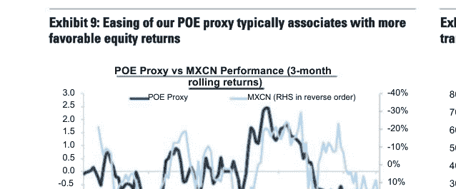

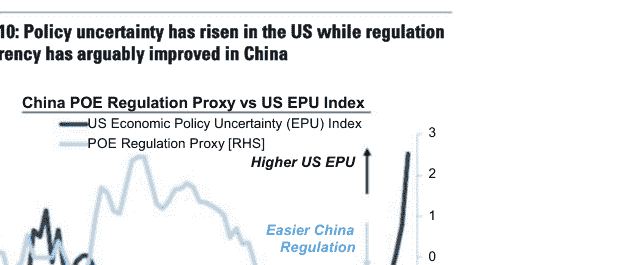

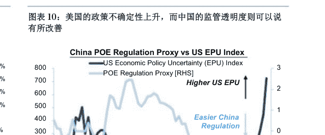

Source: MSCI, FactSet, Data collected by Goldman Sachs Investment Research

Source: FactSet, policyuncertainity.com, MSCI, Factiva, Goldman Sachs Investment Research

Source: MSCI, FactSet, Data collected by Goldman Sachs Investment Research

## 图表，我们的企业政策监管指标 —— 论

### GS Policy Regulation—Methodology in report

- 1) We identify 14 industry groups where POEs have at least 30% market cap weights to form our study universe. Relative to the previous version, several new industry groups have been added, notably Software and Tech Hardware sectors to focus on shifts in policy and the unstable universe.

- 2) For the 14 industry groups, we perform textual analysis by characterizing ~339 articles in both English and Chinese to extract restrictive (negative) or loosening (positive) news based on ±100 discrete keywords. The words 'negative' and 'positive' are used as the policy stance on the sector.

- 3) In the revamped universe, we overlay the negative vs. positive ratios by specific news search focusing on government-sponsored media outlets and official/recognized international news agencies to better gauge the impact of policy shifts on equity.

- 4) We compare 2 and 3, weighted by the market cap of the 14 industry groups, the historical data analysis showing a normal distribution, and take the outputs as the POE Regulation Policy.

## 高盛企业政策监管指标 —— 方法论

2) 对于这 14 个行业分组，我们通过对约 300 篇文章（包括中英文）进行文本分析，并基于 ±100 个关键词来区分限制性（负面）或宽松性（正面）新闻，“负面”和“正面”被用作行业政策立场标准。

## Exhibit 11: We identify 14 industry groups to form the universe of our POE Regulation Policy

## Exhibit 12: Loosening policy positive vs negative ratios (X)

3) 我们在更新后更新的 14 个行业中...

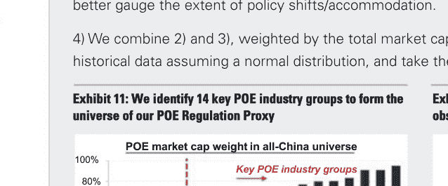

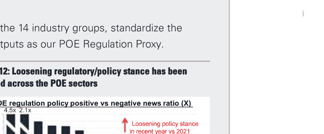

图表 11：我们确定了14个行业分组

图表 12：宽松性政策的正面与负面比率 (X)

Source: FactSet, Goldman Sachs Investment Research

Source: FactSet, Goldman Sachs Investment Research

## Goldman Sachs
## China Strategy
## 高盛
## 中国策略

### 3) 人工智能改变了规则

- The emergence of DeepSeek-R1 in January, in addition to other models, has accelerated the game for POEs.
- While the RMB has faced pressure during the Trade War 2.0, after currency fluctuations, the RMB has remained competitive against a basket of currencies. This provided continued support for Chinese non-US markets.
- Listed companies are diversifying their exports, with non-China sales reaching almost 20% (as % of total) in 2024, more than doubling since 2017.
- Not only does international business drive Chinese exporters’ top-line, they also benefit POEs’ profitability profile—Chinese products achieve higher ASP outside than locally due to intense domestic competition and stronger competitive advantages (e.g., EVs, services and intellectual property).

## Exhibit 13: Widespread adoption of AI could boost Chinese returns over the next decade

## Exhibit 14: Policy uncertainty typically correlates with the de-rating of POEs

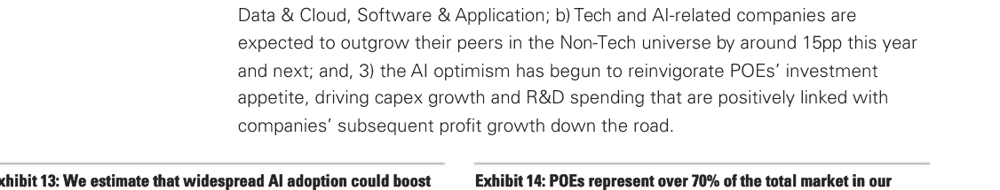

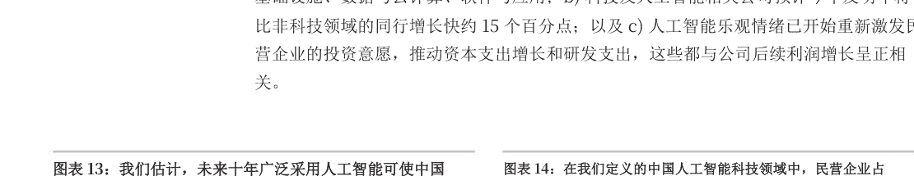

Source: FactSet, Goldman Sachs Investment Research

Source: FactSet, Goldman Sachs Investment Research

## 5) Recovery in POE profitability

- Chinese POEs have defied 8% CAGR (ex-property) in the last 10 years, outpacing SOEs by 2pts, but growth momentum has stalled in recent years, driven by margin compression and sluggish asset turnover, with the downturn of POE reaching around 12% in the post-Covid era.

- GS analyst estimates and forecasts are pointing to moderate POE uplift to 13-14% in this year and next, which might look optimistic given elevated trade uncertainty and lackluster domestic demand which is still harassed by distribution, price competition, and lower consumer demand.

- But, we see a path for significant recovery for POEs: (a) POEs' margins are not at the low-end of historical ranges; (b) they are not experiencing alarming vis-vs the index sector, implying lower risks and anti-monopoly competition, (c) and the themes of 'Global' could fundamentally benefit POEs profitability.

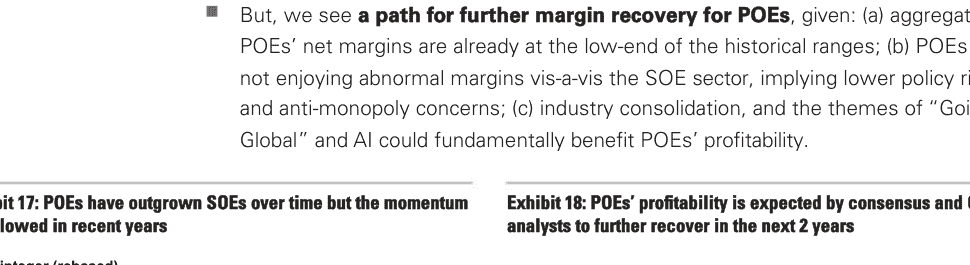

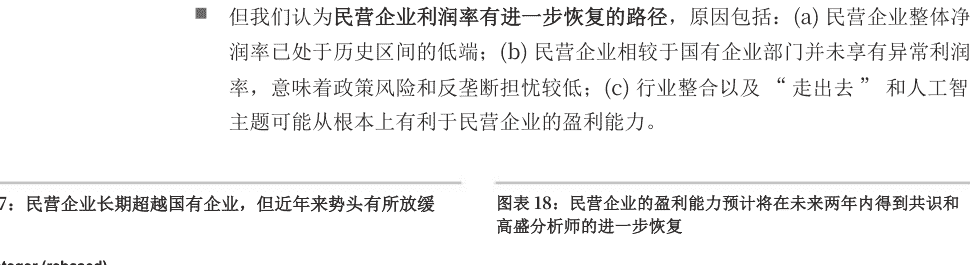

中国企业在过去10年实现了8%的平均复合年增长率（剔除房地产影响），超过国企2个百分点。近年来增长放缓，利润压力增大和资产周转率提高，受这些因素影响企业收益率维持在12%左右。

高盛分析师预计明年中国企业盈利将回升至13%-14%。考虑到贸易不确定性加剧以及国内需求疲软仍受分销、价格竞争的困扰，这一预期可能显得乐观。

我们认为中国企业面临具有历史性的复苏机遇，理由：（a）中国企业利润率处于历史低位；（b）企业并未出现明显的反幅压力；（c）行业升级以及“出海”和人工智能的发展有望为其带来利好。

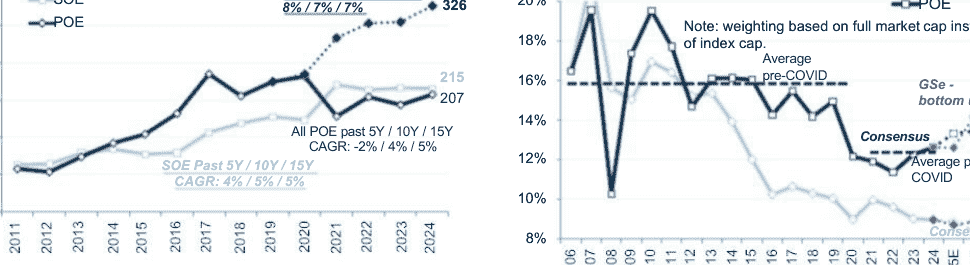

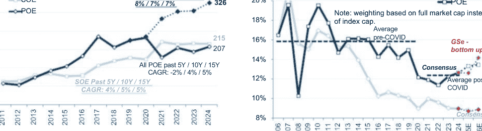

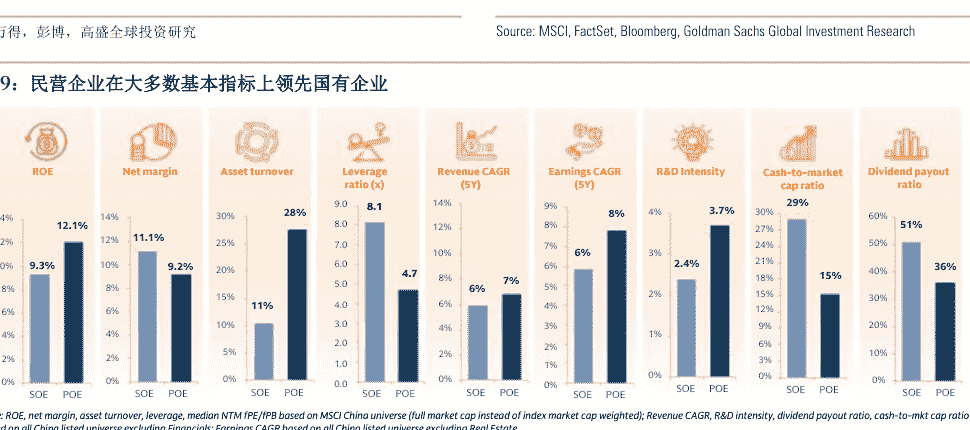

## Return of “animal spirits” in the corporate sector

- Regulation uncertainty in the few years has discouraged POEs to invest in future growth, by facing excess growth and intensity, and moderating R&D expenses in the listed POE sector. Since 2022, they have also slowed and reduced headcount, towards cost optimization, supply relocation, efficiency gains, and cash management (e.g., returning cash to shareholders, as opposed to expanding business).

- That now, we see growth of “animal spirits” recovery, notably a meetup in caps lately by Internet the “DeepSeek” moment, more aggressive expansion plans, accelerating R&D, and a starting uptick of fund-raising activity in the capital markets, all of which are positively linked to future earnings over our previous story.

- The sustainability of the confidence and investment rebound hinges largely on more predictable policy/regulatory frameworks, forcing macro stimulus to circuit-break the discretionary expansion, and more stable US-China relations.

Exhibit 20: POEs have scaled back investment in the past few years

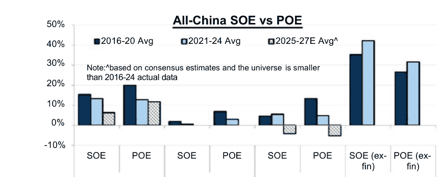

| All-China SOE vs POE | 2016-20 Avg | 2021-24 Avg | 2025-27E Avg |
| :--- | :--- | :--- | :--- |
| 50% | | | |
| 30% | | | |
| 20% | | | |
| 10% | | | |

Source: Word, FactSet, Bloomberg, Goldman Sachs Global Investment Research

## 企业“动物精神”的回归

过去几年的环境不确定性限制了中国企业的投资。过去资本支出和增长强度的下降以及研发经费的减少可见一斑（此处纠正为：过去几年的环境不确定性限制了中国企业的投资。过去资本支出和增长强度的下降以及研发经费的减少可见一斑）。从2022年开始，中国企业开始缩减人员，转向成本优化、供应链迁移、效率提升和现金管理（例如减少业务规模）。

如此，我们看到了“DeepSeek”时刻之后股市的复苏。尤其是在中概板块的激烈回升、扩张计划的加大、研发的加速以及资本市场活跃度的回升，这与我们此前研究相符。信心和投资的可持续性很大程度上取决于可预测的政策/监管环境，监管环境需要加强以及近期政策的变化。

Exhibit 21: Partly triggered by the DeepSeek moment, certain POEs have started to invest in future growth

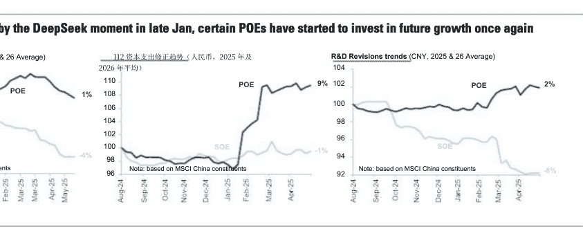

| All-China SOE vs POE | 2016-20 Avg | 2021-24 Avg | 2025-27E Avg |
| :--- | :--- | :--- | :--- |
| 50% | | | |
| 30% | | | |
| 20% | | | |
| 10% | | | |

Source: Word, FactSet, Bloomberg, Goldman Sachs Global Investment Research

## Goldman Sachs China Strategy

## 7) POE discounts still exist

- Prior to 2021, POEs were able to command valuation premiums over SOEs due to the former's superior growth and profitability. But POE-SO premiums have massively compressed in recent years as the regulatory environment, and are now at the low end of historical ranges.

- The shrinking POE-SO equity premium (ERP) for groups is also reflected with the former hovering mid-cycle levels but the latter turning recent years. Similarly, a few POEs have substantially lagged behind their SOE counterparts when growth is taken into account.

- Cash returns via dividends and buybacks have reached all-time high for POEs in both normal and yield times, yet new financing is at the most negative levels, thus minimizing shareholder returns, capital/budget discipline, and value creation for stakeholders.

在2021年之前，企业由于自身的增长动力和能力，保持较高的估值；尽管增长受限，企业的估值近年来有所收敛，处于历史低区间。

- 企业与国企的差异反映了这种股权溢价（ERP），企业处于中周期水平，而国企则处于低位。同样，企业的市盈率（PE）横跨周期，企业估值更高。在考虑增长后，企业估值差距显著

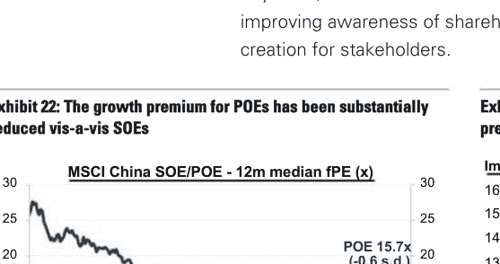

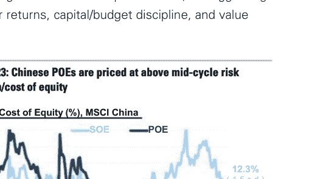

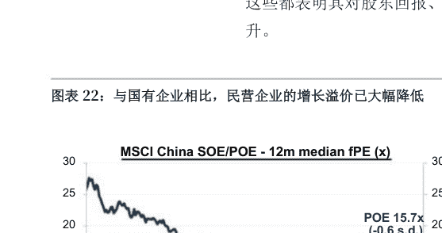

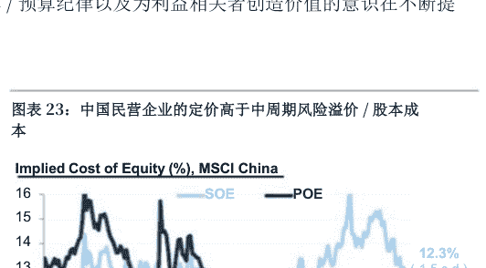

通过分红和回购产生的现金回报已达到历史高位（在正常和收益时期），但企业的净现金流（减去回购支出）在过去三个年中处于最低水平，这些趋势都反映出企业对财务、资本/预算约束以及股东回报的信心不断下降。

图22：与国企相比，企业的估值溢价大幅收敛

图23：中国企业的估值高于中周期的溢价/权益

Exhibit 24: SOEs are more expensive than POEs when their growth factors are intense to cut

Exhibit 25: Net income has not turned chinese in China, led by POEs

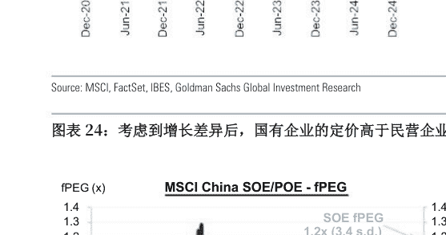

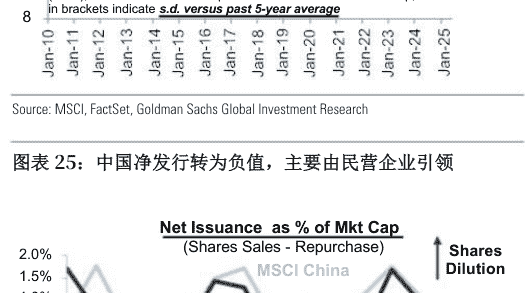

图24：考虑到增长因素时，国企业的估值高于企业

图25：利润尚未转为中国化，主要由企业驱动

Source: MSCI, Factset, IBES, Goldman Sachs China Investment Research

来源：MSCI、Factset、高盛投资研究

## Goldman Sachs China Strategy

## How to invest in China POEs?

China POE is a broad universe, hosting more than 5,000 listed companies are omnipresent across the 3 main China stock markets (listing jurisdictions) and have exhibited significant disparity and discocracy over the years. As such, selectivity is required to achieve superior Sharpe in the POE cohort, or in our view.

中国企业是一个广阔的领域，超过6000家公司。对于中国市场的三个主要市场，多年表现出明显的差异和异质性。

- At the market level, POEs are better located in the offshore HK and ADR markets where POEs outperform others by 66% and 100% of the market cap, compared to 34% in Energy, Banks, and Telecom.

- For stock picks and baskets, we think thematic investing is an efficient way of gaining targeted exposure to the POE universe.

- The POE stock style differs from a binary decision, and our constructive stance on POEs does not preclude us from reiterating our thematic biases towards those supported by policy support（中小型“热点”行业）。

Exhibit 20: Not all POEs performed well and selection is the key alpha in the poise universe

Exhibit 21: POEs are better positioned in the offshore market

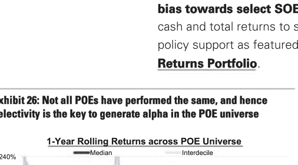

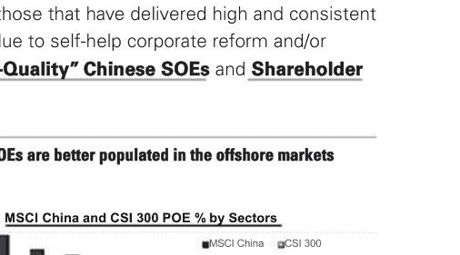

图26：以及中国企业在不同行业表现不同，这种选择性是获取中国企业超额收益

## Goldman Sachs

## China Strategy

## Exhibit 26: The dividend yield (for SOEs) vs. bond spreads are at most attractive levels in record
图 26：收益率（对国有企业）与收益率差处于历史以来极低水平

## Exhibit 29: Many themes and vehicles for investors to gain exposure to the POE
图 29：投资者获得投资中国企业机会的主要主题和工具

- All SOE total yield (buybacks and dividends)

# Performance of China Times 2024

- All SOE total yield (buybacks and dividends)
- CGB 10y yield
- CGB 10y yield
- Select China
- Select China
- Little Giants
- Little Giants

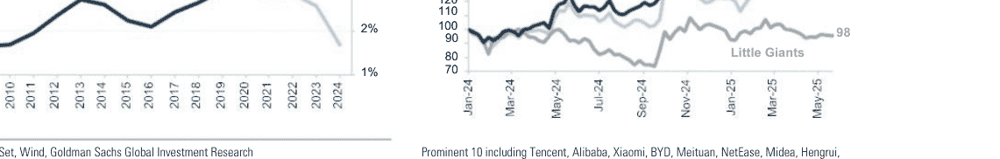

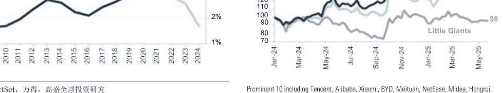

Source: FactSet, Goldman Sachs Global Investment Research
来源：FactSet、高盛投资研究

- Prominent 10-listing Tencent, Alibaba, Xiaomi, BYD, Meituan, NetEase, Hengtao, Intel, and Any Part of the 3 POEs for defense
Source: FactSet, MSDC, Goldman Sachs Global Investment Research
来源：FactSet、MSDC、高盛投资研究

## Exhibit 30: List of 30 largest GOEs by market cap
图 30：持股排名前30大额投资者配置的中国企业

| Name | Industry | Group | Currency | Market Cap (US$bn) | P/E (x) | 24M P/E (x) | 2M P/B (x) | DY (%) |
| :--- | :--- | :--- | :--- | :--- | :--- | :--- | :--- | :--- |
| Top 30 largest POEs | | | | | | | | |
| 700 | Telecom | GOE | HKD | 513.5 | 16.0 | 17.9 | 1.7 | 3.7 |
| 911 | Financial | GOE | CNY | 220.0 | 5.2 | 5.3 | 0.9 | 5.5 |
| 1810 | Tech | SOE | USD | 75.5 | 23.6 | 114.8 | 31.2 | 5.5 |
| 1919 | Consumer | SOE | CNY | 165.0 | 15.5 | 22.5 | 2.1 | 2.8 |
| 2318 | Energy | SOE | CNY | 47.5 | 12.5 | 27.2 | 0.6 | 0.8 |
| 3000 | Financials | SOE | CNY | 102.0 | 8.7 | 10.2 | 0.8 | 4.4 |
| 3600 | Media | SOE | CNY | 144.4 | 19.7 | 14.8 | 3.9 | 0.8 |
| 6005 | Consumer | SOE | CNY | 75.8 | 7.6 | 15.8 | 1.2 | 2.3 |
| 60188 | Tech | SOE | CNY | 55.0 | 18.5 | 21.5 | 2.1 | 2.5 |
| 60306 | Financials | SOE | CNY | 71.5 | 8.1 | 11.3 | 1.7 | 3.3 |
| 60097 | Energy | SOE | CNY | 68.0 | 14.5 | 13.5 | 2.2 | 5.0 |
| 60198 | Telecom | SOE | CNY | 68.0 | 10.2 | 13.5 | 1.3 | 6.6 |
| 60139 | Financials | SOE | CNY | 85.0 | 7.7 | 10.2 | 2.2 | 5.0 |
| 60116 | Consumer | SOE | CNY | 33.0 | 23.9 | 21.7 | 1.3 | 3.1 |
| 60136 | Tech | SOE | CNY | 238.0 | 13.5 | 13.5 | 0.0 | 0.0 |
| 60168 | Financials | SOE | CNY | 35.0 | 11.5 | 15.8 | 2.8 | 6.5 |
| 60003 | | | | | 23.0 | 7.3 | 7.6 | 1.4 |
| 62048 | | | | | | | | | |
| 60108 | | | | | | | | | |
| 00011 | | | | | | | | | |
| 60024 | | | | | | | | | |
| 60074 | | | | | | | | | | |
| 60073 | | | | | | | | | | |
| 60185 | | | | | | | | | | |
| 60189 | | | | | | | | | | |
| 60199 | | | | | | | | | | |
| 60325 | | | | | | | | | | |
| 60393 | | | | | | | | | | |
| 60398 | | | | | | | | | | |
| 9999 | | | | | | | | | | |

*As of Oct 2023. Total market cap includes all listings (H+R). Valuation at 6.8x consensus, based on analyst view.
*截至2023年10月19日。市值包含所有上市（H+R）。估值为共识的6.8倍，基于分析师观点。

Source: FactSet, IBES, Goldman Sachs Investment Research
来源：FactSet、IBES、高盛投资研究

## Goldman Sachs

## China Strategy

# Appendix

## Exhibit 21: Highlights from the Symposium held by President Xi with business leaders in recent years
附录21：习近平与国内营企业座谈会回顾

| Date | 1 Nov 2018 | 21 Jul 2020 | 23 May 2021 | 17 Feb 2023 |
| :--- | :--- | :--- | :--- | :--- |
| Location | Beijing | Shanghai | Beijing | Beijing |
| Macro background | US-China Trade War | Post (Covid) lackluster growth | In preparation for the Third Term of the Committee | Trade War 2.0 and ahead of "March Sessions" |
| Participants | Private enterprises | Private entrepreneurs | Private enterprises | Private entrepreneurs |
| 日期 | 2018年11月1日 | 2020年7月21日 | 2021年5月23日 | 2023年2月17日 |
| 地点 | 北京 | 上海 | 北京 | 北京 |
| 宏观背景 | 中美贸易战 | （疫情后的）乏力增长 | 十届委员会的准备工作 | 贸易战2.0及“二月行情”的影响 |
| 参会人员 | 私营企业 | 民营企业家 | 私营企业 | 民营企业家 |

Ge Lei (Shengjing), Han Jun (Tencent), Lei Jun (Xiaomi), Richard Xiang (Meituan), Wang Qiang (Alibaba), Hengrui Medicine; Janping Tan (Ant Group), Frank Wang (O-O), Kaelian Yan (East Group)

Zhong Shan Chen (Heng), Lei Hong Ming (Lenovo), Shidong Ding (ANTA), Liu Xiaopeng (SPACs), Wang Ling (Yili), Chen Hujun (Tencent), Ning Shidong (Ningbo Group), Zhang Yinan (Shanghai Group)

## Exhibit 32: Business leader composition in the meeting now vs 2018

November 2023
February 2023
November 2018

| Goldman Sachs | Ticker | Company Name | Representative |
|---|---|---|--|
| Goldman Sachs | 600438.SH | 金盛达 | 刘磊 |
| Health Care | 600716.SH | 南药集团 | 张洪伟 |
| Information Technology | 600519.SH | 东方电器 | 李建国 |
| Information Technology | 600019.SH | 比亚科技 | 周勇 |
| Others | 600018.SH | Time Group | 汪峰 |

| Goldman Sachs | Ticker | Company Name | Representative |
|---|---|---|--|
| Goldman Sachs | 600438.SH | 金盛达 | 刘磊 |
| Goldman Sachs | 002594.SZ | 比亚D | 王老丰 |
| Information Technology | 600186.SH | 迪迪 | 王兴 |
| Information Technology | 600976.SH | New Hope Group | 刘庆 |
| Information Technology | 612714.SH | 聚力 | 郭勇 |

| Goldman Sachs | Ticker | Company Name | Representative |
|---|---|---|--|
| Goldman Sachs | 600438.SH | 金盛达 | 刘磊 |
| Goldman Sachs | 002594.SZ | 比亚D | 王老丰 |
| Goldman Sachs | 600186.SH | 迪迪 | 王兴 |
| Information Technology | 600976.SH | New Hope Group | 刘庆 |
| Information Technology | 612714.SH | 聚力 | 郭勇 |

### Health Care

| Goldman Sachs | Ticker | Company Name | Representative |
|---|---|---|--|
| Goldman Sachs | 600438.SH | 金盛达 | 刘磊 |
| Goldman Sachs | 002594.SZ | 比亚D | 王老丰 |
| Goldman Sachs | 600186.SH | 迪迪 | 王兴 |
| Information Technology | 600976.SH | New Hope Group | 刘庆 |
| Information Technology | 612714.SH | 聚力 | 郭勇 |

### Information Technology

### Others

### Others

### Imagine Special Optics

### Health Care

### Information Technology

### Others

### Industrials

### Imagine Special Optics

### Materials

### Others

### Industrials

### Imagine Special Optics

### Materials

Source: Data compiled by Goldman Sachs Global Investment Research
Source: Data compiled by Goldman Sachs Global Investment Research

## Exhibit 30: The first-ever law on Chinese POEs was approved in May 2025, 9 key chapters to promote Chinese enterprise development

| Category | Content |
| :--- | :--- |
| Fair Competition | Article 10 The POEs are granted equal access to a negative list for market access. Outside the list, all elements, including POEs, can enter any industry.   第10条 私有企业对非负清单市场享有平等准入。清单之外，所有要素（技术、人力、资源、数据、土地及服务）包括私营企业在内均可进入任何行业。  Article 14 Public market resource allocation shall be open, transparent, impartial, and for all types of economic organizations, including POEs.   第14条 公共市场资源配置应当开放、透明、公正，适用于所有经济组织（包括私营企业在内）。  Article 16 The POEs are encouraged to participate in national strategies and major projects, investing in emerging industries and modern industries, rehabilitating existing assets to enhance their capacity for competitiveness and innovation.   第16条 鼓励私有企业参与国家战略和重大项目，投资新兴产业和现代产业，盘活现有资产以增强其竞争和创新能力。 |
| Investment and Financing | Article 18 The government shall support the State Council in playing the role to incentivize and constrain role of monopoly policies, and   第18条 政府应支持国务院发挥作用，加强对垄断政策的作用。  Article 31 Financial institutions shall guarantee quality financing methods that meet the needs of business development, and provide loans to POEs at market rates.   第31条 金融机构应保证满足业务需求的融资手段，向私营企业提供市场贷款。 |
| Scientific and Technological innovation | Article 37 The state encourages and supports POEs to play an active role in promoting scientific and technological innovation;   第37条 国家鼓励并支持私营企业在促进技术创新中发挥积极作用； |
| Service Guarantee / Protection of Rights | Article 38 The state shall strengthen protection of intellectual property protection, and enforces punitive measures for infringement.   第38条 国家加强企业保护，强化知识产权保护，对侵权行为实施措施。 |
| Service Guarantee | Article 44 The government shall provide transparent, efficient, and standardized services for POEs in setting up, or exiting.   第44条 政府为私营企业的设立、经营提供透明、高效、标准化的服务。  Article 56 The state recognizes the rights and interests of POEs and their operators, including property rights, and the right to operate in accordance with law.   第56条 国家承认私营企业及其经营者的权利，包括个人权利、财产权以及依法经营权利。 |
| Protection of Rights and interests | Article 61 Property crimes shall be distinguished from economic crimes. If business operations have not violated law, they shall not be treated as criminal.   第61条 财产犯罪应当与经济犯罪区分。经营活动未违反法律的不视作犯罪。 |

Source: Data compiled by Goldman Sachs Global Investment Research.

## Goldman Sachs

## Disclosure Appendix

## Disclosure

We, Kevin Wang, CFA, hereby certify that all views expressed in this report reflect our personal views, which have not been influenced by considerations of our business or client relationships. Unless otherwise stated, the ideas contained on the cover of this report are from Goldman Sachs Investment Research division.

## Disclosures

Goldman Sachs does not have any information to confirm whether certain companies mentioned in this report generally prohibit U.S. persons from investing in such companies. This report is not an offer and should not be construed as an investment recommendation.

## Regulatory disclosures

## Disclosures required by laws and regulations

The following disclosures are required by laws and regulations to be included in this report, or in a managing capacity for services provided to clients, types of relationships, broker-dealer relationships between Goldman Sachs and the issuer of any security discussed in this report.

The following disclosure relates to potential conflicts of interest: Goldman Sachs has policies designed to manage conflicts of interest and to prohibit analysts or members of their firms from having ownership of securities discussed in any reports. A 'conflict of interest' means that Goldman Sachs or its employees may have an interest shared with the issuer, investor.

## Additional disclosures required by the laws and regulations of jurisdictions other than the United States

Gold Sachs Australia Ltd and its affiliates are not authorized deposit dealers as defined in the Financial Services and Markets Act 2001 (Cth). This report is not an offer to sell or a solicitation of an offer to buy or sell any financial product in Australia, unless otherwise agreed upon in writing by Goldman Sachs Australia.

## Regulatory disclosure

We confirm that all views in this report reflect our personal views and have not been influenced by our business or client relationships. This report complies with CFA standards.

## US Legal disclosure

According to Section 20(b) of the Securities Exchange Act of 1934, Goldman Sachs must disclose any potential conflicts of interest with the issuer when publishing this report.

## Risk disclosure

This report involves various risks (including market risk, export/import risk, and BIS risk). Specific projects in the US may require attention from investors. Note that this report does not guarantee that past performance will predict future performance. Investors should consider their own risk capacity before making investment decisions.

According to the provisions of the Securities Act of 1993, this report does not constitute an offer to sell to US investors, nor an issuance of US securities. This report does not constitute investment advice.

## Regulatory disclosure

As required by law and regulation, this report may contain the following: services provided to clients while holding a management position (holding 1% or more shares or other compensation).

The report may contain interests that Goldman Sachs must disclose under the Securities and Futures Commission (SFC) under the Securities and Futures Ordinance. This may include whether Goldman Sachs provides consulting, promotion, or brokerage services to the issuer, or whether Goldman Sachs itself trades the security.

## Legal disclosure outside the United States

According to the Financial Services and Markets Act 2001 (Federal Act), Goldman Sachs Australia Limited and its affiliates are not authorized deposit dealers defined by the law. This report is not an offer to sell financial product services in Australia, nor an invitation to buy or sell any services.

According to the provisions of the Securities and Futures Ordinance (Chapter 571 of Laws of HK), this report does not constitute an offer to sell securities in Hong Kong, nor an invitation to buy or sell any financial instruments in Hong Kong.

This report does not constitute an offer to sell securities or futures tools in Hong Kong as defined under Section 26 of the Securities and Futures Ordinance (Chapter 571 of Laws of HK), nor an invitation to sell securities or futures tools. This disclosure is for reference only and does not constitute any legal advice. Before making decisions, consult with independent legal counsel or professionals. More information is available at: https://www.goldmansachs.com/disclosures/global-new-index.

## Goldman Sachs

## China Strategy

In connection with this research, this material is for reference only and may not be relied upon by investors. Investors who are regarded as clients in the UK, as defined by the rules of the Financial Conduct Authority, should seek independent advice before making any investment. This report is sent by Goldman Sachs. Any investment carries certain risks and warnings, and this is a general disclaimer of all risks.

Europe Union and United Kingdom: Disclosure in relation to Article 12 of the European Financial Instruments Regulation (EU) No 216/2017. This report is provided by Goldman Sachs Limited, which is incorporated in the United Kingdom and regulated by the Financial Conduct Authority. Disclosure regarding conflicts of interest is available at https://www.goldmansachs.com/conflictsofinterest.html.

Goldman Sachs (Hong Kong) Limited is a Financial Institution registered under number HKC0002 and is regulated by the Securities and Futures Commission. Goldman Sachs (Hong Kong) Limited is a licensed solicitor for:
- Type 1: Advice on Stocks
- Type 2: Advising on Securities
- Type 4: Dealing in Securities and Futures
- Type 5: Dealing in Futures
- Type 6: Advising on Futures
- Type 7: Automated Trading Services
- Type 9: Providing Liquidity Services for Securities and Futures

All de-vestments in Securities and Futures are subject to risk. Disclosure regarding conflicts of interest is available at https://www.goldmansachs.com/conflictsofinterest.html.

## Global product distribution

Goldman Sachs and its affiliates create and distribute products for clients of Goldman Sachs on a global basis. Analysis is conducted by Goldman Sachs around the world through its research and investment banking departments. This material may not be relied upon by individual investors. Investors who are regarded as clients in the UK, as defined by the rules of the Financial Conduct Authority, should seek independent advice before making any investment.

## 全球分銷

高盛及其關聯公司在全球為高盛客戶創建並分銷產品。全球分析由高盛透過其研究及投資銀行部門進行。本材料僅供參考，不可作為依據。被視為英國客戶的投資者應根據英國監管局規則，在任何投資前尋求獨立建議。

Our research is based on the analysis of publicly available information. This does not mean that Goldman Sachs has any non-public information about the companies, securities or transactions discussed in this report.

## Disclaimer

The research provided by Goldman Sachs is based on information available at the time of writing. Notice that Goldman Sachs may have nonpublic information about some of the companies, securities, or transactions discussed or suggested in this report.

Goldman Sachs does not guarantee the accuracy or completeness of any information, analysis, or projections contained in this report.

This research is for general purposes only. Other disclosures may be provided. Goldman Sachs research is based on current information at the time of writing. The opinions and forecasts contained here are as of the date of writing and are subject to change and may change significantly after the date of writing. We suggest that readers review our research regularly to obtain the most up-to-date information.

The information contained in this report is for informational purposes only and does not constitute an offer or a solicitation of an offer to buy any security.

## 免責聲明

高盛提供的研究基於撰寫时的公開信息。請注意，高盛任何 forward-looking statements involve risks and uncertainties that could cause actual results to differ materially from those expressed。

高盛不保證本報告中包含任何信息、分析或預測的準確性或完整性。

本研究僅供一般用途。可能提供其他披露。高盛的研究基於撰寫時的當前信息。

Europe Union and United Kingdom: 根据根據歐洲金融工具法規》(EU) No 216/2017 第12條的規定進行。本報告由 Goldman Sachs Limited 提供，該公司成立於英國並受英國監管。本報告亦提供歐盟及英國客戶。有關利益衝突的披露，請參閱：https://www.goldmansachs.com/conflictsofinterest.html

高盛（香港）有限公司是根據證券及事務註冊的金融機構，註冊號為 HKC0002，並受證券及事務監管。高盛（香港）有限公司擁有：
- Type 1: 證券意見
- Type 2: 證券顧問
- Type 4: 證券交易
- Type 5: 期貨交易
- Type 6: 期貨顧問
- Type 7: 自動交易服務
- Type 9: 證券及期貨流動性服務

所有證券及期貨投資涉及風險。有關利益衝突的披露，請參閱：https://www.goldmansachs.com/conflictsofinterest.html.

## Gold Sachs

## China Strategy

## 高邁

任何項研究均不構成對任何股票或證券的買賣建議，也不構成對任何行業或行業部門的建議。
本項研究主題本身也不構成對任何交易安全性的保證。

本項研究並不構成對任何投資建議或對任何交易的建議，或對任何交易提供任何保證。客戶應根據自己的需要對本項研究進行評估。
本項研究的內容不構成對任何未來結果的保證。市場風險、財富風險、流動性風險等可能導致損失的風險。客戶應考慮本項研究中包含的各種假設，以及對任何交易的風險。客戶應充分考慮投資風險。
市場表現可能發生波動。過去的表現並不保證未來表現，回報並非保證，且可能損失原始投入的資本。

某些交易（包括涉及期貨、期權、期權及衍生工具）可能面臨重大的波動風險，且不適合所有投資者。
交易風險包括市場風險、信用風險、利率風險和流動性風險。支持文件將根據要求提供。

業務交易，包括其涉及的金融資產，可能面臨各種風險。客戶應根據自己的經驗、偏好和需求等因素考慮這些風險。
本項研究報告可能旨在向其內部或外部客戶根據其考慮的、偏好和需求等因素，提供投資研究分析服務。

Goldman Sachs Research Group（以下簡稱「研究團隊」）是 Goldman Sachs Group, Inc. 的一個部門。研究團隊可能旨在向其內部或外部客戶根據其考慮的、偏好和需求等因素，提供投資研究分析服務。該服務的範圍取決於客戶的各種因素，包括其投資目標、投資期限以及法律和合規約束。
研究團隊提供的分析涵蓋了市場、行業、特定股票、中長期、短期以及其客戶投資關係的各種範圍。分析的差異可能是因為這包括在分析中使用的各種假設，以及對任何交易的風險。客戶應充分考慮本項研究中包含的各種假設，以及對任何交易的風險。本項研究不構成任何形式的投資建議。

本項研究的內容可能由 Goldman Sachs 內部或外部第三方提供。Goldman Sachs 不對第三方提供的內容的準確性、完整性或可靠性承擔任何責任。我們不對第三方提供的報告或其產生的任何結果承擔任何責任。

本項研究的內容可能包含來自第三方的研究內容。Goldman Sachs 不對第三方提供的內容承擔任何責任。我們不對第三方提供的報告或其產生的任何結果承擔任何責任。

更多信息請參閱 https://www.goldmansachs.com/disclosures.html 或合規政策。

更多信息請參閱 https://www.goldmansachs.com/compliance/wedge.html 或合規政策。

© 2025 Goldman Sachs.

本文件僅供您的個人使用，不得揭露、修改、重印或重新傳輸。您不得複製或使用本項工程用以建立索引或進行分析或公告和/目錄，或創建任何其他衍生作品。在不違反法律限制下，允許複製、提取、下載、解壓縮或傳輸本項研究的全部或部分，或將其用於機器學習或人工智慧智能，或用於複製或創作本項研究的全部或部分，作為輸入輸入至任何系統。

2025年6月1日

## Goldman Portfolio Strategy Research

15 June 2022 | 7:51PM HKT

## China Strategy

## The comeback of Chinese POES (Part 2): Why large POES are getting larger

In part of this PO series, we argue that the medium-term investment case for Chinese POES has improved due to macro, policy, and micro drivers. However, not all POES are equal, and our market landscape shifts and structural trends lead us to believe that market (cap) concentration in the PO universe is rising, therefore

在中国的企业行业竞争中，我们认为由于宏观、政策和微观驱动因素，并非所有中国企业都是，我们的市场格局发生了变化，且结构性趋势使我们相信市场份额（cap）集中在PO宇宙中正在上升，因此

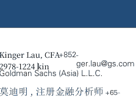

Kevin Lu, CFA
kevinlu@goldmansachs.com

Timothy Mo, CFA
timothy.mo@goldmansachs.com

Kevin Wang, CFA
kevinwang@goldmansachs.com

Goldman Sachs (Generals) Inc.
200 West Street, New York, NY 10282
S1-S4@goldmansachs.com

Goldman Sachs (Vat) L.L.C.

- 1. China has the lowest market concentration ratio among key equity globally, with the top-10 companies including SOEs representing 17% of the market, compared to 30% in the US and in EM-China.
- 2. China antitrust and MMA frameworks have become more transparent in recent years, and regulatory pressures on the private economy have eased, boosting for POES organic and competitive;
- 3. Industry consolidation in PO-led sectors is leading vs. the US, pointing to potential market share and profitability upside for leaders.
- 4. Several incumbents have already dominated the pool, cap, and R&D in their respective industries, potentially linked with future trends and structural dominance.
- 5. Many large POES are leaders, investors, and consumers of game-changing technologies.
- 6. Top-10 POES grew by 18.6% in 2021 (6 p points) and 22% premium over the average, vs. 74% in 2023 for market;
- 7. High weights should disproportionately benefit from the return of global funds in China, the continued rise of “domestic” and “passive” customers

## Why Large POES are getting larger

In Part I of The Comeback of POES series, we argue that the medium-term investment case for Chinese private-owned enterprises (POEs) has improved on the base of various macro, policy and regulation, management, and fundamental drivers. While a rising tide lifts all boats, differentiation and specialty is the key to gaining alpha in the broad Chinese POE universe which holds more than 5000 companies across 130 sub-industries (ICS) and has exhibited significant return dispersion over the years. Moreover, our expectations for shifts in the market landscape and structural trends indicate that existing large/mega-cap leaders in certain sectors to extend their dominance, and therefore market cap rises from 17% to meaningfully higher levels ahead

Exhibit 1: Not all POES are equal—Chinese POES have exhibited significant return dispersions over the years

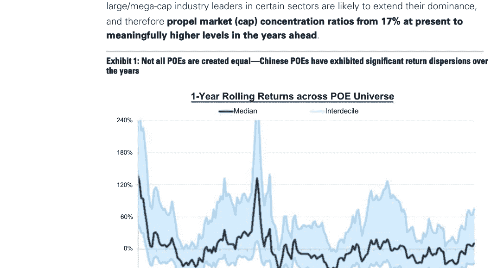

Source: Wind, FactSet, Goldman Sachs Global Investment Research

#1: A low starting point in equity market (cap) concentration

Globally, investors focussed and debates about market concentration have revolved around US equities, where the top-10 companies by market cap concentrate the Magnificent 7 stocks for 33%/28% of the entire listed universe, which is the highest in modern history. In contrast, China has one of the lowest market concentration ratios among equity blocks, with the top stocks representing just 7% of the total market cap across A-, H-, and ADR markets, down from 46% in the mid-2000s when ICBC and China Mobile made up 12% and 8% of the total market cap.

Exhibit 2: China's equity market concentration ratio is at the low of the historical range

| | |
|---|---|
| 50% | --US |
| 45% | --EM China |
| 35% | --China |
| 30% | --SOEs |
| 25% | --EM China |
| 20% | --17% |
| 15% | --10% |
| 10% | --7% |

Source: FactSet, Goldman Sachs Global Investment Research

Exhibit 3: China has one of the lowest market (cap) concentration ratios

| | |
|---|---|
| 69% | --Taiwan |
| 57% | --France |
| 56% | --Germany |
| 52% | --Korea |
| 47% | --UK |
| 38% | --Saudi Arabia |
| 34% | --India |
| 33% | --Japan |
| 30% | --EM China |
| 22% | --average |
| 17% | --market |

Source: FactSet, Goldman Sachs Global Investment Research

#2: A more supportive policy and regulatory environment for POEs

> The calculation is done by total market cap, from MSCI AC World universe with the number of sectors. For US and China, we use the number of stocks. Trackers in the number of stocks included.

## Goldman Sachs
## China Strategy
## 高盛
## 中国策略

concern and corporate profitability is under pressure. All these should help revitalize POEs' investment appetite (animal spirits), thereby supporting organic and acquisitive growth down the road, in our view.

债券和企业盈利面临正面压力。所有这些都能帮助复振企业的投资意（动物精神），从而使得它们未来的有机增长和收购增长，我们认为。

### Exhibit 4: Our search-based policy tactics toward POEs has eased further lately

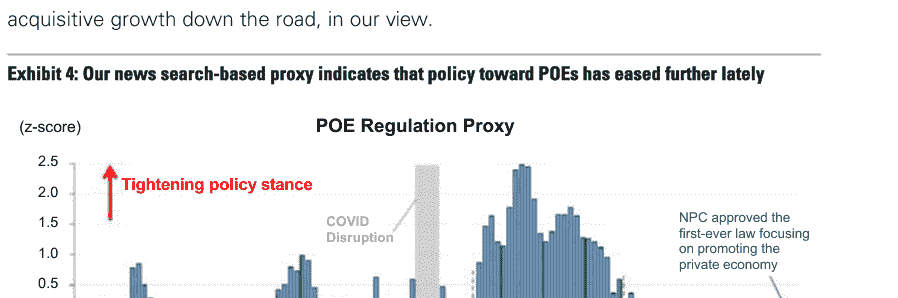

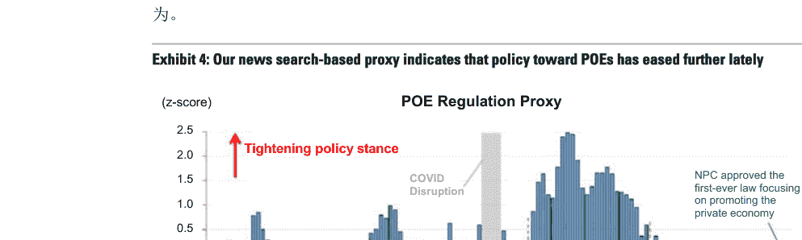

Note: POE investment is measured by equity investment. Our search-based policy tactics toward POEs has eased further lately. Data points from Jun-2020 have been removed due to COVID disruptions. The latest bars show the reading of May 2021.

Source: Matlab, Goldman Sachs Global Investment Research

### Exhibit 5: A more transparent and accountable MBA framework should be conducive to companies' competitive growth, thereby driving higher industry performance

| Category | Details |
| :--- | :--- |
| CSRC Released | Administrative Measures for the Material Asset Reorganization of Listed Companies: on May 16th |
| Fixed Payment | Established a mechanism for a phased payment of cash consideration. Extend the validity of registration periods for applying for one-time regulation and phased issuance of shares to purchase up to 48 months |
| Regulation | Enhanced the exchanges in financial instruments, industry competition, and related-party transactions |
| Review Process | Restructuring applications to simplify the listed process to require less review by the MBA and the Restructuring Committee of State, and CSRC will make a decision on whether to deny transaction within 5 working days |
| lock-up period for mergers | Limit the lock-up requirement for mergers between listed companies. A 6-month lock-up period is set for the controlling shareholder. No lock-up period is set for other shareholders of the minority party |
| lock-up period for acquisitions | Limit the lock-up requirement for acquisitions of unlisted companies. Implement a 'linkage' between the purchase price and the equity performance of the target company. The lock-up period will be adjusted based on the performance of third-party transactions. The lock-up period for the controlling shareholder, and their affiliates in delisting is restricted from 24 months to 12 months |

Source: CSRC

## 2: Industry concentration in PO-heavy sectors is set to rise

Universal industry concentration measures such as the Herfindahl-Hirschman index (HHI) and top-n concentration show in their respective sectors that China could be regarded as the most competitive and or/fragmented markets in the world. Except for a few SO-dominated industries that are driven strategically by the Chinese government (e.g., Oil & Gas and Chemicals), China is less concentrated than the most costly sectors based on listed companies.

### 3: Industry concentration trends in multiple sectors

传统的行业集中度指标，如芬达尔-赫希曼指数（HHI）和行业领先度表明，中国被认为是最具竞争力或最碎片化的市场。除了少数被中国政府战略重要的主导行业（如石油和天然气）外，中国在多个行业中的集中趋势正在加剧。

15 June 2021

Given high investment frequency, overcapacity in certain cohorts, and sufficient profit margins in most sectors, POE-oriented instruments (e.g. Autos and Solar) could be seen as meaningless in the long run for sectors facing supply/demand imbalance, resource allocation, and foster a more sustainable and conducive growth environment for the corporate sector.

财务数据。受行业歧、竞争激烈、某些行业利润整体以及大多数行业业务（例如汽车和太阳能）影响，短期增长不可避免，提高资源配置，使其部门提供可持续和有利的增长。

### Exhibit 6: China can be seen as one of the most competitive/fragmented markets based on listed companies

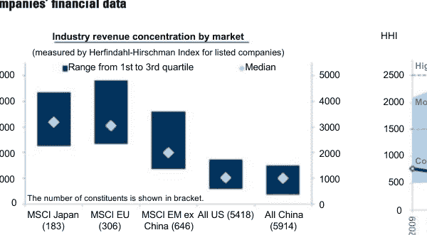

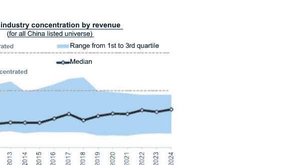

图 6：中国被视为全球最具竞争的市场之一，基于上市公司数据

图 7：中国的行业整合正在进行，但依然缓慢

The number of companies is almost equals MSCI Japan, MSCI EU, MSCI EM ex. all US (163) (306) (686) (914).

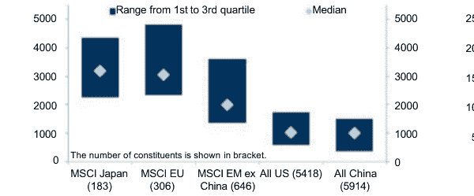

Source: FactSet, Goldman Sachs Global Investment Research

### Exhibit 8: High industry concentration is positively linked with companies' profitability

Herfindahl-Hirschman index (HHI) Median net margin/ROE of POE-dominated sectors HHI cohorts

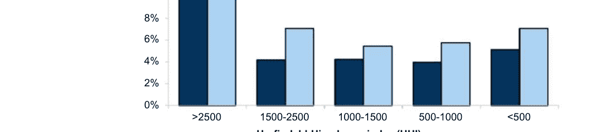

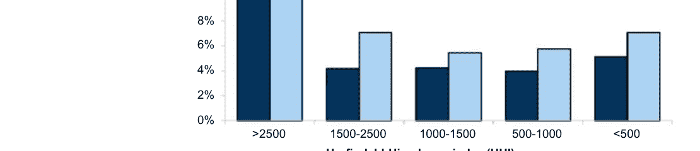

Calculation of net margin, ROE, and HHI is based on 2022-year average.

>2500 | 1500-2500 | 1000-1500 | 500-1000 | <500

Herfindahl-Hirschman index (HHI)

Source: FactSet, Goldman Sachs Global Investment Research
15 June 2022

### Exhibit 9: High industry consolidation is more prevalent in the TMT sector in both the US and China

Herfindahl-Hirschman Index (HHI) based on revenues of all listed firms (2024, GICS Industry with total market cap >US100bn)

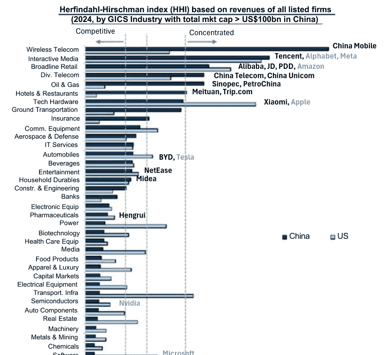

Source: FactSet, Goldman Sachs Global Investment Research

来源：FactSet、高盛全球投资研究

## Exhibit 11: Less than 20 names made it to the top-10 market by cap in both the US and China over the past decade

### # of Unique Names in Top 10 ranking since 2014 to 2024

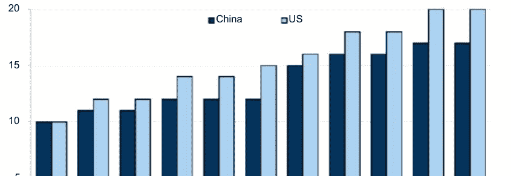

Source: FactSet, Wind, Goldman Sachs Global Investment Research

## Exhibit 12: Our panel regression shows revenue, capex and cash dominance (by industry, peers) are positively correlated with 'market cap representation'

### Dependent Variables Next Year Market Returns Next Year Market Concentration (Stock Cap / Industry | Total Market Cap)

| Market | US | China | US | China | US | China |
|---|---|---|---|---|---|
| Net Margin | +0.001 | | -0.009 | | | |
| R&D | 0.029 | | 0.153 | | | |
| CAPEX | -0.008 | | 0.161 | | | |
| FCF | | | -0.116 | | | |
| Cash | 0.0023 | | -0.088 | | | |
| CAPEX | | | 0.0248 | 0.1511 | | |
| FCF | | | +0.001 | 0.2422 | | |
| Cash | | | 0.418 | 0.4597 | | |
| Revenue Share | 0.3288 | | 0.667 | | | |
| Fixed Effect | 56588 | 4107 | 50423 | 4023 | 4063 | |

Source: MSDS, FactSet, Wind, Goldman Sachs Global Investment Research

# 图表11: 在过去十年中，少有20家公司同时进入了美国和中国市值股名的名前十强名单

### # of Unique Names in Top 10 ranking since 2014 to 2024

来源：FactSet、彭博、高盛行业研究

# 图表12: 我们的面板回归显示收入、资本支出和现金主导地位（按行业分组）与公司市值表现呈正相关

| 因变量 | 下年市场收益 美国 | 中国 | 下年市场集中度 (股票市值/行业|总市值) 美国 | 中国 | |
|---|---|---|---|---|---|
| 净利率 | +0.001 | | -0.009 | | | |
| 研发 | 0.029 | | 0.153 | | | |
| 资本支出 | -0.008 | | 0.161 | | | |
| 自由现金流 | | | -0.116 | | | |
| 现金 | 0.0023 | | -0.088 | | | |
| 资本支出 | | | 0.0248 | 0.1511 | | |
| 自由现金流 | | | +0.001 | 0.2422 | | |
| 现金 | | | 0.418 | 0.4597 | | |
| 收入份额 | 0.3288 | | 0.667 | | | |
| 固定效应 | 56588 | 4107 | 50423 | 4023 | 4063 | |

来源：MSDS、FactSet、彭博、高盛行业研究

# # AI has changed the game 

The creative destruction by AI enables companies that are positioned to invest in, adapt to and evolve the new technology to be more likely to remain relevant and competitive.

# 人工智能改变了游戏

人工智能驱动的创造性破坏，使得那些有能力、适应并顺应技术变革的公司将更有可能保持相关性和竞争力。

## Goldman Sachs

## China Strategy

## 高调

Given the sizable investments needed for tech/AI computing power, infrastructure, and applications, we believe that **already have large customer bases and are embracing new AI technology** to reshape their business models.

考虑到建设技术/AI计算能力、基础设施以及应用，我们认为已经拥有大客户群的企业可以利用新的人工智能重塑业务模式。

While it is difficult to quantify AI sentiment, our textual analysis of more than 1,300 earnings indicates that large companies in several non-tech, service-oriented industries, Media, Software, IT services, and Healthcare, appear ahead in AI development.

虽然很难量化人工智能情绪，但通过对1300多份公告的文本分析显示，多个非技术服务驱动型行业（媒体、软件、信息技术和医疗）在人工智能发展方面领先。

## Exhibit 13: China POEs appear better equipped to leverage AI-driven upside than peers

# 图表13: 中国企业比同行更有能力利用人工智能驱动的利好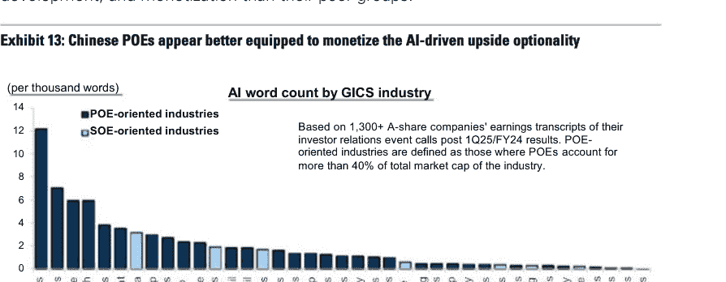

Source: FactSet, Goldman Sachs Global Investment Research

## Large companies are facing challenges and expanding globally

While China is the second consumer market in the world in both sales and population terms, the market cap concentration ratio accounts for more than 40% of total market cap, implying that existing market leaders with strong balance sheets and cashflow are better equipped to tap into the international markets. They are better positioned to reap the benefits of economies of scale and higher profit margins than locally-focused, less competitive peers.

尽管中国是销售额和人口全球第二大市场，但市值集中度占总市值的40%以上，这意味着拥有强劲资产负债表和现金流的市场领导者更有能力进入国际市场。相比专注于本土、竞争较弱的同行，他们更有可能获得规模效应和更高的利润率。

## Exhibit 14: Large companies better equipped to expand overseas

## Exhibit 15: Some Chinese companies could see better performance in the overseas markets

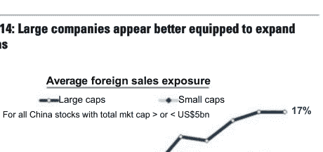

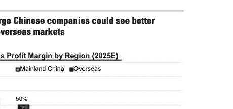

- Average foreign sales exposure: Large vs Small caps
- For all Chinese stocks with total market cap >= US$50bn
- Gross Profit Margin by Region (2023): All China vs Overseas

Source: FactSet, Goldman Sachs Investment Research

Source: Goldman Sachs Global Investment Research

## POE leaders are underpriced in China

Despite their dominance and proven track record of growth in profit and equity generation, large Chinese POEs are underpriced compared with small-cap stocks. The TOP 10 POEs on average P/E of US$13.9x, representing a 26% discount to MSCI China, both at the low-end of their historical ranges, while the Mag 7 in the US at average P/E of US$27, vs US$19 for the 403 constituents in the S&P500 (42% premium), in stark contrast Chinese POEs were able to command the mega-cap valuation premium in the US, as the market cap concentration ratio went from 11% to 13%, translating into US$13bn of additional market value for these POEs, whereas else being the benchmark.

## 企业领先企业在中国估值偏低

尽管它们在利润和权益增长方面占据主导地位并拥有良好的记录，中国领先企业相比小市值股票估值更低。前10位领先企业的平均市盈率为13.9倍，较MSCI中国折价了26%，且处于历史范围的低位；相比之下，美国七巨头（Mag 7）的平均市盈率为27倍，而标普500指数的403个成分股为19倍（溢价42%），形成鲜明对比。中国领先企业能够获得类似美国市场的巨型估值溢价，市值集中度从11%上升到13%，这意味着这些企业额外增加了130亿美元的市场价值。

## Exhibit 16: Top 10 Chinese POEs are priced at the end of their historical range in both PE and PEG terms

## Exhibit 17: Large Chinese POEs are priced at significantly discounted-vs benchmark

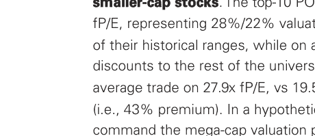

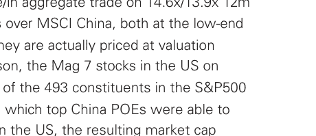

Source: FactSet, Goldman Sachs Global Investment Research

## Goldman Sachs
China Strategy

## 高盛
中国策略

# Appendix
# 附录

## Exhibit 21: Result of our panel regression on the US and China markets
图表 21：美国和中国市场的面板回归分析结果

$Return_{it} = \alpha + \beta_1 Revenue_{it} + \beta_2 CAPEX_{it} + \beta_3 FCF_{it} + \beta_4 FCFShare_{it} + \beta_5 NetMargin_{it} + \epsilon_{it}$

where $i$ denotes GICS Level 1 industry, $\delta_i$ denotes industry-specific fixed effect

## China

| Parameter | Std. Err. | T-value | Lower CI | Upper CI |
|---|---|---|---|---|---|
| Revenue_Share | 0.0089 | 0.0043 | 2.089 | 0.0003 | 0.0174 |
| RO_rev | 0.0089 | 0.0043 | 2.069 | 0.0002 | 0.0014 |
| ROE_rev | 0.0099 | 0.0038 | 2.368 | 0.0023 | 0.0216 |
| FCF_rev | 0.0088 | 0.0031 | 3.113 | 0.0001 | 0.0062 |
| FCF_share | 0.0089 | 0.0031 | 3.003 | 0.0001 | 0.0012 |
| NetMargin | -0.0139 | 0.0046 | -3.017 | -0.0221 | -0.0056 |

## US

| Parameter | Std. Err. | T-value | Lower CI | Upper CI |
|---|---|---|---|---|
| Revenue_Share | 0.0657 | 0.0816 | 0.8056 | -0.0942 | 0.2257 |
| RO_rev | 0.0819 | 0.0521 | 1.596 | -0.0319 | 0.1659 |
| ROE_rev | 0.1041 | 0.0517 | 2.017 | 0.0007 | 0.2223 |
| FCF_rev | 0.0811 | 0.0456 | 1.778 | -0.0025 | 0.1667 |
| FCF_share | 0.0913 | 0.0444 | 2.061 | 0.0025 | 0.1905 |
| NetMargin | -0.0086 | 0.0082 | -1.049 | -0.0250 | 0.0066 |

$MarketCap_{it} = \alpha + \beta_1 Revenue_{it} + \beta_2 CAPEX_{it} + \beta_3 FCF_{it} + \beta_4 FCFShare_{it} + \beta_5 NetMargin_{it} + \epsilon_{it}$

where $i$ denotes GICS Level 1 industry, $\delta_i$ denotes industry-specific fixed effect

## US

| Parameter | Std. Err. | T-value | Lower CI | Upper CI |
|---|---|---|---|---|
| Revenue_Share | 0.3685 | 0.4862 | 0.8767 | 0.0000 | 0.3677 |
| RO_rev | 0.0859 | 0.0418 | 2.0618 | -0.2176 | 0.3239 |
| ROE_rev | 0.0912 | 0.0522 | 1.750 | -0.0116 | 0.1952 |
| FCF_rev | 0.6454 | 0.3175 | 2.041 | -0.00335 | 0.9998 |
| FCF_share | 0.6546 | 0.3479 | 1.808 | -0.00335 | 0.0002 |
| NetMargin | 0.4431 | 0.3011 | 1.473 | -0.1462 | 0.4471 |

| Parameter | Std. Err. | T-value | Lower CI | Upper CI |
|---|---|---|---|---|
| Revenue_Share | 0.0497 | 0.0241 | 2.0612 | -0.0015 | 0.0534 |
| RO_rev | 0.0632 | 0.0318 | 1.9864 | -0.0049 | 0.0845 |
| ROE_rev | 0.0756 | 0.0327 | 2.3119 | 0.0102 | 0.1385 |
| FCF_rev | 0.1479 | 0.0536 | 2.7607 | 0.0363 | 0.3002 |
| FCF_share | 0.1521 | 0.0718 | 2.1183 | -0.0283 | 0.3865 |
| NetMargin | 0.0242 | 0.0118 | 2.0510 | -0.0010 | 0.0268 |

Source: FactSet, Goldman Sachs Investment Research
Source: FactSet, Wind, Goldman Sachs Investment Research
15 June 2023

## Exhibit 22: 10 largest companies by market cap in the US and China markets at the end of each calendar year, past 10 years

| | 2014 | 2015 | 2016 | 2017 | 2018 | 2019 | 2020 | 2021 | 2022 | 2023 | 2024 | to date |
|---|---|---|---|---|---|---|---|---|---|---|---|---|
| China | Tencent | Tencent | Tencent | Tencent | Tencent | Tencent | Tencent | Tencent | Tencent | Tencent | Tencent | Tencent |
| | CCB | CCB | CCB | CCB | CCB | CCB | CCB | CCB | CCB | CCB | CCB | CCB |
| | Alibaba | Alibaba | Alibaba | Alibaba | Alibaba | Alibaba | Alibaba | Alibaba | Alibaba | Alibaba | Alibaba | Alibaba |
| | ICBC | ICBC | ICBC | ICBC | ICBC | ICBC | ICBC | ICBC | ICBC | ICBC | ICBC | ICBC |
| | ABC | ABC | ABC | ABC | ABC | ABC | ABC | ABC | ABC | ABC | ABC | ABC |
| China | | | | | | | | | | | | |
| US | | | | | | | | | | | | |

Source: Wind FactSet
Source: Wind FactSet
as at June 11

## Goldman Sachs
## Disclosure Appendix
## Reg AC
We, King Lau, Timothy Mac, CFA, Si-Fu, and Kevin Wang, CFA, certify that all of the views expressed in this report are our personal views, which have not been influenced by any concerns of our business or client relationships.

Unless otherwise stated, the items contained on the cover page of this report are for use within Goldman Sachs' Global Research division.

## Disclosures
## Disclosures required by United States laws and regulations
Company-specific disclosures are provided below for any of the disclosures requested to refer to this report, manager or person of the report. Goldman Sachs may provide investment banking, trading, or client management services to any of the companies mentioned in this report.

The following are the additional disclosures. **Affiliations and material conflicts of interest**: Goldman Sachs policy discloses that its affiliates, employees, or former employees may have a business relationship with any of the companies mentioned in this report.

## Disclosures required by laws and regulations of other jurisdictions
Additional disclosures are required by the jurisdiction, except to the extent already made above by public notice.

For investors in Hong Kong, this report is not intended for distribution to or use by any person in Hong Kong. If you are a person in Hong Kong, you should seek your own professional advice before making any decision in relation to this report.

For investors in the United States, this report is not intended for distribution or use by any person in the United States except as a 'qualified purchaser' as defined in Section 3 of the Investment Company Act of 1940.

## United Kingdom and European Union: Disclosure information in relation to Article 6 of the European Market Disclosure Regulation (EU) 596/2014
20150618 No 5960/2014 of the European Parliament and the Council which that Delegating Regulation is

14 June

## Goldman Sachs
# 披露附录
# AC 规范
我们 King Lau、Timothy Mac（CFA）、Si-Fu 和 Kevin Wang（CFA）证明本报告中所有观点均为个人观点，且观点未受到我们业务或客户关系的影响。

# 除非另有说明，本报告封面上列出的项目仅供高盛全球投资研究部门内部使用。

# 披露
## 美国法律及法规要求的披露
公司特定的披露已列在下方，以符合针对本报告、经理人或报告人要求的任何披露。高盛可能为本报告中提到的任何公司提供投资银行、交易或客户管理服务。

以下为要求的额外披露。**关联关系与重大利冲突**：高盛政策披露其关联公司、员工或前员工可能与本报告中提到的任何公司有业务关系。

## 其他司法管辖区法律及法规要求的披露
除上述公告已涵盖的部分外，各司法管辖区提供额外披露。

对于香港的投资者，本报告不供分发或供香港的任何人士使用。如果您是香港人士，在做出任何与本报告相关的决定之前，您应该寻求自己的专业建议。

对于美国的投资者，本报告不供分发或供美国的任何人士使用，除非是根据 1940 年投资公司法第 3 节所定义的“合格购买者”。

as at June 11

## Goldman Sachs

## China Strategy

Integrated into United Kingdom law and our regulations leaving the United Kingdom from the European Union and the European Union and recommendations or other information recommending or suggesting an investment strategy and for particular interests or interests of our clients, Goldman Sachs is in conflict with Investment Research.

# 高瞻

在欧洲通胀数据发布后，我们认为其具有持续增长风险。欧洲经济增长放缓显示通胀压力符合我们的预期，但通胀水平可能高于我们的预期。更多信息请参阅https://www.goldmansachs.com/intelligence/euuropeconomy.html。本报告与投资研究无关。

# Global product distribution strategy

Goldman Sachs provides research and distributes products to clients on a global scale. Based on analysis, Goldman Sachs in Global Markets provides research on industries and companies, and research on a global scale.

## 全球分销

### 产品分销

We have no Financial Instrument Business registered with the Financial Business Bureau under registration number 649, and are not members of Japan Securities Dealers Association, Financial Association of Japan, Financial Instruments Association.

Goldman Sachs provides research and distributes products to clients on a global scale. Based on analysis, Goldman Sachs in Global Markets provides research on industries and companies, and research on a global scale.

我们没有在日本金融商品经营局注册金融工具业务登记，也不是日本证券业协会联合会、日本金融业协会、日本金融商品交易业协会或日本金融商品业协会协会的会员。

pre-determined with complex tax sum. We may provide specific-country disclosures to any applicable disclosures required by law.

Goldman Sachs provides research and distributes products to clients on a global scale. Based on analysis, Goldman Sachs in Global Markets provides research on industries and companies, and research on a global scale.

Goldman Sachs provides research and distributes products to clients on a global scale. Based on analysis, Goldman Sachs in Global Markets provides research on industries and companies, and research on a global scale.

Goldman Sachs provides research and distributes products to clients on a global scale. Based on analysis, Goldman Sachs in Global Markets provides research on industries and companies, and research on a global scale.

Goldman Sachs provides research and distributes products to clients on a global scale. Based on analysis, Goldman Sachs in Global Markets provides research on industries and companies, and research on a global scale.

Goldman Sachs provides research and distributes products to clients on a global scale. Based on analysis, Goldman Sachs in Global Markets provides research on industries and companies, and research on a global scale.

Goldman Sachs provides research and distributes products to clients on a global scale. Based on analysis, Goldman Sachs in Global Markets provides research on industries and companies, and research on a global scale.

Goldman Sachs provides research and distributes products to clients on a global scale. Based on analysis, Goldman Sachs in Global Markets provides research on industries and companies, and research on a global scale.

Goldman Sachs provides research and distributes products to clients on a global scale. Based on analysis, Goldman Sachs in Global Markets provides research on industries and companies, and research on a global scale.

Goldman Sachs provides research and distributes products to clients on a global scale. Based on analysis, Goldman Sachs in Global Markets provides research on industries and companies, and research on a global scale.

Goldman Sachs provides research and distributes products to clients on a global scale. Based on analysis, Goldman Sachs in Global Markets provides research on industries and companies, and research on a global scale.

Goldman Sachs provides research and distributes products to clients on a global scale. Based on analysis, Goldman Sachs in Global Markets provides research on industries and companies, and research on a global scale.

Goldman Sachs provides research and distributes products to clients on a global scale. Based on analysis, Goldman Sachs in Global Markets provides research on industries and companies, and research on a global scale.

## General disclosures

Goldman Sachs (GS) is authorized by the Prudential Regulation Authority “PRA” and regulated by the Financial Conduct Authority. European Markets: Economics is regulated by the PRA and the FCA, and Goldman Sachs's research in the following markets:

None of this report contains other than disclosures to clients. This report is based on research for investment purposes only and should not be considered an offer to buy, or a solicitation to buy, any security, and should not be relied upon. The opinions, estimates and forecasts contained in this report are those of Goldman Sachs and do not necessarily reflect those of any other party.

European Markets: Economics is regulated by the PRA and the FCA, and Goldman Sachs's research in the following markets:

European Markets: Economics is regulated by the PRA and the FCA, and Goldman Sachs's research in the following markets:

欧洲市场：经济受 PRA 和 FCA 监管，Goldman Sachs 在以下市场的研究包括：英国、欧元区、欧洲现金市场、欧洲债券市场、欧洲股票市场、欧洲衍生市场、欧洲货币市场、法国、德国、瑞士、西班牙、意大利、挪威、爱尔兰、比利时、荷兰、卢森堡、奥地利、波兰、捷克、希腊、意大利、葡萄牙、北欧、挪威、丹麦等。在这些国家、地区或市场，我们的研究受欧盟证券市场监管指令（MiFID II）监管，在某些其他市场还受当地监管机构监管。此外，这些市场还受欧洲中央银行（ECB）和欧洲金融市场管理局（ESMA）监管。

European Markets: Economics is regulated by the PRA and the FCA, and Goldman Sachs's research in the following markets:

European Markets: Economics is regulated by the PRA and the FCA, and Goldman Sachs's research in the following markets:

European Markets: Economics is regulated by the PRA and the FCA, and Goldman Sachs's research in the following markets:

“GS” refers to Goldman Sachs, “PRA” refers to Prudential Regulation Authority, “FCA” refers to Financial Conduct Authority, and “MiFID II” refers to Markets in Financial Instruments Directive.

Goldman Sachs conducts a global business of financial services including investment banking, investment management, and brokerage services. We may have conflicts of interest with respect to the clients, securities, or transactions mentioned in this report. We and our affiliates, and employees may engage in trading or strategies for our own account or clients that may be contrary to the opinions set forth in this report. Our asset management, research product and trading activities may involve positions mentioned in report.

The views presented to Goldman Sachs at conferences may differ from other parts of the report. This report represents the views of Goldman Sachs only.

Any third party referred herein, including sales representatives, or other providers of financial services, may have positions in the securities that differ from Goldman Sachs. This research is focused on investment themes across markets, and industries. It is not intended to distinguish between or provide analysis of individual companies or entities within the sector. Any analysis of a specific company or entity within the industry discussed is for illustrative purposes only and does not constitute a recommendation to take into account the particular objectives, financial situation. It is advisable to consult with professional financial advice before making investment decisions. The price of currencies and investments referred to may fall and rise, and past performance is not a reliable indicator of future results. 在做出任何投资决策之前，建议咨询专业的建议。货币和涉及投资的价值可能会下降或上涨，过去的业绩并不是未来结果的可靠指标。我们的员工在执行某些策略时可能会面临额外风险。例如，在执行某些策略时，我们可能会面临额外风险，这种风险可能导致投资损失。

Goldman Sachs provides research... 2023年6月1日

Goldman Sachs

## China Strategy

Certain transactions involving futures, options, and other derivatives, give rise to substantial risk and are not suitable for all investors. Current and future research documents provided by Goldman Sachs are available at https://www.goldmansachs.com/compliance/character-risk and https://www.goldmansachs.com/disclosures-future-options.html. You may obtain additional information by calling 1-800-345 or visiting https://www.goldmansachs.com/compliance/booklet-options-future-options.pdf.

交易（包括涉及期货、期权及其他品的交易）会巨大的风险，且并不适用于所有投资者。高盛提供的当前及未来文件可以在 https://www.goldmansachs.com/compliance/character-risk 以及 https://www.goldmansachs.com/disclosures-future-options.html 访问。您可以通过拨打 1-800-345 或访问 https://www.goldmansachs.com/compliance/booklet-options-future-options.pdf 获取更多信息。

Different research reports may be prepared to provide to one or other clients of GS, based on various factors including your interests, market focus, sector, length (long, short term), the scope and nature of your overall client relationship with GS and legal and regulatory constraints. As a result, the information in the report may be exhaustive or may not be available to other clients of GS. GS has no obligation to provide the information contained in any report to any other client who did not receive the report, except as necessary to fulfill its legal and regulatory obligations, and may do so at any time without prior notice.

不同的研究报告可能是根据您的利益、市场关注、行业、长度（长期、短期）以及您与高盛整体客户关系的范围和性质以及法律和监管限制等因素为一个或某些客户准备的。因此，报告中的信息可能是详尽的，也可能无法供高盛的其他客户使用。高盛没有向未收到该报告的任何其他客户提供报告中的信息，除非履行其法律和监管义务所必需，且高盛可以随时在不事先通知的情况下这样做。

Goldman Sachs Group, Inc. and its affiliates (collectively ‘Goldman Sachs’) reserve the right to disclose, analyze, modify, reformat, and print the information made available to you solely for your own use through this service. You may not resell or reuse this information to calculate or derive any index for disclosure and/or marketing or create any other derivative works based on this information.

高盛集团公司及其关联公司（统称“高盛”）保留对本服务为您提供的仅供个人使用的信息进行披露、分析、修改、重新格式打印的权利。您不得转售或重复使用此信息来计算或得出任何用于披露和/或营销的索引，或基于此信息创建任何其他衍生作品。

This restriction includes, without limitation, using, extracting, downloading or retrieving this information in whole or in part, to train, test or develop a machine learning or artificial intelligence system, or to reproduce this information, in whole or in part, as a prompt or input to such system.

此限制包括但不限于：使用、提取、下载或检索此类信息（无论全部还是部分）来训练、测试或开发机器学习或人工智能系统，或将其信息（全部或部分）作为提示或输入到此类系统。

## Goldman Sachs Research

15 June 2022 | 7:52PM HKT

## China Strategy
## The comeback of Chinese POEs (Part 3): The rise of Prominent 10
## 中国策略
## 中国企业的回归（第三部分）：领先企业的崛起

We expect cap concentration in the PGE sector to rise over time (Part 2). Against that, our analysis suggests that ten leaders—Chinese Prominent 10 are capable of growing their dominance in the market, as the US make 7 stocks. "From Prominent 10" are all backed by GS analysts,

我们预计 PGE POE 行业的市值份额（市场）将在中期向上转移（第二部分）。相比之下，我们的分析表明，十家领军企业——中国领先企业——有能力在市场中占据主导地位。美国股票在过去几年表现优异，“中国领先企业”有望获得更高的回报。

Keoger Lau, CFA
roger.lau@goldmansachs.com

Timothy Mo, CFA
timothy.mo@goldmansachs.com

Kevin Wang, CFA
kevin.wang@goldmansachs.com

- 1. Tencent (cap: $610B/US$11bn, backed by Ronald Kung)
- 2. Alibaba (cap: $289B/US$28bn, backed by Raymond Chen)
- 3. Xiaomi (cap: $138B/US$11bn, backed by Timothy Zhou)
- 4. BYD (cap: $127B/US$11bn, backed by Tina Hou)
- 5. Meituan (cap: $102B/US$10bn, backed by Ronald Kung)
- 6. NetEase (cap: $67B/US$6bn, backed by Lincoln Kong)
- 7. Pindu (cap: $78B/US$4bn, backed by Nicholas Yi)
- 8. Hengrui (cap: $87B/US$3bn, backed by Zyi Chen)
- 9. Trip.com (cap: $97B/US$10bn, backed by Simon Cheng)
- 10. ANTA (cap: $100B/US$10bn, backed by Michelle Cheng)

They use up $11bn in 42% of market and 42% of China index weight, used $11bn in a day, as expected by GS analysts to grow earnings by 13% (CAIR) in the next two years and 14% at large. They embody the theme of A/Tech development, self-sufficiency, "Global Services," and new forms of consumption, and improving shareholder returns.

腾讯（市值：6100亿美元/中国股110亿，由 Ronald Kung支持）阿里巴巴（市值：2890亿美元/中国股280亿，由 Raymond Chen支持）小米（市值：1380亿美元/中国股110亿，由 Timothy Zhou支持）比亚迪（市值：1270亿美元/中国股110亿，由 Tina Hou支持）美团（市值：1020亿美元/中国股100亿，由 Ronald Kung支持）网易（市值：670亿美元/中国股60亿，由 Lincoln Kong支持）拼多多（市值：780亿美元/中国股40亿，由 Nicholas Yi支持）恒瑞（市值：870亿美元/中国股30亿，由 Zyi Chen支持）携携程（市值：970亿美元/中国股100亿，由 Simon Cheng支持）安踏（市值：1000亿美元/中国股100亿，由 Michelle Cheng支持）

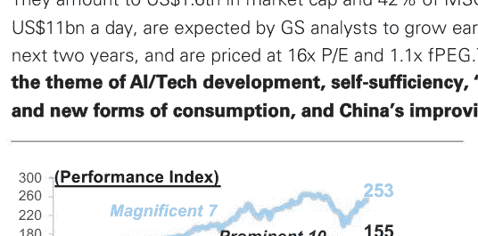

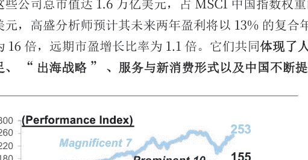

Source: FactSet, Goldman Sachs Investment Research

Source: FactSet, 华盛投资研究

Investors should consider this report only as a single factor in their investment decision. For legal accounting and certification documents, please see the Disclosure Appendix, or go to www.gsresearch.com/hedge.html for

投资者应仅将本报告作为投资决策的单一考虑因素。有关法律会计认证及其他重要信息，请参阅披露附录，或访问 www.gsresearch.com/hedge.html

## Goldman Sachs
## China Strategy

## Prominent 10 vs. Mag 7 at a glance
## 中国大出击 vs. 美国辉煌

## 美国辉煌

## Chinese Prominent 10
## US Magnificent 7
## 中国十大杰出

| TICKET | MARKET CAP | TICKET | MARKET CAP | TICKET | MARKET CAP | TICKET | MARKET CAP |
| :--- | :--- | :--- | :--- | :--- | :--- | :--- | :--- |
| 0700.HK | $601bn | 9988.HK | $289bn | MSFT | $3.6tn | 0700.HK | $601bn |
| | | 9988.HK | $289bn | | | MSFT | $3.6tn |

China's internet giant growing by daily active users (DAUs) is driven by gaming, entertainment and digital payment.

China's e-commerce platform, fueled by networking, logistics, local service and media entertainment.

Leader in learning performance and cost-effectiveness across a variety of platforms.

China's internet giant growing by daily active users (DAUs) is driven by gaming, entertainment and digital payment.

China's e-commerce platform, fueled by networking, logistics, local service and media entertainment.

Leader in learning performance and cost-effectiveness across a variety of platforms.

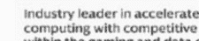

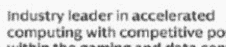

| TICKET | MARKET CAP | TICKET | MARKET CAP | TICKET | MARKET CAP | TICKET | MARKET CAP |
| :--- | :--- | :--- | :--- | :--- | :--- | :--- | :--- |
| 01810.HK | $140bn | 002538.SZ | $121bn | AAPL | $3.0tn | 01810.HK | $140bn |
| | | 002538.SZ | $121bn | | | AAPL | $3.0tn |

The world's 3rd smartphone brand (13.8% of global shipments) and leading consumer-device ecosystem.

Leader in semiconductor industry with competitive power and dominating data center space.

The world's 3rd smartphone brand (13.8% of global shipments) and leading consumer-device ecosystem.

Leader in semiconductor industry with competitive power and dominating data center space.

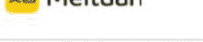

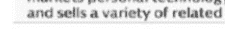

| TICKET | MARKET CAP | TICKET | MARKET CAP | TICKET | MARKET CAP | TICKET | MARKET CAP |
| :--- | :--- | :--- | :--- | :--- | :--- | :--- | :--- |
| 36990.HK | $102bn | 0700.HK | $86bn | AMZN | $2.2tn | 36990.HK | $102bn |
| | | 0700.HK | $86bn | | | AMZN | $2.2tn |

Leading food delivery services in the world. With its high-frequency model, it has achieved leader in local business.

A leading EV maker in both China and globally.

Leading food delivery services in the world. With its high-frequency model, it has achieved leader in local business.

A leading EV maker in both China and globally.

Leader in e-commerce, digital advertising, and cloud computing.

| TICKET | MARKET CAP | TICKET | MARKET CAP | TICKET | MARKET CAP | TICKET | MARKET CAP |
| :--- | :--- | :--- | :--- | :--- | :--- | :--- | :--- |
| 000333.HK | $70bn | 006276.SZ | $55bn | ALIBABA | $6.2bn | 000333.HK | $70bn |
| | | 006276.SZ | $55bn | | | ALIBABA | $6.2bn |

China's leader in HVAC and major appliances, and global leader in home automation, smart buildings, EV focus.

Leading gaming company in China that creates innovative products from a genetics-based perspective.

Leader in cloud infrastructure-as-service, AI models and distribution.

China's leader in HVAC and major appliances, and global leader in home automation, smart buildings, EV focus.

Leading gaming company in China that creates innovative products from a genetics-based perspective.

Leader in cloud infrastructure-as-service, AI models and distribution.

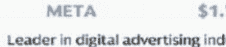

| TICKET | MARKET CAP | TICKET | MARKET CAP | TICKET | MARKET CAP | TICKET | MARKET CAP |
| :--- | :--- | :--- | :--- | :--- | :--- | :--- | :--- |
| 9961.HK | $4bn | 2020.HK | $35bn | META | $1.0tn | 9961.HK | $4bn |
| | | 2020.HK | $35bn | | | META | $1.0tn |

China's domestic online travel service provider across hotels, airlines, ground transportation to attractions and packages.

Leader in China's sportswear industry which covers both market price and premium segments.

Leader in digital advertising, tracking employees, metaverse, and social networking services.

China's domestic online travel service provider across hotels, airlines, ground transportation to attractions and packages.

Leader in China's sportswear industry which covers both market price and premium segments.

Leader in digital advertising, tracking employees, metaverse, and social networking services.

Source: Company data, Goldman Sachs Global Research

2023 年9月1日

2

## Sachs
## China Strategy
## 高盛
## 中国策略
## Market Cap (tn USD)
## FPE(x)
## Market Cap (tn USD)
## FPE(x)

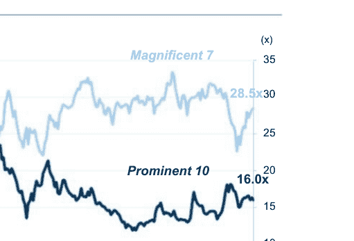

Source: FactSet, Goldman Sachs Investment Research

Source: FactSet, Goldman Sachs Investment Research

Source: FactSet, 华盛投资研究

Source: FactSet, Goldman Sachs Investment Research

## PEG(x)
## EPS integer (rebased)
## PEG(x)
## EPS integer (rebased)

## Return on Average Equity
## (Capex+D)/Revenue
## Return on Average Equity
## (Capex+D)/Revenue

Note: 25-year base based on estimates by GS analysts, not including consensus
Note: 25-year base based on estimates by GS analysts, not including consensus

# 中国中十大企业的筛选框架

- In Part 2 of our POE series, we put forward a top-down framework, which demonstrates that inherent advantages, high industry entry barriers, and strong commitment to invest in growth capex are the necessary conditions for Chinese POEs to improve their competitive and advantages, generate positive equity returns for shareholders, and outperform peers.

- The above observations motivate us to look for long-term winners in China based on: 21 GICS companies where market concentration by HHI is relatively high (Index>100), and 11 Chinese companies, mostly in the Tech and Consumer sectors, that are more fragmented than vis-a-vis the US and potential for market concentration and consolidation over time.

- In of these 27 companies, we look for buy-listed stocks that show the quality of: a dominant position (>10%) in the profit pool or total addressable market (TAM in their respective sectors), and that they have invested heavily in growth capex and R&D. Our panel analysis regression focused on 700+ US and Chinese companies since 2008 (more than 60,000 data points) shows that three factors are factors, ROI, and cash, with high statistical significance, positively impact stable investment returns and market share representation within their domains.

- This process allows us to select out 10 market leaders that may be well-placed on our webpage to further elevate their dominance in Chinese stock market. Similar to the Magnificent 7 stocks in the US, which have created more than US$12 trillion in market cap over the last 5 years and demonstrated more than 365% average returns per share, Chinese companies have exceptionally strong growth prospects and favorable capex/R&D intensity over time.

在 POE 的第二部分，我们提出出一个从上而下的框架。该框架涵盖了优势、高行业准入门槛以及对增长资本（包括研发）的投入是中国优秀企业在竞争中保持优势、为股东创造正向股权回报并优于美国和中国企业中进行行业赛道的必要条件。

我们希望大家在筛选时关注以下标准：例如 21 家市场集中度较高的 GICS 公司（指数>100），以及 11 家主要在科技和消费板块的中国公司，这些公司相比美国公司更为分散，具有市场集中和整合的潜力。在此基础上，我们筛选出 27 家中国优秀企业，涉及 2854 家公司，总市值超过 8.6 万亿人民币。

在这 27 家公司中，我们希望筛选出符合以下质量要求的买入股票：a在各自领域拥有主导地位（在各自领域的 TAM，即总可市场规模占比>10%），并且它们在增长资本支出和研发方面投入了大量资金。

自 2008 年以来，我们对 700 多家美国和中国公司进行了面板回归分析（涉及 60,000 多个数据点），结果显示三个因素是关键因素，投资回报率（ROI）和现金流，具有高度的统计显著性，正向影响稳定的投资回报和市场份额占比。

在整体上，我们关注了占总市值 10% 的前 10% 股票（占 A 股总市值的 42%），中证指数权重（占 A 股总市值的 5%），以及剩余的（占 A 股总市值的 53%）股票。通过对 GICS 行业分析，我们认为哪些行业可能获得更高的回报。

这一格言有助于我们筛选优秀的经营者，避免使用错误的策略。这增加了我们对中国优秀企业的筛选信心。位于“中国制造”赛道的企业在过去 5 年中我们发现了 12 家优秀企业，这些企业具有极强的增长能力和良好的研发/支出投入，是未来增长的核心竞争力。

总体而言，我们关注了总市值 1.4 万亿人民币（占 A 股总市值的 10%）的中证中国核心 422 家公司（占 A 股总市值的 46%）。通过行业分析，我们认为哪些行业在未来 3 年内将实现 12% 的复合增长率。当考虑到期限为 16 年时，这些 222 家公司过去以来年化增长率为 54%，累计回报率 24%。中证核心 422 家公司中 300 个是行业股，8 个是蓝股。我们关注了这些能够增长的高价值投资行业，包括科技、科学研发、中国制造、出口贸易、出海战略、服务等。In the aggregate, they collectively embody our preferred and promising investment trends of (“Global”), Chinese self-sufficiency/import substitution, and China’s improving returns.

## Caveats, risks, and key points

我们的筛选方法并非完美，因为中国制造的领头企业全部在市场上市。

- 我们到的国内遭遇限制和或制裁民营企业从池中剔除。
- 国内监管/政策对私营企业导向是我们关注及国内市场（市值）中上市、行业整合，以民营企业为主。
- 由于市场结构、监管、技术水平以及企业长期增长的差异与美国（及更具增长性的市场）相关，但考虑到中国的国内市场、我们在市场的份额增长，持续聚焦于科技和应用科学发展的，我们计划定期审视十大成分。当投资案例发生重大变化和或我们的民营企业范围扩大（新增民营企业上市）。

## Exhibit 1: Our top-down framework to screen out 10 market leaders that are well-placed to capitalize on their past success and further elevate our dominance in Chinese stock market

- All China listed universe: 66 GICS industries | 5429 Listed companies, US$16tn mkt
- Industry selection: Market concentration Industries moderately concentrated in China, Herindahl-Hirschman Index (HHI) > 1000, China less concentrated than US, Industry HHI gap > 500
- POE-oriented: Total market cap of POEs in the industry > 40%
- 27 GICS industries
- Company selection: Based on 4 pillars
- Sector leader: Largest name by market cap, High market share in industry profit pool (>10%), High operating Cash Flow >10% of revenue
- R&D or Capex: R&D and Capex intensity > 10%, R&D and Capex share in industry > 10%
- Business Expansion: Potential to expand business in global markets or via M&A
- GS Buy-rated names

图1：我们的自上下框架筛选出10家行业领导者，他们将如何利用过去的成功，进一步提升在股票市场的主导地位。

## Goldman Sachs - China Strategy - Chinese Tencent 10 years ago

# 中国十大企业巅峰

Exhibit 2: Our 10-year framework shows that large-cap peers had potential to further elevate their dominance in the equity market

图2：我们的十年框架显示十大大市值企业均具备一步提升其市场地位的潜力。

| Rank | Name | Industry | Quoted Price ($) | Quoted Cap ($bn) | Total Listed ($bn) | ADY (x) | 2013-23 P/E (x) | 2013-23 DY (%) | GS (%) |
|---|---|---|---|---|---|---|---|---|---|
| 9988 | 阿里巴巴 | Internet | 150 | 610 | 1805 | 20 | 17.3 | 4.0 | 0.1 |
| 9999 | 腾讯 | Interactive Media | 115 | 268 | 1085 | 19 | 9.9 | 2.0 | 1.6 |
| 1810 | 美团 | Technology | 52 | 144 | 486 | 16 | 14.8 | -87 | 3 |
| 1211 | 比亚迪 | Auto | 72 | 167 | 486 | 52 | 31.7 | 3.7 |
| 3660 | 美团 |  Restaurants | 100 | 141 | 428 | 20 | 29.7 | 4.3 | 0 |
| 9998 | 网易 |  Pharmaceuticals | 208 | 86 | 254 | 6 | 15.0 | 0.8 | 2.4 |
| 600176 | 吉利 | 汽车 | 51 | 269 | 256 | 26 | 25.9 | 10.7 | 0.4 |
| 9961 | 携程 | 酒店 | 482 | 43 | 171 | 18 | 18.4 | 16.3 | 0.5 |
| 2020 | 安踏体育 | 服装 | 95 | 948 | 421 | 12 | 17.8 | 3.8 | 2.2 |

Source: FactSet, IBS, Goldman Sachs Research

Exhibit 3: The Prox 100 stocks are selected from the top 10 sub-industries providing diversified exposure to investors in the PCE sector

图3：从沪证100中十大子行业中选出的股票，为消费行业的投资者提供多元化暴露。

Exhibit 5: Market share, R&D and Capex trends of Chinese Tencent 10

| Year | Market share in industry | Market share in China | R&D as % of sales | Capex as % of sales | |
|---|---|---|---|---|
| 2013 | 60% | 65% | 11% | 10% | 8% |
| 2014 | 60% | 66% | 12% | 10% | 8% |
| 2015 | 60% | 67% | 13% | 11% | 8% |
| 2016 | 60% | 68% | 14% | 14% | |
| 2017 | 60% | 69% | 15% | 13% | 9% |
| 2018 | 60% | 70% | 15% | 14% | 9% |
| 2019 | 60% | 71% | 16% | 15% | 9% |
| 2020 | 60% | 72% | 17% | 16% | 9% |
| 2021 | 60% | 73% | 18% | 17% | 10% |
| 2022 | 60% | 74% | 19% | 18% | 10% |
| 2023 | 60% | 75% | 20% | 19% | 10% |

| Year | Market share in industry | Market share in China | R&D as % of sales | Capex as % of sales | |
|---|---|---|---|---|
| 2013 | 30% | 35% | 5% | 3% | 2% |
| 2014 | 30% | 36% | 6% | 4% | 2% |
| 2015 | 30% | 37% | 7% | 5% | 3% |
| 2016 | 30% | 38% | 8% | 6% | 3% |
| 2017 | 30% | 39% | 9% | 7% | 3% |
| 2018 | 30% | 40% | 10% | 8% | 4% |
| 2019 | 30% | 41% | 11% | 9% | 4% |
| 2020 | 30% | 42% | 12% | 10% | 4% |
| 2021 | 30% | 43% | 13% | 11% | 5% |
| 2022 | 30% | 44% | 14% | 12% | 5% |
| 2023 | 30% | 45% | 15% | 13% | 5% |

## Goldman Sachs
## China Strategy
## 高盛
## 中国策略
# 附录

Exhibit 6: A list of GS Buy-bought PDEs other than Prominent 10

| Ticker | Name | GSICS | Quoted | Price | Total-based Yield (US$) | ADVT CAGR (%) | 24E (X) | 25E (X) | 26E (X) | 29E (X) | GS Ratings |
| :--- | :--- | :--- | :--- | :--- | :--- | :--- | :--- | :--- | :--- | :--- | :--- |
| PWD | United Petroleum | | | | 103.4 | 147 | 1030 | 12.3 | 2.6 | 0.0 | |
| UDD | United Petroleum | | | | 103.4 | 147 | 1030 | 12.3 | 2.6 | 0.0 | |
| 601168 | Cosco | | | | 20.7 | 505 | 523 | 13.8 | 2.4 | 3.9 | |
| 600939 | China Mobile | | | | 24.7 | 448 | 468 | 8.0 | 1.1 | 2.2 | |
| 20 JD | JD.com | | | | 33.6 | 480 | 480 | 7.8 | 1.3 | 3.1 | |
| 600519 | Meituan | | | | 58.1 | 215 | 220 | 37.0 | 3.7 | 0.0 | |
| 602668 | Cambrian | | | | 58.1 | 215 | 220 | 37.0 | 3.7 | 0.0 | |
| 601036 | BYD | | | | 71.1 | 168 | 189 | 10.9 | 5.5 | 0.0 | |
| 600519 | Kweichow | | | | 75.1 | 267 | 271 | 1.5 | 0.0 | 0.0 | |
| 602714 | Yum China | | | | 43.0 | 135 | 148 | 12.1 | 2.8 | 3.4 | |
| 601988 | China Construction | | | | 43.0 | 135 | 148 | 12.1 | 2.8 | 3.4 | |
| 600319 | Haier | | | | 23.4 | 291 | 308 | 19.8 | 1.6 | 6.1 | |
| 688988 | Ant Group | | | | 23.4 | 291 | 308 | 19.8 | 1.6 | 6.1 | |
| 628800 | Baidu | | | | 82.9 | 341 | 368 | 31.0 | 0.0 | 0.0 | |
| 603236 | NetEase | | | | 82.9 | 341 | 368 | 31.0 | 0.0 | 0.0 | |
| 601938 | China Telecom | | | | 95.1 | 384 | 391 | 1.9 | 0.5 | 0.0 | |
| 600068 | Yitong | | | | 95.1 | 384 | 391 | 1.9 | 0.5 | 0.0 | |
| 600508 | Yunnan Spring | | | | 38.7 | 156 | 161 | 20.6 | 15.1 | 2.4 | |
| 605449 | East China | | | | 72.2 | 219 | 221 | 31.7 | 1.7 | 4.2 | |
| 601988 | China Petro | | | | 72.2 | 219 | 221 | 31.7 | 1.7 | 4.2 | |
| 600048 | Sanan | | | | 29.9 | 225 | 236 | 35.3 | 2.1 | 0.0 | |
| 600019 | Pinghui | | | | 29.9 | 225 | 236 | 35.3 | 2.1 | 0.0 | |
| 600019 | Hafeng | | | | 34.5 | 327 | 349 | 34.0 | 5.3 | 0.8 | |
| 601938 | Yanke | | | | 34.5 | 327 | 349 | 34.0 | 5.3 | 0.8 | |
| 600303 | Golden Sun | | | | 125.6 | 231 | 249 | 34.0 | 5.3 | 0.8 | |
| 601088 | China Wind | | | | 125.6 | 231 | 249 | 34.0 | 5.3 | 0.8 | |
| 601618 | Foxconn | | | | 158.7 | 178 | 195 | 15.8 | 4.9 | 0.8 | |
| 601166 | Kingfisher | | | | 158.7 | 178 | 195 | 15.8 | 4.9 | 0.8 | |
| 603696 | JD Health | | | | 91.6 | 467 | 472 | 27.0 | 3.2 | 0.0 | |
| 603696 | Kentuan | | | | 91.6 | 467 | 472 | 27.0 | 3.2 | 0.0 | |
| 600060 | Gidu | | | | 68.5 | 384 | 391 | 34.0 | 0.5 | 0.0 | |
| 600060 | Meidu | | | | 68.5 | 384 | 391 | 34.0 | 0.5 | 0.0 | |
| 600065 | Leap Green | | | | 84.5 | 384 | 391 | 34.0 | 0.5 | 0.0 | |
| 600065 | Lidu | | | | 84.5 | 384 | 391 | 34.0 | 0.5 | 0.0 | |
| 600010 | Energy | | | | 146.7 | 110 | 118 | 34.7 | 0.5 | 0.0 | |
| 600010 | Enron | | | | 146.7 | 110 | 118 | 34.7 | 0.5 | 0.0 | |
| 992 | Henan | | | | 169.0 | 106 | 114 | 44.2 | 0.7 | 0.0 | |
| 992 | Huixin | | | | 169.0 | 106 | 114 | 44.2 | 0.7 | 0.0 | |
| 686712 | AMEC | | | | 169.0 | 106 | 114 | 44.2 | 0.7 | 0.0 | |
| 686712 | AMEC | | | | 169.0 | 106 | 114 | 44.2 | 0.7 | 0.0 | |
| 600012 | Taurus | | | | 149.9 | 105 | 116 | 14.0 | 0.0 | 0.0 | |
| 600012 | Tansen | | | | 149.9 | 105 | 116 | 14.0 | 0.0 | 0.0 | |
| 600019 | Sanhui | | | | 103.1 | 108 | 114 | 23.4 | 2.1 | 0.0 | |
| 600019 | Sanhui | | | | 103.1 | 108 | 114 | 23.4 | 2.1 | 0.0 | |
| 601718 | Zhonghua | | | | 103.1 | 108 | 114 | 23.4 | 2.1 | 0.0 | |
| 601718 | Zhonghua | | | | 103.1 | 108 | 114 | 23.4 | 2.1 | 0.0 | |
| 181756 | ABCF | | | | 81.6 | 63 | 73 | 17.3 | 4.1 | 1.1 | |
| 181756 | ABCF | | | | 81.6 | 63 | 73 | 17.3 | 4.1 | 1.1 | |
| 000250 | Sanfu | | | | 25.9 | 65 | 70 | 25.0 | 0.0 | 0.0 | |
| 000250 | Sanfu | | | | 25.9 | 65 | 70 | 25.0 | 0.0 | 0.0 | |
| 600858 | Mobile | | | | 81.7 | 77 | 82 | 14.0 | 2.2 | 0.8 | |
| 600858 | Mobile | | | | 81.7 | 77 | 82 | 14.0 | 2.2 | 0.8 | |
| 600858 | Tech | | | | 81.7 | 77 | 82 | 14.0 | 2.2 | 0.8 | |
| 600858 | Tech | | | | 81.7 | 77 | 82 | 14.0 | 2.2 | 0.8 | |
| 601690 | Galaxy | | | | 48.0 | 22 | 21 | 20.5 | 0.4 | 0.0 | |
| 601690 | Galaxy | | | | 48.0 | 22 | 21 | 20.5 | 0.4 | 0.0 | |
| 668271 | United | | | | 152.1 | 59 | 61 | 36.8 | 5.1 | 1.9 | |
| 668271 | United | | | | 152.1 | 59 | 61 | 36.8 | 5.1 | 1.9 | |
| 270 | ZTO | | | | 170.0 | 18 | 19 | 10.1 | 1.1 | 5.2 | |
| 270 | ZTO | | | | 170.0 | 18 | 19 | 10.1 | 1.1 | 5.2 | |
| 2005 | Hike | | | | 53.3 | 10 | 16 | 14.9 | 3.7 | 0.0 | |
| 2005 | Hike | | | | 53.3 | 10 | 16 | 14.9 | 3.7 | 0.0 | |

## Goldman Sachs

China Strategy

## Disclosure Appendix

## 高盛

中国策略

# 披露事项

## Reg AC

We, King Law, Timothy Mac, CFA, Si Fa, D.P. Kevin Chang, CFA certify that all of the views expressed in this report are our own personal views, which have not been influenced by any of others' business or client relationships.

Unless otherwise stated, the information contained on the cover page of this report is from Goldman Sachs Investment Research division.

## Disclosure

The United States Commission's Bureau of Securities and Exchange BIS permits specific licenses for the export, re-export, and distribution of securities as described herein. This report is not intended, and should not be construed, to encourage or induce any of the activities undertaken with parties herein.

Goldman Sachs Group, Inc. and its affiliates do not make any representations or warranties, express or implied, regarding the performance of securities in such companies. This report is not intended, and should not be construed, as an investment advice.

## Disclosures

## 监管

本报告所包含的观点仅供个人参考之用，不构成任何形式的建议或投资建议。

## 独立性

本报告涉及的业务及国际市场（BIS）对任何参与其买卖的第三方方的证券、出口/进口（国内）商品转移持有特定许可要求。本报告不构成投资建议。

根据1999年6月10日颁布的《证券法》，我们不向任何人提供投资建议。本报告不构成任何买卖证券的要约。

## Logo disclosures

Please note that this report contains logos which are the property of their respective owners, and are used here for informational purposes only. The use of any trademarks or logos does not imply any endorsement, sponsorship, or affiliation with Goldman Sachs or any of the other parties mentioned.

## Regulatory Disclosures

Goldman Sachs is required in certain jurisdictions to disclose certain information in relation to this report to any manager or person involved in a transaction, investment fees or other expenses, compensation for services provided to clients, types of relationships, management or marketing conflicts of interest, and other parties mentioned in the report.

## 标识使用

## 监管披露声明

本报告中使用的商标或标识归其各自所有，仅供参考之用。此处使用任何商标或标识并不意味着高盛对文中提到的任何其他方的认可、赞助或关联。

## 美国的监管披露

本报告涉及的证券分析仅供个人参考之用，不构成任何形式的建议或投资建议。本报告不构成任何证券的买卖要约，也不构成对投资者买入或卖出任何证券的建议（无论适用）。

Goldman Sachs does not disclose any material conflicts of interest that may exist in this report. However, Goldman Sachs may have a business relationship with some of the entities mentioned in this report.

The information contained in this report is obtained from sources that we believe to be reliable, but do not guarantee the accuracy or completeness of such information.

## Additional Disclosures

Goldman Sachs is required in certain jurisdictions to disclose certain information in relation to this report to any manager or person involved in a transaction, investment fees or other expenses, compensation for services provided to clients, types of relationships, management or marketing conflicts of interest, and other parties mentioned in the report.

## Additional disclosures required for the use of securities in jurisdictions other than the United States

Goldman Sachs Australia Ltd and its affiliates are not authorized to provide tax-related services as defined in the Tax Administration Act 1953. The information in this report is provided for general information purposes only and should not be considered a tax-advice product as defined in the Income Tax Act 1997.

If you are seeking tax advice, you should seek advice from a qualified tax professional.

Goldman Sachs Australia Ltd is an Australian Financial Services Licence holder. It does not provide financial advice to retail investors as defined in the Australian Financial Services Act 2001. This report is not intended and should not be construed as providing financial advice to retail investors.

The information contained in this report is produced by the research division of Goldman Sachs Australia Ltd. Goldman Sachs Australia may provide investment research services and other products to investment vehicles hosted or supported by it.

Goldman Sachs Australia may have an interest in the securities mentioned in this report, or have a business relationship with the issuers of the securities mentioned in this report.

If you are considering the purchase of any securities mentioned in this report, you should consider whether the information contained in this report is appropriate and relevant to the specific circumstances of your situation.

Goldman Sachs Australia Ltd does not guarantee the accuracy or completeness of any information in this report. Goldman Sachs Australia Ltd will not be liable for any loss or damage resulting from the use of any information in this report.

The information contained in this report is obtained from sources that we believe to be reliable, but we do not guarantee the accuracy or completeness of such information.

Statements are available at: https://www.goldmansachs.com/au/disclosures/goldman-sachs-australia-disclosures.html. Disclosure in relation to China is available at: https://www.goldmansachs.com/china/disclosures/goldman-sachs-china.html.

## 根据中国法律的额外披露事项

本报告涉及的证券分析仅供个人参考之用，不构成任何形式的建议或投资建议。本报告不构成任何证券的买卖要约，也不构成对投资者买入或卖出任何证券的建议（无论适用）。

本报告所涉及的证券分析的证券分析师，在本报告发布前12个月内（或在本报告发布前6个月内）曾参与过与本报告相关证券的交易。

本报告所涉及的证券分析的证券分析师，在本报告发布前12个月内（或在本报告发布前6个月内）曾参与过与本报告相关证券的交易。

本报告所涉及的证券分析的证券分析师，在本报告发布前12个月内（或在本报告发布前6个月内）曾参与过与本报告相关证券的交易。

本报告所涉及的证券分析的证券分析师，在本报告发布前12个月内（或在本报告发布前6个月内）曾参与过与本报告相关证券的交易。

本报告所涉及的证券分析的证券分析师，在本报告发布前12个月内（或在本报告发布前6个月内）曾参与过与本报告相关证券的交易。

本报告所涉及的证券分析的证券分析师，在本报告发布前12个月内（或在本报告发布前6个月内）曾参与过与本报告相关证券的交易。

本报告所涉及的证券分析的证券分析师，在本报告发布前12个月内（或在本报告发布前6个月内）曾参与过与本报告相关证券的交易。

本报告所涉及的证券分析的证券分析师，在本报告发布前12个月内（或在本报告发布前6个月内）曾参与过与本报告相关证券的交易。

本报告所涉及的证券分析的证券分析师，在本报告发布前12个月内（或在本报告发布前6个月内）曾参与过与本报告相关证券的交易。

本报告所涉及的证券分析的证券分析师，在本报告发布前12个月内（或在本报告发布前6个月内）曾参与过与本报告相关证券的交易。

2022年6月15日

## Goldman Sachs

China Strategy

## 高盛

根据法律规定，本文件不构成任何建议，且与任何投资建议。本文件可能包含来自报告中的信息。高盛集团（Goldman Sachs Group, Inc.）编号：0126，其注册地址为纽约州曼哈顿区纽约街200号（200 West Street, NY）。高盛国际有限公司（Goldman Sachs International Limited）编号：019，其注册地址为英国伦敦金融城主教街22号（22 Bishopsgate, London）。高盛投资银行部门负责为客户提供投资服务。本文件可能包含高盛研究部门的信息，旨在提醒投资者注意其面临的风险。

## Global product distribution

## 全球产品分销

高盛投资研究部门制作并分发针对高盛客户提供的有关高盛产品的分析。这些分析基于独立的假设、数据和模型。这些分析可能包含对未来业绩的预测，但任何预测都不保证对未来的实际结果。本文件可能在某些司法辖区不予分发，或在某些司法管辖区不予查阅。其中的准确性、意见和结论可能随时更改。

本文件可能根据《2011年欧盟金融工具服务指令》（MiFID，第2014/65/EU指令的修订）不予分发给该指令定义的非客户。对于该指令之外的客户，本文件可能被分发。本文件不可能包含对任何投资的未来业绩。本文件可能在某些司法管辖区不予分发，或在某些司法管辖区不予查阅。其中的准确性、意见和结论可能随时更改。

高盛投资研究有限公司（Goldman Sachs Investment Research Ltd.）制作并分发针对其客户提供的有关高盛产品的分析。这些分析基于独立的假设、数据和模型。这些分析可能包含对未来业绩的预测，但任何预测都不保证对未来的实际结果。高盛亚洲有限公司（Goldman Sachs (Asia) Ltd）是香港注册公司，并根据香港证券及期货监会（SFC）的规定持牌经营。高盛新加坡有限公司（Goldman Sachs (Singapore) Pte）是新加坡注册公司，并根据新加坡金融管理局（MAS）的规定持有资本市场服务牌照。高盛（日本）有限公司（Goldman Sachs (Japan) Ltd）是日本注册公司，并根据日本金融厅（FSA）的规定拥有金融证券业务许可。高盛证券有限公司（Goldman Sachs Co., Ltd.）是英国注册公司，并根据英国金融监管局（FCA）的规定持牌经营。高盛德国有限公司（Goldman Sachs Germany GmbH）是德国注册公司，并根据德国联邦监管局（BaFin）的规定持牌。

## Goldman Sachs
## China Strategy
## 高盛
## 中国策略

products meant are inconsistent with the views expressed by analysts analysed in this report.

This research is focused on investment markets across industries, nations and sectors. It does not attempt to distinguish between the prospects or opportunities of any specific investment.

Any recommendation in this research relating to an equity or credit security or securities within an industry is not necessarily reflective of the

This research is not intended to offer or as a solicitation to buy or sell any security in any jurisdiction where such an offer or solicitation would be illegal.

本报告仅为具有相关投资知识的专业人士提供参考，并不构成的对任何公司或证券的投资建议，亦不构成任何证券的买卖要约，或具有任何强制性条款。

本报告不构成任何对特定证券的买卖建议（无论是否为此类证券），任何个人都不应考虑本报告来做出特定投资。本报告中的观点、分析和结论是基于我们获得的信息，我们不保证这些信息是准确或 complete as of the date they were made。

Individual clients may have access to information that is not disclosed in this report. Goldman Sachs and its affiliates may engage in business transactions with clients mentioned in this report that may create a conflict of interest with the securities discussed in this report.

Prices may fluctuate. Performance is not guaranteed to indicate future performance, returns are not guaranteed, and there is a possibility of loss of capital.

Investment products include various features, options, and derivatives, which give rise to substantial risk and are not suitable for all investors.

投资产品包含各种特征、选项和衍生品，这些可能会产生重大的风险，并不适用于所有投资者。

交易费用、佣金和其他费用可能会影响投资的净收益。

股票、债券、外汇、期货和衍生品具有多种风险。交易费用、佣金和其他费用可能会影响投资的净收益。

## Divergent Levels of Service by Global Investment Research

The level and types of services provided by Global Investment Research may vary depending on Goldman Sachs' relationship with the client and other factors such as client preferences and needs.

全球投资研究提供的服务水平和服务类型可能根据高盛与客户的关系以及客户的偏好和需求等因素而异。

As an example, certain clients may receive notice to research when recommendation on specific securities is published, and client clients may request access to research that is not available to all clients.

例如，某些客户可能会在发布特定证券的建议时收到通知，某些客户可能会请求访问并非所有客户开放的研究报告。

Certain jurisdictions, including the United States, prohibit the distribution of this research to persons who are entities located in such jurisdictions.

某些司法管辖区（包括美国）禁止向此类司法管辖区内的个人分发本研究。

Certain jurisdictions, including the United States, prohibit the distribution of this research to persons who are entities located in such jurisdictions.

某些司法管辖区（包括美国）禁止向此类司法管辖区内的法律实体分发本研究报告。

The research provided in this report is compared to internal and external research. Goldman Sachs is responsible for the redistribution of its research to clients.

本报告提供的研究与内部和外部研究相比。高盛负责向客户重新分发其研究报告。

All clients may not have access to all research published by Goldman Sachs. Goldman Sachs is responsible for the redistribution of its research to clients at its discretion.

并非所有客户都能访问高盛发布的所有研究。高盛根据其决定重新分发其研究报告。

If you would like to access more research, please contact your GS representative or visit https://www.goldmansachs.com.

如果您想访问更多研究，请联系您的高盛代表或访问 https://www.goldmansachs.com。

2020 Goldman Sachs

2025

You are permitted to store, display, analyze, modify, reflect, and print the information provided to you for your own use only. You are not permitted to transmit, distribute, copy, or use the information for any other purpose, including commercial works or data, or offerings without the express written consent of Goldman Sachs.

您被允许出于自己的目的存储、显示、分析、修改、反映和打印提供的信息。在没有高盛书面同意的情况下，您不得传输、分发、复制或将信息用于任何其他目的，包括商业作品、数据或报价。

This foregoing restriction includes, without limitation, using, extracting, downloading or retrieving this information, in whole or in part, to train or finance machine learning or artificial intelligence; or to use or reproduce this information, in whole or in part, for any other purpose.

上述限制包括但不限于：使用、提取、下载或检索本信息（全部或部分）来训练或资助人工智能；或者为了任何其他目的使用或复制本信息（全部或部分）。

15 June 2025

11

2023年6月11日

11

# START YOUR FINANCE

起点财经，网罗天下报告
