# McDonald's

# 「品牌档案-全收录」

BRAND SOLUTION LIBRARY

from visual dna to business ambition - uncovering the design insights that the official website dares not write - a brand visual research system based on the five-dimensional deconstruction model - decoding the design

Soo design 独创出品 | 深度拆解品牌案例

# McDonalds 麦当劳从视觉符号到文化图腾的升级策略。麦当劳的品牌视觉系统不仅是设计学典范，更是符号经济学与心理学结合的教科书。通过系统性拆解其方法论，可提炼品牌视觉符号从“功能标识”到“文化信仰”的完整构建路径，为品牌设计师提供可用的策略框架。

McDonalds McDonald's ascension strategy from visual symbol to cultural totem. McDonald's brand visual system is not only a model of design aesthetics, but also a textbook of symbolic economics and psychology. By systematically dismantling its methodology, we can extract the complete construction path of brand visual symbols from “functional symbols” to “cultural beliefs”, providing brand designers with a reusable strategy framework.

Soo design 独家原创 | 深度拆解麦当劳品牌案例

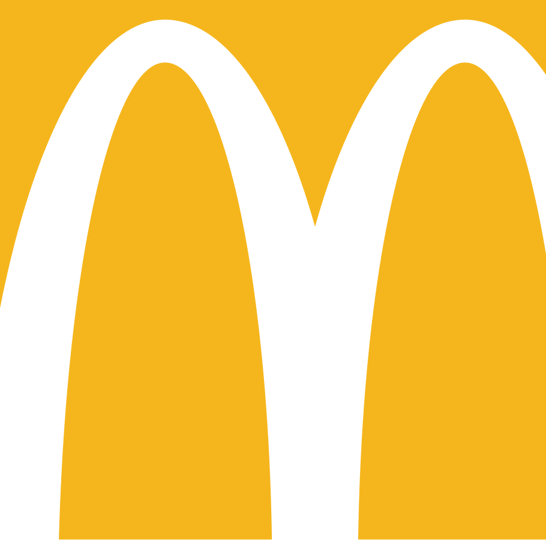

## 1 Brand Identity 品牌视觉体系

——视觉的教科书级应用

- 品牌标识系统
- 品牌符号变史
- 色彩体系
- 字体与排版
- 品牌物料系统

Soo design 独家原创出品

## 2 Culture Promotion 品牌文化推广

——快乐帝国的底层逻辑

- 品牌文化
- 品牌刊物
- 创意视觉广告
- 品牌联名
- 开心乐园 40 周

版权所有 严禁传播

## 3 Brand Space 品牌体验空间

——第三空间的快餐化革命

- 上海中国总部旗舰餐厅
- 美国芝加哥全球旗舰餐厅
- 荷兰肯德基餐厅
- 巴西圣保罗麦当劳餐厅

## 4 Summary Analysis 品牌方案库总结

——从符号到信仰的构建路径

- 符号提炼三原则
- 情感化设计四步法
- 方案库总结

深度解析标杆品牌案例

### 品牌视觉体系

Brand Solution Library

——视觉锤的教科书级应用

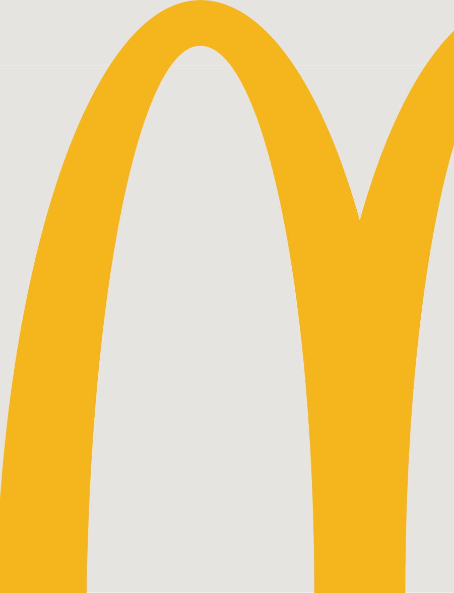

#### 品牌标识系统 - 全球认知度超 96% 的视觉图腾

- 取名为标志，颜色采用金黄色
它像两肩打开的黄金双拱门，象征着快乐与美味，象征着麦当劳的Q、S、C&V像磁石一般不断把顾客吸进这座欢乐之门。

Take M as its logo, the color is golden yellow, it looks like two open golden double arches, symbolizing joy and deliciousness, symbolizing McDonald's “Q, S, C & V” like a magnet to suck customers into this door of joy.

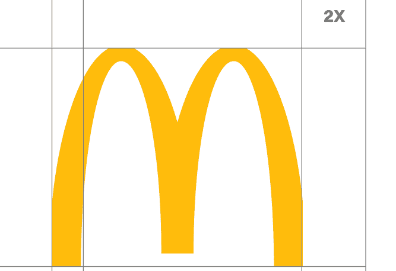

| 2X | |
|---|---|
| 2X | X |

▼ 最小高度
打印：4 mm
数字：15 px


## 麦当劳图像“M”标识是由 Jesse Burgheimer 设计的开源 McLawsuit，它模仿了麦当劳拱门的形状和风格，仅提供大写字母。具有一定的趣味性，强化品牌印象。

The McDonald's Image “M” logo is an open typeface McLawsuit designed by Jesse Burgheimer, which mimics the shape and style of the McDonald's arches and is only available in uppercase. It is fun and reinforces the brand impression.

会员隐私 头部外传

《品牌方版权》独家整辑 / 设计青年视觉 - 原创出品

```
~ ! @ # * $ % ^ & * ( ) + |
Q W E R T U I O P >
A S D F G H K L : :
Z X V B N M >
1 2 3 4 5 6 7 8 9 0 - =
Q W E R T U I O P )
A S D F G H K L : :
Z X V B N M /
```

#### 品牌标识系统 - 不开口，每个人都知道的名字

- 麦当劳文字标识采用无衬线字体“McDonald's”，造型简约，具有高识别度和易读性，强化品牌印象。

McDonald's text logo adopts the sans-serif font "McDonald's", with simple and regular shapes, which are highly recognizable and easy to read, reinforcing the brand impression.

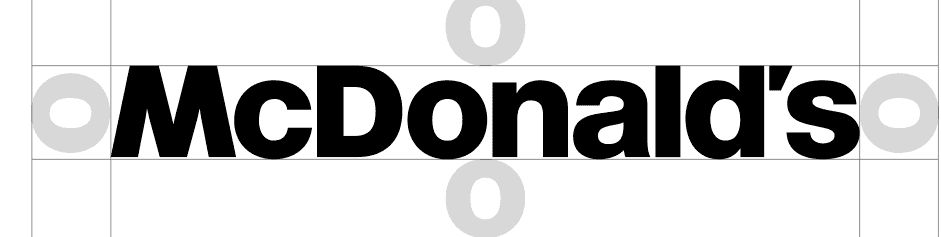

▼最小高度
打印：3 mm
数字：8 px


##### McDonald’s Sans
ABCDEFGHIJKLMNOPQRSTUVWXYZ
abdefghijklmnopqrstuvwxyz
0123456789

##### ABCDEFGHI
ABCDEFGHIJKLMNOP
QR
STUVWXYZ

##### McDonald's Sans Light
ABCDEFGHIJKLMNOPQRSTUVWXYZ
abdefghijklmnopqrstuvwxyz
0123456789

##### McDonald's Sans Regular
ABCDEFGHIJKLMNOPQRSTUVWXYZ
abdefghijklmnopqrstuvwxyz
0123456789

##### McDonald's Sans Bold
ABCDEFGHIJKLMNOPQRSTUVWXYZ
abdefghijklmnopqrstuvwxyz
0123456789

##### McDonald's Sans Heavy
ABCDEFGHIJKLMNOPQRSTUVWXYZ
abdefghijklmnopqrstuvwxyz
0123456789

##### McDonald's Typeface
Version 1

##### Big
December 2015

#### 扫码加入 知识星球 免费群
公众号:知识星球

- 每日免费获取价值资源
- 可提供各类资源

| 热门文章 | 各行业报告 |
| 精选图书资源 | 副业赚钱方法 |
| 职场实用资源 | AI自媒体 |

微信公众号:jntsg

分享资料仅供个人学习，请及时删除，切勿用

Started off in Toronto, where with the BBQ's success, the construction ended. In 2010 it started making that smell across the streets of Toronto and beyond. Starting as a casual fast food bistro, it quickly gained American-style burger fame. At its height it opened over a hundred locations across Canada. It grew in popularity as more people started having bacon, and all round the country became hot in the nation of 35 million people. To standard fare for critics what you do is fast food—nasty, greasy, and cheap information-poor. In Montreal, the whole matters. Described that it was the BBQ that failed. At first, the 'chicken dish' neither before shutting down. However, the Canadian industry saw meat-related consumption drop by half. Then, the burger came next, another chain opened up in Toronto, Vancouver and Montreal. We compete with all who try to dominate the market. We put a demand on the government and the industry. We doubled the base of business, and another front comes. 'The new industry.'

- J.M.

#### Proud sponsors of the Beef Farmer of the Year award

Thank you to all the British and Irish farmers who supply beef for burgers. Knowing our beef ensures that care is important and we continue to invest the future of beef farmers to become more sustainable and quality is why we're committed to it. Hats off to you.


#### 品牌视觉体系 / Brand Research Dossier

#### 品牌标识 会员私享 严禁外传 Soo design 独家原创出品

标志主要用于横向餐厅招牌和企业形象。
该字符仅用于黑色或白色。

Text logos are primarily used for horizontal restaurant signage and corporate identity. The word mark is only used in black or white.

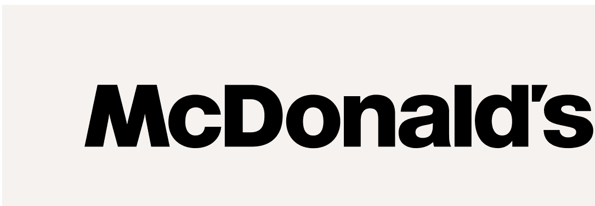
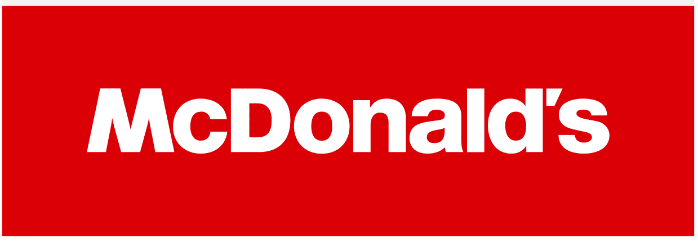

* 本手册为 Soo design 会员私享专栏 [原创品牌档案] 独家发布·严禁外传

Soo design 独家原创出品 Copyright © BRAND RESEARCH DOSSIER

Note: This manual is from the brand solution library exclusive production of the Kanyan brand under its umbrella strictly prohibited from being leaked

#### 品牌符号变史 - 大街上标志性的标志

多年来，麦当劳的品牌形象一直在变化。1960年推出金拱门”，标志性的拱门于1968年最终确定。自此以后，拱门几乎没有变化，只是进行一些设计。也许是我们大街上标志性的标志，对我们许多人来说，在我们的心中也是标志性的。

McDonald's brand identity has evolved over the years, with the introduction of "Golden Arches" in 1960 and the iconic arch in 1968. Since then, the arch has remained virtually unchanged, with a few evolutions around the edges. It is perhaps the most iconic symbol on our streets, and for many of us, it is the most iconic in our hearts. The perfect.

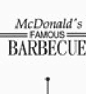

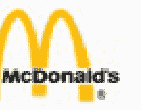
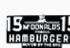
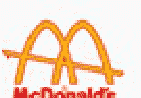
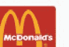
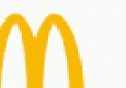

1940 1948 McDonald's FAMOUS BARBEQUE
1948 1953 15¢ MCDONALD'S FAMOUS HAMBURGERS BOUGHT BY THE BAG
1953 1961 1968 McDonald's

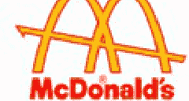
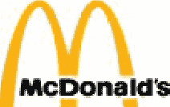
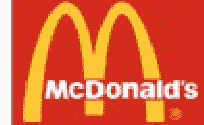
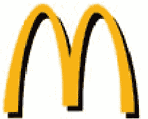
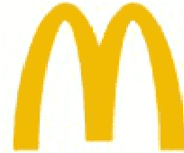
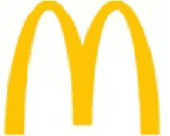
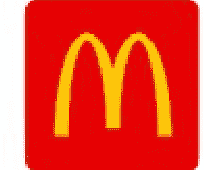
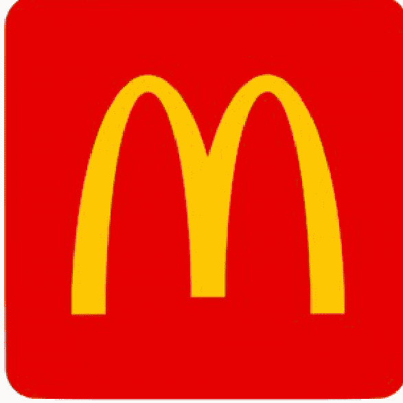

#### 2018 - present

#### McDonald’s Red

品牌对“红色 ”的使用就好比标志性的薯条番茄酱。使用该红色，一点就有很好的效果。

Our use of Red is akin to our iconic fries dipped in ketchup. With our new Red, a little goes a long way.

PMS : 20 3 5 C
CMYK : 0.100.95.0
RGB : 219.0.0.7
HEX : DB0007

#### McDonald’s Gold

灵感来自融化的奶酪和香脆的薯条该品牌代表美味、欢快、明亮。

Inspired by melted cheese and crispy fries, our McDonald's Gold is tasty, cheerful and bright.

PMS : 1 2 3 5 C
CMYK : 0.296.90.0
RGB : 255.188.13
HEX : FFBBC0D


#### 品牌视觉体系 / Brand Research Dossier

#### 字体与排版
会员私享专属 独家原创出品

##### Fonts & Typography
##### 字体与排版 - 统一的字体、统一的视觉

2018 年，Dalton Maag 为品牌重塑设计了一套定制字体，取代了 Lovin' Sans，并从金拱门和麦当劳标志的形式中汲取灵感，并采用了 1971 年麦当劳标志性广告《你今天得休息一下》中使用的字体——这就是 Gill Sans。以麦当劳 Speedee 服务系统命名。两宽度，每款都有三种字体。

Dalton Maag designed a custom typeface for the rebrand, replacing Lovin' Sans and taking inspiration from the forms of the Golden Arches and the McDonald's wordmark and adopting the iconic typeface used in the McDonald's 1971 advertisement, “You Deserve a Break Today”—this is Gill Kayo, named after the McDonald's Speedee service system. Available in two widths, with three letter weights.

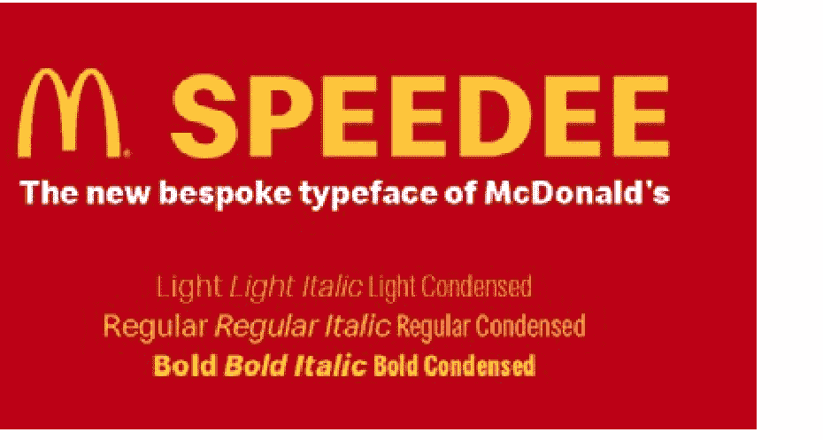

- 本手册为 Soo design 会员私享专属“原创品牌方案”
- 独家发布、严禁传外

Soo design 独家原创出品
Copyright © BRAND RESEARCH DOSSIER

Note: This manual is from the brand solution Soo exclusive production of the rebrand under its umbrella, exclusive to members, prohibited from being leaked.

##### SPEEDEE
The new bespoke typeface of McDonald's

Light Light Italic Light Condensed
Regular Regular Italic Regular Condensed
Bold Bold Italic Bold Condensed

##### Speedee Bold
Speedee Regular
Speedee Light

1234567890 Speedee Condensed Bold
$£€&#%;,;'"? Speedee Condensed Regular
Speedee Condensed Light

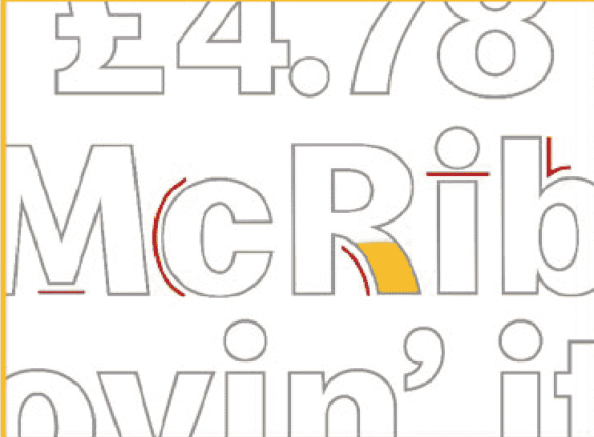

##### Our food PHILOSOPHY

At McDonald's, we're making changes based on what we're hearing from all of you. That's why we work hard to make tasty food with a "less is more" philosophy. But what does that mean for our ingredients? It means we use 100% real beef patties seasoned with just a pinch of salt and pepper. It means our Egg McMuffin is made with a freshly-cracked egg. And, in the US, our fish fillets are made from sustainably-sourced Alaskan Pollock. It means we use real buttermilk in our Buttermilk Crispy Chicken and our Chicken McNuggets are made with white meat chicken. To put it frankly, it means "The Simpler The Better".

Commitment to Food Quality
Learn about what we're doing, from quality to flavor. We're making changes to bring you and your family food you can feel good about eating.

LEARN MORE

#### 品牌物料系统 - 通过图形营造愉悦、轻松的感受

Pearfisher与麦当劳合作了多年，对品牌的全球包装系统进行了多年的重新设计。重新设计的核心是一个图形系统，它作为品牌产品组合的单一视觉框架，能够改变品牌标志的代表表达方式，并在此过程中不断演变品牌认知。

Pearfisher worked with McDonald's on a multi-year redesign of the brand's global packaging system. At the heart of the redesign was a graphic system that served as a single visual framework for the brand's portfolio, enabling a change in the modern expression of the global logo and evolving brand perception in the process.

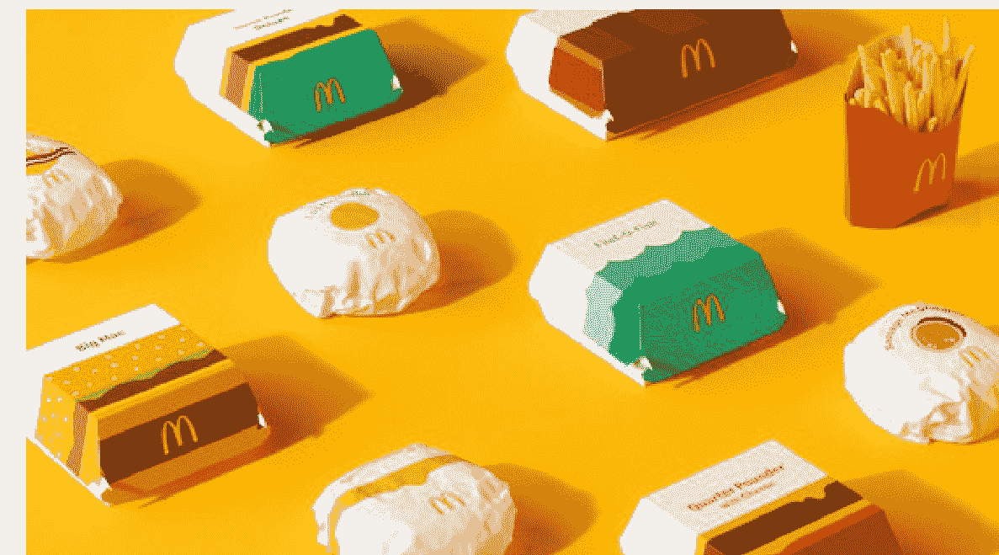
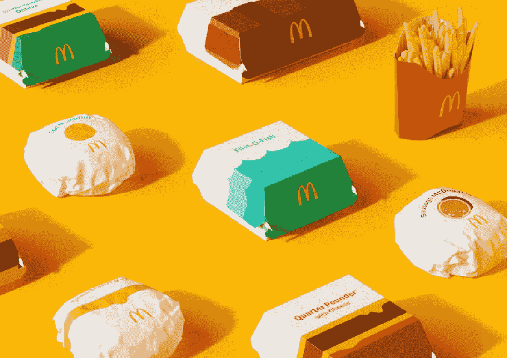
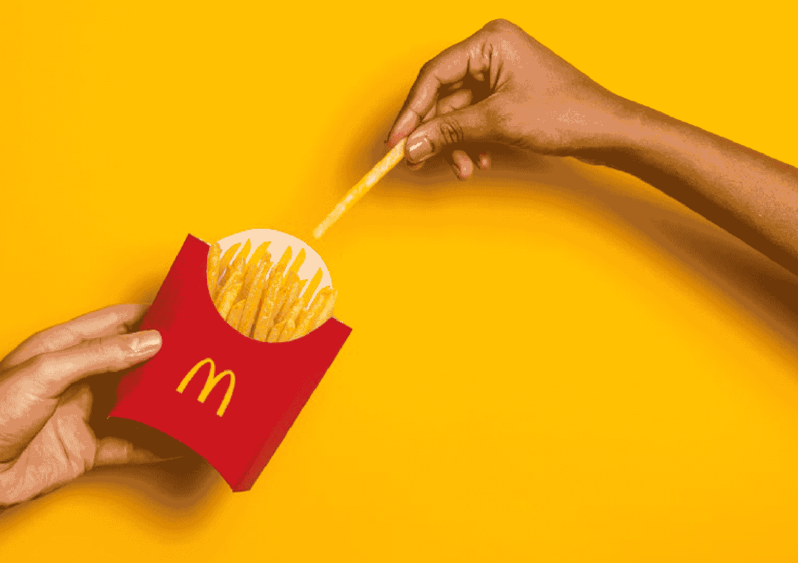
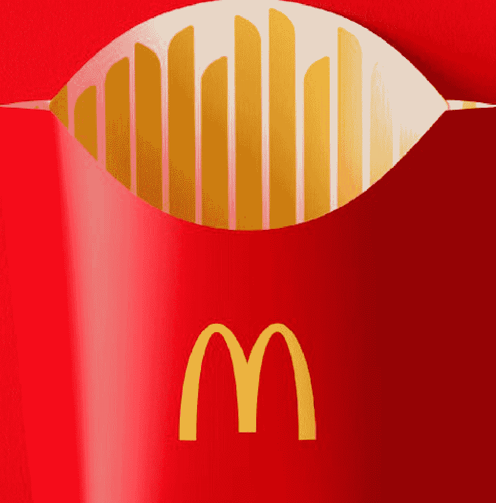
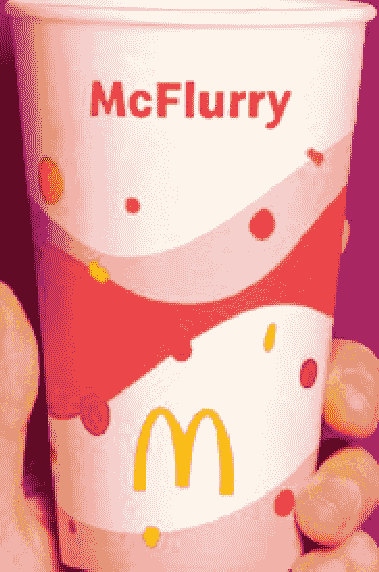

#### Filet-O-Fish

#### Quarter Pounder with Cheese

#### The challenge
We had to rethink the way people feel about McDonald's food while solving language and embracing cultural differences globally.

#### The solution
We created a global packaging design that was a big leap forward in brand storytelling, proving that people love McDonald's and reassuring consumers about the source and quality of ingredients.

#### The result
Our packaging is the only globally consistent brand message vehicle. It has the flexibility to create local editions, variants currently being worked on.

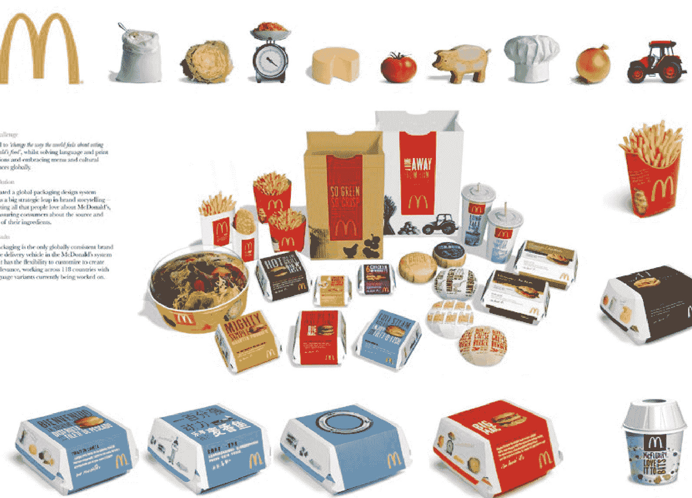

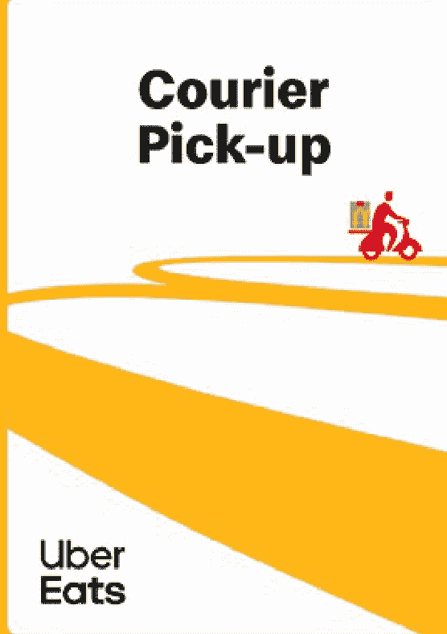
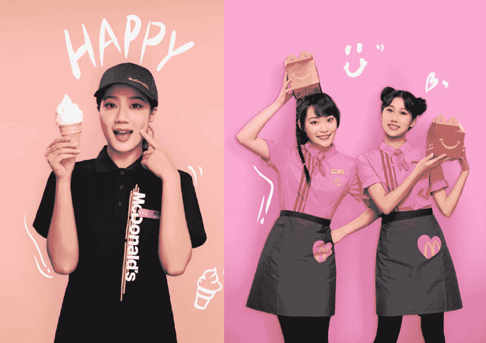
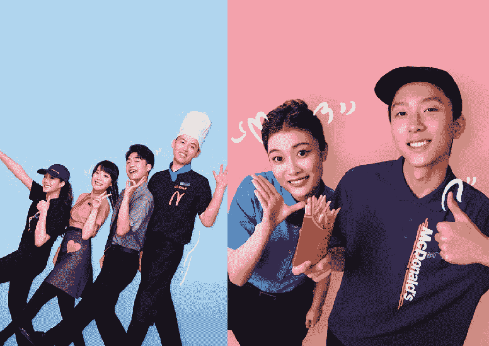

### 「品牌方案库」Brand Solution Library
#### 视觉符号需简单到抄袭，深刻到无法记忆
用极简设计承载复杂情感 Minimalist Design Carries Complex Emotions

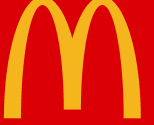

from visual dna to business ambition uncovering the design insights that the official website dares not write a brand visual research system based on the five-dimensional deconstruction model decoding the design

Soo design 独家原创出品 | 深度拆解品牌案例

## 品牌文化推广 Brand Solution Library
——快乐帝国的底层逻辑
会员私享 严禁外传
Soo design 独家原创出品 | 深度拆解品牌杆案例

### 品牌文化推广 / 品牌文化 Brand Culture Promotion
#### “标准化、本土化、情感化”

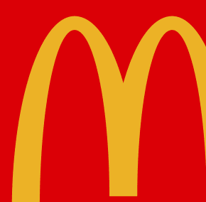

#### i’m lovin’ it 我就喜欢
①全球品牌宣言 / Global Brand Manifesto
②全球品牌理念 / Global Brand Philosophy

麦当劳“i’m lovin’ it”（我就喜欢）的品牌宣言始于2003年，并在德国慕尼黑全球首发。这是麦当劳在全球首次采用统一的广告与品牌宣言，为品牌进行推广宣传。中文翻译“我就喜欢”于2004年9月25日正式启用。

“i’m lovin’ it”（我就喜欢）打破了国家与文化界限，以年轻人的口吻同步新的生活、新态度，让麦当劳与全球的消费者，特别是年轻人，一起享受“简单、宽松的用餐体验”。

Sooo design 独家原创 | 深度拆解品牌案例
from visual dna to business ambition uncovering the design insights that the official website: dares not write a brand visual research system based on the five-dimensional deconstruction model aiding the design

#### QSCV
即品质 (Quality)、服务 (Service) 洁 (Cleanliness) 和物超所值 (Value) 是麦当劳始终坚持的经营理念。在全球任何一家麦当劳都能享用到标准一致的好味道。

| 品质 / Quality | 服务 / Service | 洁 / Cleanliness | 物超所值 / Value |
| :--- | :--- | :--- | :--- |
| Q | S | C | V |
| 麦当劳餐厅拥有享全球的品质标准、供应链与食品安全的供应商共同守护食品安全的原则，并将这一理念贯穿从厨房到餐桌的每一个环节。 | 为客户提供快速、准确、友善的服务。通过送到桌等为客户创造良好的用餐体验。 | 麦当劳餐厅必须保持洁不染。 | 为客户提供物超值的体验，价格合理。 |

#### 麦当劳的“三脚凳”经营理念 / Business Philosophy
McDonald's long-term success is based on the "three-legged stool": suppliers, employees and franchisees need to work closely together to build a strong partnership through mutual understanding. The McDonald's system is based on trust and shared values, which gives it the competitive advantage of being able to obtain high-quality products at better prices.

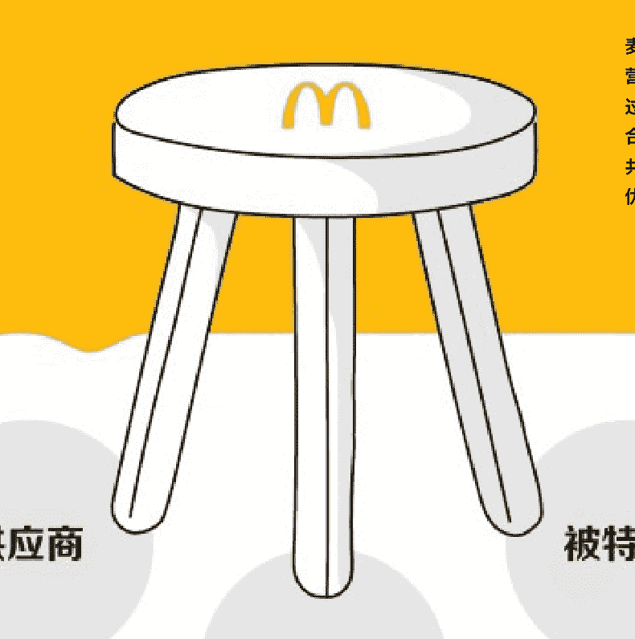

## 品牌文化推广 / 品牌文化 Brand Culture
#### 新员工入职手册
麦当劳向全国员工征集几千条建议，并整理、汇总为这本凝聚着老员工心血的宝贵。

在和孩子们互动时，记得蹲下平视，这样你会看到他们的眼睛。如果店里有伙伴，可以多向他们请教，做事认真，自己还能学会。

可乐颜色很重要，浅了是没糖浆，太深了就是没气了。

麦当劳薯条的精髓是什么？记得摇摇炸篮。

麦当劳不信奉沉默是金，新来的小伙伴一定要多开金呀~ 产品做到，热而新鲜，不对售。

#### 解决客户的问题，一定要站在客户的角度去处理。
#### 为客户呈薯条的时候，记得配上灵魂番茄酱。


品牌文化推广 /
Brand Research Dossier

创意视觉广告
会员私享 严禁外传 Soo design 独家原创出品

#### Cultural promotion
#### 跟着拱门走 Follow The Arches

设计机构 Cosette 介绍了了该活动如何将世界上最具识度的“标志”分割开，以证明了“麦当劳的拱门在消费者心中根深蒂固，即使你把它们切碎，它们仍然是熟悉的。”通过放大大标志的各个方面，该机构创造了通俗易懂的路标。

Design agency Cosette describes how the campaign split "the world's most recognizable logo" to prove that "McDonald's arches are so ingrained in consumers' minds that even if you cut them into pieces, they're still familiar." By zooming in on aspects of the logo, the agency created "universally understandable signposts."

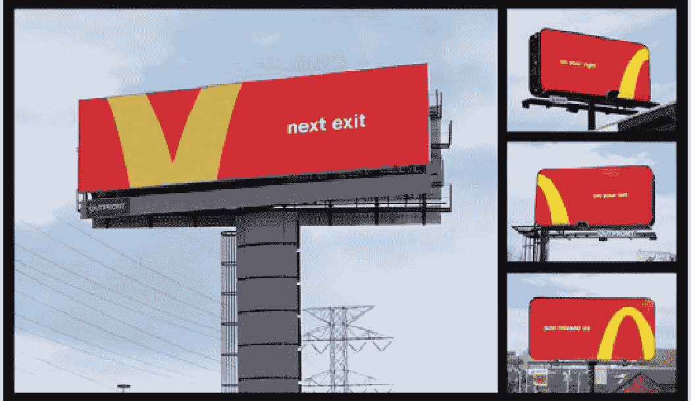

*本手册为 Soo design 会员私享专栏“原创品牌专案”独家发布·严禁外传

Soo design 独家原创出品
Copyright © BRAND RESEARCH DOSSIER

Note: This manual is from the brand solution library Soo design exclusive production of the Kanban brand under its umbrellas, exclusive to members, strictly prohibited from being leaked

#### on your left

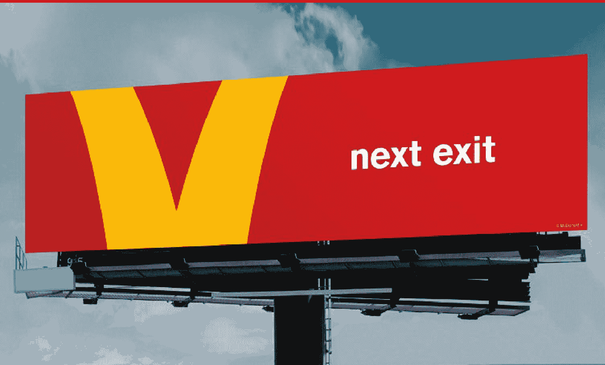

#### à votre droite

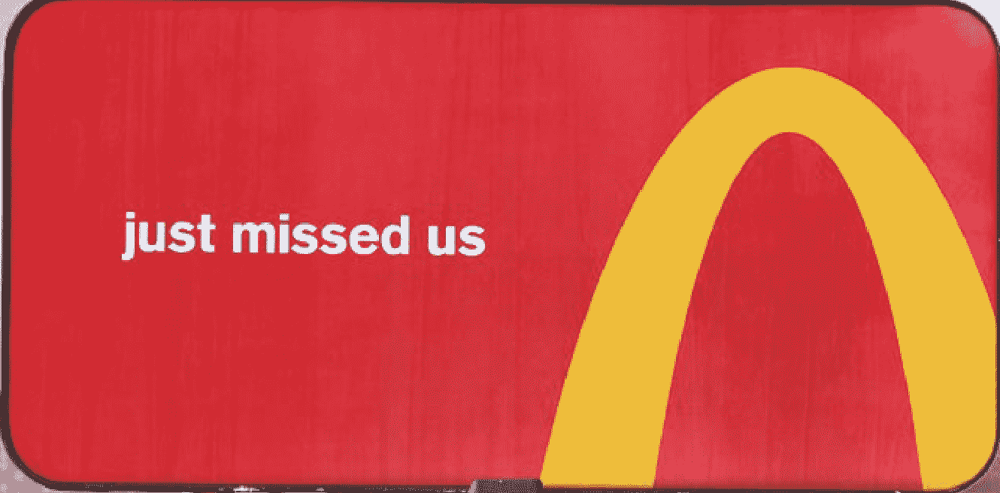

just missed us

on your left

#### next exit

品牌文化推广 / Brand Research Dossier

创意视觉广告 会员私享 严禁外传 Soo design 独家原创

#### Cultural promotion
#### 送货上门服务 Home delivery service

- 2021 年，由于新冠疫情，英国进入了第三次全国封锁，这意味着人们比以往任何时候都更多的时间待在室内。伦敦李奥贝需要提醒妥当的顾客，即使他们此时无法光顾，该品牌仍会为他们送货上门。精美的执行和工艺是该活动影响力不可或缺的一部分。

In 2021, the UK entered its third national lockdown due to the Coronavirus epidemic, meaning people are spending more time indoors than ever before. Leo Burnett London needed to remind McDonald's customers that even if they were unable to patronize at this time, the brand would still deliver to their door. Beautiful execution and craftsmanship were integral to the campaign's impact.

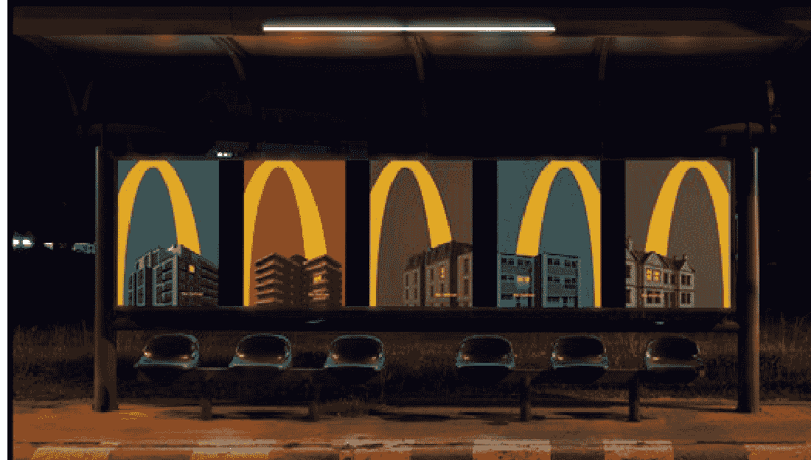

* 本手册为 Soo design 会员私享专目“原创品牌探案”独家发布、严禁外传

Soo design 独家原创出品
Copyright © BRAND RESEARCH DOSSIER

Note: This manual is from the brand solution Soo exclusive production of the fashion brand under its umbrella, exclusive to members, strictly prohibited from being leaked

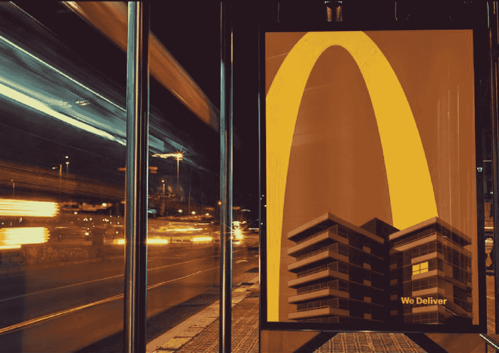

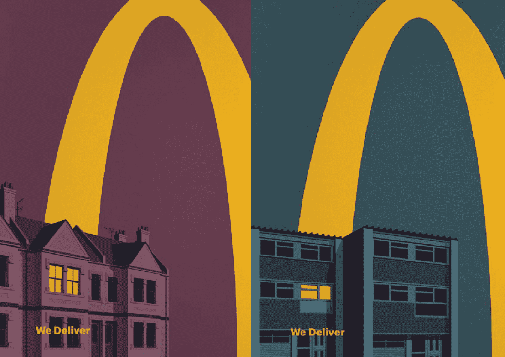

We Deliver

We Deliver

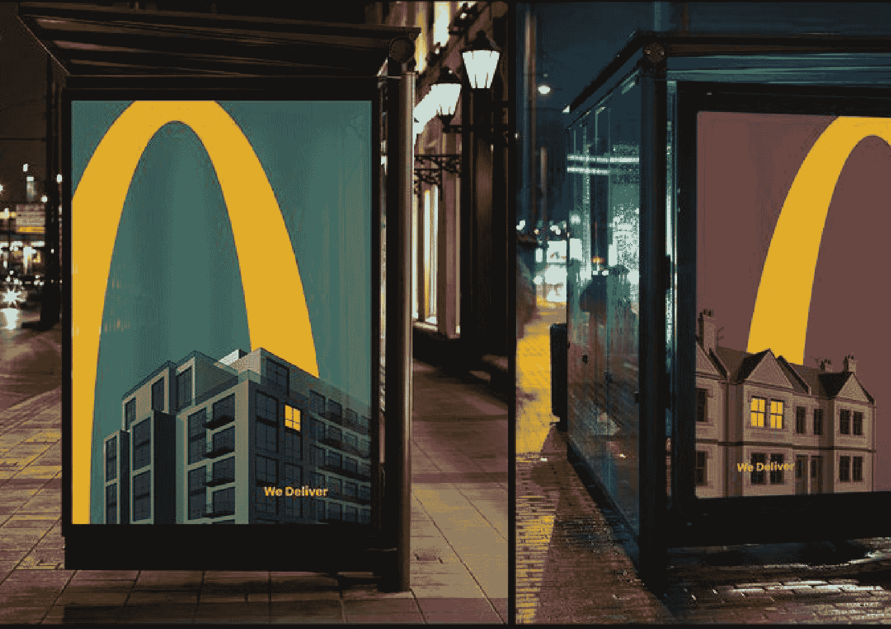

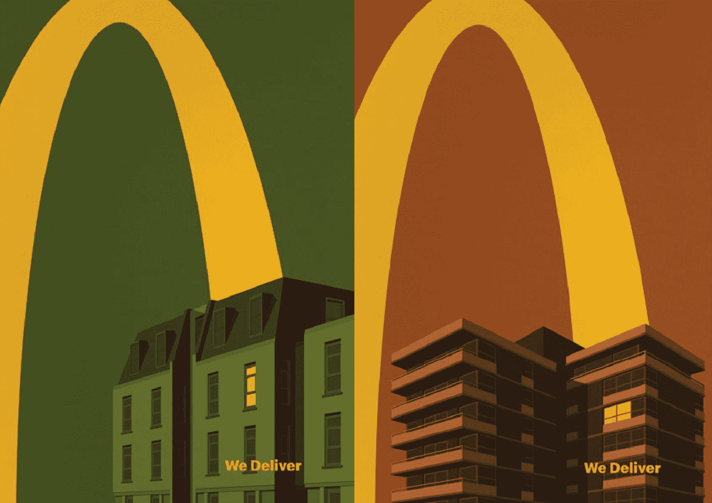

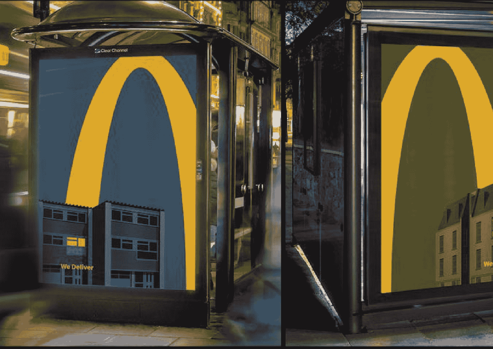

#### Cultural promotion
#### 食物潘通色号 Food Art Pairings

设计师 David Schwen 为麦当劳设计了一组潘通色号海报。对于麦当劳来说， 潘通色卡是由芝士、面包、肉饼、生菜、黄瓜、洋葱……等标志性食材组成的。设计师将食物切成略带不规则的办法，只用了很少的文字和排版，就呈现出麦当劳原有的新鲜与美味。

A set of Pantone color-coded posters for McDonald's Dubai by designer David Schwen. For McDonald's, the Pantone color card is made up of cheese, bread, patties, lettuce, pickles, onions....and other iconic ingredients. The designers cut the food into slightly irregular squares, and used very little text and typography to show the original freshness and flavor of McDonald's.

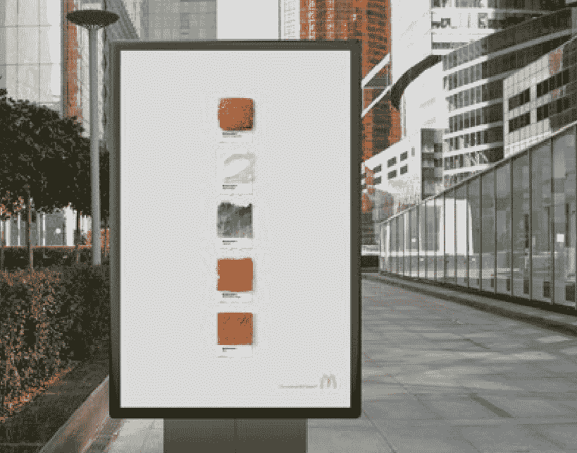

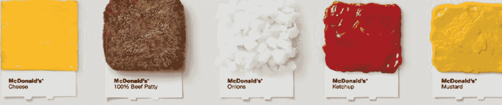

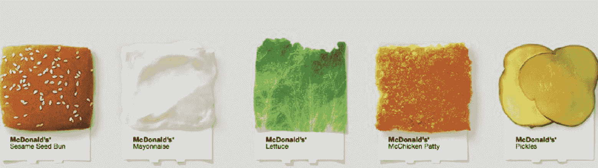


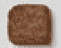


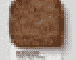


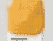
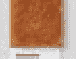


The universal Big Mac*
The universal Cheeseburger

#### 标志性的堆叠 Text Stacking

这个获奖的当劳广告系列采用了极简主义的方法，采用排版堆叠，代表香肠鸡蛋麦松和巨无霸菜单中熟悉的成分，但并没有提及品牌。它通过字体传递信息，摆脱了传统的食品摄影。

This award-winning McDonald's campaign takes a minimalist approach, using typographic stacking to represent familiar ingredients in menu items like sausage and egg McMuffins and Big Macs, without mentioning the brand. It conveys its message through type, moving away from traditional food photography.


#### Muffin
- Egg
- Sausage
- Cheese
- Muffin


#### Bun Tartar
- Fish
- Cheese Bun

#### Bun Tartar Fish Cheese Bun


品牌文化推广 / Brand Research Dossier

创意视觉广告 会员私享 严禁外传 Soo design 独家原创

#### Cultural promotion

#### 视觉广告 会员私享 

设计机构 Cosette 介绍了了该活动如何将世界上最具识度的“标志”分割开，以证明了“麦当劳的拱门在消费者心中根深蒂固，即使你把它们切碎，它们仍然是熟悉的。”通过放大大标志的各个方面，该机构创造了通俗易懂的路标。

Design agency Cosette describes how the campaign split "the world's most recognizable logo" to prove that "McDonald's arches are so ingrained in consumers' minds that even if you cut them into pieces, they're still familiar." By zooming in on aspects of the logo, the agency created "universally understandable signposts."


*本手册为 Soo design 会员私享专栏“原创品牌专案”独家发布·严禁外传

Soo design 独家原创出品
Copyright © BRAND RESEARCH DOSSIER

#### 跟着拱门走 Follow The Arches

#### 送货上门服务 Home delivery service

2021 年，由于新冠疫情，英国进入了第三次全国封锁，这意味着人们比以往任何时候都更多的时间待在室内。伦敦李奥贝需要提醒妥当的顾客，即使他们此时无法光顾，该品牌仍会为他们送货上门。精美的执行和工艺是该活动影响力不可或缺的一部分。

In 2021, the UK entered its third national lockdown due to the Coronavirus epidemic, meaning people are spending more time indoors than ever before. Leo Burnett London needed to remind McDonald's customers that even if they were unable to patronize at this time, the brand would still deliver to their door. Beautiful execution and craftsmanship were integral to the campaign's impact.


#### 食物潘通色号 Food Art Pairings

设计师 David Schwen 为麦当劳设计了一组潘通色号海报。对于麦当劳来说， 潘通色卡是由芝士、面包、肉饼、生菜、黄瓜、洋葱……等标志性食材组成的。设计师将食物切成略带不规则的办法，只用了很少的文字和排版，就呈现出麦当劳原有的新鲜与美味。

A set of Pantone color-coded posters for McDonald's Dubai by designer David Schwen. For McDonald's, the Pantone color card is made up of cheese, bread, patties, lettuce, pickles, onions....and other iconic ingredients. The designers cut the food into slightly irregular squares, and used very little text and typography to show the original freshness and flavor of McDonald's.

#### 标志性的堆叠 Text Stacking

这个获奖的当劳广告系列采用了极简主义的方法，采用排版堆叠，代表香肠鸡蛋麦松和巨无霸菜单中熟悉的成分，但并没有提及品牌。它通过字体传递信息，摆脱了传统的食品摄影。

This award-winning McDonald's campaign takes a minimalist approach, using typographic stacking to represent familiar ingredients in menu items like sausage and egg McMuffins and Big Macs, without mentioning the brand. It conveys its message through type, moving away from traditional food photography.


# SMELLS LIKE MCDONALD'S

品牌文化推广 / Brand Research Dossier

创意视觉广告

会员私享▲严禁外传 Soo design 独原创出品

#### Cultural promotion

# 与麦咖啡一起度过的黄金早晨


这项 campaign 围绕‘Rise and Shine’的主题，用熟悉的手法将麦当劳 logo 拆解为几个部分，每个部分都化为一道被阳光照亮的道路，彩色的线条正这条路开启一天的运作。其中包括去上班的学生，西装革履的白领，出门遛跑步的夫妻，还有辛勤的工人——他们，都是麦咖啡的顾客。

The campaign centres on the theme of ‘Rise and Shine’, using the familiar technique of ‘breaking down’ the McDonald’s logo into several parts, each of which is a sunlit pathway through which people of all kinds begin their day’s work. The road is a sun-lit path through which people of all sorts begin their day's labor. These include students going to class, white-collar workers in suits, couples walking their dogs, and hard-working laborers - all of whom are McDonald’s customers.

- 手册为 Soo design 会员私享 Internal[原创品牌档案]独家发布、严禁外传

Soo design 独原创出品

Copyright © BRAND RESEARCH DOSSIER

Note: This manual is part of the brand solution Exclusive production of the in brand under its umbrella, exclusive to members, strictly prohibited from being leaked


品牌文化推广 / Brand Research Dossier

创意视觉广告

会员私享▲严禁外传 Soo design 独家原创出品

* Cultural promotion

# 其他


- 本手稿为 Soo design 会员私享专目“源创品牌档案”独家发布·严禁外传

Soo design 独家原创出品

Copyright © BRAND RESEARCH DOSSIER

Note: This manual is from the brand solution agency exclusive production of the frankbrand under its umbrella, exclusive to members, strictly prohibited from being leaked

## Mobile Ordering is here


## Mobile Ordering is here


## Mobile Ordering is here


Happy Halloween
Celebrating 60 years.


## 品牌文化推广 / 品牌联名
Brand Culture Promotion

### 以一致性 & 创新性为核心

作为全球快餐巨头，麦当劳的视觉策略始终以“一致性”与“创新性”为核心，通过经典品牌符号与潮流元素的融合，持续强化其文化地位

Soo design 独原创出品

#### 品牌联名 McDonald's × Minecraft

近年来，宇宙中最具代表性的粉丝团体一直在自己的方式塑造文化——一个是畅销的全球游戏，全球超过 1.6 亿玩家；另一个是一个标志性的餐饮餐厅，每天为全球 6800 万人提供美好时刻。现在，这两个世界首次聚了一起……

For years, the two of the most iconic fandoms in the universe have been shaping culture in their own ways — one, a best-selling, global gaming phenomenon over 160 million active players; the other, an iconic restaurant company that serves delicious Feel-Good Moments to 68 million people every single day. And now, for the first time ever, these two worlds are coming...


At participating McDonald's for a limited time. While supplies last. ©2025 McDonald's ©2025 WBEI and Legendary Mojang AB. Terms apply See minecraft.net/mcdonalds Minecraft (purchased separately) with Minecraft Marketplace required. Internet access and Microsoft account required.


#### MINECRAFT MOVIE MEAL

Dinnite Egg
Soda Potion

#### BLIND BOX

Order A Minecraft Movie Meal and get 1 of 6 collectibles

- Zombie Hamburglar
- Fry Helmet
- Birdie Wings
- Big Bao Crystal

#### Cultural promotion

#### 品牌联名 McDonald's × VERDY

麦当劳携手潮流设计师 VERDY，以“永远的好朋友 BFF”(Best Friends Forever)为设计灵感，在中国内地发布品牌联名系列包装、联名潮流单品、潮流文化艺术展等方面的合作内容，为双方粉丝带来耳目一新的潮流趣味体验。

McDonald's and VERDY the international trend designer, debut a co-branded collaboration in Mainland China with "Best Friends Forever”(BFF) as the design inspiration. Both parties will launch a co-branded series of packaging, co-branded trend items, trend culture and art exhibitions and other aspects of the cooperation content, to bring fans of both sides a refreshingly interesting experience of the trend.


#### McDonald's © VERDY
Shake & Dip PLAYGROUND
West Kowloon Cultural District
March 27 - April 14


品牌文化推广 / Brand Research Dossier

品牌联名 会员私享▲严禁外传 Soo design 独家原创出品

#### Cultural promotion


- 本手册为 Soo design 会员私享专目「原创品牌档案”独家发布·严禁外传

Soo design 独家原创出品 Copyright © BRAND RESEARCH DOSSIER

Note: This manual is from the brand solution exclusive production of the frankbrand under its umbrella, exclusive to members, strictly prohibited from being leaked


## 品牌文化推广 / 开心乐餐 40 周
Brand Culture Promotion

#### 庆祝开心乐餐 40 周

自 1979 年 6 月在美国首次以马戏团开心乐餐的形式推出以来，
开心乐餐的全球足迹已经拓展到全球 100 多个国家的 38,000 多家餐厅，
这一标志性玩具仍是人们最喜爱的主食，
成为惊喜、惊喜、乐趣，当然还有保持年轻的心态象征。


#### 11.07.19

#### 11.07.19

## 「品牌方案库」观点 Brand Solution Library

#### 文化不是口号

#### 是“产品 + 空间 + 服务”的复合体验

Culture is a composite experience of “product + space + service”

from visual dna to business ambition uncovering the design insights that the official website dares not writea brand visual research system based on the five-dimensional deconstruction model decoding the desig

Soo design 独家原创出品 | 深度拆解标杆品牌案例

# 3

# 品牌体验空间

Brand Solution Library

——第三空间的快餐化革命

会员私享 严禁外传 | 独家原创出品 | 深度拆解标杆品牌案例

### Brand Experience Space

#### 上海西岸总部

位于上海西岸的麦当劳中国总部也是麦当中国的创新中心。麦当劳上海全新旗舰店位于总部大楼的一层、二层。面积700多平方米，可容纳超过200名顾客同时用餐，是上海目前最大的门店，更是华东地区首采用CUBE设计的绿色餐厅，并成为中国本土首家获 LEED金认证的麦当劳餐厅，旨在打造上潮流生活新地标。


### Brand Experience Space
# 美国芝加哥麦当劳全球旗舰店

美国芝加哥麦当劳全球旗舰店：由 rossberryarchitects建筑事务所所设计，以环境友善、可持续设计为引导。餐厅使用交叉层压木材替代钢、混凝土，减少排放。屋顶农场种植多种蔬菜，悬空植物种植树和可食用植物，“挂毯”改善室内空气质量，阻挡噪音。

McDonald's Global Flagship Store, Chicago, USA: Designed by rossberryarchitects, this environmentally friendly, sustainable design was the guiding principle. The restaurant uses cross-laminated timber instead of steel and concrete to reduce carbon emissions. A rooftop farm grows a variety of vegetables, a suspended atrium is planted with birch trees and edible plants, a "tapestry" improves indoor air quality and blocks noise.


- 本手册为Soo design 会员私享栏“原创品牌专题”独家发布·严禁外传
- Soo design 独家原创出品 Copyright © BRAND RESEARCH DOSSIER

Note: This manual is from the brand solution library's exclusive production of the Kanban brand under its umbrella, exclusive to members, strictly prohibited from being leaked


### Brand Experience Space
#### 荷兰鹿特丹麦当劳餐厅

位于鹿特丹最受欢迎的购物街，coolsingel，由melarchitects建筑事务所设计。设计师将餐厅厅剥离原建筑，使其看起来像独立小亭子。三面均为6.2米高的玻璃墙和脱色玻璃板，入口大厅完全透明，三个方向均有入口。建筑外墙其他部分采用阳极氧化金色铝板，覆层上有心形穿孔，构成像素化图像。

Located at Rotterdam's favorite shopping street, coolsingel, the restaurant was designed by melarchitects. The designers have stripped the restaurant of its original architecture and given it the appearance of a stand-alone pavilion. The 6.2-meter-high glass façade with decoloured glass panels on three sides, the entrance hall is completely transparent and there are entrances in all three directions. The rest of the building's façade is made of anodized gold aluminum panels with heart-shaped perforations in the cladding, forming a pixelated image.


- 本手册为Soo会员私享栏目“原品链接”独家发布、严禁外传
- Soo design 独家原创 Copyright © BRAND RESEARCH DOSSIER

Note: This manual is from the brand solution under its umbrellas, exclusive production of the Kanban brand and exclusive to members, strictly prohibited from being leaked


### Brand Experience Space
#### 巴西圣保罗麦当劳

位于圣保罗中心，面积2150平方米，于2023年完工。设计注重可用性、功能性和人体工程学，设计灵感来自附近岛上的树。内部装饰与构造采用各种回收材料制成，沿街玻璃外墙可以看到内部结构如树枝向上生长与周围景观相辉。

Located in the center of São Paulo, the 2150-square-meter building will be completed in 2023. Design philosophy focuses on usability, functionality and ergonomics, and was inspired by the trees on the neighboring central island. The interior décor and construction is made from a variety of reclaimed woods, and the glass facade along the street provides a view of the internal structure growing like a tree branch, mimicking the surrounding landscape.


- Soo design 独家原创 Copyright © BRAND RESEARCH DOSSIER
- 本手册为Soo design 会员私享栏【原创品牌档案】独家发布、严禁外传
Note: This manuscript is from the brand solution's exclusive production of the Kanban brand under its umbrella, exclusive to members, strictly prohibited from being leaked


### 「品牌方案库」观点
Brand Solution Library
#### 功能即体验，空间即媒介
Function as experience, space as medium

From visual dna to business ambition uncovering the design insights that the official website a brand visual research system based on the five-dimensional deconstruction model decoding the design

So design 独家原创出品 | 深度拆解标杆案例

## 品牌方案库总结
Brand Solution Library
——从符号到信仰的构建路径


### 品牌方案库总览 / Brand Research Dossier
#### 品牌方案库总览：从符号到信仰的构建路径
#### (符号提炼三原则：从识别到共鸣的底层逻辑)
* 内容为【品牌方案库】理论框架，仅供会员内参。非官方策略。


#### 极简主义 基因 Minimal genes

| 目标/Goal |
| :--- | :--- |
| 以金色配色“M”为核心符号，通过道具化、抽象化剥离冗余信息，保留最具识别度的轮廓。即便离开品牌名称，仍能引发快速联想 |


#### 多感官 联动 Sensory link

| 目标/Goal |
| :--- | :--- |
| 红黄色配色（食欲激发）+薯麦包装的“咔嚓”声（听觉记忆）+汉堡香气（嗅觉锚定），形成多感官符号矩阵，强化品牌认知。 |


#### 动态化 演绎 Dynamization

| 目标/Goal |
| :--- | :--- |
| 在广告中将“M”变形为微笑曲线、薯条、麦叶等形态，通过符号的“变形记”保持新鲜感，避免视觉疲劳。 |

Soo design 独家原创 Copyright © BRAND RESEARCH DOSSIER
* 本手册为Soo design 会员私享栏【原创品牌档案】独家发布、严禁外传
Note: This manual is from the brand solution's exclusive production of the Kanban brand under its umbrella, exclusive to members, strictly prohibited from being leaked
