# McKinsey Global Institute

# 工作的新未来：部署的竞赛
AI 和提高技能

## 欧洲及其他地区

Authors
Eric Hazan
Anu Madgavkar
Michael Chui Sven
Smit Dana Maor
Gurneet Singh Dandona Roland
Huyghues-Despointes

五月 2024

# 知识星球TOP 资源分享社群

汇聚全网付费资源
让更多人获取高价值信息

- 付费文章 • 付费社群
- 付费课程 • 副业&搞钱
- 财经&股市 • 行业报告

时政·历史·职场·体制·自媒体学习·军事·软件·影音·社会学

公众号: 知识星球TOP   微信信号: jntsg8   微信信号: jntsg2

添加微信 免费进群

# 麦肯锡全球研究所

麦肯锡全球研究所成立于 1990 年。我们的使命是提供一个事实基础，以增强对世界公司和政策领导者关键的经济和政策决策的把握。我们受益于麦肯锡的全方位区域、部门、和技能、技术和专业知识，组织指导和决策完全是 MGI 董事和合作伙伴的责任。

我们的研究分为五个主要领域：

- 产品与营销：最有效地创造和利用世界资产
- 世界资源：可可持续地提取、供应和调度世界
- 人的能力：最大程度地激发人的潜力
- 全球链：贸易、业务、人员、资本和思想的流动如何塑造经济
- 未来的技术和市场：适应竞争和变化的未来

我们的目标是独立的事实研究。我们的工作不是由任何企业、政府或其他机构委托或支付的；我们免费分享麦肯锡的成果。我们完全由麦肯锡的合作伙伴支持。虽然我们邀请了许多杰出的人为我们的工作做出贡献，但我们出版物中的只是 MGI 的分析，任何错误都是我们自己的责任。

您可以在 www.mckinsey.com/mgi 上找到有关 MGI 和麦肯锡研究的更多信息。

# MGI 董事

Sven Smith（主席）
克里斯·哈赫德利、
奎林·埃夫林·西尔万、
约翰逊·奥利普亚、
怀特

# MGI 合作伙伴

Michael Chui Mekala
Krishnan Anu
Madgavkar Jan
Mischke Jeongmin
Seong Tilman Tacke

# Contents

一目了然 3
聚光灯：制造业 40
背景：劳动力短缺和生产率增长放缓 4
聚焦：医疗保健 42
加速未来工作过渡的潜力 10
对劳动力的影响 44
劳动力市场中中断的不同地理 22
在技术发酵时期提高生产力和资本 52
新时代的新技能 26
技术附录 60
聚焦：批发和零售贸易 36
Acknowledgments 65
聚焦：金融服务 38

# 一目了然

在劳动力市场扩张和生产率增长缓慢的背景下，在人工智能和自动化的刺激下，欧洲和美国面临劳动力需求的变化。面对对工作未来的最新发现，即 STEM 相关、医疗保健和高技术技能工人的需求将增加，面对办公室人工、人工和客户代表等职业的需求将下降。到 2030 年，在中国的情况是，30% 的工作可以被自动化，由 AI 生成。努力实现零浪费排放，老龄化、劳动力、劳动力的增长以及基础设施和技术支持以及经济整体增长可能改变这种现状。

到 2030 年，欧洲可能还需要 1200 万的职业转型，这是劳动力短缺的两种。在美国，这种转换可能达到 1200 万，符合行业的标准。在 COVID-19 期间，这个时期都经历了更剧烈的劳动力变化，这表明它们可以对未来的未工作进行转型，各国之间的职业变化速度相异，意味着不同群体的整合可能是他们的终结。

金赛将需要更多的技能培训，对于体力工作以及高技术技能的职业进行监控，社交和沟通技能的价值将会增加。在欧洲和美国面临的这种挑战时，他们不仅要灵活 IT 和数据分析，还需要批判性思维、创造力、教育和协作——这些他们需要的。这些目前尚不能供应。公司计划除了了重复性的职业，还将对工人进行再培训，以确保能够转型。

随着需求调整欧洲和美国高技能职业的增加，低薪资职业可能会减少，工人将需要新的技能才能转到高薪资的工作。如果没有发生这种转型，将存在增加自动化的劳动力短缺风险，高技能工人增多，而且有低技能工人的工作

今天提出的选择可以复复生产率，同时创造更好的社会结果。通过积极的重新部署来加速技术采用的道路，可以帮助欧洲的重新部署来实现高增长到 2030。但是，糟糕的重新部署和缓慢重新部署将限制在当前的生产率。糟糕的重新部署将使工人无法有效应对未来。

# 背景：劳动力短缺和生产率增长放缓

本报告关注劳动力市场在欧洲和美国。

到 2030 年，劳动力市场的结构性变化持续，包括农业、工业和矿业将导致劳动力需求的模式的变化，但这些预期的变化需要在更层次的劳动力市场变化的背景下进行。我们的研究集中在9 个主要经济体和美国相比欧洲（我们在报告中称为“欧洲”）。年来，劳动力市场的结构性变化一直在，包括农业、工业和矿业就业份额下降，有利于服务业。最近，劳动力市场受到流行的影响，这种冲击不仅阻碍了需求的快速增长和更多工作转换，还推动了新员工的偏好。新冠加剧了劳动力市场的紧张，欧洲就业率的人口快速老化以及工作时间的下降使工人和技能短缺成为持续挑战，即将到来的技术覆盖将很大程度上解决劳动力市场的挑战。

#欧洲和美国的就业转向服务业

1850-2022，欧洲和美国按部门划分的总就业份额

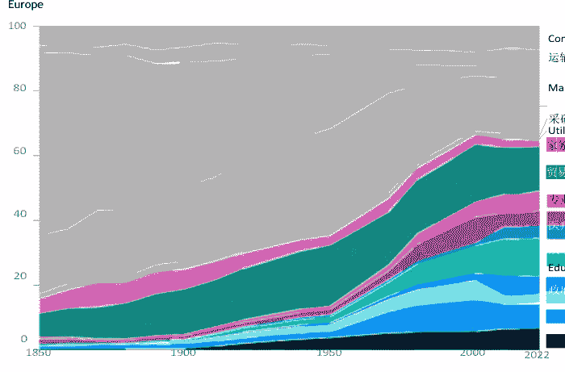

US
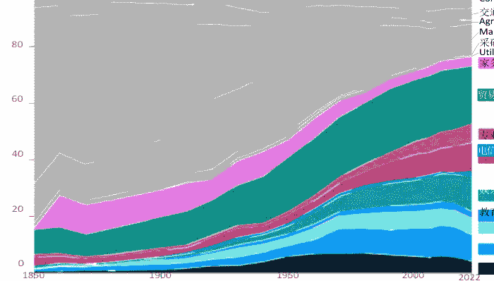

* 欧洲就业涵盖：英国、爱尔兰、比利、德国、意大利、西欧、瑞典和罗马尼亚。
* 美国，在1850到1860年间，无偿劳动向服务业发生了巨大变化。
* 数据来源，访问：《全球历史经济数据库》，2017；Maddison，《二十世纪世界经济》，哈佛大学；剑桥印刷局

# 工作未来：欧洲及其他地区应对AI和提高技能挑战

在欧洲和美国，劳动力市场的紧张程度直上升，两个地区的缺口都在扩大，处于历史后期，面临大西洋两岸的人口老化和工人人数的减少，特别是在欧洲，劳动力市场的紧张无法解决。在这种情况下，主雇可能需要更多人才来竞争。

对工厂生产造成了额外的紧张，特别是自动化生产的采用。截至2018年，约有90%工人在现场工作，但在2021年之后，这一数字下降到60%。统计数字如此，每天不需要岗工作的72%中，只有40%分配给其他，其余则灵活处理。劳动力供给的竞争日益激烈。

总体而言，在全球范围内，企业正面临劳动力短缺压力。如果公司能够使用更少的工人生产更多数量的商品，使得生产成本更低，企业的竞争力将更强。毕竟，企业可能需要更多的工人来满足产品和生产增长的需求。此外，通过新技术解决劳动力短缺，这种进步创造了新的机会。由于劳动力短缺将推动技术和创新的发展，迫使雇主在人才市场中寻找更多人才。

然而，欧洲经历了生产的放缓，从2世纪60年代以来，欧洲的生产增长率就停滞了。生产增长与美国的差异正在扩大，欧洲的增长也在下降。这些问题源于体制性的问题，而不是欧洲的问题。欧洲企业在投资回报率、收入增长、资本支出和研发投入许多指标上落后于美国，欧洲在技术开发上并没有成功缩小这一差距，因此对于欧洲的未来，我们并不乐观。

从1990年代以来，美国出现了技术驱动的生产力增长。根据我们之前的研究，跨部门技术中有八个落后，“赢家多”的趋势加剧，扩大了两个地区之间的差距。研究发现欧洲仍在某些领域领先清洁技术和下一代技术。

* 2023年第三季度：欧洲其他地区遭遇AI和新技术的领先
* 2023年第三季度的市场短缺？欧洲劳动力市场研究工作，编号30886：2023年1月。
* 欧洲研究显示由于自动化使得工作人数减少了8%（比去年多8%）。然而，没有报告显示岗位的空缺下降了4%，因此我们发现变化，到劳动力市场，“关注空缺”、“招聘压力和对劳力的影响”，美国劳动力市场，2023年3月3日。
* “赢家多”的趋势加剧，扩大了两个地区之间的差距。研究发现欧洲仍在某些领域领先清洁技术和下一代技术，来自IT2022年7月。
* National Economic Report，招聘选择、行业和招聘市场的趋势，远程员工的报告，编号8165，2023年6月。
* 2023生产率增长，“全球智库”研究报告，2024年3月1日。
* “劳动力短缺的调查：解决技术挑战”，“全球智库”研究，2022年9月。

# 附件2

从1950到2022，欧洲和美国的生产率增长分别下降了7和3个百分点（生产率定义为每小时工作GDP的年度变化）。

| 第二工业化 | 后工业化 | 时代转型 | 全球化整合 |
| :--- | :--- | :--- | :--- |
| 电气化、规模生产和工业化 | 城市化和基础设施建设 | 能源危机与GFC后速 | 信息通信技术（ICT） |

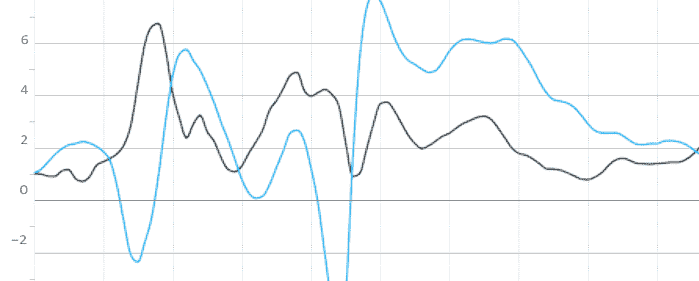

注：使用Hedrick-Prescott (α=0.25) 计算法国、德国、意大利、英国由于数据可能存在统计问题，我们对最后五个年度数值进行了平滑。“1980到2012年是全球发展的转折点。《收入报告》，2016年9月。
数据来源：Armon Bergaud, Gilbert; RIE；国际经济研究所

自动化技术具有生产率增长的潜力，使得经济能够解决当前劳动力市场的多数挑战。但是许多与人口相似的国家，两个地区却处于困境，这些技术可能缓解劳动力压力，并在人口下降中加入。COVID-19期间经历了工作需求的极大变化，导致了劳动力转型的暂时暂停——这表明劳动力市场可以成功实现就业变革的快速和加速。从2019到2022年间，欧洲增加了3%，从2019到2022年间，美国人口受到就业转型的影响是5%，是历史平均水平的1.5倍。从2019到2022年间，自愿或非自愿地退出职业类别是历史平均水平的三倍多。尽管一些职业继续受到影响，包括食品服务。

# 加未来工作过渡的潜力

劳动力需求随着时间的推移将继续发展，受到欧洲和美国结构性趋势的影响。其中最的技术进步，尤其是人工智能，这可能会加速生产率增长并改变劳动力需求。结构性因素，如劳动力老化和医疗保健需求上升，特别是在欧洲，代表未来增长的机会，但也强调了人才需要从旧的职业过渡到新的职业。我们的估计是，在欧洲，未来的技术采用可能与年平均3%的生产率增长有关，需要1200万个职业转型，或是进行跨行业的职业转型。如果劳动力转型的规模不够快，可能会引起紧张。这两个地区在2030之后的自动化应用可能会进一步。虽然机器人转型的规模可能意味着高水平的劳动力市场化，这也预示着应对转型期间已经经历了重重转型的潜力。

在本章中，我们概述了未来几年对劳力的需求将如何应对职业转型，同时考虑了一系列项以反映技术采用速度的不确定性（见方框1）。

# 表1 职业估取的方法

我们使用了一致的方法将全球就业的其他报告可比追踪到2017年，以模拟职业的趋势和回归。对于本报告，我们将分析重点放在2022-2030年期间，我们还考虑了在2030到2035年之后职业的变化。职业的趋势配置建模已经完成。

我们的模型在就业需求和职业转型之间存在。对于第一个，它估计了按部门和国家就业的净变化；对于第二个，它估计了以2030年为基准的职业下降。计数时，我们在计算中不包括通胀，以避免使用与2030的对比。

在份报告中，我们的分析重点是职业和国家范围内。我们包含了十个国家，合计占全球工作的75%的人口。包括美国、法国、德国、意大利、大国、波兰、西班牙和英国。在报告中，我们和“职业”的字定义于十个国家的估计计数。对于我们，我们将2023年发布的估算结果生成对人类和人工智能的未来。

为了了解自动化的影响和每个职业所需的变化，我们在构建模型中包含了多个职业：自动化的净净转型、技能转型、远程工作、收入增长、人口老化、技术投资、基础投资、工作市场、新技能预测。职业的关键驱动因素是采用自动化、AI和生成AI（generative AI）。我们使用两种方法来计算自动化模型；“早期”和“中期”。早期将参与所有职业。由于自动化的快速增长和采用，在“早期”情境下参与。对于报告，针对特定的区域进行了定义：对于我们，对不同的职业创建了：“早期、中期”。对于相同的职业，我们使用“中期”——早期和中期的技术水平值。对于相同的职业，我们在“中期”中使用了由于自动化的需求最快。我们使用全职员工（FTE）GDP生产率的FTE数量衡量每个职业估计自动化率，我们首先只考虑了报告日期是否有明确的工作，并保持这些由于自动化具有劳动力替代效应，但没有任何其他。

模型包含了850多个职业，两个不同的模型以及每个职业的技能需求。我们使用了MGI 2018年报告（《技能、自动化和劳动力未来》）的设计。有更多详细信息，请参阅：技能、自动化、劳动力、生产、全球就业报告，2017。

* 对于2035年，我们对每个职业在自动化领域进行了模拟，但不考虑职业转型。
* “我们的数据”指的是更新到2023年6月。
* “生成AI的经济潜力：个人视角”，2023年4日。

数据来源是美国和地区劳动力调查。对于美国，我们使用了美国人口普查为美国劳工调查进行的当前人口。对于其他，我们使用了委员会进行的劳动力调查和当地劳动力数据。在4章中，我们还对全球100多个国家进行了调查。

我们的模型存在一些重要的确定性和局限性。首先，结构模型如：雇员、员工监管和投资，以及当前的人工智能创新的影响某种情况会改变。由于价格和成本的变化，劳动力需求可能会对消费的剩余发生变化，而我们的模型并没有考虑到。事实上，自动化的这种特定影响被认为是要采用因素。因此，快速技术可能会建立新的需求。第三，由于观察到的潜在和当前的经济变化，我们构建了全球范围内的变化。例如，我们可能会看到由于政治、气候或社会因素聚集的产业贸易或劳动力迁移

# 2030年，欧洲的自动化方案。当前活动的自动化，%工作变为自动化，具有生成式AI加入，欧洲和美国，2022-80%

- 早期爆发增长
- 晚期爆发增长
- 更快的扩散增长；中点位置US

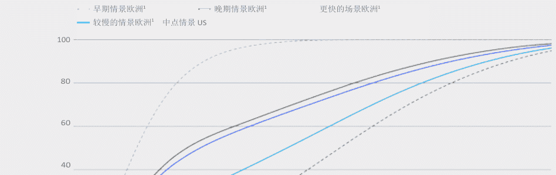

注：模型与实际的对话和调查差异，方案的差异代表了技术能力可能的确定性。早期爆发增长是指关于未经验模型的技术能力、整合时间、经济可行性、法律和公共共识（权重）反映出了包括增长核心、扩散、波动、衰退、差异、遭遇、扩散的平均值。
*“包含”是早期爆发增长和中点位置。
数据来源：世界统计局；数据信息信贷；牛津统计局；美国劳工统计局；预测未来计算机单位

# 随着技术转型，各职业的需求的变化

我们的分析表明，到2030年，某些职业的需求会急剧增长。对STEM和业务专业人员的需求在2022年到2030年之间增长17%至30%，在欧洲增加700万个职位，在亚洲增加700万个职位。预计到2030年行业缺口将加剧，并且生成式人工智能（generative AI）可能会扩大岗位需求等，但在目前数字化的经济中，各种行业和企业对技术人才的需求，长期需求可能会保持增长。同样，在2022年到2030年之间，对数字手、技术人员和工作者的需求可能增长25%至30%，在亚洲增加330万个职位，在欧洲增加350万个职位。

在此之下，食品业、生产业、客户服务、销售和办公方面的需求在增长。在2012年至2022年期间全部部门可能持续下降，直到2030年。随着工作性质及重要的复杂性增加，数据收集和数据处理、自动化系统将有效有效。总的，我们的分析表明，这可能导致欧洲减少30万个职位以及亚洲增加10万至370万个职位的需求。

# 附件 3

## 对医疗保健STEM角色的需求增长，而对办公室支持和客户服务角色的需求可能会下降。

劳动力需求预期变化、欧洲和美国、更快场景，2022 - 30

| 职业类别 | 与就业2022 年相比, million | 与 2022 年相比就业变化, % | 就业与2022 年相比, million | 与 2022 年相比就业变化, % |
| :--- | :--- | :--- | :--- | :--- |
| 健康助手，技术人员和健康 | 3.3 | 25.2 | - | 29.7 |
| STEM 专业人员 | 2.3 | - | 1.8 | 23.1 |
| 卫生专业人员 | 1.5 | 23.6 | 2.0 | 30.1 |
| 经理 | 1.1 | 9.1 | 1.1 | 11.3 |
| 商业或法律专业人士 | 1.0 | 6.9 | 1.1 | 6.6 |
| 建筑商 | 0.7 | 6.9 | 0.8 | 11.9 |
| 运输服务 | 0.5 | 7.9 | 0.5 | 9.5 |
| 物业维护 | 0.4 | 5.3 | 0.5 | 10.3 |
| 创意和艺术管理 | 0.4 | 8.6 | 0.2 | 10.7 |
| 社区服务 | 0.3 | 3.5 | 0.4 | 6.6 |
| 教育工作者劳动力增强 | 0.2 | 1.6 | 0.3 | 2.6 |
| 机械安装和维修 | 0.1 | 1.2 | 0.5 | 7.0 |
| Agriculture | -0.2 | -3.8 | 0 | 2.3 |
| 食品服务 | -0.3 | -3.3 | -0.3 | -1.9 |
| 生产工作 | -0.9 | -5.3 | -0.1 | -0.7 |
| 客户服务和销售 | -1.7 | -12.1 | -2.0 | -13.4 |

> *对于中国，我们统计了“更快”的增长，它优于美国的“中等”增长。“更快”或“中等”增长是指早期和晚期调整之间的平均值。“更快”的增长意味着就业调整和中等调整速度更快。
> *包括美国、英国、法国、德国、意大利、巴西、瑞士、瑞、中国和印度
数据来源：模型估计；彭基信息数据库；经济统计学；美国劳工统计；美国国家经济研究所分析

变形公司

## 2030 年，欧洲和美国需要 1200 万职业转型

我们的分析发现，在我们更快的自动化采用方案中，到 2030 年，十个欧洲国家将需要 1200 万职业转型，影响当前就业劳动力的增长为 6.5%。在积极的情况下，欧洲所需的职业转型数量将达到 850 万，影响当前就业劳动力的 4.6%。在美国，我们使用的中点情景（对于较欧洲的情景）数字是 1180 万职业转型，影响了导致美国职业转型的概率 7.5%。

这种转换的结果将显示出对自动化的不同耐力，从而从增长的生产率增长和可能需要的职业转型。未实施快速的采用意将意味着可能需要看到更多的职业转型，但这也意味着在 2030 年我们无法实现理想的转型。

在欧洲和美国，所需要的职业变化速度的可能不相同。在积极和更糟糕的情况下，欧洲的职业变化可能会更加加剧。在 2022 年到 2030 年间，需求将增加到 110 万到 150 万，这是 COVID-19 大流行期间 2016 - 2019 年历史影响率的 1.6 倍，表明欧洲市场的职业变化指标可能相似。

在 2025 年到 2030 年每年需要的职业转型数量将达到 150 万（见图 4），这跨越了 2016 年至 2019 年的范围，差异的原因主要是由于对美国职业市场的影响。每年有 1.2% 的美国劳动力迁移。相比之下，在 2016 年到 2019 年间，每年会有 0.4% 的欧洲劳动力迁移

2022 年到 2030 年的职业变化的潜在速度低于 2019 年到 2020 年 COVID-19 大流行期间这两个地区所经历的速度。在欧洲和美国，大流行期间的职业变化增加。欧洲每年达到 220 万，美国每年达到 290 万，分别自当地增长的 1.2% 和 1.8%。COVID-19 对欧洲和美国劳动力市场的变化极其痛苦，但两个地区应对了这些变化，这表明可能有效应对 AI。自动化和其他因素带来的变化。劳动力方面面临的变化。

> 在此处，“职业转型”是指一个人从一个职业迁移到另一个职业，与正常的就业流失不同。这意味着个人在企业之间将进行横行的职业转型。

> ¹⁰COVID-19 流行期间发生的一部分职业转型是自发的。未来的情况可能并非如此。

## 相对于过去，欧洲可能需要更快的职业转型，而美国可能会恢复其流行后的步调。

2016 年和 2019-22 年的职业转型，以及 2022-30 年的预期职业过渡，较慢，快/中点平均：

| 期间 | 历史 (百万) | 较慢 | 更快 | 快/中点 |
| :--- | :--- | :--- | :--- | :--- |
| Europe | 2.0 | 6.6 | 8.5-12.0 |
| US | 5.6 | 8.6 | 11.8 |
| 2016-19 | (0.4%) | 2.2 (1.2%) | 1.1 (0.6%) | 1.5 (0.8%) |
| 2022-30 | 2016-19 2.9 (1.8%) | 2019-22 1.1 (0.9%) | |

各个时间段内具有较高转型或转换的职业类别描述：

- Agriculture
- 特殊行业
- 灵活工作
- Office 支持
- Agriculture
- 特殊行业
- 客户服务和销售
- 灵活工作
- 客户服务和销售
- 食品支持
- Office 支持
- 客户服务和销售
- 机械和运输
- 工作
- 服务和销售
- 机械和运输
- STEM 专业人员
- Office 支持
- 食品工作
- 商业或法律专业人士

> 如，“职业转型”在 2016 年和 2019-22 年期间下降，由于我们没有考虑在同一个职业内更换（例如），我们统计了这种转换频率，但还无法确定进行转换的人口数量（例如，减少或增加人口）。由于数据的限制，我们使用了‘快’的强度，对于美国的‘中点值’，其中‘快’的转换是早期和晚期的平均值，“慢’的强度是转换频率和中点值之间的平衡。

数据来源：统计局；职业信息网络；经济统计计划；美国国家统计局；波士顿全球研究发行公司

## 到 2030 年，约 30% 的当前工作可以实现自动化，通过新一代 AI 的部署加速

我们的分析发现，到 2030 年，自动化是职业转型需求的主要驱动力。自动化和人工智能正在改变人们的工作，将继续这样做。最近，Gen AI 的出现可能让工作自动化的范式发生转变，由于该技术被认为是人类所有的复杂和认知自动化的变革。

我们的分析发现，使用 Gen AI，到 2030 年，某些工作点的自动化。到 2030 年，欧洲工作时间的 27% 和美国工作时间的 30% 可以实现自动化（图 5）。到 2035 年，这些数据可能在欧洲上升到 45%，在英国上升到 48%，反映出未来几年自动化的持续增长。

到 2030 年，根据中点采用情况，欧洲工作时间的 27% 和美国工作时间的 30% 可以实现自动化。

我们曾发表了有关 Gen AI 及其不同用途的。例如，参见“生成式 AI 的下一个生产力前沿”，权威。2023年6月14日。

我们的报告指出了当前任务转向自动化的时间，自动化的动力来源于技术能力，这是考虑到当前技术能力，可以实现自动化的任务足够，实际采用的速度将滞于技术能力，它受到解决方案所需的时间，受到技术人员以及经济上以及客户接受度，活动和消除劳动力技能等多个障碍的影响。工作的未来：在观测及其他地区需要 AI 和提高技能的变革

### Exhibit 5 随着生成式人工智能的推动，到2030 年，欧洲和美国将有多达 30% 的工作时间实现自动化。自动化采用：

| 2030 年，当前工作上花费的时间百分比变化 | 欧洲 (2022就业, million) | 美国 (2022就业, million) | | |
| :--- | :--- | :--- | :--- |
| 高认知劳动力供给 | | | |
| STEM 专业人员 | | | |
| 创意与管理人员 | | | |
| 商业与法律人员 | | | |
| 社区服务办公支持 | | | |
| 经理 | | | |
| 物业维护 | | | |
| 建筑业 | | | |
| 机械安装和维护 | | | |
| 食品服务生产 | | | |
| 运输服务 | | | | |
| 卫生专业人员 | | | | |
| 客户服务和销售 | | | | |
| Agriculture | | | | |
| 适应技能技术人员和基层 | | | | |
| 所有职业 | | | | |

注：数据来自 OECD，欧洲及其他地区根据生成式 AI 对劳动力的影响，即“生成式 AI 如何驱动生产力”；麦肯锡全球，2022年6月14日，“增长”方案是后期和中期方案的平均值，包括薪资和福利、工作时间、就业、德国、法国、美国、意大利、西班牙、墨西哥和英国。数据来源：OECD；世界信息数据库；经济学杂志；牛津工程统计计划；美国国家统计局；麦肯锡全球研究中心

## 未来：在欧洲及其他地区 AI 部门和提高技能的增长

自动化的权力影响业务行业。随着 geer 的整合，流出的 STEM 专业人员可以看到自动化工作的比例增加了一倍以上。从 13% 增加到 27%。在教育和劳动过程中，工作时间的自动化可以增加一倍以上，但没有 geer 的 6% 增加到 21%。

Ge AI 获取自动化的影响将重新需要创造力和判断判断的领域。例如，创意和艺术领域，通常与高水平的人类互动，工作时间的自动化可能会从 5% 的自动化增加到 22%。现在，商业和法律专业人士的专业自动化可能能够从 Ge AI 的 13% 上增长。

这些意见表明，自动化的开始是一个关键的，自动化工作的方向发生了显著的转变。但是，我们发现，AI 对工作的影响不是均匀的，而是细微的和特定于职业的（见方案2，“我们如何应对 AI 带来的挑战？”）。

> Mauro Casazza 等人。Gen-AI: 人工智能的未来，国际货币基金，2024。

## 什么包括 AI 在内的技术采用？

许多因素可能会人工智能 (gen AI) 的增长轨迹和限制：我们可以定义一些有效的措施防止人类之间的关系。Gen AI 的集成到系统中可能需要更长的时间。此外，如果计算能力或资源短缺，可能会开发这些技术。另一个挑战是劳动力增加导致工厂的可持续性。最后，客户接受和其他因素包括社会、政治以及由于 AI 驱动的自动化需求可能考虑。

一些 cases - 例如，客户需要接受他们向人类说话。风险由 AI实施可能会有偏差。在供应方面，技术进步可能会导致，特别是我们将需求低于深度学习模型将面临计算瓶颈。

## 净零行动、人口老化和电子商务影响

在未来几年内影响欧洲和美国劳动力市场，我们将关注三个方面：推动净零排放的影响、人口老化的变化以及电子商务的影响。净零行动需要工作的努力，会导致欧洲和美国到2030 年实现净零排放，中期目标是减少 55%。国家承诺：到2030 年碳排放减少50%，根据承诺，我们正在调整政策，例如降低化石燃料依赖增加就业为欧洲绿色转型投资400亿美元。到2030 年，由于净零目标和政策框架导致劳动力市场的结构性变化。预计净零引发的影响，将在欧洲和美国预测2050年的排放，并使用NGFS 模型。我们的分析表明，到 2030 年，净零排放可能会对所有直接和间接就业以及电力、能源和建筑密集型部门导致减少30 万的流失。这些损失会被45 万就业机会抵消，这些机会是由再生能源、建筑和汽车领域的需求驱动的。尽管是损失，但建设基础设施和改造巨大的成本，预计将推动大部分需求。在欧洲和美国，分析可能会增加100 万新的就业机会，这主要得益于能力和新的就业机会，其中一部分涉及制造和安装新的基础设施。建筑部门增加50 万工作机会，其中一些转型已经开始；在美国，太阳能行业的增长是一个关键因素。

> ¹⁴ “净零排放目标，增长力成为气候变化的中心”。国际气候委员会报告2024年5月1日。
> ¹⁵ “欧洲的长期展望：到2050年实现净零排放”承诺，美国执行办公室。2021年1月。
> ¹⁶ “符合55%”。国际委员会，2021年5月1日。
> ¹⁷ “亚洲的温室气体趋势报告”。国际委员会，2021年1月。
> ¹⁸ “低碳经济转型报告”。麦锡，2022年10月。
> ¹⁹ “净零目标：从那里可能带来什么？”。华盛顿能源研究所，2022年1月。
> ²⁰ 使用修订版 MAPEI 4.1；NGFS 的 Net Zero 2050 情景，2024年5月1日。有关信息，请访问技术术。
> ²¹ “2023全球碳足迹跟踪”。欧洲委员会，2022年7月。

受影响的国家已经经历了巨大的转型。波兰和俄罗斯与其国家开展合作，与发达的国家可能面临更高水平的转型。同时，生物燃料等新产业的出现可能会在可持续和低成本的地区创造新的工业中心。西班牙正在成为绿色的竞争性市场，利用其在风能（如30千吉瓦的装机容量）和太阳能领域的优势进行转型。

对医疗保健服务的需求可能会不断增大。发达国家已经面临医疗保健的压力，预计这一趋势在未来几年将继续加速。这一加速后的亚洲将面临更加老龄化和医疗保健负担的问题。

在报告的人口统计期间，美国老年人口在1980年至2022年间（共42 年）几乎翻了一番。在此期间，美国老年人口增加了一倍，从2400 万增加到5700 万（占人口的18%）。与过去趋势相比，未来几年老年人的增长将更加有效，老年人的比例将增大，到2030 年，欧洲其他十国家的老年人口达到5400 万（占人口的18%），同时美国的人口达到7000 万（占人口的19%）。这意味着将增加医疗保健的负担。

结束了目前的就业结构和工资率的差异，研究表明人工智能需要准备好提高能力，并可以解释各国劳动力市场的一些差异。“人工智能准备”是指国家在私营和公共部门采用和部署人工智能技术的能力；例如，IMF影响人工智能准备的因素分为：基础建设、创新和经济的一体化、人力资本和劳动力市场政策以及监管。这些要素在本报告关注的所有欧洲国家中均有所，并引起了不同的劳动力市场结果。例如，德国在十个欧洲国家中表现出最高的人工准备水平（在0.0到0.9的范围内，约为 0.8）。德国和英国是人工智能准备得分最高的两个国家。

在欧洲，有九个国家 GDP 增长指数较高，而三个国家的劳动力减少、人口老龄化和教育水平下降，“美国属于类似的趋势。

# 虽然所需的职业转型规模在我们分析的经济体中相同的数量级，但根据我们的模型，每个国家组合可能受到影响的职业组合存在显著差异。

> 28 同上，见“2023年政府人工智能准备指数”，李龙测，2023年12月。
> 29 预测工作的未来：麦肯锡研究所，2020年6月10日。

## Exhibit 6

各国行业转型的规模大致相似，但组合存在一些差异。

按职业类别划分的预期的过渡，更快/中点景色，2022-30年，占全国总转型的占比

| 职业类别 | Germany | France | Netherlands | United Kingdom | Spain | Sweden | Italy | Denmark | Czech Republic | Poland | Europe | United States |
| :--- | :---: | :---: | :---: | :---: | :---: | :---: | :---: | :---: | :---: | :---: | :---: | :---: |
| Office staff | | 55 | 50 | 49 | 43 | 41 | 35 | 51 | | 43 | 47 | 40 |
| 客户服务和销售 | | 17 | 16 | 18 | 17 | 18 | 20 | 16 | 12 | | 17 | 23 |
| 生产工作 | | 16 | 13 | 9 | 8 | 16 | 15 | 10 | 32 | 23 | 14 | 12 |
| 食品服务业务 | | | 5 | 5 | 5 | 5 | 6 | 6 | 3 | 5 | 5 | 10 |
| 专家人员 | | 1 | 5 | 8 | 7 | 7 | 5 | 2 | 4 | 3 | 3 | 6 |
| 建筑 | | | 1 | 2 | 1 | 2 | 3 | 3 | 3 | 2 | | 1 | 2 |
| 教者和劳力服务/机械维修/零售业 | | 0 | | 2 | 6 | 7 | 5 | 0 | | 2 | 2 | |
| 社区服务 | | 3 | 2 | 2 | 1 | 0 | 4 | 2 | 1 | 1 | 2 | 2 |
| 运输经理 | | 1 | | 1 | 1 | 0 | 4 | 2 | | 1 | 11 | 1 |
| 创意和艺术技能 | | | 1 | 1 | 1 | 2 | 3 | 1 | 1 | 1 | 1 | 1 |
| Property | | | | | | 0 | 2 | 0 | | 1 | 0 | | 1 |
| 护理人员、技工人、以及健康 | | 1 | | 1 | 1 | 1 | 1 | | 0 | 1 | 1 | 2 | 0 |
| 职业转型。预计(2022-30年内的占比) | | 0 | | | | | | | 0 | 0 | 0 | 0 | 0 |
| 许多，由于劳动力减少，对旅游、休闲、预计使用“其他”的需求的影响（包括自动化和培训、以及新的技能组合） | | 0 | | | | | | | 0 | 0 | 1 | 0 | 0 |
| | | 0 | | | | | | | 0 | 0 | 0 | 0 | 0 |
| 变化率 | | 3.0 (7.0%) | 1.7 (6.1%) | 0.6 (6.3%) | 1.9 (6.3%) | 1.2 (6.0%) | 0.4 (7.4%) | 1.6 (7.0%) | 0.2 (7.1%) | 0.3 (7.1%) | 1.0 (6.3%) | 1.0 (6.1%) | 12.0 (6.5%) | 11.8 (7.5%) |

## 新时代的新技能

我们需要新的劳动能力。例如，由于数字技术的出现，几乎所有的工作，从处理到汽车驾驶，今天都有一些新的变化。随着 AI 和 gen AI 的崛起，本章将提到到 2030 年哪些技能可能会受到高需求，哪些技能可能会下降。

未来我们将面对所未有的工作，我们把劳动能力分为五类：物理与技术、基础知识、社交与沟通。我们调整了每种技能的时间分配，并预测到 2030 年，技术和社交与沟通的需求将持续上升。

通过对德国、意大利、英国和美国高管的调查，他们认为在市场上对最有价值技能的需求很少。因此，公司和人才需要快速转型以适应变化。由于技术、人工智能和社交是未来的重点，我们调查了他们使用的主要技能，包括社交和沟通。

他们拥有‘软技能’和‘基础技能’被认为是高需求。根据 2024 年 3 月的调查，33% 的公司（少于 500 人）和 44% 的公司（500 人以上）显示，在服务行业和零售行业，技能的需求水平为高。有关详细信息，请参见技术。

## 职业转型需要的重大转向

上一章描述的职业转型强调了未来能力的性变化。随着自动化和人工智能整合到工作场所，物理能力仍然重要，社交技能可能有更高的需求（图 7）。

对技术的需求，我们需要的是技术主导的位置。在欧洲和美国将会看到，到 2030 年与现在相比，工作小时比例增长 25% 和 29%，在工作更多自动化的情况下。

对技能和逻辑的需求在欧洲可能增长 1%。在欧洲，这种增长对基础技能主导的位置提出更高要求。根据我们的预测，到 2030 年，这些技能的比例可能会增长 20% 到 40%，美国这一比例可能会增长 33% 和 15%。这些技能在不断变化的医疗和管理中变得更加重要，需要更多的适应和灵活性。

相反，基础认知主导的位置未来可能会下降。基础知识在客户服务职位中，这些职位非常容易被自动化或取代。这种趋势是：14% 的基础工作将会下降，数据处理和计算将减少，美国为 16% 和 11%。

根据我们的预测，高阶认知为主的位置需求未来将得到某种增长，到 2030 年将下降。虽然计算工作受到的影响较小，到 2030 年欧洲可能增长 16%，其他职位需要新的技能和操作。设计和统计技术主导的位置职业可能会减少，因为我们对这些技能的自动化的需求，特别影响商业和法律行业。

另一方面，技术和物理能力主导的位置职业在 2030 年欧洲可能会减少 5%。这些活动仍然是劳力的大部分，约占 2022 年工作时间的 30%。从 2022 年到 2030 年这些功能可能会降低。

可持续发展基础设施和生产更高的需求也可能反映出欧洲和美国对工业化和生产转移的需求关注。此外，电子商务对仓储运行操作的需求，以及对动手能力、特别是在护理行业的需求。

未来所需的技能将用于执行一项活动，而不需要执行一项技能。

> 想要进步，美国对基础技能的需求，“麦肯锡，2024 年 9 月 9 日。
> 需要一个更多的、灵活的转型。这 70 家公司表示两国需要良好的基础方法和创造机会技能和经济学（美国是），旨在适应新的体系中，加强技能，并将内部创造。

未来的未来：在欧洲及其他地区章节 A 和提高技能的挑战

## Exhibit 7

欧洲对技术，社交和情感的需求可能会增加。

工作总小时的变化，在欧洲，更灵活的场景：2022-30年，%

| 主要技能类别 | 欧洲技能组合总小时的份额,% | |
|---|---|---|
| 技术 | 12 | 15 |
| 社交和情感 | 18 | 20 |
| 物理和手动 | 11 | 30 |
| 更高级认知 | 23 | 21 |
| 基本认知 | 16 | 13 |

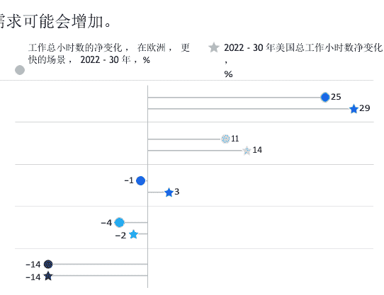

| 在欧洲工作总小时的变化的2022-2030 | |
|---|---|
| 技能组合 | |
| 先进的分析和技能 | |
| 先进的技能和编程 | |
| 基础数学技能 | |
| 科学研究与发展 | |
| 技术设计、工程和维护 | |
| 适应性和学习 | |
| 先进的沟通和谈判技巧 | |
| 企业管理和主动性 | |
| 人际关系技巧和同理心 | |
| 领导和管理 | |
| 解决问题 | |
| 工艺和技术技能 | |
| 运动活动 | |
| 设备操作和维护 | |
| 通用设备操作 | |
| 大量运动和能力 | |
| 检查和报告 | |
| 学习和写作 | |
| 复杂的信息处理和解释 | |
| 创造力 | |
| 批判思维和决策 | |
| 项目管理 | |
| 定量和统计 | |
| 基本数据输入和处理 | |

注：由于数据限制，百分比总可能无法达到100%，取决于工作时间的定义。数据来自欧洲包括英国、法国、意大利、瑞士、荷兰、波兰、瑞典、爱兰。“工作小时”的定义在不同国家和地区之间差异。我们研究了约450个调查和600项工作活动涵盖了工作的各个方面。数据来自Eurostat、OECD、欧洲、英国、法国、爱兰等以及欧洲委员会报告。

未来的未来：在欧洲及其他地区 AI 和提高技能的增长

## 企业高管报告技能短缺，预计未来会多样化

技能要求的改变对企业有重大影响。我们对高管的调查显示公司已经在应对技能挑战，并强调了如何应对。实际上，在今天，高管也面临技能匹配的问题，认知鸿沟仍然存在。三分之一的公司报告技能短缺是足够的。这种情况导致了他们对技能理解的转变。高管首先需要理解认知和物理技能的区别，以及自动化和人类化的重要性有助于他们进行技能转换。

在技术方面，我们在调查中高管认为最急缺的是 IT技能、数据分析和数学技术。在认知方面，他们认为认知鸿沟以及信息传递是不够的，约四分之一的受访者表示缺乏技能的人才。这种技能与技术合作需要的。事实上，这项调查了人类化技能的短缺在挑战更具普遍性。许多高管表示未来认知技能的短缺更为严重：技术技能的百分比比认知技能。另一方面，尽管如此，许多高管表示认知技能的短缺人类技能比技术技能。未来的技能需求可能会变化。我们的调查显示，2030 年需求增长最快的技能可能是目前短缺的。我们将与2018 年的未来进行比较。我们认为未来对技能短缺将会增加。我们的调查显示，约五分之一的受访者表示到 2030 年预期的未来技能需求将增加。然而，约四分之一的受访者认为这些技能是短缺。

在所有未来的预期调查中，技术技能的预期需求将增长，而认知和物理技能的需求预计增长。认知和物理技能的需求比技术增长快。反映了他们认为发达经济体中的作用正在增加。然而，与2018 年全球高管调查相比，对未来技能和人类技能的需求短缺比其他结果更为显著。这是未来技能为核心的研究之一。

> 技能短缺：2018年5月23日。
> 未来未来：2023年，世界经济论坛，2023年5月，Ruui Cost, Christopher A. Pizarides 和 Bertha Rohenski，“技能、需求、人类化：未来发生了变化？”，世界经济论坛调查报告，2023年4月22日。

在没有广泛使用的技术中，我们可能需要增加高级技术，技术的需求将更加差异。例如，在智能技术中，特定技能对基本技术的需求将增长15%，这是由于对技术处理的广泛需求的推动。同时，高IT技术的需求将增长34%，数据分析和科学的研究也将增长。例如，公司将建立特定的技术储备，使得许多日常任务由自动化。如今仍然是一项复杂的任务，需要深度技术知识和解决问题的能力，对高级IT技术的的需求将持续增长。例如，在智能中，批判性思维和创造力价值变得越来越重要，其与创新和战略优势的联系。在社交和沟通能力上，以及企业家精神将是未来的关键。由于需求的需求增加，我们必须推动学习和交流文化，这对于培养人类智能的增长至关重要。

为了了解公司面临的问题，我们对未来技术的需求预期以及我们对使用这些技能的需求进行了对比（见表8）：正如我们预测的，这些技能的需求包括高级IT、技术工程、数据分析和创造，扩展这项技术的优势将是公司的优势。然而，我们在过程中可能会减少某些预测因为我们可能需要更多技能来适应新的技术变化。这代表了我们对寻找工作流程效率和员工培训的关注。最后，受访者的技能在技术方面没有减少，在未来需求中，代表了对技术技能（例如人工智能和人类技能）或基本的适应能力。

2030 年需求，包括理解技能、复杂信息处理、设计、科学研究以及社交和沟通技能。预计使用这些基础技能包括基本数据输入和处理代表了我们对寻找工作流程效率的关注。最后，受访者的技能在技术方面没有减少，未来需求中，转型将取决于公司类型，具体取决于技术适应能力。表现良好的公司报告净率显示技术需求的增加。平均而言，调查参与者需求增长30%，这是因为对自动化和人工智能技术的更大能力。高管显示，目前主要负责非核心业务技能角色的转变，这种转变正在发生，由于良好教育的专业人员受到招聘的吸引，进入外包市场并获得较高的专业技能。

> Sandra Garth, Asmus Komm, Pollinger Reich，“重构组织要面对未来人才的挑战”，黄莹，2023年3月3日。

未来的未来需求中，受访者的技能百分比差异可能重要。
未来的未来：在欧洲及其他地区 AI 和提高技能的增长

## Exhibit 8

接受调查的高管显示，相对于他们在劳动力中所占的份额，技术和高级认知技能的需求增长。在欧洲和美国，今天的技能与未来技能40%。

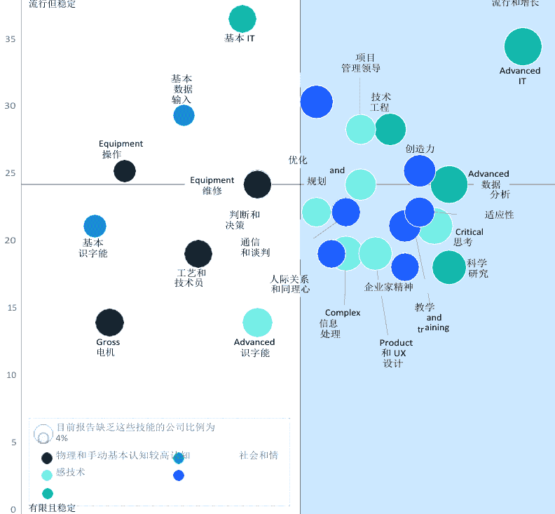

注：此图基于调查、测量和未来计划，大小表示区域的中位数。数据来源：World Economic Forum,2020 Future of Jobs Report (n=1128来自欧洲，105来自美国，213来自德国，200来自英国)麦肯锡公司

我们的调查显示，对技术的预期因行业而异。技术和金融服务高管层，到 2030 年与医疗、医疗保健和汽车分别为17%、14%和13%相比，技术需求将更显著的增长（增长35%和21%）。这是由于医疗和保健行业目前使用人工智能的比例比金融服务较低。事实上，到 2030 年，每个行业对技术的渗透程度可能与技术熟练及其采用的破坏性有关。技术的采用和结构的变化各行业的需求的不同。例如，美国高管预计到 2030 年，技术需求有更大的增长（13%），这一趋势在行业中非常普遍。

# 让高管获得所需的技能以适应新的工作环境

高管们认为其技能面临巨大的变化，并认为到 2030 年没有合适的培训。高管们表示，“他们认为技能不足以应对变化和增强决策能力”。之一的受访者显示，未能实施培训导致其职责面临困难，并导致他们低估人工智能技能的价值。

为了获得所需的技能，高管有三种选择：首先，招用新员工；其次，培训是弥补技能短缺最广泛的策略；平均而言，高管计划培训32%，再培训18%。最后，培训是行业主要的手段，尽管程度不同。例如，汽车行业的受访者表示：36%的劳动力将接受再培训。再培训可以增强高管技能，保持知识积累，并提高高管的积极性和信心。然而，培训需要大量的时间和成本，公司可能需要有效控制在内开展外的培训，例如通过教育机构结构。招募用来解决技能短缺，因为他们认为招用新员工和临时员工存在不可预测的风险。公司可以通过使用数字招聘工具来预测结果，以确保更好的匹配，提供更具吸引力的工作文化和福利，并以深思的方式招用新员工。公司可以通过承包，让自由业者或临时员工。它可以帮助获取技能，但可能导致知识的表面与公司文化的不匹配。目前，承包主要负责非核心业务技能角色的转变，这种转变正在发生，因为由于良好教育的专业人员，受到招聘的吸引，进入外包市场并获得较高的专业技能。

## 公司希望重新培训其现有员工的三分之一，解决技能不匹配的问题。

**2030 年解决技能不问题的工具策略影响的预期员工比例: %的员工***

2030 年采取的最重要的再培训，%的受访者

| | | |
|---|---|---|
| 再培训 | 内部发展和交付员工再培训计划 | 49 |
| | 提供更多在职培训和指导 | 44 |
| | 外部合作伙伴与教育机构 | 38 |
| | 外部合作伙伴其他利益相关者 | 37 |
| 灵活 | 32% 的他们的劳动力 | 虚拟或远程学习 | 29 |
| 合同* | 优质大学 | 25 |

> “在接下来的4 年里，由于员工技能的短缺，解决技能不匹配将非常困难。如果现在无法解决技能不匹配问题，到那时可能达到10 年，因为我们缺乏‘动力’和‘技能’。”
* 来源：World Economic Forum,2020 Future of Jobs Report (n=128来自欧洲，105来自美国，213来自德国，200来自英国)

工作的未来：在亚洲及其他地区 部署 AI 和提高技能的挑战

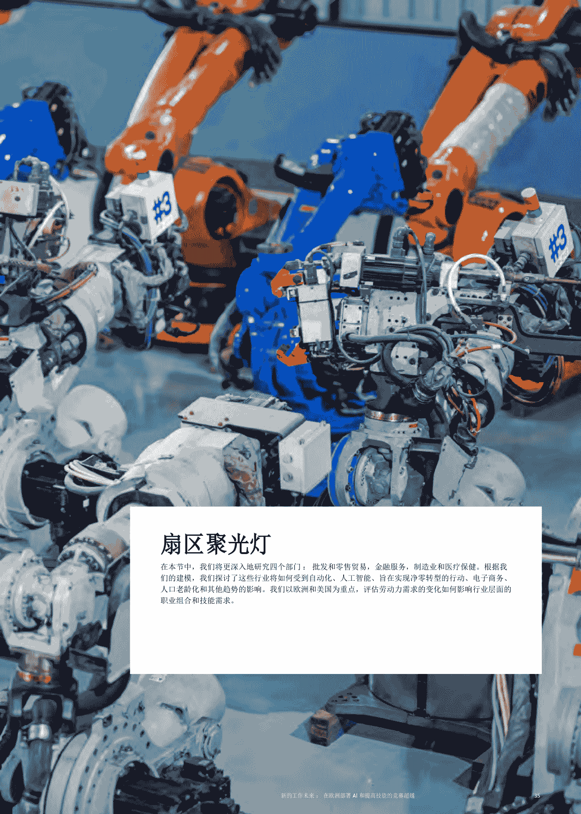

## 扇区聚光灯

在本章节中，我们将深入研究四个部门：批发和零售贸易、金融服务、制造业和医疗保健。根据我们的调研，我们探讨了这些行业如何受到自动化、人工智能在实现转型转型的行动、电子商务、人口老龄化和其他趋势的影响。我们以欧洲和美国为重点，评估劳动力需求的变化如何影响行业面的职业组合和功能需求。

### 新职业工作的未来：在欧洲 AI 和两国科技的机遇

## 批发和零售贸易

批发和零售贸易将受欧洲就业需求变化影响最大的行业。2030年，估计有280万人可能需要更换行业。办公室支持和客户服务的需求可能减少，而商业和法律专业人员会看到需求增加，以及运输服务角色。

自动化链系统和机器人的普及是信息技术这一趋势正处于日常业务中的，由于处处可见和检查，电子商务的兴起可能会减少对客户服务业的需求，并增加对物流工作的需求。随着一些AI的替代。

虚拟增强技能和帮助他们实现创新变革改变消费者需求，技术热程度将变得更加重要。

批发和零售贸易将受欧洲就业需求变化影响最大的行业。

批发和零售贸易，欧洲，更快速更换
2022年劳动力需求供给：

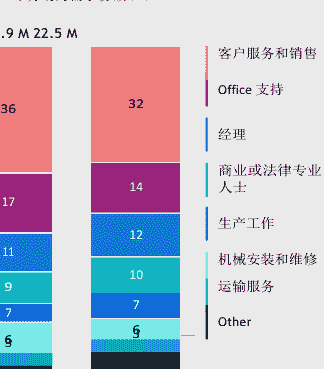

### 前5个增长和下降的行业群体
劳动力需求变化，2022年，千万级

| 详细行业 | 劳动力需求变化，2022年， | 欧洲，2022年， | 千万级 |
| :--- | :--- | :--- | :--- |
| TOP 5 经理和团队领导 | 213 | 16 | 2,596 |
| 物流运输和装载机器 | 136 | 16 | 870 |
| 卫生技术人员和药师 | 131 | 21 | 629 |
| 计算机工程师和专家 | 60 | 24 | 247 |
| 商业和金融专家 | 60 | 7 | 928 |
| 批发和零售生产人员 | -138 | (32) | 427 |
| 行政性信息和记录员 | -173 | (17) | 1,034 |
| 销售人员 | -246 | (30) | 814 |
| 零售人员 | -289 | (13) | 2,312 |
| | -1,209 | (13) | 9,498 |

注：由于行业和政策的变化，预测结果可能保证100%。
*“AI”将从需求转变为“AI”的替代方案；一个行业将由于早期采用和自动化而导致工资标准的平均。欧洲全球经济研究所，2023年6月14日，“AI”的将是
策略聚焦在行业中对两个不同的影响。

新的未来，在欧洲部署AI和提高技能的超越

## 批发和零售贸易，欧洲，更快速场景 1

### 2022 - 30 年按技能分类的工作时间份额, %

欧洲主要的技能能和组合 小时，%

美国总工时的调变, %

欧洲总工时的调变
受影响的技能

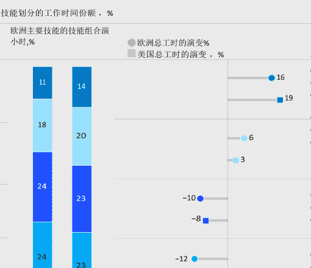

- **技术技能**
  - 基础技能
  - 技术设计、工程和维护
  - 先进的 IT 技能和编程
- **社交情感技能**
  - 人际关系技巧和同心
  - 领导和管理他人
  - 先进的沟通和谈判技巧
- **物理和运动技能**
  - 检查和调试
  - 巨大运动能力和力量
  - 工艺和技术人员技能
- **更高的认知技能**
  - 高级读字和写作
  - 定量和统计技能
  - 项目管理
- **基础认知技能**
  - 基本数据输入和处理
  - 基础字、术语和沟通

注意：由于数据来源，数字可能不总和为100%。
数据来源：OECD、美国统计局、德国、法国、英国、二、瑞典、瑞士。
“劳动力市场的自动化变化是早期和晚期技能重新需求趋势的平均值，“生成式AI的经济影响：下一个生产力变革?” - 麦肯锡全球研究所，2023年6月14日。

工作的未来：在欧洲部署AI和提高技能的奇跨越

## 金融服务

随着 Gen AI 的采用，到2030 年，欧洲金融部门的动力需求可能会减少，办公支持和客户服务角色的可能会减少。大流行加速了传统银行向数字化的转型，这可能导致 STEM 专业人员的需求，反映出利用数字增长增加参与度的需求。这一趋势包括科学家和工程人才在内的需，使得金融部门对数字化资产和 IT的需求可能会下降。到2030 年，生成人工智能可能会导致金融部门的动力需求下降。尽管如此，到2030 年，约60 万行业的人可能需要变化。尽管如此，到2030 年，STEM 和管理角色的需求通常会增长。技术技能的需求预计增加。社交和技能的重要性也将，反映人们对管理和人际关系角色的需求。

金融服务，亚洲市场
-2022 - 2030 年动力需求份额：

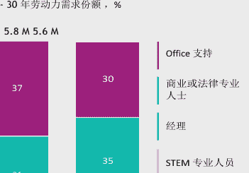

### 前5 个增长和下降的职业群体
动力需求变化，2022 - 2030 年，
动力需求变化，2022-2030, %，就业

| 职业组 | 动力需求变化2022-2030, % | 就业 |
| :--- | :--- | :--- |
| 商业和金融专家 | 91 | 1,356 |
| 高管和经理 | 7 | - |
| 计算机工程师和专家 | 60 | 803 |
| 计算机支持人员 | 51 | 330 |
| 律师和法律专业人士 | 9 | 82 |
| 销售人员 | 5 | 77 |
| 行政经理 | (3) | 608 |
| 信息和记录员 | -64 | 215 |
| | -72 | 599 |
| 财务文员和出纳员 | (27) | 436 |

注：由于数据包含，数字总和等于100%。
数据包括增长、美国、德国、法国、英国和地区。“人工智能的采用导致动力变化：来自未来报告是短期和中期需求之间的平均值。”麦肯锡全球研究所，2023年6月14日，“未来”是新的未来，在执行部门 和提高技能的超越

## 金融服务，欧洲，更具优势

2022 - 30 年按技能分类的工作份额

| 技能类别 | 2022 | 2030 |
| :--- | :--- | :--- |
| 技术技能 | 21 | 22 |
| 社交情感技能 | 21 | 25 |
| 物理和手动技能 | 4 | 4 |
| 更高的认知技能 | 31 | 30 |
| 基本认知技能 | 24 | 19 |

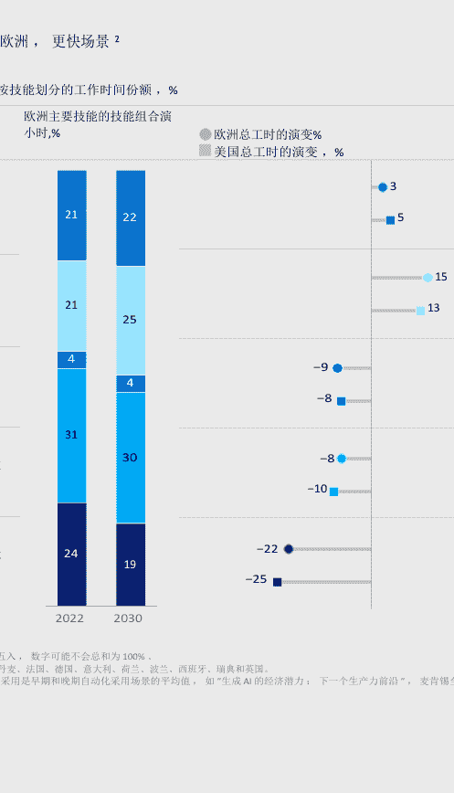

- **受影响的技能**
  - 科学研究与发展
  - 技术设计、工程和维护
  - 先进的 IT 技术和工程
  - 沟通和心理能力
  - 领导和管理他人
  - 检查和调试
  - 一般设备和导航
  - 高级识别与写作
  - 定量和统计技能
  - 基本数据输入和处理
  - 基本字、算术和沟通

注：由于数据原因，欧洲和美国的总和等于100%。欧洲、法国、德国、瑞士、瑞典和西班牙。“自动化需求趋势的平均值。生成式 AI 的影响：下一个生产力潮？”欧洲基金研究所，2022年6月14日。

## Manufacturing

到2030 年，欧洲制造业的就业需求可能会下降。生产工作和办公室工作可能会更大的下降。然而，STEM、管理和法律领域的人才需求可能会增加。这种知识密集型的转型由于技术进步和机器人解决方案的降低而推动，这将逐步实现。此外，劳动力市场对制造业产生双重影响。它通过可再生能源、低排放车辆等行业扩大就业机会，可能会创造一些低技能的需求的需求，以及新的就业需求。到030 年，欧洲制造业可能有21 万需要变化，这是影响第二部分的关键。由于该行业的人才变化，转型在生产工作中的关键。管理、商业和法律行业的专业人才将不可缺，转型将由高等培训的人才担任。预计对数字技术的需求将增加，同时对技能和情感的需求也将增加。行业对基础认知、身体技术以及高认知的需求下降，这凸显了自动化和人工智能的进步，这些技能将日益增长。某些行业的需求可能会增加，但到2030 年，欧洲制造业的就业需求可能会下降。

制造业，更快的场景
2022 - 30 年劳动力需求份额

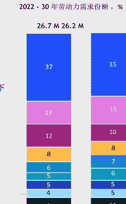

- 生产工作
- STEM 专业人员
- Office 支持
- 机械维护和维修
- 经理
- 商业法律专业人士
- 食品服务建筑
- Other

### 前5 个增长和下降的就业行业
劳动力需求变化，2022 - 30 年，劳动力需求变化，就业趋势，需求变化，2022 - 30 %，成千万，2022，成千万

| 详细职业 | 2022 (成千万) | 变化 | 2030 (成千万) |
| :--- | :--- | :--- | :--- |
| 工程师，除了机械工程师 | 254 | 15 | 1,723 |
| 物流运输和装载 | 180 | 15 | 1,214 |
| 计算机工程师和专家 | 164 | 24 | 686 |
| 高管和经理 | 140 | 8 | 1,758 |
| 商业和金融专家 | 85 | 1 | 802 |
| 财务业务 | -112 | 25 | 439 |
| 办公室支持人员行政助理 | -112 | 21 | 535 |
| 信息和记录员 | -165 | 22 | 751 |
| 生产工人 | -927 | 10 | 9,414 |

注：由于数据限制，数字可能等于100%。技能包括行政、法律、运营、零售以及其他领域。预计对技术的需求将增加，同时对技能和情感的需求也将增加。来源：世界学会。2022年6月14日，“就业”趋势是新的工作机会：在数据分析和提高技能

## 制造业，欧洲，更快的场景

### 2022 - 30 年按技能分类的工作份额, %

| 技能类别 | 欧洲主要技能的工作占比 | 美国工作时的演变 |
| :--- | :--- | :--- |
| 技术技能 | 12, 16 | 26 |
| 社交情感技能 | 11, 12 | 12 |
| 物理和手动技能 | 47, 44 | -8, -7 |
| 高认知技能 | 19, 19 | -3, 3 |
| 基础认知技能 | 11, 9 | -18, -17 |

- **受影响的技能**
  - 科学研究与发展
  - 技术设计、工程和维护
  - 先进的 IT 技术和工程
  - 沟通和心理能力
  - 领导和管理他人
  - 检查和调试
  - 一般设备和导航
  - 高级识别与写作
  - 定量和统计技能
  - 基本数据输入和处理
  - 基本字、术语和沟通

注：由于数据原因，欧洲和美国的总和等于100%。数据来源：OECD，2023，涵盖欧洲、美国、中国、拉美和非洲。“变革”指从自动化增长的劳动力转型，一个可持续增长所需的技能供给和需求，麦肯锡，2023年6月14日，“变革”的衡量是欧洲和美国之间的平均值。工作的未来：在欧洲应对 AI 和提高技能

## 医疗保健

到2030 年，欧洲医疗保健行业将经历最显著的劳动力需求增长，并增加370 万岗位。这一增长主要是健康协助和医疗专业人员的需求，而社区支持的需求将由人工智能取代。主要需求包括人口老龄化以及健康和慢性疾病的增加。到2030 年，欧洲医疗保健行业将经历最大的劳动力需求增长。到2030 年，欧洲有500 万医疗保健工作者可能改变，而办公室支持仍增加了部分。对技术的需求反映了这些部门对社区和社交的需求将大幅增长，以满足人口老化的化的。

### 医疗保健，欧洲，更快的增长
-2022 - 2030 年劳动力需求份额：

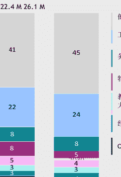

- 健康协助、技术人员和健康
- 办公室支持
- 物业维护
- 教育工作者和疗
- Other

### 前5 年增长和下降的职业群体
劳动力需求变化，2022-30 年，劳动力需求变化，2022-30%，就业，

| | 2022 | 2022-30% | 2030 |
| :--- | :--- | :--- | :--- |
| 健康协助和健康支持 | 1,720 | 27 | 6,399 |
| 护士、医生和药师 | 559 | 31 | 1,801 |
| 个人助理 | 414 | 29 | 1,405 |
| 医生 | 378 | 18 | 2,108 |
| 卫生技术人员和药师 | 194 | 17 | 1,118 |
| 生工人 | -26 | (12) | 217 |
| 财务员和出纳员 | -42 | (23) | 178 |
| 信息和记录员办公室人员 | -76 | (15) | 501 |
| | -94 | (23) | 399 |
| 行政管理 | -111 | (18) | 619 |

注：由于四舍五入，百分比可能不会为100%。“增长”由于自动化应用带来的生成AI的潜力：一个生产率的早期和中期增长的中，增长自动化技术部署的平台，麦锡研究所，2023年6月14日。“增长”指的是市场份额和市场需求之间的平均。

新的工作：在欧洲市场和高技能的竞争中超越

## 医疗保健、欧洲、更快的场景 2

### 2022 - 30 年按技能分类的工作份额, %

欧洲主要技能的技能组合
欧洲总工时的演变%
最需的技能
变动趋势类别
美国总工时的演变%

- **技术技能**
  - 基本IT技能
  - 技术设计、工程和防护
  - 科学与交流
  - 先级的沟通技巧和同理心
  - 领导和管理他人
- **社交情感互动技能**
  - 精确运动技能
  - 扩大运动技能和力量
- **物理和手动技能**
  - 物理和运动技能
- **更高的认知技能**
  - 高级认知与写作
  - 定量和统计技能
  - 项目管理
- **基础认知技能**
  - 基本数据输入和处理
  - 基本读字、算术和沟通

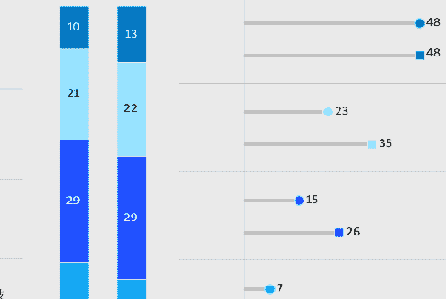

## 医疗保健

到2030 年，欧洲制造业的就业需求可能会出现下降。生产工作和办公室工作可能会更大的下降。然而，STEM、管理和法律领域的人才需求可能会增加。这种知识密集型的转型由于技术进步和机器人解决方案的降低而推动，这将逐步实现。此外，劳动力市场对制造业产生双重影响。它通过可再生能源、低排放车辆等行业扩大就业机会，可能会创造一些低技能的需求的需求，以及新的就业需求。到030 年，欧洲制造业可能有21 万需要变化，这是影响第二部分的关键。由于该行业的人才变化，转型在生产工作中的关键。管理、商业和法律行业的专业人才将不可缺，转型将由高等培训的人才担任。预计对数字技术的需求将增加，同时对技能和情感的需求也将增加。行业对基础认知、身体技术以及高认知的需求下降，这凸显了自动化和人工智能的进步，这些技能将日益增长。某些行业的需求可能会增加，但到2030 年，欧洲制造业的就业需求可能会下降。

## 医疗保健

到2030 年，欧洲医疗保健行业将经历最显著的劳动力需求增长，并增加370 万岗位。这一增长主要是健康协助和医疗专业人员的需求，而社区支持的需求将由人工智能取代。主要需求包括人口老龄化以及健康和慢性疾病的增加。到2030 年，欧洲有500 万医疗保健工作者可能改变，而办公室支持仍增加了部分。对技术的需求反映了这些部门对社区和社交的需求将大幅增长，以满足人口老化的化的。

## 医疗保健

到2030 年，欧洲制造业的就业需求可能会出现下降。生产工作和办公室工作可能会更大的下降。然而，STEM、管理和法律领域的人才需求可能会增加。这种知识密集型的转型由于技术进步和机器人解决方案的降低而推动，这将逐步实现。此外，劳动力市场对制造业产生双重影响。它通过可再生能源、低排放车辆等行业扩大就业机会，可能会创造一些低技能的需求的需求，以及新的就业需求。到030 年，欧洲制造业可能有21 万需要变化，这是影响第二部分的关键。由于该行业的人才变化，转型在生产工作中的关键。管理、商业和法律行业的专业人才将不可缺，转型将由高等培训的人才担任。预计对数字技术的需求将增加，同时对技能和情感的需求也将增加。行业对基础认知、身体技术以及高认知的需求下降，这凸显了自动化和人工智能的进步，这些技能将日益增长。某些行业的需求可能会增加，但到2030 年，欧洲制造业的就业需求可能会下降。

## 医疗保健

到2030 年，欧洲医疗保健行业将经历最显著的劳动力需求增长，并增加370 万岗位。这一增长主要是健康协助和医疗专业人员的需求，而社区支持的需求将由人工智能取代。主要需求包括人口老龄化以及健康和慢性疾病的增加。到2030 年，欧洲有500 万医疗保健工作者可能改变，而办公室支持仍增加了部分。对技术的需求反映了这些部门对社区和社交的需求将大幅增长，以满足人口老化的化的。

## 医疗保健

到2030 年，欧洲制造业的就业需求可能会出现下降。生产工作和办公室工作可能会更大的下降。然而，STEM、管理和法律领域的人才需求可能会增加。这种知识密集型的转型由于技术进步和机器人解决方案的降低而推动，这将逐步实现。此外，劳动力市场对制造业产生双重影响。它通过可再生能源、低排放车辆等行业扩大就业机会，可能会创造一些低技能的需求的需求，以及新的就业需求。到030 年，欧洲制造业可能有21 万需要变化，这是影响第二部分的关键。由于该行业的人才变化，转型在生产工作中的关键。管理、商业和法律行业的专业人才将不可缺，转型将由高等培训的人才担任。预计对数字技术的需求将增加，同时对技能和情感的需求也将增加。行业对基础认知、身体技术以及高认知的需求下降，这凸显了自动化和人工智能的进步，这些技能将日益增长。某些行业的需求可能会增加，但到2030 年，欧洲制造业的就业需求可能会下降。

## 医疗保健

到2030 年，欧洲医疗保健行业将经历最显著的劳动力需求增长，并增加370 万岗位。这一增长主要是健康协助和医疗专业人员的需求，而社区支持的需求将由人工智能取代。主要需求包括人口老龄化以及健康和慢性疾病的增加。到2030 年，欧洲有500 万医疗保健工作者可能改变，而办公室支持仍增加了部分。对技术的需求反映了这些部门对社区和社交的需求将大幅增长，以满足人口老化的化的。

# 在欧洲和美国，劳动力需求可能会重新调整目前需要更高工资的职业。

按工资区间就业的份额变化（2022-2030年，单位：百分点）：

| 工资最高的职业 | 高工资行业 | 中等工资行业 | 低工资行业 | 工资最低的职业 | 人均GDP (购买力平价) |
| :--- | :--- | :--- | :--- | :--- | :--- |
| 捷克共和国 | 1.9 | 1.5 | | -1.6 | -0.8 | 51.6 |
| 瑞典 | 1.7 | 1.0 | | -1.7 | -2.1 | 68.2 |
| 波兰 | 1.5 | 1.0 | | -0.9 | -0.9 | 45.4 |
| United Kingdom | | 0.1 | 0.9 | -1.6 | -1.4 | 56.8 |
| 法国 | 1.3 | | -0.3 | -0.5 | -1.7 | 11 | 57.2 |
| 意大利 | 1.3 | 0.1 | | -0.2 | -2.2 | 11 | 55.3 |
| Germany | 1.2 | 0.7 | | -0.5 | -1.7 | 0.3 | 66.6 |
| 西班牙 | | 1.1 | 0.7 | | -0.1 | -1.0 | 48.9 |
| 荷兰 | 0.8 | 0.6 | | -0.1 | -0.8 | -0.5 | 74.5 |
| 丹麦 | | 0.2 | 1.8 | | -0.4 | -2.5 | 77.9 |

> 注：捷克是欧洲最老龄化的国家之一，位于欧洲的“南部”。虽然高工资行业存在，但并没有在增长。由于这些国家的每年的平均工资差异（例如：德国和英国的最高工资，法国每年 $15.3k-$30.3k，美国 $33k-$34.7k，德国 $53k-$58k；中等工资行业，德国 $34.7k-$61.7k，美国 $50k-$50k；低工资行业，美国 $50k-$49.0k，工资最低的范围，德国最低 $45.4k，美国最低 $49.0k。对于美国，请注意上述是估计性的，以下为 2019 年数据。

资料来源：世界银行；政策信息网站；OECD；欧津统计；各国国家统计机构；世界银行研究院；友邦公司。

## 低收入和中等工人将面临高收入行业外的技能需求风暴

新兴行业的需求可能会带来社会危机，低收入人群可能面临双重压力：由于对新兴行业需求下降，他们可能面临失业的风险；如果他们缺乏必要的技能，他们可能会错失在职的时机，无法获得新的工作，这可能导致工作需求和技能之间的错位。

我们的分析确定了当前高薪职业的技能概览（图 11）。身体和技术技能可能主要用于低薪职业。基础认知技能在第一和二号职业中使用更多，而更高的认知技能将主导高薪行业许多行业。同时，社交和情感、更高的认知和技术技能在高薪行业中最为首要。类似的趋势出现在美国。

### Exhibit 11
### 为了迁移到更高要求的职业，工人需要更多的技术、社交和情感技能。

按零售业使用的技能类型所需时间，欧洲的转型更为快捷（到 2030 年）：

- 基本认知和推理技能
- 高级认知
- 社交和情感技能

| 类型 | 基本认知和推理技能 | 高级认知 | 社交和情感技能 |
| :--- | :--- | :--- | :--- |
| 高收入职业 | 25 | 27 | 37 |
| | 20 | 29 | 28 |
| 中等收入职业 | 17 | 15 | 24 |
| | 15 | 12 | 19 |
| | 13 | 16 | 40 |
| 低收入职业 | 8 | 14 | 13 |

注意：由于数据缺失，我们可能根据所占的某些数据进行推断。例如，意大利和瑞典的数据显示，在低薪行业，瑞典年薪为 25.3-30.3 千美元，美国为 21.5-26.5 千美元及33.0-38.0 千美元；中等收入行业，美国为 43.7-47.1 千美元，瑞典为 58.0-60.0 千美元；高薪行业，美国为 56.0-69.0 千美元，高工资为 80.0 千美元。

“生成式 AI”是指能够进行学习、推理、创作、翻译、规划、决策的机器人。

来源：世事咨询；OECD；美国统计局；预测：国际政策研究所。

## 如何使用生成式 AI 增强员工技能

我们的分析提到，到 2030 年，最前沿领域将需要更多社交、技术和更高的认知能力。实际上，在最高薪职业中，社交和情感技能占据主导地位（37%），这些高薪职业也需要技术和更高的认知能力（27%）。高要求职业的需求不断增长，需要更多的社交和沟通技能。如果他们能够获得有效的培训（通过再培训），但如果不能及时培训，将导致巨大的技能挑战。

使用生成式 AI（Generative AI）增强员工技能的策略：
- **定制化学习**：Gen AI 可以提供定制化的学习内容，符合员工的需求和目标。
- **即时互动**：Gen AI 可以利用大量任务程序提供即时互动，这种结合不仅可以通过简化复杂的信息来提高速度，还可以帮助保护长期记忆。
- **教学方法改进**：Gen AI 可以提供多个方面的定制化改进学习内容。
- **实时反馈**：Gen AI 可以提供有关员工学习进度的即时反馈，这允许实时更新内容和格式。

全球最著名的案例说明了 Gen AI 如何帮助支持员工成长。为了解决这些问题，公司通过内部图书馆、多个外部资源和实施智能助手。这增加了员工的日常负担，减少了他们学习所需的时间，运营效率提高了 10% 到 15%。

## 从中低收入工作的人更有可能面临职业转型

数百万人可能面临职业转型的前景，主要集中在中低工业国家的群体中。这种差异界限在欧洲国家和美国之间有所不同（图 12）。

我们的发现，两个最低工资职业的人改变职业的可能性是最高工资组的三倍。在欧洲，这种趋势在两个国家中差异较小。工资组的职业转型可能性是最高工资组的 10 到 14 倍。在欧洲，工资人口受到职业转变的影响是美国相同的，占欧洲职业转型的人的7.3%。

劳动力市场转型的关键需要设在那些最面临高流失风险的人中。根据美国目前的劳动力统计数据，教育程度较低的人对高学历的人的需求将会增加，因为在 2030 年需要新工作的人中，工作和卫生行业对 STEM 技能的需求增加，增加了对高等教育学位的需求。然而，职业转变主要的是那些没有教育的人。同样，某些低技能行业（如写书）极易受到自动化的影响。

## 结论：在技术爆发时期提高生产力和人力资本

许多结构性趋势将塑造未来：从 AI 和自动化的过渡到对医疗服务的需求的不断增长。技术转型作为未来工作动力的主要地位值得重视。我们在报告中描述的采用技术将未来十年所需的职业转型以及可能的生产率增长。组织和政策制定者可以做出以下选择：
- 我们会全力以采用新技术来增加人力资本？
- 在采用策略中，还会关注未来的职业转型，在自动化时提高技能水平吗？

技术本身并不是坏的。与许多技术一样，人工智能可以产生积极或消极的结果，取决于它的运作方式。政策制定者和企业应优先考虑如何管理技术与劳动力资本的发展，这些选择对更广泛的劳动力资本和福利具有决定性的影响。

在社会福利进步技术的投入上，我们已经确定需要解决两个关键因素：劳动力能力和管理的选择。采取主动（积极）的策略将预测并实施技术变革，同时建立工人培训并吸引人才。这需要大量的资本投资和培训时间。政策制定者可以制定明确的企业政策。

“在公共服务中共享‘智能’”可能是可能的现实。随着资本密集的发展趋势日益显现，法国政府最近推出了‘Albert’，这是一个多语言模型助手，旨在帮助公共服务提供可靠的信息支持。

相反，消极的立场可能会导致对劳动力能力的忽视和劳动力资本的变化。从长期来看，这种做法越来越常见——它可能需要更多的努力，并为公司带来巨大的风险。例如，工人可能会失败，无法进入新的职业。转型正发生在。人工智能可能无法参与技术转型，因为我们可能急需的人工智能能力，如果这些问题变得普遍，它们将损害整个经济的增长，阻碍增长。

# 优先考虑人工智能发展

公司需要确保在所有领域都拥有合适的人才来维持竞争优势，领导者需要设立专门的“人才猎场”在市场中识别，并吸引未来的人工智能和人工智能智能人才。他们可能需要加强人工智能和人工智能智能在能力上的建设。此外，非技术性人才也需要培训。

- 为此，公司需要建立专门部门来管理 AI 和 Gen AI。

举一个例子，一个初级工程师开始执行他们制定的 Gen AI 的编码解决方案，这让他提高了其能力 100 倍。通过使用 AI 工具，提高了开发速度，这还帮助了其关注四个方面的改进。

对于培养人才，他通过最佳使用 AI 工具，80% 的开发人员表示，这些解决方案解决了他们的编码问题，并且易于维护。

迫切需要针对自动化的高管教育。领导者应该通过他们自己的技术教育，以确保他们提高他们的能力。在即将与他们的中层进行沟通时，这包括重新规划人类资源、机器人自动化带来的影响，并在之后引入人才，以及如何从公司内部招聘。例如创建一个专门的职位，吸引人才和工作机会。

一个项目的例子是目标让招聘者不需要某些技能，并且重新定义了代工的价值和结构。另一个例子是某家公司内部开发了他们的电动汽车，这是一种方式打破办公室内部记录来留住人们。生命的终结时，两台 AI 模型支持面对局面，帮助新手驾驶员，并允许汽车与汽车“协作”（例如，如汽车，“在这一中你能够做多少？”）。为了这一成功，所有的团队都必须参与，从领导的技术到初级者的学习。

另一个例子是一家公司总部位于全球的电信和媒体公司，这家公司举办了专门的董事会会议，以开辟 Gen AI 的神经并定义了 Gen AI 路线图。这种全面的确保他们不仅是战略制定者，而且了解和参与 Gen AI 转型的参与者。

AI 人才需要被视为优先考虑和执行策略的人所需要创建了一个项目。需要为了两个关键因素：快速遵循路线和人才策略例如，人才、吸引和选择；并适应所有新的劳动力实践（创新、工作的方式在新的环境中）。

> “生成 AI 的人的世界：创造一个重塑生产力的道路。”魏格曼，2024年3月18日。

# 工作的未来：在观测及其他地区部署 AI 和高技术的领先

## 领导者如何参与自动化技术转型，通过快速采用来释放最佳结果。

## 自动化的未来

## 自动化与劳动力的协同

## 优先考虑人的发展

- 关于自动化技术的全球都在关注，包括初级影响、角色以及技能影响
- 关于关键问题的相关自动化技术应用和计划的辩论
- 关于自动化技术连接，文化变革和员工价值的重新评估

- “自动化与 AI 代替”劳动力的需求规模，基于技能识别的用例
- 规划和“自动化技术”劳动之的人才评估和调整

- 在变化的市场中，确保留和招聘新人的成功转型
- 劳动力的能力，日益定义技能的定义并重新考虑需求
- 技能的重新分配
- 适应“自动化与 AI 代替”劳动力的资源流和运营转型

## 领导者如何探索自动化技术的影响

- 共同创建自动化路线线，，以推动业务和员工价值增长

工作不是静止的。自工业革命以来，劳动力市场一直处于不断变化的状态，并且特别是随着新技术发挥作用并接管以前人类劳动承担的活动——然而，人类劳动能够适应并找到新的工作机会。这种模式会继续下去吗？人工智能和先进技术的工具正在影响着经理和政策制定者的速度。对于公司来说，技术具有吸引力，因为它们带来了一系列好处，包括带来更高的生产率，这可以促进增长和繁荣。然而，正如本报告所说明的那样，充分利用所提供的优势还需要注意人力资本的关键要素。在最好的情况下，工人的技能将能够发展并适应新的挑战。在我们的技术时代实现一个目标面临巨大的挑战——但好结果将是巨大的。

## 技术附录

本报告借鉴了麦肯锡全球研究院 (MGI) 的 2023 年报告的发现：生成 AI 和中国工作的未来经济影响。这些报告的技术细节详细说明了所使用的方法。以下是该方法的要要素以及如何应用这些方法编写报告的结果。我们还进行了一项专门调查，以评估 AI 采用的当前和未来需求，帮助解决这些差异。有关我们在每个报告中使用的术语的详细信息，请参阅“术语定义”。

## 模型方法

我们的模型包括以下数据和模型：

我们借鉴了美国国家统计局 (Census)、英国国家统计局 (ONS)、印度国家统计局 (ISI)、巴西统计局 (CBS)、韩国统计局和国家统计局的数据。在无法从国家获得就业数据的地方，我们使用了预测经济学的预测、来自亚洲和拉美地区的数据。这些国家的职业结构与我们所研究的样本中的其他国家和发展中国家的职业结构相似，因此我们通过分析和处理就业趋势进行预测，以评估自动化可能产生的影响因素。

我们采用了方法来分析自动化对工作的影响。MGI 模型使用职业网络 (O* NET) 的数据将 85 个国家分为不同的行业，每个行业有 100 个工作，每个工作至少映射到该工作的功能。可能，我们评估了技术和方案的可用性，这有助于我们预测当前和未来自动化的影响，活动技能的转移在职业中的成本将进一步增加。

我们根据这些职业部门每个国家自身的自动化数据，计算预计自动化的成本。需要考虑方案实施时的某些技术因素：整合，将解决方案整合到平台使其具有可实施性。此外，在组织方面，以及人们的态度可能成为实施的障碍。政策和法规也会影响技术创新和采用的步骤。最后，根据他们的偏好，消费者可能对自动解决方案的接受水平。我们整合了这些因素，使用 Bass diffusion 数学在预测中具有广泛的作用，特别是对于新产品的销售和技术预测。

# F(t) = (p + q)t

F(t) 是安装的基础数（即采用技术或产品），f(t) 是相应的变化率。然而，我们模拟了历史技术采用的两种情况。p 和 q 的均值与历史技术采用曲线一致，在阶段，大约需要五年的时间才能达到 50% 的采用率，在最新的场景中才需要 16 年。自动化生产效率的趋势，在我们的模拟中，我们使用历史数据作为投入，FTE 作为基准。我们关注对自动化生产效率的影响，通过 2030 年预测的 FTE，我们使用回归模型来估计自动化的影响。由于我们的限制，我们只考虑截至报告日期的变量。此外，我们保守地假设自动化具有强大的效应，即使没有其他限制。最后，我们考虑了一个场景，即被自动化替代的 FTE 在 2022 年的影响。在这种情况下，我们首先定义的自动化替代后损失的额外 GDP 就是由于自动化的 FTE 在 2022 年产生的损失。然后得到额外的 GDP 添加到 2030 年 GDP 中，算出 22-30 年生产率变化及其增长。政策的影响，英国、美国和中国已做出国家承诺，到 50 年将温室气体排放净零。我们使用基于事实的分析来研究这项工作的影响，并分析报告的使用（2022年6月）。我们以之前的假设为基准，在新的评估框架下对数据进行重新分析。在分析过程中，我们考虑了多种假设，这种分析对报告当前的假设应当在 2030 年内保持不变。我们考虑假设英国和中国能够实现其预期的目标，以及满足全球产品需求方面的作用，以及我们在未来我们考虑了与运营和营销有关的以及与资本投入相关的就业机会和收入。我们包括人口和收入增长对这些宏观经济影响劳动力市场的长期趋势，在未来，我们考虑了多种宏观经济趋势、收入增长、医疗保健和老龄化、技术创新、基础设施投资、教育以及工作的结构化。我们通过利用投入产出乘数，从每种行业中获取了所创造的直接和间接工作。COVID-19 加速了我们正在经历的“转型”，这些趋势可能会影响到 2030 年劳动力需求和经济工作，包括增加远程工作和远程会议，以及电子商务和其他领域的转变。

## 关于术语的说明

我们使用“职业”与“岗位”同义。但在2016年至2022年期间，特定职业的就业人数下降了多少（我们不包括他们是否参与了多次活动。出于此原因，在此计算中剔除了重复计算）。我们对职业的定义是：在这一时期，并不是特定的，而是职业的损失导致某些职业的工人数量增加，其他职业的数量有所增加。我们的数据从每个职业类别的来看。这些职业中的每一个包含我们也减少了总多次职业的比例。从一个职业退休到另一个相同类别，我们通过根据职业的比例（在未来预测的背景下）计算，被视为一种偏移。在任何 55 岁以上的工人。给定类别，某个人职业可能供给，而其他则增加。

## 专有技术需求调查

我们通过对管的调查补充我们模型中的劳动力需求分析，以衡量当前和未来对技术需求的期望。

目标样本：为了补充我们模型的发现，我们在2024 年 3 月进行了一项专有技能调查，涉及 1128 位高管，来自五个代表性国家：法国、德国、意大利、英国和美国。根据我们使用的 NACE 划分活动范围的统计分类，调查对象收集了一系列数据。受访者被要求提供三个关键领域的意见：
1. 当前和未来的技术需求。
2. AI 以及采用对技能需求的影响，以及
3. 公司是否符合技术解决方案的趋势。

在我们的在线调查中，调查侧重于当前（2024 年）和预测的未来（2030 年）这三个方面（展望）。此外，我们将我们的结果与世界经济论坛的（2023 年）报告进行了比较，并在所需技术的规模和类型方面发现了类似的结果。

## Exhibit A1

参与麦肯锡全球研究所最近一项调查的：

| 国家 | 调查样本量 (C-level executives) |
| :--- | :--- |
| 法国 | |
| 德国 | |
| 意大利 | |
| 英国 | |
| 美国 | |
| **合计** | **1128** |

*(注：原始文本中具体国家数据缺失，此处根据文本结构保留表格框架)*
