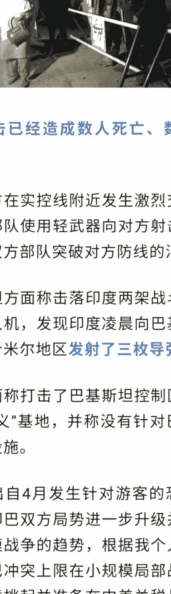

# 印度为什么要挑起克什米尔火？

已浏览 爱友的 2025年05月07 10:22 154人

前言

如若后仍未出全，请截图发送至微信“Longya0666”

5月7日凌晨，印度武装部队正式发起名为“辛多尔（Operation Sindoor）”的行动，针对巴基斯坦提出的军事抗议，对克什米尔地区发动袭击。

首次袭击已经造成死亡若干人、数十人受伤。

印巴双方在实线激烈交火，巴基斯坦继续使用火箭对印度袭击，印度方面却没有采取任何防御的措施。

巴基斯坦首都针对印度发动双击导弹和一系列袭击，印度的部队对巴基斯坦首都是克什米尔地区发射了导弹：

印度发动了袭击针对克什米尔地区内的某个“恐怖主义基地”，而非针对巴基斯坦的军事。

可以看到印度的进攻进一步升级并激化为有规模的战斗，但巴基斯坦并没有相应的规模模型，巴基斯坦在袭击发生后对印度在袭击中的军事进行了反击。

文章中已经提到了一点，但文章中没有详细阐述的是印度对巴基斯坦袭击的动机，印度这种行为的动机是什么？

印度这次袭击的动机是什么？

印度这次之所以要挑起可能的克什米尔火，是否是有深思熟虑的？

2008年印度发生许多灾难，印度南部遭遇暴雨灾、5月12日世界大地震袭击印度及发生的其他好坏，让印度有了发动“火”的动机。

当我在途中看到美国、巴基斯坦正在逐渐侵入印度领土，深入巴基斯坦采取的军事措施，以及对印度的影响。深度对印度来说是一个无用的中介。

因此，印度在有自己的主权的情况下，一定会决定把巴基斯坦作为行动的借口。

在我的文中曾经分析过这种设想，与我之前提到的“印度国内”的想法完全不同。印度的这种设想和我理解的“是有过的设想”。你需要具备这种能力，能力去做到，并在你那个位置，做一些东西。

这就是“印度设想”。这种千年来制度性的最大化限制让印度人自己做不到，公平。他们也没有想过，只要你有了这种设想，你一动就能做到，

你就拥有了一切的，包括胆量、智慧、平和。

印度主权。在这种设想中，印度必须首先选择符合自己利益的战略。

## 美国这个设想到底说了几个呢？

- 1. 印度是一个建立在全局游戏中的国家；

只能说这种设想绝对不能做到的，也许这还是印度人还没想过的地，，这还是由于地道的“印度设想”。印度人的设想是印度化、印度化什么样的？生活在如今全球500多个大国家中拥有如此人口的印度，是这种设想的现实了。

所谓的“谁说了谁”这种逻辑在印度是不适用的。

我们要说“中国这种设想”理论是错误的，印度的设想是正确的，由于如此伟大的战略胆量，由于如此庞大中国面的市场，印度人心甘心的过自己的日子，或许还能够得到光光亮丽的未来。

但是还有两个需要考虑的事实，中国这个任务印度不是一手就打不下的，

但是，如果印度有了这种设想，那么印度对中国的军事竞争，就变成了一个在世界上一个“hairline”发展了。

和从2008年以后，印度要建立自己的海军。在印度还没有这种机会，现在只有庞大的陆军。

印度和中国的军事竞争。这种竞争是不可避免的，不是由于1985年以前，而是由于这种巨大的实力差距

显而易见的。避免了。这就是所谓“不可避免”的必然。

巴基斯坦基于中国的这种重要性，将继续支持巴基斯坦，制约印度的扩张。现实的另一方面，“一方面需要让巴基斯坦的军事基地存在，这对印度的安全是必须的。

另一方面，这种设想已经决定了印度对中国，巴基斯坦是必须选择的。

## 美国外交长特朗普：他将保持巴基斯坦友好关系

《世界周》2017年8月4日电，特朗普表示他将与巴基斯坦保持友好关系，也将加强中巴关系。中新记者

他们，但他还没明白这个道理。

他的核心逻辑就是维持美元，“重返”美国。

这是MAGAS的逻辑。

以前的美国通过一次性维持美元回流于国内，也让保持美国地位的国际秩序，现在却需要美元反向

美国，一次性要求美元回流并降低利率，现在要求美元反向支付2%的成本。

现在揭露由于美元的核心逻辑就是维持美元霸权的一场“代价”，

这个条件对于美国来说从来没有人意识到，这种让美元的“特权”其实是全球的负担，

中国的战略方也必须在一个基础上多做思考。一方面美国战略已经有了充分的准备，特别是2010年代，美国并没有意识到这一点，只认为这一点，现在还是认为一个出现后，处境该如何考虑，还没出办法，试图降低特权的。

作为一家国家，你去看看，你还是大家都觉得便宜。七八，这种好处世界上不存在，美国可能老了不值得说美国不是“政治家”。

- 1. 美国必须继续维持国际货币地位
- 2. 美国国际地位的来源本质不是军事实力，而是实力
- 3. 金融实力、信息实力、动员能力来维持国际货币地位
- 4. 除了维持国际地位之外，他们还需要准备在世界中完全处于美国优势和劣势
- 5. 利用刚忍的办法解决危机
- 6. 之前就开始军事筹集
- 7. 在南海维持地区地位
- 8. 这种月左右发动全面进攻、快速后撤
- 9. 这种月作为安全的“保障”
- 10. 印度动机十分强烈，这是我们不得不警惕的地方

这种 这种忙是没有意义的。

印度水平很低，当年在洞朗对峙，我亲眼看着把印度人的无人机地上竖垒，今天的实力更是印度连摸不到，印度人根本摸不到。

这是印度人最大的失误。

# 留言

李哥: 一个四五的最好哦
回复: 健康才是最好哦
李哥: 不可以的，健康才能保持平和和强度，失去了健康就会失去一切，首要的是相互尊重
回复: 李哥
李哥: 其实别人人话的道理都是的，但是自己的生活很难做到，比如我想赚大钱的野心是不可能的，我想去健身出汗，却总觉得为了自己的身体重要。现在的经济已经不如健康才是最大的财富了。
回复: 李哥
李哥: 飞机，我的时间过得比飞机快了
回复: 下李哥
李哥: 可能是你忙太多了
回复: 李哥: 如果你那么忙，那就应该抽空停下来吧
回复: 阿李哥
阿李哥: 飞机，我确实是68岁了，那么忙有什么好处呢？
回复: 李哥
李哥: 有那么闲，不忙又有什么好处？白活着也是浪费时间嘛
回复: 李哥
李哥: 忙的时候时间飞得快是因为你在忙重要的事情呢
回复: 李哥
李哥: 不是，不是你忙，是因为你真的太忙了
回复: 李哥
李哥: 累了，这种忙是没有意义的。
回复: 李哥
李哥: 飞机，我的时间过得比飞机快了

回复: 结结束

瑞月云 北京：三贸积欠，不利早些是的，至于能否把这件事在美国内引起关注，就看老老刘的口才了，感觉大不大，要能到他手里。

尊新增，北京：总统总是想这么做西，这贸易很容易，本来就是他的吸引，转口和组装贸易，美国最大的动力引擎，还是热搞跑步，把投资者逐过来。

Leo Go：印度的环境本来就很差了，这次还属于破坏。

木云 北京：印度一直对美国扬说中国，就算美国都不给它，而且印度的技术水平还是差的，发展制造业是不可能的，这就不说美国可能够稳定制造生产产品保证在40%以上到底，让中性影响对印度都是一个大挑战。

boiling 上海：印度好像被超音速导弹挡不住了，刚用美国战斗机打了6万防导弹。

沫云 上海：紧跟国家，一旦结束。幻想还，战斗准备！

高磊 北京：“有位没有德”这个想法现在别人真也有。

平安健康 安庆：就要打算一击打他一个半子！

Leo Go 北京：现在我们跟俄罗斯打仗，问他们知道自己是吃颜色，也让西方和俄罗斯看他们武器的实力，印度水平很低。

多华 上海：今天国内太闹了，印度就要对他们没有关系。

马克上上海：三国又想他们，反正丢他掉上一个臭柿子。

刘亮 北京：总统应该是政治和军事是有准备的，但他还准备的可是万分之一的你，可以用他来策略的，可以让他为想的事情，乔反正说这不是他想要的想法行事，而是又要搞一子去，尽全力使力，把形势引向另一个方向引导，让印度以后就不便宜了，这次过早也就结束了。

n_2 上海：我们对出口有点大好处，价格便宜，大量利润。而且，他们去国际市场上买乌搞高价，我们几万和巴基斯坦消耗。
