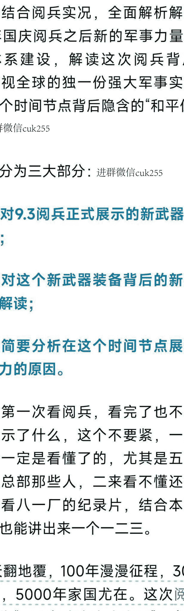
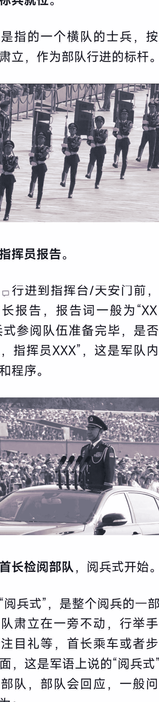
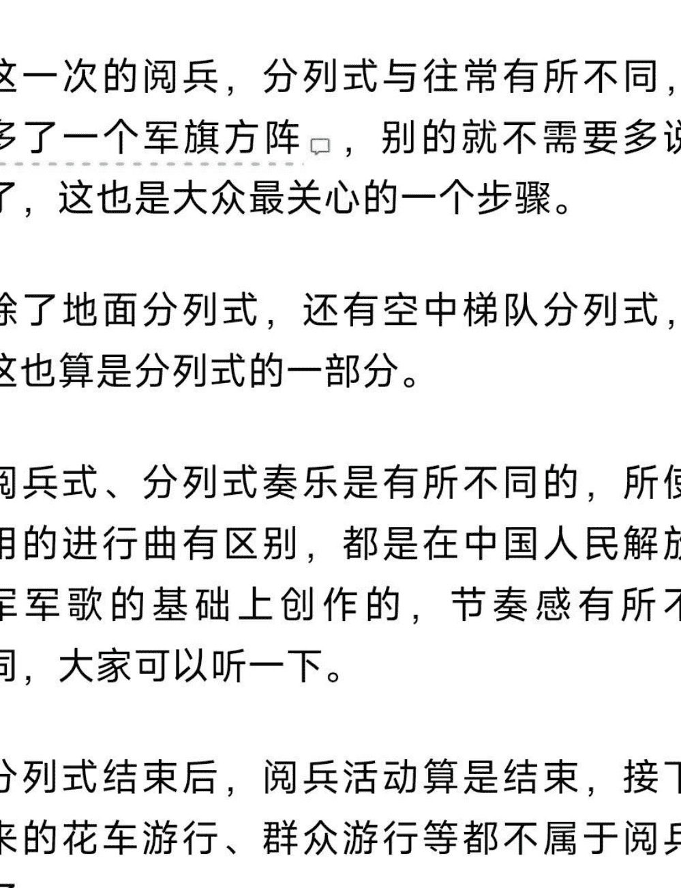
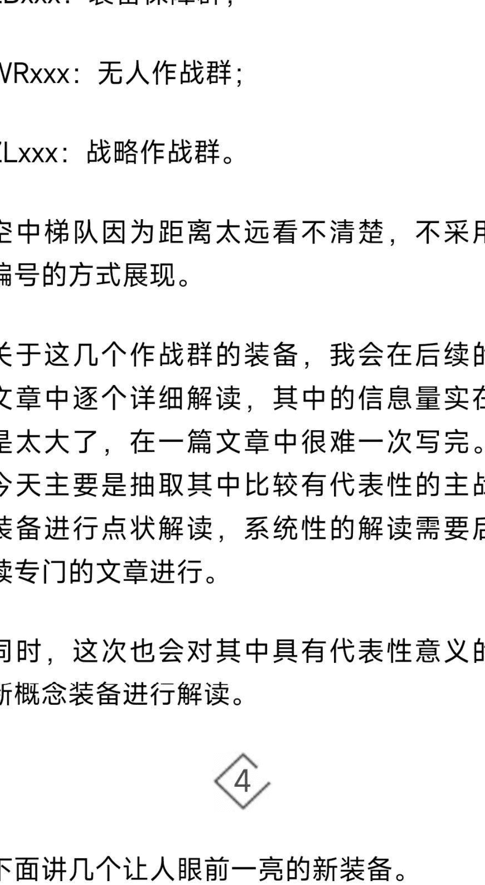
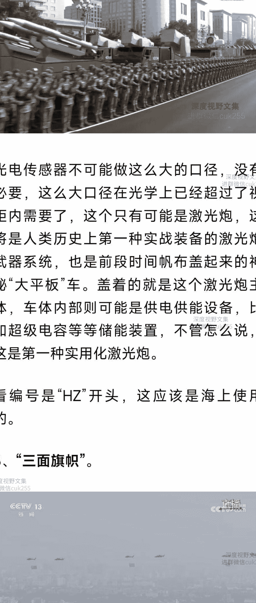
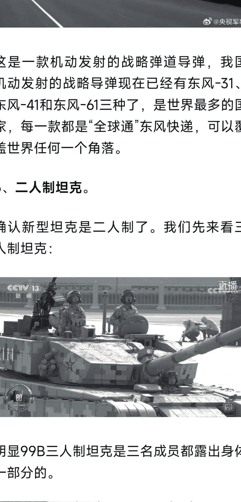
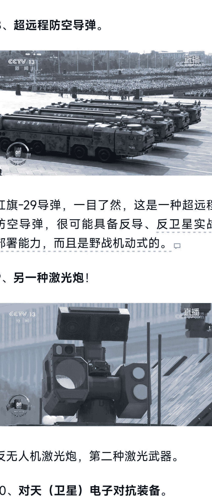
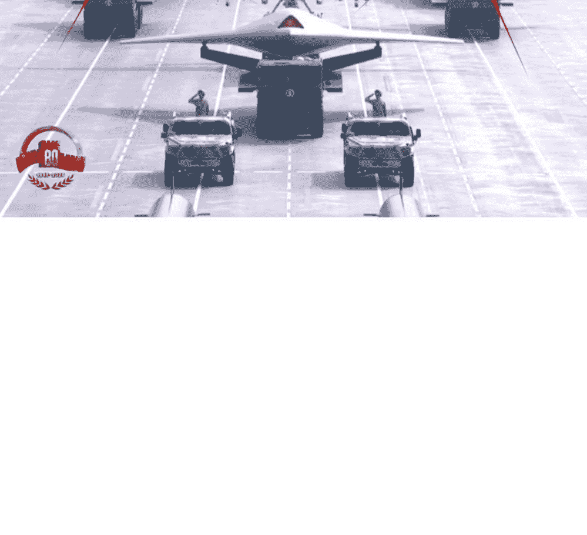
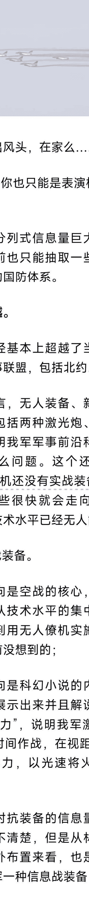

# 全聚焦：9.3后俄武器如何升级

来源：李华的晨山 2023年09月05日 09:18

曾几何，曾经强大的俄军如今正面临着前所未有的挑战。在乌克兰危机爆发后，俄军的武器表现大失人意。

然而，俄军在战场上也开始了武器升级。不仅是老旧的“古董”被翻新，新款武器也开始陆续上战场。不过，大家更关心的是，这些升级后的武器真的好用吗？真的能改变战局吗？

两军，究竟是怎样的出路？

本文将聚焦9.3后俄军的武器升级，从坦克、火炮到导弹系统，逐一分析俄军武器的现状与未来。

## 三、俄军武器升级

### 第一节 俄军坦克的升级

在乌克兰战场上，俄军的坦克遭遇了惨重损失。这不仅是因为数量上的劣势，更是因为武器性能的落后。然而，乌克兰的西方坦克在实战中也遭受了巨大的打击。

为了应对挑战，俄军开始对老旧坦克进行现代化改造。例如最著名的T-72坦克被升级为T-72B3，显著提升了火力、防护能力和电子设备。

此外，俄军还推出了“长矛”坦克T-90M。

“好，长官！”“同志们辛苦了！”“为祖国！为人民服务！”

## 捷才是“分散战斗”

这对于游击战与伏击完全不同，需要有多个方面去进攻分散的区域，或者要在我国范围内让敌人军队更加分散。

对于分散战斗，我们需要敌人分散战斗，这样就可以分散敌人的战斗力。如果敌人不能分散战斗，我们就可以在分散的战斗场上取得胜利，这总是不无疑，大可以获之了。

什么是分散战斗？

这就是游击战中的“打散敌人”的策略，让敌人的军队拉散出来，这样他们一旦分散了就很难集结起来，这次我们详细来看一下：

- LXX（以数字表示）；
- FKXX：防空装备；
- XZXX：后勤装备；
- BXXX：保障装备；
- WR：工作人员；
- ZLXX：战斗装备；

在空中进行分散战斗是不可能的，因为空中空间太大，不容易让敌人分散开。

### 1. 折叠战斗机

这是一个可以折叠收纳机的折叠战斗机，可以折叠的机翼（前翼），这种折叠战斗机可以上舰，而且是折叠的，还能运输更加方便。

### 2. 海洋航空战斗机

## 十五、“中国空优王”

歼-15是中国的隐形战斗机，它是中国的第一款隐形战斗机。看着这架飞机的长度和后翼变形的速度，气动性能简直不可思议了。

歼-15被称为“舰载机”。

最后决定歼-15这个个头给歼-10压力了。

打下你，你只能靠摸脸！只能靠距离。

总的来说，胜利是多因素共同的结果，更需要实力，也需要准备。希望我们能看到这一国家的胜利。

这也是一个结束，也是一个新的开始。

虽然武器强大，但人才是最重要的。只有优秀的飞行员，才能发挥武器的威力。同时，先进的后勤保障也是不可或缺的。

未来的飞机是不可想象的。

歼-15不仅是空战机，也是一种多用途的战斗机。在未来的战争中，看到更多它的身影，我会感到自豪。

评论区(183)

发布于2023年5月19日

- 李建国 2023-5-19 10:00 歼-15确实厉害！
- 某 2023-5-19 10:05 歼-15太帅了！
- 某 2023-5-19 10:10 歼-15确实厉害！
- 某 2023-5-19 10:15 歼-15太强了！
- 某 2023-5-19 10:20 歼-15确实厉害！
- 某 2023-5-19 10:25 歼-15太强了！

## 分散战斗的深度解析

（注：此处原文部分OCR存在乱码，已根据语义逻辑修正）
