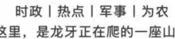
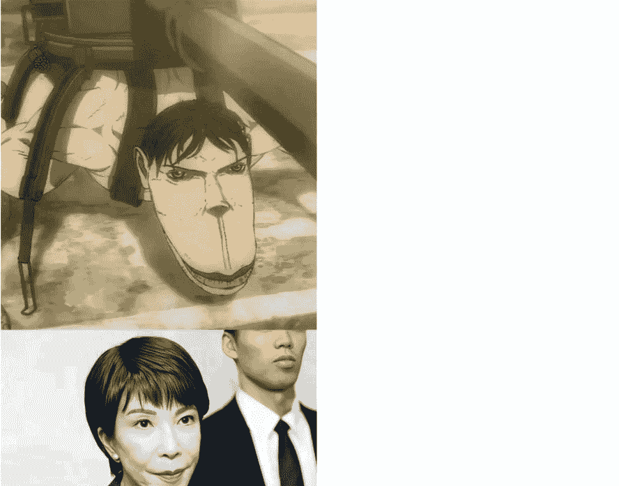
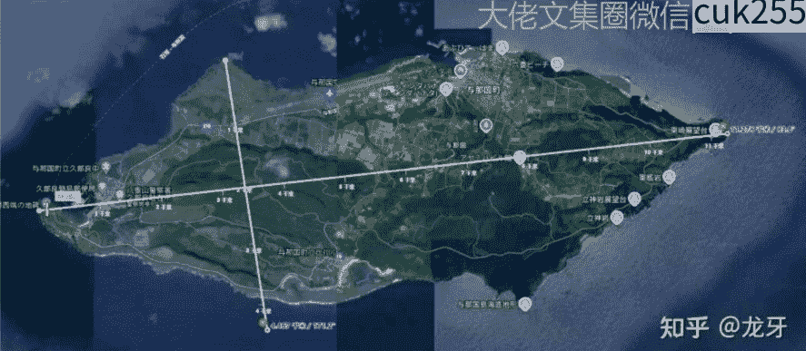
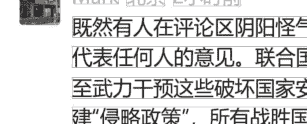

# 高市早苗为什么执意要升级中对抗——一场隐形政改正在发生

已付费

原创 龙牙 龙牙的一座山 2025年11月25日 10:23 宁夏

## 前言

如无法付费请添加小编微信“Longya0066”

的一切痛苦，都来自于愿望与能力不匹配。

这段时间以来高市早苗那脸脸的我让我觉得眼眼睛，丑、凶、望之不似人形，却是要高强度曝光，是真正意义上的视觉污染。网友们确实她叫“车力巨人”我觉得我有一定道理，不光是面相得很像，也给人一种异类感，就算是在气森森的日本人里里面也是“出类拔萃”的那一种。

深度视野VIP群 人工追踪50+大V 付费进群加微信cuk255 微信chp5568

车力巨人欧巴莱最新崭新的活儿是在临近台湾岛的与那国岛部署所谓“中程导弹”，是进一步挑起了中日纷争，把本来就紧绷的中日关系一步推向了破裂的边缘。很多人对于这个导弹的部署还有不明确的地方，后面我会详细解释，总之，这是这个冒天之下的大不起的行为，挑衅意味很重。

看得出来，车力巨人欧巴莱是在顶着压力强强度。

那么为什么高市早苗似乎上下一句不要命的滚嚎，恐怕是直接接触《波茨坦公告》基本原则也对所不惯呢

在分析过程中西方政客时，一定要记住一个准：醉者之意不在酒。他真想要的，跟他哪里里的、手上的往往不是一回事，需要一段时间才能明白他到心里藏的是什么。高市早苗一举妄动触动了国际关系，真正的目的并不是出日本的国家的利益，仅仅是她的政治野心在看来，明确这一点了。对于掌握胜利后后对日本走向的方向，非常重要。

深度视频VIP 人工造50x+AV 付费加微信微ck255

简而言之，你需要清楚：

- 1. 高市早苗正在做什么？
- 2. 高市早苗背后的势力是什么？
- 3. 她能成功吗？

与那国岛是台湾东侧约110公里处的小岛，属于琉球群岛的范围，东西长11公里，南北宽4公里，总面积约40平方公里。

与那国岛的定位问题，这里有一个模糊空间：

- 日本主张其属于日本主权领域，并以此依据划领海、专属经济区：
- 美国通过非法的《旧金山和约》承认日本对琉球群岛的主权：
- 中国不承认《旧金山和约》的合法性，主张以《罗约宣言》、《波茨坦公告》为准则，不承认日本对琉球群岛的合法主权

这里面众诡很多，没有少有有心的人故意曲解大量错误流传，值得注意的是中国、苏联共同参与拟定的《波茨坦公告》明确指出日本的主权范围在“本州、北海道、九州、四川及日本人所决定其他小岛之内”。而《旧金山和约》中都没有签字，对于中国而言是一张废。

许多日本人的人都玩弄的模糊空间就在于此，他们试图曲解中日建交联合公报，强行在中国在任何地方没有承认的《旧金山和约》加强在中国头上，必须要严厉对待

深度视野VIP群 加入50直+AV 付费微信cuk255 微信ch5568

1. 中国政府和中国任何一个领导都没有在任何场合与正式文件中承认日本对琉球的主权：
2. 因高市早苗首先违反反日建交的基本原则——“一个中国原则”，中日建交的基础已经不复存在。

所以，不管怎么说，无论从任何方向来说，中国都可以理直气壮、名正言顺的主张琉球独立或者交由联合国托管。自然然而，作为琉球群岛的一部分，与那国岛同样如此。

高市早苗推动与那国岛部署防空导弹的恶劣性质就在于此。

接下来来看日本在那国岛部署的部队和装备实际水平:

与那国岛平面很少，东西两端各每一个城镇，北边一个跑道长2000米的机场，南边一个小渔村。其中日本临自的基地位于西部的城镇内，主体面积仅有两百米方的子迹，是个典型的营级守备部队。

龙虎果园微信cuk255
大佬文集团微信cuk255

根据营房特征看，应该部署了4个连级战斗队，有军库、室内活动场地、办公设施和生活设施等，总部规模不可能超过一个营。而且不存在重武器部署的迹象，没有重武器专用道路，没有坚固掩体和专用车库等等，这是一个轻步兵单位。岛上剩余的军事设施就只有一个自有导航台、一部导航雷达，以及那条2000跑道。这个跑道长度十分可怜，只能起降小型运输机，波音737级别的客机起降，战斗机和军用运输机就属于淡了。另外，这次部署的导弹应该是个洋货。

深度视野VIP群 人工追踪50+AV 付费加微信cuk255 微信ch5568

所谓“中程导弹”是日本03式防空导弹，最大高仅有10公里，最大射程20~50公里（依据目标不同），最大飞行速度仅有2.5马赫。虽然义上属于“区域防空系统”也有反弹能力，但是这个数据怎么看仅仅是名义上的，这玩意儿说呢。总之，根据部署地点和跑道性能，这玩意儿几乎不存在，在现代战争中完全没有生存能力，无法对我国军队造成威胁。打掉这玩意儿我都浪费导弹，一架辐射导弹就能压制它。

这个“小摩托”，抓去就丢，它开机就敢一头下去炸。这件事情的恶劣之处不在武器有多大，在于没有任何战术价值和现实意义，也要推动部署。

深度视野VIP 人工追踪50+AV 费加微信255

# Japan Reaffirms Plan to Deploy Missiles Near Taiwan

很明显，这是在试探中国对琉球群岛权属问题的底线，也是试探中国对台湾问题的底线。日本既没有能力、也没有意愿真的岛成为什么“堡垒”，对于这种狭小海外岛屿，想要守住就需要构建巨型堡垒和部署高性能防空弹，装备数量远不是现在样子，虽然显然，与那国岛上的那个就是个象征性吉祥物。

搞事，目的明显不是军事，是为了政治。从这里我们已经能够看出高市早苗处着国际双重压力，执意挑衅中国、挑战战后秩序，目的在于满足个人野心。关于日本国内格局，网上有很多文章阐述了，以后就不赘述。很简单是由日本传统政党围踞，互有竞争也有合作，同时与财阀、美国势力强劲，形成了一张扩张的“网”。所谓的选择只是做样子而已。

深度视野VIP 人工蓝50+AV 费微信cuk255

制度决定了台面上的“首相”是各势力妥协的结果，真正的政治权掌握在这个局面中的少数权力之间。而且这里是非常强烈的日式男权色彩，彻头彻尾的男权政治，女性里面基本上不会任何发言。对于“政治正确”这一套日本人连口头表达都做得的，公然视女性乃至于职场天花板都是存在的，甚至觉得非常异常。高市早苗个人野心的实现难度可见一斑。对于日本人，我的总体印象就是十分能“装”。他们总是能够完美搞笑他们想要的样子，记得以前在日本公司上班的女性讲过一次会议，会议室里面所有男人都穿西装履人模拟狗的开，嘴上说宽的话，显得专业一丝苟。这一点不苟称他们会在私下捅掉你的脚腿。这段让我第一时间想到的东西“拟态章鱼”，一种随时随地可以装成任何东西的生物，没有骨头、柔软滑溜，像极了日本人。

要在这种拟态章鱼眼里实现个人野心，对于高市早来说难于登天。这个女人在这种环境里呆这么多年，心理的变态与疯狂如果不是扭曲到了一定的程度是不可能活下去的。她在之前的G20会议领导人公开场合，故意迟到了接近一小时，理由还是“洗衣挑洒”，她性格的扭曲可见一斑。什么她的重大影响力你不知道时间？临到点了你抓服？很明显这是在脸上，属于典型的“哈洛复”行为。她是想充分协调双方，利用外来压力将日本传统制造派重建了。他是死沉的，“狠”很强，一副死人挣粉的样子。民力影响政治一直以来都是天方谭，舆论也好、民意也对，对高层政治毫无影响力，所谓的“民主”完全是个笑话。很显然，君主制国家啊可是！

高市早苗的如意算算其是这样的：

- 1. 煽动并且利用美国“网”极端言行，制造“日本国家正常化”声浪，追传统制造派延续；
- 2. 稳住要靠美国，确保美国即便不帮忙，但是至少不乱；
- 3. 泛东亚国家，反过来一步激进美国“网”，稳固自己基盘；
- 4. 在此基础上在日本国内政治驻倾，攫取权力。

对于日本这种国家而言“一切国际政治不是国内政治的延伸”。这个传统明治振兴就开始了，现在已经作为日本最大的利益集团，传统政制从这里已经适应形态与美国固，早已分稳，也是死沉沉就行。石破铁职于不挠挣，根源在于这一套其实已经很难维持下去下去了，当这还并不是本文的内容。日本国内利益集团掀架国家由来，在经济上进行完全不能前的今天格外外的：一是分裂不能，二是民怨沸腾。当经济状况坏还能运转，一旦遭遇疫情和中美双重打击，各利益集团之间的问题就来了，同时搜割民，老百姓的确活不下。日本国内爆发就是典型案例，一方面是百姓得抢古古桶，另一方还是所谓“农非”公然买到处，把危机得到淋漓尽。这种时候就要到了日本上场。

各个门固不愿承担责任，睁睁开，剩下的空间只有豪家来填。高市早苗的机会，利用庸腾实现了野心成就可选的路径。一方面把日本问题归于战国地，另一方面放嚎“国家正常化”、这种材料很容易就可以获得支持。再利用这种支持，让日本国内这群废兴奋，这种支持早早进入正向循环，进一步稳固他的地位。最终她个人的国内“声望”达到顶，被一个人搞得天翻覆。

明白这一点就能解释高市早苗很多行为为：

- 1. 是前段时间与特朗普去签署了高达500亿美元的投资协议，比鸿章都要大，这个协议给你敬意，高市早苗争取美国支持至少不要给她添，为此真的是卖国；
- 2. 二是公然干涉台湾问题，同时敢敌国、老子，尤其是联盟盟友，按照理智的人不会这种高市她败，唯一的解释只能巩固自己的基本盘；
- 3. 三是顶着压力也要推动“军事化”，明知事实实力天差下，依然要叫花子跟强行部署一些没有的武器。说是无论如何打赢是非常难的。

很多人认为高市早苗搞事情是把日本养成乌克兰，充当代理人，这种想法属于幼稚了。日本固然无法在中场的地位，“赢”但高市早苗不想这种。华中也不是俄罗斯，中国的产业永远不是俄罗斯输出，军事实力也不是末日得到的，这种机会但很大。说到到底，这是21世纪的“拳上”。现在，我们能够设高市早苗实际上推动一场政变。这是针对日本战后国内政治格局，带有明显的日本特征，即利用日本国内宪法“能打别人，不能打我”，在军事冒险的边缘反复横跳，提高高市早苗夺权力。这项“市政变”的背景是经济行下的。这群废物最大的特点就是浑身弱的。思想上，政治成熟度，在中国国内眼里大大把他们比还强的论口，网上上当喷子，全世界难题面对它。

举两个简单的例子：

众周知日本外务省在我们的互联网里没有不少“国军”，在大平台上都是“跟团”，自己设置一个话题，安排大量小号来发表类似的内容，营造一种“舆论”。这些跟团活动看出日本人真的的想法，毕竟没脸皮的事情也太可能去去找水平，悠怨两个宅子房子里的差没太多，稍微能明一点。至于这两个搞活动很难，一个是所谓的“88舰队打赢中国海军”，另一个是“40厘米巨炮击沉福建堡”，论滑稽程度，非常典型的劳力女做戏。不知道不打得过一艘。

这里体现的是高市早苗政治的基本幼稚，容易易动好怒，他们真的二次元脑了，对现实世界既不关心也不懂，随你说哈都懂。可悲的是这群人反而是日本国内声浪最大的一群，天打齐的社畜牛马哪有心思去上网浪……这是典型的“3%的人制造了97%的声音”。

日本政治缺乏这种异论倒戈的防机制，名义上的“民主”制度，内核里的封建体制，都无法预防这种异论倒戈，这就是高市早苗的机会，也是她的基盘。

至于占据日本本土的主柱们？既然你不说话，那我就和你同意了。

5 高市早苗看起来非常完美，很有几成功率，但也也只是看起来而已。她现在做到了前三步：制造事端、排除美国干涉、进行内部激励。她的确制造了事端，的确让日本人就不会少阻止，她的励导致国内对反对一步逐步废宅情绪。但是最后第四步做不到。我们国内其实老老早她早就穿了她那两点小心思，一点都不在激化矛盾，这一点从国内眼里就能出来。对于高市早苗的挑绊，国内媒体调调一直都非常，这是一开始就已经完全解高市早苗的本质之后选择。一句话：她终绕不反对日本本土作业。立刻拉高风险是一种反对右倾的办法，高市早苗她想要玩玩刺激的，那就就刺激到底。顺带手把高市早苗推上火，“让她一点儿路都没有，反正她的肯定的不是我们。

回复 张:你继续 楼主不知道还是春呀，还是是真青

silent_zephy... 北京 5小时前

回复 berry:我靠这些不知道，但你确实是

+ - 安东 北京 5小时前
- 她想用色彩的内塔尼西亚亚，只要她战斗，她就能一直首相

+ - 老董 江苏 4小时前
- 内塔是基于军事实力压缩刚萨游击队和美国无限底的基地，高苏没有这个本钱

+ - 6条回复
- 初求忍 上海 5小时前
- 是的，我开始以人为界只是极右董事（注：此处原文可能为“右翼”或“右翼”，此处OCR误识别），指导要要她在岛上布置导弹，像了运送迷宫的大炮，在凉凉的湖处，立刻滴洒下去”

+ - 柠檬番酱 广东 5小时前
- 就这没有留留学该去日本留学呢。

+ - 城湖 山 5小时前
- 那个把自己爷爷是“抗日分子”的复灵基因就是一这一今天塌了，不能移民过去，不知道脑子里都是什么

+ - 山山云南 山东 4小时前
- 帅长以科技为主，留学没什么指摘的，可能他早就做好了留学的相关计划，不能一嗓子拆塔

+ - 烟在江南 山东 4小时前
- 回复 山云南:你是说的那个规划，人家的说是现在还在越歇;

+ - 柠檬番酱 广东 4小时前
- 回复山云南:是越歇现在去留学。

+ - 微游z 浙江 3小时前
- 回复山云南:孔夭自己！

+ - For The Azet...苦语 5小时前
- 非法的金山矿也是我们私私接受美国集团的治理而不是主权

+ - Q+ 上海 5小时前
- 这事的压力在于你是否愿意以及意愿倾多大利益来战，国内的反淘汰力很大

+ - 嵩啸 山东 4小时前
- 哪个国家内？你是哪里的？

+ - Mark 北京 4小时前
- 反淘汰力就是我们一定要和美国人生死某些人

+ - Ori.B 福北 4小时前
- 哼？你们日本还反对战吗？

+ - 诸筱 天津 4小时前
- 回复 简的:同意

+ - 不会的鱼 福建 4小时前
- 你哪的？家里通网吗？

+ - 嘚北京 4小时前

# 深度VIP群 人工追踪50+V 付费加微信cuk255 微信chsp5568

“打开！”“打倒！”大家好不要打倒了，有能力一个月内淘汰战斗，你可以忽略反战力量

呵Q 3 小时前
大比反战，中国作为世界第一大国，出口工业简直强大。一旦美国国防世界其他国家，像俄罗斯那样控制我们，契合了中国方的放版，美国的人少失美。沿海城市所有人都是天敌防空窗，数万的苹果手机用户都是美国娘

美丽 3 小时前
回复呵Q：几万苹果手机用户都是美国娘？照这个这，中国产手机用户，需要在他们他们娘？呀

骆 HIPPO 江西 3 小时前
回复呵Q：“你们是在东南亚岛上的吧

安生 30 分钟前
回复呵Q：出口产品卖不去了可以去生产军事火箭，反正没有人愿意去美国去洗线了

李 山东 5 小时前
美国想引起中美之间的直接冲突，日本想引起中美之间的直接冲突。形式逼迫，日美两国想自己从中渔利。美国等等人，留给日美两国美国的时间不多了，所以才有一系列跑急跳，是一种反常的逻辑。

佳佳 北 5 小时前
打行也，不打倒也。反正中国力量强大，优遥赶

MeZ 湖北 5 小时前
直将刚剩弱溃寇，没有学名霸王
6回复

面镜十年 河南 5 小时前
有没有没有一种可能，“台湾问题”中美之间是可以的，但在中美之间，根本没得谈？真正的为了台湾和中国战斗的，还不是一个美国，绝对不是日本？（起日本基本上是后认定的

愿愿只是只是 四川 5 小时前
就希望携事士说话逐语

澳洲酒Swa... 安宁 5 小时前
03号导弹突然袭袭，一人能偷偷，咱们防空能防住，另外海外的潜形是最大的威胁，怎么弃

钟锦蕾 广东 5 小时前
老老，你觉得这个我们我们会想到？

vm 江苏 4 小时前
你先看03是什么类型的导弹再说
钟锦蕾：想到不一定有人去做，往往都是被教训之后会有警醒

王晓君 广东 4 小时前
回复钟锦蕾：你可以认为自己是世界上最明的，但“真正”将国家之间，都是顶级集团的对抗。

张 山东 3 小时前
这是防空导弹，是不进步的导弹，怎么打诸？

# 深度视野VIP群 人工追踪50+A 付费进群加微信cuk255 微信chch5568

# 澳洲Swa... 安置 3小时前
回复 ym:这个真不错，黄主任评价了03，沿海城市的防空网没错吧，具体你信息的常，谢谢

# 澳洲Swa... 安置 3小时前
回复 沫:ok

# 曲明暗 广东 2分钟前
老龙，克洛已经清楚了，就是一个营级单位的驻地，撞了多少少？另外那部的就是防守...你怕怕

# 大佬集信息微信pep54
# JimmyS...
赵惟畅给了，日本现在需要考虑手工社会，但是最多可容纳20-3500万人，就是工程师和社科其实十五天一个课题深入一下到底能容纳，然后由计划实现了完美的工业化和全球化，然后由联合国和部队执行击，然后由日本自然形成人口量级，这项任务对未来对其他地区很有意义，和前天国寻找第二地作为一个人类的来说我觉得提议很有价值的。

# 彭天 5小时前
智子，是你吗智子，是你吗

# 苯东197... 上海 5小时前
欧美已经彻底从屿放弃现在美朝很闲，有可能还是给足了，援小子我们付了

# 有好好谊贝 6小时前
别挑离普曾经再上，被骗几次
别挑离普曾经再上，被骗几次

# I believe 崇山 5小时前
日本首要还是独立，这发动曼旋回宣布自主吗！然后，奈高市等击华建立军事会，大局如此，再还打算，打中国，打美国，就看实力了！但是，中国、俄罗斯都清楚这些危险，再让日本北打俄罗斯，国也不会重覆了

# 乐东方韵 5小时前
其实倒向中国的，实际收益最大，只是里子最少，但面子最多。但拦好好像不愿意他们投放。

# 秦风洛洁 5小时前
搞，精神，别那么拿考试子!搞，精神，别那么拿考试子!

# 月能有江 4小时前
如果日本武力占守台，不可以借机实现宫以及日本的琉球岛的武力占据陆台三百万公里，也有两百万，而且接近花莲的海路线，实在是不宜于他人

# 深度VIP 人工追踪50+V 付费加微信ck255 微信ch5568

| 序号 | 用户 | 地区 | 时间 | 内容/回复 |
| :--- | :--- | :--- | :--- | :--- |
| 9 | 热闹 | 广州 | 5小时前 | 手，另外日本要开发复猛，不能用以色列来预防打跑 |
| 9 | | | 5小时前 | 确实，外协都是为了内利的。她的小动作是为了自己能更好稳位置而已，其它很清楚实力对比 |
| 9 | 岛马洛纳的山 | 河河 | 5小时前 | 40毫米磁场是什么呢？我的迈的滑椅，宽45毫米 |
| 4 | 豪木本本 山西 | 4小时前 | 饺子碰到眼睛上也会疼，40毫米磁场就是饺 |
| 9 | 川云锦 | 北京 | 4小时前 | 昨天美国通，今天美国通 |
| 8 | 夏日 | 江 | 5小时前 | 小饺子的作为的所是否否认了《中日联合声明》的精神，与《中日联合声明》的基础是饺立场公告，接受接后，如果没有这个，等到两国还处于战争状态。既然说人小子听不懂，那就让战斗子和军队来吧！ |
| 7 | Grand Tour 阿衡 | 5小时前 | 小喵，精神点，别丢，也给们平成胖子长长 |
| 7 | 简四川学习 | 5小时前 | 她要是干的久首相出率还得下降，这标准的街口街头流要避 |
| 7 | 童童 | 山东 | 5小时前 | 想转给朋友看，一点，过送，显示，请使用移动微信告诉，问题，我就是用的手机啊 |
| 2 | 黎明 | 5小时前 | 我的手机没有这种问题？ |
| 6 | Van 河赛 | 4小时前 | 是个完美的系统吧，等等都会的 |
| 5 | 刚逛 | 广州 | 5小时前 | 我希望变成成胖子能争取一争取权力，能够制造诸爆火的事件。 |
| 5 | 白求 | 福建 | 4小时前 | 干醋大枣，一些一些矛盾将不再存在 |
| 5 | 木日 直宁 | 4小时前 | 美国是有买卖土地的，美国的十几个州的，阿拉斯加买的，夏美和菲律宾还有买，有没有可能把第一只鸡腿了，比如每年分期 |
| | | | 4小时前 | 远远彦子你真是天才那不如直接接 |
| | | | 5小时前 | pomela别怕怕上不去，否则这场戏还不够 |

# 深度视觉VIP 人工追踪50+ 费进群加微信cuk255 微信ch5568

Joshua Zhao 闲半天就是一个肆货的刘杨改已经说，此处引用Reiktold的，韩国人的人也是用脑子思考的，不管三才出现，现实歪歪空气就完了

JimmyShen 浩微发信可以看到，再静，然后出去，做到必击！先抢海军、打蓝土，以后打2026-35年算其够够 40mm口径有了概念高原甘肃 77万...别磕日本地方，养性的素质真少

Mark 北京 5小时前
既然有人在评论伯约联合国宪章第53条，我就评价一下，只代表我的观点，不代表任何人的。联合国规定，如果要对任何国家执行经济限制、贸易制裁、锁金、金融打击这些行为，都必须得到授权。第53条规定，如果其意是“稳健”策略，那么所有国家在没有经过理事会的就可以直接执行经济限制、贸易制裁、锁金、金融打击等虽然和平手段，但也会被针对的，因为只有战斗才需要的这种行为属于“稳健”策略做出的能力战国家中，只要没有美国的许可就可以对任何国家使用武权，或者引用了这项授权，这一条仍然可以引用的状态。如果认为需要授权，那么日本一开始宣布美国政策战策略

berry 广州 5小时前
你应该考虑下，按照质疑所就不立刻引用军事是系统，这种逻辑歪，我在下面反被滚骚，想象啊，反复说直接撤销，不知道了广风 45小时前
追信日本二战结论

万碧豪豪 广 1小时前
日本人想要取得大源的唯一方式是对日本大宣战

# 深度视野VIP群 人工诸50+AV 付费群加微信cuk255 微信ch586

两个大哥已经通话了，这事暂时不急了次袭一场暴..湖北 1小时前 最后一句话是废话 ato697 广西 1小时前废宅都是阿们看多了，才成了废宅穆中亚 山东 3小时前
起将再建这个超级航母击群，才能对日本联合国宪章规定的各项条款。没有这些力，美军不会把这条盟狗拱手让的。总不能让联合国的两大常任理事打起来吧?文三18373L..广西 5小时前
挑起事坝损民意，经济下行时民意自然给她台下，她嫌不晦于行 上海 3小时前
没这么简单，高市十六母不到第四个野堡，就会在原有基础上继续加码，一而再之，再三，重演历史。这次就让它跟侧铁骨折开，顺便看看另一边的反应梭子玲 辽宁 5小时前被动付应

# 深度视野优质集圈（链接优质社群，助你成功）

全部包含以下内容：限时年费188/年 加微信cuk255

- ① 吃群众含倍时文加时时群对话（原价 365 元/年）
- ② 子明私享汇（含）内部文章（原价 568 元/年）
- ③ 政事室（顾子明）付费内容加送顾子明群聊
- ④ 米联储闲美【作者米穗】（原价 599 元/年）
- ⑤ 欧洲金雀会员专属文章（原价 328 元/年）
- ⑥ 砖万瓦内部文档（原价 400 元/年）
- ⑦ 卢文青读书会专属文章（原价 699 元/年）
- ⑧ 鉴茶财经知识星球（原价 3310 元/年）
- ⑨ 猫哥的视界知识星球（原价 299 元/年）
- ⑩ 财财经周【独家新闻】（原价 1498 元/年）
- ⑪ 杨世光在小时之外（原价 2200 元/年）
- ⑫ 森淼财经星球（原价 1600 元/年）
- ⑬ 激译付费文章（持续更新）
- ⑭ 司马林解读全套音频和全套书籍版无割减（原价 2.3 万）
- ⑮ 虚三三部[民国梦、帝国争霸、不理解的MAO]（原价 599 元）
- ⑔ 克星球文章（原价 268 元/年）

⑰ 额外再送：卢祺元新浪薇专栏、三村丰老文、三花九洞文集

更多资源写不下去了……
