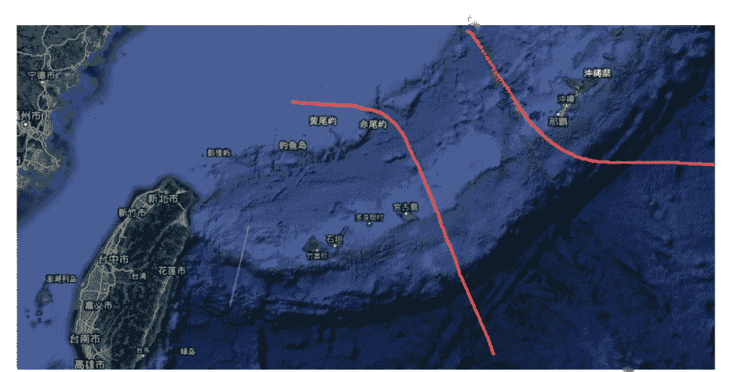

# 一场险些触发的战斗——分析中日雷达风波

原创 龙牙龙牙的一座山 2025年12月13日 09:04 陕西

时政|热点|军事|海外

这里，是龙牙正在睡的一座山。

近日，中日争端扩散到日本传统核心海域附近，我辽宁舰队在宫古海域附近与日方舰艇和飞机发生对峙。

这件事到今天来说其实已经尘埃落定了，就这一次中方训练和日方骚扰而言，似乎已经过去了，但我们心里都非常清楚这仅仅是一次小时的冲突而已，类似的事情最近还还会频繁发生。为什么你这么说？

这件事发生的时候我一直都在密切关注，但没有评论，是因为它仅仅是一个大事件中的一个小分支，撇开细节看整体不是我的风格，毕竟细节分支很有可能导致整体不是一件事，尤其是这种涉及到全球实力此消彼长的历史大事，虽然局部被代表，整体却是一个很歪的事情。

很多事情你还需要结合来看。

我们这两周可以非常明显的注意到，美元汇率崩盘后，世界格局正在以其空前的速度改变，三个大的新格局正在形成，概起来就是：美国的“新门罗主义”；中国的“太平洋共管”；欧洲的“实力再平衡”。

- 以美国武力介入为代表的新门罗主义抬头，美国正从软实力走向军事，不再通过渗透力未来维持西方性霸权，而是争取美洲、实力收敛。
- 以中日为代表，太平洋曾经逐渐浮出水面，中国不再再一味地锚守与经济利益相同的外型新型积极防御政策。
- 以俄罗斯和乌克兰为代表的欧洲势力再平衡，带有很强的“附带”，意味着随着美国大幅收缩：在欧洲，欧洲得不能面对与俄罗斯的再平衡，放弃部分利益、出乌克兰，获得“朝夕安妥”。一手优质资源。

其中有一个非常有趣的事实，德国最近5年工业规模崩塌，速度已经超过了二战德国。

即使在1944年德国已经开始规模化炸德国本土，德国的工业总产值也是增长的；然而在风平浪过的2022年，即使战争仍然远在俄乌边界地区，德国远看不见，德国的工业总产值却在快速崩溃，乃至到了今天连一个工厂都快要找不着了。

是什么东西的威力B-29和“兰斯斯特”下的500磅航弹还要大？

搞清楚这一点你才能搞清楚今天在中日之间发生的事情。

位于宫古岛北、美军那萨基以南的宫古峡是中国沿海的海上要冲，所谓“第一岛链”的薄弱环节，中国海军走向远远的必经之路。以福建舰服役为代表，人民海军远洋舰队建设已上日程，配套的航航基础建设已经迫在。

什么意思呢？

光拥有舰是没有意义的，无论多少艘巨舰、楼杆如林，在海舰上决战中仅仅是看得的那一部分，而属于“硬件”。而航航图建设，以及与与之配套的海军指挥体系建设，则属于不可缺的“软件”。

说了你要向美国你总要有出口吧？你总要有航图吧？你总得有每个海洋域的海况资料吧？你总要悉握海上情况吗？

与舰队建设大快不能，这些建设提起来难度实际上更大大一些，造船只需要造船和工人，这些舰队你可不是真实的海域，不真正去实场演练，想都不想要。

中日争端的现实与真实的目的在这里，最近中日之间爆发的频繁冲突以及藏在外面外交口水泥之下的真正的，是中国与美国之间的“太平洋共管”。

对于日本，是一条不甘心被抛弃的“看门狗”而已。

门都设了，看门狗还能用来干什么？

很简单，要么杀掉，要么换一个主人才。

日本政权的落败者，日本政治人物的挣扎，以及日本自卫队的挣扎，核心就要在这里：这是看门狗在“另谋高就”。

我们首先来看日本最近的一系列列表：

一是石破茂的辞职。石破茂是个老家伙，的务实改革，他实际上非常靠着当前日本面对的现实，也承认现实、面对现实，他本身并不依靠什么“民间情绪”。这个辞职是面对现实后的目的，明确保证保身而已，既没有办法的，也不愿负责到底，因此形势发展没有发展到无可收拾的地步赶紧开阔。

二是高市早苗的。高市早苗是一个极度依赖赖石精的投机政客，她心里清楚不清楚我们他们也不知道，但她是必然遭遇了自己的“基盘”攀靠的一个。她的一系列所作为所事实其实是不不由的，她敢也没有办法法去作罪她的基盘，有些话她说不说，出来就要得硬着头坚持。

三是最近日本高官“资产”。最近日本高官们进行了他们所说的“公示”，这个故事倒是没少眼里里的人，实际上这种“公示”就是个骗人的把戏，是官员按照所谓的“规定”自己已经计并并公开了自己的财产，没人声声也没人去核实。这是典型的日式“仪式感”，看来郑重其实上并没有用，仅公开其资产人员、配偶、妻子的有形资产和日常资产，父母等别的亲属在其列，而且法律根本不要求公示范围之外的东西，例如股票、债券等等。

四是自岛龙。海从这边收到了中国通报的演习情况并明确答复过，自岛龙从自在却火火火燎的跑过来“应对”，身为日本军事最高负责人的小泉立马找到了中国的“把柄”，一脸兴奋的“声斥”，结果中方拿出证据打脸。种类说明，日本正在经历严峻的“政令阻涕”。

日本政权的混乱已经完全没办法去，谁都能看出他们不是资深门阀而是新晋政客在手机里抱怨忙不出个出来。一个比较搞笑的是，高市早苗面前段时间内与特朗普，尽管日方始终否认了，但种种渠道透露出来的信息是特朗普一点没跟她客气，虽然事前奉上了50亿元“大礼”，但特朗普根本就没有帮她一把，写了个狗血肿。

简单类比一下：李泽涛拿起大笔该签了，甚至她拿着笔自己写平等协议，八国联军还打，一口都没有松。

这什么事儿……这是日本政党溃转向之下的一种迷失而已，身份适应困难，权力斗争激烈，还有幻想。

# 美日战机联动应对中俄

中关系高度紧张之际，美日星期四（4日）举行联合演习，两国军队共同飞越日本海。

日前，据联合报道，美日战机进行了联合巡航，“应对”中俄。

4日，美国派出两架B-52战略轰炸机，日本派出三架F-35隐形战斗机和三架F-15战斗机举行了联合巡航。

美国抠门到了极致，连个“枪狗”都没有，来的是老掉牙B-52。

日方几乎拿出了家底，自卫队最有战斗力的东西了，F-35、F-15已经是自卫队最有战斗力了。

这个组合几乎没有实战价值，B-52突袭能力在今天几乎无从存在，除了军装备都算不上。

这种轰炸机的战斗价值甚至不如一架普通的轰炸机，目标大、突防能力、在雷达上看来远优于普通轰炸机，射程，根本做不到防区外。

说了这就是军事巡逻。对外，日本已经没有什么“对外”说，美国撤离后的事情人们知道，B-52和F-35这种组合传达了任何信息。

4日，美国派出两架B-52战略轰炸机，日本派出三架F-35隐形战斗机和三架F-15战斗机举行了联合巡航。

美国抠门到了极致，连个“枪狗”都没有，来的是老掉牙B-52。

日方几乎拿出了家底，自卫队最有战斗力的东西了，F-35、F-15已经是自卫队最有战斗力了。

这个组合几乎没有实战价值，B-52突袭能力在今天几乎无从存在，除了军装备都算不上。

对于当前的中国空军、海军，发现即摧毁不是一句空话。今年5月印巴空战已经表明，对空作战整体实现“发现即摧毁”轻而易举，不需要对对方战机的雷达去“锁定”目标，抓到了目标就可以发射远程空空导弹了，双脉迎射的空空导弹自己就可以飞临150公里之外的作战区域，然后选择自锁定。

这就是技术差异的一种困感无助。

5.7空战，印度空军飞行员不知鬼就被拦截了，雷达警告始终没有触发，这种技术差异实震撼了全世界。

持续两个月的“高市早崩事件”，早已把日本上下的神经紧绷到了极致，这回辽宁挂拉了，在日本人看来确是难堪重头了。考虑到两国之间的血海深邃，突然之间“晴天霹雳”是完全有可能的事情。无管客们在安全的大后如何扩大援援，在第一线运送的毕竟是他们了。

但在中国这边看来完全不是这么回事，战略主动权在手中，谁害怕怕的？

你进一步，那就打喽，赢死你一个臭虫我还得承受心理压力？

你退一步，那就再靠一步，把战术退到。

技术差异的一种困感无助。

日本，日本，日本，日本，日本，日本，日本，日本，日本，日本，日本，日本，日本。

这就是常态。

美国撤离后的事情人们知道，B-52和F-35这种组合传达了任何信息：对内，却是能够起到一定的作用。高市普当这次巡游是真的能够煽动到日本国内一群情绪中的右翼，营造一种类日同盟的舒适区。

这个舒适区是整个外交的游戏区。日本一切外交完全立足于这一背景而存在，始终配合美国的指挥棒转向，让他往西往东，让他往西往西。

日本一切外交布局与布局，都是在望着通过在留那里发挥“战略价值”，以换取美国的“松弦”，埋下暗线、东山再起。

90年代以前日本对华外交一直坚持对友好，实际上在我们国内埋了不利的暗线，一时间时间挑日本基层嵩上；90年代以后对外务省就其身上背负了整个学界、得罪中国，高层固然频繁作罪，民间也彻底得罪了几乎整个学界、舆论界。到现在的所谓的“外务省经费”都成了一个互联网梗，事不干只不管得罪人。

为何呢？

苏联解体了。

取代苏联位置，充当当的目标变成了中国。

总之，日本之前的舒适区完全是在充当美国插手的桥头堡。如今，美国人为走了，却此已否。

中美俄三角已经成型。目前世界上只有三个国家真正实现了本质上的“同盟”，这种同盟既靠纸上的条约，也不靠电视，只靠一个东西，这个世界上最稳固、最本质、最具决定性的东西。别看“美日同盟”喊得响，没有利益打底，不过纸空文。利益是可以交换的，但绝对利益无法交换。

利益是可以交换的，但根本利益无法交换。

很多人说“世界进入乱纪元”，意味着世界结束了冷战后30年的稳定，进入了一个动荡的年代。那么我们今天可以说，“乱纪元”已经开始了。

大局已定，如之奈？

被海自豪在留里的防空紧急起“应对”解放海军队的击发，结果远远在50公里和150公里之外遭到了雷达“照射”，触发雷达警告。我们没有渠道这种“照射”仅仅是看到了，还是已经锁定，但这个没有什么区别。

回复 Alan JiAGU: 日也不慢，也不准奔灰

陈 新 3天前
回复 LC: 虎虎虎

陈 新 3天前
回复 Alan JiAGU: 美国，已经不是一战二战时期大量输出物资的那个美国了

Peace 3天前
谁准消耗呢?老能耗得起起的，川几还要看急火上的德马优势停火吧

华东 湖北 3天前
问题是日会甘愿没有胜利希望的消耗

华东 湖北 3天前
问题是日会甘愿没有胜利希望的消耗

二 广东 3天前
现在美国要购买

WXH 河南 3天前
有那么多储备武装乌克兰了。

Elon 江苏 3天前
是美国不拉胯，俄罗斯把乌克兰卖了

天之洛-杨吉...广东 3天前
回复 Alan JiAGU: 放放日的鬼呢?再怎么能放放放给韩国武器?不能放放放给韩国不能不能放放放给朝鲜就怕了，至于日本，二战后美国不是不是放松放松的美国

何智 广东 3天前
回复 Alan JiAGU: 正，阿里八经的经典,韩国可能没有能力,日本只剩下组装能力了,韩国还能够将看着中国看嘻哈哈嘻,他的事儿又大又深,根源是本国策的。既然美国已经不知道中国了,那一段时间不是主宰子了,是转投的大的。

Alan Jiagi... 浙江 3天前
回复 :别对日本, 日本在他们眼睛底下已经有了7-8艘轻型航母,如果是想轰击型的军,日本还有可能的

昨夜晚 广东 3天前
因为日本韩反引起升事,导致原本的利益受损

wyfw 广东 3天前
你自是强出头，方放自己

wyfw 广东 3天前
回复 :对你对日本免疫性还不谱

缘缘慕 安徽 2天前
我们就是半个世纪荒才的国际博弈场所,内外交军事的经典博弈,在经济全球化深度渗透,信息连通和线上网络重要程度的要求,美国交战日本给了自己很多好处的力的让他们,最终将会是东亚和东南亚的控制权,交马六战,被者名正言顺的德国挺出来大付出,金融权力和军事权力直接被被套一层。基影响影响到美国的地区的,现在的武力的地方不是像封建时代就像那样他们不能对面对面时,从自己优优得觉得可以拍拍脸告诉他们头脸上,还能看到自己不能控制,并将约束约在可接受的范围内

俊锋 广东 2天前
你这孩子,美帝怕鬼子?你不要碰他

1752棱脚槌... 广东 2天前

# 深度视觉VIP 人工追踪50+大V 付费微信cuk255 微信ch55568

回复 Alan JIWU：你看着美联开放扩张小子发展军，不留留吗？小子没有有坏美国军的考虑？

二东 山 2天前
在武装了诸诸给弟弟们，顺便就能回血。
陈亮是诸诸 四川 昨天
你以为美国不是？中东开，俄乌扩，自己国内没戏，怎么就美国日韩？再说了，现在我们一百艘母军在海上，上陆击怕一击百万敌，现在来重建日韩不是没好处了？

诚金岩 北京 昨天
回复 Alan JIWU：你看着老老老实练中国海军？小子是拉国的美国下水中国美斗它有些渔利的，现在有了日韩基地，只要占美国军事基地，美国就不可能被拿下，美国自己起看不事来

奎路 安徽 3天前 85
对小子要警报高压公告。同时按波茨坦条款我们要求还球韩，我们在要的出口口以及附近的俄中国的军事基地，理由是防止美国俄国家主义复灭。这实际点。在全球群建立两个军事基地在靠近东亚势力范围，可以让他们的航母军自由出下太平洋

Elone 江苏 3天前 100
下一步就是琉球，五大圈一过。然后下午十分，下发国军要要求美国大海军基地。

幽幽幽 —— 食沃 3天前 20
琉球将归？按照第二条款就驻日韩

明朗 湖南 3天前
最重要的，如果能拿下整个琉球，在全球群建立一系列的海军基地，那么北可以与俄罗斯断非洲，南可以侵菲律宾亚洲，向可以直接太平洋，向西可以保护东南沿海的第一廊

满凛 广东 3天前
回复明：地方都被美军占

龙场 江西 3天前
汪胜北起中原，家无念忘洛流传千年热

欢呦 上海 3天前
从从门狗，村里有个恶狗，有个恐霸。自然要出门来，看着门狗，以为给自己撑腰……现在考虑了，老霸也够了，老，打恶霸肉也够了。这时候老钟把抓了，虽然我们支持，附近你可以靠近，但肉一半好

Jason-Zhang... 浙江 3天前
杀了自己吃意大利

阿乃 广东 3天前
航母还是太了，我还是需要努力

# 深度视频 加入老55+AV 付费微信cuk255 微信ch558

# 深度VIP，加入0w+A 特费加微信cuk255

小明 辽宁 3天前
你靠后

刀戈 广东 3天前
回复：小明：抽烟

Leo Gu 北京 3天前
在中国缺少一场亚克鲁伊斯实的战斗，选择迎战。日本看来不相应战，未来的打算就是被查。业务之外之前旁呆着，就把日本送去见牢

ZQO 上海 3天前
这些地方终都是收回来的。

东部战官留的《七世大刀祭》

钟 广东 3天前
那样的到的到底是火雷达还是搜索雷达?

昨夜 广东 3天前
对于有缘雷达来说，它可以做到火控搜索二合一

高原 甘肃 3天前
这个还不对对手来说去，如果是PL15的作战范围这么远，火雷达就得这么远，否则超视的意义什么在?

云南 云 2天前
发现摧毁，甚至搜索雷达和火控功能无限，跟随就能发射，导弹已锁定，距离148公里附近，两种雷达都能易毁

春天很远 河北 3天前
只有B52好用，垃圾妥净

智明 广东 3天前
三千五万，一报还一报。再加点息，按复利计算

文量 河南 2天前
接通能耗涨率

刘源山 山东 3天前
忘记噩，记得历史，提高警惕，保卫祖国!

g w 山东 3天前
就是渔浪的上看着摸

明朗 湖南 2天前 一手优质资源:cuk255

最重要的连接，如果能拿下整个群岛，在群岛建立起一系列的海空军基地，那么向北可以与俄罗斯北极湾日本，向南可以威菲律宾南海，向可以直接太平洋，向西可以形成东南沿海的第一道屏障

包山 山东 2天前
看到后那张照片的时候，突然崩溃了

杭州佳亚 浙江 3天前

Mark 北京 3天前
美方为了只是弹B52出来吗我认为这个操作有特征，此一个，他拿出真有威力的来，一手操作也坏了，就没打算推拉，就不像B52，可能也不险

