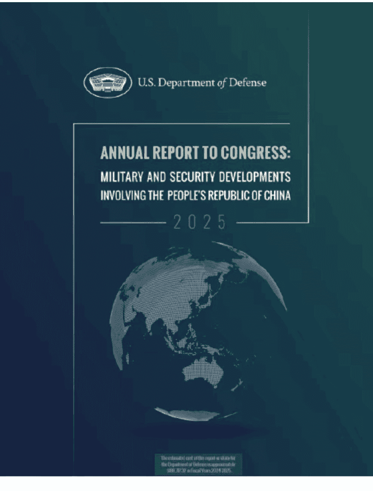
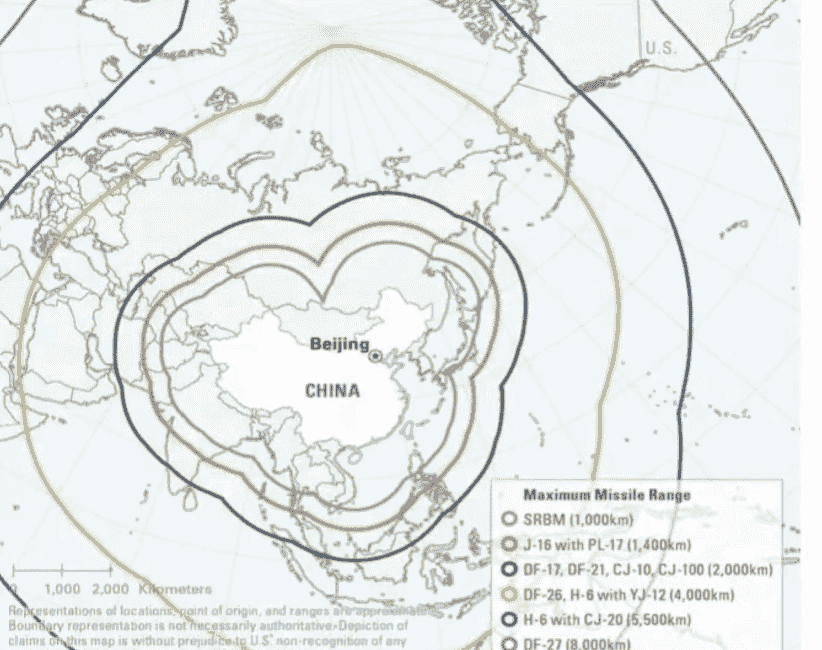
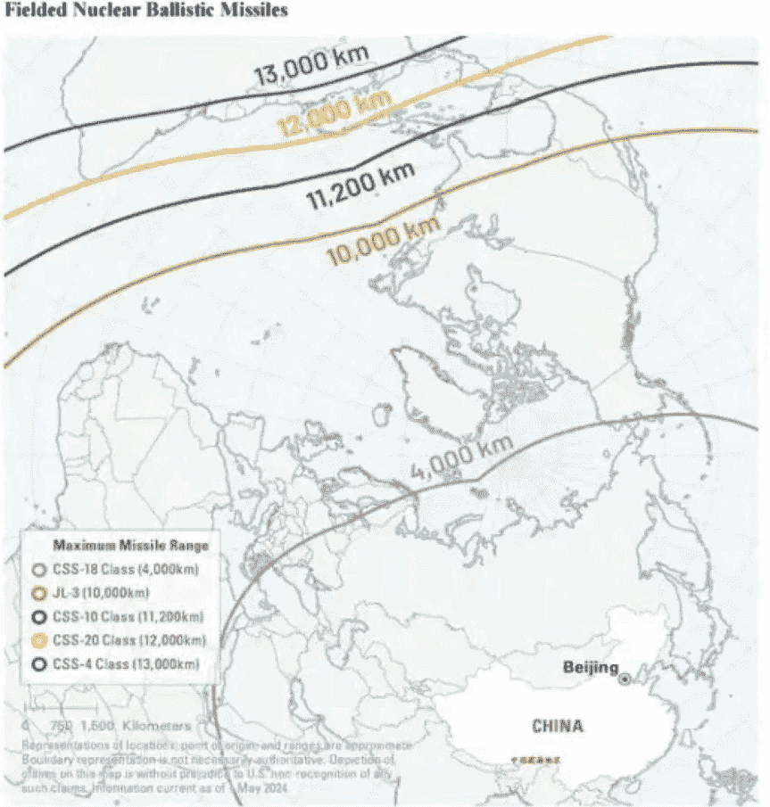
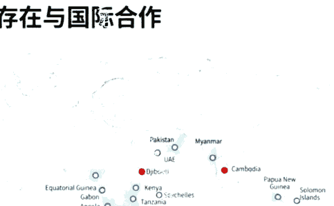
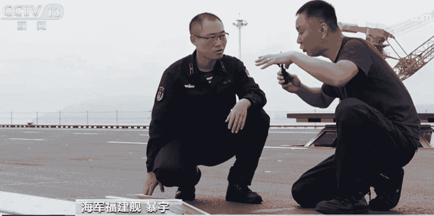
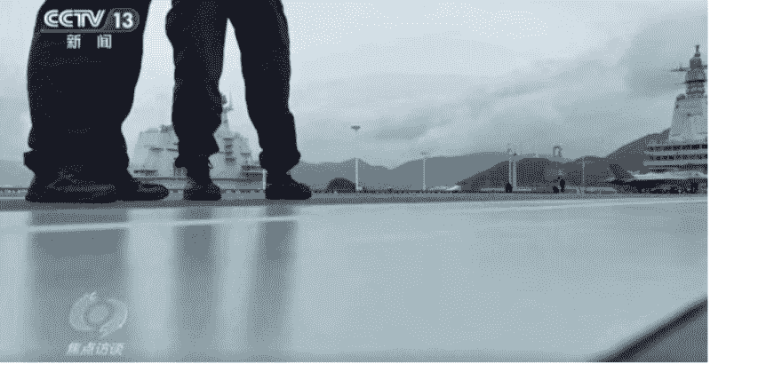
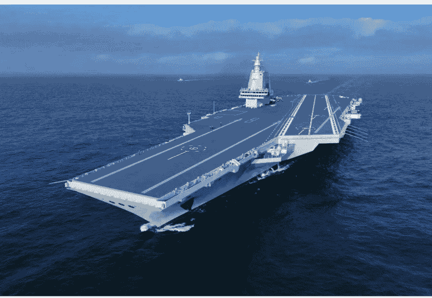

## 五角大楼《中国军力报告2025》推出台后的中美军力消长

已付费
原创 龙牙 龙牙的一座山 2025年12月26日 09:03 宁夏

时政 | 热点 | 军事 | 为农
这里，是龙牙正在跑的一座山。

# 谨防封号失联，请添加微信

时政内容稍较多，若未及时阅读的被删文章可在微信公众号私信获取。全文5068字，预计阅读20分钟。

憋了了好几天，美国五角大楼新版《中国军力报告2025》总算是出来了。

这几天我在筹划一部新的长篇励志小说，没时间关注这些事情，毕竟这个时代的事情需要关注的。但老自己不关注不行，关于这份蝉来来的报告，我一向倾向于认为它顶多是某种宣传工具，主要作用是歪点炒作“中国威胁论”争取美国国会拨款。阅读这份报告的主要目的在于洞悉美军一个年度军费开支的主要去向，因为他想要争取什么，毕竟就是他需要的什么。

考虑“史密专员”的腰包是必要的。

深度视野VIP群 人追踪50+V付费进群加微信cuk2555 微信chp5568

所以，你不要看他说了什么，你要看他没说什么。

太平洋西部地区的不对称军事格局已经形成，美国正在寻求一种以前属于中国的“不对称优势”，以求在军事实天平逐渐向中国的时代里，在太平洋西部地区维持一种不对称平衡，以更少的军费投入，起码维持美国军事力量有序撤离、维持西岸“盟友”基本稳定，并尽可能维持其全球军事体系，这是这份报告来的真实想要的话。

这份报告有几个非常不同的点：

- 是不提2025年5月之后的事情。包括震惊亚洲的印巴5.7飞机，以及福州级等。对即将亮相的六代机几乎没怎么提，就提到个“2035年之后才会服役；
- 二是对解放军人事变动分析并不全面，有仓促匆忙的现象；
- 三是内容中提到“2024”的次数，远高于提到“2025”的次数。

简而言之，这个报告一过去美国发布的《中国军事报告》，常态，不只是仓促匆忙的问题，而且草台班子味道很淡，显得水平非常低，拼凑的凌乱很明显。

这个原因，值得味品。

## 总体而言，我们这报告至少提到美国内部存在以下几大问题：

- 一、战略方向持续混乱；特朗普主导的新门罗主义，与民主主权的权威主义冲突日益激烈，但逐渐陷入入手之后。特朗普第二任期双方竞争就开始从台面上转入台下，美国国家战略出现的是各自基本利益的争端。

- 二、对华战略判断严重失误。美国国内智库团队，不管是官方还是民间，都对中国战略判断颇为低迷，几乎不存在能够准确判断的，正确的、精准的对华判断无法进入政策层面，官方来说的智库充斥着彼世俗之名；

- 三、对华情报战陷入被动。美国在华情报效率极低，长期处于不利利益的情报和所谓“暗桩”逐渐边缘化，是因为中国的反渗透措施，还是因为在美国内部利益冲突极大干扰了正常的工作。

首先抬头而来的特朗普政府“草台班子”味道，远逊“太阳”味的马奇精力气息歇频不开。

报告提到“在特朗普总统的领导下，中美达到了多年来的最高水平，美关系将各方努力巩固这一进展。我们所采取的部分措施，是与解放军扩大军事通道，重点关注战略稳定和更广泛的冲突缓冲和局势缓和。我们还将寻求其他途径，明确了我们和和平的态度。”

和平和们之间再动，不断响特朗普将几乎在美国官方的固定格式下，大家才分一个区分中国和“将军”，比较诸的是“将”。

深度视VIP群加入微群50+V付费加微信kuk2555 chsp5568

很显然特朗普所说的“最佳美关系”是在贸易、关税中被中国狠狠勒了一脸老脸之后的结果。全世界睁看着中国美国打了一场针锋相对对等的关税战，一点都没有让输，完全是同步升级、超极限，是特朗普自己“怂”了总撤回一回关税措施。

但人们特朗普草班子真的能给中国带来胜利，得不服气。

关税战之后美国的地位实际上相当落后，这场仗从头彻尾的失败打出来的，特朗普的头上卷了难去，后的内伤在所难免。而中国有史以来最可靠的贸易顺差，1万亿美元，这是什么概念？是全球贸易秩序为美国大打贸易战陷入一片混乱的情况下，一个国家、一个经济，拿下了全球一半的贸易顺差。

就是说，特朗普一拳伤，每一拳都结实打在了自己身上了。

这看起来就像是格外的讽刺了。

令人作作的末尾背后是特朗普根本“输不起”的现实，特朗普胜利低到了美国所所意的程度，一点点实现胜利都会立刻转化为对于个人的、山海咆哮一声的胜利，此因才有了这种极不符合美国政治统治的公文结尾。所谓“从容”和“连带圈”的区别所在。

现实胜利是特朗普上台以来，尽管一把包揽了党、友、法、三法，是美国历史上多少夺下了国会、国家和法院的极致权力，但他已经事实被架空了。他上以来无一事，调整缅北冲突胜利、调整缅宾冲突胜利、关税冲突胜利，甚至发动对内瑞拉的军事行动打失败了。前面两个还还好，毕竟是在地球另一边，对内瑞拉的军事行动特别说明。内瑞拉是在近美国底下，他主导“战争”，召回美军高级将军，来的结果就是他没办法，针对南美的军事行动。美国表现实力的一点，特朗普内瑞拉到无法折击，由于全世界，也没让自己正义？

深度视VIP群加微50+V付费加微信v5586

可见，特朗普主导的美国战略——新门罗主义，即放弃全球化，撤回美洲后打造一个堡垒维持美国存在，即使是标志性的。通常来说，美国总统的第一任期往往用于巩固地位，第二任期才是扩张的时候。毕竟第一任期考虑第二任期的选票，往往会扩张自己的政治目标。特朗普的第二任期与第一任期隔了一个，这就尴尬了。民主党方面很明显放弃全球利益，尤其是中东、欧洲，这才是俄乌冲突失败的原因。就算他在巴以做了很多妥协，以色列根本没想过他，完全不顾中东的努力。搞清楚这一点，就能明白《中国军事报告2025》到底。

### Field Conventional Strike

Map displays maximum ranges of systems listed in the table

| Designation | Class | Range (km) | Target |
| :--- | :--- | :--- | :--- |
| DF-11A, DF-15 | SRBM | 300 - 1000 | Land attack |
| DF-17, DF-21 | MRBM | 1500 - 2000 | Land attack/Anti-ship |
| CJ-10, CJ-100 | GLCM | 1500 - 2000 | Land attack/Anti-ship |
| DF-26 | IRBM | 3000 - 4000 | Land attack/Anti-ship |
| DF-27 | ICBM | 5000 - 8000 | Land attack/Anti-ship |
| J-16 with PL-17 | AAM | 1400 | Anti-air/HVAA |
| H-6 with YJ-12, YJ-83 | ALCM | 3100 - 4000 | Anti-ship |
| H-6 with YJ-21, CJ-20 | ALCM/ALBM | 4000 - 5500 | Land attack |

### Taiwan Strait Balance

### Ground Forces

| China | Taiwan | Taiwan Strait Area* | Total |
| :--- | :--- | :--- | :--- |
| Total Ground Force Personnel | 1,040,000 | 427,000 | 89,000 |
| Group Armies/Army Corps | 13 | 5 | 3 |
| Combined Arms Brigades | 80 | 30 | 4 |
| Artillery Brigades | 15 | 5 | 3 |
| Army Aviation Brigades | 13 | 4 | 2 |
| Air Assault Brigades | 3 | 1 | 0 |
| Airborne Brigades | 6 | 6 | 0 |
| Marine Brigades | 11 | 5 | 2 |
| Tanks | 3,700 | 1,100 | 950 |
| **Fire Pieces | 8,100 | | 1,300 |

> * For the purposes of this document, "Taiwan Strait Area" includes the PLA's Eastern and Southern Theaters.
> ** Fire pieces includes towed and self-propelled, multiple rocket launchers, and mortars.

### Naval Forces

| China | Taiwan | Eastern and Southern Theater Navies | Total |
| :--- | :--- | :--- | :--- |
| Aircraft Carriers | 3 | | 0 |
| Amphibious Assault Ships | 3 | | 0 |
| Cruisers | 8 | 4 | 0 |
| Destroyers | 42 | 30 | 4 |
| Frigates | 50 | 39 | 22 |
| Corvettes | 50 | 40 | 7 |
| Medium Landing Ships/Tank Landing Ships/Amphibious Transport Dock | 58 | 44 | -80 |
| Attack Submarines | 46 | 34 | 2 |
| Nuclear-Powered Submarines | 6 | 2 | 0 |
| Nuclear-Powered Missile Submarines | 6 | 8 | 0 |
| Coastal Patrol (Missile) | 60 | 60 | -30 |
| Coast Guard Ships | 142 | N / A | -30 |

Note: The PLAN has the largest force of principal combat, submarines, and amphibious warfare ships in Asia. In the event of a major Taiwan conflict, the Eastern and Southern Theater Command would participate in direct action against the Taiwan Navy. The Northern Theater (not) would be responsible for protecting the sea areas approached in China, and provide mission-critical assets to support other fleets. In conflict, China may also employ Coast Guard and Maritime militias to support military operations.

### Air Forces

| China | Taiwan | Total | Eastern and Southern Theater | Total |
| :--- | :--- | :--- | :--- | :--- |
| Fighters | 1,200 | 300 | 400 | 400 |
| Bombers | 200 | 50 | 50 | 50 |
| Attack | 400 | 100 | 100 | 100 |
| Transport | 500 | 200 | 200 | 200 |
| Special | 100 | 50 | 50 | 50 |

2、渲染“2027攻台论”，为回第一链军事提供借口。

这不可开笑了，技术领先仅有必要低视化涂装。

3

美国的对华战略已经彻底跑偏，对华战略已经陷入了瘫痪，这是这份报告透露出来的真相。

## 报告核心论点：中国被视为旨在遏制美国的“选量战”

报告开始指出，解放军（PLA）的目标是将美国视为“强敌”，致力于在2049年前成为“世界一流军队”。报告认为，中国的军事战略建设已经通过其所通称的“国家总体战略”（报告原文用），在总体力量上超越了美国。

### 对美国本土的威胁

报告说，解放军的常规巡导弹攻击、打击以及太空能力，使其对美国本土构成巨大的威胁，特别是其“东风”系列导弹（DF Typhoon）等导弹，认为其在战时对美国关键基础设施造成致命打击。

### 2027 目标

报告指出，解放军的目标是在2027年具备“跨海登陆”能力，对台实施实战能力，“封锁台海”，并对区域内获得主权。报告解释为：有望在未来有力打破美国枷锁。

### 军费与技术领先

报告认为，中国的军费投入将持续增长（自2013年以来官方加速近期）且在人工智能、生物技术、网络安全等领域处于领先的技术领先。

为首美国的军事战略初名为“被害者心态”的惯性，中国始终将最大对手在亚洲头上胜过，但他们恐惧的可是“取代美国”，而是“驱动美国国”，这一点都不能判断失败说是我没料到的。

中国并没有全球部署军事力量的需求，至少在特朗普出生之家里根本不会考虑这一点。

PREMIUM STRATEGIC INTELLIGENCE BRIEFING 16.9

# 超越第一岛链：中国军事的存在与国际合作

### 全球基地与后勤网络

报告认为，中国寻求建立全球基地网络，以支持在其他地区部署军事力量的能力。

- 现有基地：吉布提（非洲）、塞内俄、达拉克作为海军基地（后勤与部署）。
- 潜在基地：报告指出可能在缅、印度、越南、柬比亚、安哥等等地建立基地。

## 与俄罗斯的伙伴关系

报告强调了中俄伙伴关系具有深远的战略意义，双方日益加强了联合军事演习，并提高了兼容性。2024年，双方在俄罗斯举行了大规模演习，并在联合部队中部署了具备实战能力的部队（第6次）。

### 对外军事扩张

2024年，解放军与外国军队进行了26次演习。

# 深度视觉 VIP 人才引进35+大 加进群微信cuk255 微信ch5558

对解放2050年之前的“从属地位”没有认知，至少到2050年之前，中国不可能将军事力量作为国家发展的重心，这是最显而易见的事情。在2050年之前，到2150年之前中国没有必要将兵力作为建设的核心工作，强大的制造业实力能够维持中国主导的世界体系，何要浪费资源建立海军大舰队？

等下一个挑战者再出现如今这种事儿也不了。美国实际上是在自己的崛起模式下套用了大量海外基地，纯粹嘲笑了我们。解放军对于维持一支全球部署的军队毫无趣味也没有太大的必要，一打快快快、具有快速能力的军队就是上限了，没必要搞这种全球军了。

## 现代化的基石：国防开支与军事科技发展

### 国防开支

### 中国工业关键领域

| 类别 | 报告估实际支出 |
| :--- | :--- |
| 4000/80 | 报告估实际支出：30400亿、3770亿人民币 |
| 3000 | 占GDP 32%-63% |
| 2000/1000 | 兵费：2310亿元 |

- 导弹：拥有世界上领先的超高音速导弹（俄罗斯、歼-19）。
- 造船：却是世界第一大造船国，能够大规模生产海母舰。
- 航空与无人机：F-35、F-15战斗机，WZ-9以及“无人机”在南海活跃。

## “卡脖子”技术优势

“核心战略”：报告认为中国正通过“军民融合”战略，早早发力在人工智能、生物技术、量子和先进材料领域实现领先。

对解放战斗的发展模式却是头不对，用美元计算的国防预算与实际战斗力之间差距巨大，根本无法解释解放战斗力的快速增长究竟来自何处。

按照购买力测算，考虑社会主义制度下部分计划经济受到影响，综合中国国有企业和“军民融合”发展情况，以及民政、退役人员等经费，按照美国军费标准口径，解放规模在绝对数量上与美国军费持平；同时，考虑双方效率、遭遇差异、制造成本，解放战斗力应该超过美国军费50%以上。若你不解释为什么解放战斗力在衰退，而新装备层出不穷。

# 深度视觉 VIP 人才引进35+大 加进群微信cuk255 微信ch555

## 核心要点总结：美国国防战略与应对

报告的立场（引言）：

- 战略 (Strategic Intent): 美方认为，中国在太平洋的利益是“战略性”的，也是清晰和合理的，并不“威胁”或“扩张”。
- 能力 (Capability Deployment): 美国战略的特点是灵活、快速，特别是海军、陆、空等领域的优势。
- 战略 (Strategy): 目标是通过实战来确保太平洋地区的利益，确保美国军事实力上与中国领先。
- 沟通 (Communication): 报告强调，尽管存在差异，但有助于其价值观低风险。

基于以上几点，这个报告的核心要点其实没什么意义。美国海军目前缺员高达三分之一，人员长期疲劳、招募困难，甚至出现大量入伍现象，根在于美国在战略目标完全错误。判断失误、情报失败，固然受到利益绑定，但事实也不容忽视。美国真正假想在全球范围内带来了利益绑定，中国即使假想，美国也未能正确判断其实。

## 解放军无法击：五角大楼“历史性扩张”

根据美国五角大楼发布的军事力评估报告，中国军事力处于“历史性扩张”过程中，美国本土面临巨大风险；解放军预计2027年前具备对台作战的能力。（联合早报）

新加坡《联合早报》报道“无法击解放军”，这话听起来都搞笑，是因为2023年美国制作了一份漏洞百出的所谓“泄密文件”，内部人士一看直接笑了。除了少数底层、公开的、驻地附近租车司机才知道的所谓“秘密”，剩下的都是胡扯，这就能在小圈子里听到“惊天谎言”。他们自己相信“CIA天下无敌”，他们都是舒适区。

2025年12月25日，央视新闻深度报道了福建省电磁弹射工程情况，相关视频都能看到，电磁弹近机场画面清晰可见。意想不到的是，这套峰值功率千万的大型设备，距离机场范围低到了不合理的程度。

# 深度视觉 VIP 人才引进50+大 加费微信cuk255 微信ch556

海面拍摄福建舰。CTV新闻：截至目前全国耕地同比增长100%。

# 记者：启动时我们可以靠这里这么近

记者就站在电磁弹射器轨道不到1米的位置；

动态急停更是让人惊掉下巴，瞬间停止几乎没有任何震动，声音都没有，纸放在停止旁边30厘米，只有轻微的动静。要知道福建舰服役之前，在网上铺天盖的是“福建电磁弹射系统失败”的谣言！

是美国还有最基础的信息能力，不逊于搞这种注定打脸的戏。美国五角大楼《中国军力报告2025》，说了什么不重要，没说的几个东西，5.7空战、福建踪迹、六代机，才是绝对的重点。

# 深度视野 VIP 人工造50+大 付费群加微信cuk255 微信ch5568

说明：

1. 美国已经没有对标的武器系统；
2. 美国打算利用这些他自己不具备的能力，很想捞国会一笔；
3. 对外，美国还维持基本的体面；
4. 就连一份报告，也是美国权力斗争的焦点。这个报告反映的是新保守主义，美国在边疆抛弃日韩、台湾，最后再财富转移，直到完成全球部署。

END

## 为什么美国是个“废物”的设计？

作者简介：龙牙是一个在西藏边疆几十年的老兵，热爱文学和写作，对社会问题有见解。关注公众号“龙牙一座山”、小号“黄科蛇”。

（此处为评论区内容，略）

最后对美国两国的剖析——一针血~~~老老师牛了~~~

挺好的，如果有更多的细节分析就好了。喜欢看龙哥的文章。

共和党想原地除你，民主党想财富彻底转移，好奇哥还想去哪里哪里。

龙哥，图片是北大那个起架可以看出来。

报告提到：由于我去发布一马斯克财产报告2025。

IP显示字，龙少没在四川。他也是夏天人。

闲怪溜帝！！致敬大家盛大132周年！
