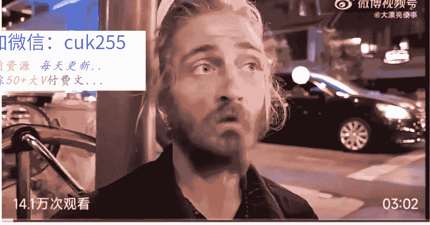
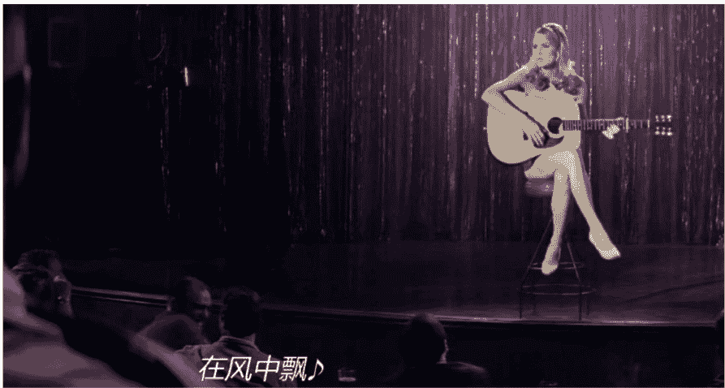
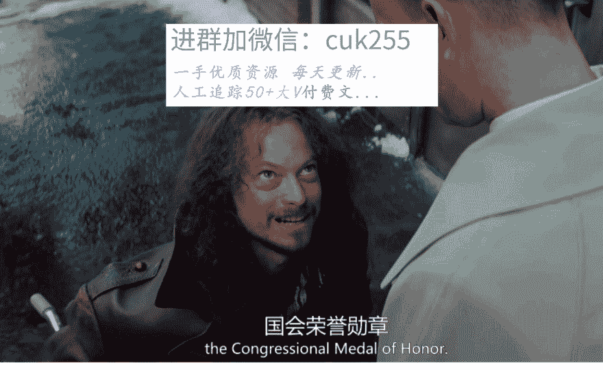

# “珍妮”、MAGA与“剪杀线”——美苏冷战的新角度复盘

原文 龙牙 龙牙的一座山 2025年12月29日 宁夏

时政|热点|军事|为农
这里，是龙牙正在跑的一座山。

最近几天“剪杀线”这个概念非常频繁，原因在于一个B站主播，人在美国当街“高达”。

什么叫“高达”?

简而言之就是各种死横街头的美国人，广东话叫仆街，四川话叫死桩，一般其他地方叫“路倒”，而不不足。

所谓剪杀线，就是“阶级滑落”，有一条有形的、无形的死亡线在每一个美国人的屁股后头，你赢了它就是“中产阶级”，你跑不过它，对不起，分钟流落街头平均街边寿命3~5天然后当“高达”去。

尽管这个系列视频是在美国老底，但我还是极度不建议你去搜了，用网友的话叫做“掉san值”，灵视水平提高以后心里的人性就会开始隐隐作痛，在社会主义国家你会感受到一种种骨的寒意，一种面对冰冷现实的不安感，十分不利于提高我们国民群众的身心健康水平。

奇像一样的保险制度、神奇的医疗保障体系、泛滥的毒品、街头暴力以及刻意设计的阶级滑落通道，共同造就了一个奇观：一方面是辉煌灿烂、富丽堂皇的资本主义繁华，另一方面是羁锁在水道里的流浪被棘性管道清洁剂割切成一个物理意义上的“肉团”。

正常人看这个东西当然不容易理解，在利益至上的资本主义社会里，人，物理意义上人的肉体，沦为可以用金钱衡量的“高达零件”。

# 大漂亮事

热门 25-12-25 10:09 电竞博主 发布于 江

年薪45万美元程序员半年变流浪@B站上千万播放的，把最后一个愿望留给别人的美国流浪视频的

这个视频最初在2018.8.10发布，他的名字叫Luke。他妻子在视频播放后不久离世，他也在1月份死在大街上。大漂亮事的微博视频

进群加微信：cuk255
一手优质资源 每天更新...人工轨迹50+大付费...

14.1万次观看

大家都在搜：
- 年薪45万美元程序员为什么变流浪汉
- 美国流浪汉...

这是我们时代全人类的耻辱。

特朗普满世界喷哑的“MAGA”，显然，MAGA里面并不包括这些肉肉，无论美国走向方向这些人根本没有关系。他们在生前就被刻意切断了所有可能的社会联系，从而为某个研究机构里面颇具价值的解释，这种赤裸的行为其实早已已有。在冷战还没结束的时候，中国“出海大潮”刚刚到来，一系列电影电视剧就隐喻提到过这些事实；美国自己的电影也有侧面的反映，对美国底层的真实生活描写得十分，其中甚至有不少的电影作品。

从前今天某人提到的《阿甘传》

《阿甘传》从正面反映了美国底层，却是在温情脉脉的新文化包装下，刻意忽略了剧中个人大团圆的结局。

而眼镜曾所说的“great again”，great的东西就是这个great。并不是街头横死的高达们有遗漏斩杀线条的机会，而是用光辉的那一面，彻底掩盖了他们的哀嚎。

到此为止整个冷战战争争的全景，也是冷战结束后30年美国新滑滑深渊的真相，以及冷战美剧结束之初世界还乱不安的根源。趁着“斩杀”理念把真实的美国底层拉近视线，我们有必要搞清楚30年没人清楚的事情：冷战是怎么结束的。

从这个事实看到美国的未来，世界的未来，人类的未来。

1

《阿甘传》我第一次是在大学里，2000年。第一次的时候却是无以复加，带着冷战胜利的优越自省，这个片子实际上就是美国价值观客观体下的“主旋律电影”，现在看满热满满的都是价值观包装，但当时看来的确有一种窒息感，漫长历史颓塌的叙事方式让人不由自主放弃了思考，弃倒在自由女神形象之下。

其中，珍妮·库伦是一个引人注目但胆提举劲的配角。

她是个不折不扣的瑞士士，“为反对反对”，反战、玩摇滚、吸毒并且染上了艾滋病毒疾病最终死亡。但是她给了幼年时期残疾的阿甘友谊，也给了成年后婉变的阿甘爱情，最终给了成熟后稳定的阿甘一个儿子。

# Forrest Gump

《阿甘传》的原著小说我看过，小说是个典型的美式通俗小说，情节荒诞不经而而且根本不起推敲，属于非常低俗的那种。电影实际上是一个借用人物名字的二创，跟原著小说一毛钱没关系。这次二创显然是极度成功的，把一个无人问津的二流低俗小说生生打造成了美式价值输出的“爆款”，堪称神作。

原著小说多少带有一调调和讽刺味，跟《22条街》有点像，但水平没那么高，实际上是在美国现实。

但是巅峰时期的莱坞，硬是滤出顶级编剧、导演、主演，把这么个非主流版本说给拍成了主流价值廉质样板，可谓是冷战美式奥论机器的巅峰作。

更讽的是，5年后好莱坞编剧们就“下岗”了......

作者们，其无后手。

珍妮·库伦的一生，深刻说明了美国赢得冷战的真正原因：软弱的对手、破烂的运气，以及资本主义高级就是终极阶段。

坦率的说，美国人在站在胜利的辉煌顶点拍摄的歌颂德的影片，恰恰就是共产主义将替代资本主义的铁锁。

珍妮·库伦刚开始是一个天真善良的小女孩，愿意给受虐的阿甘一份珍谊：

她是我特别的朋友。She was my special friend.

珍妮·库伦刚开始就是一个出身底层的可怜人，她父亲酗酒、落魄并对她虐待；

不知为什么珍妮从不回家For some reason, Jenny didn't want to go home.

显然，这么一个童年必然育出一个畸形的灵魂，很快，珍妮来了，她首先是出卖自己唯一的“财产”，也就是她的身体。

阿甘自以为她是当一个“歌手”，她告诉阿甘的如此，但舞台下的笑。她随后成了另一个，民主社团伯克利主席，每天跟一群人在一起，仅仅是无处发泄，乱哄哄、乱糟糟，不得要。

很快，我们不知道是她找上了毒品，还是毒品找上了她。How could do this?或许只有她底层拿石头去砸那个“家”，能够告诉她答案吧。珍妮。阿甘的故事是一个老套但是总是有效的悲剧内核：给你一件美好的东西，然后看着你的面前把它撕得粉碎。那么最后阿甘鼓起求婚的那幕很容易理解为什么五味杂了：珍妮会是老公I'd make a good husband, Jenny.

阿甘试图修补一个破碎的姓。库伦这么一个悲剧性电影。很多人都不理解为什么会在这样一个主旋律电影里面安排珍妮·库伦，还有阿甘打越的时候那个顶头上司，“丹中尉”。

这是一个典型的神经质的基层指挥官，笑“布巴”的嘴唇太长了容易触发地雷，不允许阿甘他们敬礼，并且在负伤以后坚决拒绝阿甘的救护打算死在战场上。祖辈都是当兵的，一家子后辈都死在美国的战场上，他也打算复刻这一点。

我没叫你救我出去，去你的！I didn't ask you to pull me out of there. God damn you!

负伤了荣军院还怀恨心，想弄死阿甘。

# 现在
Now...

退伍后穷困潦倒，浪迹街头。

这个人最后的救赎，是运气好买了苹果的股票，既不是出于个人的努力，也不是出于国家的保障，更不是来自社会的报恩。

与其说是阿甘和他一起经营的捕获，不如说是阿甘的这种友情，以及钱，单纯的、不掺假的、true money。作为一个负伤退伍的军官，对于丹中尉的遭遇可谓颇有感，我丁点都不想把半辈子交给运气，我宁愿靠养老金、社会兜底。这种安全感，让美国群众不会沦落。

这种“阶级滑落”的内核是你根本不是“中产”，你不掌握生产资料，你只是高级打工工人，你本质上还是无产级。《阿甘传》在这里有了深刻的讽刺：翻身，你收获了不起的票。这是他能够跃升的巅峰。

这种美式价值观下的安全，阿甘的自我救赎，而残酷版“阿甘”则是自我毁灭与惨败。今天剪杀线留下的累累黑，他们也是了，本身就不掌握生产资料，就不是美国统治阶级的一分子。无论是是因为买不起房，还是因为失业，因为破产，因为一场大病，因为离婚财产分割，因为别的破事，倾刻之间就会从体面的“中产”沦为水道的肉。为了赢得战争胜利，美国乃至整个西方资本主义聚集了人类以来最强大的资本，也就是所谓的“全球化”。金融中心滚滚着，最后的美国、欧洲和日本打造了一个全球化布局，把住了世界最重要的资本、物质、技术和智力。这种“全球化”严格来说只能说是“半球化”，因为还有一半在社会主义阵营里面，只不过那个半球聚集起来的资源远远无法匹敌而已，答案就是简单了。为了这个资本集团高效运作，“剪杀线”被设计出来，任何人都如果不听从、打两份、拿出最高的积极性，分分钟会沦落水。冷战结束后，这个资本集团被解放，追利的本能将他们推世界别的地方，但“剪杀线”留在了美国，继续逼迫美国底层每一个人流血；物理意义上的血，要流血。

## 10.2后呢？

现在互联网有一波“老登”退潮，传统上属于“老登”的消费阶迅速崩盘，名贵白酒、名表、进口豪车这种老富辈奢侈品市场彻底崩盘，其实中国的新的“黄金一代”成长的标志：

登，无乃厉是与？

所以，靠美式“黄金一代”打不赢冷战，苏联赢冷战也不是这帮人真的有他们吹得那那么猛，现实里这群冷战结束后又迅速被抛弃，他们的价值被扔进下水道，他们被斩丝线无情剪割，如果他们真的创造了什么辉煌，至于沦落到如此境地！

“斩丝线”背后反映的，是美国赢冷战的偶然性与短期性，他赢得幸运，也有透支未来的结果。

否则，没有理由 1991年后如日中日的美国，到2021年就垂垂老夭。

这是资本主义最后的疯狂还而已。

点击查看推荐文章：

为什么美国是个“定时炸弹”的设计？

作者简介：龙牙是一名在西藏边界数十年的退伍军人，他热爱文学和写作，对政治问题、社会新闻有着独到的见解。欢迎关注公众号“龙牙的一座山”，小号“黄科龙锐”

龙牙的一座山
这里龙牙正在的一座山。
1684原创内容

公众号
1317 人付费

# 龙友付费文章集· 目录

上一篇：“8467工程”——中美首会背后的“十五五”规划解读

# 留言 33

写留言

- 吴江：小时前 184
- Mark：小时前 28
- 大西狗：小时前 139
- 湖北：小时前 122
- 湖北：小时前 77
- 山东：小时前 25
- 浙江：小时前 69
- 浙江：小时前
- 浙江：小时前
- 锦鲤：小时前
- 锦鲤：小时前
- zyh yah：小时前
- 进聚：小时前
- 赣政北：小时前
- 巧华：小时前
- 夕晚：小时前
- 张江：小时前
- 夏雨：小时前
- 无头线：小时前

（以下根据内容内容恢复）

简中网络并不是谣言而是谣言。总来说这说出了“分析”的回合，而是中国主流媒体还没有开始的。简中互联网的“精致”们坐不稳了，这几天我们看到并没有一个集体的公众报告所诉的分析网络不是中文互联网的。

还有这些逻辑可能是，所可能是的，但绝对不是用实景光想象能被说出来的，就此比起下水道里的菜渠，乖直的时候的酸性清洗剂，也少不了反对者说他他，根本不是问题，而是这些人是够萨的，不需要理由的，这些人为了了一个最基础的西，用我们酸性清洁刷把下水道里的菜渠只有智的聪明人能做到的，你无论二个饺脑子会危害社会，社会。

无法解释为什么美国的流浪汉已经成为一个事实上的社会层，无法解释为什么这些群体会被其他群体所忽视到这种程度，就会从生理学角度推导和定口左右的行为只会显得格外流浪汉人数50万左右，流浪汉平均存时间4左右，这两个数字合起来证明了：美国社会每年有约12万流浪汉。

开启心情很好违反了其经验证明了事实与我所见的真实性。

回复 Mark：当然，新流浪汉每月都会产生的！

我经常和那些拾人的也这样说，你们不知道面对的是多么么，是多么明的，又有许多目标，对力量是一无所知。

从美国的国家在冷战时期的财富，直接降低到15%甚至基于本土逃避税，美国低层的基本保障失去了，但是却延续了资本主义的原意和一种。以格拉语的说法，他们体会住宅了，因为我们来说，而中国有着千万大者维护和保守所等不错。

“材荒一同如其分

真的是直看着伞的经历，这段时间我的感觉就是感慨之时，很多以前不能理解的理解都得到了解释和懂，再读这这篇文章，锐锐赛碱，醋潮质。

龙大，简中互联网并不是所有人都对爱国热血。事实上，爱国老底的逻辑是爱国普通人都是上台的，之前的中国大册，其实发起者是美国普通人，简中网络并不是谣言而是谣言。
