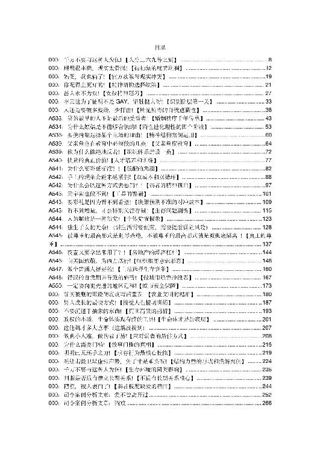

# 《结构学》精读第一期

# 000：千万不要与这种人为伍！【人分三六九等之别】

（展麟解读：讲人是分三六九等的，每一等级人的思考，心态，观念都是不同的视角，这个这等级，从开始区分第一道标准是秩序，这个秩序指的是生活秩序，精神秩序，做人做事的秩序。一个自信阳光有目标有秩序也自律，情绪稳定的人，更喜欢享受挑战中突破的喜悦，从自身内部有序中得到持续的正向反馈，形成良好的自我驱动，对自己整个判断系统也是正常的，不依赖周围人的判断而判断，自己有自己的判断和选择，不顺从周围人的评价而行动，自己对自己的行动有客观不扭曲的评价；另一个缺乏自信，不爱说话，没有目标，生活没有秩序，更不会自律缺乏主见的人，从自身内部中很多失败的声音，对自我整个判断是彻底质疑，外部就需要依赖周围人的判断而判断，顺从周围人的评价而行动，高度依赖周围的反馈，同时也害怕周围人嫌弃的扭曲判断。

前面上讲的第一种人选择的同类，和第二种人选择的同类，就是不同速度不同轨道的两类人，大家在自我的轨道的中，一切都是那么理所当然，毋庸置疑，因为我是这样做，周围人也是这种，两种自洽的循环，随着年龄增长，好的越来越好，差的越来越差。对于个体而言，完成精神结构升级，让自己选择向上突破有秩序有目标的轨道，而不是向下兼容无秩序没目标的轨道，继而突破生存结构边界的约束，紧盯自己的 5 年突破生存结构关键节点的短期目标，找到 20 年周期坐标系的更有利位置的中期目标，传承接力 180 年的家族长期目标，好好去深耕，记住一句话，特别能理解你的同类，都是不能拉你出去的，特别能跟你共情的同类，都不打算改变你的处境）

昨天在一个咖啡厅，听到背后一桌的女的在劝她的闺蜜：

这种说戒烟就真的把烟戒了，说减肥就真的能减下来的男人，绝对不能找。你想一想，戒烟和减肥多难，这种人对自己都这么狠，他的心得有多硬。这样的男人会缺乏与别人共情的能力，也不会同情弱小。太自律的男人往往具有极强的控制力，他不仅会高标准要求自己，也会这样要求你。他觉得他能做到，也会觉得你也应该做到。这好有压力呀！只有那些本身就很柔软、心地善良能与你共情的男人才不会给别人压力。才能理解别人的脆弱…

后面还巴拉巴拉说了一堆，我就懒得听了。她说的有错

吗？似乎没有错。在《A340：只有同类才能满足你的诉求！》中就已经阐述过这种状况了。能与你共情的人，绝对是你的同类。许多女生觉得跟自己的闺蜜一起做什么都非常的开心也有默契。但跟自己的男朋友或者老公去干点啥总是觉得对方无法及时的捕捉到自己的感受和诉求。于是，她们特别推崇迎合她们的电视剧中演绎出来的那种男主形象，并且试图用那个模板来改造自己身边的男人。结果时常引发冲突，事与愿违！

不管是男女老幼，当你试图去说服别人的时候都是在讲

道理。这就意味着你假定对方处于理性状态，而且能够理解你所阐述的逻辑。现实中人对别人产生影响力的方式并不是这样：一个广告之所以能打动人，主要是它引发了受众的情感共鸣。这种共鸣让接受者感同身受，这个广告把自己两难的处境了描述的特别准确，甚至把一些自己都没有意识到，或者只有朦朦胧胧的感觉无法准确表述的问题都直接挑明了。

俗话说：响鼓不用重锤。能讲道理的人自己就能够捋清

楚，即便是因为认知的盲区产生了误判。但是，这样的人更关注逻辑而不是认结论。从某种意义上来说，自信阳光的人本身就拥有一个牵引自己的更高目标。在挑战的过程中感受到突破的喜悦。人的行为由自我驱动，而不是被周围的环境所驱使。人之所以缺乏自律并不是因为这个人性格存在什么缺陷，而是缺乏内在的目标指引。所有缺乏主见的人，都会特别在乎周围的评价，同时又害怕周围的评价，却又极度的依赖周围的评价来为自己的一切事务做出判断。换句话说，缺乏主见的人对自己的判断系统是彻底质疑的。因此，才极度的依赖别人的判断。对自己本身也是比较失望的，所以，渴望周围的环境能逼着自己往某条路上走。这些的人由内而外的高度依赖别人，其安全感也高度的依赖周围环境的确定性反馈。更重要的是，这些人的自我判断非常清楚自己很烂，而且知道自己烂的无药可救，所以，对自己的嫌弃会扩散到别人身上，因为自己高度依赖周围的反馈，所以会特别害怕周围人的嫌弃。为了避免这种反馈所带来的痛苦，有一种底层的力量会驱使着自己主动筛选周围人的成色。

物以类聚，人以群分就是这种自然筛选的结果！特别能

理解你感受的人，却不愿意拉你出去。每一次都能说到你的心坎上，高度与你共情的人，却并不打算改变你的处境并解决你的问题。在《A215：为富人办事，为穷人说话！》中已经阐述过缘由，这里就不再赘述了。

# 000：理想很丰满，现实太骨感！【被抽象的唯美耽搁】

（展麟解读：讲普通人容易被抽象的唯美而耽搁人生的

关键点的选择，被具象的瑕疵吓的一次又一次向下兼容求存，只要不用你置身其中并承担那本成本，又容易自我代入的事，特别容易感动你，给你短暂的激情和力量，因为是远方，因为是抽象，因为是结果，忽略过程的时间和金钱成本，就会让你感同身受，这就是短视频的魅力，这就是物欲的魅力，不管你是谁，你都值得拥有，却半字不提你够不够资格，需要付出那些代价。而具象的瑕疵是实实在在的，是生活的一切财米油盐酱醋，真实而又繁琐还是一而再再而三的重复，熟悉的不能在熟悉，枯燥的不能在枯燥，这是现实的真相，也是很多普通人不愿意面对的现实。对普通人而言，踩对时代的主流节奏，该学习就学习，该工作就工作，该结婚就结婚才是最快的捷径，却不止一次被抽象迷惑，最后错过一个又一个岔口的后，有更多的问题，有更多的无力，让自己妥协消耗掉余生。对于个体而言，需要从遥远的抽象抽回来面对具象的一切，提升自己日常生活秩序的自我满足，从而完成精神结构升级，继而完成生存结构边界的突破，锁定自己的 5 年短期 20 年中期 180 年长期目标，让自己在目标的指引下升级打怪，一个台阶一个台阶往上打。改革眼下具象的生活，革新成长中不足的能力，突破一个又一个做人做事关键节点）

王石曾经在电视上说，年轻人不要着急，可以慢慢来，

多体验不同的人生。他甚至提议年轻人可以先花几年做做公益之类的事。真是站着说话不腰疼！不知道你有没有发现，这些动不动就劝你多体验不同的人生的人，自己在成长的过程中，都是踩着当时社会的主流节奏往前走，一点都没有落下，他们到了当兵的年纪就去当兵，到了入党的年纪就积极入党。总之，完全不是一种脚踩西瓜皮，滑到哪里算哪里的状态。然而，今天他们站在台上劝你去学着他现在功成名就之后的生活状态。这种论调为什么会有市场呢？要回答这个问题，你只需要搞清楚为什么，武侠小说中描述的那种，敢爱敢恨，自由自在的潇洒人生为什么特别吸引你，你就什么都明白了！

上世纪八十年代，甚至是九十年代早期出生的这群人，

可以说是被时代毁掉的一代人。时代转型需要付出的代价，几乎逮住这一群羊使劲的薅！为什么这样说呢？他们出生的时候搞计划生育，而当他们成年之后又鼓励生二胎、三胎。

考大学的时候，大学开始扩招，毕业之后，不再包分配。等他们好不容易自己找到工作，房价开启连续十五年的上涨周期。这个区间出生的人来到人间的时候，错误的选择了地狱模式。所有好事都跟这个群体没关系，但所有社会变革的压力都转嫁到了这个群体身上。所以说，时代抓住这群羊使劲的薅。

这些都还是明面上的。更深层次的影响是观念、心态和

行为方面的影响。这个群体的人普遍念旧。人如果总是回忆过去，说明当下过的不好。就好比一个女生如果总是想念前任，并不是因为她爱的深，而是因为她没有长进！所以，她越来越清醒的发现，那个自己曾经看不上，完全没有当回事的人，原来就是自己这个状态所能够得着的顶配！

一个自身的状态越来越好，自己不断长进的人，回想起

过往，绝对只会一笑而过。就如同你想起自己小时候某一个幼稚行为，最多会心一笑就过去了。我记得在上大学的时候，许多人特别怀念民国，甚至会把这份想象的美好投影到台湾身上。有些去过台湾旅游的同学，几乎把台湾的一切夸的像天堂一样。今天还有大学生特别怀念民国吗？我们都知道了那是一个苍生离乱，食不果腹，哀鸿遍野，山河破碎的晦暗时刻。今天的大学生也不会把心中想象的那份精致和美好投射到台湾身上了。因为你强大了，你富裕了，你变得精致了。

所以，相比之下，台湾的一切不仅陈旧，而且越来越变得可笑了。

80 和 90 后特别念旧，就是因为这个群体置身于一个充满不确定的竞争环境感到无所适从，所以，才那么多的人开始羡慕当年无比嫌弃的编制内的工作。再一次用架空现实的美好想象去勾勒出记忆中的那个世外桃源。这本质上是一种逃避。这个时代越来越多的人容易爱上抽象的东西，而难以爱上具象的东西。因为抽象的东西不仅简单唯美，而且没有瑕疵。但任何具象的东西都是一种复杂的综合体，存在不同的切面，因此也难免存在这样或者那样的瑕疵。本质上，人是因为害怕复杂，认定自己无力面对那些复杂的现实，才主动退回到一个安全的地方，把自己的各种内在诉求，各种喜爱投射到一个抽象的事物上去。你或许也被在山区支教的事迹感动过几天，或许还被在边界冲突上牺牲的英雄们感动的热泪盈眶，甚至会把自己代入其中，享受着那种磨砺和牺牲投射过来的力量和激动。然而，当你真正置身边境线上那些恶劣的环境之中的时候，热血和激情瞬间就会淡然无存，只有恶劣的环境所带来的痛苦让你特别渴望逃离！

不要嘲笑叶公好龙，大家都是叶公。叶公也只是站在远

远的，在安全的地方简单的想象一下龙的精美和神奇。事实上，绝大多数人需要的都只是这种抽象的美好，像海市蜃楼一样近在咫尺又遥不可及。终究没有能力爬山涉水去追逐海市蜃楼所投影的那个真实的地方。因为过程太艰辛、太复杂、充满太多的不确定，自己很清楚自己没有这个能力，也非常清楚真正的美好，自己不配拥有！

我十八岁的时候在学校画室画人生的第一幅人体素描，

我内心总是想画出让人惊艳的作品，所以很焦虑，迟迟不下笔。我的美术老师走到我旁边说：初学者宁拙勿巧！你如果每一步都按我教你的老老实实去画，结果不会太差。事实证明他是对的。至今那副代表我最高水平的人体素描还贴在老家卧室的墙壁上。人最开始都不甘于按部就班，总是想走不一样的路。最后才会明白，踩着主流的节奏才是所有选项中最好的那条路！

一个人如果在读书的时候好好读书，在上学的时候好好

学习，在工作的时候好好工作。只要每一个节奏都跟得上趟，其实再差也差不到哪里去。许多人学着别人的口气嘲讽人家是小镇做题家。对于出身不太好，起点比较低，家里也没啥资源帮忙的大多数人而言，能做好一个小镇做题家其实已经是自己能够得着的最高水平了。如果上学的时候努力，成绩还不错，读了一个还不错的学校和一个比较主流的专业。毕业之后只要不作死，大概率能够进当时主流的单位，待遇虽然比上不足比下有余，也是一穷二白的自己最好的积累方式。

刚开始可能不乍地，但经过十来年的积累。混个腾讯、阿里、华为这样的企业的中层还是能做到的。即便是在体制内，刚开始可能毫不起眼，只要人踏实不犯错，积累了一定年限之后，也会成为本单位的话事人或者主心骨。也就能逐渐发挥影响力。暴利是不能长久的，能够做的长久的事，总是稳健的追求合理的回报空间并逐渐积累优势，与时间一起长跑，甚至是一代一代的接力。

许多人连这样的主流节奏都踩不中，只能长期在不入流

的状态中原地转圈。有些人明明没啥本钱，却喜欢追求极致的体验，那一条道都不走，不断的跳来跳去，看起来好像很绚丽多姿，不过是临时性的吸引了一下目光，最后白茫茫一片真干净。

对于普通人来说，到了什么年纪就做什么事。跟随主流

的节奏，往往是自己最优的选择。许多人总是不信这个邪。

就如同早几年钱比较好拿的时候，每一个正常工作都干不好的人，都认为自己是天选之子，对一个行业一无所知的时候，就囔囔着要颠覆这个，改变那个。最后一地鸡毛，沦为炮灰。

上游资金一旦收紧，许多人的人生就再也回不去正常的轨道了。

为什么回不到正常的轨道呢？套用最近流行的一句话

吧：被狮子保护过的人怎么会看得上野狗。然而，存在这种想法的人没有想到这一层：如果自己是狮子，为什么会沦落到开始选择野狗的地步？如果自己只是狗，即便被狮子嘿咻过，也还是与野狗同一品种，并不会因此就变成母狮子。然而，说上面那句话的人不会想到这个本质问题。所有，会被一种臆想中的虚幻所笼罩，再也无法回到正常的轨道，跟随主流的节奏走完后面的路。只会像一辆失控的帆船，不断的卷入各种漩涡之中，直至沉没…

大概在十多年前，在走出校门前的聚会上，曾经听一个

长得还不错的女同学对大家说，她不想浪费自己的青春，她要找一个符合自己审美要求的男生谈恋爱，等享受够了各种美好的体验，再找一个爱自己的老实人结婚。跟自己爱的人谈恋爱，跟爱自己又合适的人结婚。据说她现在都快四十了，还没有结婚。或许她已经体验过她想要的美好了，但最后那个老实人却总是迟迟没有出现！

这个时代对老实人的需求量越来越大。然而，越是在这

种关键时刻，老实人都不知道到哪里去了！我们总是认为我们的时间很多，我们总是认为我们有足够的时间和机会去修正自己曾经在关键节点的选择上犯的错。事实上，越是没有本钱的人，就越是每一步都不能错。它就如同在森林中探路，每一个岔口一旦走错，就永远也绕不回去了！

# 000：妈蛋，我也病了！【官方政策与现实冲突】

睡觉的小木屋没有 WIFI 信号，这里比较原始。许多人喜欢大自然，但是并不能忍受原生态的生活。这些人所想象的原生态是这样的：能够充分享受忘却时空的纯净和悠闲，所有现代生活中的便捷和保障又能触手可及！这就如同远离危险和辛苦就能轻轻松松获得收益和成就一样！

标的 5 会在十一后给到觉悟社里满一年的成员。这里信号不好，昨晚用冷水洗澡生病了，这里的热水是用完一箱烧一箱，我去洗澡的时候，刚洗了头，打上沐浴露，突然发现没热水了！重新烧热一箱水需要 30 分钟，我只能用冷水洗完。否则，我会死得更难看！

早上起来的时候头有点晕，嗓子疼的厉害。骑马一个半

小时从山路等上阿尔泰山之巅。在登山的过程中，随着海拔越高，视野越开阔，山的那一边就出国了。我在马背上赶紧掏出手机拍下几张，随着更多的山河美景映入眼帘，忍不住在心中为之赞叹不已：山河壮丽，物产丰饶，炎黄世胄，东亚称雄！

新疆的资源高度集中，它所衍生出来的社会产业结构和

人与人之间的关系就具有明显的惯性：任何事不是体制内的人和单位在做，就是与体制内有着千丝万缕关系的人和单位在做！权力和人情相互交织，编织出这种社会的第一驱动力。

这种社会结构短时间内不会改变，而且会随着核心资源

的产业化日益做大做强而进一步强化。事实上，在过去的数年中，中西部地区都在加大力度引入东部产能过剩的产业，然而，这两年的环保政策让这些转移的产业也无法立足。

这些天近距离观察了当地的煤炭和光伏产业，许多东西

从道听途说和数字报表上看不出来，就近观察的感受更真切。

我国具备光伏行业全产业链制造优势，硅料、硅片、电池片、组件环节在全球市占率排名第一，但煤炭发电用来生产高能耗高污染多硅晶，这对碳排放和环保形成巨大压力，快速发展的电解铝产业同样存在这样的矛盾。这是一个官方政策和现实之间的巨大冲突。

包括当前的电力供应方面的问题，也是官方所追求的政

策与现实之间产生的结构性扭曲造成的。以上都只是点到为止，等我缓过来再详细阐述一下。

# 000：你配得上更好的！【精神结构选择缺陷】

（展麟解读：讲你配得上这句话的精神陷进，这是普通

人很喜欢的毒鸡汤，也是普通人用来安慰暂时没有得到的一切，从而让自己错失一次又一次进化的机会，也是让普通人理直气壮的放弃的底气，更是普通人没有判断力的展现形式。

判断力训练第一个阻碍是闺蜜，一切都是为了迎合你，才能成为你闺蜜的，不然只能做朋友，做不了闺蜜，判断力训练第二个阻碍就是信息接受，能感动你的，触动你的，都是你本来就认可的，不认可的根本就吸引不了你，更不会对你产生作用，精准投喂的自我的自动筛选，判断力训练第三个阻碍就是你成长环境中周围反馈的从众和某种因缺有需的第一选择标准，没有接受更高标准的引导，也就没有更高标准的判断标准，自然只能是从众和随需做选择，这种立竿见影的止痛很容易逐渐上瘾，这是一种自我选择的逆向退化，让自己越来越差，越来越 low。对于个体而言，要识别出来自己成长环境中用周围反馈从众和因缺有需的精神选择缺陷，完成精神结构升级，让自己接受更高标准的指引和判断力训练，继而让自己有拥有统治者的思维和格局，）

（讲你所接受的东西，都是被自己筛选过，并不是事情

的原本面貌）

人的一生需要做许多选择，有的时候选择大于努力。所

以，人的判断力是所有能力中最重要的部分。然而，判断力的训练则是最困难的事。一群幼儿园的小朋友在草地上玩耍，用不了多久，就会出现一个头。其它小朋友都会跟着这个头，听从这个头的指挥和安排。因为其它人都不知道自己该干什么，反而是这个头总是知道自己接下来该干什么，要玩什么。

于是，其它人就跟着他玩，模仿他的行为…

我们在成长的过程中，扮演指引角色的人是我们的父母。

如果你不走运摊上了既缺乏见识，又缺乏判断力，还过于敏感自卑控制欲强的父母。他们自己的生活都过的一团糟，肯定没法给你有效的指引，他们的观念、心态、行为和思考问题的方式都完全凭借道听途说的经验和某种因缺有需的本能。这样驯化的结果只能复制一个同类，并不能培育出超越自己的判断力。

以白领阶层和国企工人阶级为主体的人群一直存在一

个幻觉。认为自己获得的一切都完全依赖于自己的专业能力和小市民的生活技巧。这就好比你常年在一栋摩天大楼的格子间里工作，每一天只要进入电梯就能瞬间从地下负五层的车库抵达顶楼，久而久之你就会认为这是一种理所当然。直到有一天电梯坏了，你才猛然发现自己根本没办法爬楼梯上去！

我们每一天回到家里，拧开水龙头就有水，按一下开关

就有电。时间一长我们就会习惯性的认为这也是理所当然的。

我们会本能的忽略那些管线系统的存在，更会忽略搭建和维系这一整套体系的人和成本。

咨询行业的人为什么总是高估自己？因为他们不需要

对自己的建议负责任，也不需要对自己方案的执行负责。如果你做一件事，赢了算你的，输了都是别人傻逼。久而久之，你就真的会相信自己无比的正确和优秀，其他人都是傻叉。

要了解原理去读《论评价系统的运作机制！》。

人的自我评价依赖于周围的反馈，而周围的反馈如果在

无形之中都是被筛选过的，就会形成一个信息茧房，你能看到的都是你想看到的，你能听到的都是你想听到的，你能接受的都是你本来就认同的。有一些小镇美女在年轻的时候被一群低层次的舔狗环绕，时间一长就会本能的认为所有人都是舔狗，都应该围绕自己转。随着时间的推移，年龄的增长，自身价值的日益降低，围绕在自己身边的舔狗们慢慢散去各自上岸。即便周围人对其处境洞若观火，但当事人依然会陷在一个自己编织的死循环中出不来，并把一手烂牌打的更烂…

一个缺乏安全感，没有主见，又情绪化的女生，在面对

任何自己决断不了的事情的时候会特别依赖自己的闺蜜。然而，能够一直留下来的闺蜜，绝对具有这样的特征：只说她喜欢听的话，任何事都站在她的立场上，不管是观念、看法、行为，甚至说话的方式都极力的迎合当事人。这种迎合能够不断的编制连接，越密集的连接，就越让当事人觉得对方最懂自己，最在乎自己，最关心自己，最能与自己共情，也更信任和依赖对方的判断，正因为自己缺乏主见，所以任何事都需要对方为自己做出判断。正因为自己缺乏安全感，所以，会本能的对为自己提供判断的人产生依赖。事实上，这种格局一旦形成，闺蜜就能很轻易的操控当事人，而当事人还会对其感激不尽！读过《田园女权真正攻击的对象是女人！》就能理解的更加透彻和具体。

当一个女生在亲密关系中感觉自己受到委屈的时候，作

为她的闺蜜肯定会完全站在她的立场上指责别人，并无条件的捍卫当事人的正确性，如果不这么做就一定会被当事人剔除出闺蜜的队伍，她来索取情绪安慰，作为闺蜜如果你不仅不给与情绪安慰，还对她讲一堆道理，当事人就会把恨意转嫁到你身上。多几次这样的事，这个闺蜜就出局了。如此一来，能够留下来的闺蜜，肯定是她喜欢什么就说什么，极度迎合她，满足她的情绪诉求。闺蜜劝分的本质是帮助当事人把引发内在冲突的问题转嫁出去：在这么多次亲密关系的冲突中，你始终没有错，都是对方的错，对方做的很不好，对方完全配不上你，你这样委屈很不值！

这种话就如同精准投喂的信息，恰好能够满足当事人渴

望把内部的冲突转移出去的诉求。久而久之，就会自我催眠并信以为真，因为每一次闺蜜们的反馈就是确凿的证据！一个人在缺乏自我判断的时候，周围人的反馈就是自己的判断。

所以才有这么一种说法：你做不了主，别人就会做你的主。

许多男生抱怨抖音上的毒鸡汤给自己的女朋友或者老婆洗了脑，最终导致了关系的破裂。其实，这样想的男生也是没脑子的蠢货：问题的关键并不在毒鸡汤，而在于当事人没脑子，缺乏主见和判断力的人才会被抖音上的毒鸡汤洗脑，一个正常的女生有自己对人和事的判断，对那些毒鸡汤只会会心一笑，她们非常清楚自己要什么样的生活，也清楚真实的生活是怎么运转的。只有经历的太少又想得太多，自己不知道要什么，缺乏判断力，自卑又敏感还缺乏主见，总是患得患失的人才会被毒鸡汤洗脑。因为这样的人没脑子，更没有自己的判断力。不是被这个带偏就会被那个带偏，这种人本来就不值得。所以说，那些抱怨的男生也是没脑子，明明是上苍把他们从天大的坑里拉了出来却看不见。

人在被某些筛选条件阻止在外面，不得其门而入的时候，就会通过否定这件事或者这个人的价值来理直气壮的放弃。

并且会自我安慰道：你配得上更好的！事实上，这种自我安慰就如同吸食鸦片，虽然能够立竿见影的止痛，却会让人逐渐上瘾。人会慢慢陷入一种精神分裂状态：一方面不断的遭受挫败，不断的退缩，一次又一次的对自我产生质疑。另一方面又不断的否定自己的目标，甚至否定这种追求的价值和意义，以此来为自己开脱。并且一而再再而三的给自己打气，告诉自己配得上更好的。然而，更好的人和事从来都未曾出现！

喜欢吃糖的人蛀了牙，喜欢游泳的淹死在河里。最懂你

的人，从来不帮你解决真正的问题。为穷人说话的人从来不会为穷人办事。《为富人办事，为穷人说话！》中有一句话是这么说的：人民群众所遭受的一切苦难都是他们的自作自受！

虽然尖酸刻薄却是一针见血！

# 000：兽人永不为奴！【女权精神陋习】

（展麟解读：讲欧美女权是未来东亚女权景象，

看似获得尊重自主自由了，却破坏了千年的传统习俗，

在这种青黄不接的动荡周期，正在失去驯化千年男人

对女人责任的观念习俗，会让男人更关注自己，更自

私自利，也更实现，这是女权发展的恶果，女权破坏

了运行千年的规则，并触发了社会性防御机制，会让

下一代所有女性才承担。女权能成立的前提，是有人

配合你，记住是有人愿意跟你合作，受你制约，只要

不合作，女权就无从谈起，这是很多女人直接忽略的

事实和意识不到自身的脆弱性。女权本质是弱者的怒

吼，是一群不如意女人强行组队，是索取者找到理直

气壮的理由，是没有能力支付成本的情绪化。弱者的

求存之道从来都是扭秧歌一样，斗而不破才能利益最

大化，现在被过度匮乏的弱者，缺乏基本的节制，过

度的索取，把合作者彻底推向敌对面，从此对你严防

死守。过度匮乏弱者缺乏基本的节制，过度的索取压

榨行为，就会破坏这个系统十年百年千年运行的规则，

从而触发一种个人，团体，社会的防御机制，从而关

闭掉这个漏洞，让你更加匮乏。对于个体而言，要识

别出来自己过度匮乏，缺乏底线的节制，无底线索取

并不想支付成本的判断陋习，完成精神结构的升级，

继而完成生存结构的边界突破，紧盯自己短中长期目

标，去拥有这项能力，去优化这项能力，去迭代这项

能力）

你去瑞典、芬兰、丹麦、冰岛这些北欧国家就会发现：

这些地方的女人真的喜欢“多管闲事”，譬如爬山，中国男人如果像舔狗一样跟在女生后面鞍前马后，细致入微，当地的女人不仅会嘲笑，甚至会主动过来指责男性们侵犯了女性的权利，并且会理直气壮地告诉中国女生：你是个成年人，可以自己做到！

东亚的田园女权则以弱小和依附为前提，通过双标的方

式迫使男性为自己的任性支付成本，并以指责的方式迫使对方向让自己让度权利。然而，这种获取的模型存在一个天然的漏洞：田园女权所能享受到的一切权力和能获得的一切资源都依赖于对方的合作。如果对方学印度的甘地，采取非暴力不合作的方式，田园女权就完全无法依靠自己的力量而获得想要的一切。田园女权就如同明朝时候的大太监，有皇权支撑的时候，可以无法无天。皇帝一旦不再遭受其蒙骗，也只需要一道圣旨就能把他的整个势力都瞬间连根拔起！然而，田园女权者无论是作为个体还是作为整体，都意识不到自身的这种脆弱性。

日本偷袭珍珠港的时候，脑子里想的是“一击媾和（gòuhé）”的场景，也就是说，他们主动发起全面进攻是为了让美国人主动求和，并让渡权力给自己。这个目标极度的依赖对方配合。就像那些所谓的太极大师一样，一旦擂台上的对手并不配合自己表演，瞬间就会被揍的鼻青脸肿，瘫在地上起不来。

发动珍珠港袭击之前，日本人并非没有对美军及整个美

国社会做过评估。日本人的情报能力还是很强的，而且做事很精细。然而，所有缺脑子的人都有一个共同的特点：小事精明，大事糊涂。因为其脑容量不能理解更复杂的事物，也就看不见更深远的危险。

当时的美军确实在装备和人员的组织程度和规模上并

不出彩。日本人的结论就基于这些表面上的情况，而忽视了美国社会强大的动员能力，完备的工业体系，以及应对危机的意志力。总而言之，日本人评估了表面上的实力，而忽略了美国社会没有显示在表面的战争潜力。

当他们凭借这种轻率又表面的判断得出结论，并怀揣着

“一击媾和”的美好期待向美国人发动全面进攻的时候。完全没有意识到美国社会能够像下饺子一样建造军舰，能够像面包生产线一样出厂坦克，能够瞬间征召数百万的兵员入伍，而且还顺手牵羊的解决了困扰他们多年的经济危机带来的生产不足和就业不足的社会问题。所以，后面的事情就完全不受日本控制了，战争的进程一而再再而三的扩大到引火烧身的地步，最后原子弹在日本本土落下，造成数十万人瞬间死亡的悲剧摆在面前的时候，日本人赔的一干二净，沦落到人为刀俎我为鱼肉的地步。最终能够消停下来，还得益于美国人的高抬贵手和苏联阵营的存在，需要留下这颗棋子。否则，他们等于把自己作死到亡国灭种的地步。

自古以来，弱者的求存之道从来都像扭秧歌一样，进三

步马上又退两步半：斗而不破，日拱一卒，温水煮青蛙。这样才能利益最大化，才能细水长流。然而，过于匮乏的弱者，往往缺乏基本的节制，竭泽而渔的行为等于直接掀摊子，其结果就是把合作者彻底推向对立面！

不管是什么威力巨大的武器，它一定会被扩散，一旦扩

散开来，战争潜力越大的群体，才会是最终的优胜者。一个男人背井离乡把挣到的钱只留下最基本的生活费，其它统统都寄回千里之外的那个家，是因为有一种叫责任的东西在他的脑子里驱使着他这么做。一个陌生的男人看到一个陌生的女人提着重物上台阶，他会主动上去帮忙提上去，也是因为一种根深蒂固的观念在驱使着他。这些年拳打的越来越厉害，但各个单位在招聘的时候，女性的名额是不是越来越少了？

官方的宣传在一而再再而三的强调要尊重女性，但婚姻法在财产方面的条款是不是越来越不具有偏向性？譬如，对婚前财产的保护。

许多事本来是按照习俗的，而有些习俗运行了千百年本

质上是保护弱势的一方。然而，当拳师们开始掀摊子竭泽而渔的时候，法律就不得不开始介入这些模糊的地带，从而从理性的角度来维护当事人的利益。如此一来，本来按照习俗应该给予的，现在也可以按照法律的规定理直气壮的不给了。

这几年法院里的离婚官司越来越多，几乎都集中在财产方面。

按照传统，两个人离了婚如果只有一套房子，男人脑子中被千百年浸泡的观念会本能的把房子给女方，以保障其基本生活。然而，今天的男人们，即便有两套房子，对方完全没有收入来源，离婚的时候也一套都不想给了。并且会理直气壮毫无心理负担的用尽一切办法，找各种法律依据来证明不给是理所当然的。如果是一个人是这样，可以骂他冷血，人品有问题。如果越来越多的人变得如此理智，呈现出一种趋势，就不是人品问题了，而是某些人的行为破坏了运行了千百年的规则，并触发了一种社会性的防御机制。

自古以来，男人跟男人竞争，女人跟女人竞争，这是两

个完全不同的战场。显然，男性所处的生存竞争的战场内卷的会更厉害，竞争起来也会更加的惨烈。男人们都越来越难以在这个修罗场中存活下去，凭什么认为需要男人保护的女性更容易在这样极度惨烈的战场上凭借自己的力量存活下去呢？不要拿凤毛麟角的极少数优秀女性来举例，王亚平在 40 岁的时候就成了中国第一个进入空间站的女宇航员。然而，你去看看她的履历，她几乎在每一个时间节点上的每一步都没有走错。这种优秀太难得，也太凤毛麟角了！千百年来，人类历史上发生过无数次的灾难和战争，在那种恶劣环境中，每一次都是更弱小的妇孺成为环境淘汰的对象。为什么女性天生慕强呢？这是千万次残酷的现实处境雕刻在基因中的记忆！为什么所有的人类文明都在讴歌男人们保护妇孺的自我牺牲精神？要知道，人类文明中所有的赞扬和贬斥都是为了引导人的行为，为了在目标人群的精神结构中植入某种观念，并通过这种观念去引导他们的行为，从而达到有利于自己的目的。说的更加通俗一点，女生们如果拼命的夸男生的某个行为，那男人的这种行为肯定是对自己非常有利。想一想是不是这样？这就是评价系统对人的行为的引导方式。更多的原理可以去读《结构学》的第一部分《底层逻辑》中的《论评价系统的运作机制！》

要理解田园女权们的各种行为，先阅读《田园女权真正

要攻击的是女人！》。总之，田园女权的各种打拳行为，正在把更多没有脑子的弱者卷入其中，她们从打拳所获得的短暂好处中感受到了一种虚假的力量，却看不到深渊就在眼前不远处。一旦她们把真正的魔鬼放出来之后，会把她们的先辈们数十年日拱一卒所获得的权力和地位彻底断送掉！详情去读《A521：她们看不到危险正在靠近！》。

# 000：李云迪为了证明不是 GAY，牺牲挺大呀！【识别阶层第一关】

（展麟解读：讲识别一个人的阶层标准第一关，是为临

时价值支付长期成本，还是为长期价值支付短期成本。纵观生活的百分之 99 的普通人，都在为临时价值支付长期的成本的短视判断力，找一个自己不欣赏人建立长期关系，持续的在游戏中升级人生，为了物质欲望负债累累，为了跪舔美色过度消费，大学 4 年辜负学业沉迷泡妞等等，生活中有太多摧毁你的方式，也有很多自甘堕落的工具，更多隐形摧毁你的周围从众反馈，让你失去了累积的信心，转向即时的自我满足，自我挥霍。因为美色，因为物欲，因为成长缺失，因为自身放弃，而不断去选择为短期价值支付长期成本的事，最后导致累积出来自己普通低贱的一生。很多让你沉迷的东西，都是拉低你的层阶，任何决定都需要三思而后行。对于个体而言，要识别出来自己的缺失，特别是老是为短期价值支付长期成本的缺失，让自己的未来一步一步亲手撕毁了，完成精神结构的升级，继而突破生存结构边界限制，紧盯自己短中长期目标，去拥有能力，去优化能力，去迭代能力）李云迪要才华有才华，要颜值有颜值，虽然年近四十，

想睡他的美女应该也不在少数。然而，他为什么就不免费睡这些主动投怀送抱的女生，反而冒这么大的风险，以这种有偿且临时性的方式来解决自身的需求呢？

90%的男人一旦被年轻的美女主动勾引都会把持不住，坦白讲，我属于那剩下的 10%，即便是不太年轻的美女主动勾引也会把持不住！一个成熟理性的男人，虽然会把持不住，但也会严词拒绝对方乘机试图建立亲密关系的诉求。也许别人会指责你是那种来者不拒又提裤子就走人的人渣。但这种指责无关紧要。男人嘛，要做到坐怀不乱确实有点强人所难。

再说了，人家都主动勾引你了，你还像唐僧一样拒绝，这不是等于明确的告诉对方缺乏魅力么？杀人何必诛心，如此一来，人家该多伤心呀！就如同别人主动给你发红包，你大大方方的拿着，则会显得真实又洒脱，如果总是装腔作势的推来推去反而显得虚伪和小家子气。然而，男人可以把持不住被勾引，但不能把持不住草率的与人建立亲密关系。毕竟感情是神圣的，就如同签字画押一样，包含着某种深思熟虑的承诺。《他是真的不想睡你！》

有些男人仅仅是为了满足一时的欲望，明明知道这个人

存在深层次的问题，明明发现这个人没有什么地方值得自己欣赏，就为了睡人家就草率的答应与人建立亲密关系，这既是对别人不负责任，更是对自己不负责任的行为！从长远来看，非但没有占到什么便宜，反而是在给自己挖了一个巨大的坑，说的更直白一点吧：此时此刻，她的性感和热情让你有想睡她的冲动，但这种冲动属于动物性的原始驱动力，与人的感情无关！准确的说，她并不适合与你长期生活，因为你在她的身上找不到欣赏的地方，无法维持一种持续的吸引力。事办完了也就那么回事，除了满足一下一时冲动并没有什么特别吸引你的特质。甚至你们的精神结构都运行在不同的轨道之中，这将是无法改变的底层裂痕，是一切撕扯和冲突的源头。你如果仅仅是为了此时此刻能睡了她就草率的与之建立亲密关系，并试图自我催眠和自欺欺人来维系。结果往往是悲剧性的！

不管她是什么样的性感尤物，多睡几次也就那么回事了。

到那个时候，你的内心就会开始嫌弃，因为她本来就没有你欣赏的价值，这一点从一开始你就心知肚明，所以，接下来你会对一切付出都感到厌倦，态度也会极度消极，甚至沟通都存在问题，彼此冲突不断，信任感逐渐消亡，怨恨越积越深，彼此都会默默的启动自我保护的机制。比如都会觉得在对方身上花费的时间精力没有任何意义，甚至会认为在对方身上投入的任何成本都觉得不值。这种相互嫌弃并觉得被对方辜负，自己的付出不值的感受，不仅是关系彻底破裂的底层驱动力，也是无休止的争吵、撕扯、博弈的源头。多少家庭和多少无疾而终的长期同居关系都因此而陷入相互消耗和无穷无尽的彼此折磨之中…

不要为临时性的东西支付长期的成本，那必然是悲剧的

源头。为什么富二代们玩的很花，但结婚的时候都还是听从父母的意见，选择保守策略呢？因为有人把关：从投资的角度来看，为临时性的价值投入长期成本是一种不负责任的行为。事实上，所有的舔狗行为都是在为临时性的价值投入不对称的长期成本，并消耗掉极度珍贵的长期价值。你为什么要去舔呢？因为你骨子里就认为自己不配。你都觉得不配了，被舔的人会看不出来？

有句话是这样说的：穷人最大的悲剧就在于总是会为了

眼前一点微不足道的满足，主动毁掉自己全部的未来。仔细想一想还是有道理的，读过《为富人办事，为穷人说话！》就会更深刻的理解为什么有道理。一个人在读书的时候，为了眼前的开心，沉迷于之前没有玩过的东西，从而主动放弃了学习。当他进入社会之后，为了眼前的生计，不得不去从事那些会损害自己长期健康，会让自己陷入那种简单重复的工作之中，永远没有时间和精力去改变自己的现状。有的时候为了一点蝇头小利，甚至是别人几句假装在乎的好话，就会不计成本甚至不惜代价。这一些列操作都是在主动毁掉自己的未来，都是在为临时性的满足支付长期的巨大成本。

李云迪这事也就一阵风，过去之后他还是李云迪。吴亦

凡就没有这样的觉悟，为了省点钱居然与一个自己都看不上的女子建立所谓的亲密关系，最后断送了自己的未来。他要是聪明的话，就应该像李云迪这样花点钱，即便被逮住了，性质都完全不一样！

《A507：所有的调控政策都是为了保房价》被删除了，这篇一个多月前写的预判不幸被当下的实际情况验证了，当时就发不出来。后来内容已经改的很委婉了，早些天还是被删除了，目前只有【觉悟社】里有了。有点价值的内容现在越来越难发出来，即便发出来了也难以长久的生存。只有扯淡八卦才不禁止。这篇《A518：既双减又提高考试难度，要干啥？》抓紧看吧。如果没了也没办法。

# 000：人还是要被多鼓励，少打击！【所见所得的自我遮蔽性】

（展麟解读：讲为你说好话，给你甜头，为你撑腰的，

总是夸你，总是鼓励你的，总是恰到好处满足你的，你是理性之人就必须警惕迎合自己的人，迎合你的人都不是想正在改变你的人，你越保持原样甚至更差，他的迎合才有价值，因为保持原样的你，你才能是他的群众基础。所有甜头，所有的蝇头小利，都是让你穷的稳定，要理性的识别，更要理性的警惕，这其中就是运用了精神结构中自我保护机制中的自我盲区，自我遮蔽和对未知的恐惧，自我感觉良好，自我感觉进步，自我感觉有收获，自我感觉很努力，自我感觉付出很多等等，都是自我说服自己后心安理得摆烂，自我遮蔽就是自己所见就是所得的陷阱。1918 年的美国银行向农场主放款贷款额度，1920 年收缩贷款额度让农场主破产回到原来的阶层，这个 2015 年中国向城市中产放开购房贷款额度类似，同样的行为，在不同的时空上演，你贷款买房了么？

对于个体而言，能识别你所见所闻的遮蔽性和跟你同样群体的所见即所得的自我遮蔽性，是你最大的福报，也是您需要训练自己的洞察能力，去主动打破自己的精神结构中自我遮蔽性和自我盲区，从而在短中长期目标中，去践行，优化，升级达成目标的方式方法）

如果一个男人想获得一个机会，但又不够资格去做这件

事。通常会有三种应对方式：1.没有尝试之前就放弃；2.试图强迫人家改变想法；3.去做点什么事创造条件。绝大多数人会采取前两种策略。因为前两种方式操作起来比较简单，而且不需要脱胎换骨的改变自己。

一个经历的太少又想的太多的人，特别喜欢自己吓自己。

会把未知想象的无比艰难和恶劣。如此一来，就能理直气壮的放弃，并避免让自己陷入进退失据的纠结。过得不好的人总是会以过来人的姿态尽情的宣泄着自己的不如意，甚至不惜夸大其词。当然了，在整个过程中，自己是没有错的，所有的悲剧和不堪都是周围环境中的人造成的，自己唯一的错就是让猪油蒙了心，居然稀里糊涂就去尝试了！这让人不自觉的想起小时候学的一个寓言故事：小马过河！老水牛见谁都鼓励：快去试试吧，那水才到小腿。松鼠则会以过来人的口吻见到谁都劝阻：千万别去，我的朋友就淹死在这条河里！

最后小马还是过了河，它发现河水并没有像老水牛说的那样浅，没有松鼠说的那样深。当然了，还有更多的小马没有自己的主见，滞留在岸边，在风中凌乱。老水牛看了一眼它们，感到非常无语，懒得再费口舌，独自失望的走了。而松鼠看到这么多小马被自己阻止在河的这一边，露出了满足的表情…

人如果总是能搞成一些事，就会本能的希望别人也能搞

成。人如果总是搞不成任何事，就会本能的希望别人也搞不成。人以自身为丈量外部的标尺，所以，推己及人就变成了一种潜移默化的本能。

南巡的第二年，大批体制内的知识分子在号召的鼓舞下

主动下海创业。今天在社会上掌握核心资源的人群就是 92 和 98 两拨从体制内下海创业的知识分子群体。家里有个亲戚，本来拥有其他人羡慕不已的铁饭碗，而且是有编制的政府部门。然而，知识分子被家国情怀驱动的行为，往往不是其他人普通人所能理解的。当时也是主动放弃体制内的保障和地位，南下创业。确实存在一堆不明真相并且希望他倒霉的亲戚。因为你我的落差早就灼伤我敏感的内心了，所以我巴不得你变得和我一样，我无法变得更好，也不相信自己能做点什么改变自己的命运，所以，一边哀叹命运不公，一边怨天尤人，并急切的渴望着你变得更差，从而消除彼此的差距。然而，他在更上一层楼之后，却渴望其它人都过得比自己好。原话是：他们过的比我好就不会总是向我借钱了。

任何惩罚，要么来自于自己对规则的利用。要么来自于

自己的力量。看到别人倒霉而幸灾乐祸的人，心怀恨意却无力惩罚。所以，就渴望着存在一种叫命运的神秘力量，帮助自己达到惩罚别人的目的。

混乱对绝大多数人来说是灾难，但对少数人来说是阶梯。

对于通过混乱获得阶梯的人来说，秩序井然不仅会损害自己的利益，而且会让浑水摸鱼的环境不复存在。在贫穷和愚昧的环境中获得权势和丰厚利益的人，是绝对不能容忍任何东西打破着这种愚昧和贫穷的氛围的。因为这会让自己的权势和利益变成无源之水，无根之木。所以，有句诛心之论是这样说的：那些总是为恰到好处的迎合并抚慰弱者脆弱心灵的人，本质上是为了让你一直处于这种糟糕的状态。也就是说，总是站在穷人的立场上说话的人，本质上是希望为他喝彩的人一直穷下去。一旦这些人不再穷，他也就失去了群众基础。

还是那句话，在贫穷和愚昧的环境中获得权势和丰厚利益的人，是绝对不能容忍任何东西打破着这种愚昧和贫穷的氛围的！他们充分利用了人的自我遮蔽和对未知的恐惧。

因此，理智的人往往都特别警惕，警惕那些总是习惯性

迎合自己的人。曾经写了一篇《为富人办事，为穷人说话！》，它所阐述的是真实社会的运行方式。大家各取所需，各得其所。良药苦口利于病，但绝大多数普通人都不愿意喝苦涩的药。哪怕药真的能治病，也会本能的拒绝。然后困在原地不断的发出痛苦又日渐虚弱的呻吟，也不能容忍药的苦味。糖衣炮弹本质上是炮弹，但因为裹了糖衣，能够带来临时性的甜丝丝的味道，哪怕它是要人命的炮弹，也能被广泛的接受。

如果从这个角度来看，人似乎天然就存在自我作死的巨大潜力。

一战前夕，美国刚刚完成社会的工业化，农业人口在全

国人口的占比远不如现在这样微不足道，在社会经济中的分量更是如此。战争让许多必需的物资的价格都暴涨，尤其是粮食更是必需品。因此，等到 1918 年战争结束的时候，美国农民的手上通过卖高价粮食积累了不少财富，当这个群体手上的钱越来越多的时候，他们就具有了某种价值。接下来出台了一种公共政策，放宽贷款的条件，并大幅提高贷款额度，鼓励农民贷款去购买土地。这些农民在战争期间通过卖粮食挣到不少钱，这个思维惯性怂恿着他们渴望拥有更多的土地。但有这么好的政策出现的时候，自然是趋之若鹜。为此，他们愿意把手上积累的财富去支付高昂的首期款，并申请长期贷款购买更多的土地。随着杠杆的广泛应用，土地的价格随之水涨船高。到了 1920 年 7 月份，在新的公共政策的限制下，银行不约而同的停止了对农民放贷。处于高位的土地失去了源源不断涌入的资金的支撑。于是，土地的价格暴跌，农民们手中的土地相继被平仓。持续贬值的土地不足以抵消他们的债务，农民只能把土地抵给大银行家还债。随之而来的是几百万人失业和大量的农场破产。这个得益于战争获得财富的群体又回到了他们本来的位置…

科学无法普及，诸位随意，散了散了…

# A533：笑的最早的人不是最后的受益者！

【婚

姻秩序千年传承】

（展麟解读：讲当经济发展了，人就会想要解放想要自

由，这是经济发展后的人的必然进化。手里有了钱，又有积蓄，对未来又有期待，自然就要求自己拥有更多的权利更多的自由更多的我说了算，女性弱者中的田园女权就此兴起，为了打破社会历经千年进化婚姻制度对自身的束缚和制约，要求更男性让渡更多的权利和更多的自由，但是任何事情都有两面性，当女权要求男性让渡权利和自由的同时，也让男权兴起，让男性放下传承千年婚姻制度中男人的责任和义务，让男人更加关注自己需求，更加精致，更加利己，更加自私，同时在婚姻结合的时候，考虑女性的家庭背景和个人挣钱能力合不合适在一起。这一切都是女权摧毁旧婚姻秩序获得临时快感的同时，也要面对男权兴起，对女人放下千年来的责任和义务，让男人成为关注自我需要精致的自私主义，让男人更加渣男，更加势力，成也女性所造成，败也女性所造就的。这些都是没有掌握资源普通女性需要的自由和面对的渣男，掌握资源高端女性却正在结婚生子，好好培育优质的后代，打造更优质的大家族，延续更强的血脉，同时又彻底隔绝来自底层男人通过爱情名义进行攀炎附势，这是当下两性的社会结构的真相。对于个体而言，洞察婚姻在社会发展中扮演的角色非常重要，不要被一些女权观念捕获而失去自己的思维判断，更要站在掌握资源的婚姻组队中的角度去谋求更好的今生姻缘，为自己大家族的传承目标打下夯实的基础，在婚姻中组队更好的良缘下，增加抵御风险的能力，从在自己短中长期目标，可以更集中精力去潜心修炼，达成自己短期突破生存结构边界的 5 年目标，达成在周期坐标系中找到更有利的位置的中期 20 年目标，达成在传承接力的大家族长期 180 年目标）

另一种标题：A533：这是一场不可避免的战争

另一种标题：A544：人的解放是一场幻觉

前言

任何一场社会变革都起源于一种思潮，兴盛于一个骗局，结束于一场梦碎。最初的思潮永远都是极端的，热衷于这种极端思想的人，一定是群体中不如意的弱者。然而，古往今来的事实反复证明，这个最早起来掀摊子的群体并不会成为最后的受益人。

之前发的《A507》和《A513》被删了，昨天的《A507 和 A513 都不在了，这篇看完记得保存!》也发不出去，改了内容重发了。现在能发出去的东西只能谈风月，连风月都不能违拗大众的意志! 《A430：美国强力介入台湾的理由!》这篇是唯一能发出去的非风月类的东西，已经被现实验证，要看抓紧吧。现在的环境就是这样，八卦和风月可以扯，思考是不允许的。结合现实问题揭示更深层次的运行逻辑也是不能发出去的，设置付费都不让发了。目前这些只能放【觉悟社】里了。

许多事在宽松的环境中会觉得理所当然，当环境逐渐恶

化，一切都收紧之后，曾经的理所当然变得逐渐无法触及了。

这就如同许多人会想念自己的前任。所有会想念前任的人都是因为自己没有长进，自己的处境也没有改善。所以，才会猛然发现：原来那个自己曾经看不上的人才是自己能够获得最高匹配!

古往今来，任何社会运动最后的受益者都不是最初的那

一批人。陈胜吴广反馈暴秦的大泽乡起义，拉开了时代的序幕。但最后的受益者却是刘邦这样的平民群体。读过《王侯将相真的有种!》你就会明白，不管是陈胜吴广还是项羽张良，他们都是旧贵族的代表。只有刘邦这群人是彻彻底底的平民。

与华夏部落时代首领们的血统毫无关系。为了让文章不过于庸俗，虽然谈的是风月，也要稍微有点深意。任何一种社会性的反抗都存在更深层次的缘由。虽然它是以个体反抗的姿态出现，并逐渐成为一种风潮。然而，这些行为的背后都是为了摧毁旧秩序。

我们在《田园女权真正攻击的对象是女人!》中阐述了一个社会运动中的极端分子的种种行为背后的驱动力。但这种驱动力还挖的不够深，仅仅止步于个体行为的驱动层面。个体的精神结构在形成的过程中，深受外部生存环境的影响。

所以，接下来会挖的更深。

不管是极端的女权还是逐渐扩散的男权，都只是这场社

会运动中的激进势力。这场以反抗传统为旗帜的社会运动，所要达到的目的是为了彻底摧毁原有的社会基础结构，并且重塑一种新的稳定秩序。只不过这种新的秩序会以什么形式存在破坏者心里并没有底。甚至没有这样的意识。目前这个阶段还是属于大力破坏原有秩序的阶段，因此，谁的调门高，谁的破坏力大，谁就更能吸引眼球，甚至更能获得临时性的利益。

在一个更加充满不确定的生活环境中，人群的迁徙造成

了内卷和淤积。这就让生存竞争变得更加剧烈。只要产业继续发展，更高端的产业和更先进的社会协作方式就能为大家提供更好的待遇和机会，凭借人往高处走，水往低处流的基本原则，年轻人就必然会继续向北上广深这种大城市涌入。

这种涌入所造成的淤积和同质化竞争就必然会越来越内卷。

这是不可避免的!

许多人谈到内卷的时候，都拿看电影来打比方：内卷是

因为第一排站起来了，逼的后面的人不得不站起来。事实上，我们反复解释过，内卷的本质不是因为第一排站起来了，而是因为大家都无处可去，被迫淤积在同一个电影院。如果有其它地方可以看，你站你的，我去别的电影院看。正因为没有地方可去，这里是自己最好的选择，所以，大家都挤在这里，当第一排站起来的时候，你也不得不站起来。这种内卷的不可避免，会造成竞争加剧，造成资源变得越来越难以获得，以及生活成本的进一步提高。

人类一直试图组织起来以应对自己所处的生存环境。人

不管是组成家庭，还是结成部落，乃至最后形成国家。都是因为无力单独应对生存环境，才不得不出让部分权益，牺牲部分自由，来最大程度的获得自我存续的保障。任何一种社会制度都不是凭空产生的，它的存在源于一种更底层的基本需要。

随着社会结构的升级，以及由此形成的生产力大幅度高

速发展。从而编织出一张安全网，让个体能够在这张网中获得更多的自由和安全。人就是这样，当你刚来到一个大城市的时候，你谁都不认识，什么社会关系都没有，什么资源都用不上。你会与自己唯一认识的老乡、同学、亲戚频繁互动。

因为这些人是你在新环境中唯一的生存保障。当你逐渐在新的地方认识了更多人，建立了一定的社会关系，也从事了一些事，获得了经济来源。与刚来时的老乡、同学或者亲戚的联系就逐渐少了。因为你已经在一张更大的安全网之中，就没有那么需要之前的那些小安全网了。甚至他们的某些诉求、习惯和观念给你带来的不便，反而会让你感觉是一种让人厌恶的束缚。甚至会强烈渴望摆脱这些束缚。

人的解放是社会经济发展之后的必然趋势。在西方的历

史上，文艺复兴是人的解放的标志性事件。事实上，不管是音乐、绘画、雕塑等方方面面，在文艺复兴的早期都是以宗教为题材。最先发动这场运动的居然是享受着宗教特权的教士群体。他们的本意是打破长期以来形成的宗教层级以及附着在这些严密层级上的特权。然而，他们没有想到的是，自己点的火把整个宗教特权阶层彻底摧毁了，而且，自己所享受的社会尊重和特权恰恰是附着在这种旧秩序之上!

人类总是重复着同样的故事，一遍又一遍的重复上演。

300 年来，人无时无刻不在追求自我的彻底解放，但具有讽刺意味的结果却是：人不断的陷入越来越控制严密的枷锁之中。过去皇权不下州县，今天你能看到什么都被系统的算法所控制。处于自给自足的小农经济下的人，即便清贫当自给自足还能生存下去。一旦置身于高度分工协作的大城市中，一旦无法占有资源，柴米油盐衣食住行都需要钱，而且这基本生存所需的东西的价格还是波动的。所以，置身其中的个体就如同实验室的玻璃罩下面奔跑的小白鼠，不到力竭身死的那一刻，永远都无法停下来。这是谁也抗拒不了的社会发展趋势，置身其中的人既相互制衡又相互竞争。

那些从小地方涌入大城市的人，当自己通过工作挣到第

一笔钱的时候，产生了一种彻底从原有的生活环境中获得独立的错觉。似乎自己融入了一张更大的安全网，通过出卖劳动力就可以从这张网中获得自己想要的一切。事实上，当你每一个月都能支付得起你的衣食住行，以后后续各种生活和个人所需的成本时，它才会呈现出友善、包容和安全的面目。

一旦你无法为之支付成本，它瞬间就会变得冷酷无情还面目可憎。到那个时候，你就会发现自己上天无路，入地无门。

无人聆听、无人在乎，举目无亲，孤立无援。夜幕降临的时候，不管道路上车流是多么的川流不息，城市的灯红酒绿是如何的繁花似锦，一切都与你无关，路灯下的孤影，会显得无比的孤独和渺小。此时此刻，那个远在天边，你极力想摆脱并斩断一切联系的家，似乎成了你唯一的期盼和安慰. . 男人和女人谈恋爱并结婚最核心的驱动力还不是为了

繁衍。因为繁衍这种事不结婚也能做到。人之所以要谈恋爱甚至结婚，无非是为了编织一张最后的安全网，以对抗自身的渺小、无助和孤独. .

不管是日益极端的田园女权还是日益扩散的男权中的

极端份子，并不是在社会经济发展中获得更多资源的人。恰恰是越来越无法凭借自己的力量去获得资源的群体。在《田园女权真正攻击的对象是女人!》一文中已经阐述过这种行为的自我驱动力。因此，所有极端的主张并非是为了追求个人的解放，而是自己无力应对孤独、渺小和无助时的破罐子破摔。就如同在生活中越是感到无力，越是反复遭受挫败，不断被生活毒打的人，内心就越渴望拥有毁灭性的力量。因为这种毁灭性的力量可以无差别的毁灭所有人。这种毁灭本质上是渴望摧毁现有的所有秩序，因为在这种秩序中，自己很无助，很无能，很渺小，很孤独，还瑟瑟发抖又无所适从. . 只要你去认真观察，所有热衷于双标的田园女权都是女

性中的弱者。是自身的状况和处境驱使她们选择了这种激进的主张，你会发现所有主张的背后都是为了让男人支付成本来帮助自己抵御无力、渺小、无能、无助和孤独的侵蚀。因为自己实在没有东西去与别人交换，所以才会以指责的方式去掠夺并迫使对方让渡权利。这就像什么呢?就如同你很想买一件东西，但价格太高你付不起钱，于是，你就对卖家一顿指责，说卖家穷疯了卖的这么贵，诸如此类。其目的是为了让对方以你付得起的价格把东西卖给你。如果真的不想要这个东西，也根本就不关心对方标什么价格。也就不会因为被高价隔离带来的挫败感而滋生出恨意和愤怒。

这种打法本意是为了掠夺有资源的对象，结果抬高了缺

乏资源的普通人的获取成本。从而让对方也学会了同样的招数。于是，你就能看到生存环境持续恶化下的田园女权的泛滥和与之对应的男权觉醒。后者开始以前者的招数对付前者，也就是所谓的《X1：用魔法打败魔法! 》!

任何一场社会运动的极端份子都是为了摧毁原有的秩

序。如果说原有的婚姻制度以及衍生出来的道德和义务让人群中的弱者更难以承受，从而驱使着这个群体变成了极端份子，以破坏性的主张去剔除这些束缚自己的枷锁。那么，那些被看成是枷锁的束缚，不仅仅制约自己也同时约束着对方。

撕开封印的那一刻，虽然自己暂时获得了片刻的轻松，对方也就趁机卸下了自身身上的责任和义务。对方的阵营中越是和自己处于相同处境的无力者，往往觉醒的更早，也放弃的更加彻底。所谓负责任就是愿意为别人的行为和诉求支付成本，所谓有原则就是愿意为自己的行为和诉求支付成本。一个不负责任也毫无原则的人就是一个烂人，但是，对于本来就力不从心的人来说，死猪不怕开水烫，烂就烂，反正烂的更轻松，也更舒服。所以，他们会变得后来居上，在摧毁原有秩序方面，反而会更彻底也更激进!

任何一场社会变革都起源于一种思潮，兴盛于一个骗局，结束于一场梦碎。最初的思潮永远都是极端的，热衷于这种极端思想的人，一定是群体中不如意的弱者。然而，古往今来的事实反复证明，这个最早起来掀摊子的群体并不会成为最后的受益人。表面上看起来是弱者中的田园女权掀起的战争，结果在男性群体中培育出一群精致的利己主义者。把所有的资源都用在自己身上，开启无限的内卷模式，毫无怜悯，毫无包容，放下一切传统的道德和责任的约束，变成彻头彻尾的渣男。他们拥有一切精致和美好，却再也不会对任何人长期负责. . 点火者本来在拼命摧毁旧秩序，当旧秩序被彻底摧毁之后，旧秩序约束下的一切都荡然无存，包括保护弱小的部分也随即消失。《A428：婚姻的供给侧改革!》中已经阐述过，新秩序的建立会建立在更高的门槛之上!

当下的社会周期为摧毁旧秩序推波助澜，因为个人的原

子化状况更有利于消费。当人们不再有长期追求之后，就会把所有的资源都消耗在满足自我当下感受的事物上。而只有极少数彼此都拥有资源的男女，会构建起新的稳定结构，并负责大规模的培育下一代更强大的人类。用不了几代人，大家族的复兴会以另外一种形式呈现。当社交媒体上到处都在叫喊着不结婚不生孩子的时候，有些人在抓紧时间生三胎、四胎。许多人为了一点彩礼争吵不休，然而，相互嫌弃的都是同类。在门槛更高的人群中，彼此各自优秀，势均力敌，冷眼旁观着底层群体无穷无尽的撕扯，构建起幸福稳定的家庭，更加注重为下一代营造身心健康的成长环境。又不约而同的彻底隔绝来自底层的男女们通过爱情的名义进行的叩门。

# A534：为什么嫖娼是不能够合法的! 【两性进化理性的四个阶段】

（展麟解读：讲人的情感行为分四种，第一种是最底层

的本能行为，遇到漂亮的异性就想上的繁衍本能行为，这种窗口期很短，来的快去的也快；第二种在周期短的繁衍本能行为中进化成爱情行为，就是一种用各种唯美和期待来维持的爱情期，就是你浓我浓的相互配合的愉快玩耍，时间周期比繁衍本能周期长些，金钱成本也高些；第三种是爱情期的再一次进化成婚姻期，这个婚姻就需要双方的更多的信任和支持，才能达成的合作，会跟财米油盐酱醋挂上钩，如果信任没了，共同体也就开始有了裂痕，这种比前两种，时间周期更长，成本更高；第四种是婚姻期的最后一次进化趋利避害期，这个需求的人要求更多，成本更高，情绪价值更多，投入更加全面，筛选也更加严格和谨慎。如果嫖娼合法，是最本能的容易得到满足，花的钱最少，人也就失去奋斗，工作，参与其他社会分工协作的意义，自己吃饱喝足就行，不管人家死活，人没了做事的驱动力，社会发展就停滞不前，不利于社会发展，这就是嫖娼不能合法的正向循环。对于个体而言，从社会现象看清本质，是你必须掌握的本事，在本质中找到高成本正向循环的驱动力才算合格，完成精神结构升级，洞察更多社会中的精妙玲珑棋局，从这些棋局找出自己的生财之道求存之路，是你为完成短中长期目标中必须突破的生存结构边界和占据生产资料的有利位置）

根据古籍记载，齐国的话事人管仲在辅助齐恒公称霸诸

侯的过程中，做了许多社会制度改革。其中，建立国有企业体系的最初雏形就是管仲的杰作。在管仲为振兴齐国经济，增加财政收入的诸多举措中，开了 700 家官方妓院可以说是前无古人后无来者的创举。

不曾查阅过历史文献，不太清楚这种古老的职业最初诞

生于什么时期。在先民生活的远古时代，这种事是免费的。

大家都光着屁股满世界跑，逮住是谁就是谁。在我国某些少数民族居住的部分山区，至今还残留远古母系社会的走婚制度。只要女人需要男人的时候，就在屋外放一双鞋，路过的男人看见了不同的鞋子就知道什么意思，男人是不用负责的，跑到一个女人家里就能够为所欲为，即便生下了孩子，也跟他没啥关系。他拍拍屁股就走了，当然了，也不能带走任何东西。这种情况下不存在隔壁老王的问题了，因为生下的孩子肯定是女人的孩子。当然了，这种制度能够存在下去依赖于一个前提，它也是母系社会能够维系下去的前提：女性的采集收入是稳定的，而男性的狩猎所能获得的东西，甚至自己能够存活的概率都极度的不确定。于是，就有了铁打的营盘，流水的兵。在这个结构中，不可控的因素被排除在关键节点之外，他的生死得失不会破坏整体结构的稳定性和持续性。这个模型是从内部摧毁的，当个体能够组织起来之后，同样是狩猎，就变成了分工协作的围猎。任何一种统一行动就如同一个更智能更强大的生命体利用智慧和工具在与野兽搏斗。于是，狩猎的收入不仅逐渐变得稳定，而且食物、皮毛等生存所需的资源变得更加充足。在生存竞争中，谁的贡献大谁就会更有话语权。聪明的人肯定会选择与贡献更大，能力更强的人站在一起。

母系社会到父系社会的转化并非缘于男权或者女权，古

人没有这些概念，更没有那么多花花肠子。只遵循最底层的生存逻辑。哪种方式更有利于生存和繁衍，他们就选择那种共同体的组织方式。人类一直试图组织起来，以应对自己的生存环境。与之同时，又会根据环境的变化和自身的变化不断的调整构建共同体的组织方式和内部的规则。总而言之，都是为了达到稳定有序并能创造增量，有利于存续的原始驱动力。就如同基因变异一样，内耗型的错配也会出现，但终究不会是主流。它只是临时性的过渡状态，就如同一个双边关系中总是处于被压榨的一方终究有一天会觉醒，并且猛然的发现：自己才是持续输出能量维系现有结构的关键支点，所有的枷锁都建立在自己的观念之上，只要自己摘除这些观念，就能轻易的摧毁。

当生存环境持续恶化之后，人会追随强者以保障自身的

生存，即便是弱小的个体也会被迫相互组队，增加应对日益艰难的生存环境的能力。当然了，这种组队也会造成内耗。

只要稳定性的需要压住了内耗的程度，它就能像一艘到处漏风的破船继续跌跌撞撞的往前行驶。大多数人的生活不就这样么?!

人是一种更高级的生命体结构的载体，这些载体由低到

高呈现出不断向上叠加的特征。你去观察人的胚胎的发育过程，在这个过程中它所呈现出来的外形包括了从低级到高级动物的所有的形态，最后到瓜熟蒂落的时候才会呈现出人类的样子。这就如同计算机系统中硬件的故障触发的中断的优先级高于系统错误触发的中断，又高于应用程序的错误触发的中断，由底层往表层，层层向上传导，并触发相应的响应机制。人作为一个更高级的载体，在被驱动的时候也大同小异。动物都有发情期，体内激素的变化是为了驱动彼此进行繁衍。人也是动物，也遵循同样的驱动力。但是，这种激素的变化是存在周期和时间窗口的。窗口期一过底层的驱动力就熄火，更上层的驱动力就开始干预。所以，在人类看来，没有得手之前非常来劲，一旦得手之后，就不新鲜了。不明真相的群众就会认为这是因为对方变心了。事实上，只不过是底层的驱动力熄火了。上层的驱动力遵循另一套逻辑，这套逻辑并不以繁衍的强烈冲动为第一驱动要素。而会呈现出更理性的状态，所以，就不会再那样不管不顾，而会变得三思而后行。

爱情是在繁衍的驱动力消失之后，增加一个驱动力。换

句话说，一个糟糕的亲密关系，不仅无助于构建共同体，也会让这个高于繁衍的第二驱动力也熄火。这个驱动力通常会被称之为爱情，在它熄火的时候，一般就表现为不爱了! 婚姻建立在契约之上，契约的核心是信任。在阐述交易

结构的时候，就已经阐述过：交易结构的核心是信任链条。

但信任链条无法建立的时候，交易链条也就无法贯通，整个交易结构也就无法形成。所以，在供需双方的信任链条无法建立之时，往往会引入中介这个中间环节。中介在交易中的核心价值是通过自己的专业服务让无法建立信任链条的供需双方，通过与自己手拉手的方式建立起交易的信任链条。

能不能去掉某个中间环节，一个核心的判断依据就是原有的交易结构中的信任链条是否在去除某个中间环节之后依然存在! 具体的案例去读这个花了 3000 万成本的实践总结：

《B1：去不掉的中间环节!》。

婚姻中的信任一旦破碎，不仅共同体的稳定性就会大打

折扣，而且给予契约的一切都会加速撕裂。缺乏纽带的内部制约的个体必然会启动自我保护机制，这种自我保护会驱动彼此相互提防，不断撕裂，背道而驰。所有这些循环叠加的惯性都是为了摧毁共同体，并从个体内在的约束中释放出来。

就如同一个经营不善的企业，人员的流失，策略的失当，内部的猜忌都会加速，因为在更底层存在一种驱动力，这种驱动力就是要摧毁企业这个共同体，并将它内部的各种资源，包括人员、资金、业务关系等方方面面的资源，从这个无法创造增量的企业中释放出来，并重新投入到其它企业或行业之中去。事实上，任何基于契约建立的利益共同体都是如此。

爱情是比婚姻更底层的驱动力，而繁衍的冲动则是比爱

情更底层的驱动力。任何跨越艰难险阻的行为都需要一团非理性的火焰充分的燃烧。慷慨赴死的为什么大多是一无所有的青少年? 而老奸巨猾的为什么是掌握资源的老人? 青少年还没能掌握任何资源，所有的行为都是为了获得，所有为了获得的行为都来自于最底层的诉求。而老年人们低层次的驱动力都已经熄火了，最上层的驱动力更多的会呈现出趋利避害的理性抉择。扯了这么多，跟嫖娼不能合法有什么关系呢? 关系很大呀!当一个年轻的男人无法通过便捷的方式，以低成本的形式满足最底层非理性的原始驱动力产生的诉求的时候。他就只能去谈恋爱，并通过建立亲密关系，以合法的方式去满足。谈恋爱的成本和嫖娼的成本，孰高孰低? 假如谈恋爱的成本也越来越高，因为某种社会发展的缘故不断的抬高成本，并把出不起价的人排除在外。那么，不管是给予繁衍的需要还是基于原始冲动的驱使，要合法的获得满足，就只能去结婚了。而结婚的成本就更高了!

恰恰是这种高成本才能驱使人去工作，去努力挣钱，去

参与社会分工协作的各种事项。读过《A431：这依然是男人之间的厮杀!》就会明白这种无形之中的玲珑棋局的精妙之处。

# A536：要搞清楚选择某个立场的理由！【精神结构案例运用】

（展麟解读：讲从一个人的说话系统和行为表面，去倒

推这个人的说话和行为背后的精神逻辑，再从精神逻辑回到最初的原点判断，自身对自己一个自我判断系统，这是一个系统工程有因就有果。当一个自我判断系统判断自己为自我低价值，自我弱小，时常求而不得，无处不在的压抑，各种各样的挫败感的时候，就会启动精神自我保护机制，思考方向从当初事件焦点转移成为应该采取什么行动去捍卫自尊，捍卫面子的焦点，只要事件焦点转移到捍卫自尊的焦点，你讲道理是行不通，只会让对方更加情绪化，更加恶语相向，破坏力也更强等很多对于理性者不可思议的事情发生，目的你屈服，让你为他的自尊，面子，匮乏支付高昂的成本。表现的行为和语言如下，对小三群体的仇恨，骂爹骂娘，甚至大打出手，对店员指责，非常可怕的情绪，自残式的胁迫等等，三个阶段的进化从自我判断到思考我认为，到自我必要一顿输出，最后破坏了自己与别人的连接，也破坏自己当下处境，把自己推向更烂泥潭，更加孤立无援，更加自我嫌弃的状态。对于个体而言，洞察自己行为背后的精神关注焦点和精神原点判断，完成精神结构升级，让自己的精神世界处于一种正常状态，不内耗，让自己更有余力去集中精力为事业目标打拼，完成生存结构边界的突破，从而完成自己家学传承的短中长期目标，目标才是你的一切，期待都是你达成目标的工具和奖励）

一个人选择什么立场不重要，持有什么观点也不重要。

重要的是为什么会持有这样的观点，以及是如何抵达所选择的立场的。这个过程比结果更加重要，理解这一点也更能解决实际问题！

一个已婚女性，特别是各方面都不咋地，而且不受丈夫

待见的已婚女性，看到电视剧中的小三角色，往往会滋生出莫名的仇恨。这种立场的选择就基于自我代入引发的感同身受。自己越糟糕，这种感受就越强烈。所以，我们看到了这个群体是如何抵达她们所选择的立场的。那么，要解决这个问题的正确方式肯定不是讲道理摆事实，或者解说剧情试图让她们理解。这些看似理性对话的方式都不足以消弭她们心中滋生出来的恨意，也不足以让她们冷静下来分清电视剧和真实生活的不同。

事实上，这跟性别无关，而跟人抵达自己所选择的立场

的路径息息相关。当一个开比亚迪的人在拥挤的路段强行超车插在你前面，你只会觉得这个司机的个人素质有问题，你不会觉得开比亚迪的人都是这样。然而，如果对方是一辆迈巴赫，或者劳斯莱斯，你就会本能的认为这个群体就是这样仗势欺人！之所以会滋生出这样的观念，源于一种自我弱小的判断，继而滋生出一种会被嘲讽和伤害的心理暗示。于是，接下来的所有心理活动和自我行为都不再聚焦于被超车这件事上面，而转移到一个焦点：弱小者面对欺凌应该采取什么行为去捍卫自尊。

我曾经受人委托去帮别人买个包，因为疫情的缘故，门

口就拉了一个警戒线，每一次只能放 20 个人进店挑选，里面的人出来之后，下一批排队的人才能进去。这本来没什么，合情合理。我排队的时候，前面还有一对情侣。刚好到他们那里的时候是 20 个，他们就和我一样是下一批进去。这个时候，工作人员就在他们的面前把警戒线拉了起来象征性的挡了一下。结果那个女的突然非常情绪化的与工作人员争吵起来，她质问工作人员是不是看不起她，是不是觉得她买不起。她的男人试图拉住她，跟她解释这只是防疫政策的限制，别人没这个意思，后面的人也在排队。结果她的情绪化更严重了，她认为她男人不仅不护着她，还让她当众丢脸，让别人看不起。最后气呼呼的独自走了…

看到这一幕，我挺同情这个女生的。自我判断为低价值

感的人往往就会这样。之所以为她感到悲哀，同时有可怜她，就是因为能够洞察她的这些自我保护机制启动的轨迹，以及会触发这种自我保护机制的缘由。她的可悲之处在于，她的一系列行为在她自己的内在驱动力机制中环环相扣，无法察觉也无法阻断，然而，在外人看来她的这些行为就如同神经病一样莫名其妙。不得不长期与她打交道的人也会非常的痛苦，又疲于奔命还无所适从。

一个自我判断为低价值感的人，时常会求而不得，时常

会感到无处不在的压抑，各种各样的挫败感如同暴雨敲击地面一样，把那点微弱的如同风中残烛一样的自信心彻底浇灭了。而且挫败感像暴雨一样，每一次都把自己淋的透心凉，即便卷缩起来躲在角落中瑟瑟发抖也时常感到绝望！

不要跟他们讲道理，道理他们都懂，但就是没法改变。

因为他们的自我保护机制会不停的启动，每一次启动都会触发更强的逆反行为和应急反应，这种行为和反应的破坏力是自己无法控制的，不仅破坏自己与别人的连接，也破坏自己的当下的处境，不断地把自己推向更烂的泥潭，更孤立无援的境地，更自我嫌弃的状态…

懂一个人就是能从细枝末节中察觉出这个人持有某种

观念，坚持某种看法，选择某种立场的缘由以及抵达的路径。

这就是理解精神结构的实用价值吧。

# A539：父亲角色在教育中必须做的几点！

【父

亲角度教育】

（展麟解读：讲在家庭教育模型中，父亲角度侧重设计

磨具就是做人做事的原则，边界底线，母亲角色侧重打磨细节就是做人做事让人更舒服满意的细节，这是这个孩子与外部建立关系最初的模型，也是孩子一生人际关系的地基，从家庭中学会如何跟男性打交道，如何跟女性打交道的原始关系模型，父亲角度需要从游戏中让孩子感到安全，是深度参与的游戏而不是说教，从游戏模型中去进化 6 点细节，建立连接，表达诉求，请求帮助，处理冲突，学会拒绝，面对挫败的关系处理模型。这个游戏模型不管是孩子还是成人只要你缺失这一课都要补上，是让自己有完整的精神自我判断系统，从而从容不迫走好这一切，而不是被无数精神缺陷消耗了自己的一生。对于个体而言，需要洞察原生家庭缺失精神自我判断系统那一课，不足的都必须有意识补上，让自己摆脱精神内耗的深渊。内耗，内部不稳定，内部没有秩序，精神判断系统扭曲等才是你人生最大的障碍。缺物质缺金钱缺工具弥补很容易周期短成本低，但是精神自我判断系统扭曲矫正是一个漫长的深坑，完成精神结构升级是成年人最重要的一课，让自己拥有一个不内耗精神结构自我判断系统是对孩子，家庭，爱人，团队最大的恩泽，也是家学传承的精髓所在，为后世提供完成的，自我精神结构升级的训练系统）司令解读：如果大家都不待见你，那是因为最开始有人

羞辱你的时候，你没有表明立场。是你自己先放弃了原则和尊严，其他人才肆无忌惮的羞辱你。在《A539：父亲角色在教育中必须做的几点！》一文中忘记加上这一点了：照顾人，但不要伺候人。怎么区分照顾和伺候？别人会做，也能做得到的事，你非要去越俎代庖，这叫伺候人。别人不会做或做不到的事，你去帮忙或者引导对方做到，这叫照顾。照顾的本意是让其远离危险，获得成长和胜任感。当你习惯性以讨好的方式与这个世界打交道的时候，你能怪别人不尊重你吗？！

前言

人长大之后的许多问题都发端于小时候，成长环境和最

初的生存结构中的关键角色对其精神结构的初始化和与外界建立关系的最初模型具有不可磨灭的影响力。它决定了高楼大厦的地基稳不稳！本文适合有孩子的人，或者打算有孩子并教育好的那些人。如果说母亲角色侧重于打磨细节，父亲角色则侧重于设计膜具。基础不牢地动山摇，那些极度缺乏安全感的男女无一不是源于父亲角色的缺位或不够鲜明！

读过了《A525：你误会了男孩要穷养和女孩要富养!》，理解了一个人的精神结构在最初阶段的雕塑中重大隐患之后。可能还需要一些具体的操作方法，本文就系统的阐述这些极具操作性的方法。

本文说的父亲角色不一定是父亲，因为家庭是雕塑人的

精神结构最初场所。一个人与家庭中各个角色之间所建立的关系就是这个人未来整个生活中与外部建立的各种关系的基础模型。后续的一切关系，以及这个人处理关系的方式都是在这个基础模型上进行扩展，或者为了弥补基础模型中的缺陷和失衡。

家庭和成长环境构建起了一个人最初的生存结构。父母

之所以会在孩子的自我价值的判断中拥有极高的权重，源于这种连接能够为其生存持续的输送各种有形和无形的资源。

在《结构学概论》中说过：人以自身为标尺丈量外部的一切，唯独无法以此标尺丈量自身。因此，我们对自我的判断依赖周围的反馈，而周围的反馈是通过连接来获取的。通过这些连接的反馈，人的精神结构对自我形成一种价值判断，也形成一种自我与外部一切关系的判断。那么，形成判断的权重是怎么样的呢? 通过此连接能够为自身的存续输送或可能输送的资源量来判断。当然，在这个权重的计算中还要考虑稳定程度，稳定度高的持续输送的连接点会比不确定的临时输送的连接点的反馈拥有更高的权重。由此可知，父母是小孩生存结构中能够持续输送生存所需的物质和精神资源的紧密连接，这种连接的反馈对自我判断的影响非常重。所以，不管是富养还是穷养小孩，都不是停留在字面上，而是侧重于为其构建起稳定的精神结构的最初模型。否则，就必然进退失据，宽严皆误，随着时间的推移，就会变得更加的不稳定和无可奈何. .

在此主要阐述一下父亲角色具体应该做些什么：首先，

与识文断字比起来，通过做游戏和陪伴，在父母这样的角色与孩子之间编织起密集的连接网，会让孩子感到安全。这种安全感的获得就如同高空施工时看到下面搭建起来的安全网一样。虽然隔得很远，掉下去也未必接得住，但有和没有在人心中的感受就完全不同。事实上，在现代战争中，野战医院并不能起到多大的救治作用，但是，士兵恰恰是因为相信自己倒下了会有人救治，才会敢毫无畏惧的向前冲。人的语言所能传递的信息只占 30%，而 70%的信息是通过其它方式传递的。因此，一起去做点什么，深度的互动和参与所能传递的信息比语言的教育高出好多倍。而且，人在这种互动和深度参与中形成的触点记忆，并通过这些触点编织起来的密集的连接比什么都更能带来安全感!

其次，就是通过引导和模拟教会小朋友如何去：建立连

接，表达诉求，请求帮助，处理冲突，学会拒绝，面对挫败。

所有的交换都是从建立连接开始的，不管是人与人之间的连接，还是人与事之间的连接。如何搭上线是一个非常重要的生存技能，但绝大多数家庭并没有教。越是普通的家庭越不会教这些，因为普通家庭的父母自身都不知道如何去建立连接。

所有连接的建立都是从触点开始的，没有触点也就无法

建立连接。你与张三是老乡，你们喜欢吃同一个口味的菜，这就是触点。你与另外一个人上同一个学校，这也是触点。

爱好广泛的人比没啥爱好的人往往拥有更多能与外界建立连接的触点，但对某种爱好比较深入的人则比较容易与同类建立深层次的稳定连接。因此，这无所谓好坏。又多又深当然是最好的状态，所以，在最开始的探索阶段，不要凭借自己的喜好随意的扼杀其临时性的探索欲望。能够清晰的表达自己的诉求和情绪的人往往比较容易获得帮助，也更受欢迎。

现实生活中特别作的人都是缺乏安全感的人，这种人从小就不愿意表达自己的诉求，所以，会渴望别人去猜中自己的情绪和需要并主动满足。为什么会这样呢?因为缺乏安全感又害怕被拒绝，久而久之由不敢表达变成了不愿表达，甚至变成了不知道如何表达。只能通过生闷气和发脾气的方式向外界传递信息。这种人特别难以相处，只会加剧被隔离的处境。

不管是大人还是小孩，敢于并善于请求帮助的人总是会

获得更多的资源和机会。绝大多数人既不敢，更不善于请求帮助。即便有所求，也会习惯性试图以指责的方式获取。举一个现实中的例子：我在后台经常看到各种辱骂式的留言，如果真的不在乎，看到收费内容默默走开就行了，然而他们偏不，不仅留言还各种辱骂和指责，事实上，他们真正想表达的是渴望能看到付费内容，但他们只会本能的以指责的方式来表达。这种沟通方式不仅无法得偿所愿而且会让自己变得更让人讨厌，并加剧被周围的人孤立。

小朋友面对的第一个不知所措的挑战就是处理冲突。当

边界观念还未树立起来之前，他们都在本能的驱使下采取行动。小朋友之间经常会为抢同一个玩具而打起来。其实，这种最终演变成彼此大打出手的哀嚎，仅仅发端于一方不会表达诉求，另一方不会表达拒绝。

由此引申出两个重要的技能训练：学会拒绝和面对拒绝

带来的挫败感，以及转移和疏导的方式。一个不会拒绝的人，往往会对自己充满仇恨。因为每一次不由自主的退缩和放弃防线都会在事后引发对自我的质疑和否定。这种内在的冲突源于自我诉求和现实状况之间的强烈反差。一个不懂拒绝的人，即便是长大之后，人际关系和自身处境也总是一团糟，因为害怕错过机会就什么连接都不放过，又因为力不从心又会无法深度的维护关系。一个不知道自己要什么的女人，对于所有的机会都不会拒绝，有的时候这种人并非主观上精明到能够骑驴找马，而是她们对自己持续的维系稳定的关系的能力心存质疑，充满不安，一段关系还才开始，就会考虑失败之后自己该何去何从，或者关系出现任何波折，她不会想办法解决，而会在上面那种牵引力的怂恿下考虑主动放弃。

因此，她们往往不想错过任何潜在的人。所以，在外人看来其行事方式毫无原则而且不讲基本的道德。其实，那些自私的总总表现都源于从小就不会拒绝和没有边界感。这种人的其它方面也很难有条理，如果长得有几分姿色，年轻的时候还会有人惯着，越到后面就越情绪化，也越糟糕。

你可以暂时不知道自己要什么，但你必须要清楚自己不

想要什么。学会拒绝的训练就从这个点开始。再复杂的决策，也无非是叠加的判断和选择。在拒绝的过程中，人就会越来越清晰的知道自己要什么，并且能够做到，将军赶路不追小兔。

处理训练学会拒绝之外，还必须要训练如何面对被拒绝

的情况。许多人即便成年之后，一旦被拒绝或者遭受类似的挫败就会暴跳如雷，甚至滋生出仇恨的报复心理，或者变得更加的自卑和退缩。这些都源于从小就未曾训练如何面对被拒绝和被否定。自我判断为低价值感的人往往更害怕被拒绝和被否定，所以，才会习惯性揽功诿过，自卑敏感，而且逆反心很强，情绪化严重，一点就炸!

小朋友还不能像大人那样明白很多道理。被拒绝之后，

只会哭闹、恐惧和退缩。给小朋友讲任何人都会被拒绝这样的道理是没有用的。有一次大眼睛姑娘告诉我她很难受，因为她在幼儿园的好朋友突然对她说：我不想跟你玩了!我就问她：你在幼儿园除了这个朋友，还有其它朋友吗?她说还有谁谁谁也是她的好朋友。我就顺势告诉她：你可以多交一些朋友，这一个不跟你玩，你可以马上去找另一个玩。下次遇到这种情况，你就可以笑着对她说：没关系的，我还有好多朋友可以玩。大眼睛姑娘突然很气愤的说：我上次从新疆回来还送给了她新疆买的礼物呢，今天在表演区我没把话筒给她，她就说不想跟我做朋友了。我过生日的时候我会邀请所有好朋友，但我不会邀请她!我鼓励她道：你做的很对!你现在还难过吗?她笑着说：不难过了!

我没有去盘问她为什么不难过了。但我非常确定她拥有

了一套能处理类似这种被拒绝的机制。这套机制中包括了对被拒绝带来的自我否定的转移和相应的反制措施。这种反制措施并非是为了发泄，而是为别人与自己打交道设置规则。

人在被拒绝之后所产生的最大痛苦并非来自被拒绝本身，而是来自由此衍生出来的自我否定。只要能把这种自我否定转移出去就行了! 曾经在【觉悟社】中回答过一个父亲的提问：

关于女儿被同学恶意评价之后就主动放弃一直为之努力的事，应该如何处理。这些应对措施都来自于精神结构的基本原理，只有理清楚原理才能有针对性的对症下药。那个问题是关于被同学否定，以后在觉悟社中再详细阐述一下被老师这种唯一权威否定时，该怎么引导孩子。

# A539：他为什么能绝地反击！【组织体系建设一员】

（展麟解读：讲从企业角度来说，成为组织体系建设一

份子，你的企业机会就会越来越多，助长成为商业价值一部分，社会公共服务一部分，国防安全一部分，所以优质企业更有无穷的潜力，企业的经济价值是一部分但不是全部。体系建设本质就是秩序重建，秩序重建本质就是对规则边界的确定，规则边界本质就是一道道显性和隐性门槛，显性隐性门槛本质就是成本的堆积，如果别人不能为你支付成本，就需要你自己支付成本，你自己也支付不起，就只能是停滞不前。所以说在更宽松更公平的时代，你更要努力更要逆流而上，累积更多的能力去提升自己的支付能力，从而让自己成为有产者，占据更多的资源，成为更高阶层的一份子，而不是选择性躺平，放弃严酷的生存竞争训练。让自己退回底层稳稳锁死在底层循环轮回中。对个体而言，洞察一个组织，一个公司，一个团体的体系建设的核心点，让自己成为这个体系建设的核心点，成为其中的一分子，成为不可替代的一分子，你的价值自然就拥有议价权，爬到更高的位置，从而协调突破自己的生存结构的边界，爬阶爬升到更高的位置，永远是你短期目标需要达成的目标和方向，为这个目标你要集中精力，调动所有资源工具为这个目标服务）

司令解读：刚刚看到手机上有一条消息，提醒公众号结

构学已经封号，给一次申诉的机会，所谓的申诉应该只是走流程，没啥意义。起因是把觉悟社里的一个尖锐提问及其回答改写成了结构学这个公众号上的《A539》发了出来，事实上，发出来的内容已经是修改过了的，标题也改的非常柔和，不吸引人。封号的原因居然是之前没有发出去的那篇草稿，也就是那篇被拦截下来发不出去的内容触发的。

司令解读：申诉了好几次，都没有任何消息，刚才突然

收到一条消息：念我初犯，且举证有效，姑且放我一马，以观后效！然后，后来就可以登陆了。本来就是个冤案，在申诉中陈述到：因为《A539：他为什么能绝地反击！》这篇是平台审核之后发出来的，之前没有发出去的草稿虽然更敏感，但没有发出去，也不曾造成任何影响。无规则而不成方圆，然无罪而诛，将何以取信于天下？！

前言

为什么越来越强调宽松和公平的时候，你反而要加倍努

力逆流而上？让愿意躺平的人躺平，让愿意努力的人努力。

不要被表面的东西麻痹，社会的体系建设才是起决定性作用的东西。为什么京东能绝处逢生？

学员提问：

大 BOSS 交接没有明确规则是否存在危机?

谁说的!整个社会权力制衡体系不是在逐渐完善么?整个社会权力体系如同一座金字塔，整座金字塔的稳定性才是关键，不是那个顶上的装饰!

现在无论是政治、经济、金融、财税、国企和公共暴力

体制的改革，都是在强化制衡体系，让一切有章可循，并压缩模糊地带。这就如同一棵树在不断的生长地下的根系，最后才长枝干和叶子。

社会权力制衡体系存在两种发展趋势：一种是根都烂了，基座和支撑点正在加剧摇晃，只剩那个顶，努力保持着光鲜亮丽的假象。另一种就是在编织出一套能够渗透到生活方方面面的权力制衡体系，让社会整体有序运转，并完成整个社会的秩序重建! 最后才装饰那个顶。

京东本来陷入困境，开会的时候大强子在现场，都有人

故意问他在美国的那点破事对京东的利益损失有多大，各方逼宫也是非常紧迫的。是什么让其起死回生还大放异彩的呢? 是疫情! 当武汉发生疫情的时候，即便是四方支援，人可以坐飞机去，物资怎么办? 武汉市上千万的人口总不能靠空军的飞机运输吧?就算飞机运送过去，也是堆积在机场，到不了需要的人手中。这个时候，京东多年打下的基础就发挥作用了。京东立刻就变成了战时总后勤部的角色，利用它花费巨资耗费多年建设起来能够渗透到每家每户的物流配送和运输存储功能为封锁中的武汉源源不断并有条不絮的配送全国各地涌入的物资。为此，钟南山都特意写信感谢大强子! 京东经过此役，彻底翻身。这种翻身不是商业价值上的，而是社会体系和国家安全层面上的彻底翻身。与阿里的麻烦不断比起来，京东将会成为国家层面的物流体系的有效组成部分，从某种意义上来说，国家级的物流体系会以京东打下的基础和探索出来的路子为模板。

从某种意义上来说，大规模的救灾事实上就是在检验一

个社会的战争动员能力和能够支撑到什么程度。其中暴露出来的核心问题都是接下来需要集中资源攻克的关键点。总而言之一句话：体系建设才是核心! 凡事能够协助体系建设，查漏补缺的行为都会拥有巨大机会。也会得到更大的助力。

要从底层逻辑看清楚大势所趋：爷爷那个时代，只要不

怕死就能战场建功，改变命运；父亲那个时代，只要不怕苦，胆子大，就能闯出一片天地。到了我们这个时代，光吃苦和胆大已经不行了，还得有脑子，有知识，有启动的本钱，才有可能逆天改命。到了下一代，那门槛就更高了。我们刚毕业的时候，随便搞一点什么都能跑马圈地，现在的毕业生要去创业的话，会发现自己想到的，别人早就做过了，而且已经失败了。要开创空白领域，除非你能从零开始搞个类似于大疆无人机这样的东西。这个门槛就不是一般的高了，它的潜在前期投入会筛选掉大多数家庭和大多数人。确实每一个时代都有跑马圈地的机会，但是在秩序重建的阶段，越是到后面，机会的准入门槛就越高。这些门槛由一堆隐藏的筛选条件编织而成，而每一个隐性条件都可以换算成高昂的成本。

如果没有外力去为你支付这种成本，你就只能自己投入，如果无法投入，也就只能止步于此!

体系建设的本质就是秩序重建，秩序重建的周期必然造

成淤积。这种淤积源自于体系建设的时候会逐渐确立许多规则，这些规则也就是隐性的门槛，所有的门槛都是用来筛选人的，而筛选所形成的分层隔离反而会强化整体的稳定性。

这个整体的稳定性是以相互制衡的规则为前提，任何一种规则的确立都会把一些人排除在外。恢复高考对谁最不利? 对考不上的人最不利。法制健全的社会，对谁最不利? 对缺乏竞争力的人不利。当生活中的方方面面树立起越来越多的规则，那些规则就会像高墙一样横在你面前，如果你过不去，就被彻底的隔离在外了，而要越过这些高墙，就需要支付相应的成本，或者具有相应的优势并付出更多的努力。

# A540：扶贫的真正价值! 【人才培养和训练】

（展麟解读：讲扶贫工作第一方面可以帮助底层人民纳

入市场经济的生产和消费，推动整个社会的良性循环，第二方面更重要的是让底层人看到下一代可以变好的期待，这一代人的烂我们没有办法改变，下一代的人改造势在必行，让下一代有希望，越来越好是统一意识，统一目标有效的方式，多少父母在下一代面前展现出强大的生命力，从而推动自己不怕苦不怕累去参与社会协作的工作。第三方面对国家干部，统治机器成员的训练，任何时代最大的准备就是对人的培养和训练，改革开放培养一批有视野有目标有效率的干部，扶贫工作需要培养有系统性应对危机，能未雨绸缪的统治机器关键点的干部，为接下来的 30 年应对国家安全，民生安全，科技发展做准备，这是时代的目标，也是发展周期的主题，只要你顺应时代潮流，你就有机会站在时代进步上成为时代英雄。对于个体而言，需要洞察时代的目标发展的周期主题，把自身的发展纳入这个主题，成为这个体系建设的一分子，从而获得更有利的发展，完成精神结构升级，继而突破生存结构的边界，完成阶层的转换，成为有产者，成为从 0 到富到贵的过程）

早几天跟一个基层的扶贫干部聊天，我以半开玩笑的口

气对他说：你把我们缴纳的税拿去在那些鸟不拉屎的地方盖房子修路，毫无经济效益，完全是浪费嘛! 他一本正经的说：

你对我们的工作有误解，我们不仅仅是盖房子修路，更主要的是教会他们如何与自己的下一代打交道，保障他们的孩子上学，教他们讲卫生，改变他们原有的生活方式和习惯。把他们组织起来进行生产。他们确实很让人失望，但我们的工作是保障他们的下一代不再陷在这种死循环中。如果没有我们这些人，没有这样的拨款，他们和他们的后代将永远困在这种死循环中! 他们这样的群体是没有人在乎的，他们常年愤怒又孤独的生活，这就是培育反社会人格的恐怖分子的温床。

我们在关心他们，在乎他们，帮助他们，他们是知道的，我们在帮助他们的下一代脱离这种状况，他们不仅知道，而且无比感激，因为他们自己无能为力。

既然你要算账，我就给你算算：如果我们今天不花这个

钱，明天就要花更多的钱去反恐，那个成本会更高! 你看看新疆就知道了。你去南疆看看就知道那里为什么总是滋生恐怖分子了，宗教和民族都只是借口，最主要的就是穷，还与社会格格不入，没有文化，不识字，不会说普通话，没法沟通也没法找工作，一家人住的地方有的就是一个地窝铺，没有一身干净的衣服。这样的处境，这样的文化水平和生活方式，就极度容易被一种精神上自我麻痹的东西所吸引。

我们没有像美国那样直接发食品券，通过福利来养寄生

虫。不仅这个成本会越来越高，最主要的是会毁掉这些人的未来。我们所作的事是让他们建立起希望，我们反复告诉他们，你的改变和努力是为了让你的下一代不再如此。所以，我们教他们普通话，现代的生活方式，保障每一个孩子都不失学，这是工作的重心。盖房子修路方面，他们自己也要参与其中，出一部分的钱和力。我们在创造条件，把他们组织起来工作，也是为了让他们对生活建立信心，有个盼头，看到希望!

看得出来，他对自己的工作还是很有成就感的。这就是

组织的高明之处：扶贫是一场战争，在这场战争中，将会锻炼出一批干部。这些深入一线并且帮助过那些被遗忘的人群重新找到希望的干部，不仅深入了解这个社会的实际情况，而且会在基层民众心中重新树立起对组织的情感和依赖。这句话可能比较抽象，要更好的理解，去读一下之前的文章：

《A374：真正的大机会在这里!》和《A87：一个时代的终结!》：

资源、人才和希望都在加速延着渗透进县城和村头的交通网络被吸附到城市之中，间接的造成了基层社会的破败和社会基础结构的坍塌。那些被遗忘的人群，孤独又愤怒的活着，与整个世界都格格不入，然而，在这个高速流动的社会，就必然会成为对社会安全的威胁。一旦整体的社会秩序因为外力的缘故处于不稳定状态，这些人就天然会成为恶势力的炮灰和帮凶。

人群总是会被组织起来，早些年基础组织松散的时候，

形形色色的其它组织方式就大行其道。包括但不限于利用宗教和封建迷信的方式，或者因为利益结成各种各样的小圈子。

早些年在除恶打黑的时候，出现过整个村子甚至地区的人都集体参与违法行为并结成利益同盟的现象。法兰西最大的社会问题是什么? 不是移民和宗教问题，而是那些移民形成了排他性的封闭社区自成体系并以宗教覆盖其上，造成了法兰西官方的权威和社会权力传导体系无法渗透进去。读懂了《A8：统治的关键支点!》的人应该明白，有三个关键点是无论如何都不能失去的。其实舆论阵地就是其中一个关键点的实现工具，其它两个自己去读《A8：统治的关键支点!》扶贫工作会把更多的人编织进生产和消费的网络之中，

培育出一个更大的国内消费市场，也让更多之前被排除在市场交易之外的人变成参与生产和消费的一份子。人的需求是一种存在的，而需求要转化为消费则依赖于购买力，改革开放初期，大量过剩的农村劳动力被沿海的劳动密集型产业所吸纳，在以廉价的劳动力成本按照市场需求进行生产的同时，也挣到了比待在家乡更多的钱。恰恰是这些钱将他们的各种需求转变为了消费，从而培育出越来越大的市场，继而形成市场经济的良性循环。

扶贫工程不仅仅是经济效益的一面，也包括上面的另一

面。除此之外，任何一个具有时代意义的重大目标都是锻炼和筛选干部的最好方式。一场卫国战争能够锻炼和筛选出一批经历过血与火考验的干部，这些人去填补统治机器的每个关键节点，就能保障整部统治机器在满足以上三个关键点的同时有序的运转。改开以来，这种经济建设的社会实践训练出了一批敢于开拓的干部，他们视野开阔注重效率。接下来的时代将会呈现出什么样的态势呢?经过四十年的繁荣之后，接下来将面临系统性的冲突和挑战，最激烈的形式甚至会发展为战争。面对这样的局面，需要什么样的干部来填补那些节点，才能让整艘大船驾驭住大风大浪呢? 每一个时代都有它要面对的主题，而围绕这种主题必须要未雨绸缪的做准备。

最大的准备就是人的培养和训练!

# A541：为什么要降低标准？！【低配的悲剧】

（展麟解读：讲不管是降低标准，还是妥协顺从，目的

都是为了解决问题。但是降低标准，妥协顺从之后就一定能解决问题么，历史证明，不能，不但不能还会更糟。你自身的生存环境和精神结构没有改变，只是降低了门槛，看似成就这个生意这段良缘，其实是为接下来的不幸埋下种子，对方肯定会理直气壮要求你为现在的不良的一面做出改变，同时更高往好的方向发展，这就是最难的隐蔽诉求，这个改变，这个变好，如果能改如果能变，就没有今天降低标准妥协顺从的事情，有的就是这么匹配更好，就是因为改变不了才成为今天的无能，今天的无力，今天的将就。为结果奔走相告，辱骂指责，愤愤不平没有意义，因为从你选择开始就注定了这个结果。能自我满足的人，结合不结合都过的很好，不能自我满足的人，结不结合都会一地鸡毛，任何优质的男人女人都是稀缺资源，稀缺资源归少数人所有，某种意义上，那是稀缺资源是对生存竞争优胜者的奖励，而不匹配生存竞争的失败者。对于个体而言，让自己变好是你拥有一切的开始，完成精神结构升级，结束自己自卑又自怜的内耗精神负担，继而突破生存结构的边界，让自己做事做人更有胜任感，也更有财力去升级生活场景，从而实现阶层的跨越，爬阶爬更高的位置是你必须突破的短期目标，读更好的书，住更好的房子，开更好的车，结实更优质的人脉，走进更棒的圈子）司令解读：许多人读到《A541：为什么要降低标准?!》和《A543：要彩礼是因为看不到希望!》的时候非常愤怒。

我并没有劝你躺下，更加没有鼓吹消极，事实上，结构学研究的是生命体在其生存结构中的求存之道，并不是求死之道。

我始终在强调务实、理性、突破、跃升，掰开并揉碎的讲解精神结构中失衡的形成以及修复和升级改造的方法。反复强调的是振作，改变自身的状况，改变自身的处境，突破所处的生存结构的各种限制，走向一条孤独的进取之路。问题是，你不是无力改变，动弹不了么?你不能面对自己，也不能面对现实世界的残酷，你无法接受它的复杂性和两害相权取其轻的痛苦抉择，你需要的并不是逆流而上方法，而是一种像鸦片一样的解脱、安慰和玫瑰色的梦境. .

不知道你发现没有，所有人都在劝女生放低条件，尤其

是劝年龄偏大的女生要降低择偶标准。事出反常必有妖，为什么如此的整齐划一，不约而同？到底是什么力量在驱使着这种行为，有着什么样不可告人的目的？

与这些不断劝女生放低条件降低择偶标准的人不同，我

们一直非常耐心并有理有据的劝阻姑娘们千万不要上当受骗，结不结婚无所谓，能够自我满足的人，不管以什么方式生活都会过的很好；无法自我满足的人，不管是结婚还是不结婚都会把生活搞得一地鸡毛！一个自己生活家里乱七八糟的人，难道结婚了就会变得干净整洁，热爱收拾了吗？肯定不会啦！一个能改变的人早就改变了，剩下的都是些改变不了的人。所谓江山易改，本性难移。如果一个人无力让自己变得更好，迫于压力与别人组队，对方在要求你做出改变的时候就会理直气壮，事实上你根本就做不到，多年的现实已经证明了这一点，如此一来，不但自己痛苦，还会被人责难并引发无穷无尽的争吵。这不是给自己找不痛快么？！

本来你自己还可以自由自在的生活，按照自己的意愿体

验当下的快乐，一旦结了婚，对方肯定会理所当然的认为你应该做出改变，且不说变得符合自己的要求，至少也会要求你变得更好，然而，恰恰是这种变得更好是最难的。就如同你让一个毕业十年都没有一分钱积蓄的人突然能拿出几百万一样不现实。一个人如果真的能变得更好，早就会有迹象了。强人所难是最痛苦的，就等于在自己的脖子上套一根绳子，然后把绳子的另一头交到别人的手中。到时候你就会很被动，陷入进退失据的处境，里外不是人。已经有太多不幸福的女人站出来以身说法，难道还不足以惊醒后来者？

所有还未深陷婚姻的女生都憧憬着有一个能够对自己

没有任何要求，能够包容自己的一切，并主动满足自己各种隐蔽诉求，强大又温柔的男人出现。这样的人自己很优秀，很自律，很上进，很强大，没有任何需求感，还能细致入微的洞察到你的不容易，对你无力改变的那些方面都能无比宽容和理解。能够一直跟在你身后收拾烂摊子，主动为你的各种诉求支付成本而无怨无悔。这样的男人存在吗？当然存在！

只不过，任何一种大众都需要的资源就会变得非常稀缺，而所有稀缺资源都只能归少数人所有，从某种意义上来说，稀缺资源是用来奖励生存竞争中最后的优胜者的奖品。对绝大多数人来说，自己的现实处境恰恰是源于并不擅长生存竞争，这种没有标准的生存竞争是多维度的综合性竞争，它的难度远高于学生时代做最难的题。

所有凭空指责的人本质上是为了引导你放低标准，从而

让其得偿所愿。如此一来，你就上当了！这就好比一个买不起的人，总是会指责卖家，说人家想钱想疯了，说人家穷疯了。所有的指责都是为了让对方降价，从而好让自己有资格获得。曾经有两个不同的女生向我表白，我都礼貌又坚定的回绝了。其中有一个没有再纠缠，但从她零碎的分享中，我依稀看到她的诸多变化，有些点还是挺让人欣赏的。而另一个在被拒绝之后，自身的状况没有任何改变，却会反反复复的纠缠，不断的诉说着自己的感受，似乎这是对你的天大恩赐，你居然不领情，如果你不予理睬就不断的进行各种指责，其情绪化和恶毒程度不断刷新底线。人的精神结构非常有意思，不管男女老幼，许多时候时常会试图用推开的方式抓住，试图以破坏的方式获得，试图以指责的方式拥有。

之所以会造成这种追求悖论的行为，其精神结构中的驱

动力形成过程，以后再用别的篇幅系统阐述原理，在此先一笔带过。总之，人的各种行为都并非心血来潮，都存在着有迹可循的底层脉络。如果你能识别这些脉络，也就能从更底层清晰的识别人的处境、状态和其行为的导向性。如此一来，你就能对人做出正确的判断，并提前做出果断又理性的决策：

许多掉进坑里爬不出来的人，都是因为凭借表层的感觉和自欺欺人的一厢情愿做出判断和决策，最后被现实处境和各种客观存在的限制性约束裹挟着，进退失据，被现实像切香肠一样一点一点的消耗殆尽，虽心有不甘又无可奈何。

许多人认为婚姻是一座城堡，是自己最后的避难所。别

听那些人胡说八道，如果它是一种城堡，这座城堡是谁建的？谁在为维护这座城堡的正常运转持续的支付成本呢？

你是进来逃难的，你能匹配的人也是呀！显然你们都无力建造这样的城堡并为止支付维护成本。当你的处境比较艰难，需要对方让自己安心，给自己一份慰籍，甚至拉自己一把的时候，你能匹配的人也对你也心存同样的期待和诉求。这就尴尬了，当你认为对方手里拿着能让你幸福的钥匙就是不给你的时候，对方也是这样的感觉。于是，你们彼此都在期待，又都在等待。每一次期待的落空都会加剧内心的仇恨程度，它会让你滋生出一种对方故意让你不幸福的愤怒感。你会觉得你的整个美好人生都彻底毁在这个人手上了，恨不得将其碎尸万段方解心头之恨！各种社交媒体上经常有这样的女生以自己亲身的经历和切实的感受现身说法，她们苦口婆心的告诫后来者，当自身的处境和状态都糟糕的时候，面对婚姻和男人的追求，正确的姿态应该像《三体》中那个三体人对地球人发出的警讯一样：不要回应！不要回应！不要回应！

降低标准勉强凑合并不能解决自己的问题，更加无法改

善自己的处境，只会让自己的状况和自身的处境更糟糕，本来还可以聚焦当下，从自娱自乐中获得些许安慰，最终也不过是悄无声息的自生自灭，如果降低标准强行组队，自己就会被牵扯进一堆力不从心的关系和事情之中，并且疲于奔命、饱受指责、不得安生…人生既可以如四季分明，到了什么阶段干什么事，如果办不到，永远停留在春夏也未尝不是另一种精彩，想一想，多少东北举家迁徙到三亚去体验永远只有春夏的日子。其实，人的一生并没有想象的那么漫长，眼睛一睁一闭，很快就过去了！古人说：达则兼济天下，穷则独善其身。它的意思就是说，当你变得强大又优秀的时候，你应该去为千秋万代的传承承担责任，并享受四季分明的人生；当你各方面都很糟糕的时候，你独自待着就好了，静静的看岁月流逝，聆听别人的故事，也是一种参与感，不是吗？！

# A542：手上的现金会越来越紧俏! 【双成本和双循环】

（展麟解读：讲做成一件事永远有两项成本，一项是要

素成本也是基础成本，例如人工，物料，原材料，土地，设备等等基础成本，一项是隐形管理成本，例如行政，财务，应酬，交通，红包等行政成本，这两者合在一起就是做成事的成本。目前外循环中我国在世界经济秩序的角色位置，我们是生产方，我们的原材料涨价压缩利润，终端消费又通胀让美元不值钱再一次压缩利润，导致我们在这场全世界疫情里外不是人，付出最多的努力，得到最少微薄回报，所以当断不断，停产减产是最稳妥的。外循环不行，就必须启动内循环，让我们国内生产和消费能匹配上，深挖更多的消费潜力，不至于生产过剩，消费不足，只要生产和消费能平衡，我们外循环依赖就会降低，这样同时保障我们居民的生活再不缩减的情况下，还能稳重有进，毕竟美国 3 亿人支撑全球百分之 80 消费，我们 14 亿人还巨大的消费潜力带开发，所以我们国内对金融资产和大宗消费车产会全面的开展。这就站在国家层面的双成本和双循环，对于个人而言，也需要在双成本和双循环中找到平衡点，需要为维护自身运转支付衣食住行的成本和为创造增量向外投出的消费，同时也要让内部有序，高效不内耗不拖延的精神和物质循环和让外部构建秩序，连接组织人脉，联盟组织资源的创造增量外循环，继而完成精神结构升级和突破生存结构边界，紧盯自己短中长目标中赶路）

如果产能不断的扩张，最后形成供过于求的状况，或者

市场上流动的货币总量不足，就会造成物贱钱贵的局面。通常情况下，会把这种经济状态称之为通货紧缩。而产能不足，市场上流动的货币过多，造成物价持续上涨的经济状况，通常被称之为通货膨胀。在观察通货膨胀的指标中， CPI 最具代表性。虽然资产价格的持续走高也是货币过多造成的结果，但它还不足以像紧箍咒样让整个社会的所有人都感到窒息的疼痛。只有代表普通人的日常生活成本指数才能更直观的反应出这种痛苦到了什么程度。在中国的 CPI 指数中， 猪肉价格占据了近四成的权重，因此，猪肉价格持续上涨，整个社会都受不了。这种受不了不仅仅是吃不起猪肉，而是正常的社会秩序将面临巨大的压力。

经济是一个抽象的体系，但又非常的具体。日常生活中

人的衣食住行和生老病死需求是构建起整个社会经济体系的砖石。社会治理的本质也不过是利用有限的资源最大限度的满足人们的这些基本诉求，并且创造增量维系住整个社会的有序运转。

这些指数的变化传达的有效信息包括：当它持续突破某

个阈值之后，将会有多少人以及他们将在多大的概率下会通过非正常的方式去解决基本生活的问题。这句话可能太抽象，举个例子就明白了：当 GDP 的增速低于某个点之后， 失业率就会提高多少个百分点，而提高的失业率对社会治安造成的压力又会提高多高的比例，人总是要活下去，没有出路的时候就会铤而走险，不管不顾。犯罪率的提高将会消耗多少的社会维稳资金，增加多少财政支出。而财政支出又需要提高税收，或者以其它的方式从社会上筹集资金。总之，整个体系会相互联动，环环相扣，牵一发而动全身。社会治理的核心就是要避免相互叠加的恶性循环导致的彻底失控。

正是基于以上的缘故，目前国家在不断的建立各种生活

生产资料的储备体系。我们以前只知道有储备粮。当年的粮食储备体系所应对的是自然灾害、战争和饥荒。并不是作为市场价格调节的蓄水池。它在建立之初是计划经济时代，不存在粮食价随市场剧烈波动的情况，也没有那么多的城市居民，农民可以自给自足，而城市居民也采用的是配给制。然而，加速城市化的社会，包括衣食住行在内的所有生产生活资料的供需关系都受市场价格的调节，与之同时，供需关系的变化也会加倍的反映在市场价格的波动上。这种相互影响的联动，一旦通过金融工具的放大和逐利行为的驱动，就会人为的制造出影响千万人日常生活的经济事故。读《A300：

这是投机的大机会还是大陷阱?!》这个真实的案例，就能感受到它的凶险。随着金融市场的开放力度的加大，类似的事情只会越来越频繁，危害性也越来越大。

猪肉价格经过各方努力总算平抑下去了，为此还建立了

全国范围内的猪肉储备体系。这些储备体系是独立于市场之外的调节机制，但本质上它依然是种金融投资行为：建立储备时建仓的价格和投放市场用来平抑物价的出售价格如果出现巨大的落差，就等于国家在高买低卖，虽然能暂时的平抑物价，但这种干预和调节的行为本质上是在亏损。所以，它只能临时应急，而不能作为一种长期的调节工具。否则，这个巨大的持续亏损的缺口需要从别的地方弄钱来填满。等于是一种额外的财政开支，也属于间接的提高了综合性的行政成本。我们这个社会中维系整个体系有序运转的行政成本本来就非常高了。再增加整个成本的话，它会对社会经济及整个体系产生不良的中长远影响。

我们为什么要持续的维持 GDP 的高增长? 因为我们的综合治理成本太高，只有高速增长的 GDP 才能盖住这样的综合性体系成本。在经济活动中，存在两种成本，一种是要素成本，比如说人力成本低，土地成本低，原材料的成本低，这些都属于要素成本的优势。另一种是隐性的管理成本。包括维系整个体系正常运转的行政管理成本，以及各种审批、用钱成本等方方面面的综合性系统成本。就目前而言，我们社会的要素成本，包括分工协作的综合性效率成本都不太高，这也是我们的竞争力所在。然而，我们的综合性社会治理成本却居高不下。这在经济高速增长的时候不太明显，在你大把挣钱，日进斗金的时候，即便你花钱大手大脚，浪费很大也不会在明面上产生什么影响。然而，一旦收入锐减的时候，这些弊端就会变得很要命。因为它是一整套体系，构成这个体系的是一个完整的利益共同体。刀刃向内说起来简单，真正执行的时候非常困难。当你开支居高不下的时候，你就只能去挣快钱，虽然你知道这个快钱无法持续，但你也没有办法。这其实是非常危险的，危险就算不在眼前，也会在下一个路口等着你。对于整个社会而言，这种危险就是更要命的事。当年的阿根廷也曾经有过疯狂的增长，也曾经一度富可敌国，然而，在需要改弦更张的时候，无法主动掉头，只能一路沉沦，变成今天这个样子了。

当我们下注的时候，关注的不是眼前的波动，而是趋势

性的机会和危险。在《E35：我们在月之暗面发现了什么?!》已经阐述了接下来最大的机会趋势，可以非常坚定的判断：

后续的所有公共政策都必然会顺应这个趋势。接下来，阐述一下最大的危险性趋势。

从明面上看起来，疫情让整个世界都处于半封闭状态。

疫情的反复不定让供应链的恢复变得极度困难。先不要说印度和欧美的供应链，就以我们自己这个防疫模范生的状况来观察就能发现端倪：今天在淘宝上下单和疫情前在淘宝上下单，交付时间完全不可同日共语。甚至会因为你的量太少，不够一个生产批次，需要攒足了才能生产。仓储的饱和度也下降了，需要配货的情况越来越多。试春水而知冷暖，察落叶而知秋风。整个供应链体系的综合效率下降，意味着商品的生产和流通在萎缩。其实刨除猪肉的成分， CPI 指数呈现出来的是生产和消费都不足的状况，只不过许多现实问题被突如起来猛增的出口抵消掉了。然而，这种临时性的外部拉动力无法持久，除了形势的转变之外，还存在一个自身也不愿意持续的因素，简单来说就是外部通胀造成的原材料涨价和货币贬值，如此一来，作为世界经济体系中的生产贸易方，受两头挤压，这种外需对生产的吸引力就会越来越低。

不管是放开汇率还是在原材料上采取穿越周期的各种策略，都是临时的缓解手段。扩大进口，开放金融，供给侧改革，包括扶贫，所有的组合拳都为了一个目标，改变全球经济体系中纯粹的生产者角色。

在世界经济体系的大循环中，我们是生产者，俄罗斯等

国是资源供应方，而欧美社会则是消费者角色。欧美社会应对疫情的方式就是大幅放水，同时对民众发补贴。这种行为所造成的恶果也是显而易见的，它首先推高了金融市场上的资产价格。从某种意义上来说，马斯特变成了新的全球首富肯定有拜登的功劳! 这种放水导致的穷富差距增大，后续是无法修复的。更重要的还不是贫富差距增大，而是民众直接拒绝就业，在福利补贴制造的收入假象中，越来越多的选择不去就业，因此美国的就业率反而持续走低。货币放水导致的通胀持续上涨，就业率反而降低，让社会生产的恢复雪上加霜。在经济体系中，链条中的任何一个环节如果跟不上，整个供应链条就无法恢复。所以，今天美国和欧洲社会遭遇了各种供应问题，连许多保障基本生活所需的物品的供应都出现了大面积短缺。

为什么在过去的几个月中，那么多的订单涌向中国？西

方社会的民众把他们的购买需求转嫁到了中国。所以，我们的出口非常强劲。甚至出现了海运持续涨价的情况。至少本季度和明年的第一个季度，这种局面还要持续下去，我们今年的进口增加了 20%，但贸易顺差依然有八百多亿美元。

另一个需要关注的就是粮食短缺问题，它会反应在明年

的市场价格上。代表国家储备的中粮集团在这次进博会上增加了从海外采购粮食的力度，仅此一次就比往年增加了整整 20%的额度。官方也多次重申了粮食问题的重要性和紧迫性。

并且罕见的表态：如果粮食出了问题，谁都救不了我们! 放眼全球，目光所及之处都是通胀。所有央行应对疫情

的策略都是放水，到处都是水满四溢。然而，放水不仅没能解决问题，反而加剧了社会经济各个层面的问题。先让我们回到基本常识：需求端的购买力无法通过自身的供给来满足，就加速转化为生产者的外贸订单。然而，这种订单会越来越没有价值，因为它的购买力是虚假的，通胀的越厉害购买力就越弱。原材料大幅涨价和通胀导致货币的购买力持续下降，二者相互叠加在一起，同时作用在生产方身上，这样的生产必然难以为继。主动限制出口并减少生产并非下什么大棋，而是双重压迫下的被逼无奈。所以，持续失衡的通胀只会在全球范围内造成大规模的通缩。疫情打断了全球自由贸易的格局。这对每个国家都不利，但对我们尤为不利。因为我们是整个全球经济体系中的生产贸易角色，供给的能力大大高于需求的能力，这也是为什么我们启动国内大循环最为迫切。

内循环就是我可以不依赖你的拉动力自己玩下去，保境安民守一方平安。双循环就是在风雨飘渺的风暴中为需要庇护的各方提供一种创造增量的拉动力。因此，明年的消费会是重点! 不出意外的话，明年会有更多的政策出台来放开消费限制! 譬如说，汽车牌照的配额。

一旦产生大规模的需求不振和生产凋零，整个供应链加

速断裂并且难以恢复，那么资产的暴跌就不可避免。在资产暴跌之前会有一波冲高的假象。因为大量的货币只有三个去处：要么流向金融市场，不断抬高资产价格。要么流向实体经济，导致日常生活方方面面的通胀持续增加。要么像过去三十年的日本社会一样，整个货币流通速度下降沉淀在银行系统和居民储蓄里。变成一种账面上的钱。不管是哪一种都将非常糟糕。没有人能够忍受日本社会那种三十年持续钝刀子割肉的痛苦，也不敢尝试让 CPI 完全失控所带来的社会问题。因此，只能让多余的钱流向推高资产的金融市场，并且在反复的波动中消耗掉一些。在这样的路口，手上的现金会变得越来越珍贵，必须控制杠杆风险，注意利率变化。对于流动性比较差的重型资产的配置需要谨慎，对海外投资也需要谨慎。

# A542：为什么会以这种方式去惩罚？！【弱者的精神扭曲】

（展麟解读：讲人要想活着就需要从这个世界攫取有形

和无形资源为自己的生存和成长添砖加瓦，因为我们大地是我们的母亲是强者，而我们人从出生就得向大地母亲索取一切来维续自身的成长，对于大地母亲来说我们人是弱小的。

孩子和父母的关系，其实就是这种索取和给予的关系，这种关系中索取者更害怕连接断裂，同时给予者的喜怒无常就会造成索取者处于坍塌和毁灭边缘，从而造成精神结构中形成极度缺乏安全感的自我判断，这种缺乏安全感的自我判断导致自己跟外部打交道时会驱使自己采用讨好和回避的方式进行，继而导致的自卑和敏感，这就是不好的童年需要用一生来治愈的病源。这种缺乏安全感自我判断和与外部采用讨好和回避的姿态会对一个人的一生造成非常的事故，而这些事故又会导致反作用精神世界，让他的精神结构的更扭曲，不管是长年不来往的亲戚在你这里借不到钱要求断绝关系，还是女生被渣男欺骗后从此封闭自己憎恨所有男人一样，来惩罚别人，实际是惩罚自己，都是缺乏安全感自我判断后的扭曲的生活场景。对于个体而言，找到自己不好童年的根源，缺乏安全感的自我判断，讨好和逃避的打交道方式，匮乏急功近利的精神扭曲，然后找到对应的训练方式，让自己完成精神结构升级，成为在成年人的世界里合格强大的给予者贡献者，而不在把这种精神扭曲让他代代相传一代不如一代，才是最大的功德。继而突破自己生存结构和成长结构的边界，在短中长期目标中，紧盯目标一步一步往前走）

每时每刻大自然中都有许多物种灭绝，每时每刻都有许

多人悄无声息的死去，然而，这种灭绝和死去并没有引发任何关注，也完全没有人在乎。

一个长年没有什么交集的亲戚突然跑到你家里去借钱，

当你面露难色的时候，对方却暴跳如雷，甚至威胁你以后不来往，断了这种关系。你会惊恐不安吗？你毫不在乎，甚至巴不得对方说到做到。为何？欲将取之，必先予之，无赏亦无罚！

母体与婴儿之间存在一根输送物资的连接，正是那根连

接通道在源源不断的给婴儿输送生存所需的资源。婴儿对母体的依赖首先就是获取其生存所需资源的依赖。所以才有句俗话叫“有奶就是娘”！婴幼儿与父母的基因传递和情感连接是另一根无形的生命线。通过这种连接能够源源不断的获取生存和成长的各种有形和无形的资源。

为什么小孩对父母的态度变化捕捉的特别灵敏？因为

自己是索取方而父母是给予方。在这种连接中，索取方更加害怕连接断裂。因此，父母的喜怒无常会让孩子的世界时常处于坍塌和毁灭的边缘，从而在其精神结构中形成极度缺乏安全感的自我判断。这种自我判断以及自身与外部关系的判断会驱动自己习惯性采取讨好或者回避的态度与外界打交道！自卑和敏感就如同硬币的两面，都是由这种缺乏安全感的自我判断滋生出来的。

有个女生与同居五年的男友分道扬镳之后决定找个人

结婚。她好不容易找到一个各方面条件满足自身需要的男人。

在交往了一个月之后，她考虑到自己年龄大了，干脆就答应这个人算了。然而，就在决定答应这个男人的前一天，她突然想做一个测试来让自己心安。于是，她发了一条信息给那个男生，说自己得了病需要换一个肾，让他明天带上资料到市医院门口等她。第二天早上她捧着一束鲜花满心期待的等那个她打算嫁的男人出现，并以这种确定的答案和浪漫的仪式感给自己一个交待。然而，第二天那个男人并没有出现，只是给她回了一句这样的信息：我不是一个不能扛事的人，但这种事肯定不是突发的，在交往的一个月中，你从未提起。

你说你需要更多的时间从上一段中走出来才能彻底接受我，这我能够理解，但在你还不能完全接受我的时候就需要我付出一个肾的代价，太突然了，我有些接受不了！

看到这个回复，她的脸从充满期待的惊喜变成了极度失

望的愤怒。甚至滋生出被羞辱的恨意，因为她还为此准备了鲜花，而且还准备接受他。于是，她坚定的相信自己看透了人性的丑陋，并恶狠狠的发誓：再也不信任任何男人，不再参加任何相亲，把自己的心彻底封闭起来，谁都不给！

她似乎觉得自己在以此惩罚整个世界。事实上，外面的

世界一如既往的运行良好，所有人该干嘛干嘛，完全不受任何影响。你封闭与否都与外界无关，因为没有人在乎。而且那个男人也并非会因此就找不到合适的人。因为你是一个索取者，而不是一个贡献者，这个世界上从来就不缺索取者。

真正稀缺的是能创造价值并能给予的贡献者。就如同那个跑来借钱的亲戚发出的威胁，只会让人感到非常的可笑！

我们需要研究的课题就是：为什么索取者会认为自己主

动切断与给予方的连接对外界会是一种对恶狠狠的惩罚？

这种判断在精神结构中是如何形成的？这恰恰是下一篇精神结构的相关原理所要详细阐述的内容。

# A543：元宇宙也做不到！【工具的弊端】

（展麟解读：讲不管是电脑，手机，互联网，区块链，

元宇宙等等都是人类进化的工具，并不能真正解决人类攫取外部能量维系自身的存在的本身的属性，人要吃饭，手机电脑要消耗电能一样，需要攫取外面的能量才能维护自身的有序存在本身属性，不要看到的听到的被梦境，幻觉，唯美的表象，给自己找到了欺骗自己的理由。被宠爱、被敬重、被温柔以待、父爱、被组织善后等这些美好的爱也都是有条件的，需要给予者具备这些爱的支付能力和责任，不然这些唯美无从谈起。以上这些都是生存竞争的一面，只要竞争，就有强者和弱者，强者面对的一切困难是进化的精神结构，弱者面对一切困难是逃避的结构结构，竞争最后的结果，能给予强者的美好都是对生存竞争的奖励，被剥夺的残忍都是对生存竞争失败的惩罚。在时代周期中，强者赋予拥有传宗接代的生命延续，弱者赋予的就是随着时间慢慢的凋零和灭亡，这才是生存竞争的真相，对于宗教，元宇宙，区块链，互联网都是弱者期待的世外桃源寄托和梦境，在真实生活中并不能让弱者活的更好更精彩，反而更糟，更生活在底层，住 5 平方的房子，只能吃 10 块一下的食物，不敢生病更不能停止工作。对于个体而言，从生存竞争中去洞察社会中的现象，社会不断出现的工具，不断出现的项目，表象也好，欺骗的成分也就越大，生存竞争中的底色都是残忍的没有温柔的一面，从生存竞争角度去思考去进化去完成精神结构的升级，让自己成为一个健全的人，不精神内耗的人）

司令解读：当人与人没有接触而相距甚远的时候，一个

有血有肉的人就会简化为一个符号。为什么大家都不喜欢与身边具体的人打交道，甚至一群人聚会都是在餐桌上各自看各自的手机，面对面都没啥交流？这个时代的人越来越缺乏与具体的人打交道的能力，甚至滋生出各种社恐症状。但对遥远的人和事，总是感情过剩，时而义愤填膺，时而热泪盈眶。看到一段文案，一个视频，一首音乐，就能在内心演绎出一段自我代入的丰富的人生，剧情跌宕起伏，时而感人肺腑，时而惊恐不安，时而温馨甜蜜，时而相爱相杀，时而英雄豪情。归根结底，就是越来越难以面对真实的生活，也越来越无力应对真实、立体还不受控制的人和事。于是，就会把热情投射到一片虚空之中，就如同在梦中获得各种体验和满足。同时又可以避免危及自身，不用去受伤害，也不用真的去面对艰难和遭受苦难，以一种躲在安全距离之外的方式，“深度”参与到各种满足内心诉求的情绪体验之中。久而久之，它就必然滋生出这样的状况：自身的判断力和行动力，以及应对未知的能力持续下降，自身的能量和价值感也越来越低，但却越来越容易感动和愤怒，越来越容易被一种遥远又抽象的东西所吸引。具体去读《不要沉迷于抽象的东西！》和《A543：元宇宙也做不到！》

正文

什么是被宠爱？就是可以满足自身的诉求却不需要为

此支付成本，并且不需要为自己的行为承担任何责任。即便自己再无能，毫不起眼，一无是处依然能够被包容、理解和原谅，永远不会因为自己的各种问题对别人产生的消耗而被抛弃！总之，就是能够完美的回避无力胜任的生存竞争，却能获得各种满足。

生存环境越恶劣，各种形式的内卷就不可避免。同质化

的竞争又会让生存环境变得更加的恶劣。由此滋生出来的恐惧和焦虑都是自我判断形成的驱动力，这种驱动力怂恿着你立刻逃离现场。

上天无路，入地无门。这是一种无处可逃的窘迫状态，

也是人被自我判断衍生出来的情景逼到墙角时瑟瑟发抖的绝望。读过《卖火柴的小女孩》就会明白：人在绝望的时候会产生幻觉，那是处于绝望状态下的人最后能够寻求的终极安慰。现实状况中卖火柴的小女孩冻死在街头，并没有温暖的小木屋，也没有蜡烛、餐桌和火鸡，更没有慈祥的奶奶，什么都没有，只有奄奄一息的小女孩在寒冷和饥饿中逐渐僵硬的身体在做最后的挣扎…

避难所

人是需要安慰的，这种需要从人类诞生之初的远古时代

就存在。当人无法理解风雨雷电带来的恐慌之时，先民们创造出一种叫宗教的东西。不管哪个文明的哪种宗教都存在一个共同的特征：为它的受众提供确定性的指引，这种指引并不一定能解决问题却能够给人营造出一种确定性。它像遥远星空中一团朦胧的星云，似乎能看见，又永远无法触碰。恰恰是这份不可触摸的朦胧承载了人们对终极安慰的美好寄托！当环境恶劣的时候，人会更喜欢抽象的爱情而不愿意面对具体的人。人们热衷于通过电影去感受探索的刺激，却越来越不愿意在现实中迈开脚步。所有这些外在形式的悄然变化，都无声无息的指向同一条暗流涌动的轨迹！

人群的淤积是不可避免的，即便沉浸在虚拟世界中，也

会越来越拥挤。并不是说虚拟世界不过是对现实的模拟，而是在阐述由生命体结构构建而成的共同体的本质。不管它是机器上的一组有序的信号所模拟出来的人，还是在三维空间中吃五谷杂粮的人，作为生命体结构的载体，其一切行为和驱动力都遵循着生命体结构的基本属性所衍生出来的底层逻辑。

待在大城市中的许多普通女生被生存环境中高度内卷

的节奏折磨的死去活来，于是，试图通过旅游来缓解，然而，事实反复证明：这种临时性的逃离并不能缓解各种让自己感到焦虑的现实问题，反而消耗掉了原本就不多的积累。让自身的处境变得更加艰难。古往今来，所有试图把自身问题往后拖延的逃避行为都只会让一切进一步恶化。

十几年前的网络给人一种天高地阔的自由感觉。随着参

与的人越来越多，各种限制越来越多，人与人之间的主动隔离也越来越与现实中的状况如出一辙。互联网并没有建立起一个平行的网状世界，反而将人与人之间的对立和撕裂变得更加尖锐。因为它本质上只是一个工具，就如同所谓的元宇宙一样，本质上也只是一个工具，一个可以搞出更多逃避空间的工具。就如同散落在群山之中千百年来一直相互隔绝的村落最终会被高速公路、高铁、手机等立体连接网络渗透并连接起来一样。任何一种可以暂时逃避的虚拟空间也并不会是世外桃源。

所有对当下的自己感到不满的人，都会试图在记忆中营

造出一个静态并唯美的场景作为自己精神上的最后避难所。

譬如说你的家乡和青少年时代生活的环境并不像你现在想象的那样恬静祥和。你很清楚你记忆中的那个世外桃源从来就不曾存在过，它就如同网络空间和所谓的元宇宙下面衍生出来的某个虚拟空间一样，仅仅是自己为了暂时逃避构建出来的避难所！

终极安慰

英姿飒爽五尺枪，晨光初照演兵场，中华儿女多奇志，

不爱红装爱武装！在我们父辈所处的青年时代，整个社会呈现出一种自强不息的斗争姿态，试图通过的现实努力去突破各种有型和无限束缚。那是跑马圈地的黄金时期，他们初生牛犊不畏虎，真的相信广阔天地大有作为，而且我们的母亲在她们的这个年纪，也真的相信妇女能顶半边天！

人在没有经历过时代碾压之前都是积极的。祖辈们经历

过更加糟糕的时代，他们在那样的生存环境中流离失所，危如累卵，朝不保夕，他们挣扎过，也彻底绝望过，那种绝望是上一个周期中完全不可控的生存环境造成的，就如同在山崩地裂的自然灾害面前，不管置身其中的人如何挣扎结果都完全一样！所以，整个社会能够恢复秩序对劫后余生的他们而言，就等于获得了一种终极安慰。人类总是通过痛苦来感受到幸福，总是通过失去来感受到拥有。（祖辈，父辈，我辈，儿辈）

父辈在恢复了秩序的环境中成长，他们从小被灌输人定

胜天的观念，他们从小就耳熏目染个体被有序组织起来是能够突破生存环境的约束并创造出奇迹的。他们的前半生都生活在有组织的集体中，集体为一个相同的群体所提供的无差别待遇，让他们产生了一种被尊重和公平对待的虚幻。至少在他们的前半生是无比信任组织的，也自觉的服从组织的指引。那一代人内心深处对组织的依赖和信任就如同婴儿对父母的信任和依赖一样。直到组织自身难以为继把他们推向市场让其自谋生路之前，那是他们的终极安慰！

直到今天，父辈中许多人的内心深处依然以能吃到公家

饭为能够获得尊严和安全感保障的终极目标。越是后半生不如意的父辈，这种渴望就越强烈！有句调侃的话是这样说的：

宇宙的尽头是考编！当个体置身于竞争日益激烈的生存环境，在生存竞争中又处于不利局面的时候，对确定性保障的渴望就变成了类似于被拉上岸的终极安慰。在宗教语境中往往会把获得永恒的幸福和安详称之为登临彼岸。所表达的就是类似的隐喻！

缺少父爱的女生即便是成年之后，内心深处也无比的渴

望被某个男人像父亲宠溺未成年的女儿那样温柔对待，无条件的付出，永远被理解、被包容、被原谅，不管自己怎么样，永远都不会被抛弃，被嫌弃，被放弃。她们的内心所追求的并非一个完美的男人，而是一个可以逃避的梦境！那是她们在无力应对生活的不如意和自身的无能为力时，最后的避难所。是对自身感到绝望的人所渴望的终极安慰！

现实生活的残忍往往会表现为：绝望者连最后的终极安

慰都无法获得！就如同卖火柴的小女孩在冻死前的那一刻无法从最后一根火柴燃烧时产生的幻觉中获得些许安慰，并带着微笑安然离去。这是作者刻意为我们营造出来的终极安慰。

在现实中，所有冻毙于风雪者，最后一刻也在痛苦的挣扎…在《三体》中大刘留下了一个关于生命进化的隐喻：少

数强者完成自我进化，勇敢的选择去面对未知的凶险，踏上永恒的孤独征程。多数人选择彻底的自我弱化，永远的躲起来！我相信前一种选择所对应的隐喻，鱼离开了水就不再是鱼了！但我认为后一种隐喻是另一种一厢情愿，即便主动自废武功，彻底自我弱化也无法安然无恙的藏匿起来，树欲静而风不止，群山中日出而作，日落而息的村民未必会想到有一天一条路会修到村口。

千百年来，在生存竞争中遭受压力的人们，一直在试图

寻找一个可以逃避的地方，世外桃源做不到，天堂做不到，通过构建元宇宙下的虚拟存在依然做不到…生命进化到今天这种状态，从来就不是源于逃避。所有存在的生命都是在残酷的生存竞争中完成自我进化的优胜者遗留下来的！

# A543：要彩礼是因为看不到希望！【决策预期不准的对冲成本】

（展麟解读：讲人需要攫取外部能量维系自身运转，特

别是在决策的时候就需要考虑成本支付，考虑风险对冲，考虑转嫁模型。所以人对自己没有把握的时候，就是需要提高支付成本拉高门槛来对冲风险，是对别人是一种拒绝，同时也是对自己吃不准的拖延和阻止，甚至是绝望。生活中要高昂的彩礼的案例，就是对生存预期的绝望，也是生存竞争中的担忧，具体一点就是三点，第一点对缺乏社保父母的赡养照顾支付成本的恐惧，第二点就是没有城市户口对孩子养育和教育支付成本的恐惧，第三点就是在前 2 点的基础让维系自己高质量生活的将就和打折，从而让自己过的更加糟糕和无助，导致一个人进退两难，进婚姻的万丈深渊，退不甘享受一个人的孤独，从而被裹挟成无助的样子成了普普通通大军中的一员。这样子提高成本门槛应对恐惧的比比皆是，原本自己是生存竞争的失败者，却期待组合一个不失败的格局，为自己的各方面的失败买单的人，这样子的几率很小很小。

对于个体而言，彩礼问题是一个成年人到了一定岁数需要面对的其中一个难题，人生中这种问题还有很多，比如买房问题，择校问题，买车问题，大病问题，失业问题等等，人生未雨绸缪，更需要提前安排做准备，这是你提升抗风险抗打击能力的前提。完成精神结构升级，让自己拥有一个不内耗的精神世界，从这个不内耗中集中精力搞事业，紧盯目标，日日夜夜浇灌，在目标达成之时突破自己生存结构边界的限制）

司令解读：许多人读到《A541：为什么要降低标准?!》和《A543：要彩礼是因为看不到希望!》的时候非常愤怒。

我并没有劝你躺下，更加没有鼓吹消极，事实上，结构学研究的是生命体在其生存结构中的求存之道，并不是求死之道。

我始终在强调务实、理性、突破、跃升，掰开并揉碎的讲解精神结构中失衡的形成以及修复和升级改造的方法。反复强调的是振作，改变自身的状况，改变自身的处境，突破所处的生存结构的各种限制，走向一条孤独的进取之路。问题是，你不是无力改变，动弹不了么?你不能面对自己，也不能面对现实世界的残酷，你无法接受它的复杂性和两害相权取其轻的痛苦抉择，你需要的并不是逆流而上方法，而是一种像鸦片一样的解脱、安慰和玫瑰色的梦境. .

长这么大没有向任何女人支付过彩礼钱，不是我不愿意

给，主要是没人要过！为什么就没人提过这种事呢？不是说彩礼是在要一个态度吗？难道我的态度就这么不重要，如此的不值钱么？这不是侮辱人嘛！

一件事比较棘手，办事的成本就会要价很高。如果这件

事办起来很轻松，能够办这种事的人就会很多，竞争的烈度就会很强，办事成本自然就会非常低。不管什么事，风险程度与所要的价钱总是成正比的。即便是现代化的金融行业中那些基于各种风险对冲和转嫁模型的业务也必然遵循这个朴素的常识。

一个男人平均每个月能挣 100 万，你会担心跟着他日子会过的很艰难吗？也许存在另一个层面的艰难并伴随着更大的风险，但你也坚信日后的日子会过的风生水起，因为在你所能看见和能理解的风险中，他的收入能够烫平风险。至于他自己搞出的那些你看不见的风险，反正你也理解不了，在你形成判断的时候，那些风险自然就不存在。因此，你会得出一个非常确定的结论：这个人是安全的，是能够为日后美好的生活持续提供保障的，因为他拥有这样的能力！一旦形成这样的坚定判断，你就不会要彩礼，因为不愿意让自己显得太掉价。

一个男人平均每个月挣 10 万，你会担心跟着他日子会过的很艰难吗？你会有一丝担心，害怕中途发生什么意想不到的意外情况，譬如说，这个人突然猝死或者得一场大病。

因为这钱是拿命拼出来的，它是处于某个层级的超负荷运转状态才能获得。即便存在这样的隐忧，然而，只要不出现类似今年某些特殊行业遭遇的政策性限制带来的灭顶之灾，大体上你还是觉得这个人能够给你一份保障和比较稳定的生活。毕竟，在这个层面上已经是很优秀的人了，能力摆在那里。你可能会半开玩笑半认真的提一句彩礼的事，然而，当对方真的打算掏钱的时候，你反而会掩饰过去，并告诉对方：

这不过是左手捣右手，心意领了，不用多此一举！这反而让对方觉得你是一个值得尊重又善解人意的人。

一个男人平均每个月只能挣 1 万，你会担心跟着他日子会过的很艰难吗？当然会！生活在大城市中，衣食住行的成本只会居高不下，水涨船高，以这个收入来应对日后居高不下的各种生活开支，即便左支右绌也会提襟见肘。贫贱夫妻百事哀，日后相互埋怨、指责和撕扯的日子还长着呢！如果再牵扯进缺乏社保的父母有个病痛什么的，以及上不了大城市户口的小孩的读书问题等诸如此类日常生活的鸡毛蒜皮。

最后会被生活毒打的灰头土脸，脾气越来越差，充满怨念，对自己和周围的一切都充满了愤怒又无可奈何，而且，在形象、身材和自身状态等方方面面都会比同龄人至少老上十岁，自卑到极点，生活越来越单调和封闭，各种自愧形秽，在昔日的同学和闺蜜们面前永远都抬不起头…

想到这些实实在在的问题和即将发生在自己身上的事

情，是不是很可怕，是不是感觉自己正站在悬崖边上不寒而栗？害怕就对了！当你顶不住周围的压力，咬牙闭眼纵身一跳误入婚姻的深渊之后，就不会再有回头路了。所以，正确的方式应该是不要受周围人的蛊惑，更不要纵身跳下悬崖的同时期待能长出翅膀，这是不可能的！

许多女生受不了周围人的压力，为了说服自己咬牙闭眼

纵身跳下悬崖，就会通过要对方支付一笔大额彩礼的方式来对冲风险。你向一个平均一个月只能挣一万的人要 50 万彩礼，看似为充满不确定的未来获得一份保障。事实上，这 50 万能保障什么呢？它是能够付房子的首付，还是能给家里的老人弄份退休金和后半辈子的医疗保障呢？似乎都不能！在审视过自身条件和匹配对象的状况和能力之后，真正保护自己不受后续一系列伤害的最佳方式应该是不跳进婚姻这个深渊。做一个高贵而独立的灵魂，只要不入套，就没有人能够把悲惨和艰难的生活带给你。也就可以完美的避开那些让自己心烦意乱和力不从心的各种责任，譬如说赡养四个老人，再譬如说抚养和教育孩子。

虽然一万块钱养家糊口是不够的，但让一个高贵的灵魂

保障最低生活水平还是绰绰有余的。许多时候人不能掌握自己命运的主动权，总是被周围的人和事裹挟着往前走，当你不能自己做主的时候，别人就会做你的主，一旦别人替你做主，肯定是为了优先满足自己的诉求，而不会优先考虑你的感受。许多人就是这样明明力不从心却被周围的人连哄带骗，连拖带拽，半推半就的推进了深渊。然后就患得患失的在里面痛苦的挣扎着，犹如一根油条在沸腾的油锅中被炸的不断翻滚，一切都由不得自己，真是惨不忍睹…难道像天使一样的公主们是为了到人间受这种苦吗？！

人不管处于什么样的状况，一定要对自己负责：低质量

的婚姻远不如高质量的单身，一定要坚持住！站在十字路口的人，迫于某种压力，不得不往前走，但内心是非常焦躁、恐惧和不情愿的。这个时候往往没有人会聆听你内心的不安，只会催促你不要慢吞吞的止步不前。为了缓解自己内心的恐惧并说服自己往前纵身一跳，许多人会向外界提出一个过分的要求，这种要求并非针对对方，实际上是在针对自己，是为了拖延和阻止自己。人之所以不敢决策是因为吃不准，在看不到希望的时候，人会本能的以拖延的方式来缓解焦虑。

事实上，每一个当事人内心都非常清楚：不管是自己还是对方，只要有一方能够让自己看到希望，都无需以索要巨额彩礼的方式来拖延和说服自己往前走。正因为对自己和对方都感到绝望，又没有能力顶住周围的压力，才会以这种方式来拖延和说服自己接受！

# A543：看不到增量，才会特别关注存量！

【生

存问题剖析】

（展麟解读：讲面对具体的生存问题，对自己的未来预

期很迷茫的时候，就会通过提升支付成本的门槛来筛选一批人同时也是拖延做决策的恐惧。只要是谈到具体的生存问题，就必须考虑两个保障因素，第一是存量资产的保障，第二是增量预期保障，不管用什么方法建立的关系，最后落到实处就是靠这 2 个保障来判断你能否给她带来持续的安全感。生存问题都是清晰而具体的，你日常柴米油盐自我满足的问题，你父母缺乏社保的医疗支付问题，你没有城市户口孩子的教育问题等这个生存问题没有模糊地带，都是实实在需要你有支付能力才能搞定百分之 99 问题的关键，如果你不具备，你生活的矛盾撕裂就非常多，不如意也会接踵而来，让你心力交瘁，疲于奔命。生活中法律是清晰明确的，道德是模糊不明确的，建立关系中婚姻是清晰明确的，爱情是模糊随感觉的，所以当你对自己的存量保障和增量保障都没有信心的时候就不要草率做决定，走进婚姻的坟墓，而是坚决不入坑，把精力集中回自己的事业上来，提高自己的存量保障和增量保障，站在更高的角度自然更容易遇见良缘。对于个体而言，要正视自己的生存问题，把自己不足的生存问题，全部明确仔细的罗列出来，然后为自己每一个生存问题，匹配相应适合自己的解决方案，然后持续进化解决方案和持续优化自己的实力，继而完成精神结构升级，做一个没有内耗的精神领袖，爬到更高的位置去突破生存结构的边界，阶层关键点的突破，从而完成阶层的升级。紧盯自己的短中期目标，日日夜夜去浇灌）

人的安全感来自于两种保障，一种是存量资产的保障，

另外一种则是增量预期的保障。不管打着什么旗号去与对方建立关系，最后落实到做决定的时候，女生总是会以这两点来判断对方是否适能给自己带来持续的安全感：1. 你家有多少钱；2. 你能挣多少钱！前者是对存量的审查，后者是对增量的评估。

不管是多么唯美的故事，都如同飞上天的飞机终究要落

地，生活一旦落地为柴米油盐的琐碎，许多朦朦胧胧的唯美都会变得异常的清晰。普罗大众都比较讨厌理性，习惯占据道德高地，并以情感的共鸣来作为行为的第一驱动力。因为理性会让一切都变得清晰，许多东西一旦清晰之后，门就是门，坎就是坎。边界越清晰就越难以浑水摸鱼，那些无法达到的标准和无法逾越的鸿沟，会让人感到绝望，它会连做做梦的机会都不给你。所以，人们很讨厌这种清晰的边界和明确的标准，因为许多人无法达到，但又不甘心放弃。因为近一百年以来灌输的观念认为人人都拥有同样的资格，却忽略了抵达的路径和需要的成本。

高明的人总是善于洞察人性的虚伪。就拿那些把人家买

棺材板的钱都骗走的空气币来说吧。他们跑到四五线城市，甚至县城和乡镇去向生活在底层的人群兜售空气币。他们并没有用抢的方式，而是用的是骗。那些平常吃一碗豆浆都要多喝一口才感觉划算的大爷大妈甚至是大伯大婶们，却心甘情愿的把一辈子积攒起来的钱都拿去买空气币。他们根本就不理解空气币是什么，但是他们很乐意去冒自己承担不起的风险去赌一把。那些无比的保守，把一点钱看得比命还重要的人群，甚至能够为了千儿八百就能放弃至亲之间的感情的人群，为什么在这种完全未知的事物上如此的激进并具有让人惊叹不已的魄力呢？

因为骗他们的人恰好洞察到了人性虚伪背后那种充满

悖论的诉求：收益非常高，门槛非常低，周期非常短，要求非常少！他们不仅不会理解，甚至听都没听说过蒙代尔不可能三角。当然了，他们也不关心这些。他们不愿意相信概率，却极度的迷信冥冥之中存在一种神秘的幸运一定会落在自己身上。人的虚伪和拧巴虽然在表面上表现为不同的形式，不同的人追逐不同的悖论，但骨子里都是一样的。40-50 分的人通过努力学习就能及格，所以他们更会关注具体应该在哪些方面提高一下。但零分的人就只能通过做白日梦来逆袭了。因为掰扯的越清晰自己就越绝望，因为一旦关注具体的问题，并深入进去，就会发现自己要补的不是某一个地方，而是所有的地方！这是万万不能接受的，因为这种反馈越清晰，对自我的彻底否定就越强烈，而且会带出越来越多无比具体和清晰的证据链来佐证这种彻底否定自己的自我判断是基于确凿的证据！

越往上走就越喜欢讲法律，越往下走就越热衷于道德。

因为法律清晰而道德模糊。模糊的东西就如同一层迷雾，能够让滥竽充数的人隐藏起来。这种隐藏并非是为了躲别人，而是为了自我逃避。人人都本能的渴望占据稀有资源，人人都渴望拥有美好的事物，然而，并非人人都能为之支付得起成本，并非人人都能为之付出相应的代价。代价是门槛，成本也是门槛，甚至自律和勇气都是门槛。当那些无法越过这些门槛的人又忍不住向里面张望的时候。内心最渴望的就是存在一个能够浑水摸鱼混入其中的后门，哪怕是个洞都行！

人有的时候会偏执的追逐明显的悖论（悖论是表面一套

结论，推理又是一套结论，两套结论都能自圆其说），并且坚信一些极低概率的事，本质上都是对那条后门，甚至是那个洞的深切呼唤。一个人对自己有多么的绝望，这个人的白日梦就会有多香甜。一个人的处境和状态有多糟糕，就会有多么强烈的热情去追逐充满悖论的幻境，你永远都叫不醒一个装睡的人！

你到北上广深的那些著名的寺庙里去看就会发现，有些

光鲜亮丽的资深女生宁可以极其虔诚的仪式和高成本的捐赠向冥冥之中的神灵去祈求内心所追逐的姻缘，却不会在现实中采取任何改善自身状况的行为。因为她改变不了！一个成年人的状况就如同一盘棋，是一步一步走成这个样子的。

每一个让自己无法忍受的地方，都不是一朝一夕形成的，而且牵一发而动全身，已经没有多余的能量能够突破长期作茧自缚所形成的死局。这就如同每一门都考零分的人，即便咬牙振作，也坚持不了几天，最终还是放任自流比较舒坦。因为自己的心力和能量也只能支撑起这种低消耗的状态了…正因为如此，人才会紧紧的抱紧那个自己的精神结构的自我保护机制营造出来的幻境。你非要去讲道理，把人家这最后的避难所都掀翻在地，让人家无处可逃。那种愤恨和羞愧相互叠加而成的破坏性情绪，绝对能驱动失控的毁灭行为。好吧，人艰不拆！（人艰不拆（rén jian bù chai）网络流行词，意思是“人生已经如此的艰难，有些事情就不要拆穿”）随着城市化的进程和社会基础结构的升级，人会加速向

城市聚集，生活在大城市中，衣食住行的成本只会水涨船高，生存竞争也必然会不断加剧。老祖宗说：贫贱夫妻百事哀。

彼此之间的相互埋怨、指责和撕扯往往并非源于什么不得了的原则底线，事实上，绝大多数人感到不幸和不值都是源于生活琐事的不断积压。譬如柴米油盐酱醋茶的日常和生老病死的责任。

如果两个人都很普通，即便小心翼翼的维系着一种超级

低欲望的生活，但缺乏社保的父母一旦有个什么病痛，就会既没有钱去医治也没有时间和精力去照顾。住在一起会冲突不断，两边奔跑也无法轻易的放下工作。如果还没有户口，小孩的读书问题也是绕不过去的坎。这些实实在在的生存问题就是生活毒打时抽下的鞭子。人在这种毒打之下，长期灰头土脸，只会越来越感到无力，脾气越来越差，对自己和周围的一切都充满了愤怒又无可奈何。对于女生而言，会在形象、身材和心理状态等方方面面都会比同龄人至少老上十岁，自卑到极点，自己的生活越来越单调和封闭，各种自愧形秽，在昔日的同学和闺蜜们面前抬不起头…这一切的委屈、压抑和痛苦，一定会转化与丈夫的冲突，并最终演化为各自形式的相互伤害。

想到这些实实在在的问题和即将发生在自己身上的事

情，是不是很可怕，是不是感觉自己正站在悬崖边上不寒而栗？害怕就对了！当你顶不住周围的压力，闭眼纵身跳入婚姻的泥潭之后，就不会再有回头路了。所以，正确的方式应该是不要受周围人的蛊惑，更不要纵身跳下悬崖，不要相信你能长出翅膀，这是不可能的！

许多女生受不了周围人的压力，为了说服自己咬牙闭眼

纵身跳下悬崖，就试图通过让对方支付一笔大额彩礼来对冲风险。你向一个平均一个月只能挣一万的人要 50 万彩礼，看似为充满不确定的未来获得一份保障。事实上，这 50 万能保障什么呢？它是能够付房子的首付，还是能给家里的老人弄份退休金和后半辈子的医疗保障呢？似乎都不能！在审视过自身条件和匹配对象的状况和能力之后，真正保护自己不受后续一系列伤害的最佳方式应该是不跳进婚姻这个深渊。只要不入套，就没有人能够把悲惨和艰难的生活带给你。

也就可以完美的避开那些让自己心烦意乱和力不从心的各种责任，譬如说赡养四个老人，再譬如说抚养和教育孩子…许多时候人不能掌握自己命运的主动权，总是被周围的

人和事裹挟着往前走，当你不能自己做主的时候，别人就会做你的主，一旦别人替你做主，肯定是为了优先满足自己的诉求，而不会优先考虑你的感受。许多人就是这样明明力不从心却被周围的人连哄带骗，连拖带拽，半推半就的推进了深渊。然后就患得患失的在里面痛苦的挣扎着，犹如一根油条在沸腾的油锅中被炸的不断翻滚，一切都由不得自己，真是惨不忍睹…

人不管处于什么样的状况，一定要对自己负责：低质量

的婚姻远不如高质量的单身，一定要坚持住！站在十字路口的人，迫于某种压力，不得不往前走，但内心是非常焦躁、恐惧和不情愿的。这个时候往往没有人会聆听你内心的不安，只会催促你不要慢吞吞的止步不前。为了缓解自己内心的恐惧并说服自己往前纵身一跳，许多人会向外界提出一个过分的要求，这种要求并非针对对方，实际上是在针对自己，是为了拖延和阻止自己。人之所以不敢决策是因为吃不准，在看不到希望的时候，人会本能的以拖延的方式来缓解焦虑。

事实上，每一个当事人内心都非常清楚：不管是自己还

是对方，只要有一方能够让自己看到希望都会有勇气向前走。

所有恐惧者最核心的依然是在自己身上看不到希望，无比坚定的相信自己无力驾驭未来的生活。正因为对自己和对方都感到绝望，又没有能力顶住周围的压力，才会以类似索取高额彩礼的方式来拖延并说服自己接受这份无奈！

# A544：人的解放是一种幻觉！【个体觉醒假象】

（展麟解读：讲整体生存结构的升级，从农业社会升级

到工业社会，让整体经济持续 30 年的稳步上升，在富足有钱的预期下，个体开始自我觉醒，开始关注自身需求，开始要求满足自身诉求为前提，要求解放思想，要求赋予个人更多的自主权，命运要我主宰不由天，是社会进步也是社会能支付起高成本下的进化，这是真相也是假象，真相是用过去 30 年的持续繁荣的基础定义未来，是要赋予个体更多的自主权，毕竟有钱了就必须讲究了，假象是在生存结构中经济发展繁荣是有周期的，有上升也有衰落，当衰落后支撑不起这个成本自然在生存竞争中回收对个体的尊重，既然变得严苛守旧，一切不利于生存的装饰品都被迫让路。在生命体结构求存的生存竞争中，在经济贫穷的时候个体会被简单粗暴的奴役，在经济发达的时候个体会自主选择奴役，作为生命个体是不存在无差别的解放，必须接受个体与个体是存在差异和不平等的事实，这才是生命体结构中生存竞争的真相。对于个体而言，要从社会整体去洞察一些表象，然后从生命体结构去识别表象存在的周期，然后在这个周期中找到自己最合适的位置，完成精神结构升级，继而升级自己的生存环境的边界，日日夜夜去浇灌自己的短中长期目标）

另一种标题：A533：笑的最早的人不是最后的受益者前言

不管是田园女权和男权的针锋相对，还是社会的原子化

和消费主义的泛滥，这些都是过渡阶段漂浮在水面的气泡。

本文论证结构学的基本原理，需要一定的抽象理解能力，请量力而为，自己斟酌。

不管是极端女权还是正在逐渐觉醒和扩散的反田园女

权的男权运动，都只是这场社会运动中最初的激进势力。这场以反抗传统为旗帜的社会运动，所要达到的目的就是要彻底摧毁原有的社会基础结构，并重塑一种新的稳定结构。只不过这种新的秩序会以什么形式存在，破坏者心里并没有底，更不会有蓝图和明确的主张。所有社会运动最初的参与者都是在旧秩序下处于弱势的群体。这些人渴望力量，特别是毁灭性的力量，这种破坏行为能够赋予这个对自己感到绝望的群体一种虚幻的力量感和价值感。目前整个进程还处于大力破坏原有秩序的阶段，因此，谁的调门高，谁的破坏力大，谁就更能吸引眼球，甚至更能获得临时性的利益。任何一场社会运动都发端于一种思潮的泛滥，兴盛于一种庞氏骗局，终止于一种秩序重建。每一场社会运动都有它的获利者，也有它的受害者。

在西方的历史上，文艺复兴是人的解放的标志性事件。

在那个时期，不管是音乐、绘画、雕塑等方方面面，最开始都是以宗教为题材，但表现形势上开始凸显出人自身的诉求，而不再是存天理灭人欲的旧形势。如果你去翻阅历史，你会惊讶的发现，最先发动这场运动的居然是享受着宗教特权的教士群体，他们的本意是打破长期以来形成的宗教层级以及附着在这些严密层级上的特权，从而迫使教士集团中的权贵让渡权益给自己。然而，他们没有想到的是，自己点的火把整个宗教特权阶层彻底摧毁了，而自己所享受的社会尊重和所有特权恰恰是附着在这种旧秩序之上!人类总是重复着同样的故事，一遍又一遍的重复上演。

300 年来，人无时无刻不在追求自我的彻底解放，但结果却具有极强的讽刺意味：人不断的陷入控制越来越严密的枷锁之中，过去皇权不下州县，今天你所能看到的内容都被系统的算法控制的，越来越多的人连大脑都被控制了。处于自给自足的小农经济下的人，即便清贫也能自给自足生存下去。当他们主动迁徙到高度分工协作的大城市中，如果无法占有资源，即便是柴米油盐衣食住行等最基本的生存所需也未必能保障，而且这基本生存所需的东西的价格还是波动的。

所以，置身其中的个体就如同实验室的玻璃罩下面奔跑的小白鼠，不到力竭身死的那一刻，永远都无法停下来。这是生存环境造成的挤压，是谁也抗拒不了的社会发展趋势。它只会让生存竞争的烈度变本加厉，让竞争中的落败者更加难以生存。

宽松的氛围和对普罗大众的个体尊重都依赖于高成本

来维系运转，一旦支撑不起来，这种尊重就会被收回去。为什么发达国家才会更加尊重普通人的自主权? 而极度贫困和落后的社会则会存在更多的清规戒律? 古人早就说过：衣食足而后知荣辱，仓禀实而后知礼仪。昔日的蛮夷不顾人伦，哥哥死了弟弟就娶嫂子继续生孩子，父亲死了，与自己没有血缘的庶母就归儿子继承。这些在中原的文明世界看来不可思议的行为能够长期存在，有着深厚的现实基础：草原上放牧的能量转化能力比集中耕种的农业产出低了一个数量级。

整个社会的能量不足，就不足以支撑起分工协作密度更高的社会组织形式，也没法支撑规模更大数量更多的人口。外蒙古占了 150 万平方公里的土地，才 300 万人，而且土地的产出还撑不起这个数量的人口，放牧过度已经造成大面积草场沙漠化了!要不是现代科技能够支撑起挖矿这种新的产业，就畜牧本身而言，根本支撑不起 300 万的人口。在古代，那么大的草原上生活的人口也就十几万，最多几十万到顶。各部落的人口都不多，而且部落之间的战乱频繁，贵族和奴隶还不能通婚，这种情况下如果年轻的寡妇不能继续生孩子，按照中原文明的人伦方式去守寡。用不了多久就彻底没人了! 在生存的底层驱动力面前，其它一切不利于生存的装饰品都被迫让路了。

科技的发展对个人而言是福还是祸先且不论。但对构建

规模更大，协作密度更高，内部更复杂，协同性更强，整体更智慧，转化能量的能力更高的共同体是有好处的。这种有利是以进一步牺牲个体的自主性为代价：一部更复杂的机器对部件的有效性要求就更高，因为失之毫厘缪之千里。任何一个子系统的混乱程度增加一点，由子系统构建而成的整个系统的不稳定程度就会成指数倍增加。因此，它就必然会向着更严密的控制方向发展。为什么在环境更恶劣的地区建立的强有力的统治往往会更加的残酷? 因为不如此，不足以让它运转起来。人类一直试图组织起来以应对自身所处的环境。

环境越恶劣，要应对它并维系自身作为一个整体的生存机会，就依赖更高的组织度。这种更高的组织密度必然会对置身其中的个体渗透的更厉害!

纵观人类的历史，在简单粗暴的奴役和自主选择的奴役

之间来回横跳。每一次的切换都会编织出一套自欺欺人的说辞，不管什么主义都无法解决蕴藏在生命体结构基本属性中的悖论。千百年来，不过是用一个故事去替代另一个故事，用一个幻觉去掩盖另一个幻觉。虽然生命体结构虽然不会脱离其载体，但个体的无差别自我解放本身就是一个幻觉。必须要接受人作为生命体结构的载体存在本源的差异性和不平等这个事实。

# A544：独生子女的无奈！

（讲生活需要预案，需要提前谋划风险）

另一种标题：A544：从留守⼉童到留守⽼⼈!

司令解读：趋势的发展对人的自我判断和选择影响深远。

这篇《A544：从留守儿童到留守老人！》就是一个非常现实的案例和应对之策。北京考生的高考成绩已经与其它高考大省的分数不相上下，这就是趋势发展的结果。许多人的记忆和印象还停留在北京考生四百多分上北大，外地 600 多分还上不了北大的历史记忆中。然而，这种状况只会越来越成为老皇历。之前那些唯一能够让自己感到安慰的道德优越感会逐渐被趋势发展的现实碾压的粉碎！人总是会追逐稀缺资源，不管这种稀缺资源是什么，越是优秀的人就越会去追逐。如此一来，越是拥有稀缺资源的地区，就越会吸引优秀的人，这会是一种必然！北京的教育资源吸引了上一代的优秀人才，纠合四方的英才聚集于京师，他们不仅成绩优异，智力超群，而且还通过各种努力留了下来，并且与同样能够留下了并具有同样高的文化素养的人组建了家庭。这样家庭的孩子，你觉得他会考不了高分吗？即便他们是最底层的那一批，他们也是拥有高考状元的父母和北京户口作为起跑线。而且，他们之间的竞争只会把起点的门槛抬的更高。如此一来，这帮人的孩子不仅见识和素养超出一大截，连成绩也赶上来了。

在下一代的竞争中，他们即便是作为普通人，起点也是三四线以下普通孩子的终点。

司令解读：大自然中剧毒的附近往往长着解药。甘蔗没

有两头甜，抛开那些宏大的叙事和家国情怀的臆想，就每一个人都必须要面对的生活而言，那些会让自己在生活中陷入两难的危机正如同恐怖的巨兽一样悄然靠近，通过一些蛛丝马迹已经能听到越来越近的声音。那些给普通人内心留下不可修复伤痕的撕扯，还会再来一次！

前言

时代的发展在过去的三十年中创造了大量的留守儿童；

时代的发展必然会在接下来三十年中创造出一堆留守老人。

不管是留守儿童还是留守老人都会滋生出许多意想不到的各种问题。而这些问题通过亲情、道德和义务的深度捆绑，必然会像炸弹一样摧毁许多人好不容易构建起来的稳定生活。

以前绝⼤多数男⼈找⽼婆是不看⼥⽅家庭条件的，只要

⻓得漂亮就⾏。现在越来越多的男⽣开始关注⼥⽅⾃身能⼒和背后的东⻄。这种变化并⾮源于⼈品和道德的滑坡，⽽是源于⽣存环境的恶化。在所有的现实问题中，最突出的问题就是⾐⻝住⾏和⽣⽼病死。虽然每⼀个⼈有每个⼈的活法，⾐⻝住⾏可以勉强对付过去，但不管怎么活，⽣⽼病死却是绕不开的!你⽆法⽣了病⾃⼰治疗，也⽆法置⽣病的⼈于不顾。

早些天⽼爷⼦说我给他买的养⽼的房⼦跌了。我告诉他，给他买的那套房⼦涨跌⼀点都不重要，重要的是它的产权在你⼿上，⽽且没有债务，康养主题的房⼦从来就不是追求投资回报率，⽽是在追求⽼有所养的便捷和保障。虽然⼦⼥有房⼦给你住，各种需求也⼀定会满⾜，然⽽，你骄傲了⼀辈⼦，在我们⾯前从来都是居⾼临下的姿态，⻓期⼀起住，你⼼⾥会很膈应，不舒服。所以，还是分开住⽐较好。与之同时，需要随时照应，要有个⼈在半⼩时⻋程之内要能赶到，这样的距离刚刚好。你把⾃⼰的旧房⼦卖了，把这笔钱拿在⼿上，⼼⾥就会安稳。退休⾦够你⽇常的⽣活，住着⾃⼰的房⼦，⼿上还有⼀笔应急的钱，半⼩时⻋程内还有⼀个⼦⼥能随时照顾。这样的安排既兼顾了⾃在和⾃主，提供了保障和舒适，还照顾到了尊严，这就是我对你接下来三⼗年养⽼的安排。当这⼀切都安顿好了之后，就算我明天出意外死了，你们的⽣⽼病死问题也算有了切实可⾏的解决⽅案。

⽣活中那些把⼀⼿烂牌打的更烂的⼈，始于缺乏指引，

毁于缺乏预案：凡事预则⽴，不预则废。⽣活之所以被搞成⼀团糟，许多时候就是因为缺乏预⻅，缺乏预案。缺乏预⻅就会想当然的憧憬着当下的⼀切会⼀直持续下去，缺乏预案就会在形势直转急下，出乎意料的时候惊慌失措，进退失据。

在现实⽣活中你会发现许多⼈在遭受突如其来的变故和挫败的时候，⾸先会以攻击的姿态极⼒否认事实，拒绝接受已经形成的困局。继⽽就陷⼊⽆休⽆⽌的悔恨之中，什么都不做。然后就只能破罐⼦破摔，什么都做不了。最后就只能陷⼊绝望，⾃暴⾃弃并不断的退缩. .?

宏观的社会变迁最终都会落到微观的个体身上，并由这

些个体为⾃身命运的沉浮⽀付⾼昂的成本。有时候宏观正确的事，在微观层⾯就可能会形成灾难。就拿养⽼来说吧：即便你选择不婚不育，也免不了要为⽗⺟养⽼送终。然⽽，现代社会和过去的社会⽣存状态完全不同。搁在⼏⼗年前，上⼀辈的⼈不管是当⼯⼈还是当农⺠，或者当⼲部。绝⼤多数情况下，⼀⼤家⼦的⼈都会⽣活在⼀起。要么在同⼀个村⼦刨地讨⽣活，要么在同⼀个⼯⼚，甚⾄是同⼀个⻋间⼦孙接⼒，要么就在同⼀个单位的⼤院⾥⽣活，爷爷是退休⼲部，⽗⺟是在任⼲部，⾃⼰在⼦弟学校上学，不管怎么整都是在⼀个熟⼈社会和同⼀物理空间中⽣活。家有个什么事，即便是缺乏照应的⼈，隔壁王叔叔也会顺便就搭把⼿。然⽽，随着时代的发展，⼈群的迁徙让这⼀切都已经发⽣了天翻地覆的变化。过往的⽣活⽅式和协作⽅式已经不复存在，也⽆法重建!

在⼀个⾼速流动的陌⽣⼈世界中，⼀切都需要花钱。对

于普通⼈⽽⾔，那些以前通过社会关系编织的⽹络来摊薄的⽣活成本不仅⽆法再通过旧时的⽅式摊薄消解，反⽽需要根据⽇益⽔涨船⾼的⾏情来⽀付成本。当然了，在⼀个分⼯协作密度更⾼的陌⽣⼈世界中，效率更⾼，机会更多，挣钱的速度和⼒度也更⼤。但与之同时，竞争也更激烈，⼈与⼈的差异性，⼈的竞争⼒⼤⼩会以更加量化和显性的⽅式凸显出来。这对普通⼈来说就不仅仅是挫败感的打击，更是举步维艰的现实⽣活困境。所以，普通⼈会越来越有⼀种前不着村后不着店的恐惧感，就如同⼀个徒⼿攀爬者悬挂在陡峭的悬崖中间⼀样，爬上去越来越⼒不从⼼，⽽稍不留意就会摔的粉身碎⻣。

⼈类社会都要经历这个阶段，只不过⼈家的祖辈提前经

历过了，我们现在才刚开始经历。在经历的过程中，过去能够让每⼀个⼈都安身⽴命的那⼀套已经不合时宜，但重新构建新的平衡的⽅式还没有探索出来。处于这种状态的⼈焦躁不安，病急乱投医。你会看到普罗⼤众对所有社会⽣活的议题都会本能的以偏激和愤怒的姿态应对。譬如在讨论婚姻中的各种问题的时候，所有⼈不约⽽同给出的解决⽅案就是：

彻底摧毁婚姻这种制度! 然⽽，摧毁这种叫做婚姻的社会制度之后，那些与个⼈息息相关的问题并没有得到解决。

这个社会⾐⻝住⾏都需要钱，⽽要想挣到钱就需要到社

会分⼯协作密度更⾼的地⽅去。读过《E10：升级所需的密度!》的⼈就会明⽩，同样的劳动在分⼯协作密度更⾼的⽹络中能够得到更多的回报。如果没有读过《国富论》⾄少应该能明⽩这样的社会现实：⼀个劳动⼒在农村刨地，⼀年到头挣到的钱远不如这个⼈在⼤城市的⼯⼚中做⼯挣得多。并不是这个⼈变得厉害了，⽽是在分⼯协作密度更⾼的环境中，参与到社会产值更⾼的产业中，劳动所能创造的价值就更⼤，获得的回报⾃然也就更多。为什么读书有⽤呢? 先不说这个⼈的个⼈能⼒如何，回报率更⾼的产业⻔槛也更⾼，这种更⾼的⻔槛依赖于前期投⼊。读书就是⼀种前期投⼊，它让你拥有参与进去的资格。否则，就只能待在社会分⼯协作密度更低的领域和产业中。

当然都聚集到社会分⼯协作密度更⾼的领域和产业之

中，就必然造成内卷和挤压。读过《A324：⽆法避免的内卷!》的⼈就明⽩：内卷的根本性原因是参与内卷的⼈都⽆处可去。

这不仅让⽣存环境更加恶劣，也必然会让⽣活成本⽔涨船⾼。

因为稀缺性决定价值，⽽供需的扭曲程度决定价格。需求的⼈多⽽资源有限必然会造成稀缺性，供需不平衡必然造成价格的⾼企。⾐⻝住⾏的成本都会在这种稀缺和扭曲之中⽇益⽔涨船⾼。如此⼀来，许多⼈将⽆法⽀撑体⾯⽣活和基本保障所需的各种成本，其⽣存状态也就变得更加的恶劣。这是内卷的结果，也是淤积的结果。虽然⼈可以⾃由迁徙，但其它地⽅更加没有机会，所以就拼命的淤积和内卷。这是社会发展的轨迹，不具有可逆性。

时代的发展在过去的三⼗年中创造了⼤量的留守⼉童；

时代的发展必然会在接下来三⼗年中创造出⼀堆留守⽼⼈。

不管是留守⼉童还是留守⽼⼈都会滋⽣出许多意想不到的各种问题。⽽这些问题通过亲情、道德和义务的深度捆绑，必然会像炸弹⼀样摧毁许多⼈好不容易构建起来的稳定⽣活。

即便能够看清时代运⾏的轨迹，也⾮常清楚我们正在经

历的阵痛是社会发展周期在这个转弯的阶段必然会产⽣的结果。但对于每⼀个具体的⼈⽽⾔，有⼀些绕不过去的事还是必须要⾯对，即便再难也需要有应对的预案。就拿养⽼这样的事来说吧：独⽣⼦⼥组建的家庭有四个⽼⼈需要照顾。

不管是寻医问药还是⽇常照顾，或者各种开⽀都是⽆法回避的⽣活现实端⼈⽆⼒应对的时候，就只会责怪对⽅给⾃⼰带来了负担。继⽽形成亲⼦之间的撕扯，婆媳之间的⽭盾和夫妻之间的冲突。⽽所有这些持续不断的冲突以及⽆⼒应对的需求，都会成为摧毁⽣活秩序的烈性炸药! 即便是没有组建家庭，只有⾃⼰⼀个⼈，也需要⾯对两难的局⾯：⽗⺟不愿离开⾃⼰熟悉的⽣活环境，因为社会的发展速度太快，新事物层出不穷，即便是成年⼈都疲于奔命，⽼年⼈更容易陷⼊格格不⼊的尴尬境地，这种⽆所适从的孤独感和挫败感会让他们感到恐惧。因此，他们宁可留在他们⽣活习惯了的环境和社会关系中。所以，绝⼤多数⼈必然与⽗⺟千⾥分居两地。

⼈年纪⼤了，突然有个什么病痛，你是赶过去还是不赶过去呢? 就算赶过去，去⼀趟⻢上就⾛了，能顶什么事呢? 除此之外，为了维系⾃⼰现有的⽣活，就已经需要拼命内卷了，怎么可能随时赶过去照应呢?

曾经看到⼀个⼥孩在医院⾥崩溃得⼤哭，因为她带她妈

妈去看病，她去交钱得时候，没有⼈看着她妈妈，结果她交完钱回去找她妈妈的时候，⼈不⻅了。她找了很久都没找到，⽽且她只请了半天的假。她哭着说，各⽅⾯的压⼒同时向她袭来，她实在顶不住了!

⼏年前曾经有个邻居经营着⼀家不⼤不⼩的公司，创业

的艰⾟和压⼒让他在 43 岁的时候突然猝死了，留下⼀个才上⼀年的⼩孩和⼀个没有⼯作的妻⼦，外加四个⽆依⽆靠的⽼⼈。前⼀秒还是⼀个幸福的家庭，男主⼈事业有成，⼥主⼈年轻漂亮，关⼼的也是各种培训班和下午茶。四个⽼⼈也觉得后半辈⼦有保障。然⽽，当顶梁柱突然离世之后，岁⽉静好的幸福感瞬间就烟消云散了. . ?还处于创业阶段的公司⼀旦失去创始⼈和主⼼⻣，在投资⽅看来就等于⼤船触礁要沉没，这个时候能抢回多少算多少。昔⽇跟着吃饭的⼩弟们，⼀⻅⼤哥都没了，⼈⼼浮动各找出路，既没有这个能⼒也没有这个意愿去⼒挽狂澜，孤⼉寡⺟只能看着他的事业沉没。

清算完债务之后，连房⼦都没保住。因为不管是⼥⼈还是她背后的两对⽗⺟，此时此刻都只能⾃保，既不愿也⽆法拿出钱来偿还房⼦剩下的贷款。⼥⼈没有收⼊，也就承担不起那么⾼的⽉供。最后只能把房⼦卖了，拿着偿还完贷款之后还剩钱带着⼩孩回⽗⺟家住。⽽她的公婆就完全顾不上了!男⼈在⽣前没有想过⾃⼰会这么年轻就出现意外，因此也就没有做任何安顿家⼈的预案。想必满脑⼦考虑的都是如何百尺竿头更进⼀步。甚⾄包括他精致的太太和双⽅⽗⺟憧憬的也是他未来更⼤的成就和更好的⽣活状态。我⾃认为并不是⼀个悲观的⼈，只是从⼩的教育让我明⽩⼀个简单常被⼈忽视的常识：⽬标需要计划，意外要有预案，尤其是后者! 绝⼤多数⼈的⽗⺟所谓的教育凸出表现为两种情况：关键时候⽆法指导，细枝末节⽄⽄计较。所以，追逐⽬标的时候过于盲⽬，⽽遭遇挫败之后完全没有预案，任凭状态持续恶化下去，继⽽被情绪所困扰，滋⽣出破罐⼦破摔的绝望之⼼?

我们⽆法改变时代的变迁，但看清必然的趋势可以结合

眼下的实际提前做⼀些必要的准备。如此⼀来，所有的⾏为就不会变得⽆的放⽮，知道⾃⼰在⼲什么的⼈，不管的是如何，内⼼都会更加的平静。祸兮福所倚，福兮祸所伏 !

merge

# A545：被尊重的最高形式是赶尽杀绝，不被尊重的最高形式就是被彻底隔离 ！【真正的尊重】

（展麟解读：讲在个体生存结构的求存策略中，人的安

全感来源两方面，第一方面是对生存所需资源的占有，第二方面是自己与外部资源的连接，你占有的越多，你连接的越多，可以供你选择的方案就越多，不会因为对某事某人过度的估值，不会形成非你不可的精神判断，自然就不会为这种深层次的匮乏支付成本，当然对失去更加的心平气和，因为这边的不从顺，不会影响生存问题，更不会造成生存危机，这是一种多样选择的底层，同时也是人形成判断的安全感。

在个体生存结构的求存策略中，尊重是强者孤独进取之路的奖励，真正的尊重分为两种，第一种是最高形式的尊重赶尽杀绝，让你灭绝，让你生活的土地寸草不生，是强者对弱者的尊重，也是弱者对强者的恐惧，企业跟企业竞争，赢得最后的一家独大，输的破产清算也是一种尊重，第二种是最高形式的尊重是和光同尘，对你无限的包容和彻底的隔离，对你没有任何期待，让你永远锁死在底层的循环，永世不可突破，这种尊重来着强者对弱者的包容，老板对员工的包容，这种包容对强者来说是一种隔离不在乎，弱者却非常在乎，突然感觉受到上天的恩惠一样。生活场景中跟你讲道理的，反而把你看成跟他一样的人，对你有期许，如果都不愿意跟你讲道理，所有都顺从你，你跟他就彻底的隔离，你是你，他是他，永远也就没有耦合合作的机会。对于个体而言，洞察生活场景中，哪些是个体生存结构中正确的求存策略，哪些是错误的求存策略，不要被错误的求存策略蒙蔽了双眼，自己还感觉良好，最后一次深度合作的机会都没有，变成更深层次的隔绝，完成精神结构升级，看懂更多的生活场景的逻辑，打造不内耗的思想判断，日日夜夜去浇灌自己的短中长期目标）

人都渴望得到最尊重。尊重是一种社会性的认可。在《结构学概论》中说过：人以自身为标尺，唯独无法以此标尺丈量自己。所以，人需要外部的反馈来对自己做出判断。别人的尊重就是一种社会性的外部反馈，通过这些反馈，人会对自身价值和所处环境中的状况做出判断和评估。人的所有行为的驱动力都基于对自己的判断和对自己与所置身的生存结构的判断。你为什么会害怕未知？为什么会恐惧自我质疑？因为未知的外部环境和自我判断体系的不可信任会导致自己完全无法做出以上两种判断。也就无法产生任何驱动力。人在迷茫的时候是不是对什么都提不起劲，什么都不想干，整个人呈现出一种颓废的状态？

人的安全感来自于哪里呢？事实上它来自于对生存所

需资源的占有。这种生存资源可以是有形的也可以是无形的，可以是眼下的也可以是未来的，甚至是可以进行交换的生存和发展的机会。在所有的资源中，越是稀缺性的资源所占据的权重就越高。长的漂亮的人，拥有高智商的人，才华横溢的人，拥有财富和权力的人，这些拥有稀缺性更强的资源，相对于普通人而言就更容易与外部建立起交换的连接。由此引出安全感的第二个层次，自己与外部资源的连接。婴儿通过肌带与母体相连，这是作为独立个体的最初连接，这个连接是用来输送维系自身存续所需的资源的。母体的营养通过这跟连接通道输送给婴儿，维系其生存的需要并满足其成长所需。即便婴儿从母体中诞生，肌带被间断之后，父母对孩子的各种输送是基于一根叫做情感的无形连接。换句话说，再还未能获得独立生存能力之前，孩子与父母或者亲人之间稳定的情感连接是其获得安全感的基础。因为这种生命通道的畅通和稳定，能够让其源源不断获取生存和成长所需。

因此，我认为小孩最初的教育应该侧重于帮助他们学会

如何与这个世界建立连接。而不仅仅是识字、背唐诗和学小提琴。你仔细观察一下生活中活生生的案例就会清醒的发现：

所有极度自卑和深层次感到匮乏和低价值感的人都孤独和愤怒的活着，他们极度的不善于与外部建立任何形式的稳定连接，甚至会刻意的回避与别人建立连接。他们会习惯性的放弃和摧毁与别人的关系，再一次龟缩到自己唯一感到安全的黑暗角落里。他们喜欢待在黑屋子里，四周都没有光也没有窗户。即便是不得不走到人群中去，也会先找一个不起眼的角落坐下。

以上是把结构学中的基本原理结合生活中的实际展开

来做浅显易懂的阐述。许多人的脑容量有限，无法理解抽象的理论和过于严谨的表述。只能听懂那些能够自我代入的生活场景。所以，我决定对一些基本原理做一些普通人听得懂的浅显阐述。过于理论化的内容和系统性的论证就不再放出来了。

昔日刘备兵败，徐州已失，走投无路，被破了徐州擒杀

吕布的曹操带回许昌。当时的刘备是一个做啥啥不成的人，然而，曹操却以国士待之，表奏他为左将军领兖州牧，刘备才由此成为名正言顺的一方诸侯。而且，曹操还带他入宫觐见，被封为皇叔，这个名头成为了他一辈子在士大夫阶层拥有号召力的旗帜。由此可见，曹操对刘备的尊重是有目共睹的。如果说这些都还只是场面上的尊重，那么青梅煮酒论英雄则是内心深处的尊重了：天下掌握实权独霸一方的豪强权贵，曹操都没放在眼中，唯独对这个奔波半生，一事无成，却目标明确意志坚定百折不饶的男人推崇有加，甚至指着他说除了：天下英雄唯使君与操耳！

事实上，曹操是准备杀了刘备的，后来是因为郭嘉提醒

他：“当今收天下英雄之时，不可因一人之患绝天下之望” 才作罢。尊重的最高境界是赶尽杀绝！今天的欧洲即便是在设计上出现对称的中轴线都会被指责，就是因为当年第三帝国（纳粹德国）特别偏好这种风格。举手礼其实是来自于古罗马，万字符其实来自于佛家某个符号的变种。这些沾边的东西在欧洲统统变成了禁忌，而且德国足球队夺得世界的冠军，德国球迷都不敢像其它国家的球迷那样尽情的高呼德国万岁，这种高度紧张的禁忌背后透露出的是一种深深的恐惧。

汉尼拔带来的迦太基军队从西班牙登录欧洲，一路向东

再越过阿尔卑斯山脉南下，由此展开了糜烂罗马 16 年的序幕。罗马人从汉尼拔的教训中学会了什么叫战略。罗马在命悬一线的时候绝地反击，最终灭了迦太基。当胜利者小阿庇西站在迦太基城外的时候，他下令毁灭整座城市，并在被毁灭的土地上撒上盐，让这片土地永远长不出活的生物。这不是惩罚，而是恐惧。汉尼拔在罗马人心中留下了不可磨灭的恐惧，如同一柄永远悬在头顶的达默斯之剑（达摩克利斯头上的剑用来表示时刻存在的危险）。所以，罗马人要对迦太基赶尽杀绝还要毁尸灭迹，自己骗自己你永远不曾存在过。

唯有如此，才能稍稍缓解一点内心对你的恐惧！

另外一种尊重就是和光同尘，那是一种无限的包容和彻

底的隔离。董事长从办公室出来，对每一个普通员工都和蔼可亲，面带微笑，频频点头。即便是对保洁和保安也是如此。

大家都感受到了一种沐浴春风般的被尊重，心情极度舒畅，甚至还会跟家人朋友提起这事。当年国家的终极大 BOSS 出现在我们办公室并跟大家一一握手，嘘寒问暖。有的人激动的甚至一天都不洗握过的那只手。事实上，终极大 BOSS 进来的时候不知道你叫啥，转身走的时候也不知道你叫啥。他丝毫不在乎，主要是你很在乎。这就是问题的关键，不在乎才能无限的包容，然而，这种包容的背后却存在一条永远也越不过去的鸿沟，它的存在将你彻底隔离开来。

昔日的同学在华为当干部，他最大的心愿居然是能被任

正非叫进办公室踢一脚。有传言说任正非生气的时候会把文件扔到他的脸上。但是他出了办公室对内圈之外的人总是那么慈眉善目和蔼可亲，甚至尊重的让人受宠若惊。

那些愿意跟你讲道理的人在内心深处是把你看成和自

己一样平等的人。只有彻底看不上一个人的时候，你就懒得跟对方讲道理了。你会以对方喜欢的方式迎合对方，甚至哄着对方，然后逐渐的疏远和隔离。事实上，哄人是很容易的，迎合也很简单，真正困难的是弥合分歧达成共识并相向而行。

这意味着试图保持连接并被一个包含了彼此的长远目标所驱使。

摧毁是很容易的，建设才难。一个熟练的小偷就能用一

根铁丝启动汽车并偷走它，但要造出一辆这样的汽车并能控制成本批量生产，则是许多国家都做不到的事！只有建设性的行为，才是在创造有利于生存的资源和机会，也才会真正的有价值并获得尊重。从来没有谁能通过消耗和破坏获得尊重！不被尊重的显著表现就是被排除在外，被彻底的隔离…

merge

# A546：夜壶又要拿出来用了？！【房地产的经济杠杆】

（展麟解读：讲在国运生存结构中的求存策略，中国的

财富淤积在房地产市场，美国的财富淤积在金融市场，而我们监管部门在排查所有房企的外债的发现一些地雷需要排，临时出现利好的房产政策去刺激房子消费，让房企回血应对外债，而这个利好是根据国运生存结构中，外国可能对我们采取不利做空的可能而采用的对应策略，利好的周期是根据外部形势来定的，这里面关系到外债违约而引起的连锁反应，国外资金对违约的回笼逼宫，降低整个中国房地产的行业评估，从而导致整个行业外部融资下降，房企更加艰难的苟活，而引发国内系统的金融风险，国内的临时策略，是为了更好稳住房价，让房企回血，活下去，延长时间才能得到时间的主力而得到问题的解决。对个体而言，需要洞察房地产在国内经济走向趋势，而不是被临时的利好冲昏头脑，疯狂加码，导致个人的债务危机，而把自己整个家庭和个人拖入债务的深渊，完成精神结构升级，让自己拥有不内耗的统治者思考维度，集中精力，日日夜夜去浇灌自己的短中长期目标）司令解读：两个星期之前，有一篇发在觉悟社里的说了

会降准，但无法发在这里，现在除了男人和女人那点事，许多内容都发不出来了。

前言

有些人没有看清楚真实的脉络，就开始鼓噪反攻的号角。

目前的现状只能走钢丝，走钢丝式的调节也确实不容易，但没有办法。只能像扭秧歌一样前进一步退半步，还要结合外部的对抗形势的发展来踩准节奏。

关于这个行业的这个话题，曾经有两篇都被删除了，

《A513》那篇是关于房产税的，《A507》那篇是关于稳定价格，控制交易，松动政策的预测。结果被现实证明了，同时也就被删除了!

最近峰回路转，这个行业的主要代表触发的危机貌似在

得到控制。政策所开的口子比那篇被删的预测文中预期的口子更大。是不是意味着夜壶（经济学中的夜壶是指房地产拉动经济增长的所占比例）又要拿出来用用了呢?如此一来《A311：要理解住房不炒的真正含义!》中的后半部分是不是提前了呢?

有些事不要听别人忽悠，不要见风就是雨。要有自己完

整的判断体系和理解事物的脉络。在《E31：结构性攻击策略!》一文中，阐述了外汇、股票和期货市场的联动关系。那些基本原理和常识性的东西就不复述了，自己去看。查过恒大的数据发现一个意外的惊喜：不管它国内的形势多么严峻，但它的外债始终没有问题。甚至许老板卖掉自己在香港风水宝地的楼来还债都要确保外债不逾期。这与恒大在国内的嘴脸完全不同。在面对国内各大银行的债务问题的时候，理直气壮的摆出一副死猪不怕开水烫的躺平姿态。但对欠华尔街的钱却怪的像孙子一样。为什么会这样?

这里就引出了当下政策松动的源动力：美元外债违约会

引发华尔街对整个中国房地产行业的抛弃。被删除的《A507》中我们反复阐述了一个基本观点：所有的调控政策都不是为了打压，而是为了稳住。因为中国社会的财富都淤积在房子里，就如同美国社会的财富淤积在金融市场中一样。美联储加息非常谨慎就是因为不敢在就业率太低的情况下在金融市场上搞出大动静。反而要想方设法往上推高。

如果恒大的 180 亿美元的债务违约，华尔街就会加速对中国所有房企的美元债务进行进逼。如果引发连锁反应，必然会对整个行业的评级进行调整，换句话说，中国整个房地产市场的融资能力将会持续下降，而且根据股票、期货、汇率等联动关系，华尔街的相关机构绝对不会放过这次屠杀机会。上次阿里爆出那种破事，造成 20 美元的下跌，去趁机做空了一把，都能小挣一笔。华尔街那些专业机构时刻都在寻找各种能够产生连锁反应的机会，说不定早就布局好了，就等一个爆点! 所以，我们的监管部门，立刻介入开始排查各大房企，包括其它大型企业的美债规模。虽然没有确切的数据，但从后续的政策反应可以看出规模应该不小，会造成的危害也应该比较大! 所以，现在的政策回暖是为了排雷。

许多人看不清楚脉络，以为夜壶又要拿出来用了。有些

人趁机开始这样鼓噪，如果你此时此刻盲目的增加杠杆冲进去，一旦雷排除之后，这个反抽就会消失。《E35：我们在月之暗面发现了什么?!》中已经详细阐述了整体转向的脉络，这种转向已经不可避免。《A311：要理解住房不炒的真正含义!》一文中早就说过，这个行业属于金融，要以金融的思维去理解。目前的现状只能走钢丝，走钢丝式的调节也确实不容易，但没有办法。只能像扭秧歌一样前进一步退半步，还要结合外部的对抗形势的发展来踩准节奏。

# A546：向美国致敬，为西方送行! 【组织根源意识形态】

（展麟解读：讲在国运生存结构中的求存策略，1991 年苏联没解体前，世界国家中有 2 种意识形态，2 种中央集权，一个是苏联的中央集权，一个是美国的中央集权，苏联解体后，全世界基本的中央集权归美国指引，美国是全世界的灯塔，也是全世界的意识形态，纵横世界几十年，感觉美国的空气都是比本土香，这就是意识形态统领后的展现场景。

意识形态+意识形态武装起来的体制，将具备生命体的特征，在没有崩塌前有着雨后春笋的强大生命力。意识形态中想象美好共同体将是把整体秩序运行成本转嫁给个体的最好方式，成本也是最低的。意识形态+意识形态武装起来的体制的生命体组织，也会有面临外部安全问题产生的求存问题，为外部安全聚集起来的生命体指引，就会消耗其内部的经济潜力，提高转嫁个体的运行成本，从而造成个体对该意识形态武装起来的生命体体制质疑，最后导致这个生命体的崩塌，苏联是一个例子，引导美国反恐阿富汗也是一个例子，汉武帝频繁发动北伐也是如此，利用外部安全问题搞垮一个生命体内部产生裂痕，让阳光照进来，最后用外部战争，瘟疫等方式让该生命体逐步走向灭亡。持续 3 年之久的疫情就是一个旧生命体的没落，新生命体的崛起。对于个体而言，要清楚意识形态的核心威力和中央集权灯塔需要具备的 3 个条件，只要疏通意识形态+中央集权灯塔的 3 个条件，就可以从无到有创造一个组织，一家企业，一个家族，同时完成自己精神结构升级，让自己拥有不内耗的贵族思考维度，紧盯日日夜夜浇灌的短中长期目标）

帝国的崩溃

第三帝国（纳粹德国）之所以能够战至一兵一卒源于整

个社会的所有个体都是由意识形态和高密度传导体系组织起来的共同体，能够与第三帝国死磕的苏联同样如此!当苏联刚刚成立的时候，人们自愿为之赴汤蹈火，在所不惜。当它倒下的那一刻，除了极少数在卫国战争中为之九死一生的将军和元帅愿意与之同死之外，其他人都在喝彩。红色帝国真正强大的从来就不是他的钢铁洪流，而是它的意识形态! 现代社会的金融体系以信用货币为基础，最大的风险就

在于信用的滥用和崩溃。现代社会在开启工业化进程之后，资本驱动的大生产必须先完成两个前提：社会个体的原子化和人的抽象化（人的抽象化来自资本主义的生产，目的是提高“资本自我增值” 的效率。资本主义生产的前提是人的抽象化，这一点被基督教完成了，将人从家庭脱离出来，置入社会团体，人成了不依附于家族的单独的个人。这也是西方个人主义的根源），所有个体的生存都必须高度依赖整个体系的保障，与之同时，整体秩序的运转和维系也依赖个体对抽象的想象共同体的高度认可。所以，人民有信仰，国家有希望!

这个信仰可以是任何抽象的东西，但必须高度抽象并不

容置疑。它为是非对错的判断和行为的价值评估提供原点依据。信仰的坍塌必然造成整体秩序的崩溃。之前的苏联是这样，现在的美国也是这样!整个体系的有序运行都建立在意识形态之下。这种不容置疑的意识形态不仅赋予体系对一切事物的仲裁权，也决定着终极的是非判断和价值评估。苏联人民会为了那个想象的共同体忍饥挨饿、慷慨赴死、前仆后继。

当它在人心之中坍塌之后，苏联人民却为先辈们为之流血牺牲的红布在克里姆林宫降下而欢欣雀跃。他们主动的摧毁体制并质疑与之相关的一切。

1946 年，美国驻苏联大使馆参赞乔治.凯南向国内发了一份长达 5000 多个单词的电报。当时把监听的克格勃吓坏了，直到他们搞到了这份长电报的内容才长舒一口气。电报的内容没有任何关于苏联的秘密消息。而是乔治. 凯南对整个苏联社会的精准预判：苏联在诞生之初就一直处于险恶的环境之中，内部错综复杂的社会和族群矛盾与俄国与外部世界长期形成的深层次矛盾纠结在一起，并不会因为换了一面旗帜就瞬间消失。因此，苏联的统治机器必须时刻保持强有力的控制力和高强度的组织性，否则就不足以应对内外错综复杂的矛盾极其惯性形成的危险局面。然而，经历过残酷战争和巨大牺牲之后，任何社会的人民都无法持续忍受这种高度控制的社会生活。这也是为什么二战之后，主张恢复昔日荣光的丘吉尔被英国人抛弃的原因。然而，从理性和现实的角度来说，苏联的内外形势不能容忍放松对社会的控制和高强度的社会组织方式。这就必然会造成经济的僵化和后劲不足，在失去了迫在眉睫的整体性威胁之后，统治机器维系自身存在的需要和民众的日常需要之间的裂痕会越来越大。为了缓解这种裂痕，苏联的统治机器必须要不断把矛盾转移出去，采取扩张策略，制造出安全威胁。当年的汉武帝频繁的发动北伐，就是通过外部的安全威胁来强化内部的控制，从而借用大众对安全的依赖，采取非常手段，削弱豪强势力，建立盐铁专营的传导体系，从而强化整体秩序。这不仅仅是为了转移矛盾，也是为了提供攫取社会财富的能力，获取资源来为维系整体秩序支付成本。

然而，这种外向的扩张行为，势必会在以意识形态为基

础的阵营中制造出矛盾和冲突，从而恶化自身处境，加剧统治机器的不安全感! 布拉格之春（捷克斯洛伐克共产党 1968 年的改革）和入侵阿富汗都是这种不安全感和害怕失去控制驱使的行为。事实上，苏联一系列以攻为守的扩张行为都是源于统治机器缺乏安全感，从而需要不断的去建立一个又一个缓冲区域。它不仅对内需要强化控制，对外也是如此。然而，不管是苏联内部，还是它的外部的华约阵营（华沙条约组织又称华沙公约组织、简称华约组织或华约是为对抗北大西洋公约组织而成立的政治军事同盟），都是建立在意识形态的基础上，原有的各种矛盾只不过被它覆盖起来了。意识形态永远是一个想象共同体将维系整体秩序的运行成本转嫁给个体的最好方式，然而，苏联的决策层根据对自我安全状态的判断形成了极度缺乏安全感的生存策略，它就势必会持续的破坏掉意识形态转嫁成本的能力! 如此一来，就陷入维系整体秩序的成本越来越高的死循环，不管是对外还是对内，维系秩序的成本都越来越高，也越来越力不从心。

乔治.凯南的应对策略很简单：持续刺激苏联的不安全感，纵然并引诱苏联基于缺乏安全感所采取的咄咄逼人的扩展势力和控制他国的冒险行为，从而不断消耗掉它的经济潜力和意识形态的号召力。将民众对生活的不满引导为对制度优劣的对比和对意识形态的彻底质疑。以妥协和认可其扩展的势力范围来换取苏联对美国主导的人权组织的认可，并允许 NGO（非政府）组织进入苏联势力范围进行各种社会人道活动。大力援助两大阵营的边缘地区，避免其陷入崩溃和混乱，从而让这些地区的民众将输出革命的苏联看成是美好生活的破坏者，而将美国看成是帮助他们建立生活秩序并改善生活条件的合作者。

这就是著名的遏制战略（出了一本书）。它的核心只有

一个：意识形态才是苏联最致命的关键支点，只要毁掉它，苏联就会自行倒塌! 事实上，不仅仅是苏联，连同第三帝国（纳粹德国）和西方世界的灯塔美利坚（美国）自身也是如此! 兔子在借鉴

经济有其自身起伏的周期，社会治理是一个无比复杂的

工程。然而，普通民众无法理解这些，大众需要的是一个坚定并充满确定性还能带来优越感的指引。你只需要让我相信这套东西比别的东西都具有优越性就行。我会把所有的好都算在它头上，而且我还会叫别人一起来信从它。我还会努力提高自己对它的虔诚度来获得它的精神和物质奖励，这就是普通人对待意识形态的方式。

当年苏联人认为自己的意识形态和体制是最优秀的，并

且会以此滋生出一种优越感。今天的美国人也同样如此，甚至其它地方的人也会如此。如果美国的经济和军事实力持续很强，科学技术持续先进，社会治理井然有序。它的一切都会被美化。并且会把这种经济、军事、科技、文化等方方面面的优秀都算在意识形态和以此意识形态构建起来的体制之上。

99 年美军在南联盟空袭（北约悍然轰炸中国驻南联盟大使馆），三名烈士的鲜血让全国的反美情绪高涨。本来决策者对这种社会情绪是听之任之。然而，911 发生之后（2001 年 9 月 11 日在美国纽约世界贸易中心发生的恐怖袭击事件），兔子立刻强压下全社会的反美情绪，并主动打电话给小布什：

此时此刻，我们都是美国人，我方愿意开放领空让你们去阿富汗反恐。这个坑一挖就是 20 年，消耗了美国数万亿美军的资金和 6.5 万亿的衍生债务。接下来所有的策略都是诱导对方继续消耗掉他们的经济潜力，自身加大力度填补上科技和产业方面的缺失，并争夺数字产业的制高点。继而，就会加大宣传力度通过日常生活的比较，引导西方民众将一切问题都归咎到他们的意识形态和体制上，极力将美国社会的各种问题引导为对西方意识形态和整个体制的彻底质疑。中国本土的意识形态只能号召华人，而红色意识形态（马克思主导的红色意识形态）的号召力不仅成体系，而且有先例，所以要打这面旗帜!

天灾与新秩序

在《结构学》的《底层逻辑》中阐述过：任何结构的突

破，不是源于外力的挤压所引发的共振，就是源于内部的聚合或者溃烂所造成的失序。任何结构都存在一种自洽的稳定性，这种稳定性能够内外合力形成死锁。一个人的处境决定他会选择什么样的观念，滋生出什么样的心态，驱动什么样的行为。而这些观念、心态和行为又反过来画地为牢和作茧自缚，把自己锁死在什么样的生存环境之中。这就是一种死锁状态，不仅没有突破的能量，甚至没有突破的意识和诉求。

自从君士坦丁大帝（古罗马统治者）皈依了基督教，欧

洲就逐渐进入传说中的中世纪（中世纪时间：公元 476 年一公元 1453 年。中世纪，指从公元 5 世纪后期到公元 15 世纪中期，是欧洲历史三大传统划分(古典时代、中世纪、近现代)的一个中间时期。始于公元 476 年西罗马帝国的灭亡，终于公元 1453 年东罗马帝国的灭亡，最终融入文艺复兴运动和大航海时代中）。中世纪本质上不是指一个历史时期，而是指一种生活状态。由于欧洲许多地方一直无法建立强有力的中央集权体系，王权的脆弱性就等同于一个稍微大一点的领主，有的时候国王反而是诸侯中势力最弱的一个。国王们为了压制大领主的威胁，开始借用教会的力量，主动把土地赠送给教会，此举不仅没能压制诸侯，反而培育出一些拥有双重身份的宗教诸侯。而所有的宗教诸侯都在意识形态上受制于罗马教廷（罗马教廷是以罗马教皇为首的国际天主教领导中心, 设在罗马城西北梵蒂冈），从而无形之中形成了一套能够渗透到人们日常生活中的权力传导体系。曾经在《结构学》的《底层逻辑》中阐述过：一个完整的中央集权模型，必然存在三大要素：1. 唯一的意识形态，2. 能够渗透到大众生活方方面面的权力传到体系，3. 占据能够代表社会财富的核心资源。恰好罗马教廷和遍布整个欧洲的教会占据了大量的土地，而那个时代土地既是核心资源又是社会财富。

任何一种天灾都将孕育出新秩序。因为大规模的天灾会

打破原有社会结构稳定的平衡。中世纪的结束和文艺复兴的开启是从一场席卷欧洲的瘟疫开始的，那个可怕的瘟疫叫黑死病（从 1347 至 1353 年，席卷整个欧洲的被称之为“黑死病”的鼠疫大瘟疫，夺走了 2500 万欧洲人的性命，占当时欧洲总人口的 1/3）。它让欧洲损失了将近三分之一的人口，人们在大规模的疫情面前束手无策，向在他们的生活中提供规则和指引的教会求救。教会宣传这是来自上帝的惩罚。在黑死病的初期，人们坚信教会的这种说法，变得更加的虔诚。

甚至通过鞭打自己身体和过苦行僧的方式来寻求上帝的救赎和宽容。然而，教会提供的任何指引都不曾让黑死病肆虐的势头减缓，大批的人死去。这加剧人们的恐慌，更多的人涌入教堂去寻求安慰和指引，从而让教士这个曾经代表着地位、荣耀和特权的角色变成了高危职业。基督教通过意识形态、权力等级和财富控制形成的那套密不透风的体系，因为意识形态的无力，教士集团的逃避，以及人口大量死亡造成的社会财富的流失。整个社会体系中的死锁状态开始动摇，先是出现裂痕，继而变成越来越大的漏洞，最后被文艺复兴的思潮和解放思想之后生产方式的改变彻底的撕的粉碎…人需要活在一种确定性的指引之中，所有能被大众广泛

接受的意识形态都能提供这种系统性的指引。在这种意识形态之下必然会形成一个层级分明的传导体系。这些人在为普通民众提供具体指引的同时也负责将普通民众组织起来。于是，这些扮演传导体系上节点的人就变成了拥有权力和荣誉的代表，也是意识形态的力量作用于现实的证明。人们看到附着在其身上的各种好处，必然会努力让自己的行为符合意识形态的要求，并争取成为传导体系中的一个节点。然而，黑死病的肆虐造成教士集团的逃避和无能为力，让基督教的意识形态无法给大量陷入死亡恐慌中的人带来确定性和安全感，于是，人们开始将目光从遥远的天国收回来，放到自己身上。从而突破长期以来基督教思维、观念和心态的禁区，开始正视人的欲望和诉求，并通过建造工具来强化人自身的力量并依靠自己摆脱灾难困苦，不再通过祈祷和虔诚来获得荣光，而是通过开拓、探索、创造和征服来获得荣耀。我曾经向大家推荐的《新教伦理与资本主义精神》就描述了这种变化的轨迹。

在《结构学》的《底层逻辑》的《C4：是非的源头》那个章节中阐述过这样的原理：人的所有是非判断和价值评估都需要一个原点。其它的一切都是从这个原点衍生出来的体系，并渗透到人生活的方方面面，为人在生活中的任何判断提供裁决的依据。不管是审美，还是观念和心理，都源于某个原点! 在那个原点之下，它告诉了你什么是美，什么是好，什么是优越，这就是意识形态的巨大威力。

剑桥五杰（剑桥五杰是克格勃历史上非常重要的人物。

克格勃始终认为这五名来自剑桥的间谍是那时招募来的最实干的优秀外国间谍。他们虽然出身贵族，但是却是最坚实的共产主义信仰者）自带干粮冒杀头危险为苏联服务是源于意识形态。有些中国女生本能的认可西方白人男性更帅更优秀，这种审美和价值判断同样是源于某种意识形态潜移默化的影响。西方真实是什么样子并不重要，重要的是你认为它是什么样子，是意识形态的吸引力让许多人觉得他们的空气更香甜! 一个人认定某种意识形态是不需要证明的：当一种意识形态占据是非判断和价值取舍制高点之后，它就会对一切都拥有最高仲裁权，而且所有接受这种意识形态的人还会觉得理所当然!

就如同某些中国女生就是认为白人的五官才是帅的标

准，混血宝宝更漂亮，嫁给西方白人更幸福，诸如此类的观念和心态源于某种意识形态衍生出来的审美心理和价值判断，能够形成一种闭环的自洽性，即便有一千条证伪的证据也无济于事。

能够自己形成自洽的死锁状态往往是最稳定的，这种稳

定性往往很难突破。有的时候你不知道是愚昧导致了贫穷还是贫穷导致了愚昧，二者相辅相成画地为牢。人的处境决定了这个人会选择相信什么，会滋生出什么样的心态，并采取什么样的行为，而其选择的观念、滋生的心态和驱动的行为又进一步强化了自己的处境。这就是一个闭环，而这个稳定的闭环又能给当事人带来确定性和安全感，从而彻底的形成一种死锁状态! 个人是如此，一个社会体系同样如此。英国能够纵横天下四百年，得益于它的意识形态、全球贸易体系和坚船利炮对通路的控制。三者结合形成一种死锁状态。谁要是突破它设计的全球分工协作体系中的角色定位，它的军舰就会立刻开炮。而它的意识形态不仅会把自己的社会治理体系复制到当地，还会按这套是非对错和价值评估的标准来从当地人的精英中培养信服者，并且让这些人成为当地社会的栋梁。

什么样的情况才能打破这种三位一体的死锁状态呢? 通常是战争或者是造成大规模死亡和损失的疫情。两次世界大战耗尽了日不落帝国（西班牙和英国）所有的家底，黑死病的肆虐撕裂了中世纪教会统治体系的幕布。今天的另一场疫情，正在撕碎西方意识形态和社会体系的神话。向曾经创造过辉煌文明的美国致敬，站在人类将要创造新文明的十字路口，为西方文明送行…

# A547：做个普通人挺好的！【主动选择生存竞争】

（展麟解读：讲从国运生存结构中看到一种趋势，特别

是在北上广深这种特大的城市，父辈那一代经历生死的生存竞争中胜出留下特大的城市，再与同样生存竞争中胜出的异性组合家庭，培育我们这一代，就会呈现出我辈比父辈的竞争更加激烈，同时门槛更高，成本更高，因为我辈是生存竞争胜出的后代，是站在父辈的肩膀上进行生存竞争的，所以北上广深的生存竞争会一代比一代强，门槛和成本会比一代比一代高，北上广深是中国其他城市的顶端，这种差异性，这种城市等级，这种分工合作，只有更优秀更全能的人才能胜出，最后在顶流北上广深城市扎根，再次成为下一代竞争的起点，会越来越内卷，会越来越残酷，这是一种趋势，在这个趋势下，我辈从个体生存结构中的求存方式，要么做个普通人，放弃北上广深的生存竞争，满足当下，关注自己需求，踩到哪里滑到哪里；，我辈安乐子辈顺其自然，要么选择孤独的强者进取者，接受已经站在北上广深起点同辈的差异，选择竞争，接受更残酷的生存训练，接受孤独的强者进取之路，更有利于下一代的生存和竞争，从而让下一代站在我辈肩膀上作为子辈的起点，选择这条强者进取之路，从生命体结构的本能来说，更利于生存和传承，也更符合生命体的延续。成为生存竞争的胜出者，成为强者，可以得到更多的生存资源，可以占有更多生产资源，得到更好的后代，更优质的良缘，更和谐的人际关系。对于个体而言，要从国运生存竞争趋势中去寻求个体生存竞争的最优方案，完成自己精神结构升级，拥有不内耗的贵族思维，紧盯自己的短中长期目标，日日夜夜的浇灌）

司令解读：北京学子的高考成绩开始能与其它高考强省

的成绩不分伯仲了，为什么呢？因为这一代考生的父母是当年能考上北京高校并能在北京成家立业的人，或者是跑到北京来创业，通过一将功成万骨枯的生存竞争最终胜出的人。

当他们下场助力之后，他们的子女各种优势加持，高考成绩能不上来么？这揭示了一个趋势！

前言

我们只看到源源不断的美女从小地方来到大城市所造

成的淤积，却没有看到源源不断的优秀人才也从小地方考入大城市并扎根下来对下一代的竞争烈度造成的潜在影响！研究那些趋势的形成就是为生存环境的变化和自我生存策略的制订提供参照的坐标系。最大机会和最大的风险都基于这些趋势的形成！

每一个幼儿园小男孩的梦想都绝对不会是用尽毕生的

努力在大城市供一套房，甚至还娶不上媳妇。每一个人都有过对精彩人生的憧憬，对幸福生活的期盼。男生有出人头地的想法，女孩都有一个公主梦。我们都曾经说过，我们长大了想当科学家，当艺术家，当企业家，当大官，或者嫁给富二代什么的。然而，随着时光的流逝，我们慢慢长大，看到了不一样的人间。我们的梦想逐渐褪去琥珀色的光彩，像一栋年久失修的老房子一样破败不堪。于是，我们拒绝接受这样的现实，我们愤怒、痛苦、失落、慌张. .咒骂着这个世界，责怪身边的人。然而，这一切都无济于事，什么都没有改变! 其实，绝大多数人都是这个样子。你所看到的精彩都只

是别人生活的一个侧面，而且是最亮堂的那个侧面。其它晦暗又阴森，甚至破败不堪的那一面，是不会给你看到的。因此，我们总是盯着自己的不堪去羡慕别人的亮堂。橱窗里的精致是给来往的行人看的，但你又看见过几个人每一天都打扮得像橱窗中的模特那样精致走在大街上呢?

就算真的有人每天打扮得像橱窗中的模特那样也不会

走在大街上。只要普罗大众看不见，也就不存。你说，如果人民群众都看不见，她打扮给谁看，又会有谁会羡慕她的那份精致呢?多年前项羽就身体力行过。别人劝他定都咸阳，统御天下。他愤怒的说：大丈夫富贵不还乡，如锦衣夜行! 所以，放弃了能够鼎定天下的关中沃野，回到了自己的老家徐州，在乡亲们面前狠狠的炫耀了一番。这个来自贵族的项羽非得按照平民的方式行事，而那个出生于平民的刘邦却按照贵族的方式行事，最后刘邦鼎定天下，而项羽身首异处。

所以说，人必须务实，否则将不得好死!

每一个时代都会有自己的主题，而这种主流的观念、心

态、追求都会存在一种隐蔽的推动力。消费主义的大行其道，人与人之间的差异性被无限放大，背后的推动力肯定不是你我，但你我也可能会为之推波助澜。譬如说，我们都去买房就推高了房价。物以稀为贵，这个稀缺性并不一定是供需关系中的稀缺，而是人心之中的营造出来的稀缺性。人往往会为自己心中的稀缺性支付高昂的成本。不管买什么都是买涨不买跌，因为涨对应的是稀缺，人们愿意为心中的稀缺资源支付成本，甚至不惜代价。这源于生命体最底层的逻辑。

一个男生愿意为一个女生疯狂的付出并不是意味着这

个女生多么的优秀，而源于这个男人的自我判断。他的自我判断告诉自己没有资格拥有这个女生，所以他会愿意为自己的这种匮乏感买单。恰恰是因为自我判断认定自己不配拥有，所以对他来说，对方就变成了稀缺资源，而为占据稀缺资源去支付高昂的成本是理所当然的事。于是，这种外人看来跪舔式的付出，在他的判断体系中就变成了合情合理的事。什么时候会发生改变呢? 就是他的这种自我判断发生改变的时候! 许多女生会抱怨自己的老公或男朋友之前舔的好好的，为什么后来就不舔了。难道爱真的会消失?之所以会充满怨恨，就是因为不理解人的精神结构中的这种运行机制。《结构学》的第二部分《精神结构》会把许多让你纠结的事掰开揉碎让你看得清楚和明白，也就不那么纠结了。

自古不患贫而患不均，人与人之间的差异性是客观存在

的，但不能被承认。所以，老子早就说过：不尚贤，使民不争；不贵难得之货，使民不为盗。不见可欲，使民心不乱。

是以圣人之治，虚其心，实其腹，弱其志，强其骨。常使民无知无欲，使夫智者不敢为也。为无为，则无不治。最后形成鸡犬相闻老死不相往来的相互隔离的局面。

老子挺懂人性的，真懂的人往往也非常的狠毒，这种狠

毒可能是基于对人性的失望吧. . 那个时候的人还比较淳朴，否则，老子不会感到失望，反而会心中狂喜。你看看后世商鞅的所作所为就知道了!

现代教育从一开始就告诉我们每一个人都是一样的，但

现实中根本就做不到。这恰恰是痛苦的根源。社会的发展轨迹会加速聚集，这种聚集不以人的意志为转移。越是有机会的地方人就越会聚集于此，而人的聚集必然加速竞争的烈度，竞争的加剧又必然会造成生存环境的进一步恶化，生存成本的水涨船高会让生活变得更加的脆弱，也让人变得更加的焦躁不安。而且，它不仅仅影响自己这一代还会影响下一代。

为什么北京的高考分数上来了?当年我们嘲笑北京的考生录取分数非常低，我们六百多才能进北大，他们四百多就能进。

今天北京考生的成绩不输那些高考强省的考生了。为什么呢? 昔日的高考状元们和各路人才都聚集北京，毕业之后留在北京工作，在北京成家立业。变成了现在这一代北京考生的父母。不管是智商、能力、眼界、学识、意志力等方方面面都是筛选过的。他们的孩子从小就在这种父母的熏陶下耳熏目染，而且学习的时候还会获得双学霸父母亲自下场辅导。更重要的是，他们的同学也是这样的父母和这样的家庭。我们只看到源源不断的美女从小地方来到大城市所造成的淤积。

却没有看到源源不断的优秀人才也从小地方考入大城市并扎根下来对下一代的竞争烈度造成的潜在影响! 研究那些趋势的形成就是为生存环境的变化和自我生存策略的制订提供参照的坐标系。最大机会和最大的风险都基于这些趋势的形成。

许多人读到《A541：为什么要降低标准?!》和《A543：

要彩礼是因为看不到希望!》的时候非常愤怒。我并没有劝你躺下，更加没有鼓吹消极，事实上，结构学研究的是生命体在其生存结构中的求存之道，并不是求死之道。我始终在强调务实、理性、突破、跃升，掰开并揉碎的讲解精神结构中失衡的形成以及修复和升级改造的方法。反复强调的是振作，改变自身的状况，改变自身的处境，突破所处的生存结构的各种限制，走向一条孤独的进取之路。问题是，你不是无力改变，动弹不了么?你不能面对自己，也不能面对现实世界的残酷，你无法接受它的复杂性和两害相权取其轻的痛苦抉择，你需要的并不是逆流而上方法，而是一种像鸦片一样的解脱、安慰和玫瑰色的梦境. .

其实，做个普通人挺好的，脚踩西瓜皮，滑到哪里算哪

里。人这一辈子怎么过都是过，人无法改变自己，也无法改变处境，那就得改变心态和观念，否则，就会永远陷在痛苦的漩涡中不断的挣扎。人只要能彻底放下自己，就可以不必在乎任何人，也不用承担任何责任，更不用考虑子孙后代，两眼一闭，闷头大睡，一辈子很快就结束了，你死之后哪管它洪水滔天!

# A548：错误的自我期许导致的痛苦！【做城市趋势冲浪者】

（展麟解读：讲在国运生存结构趋势中是不可逆的，宏

观的趋势不以个人的固步自封而改变，想成为时代的宠儿，就必须做时代趋势上的冲浪者，跟着趋势去冲浪。在城市化进程中的趋势，其他城市各种稀缺资源会往北上广深城市群聚集这是不可逆的，优秀教师，优秀医生，美女等这种稀缺的人才稀缺资源向北上广深城市群聚集，只有北上广深才能支付更高的成本和给予更优质的保障，而被抽离稀缺资源社会基础结构就会坍塌，农村光根多，城市剩女多都是国运趋势的结果。而在这种国运趋势下，个体的求存策略，就不应该还是停留在父辈的思想，大学毕业包分配工作，考上大学是家族荣光，成为大学生是很有面子等这种父辈旧思想，国运趋势变了，成为大学生是一种标配而不是荣光，研究生博士生都不需缺了，这些父辈的自我期许都不应该有，我辈需要正视大学生是进入城市的最基础的标配，主动选择城市的生存竞争，再城市生存竞争中胜出，成为你这批新人的胜出者，你才能得到更多的资源，帮助你扎根城市，这才是我辈最务实的求存之道。对于个体而言，主动选择北上广深城市群的生存竞争，自己哪里不足补哪里，做城市发展的冲浪者，并且以胜出为目标，选择孤独强者的进取之路，将更加适合我辈的发展和传承，同时完成精神结构的升级，拥有不内耗的精神体系，紧盯自己日日夜夜的短中长期目标）

在 1949 年之前，中国社会的总人口将近 4 亿人，而大学生最高记录不足 13 万人。2021 年中国社会人口 14 亿，在校大学生数量突破 3000 万人，而且毕业的大学生就超过 1000 万人！不算往年毕业的人数，就以在校大学生的数量来对比，可以看出基数扩大了 70 多倍。所以，今天的大学教育并非精英教育，而是大众教育，而且投入的成本也由个体家庭自行承担。这意味着什么呢？

当一个群体规模扩大几倍、几十倍、甚至上百倍之后，

它的稀缺性就会直线下降，稀缺性一旦降低，围绕它的一切都会发生改变，但当事人往往接受不了这种改变。一勺糖放到小杯子里会很甜，一勺糖放到水桶中就没啥味道了，如果放进大水缸里，大水缸里水的味道就跟没放糖一样。所以，从大水缸里舀水喝的人不会认为这勺糖有什么价值，也自然就不会在意。

许多人说让一个读完研究生的人考编制，最后到街道办

扫地，这是对社会精英份子的浪费。说这话的人观念还停留在过去，并没有看清现实。人在与现实脱节的观念的指导下对自己和别人做出判断，往往会遭受失落和受挫的痛苦。

韩国人均 3 万美元，刚刚被西方认定为发达国家。然而，韩国的年轻人失业率达到了 4 个人中就有一个失业的状况，更重要的是，韩国社会的大学生普及率已经达到了平均 10 个人中就有 7 个大学生的程度。即便是这样，韩国 70 岁以上的老人也有 34%的人需要继续工作来养活自己。韩国年轻人的失业率排在东亚第一，年轻人找不到工作也不完全是因为没有工作岗位，而是受过教育的年轻人前期的家庭投入无法从那些微薄收入的岗位中挣回来。于是，他们会加速聚集去竞争少数高薪水的岗位。而大企业的高薪岗位有限，而且在内卷的情况下门槛越抬越高，绝大多数人都进不去。就如同现在国内考公务员，虽然是万里挑一的筛选门槛，但找不到好工作的大学生宁可待在家里年复一年的考也不愿意出去从事那些与受过高等教育不匹配的工作。

韩国主要的十个财团企业加起来占据韩国全国 GDP 的 82%，而它们总共只能提供 5%的就业岗位。一个汉城就占据了整个韩国 50%的人口，高达 2500 多万人生活在这个比广州和上海还小的区域内。这种内卷的程度必然造成生活成本水涨船高。这种趋势可逆吗？不可逆！美国 70%的 GDP 也是由十个城市群创造的。你去看看统计数据就知道了，这不是一个地区的发展趋势，而是全球范围内社会升级造成的必然结果。因为分工协作密度越高的地方才能让资源利用率更高，从而创造更多的增量。自古以来，中国社会的有序运转都是由核心经济区创造的增量来供应的。就目前而言，东南五省加三个直辖市的产出就占据全国 GDP 的大头，而且也占据消费市场的主要份额。

趋势的发展对人的自我判断和选择影响深远。这篇

《A544：从留守儿童到留守老人！》就是一个非常现实的案例和应对之策。北京考生的高考成绩已经与其它高考大省的分数不相上下，这就是趋势发展的结果。许多人的记忆和印象还停留在北京考生四百多分上北大，外地 600 多分还上不了北大的历史记忆中。然而，这种状况只会越来越成为老皇历。之前那些唯一能够让自己感到安慰的道德优越感会逐渐被趋势发展的现实碾压的粉碎！人总是会追逐稀缺资源，不管这种稀缺资源是什么，越是优秀的人就越会去追逐。如此一来，越是拥有稀缺资源的地区，就越会吸引优秀的人，这会是一种必然！北京的教育资源吸引了上一代的优秀人才，纠合四方的英才聚集于京师，他们不仅成绩优异，智力超群，而且还通过各种努力留了下来，并且与同样能够留下了并具有同样高的文化素养的人组建了家庭。这样家庭的孩子，你觉得他会考不了高分吗？即便他们是最底层的那一批，他们也是拥有高考状元的父母和北京户口作为起跑线。而且，他们之间的竞争只会把起点的门槛抬的更高。如此一来，这帮人的孩子不仅见识和素养超出一大截，连成绩也赶上来了。

在下一代的竞争中，他们即便是作为普通人，起点也是三四线以下普通孩子的终点。

不管是教师、医生、甚至美女，都在加速向能支付得起

更高薪酬的地区聚集，这就如同把地下水抽掉可能会导致地面塌陷一样。各种稀缺的资源是每一个基础社会结构的支点，但这些支点被抽离之后，整个某种社会基础结构就坍塌了。

为什么农村的光棍越来越多？因为农村的女性都进城了！为什么大城市中淤积的大龄单身女青年特别多？因为她们所争夺的男性资源高度一致，而且极度稀少。随着越来越多的年轻女性的涌入，她们之间的内卷程度只会越来越惨烈。这些趋势不会因为你的遭遇而改变，也不会因为你的悲惨而止步。革命先行者孙先生曾经说过：时代潮流，浩浩荡荡，顺之者昌，逆之者亡。

作为个体，我们都是附着在潮流上的冲浪者，认清自己

的状况和所处环境的变化趋势，不自欺欺人，能够接受现实，并基于现实和自身状况，两害相权取其轻，就是最务实的求存之道。

当然了，你也可以拒绝接受正在变化的一切，你可以在

华灯初上的时候站在横穿主干道的立交桥上，对着下面车水马龙的车流挥舞着拳头大声的咆哮，表达你对这一切的愤怒和无法接受。然而，车里的人听不见你的怒吼，也看不见你的愤怒。没有人在意，没有人聆听，没有人关注，等你发泄完之后，拖着沉重的脚步，缓缓的向某个漆黑的住处走去，周围的噪杂声此起彼伏，你打了一个寒颤，突然发现变天了。

寒风吹过脸庞，路灯下只有一个孤独的身影…

# A550：一定要向更先进的地区迁移! 【城市安全保障】

（展麟解读：将从西安疫情和深圳疫情思考城市安全的

利弊，对危机的应对方式反应程度最能反映一个城市的潜力和机会，在国运生存结构中城市化是不可逆，北上广深的城市群会强者更强，从而把个体的数以亿级的保障体系变成日常的常态，而这个常态建立起来的生态，是可以面对临时大量挤兑的情况，只要这个生态建立起来之后，大量挤兑只是从原有生态提升一下供应数量，而不是从零开始搭建这个生态体系，而这个已经的有常态化生态，跟从零开始搭建的生态是一个天一个地的保障，这个保障的背后，是个体安全感的获得，同时也是城市生存竞争中训练出来对危机更大的生态，所以个体接受国运城市化生存竞争中也获得更多的安全保障，从衣食住行和生老病死更多更全更先进的保障，同时你获得的收入也是比较高的，向发达地区迁徙，向北上广深城市群迁徙，接受最激烈生存竞争的同时也获得更多生存保障，城市生态系统，城市竞争体系，都不是一朝一夕建成的，是需要时间和成本去建立去磨合去进化成最合适的生态平衡。对于个体来说，要主动选择加入城市群的生存竞争，做国运趋势生存竞争的冲浪者，同时也获得竞争环境的衣食住行生老病死的保障，完成精神结构升级，从优中择优去占有资源，让自己拥有不内耗的精神世界，紧盯自己日日夜夜浇灌的目标，爬到更高的位置突破生存结构的边界关键点的短期目标，找到周期坐标系更优质位置的中期目标，实现传承和接力的长期目标）

深圳发现两例境外输入，迅速查清并隔离了几十个密接

人员，对这两例人员所居住区域进行了精确封锁，关闭飞机、火车、汽运站，深圳各区每一个小区都开始核酸检查，行动还是挺快的。更重要的是，一大早就有人拖着食物和菜在被封锁的区域挨家挨户配送而且免费，甚至还配送 5 菜一汤的热饭。

所有人性化和反应迅速都基于体系建设和成本支撑。西

安的问题是管理问题吗?是，也不是!巧妇难为无米之炊，所有的体系建设都不是一朝一夕能够完成的。深圳的系统为什么更强劲，应急处理也更成熟?因为一流的互联网企业都在粤海街道这边，哪一个不是每天上亿的访问量。不管是架构还是实现，还是应对突发的问题的经验，早就在日常的业务中反复验证过了。所有举重若轻的背后都是一种长期积累的结果。有句很伤人的话是这样说的：别人的三代积累凭什么要输给你的十年寒窗? 何况别人也十年寒窗，比你更努力，少走更多弯路，在人生的关键节点上更容易得到切实有效的指点。

对于大多数人来说，百万年薪是可以自傲的资本，然而，税前的百万年薪且不说能不能持续拿下去，扣除一切拿到手的也就六十多万而已。要知道一个一线城市 2000 万可支配资金的家庭，就按定期一年的利息也能超过 70 万!这就意味着你拿朝不保夕的年薪百万还不如人家躺着旱涝保收的固定收益。所以，一个月薪 1 万，但家里有 2000 万现金的女生看不上你年薪百万的能力是正常的。你的愤愤不平源于没有算清数而已。

人的所有博弈和竞争都是在拼命占据资源，尤其是稀有

资源。在一个小池塘中一个稍微大一点的鱼就需要为每天吃饱而四处忙碌。当在一个大的湖泊中，这个规模的鱼随便捡点漏就能吃饱。只有那种特别大型的鱼才需要为吃饱而四处奔波。当体积大到虎鲸那个程度，要维系自身生存所需的食物量也就不是那么容易唾手可得。所以，越是巨头对环境变化的风吹草动就越会紧张，因为巨头要维系自己这个大摊子的持续运转所需要的资源非常多，一旦持续供应不足就会整体崩溃。进未必能进，退已无路可退。所谓高处不胜寒往往就是源于这种脆弱性!

对于绝大多数人而言，远到不了高处不胜寒的处境。

然而，越是能进入大江大河之中，稍微捡漏都能活得很

滋润，而不必像在小池塘中为了维系而被迫进行刺刀见红的博弈和竞争。小地方之所以人际关系复杂，本质上就是大家都没有其它的出路，都需要占据这点资源，所以不得不各显神通进行零和博弈，你能拿到，我就没份。在这种状况下，人与人之间关系的远近，本质上就是谁获取资源的概率更大一点。

最大的公平、公正、公开源于完备的体系建设。在没有

这样的体系之前，资源的分配只能通过人来传递。一旦通过人来传递，每个环节的人就拥有了分配的权力，如此一来，就必然需要搞关系，那些拥有分配决定权的节点则会根据自己的利弊来决定资源的流向和传递的路径。和珅曾经对纪晓岚说过一句很无奈的话：我虽然恨他们，但又离不开他们，这么多灾民嗷嗷待哺，这么多赈灾粮要及时的发到每个人手上，是你去发还是我去发呀?

任何道德教化都解决不了这种问题，只能通过一种更高

级别的组织方式才能缓解传导体系的问题。譬如说，微信支付和支付宝这样的体系，让盗窃和抢劫大幅减少，在此之前需要养多少人去专门与这群人周旋呀!

升级社会组织方式，构建更高级的管治和服务体系，这

需要大量的钱，需要专业的知识、技术和人员，还需要有能维系起自行运转的业务模式，否则就需要一直靠拨款去维系，而这种拨款也来自于当地经济的税收。北方有个地级市把全市的所有企业都罚了一遍，也就勉强凑了 6000 万而已。浙江就罚了一家公司就 13.41 亿，两相比较不可同日而语。这说明什么呢?当你的池塘里没有几条大鱼的时候，即便你竭泽而渔杀鸡取卵最终也不过如此!

社会分工协作密度更高的地区，就如同一个复杂的生态。

这里面能够存活的生物不仅大，而且多，还各种各样。这就为构建更复杂和灵活的体系提供了基础。而更复杂的社会管治和公共服务的支撑体系构建起来之后，就往往具有更高的效率，也能吸引和训练更优秀的人参与其中。为什么越落后的地方，就越没有什么服务，而且服务态度非常恶劣，多一事不如少一事，最好不要让自己承担任何责任，做事喜欢一刀切，完全不顾别人的死活?这并非偶然，而是那种生存环境下各种综合条件编织而成的最优选择。之前反复说过：人的行为和观念、心态以及选择相信什么，不信什么都与其当下的处境息息相关。这些行为、心态和观念绝对与自己所处的生存环境高度契合，甚至是那种状态下对个人而言的最优选择，只有这么做才能在那种生存环境中存活下去。

古人说，人往高处走，水往低处流。这话虽然没有中间

论证的过程，但作为格言还是有道理的。它所强调的是人的迁徙方向，以及安生立命的方法。许多人都嘲笑那些年纪越来越大还没有结婚的女生淤积在大城市，事实上，这也是她们经过反复权衡之后的最优选择。因为回到社会分工协作密度更低的老家，在那样的处境中往往更没有自由，生活也更糟糕。所以，她们宁可留在大城市中一年又一年的等待奇迹的产生也比回去要强。

千百年来能够存活下来并继续繁衍的生物对环境的变

化都极度敏感。乱邦不入，危邦不居。实在不行还不会跑吗? 用脚投票是最能反应人群真实诉求的指标。东北那嘎达的人都拼命往南方跑，甚至三亚都快变成东北人的新故乡了，这就是用脚在投票。投资为啥不过山海关?因为当地的管治和社会服务体系太落后，这种落后决定了整体的运行成本会随着传导体系的环节的增加而不断升高。用一个通俗的比方：

你好不容易包个工程，但是各个环节都需要送礼打点各种回扣，最后一算账，挣得那点利润还不够各种显性和隐性开支叠加起来的综合成本，辛辛苦苦最后干了个寂寞，什么钱都没挣到。如果是这种情况，即便那里的地更便宜，资源更便宜，人也更便宜，但这种投资终归是不正确，就变得毫无意义!

胡适说，这个世界上只有两个阶级，一个是被供养的食

利阶级，还有一个是交税的供养阶级。这里存在一个警戒线，过了这个临界点，大量的人都会往食利阶级中挤，最后榨不出油水来维系这份保障和体面，只能再来一次下岗分流. . 生存竞争加剧的时候，许多人试图通过考编制进入一种

高人一等的保障之中。然而，这种保障并非无源之水，无本之木。这种旱涝保收的保障还不是外面的人交的税么? 鹤岗是第一个破产的地级市，这种破产就意味着把整个辖区都刨地三尺也挖不出银子来给体制内的人发工资和福利了! 什么叫顺势而为，就是看清了这是一条必然之路，不管

多么的艰难都要咬牙去占据一席之地。许多事早晚都要弄，早弄比晚弄要简单轻松得多，越到后面只会越难。为什么必须坚定不移的向发达地区跃进? 为什么三四线的资源涨的时候最慢，而跌的时候反而最快? 因为缺乏支撑! 从西安和深圳的反应来看，那种举重若轻的背后其实是长期的体系建设的结果。这种体系建设等于在为普通人编织一张安全网! 或许这违背直觉：竞争最激烈的地方往往最安全，也最有保障。

# 000：前天被删的那篇彻底改写后重发！【农业文明的糟粕】

（展麟解读：讲在我们国运生存结构中的农业文明惯性

一直影响着父辈和我辈，甚至正在延续子辈，我们的国运农业文明对弱者有强烈的包容性和保护性性，父辈从小就教育大哥无论对错都让小弟传承惯性，让遇到事情的时候，不对事情的真相，只关系那方更弱小需要保护，从而助长弱小方习惯用道德的棍子打人，用道德上的优越感，也是启动精神结构弱小者的精神保护机制，让自己忽略事情真相，而索取弱者道德优越感的满足，这种文化基因，只会造成更多的平庸之恶，助长弱者用道德的棍子打人。而道德的用来约束自己尚可，一旦用来要求别人，往往比任何私刑死刑更加残酷更加血腥更加恶毒，这是我们农业文明基因中的糟粕，也要洞察这种文化基因传播下一代的生活场景，一定要纠正破除弱者的平庸之恶，不管是哥哥必须让弟弟的生活场景，还是自我价值判断弱者的情侣关系的跪舔，都是寻求弱者的包容和弱者的自我感动的优越感，这是一种病，农业文明的一种病态，更是弱者的温床，助长平庸之恶。对于个体而言，要洞察国运生存结构中农业文明传承糟粕惯性，同时也要清楚当下工业文明的原点精华，完成精神结构升级，让自己主动选择生存竞争的强者孤独进取的精神世界，继而突破生存结构边界束缚，紧盯自己日日夜夜浇灌的短中长期目标）

生活中许多人会本能的认为自己善良，因为实在缺乏作

恶的能力和勇气。老实为无能之别名。一个人如果当盐不咸，当醋不酸，中规中矩，凡是不敢越雷池一步。往往是没有人在意的，久而久之，自己也觉得自己无关紧要。同时，又特别渴望被尊重、被在乎和被关注，虽然很纠结，却是绝大多数人的正常状况。俗话说：男人无所谓忠诚，之所以忠诚，是因为背叛的成本太高；女人无所谓正派，之所以会严词拒绝，是因为你能用来诱惑的条件不够！你不是人家的菜，个个都是贞洁烈妇。如果你是人家的菜，也就没啥底线不可以突破，没有什么禁忌不能够解锁。她懂你的图谋不轨，你懂她的装腔作势。

这个社会上从来就不缺道德模范。我们之所以要树立道

德模范，就是为了让大家向这个高标准看齐，从而引导大众去竞相模仿。所有的道德模仿行为都是逆人性的。人们通过从这种逆人性的痛苦中，获得一种优越感。即便你在别的地方一无是处，但是，只要你能够在道德上克制住人性本能的基本需求，也是能够获得一种关注、赞誉和力量。舔狗们的核心动力并不是来自于女神的眷顾而是一种自我感动式的道德优越感。任何舔狗之所以去舔，或者说采取舔的行为去与人建立亲密关系，都是因为他的精神结构对自我做出的判断是：我配不上她！只有这样的判断，才会让他采取舔的行为，也只有这样的判断，才能心安理得得舔下去。不要同情他们，事实上，在他们看来，这是一种获得自我满足的捷径，既能从毫无底线的各种自我委屈中获得一种自我牺牲的情绪满足，还能获得一种除了我没有人能够做到的道德优越感。

所以，他们的内心其实存在一种渴望被女神打击、嫌弃、忽视的受虐倾向。他们总是试图用自己毫无价值的付出去感动对方，试图以毫无底线的委曲求全去让对方有一天感到后悔。

事实上，这是一种低价值感的人必然会出现的行为特征。

道德并不具有通用性，有时候它甚至是一团自欺欺人的

迷雾。有时候人们需要一团迷雾，是因为自己的内心渴望被欺骗。至于为什么，就不在此展开了。它源于精神结构的低价值自我判断所启动的自我保护机制。总而言之，不同的人群拥有不同的道德。举一个生活中的例子你就明白了：在大城市中生活的人，客人到你家来只会待在客厅，如果主人不邀请是不会随便去人家的卧室的。也不会随便打听别人的收入。这叫尊重隐私。这是一种工业文明社会中值得称赞且符合道德规范的行为。而然，在农村中生活的人，相互之间走家传户是经常的事，别说进人家卧室和打听人家的收入，就是人家私下里就跟你聊的特别私密的事，也会被四处张扬，甚至添油加醋，以取笑别人为乐。在工业文明的道德体系中，这简直犯罪行为。然而，在农业文明的道德体系中，他们却习以为常，甚至会把许多不尊重人，让别人难堪的行为看成是彼此关系好的证据。

苹果公司最早的那个广告《Thinking Different》没有提到一句产品，但它在向人类历史上的极少数致敬，那些特立独行的人，集天才和疯子于一身，你可以辱骂他们，你可以嘲笑他们，你可以诅咒和讨厌他们，你唯独无法忽视他们！

因为他们的一小步，造成了人类的一大步。这里的许多人，如果放到世俗的道德中去审视，完全是人渣！卢梭不仅是一个花心大萝卜，而且遗弃了自己所有的孩子。具有讽刺意味的是，他居然写了一本关于孩子教育的书叫《爱弥儿》，而且还被许多大师级的人物读了之后击节赞叹！据说歌德每一天都会按时出门，有一天没有按时出门，居然是因为他读卢梭的《爱弥儿》太入迷，忍不住击节赞叹，放弃了自己坚持几十年下午三点出门的习惯。尼采就更不用说了，他有一句名言：你要到女人那里去吗？记得带上你的鞭子。这要搁在现在这个社会，他肯定会成为全天下女人的公敌，他的著作一本都别想面世。

道德用来约束自己尚且可为，一旦被用来要求别人，往

往比任何私刑都更加残酷。文革时期曾经有过这样的社会实践：彻底打破公检法体系，把审判权完全交给人民群众。其结果就是：任何事都会被判处死刑！哪怕是因为饿了偷了点东西吃，或者情侣之间在结婚之前有点亲密举动，都会被民众的嫉妒之心判处死刑。最后只能恢复公检法体系，这种理想主义的社会实践无法进行下去。其实，在古希腊城邦时代就有一个陶片放逐法：就是人们群众只要讨厌谁，就把谁的名字写在陶片上，得票最高的人，不管有没有犯罪都必须被放逐。后来这个方式的弊端越来越大，民众的嫉妒心会让他们把任何优秀和有影响力的人都放逐，最后社会治理陷入混乱。

普罗大众判断是非的方式是依据自我代入的程度。人有

时候对一件事的判断和立场的选择，就是把自己代入其中，然后根据代入其中的感受来做出判断。譬如说，一个单身的未婚女生在看一个小三找到了真爱，与那个已婚的男人非常甜蜜。她对这个电视剧中的小三往往没有恨意，还会羡慕她能被人那样的爱着。如果是一个已婚的女人在看这部电视机，同样的剧情，同样的人物，她会对电视剧中的那个小三恨的咬牙切齿。因为她把自己代入了那个不被疼爱的妻子角色。

曾经在拍摄完电影《1942》之后，凤凰卫视有个节目邀请张国立做一个访谈。主持人请张国立表演一下一个普通人在回家的巷口看到别人家卖儿卖女时的表情。大家都以为会是充满同情的表情，结果张国立表演出一种暗自窃喜的表情。

主持人很不解，现场的观众也不解。张国立解释道：你不了解人性！越是普通的底层人，看到别人倒霉了，绝对不会同情，反而会感到暗自高兴，甚至滋生出一种优越感：因为他会觉得，至少我没有悲惨到需要卖儿卖女的地步。如果跟这个人有点过节，那就会更加的幸灾乐祸。似乎这种灾难给了自己把别人比下去的力量。如果是一个比自己好的多的人倒霉了，他就更加高兴了！他甚至会忍不住敲锣打鼓放鞭炮庆祝。因为他会认为这是上天帮自己做到了自己做不到的事。

人越是感觉自己弱小和无助，越是对自己无比嫌弃，越

是感到无力又不相信自己能变好。看到别人优秀，往往莫名其妙的滋生出一种恨意。虽然自己也非常清楚，无能所带来的挫败只能通过自我升级才能消弭。然而，绝望的人所启动的自我保护机制，却是通过指责、打压和否定别人的方式来让自己好受一点，甚至会内心深处希望别人倒霉，从而抵消自己的挫败感，这种隐蔽的诉求就如同吸食鸦片一样，只能获得临时性的舒缓，却会坠入难以自拔的泥潭。有些女生看到自己的闺蜜过得比自己好，就会暗暗的使绊子，不是偷偷劝别人整容就是不断劝人家离婚。虽然，总是以一种无比善良的面目出现，却忍不住那种嫉妒之心所滋生出来的蛇蝎冲动。当然了，男人的嫉妒心也是非常可怕的，这与性别无关，与强弱有关。弱者的破坏性更强，只有相信自己会变得更好的人，才会真正的希望别人也好。否则，不管打着什么样的道德旗号，都会如同一团迷雾一样，亦幻亦真，不可捉摸。

我们的文化似乎对弱者心态具有强烈的包容性，因为弱

小和无助反而会具有天然的道德优越性，虽然这种道德优越性不知道从何而来。你必须无条件的原谅和宽容。小时候在家庭教育中，不管是非对错，只看谁更弱小。大的一定要让小的。一旦有冲突，强大的一方肯定是错的，即便他有理，即便是受害的一方，也会被指责以大欺小，仗势欺人。这种文化基因的惯性如果不能改变，只会造成一种平庸之恶：只有那些善于避开所有实际问题，不承担任何责任，张口仁义道德，一味唱高调的完美伪君子才能满足这种心理诉求。明末高谈阔论又极度自私的文官群体和清末阻扰变革的清流党都是这种民众喜欢的角色！这句话话糙理不糙：许多时候，人民群众所受的苦难，都是自作自受的结果。

# 000：男人成长的最快方式！【接受人性情场训练】

（展麟解读：讲在个人生存结构求存训练中最该训练就

是对人性的训练，对人性的训练最快有 3 个地方，官场，生意场和情场，而情场是最适合普通人的人性训练基地。不管男人还是女人，在接受情场人性训练中要放下观念中责任和后果的禁锢，要做到心平气和能匹配就匹配，不能匹配就换一下，不要弄道德的棍子去绑架这个人或者这段关系，重要的是你要用这些匹配和不匹配中洞察人性的虚伪，纠结，悖论，残忍，愤怒，焦虑。人性情场训练也是个体生存结构中求存的必须课。男生过度相信对方过于美好紧张，还是用男生跪舔的方式建立关系，还是女生反复求而不得的现实，还是女生一次又一次无底线的测试，还是女生大龄剩余也高傲的拒绝等等，我们要从这些千种万种错中复杂的两性关系中，重新审视自己的诉求，自己的目标，自己的匹配项，自己的潜力，自己的状态，自己的处境，自己原生家庭的惯性，同时也要看清对方的诉求，对方的目标，对方的匹配项，对方的潜力，对方的状态，对方的处境，对方原生家庭惯性，从这些匹配度中不加滤镜去审视真实情况，把之前所有不重要的装饰都去掉，去重视两个人组合起来的核心关键点，才是你们两个建立幸福大厦的地基，从这些尝试和痛苦挣扎中主动摘下墨镜，去掉滤镜，主动临时性机会，去紧盯自己幸福大厦地基的关键点匹配，从而最终在路上遇上对的人，找到最合适的合作者。对于个体而言，接受人性情场训练是你最快完成精神结构升级的一条捷径，必须充分利用普通人都能拥有的训练场，让自己拥有不内耗的精神结构，从而紧盯自己的构建强者生命体家族的短中长期目标）

社会之所以复杂是因为社会由人构成，人的复杂决定了

社会的复杂。要能看清真实的社会运转方式，不管是从技术元素还是从规则和制度方面，看到的都是约束和边界。形成约束和突破边界的源动力都来自于人自身那些充满悖论的诉求！

理解人性最快的方式有三个地方：官场，生意场和情场。

对于绝大多数的普通人来说，官场不仅进不去，看看不见。

生意场中的搏杀也是许多人进不去也看不见的修罗场。因此，对于普通人而言，情场才是最好的训练基地。

在洞察人性的训练中，男人要克服自己观念中许多与生

俱来的诸多禁锢。谈恋爱是你情我愿的事，没有那么多的责任和后果，合适就水到渠成，不合适就一拍两散。重要的是你要能从中洞察到人性的虚伪和纠结。

在这个过程中，之前你认为理所当然的事，会在另一个

视角呈现出极度不可思议的状况，而且人和人的脑回路真的不同。我一直保留这个观察的窗口（更新公众号）就是能够从留言中看到人间百态，我未必每一次都会去看留言，但每一次看的时候都感觉别有洞天：每一个人都按照自己的状况、心态和思维方式去理解，并坚定的认为自己的想法、看法、诉求和判断都理所当然，如果我不是跳出来看的观察者，或许完全不会发现这些人的看法和行为有什么异常。在《结构学概论》中有这么一句：人以自身为丈量一切的标尺，唯独无法用此标尺来丈量自己。道理很好懂，但人要做到从这种自我遮蔽的惯性中跳出来，往往会非常难。因为这种自我遮蔽具有一种把你拉住的内生力量。这种力量来自于你对熟悉的一切和确定性的一切的本能依赖。你在吃不准的时候，会相信一个跟自己朝夕相处的人还是会相信一个陌生人？肯定会本能的相信前者，这是人之常情。当时，你想过没有，如果这个人长期与你朝夕相处，那么，这个人在许多方面与你是完全雷同的。换句话说，你能看见的，对方也能看见，你的盲区也是对方的盲区。如此一来，当局者迷。然而，你对熟悉感带来的确定性所产生的高度依赖，就会让你天然的做出偏向性的选择。从而就一直待在盲区之中。

人最痛苦的阶段并非贫穷和匮乏的时候，而是开始意识

到自己处于贫穷和匮乏之中的那一刻。它就如同你从一个美梦中惊醒，惊醒的那一刻你会感到茫然和不适，既无法继续进入梦乡，也无法立刻适应周围充满未知和不确定的一切。

这种痛苦特别折磨人，人在这种反复拉锯的折磨中最容易心态失衡，一旦失衡，整个判断力系统就会不受控制。急于摆脱内在冲突所造成的煎熬，往往会滋生出一种非理性的驱动力并以自欺欺人的方式去干扰判断系统。继而在这种被干扰的判断下形成一种极具破坏性的冲动行为。有时候这种破坏性的行为就是为了摧毁现有的状态，哪怕它将会让自己陷入更糟糕的境地，也在所不惜！

不仅个人如此，当一个组织，甚至是一个社会从旧秩序

中逐渐觉醒之后，也是充满了愤怒和焦虑，这种急于求成的心态会让内部的个体越来越缺乏心平气和解决分歧的耐心，并且会越发的把对方看成是危机自身生存的最大阻碍。所以，社会处于这个阶段，各种激进的观念和主张必然大行其道，并且逐渐演化为强烈的群体对立，这种对立会加剧彼此的仇恨与厌恶，不断相互刺激，持续的自我强化撕裂的程度，这一切的底层驱动力都是在导向加速摧毁旧秩序。

任何一个男生刚开始面对女生的时候都或多或少的会

把对方想象的过于美好。这种美好的想象如同滤镜一样，容易在心中营造出一个唯美的幻象。恰恰是自己营造的这种美好的幻象，驱使着自己弯曲了膝盖，伸出了舌头…当一个男人以跪舔的方式去对待一个女人的时候，他的自我判断是无比确定和清晰的，那就是，自己配不上对方！一个男人只有觉得自己配不上对方的时候，才会跪下并伸出舌头，准备以跪舔的方式与对方建立某种稳定连接。然而，这种舔的力度越大，效果反而越差，对方就越会看不上自己。因为你自己都觉得不配，对方就更觉得你不配了。

女人在反复的求而不得中会变得越来越现实，因为任何

起心动念最后都没有结果，再一次满怀希望的落空只会进一步得出自己不配拥有的结论。所以，最好的自保方式就是拒绝，拒绝起心动念，拒绝任何形势的付出，只要不曾投入过，也就不怕失去了。所以，越到后面就越容易轻易的放弃。那些经历过太多挫败的女生就如同冰冷的石头，即便是极品舔狗也捂不热。这就如同建造在松软泥土上的地基，随时有坍塌的危险，因为，没有人敢在这样的地基上不惜成本的建造高楼大厦，它还不是房子、车子和彩礼的问题，而是地基本身就存在问题，所有试图在沙中建塔的人，最终都将是以坍塌收场。事实上，这才是许多大龄女生真正的困境所在。

与女人在反复的挫败之后变得越来越现实不同，男人在

情场中的挫败只会变得越来越通透。这种通透就如同迷雾逐渐散去，一切显露出它本来的样子。在最初阶段，男生在试图与女生建立亲密关系的时候是自卑的，这种自卑说的文艺一点就是：还未触碰就已经缩回的手，还未动心就已经颤抖的心！它并非源于对方真的有那么高贵无比，这种无限拔高源于缺乏经验的男生内心中的自我想象。这种如同开了十级美颜外加各种滤镜的美好想象就像一层笼罩在真实对象身上的迷雾。姑娘们会充分的利用这团迷雾去牵引你的期待和想象，并让你在追逐幻象的过程中不断的满足自己的各种诉求，既包括有形的诉求，也包括无形的诉求。

然而，反复的求而不得会让人重新审视自己及目标，人

的觉醒总是伴随着痛苦和挣扎。只不过这种痛苦更多是源于观念上的自我遮蔽，所有的痛苦都发端于困在一个由自我观念编织起来的幻境之中，却总是试图通过简单的重复来得到自己期待的结果。所以，这种觉醒首先是看清自己，看清自己的处境和状态，其次是看清对方，看清对方的状态和处境。

这些不加滤镜的真实状况所构建起来的模型才是覆盖其上的所有装饰的基础。在缺乏基础支撑的时候，任何无比美好的装饰都不过是一缕又一缕的过眼云烟。人之所以会困在幻境中不断的自我消耗是因为被自我想象营造的出来的迷雾遮住了眼睛，从而漫无目标又缺乏指引，所以才会在迷诱导之下摸进了死胡同…总之，所有的尝试和痛苦的挣扎都是为了能主动摘下墨镜，主动放下所有的过眼云烟，主动拒绝临时性的机会。通透的人才能力出一孔，才能做到：将军赶路不追小兔！

# 000：不要沉迷于抽象的东西！【真正高贵的感情】

（展麟解读：讲个体生存结构中选择不参与生存竞争也

是一种求存方式，而这个不参加生存竞争的方式，就是自己对现实的无力，没有自己的判断体系，过早被打击，主动选择自我退化，刚好在互联网工具的发展的基础，找到一种更加安逸的求存方式，就是迷恋抽象的人和事，对自己现实能接触到人避而远之，这种自我退化的方式可以成为自己的主导权和控制权，而不会产生被排斥，被无视，被打压的现实生存压力。迷恋抽象，追逐唯美都是一种自主上瘾的行为，自编自导的空中期待，这也是国运生存结构中社会原子化，人要抽象化的资本主义工业化的必然趋势，作用到现实有很多场景，对自己没信心但对国家越来越好有信心，喜欢韩剧喜欢完美，喜欢在朋友圈晒孝道，喜欢去寺庙求良缘，向往抖音的爱情故事等等，同时越来越在乎自我满足，也越来越自私，确不愿意在生活中改变自己，提升自己，让自己越来越好，更不愿意去训练自己的判断体系，对现实中具体的人和事交往都不尽如人意。而真正能够滋养自己的情感是建立在具体的人和事，更需要花时间花精力花成本去经营。对于个体而言，要洞察国运生存结构中社会原子化和人要抽象化趋势，而作用在个体生存结构求存方式中，绝大部分普通人选择拒绝生存竞争，拒绝改变自己，沉迷抽象的一切，沉迷自私的自我满足，只有少部分人会主动选择生存竞争，走向孤独的强者进取之道，完成精神结构升级，让自己拥有不内耗的精神世界，继而完成生存结构关键点的突破，紧盯构建强者家族的短中长期目标，日日夜夜去浇灌）

司令解读：内在的冲突无法疏解就需要转移为自己与外

界的冲突，哪怕冲突的对象是抽象的存在，而且抽象的反而更好！习惯性躲在门后面喊打喊杀的人，本身是弱懦和无力的，越是如此，就越无法接受弱懦这个事实，就需要搞出一些自欺欺人的行为来，主要不是为了欺骗别人，主要是为了欺骗自己！在《不要沉迷于抽象的东西！》一文中，详细阐述过为什么越感到无力的人就越容易沉迷于抽象的幻境。不管是爱一个抽象的符号，还是恨一个抽象的符号，本质上你既不爱它，也不恨它。它不过是你心中的一面镜子，投射的是那个你极力想掩饰住的真实自己！

司令解读：当人与人没有接触而相距甚远的时候，一个

有血有肉的人就会简化为一个符号。为什么大家都不喜欢与身边具体的人打交道，甚至一群人聚会都是在餐桌上各自看各自的手机，面对面都没啥交流？这个时代的人越来越缺乏与具体的人打交道的能力，甚至滋生出各种社恐症状。但对遥远的人和事，总是感情过剩，时而义愤填膺，时而热泪盈眶。看到一段文案，一个视频，一首音乐，就能在内心演绎出一段自我代入的丰富的人生，剧情跌宕起伏，时而感人肺腑，时而惊恐不安，时而温馨甜蜜，时而相爱相杀，时而英雄豪情。归根结底，就是越来越难以面对真实的生活，也越来越无力应对真实、立体还不受控制的人和事。于是，就会把热情投射到一片虚空之中，就如同在梦中获得各种体验和满足。同时又可以避免危及自身，不用去受伤害，也不用真的去面对艰难和遭受苦难，以一种躲在安全距离之外的方式，“深度”参与到各种满足内心诉求的情绪体验之中。久而久之，它就必然滋生出这样的状况：自身的判断力和行动力，以及应对未知的能力持续下降，自身的能量和价值感也越来越低，但却越来越容易感动和愤怒，越来越容易被一种遥远又抽象的东西所吸引。具体去读《不要沉迷于抽象的东西！》和《A543：元宇宙也做不到！》

正文

父母教育小孩最好的方式是什么？陪伴！一个跟孩子做

游戏的父亲，远比教孩子背唐诗的父亲更好。为什么呢？因为唐诗对于孩子来说太抽象，而游戏很真实！在这种真实的互动中，孩子所感受到的父亲是有温度的，是能够触碰的，是有反馈的。任何感情都需要投入时间和精力。那种信任感和安全感的建立就如同蜘蛛一点一滴编织出来的网。风一吹，它就在风中晃动，如同一个无法描述的精灵…

在人与人的交流中，语言所能传递的信息只占 30%，剩下的 70%的信息会通过其它非语言的方式完成传递。而且还不仅仅是当向的传递，是一种悄无声息的互动。我以前认为女人最性感的是胸，后来觉得是腰和臀，后来我才发现真正特别诱人的笑容和眼神，眼睛的性感并不体现在它的大和圆，而是眼神中所传递的那种不可描述的信息特别的撩人！

一个对自己的未来感到无比恐慌的人，往往会对国家的

未来信心满满。这无可非后，只不过这里隐藏着一个悖论：

既然整个国家的未来一片光明，那么自己的机会应该会越来越多，为什么反而会对自己的未来忧心忡忡，力不从心呢？

如果每一个人都对自己的未来感到力不从心，那整个社会的未来的希望又从何谈起呢？真相只有一个：有人不敢面对真实的世界，把内心对力量和价值的渴望投射到了一片虚空之中，这片虚空就是自己心中国家的光明前景。在现实中越无力的人，就越会强调自己所归属的集体的伟大，就越会强调自己所信仰的宗教的神圣，就越会强调自己跟什么样的优秀人物很熟。所有的这一切行为并不是一种自我掩饰，而是一种自我投射，就如同豪车 4S 店的销售和售楼小姐会本能的把自己当成客户群体中的一员一样。

这个时代的人普遍的孤独，这种孤独主要体现在两个方

面：1. 愿意花大量的时间在网络上与千里之外的陌生人谈笑风生，但对身边近在咫尺的人完全无话可说。2. 不管是听一首歌，看一部电影，或者读一个故事都会被感动的热泪盈眶，沉迷于这种抽象感情带来的感动和满足，却不愿意面对具体的人，也不敢把感情投射到生活中具体的人身上。且不用说男人和女人之间，就是儿女与父母之间的这种亲情都是如此，每当母亲节的时候，每一个人都在朋友圈发各种父慈子孝的文案，但没有人愿意拿起电话给现实中的父母打个电话。为什么不打？因为现实中的父母和儿女三句话之内就会吵起来，而朋友圈中抽象的父母是美好和安全的。

这一代人在感情上长期处于拧巴和纠结的状态（拧巴一

指人性格比较别扭，爱较劲之类的；二指说话、作文不顺畅或心里不舒服；三指意见相忤，不投合）。即便是对孩子也是如此。对孩子太好，百依百顺，又怕孩子蹬鼻子上脸，会越来越管不住。一旦板起脸强调规则，又害怕孩子从此身心受挫，产生性格缺陷。总之，进退失据，患得患失。这是一种普遍的焦虑和拧巴的状况，所以，在实际的操作中，往往就变成了扭秧歌，进三步马上又退两步半，最后反而让孩子无所适从，越发的没有安全感。因为你作为父母自身都忐忑不安，左右为难。又如何能把安全感传导给对方呢？

事实上，那些没能为人父母的男男女女，在尝试建立亲

密关系的时候未尝不是如此。时而告诉自己要真心换真心，但没过多久，或者被某个细节触发了，就开始反思：我是不是被对方拿捏了？对方是不是用了什么套路呀？我的付出是不是被人当猴耍了？越是缺乏判断力，缺乏勇气和定力的人，就越容易被类似的疑问引诱。

其实，古往今来任何一代人，在建立亲密关系的时候都

是各自在自嗨。也就是说，一个人对你掏心掏肺，并不是因为你的优点和特质，而是源于对方被自己的想象所牵引，通过不断的付出来感动自己。所谓的自嗨就是人会试图通过一些自我感动的付出行为来获得一种道德上的心理满足感。真正牵引他的是他脑子中想象的场景和对象，而不是那个真实的人。只不过在这种牵引力的驱动下，他把付出投射到那个真实的人身上。事实上，如果换一个人也是一样的。

这一代人的痛苦恰恰就在于自我的觉醒，他们开始意识

到这一点，朦朦胧胧的意识到背后的驱动力，也模模糊糊的意识到对方可以利用这一点来操控自己。但是人心隔肚皮，又没法做出准确的判断。所以，心中总是患得患失，自己对自己欲言又止。那种时而自我催眠，时而又高度清醒的状态，反而让自己长期处于进退失据的煎熬之中。你去听他们喜欢的歌，就越会清晰的感受到这一点：那是一种从梦中醒来又处于似醒非醒的状态，既无法让自己继续沉睡，又无法让自己彻底醒来。如同一团充斥着自相矛盾又扯不断理不乱的麻绳。

如果你在自己还未形成判断力体系的时候就接触到了

太多自相矛盾的信息，你就必然会越来越没有判断力。你在还未学会如何与任何具体的人建立长期稳定关系的时候，就一下子拥有了太多浅连接的朋友，你就会逐渐变得疲于奔命又四处讨好，却没有任何人把你当回事。不管是缺乏判断力还是没人把你当回事，你都会感到深深的挫败和不安，而且也没有解决的办法。你会变得越来越孤独，那种孤独就如同盛夏的正午，明明烈日当空，你的心却总是感受到阵阵寒意。

你的周围都是欢笑和喧嚣，你却感觉不到自己的存在，就如同人群中的一个无足轻重的透明人…

当你主动与世界隔离，尝试着从一首歌，一部电影，一

个故事中获得一种抽象且安全的情感满足之时，你必然会沉迷于此，因为这样的人，这样的感情都是高度抽象和唯美的，没有任何瑕疵，也不会产生任何不受自己控制的反馈。正因为它不是真实的，而且是被高度简化和你人为筛选过的，所以，它总是能恰到好处的满足你的情感需求。同时，也永远不会给你带来任何失去主导权和控制力的恐慌、焦虑和不安的感觉。

为什么沉迷于韩剧的女生特别难以与现实中的男生建

立亲密关系？因为这种抽象的情感满足会持续弱化自己应对不确定人际关系的能力。这也是为什么越自我封闭的人就越恐惧社交，也就越不愿意在现实中与具体的人打交道的缘故。越是沉迷于这种抽象的情感满足的人，就越难在现实中对具象的人表现出关爱，因为这种抽象的情感满足没有互动，只存在于心中，是彻底以自己为中心，以自身偏好为筛选条件，主动并彻底的迎合自身的情感需要。沉迷于此的人必然会变得越来越自私，也越来越容易放弃任何会给自己带来不安的人和事，并再次躲进这种抽象的情感满足的梦境之中。

越是发现抽象人的美好，就越会发现现实中具体人的各

种不尽人意。然而，真正能够滋养到自己的情感一定是建立在具体的人和事之上。真正伟大的友谊和高贵的情感一定是在岁月的门后把经历的风风雨雨都当作笑谈说…

# 000：政权的本质：生命体实现存续的工具! 【生命体才是最底层】

（展麟解读：讲生命体生存结构与国运生存结构以及个

体生存结构三者具备生命体基本属性都是占据资源并维系自身的存续，占据资源并维系自身的存续就必须接受生存竞争，而生存竞争的核心就是以自身的有序战胜对方的无序，从而兼并弱者的无序壮大自己，而壮大自己的过程还要维系自身的存续，就需要一个传导体系就是权力层级，政权的存在，用着这个政权的唯一的意识形态，建立起道德体系和法律体系让个体持续博弈在限定的整体有序范围之内，从而获得一个生命体与政权生命体与个体生命体三者的良性循环，从而持续推动生命体占有资源并维系自身存续的最原始的本能。而为政权唯一意识形态形成道德体系和法律体系持续保障的永动力是通过判断和决策提高资源利用率，让利用和识别资源的科技元素提升，让社会分工协作的密度增加，让内耗减少协同性增强，能够持续创造增量的生命体!对于个体而言，要洞察生命体的本质工具，不管是建立团队，组建家庭，还是创造企业，还是创立政权，建立国家，都是生命体为占据资源并维系自身存续进化的工具，从而成这个工具的关键节点，也将更有利于个体你自己的存续。要学会用生命体最底层的角度去思考问题，寻找解决方案，从而从最底层的方式完成自个精神结构的升级，是你接下需要完成的训练）最能以外显的形式呈现有组织的暴力形态就是战争。战

争是两股及以上的有组织暴力进行生存竞争的最激烈形态。

是生与死的博弈，也是占据或失去存续所需资源的终极仲裁。

由此可见，即便是战争这样的冲突也源于生命体为了存续而进行的生存竞争。从街头巷尾的个体斗殴，到田间地头为了争夺水源而进行的群体系械斗，再到国家之间为了争夺生存空间和发展资源进行大规模的战争。所有的这一切都围绕同一个点而展开：生命体的存续和发展!

人类一直试图组织起来以应对所处的环境。人的这种试

图组织起来的行为源于独自个体无法应对自身所处的环境，所以，才组织起来，并锻造工具和改进生存环境。单独的个体无法战胜虎豹豺狼，但有序组织起来的个体，并借助于工具和陷阱就能杀死比自己更强大和迅猛的动物。事实上，由具有生命体结构特征的个体有序组织起来的共同体，同样具有生命体结构的特征和内生的问题。换而言之，一群分工协作又被同一个牵引力有序组织起来的原始人在与一头猛犸搏斗的时候，猛犸真正面对的并非一个又一个原始人，而是一个更大的生命体结构的载体。与单个的人比起来，这个具有生命体结构特征的共同体所拥有的智慧、力量和资源是所有个体之和，甚至更多。战胜猛犸的是这样一个更强大也更聪明的生命体结构的载体!

政权的本质是什么? 是规模更大、内部的密度更高，分工协作的协同性更强，控制的资源更多，转化能量的能力和应对生存环境的能力更强的生命体! 人类的组织方式最初依据血缘变成 150 人规模的小部落，然后扩大到血缘和姻亲的混合体方式形成更大的部落和部落联盟。然后突破家族和部落的限制，能够有序组织起来的规模继续扩大到民族。其生存空间，活动范围，能够利用的资源和内部的分工协作密度都大幅提高。并且锻造更强大的工具，提高资源的利用率，建造起更复杂和庞大的基础设施，也就能更从容的应对生存环境，并有利于自身作为一个整体的生命存续下去。正是在这样的基础之上，逐渐形成了国家的雏形。其实上，政治既关乎资源分配，也关如何将人有序的组织起来通过分工协作利用资源来维系自身存续。它（政权）是一种能量转化的工具，与斧头和弓箭这些有形的工具比起来，它（政权）能够让每个人的自我驱动力变得有序而不是相互抵消。从而形成结构性的力量，达到里出一孔的效果。恰恰是这样的力量才能冲破生存环境设置的诸多限制性边界的束缚。从而让个体和共同体都能够更好的生存、发展和延续。

并不是一群工人聚集在一起就拥有巨大的力量。而是技

术元素、资源设施、规则流程，能够构建起一个机器大生产体系，工人们才能成为这个体系中的节点。这些依赖此体系生存的节点是被机器大生产的规则流程有序组织起来的。只不过任何一种资源一旦被广泛应用，围绕这种资源的应用就会形成相互交织的配套产业，从而会将许多人吸引进这些有利可图的产业，这个利不一定是私利，也可以是公利，但不管怎么样，在创造公共利益的时候，私利也会得到满足。当越来越多的人被这种有利可图吸引进有序组织的流程中并成为体系中的节点，它在成为一种开放利用此资源的产业体系之时，也就自然而然的形成了一个被有序组织起来的共同体。也就成了一个生命体结构的载体! 任何一个由生命体搭建而成的共同体，不管其规模大小，智能程度，控制资源的多寡及利用资源能力的强弱。作为生命体结构的载体，它都自然而然的具有生命体结构的基本特征，也就是那些构成共同体的个体所拥有的特征最基本的特征就是占据资源并维系自身的存续。因此，它就不仅仅是社会经济体系中的一个产业，也成了社会权力体系中的一股独立的势力!

所谓权力就是影响资源流向并牵引人的行为的影响力! 哪怕是小到一个家庭，这个共同体所控制的资源如何分配和利用，人员又如何分工协作才能满足彼此的需求和共同体的存续，这种决定权就是一种权力。即便是在家庭这个最小的共同体之中，成员之间各种形式的博弈，也无非就是为了扩大自身对这种决策的影响力。通常情况下，让不合适的人占据这样的权力只会让家庭的状况越来越糟糕。因为家庭作为一个具有生命体结构的共同体，也需要在其自身的生存环境中占据资源并维系自身的存续。所以就需要与其它生命体结构的载体进行生存竞争。生存竞争的核心是以自身的有序让对方陷入无序，不但提高自身占据资源的能力，尤其是有利于存续的稀缺资源，不断的提高利用资源和创造增量的能力，并以自身为核心构建起更大的共同体。

任何一个权力体系中必然存在一个核心节点，就如同人

的所有器官都在大脑的调度之下运行在一个统一的完整体系中一样。基于这样的底层逻辑构建起来的法律和道德体系天然的存在偏向性。这种偏向性服务于生命体的存续这种终极目标。首先，它必然存在一个是非判断和价值取舍的原点，并从这个原点开始衍化出一套能够渗透到个体求存行为方方面面的完整体系。在为个体的行为提供指引的同时，也为其行为设置边界。道德之所以会形成约束力是因为所有个体都被潜移默化的灌输了它所设置的边界。你的行为之所以会：

被群起而攻之，被其它毫不相干的人进行道德指责。就是因为从原点衍生出来的这套道德体系为每个人的行为设置了边界，并提供了判断行为对错的依据。那些群起而攻之的人并非是针对你，而是在捍卫这套体系在共同体内部所建立起来的秩序。

生存竞争引发的冲突通常会危及整个共同体的有序性，

从而影响共同体利用资源和转化能量的能力，并削弱共同体应对其所处生存环境的能力，甚至会造成整体的失序和共同体的崩溃。因此，在共同体的内部才需要一套规则来为个体和规模更小的共同体之间的生存竞争设置边界，从而将这些博弈限定在整体有序的范围之内。除了道德体系之外，法律体系也是用来维系共同体内部的有序性，然而它的成本更高，需要存在一个暴力执法体系。当维系暴力执法体系的成本不足之时，法律体系所设置的边界就会被不断突破而无法修复，于是，共同体内部的失序会逐步加剧，最终导致其彻底崩溃。

由此可知，真正能够为社会提供秩序保障的是通过判断

和决策提高资源利用率，让利用和识别资源的科技元素提升，让社会分工协作的密度增加，让内耗减少协同性增强，能够持续创造增量的群体!

# 000：这他妈才多大点事（这篇没找到）

# 000：做真小人难，做伪君子易! 【应对弱者的最佳方式】

（展麟解读：讲在个体生存结构中求存策略其中一种方

式做伪君子不做真小人，为弱者发声，同情弱者，力挺弱者弱者用道德打人棍子的不要脸的索取，但是绝不为弱者支付成本和拉弱者一把，做个表里不一的伪君子。弱者会本能把自己的诉求和美好投射在一片虚无中，沉迷抽象唯美的东西，痴迷道德完美的棍子，喜欢面子上的尊重和交往中的和颜悦色，对于是不是一个坑，能不能真正受益，还是对 TA 的一种隔离不重要，此刻让我满足你就是我的功臣。面对弱者最好的方式的同情 TA，顺从 TA，赞美 TA，主动迎合，最后彻底隔离 TA，弱者是缺乏满足欲望的资源和实现自我满足的能力，千万不要有圣母心以为能拉他一把，助他一臂之力把自己都陷进弱者无底洞的扶贫。对待弱者最好的方式第一种是隔离，第二种就是欺骗，从欺骗让弱者得到一种确定性，同时获得安全感，强者要格式化良心放下责任这个重担，就是最好的求存方式。对于个体而言，要掌握跟弱者打交道的求存方式，让弱者舒服，减少对弱者自己的麻烦，同时要完成精神结构升级，特别要提升精神结构层级的升级，九层爬升之路，是你需要持续进化的强者使命）

前言

为了避免不必要的谩骂，还是设置一道象征性的筛选门

槛吧。前天的那篇《这他妈才多大点事》就是被那群没读懂就习惯性攻击和谩骂的人搞没了。

文天祥是一个生活奢靡的人，声色犬马样样不落下。文

天祥虽然组织军民抗击元廷，但并无建树，不仅没能力挽狂澜改变南宋小朝廷覆灭的命运，而且搞得一团糟，最后连自己都被生擒了去。如果他顺应当时的潮流和其它士大夫一样投降元廷，在历史上他就会是一个彻底的纨绔子弟形象。然而，他这个整天沉迷于声色犬马之中毫无建树的人却在关键时刻选择了宁死不降，即便是面对元世祖忽必烈这样的大英雄依然选择以死捍卫自己的气节。于是，文天祥这个名字就与铮铮铁骨的君子形象深度捆绑在了一起!每当危难之时，后人基于自己的需要，就刻意的忽视他生活的不检点、奢靡无度和能力有限，开始不断的拔高，把他打扮成了冰清玉洁又无比伟岸的士大夫形象。

普罗大众并不在乎人真实的样子是什么样，也不在乎真

实的世界如何运转，人们会本能的把自己的诉求和喜好投射到一片虚无之中，对抽象并道德化的符号无比的痴迷. . 有句俗话叫：放下屠刀立地成佛。一个像唐僧那样的好

人，西天取经是为了成佛，这成佛的路必须经历九九八十一难全方位无死角的各种考验，任何一点的瑕疵都会前功尽弃。

然而，另一个十恶不赦的恶人，只要放下屠刀就能立体成佛。

这公平吗?!虽然不公平，却是合理的。

为什么呢?在阐述结构学的基本原理的时候，是不是讲

过如何识别结构中的关键支点?但凡能够持续创造增量或者能够持续消耗存量的要素都会成为结构中的关键节点。放下屠刀立地成佛就是一个持续消耗存量的关键节点，停止了这种不断制造无序的消耗，继而变成一个非关键节点。好人为什么要经历九九八十一难，任何瑕疵都会前功尽弃遭人痛恨呢?因为它是结构中持续创造增量的关键节点，一旦不能创造增量，依赖这种持续的增量所维系住的秩序就会失控，甚至坍塌。在这种秩序庇护下的弱小者，会在失序的恐惧所驱使下，对其进行指责并滋生出怨恨。这是弱者的自我保护机制使然，除了怪罪你，他们实在没有其它的办法恢复原有的秩序。为什么俗话说，升米恩，斗米仇? 因为持续的给予让对方逐渐适应了一个更好的稳定状态，当你不再给予的时候，他自己是无法维系住现有的生活状态的，这个时候，他就只能怪你!

不要轻易的去同情弱小，那是一种愚昧又傲慢的自杀行

为。老祖宗告诫过我们：救急而不救穷。一个人长期处于某种状态之中，就会慢慢的适应那种状态，并滋生出与所处的生存环境高度契合的观念、心态和行事方式。事实上，那是一种充满着确定性的稳定状态。圣母心爆棚的人，往往从自己的角度出发轻易去打破人家原有稳定的平衡状态，却又无法让这个人整体的升级到另一个更高层次的稳定状态。如此一来，好心就会办成坏事，而且最后自己也变成了坏人，那个从地下室中被你拽了出来，趴在井盖边缘上看了一眼灯红酒绿的城市，他就再也不会愿意回到那个习惯了很久的地下室了。于是，他就会赖上你，并且变本加厉。因为他的欲望会随着目光所及之处而不断膨胀，但他又缺乏满足自己欲望的能力，只能把你当作最后的救命稻草，用尽一切办法从你这里“勒索”和“劫掠”。当你不厌其烦的时候，你的好心就会变成恶意，你会急于与之切割，并不惜采取最恶毒的方式。

我们的文化，也就是我们这个族群在共同的生存环境中

形成的生存策略，里面存在着一些诡异的东西。这些诡异的东西并非一开始就存在，而是半路被逐渐添加进去的。小时候我躲在阁楼里读那些被时代遗弃的线状竖排繁体的书。我记得书上说：远人不服，则修文德以来之。后来长大了，上了学才知道：汉唐之所以能宾服万邦，是因为汉唐的经济文化举世无双，军事实力能够虽远必诛，开放和包容能够让四方蛮夷流连忘返。这些都跟人的道德无关，而跟综合实力息息相关!

孔夫子一直试图在人心之中营造出一个虚假的净土，于

是，他把一切都道德化。明明诗经上描述的是我们先民们敢爱敢恨光着屁股满世界跑的真性情生活，他非得摆出一副不食人间烟火的样子，删减和解释的道貌岸然：关关雎鸠，在河之洲。窈窕淑女，君子好逑。求之不得，寤寐思服。悠哉悠哉，辗转反侧。多么真性情，这才是真实的人性!秦风中的一句：岂曰无衣，与子同袍。是不是让人热血沸腾?有女怀春，吉士诱之，舒而脱脱兮，无感我悦兮，无使尨也吠!翻译成白话文就是：有个姑娘春心荡漾，有个帅哥就趁机勾引她，不但勾引而且还动手动脚，这姑娘喘着粗气，半推半就的说：

你不要这么猴急嘛，不要扯我的裙子呀，动静别搞这么大，别把我们家的狗弄的叫起来了!听听，这他妈才符合那个时代的人最真实的状况嘛。咱不装行吗?!

道德上完美无瑕的形象总是为自认为弱者的群体所推

崇。但这种逆人性的要求往往是对别人的限制，而不是对自己的要求。弱小者并非没有欲望，主要是缺乏满足欲望的资源和实现自我满足的能力。所以才特别推崇各种逆人性的行为。如此一来，就能够让那些拥有资源并能够自我满足的人，在看得见的形式上变得和自己一样。从生命体的生存竞争的角度来看，古往今来，道德作为一种社会体系的存在，本来就是一根打人的棍子，道德用来律己尚且可为，一旦用来要求别人，其残酷程度将会超过任何私刑! 所有的极端分子都是反世俗也反人性的，一门心思追求抽象的纯粹，特别喜欢在道德上大做文章。塔利班至今都不允许演奏音乐，人的日常生活必须遵守一大堆与世俗文明格格不入的清规戒律。你是觉得这很美好还是感到恐怖呢?

小时候看《三国演义》，依稀记得里面有一句这样的话：

周公恐惧流言日，王莽谦恭未篡时。向使当初身便死，一生真伪复谁知?人是复杂的，事也事复杂的。真实世界的运转方式就如同一个生态，你永远无法彻底的规整它，只能通过不断的调节，让它维持整体的平衡。然而，大众不是这样看待人和事的，好人和坏人必须泾渭分明，世间的一切必须无比确定。其精神结构的层级决定了其判断系统无法理解过于复杂的事，无力应对没有标准又没有头绪的事，无法做出判断，也不知所措。所以，人的自我判断越是弱小，其精神结构就越会习惯性去简化人和事，简化到容易遵循并且能够理解。人在面对自己无法理解的事，又不知如何是好的情况下，会通过发脾气来转移内部冲突造成的焦虑和恐惧。长期置身于无法理解的不确定中就会变得越来越敏感、固执、而且动不动就情绪化。

确定性能带来安全感，也更容易做出判断。所以，人会

天然的讨厌不确定的事物。人为什么讨厌被欺骗? 因为它会让一切都变得不确定。在一种建立在信任之上的关系中，一旦每一件事，每一句话，每一个行为都需要自己做出准确的判断，对于心智不够的人来说，就会非常的痛苦! 所以，越是弱小并缺乏安全感的人，就越渴望别人为自己营造出一个简单又确定的世界，哪怕是用欺骗的方式也行，只要你别让 TA 看出来。

很久之前在觉悟社里说过：只有能量相当的人才能相互

识别。人越长大就越会被迫变成伪君子。如果你不打算变成特立独行的人时刻与大众为敌，你就只能按照他们喜欢的样子欺骗他们，这种迎合式的欺骗，对大众而言也是一种极大的满足，会让他们滋生出一种虚幻的力量感，仿佛自己拥有了能驯化和控制强者的力量!

下一篇再阐述如何利用这个特征，用魔法打败魔法。

# 000：为什么需要门槛！【做事门槛的真相】

（展麟解读：讲在个体生存结构中由个体构建的共同体

必然存在各种显性和隐性的层级，这种层级类似圈层，每个圈层之间都存在门槛和筛选要求，而个体与个体之间的比较，绝大部分也来自同一圈层向你能看到最好的比较，不管是你妈跟你说那家孩子怎样怎样，还是挤公交上班对有座位的羡慕都是同一圈层的较劲，很难有人能跳出自己所处圈层去看问题去升级，因为每一个圈层都有每个圈层自洽的循环，不容易被破坏被打破，这就是个体生存竞争中自洽的循环，理所当然的盲区，同时个体生存竞争中的圈层门槛，并不是做事需要的真正技能和素养，只是觉得你有没有资格做这事的门槛而已，在外行看来高大上的东西，真正用到的知识和技能并不多，这就是个体生存竞争的真相，所以在个体生存竞争中搞好人际关系是你做事的前提。对于个体而言，搞好人际关系，是你参与生存竞争的关键节点，这也是先做好人，在做事的前提，你这个人得到别人的认可信任，你就有机会获得做事的机会，洞察生活中门槛的真相，提升自己个体生存竞争关键技能，完成精神结构的全面升级，让自己拥有一个不内耗的思想体系，紧盯构建家族生命体的共同体的短中长期目标，日日夜夜去浇灌）

大多数人出身在普通的家庭，经历也大同小异。同样成

长环境中相同和相似的经历往往决定了人的诉求和关注点也大同小异。你妈批评你的时候，对标的对象也不会出你们那条街或者你们村子这个范围。那个在她嘴里被抬的无限高，用来把你批的一无是处的对象，也就是这个范围内某户人家的孩子。由此可见，不管如何的暗暗较劲，也不管如何攀比，依然没有出圈，所追求的依然是这个圈子和这个层面的出类拔萃和高人一等。

早上公交车里那些坐在座位上的人，冷眼旁观那些站着

的人为站在哪里争得死去活来。他们会觉得这些人有点搞笑，反正都是站着，还彼此之间为站的位置大打出手，有的人费了九牛二虎之力，最后站在一个靠近座位的地方而洋洋自得，认为自己很牛逼，而坐在位置上的人会哑然失笑。

与之同时，行驶在另一条车道中的私家车里的人透过车

窗看到了公交车到站时，一群人拼命奔跑争先恐后抢座位的样子也会嫣然一笑，那些跑到前面为抢到一个位置而洋洋自得的快乐，坐在私家车里的人也是不能理解的。

当私家车驶进大厦的车库四处找停车位的时候，悠闲的

开进私人停车位的司机透过前挡风玻璃看到四处转悠找不到停车位的人也会充满了同情。当拥有私人停车位的高管在凌晨把汇报的邮件发了出去，然后下到车库，从私人停车位上把车开出大厦，听着略带伤感的音乐，独自行驶在城市的夜景中，会突然收到一个消息：邮件看过了，有以下几点需要重新考虑，明天开会之前要准备好！

不管人类发展到什么阶段，生命体结构本身的悖论决定

了这些个体在构建更大同共同的时候必然呈现出各种显性和隐性的层级。所有的门槛都是筛选的工具，有时候它筛选的并非做事所需要的技能，而是决定谁有资格去做事！这句话并不拗口，我们都招过人，早年的时候也会因为这样那样的原因被各种不同的人面试。有的人甚至还参加过相亲，这也是一种面试。坦白讲，不管是别人列给我们的条件，还是我们给别人列出的条件，那些都是必须的么？其实，根本不是！

在一个事业初创的时候，只要你能胜任这个岗位的工作，我管你是不是 211 和 985，哪怕你是大专，甚至根本不是学这个专业，半路出家的野路子，我也不介意。大概十年前，有个朋友是学化工的，但是他对计算机非常狂热，到化工厂去实习毫无出彩，但他给苹果的电子产品写驱动程序倒是牛逼的不要不要的。结果化工厂没看上他，而苹果的供应商倒是把他当人才捧着。为啥？那个时候缺这样的人。

当一个公司发展到几百人之后，招聘的时候就会开始非

985，211 不要，会罗列一堆面试官自己都不具有的技能和素养要求。我挣到人生第一个一百万的项目所用到的专业技能也就是大一水平的技能。2007 年的时候，我们搞了一个能从视频中截取图片，然后从图片识别文字，并通过文字或者图片的特征码进行适配查询的产品。虽然商业应用在当时不成功，但拿出去展示的时候，确实让人惊讶不已，包括那些不学无术的所谓风投人员。今天这技术已经很成熟了，而且应用很广泛，包括小区进门自动识别车牌都用上了。我想说的是什么呢？在外行看起来高大上的东西，其实门槛并不高，真正要用到的知识和技能并不多，而你在招人的时候却会罗列出非常多的筛选条件，并人为的设置一些根本用不上的门槛。为什么会这样？读过《A324：无法避免的内卷！》你就会明白一些。

依稀记得很久之前有篇旧文中有这么一段：生活中绝大

多数用来筛选人的条件，并非胜任某件事所必须的技能和素养，而是决定谁有资格去做这件事，人为设置的门槛。这种门槛的存在是不是意味公平无从谈起，而为什么人人都会去设置这种门槛呢？还是建议读《A324：无法避免的内卷！》，特别是：《A518：既双减又提高考试难度，要干啥？!》

merge

# 000：明明已无还手之力！【求存行为最核心技能】

（展麟解读：讲在个体生存结构中靠谱的求存行为最核

心的技能就是两点，第一点是卡位，就是爬升更高的位置，成为该位置的主角，占据这个位置就能享受这个主角在整个生存结构共同体的所有资源和便利，完成该主角精神结构升级，第二点就是逃离，当你成为该位置主角后，利用该主角资源和便利，完成自己精神结构升级后，就要脱离这个共同体，去往更高一级共同体去奋斗去追逐再去占位。这才是个体在生存竞争中真正能形成良性循环的目标，同时也有不接受生存竞争，不愿意进取的个体，脚踩西瓜皮滑到哪里算哪里是绝大多数人的选择，也源于人生最开始的 20 年中原生家庭大事没发指引小事斤斤计较的生存困境后遗症。不管是你对自己状态的痛恨，还是自己通过消耗别人的方式来建立关系，还是女人，曾经十字路口对另一条自己没有选择的深切怀念，还是当下越来越严重的情绪化，还是对自己能触摸到周围人的索取和折磨，还是换了很多份工作一份没干好，还是女生消耗自己的青春换了好几个男人最后都输的一滩糊涂等等，这一切都因为你在自己能接触的生存结构的共同体中主动选择放弃，一次又一次不愿意接受生存竞争，没有目标，缺乏指引，一次一次的选择退缩，而累计出来弱者的现状，自己痛恨自己的状态。对于个体而言，主动选择自己能触摸到生存结构的共同体的生存竞争，主动去卡位，爬升更高的位置成为该位置的主角，利用该主角的资源和便利，完成自己精神结构升级和自己生存结构边界突破，从而时刻准备具备逃离爬升到更高一个共同体圈层的目标）

当你历经千辛万苦登山山巅，对着群山深谷呐喊，你能

感受到天地的广阔。这世间的一切都在试图治愈你，唯独你自己不肯放过自己！许多人一直处于一种自己编织的陷阱之中，无法改变也不愿和解，只能慢慢的空耗掉自己的热情、勇气、信心和可能的憧憬…人太容易陷入自己编织的死循环之中出不来。而且这种死循环首先源于观念及内心的诉求，其次才慢慢变成了一种两难的处境，最后相互叠加，牵一发而动全身。

人一旦过的不如意就会后悔，后悔的女人时常对自己选

择的男人抱怨：在你给我糖的时候，有人给了我蛋糕，我当时为了你的糖而拒绝了蛋糕。拒绝蛋糕我并不后悔，我后悔的是，我以为你的糖会一直甜…

其实，蛋糕也不会一直甜。当人对当下感到不满的时候，就会在心里把曾经的岔路想象的无比美好。其实上，即便时光能够倒流，再选一次，又会在另一个路口想象着这颗糖果会无比的甜…

俗话说，人心不足蛇吞象，即得陇，复望蜀。事实上，

这并不是什么人心不足和贪多求全。而是因为自身没有成长，无法应对自己要面对的生活，对自己的处境彻头彻尾的感到无能为力。这种无能为力并非源于外部，而是源于自己！那种时常为自己的选择感到后悔的人，那些冲动决策又立刻反悔的人，那些会轻易的相信别人，又什么都不信的人。必然遭受过太多的挫败，每一次都用自己去赌一个未知，但每一次都会失望透顶。因为自己没有主见，所以也不知道自己要什么，甚至无法准确的表达自身的诉求！

如果你无法对自己负责，别人为什么要对你负责？如果

你自己都不知道自己要什么，以及如何去争取，别人凭什么要去了解你的诉求并帮你实现？一个对自己极度不满的人，一定是一个挫败感很强，价值感很低，而且时常缺乏主见和安全感的人，这样的人无法与任何人构建起稳定的共同体。

说的更加直白一点就是：他们会习惯性的将一切关系导向毁灭，也会习惯性以消耗的方式对待自己和他人…

一个自己糟糕透顶的人，不管与谁组队都是整个团队的

拖累。这样的人不仅无法让团队发挥合力，还会成为团队内部最具破坏力的不稳定因素。他们精神结构中的自我保护机制会怂恿着自己对周围的一切反馈都反应过度。越是糟糕的人越事多，也越作。这种作是通过对周围人的索取、折磨和消耗来反复向自己证明自己拥有存在的价值。不管他们如何信誓旦旦，不管他们多少次的下定决心，最终都会不了了之，什么都改变不了，这种人所有的不自律，所有的作死行为都不受自己控制。因为缺乏主见也不相信自己能够为自己负责，所以会要求周围的人无条件的包容、关注和信任自己。与之同时，又会本能的嫌弃、质疑自己，并痛无比的痛恨自己的状态…

人是如何一点一点的陷入这种痛恨自己的状态的呢？

在最初的十几年中，不管你出生于什么家庭，人生的轨迹都大同小异。即便他在北京四中上学，你在一个小县城的初中读书，你们用的也是同一套教材，并处于同样的作息时间和生活节奏上。这就如同在景区中拿着同样的导游图一个接一个的体验，即便体验上存在些许差异，但剧本都是一样的。

接下来，大家开始进入没有剧本，没有导演组的自由发

挥的阶段。生活变成了在沙漠中漫无目标的求存实践。越是周围的环境一眼望去毫无变化，四周的一切处于万籁寂静的时候，也就越是险象环生之时。然而，能够这样看问题的人不多，能够从这个视角去重新审视四周，并针对性的采取行动的人就更少了。绝大多数人会就地坐下，玩起沙子来…直到喝光了最后一滴水，吃完了最后一口粮，陷入无力挣扎的困境。

所有跟着感觉走，脚踩西瓜皮滑到哪里算哪里的人，就

如同已经困在沙漠中却坐下来漫不经心玩沙子的人一样。有些人换了许多份工作，一份都没干好。有女生稀里糊涂的耗光了自己的整个青春，换了好几个男人，却每一次都赌输…人的求存行为最核心的技能包括两点：1. 卡位，2. 逃离。每一个生存结构中都存在不同的角色，占据那个角色就能享受这个角色在整个生存结构中所占有的资源和便利。如果你从后往前看，节奏和点位都非常清晰，只不过当时缺乏指引，眼前一片朦胧，好不容易明白过来了，一切都时过境迁。人的悲哀莫过于如此！

大多数人的痛苦恰恰就在于对人和事都存在一种不切

实际的想象，并且一直回避对自己的判断。明明一无所有，却瞻前顾后害怕失去，明明一无所能，也无人在意，却无比的恐惧会遭受失败的打击。于是，就不断以自欺欺人的拖延来暂时的麻痹自己，最后连正视的勇气和逃离的意愿都没有了。最可悲的是：面对自身日益恶化的处境，明明已经毫无还手之力，却依然固执的等待着整个外部世界主动向自己低头…

# 000：毛熊击毁卫星虚张声势，兔子才是重头戏！【结构力量的形成和消解案例】

（展麟解读：讲国运生存结构中利用生存结构结构力量

的形成和消解案例，结构力量的攻防是改革家，更是医生的牛逼之处，在保障你活着的前提下，完成你内部结构的全部升级和替换，这种替换是系统与系统替换，体系与体系的替换，也是关键支点与关键支点的替换，这种替换背后是科技升级和组织相关体系的建立。不管我们邓公改革的 40 年，还是我们北斗系统对 GPS 导航的替换，还是我们航天技术的突破，还是我们低端产业转移给东南亚，，还是我们跟英国等国的货币互换合作，都是我们逐步完成内部改革成功后，向全球其他地区进行改革延伸，成为主导者就必须各个领域都有引领能力，还能提供同样的公共服务，承担起该角色的所有责任，向依靠你的人输血，如此才能保证改革切换是体系正常运转，也是成为老大的目标，做老大的要求。国运生存结构中求存方式要形成改革的结构力量，个体生存结构中也同样需要这样的改革力度，从而形成结构力量，让自己走出弱者的世界，底层的卑微。对于个体而言，需要找到自己革新的关键支点，完成个人生存环境，生存流程，生存习惯，生存注意力等替换，当你完成这些替换的时候，你也就完成精神结构升级，从而形成不内耗强者的精神世界，构建强者家族共同体的精神结构的使命，目标）

另一种标题：000：毛熊虚张声势，兔子默默布局! 另一种标题：虚张声势

司令解读：阳谋就是你知道这件事，但你不会在意。当

你开始在意的时候，它已经不可逆转。因此，远见最开始都会被嘲笑，如果不被嘲笑和忽视又如何瞒天过海？

现代战争大多在超视距范围内展开（超视距是在目视无

法看到目标的距离以外的距离），甚至不分前方和后方。因此，识别探测和精确打击能力就越发凸显。生活本身就是战争的一部分，而战争是为了维持自身的生活方式。

我们在结构学的基本原理中阐述过，生命体结构的自我

进化会不但的扩大规模并增加内部的的密度。这个密度既包括分工协作的密度，也包括其它的密度。最常见的三种密度分别是：数量密度、机械密度和信息密度。这一点同样能够适应任何由人构建的共同体。譬如说，军队。人数的多寡决定战斗力的强弱。当机械密度增加的时候，则可以抵消掉人数的不足，譬如机械化部队的战斗力就远远大于纯粹由步兵组成的队伍。当信息密度增强之后，协同性和精确性就更高，又可以抵消掉机械密度的不足。更强大的武器的精确打击往往能够以一当十，以一当百。譬如说，一颗原子弹就能瞬间摧毁好多个机械化坦克师。别说在现实中，即便是在红色警戒这样的战略游戏中都能感受到这一点，密集的重型坦克部署是很好的防守和进攻火力，但是，这种部署最大的威胁就是对方的原子弹兵。举这样的例子并不是要把论述引申到万物相生相克这种抽象的论调上去，而是要阐述一个基本事实：

事物的发展总是向着更大的生命体的趋势发展，在这种发展的过程中，规模、密度、协同性、智慧程度都会显著提高。

当然，消耗的能量也会成倍增加。这个命门后面再详细拆解。

精确打击依赖于精确的探测。没有精准的探测，打击完

全无从谈起。为了形象的说明这一点，举一个现实案例就明白了。汶川地震发生的时候，曾经发生过这样的一幕：二号人物对军队说了一句狠话，是人民在养着你们，你们自己看着办! 为什么一向温文尔雅的老头会说这样的狠话呢? 因为地震发生之后通讯中断，被困的群众生死不明，而军队在评估过实际情况之后，报告他没办法派人进去，因为汶川灾区的地形异常复杂，高山、悬崖、河流，这里一直被称为空降的“死亡地带”，稍有不慎，就会有去无回。飞机下降高度准备空降，但是恶劣天气使机体结冰严重，如果不返航就有解体的风险，所以第一次空降行动以失败告终。于是，就有了老头发火的那一幕。最后副团长带队，抱着牺牲的决心组成敢死队，在没有指挥引导、没有地面标识、天气恶劣，完全不具备任何空降条件的情况下从 5000 米高空直接盲跳。当时完全不知道下面什么情况，更加无法确定山谷中的强风会把人吹到什么地方，更要命的是，跳出去之后伞打不开，坠落了 1500 米之后备用伞才打开，整个过程非常的惊险。

北斗系统

这些年我们一直在大力发展航天技术，不管是空间站还

是北斗系统，都是为了开天眼，提高对全轨道无死角的监测能力。我们都知道不管是民用还是军用，大多数国家都依赖美国的 GPS 全球定位系统。如果谁跟美国不对付，哪怕是美国的盟友， 只要美国把对方武器系统所依赖的 GPS 服务关闭，对方的那些武器系统就是瞎子和摆设。老美对世界的控制都是在核心服务体系上建立起全球对自己的依赖。正是因为如此，这个社会运转的基础设施一旦被颠覆或替代就会摆脱对它的这种依赖，一旦存在某个成功案例，这种基础技术和基础服务就会扩散，一旦这种技术服务和技术以及由此衍生出来的模式被更多人选择和接受，全世界对美国的依赖就会急剧下降，控制也就无从谈起了。这些才是美国主导的世界秩序的命门! 它涉及好几个点，包括金融方面的全球结算体系，也包括军事上对国际贸易的 9 大主要航运通道的控制，还包括好莱坞持续输出的价值观，也包括类似于 GPS 这类技术标准及基于其上的服务。鉴于篇幅的限制，本文只阐述涉及到技术标准和基于其上的部分公共服务的影响，以及破解的过程。

当年萨达姆宣布石油用欧元结算，美国马上出兵灭了萨

达姆，并在萨达姆倒台的第二天宣布伊拉克的石油出口重新改为美元。这个已经发生的事实意味着什么呢?意味着美国会不惜代价阻止任何试图挑战其赖以控制世界的那些基础设施。在十几年前欧洲准备搞一个叫自己的卫星导航系统，美国大使立刻跑到欧洲去威胁人家，暗示对方美国在必要的时候会摧毁你们自己搞的卫星系统。说者有心，听者也有意。

只不过听进去的是准备自己搞北斗系统的兔子。2007 年，兔子是先搞的反卫星导弹，再搞的北斗系统。而且，在宣布北斗系统上线之前，先用搞成的反卫星系统击毁了一颗自己的气象卫星。当时鹰酱质问兔子什么意思。兔子轻描淡写的说，没什么意思，就意思意思。目前，兔子拥有全轨道无死角的反卫星能力，最先进的“动能-3”反卫星导弹系统的射程超过 3 万多公里。

北斗系统替代 GPS，不仅仅是把 960 万平方公里的陆地和 300 万平方公里的海洋，从美国的 GPS 的高精度监控下抹掉，也为周边国家提供了多样性的基础服务的选择。本文的重点将放在那 300 万平方公里的海洋上。为了更精确的探测，除了天上的 GPS 之外，在南中国海的整个区域，美国人投下了许多浮标。这些浮标在平时是用来辅助导航的。

配合 GPS 为过往的船只提供更加精确的航向，避免发生碰撞。现代战争的一个显著特点就是它会高度渗透在日常经济生活中，让你无法隔离和拆除。这种浮标和 GPS 服务在提供导航的同时，也把这片区域画成了精确的网格，配合水下的各种探测器，甚至把水下的山谷暗流都数字化呈现在对方军事化部门的屏幕上。喜欢看美剧的人会经常看到这样的一幕：侦察机在天上提供卫星通讯，军舰在目标不远处的海面上提供远程火力打击的支援。特种小分队渗透到目标的周围，能在手持设备中看到目标建筑的内部结构和人员分布，同时还能呼叫远程火力的支援。这就是精确探测下的精确打击最直观的最小模型。

在《B1：无法替代的中间环节》一文中，根据实践经验发现一个这样的规律：在一个正在稳定运行的体系中，如果要替代某个中间环节，你就必须自己能提供同样的服务，还能与上下游无缝对接。否则，你就替换不掉。正是基于这样的特征，兔子先上线北斗系统的导航服务，再逐渐在自己能够控制的水域中拆除美国投射的浮标。这里就涉及到了另外一个要点：自己能控制的水域。

南中国海目前属于海南省三沙市管辖，这是法理基础。

缺乏法理基础许多事就没法操作，因为缺乏确定性的依据，法律体系的最大价值是为判断和行为提供确定性的依据。除此之外，南中国填岛的举措能够为法理依据提供强有力的暴力支撑。就如同法律之所以被遵守是因为存在一支暴力执行机构一样。南海岛礁上的港口和机场，以及配套的设施，让它们成为了前沿支点。懂围棋的人都知道，处于厚重腹地前的支点，一旦与腹地连接起来，支点到腹地之间的所有区域，对方都无法进入，因为进入也是必死之棋。南海上这些岛屿的建设作为战略支点的最大的作用不是作为防御的桥头堡，而是用于作为推进兵线的探测点，更主要的作用是阻断对方的探测!

在清理掉美国人在这个区域内投放的海上浮标和水下

浮标的同时，也向过往的船只提供精度不输 GPS 的导航服务。拥有能与上下游无缝对接的同类服务，这种替代就可以逐渐悄无声息的完成。假以时日，在这个区域中活动的美军所能获得的精确度就必然会越来越低。这这就如同香港的国安法实施之后，会不断的清理掉渗透进香港的各种潜伏人员，从而让外部获取香港情报的难度增大，获取的情报的准确性和精度都会大打折扣。你无法通过不准确的信息去不计成本的投入，这样不仅得不偿失，而且策划的行动也不会成功，瞎子点灯白费蜡。这次美国的核潜艇在南海撞上海底山脉就是源于此。未来在这个区域更加频繁的发生美国军舰与别的船只相撞的消息也不足为奇，事实上，最近几年这种事时有发生。海底航行的潜艇如果为了隐蔽关闭主动探测声呐，就只能依据离线地图来航行。海底是不断变化的，不管是暗流还是山脉都处于不断变化的过程中，因此，离线地图需要通过不断的测量和探测来更新。20 年前我们就制定了一个策略来降低他们在这个区域的能力，只不过之前自身的能力比较弱，相关的技术和体系都没有能够建成，所以美军在这个区域来去自由。随着北斗系统和南海岛礁进入工作状态，美军之前撒下的探测网都被逐渐清理而且并没有影响到这个区域的相关公共服务的正常运转。时间在我们这一边，所以，美国人必须封锁和打压我们的科技，因为科技的突破和相关体系的陆续建立，就能做到无缝切换的内部替代。这才是那个拒止战略的核心所在! （拒止战略是指应对突发事件，在划定的禁区内，限制或阻止第三方外部势力介入干预的能力）20 年前我们制定了拒止战略，在各条战线上的推进都围绕能够拒绝和禁止地方渗透到某个核心区域而展开。作为一种战略一定是齐头并进，分进合击的综合性策略。无形之中遵循了结构学中关于结构力量的形成和消解之法。

这些年一直在加强与东南亚各国的经济合作，中国的一

些产业转移到东南亚变成了一种产业链延伸而不是替代。我们在转让产业和配套技术的同时，也在加大力度让自身的产业结构向上走从而避免与它们进行低层次的竞争。与之同时，我们正在努力培育的国内消费市场和日益开放的进口额度会为它们提供外部拉动力，从而达到一种产业延伸的效果。

一个地区的主要商贸方向就会最终决定这个地区的心理归属，资源集中的地方就是权力所在的地方。

润公的伟大在于他能在一堆支离破碎的废墟中建立起

一座砖石结构的大房子，邓公的伟大之处在于他没有拆掉房子却把房子的结构改了，将砖石结构的大房子升级成了摩天大楼。这二者更像医生而不是工程师，古人说，上医医国，中医医人，下医医病。他们都是能够医治一个国家的医生。

这里岔开一句，中医真正的意思是处于三者中间的那种医治人的学问。医生比工程师更厉害的地方体现在：医生在治疗的时候要保证人活着，哪怕是对心脏做手术也保持心脏一直跳动，血液持续循环。工程师在修发动机的时候，可没有见过谁开着发动机修理，都是先停下来再拆解。

拒止战略就如同一个医生在治疗和调理人体。我们在一

点一点的替换原有体系中的关键节点，同时又保持整个体系的有序运转。至少到目前为之，各方面的进程都是顺利的。

从东南亚各国的对华态度、经济联系的密切度，以及互换货币和投资规模等方方面面来看，替换力度都在逐渐加大。当年日本人曾经提出口号：提出亚细亚是亚细亚人的亚细亚，想法是好的，只是当年他们没有能力做到逐渐渗透并在各方面主导引领的能力，只能变成野蛮的掠夺和侵略行为。主导者必须在各方面能够引领追随者，而且让对方在自己这里有利可图，有赏才有罚，最终才能逐渐形成一个共同体并在共同体内部确立新规则。

在固有的规则体系中获得生存空间最困难的部分，就如

同医生要保证人活着还要能把主要器官换了，同时，还要保证换了之后能正常运转。这就和改革家不拆房子却要完成地基和建筑的内部结构的升级一样。如果说改革开放是在国内玩这种游戏，那么现在就是在全球范围内玩这个惊险刺激的游戏。掀桌子是很容易的，但掀桌子只会让自身的状况变得更糟。假如当年缺乏一个老成持重的改革家稳定大局，并启动改革和开放，而是任凭内部缺乏能力和经验的势力掀桌子。

40 年后的今天不仅没有现在的局面，或许状况就如同今天的阿富汗一样陷入完全失控的恶性循环。内部的结构重塑是如此，更大范围内的结构重塑也是如此。

历史上德国人曾经两次采取直接掀摊子的行为，结果都

把自己搞的支离破碎。老大不是想当就能当，不仅需要在各个领域都具有引领能力，而且要提供同样的公共服务并承担起那个角色的所有责任，还要能持续的向依靠你的人输血。

如此才能保证切换时，体系的正常运转。

昨天英国政府与我们进行了 3500 亿的货币互换，有效期五年，而且到期后只要没有提出异议可以自动延续。之前我们跟韩国、日本、印尼、俄罗斯和伊朗都有过货币互换，但规模都没有这么大。除了日本和韩国之外，与其它国家的货币互换象征意义大于实际意义，因为他们的货币本来就不值钱，而且在双边贸易中我们出口得多，能从对方那里进口的东西比较少。英国是欧洲的发达国家，而且是美元体系强有力的支持者，尤其是脱欧之后。因此，这是美元结算体系上的一个巨大的突破。这也是拒止战略在另一个领域上的延申，下一篇再详细产生这个方面。

# 000：千万不要与这种人为伍！【生存环境的同类影响】

展麟解读：讲个体生存结构中生存环境的其中一个重要

影响就是来自同类，来自闺蜜，在这个生存环境重要影响中你要采用怎么的求存策略变的非常重视。绝大多数人选择的是向下兼容，退出生存竞争回到自己的熟悉自洽的循环中，更加喜欢抽象唯美的东西，更加喜欢韩剧，喜欢甜宠剧中主角对自己 360 度无死角的包容和付出，喜欢抖音的唯美的爱情故事，用网络世界抽象唯美的故事，来要求现实你能影响到的人，进行对比指责，对比索取，对比要求，却从来不从想改变自己，让自己可以变的越来越好，这是一个人整个判断系统失控的表现，缺乏主见，对自己质疑，爱面子在乎别人评价，缺乏目标更不会自律，寄托抽象的情感输出，自己很烂更害怕别人嫌弃自己烂，所以为了避免这种缺乏判断系统带给自己痛苦，在生活中主动选择不如自己的人，不如自己的群体，而刻意去远离强者，远离有主见，远离有目标，远离自律的人。这就是人以群分对的底层驱动力，人会根据自己的诉求，自动的归类，主动选择的圈层，以上是弱者的选择，强者的选择，能够把自己的事捋清，更关注逻辑的进化而不是结论，拥有更好的目标，追随突破的喜悦，更喜欢自我驱动，知道自己的缺失，更愿意弥补缺失，主动选择生存竞争，不进同类自怜自哀的陷进。对于个体而言，根据生存结构中现实的存在的生存环境，主动选择生存竞争，走强者孤独的进取之路，完成精神结构的全方位升级，打造一个不内耗的强者精神世界，继而构建强者家族共同体的精神家园，让强者精神得以传承和接力，日日夜夜去浇灌自己强者家族共同体的短中期目标。而不是主动放弃生存竞争回到自己熟悉的环境，来回舔食自己的伤口，还从同类中寻求主动放弃生存竞争的好处，证明自己的放弃是对的，因为我周围人都是这么选择的，这是该死又自洽的稳定循环）

在咖啡厅听到背后一桌的女的在劝她的闺蜜：这种说戒

烟就真的把烟戒了，说减肥就真的能减下来的男人，绝对不能找。你想一想，戒烟和减肥多难，这种人对自己都这么狠，他的心得有多硬。这样的男人会缺乏与别人共情的能力，也不会同情弱小。太自律的男人往往具有极强的控制力，他不仅会高标准要求自己，也会这样要求你。他觉得他能做到，也会觉得你也应该做到。这好有压力呀！只有那些本身就很柔软、心地善良能与你共情的男人才不会给别人压力。才能理解别人的脆弱…

后面还巴拉巴拉说了一堆，我就懒得听了。她说的有错

吗？似乎没有错。在《A340：只有同类才能满足你的诉求！》中就已经阐述过这种状况了。能与你共情的人，绝对是你的同类。许多女生觉得跟自己的闺蜜一起做什么都非常的开心也有默契。但跟自己的男朋友或者老公去干点啥总是觉得对方无法及时的捕捉到自己的感受和诉求。于是，她们特别推崇迎合她们的电视剧中演绎出来的那种男主形象，并且试图用那个模板来改造自己身边的男人。结果时常引发冲突，事与愿违！

不管是男女老幼，当你试图去说服别人的时候都是在讲

道理。这就意味着你假定对方处于理性状态，而且能够理解你所阐述的逻辑。现实中人对别人产生影响力的方式并不是这样：一个广告之所以能打动人，主要是它引发了受众的情感共鸣。这种共鸣让接受者感同身受，这个广告把自己两难的处境了描述的特别准确，甚至把一些自己都没有意识到，或者只有朦朦胧胧的感觉无法准确表述的问题都直接挑明了。2018 年以来影视行业遭受过空前的打击，唯独一个类型的剧投资不断，而且几乎每一部都很火，这种剧叫“甜宠剧”，也就是工业化批量制造的“糖精”。现实中有多么无能，梦中就会有多么厉害。现实中越是举步维艰，梦境中就会上天入地无所不能。时代造就了一批极度缺爱的人，又不敢尝试，无力从现实中获得，只能寄托于一种抽象的情感宣泄。

于是，这种类型的网剧，哪怕是千篇一律，粗制滥造也会非常火爆，特受欢迎，因为受众的基数太大。

俗话说：响鼓不用重锤。真正能够理性沟通的人，自己

就能够把事捋清楚，即便是因为认知的盲区产生了误判，也会逐渐醒悟过来，因为这样的人更关注逻辑而不是结论。从某种意义上来说，自信阳光的人本身就拥有一个牵引自己的更高目标。在挑战的过程中感受到突破的喜悦。人的行为由自我驱动，而不是被周围的环境所驱使。人之所以缺乏自律并不是因为这个人性格存在什么缺陷，而是缺乏内在的目标指引。所有缺乏主见的人，都会特别在乎周围的评价，同时又害怕周围的评价，却又极度的依赖周围的评价来为自己的一切事务做出判断。换句话说，缺乏主见的人对自己的判断系统是彻底质疑的。所以极度的依赖别人的判断。对自己比较失望的，渴望周围的环境能逼着自己往某条路上走。这些的人由内而外的高度依赖别人，其安全感也高度的依赖周围环境的确定性反馈。更重要的是，这些人的自我判断非常清楚自己很烂，而且知道自己烂的无药可救，所以，对自己的嫌弃会扩散到别人身上，因为自己高度依赖周围的反馈，所以会特别害怕周围人的嫌弃。为了避免这种反馈所带来的痛苦，有一种底层的力量会驱使着自己主动筛选周围人的成色。

物以类聚，人以群分就是这种自然筛选的结果！特别能

理解你感受的人，却不愿意拉你出去。每一次都能恰到好处迎合你，并高度与你共情的人，却不打算改变你的处境，更不打算去解决你的问题。在《A215：为富人办事，为穷人说话！》中已经阐述过缘由，这里就不再赘述了。

# 000：判断是否适合建立长期关系！【不适合长期关系核心】

（展麟解读：讲在个体生存结构中在父辈成长环境的缺

乏指引和我辈成长环境选择向下兼容，最后导致个体整个判断系统的缺失，自我判断扭曲觉得自己没价值，自我与外部关系判断觉得没有值得交换的低价值感，导致自己一生平庸的同时还孤独愤怒的活着，自身的缺陷导致选择的偏向性，凡是不合符我心意的都排除掉，凡是不能顺从我的都过滤掉，不管事情本身的真相，能满足我当下的就是最大的真相，留在你身边都是顺从欺骗你的人，同时也是跟你感同身受，就是不愿拉你一把的人，最后自己所有筛选过后组合起来的一个围墙，形成自洽自我感觉良好的死循环，这类人是绝大多数普通人，也是最缺乏判断力的群体，自我判断无能，自我与外部判断无价值，也是一个人对外部提出来隐性筛选条件，最后就是谁能满足我情绪，我跟随走的炮灰，自我欺骗能力一流，自吹自嗨一流，这是一种被强者激发的自我欺骗动力，而不是强者营造的环境，这种自我欺骗的死循环更牢固，同时成本更低，群体更加广泛。对于个体而言，从自身处境和精神结构中洞察自身的所有缺陷，找到对应的训练方式，通过后天训练再次构建起自己完整的自我判断系统和自我与外部的判断系统，从而完成精神结构升级，让自己拥有不内耗的强者精神世界，构建强者家族共同体的终极短中长期目标，日日夜夜去浇灌）

（对弱者判断系统缺失的迎合和鼓励，最后投射到某个

抽象唯美的人或事或某个标准，某个体系中，从而鼓动儒者相信，达成弱者自我欺骗驱动，从而达到这个目的，同时操控这个人）

前言

最好的欺骗并非是为对方营造一个天衣无缝的幻境，而

是激发对方自我欺骗的动力！不管是男女老少，人的自欺潜力往往是无限的。判断任何关系的走向只需要观察是否存在隐蔽的鄙视，而判断是否适合建立长期关系，文中所阐述的观察点及其衍生出来的东西往往随着时间而发酵…

不管一个人如何信誓旦旦都不要相信，因为人的选择和

真实意图是由其自身的处境和精神结构的状况所驱动的。缺乏判断力的人才容易被别人拿捏和操控。因为你既害怕失去又渴望得到，这就为拿捏和操控提供了可能。最好的欺骗并非是为对方营造一个天衣无缝的幻境，而是激发对方自我欺骗的动力!不管是男女老少人的自欺潜力往往是无限的。你只需要能激发对方自欺的动力，对方会自己把故事编圆，哪怕自相矛盾，骗自己的人也能把它合理化，并以自己的合理化解释去催眠自己!

希特勒曾经说过，任何煽动性演讲的最佳受众从来都不

是极度认可自己的铁杆死忠份子，而是完全缺乏判断力，却又极易被情绪所俘获的群体。所以，在任何狂热的社会运动中，女性往往比男性更加狂热也更加忠诚。当年希特勒演讲最容易被鼓动的群体也是德国的女性群体。集中营中执行种族灭绝政策最彻底的人恰恰是一群漂亮的女魔头!

自我欺骗并非女性的专利，在与异性打交道比较少的男

性中的老实人也是自我欺骗的重灾区。他们被有心机却不太有价值的女人拿捏和操控，被榨干后扔掉也是越来越普遍的现象。

首先，我们必须承认一个事实：不管男女老幼，凡是被

拿捏和被操控都源于自身的缺陷而不是对方的精明! 也许在外人看来，那些拿捏你的手法及其粗糙，但是却能对你有效，并且让你被人卖了还帮对方数钱! 我们的结构学反复强调过：

结构内部的问题决定了自身的诉求、判断、选择和行为，也决定了外部会以什么方式与之建立连接及互动。一个自身问题越多，缺陷越明显的人，就越容易追求悖论，也越容易被推进一个又一个坑!

免疫力强的人很难生病，而自身免疫力差的人，任何环

境的变化都容易生病。所以，需要额外注意的事就特别多，一不留神就病了! 如此一来，就会对外部一切提出许多隐性的筛选条件：风大的地方不能去，太冷的不能吃，太热的地方不能去，不喷酒精就跟你握手的人要躲远一点. .诸如此类，不一而足。对于当事人而言，这些都是理所当然，甚至是必须的。凡事不能完全满足自己这些需求的人和事都必须要排除。如果你有异于常人的独特优势，这种排除还不至于完全把自己孤立起来，如果你本身就平淡无奇，不过是芸芸众生中微不足道的一份子，却因为自身的缺陷不得不编织出一个复杂的筛选网格，最后的结果就只能把自己彻底孤立起来。

孤独又愤怒的活着，对包括自己在内的一切都充满愤怒和敌意。

一个人如果长期处于孤独和愤怒相互交织的情绪化状

态之中。就会逐渐搞不清楚想象和事实，甚至开始以想象替代事实。你会不断的寻找刺激，但刺激完了之后又感觉到颓废和不真实，对身边的一切都提不起劲，对现实中的一切都缺乏动力。即便是被某种迫在眉睫的裹挟力驱赶着往前走，也是神形分离，心不在焉。渴望马上能结束这些被迫做的事，让自己能尽快回到封闭、颓废、无压力的孤独状态。一旦真的回到那种状态，又会处于一种意识流的漩涡之中（意识流指想的内容不断变化，一会这个好，一会那个好），时而亢奋，时而郁闷，时而振作，时而消沉. .

这种状态的人就特别擅长于自己骗自己，而且会自认为

精明，就如同喝醉的人总会踉踉跄跄的推开搀扶的人：我没醉! 处于这种状态中的人无法分清事实和想象，只有那些迎合其自我想象的信息才会被其认定为事实。否则，任何证据、逻辑和常识都不足以改变，任何努力也都是徒劳。只要呈现出这种状态，绝对不适合建立任何形式的长期关系!

# 000：糟糕，被人表白了！【弱者极度缺爱的扭曲】

（展麟解读：讲在个体生存结构中，在众多求存方式，

弱者的求存方式值得我们深度思考，平时都拒绝生存竞争的弱者，突然对某个人，某种事出现疯狂的追逐，并不源于这个人成为了强者，拥有强者的一切特质，而是弱者临时逆流而上的自我感动满足和对抽象美好的临时转移到该人和该事上，是弱点启动精神保护的机制的倔强，其背后的破坏程度会让正常人无能力承受，不管你拒绝还是接受，弱者都有其自己认为对你合理的质疑和指责，你回复有理由质疑你，你不回复有理由指责你，你的任何回应会让对方自导自演的内心戏提供充足的素材。这是弱者不愿意自我刮骨疗伤，又想获得这个资源的捷径和上瘾行为，改变自己是不可能，质疑和指责我十分在行，是弱者整个自我判断系统中极度缺爱的表现形式，没有完成精神结构升级，反而被启动的精神保护机制，频繁拉自己入坑，处于更加不利的处境。在生存竞争，要精准识别出来弱者，极度缺爱之人的表现，最好的应对之策，就是极度与弱者共情，但是绝不产生怜悯的帮助意愿，是感同身受也是彻底隔离。对个体而言，要理解弱者启动精神保护机制的原理和作用在生活中那种极度缺爱之人逆流而上的作妖行为，正视自己的问题，把自己的缺点一一找出来，然后找到与之对应的方法，逐步去训练自己精神保护机制启动的匮乏，继而完成自己精神结构升级，用自己拥有不内耗的强者精神逻辑，继而构建强者家族共同体的短中长期目标，日日夜夜去浇灌自己的传承接力目标）

（讲洞悉精神结构中的极度缺爱和缺爱对抽象的投射）

以下是正文

我从小都不太会委婉的拒绝人，所以总是给人一种无比

残忍的感觉。当有人向我表白的时候，我通常会比表白的人更紧张。我的大脑会飞快的空转，搜肠刮肚的寻找一些不那么刺眼的词句来组成一句显得不那么敷衍又能表达真实意图的话，以期达到委婉拒绝的效果。然而，每一次这种努力最终都会化为泡影。这是我的短板，不管如何注意都不能像别人那样举重若轻，行云流水…

我记得我最引以为傲的致辞是这样说的：承蒙抬举，不

胜荣幸，我尊重你这笔无比高贵的感情，也对你的这份心意感到受宠若惊，但我这个抽象的符号实在承载不起你这份沉甸甸的感情！你只是暂时把内心的各种美好期待都投射到了一个抽象的载体之上罢了。我建议你高贵的感情投射到现实中具象的人身上，具象的人是有温度的，也更真实。再次感谢！

这段台词有时候能劝退，有时候不能。经过多次修改之

后，它已成了通用的最终版本。不管能不能劝退，有了应对之策也就没有那么手足无措了。如果这一招依然没能劝退，就不得不采用第二招。这一招就暴露本性，无法同时兼顾劝退和委婉这两个目标。根据我的尿性肯定是以前一个目标为主。所以，就会用上这篇特意用来劝退的文章：《我是真的不想睡你！》拥有高贵感情的人，自尊心通常很强，当用了这种断子绝孙的第二招之后，大部分还是能被劝退的。在我的预期之中，对方肯定会暴跳如雷并且会用最恶毒的方式对我进行人身攻击以捍卫自身的尊严，可惜并没有出现这样的情况。可见这些女生们具有多么高的素养！反而让我这种以小人之心度君子之腹的预期，显得粗劣不堪，完全上不了台面！再次发自肺腑的感谢这些姑娘们的高贵和克制，这句不是应对的标准说辞，而是真的感激。

当然了，也有少数漏网之鱼，即便用了第二招依然无法

劝退。对于缺爱的人来说，这种逆流而上的坚守可能会感觉特别的温暖和感动。但对我而言，不仅没有任何感动可言，反而感到毛骨悚然的恐惧！为什么呢？因为我从中看到了对方精神结构中的死循环，那是一种对方浑然不觉而且无法通过理性控制的内在驱动力！对于这种极端分子，只能不予理睬，哪怕是礼貌性的回应都会为其自编自导的内心戏提供素材。当然，面对这种不予理睬，对方肯定会用尽一切方式挑起事端。譬如说：指责你冷血和残忍。再譬如说，质疑你对自己也有意思，否则你为什么不回应？不管是哪一种，一回应就落入对方的圈套了！小样，不要跟爷玩心眼，这些充满矛盾又无法自制的行为背后的驱动力形成过程，都可以清晰的把脉络给你画出来。所以，绝对不会被这些质疑和指责所影响。我发现我的原则性完全来自于我的铁石心肠，而且极度的缺乏同情心，就是那种你能够完全理解并能与之共情，但绝不怜悯反而会心生厌恶的本能，它是应对非正常状况的最好利剑！

知识分子的软弱性源于他们的善良，这种善良会让他们

与能够共情的人和事发生共振，恰恰是这种共振会摧毁自己所有理性的防线。冲击波摧毁周围物体的方式就是引发目标对象的同频共振，从而造成目标对象的内部结构的彻底坍塌。

当一个平时没啥联系的远房亲戚向我诉说他生活的艰辛和不易之时，我往往会对他的不幸感同身受，甚至入戏很深以至于泪流满面。然而，当他开口向我借钱的时候，我会马上收起我的热泪并直接拒绝。这个时候，他往往会暴跳如雷，并非因为我的拒绝，而是因为我非表演性质的感同身受和热泪盈眶让他产生了一种智商上被愚弄和情感上被欺骗的伤害感。虽然我前后都是最真实的态度，但我无法让对方相信！

我身上的知识分子的气息非常的稀薄。换句话说，我可

能不太善良。我也曾经努力过，但俗话说的好：只要功夫深，铁棒磨成针，但木棒只能磨成牙签，材料不对，怎么努力都没用！我们都有自己必须度的劫，接受最真实的自己就是一种成长。

有个被我劝退的姑娘在告诉我她为什么会喜欢上一个

抽象符号的时候，向我推荐了两篇文章：一篇叫《爱不曾离开过》，是一位叫 emily 的姑娘写的，我不认识她，之前也没留意过，不知道她是谁，但她文章提到的那个人 ID 是欧成效常用的。另一篇叫《酒戒》，就是欧成效写的。一直以来不太喜欢别人的八卦，所以没有读过这两篇文章，也没有留意过背后的故事。今天晚上之所以找过来读，是因为想找到问题的答案。

两篇文章我都认真读了一遍。读完之后最大的感受就是：

我的判断是对的！我曾经在水库被封的第二天写了一篇《为反贼张目》，它出于道义而非私情。这种道义源于何处呢？

它应该是源于我内心深处对一个具有远见、魄力和才华的人本能的欣赏。我不想对具体的人进行八卦，只想产生读完上面那两篇文章的感受：这个姑娘的经历让人为之动容，就如同在废墟之中突破层层障碍顽强生长出来的一棵树。通篇所渲染出来的情绪，会本能的触发你对《简爱》中女主角那段著名台词的联想。然而，在情绪渲染完之后，冷峻的人也会看到其精神结构的失衡，后面极具破坏性的各种状况，也是由这种浑然不觉，又不可控的失衡所产生的驱动力导向的结果！看完文章之后最大的感受是我的判断是对的，说的就是对这种精神结构失衡的导向性预期被验证。

另一篇《酒戒》在情感表达上更加的平顺和厚重，它就

如同大海中的波浪滚动的向前推进，远看比较轻盈，却蕴藏着能够晃动轮船的力量。我看到了一个知识分子的纠结，那种拧巴的状态并非源自于外部，而是源自于内在所追求的，一个当事人自己都可能没有察觉到的悖论，如何让各方面能量与自己旗鼓相当的人无比的崇拜、欣赏、和肯定自己！之所以会具有这样强烈的渴望源于内心的一种不安。有时候为了缓解这种深层次的不安，其精神结构会为之营造出一种类似于田园牧歌般的简单和确定性的投射对象，虽然《酒戒》中描述的是人，其实是在描述一种期待的状态！

许多女生会本能的认为自己就是那样的一个人，简单、

纯粹、充满确定性。所以，就会自我代入，认为自己可以扮演好那个角色来满足这个男人心中对美好的期待，并缓解其内心的不安。其实，这些女人都错了！《酒戒》中那个不敢开怀畅饮的人，并非因为如同文中描述的那样缺少一个那样的人，文中所描述的人的状态都是精神结构虚拟出来的投影。

不敢毫无顾忌的开怀畅饮的根本原因是因为没能找到能让自己处于平稳状态的方法。一个在拉力赛中狂飙突进的赛车手需要一个能让自己绝对信任又势均力敌的领航员。然而，赛车手的这份信任需要建立在对自己的绝对信任之上。否则，领航员太强会让其不安，领航员太弱会让其更加的不安！姑娘，那些能够晃动货轮的波浪不是你的能量所能烫平的。它会伤到你，让你粉身碎骨！

所有工具的增强都不足以改变生命体结构本身的问题。

每一个层次的人都有自己必须面对的修罗场。有些状态如果自己无法找到入口，别人根本帮不上忙。所有的影视剧都是拍给普罗大众看的，所以会本能的设定一个这样的情景：那个能满足我的自我期待和诉求的人或者事，往事俱备，往往就差一个最核心的东西才能获得，而这个最核心的东西我恰好就有且无需费力。这是编剧刻意营造出来的一种幻觉，但观众却容易当真，并浑然不觉。在《酒戒》一文中，作者自己就是那个编剧，只不过作者并非有意为之，而是被其精神结构的自我保护机制所怂恿。

我对所有疯狂的事情都极度的警惕，因为这种驱动力极

有可能来自于人的某种诉求无法通过自我满足，从而触发其精神结构的自我保护机制，并被其营造出来的幻境所牵引。

我他妈挺无趣的，有时候会很龌龊的冒出这样的闪念，既然别人都主动投怀送抱，要不干脆放纵一把？闭眼一想，对方行为的驱动力示意图和自身行为驱动力示意图都在脑海中画出来了，觉得挺没意思的，就算了！

有人邀请我成为她私生子的父亲，有人说不要名分，想

把俺给睡了。俺都统统拒绝了，绝对不是因为道德高尚，主要是觉得没意思：她们都具有同一个特点：极度的缺爱！我看清了她们行为的驱动力，所以不能利用这个漏洞，这种降维打击的操控所获得的短暂满足会形成长期的反噬，而这种反噬会摧毁我精神结构的平衡，就如同吸毒造成的破坏性一样。

我他妈还有机会成为一个人渣么？！

# 000：司令案例分析文章：爱不曾离开过

标题：爱不曾离开过——amily

本文发布于 2007 年 1 月 13 日，当时 yevon\_ou 还没和 wenqian 在一起，emily 是 yevon\_ou 的前女友，本文是欧神自己公开发布于网络。

但鉴于情书属于个人隐私，建议库友们自己看看就可以

了，少些转发！

文章标题名字是 amliy，而署名却为 emily。

此文不做改动，以求原汁原味！

正文

yevon：（欧神）

想了很久，清楚的明白了自己要做些什么，认真给你写

这封信。

如果这样做打扰了你的生活。我很抱歉。请你原谅我。

原谅我无法控制对你的思念。我很爱你。时至今日，我依然深爱你……

我想好了，也决定了，追求自己的幸福固然很难，做错

事再回头求宽恕更难，但是我决定要去为自己做过的事负责，也是为自己负责，更要大胆的去追求自己的幸福，即使结果无法遂愿，但是我依旧得努力，因为爱你的心不曾改变，一刻都不曾离开。

今天，我鼓起勇气想要和你说清楚一切。知道吗？放弃

你是我一辈子最揪心的痛，可是任性的我依旧选择了放弃，甚至选择以伤害来结束那一切。我曾一再说过，我们不是一条线上的人。电视里王子遇到灰姑娘的故事都是不真实的，现实中即使再不功利的女子面对这样与自己格格不入另一个人绝对无法做到坦然面对。你的家境优越，才华横溢，也许从一开始你的未来就写了定数，而我不一样。但是今天我选择把这一切告诉你，我只是想过正常的生活，即便从此失去你，也要告诉你我的感情。我仍然爱着你，经过这么久的时间仍然无法忘记。天晓得，希望当时的欧成效只是个普通职员，即使存款只有 1000，那我也会毫不犹豫、一如既往的嫁给他，选择爱他，陪他过一辈子。

可是现实不是这样。小时候在农村长大，童年时候就知

道不认真读书是不会有出头之路的，于是我拼命读书，年年成绩要拿第一，因为只有这样，父母才不会选择让我在初中或高中就辍学。即使这样，因为要负担几个女儿的读书，负担起患慢性乙肝的妈妈医药费家里所有开销，父亲还是不得不选择让我们几个辍学一个，小妹是父母领养，父母自然不会亏待。姐姐开始读医专了，大好的前途那时候真不能就此放弃，于是刚上五年级的我不得不选择了辍学。写到这里，真的无法续笔，泪水一滴一滴的流，无法抑止。如果没有亲身经历，你是决计不知道这种悲伤的。还记得那时候的情景，优越的我这样放弃学业，让学校所有老师吃惊，校长教导主任开始一次又一次的登门，躲在房间里偷哭的我知道父亲下的决定是不会轻易改变。半年后校长忽然同意了负担我的学费，但是条件是让我参加期末考试，如果我能列前三名。事情如你想的一般，停了一个学期的我还是考了全年级第二。

再返学校，跳了一级，一切都是那么令人珍惜。在这样的环境之下，我仍然开朗坚强。上了初中，母亲的病开始好转，不用再每天打吊滴，父亲也开始有能力负担我们的学费。

即使我仍然不能奢侈的和同学一起去小餐馆，即使仍然

不能和他们一起去一块钱门票的溜冰场，仍然不能和他们一起去春游……. 我的童年、少年还是在我的满足与单纯的快乐中度过。年幼的我，学会了站在板凳上炒菜；学会了给自己织毛衣；学会了给别人织手套换漂亮的笔记本；学会了在零下几度的冬天也坚持在家里洗澡，冻的发抖也不去浴室，因为要省钱；学会了和同学一起跷课去钓龙虾，因为可以卖 4 毛钱一斤；学会了没有钱也可以开心的娱乐，开心的过着课外的生活。

过了些年，因为母亲的身体状况再度反复，加上父亲的

工作调动，我们都搬到了市里，因为这样妈妈看病会方便，而不需要在乡村诊所花着昂贵的钱却得不到最好的治疗。全家人挤在租来的 10 几个平方的屋子里，艰难的过以后的日子。

大姐医专未毕业时，就和男友草率的订了婚。在我 17 岁的时候，他们结婚了。姐夫是孤儿，父母都早逝，但是他也算独立坚强，毕业没几年，买了车，有了点积蓄，还是买不起房子。但是父母为了所谓的道义与仁义，坚持让大姐和他结了婚，不管不顾大姐是不是和姐夫已经考虑清楚要不要结婚。于是两家人凑钱买房住到了一起。那段梦一般的日子，我实在不愿意回忆，但是思绪就是久久停留在那几年。我和妹妹早早的就开始住学校的集体宿舍，因为家里实在挤不下那么多人。每个周末回家，面对的都是大姐和姐夫无休止的争吵，小辄彼此不说话，摔了碗筷；大辄开始动手砸家里的东西，能够砸的都砸。父母亲知道无法劝阻和无法参与，总是偷偷的躲在角落里抹眼泪，我和小妹也一样躲在角落里发抖不知所措，心里想着念着将来无论如何也不要结婚不要爱人。我不知道是什么强烈的恨，更不明白是什么样歇斯底里的人能够作出这种事，在他们结婚几年吵闹的日子后，在姐姐决绝的要离婚的时候，姐夫放火烧了家里一切。一直到今天，我仍然对烧焦的东西敏感，因为当我们赶到家时，家里一切灰烬，只剩下四面灰黑色的墙和刺鼻的焦味，父母亲一起崩溃。心痛，无法续笔，所以我不能详细的说出当时的我怎样去收拾这个家，几次差点再度辍学，于是我的家庭，家里所有的人，都沉浸在大姐的离婚大战里，不记得去了几次法庭，只记得每次都是无果告终，无休止的官司，在我忙碌的高考时间里烙下无法抹去的痕迹。

我毕业了，父母的本意是希望我能够接受他们最中意的

男孩，嫁给他，过平凡的日子。倔强的我第一次和父母唱反调，一再不吃不喝也要出去工作。就这样我取得了胜利，带着父母给的 200 元来到了上海，开始我的工作生涯。还记得是在铁道学院那里下的车，到现在我的胸膛里仍感受到当时的壮志，当踏上这块土地之时自己的欣喜与坚定。一开始，是找工作，文员，销售，餐厅服务员，什么工作都想做，都愿意做，只求留在这个城市，只求离自己的梦想更近一步，希望带给父母最幸福的生活那个信念从不曾改变。

因为听不懂上海话，甚至连普通话都说不标准，更因为

没有一点工作经历，我只是个年幼不谙世事的土丫头，所以碰壁的事情我早就在心里模拟过 100 遍以上，即使穷困潦倒，即使付不出房租要被房东赶走，我仍然要坚决的留在这个城市。你知道吗？以上以下的经历我从来未曾和你说过，因为我很自卑，是的，今天我坦然的告诉你我真的自卑，如果不是因为自卑，我不会放弃你，也绝不会那么快那么莽撞的决定嫁给不爱的另外一个人。因为在我心里，我只爱你一个人，以前是，现在亦是，将来也是，永远是。因为自卑，我不能去接受这不该属于我的生活和将来，所以我只能选择逃避和决裂的离开，即使我自己心痛的想要死去。坚强和绝强都是太在乎自尊所必须要去维持的，所以我从来不与外人道这些辛酸，连父母都不告诉。

要生计，我不能这么等待，迫不及待开始的第一份工作

是在一个玩具厂里做操作工，流水线操作而已，和无数个大妈阿姨在一起开始我的第一份工作，我要做的事就是把两种零件用胶枪黏在一起，高温的胶枪，那熔化的胶，几乎是一天几十次的烫在我的手上，到现在我手上还有疤痕，因为时间的磨灭也几乎看不见了。10 月，我的生日，利用中午吃饭的时间跑到小卖部打了个电话给父母，电话里听着他们喜悦的祝福和担心的询问，我只有开心的告诉他们我的工作很不错，领导不错，薪水不错，住的不错，吃的也不错。任泪水遍布我的脸，这是个难忘的生日，这辈子记得哭着过的生日。

心里知道我的才华与抱负绝不能这么被埋没的，所以不

错过任何一个寻找新工作的机会。两个月后，我就找到了新的工作，在一个航空公司的下属饭店做点菜员。面试通过的那天，阳光明媚、绿树葱郁、碧草茵茵，连钢筋混泥土的建筑都笑的那样迷人，仿佛有无数个眼睛祝福我迈出了新的一步。必须要在那个工厂的集体宿舍搬出来了，我要在几天内找到住处，囊中羞涩的我，连普陀和闸北的民房都只能望而兴叹，惟有去嘉定，骑着借来的自行车，翻着地图，花了一整天的时间去找住的地方。「170 块一个月，先付后租，卫生间公用，只许一个女孩子住」 女房东冷漠的声音丢给我的时候，我开心的几乎在心里念了一千遍上帝。即使房子低矮的连 160cm 不到的我腰都直不起来，房间里有发霉的味道和角落里死去的各种虫子，我还是很开心有了自己的一个窝。从工厂宿舍搬出来的时候，找到这样一个不用苦力工作的我，羡煞了工厂里的女工们，那一刻，我的勇气又来了，心里再次告诉自己再苦也不放弃。给自己简单的添置了生活用品，开始了餐厅朝九晚九的生活，每天加班结束走出来的时候，只有一个感觉，累的几乎站不住，无奈还是要骑将近两个小时的自行车回住处。当华灯初放，万家团圆的时候，有多少次，我奔波在曹安公路上，使劲用力的踩着自行车，独自一人的时候，无数次流泪。在生活中，工作上，仍然要强装做群体中最活泼最开朗最天真无忧的那个。每次下雨，仿佛就是我的噩运到来的时候，因为住在底楼，又是低洼处违规的建筑，房间里的水高每次都是超过我的脚踝。一边流泪，一边用脸盆把水一点点往外舀，再用雨披把门口进水的地方堵住，我的那个冬天就这样度过了。给父母买很多廉价的衣服买很多吃的补品寄回去时那种满足感只有我自己知道。

因为那个冬天临近春节的时候遭了扒手，除去寄给父母

的，我身无分文了。不能回去过春节，吃着泡面，冻的哆嗦，连个热水澡都没地方洗的那种感觉恍若昨日。不知道该怎么说下去了，我实在不该是这样的人，这样懦弱的。那一年我 22 岁。

记得买了很多学沪语的书，每天拼命的学习与听身边的

上海话，在我这个层次，这个至关重要，你应该知道。离这里的环境越来越近，日子也开始逐渐好了起来。就这样我通过笔试、面试、复试，进了房地产行业，开始了我的另外一个人生。仿佛象对待自己生的第一个孩子一样，我那么那么在意这份工作，和我同时面试通过 7 个人，我们要经历两个月的业绩淘汰赛才能选择谁去谁留。开始是做市场调查，走遍区域的每条路每条街，承受无数人的拒绝询问与呵斥，我依然开心的走着，开心的工作着，信念不曾动摇过。一个礼拜下来，脚上的血泡一个挨着一个，连路都几乎不能走，忍痛挤了血水，用纱布缠了起来，因为隔日还要继续。很幸运的是我走过了。

这是你不曾知道的，我的过去。

以后的事你都知道

yevon，请不要疑惑我为什么告诉你这些，我很认真，26 年以来第一次这么认真的面对自己的感情。因为爱你，因为从来不曾停过爱你，所以我必须要把自己的这一切告诉你，真诚面对自己的过去，不再有隐瞒。也许你现在仍然不明白，既然那么苦的日子都能过来，能够带给我幸福的你我却那么轻易放弃，垂手而得的幸福被我狠狠的踩了脚底下。

其实我一直都知道仅仅是因为自卑，真的，很抱歉我是个那么在乎面子的人，你曾经说过要去拜见我的父母，好几次，我好想带你一起回家，让父母知道他们的女儿现在多幸福，幸福得可以放弃掉一切，只要和你在一起。可是我害怕，好害怕，害怕你知道了一切后，你会否仍然这么不顾一切的爱，这么执著的爱我吗？我不敢问你，因为幸福那么短暂，我不敢面对。

回忆在一起的日子，历历在目，仿佛一切还在昨天，你

依旧会在 12 点的时候提醒我吃午饭，会在我睡觉的时候温柔的 say 晚安，会在我迷茫彷徨的时候送我鲜花，卡片上的字 「彷徨就牵你的手」 到现在都还刻在我心头，会在我犯错的时候对我说一切都由你来承担。现在我知道错了，其实我一开始就知道自己错了，我的错超出了你保护我的范畴。

可什么事情是对的呢？当我自以为的放弃，自以为的伤害，自以为的结束，自以为难能可贵的东西，恰恰却成了最虚伪最让自己苍白的东西。

已经习惯了每天打开 mail 重读你两年前的信，几乎熟背了你的每个字；习惯了登陆 msn 第一件事就是寻找你的踪迹，如果一段时间不见，任自己的猜测和疑惑乱飘；习惯了每天睁开眼睛第一个记起你的名字，深深烙在脑里；习惯了吃饭的时候就想起你坐在对面看我的眼神，心疼一直吃那么少的我；习惯了每次去 KTV，就记起当房间里没人时你就会趁机偷偷亲吻我的脸；习惯了每次喝酒，就想起从不喝酒的你现在是不是仍然没变；习惯了每次听到 jazz 就记起你的承诺 「即使不喜欢这伤感之曲，仍然愿意陪我听上一整天」……这么多无法改变的习惯，刻在了我的骨头上一样影响着我的生活，我知道仍深爱着你。感情不曾离开，也无法忘记。

看了这些，你是不是觉得两个命运的人，怎么会在人生

的一条线上相遇？是的，那时候爱上你的我，就是这样一个人躲在自己给自己编织的蛹里，久久无法出来。

心底总是涌起了这股悲伤。我知道，不是无由。其实，

一直以来，都是我都不敢去面对，去面对这个事实。现在我知道，当初那个对爱情存在无知的我，一旦有爱的降临，总会感到不知所措，那时候我不知道，我该怎么做。我害怕，我真的害怕。我怕我不敢面对。可我不知道我不敢面对的是什么，是爱情？还是未来？或是其他？偶尔的，窗外可以看见几只鸟儿，忙碌地飞来飞去，或是停在电线杆子上东张西望。突然间，我开始羡慕它们了——为了自己的目标，努力着，奋斗着，构筑着一起的温暖小巢。我所羡慕的并不是那个暖巢，是它们存在的爱，它们的目标。那么我还有什么不能放弃的，还有什么不敢去爱的理由。

想你的时候 ，是一种甜蜜的惆怅和忧伤的美丽，好似

一株带刺的玫瑰，在我凝视手指的血迹时，心里，却是什么也代替不了的温馨。想你的时候，是一株天天向上的牵牛花，一点一点，一寸一寸的不断伸展。既使被无情的寒风吹拂，深扎于心的根，亦然滋润着它不停的生长。想你的时候，那段刻骨铭心的恋情，早已融入我思念的小溪，长流不息。想你的时候，思绪如连绵的云飘向你，时间似乎不再转动，停留在那令人眩晕的一刻。想你的时候，相框里我们游船上的合影，你柔情的微笑，好似一樽纯酒，让我夜夜醉倒在无限的相思里。我不能不想你，，既使偶尔想累了，收回放飞的情思，亦然回味着和你的恋情，就象在树上筑个窝，如小鸟一样作着怡静如云的梦。仿佛眼前又有你的微笑，心里却在流泪，又在想你，止不住的想你……

每一次，当我那么投入那么执著的去想念你的时候，当

最终才知道伤的最重的也是自己的时候，我总装作若无其事的样子，告诫自己说：只要你真的幸福，作为爱你的我，还有什么可乞求的呢？其实，在内心的最深处，我清楚的知道，我远不是那种豁达、那种洒脱、那种无欲无求的人。如果说经过了这么多年的历练有什么收获的话，那么我并没有真正的成熟，至少在爱情，在爱你这一点，我幼稚，这种幼稚也许永远都摆脱不了，这就是对你魂牵梦萦的爱。虽然我会在事业上有所成就，可是我知道，对待感情，我以前太任性了。

失去你，犹如失去我的生活，茫然，让我不知所措。我们都浪费太多时间去缅怀去伤痛去思量了，现在我想的很清楚了，任何事情都无法掩盖爱你的事实。

我很穷。我很努力的爱你。可也只有我明白我们之间的

差异不是用一句话可以轻易擦去。我很努力的生活。为的就是能和你在生活上更接近一些。如果上天赐予我美貌与财富, 我一定会使你离不开我。可是上天没有。因此我们的感情是平等的。

原谅我，原谅我在此之前所有的任性和伤害，原谅我带

给你的压力和痛苦，原谅我自以为是的放弃，原谅我。我会用对你的爱来弥补我曾经做错的一切。也许我的突然出现以及突然呈现在你面前的这份感情搅乱了许久以来你心里的平衡，也许这时候所再接受的爱几乎很难和你被伤害的心融为一体。我的幼稚与笨拙使得我无法用言语完全表达我的爱。

正因为我曾经有种种难堪负担的矛盾，有过许多挫折和失败，有过从希望到失望甚至是绝望的过去，我才更加珍惜这次老天馈赠给我的醒悟，才更加坚定的去爱，去追求，甚至根本不去考虑最终是否又落得个头破血流的下场。

人生不是一场戏，不能先彩排，演不好，再重来。然而

人的记忆却尤如磁带，抹去不痛快的回忆，可以重录人生美好的未来。我现在真的明白了生活不能等待别人来安排，要自己去争取。人说爱情是给予，我无法给你什么，我亦无法剖开我的心。然而我是真心的，我无法隐瞒自己的感情，你我都曾经尝试过忘记彼此。我只静盼那南飞的鸿雁捎回的佳音，而不是杜鹃的低泣。如果写这些带给你困扰，那么请你忘记它。如果你仍然爱我，请给我们彼此机会重新开始好吗？我们没有几十年可以过，一定要这么相思煎熬痛着过下去吗？如果你决定了，我会陪你一起去面对你的家庭，我的家庭，一切都不会再逃避，尽管再难，也要祝福。如果你已心有所属，我依然会祝福你，请你忘记我。我也会努力忘记你。这将是个结束，也结束一直让我觉得痛苦的生活。未来的日子里我将继续尝试忘记你。

我需要一个明确的答复, 不要再让我自己猜。我实在受不了这种折磨。

我的文字很笨拙。但我很勇敢。表达出来我的感情是我

现在惟一能做的事。我不能也没有其他方法能在其他的地方奢望你给我幸福。

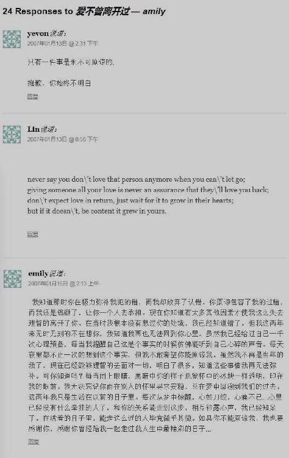

merge

# 000：司令案例分析文章：酒戒

我从不喝酒，在任何情况下都不喝。无论是公事的私人

的官方的长辈的亲友的，任何情况下都不喝。

按较冠冕的说法，是因为 「祖宗」 有规矩。祖宗定下的不许喝酒，家家代代都不喝。

其实我是在撒慌。

事实上，我父亲是喝酒的。虽然并不嗜酒，但在有需要

的场合，还是能喝上这么一小盅。欧氏的祖先也从来没有不喝酒的规矩，只不过是我推脱的一种借词。

喝酒也很符合我的生活。这是一种精细的品位，浅饮小

酌上一杯。在收口的红酒杯中，用体温慢慢温热，舌尖倒上一滴，随着酒意四处散开，慢慢地体会其中波尔多阳光，葡萄，或是霜打白露的味道。

我不喝酒的唯一原因，是因为我害怕。

我害怕在喝酒，哪怕喝上一滴，就会再喝第二滴，第三

滴，第三十滴，最后一定醉倒在桌子底下，抱着了桌子腿呺啕大哭。哭得昏天暗地，哭得不醒人事，哭得失去理智。据说酒由心生，不开心的人，不适合饮酒。

我一直渴望爱情，真心真意付出。第一个女朋友 pauline 拒绝爱我，第二个女朋友 emily 背叛我。幸福就象远空的星星，存在却无法抓住。

我不敢喝酒，因为知道自己很不快乐。理智已经坚持了

太长的时间，脆弱不堪。只有快乐的人才可以喝酒，忧伤的人将无法自拔。

醒酒的最好方法是什么，是另一杯酒。如果你不开心，

喝酒还是不开心。用一杯酒醒另外一杯酒，用一个梦醒另外一个梦。人生本是抓不住的幸福。

象我这样的人，如果开始喝酒，就会一杯一杯的喝下去，喝到自己无法控制。喝到残缺的心灵彻底决堤。没有人安慰我，没有人抚慰我。何必呢，我不想做一个酒鬼。

我绝不喝酒，除非我找到幸福。

除非我找到幸福，有这样一个女孩子，她有着长长的头

发，弯弯的睫毛，眼睛闪烁如天上的星星，乌黑漆亮。脸蛋滑滑，触手象新剥的鸡蛋。她会从背后抱住我的臂膀，在我耳边昵昵细语，挥动粉拳捶打我的胸膛。当我抱着她时，会感受她的体温，闻着她的香水味道。然后世界就一切静下来了，什么也听不到。

她必须很泼辣，时时刻会欺负我。她也必须很佻皮，整

天撞别人的后盖箱。她可以很刁蛮，喜欢用后跟鞋踩人。她可以很温柔，象只小猫依偎在我肩膀。皱着鼻子，下颌轻轻发出喵声。然后她会闭上眼睛，只剩下睫毛微微颤抖。她吐气如兰，媚眼如丝，脸上红晕飞升，羞涩地遮满她的颈子。

然后她会垂下头，害羞地摇动否认，满头的长发如波浪般起伏随动。

她学识渊博，文采斐扬。我要喝酒的话，她会选择最适

合的酒具。最恰当的冰冷和储藏方法。教我逐步入门品酒的顺序。陪我一起在花前月下细细品尝，一起携着手看海上云下潮起日出，将酒瓶从大海里捞起来，冰凉爽口。如果我要喝酒，她会细心地呵护我饮料适量。如果我喝醉了，她一定不会把我扔阴沟里，而是无论多远，也把我背回家，用热毛巾敷在我的额头。第二天一清早，睁开眼第一眼就看到你的倩影。有了幸福握住你的手，心中不再是伤痕与孤独，而是满满溢的甜蜜与蜂蜜。

那时候，我将能安心地开始品酒了。

（yevon\_ou@yahoo.com，2007 年 11 月 20 日） 000：不用担心，一切都会好起来的！【做时

代的真正强者】

（展麟解读：讲在国运生存结构中从农业分工协作升级

到工业分工协作，工业分工协作是要求人从家族家族中分离出来，让个体参与分工协作更有利于工业文明，这就是社会原子化，要求人抽象的过程，更关注自身的诉求，自身的满足，从父辈开始延续到我辈正是社会原子化青黄不接易动荡扭曲的时刻，加上国运 GDP 经济快速发展的 30 年，让个体产生经济没有周期可以持续向上发展，增长没有极限错觉，个体才是命运的主宰，我命由我不由天，我随时都可以从头再来锻造我的千万财富，更关注表层的东西，更加男女对立，更加情绪化，更加自私自利，更在乎自我满足和自身诉求，忽视宏观根源而极力要求微观细枝末节，这是我辈对生命体结构优胜劣汰天道的漠视，对更加残酷内卷的生存竞争视而不见，对更大共同体脆弱性的藐视，生存竞争中占据资源并维系自身稳定才是稳定，而占有更多的比如好看的相貌，锻炼出来的身材，情绪稳定的性格，智慧，才华，财产，权力等稀缺资源更有优势。不管是婚姻还是子嗣，都是你从生存竞争中优胜者的奖励，这才是我们这个原子化社会真正要做的事。绝大多数普通人被细枝末节消耗了半生，对下一代的担忧，对养老的担心，对男女对立的关心，对抽象唯美的迷恋，对远方的国事和国人操碎了心，对婚姻的恐惧，对城市安稳的依赖等等，却忘记了生命体结构中是需要主动接受生存竞争，占据更多的稀缺资源，才是真正要关系要做的事，也是这个时代弱者的悲哀，耗尽半生接下来的半生只是孤独又愤怒的活着。对个体而言，洞察社会的不值得浪费时间和精力的表象，主动参与生存竞争才是核心，让自己占据更多的稀缺资源，去赢得一场又一场生存竞争的胜利，从而完成强者精神结构升级，继而得到传承和延续强者基因）

生活让越来越多的普通人失去信心，似乎只有自己与这

个世界格格不入。而且还存在一种神秘的力量推波助澜。事实上，任何一代人都必须经历那些让自己手足无措的时代变革，在面对这些变革的时候，他们也曾经焦虑过，痛苦过，恐慌过。最后还不都是过来了！曾经有人问邓公，如何用一句话说清楚二十二年的革命在干什么。他只用了两个字来回答：吃苦！对方又问他，在最艰难的长征和腥风血雨的革命历程中是怎么过来的？他同样只用一句话回答：跟着走！

什么叫时代的主流？就是普通人都选择的方式。每一个

时代都有它的主流，并通过一些表层的装饰呈现出来。人的记忆存在着惯性，人的生存策略落后于生存环境的变化。恰恰是这种错位造成了大众的诸多痛苦。对于普通人而言，踩着主流的节奏总是没有错的，因为这样最舒服也最不费力！

年年难过，年年过，不用担心，一切都会好起来的。这种好未必是个人的状况和处境会变好，而是你会逐渐找到让自己平静生活的方式。

有些人总是喜欢拿一些还未发生的事吓唬人。什么老了

之后如何如何，什么没有子女如何如何。对于生老病死这种事，不管结婚与否，结果都一样；不管有钱没钱都逃避不了，人的每一个阶段都有每个阶段的坎，过得去就过，过不去也就这样了。人最大的坎是什么？就是死亡！这个坎谁都过不去，挣扎也没用，所以，该生则生，该死则死。

生命的价值不在于长短，怎么样都是一辈子。熬到生命

的最后一刻，也就算交差了。天下兴亡，肉食者谋之，与尔等无关。虽说好死不赖活着，但那种像驴拉磨原地打转，举步维艰的生活也挺没劲的。我们中国人习惯性以规划长远的方式来活在当下。什么意思呢？就是当下做任何事情都要考虑长远，还要遵循传统。任何个体似乎都是连接久远的过去和遥远的未来的节点。这样与生俱来就背负的责任感，让人活的过于沉重，也过于痛苦。因为这种惯性会把时代变迁或者家庭兴旺的压力都转移到个人身上。为什么会对女人提出贤良淑德的要求呀？因为这样的状态有利于传承。为什么男性从小就要被灌输承担责任的观念呀？也是因为这样的状态有利于传承。正因为如此，无论男性还是女性都过的非常痛苦和压抑。大家都渴望摧毁这种无形的枷锁，完成自我的觉醒和彻底的解放。这是时代的潮流，也是主流的节奏。孙文先生说的好：时代潮流，浩浩荡荡，顺之者昌，逆之者亡！

因为，我们都不要去做什么旧道德和旧秩序的卫道士，每一个时代都是革命的时代，只不过在中文中革命这个词天生带着颠覆和暴力的隐喻。事实上，革命是一个中心词，它代表着对旧秩序的突破和新秩序的构建。

至于人应该如何过自己的一生，不同的人有不同的选择，应该把这种选择权交给每个独立的个体，让当事人根据自身的状况自由的选择。虽然旁观者有时会为那些自我作死的人感到着急，但站在当事人的角度，那是人家能够做出的最好选择。在时代变迁的阶段，出于对人的尊重，应该多一份理解，少一份指责。只要没有影响到你的利益，作死就作死，默然无语，冷眼旁观就好。市场经济每一天都会造成企业倒闭和个人失业，这都是自主选择的结果。在充分的自主选择和生存竞争中，优胜劣汰是天道，不以尧存，不以桀亡。

我们这个社会自从秦始皇统一天下，车同轨字同文之后，骨子里对任何事都会习惯性的去追求一致性。不管是贩夫走卒还是庙堂士大夫都会本能的以卫道士的面目出现。即便是道德层面和生活习惯上的个人行为与自己的预期不一致，也会心急如焚，并极力声讨。

为什么大家喜欢咸吃萝卜淡操心，见不到别人跟自己不

一样？有些人自己的生活受太多羁绊的限制举步维艰，别人拥有自己想要又不可得的东西，就会深深的灼伤自己的内心。

因此会渴望存在一种额外的力量进行干涉。自古以来，我们就只做三个梦：圣君梦，清官梦，侠客梦。人们推崇尧舜那样的道德化身的君主，当这样的渴望破灭之后就渴望能有包公那样的清官，如果这样的诉求也破灭了，就只能寄希望于行侠仗义的江湖大侠来帮自己了。这里存在着一条从头到尾贯穿始终的主线：不管是哪一种梦都不需要自己参与其中，只要等着就行了，明明是自己的诉求无法满足，需要额外的力量来让自己满足，但自己始终置身事外！在这种满足自身诉求的过程中，自己可以做点什么呢？永远只做两件事：颂扬和指责！

千百年来，市井小民和贩夫走卒的三个梦一直支离破碎，虽然他们会反复的做这些梦，但这种获得总是那么不稳定，时而梦得到，时而梦不到。仁慈的君主、公正的清官，强大又温柔的大侠，在历史的长河中总是那么的稀缺。而随处可见的反而是暴虐的君王，同流合污的官吏，残忍狠毒的盗匪。

我发现西方的悲剧和中国的悲剧最大的不同点就在于：西方悲剧中的主人公往往拥有资源和能力，他们用尽全力去挑战生存结构所构建的秩序，最后以失败告终。而我们的悲剧更多的是在讲述个人命运的沉浮和一手烂牌打的更烂的悲惨遭遇。

生命体的生存竞争是为了占据有利于存续所需的资源，

这种生存竞争的优劣程度会集中体现在对稀有资源的占据上面。不管是长得好看的相貌，还是锻炼出来的身材，情绪稳定的性格，或者智慧、才华、财产和权力，所有这些稀缺性的资源，一旦占有一项或者多项，往往就会具有巨大的竞争优势。

生育和婚姻没有必然关系，婚姻是财产制度。社会的发

展必然会演化出脱离婚姻这种形式的养育机制，这是一个巨大的生意，也有利于社会的消费，所以会被某种神秘力量推波助澜。越到后面婚姻就越会成为少数人专享的权利，是冥冥之中对生存竞争中的优胜者的奖励。

一个自己什么都没有的人，肯定不能接受对方也什么都

没有。一个家庭条件差负担重的人，肯定不能接受对方的家庭条件不好负担也重。一个自身极度不自律，生活一团糟的人，绝对不能接受对方也是这样。一个自身情绪化严重的人，绝对受不了对方也情绪化。一个特别自私的人最讨厌的就是自私的人！吃绝户的人只对天真的人下手。经历女人少的老实人才会成为渣女们搜刮的目标。这就如同大自然中老虎吃肉，山羊吃草一样自然而然。我对素食主义者存在偏见：如果人吃肉是一种杀生，难道养吃草就不是一种残忍？草和羊不过是生命的不同形态而已。你之所以会动不动就同情那些把一手烂牌打的更烂的人，甚至会想去拯救人家，是因为你骨子里把自己看得比别人更高级，这是一种居高临下的傲慢，是不尊重人的表现！

近代以来，除了能够维系家族传承的大家族之外，旧秩

序的瓦解，让越来越多的人不再关心和在乎不在世的祖先，甚至许多底层人对于在世的亲人也无力照顾。于是，他们只关注自身当下的生活。社会原子化是人类整体发展过程中的趋势，古今中外概不例外。如果你只看到男女对立，只看到个体之间的争吵不休，而没有看到这种对立源于何处，你就只会陷入一些细枝末节的情绪之中而忽略了自己真正应该做的事情！

当生存环境变得越来越充满不确定，也就越来越没人愿

意被消耗，不管是哪种形式的消耗。建立和维系任何共同体都需要消耗能量，当能量不足时，共同体就无法建立也无法维系！小到家庭这样的共同体，大到全球体系这样的共同体，概莫能外，美国为什么到处退群，因为维系成本撑不住了，退群对自己更有利，个体的行为也是如此，生命体结构总是在不同的规模上呈现出一脉相承的特征。

# 000：爸妈没文化，你尽力就好！【判断系统的源头】

（展麟解读：讲在国运生存结构中农业社会向工业社会

大步迈进，导致千百年的长辈批评晚辈以对不起列祖列宗的自责理由，做重大决策总把子孙后代考虑进入微决策依据的传统惯性正在走向破碎，呈现出来很多现象，父辈的无力对我辈过高的期待，我辈无力中恐婚又恐育，宁愿呆在大城市成为消耗品，也不愿在回农村，城市中摩天大楼与贫民窟同时存在，从教育就开始人群分流，自己背后空落落的且追求很多不切实际的匹配，父辈大事上缺乏指引小事上斤斤计较等等，这是国运生存结构求存个体衍生出来实际现象，个体的求存策略落后国运生存环境的趋势，个体用青春摸索的门道，赶不上国运生存环境变化，最后在循环打击下个体越来越无力，越来越情绪化。个体精神结构的失常一切的源头，都源于原生家庭对个体雕塑，原生家庭是个体整个判断系统形成的发源地，自我的判断系统和自我与外部的判断系统，这个基础模型没有雕塑好，后遗症伴随一生，需要用一生有意识去训练去纠正。对于个体而言，需要清楚原生家庭对自己精神结构的整个判断系统的水平，查漏补缺，有意识去训练和纠正，完成后天的自我自救，让自己拥有完整的精神结构和整体判断系统，是绝大部分成年人需要自救的核心，越是越好的地基）

一条 25 岁的年轻生命的远去，再一次让所有人警醒：

不是这个时代的年轻人越来越脆弱，而是这个时代的年轻人所处的生存环境越来越动荡。在他们成长的过程中，时代转型所触发的动荡和压力都被传导给了他们。本来他们的父母应该成为他们与外部世界的隔离墙，但他们的父母自己也没有应对外部急剧变化的世界的能力和心里准备，只好把所有的挫败和不顺心都转移给了他们。对自己有多失望就会对他们有多么高的期待，这种逆天改命的期待和对未来感到无限恐惧的焦躁，会通过生活中的争吵和毫无征兆的惩罚，以及言语暴力和抛弃的威胁传导到这些孩子身上。让他们本来就出于失衡状态的精神结构进一步的失衡，也对周围的一切更加的无所适从。

这一代人主动选择涌入一线城市，明明无法立足也不愿

意离开。很大一个原因就是对父母和成长环境的逃离。有一个这样的漫画：三个父母趴在墙上对下面的孩子喊，让他们爬上来。第一对父母一边鼓励，一边往下递梯子；第二队父母一边鼓励，一边往下丢绳子；第三对父母什么都没往下递，只是在破口大骂：蠢猪，这都爬不上来！大多数普通人对应的应该是第三种，漏屋又遭连阴雨，不但无法递送任何东西来去拉一把，也没有任何鼓励，还会附加冷嘲热讽的打击和伤害。

不管是男人还是女人，即便是看不到未来，也选择在大

城市里年复一年的耗着，究其原因是远方的家给自己的压力，甚至比北上广深的快节奏和高成本生活给自己带来的压力更大。对于许多普通人而言，诸多会让自己感到力不从心的事都与结婚息息相关。只要他们不结婚，一人吃饱全家不饿，他们就还能从容的在一线城市生活下去。即便是无法占有生产资料，也至少能营造出一种自己能为自己的生活做主的假象来暂时的麻痹自己。这种麻痹或许会让外人觉得好笑，但对当事人而言，已经是两害相权取其轻了！

这个时代的女性，越是背后空落落的，越是自己各方面

也不太好，越是缺乏本钱，就越会恐婚恐育。有时候她们为了缓解这种不安带来的恐惧，会追求一些不切实际的匹配，从某种意义上来说也是一种被迫无奈和走投无路。因为这样的人没有退路，也缺乏指引，用自己仅有的青春摸索出一点门道的时候，一切又都时过境迁了。这种尴尬和无奈在外人看来比较可笑，而独自回味的时候又无比心酸…不管是恐婚还是恐育，都是对自身状况和自身处境进一步恶化的担心和恐惧。她们就如同徒手攀岩，爬到陡峭的半山腰的人，往回看是极力逃离的深渊，往前看是无法逾越的障碍。因此，追求当下的愉悦就是她们唯一能够给自己营造出轻松和自主幻觉的方式。

强烈推荐读懂《A525：你误会了男孩要穷养和女孩要富养！》一文中阐述的原理。人的精神结构被最初的生存环境所雕塑，这种雕塑决定自我判断的基本模型和自己与外部所建立的连接的基本模型。后续的一切关系和判断都是在这种基本模型上进行扩展。然而，这种最初的雕塑往往由不得你，而取决于你的生存环境以及你的生存环境中拥有最高权重的支点人物。许多人的父母在那个阶段不仅无法成为减震器，反而会成为破坏稳定性的放大器，甚至源头！所以说，投胎是个技术活，选人同样是个技术活。绝大多数人既不善于投胎也不善于自救，还不善于识人、选人并把握住合适的人。

如果自身的处境和状态非常糟糕，尽量的避免成为别人

的父母，虽然不近人情，却是很负责任的行为。当然了，这需要持续的通过理性克制住本能。如果实在忍不住，就必须要接受命运的安排，自己都办不到的事，却寄希望于孩子或者另一半，往往会在一次又一次的期待和落空的循环打击下变得越来越面目可憎，也越来越情绪化。抱着知足常乐之心，对孩子说一句：爸妈没本事，也没啥文化，你尽力就好！这往往会比什么鼓励和期待都强千万倍。对自己的另一半抱着这样的态度：我自己都无能为力，也就没资格对你有任何要求和期待，你尽力就好。这也是这种处境中最好的生存策略，反而能够避免无穷无尽的撕扯、愤怒和哀怨。

千百年来，中国人总是通过以筹划未来的方式活在当下。

当下的一切都与久远的过去和遥远的未来息息相关。当长辈在批评晚辈的时候，都以自己对不起列祖列宗为自责的理由。

在做一个重大的决策的时候，也总把为子孙后代考虑作为决策的依据。自己的生命就是承前启后的一个节点，个人的感受和当下的生活似乎不重要。这种千百年的传统惯性正在走向破碎，因为我们的社会基础结构正在从两千多年前的农业社会大步流星的向工业社会迈进。就如同摩天大楼和平民窟都同时存在于现代城市中一样，人的分流已经不可避免。只能接受它、顺应它、也理解由此衍生出来的一切！好好读一下《A518：既双减又提高考试难度，要干啥？!》和《政权的本质：生命体实现存续的工具！》就什么都明白了！

# 000：大衣哥为什么不值得被同情？！【个体最痛苦的真正悲剧】

（展麟解读：讲人有种不能言表的痛苦，自己不一定有

所察觉，却是最痛苦的地方，个体的精神结构跟国运的生存结构不契合，你这个人的精神世界和你能接触到的生活环境要求不匹配，这就是很多人不幸的根源，你的精神结构一定要跟上时代生存结构发展的趋势，你的精神世界一定要跟你所处的生存环境要契合，你在家里要有家里的样子，你在公司要有公司的样子，你去健身要有健身的样子，只有你的精神结构跟你所处生存环境高度契合，你才能如鱼得水，来去自由。大衣哥的悲剧就是他拥有稀缺资源后没有完成精神结构升级，让自己的精神世界跟现实的生存环境相契合，自然就能避免这个悲剧。拥有稀缺资源的人，一定要升级自己的精神结构，不管是美貌，还是身材，还是歌喉，权力，财富等都是稀缺资源，拥有这个稀缺资源后就必须升级自己的生存结构，让自己住更好的房子，更好的车子，去更繁华的地段，获得更优质的保障，不管是内部还是外部的相互保障，互为不内耗才是最好的状态。对于个体而言，一定要洞察自己精神结构的缺失，能不能匹配所处的生存结构，不然你怎么被人消耗掉，你都不知道，被无休止的消耗，不管是精神还是物质，都是巨大的内耗。你的一生，一定要时刻关注精神结构与所处生存结构是否相匹配，在匹配中去紧盯目标，赢下一场又一场胜利，升级精神结构，也升级生存结构）另一种标题：不值得同情！

大衣哥本来就是一个朴实的农民，误入红尘变成了流量。

于是，围绕着流量展开了人性的撕扯和一系列的表演。可以看得出来，大衣哥的想法还是农民式的想法。然而，鱼离开了水就不再是鱼了。他不能理解这一点，无法进化成新的物种，最终的结局就是被各种看到机会的人耗尽最后一点利用价值。

朝堂从来都比战场危险！战场上你知道敌人是谁，而朝

堂上不知道敌人是谁。朝堂上聚集的都是四面八方顶级的人才，权力和利益高度聚集的时候，矛盾和危险也聚集于此，时时刻刻处于腥风血雨的漩涡之中，存活的人都是人精。

所以，德不配位的人无法长期忝居高位（忝居 tiǎn jū“忝” 是自谦的说法，表示愧于进行某事。“忝居”表示愧于处在什么职务）。因为稀缺资源是所有人都想占据的，而人占据资源，尤其是稀缺资源又是一种本能，在生存竞争中还彬彬有礼温文尔雅是不可能的。革命不是请客吃饭，是一个群体从另外一个群体手中掠夺生存资源的暴力行为。自然无法做到那么雅致。为什么千百年来总是讴歌一些逆人性的品格？

因为太稀少了嘛！

落后就要挨打这句话未必正确，如果你毫无用处，即便

再落后也没人理睬你，任你自生自灭。如果你家院子里埋着石油或者矿，你还那么愚昧和落后，这就免不了被挨打的命运了！落后和愚昧并不要紧，要紧的是愚蠢和落后还占据着某种别人想要的资源。为什么穷人家的美女往往命运多劫难呢？因为美貌也是一种稀缺资源，一旦你缺乏驾驭这种稀缺资源的眼界、认知、心态等诸多能力，它反而会给你带来灾难。有些时候，甚至是通过你的自我选择，主动走进坑里的…有些大龄女性并不是没有人追求，也不是没有机会获得

幸福。然而，她们总是会把自己最宝贵的青春消耗在一个自己内心也非常清楚不合适的男人之间的反复拉扯中。许多时候，别人怎么对待你，取决于你的态度。俗话说，苍蝇不叮无缝的蛋。人自辱，而后人辱之；家自毁，而后人毁之！

如果大家都不待见你，那是因为最开始有人羞辱你的时

候，你没有表明立场。是你自己先放弃了原则和尊严，其他人才肆无忌惮的羞辱你。在《A539：父亲角色在教育中必须做的几点！》一文中忘记加上这一点了：照顾人，但不要伺候人。怎么区分照顾和伺候？别人会做，也能做得到的事，你非要去越俎代庖，这叫伺候人。别人不会做或做不到的事，你去帮忙或者引导对方做到，这叫照顾。照顾的本意是让其远离危险，获得成长和胜任感。当你习惯性以讨好的方式与这个世界打交道的时候，你能怪别人不尊重你吗？！

大衣哥之所以被一个底层的女人算计，在村里费力不讨

好，付出代价却被村民憎恨，都源于他自己的认知、诉求和选择。他拥有了自己驾驭不了的资源，却在以讨好的方式与周围的人打交道。是他自己允许别人那样对待他，一点都不值得同情！这就如同你家院子里发现了金矿，你却不愿意垒砌围墙，举起猎枪。有一句话在女人之间非常流行：所有你守不住的人，本来就不属于你！这句话经常被女人用来安慰失恋的闺蜜。事实上，不仅仅是人，任何资源、荣誉、权柄，只要你没有能力守住，它就一定会失去，本来就不属于你。

那个来自底层的娘们吃相是很难看，但这对她和她的家

庭而言，绝对是一个千载难逢的捷径。衣食足而后知荣辱，仓禀实而后知礼仪。雅致和温柔从来都属于不匮乏的群体。

对于极度匮乏的人而言，掠夺资源比什么都要紧，本来就没啥体面，又哪里会在乎呢？正因为如此，才需要高墙的隔离，才需要锁链和监牢的警戒，才需要刀枪的震慑。人的精神结构不能与所处的生存结构相契合是最痛苦的阶段，就如同你在一个动荡不安的环境中过于天真和迂腐，就如同你在一个秩序重建的周期中总是试图通过不讲规矩而逆天改命。这种生存策略滞后于生存环境的状况，往往都是以悲剧收场。

当别人在你的大腿上撕下第一口肉之后，别人绝对不会

同情你，反而会招来更多的恶狼，成功的示范效果只会让其它跃跃欲试者信心倍增。做过市场的人都知道，如果你的产品是著名品牌，你给代理商的利润点很低，他们也很乐意，并且还很积极。反之，如果你的产品是小品牌，你就不得不给代理商更高的利润返点，代理商才有动力。如果你是一个很知名的大品牌，却给一个末端代理商非常高的利润。对方似乎都不会感激，反而会滋生出一种幻觉：我可能低估了自己的价值和在这个地区的影响力吧，否则这么知名的大品牌为什么会如此跪舔？！别人不尊重你，不重视你，不在乎你，都是你自己的错，是你自己让别人这样对待你的！

# 000：缘尽于此，各自珍重！【阶层升级再次关闭】

（展麟解读：讲国运生存结构中从农业文明向工业文明

升级，让我辈看到阶层升级的微光，同时经过 40 年的经济发展，阶层升级的微光缓缓的关上，这是时代给予的机会，可遇不可求。父辈的隔离是城乡隔离，城乡人员禁止迁徙禁止流通，彼此都完全看不到对方的世界，更加想象不出来，信息更加封闭，但是城乡的差异性是一直存在的，层级也是一直存在的，这种隔离比我辈的隔离更加彻底。父辈和我辈的切换点可以允许城乡人员流动，允许人员迁徙，这也得益时代周期和近 40 年经济发展，不然就没有这个阶层突破的微光。到了我们这一代，我辈是可以看到彼此的差异，看到更多的不同和更多的爬阶可能，同时随着时代周期秩序的逐步确立和经济发展趋向平缓，大开大合的爬阶大门逐步的关上了。过去我们父辈更多的是地域隔离，生活环境隔离，是显性的，现在我辈隔离，是成本隔离，精神隔离，算法隔离，智商隔离，更加隐蔽，也更加难以突破隐性门槛。核心城市越来越大，农民升级为市民越来越多，市民遵循法律条文越来越完善，维护秩序的公安系统越来越严密，阶层流动再次回归锁死状态，我辈是市民子辈也是市民，我辈是法官子辈也是法官，我辈是警察子辈也是警察，我辈是外交官子辈也是外交官，依次类推，这就是阶层稳固的其中的一个特征，子承父业代代相传。对于个体而言，要洞察时代秩序周期的变化和经济发展周期的变化，时代秩序越完善，升级的可能性就越小，经济增速越缓慢可以创造财富的机会就越少，向更富的地区迁徙就更加没可能，完成自己精神结构升级，从这些变化中找到最合适的自己的求存方式，在这些求存方式中做好传承，微下一次时代秩序重建的时机做准备，做好三代人的传承和接力）

刚刚看到手机上有一条消息，提醒公众号结构学已经封

号，给一次申诉的机会，所谓的申诉应该只是走流程，没啥意义。起因是把觉悟社里的一个尖锐提问及其回答改写成了结构学这个公众号上的《A539》发了出来，事实上，发出来的内容已经是修改过了的，标题也改的非常柔和，不吸引人。

封号的原因居然是之前没有发出去的那篇草稿，也就是那篇被拦截下来发不出去的内容触发的。

互联网刚开始兴起的时候，大家可以自由自在的驰骋。

越到后面就会收得越紧，这是一个必然的趋势。所谓的分层隔离并不是要建造围墙把人群分割开，而是设置一堆隐蔽的门槛，让人通过自主选择，相互隔离。在一个秩序重建的时代，这是必然的趋势…

当你能够轻易获得一些东西的时候，并不意味着它会永

远如此，不过是说明这个事物的发展还处于早期。越到后面，门槛只会越来越高，需要支付的成本也只会越来越高，无法越过门槛，无力支付成本的人群就会逐渐被排除在外。

最开始上大学是免费的，只要能考上，不仅包分配工作，还免除一切学杂费，发放生活补贴。这并不意味着这种好事能够一直继续，随着时间的推移，为高等教育支付成本的主体从国家变成了各自家庭。当一个家庭不足以持续的投入更多的成本的时候，父母就会权衡利弊，是不是值得如此不顾一切的投入。即便咬牙负债让儿女去上学，也会在专业选择上更青睐于就业率高，立刻能挣钱的专业。随着时间的进一步推移，家庭在教育上的投资越来越高，回报率却越来越低，许多人不惜负债累累让儿女受了高等教育，结果毕业后工作都找不到。大家都没有错，错的是当事人忽略了事物发展的趋势，并以过往的经验指导自己对当下和未来的投入！

最开始大自然中的水是随便可以喝的，后来随着污染程

度的增加，喝干净水的成本也在逐渐增加。空气过滤器，新风系统，所有这些辅助设备，无一不是在为呼吸新鲜的空气付费。这个成本看起来是生产空气过滤器，净化水的成本，事实上是所有人在为环境的持续恶化支付成本。这里的环境不仅是指物理环境，也包括你所置身的生存结构。

环境的恶化造成了人与人之间的相互隔离，隔离的结果

除了内卷和淤积，就是通过自我逃避、自我卷缩、或自我弱化来找到自己所能适应的生存环境。在这种自我营造出来的熟悉且充满确定性的环境中，自己的观念、心态、思维、视野、行为、习惯以及与外界互动的方式，都会逐渐与这个生存环境高度契合。并试图从简单重复的熟悉感和确定性中获得一种心安理得的平静。

一个人如果永远都是待在村里锄地讨生活，只会相信这

个层面的生活需要相信的东西，因为未知会打破内心的平静并引发不安，甚至感到害怕。然而，年复一年的辛勤劳动并没有能改变他的生活处境，只是不断增加了他头上的皱纹和手掌上的裂缝。为什么会这样，在他熟悉的世界中，他是找不到答案的！

上小学的时候有一篇课文叫《多收了三五斗》，文中讲

述的是农民丰收的时候，本来指望把多出来的收成卖出更多的钱。结果米行的人告诉这些农民，今年外国的米大量输入，价格更便宜，品质更好，所以只能以更低的价格买你们的米。

农民骂骂咧咧的发泄着自己的不满，但也只能以更低的价格卖给米行。课文上的这篇文章是由同情心泛滥，却缺乏基本的经济学常识的人写的，表达的是一种对农民的同情和对资本家的批评。这不免让人想起最近流行的一句经典的话：抛开事实来说，你难道就没有一点错吗？

问题是讨论是非的时候你不能抛开事实，也不能截取片

段。事实就是：在一个相互联系日益紧密的时代，不仅判断是非的时候，无法从静态的角度去判断，甚至连自身的处境，都越来越受各自未知的因素所影响。

父母那一代的人并非不存在差异，只不过被隔离的彼此

都完全看不到对方的世界，甚至想象不出来。城乡之间的相互隔离，比现在更加的彻底。这一代人不管多么的无助，至少还会心有不甘。多多少少能够透过裂缝看到微光。两代人最大的区别在什么地方？首先是人的认知和视野发生了改变，其次是人的迁徙能力发生了改变。归根结底两个字：流动！

生命体通过锻造工具来扩展自身的能力，小到个体，大

到一个社会概莫能外。工具包括有形的工具，也包括无形的工具，后者比前者的威力更大！汉帝国的强盛发端于何处呢？发端于汉武帝时的双牛铁犁和盐铁专营。前者是农业上的生产力发生彻底改变，后者是社会组织方式和社会控制能力发生了彻底改变。

从高速流动逐渐转化为凝固，最后再次回归稳定。这与

时代的周期和经济增长的状况高度一致。在迅猛增长了四十年之后，被时代浪潮搅动的池子泥沙泛起，当搅动的力度逐渐减弱之后，一切都会再次尘埃落定。一个又一个阵地会被重新夺回，人们将再次被那股力量所支配，聆听允许被听到的声音，走进各自该去的一亩三分地…

所有漏光的地方都将被重新蒙上黑布，缘尽于此，相忘

于江湖，各自珍重…

# 000：习惯性靠墙坐在角落里！【变好最大的障碍】

（展麟解读：讲自卑敏感的残局人生，如何突破自我保

护机制）

（展麟解读：讲在个体生存结构中求存最大的障碍，就

是任何人和任何事最后都由你的内心戏，你精神自我保护机制，你精神的防御机制，变成你的捍卫自尊心的极限拉扯，这个困境并非来自外部，而是来自自己内部的精神观念，心态，行为造成的悲剧。不是没有人点拨你，不是没有人拉你一把，不是没有人帮助你，而是都被你的无力感，匮乏感，可怕的尊重，可怜的自尊心，统统拒之门外，还找到一个没有人能反驳的理由，他让我没了面子，他让我不爽，他伤害了我的自尊心，他不尊重我。在生存竞争中，弱者的弱，是多么的理所当然，多么的自洽循环，不需要说啥，都有他正当和你不能反驳的理由。弱者的弱，不需要你的理性和帮助，而是需要你给他，他认可的希望和安慰。对于个体而言，要识别出来自己原生家庭的给你造成最大的障碍的，就是因为的无力感，匮乏感，安全感最后都成了捍卫面子捍卫自尊心的极限拉扯，使得真正愿意点拨你，拉你一把的人远离你，隔离你，同时要找到弥补自己这项缺陷的训练方法，从而完成自己精神结构升级，爬到更高的位置，做到更牛逼的角色，最后完成生存结构升级，最后实现我辈的阶层晋级）

这一代人的累是心累。面对极具变化的社会往往呈现出

各种各样的病态。在研究精神结构的时候，看到的细节越清晰就越会感到失望。就如同米塞斯（可以读他 4 本著作）在 1898 年看到了欧洲的经济和社会发展趋势的时候，他对欧洲的未来忧心忡忡，因为那些扭曲都在加速的导向规模更大的冲突。果不其然，欧洲分别在 1914 年和 1939 年通过两次世界大战才把这种扭曲积压的破坏力释放干净。所以，人最初的阶段和成长过程都需要守护！因为精神结构在初始化和雕琢的过程中，模型的缺陷和不稳定不仅伴随着后续的整个生活，还不断的给当事人制造出各种思维、心态和行为上的障碍！

那些在团队聚会的时候喜欢独自坐在角落里的人，那些

毫不起眼又没有任何爱好的人，那些沉默的大多数，那些时常感到莫名其妙的焦虑和恐惧，却又不敢表达内心诉求的人。

那些总是自己跟自己过不去，不断地为难和嫌弃自己的人。

那些对周围的一切都感到愤怒，却又无可奈何，时常自我封闭起来，心灰意冷的人…

有的人总是把什么都闷在心里，遇到不爽也不敢表达，

遇到不顺心就放弃和退缩，什么都不做，又什么都改变不了。

整个人的状态和处境就是：漏屋又遭连阴雨，航船又遇打头风。一个人的无力感和匮乏感总是会在方方面面相互叠加，最终形成严密的枷锁，让人心力交瘁，挣扎一下的欲望都没有。是什么在加速恶化，并最终形成了多路叠加的并发症呢？

有本书叫《内向者的优势》，光看到名字你就知道它会

讲什么。为什么没有人写一本叫《外向者的优势》的书呢？

因为秃头上的虱子不需要刻意强调，人人都看得见。当一个人需要以某种方式来安慰和鼓励自己的时候，说明潜意识中并不认可这种状态，或者并不欣赏这种处境中的自己，有个成语叫：欲盖弥彰。还有一句俗话叫：此地无银三百两！

人生如棋局，已经走成残局了就必须接受。人越长大，

世界就越无法泾渭分明，到处都充斥着各种各样的灰色调。

这个观念是从小被老爷子灌输的。他教我下棋都是从残局开始。他说，许多时候，你并没有机会，甚至没有资格从头开始，你坐到棋盘前的那一刻它就已经是残局了，但你不仅需要继续下完，而且还要用尽一切办法去下赢。

改革者的难处就在于：不能把房子推倒，却要彻底的升

级房子的地基和内部结构。它就如同在高空钢丝上跳芭蕾，任何一个闪失都会功亏一篑。然而，任何一种升级都必然要打破原有结构的内在束缚，同时又必须把突破的力度控制在不会造成彻底的撕裂和对立的程度。所以，任何改革要取得成功都非常困难！

成年人的自我升级就如同改革。确实非常困难，但是，

如果假装问题不存在，拖着不改，错过了最佳的机会和时间窗口的话，往往土崩瓦解并且贻害无穷。当年苏联就是一直逃避问题，一直拖，最后把自己拖没了，还造成了今天俄罗斯的困境。同时代的我们，得益于掌舵人的远见、决策的魄力和战略定力，最终能够绝地反击并王者归来。

人的许多状况就如同残局，当你意识到它有问题的时候，它就已经这样了。面对已经这样的情况，该怎么做呢？自暴自弃当然是容易的，但它不解决任何问题，只会让自己的问题被拖延的更加严重，严重到无法收拾的地步。然而，你要让绝望的人重建信心也是极其困难的。人处于逆境之中的时候，所有的自我作死行为都源于精神结构中的防御机制的怂恿。你跟一个处境不好，过于自卑敏感的人说话，说不了三句话就会被误会五次，对方会把每一句话的每一个词都单独拆出来借题发挥并强行误会你的意思，而且每一次都会触发对方精神结构中的防御机制，最后沟通就变成了捍卫自尊心的极限拉扯。

如此一来，你就只能闭嘴，并且默默的走开。然而，当

你走开的时候，对方往往会更加的怨恨你，认为你在用行动鄙夷自己，并深深的伤害了自己的自尊心。总之，这种状态的人总有办法把唯一在乎自己，并愿意拉一把的人弄的生不如死。然而，这种自我作死的结果只会导向自我卷缩和情绪崩溃，无法控制自身极具破坏性的情绪化应急机制。

一个极具讽刺意味的事实就是：人在绝望之中最需要的

不是理性和帮助，而是希望和安慰。当人对自身的状况感到极度不满的时候，精神结构的自我保护机制就会编织出一个幻象来转移自我否定的攻击。因此，擅长于给人编织美好幻象的人往往具有一种魔力，能够让被操控的人主动忽略所有的事实，并且自欺欺人的把一切损失和伤害都合理化。人从未渴望过真理和事实，往往对不合口味的证据都视而不见，如果谬误能够给自己带来安慰和虚假的力量，就会对此产生强烈的依赖。谁能向人们提供简单美好的幻觉，谁就可以成为她们的主人，谁摧毁了她们的幻觉，谁就会成为她们的死敌！无论是在职场中，还是在情感中，或者是在人际关系中，为什么有的人更容易沉浸在自己简单美好的幻觉之中呢？

因为这些人在现实中的自我感觉很糟糕，不愿意看到真实的自己和真实的世界。有些人会因为别人提醒他，去看一眼真相而心生怨恨，甚至恨不得将你碎尸万段。对于这样的人，简单美好的幻觉就如同鸦片。如果你有这个倾向，往往就很容易被人利用和操控。

理性确实更容易让人绝望，当你看清了底牌之后，任何

挣扎都是多余的。然而，理性不足的人往往更容易拥有乐观的信念，而且这种盲目不需要任何事实的支撑，女性比男性也更容易相信奇迹会降临在自己头上，并期待这种奇迹的发生。所以，也比男性更容易不顾一切的去追逐一个更不可能的目标，而不会像男性那样动不动就先掂量掂量自己。所以，女性在确认过内心的诉求之后，往往会比男性更加的狂热，那种忽略所有事实的偏执和狂热，有时候让人感动，有时候则会让人恐惧，那是一团火，能够点燃包括自己在内的一切，也会把一切都化为灰烬…

辜鸿铭说中国人活在一种纯粹的心灵世界中，换句话说，绝大多数人所有的追求都是以非理性的方式去获得内心的自我满足，其他一切都是这种自我满足的工具，有时候，会因为过于聚焦于自己的内心诉求，而忽视其它人和现实世界中的规则及边界的约束。当求而不得的时候，就会陷入一个自我消耗的死循环中不断的转圈，直到精疲力竭，失望透顶，怨恨丛生，最后滋生出毁灭一切的绝望感和愤慨之心。

然而，要把自己从这种困境之中解救出来，最大的阻力

并非来自外部，而是来自于自己精神结构的自我保护机制的阻止。就如同一个深陷贫困的人，那种让自己感到心安的愚昧和固执的心态和观念，恰恰是阻止自己采取任何有利行动和与真正能拉自己一把的人建立稳定连接的最大障碍！

# 000：从不喜欢白瘦幼！【选择断精神结构层次】

（展麟解读：讲在个体生存结构选人的求存方式选择，

可以看出一个人的精神结构的等级，越是向下兼容的选择个体精神结构层次越少，当你选择弱者的时候，确实满足你当时某种需求，就因为满足你某种说不出口不能言表，他恰到好处满足你的要求，从而让你放弃对整体判断系统，核心要素的坚持，最后用你接下来的时光被迫接受消耗和折磨，这是绝大多数普通人选择的归宿，更是个体精神结构等级赢弱的事实。向上选择，向强者看齐，需要你完成精神结构升级后，对强者的选择和追随，更要展现你的自信和勇气，选择强者，你的内耗就少，消耗也就更少，从而获得更多优质资源，思想，心态，行动的加持，能与强者为伍的精神结构等级都是中上等以上，从弱者到强者的精神结构升级，投入的成本和精力是巨大的，是持续拥有稀缺资源的过程，不管是好的形象，锻炼的身材，还是好的情绪，好的人际沟通，财力，房子，车子等等，都是稀缺资源，持有越多越有竞争力，精神结构的层次就越高。对于个体，从日常生活选择中去洞察一个人的精神结构，和发现自己的精神结构的弱点，并针对去纠正训练，让自己生活有秩序起来，有规律起来，完成精神结构的升级，从而拥有不内耗的思想和心态）

李玟（1975 年出生香港的歌手演员）给人的第一感觉就是性感，而且那种开放是极其外露的。然而，你听说过李玟的各种绯闻吗？李玟似乎没有什么绯闻。反而是阿娇

（1981 年出生香港的歌手演员）给人的感觉特别的清纯，然而，艳照门中爆出来的那些大尺度照片，让你看到了玉女的另一面，是不是完全出乎意料之外？据说，顶级的绿茶都是一副人畜无害的样子，但吃人都不吐骨头。真正的恐怖就存在于这种意想不到又在情理之中的强烈反差中！之所以会让人感到恐怖，恰恰是因为你害怕失控才选择了弱小，结果看似一切都在掌控之中的人却完全失控了。

在中国的历朝历代中，唐朝以社会风气开放流传于世。

大唐上至皇室，下至酒肆，四方来朝，五胡杂居，百无禁忌。

盛唐的这个盛，不仅仅是强大和富庶，也包括开放和包容。

在那个闺门失礼不以为笑的时代，男人的乐趣在于追求的沙场建功，而不是把所有的目光都聚集在女人身上。而且，也只有这个时期才能容忍女人当皇帝。总之，那个时代的人们崇尚英雄、智慧、强大和包容！

与之形成鲜明对比的是宋朝，首先，天下不是自己打下

来的，是人家周世宗打下来的，其次，欺负孤儿寡母得国不正，再次就是四方受辱，八面讨好。正因为在外面比较窝囊，男人们无法开疆扩土边塞建功，所以，整个心思就开始转移到女人身上。程朱理学的兴盛，强调存天理而灭人欲，然而朱熹老夫子却一手抱一个美艳的小妾。别人嘲笑他：你不是主张存天理灭人欲吗？自己怎么反其道而行之？他辩解道：

我就说说而已，不必当真。当人又怂又弱的时候，往往就会变得虚伪，又当又立。你去看宋朝女人的衣服，都是清一色的性冷风。而且极其保守，与大唐服饰的热情奔放性感外露形成鲜明的对比。对于女性从服饰到行为的各种保守要求貌似就成型于宋朝。

男人就应该色，就应该有征服欲。匈奴人曾经有句谚语：

男人最快乐的事情，要么在马背上，要么在女人的胸脯上。

据说汉武帝特别推崇这句话。所以，他既金屋藏娇，又训练出一支能封狼居胥的骑兵军团，把匈奴人都打的哭爹叫娘。

那个时代的男人是雄浑和刚烈的，血液中流淌着征服的欲望和自信的傲骨。无论是苏武牧羊，还是张骞出使，十几年的坚守只为一句承诺！博望侯张骞是汉武帝从小的玩伴。他主动请缨去万里之外的未知地域寻找匈奴人的世仇大月氏人，说服大月氏人与汉武帝联合两面夹击匈奴。大丈夫建功未必一定在战场，但绝对是一种敢于迈向无人区的探索。在那个没有导航，甚至没有地图的年代，张骞一路西行，横跨绝域大漠，还被匈奴扣留，然而，他不仅逃了出来，还继续西行，真的找到了大月氏。在这十几年的历程中，他经历过难以想象的艰辛和危险，最后带着他的匈奴女人和孩子万里归来，不辱使命。苏武牧羊十九年，不失其节气，苏武的父亲叫苏建，苏建是一名能够独立指挥一个军团的将军，他的上司就是那个一生没有打过败仗的大司马大将军卫青。由此似乎能看到物以类聚，人以群分。

都说女人慕强，其实男人更羡强。男人豁出命去追随的

人往往都是强大的人。士为知己者死，女为悦己者容，女人慕强的最高形式不过是为之精心打扮，但男人慕强的最高形式是愿意为之去死！强大的男人才会欣赏同样强大的人，之前在觉悟社中说过：只有能量相当的人才能相互识别。否则，别人的强大和优秀会灼伤自己脆弱又敏感的内心。不管是一个社会的风气，还是个体的状况，只有强大的时候，才会认为那种不可控的优秀和呈现出力量感的自信是极具魅力的吸引力！

你为什么会喜欢白瘦幼（白瘦幼通常是皮肤比较白皙，

而且身材苗条，又年轻貌美，属于一种非常流行的长相年轻幼态，让男人有保护欲望）？就因为看起来软弱好控制，就因为对方的匮乏和缺陷让你拥有一种居高临下的优越感？

这本身就是一种缺乏勇气的表现。不要喜欢弱不禁风的白瘦幼，远离弱者无病呻吟的哀怨、自我逃避和无穷无尽的消耗。

向着太阳奔跑，追逐那些本身就自信又强大的人并与之为伍。

就如同无限风光在险峰一样，萤火之光的人造浪漫怎比得上苍穹星空下的皓月之明。

有一句话很残忍却是事实：只有变得强大才配拥有，所

有美好的事物都是上苍对强者的馈赠。圣经上有一句话是这样说的：那些拥有的人，还要给其更多，那些匮乏的人，连同现有的都要剥夺。另一句话是：上帝只会拯救自救者，即便是最后的避难所，宗教和神灵依然心存偏爱。

# 000：祸兮福所倚，福兮祸所伏！【生命体中看轮回】

（展麟解读：讲在个体生存结构中，由自我判断和自我

与生存环境的判断，二者形成的生存策略驱动人的观念，心态，行为。不管是自我消耗，还是自我进取，都有他好的一面也有不好的一面。强者的对待弱者的时候和光同尘，你认为啥就是啥，你支持啥，我就支持你啥，强者对待强者，就是锐意进取，强强联合，合作共赢，相互扶持。不管强者是那种状态，都没有对错，都是对自己生存策略的一种选择，顺从弱者对他来说是一种最低的消耗，联合强者对他来说也是最低的损失。同时也没有必要因为得到什么而沾沾自喜，因为失去什么而失魂落魄，围绕生体体基本特征是占据资源并维系自身存续的故事，总是在不同的年代，不同的空间，不同的人身上重复上演，我辈进取，子辈可能就是消耗，我辈消耗，子辈可能就是进取。都是一种轮回，弱者的轮回是灭绝，强者的轮回再次转为弱者，等待下一个周期的灭绝，时代周期能留下的都是强者，现在的平民，他们的祖先也是强者中的皇帝贵族。对于个体而言，主动选择生存竞争，同时教育下一代也主动接受生存竞争并传承下去，因为每一个时代只有强者能留下来，而留下来的才能完成传承和接力，完成精神结构升级，让自己拥有不内耗的观念，心态，行为，继而构建强者家族精神结构传承体系，为自己的后代之路才是强者精神结构的最终追求）

夫难平者，事也。昔先帝败军于楚，当此时，曹操拊手，谓天下以定。然后先帝东连吴越，西取巴蜀，举兵北征，夏侯授首，此操之失计，而汉事将成也。然后吴更违盟，关羽毁败，秭归蹉跌，曹丕称帝。凡事如是，难可逆见。臣鞠躬尽瘁，死而后已！

一个朋友半夜突然问了我一个莫名其妙的问题。我搜肠

刮肚找不到比较合适的说词，最后就背诵了上面这段话，对方马上就明白了：人生之际遇变幻莫测，胜不足骄，败不足懊，这世间的一切权柄、荣耀和财富都终究尘归尘土归土。

所以，首先，要能看得透；其次，要能看得开。

陷入自我消耗的人就是既看不透又看不开！人有时候确

实需要自我欺骗，因为有些自身的缺陷，以及由此滋生出来的匮乏感，需要用自欺欺人的方式去止痛，才能长期支撑下去。一个精神结构长期处于失衡状态的人，往往更容易追求极端。一个长期处于压抑中的人，往往会更强烈的追求过把瘾就死，即便是瞬间燃烧带来的光芒，也能稍微照亮一下内心深处被无力感长期腐蚀的角落。人在长期不如意的挫败中，为了对抗这种锥心之痛的腐蚀，往往会有意无意的吹起一些虚幻的泡泡，那些引以为傲的虚幻不过是精神结构的自我保护机制虚拟出来的幻象。虽然成败利钝难以逆见，然而，自己能够补上一个缺陷才能松开一个虚幻的泡泡，否则，人的精神结构的自我保护机制会引导你抱的更紧。从而不能面对事实，更不能面对真实的自己！

受家父影响，从小就喜欢三国。小时候问他三国讲什

么？他的回答我至今还记忆犹新，他告诉我：三国讲男人的志向、气节、谋略和忠勇；讲建功立业、讲绝处逢生、讲功亏一篑！讲人的一生该如何安身立命（安身立命的意思是指生活有着落，精神有所寄托）！

反复读过《三国志》和《三国演义》之后，前面那些都

逐渐理解了，但最后一句还是不太理解。直到自己有了一些阅历，经历过人生的沉浮之后，才明白最后那句才是画龙点睛的总结：滚滚长江东逝水，浪花淘尽英雄，是非成败转头空，青山依旧在，几度夕阳红；白发鱼樵江渚上，惯看秋月春风；一壶浊酒喜相逢，古今多少事，都付笑谈中…

不管是过去，还是现在，或者将来，那些围绕生命体基

本特征展开的故事，总是在变换了时空和场景的舞台上，周而复始的上演，昨日坐上宾，受万众瞩目；今日阶下囚，被千夫所指，抬轿子吹喇叭最起劲的人，也一定是踩得最凶的那群人。

人的行为源于对自我的判断和对自己与生存环境的判

断。基于这二者形成的生存策略会驱动人的观念、心态和行为。不管是抬举还是挤兑都无所谓对错，它是不同的生命体运行在自己轨道上形成的结果。严嵩（yan song 是明代内阁首辅、权臣、书法家，明史将严嵩列为明代六大奸臣之一）倒台的时候，想起十几年来每年都会按时给他送酱菜的六必居，心中突发感念，决定破例一次给六必居题写店名。结果六必居的老板直接跪倒在他面前请求不要题字。严嵩无比感慨的说：昔日多少人一字千金的求我题词我都不愿意，今日我感念你多年来的行为，主动给你题写店名，你却严辞不受急于撇清！你能以此指责六必居的老板吗？你不能！他不过是运行在他自己的轨道上，那条无形的轨道由他的判断和选择所构建而成… 当许多轨道在某个点上交汇之时，置身其中的你很容易产生一种错觉（成功的错觉归自己）；然而，当他们继续沿着自己的轨道四散之后，置身其中的你很容易产生另一种错觉（失败的错觉归别人），只不过你会把前一种错觉揽在自己身上，而把后一种错觉都归咎在别人身上。

祸兮福所依，福兮祸所伏（指福与祸相互依存，互相转

化。比喻坏事可以引发出好结果，好事也可以引发出坏结果）。

天道无常，不为尧存，不为桀亡。人生在世，如大海行舟，成败利钝难以逆见，唯鞠躬尽力，死而后已，如此而已。

# 000：女人拜金有什么错？！【明码标价的好处】

（展麟解读：讲在个体生存结构中获得性资源获得传承

获得稀缺资源是人的一种本能，而在这种本能要想得到满足，也是需要竞争，也是需要支付成本，不管是古代，还是现在获得这种稀缺性资源，都是生存竞争后的奖励，而不是随手可得，一直都是生存竞争赢得胜利强者的传承，性资源属于稀缺资源，从古自今就没有平均分配过，这是绝大部普通人的错觉。当下我们国运进入工业文明，适合女性的工种越来越多，可以获得的财富也越来越多，这是经济发展的必然结果，在绝大多数普通人都有财富支配的时候，就想要更多的自主权，人的本能如此，但是有一个底层前提要求就是经济一直发展一直没有萎弱，普通人才能持续享受更多的自主权。

刚好我们处于这个经济持续发展，人的财富支配更多，人想要更多自主权的时代，那么我们就该顺从这个潮流获得最好的求存方式，大家都是明码标价的时代，女人给出价码，男人就该高兴，最少她的明码标价，把你筛选了同时也没有消耗你原本累积就不多的成本，对于弱者来说，是一件天大的好事，对于强者来说能匹配就是强强联合，不能匹配就换下一个。同时也要求男人要不断提升自己的核心竞争力，比如财力，好的身材，好的情绪等等，持有核心竞争力的稀缺资源越多，交换稀缺性资源的也就成本越低，警醒强者持续提升竞争力，而不是弱者求而不得精神内耗。对于个体而言，从明码标价中洞察生命体求存的有利方式，持续改进自身的不足，逐步提升自己的拥有核心竞争力的种类，从而完成精神结构升级，继而不做弱者面对人和事持续内耗自怜自艾的精神结构死循环）

似乎整个社会都在指责女性的拜金行为，为何如此的不

约而同？这背后肯定存在某种不便明言的诉求（支付不起获得性资源的成本）。任何社会思潮的泛滥都是对人群行为的引导。安贫乐道的劝诫和对女性拜金的批评不绝于史。人人都想过好日子，没有人天生就喜欢过苦日子。好东西人人都想占为己有，优秀的人也一样。这本没有什么错。为什么女性拜金就大错特错呢？因为它会造成男性的内卷！读过

《A431：这依然是男人之间的厮杀！》就能理解所有的广告和宣传的背后，看似在挑拨女性的消费欲望，本质上都是在挤兑男人。

谁都想过上好日子，谁都想占据稀有资源，谁都想不劳

而获。虽然生命中的任何一种获得都事先标好了价格。然而，只要自己愿意为之支付成本，至于是先甜后苦还是先苦后甜都是各自的选择。有的人选择结婚生子，几十年忙死忙活的承担责任，养大儿女，最后或许能够安详的度过余生。也有的人选择放弃任何责任，不结婚也不生孩子，先好好爽上十几二十年，到老了没有保障了，找个地方跳下去一了百了，这一辈子也就结束了。这都是各自对自己生命的选择，我们应该把这样的选择权交给每一个人，根据自己的意愿去生活。

然而，这个社会自古以来就一直存在一种隐蔽的约束力，让人无法自主的选择自己的生活，无法支配自己的命运。而且它事先就为人的观念、行为、心态都设定了标准，决定什么样的行为是对的，什么样的行为是错的。这种冥冥之中的约束，会驱使着人们去赞美它认为是对的行为，而批判它认为不对的行为。由此形成一条无形的枷锁把人的观念和行为都限定在预设的方寸之间。

千百年来，它一直鼓励女性嫁鸡随鸡嫁狗随狗。从而造

成了命运不由自己做主的痛苦和压抑。或许这就是为什么中国的女性都普遍仇视自己的丈夫的缘故吧。婚姻这种制度确实一直压迫着中国女性，所以，这一代的女性不再愿意重复她们的母亲和祖母们的悲惨命运，开始主动选择不进入婚姻这座监牢。对此，中国的男性应该予以鼓励！因为大家的目标是一致的，那就是彻底摧毁婚姻这种剥削人和压迫人的旧制度。让彼此都不再受这种长期捆绑的束缚，而将新型的关系彻底的建立在两情相悦的自愿和平等的基础之上。

关系的维系与否，完全取决于彼此的意愿和感情的浓烈

程度。当意愿不足或者感情浓度下降的时候，可以自行解除。

时代总是在进步，曾经强行分配工作并包干一辈子的铁饭碗终究随着时代的发展而瓦解。人们开始按照自己的意愿自主选择职业。虽然人换工作的频率可能越来越频繁，但它都是自我选择的结果，不再需要一辈子都干一份固定的工作，挣固定的工资。人们从羞于谈钱到双向选择，理直气壮的谈薪资待遇，这完全是社会的进步！彼此把你想要的和我想要的都明明白白的列出来，看能不能两两匹配上，如果能就合作，不能就不合作。我可以随时辞职，你也可以随时裁员。彼此都以最有利于自身的方式建立合作关系或者解除合作关系。

刚开始走向市场化的时候，有些跟不上时代的人也曾经

忧心忡忡，跳脚咒骂。然而，事实证明他们的担心是多余的。

人们在充分的自由竞争的市场节奏中都能找到自己的位置和自主选择的人生轨迹。不管是企业还是个人都在这种自由选择中获得了自己想要的东西。

女人变得物质和拜金就如同当年刚从吃大锅饭的单位

里出来，凭借自己的本事在社会上吃饭的人直接提出要多少薪资待遇一样。如果说这是物化女性，当年改革开放的时候，所有从吃大锅饭的单位里出来走向市场的开拓者们是不是都在物化自己呢？一个国企的高级工程师，一个知识分子，拉下面子到一个民营企业去求职，就是为了五斗米折腰，是不是很下贱，很丢脸，很不道德？当时确实有人这样批评他们。然而，他们在民营企业不仅发挥平生所学，还能挣到比之前多好几倍的钱，能够养活自己全家，尽到为人父、为人子、为人夫的责任。

当然了，它确实会造成一定的社会影响。这种影响就是

加剧了人与人之间的竞争，通过市场这支无形的手，将人与人的差异通过显性的方式迅速拉大。昔日有本事和没本事的人都吃大锅饭，都一样的混日子，都能按时拿差不多的工作，获得一样的福利。经过市场化的自由选择之后，优秀的人就开始能够人尽其才物尽其用，而糟糕的人就没法浑水摸鱼了。

因为市场的节奏会撕开他们身上最后的遮羞布，让其彻底暴露出窘迫和悲催的真实面目。于是，他们无比的愤怒。

不管是男人还是女人都不应该担心女性拜金造成的影

响。因为，一个人真实的价值决定了自己所能获得的东西。

许多人之所以老实，并不是因为天性如此，而是因为实力不济，不是不想坏，实在是没能耐，能做的最大的恶，也不过是顺包餐巾纸回去这种程度！

一个自身非常糟糕的女生，即便再拜金，即便掉进钱眼

里，即便无比的势利。也并不能改变自身的处境和接下来的命运。生活中，长期穷困的人特别看重钱，甚至会把自己的一百块钱比别人的一百块钱看得更珍贵。然而，这种特别看重钱，对钱的心态非常极端的人，不管向谁借钱，别人都不会借给他，为什么呢？因为别人担心他还不起，所以干脆不借！同样的道理，不会因为一个女人拜金，就有一堆人跪舔。

真正有价值的女人，不拜金也会有人跪舔。可见，让人跪舔的是自身的价值并非物质与否的态度。

需求是一层一层累积的，最底层的需求是生理需求。越

往上的需要要想满足，对人要求就越高。许多女生即便是拜金，自身的价值所能满足的需求也只能停在第一个层级，而无法往上。人会为自己的匮乏支付高昂的成本，但不会一直支付，总有一天会突然觉醒。这种觉醒突出表现为，能够以更低的成本拥有同类或更好的。这个时候就会反思之前是不是付出的成本有点高。因为这个层面的体验都是一样的，有成本更低的为何不换？继而就会突然发现自己处于一个什么样的供需关系中，自己的角色是什么样的。

当所有供应商都直接报价的时候，对采购方而言不仅是

好事，而且是大好事。因为你可以快速筛选而无需耗费时间精力和成本去与之打太极。传统行业谈供应商，不先喝三顿酒根本不会跟你报价，总是需要在来回的交际试探中确定价位和合作方式。反而是现代的供应商高效简单的多。他们会把自己的优势和诉求清晰的列出来，行就行，不行拉倒。不需要去谈心、喝酒、建立感情。牢固的感情总是建立在深厚的互利之上，合适之后随着互利合作的深入，感情自然会越来越深，再吃饭喝酒都变得既轻松又有的放矢。

如果你是女生，完全可以变得更加的物质和拜金，没有

任何问题。因为市场是公平的，有对手盘才能成交。如果你是男生，也可以坦然的接受女性的物质和拜金，因为自身的价值决定你能获得什么。这就好比你手上拿着钱害怕买不到东西？！

# 000：啊哈！诈尸了！！【生命体的两个使命】

（展麟解读：讲个体生存结构中对失去的思考，在生存

竞争中主动接受竞争，从竞争中取的最好的结果是我们的目标，同时也是可能遇到最快的结果的，我们需要从结果角度看过程，生命体的使命就只有 2 个，第一个使命是传承，就是你必须结婚生子，赡养父辈，养育子辈，这是我们作为生命体的使命，不完成或者完不成，到你这个载体的传承就是绝代，直接灭绝了，第二个使命是体验和突破，体验就是我活在这个世界上，让自己实力配得上去体验更好的生存环境，更佳的生活方式，只有体验过好，你才会有追求更好，这是生命体的本能，是传承之后，更能体现生命力的地方，同时也要爬升更高的位置，在国运这个生存结构中是有很多生命体的存在，那么你就得在你能触摸到的生命体中爬升更高的位置，成为该位置的主角，最后利用更高的位置和主角去突破自己生存结构中之前无法突破的障碍，从而获得生存环境的提升，从农民到市民，从城市边缘到城市中心，从房价 1 万迁移到 10 万的地方，就是对生存环境的提升。对于个体而言，需要在生命体两个使命为目标，完成自己精神结构升级和生存结构升级）

申诉了好几次，都没有任何消息，刚才突然收到一条消

息：念我初犯，且举证有效，姑且放我一马，以观后效！然后，后来就可以登陆了。本来就是个冤案，在申诉中陈述到：

因为《A539：他为什么能绝地反击！》这篇是平台审核之后发出来的，之前没有发出去的草稿虽然更敏感，但没有发出去，也不曾造成任何影响。无规则而不成方圆，然无罪而诛，将何以取信于天下？！

依稀记得电视剧《功勋》中黄院士在听到成功的消息后，情不自禁的背诵了《后出师表》中的一段话来直抒胸臆，特别的应景也特别的感染人：夫难平者，事也。昔先帝败军于楚，当此时，曹操拊手，谓天下以定。然后先帝东连吴越，西取巴蜀，举兵北征，夏侯授首，此操之失计，而汉事将成也。然后吴更违盟，关羽毁败，秭归蹉跌，曹丕称帝。凡事如是，难可逆见。臣鞠躬尽瘁，死而后已。至于成败利钝，非臣之明所能逆睹也！

这世间的许多事就是这样，你只能尽力而为。所谓尽人

事，听天命，如是而已。这不仅仅是看得开，也是看得透。

人生在世，不管是做事还是做人，首先得看得透，其次就是看得开。人生不如意十之八九，也就是说，许多事你尽力去做也不会有什么结果，你用力生活也可能被不可预知的力量裹挟着卷入意想不到的泥潭。然而，好也罢，坏也罢，它都是生活的际遇。我们的经验、认知、能力和资源可以帮助我们尽量少的被卷入那些无力挣扎的泥潭，然而，它总是存在盲区和死角。甚至有些风浪不是你想躲开就能躲开的。譬如地震、再譬如车祸，又譬如战争！面对这些不可抗拒的意外，你就得看开。看不透就是跟自己过不去，许多人的痛苦就在于：先是看不透，后又看不开。冲动决策又立刻返回，然而已经深陷泥潭又无法接受，还不能立足于现实采取务实的脱困策略，一味的跟自己过不去，陷入死循环之中什么都不做，继而变得什么都做不了！

不管是与人还是与事之间的关系，我一直都遵循着十九

岁那年写在毕业纪念册上的一段话：大丈夫当负剑西行，千里孤影，上不负皇天后土，下不负剑棋酒友，有缘牵手与风雨飘渺，缘尽陌路于夕阳古道… 你来或者不来，我都在这里，我走或者不走，我都是这个样子。我有我要去的地方，也有我自己的节奏，愿意一起走可以并驾齐驱，不愿意一起走可以分道扬镳。你无需试探，我也不会挽留…

一路走来，对于任何糟糕的事，貌似都能坦然接受。我

坚信人生就是一段旅程，而且是一段孤独的旅程。无论风和日丽，还是狂风骤雨，都是旅途中的一部分。我赤条条的来，也必将会赤条条的走。我本来就一无所有，也终究会一无所有。作为生命体结构的载体，连接着久远的过去和同样遥远的未来，传承是我们存在的第一个使命，体验和突破则是我们的第二个使命。

只要还喘气就努力去完成这两个使命，如果突然飞来横

祸当场死了，也就死了，生命体结构的传承又不止我一个载体，你们继续吧，我先走了！

# 000：有些问题是不能当众探讨的！【精神结构其中一个缺陷】

（展麟解读：讲个体生存结构中，精神结构雕琢根源是

我们的原生家庭，在我辈还是孩子无法理解复杂事物的时候，父辈不能给我辈遮风挡雨，不能建立一到隔离墙，让我辈在心智不健全的时候，过早接受充满不确定性的生存竞争，我辈从小没有得到过父亲力量感的指引，母亲体贴入微的为人处事，造成的不安全感，匮乏感，从而需要我辈用余生去修复童年的缺陷。精神结构的完整性和圆满性，是你形成自我判断和自我与外部判断的原点，在这个判断系统中去持续演绎升级你选择的人生。不管是被煽动的演讲打动，还是对自身不理解事物采用拒绝攻击的姿态，还是自己无力改变，非常讨厌别人对自己提要求，还是做事害怕失败频繁启用精神保护机制，不断在我认为我知道我觉得精神死循环中转圈，死死的把愿意拉自己一把的人拒之门外，通过攻击，拒绝，质疑来否定不合自己理解存在，这是一种精神结构保护机制的其中一大缺陷，通过自欺欺人的方式求得自己的心理安慰。

对于个体而言，要识别出来自己精神结构的缺陷，自欺欺人的缺陷，同时寻找走出缺陷的训练方法，从而完成精神结构的升级，走出这种自卑又不自信的陷阱，让自己拥有强者不内耗的观念，心态，行为，有计划有规律有目标去完成自己的使命）

善于演说的人总是能用简单又接地气的语句表达出大

众最关心的问题，这些诉求和愤怒直抵人心中最隐蔽的部分，由此煽动的情绪，激发的欲望，怂恿的行为，往往能达到四两拨千斤的效果。

天真的人只是试图把复杂而充满矛盾的问题掰开揉碎

了给大众看。然而，普罗大众是不需要的。一旦无法理解，反而会让他们感到无比的愤怒。因为这会灼伤其敏感的内心，让其感觉到自身的无能和无知。精神结构的自我保护机制一定会怂恿其采取攻击的姿态极力否定这一点。因此，真正聪明的人都不会逆人性而动，而是极力的顺着这种本能诉求。

即便是面对个体，简化到男人与女人打交道，依然遵循

同样的底层逻辑（只要自己不能理解的东西都与攻击的姿态）。越是无力改变，就越会讨厌别人对自己提要求。也就越讨厌那些会让自己感到不安和力不从心的人和事。因为如此，才特别需要有人能在自己与真实的世界之中建立一道隔离墙，并为自己营造出一个简单的世界。在这个简单的世界之中，一切都是确定的，不需要自己做出任何改变。即便需要自己做出一点改变，也是能够轻易做到的。众人所憧憬的美好生活，无非就是这种基本诉求（我是不会改变的，但你要给我最好的，自相矛盾的悖论）的放大版。

真实的世界并非非黑即白，中间充满了大量的灰色地带，需要做许多两害相权取其轻的艰难抉择。然而，这对普罗大众来说是无法理解，也极其痛苦的。人们需要的是能够遵守一些简单的规则就能得偿所愿。过于复杂的人和事会让自己感动痛苦和力不从心。为了逃避这种痛苦，往往会通过攻击的方式斩断自身与真实世界的连接，并否定它的存在。

譬如说，你在做一件事情，特别害怕失败。这个时候如

果有人告诉你这件事情做不成，而且有理有据的阐述了原因，列举了事实证据。你的第一反应肯定是愤怒并对个人会产生一种莫名其妙的恨。接着会通过攻击这个人来否认这个事实。

这是一种自我保护机制，其目的就是为了把自己与真实的世界隔离开来。可以让自己沉浸在既定的轨道中，并期待着遵循这种简单的规则而得到想要的结果。就如同驴拉着磨在不断地转圈，却相信自己已经前进了很远很远… 如果有人告诉它，你不过是在原地转圈，而且利用周围的建筑物为参照系证明它真的在转圈。这会激怒驴，因为证据链越清晰准确就越会否定驴走了这么远都毫无价值。恰恰是这种自我否定会启动驴的精神结构中的自我保护机制。从而通过攻击和拒绝承认来反向否定，也就是所谓的自欺欺人。

普罗大众需要自我欺骗，因为现实中太多的问题是自己

无法理解的。现实中太多的人和事是自己无法应对的。所以需要人为的为自己营造出一个简单的规则和简单的世界。小朋友在心智不健全的时候，如果过早的接触到真实世界的人和事，就会极度的缺乏安全感。为什么底层家庭的孩子更缺乏安全感？因为他们的父母无力为他们在现实世界和他们之间建立一道隔离墙，从而为他们营造出一个充满确定性且能够为他们所理解的简单世界。从而让真实世界中各种充满不确定的动荡和压力毫无过滤的转移到他们身上。然而，他们的心智又不足以应对这些不确定。在精神结构雕塑的初期，就因为这些无法承受的冲击力造成的缺陷和变形。你会看到这些人在成年之后依然在极力的寻找曾经缺失的东西。那种匮乏感、无力感和莫名其妙的不安就源于这种最初的缺陷！

# A540：扶贫的真正价值（有价值的内容发不出来，只能

去【觉悟社】里看了）

# 000：这次在新疆我看到了未来!(草稿)【电气化时代的思考】

我深入到光伏和风电产业基地中看到了那里的产业布

局。在风电、光伏的整个产业链中，我们的技术和标准，以及应用规模都占据世界第一。这不是最重要的，如果在一个细分领域，即便占据第一也没有什么影响力。这种事情的真正威力在于：这种细分领域会越来越扩大，并逐渐成为主流。

如此一来，一切都会水涨船高!

(未完待续)

碳中和

碳中和将在生产和生活中改变能源的供应方式。这种方

式的改变，本质上是决定什么将成为主流的基础能源形式。

纵观人类的工业革命，蒸汽机对应的是煤炭，内燃机对应的是石油，全社会都由智能控制的电力驱动，必将成为下一个主导方向。能量的产生形式可以多种多样，能用的存储、运输和调度方式一旦解决，那种可以像水一样流动的形式就会成为当之无愧的主流。比亚迪的市值翻了好几倍，并不是因为新能源汽车，而是因为它们的储能方案。虽然这个储能方案还非常初级，只能应用于为汽车提供动力这种层面。但是，它是这个方向的一个开始。一个成熟解决方案的起点! 宁德时代的想象力基于同样的逻辑。不管是换电技术，还是充电网，还是电池技术，所有这些都是解决能源存储的解决方案的探索。

(未完待续)

大买卖

目前的国际贸易是数万亿美金，如果建立起全球电力跨

洲际远距离输送网络，这种电力能源的交易量会高达十几万亿美元。那些毫无价值的戈壁和沙漠反而能成为发电场地。

关于这一点，新疆正在验证。酒泉卫星中心对电力的消耗是惊人的，它距离克拉玛依一千五百多公里，距离喀什超过两千公里。然而，新疆的电力能够稳定，且持续的超远距离输送给酒泉，并满足起航天及相关配套设施的各种需求。这只是一个非常小的点，事实上，超远距离输送电力的相关产业和配套技术我们也是全球第一。

(未完待续)

# 000：新疆缘分

这是中国最长的边境公路的起止点，明天要搞活动，正

在铺红地毯。我天生对这种事感兴趣，就凑过去看。我正在拍照纪念的时候，一群人围了过来。其中一个儒雅的中年男人说他设计了地上的图案，我很惊讶，站起来跟他握手。旁边一个黄衣服的女人问我从哪里来，知不知道这个数字的意义。然后她给我讲解，这是中国最长的边境公路，跨越四个省，象征 56 个民族团结一心。然后，她说：几十年前苏联就把公路修到我们边境，我们无可奈何，今天我们才有这样的能力!

我问她，你们是这条万里边境公路的设计者和建设者吗? 她很自豪的说，我们都是! 刚才跟你握手的是我们的总工。她问我从哪里来?我说我从深圳过来。她告诉我明天要在这里搞一个纪念活动，我可以过来看看。她一旁边一个年轻人对我说：这是我们新疆维吾尔自治区交通厅的党委书记。我没想到今天居然能偶遇新疆的交通厅党委书记。十几年前在深圳遇到一个问路的新疆人，他叫哈斯木，现在居然是新疆维吾尔族自治区的政协副主席了。看来我跟新疆真有缘!

merge

# 000：睡小木屋所想

睡觉的小木屋没有 WIFI 信号，这里比较原始。许多人喜欢大自然! 但是并不能忍受原生态的生活。这些人所想象的原生态是这样的：能够充分享受忘却时空的纯净和悠闲，所有现代生活中的便捷和保障，又能触手可及! 这就如同远离危险和辛苦，就能轻轻松松获得收益和成就一样!

标的 5 十一后给大家，这里信号不好，昨晚用冷水洗澡，因为热水被用完了。我去洗澡的时候，刚洗了头，打上沐浴露，发现没热水了!重新烧热一箱水需要 30 分钟，我只能用冷水洗完。否则会死得更难看!

早上起来的时候头有点晕，骑马一个半小时从山路等上

阿尔泰山之巅的观鱼台。随行的巴图大哥是蒙古族。在登山的过程中，随着海拔越高，视野越开阔，山的那一边就是外蒙古。我在马背上忍不住赞叹不已：山河壮丽，物产丰饶，炎黄世胄，东亚称雄!

# 000：牵一发而动全身【战争潜力才是核心】

（展麟解读：讲在国家生存结构中，我们的求存政策就

是防止形成包围圈，东西南北必须不能是全包围中，这是我们开国先贤制定国运之策，至今也是非常有效的，国家求存中粮食和能源是命脉，如果我们西部战事，就会阻碍西部这条能源供给线，而其他国家也会虎口取肉，从而也会引发东部和南部战事，这是彻底断了我们 3 条能源通道，只有北边一条能源通道，这是非常危险了，如果只有我给你供给给你的时候，涨价是最轻的暴力，还有隐藏很多其他暴力，这就是国家求存，只要你烦事缠身的，攻击你的人只会多不会少，个体也是如此，最好的方式还是避免纠纷，持续提升生存竞争力，打战打战，永远在竞争战争潜力，竞争竞争，永远也在比拼竞争潜力，这些竞争潜力不是一朝一夕就可以完成，是持续投入的过程，需要时间更需要成本。所以不管是国家，还是个体，你没有强大到一战定乾坤，就要永远避免纠纷，创导共同发展，合作共赢，潜力的背后，都是牵一发动全身，不只是单方面的竞争，这就是生命体求存的真相。对于个体而言，要持续提升自己的竞争潜力，只要你没有强大到一战定乾坤的，永远支持合作共赢，共发展，完成精神结构的升级，同时也在持续提升自己的竞争潜力，都是你短期需要完成的目标）

印度在实控线附近部署了 3 个 M777 炮团，还组建了一个陆军航空旅。美国 M777 给印度的采购价是 500 多万美金，155 榴弹炮，射程为 24-40 公里，用卢干支直升机吊着部署会很灵活。但印度只有 14 架，还是属于空军的，陆军未必用得上。陆军内部不同家族势力都相互掣肘，更别说跨军种的配合。

西藏军区的炮兵旅比集团军炮兵旅多出一个营，是

3+3+3 的编制，而印度的炮团是英国荣誉团编制，只有 18 门 M777 炮，与我们营规模一样。我们的 9 个营分别是 3 个 122 履带炮营，3 个 155 车载榴弹炮营，和 3 个 191 火箭炮营。PCL-181 卡车载榴弹炮的射程是 50-70 公里，PHL-191 火箭炮射程在 350-500 公里。除了西藏军区下属的炮兵旅，71 和 77 集团军炮兵旅也可以迅速增援。就目前战术层面态势而言，我们拥有绝对优势。但重点不在此呀!

重点在于：这种无休无止的相互加码过程中，会让彼此

都持续的不惜代价的提升边境附近的基础设施。从而让战事扩大和持续下去的概率增大。无法像 1962 年那样一战定乾坤。这一次亲自在崇山峻岭的边境线上走过才知道那种地形地貌的限制，反而是阻止扩大战事的天然屏障。在缺乏基础设施建设的时候，真的很难把第二梯队拉上去，所以，1962 年能够一战定乾坤。

今时不同往日，都在加大基础设施建设的力度，双方都

在加大第二梯队的投送能力。这就会难以快速的分出胜负。

一旦战事纠缠下去，对我们是极度不利的! 因为，印度肯定会选择东南台海发生战事的时候趁火打劫。如果东西两线都打成焦灼状态，处境将会变得非常危险! 东南一旦发生战事，西部就是唯一的能源大通道。东西同时打起来，这个大体量的消耗，只有 90 天的油气储备。真是牵一发而动全身呀!

merge

# 000：对新疆的观察和剖析【水利和电力】

（展麟解读：讲从国家生存结构中，新疆的求存方式和

国内落后的其他城市类似，资源高度集中在体制内的人或者体制内单位手上，要想获得稀缺资源，就必须搞定权力和人情的关系，这是落后城市的第一驱动力，也是落后地区的百分百惯性。权力和人情才是社会底层的真正样子，也是维系成本最低的方式，大城市的公平和法律，是人类进化的一种方式，同时也伴随着高成本高投入高脆弱性。维系底层社会的基础东西，一是粮食，二是电力，三是水源，能搞定这三个，这个地区就可以持续发展，解决的多彻底，持久时间就越久。对于个体而言，要洞察社会底层的真相，权力和人情才是核心，不要被大城市一时的便利，而以为全国哪里都跟大城市一样，完成精神结构升级，掌握权力和人情打交道的能力，是你突破生存结构的一个关键点）

今天特意去了风电基地和 635 水库。前者关乎电力，后者关乎水源。新疆的电力是过剩的，它的火电，风电和光伏都发展的很好，而且是资源充沛，就地取材。但是许多体系都没有并网，这需要投资来解决系统性的问题。这种系统性的缺失不仅仅体现在电力方面，连全疆的医疗体系都没有并网，各单位搞一套，当地人看病都需要一堆卡，由此可见一斑。这种系统性建设之所以一直滞后，源于它的投资巨大，而直接效果与各单位的切身利益不符。

新疆的资源高度集中，它所衍生出来的社会产业结构和

人与人之间的关系就具有明显的惯性：任何事不是体制内的人和单位在做，就是与体制内有着千丝万缕关系的人和单位在做! 权力和人情相互交织，编织出这种社会的第一驱动力。

这种社会结构短时间内不会改变而且会随着核心资源

的产业的日益做大做强而进一步强化。事实上，在过去的数年中，中西部地区都在加大力度引入东部产能过剩的产业，然而，这两年的环保政策让这些转移的产业也无法立足。

新疆许多问题都源于缺水。譬如，克拉玛依是一座沙漠

中的石油城市，635 水库就是把可可托海，喀纳斯和额尔齐斯河三条发端于高山冰川融化所形成的河流的水汇聚起来，然后修一条暗河向克拉玛依输水。额尔齐斯河是一条国际河，修建暗河等于把水截流。

# 000：大家国庆节快乐! 【阻断结构力量的节点方式】

（展麟解读：讲在国家生存结构中，国家对新疆地区的

改造方式，第一建立暴力武装，500 米一个堡垒，堡垒中配置 12 人保障，第二是抢占意识的最高形态，禁止其他读物，出版官方读物，有文化的人想持续传播文化必须得到官方认证，没有得到认证的有文化的人，持续采用隔离措施，相信时间的力量，持续有组织去改造没文化的人，这就是在形成结构力量前，对结构关键点的拿捏，地区维护是如此，个体与个体生存竞争的时候，同样也需要改变关键节点，就是要接受高阶知识，用更高的知识，更高的认知力去占据个体生存竞争的核心关键点，相信时间的力量，从而让个体得到脱胎换骨，更优质的传承，从而赢得生存竞争的胜利。对于个体而言，持续接受高阶知识，用更高的认知力去武装自己，同时有组织有目标有节奏的持续训练后面的人，从而形成更大的共同体去地狱未来生存竞争更残酷的风险，同时完成精神结构的升级，从自己拥有高阶和不内耗的精神结构，持续去退去自己身上的弱点，持续精进自己强者生存技能，占据更多的稀缺资源）

这里变成了全国最安全的城市了。每 500 米就有一个堡垒，每一个堡垒又被上级一监控。堡垒中配置 12 人，一名正式编制的站长，三名事业编的副站长都配枪。另外两名监控，六名机动人员。这是拉网式堡垒策略，任何地点发生任何事，三分钟之内必须抵达现场。在更高一级单位，有武装巡逻随时游弋。

事实证明它是有效的，就是资金投入太大。当年日本人

的囚笼战术之所以失败，主要原因有二：1.自身所能投入的资源严重不足，2.有组织的抗日力量的存在。

阻断结构节点，抢占意识形态制高点：全面收缴所有经

书和宗教读物，发放官方版本。禁止任何媒介任何形式的非法传播，宗教活动只能由官方认证的宗教人员主持。打破宗教场所不装摄像头的禁忌，宗教场所全面监控。所有党员、公职人员，事业编人员都不得进入宗教场所参与宗教活动。

阻断有文化人员的宗教热情和影响力。而没有文化的群体则依赖官方认证的宗教人员的带领。

所有的极端都源于绝望和赤贫：不管网络舆情如何汹涌，毫无根据的城市中产和无组织的底层人员叫嚣的如何厉害都不具有任何现实的威胁性! 真正的系统性威胁永远来自两个群体。

九年义务教育在全国各地都已经普及多年，但在新疆的

许多地方并没有普及。在那些闭塞的地方，赤贫的人连衣服都没有穿，更别说读书了。许多地方的生存环境之恶劣超出大家的想象。没有文化，又不通语言，如果官方不把他们组织起来进行教育和培训并安排工作，他们自己打工都没法打。

贫穷和愚昧不仅相互交织，而且循环叠加不断强化。别有用心的人，只需要给一点好处就能操控这样的人群把他们变成暴恐分子。虽然比喻不恰当，但是，当年有些底层走投无路的人参加革命的动机还真的就是为了两个馒头! 而且让干哈就干啥。

# 000：这他妈才多大点事（未找到本文）

# A561：美团的无奈！【虚假正义感】

另一种标题：A561：傲慢的代价！

（展麟解读：讲在个体生存结构中很容易让弱者获得力

量的其中一种方式，就是罔顾事实，用道德这个棍子捍卫虚假的正义感，傲慢的正能量去干预商业生态，共同体生态，用自己一厢情愿的感性诉求去强行干预，还觉得正义感满满，理由充足，群众支持者众多，这是弱者自己都不能发现的盲区，多么自洽的循环，而且代入感极强，那个人不想为自己占据更多的福利待遇，还不用自己的负责不用自己支付成本。

滴滴也好，美团也罢，甚至是快递，都是一种新时代服务业启用零门槛就业的，又要统一服务标准的探索，他们的强大还是遵循共同体最底层的逻辑，把风险分摊出去，从而更有利于整体的有序高效低成本运转。大众生活中永远不缺乏用情绪做诉求，借用道德这个棍子，获得虚假正义感，傲慢正能量的力量，去干预共同体，去道德绑架商业生态，从而让大众自我代入，成为支持他的群众基础，弱者的弱，有时候不是一个人，而是一群人。对于个体而言，要洞察出来日常生存中，弱者常用的手段，借用感情诉求，利用道德棍子，找到民众自我代入的虚假正义感和傲慢正能量的一切作妖行为，不从众是一方面，更重要的是要找到击破的办法，利用弱者的弱达到自己的目标，完成自己精神结构升级，完成自己精神层次拔高，精神轨道切换，做一个更懂人性，拿捏人性，操控人性的务实主义者）

（讲企业主角度和员工角度的区别和弊端，忽视底层规

律）

司令解读：小到个人的际遇大到一个社会的运转，凡事

把一手好牌打的稀烂，都并非因为弱小而是源自于自以为是的傲慢！

前言

企业大到一定程度之后最大的风险并非来自业务本身，

而是来自非经营本身的干扰。市场的自我调节所形成的协作方式是最有利于整体和个体利益的形态。商业生态的发展从来都是把整体的风险分散，然后让每一个市场参与者对自己的行为负责。然而，泛滥的同情心在干预的时候总是罔顾成本这个事实。就如同一个孩子凭借着情绪向父母索取时，会本能的认为父母什么都应该给，似乎所有的一切父母都天然就拥有一样。

服务水平的提升与教育没有任何关系。许多教化行为，

本质上是为了让处于某个生存层次的人做出超越他所处层次的事。通常情况下，每一个层次的人运行在自己的轨道上，这个轨道决定了其思维、心态和行为模式，并且在这些东西的多重作用下形成一种类似于作茧自缚的自洽性。如果你认为可以通过讲道理让别人冲破这种固定轨道的惯性，做出超越这个层面的事，这种情况凤毛麟角。譬如说一个小偷突然跳下池塘救落水儿童，这种极具牺牲精神的事是有可能发生的。但这种瞬间就如同烟花绽放一下，如果这个人每一次遇到这种事都会这么干，他就不会被困在小偷这个轨道上。然而，服务行为就要求人每一次都达到某个标准。因此，要让人做到这一点不能靠教育，而需要靠另外一套机制（什么机制），而且这套机制恰恰利用的是他所处的既定轨道的惯性。

外卖送餐的人群中什么人都有。但并不是每一个人都素

质很高，有时间观念，或者尊重客户和自己的工作。人性的本能从来不会改变，一个人的心理、观念、思维方式和行为与其长期所处的状态息息相关。越是处于匮乏和贫瘠状态的人，往往也越没有责任心，也越不在意许多东西。因为这些在意和责任心都需要消耗一定的资源和能量才能办到。而处于匮乏状态并深切得感受到匮乏的人，绝对不愿意消耗这些资源和能量。许多自我判断为匮乏者的父母，连关注孩子的感受这种能量消耗都不愿意。他们甚至会把孩子的这种诉求看成是负担，能躲开就尽量的躲开，能忽略就尽力的忽略。

这就是某种状态下人的心态和行为的原始驱动力。

开滴滴的司机许多之前是开出租车的人。许多人抱怨为

什么开出租车的人态度那么差，而且把车里搞得很脏。那是因为就算他态度很好，车里很整洁也没有人多给他一分钱。

而他把车里搞得很脏，态度很差，你依然会坐他的车。没有奖励又没有惩罚的情况下，对自己没有要求的人自然会趋于最节省自身能量的状态。所以，服务靠自觉是不行的，在没有量化的奖惩驱动下，只做思想教育工作更是扯淡。

滴滴司机为什么比出租车司机在态度和清洁方面都做

得更好一些?因为他们的订单是平台给的，不是他们自己开车在路上转悠随机获得的。当他们从平台获取订单的时候，他们就不得不遵守平台制定的一些规则。并且他们的行为会被平台记录并作为量化奖惩的依据。如此一来，他们的行为就在这种原始的量化奖惩下逐渐符合平台制定的标准。所有的教育和培训不需要做任何思想教育和行为动员，只需要讲清楚什么行为会被奖励，什么行为会扣钱。他们就一个个都变得热情周到又干净整洁了!

美团的外卖骑手来自各行各业，龙鱼混杂。唯一能够让

他们达到统一的行为标准的，只能通过可量化的考核指标来为影响切身利益的奖罚提供证据。我们的物流加速是从京东开始的，京东的那套系统建设最开始是参考了美军的物资供应体系。经过多年的实践把它变成了能够落地的体系。这种体系让各种各样的人都在同一套规则下有序运行，从而让京东物流以稳定可靠和快速著称于市场。滴滴和美团这样的平台，在创出无门槛就业的同时，也在探索一条新路。这条路就是如何将参差不齐的人员有序组织起来，以统一的标准提供服务。服务业会是未来社会就业的主要方向，而它一定会以全新的形式出现，因为旧的形式没人愿意买单。你现在还去百货商店么?还能忍受售货员高傲又冷漠的态度和玻璃柜台中看都不让看的样品么?

人的精神结构的层次和所处的状态对其行为具有决定

性的影响。为什么生活中许多你认为别人应该做到的事，别人就是没做到呢?就如同草原上只能长草而不会长树一样。

人的许多行为都遵循类似的底层逻辑，在你看来不合理，在当事人那里不仅合理而且是唯一选择，那是经过生存环境充分调教之后的最优生存策略。就如同上面说的出租车司机的态度和车内的整洁程度一样。他消耗更多的能量去把它做得更好也不会因此多挣一分钱，他就这样也不影响他现在的收入和生存状态。人的观念、心态、行为在冥冥之中与其生存状态高度契合形成一种稳定的死锁状态。如果没有外力去打破它，它就一直运行在这条既定的轨道之中，并且周而复始。

显然类似于美团和网约车这样的平台从订单入口开始

形成一种能够打破个体死锁状态的外在力量。恰恰是这种能在利益上牵引人行为的量化指标和服务规范，打破人的固有状态，把所有人纳入一种更高标准的服务规范之中。商业有其自己的进化方式，这种进化方式肯定是向着分散风险的方式演化。就如同供应商体系，之所以进化出层层代理的模式是因为能够把整体风险拆分到每一个参与者头上，从而保住整体的效率和秩序。如果整体不存在，所有参与者的利益都受损。千百年来的各行各业的进化就是遵循着这样的底层逻辑，虽然每一个参与者未必都理解背后的经济逻辑，但身处其中的人总是会明白遵守这套规则的好处。

然而，有些好事者自以为自己怀揣着怜悯之心，把骑手

逆行和穿红灯造成的事故都归咎为调度问题。不断施加压力干扰整个体系的运转方式。于是，骑手的交付效率越来越低，态度也越来越差，更要命的是，骑手们开始挑单和拒单，同时接很多单，然后根据距离开始挑单和拒单。虽然平台象征性设置了骑手一天能够拒单的数量，但是这没有任何意义。

用完之后还是可以拒单。在做调查的时候就发现这样的情况：

骑手接了不想送的单，就会主动联系客户让客户取消，说自己不想送。如果客户不取消，骑手拿了就丢掉，态度好的会骗客户，客户每催一次就敷衍一次。态度不好的就直接说不想送。投诉是没有用的，客服除了给客人退款之外，也约束不了。因为在非商业因素的干预下规则变了，约束力消失了! 纵容骑手随意拒单和挑单的结果就是所有的订单，只要

超过一定距离就会被随意延迟甚至不配送。久而久之，顾客就只能下附近的单。这就极大削弱了美团作为平台的价值。

因为商家不能把更远处的订单转化为自己额外的有效收入。

而客户反正就只能下附加的单还不如自己直接走过去。

骑手本来与平台不是强劳动关系，骑手的法律身份是个

体户，与平台之间的关系是两个市场主体的商业合作。这本身也符合事实。就如同开一个小店的个体自负盈亏，自己对自己的行为负责。只不过这个个体户，个体户出售的是自己的劳动力，而不是一碗面。然而，某些自以为是的好事者就认为如果骑手闯红灯出了事，按照个体户的法律身份就需要自己对自己的行为负责。然后又用情感替代事实和法律，要求把双方的关系改为企业与员工的关系，并让企业为所有人的自主行为所产生的额外后果负责。其实用脚趾头想想都能明白：假如一个开面馆的夫妻店，作为个体户如果自己把厨房点着了，是不是应该自己负责?显然，任何人都认为这应该是他们自己负责。他如果说是那个吃面的人催的太紧才让我不小心把厨房点燃了。我虽然因为自己的原因烧了厨房但我赔不起，我是弱势群体不能负责，租店面给我的人应该负责! 你不会觉得上面这种行为是合理的，而且在现实中也没人觉得应该如此。但是有些缺乏最基本的常识的文科生搞的所谓社会调查就一味的煽情，突出骑手自己闯红灯和各种逆行都是合理的，而且闯红灯造成的交通事故，自己作为弱势群体是赔不起的，所以必须要找个能负责的主体。

为弱势群体代言具有天然的道德正确性，要求为弱势群

体的一切行为兜底也自然理直气壮。然而，商业生态的发展从来都是把整体的风险分散，然后让每一个市场参与者对自己的行为负责。这就如同轮船的水密舱，不会因为一个地方进水让整条船都沉没。如果把所有分散的风险都集中到一个主体身上。而所有参与者都无需对自己的行为负责，其结果就是像过去的国企一样!为什么要改制和下岗? 因为个体不需要对自己的行为负责，更不需要对整体负责。这不是通过教育就能改变的，最后所有人都在拼命薅羊毛，最后那只羊在市场的浪潮中死了，所有人都只能下岗分流回家吃自己。

人类一直在试图组织起来以应对所面临的生存环境。从

生命体结构的角度来说，个体之所以会去建起更大的共同体，肯定是因为个体无法应对生存环境，所以需要形成一种有序的共同体，以整体的力量打破环境对个体的束缚，从而在有利于整体的同时也有利于个体。这就如同一个生态，它是一个自然生长的过程，这个过程也会对个体进行调节。然而，傲慢又愚蠢的人往往会凭借一厢情愿的感性诉求去强行干预。其结果反而是破坏整个共同体的内部秩序，从而让共同体逐渐趋于解体。

# A565：东北为啥难以振兴？！【生存优势的兴衰】

（展麟解读：讲不管是在生命体生存结构还是国家生存

结构，还是产业生存结构，还是城市生存结构，还是地区生存结构，还是个体生存结构，只要是生存结构，就有生存优势，就是你的这个生存结构擅长的地方，也是持续获利的地方，而这个优势这种擅长在一个时间周期中是非常吃香的，甚至可能成为顶梁柱，同时这个优势这种擅长在另一个时间周期中，可能成为拖累束缚，甚至也是拖后腿的累赘。在长板高速发展周期中，让长板足够长是有利的时候，自然会投入更多的时间更多的资源更多的人力捍卫这个长板，在长板停滞发展周期中，曾经的投入和捍卫就变成阻碍，不变未来更难，变现在更难，就跟我们父母能自力更生的时候父母是美好的，当父母常年卧病在床的时候你是美好不起来的。对于个体而言，需要从时间周期的角度洞察现象，需要从生存优势的角度洞察兴衰，从现象中从兴衰中找到自己最佳的求存关键点，这个求存关键点也不是一尘不变，也会随着时间的变化而变化，从现象中从兴衰中发现更多求存关键点，为突破自己生存结构的关键点做准备，同时完成精神结构升级）另一种标题：A565：从上缴 98 亿到靠拨款活着！

东北曾经是共和国的重工业基地，也是社会刚启动工业

化时的关键产业的集中地。今天的东北有多落寞，昔日的东北就有多辉煌。整个东北事实上是处于大兴安岭和长白山之间的平原，有几条自北向南注入大海的河流。河流灌溉的平原地区自然是适合农作物的生长，但天寒地冻的环境也让资源高度集中。如果你摊开地图，就会发现，东北的主要资源和城市以及人口都高度聚集在一条叫南满铁路的沿线。整条铁路呈现南北走向，北段叫北满铁路，南段叫南满铁路。上世界上半叶发生在东北的所有事，其实都围绕这条南满铁路展开。为什么呢？因为东北的钱、矿、人和权都深度捆绑在这条铁路上。

南满铁路沿线区域城市、人口和资源高度集中。日本人

自从 1905 年日俄战争胜利之后，就开始加大力度在这条线沿岸逐渐渗透。当年东北的根据地建立不起来就是因为东北的一切资源和人口都过于集中于这个区域而且被严密控制，相关资源和绝大部分的人口都集中在沿途的城市中。即便是城市外的村镇，在自然条件的限制下也高度集中并与城市形成了千丝万缕的高度伴生关系。如此一来，只要占据南满天铁沿线的主要城市和资源点并构建起一个高度控制的体系，在此体系之外就无法生存。抗联的杨靖宇将军在牺牲的时候身上带着不少现金，但胃里却没有一颗粮食。因为林海雪原中的密营被捣毁之后，根本无法获得物资补充，就算能弄到钱也买不到粮食！华北可以建立根据地，甚至在敌人的核心区域江浙的村镇和山区都能建立稳定的根据地，但在东北不行：人员和物资都被高度控制，在体系之外没有什么活动的空间，甚至存活都很困难。所以当年在东北的人，实在顶不住了就转移到苏联境内，恢复点元气再转回去骚扰一下。

建国之后东北继续发展自身资源和工业基础的优势，成

为共和国长子。在朝鲜发生的战事更加强化了东北的固有优势，从而集全国之力优先发展东北。那个时候东北有许多干部都是直接从南方调过去的，需要什么就调拨什么。因为战情如火，一切都需要服务于胜利。这种情况造成的后果是什么呢？就如同某个企业在某个领域具有优势，那么，所有的资金、人才和计划都会围绕这个优势去展开，并用尽全力去巩固这个优势。它的好处是在当时能够烈火烹油，其隐患就如同在沙漠公路中开车，你只能沿着道一路走到黑。

据说吉林大学有六个校区，在那座城市的任何一个地方

问任何一个当地人吉林大学在哪里，人家都会顺手指着身后不远处说：不就在那里么？！这可能是最能代表东北状况的案例了：别的城市是弄个角落去办一所大学，而吉林大学的校区占据城市的各个角落，等于把整座城市包在了自己的校园里。同样的情况也发生在社会的其它方面，譬如说，改革开放初期，整个东北城市人口中的 70%都在各种形式的国企上班。不是东北人不愿意到市场中去闯荡，现实生活中应该能够发现东北人做生意那真的是天生的！然而，在改革开放初期，东北是下岗和失业的重灾区。当一个城市 70%的人口都在国企上班，几代人在一个单位，生老病死都是单位包干。

这样的社会结构，就如同当年抗联的生存空间一样：在那个控制了一切资源、物资和人员的体系之外，完全无法生存！

不管是个人还是地区，甚至一个国家。一个阶段的优势

在另外一个阶段就会成为劣势。就好比你刚毕业那会儿，因为大家都是一张白纸，所以最关心的是哪个学校毕业的。毕业于名校的人自然会显得更加的未来可期，自然就会被人高看一眼。毕业五年之后大家就不太关心你是哪个学校毕业的了，而比较关心你在什么单位，处于什么职位。这个时候为什么毕业于哪个学校反而不那么重要了呢？因为只有在无法做出价值判断的时候才会以预期判断为核心，一旦能做出价值判断，预期的判断也会以价值判断为基础做出调整。

刚毕业的时候，譬如说有这样两个机会同时摆在面前：

一个是创业公司的新业务，另一个是知名企业的成熟业务。

对于非名校毕业的人来说，后者未必会要自己，前者是新事物，刚开始门槛没那么高，不如搏一把。那年北京有家新成立的创业公司叫小米，还有一家知名的上市公司叫新浪。如果你是北大清华毕业的，你肯定不会优先选择去小米，因为初创公司朝不保夕，当时雷军自己都确定能不能做起来，所以当时都不敢公开承认是自己搞的创业公司。而上市公司各种保障和福利以及业务肯定是稳定的。你毕业的学校比别人好，只有去稳定的知名企业才能让毕业名校这个优势最大化。

然而，毕业五年之后，新浪还在原地踏步甚至还不如之

前了，但小米突飞猛进成为了巨头。也许两个人的业务水平差不多，甚至去小米的那个还更差一点，但他作为早期员工，就如同坐上了电梯，随着水涨船高获得更多选择带来的奖励。

虽然这是拿个人的际遇和选择举例，但它反映的问题是一样的：前一个阶段的优势会成为后一个阶段的劣势。你在某个方面拥有的优势，往往也会成为拖住你的包袱。

东北的优势是重工业，因为资源丰富，而且日本人在那

里经营多年，为了强化殖民统治，确实也搞了一点东西，他们的本意是为了更好的掠夺和殖民，但间接的也完成了一些工业基础的布局和资源的开放利用。这就为我们建国之后系统性的重工业建设提供了一点基础。当年在争夺东北的内战中，国军的精锐新 1 军和新 6 军是完全的美械陆军。但国军的 105 榴弹炮弹需要去美国采购，战场上打一发就少一发。

而我军的 105 榴弹炮是东北本地的军工企业生产的，而且炮也是。所以，越打到后面，我们不仅兵员数量上去了，火力也上去了。

任何一个社会开启社会基础结构升级的时候，都是首先

从重工业开始的，因为重工业是对基础资源的利用。譬如说，开矿、冶炼、化工、发电、机械制造等。这些产业在为构建起工业社会提供最基础的动力、工具和能源。在改革开放初期，武汉的 GDP 中，重工业占百分之四十多，轻工业占据百分之四十，而今天第二产业下降到不足 16%，第一产业的重工业下降到不足 8%，绝大部分的份额都是被新兴产业和服务业占据。为什么拿武汉的数据举例呢？因为产业的变迁与产业的南移是同步的，而武汉处于地理上的中间位置。

多年以来，我们总是说要振兴东北老工业基地，问题是：

你到底要振兴什么？如果要振兴重工业，那是不可能的！因为产业是一层一层的，第一产业是最先发展的产业，是对基础资源的开发利用，是为整个工业社会架构提供最底层的动力、工具、能量以及二次加工所需的原材料。它就如同一座房子的地基，房子建的越高，那地基占比肯定就越少。地基只需要结构稳定就行了，不需要花里胡哨。而东北自身的状况，不管是人口分布，土地产出，资源结构还是产业和城市的布局，都由内而外形成了一种相互支撑又相互制约的体系。

所以，逆潮流而动，振兴他们占优势的产业是不可能的。而试图让他们打破层层死锁形成的障碍，从底层完成颠覆，搞出全新的产业，也是不可能的！我们提出搞数字产业，它的基础设施是芯片、传感器、通讯、存储、计算、操作系统等数理逻辑和材料结构的硬东西。数字产业绝对不是在抖音上用东北人天生的幽默感去逗个笑，所以，这事也没法搞。

东北人正在加速转移自己的资产，甚至是自己和家人。

有人在三亚看到哈尔滨市人民医院的三亚分院，还看到哈尔滨公安局的三亚办事处，不知道三亚有没有哈尔滨市政府的分部，照这个趋势下去，三亚迟早要成为东北的一块飞地。

有句开玩笑的话是这样说的：东北人不能失去三亚，就如同西方人不能失去耶路撒冷！

# A567：为什么房子是个意外? 【房子是分配问题不是供需问题】

（展麟解读：讲从产业生存结构中，只要能标准化生产

的产品，不管需求多么巨大，日产量需要多少，都可以通过产业标准化的方式去解决，只是时间和钱的问题。衣服也好，手机也好，家电也好，企业也好，甚至是医疗都可以通过产业标准化的方式批量解决，能走进寻常百姓家的产品也好，服务也罢都可以通过产业标准化批量解决，唯独房子不能。

从国家的生产结构中，房子是建立在土地之上，土地是稀缺的，用一块就少一块，城市的核心地段更是如此，核心就那么多，土地也就那么多，价值就是这么稀缺，按照市场规则，就得价高者得。这种稀缺，唯一一个无法通过产业标准化的方式获得解决。所以特别是核心地段上的房子就和权力一样，不能从经济的角度去思考供需问题，而应该要从政治角度去思考分配问题，分配的好社会和谐稳定，分配不好社会长期动荡不安。对于个体而言，房子是我们必须要涉及的一个板块，房子上面绑定了生活，教育，医疗的绝大部分生存基础内容，必须得正视，更从这个不动产生存结构中，找到最合适个体求存之路，房子是必须要买的，买哪里是非常关键的，不单是未来涨不涨价的问题，还有因房子伴随的而生的其他一切资源，需要你去思考和判断，完成精神结构升级，用更高的维度去思考，不动产生存结构的发展之道）

房子是家庭消费平台，因为它能给人一种充满确定性的

长期稳定的感觉，从而让人愿意围绕它来进行消费。俗话说，有恒产者有恒心。事实上还真的是这么回事：当房子是你自己的时候，你就会感觉你扎根了，有了自己的家。不管是买大件还是买小件，你都会愿意多花点钱买好的。因为你会觉得自己将长期在自己的房子里生活，这就是自己的家，买好一点的家具、电器、或其它东西都是长期要用到的。如果房子不是你的，你就绝对不会花重金去添置这些东西。什么好东西都不愿意添置，房东给什么你就用什么。作为房东也不愿意把好东西留给别人用，怕别人不爱惜，即便是添置也是选最便宜的类型。个人的行为叠加起来就变成了波澜壮阔的市场行为，继而就变成消费和生产的经济行为。我们都说要扩大内需，内需的消费从哪里地方挖掘呢? 你有了房子肯定会去买辆车，甚至愿意买辆好一点的车。否则，车停哪里呀? 退一步来说，车是消耗品并不能给自己和家人一种确定性的感觉，所以，人更愿意把钱攒着去等着买房子，而不是以买车的方式消费掉。如果家里的家具、电器、汽车这些大件都因为房子而不消费，那这个内需总不能通过早餐和夜市来拉动吧?

人的所有行为都是在为自己构建起某种确定性的保障

体系。就如同房子对一个家庭消费的深度影响一样，一旦没有稳定的收入，许多事都没有资格去做，更没有勇气去做。

不要小看了稳定收入对个人和家庭的深层次的影响。那么多人去考编也并非有当大官的野心，更多的是为了求得一份稳定收入的保障而已。因为人总是会为未知的危险未雨绸缪，而中国人更是本能的以规划未来的方式活在当下。许多家庭条件差一点的人长大之后普遍自卑，就是因为她们的父母总是感受到一种未知的危险，不敢在她们身上花钱，与之同时那种未知的恐惧感驱使着他们总是试图去做点什么，哪怕是做无用功也不敢停下来，反而不愿意花时间在小孩身上。久而久之，这些人在成长的过程中就时常被自卑所困扰，并在形成自我判断的时候，得出自己不配拥有任何美好事物的结论。(详情去读《E41：人为什么会自我攻击?!》)让人摆脱贫穷的唯一有效方式就是提供能带来稳定收

入的工作岗位。这种工作岗位能在有序的组织下通过生产和服务持续的创造社会增量。当年大量的农村劳动力淤积在土地上无所事事。而低层次农业的产出非常有限，并且不需要这么多劳动力。改革开放后，这些过剩的农村劳动力被沿海的劳动密集型产业所吸纳并且被训练成熟练的产业工人。对于个体而言，他们从相关产业创造的岗位中获得稳定的收入，而且这种收入与曾经的农业劳作的收入比起来属于高收入岗位。这种高收入岗位的稳定收入为改善生活的各自消费提供了基础。有的人通过打工挣的钱供小孩读书，并为家里添置彩电冰箱等现代化生活必需品。恰恰是这种购买力，让家电行业蓬勃发展成为进入千家万户的支柱性产业。

产业的升级和工作岗位的增加总是伴随着普罗大众消

费层级的变化。波澜壮阔的时代画卷，展开的第一页呈现出来的是普通人穿着打扮的改变。从清一色的绿色、青色和白色的着装，转变为五颜六色和各自样式。任何一种能够深入普通人日常生活中的东西就必然会成为无比巨大的产业。最开始是服装的多样化需求，催生了纺织和化工相关产业的蓬勃发展。紧接着就是家电开始进入千家万户，这种存在一定的技术和产业门槛的行业最开始总是由海外的企业牵头，继而有国内的企业跟进，最后在满足千万家庭需求的同时，相关的企业和与之配套的产业链也逐渐发展成国民经济中的支柱产业。在家电之后就是摩托车和小汽车。昔日火遍大江南北的摩托车品牌都逐渐退出了历史舞台，像力帆集团这样的摩托车生产企业也已经是昨日黄花。汽车从来都是任何社会的支柱产业，虽然我们不管是通过合资还是通过自主都没有发展好这个产业，但它依然成长为一个巨大的支柱性产业。

在汽车之后就是房子了。房地产的故事要从 98 年亚洲经融危机写起，在缺乏外部拉动力的时候，整个社会的就业岗位和改革进程需要一种不间断的强大拉动力。房地产是能够进入千家万户的，所以足够的大，而且与之配套的相关产业很多，所以能够形成拉动力，而且土地转让又能增加收入。综合各方面考虑，它必然会成为社会的支柱产业，也成为国民经济发展和创造大量就业岗位的拉动力。

从消费的角度来说，我们看到了普罗大众的生活升级脉

络是从衣服鞋帽，到家电、摩托、汽车、房子等逐渐普及的过程。昔日王谢堂前燕，飞入寻常百姓家。在这样的一个过程中，生产服务端的相关产业就逐渐生长出来了。当我们不具备条件和能力的时候，这样广阔的前端需求吸引着海外的资金、技术和管理经验的投入。从而为我们完成产业的启蒙。

继而，国内的企业会进行模仿、跟进和改良，从而培育出属于自己的产业并彻底满足千家万户的需求。今天对特斯拉的各种有待政策不过是过去一系列操作的延续而已，其目标是为了培育出完整的新能源汽车产业链。不仅满足国内的需求，也以成熟的解决方案和个性化的产品去抢占海外的细分市场。

所有进入千家万户的产品都不会跳出整个循环，唯有房

子例外。其它的东西都是工业品，产业化程度越高，解决方案越成熟，产业链越完备，产品的成本和价格就越低，普及度就越高! 唯独房子不是这样，因为房子要建在土地上，而土地是恒定的，并且与土地在城市中所处的位置息息相关。这就决定了不管你的建筑产业多么发达都无法影响到土地在某个位置上的稀缺性。稀缺性决定其价值，而供需的扭曲程度决定其价格。优秀地段只能建那么多房子，这就是它的稀缺性；而人人都想要好地段的房子，这就是供需的极端扭曲程度。两者同时叠加，就决定了唯独能进入千家万户的房子无法像其它工业品一样随着产业的发展和程度变得稀松平常。不管房子是不是过剩，人们都只想要好地段的房子，就如同不管女人是不是人数更多，她们都只想要那 1%的优秀男人一样!

房子是唯一没法通过产业的方式来解决的问题。它不是

经济中关于供需关系的问题。事实上，它的本质是关于稀有资源的分配问题。权力也是稀有资源，任何社会都需要解决如何分配权力的问题。解决的不好，整个社会的组织方式都会长期处于不稳定状态。你无法让每一个人都拥有稀有资源，但人人都渴望拥有稀有资源，而且每一个人都认为自己和别人拥有同样的资格。君权神授的时代不会有这个问题，但人人平等的时代就必须要面对这个悖论。在《A311：要理解住房不炒的真正含义!》一文中阐述过一个思路。这个思路现在正在变成执行的政策，但剥离的程度还不够，而且现实中的操作手法有点生硬。居住的需求是可以通过产业的方式解决，但稀有资源的分配则必须剥离不能与之混在一起。

# A569：你可能误会了共同富裕! 【共同富裕求存策略的弊端】

（展麟解读：讲在国家生存结构中，内部的求存和发展

关系着内部的有序和稳定，提出共同富裕求存策略，看似对普通人更有利，共同富裕是可以让普通人获得更多的保障得到更多的实惠这个不假，同时也更加残酷，把绝大部分普通人锁死在原本的阶层，永世不得翻身，让你永远在温饱线上挣扎，停下来温饱保障的更加脆弱更加不堪一击，不停下来温饱保障稍微一点，更上层楼是不可能的啦，这就是共同富裕的本质，共同富裕的分流，让强者更强，强者垄断的背后寸草不生，让强者创造更多的增量来保障绝大部分普通人的基本保障，让普通人不至于极端也不至于爬阶。共同富裕是生存层次的再次分流，好的更好，弱的只够温饱。它跟教育双减背后的教育分流一样，从 0 到 1 的生存竞争大门直接锁死，剩余的都是数百数千数万起点人的生存竞争，跟底层人生存竞争彻底隔离，就跟父辈一样，城市人就是城市人，农村人就是农村人，是生活在同一国家生存结构中不同生存层次的群体，从观念，心态和行为的绝对隔离，猪就是猪，狗就是狗永远的彻底隔离。对于个体而言，需要洞察国家生存结构中不同的求存策略，不管扶贫助农，还是中国梦，还是共同富裕，还是教育双减等等都是不同求存策略，需要从这些求存策略中找到适合个体当下的个体求存关键点，从而关键点中提升自己在国家生存结构秩序的位置，从而得到改位置的资源和人脉的加持，完成自己整体生存结构的升级，继而从更高的角度思考，完成精神结构升级）

前言

不是要带你玩，是不需要你玩了! 教育的提前分流只是非常表面的一部分，农业税的免除和征税对象的切换，都是在加速这个趋势。这个社会主要的消费者和税赋贡献者将会是同一群人，而且越来越集中。北上广深加上重庆的 GDP 已经占据了全国总量的绝大部分，只留下一点零头给其它地方。

这就很能说明问题了。不要沉浸在宣传的梦中，看清楚决定自己何去何从!

正文

社会的发展趋势是不可阻挡的。人往高处走，水往低处

流，既是亘古以来的规律也是大自然的法则。水往低处流是因为地球引力的存在，而人往高处走是生命体求存本能的驱使。生命体求存需要资源和利用资源的各种工具。在分工协作密度更高的地方资源的利用率才会更高。所以亚当. 斯密的《国富论》的序言最后部分有一段这样的描述：社会分工协作密度更高的社会中资源的利用率更高，创造的社会财富的增量也更多，从而才能建立更多的社会保障，并为各种形式的社会福利支付成本，从而让这种社会中的乞丐所能获得的物质类型和种类也比社会分工协作密度更低一个层级中的酋长还多。

根据最新公布的 GDP 数据， 北京和上海的 GDP 超过 4 万亿美元，深圳超过 3 万亿美元，在全球经济体中排 25，排在奥地利前面。广州也有 2.8 万亿，紧随其后。全国 GDP 总共才 17.7 万亿美元， 北上广深四座城市加起来就差不多 14 万亿了!如果把重庆再加进来，总量就只能留点尾巴给其它所有地方了。不仅仅是中国如此，美国的 GDP， 70%是 10 个城市群产生的。其它所有地方共分剩下的 30%，像铁锈地带，不仅没有贡献还会拖后腿。

共同富裕的本质是：加速分流，让强者变得更优秀，让

弱者不拖后腿，创造各种条件让强者恒强，弱者越弱，最后从强者创造的巨额增量中弄出一部分来把弱者养起来，就是给予最低限度的保障，但他们不能停止奔跑，也永远不可能有未来的那种圈养。先富带后富是一句口号，越是脱离低门槛的劳动密集型产业，就越带不动。京东有创始人大强子 20 多个亲戚去投奔他，但所有这些亲戚都只是做京东的保安，因为他们都没文化，完全带不动，只能安置在保安的位置上，给一份基本的保障，仅此而已。以上是从家庭的角度呈现所谓的共同富裕，一旦放大到整个社会，就会变成一系列公共政策的出台基础。杭州的税务清查罚款 13.14 亿，它所发出的信号不仅仅是打击偷税漏税，而是曾经的合法或者睁只眼闭只眼的避税方式变成了不合法的方式。这种转变的背后意味着税赋征收主要对象的切换!

08 年彻底免除农业税，这是几千年来中国农民第一次被彻底免除皇粮国税。然而，这也就意味着，中国几千年的历史第一次发生彻底的改变，农民不再是主要的税赋征收对象，也就意味着延续了几千年的社会基础结构彻底从农业社会进入工业社会，构建在这个基础之上的一切都将会彻底瓦解并重新构建，包括观念、心态和人与人之间的关系。今天社会上的所有撕扯和对立，都是这种结构性改变的衍生品。需要一定的时间和成本去消化掉。

在 14 亿人口中，依然还存在 8 亿农民，虽然这个数字会越来越少，但基数依然过半。然而，根据统计数据，中国有 9 亿人的月收入在 2000 以下，属于完全不需要缴纳任何税赋的群体。农业税之所以可以彻底免除是因为它的份额在整个社会税务占比中的比重越来越微不足道。在建国之处，高瞻远瞩的领路人提出要发展农业必须先发展工业，用城乡之间的剪刀差来为社会的工业化基础建设筹集资金。虽然在当时苦了农民，也损害了农民的利益，但它奠定了今天能够彻底免除农业税的社会发展基础! 如果在改革开放之前我们的社会没有那样的工业基础，即便外面的资金、技术、产业转移过来也接不住，更消化不了。东南亚那些国家可比我们更早的接受那种资金、技术和产业的转移，但他们至今都接不住，因为他们的社会基础太差。社会的工业化不仅仅是一个体系，不仅是开矿、建厂、办学校，而是从观念、心态、行为到整个社会资源的利用方式和人的组织方式的彻底重构。举一个最简单的例子：在农业时代石油根本就不是一种有用的东西，不会被人当做宝贵的资源。在农业时代土地才是社会财富，土地上的产出才是人的所有社会活动所追求的东西。所有的观念、心态和行为都必然会围绕这个点形成一套自洽的体系。

改革开放以来，我们的政策一直是鼓励出口，甚至以出

口退税的补贴方式鼓励国内的企业多生产多出口。那个时候我们缺乏外汇储备，不仅许多自己无法生产的东西需要用外汇从国外进口，而且我们依赖安全的外汇储备来保持人民币在国际贸易中的稳定。事实上，这种出口在很大程度上是用自己的资源加上自己的劳动做出来的产品去换回别人的一堆废纸，而且生产消耗的是国内的资源，污染的是国内的环境。但是，在那个阶段是顾不上这些的。就如同一个出生在贫穷家庭的人，家里什么都没有，还特别的讲究和惜命，就只能永远的一穷二白了。正因为没有，所以才能拿唯一的命去拼，从而能完成一点积累，让下一代能在这点基础上更进一步，从而一代接一代的往上攀登，最后不再被彻底锁死在一穷二白的状态之中。

今天我们的政策发生了改变，不仅开始注重环境，甚至

开始鼓励进口。在碳中和的政策下更会如此，即便自己能生产，只要是高能耗的产品，还是会尽量从外面进口。我们会向其它国家提供资金、技术、培训人才并转移产业，但我们不会再去消耗自己的资源和污染自己的环境。当我们鼓励加大进口力度的时候，就是要为别人的生产提供前端的消费拉动力。因此，我们需要培育一个更大的消费市场。这个更大的消费市场的主要成员肯定不会是月收入不足 2000 的那 9 亿人!

不管是个税起征点提高，还是农业税的彻底免除，本质

上都是这个社会的主要征税对象在发生改变。按照这个趋势发展下去，你就会发现这个社会主要的消费者和税赋贡献者将会是同一群人，而且越来越集中。北上广深加士重庆的 GDP 已经占据集中。北上广深加上重庆的 GDP 已经占据了全国总量的绝大部分，只留下一点零头给其它地方。这就很能说明问题了。我们的人均刚刚触碰到发达社会标准的最下限，人均的水平代表一个社会的资源利用程度，两个人均差不多的社会，意味着社会的资源利用方式和社会分工协作的水平也差不多。

因此，核心是加速分化，让能够出彩的人群、地区、产

业加速出彩。为了让其他人不拖后腿，只能加速分化和分流。

社会财富的攫取对象，也开始由全体普通人，向部分能够出彩的地区、产业、人群倾斜。从这些能够创造更多增量的份额中拿出一部分来为被分流的人建立最低的保障体系。为了要能从能创造增量的人群那里攫取更多的财富，就需要建立更加完善的社会控制系统。包括数字化货币体系在内的一系列配套设施的建立，将会进一步强化这种能力。

# 000：2022 年的新年致辞！【立体轨道交汇错觉】

另一种标题：2021，不容易！2022，更不容易！

（展麟解读：讲在个体生存结构中，个体的盲区和干扰

越来越多，让个体的越来越迷糊，越来越将就，甚至好不容易累积的一点原始资源，又被消耗掉了。这是国家生存结构中周期下行的一个趋势，同时也是个体保障越来越全面的时候，发展断层，只能在这个已在的层级转圈打转。能吃饱能穿暖更能睡好的时代，个体出人头地的成为遥不可及的梦想，偶尔在短视频的窥探，就如同立体的轨道中，上轨道和下轨道，俯视角度看到的瞬间交汇重合，你以为是交集是缘分，实际是不同的轨道不同的高度，永无汇合之时，各有各的速度，各有各的路，你能看清的也是你这个轨道你能理解的指引，对于不能理解的指引也会被你忽略，这就是阶层锁死的，生存竞争层级的锁死，生存环境层次的锁死，求存策略也会被锁死，对于普通人而言，更需要的是被理解和安慰，不是进化和突破，因为维系自己的现有状态就已经消耗自己的全部心力和能量。对于个体而言，要洞察国家生存结构周期下行的趋势，直面下行的压力和内卷，接受更加恶劣的生存环境，并主动接受生存竞争，强者在任何时代，都会主动选择竞争，只有主动选择竞争才可能赢，只有赢了才能得到传承和接力，在生存竞争的同时完成精神结构升级，可以更从容的面对各种未知，对各种未知风险提供更全的求存预案）往前看，前路很茫然；往后看，后路不平坦。不管你是

挣扎了一年，还是奋斗了一年，或者躺平了一年，这一年都已经过去！中国人把生活叫做过日子，把升职叫做熬资历：

一个熬字尽显无奈和心酸，然而，又恰恰是这个熬字，凸显出一种坚韧和希望！

成年人的世界没有那么泾渭分明，没有那么清晰的黑白

分明。所以，成年人在判断人的时候先看处境，先找边界，成年人在谈感情的时候会非常直接，因为诗和远方都需要花钱！因此，成年人的世界不兼容那就是不兼容！没有试试看这回事，只能一开始就拒绝，完全不给机会，否则就是自欺欺人。

成年人的世界就如同一盘残局，不管是因为什么原因，

它都已经下成这个样子了。残局不是双方把棋子摆上去呈现出来的态势，而是你一步我一步走到现在的轨迹。所以，需要能看清残局背后的轨迹，并理解当下和未来的不易才能下残局，这对人的要求很高，所以棋逢对手不只是说说而已！

虽然拖延大多是出于无奈，但拖延会给当事人造成一个

错觉并在事实上形成无形的自我分裂：生存环境已经沧海桑田，但内心诉求却站在原地不动。许多人的痛苦和纠结，各种求而不得都源于此。人这一辈子就如同跑马拉松，到补给点的时候，就应该喝水和吃东西，如果因为这样那样的原因错过了，在接下来很长的一段旅程中，你就会觉得特别的干渴和饥饿。这不仅仅是匮乏感，还会不断怂恿着你回头去吃上那一口。虽然难以承认，但许多人就是时常处于这种节奏错乱的状态中，不愿意接受残局，只好弄出更难走的残局！

每一个时代都有它的主流观念和思潮，这些主流的观念

反映了人群状态的变化。当这个社会处于上升周期，需要开拓进取创造增量的时候，会极力凸显个体的差异，怂恿着大家去创造、去竞争、去开拓，并从社会评价体系的各个方面奖励那些生存竞争中的优胜者。

伟大的改革开放并非得益于蛇口工业区的那句“时间就

是金钱，效率就是生命”，而是始于四分钱的奖励！普罗大众是听不懂那句文绉绉的口号的，但每一个讨生活的人都知道那四分钱的奖励能够改善自己和全家的生活。所有的伟大都是由后往前追溯的，在这个追溯的过程中，必然会将它提升到非常的雅致的程度。然而，生活的底色并不那么雅致。

在《大明王朝》中胡宗宪曾经对谭纶说：你本不该做官任事，因为圣人的那套东西只适合于翰林院，而无法用来解决现实问题。现实往往要苦涩得多，也艰难得多！

当一个时代进入停滞和下行周期，主流就会由跑马圈地

就会变成精耕细作。这个时候再凸显人与人之间的差异只会激发更强烈的嫉妒之心。这个时代的主流观念会逐渐切换到以整体为出发点，强调公平和保障。因为这是生存竞争中处于不安和不满状态的人群的心生。更重要的是：随着生存环境的持续恶化，不安和不满的状态逐渐变成了主流。社会的主流观念和心态也会随之改变。

普罗大众对是非对错的判断往往都是通过自我代入的

程度来做出。说的更具体一点，普罗大众都是以自我的处境和感受为出发点，并根据这种处境下和感受中的诉求来选择立场。根据自己的诉求和恐惧来判断是非。虽然这种诉求的表达，立场的选择和是非的判断并不能解决现实问题，也无法让自己摆脱当下的处境，但至少能够在情绪和道德上得到瞬间满足。事实上，情绪和道德的满足就是这个群体追求的全部。因为他们非常清楚自身的处境无法改变，自身的状态也无力改变。唯一能做的就是再骗自己一次！

千百年来，在历史的长河中，每一次在周期切换的时候，均贫富的口号（均贫富的口号是王小波、李顺领导的四川农民起义）总是能让千万人沦为火中取栗的炮灰。然而，却每一次都依然有效！秦人无暇自哀而后人哀之，后人哀之而不鉴之，则后人复哀后人也。事实上，这都是旁观者的自作多情，当事人并不觉得自己需要被同情。因为每个人其实都只能运行在自己固定的轨道上，就如同一座高架桥，虽然不同层级的车可能在空间中的某个点形成一种交汇的错觉，但事实上是各走各的路。

有时候，人的观念、心态和行为，在外人看来匪夷所思，诉求也完全不切实际。但在当事人的世界中，这一切就是这样运行的，没有其它路可走。自己所能理解的世界就如同那座立交桥，所能前行的轨迹，就是那些能够看清的路牌上自己所能理解的指示…

2021 年，我们的人均 GDP 第一次超过一万美金，达到发达国家的标准，也第一次在总量上超过欧盟。与之同时，2021 年的大学毕业生数量首次突破 1000 万人。这种反差所呈现出来的是结构性的扭曲，说的更直白一点就是：大时代的机会与多数人日益恶劣的生存环境相互呼应。然而，这种更恶劣的生存环境并非缘于匮乏和控制，而是源于自主选择下的竞争！就如同一句俗话说的那样：所有的焦虑都源于你还有选择，完全没有选择的人是不焦虑的。对于绝大多数人而言，2022 年更需要的是被理解和抚慰，而不是解剖、进化和突破…

# 000：女士优先车厢！【弱者的又一次索取】

（展麟解读：讲在个体生存结构中，个体的生存竞争，

同类为难同类，同类陷害同类，同类攀比同类，同类挖坑同类的场景比比皆是，在真正的生存竞争中，你能接触到的，你能看到的榜样，基本都是跟你同一层次，同一楼层的人，对于你高一点，还是他低一点，都是无所谓，都是同一轨道的差不多的速度前行。对于高一个等级的人，他的生存竞争方式，竞争项目，考核标准也是完全不一样的，自然也就不会关注更低于层次的关注的东西。现实中不管是女士优先的车厢，还是指责后代不好好读书，还是谩骂彩礼太高的那群人，还是数落男人无能的女权都是现实中的弱者，现实中自己没办法让自己变好的一群人，但凡有能力让自己变的更好，自己就没有时间停留在底层跟你去撕逼，一心在升阶和进化的路上的。任何一种指责，都是一种索取，指责者不想支付成本，也无力支付成本，且想拥有这个权力，上瘾的拿起手中道德核武器进行吆喝，为自己心安理得索取找个理由。对于个体而言，要洞察生活中弱者索取的场景，对弱者索取更好方式就是隔离，最好是相互隔离。同时完成精神结构升级，不要被这些不起眼却很能自我代入的情绪消耗自己过多的精力，集中精力和心力拥有深有深度的精神世界，布局更长远的事，不浪费自己心力和能量）

深圳地铁中的那位女士代表了一群人，她们的观点用极

端一点的方式来表述就是：女士优先车厢即便是空着也不能让男人们坐，否则就失去了设置这种车厢的意义。对于这种试图自我隔离的想法，我们不仅应该支持，而且应该支持的更加彻底一些，公共场所应该采取严格的隔离政策，以免造成各种不必要的冲突。许多不必要的冲突和撕扯只有通过彻底隔绝，才能从根本上解决。

这就如同许多家庭中，父母与儿女既互不信任又无法沟

通，不管是说任何话做任何事都误解，并自我保护机制的怂恿下变得情绪化，形成互相伤害的剧烈冲突并在彼此的心头不断叠加伤痕。彼此之间越发难以沟通也更加的互不信任，最后只能小心翼翼的维持一种形式上的关系。这种表面上的关系极度脆弱，生活中任何一点小事，一句不经意的话或一个不经意的眼神造成的误解都会把它彻底摧毁。对于无力应对的彼此而言，相互彻底隔离是最好的解决方案。

就如同婚姻中所有让无数女生心碎、压抑、痛苦又幽怨

的问题都能通过一个简单的办法解决一样，那个简单的办法就是不结婚！如果你在一个坑里痛苦的挣扎，感到痛苦不堪又力不从心，你真正需要解决的问题就不是“如何挣扎的舒服一点”，而是“如何避免掉进坑里”！请注意这二者的本质性区别！

许多人的一生之所以痛苦不堪又碌碌无为，不就是因为

不断掉进各种坑里，消耗了太多的时间、精力和成本在坑里挣扎么？这种挣扎有什么意义么？除了搞得精疲力竭，伤痕累累之外，毫无实际意义，最多换来一种自我安慰式的道德满足感。反而是那些没有掉进坑里的人，过得风生水起。人家一点都不羡慕你经历的那些痛苦的挣扎和无边的苦难！

婚姻本质上是一种基于安全保障和财产增值的社会分

工协作形式。对于下层而言侧重于安全保障，对于上层而言侧重于财产增值。中层人群既像从婚姻这种合作方式中获得安全保障，又想实现财产的积累和增值。因为目标不唯一而且诉求过多，反而搞得完全没有主次，将有限的时间、精力、资产像撒胡椒面一样消耗掉了。最后任何一种目标都无法实现，搞得一地鸡毛，系列疯狂的操作之后，收获的只有心累和失望。

不管做什么事都需要目标明确，而且必须要有主次。这

就好比攻城扒寨的时候，必须集中兵力和火力于主攻方向，其它次要方向不值得浪费过多的资源。否则，不管你有多少兵力，在添油战术的持续消耗中，金山银山都会被你败光，何况本来各方面都提襟见肘。

已经好多年没坐过地铁了，依然非常清晰的记得深圳最

早的一号线是没有什么女士优先车厢的！不出意外的话，搞这种表面上的东西应该是从港铁运营的线路传染开的。在这个 2300 万人口的城市中，什么公共资源都非常短缺，不仅仅是学校和医院。深圳的公路上每一公里平均车辆数高达 330 辆，居全国第一！这还得益于深圳有钱，投入了大量的资金去建设现代化的交通管理和调度系统。否则，会堵的更厉害。衣食足而后知荣辱，仓禀实而后知礼仪。只有在资源过剩的时候才能追求各种雅致，在资源严重不足的时候，先解决基本需求，再去满足个性化需求。

依稀记得当年深圳只有一千多万人的时候，每天早上的

地铁都人挤人，挤的外面的人都贴在玻璃门上。这个时候即便想男女间隔一米，客观条件也不允许。大家都活在同一个层次，都需要以赶上上班时间为第一要务。那个时候的女生还没有现在这么喜欢打拳。男女之间不小心挤到了也只是尴尬的笑一下，互相说一声不好意思。男男之间挤的更厉害，因为就算挤的非常尴尬也都心照不宣，反正不会被指责为流氓，所以挤得更加毫无顾忌。于是，男人们上车之后会不约而同的用公文包或者电脑背包挡住关键部位，以免在不可避免的挤压中造成无法明言的极端尴尬…

现在深圳的人口突破 2300 万，而且还在增加。汽车保有量已经接近道路能够承受的极限，所以才开始限行和摇号。

因此，公共交通依然是大多数人首选的出行方式。在资源严重不足，同一时段通过地铁这种出行方式赶时间的人越来越多的时候，那个女士优先车厢完全是形同虚设。这就好比什么呢？好比景区的厕所不够，男人掏家伙就能直接放水，抖两下就能完事走人，而女性的步骤可能更加耗时，这就进一步造成女厕排队时间更长。这种时候许多女性会在情急之下跑到男厕的隔间里解决，虽然占据封闭的坑位，但男士们也不会说什么！

这世界上许多事如果能从实事求是的角度，立足于解决

问题的出发点来审视和理解，往往能够做到体谅和包容。然而，有一小撮人就是喜欢打拳，习惯性打拳的人有一个共同特点，那就是：强迫别人为自己的诉求、缺陷和无能为力去买单！

其实，要打拳也可以，但不是向同处于一个层次的异性，而是去强迫地铁运营商对地铁车厢进行彻底的分类隔离。不属于这个类别的人根本就不让进，譬如说，设置女性专用车厢，男性完全不让进。这种彻底隔离的方式可以让任何拳都打不起来。只有地铁运营商愿意为这种隔离增加的运营成本掏钱就行！然而，那一小撮人是没有这个能耐的，只能把恶毒宣泄在同类身上。

如果无法让地铁运营商为这种性别隔离支付成本。自己

努力买辆车就能完成自我隔离，未经允许，不仅副驾驶位不会有人，后面两个位置也不会有人，甚至后备箱也不会有人。

然而，那一小撮同样做不到这一点，凡是自己能够变得更好一点，谁还有闲工夫去打拳呀！

# 000：婚姻对人的伤害太大了！【感情多次失败的根源】

（展麟解读：讲在个体生存结构中，近百年来的西方思

想解放，给祖国大陆的普通民众也以追求自由，平等，公平为自豪，上帝给了你向往的理想，却没有给普罗大众抵达的路径，就跟 70 亿人都拥有站在珠峰顶端的平等自由公平，可放眼全球有几个人能真正登顶珠峰呢，现实生活有很多幻觉，让你信以为真，还乐此不疲，为追逐所谓的平等自由公平消耗掉自己所剩不多的累积，还美其名曰我为理想奋斗，这是陷进更是深渊让你有来无回。这个个体求存策略中最大的障碍，不管是对高质量的婚姻的追求，还是对高福利工作的要求，还是对高端衣食住行的诉求，还是拥有高端手机电脑的标准，还是对高端奢饰品的迷恋等等，似乎都是告诉你世间的一切你也可以拥有，你拥有公平平等的获取权力，还坚信自己一定是幸运那个，一定能拥有那个，你连自己早起早睡的都控制不了，需要别人配合的事，你就那么笃定你可以拥有，你是幸运的那个呢，一方面是你自己骗自己可以拥有，另一方面统治信息精准投喂告诉你就是那个幸运那个，让你自洽的待在自我认为，感觉自我良好的死循环。不但你自己选择懦弱，连生存环境也在培养你懦弱，最后你抵触明确的边界和清晰的标准，因为多年的懦弱选择，自己已经是无法达标的废人了，这是一切悲剧的源头，不能表达的真实诉求，你无法逾越的边界和标准，是让你一段感情又一段感情失败的根源。对于个体而言，洞察自身的不足，提升自己的真实能力，让自己对标明确的边界，超越清晰的标准，一步一步去提升实力的同时，完成精神结构升级，既然爬到更高的轨道，持有更不内耗的思维逻辑）

又有干部家属实名举报丈夫家暴的事，这种事屡禁不止

就是因为边界和底线的消失。没有规矩不成方圆，而没有底线就会酿成苦果。说一千道一万，归根结底都是是婚姻对女性的伤害太大了，许多痛苦其实是可以从源头上规避的。真的建议普通姑娘学会自我保护，远离婚姻和男人。

真的不是每一个人都需要结婚，也不是每一个人都需要

养育孩子。古往今来，不是每一个人都有后代存世。那些消失在历史长河中被人遗忘的人们难道影响到了人类的历史进程吗？人类的历史并没有因为他们没有后代存世就中断了，难道不是吗？

事实上，古往今来都只有大家族才会枝繁叶茂，有句古

话叫做：族繁不及载备。形容这个家族的人丁兴旺。不仅是中国如此，西方社会也是如此。我们被近一百年的时代烟尘遮住了双眼，有些观念并不是自古以来就具有的，而是近一百年来强行被灌输的！譬如说，人人都自由平等，人人都有幸福的权力。不管是平等的资格还是幸福的权力，它来自何方？你有没有想过这个问题？西方人近代以来一直坚持说是造物主赋予的。造物主赋予了每一个人平等、自由和幸福的权力。当这些名词只是抽象概念的时候，自然是可以人人都拥有，因为它只是一个空洞的概念。然而，这些概念一旦要变成现实中实实在在的东西并渗透到具体人的生活中，这种获取的资格、拥有的代价，维系的成本由谁来支付？造物主吗？上帝才不管你呢！上帝说，我也就打个嘴炮，你要真的想拥有，还得按地上的规矩自己去努力获得，你自己为之支付成本，并付出代价。如果你没有这个能力，支付不了相应的成本，不愿意付出相应的代价。那你最好不要把这些抽象概念当回事，我就开了个玩笑而已！

这世界上最难判断的就是人，虽然每一个出问题的婚姻，对象都是自己选的，但结果却不如意。虽然未必都始乱终弃，但终究都会各种不如意。能够幸福过完一生的案例有吗？有，但非常少。概率应该比中国福利彩票中头奖的概率还低！然而，那些普通又自信的人们却总认为自己就会是那个中奖的人。你有这样的好运，干嘛不去买彩票呀！那个概率不是更高么？如果你认为中奖的事轮不到自己，为什么你会觉得这种还需要别人配合的事你就能中大奖？这不是自欺欺人

么？！

有几个人敢说非常了解自己？你跟自己朝夕相处几十

年都不了解自己，都无法对自己会变成什么样子，会有什么样的生活两眼一抹黑，凭什么你能通过三五次简单的接触就对另一个陌生人做出一辈子的判断？！许多事稍微讲一点逻辑就一目了然，然而，总是有那么一群人本能的忽略基本的概率和逻辑，一味的强调自己的诉求，却完全不关心是否存在抵达的路径！站在珠峰之巅所能看见的风景应该非常壮丽，然而，70 亿人中有几个爬上去了？！就因为人人平等，你就能像别人一样站在珠峰之巅看到那样的风景。人人平等的概念并不能让你爬山去，真正能看到的人必须要有爬上去的能力，能够经历生与死的考验，必须一步一个脚印去攀爬。

两个陌生男女在公共场所往往能够非常友好和礼貌，为

什么在婚姻中的两个人就能变成要置对方于死地的仇敌

呢？真的太奇怪了！以前听老人说，不要与自己的亲戚和朋友一起做生意，因为不管挣钱还是赔钱，最后都会变成仇人。

以前不理解为什么会这样，后来理解了。亲戚和朋友一开始就没有边界，一旦没有边界，随着生意的展开，诉求、问题和利益就会夹杂其中，又缺乏清晰的边界作为评判标准，最后就变成了各自的内心中都有一本账，而同样的事在各自的账上回呈现出完全不同的样子。一旦对不上账的地方越来越多，彼此都会觉得自己才是那个受害人！于是，逐渐内化为一种莫名的仇恨，并不断的自我强化…

什么样的人不愿意甚至讨厌明确的边界和清晰的标

准？自己无法达标的人！举一个最简单的例子。一个自身能力有限，家庭条件普通，还缺乏安全感的女人，在准备谈婚论嫁的时候，内心渴望对方能给自己一套一线城市的房子并只写自己的名字，这能让她感到有保障。但她不能明说，因为她自己缺乏这种能力，害怕明说了对方会觉得自己太物质，索取无度，从而不给机会继续下去。所以，她要极力的表现出自己并不在意。但这种内心对安全感的强烈诉求会因为她不明确的表达出她的安全边界就消失吗？诉求还是存在，不安也依然存在，而且会暗中转化，并在生活中以其它的冲突方式呈现出来。假如这个男人的偏好是不小于 34D，但对方没有，他也不敢明说。因为他表达出来之后，对方会跟他吵闹，会指责他庸俗，并且物化和不尊重女性。于是，他也假装不在乎，但这种偏好会因为不表达出来就消失么？肯定不会啦！一定会转化为其它的补偿方式。这些无法明确表达的诉求越多，随着时间的推移，隐蔽的冲突就会越来越强烈。

当然了，可以在日后的互动中修正和转化一部分，但这对双方的要求本身就很高。绝大多数婚姻的轨迹都是一个反向的抛物线，结婚那一刻是最高的顶点，然后就是一路滑落…当我们本身不达标的时候，我们就会害怕甚至抵触别人

把具有清晰边界的真实诉求说出来。因为自己无法达到那个标准，只好浑水摸鱼，只要对方没表达出来就假装不存在。

许多最后变成仇敌，互相失望的关系，其实一开始就是不合适的，但彼此都互相欺骗，最后都演变成了相互之间的仇恨和撕扯，甚至升级为背叛和暴力！

清晰的表达出各自最真实的诉求，如果不匹配，一开始

就相互排除掉不好么？！

# A601：催婚根本没用，为什么非要催？！

【精

神结构的又一漏洞】

（展麟解读：讲个体生存结构中，因为缺乏判断和决策

的核心技能，看不清形势抓不住关键点，导致不管是面对买房，还是婚配，还是择业，都没有识别优质资产的能力，我辈缺乏这种判断和决策能力就已经慢半拍了，父辈也缺乏这种判断和决策能力，不能为我辈给出指引，只会通过指责和训斥转移父辈自身压力到我辈身上，父辈加我辈的落后，导致跟错过一次又一次时代的机会，从而又是原地打转的填坑的一代。我辈求存策略中，又一个精神漏洞，正因为缺乏判断和决策能力，缺乏看清趋势抓住关键点的能力，导致一生在追逐细节上加杠杆后寻求稍纵即逝确定性的累积和确认，这种伪精致的累积和确认，消耗掉对方原本就不多的累积，最后变成需要两个人一起去填坑的悲剧。要求抖音上的爱情，视频号上的浪漫，快手上的一掷千金，对细枝末节的满足过分追求，对看清形势抓住关键点的事闭口不谈，这是我辈的精神漏洞，更是可能需要用一辈子去填的深坑。对于个体而言，要洞察国家生存结构的宏观的趋势，从趋势中抓主关键点，同时也要识别自己精神结构对细枝末节的满足要求累积出稍纵即逝的稳定确定性的悖论的精神漏洞，然后，完成自己精神结构升级，从这些洞察和识别中正视自己的弱项，训练这些弱项，走出这一辈子继续为这个精神漏洞填坑的陷进）正文

每当过年的时候，不仅父母，而且七大姑八大姨都会积

聚一起给晚辈催婚。刚刚打电话给长辈拜年，将近小我十岁的表妹跟我抱怨她被父母催婚了。我真的非常惊讶。如果是别人家摧我能够理解，她的父母可是受过高等教育的，而且家庭条件不错，从小就对她非常的尊重，对她的教育与许多其他亲戚对儿女的教育比起来，简直是一股清流。没想到她的父母也沦落到随大流的地步了…

我就安慰她说，你不是带男朋友回去过一次了么？为什

么还催呀！她说，她妈妈不停的跟她说现在形势挺严峻的，那个小伙挺不错的，年纪差不多了，抓紧时间结婚。我就问她你在犹豫什么呢？她说，他各方面是挺好的，但自己的内心还没有那么强烈想结婚，需要更多的时间给自己的内心多一些确定性。我大概能理解她所说的这种内心的确定性和强烈愿望。我也能理解她父母考虑问题的角度。这就是感性和理性的冲突在同一个人身上形成的拉扯…

瓜熟蒂落是一种无比美好的状态，它意味着所有的不确

定都被排除了。然而，人在对未来下注的时候，5 成把握都已经晚了，何况是 9 成和 10 成！我们经常会忘记自己处于一种动态竞争的生存环境，并且把已经拥有的东西都看成理所当然，所以会用尽全力在细节上追求完美。生活条件越好，人就越缺乏抓关键和做决策的能力。越是没有经历过风浪的人，那些小布尔乔亚式（小布尔乔亚即小资产阶级或小资阶级）的伤感就是生活的全部；从而会为一个猫抓杯（星巴克杯子）而疯狂，为抢到一双联名的鞋子而欣喜若狂；为朋友圈没有达到预期的点赞数而心情低落；为过生日的仪式感没有达到预期而闷闷不乐。在没有风浪的安稳岁月中，人的感情就只会被投射到这些微不足道的细节上，这些稍纵即逝的感受就是生命的全部。然而，当你试图通过这些稍纵即逝的感受来累积出一种坚定不移的确定性的时候，你就会总是感觉还欠点火候。就如同在沙滩上用沙子建筑起来的城堡，总是感觉它可能瞬间就坍塌了，似乎任何一个点都会造成这样的后果，说不清楚那种感受，但又隐隐约约的心有不安。

她妈妈催婚的理由居然是：现在的形势挺严峻的！我这

位阿姨可是天不怕地不怕的人，当年她工厂的干部借着酒疯鼓动工人罢工闹事，她只身一人前去，恩威并用化解了危机，还让大家都服服帖帖的。然而，这位什么都不怕的阿姨居然害怕挺严峻的形势，开始催促女儿早点结婚了。她的理性判断是对的：女孩子的婚配是不能往下兼容的，不仅自身条件不能往下兼容，对方的家庭条件也不能往下兼容。因此，可选择的范围并不像看起来那么多。在匹配各种条件的情况下还能找到一个两情相悦的对象，真的是太难得了。此时此刻，还在为细节的火候犹豫不决，过了这个村还真的就没这个店了！

判断和决策永远是人最核心的技能，看不清形势就抓不

住关键点。这就如同打仗一样：三皇会战的时候，在势均力敌的关键时刻，拿破仑一眼就看出了，打破战场平衡的关键位置，仅仅用了 50 个骑兵，在关键时刻的关键点上打破了战场格局的整体平衡，从而形成了分割碾压的态势，局势一旦形成，即便对方是库图索夫这样的名将也无力回天。

人在爬悬崖峭壁的时候才会意识到这样一个现实问题：

上去的时候可以一步一步攀爬，但是无法一步一步的原路返回，掉下去往往是瞬间坠落！其实，生活中的许多事都是在爬悬崖峭壁。你以为可以从容的一步一步爬上去，然后再按照自己的意愿一步一步从容的爬下来，事实上，爬上去之后除非瞬间坠落，否则是下不去的。因此，许多事看起来是量的增减，但本质上却是在做 0 和 1 的选择！

不仅仅是体制内为了守住位置明争暗斗非常厉害，即便

是市场中的民营企业，只要规模达到一定程度，或者岗位利益比较丰厚，人的争斗也非常厉害。为什么呢？举一个最简单的例子：假设一个人在组织中拥有一个年薪百万的岗位，那么，围绕在这个岗位上的福利待遇，其它人想要吗？外部的人想要么？那些还没有达到这个层次的人肯定垂涎三尺。

还没有得到的人肯定也愿意付出更大的代价，同样是一个武大毕业的人，在武汉的待遇可能只有在深圳同类的一半，最多三分之二。同样是这个人，水平素养都是一样的，当这个人迁徙到深圳的时候，水平没减少，但预期会更低，比他原来的多一点，他都愿意接受。如此一来，就对占据深圳同类岗位的人形成了巨大挑战，而且每一年都会有这样的人涌入。

同样的道理，不管是内部还未抵达某个职位的人寻求晋升，还是外部同类水平的人寻求替代，这种横向和纵向的压力时常都在。但占据某个位置的人而言，眼前拥有的一切不能失去的另一个深层次的原因就是：人的收入到了一个水平，开销也必然会到一个水平，而且只能上不能下。如此一来，就更加本能失去稳定的收入。一个年薪百万的人供一套 1500 万的房子是不成问题的。拥有这样的收入和这样的房子，找一个还过得去的女人也自然不成问题。然而，在享受到这种生活水准的同时，也就必须要能保持着不能低于这个水平的稳定收入。否则，精心编制起来的整个生活都会瞬间坍塌！

他的稳定收入一旦断绝，那么，用不了多久，他的房子、车子、妻子都必然会失去。现在应该能够理解那些人为什么会为了守住自己的位置明争暗斗了吧，因为没有退路，也输不起！

现代社会最核心的特点就是：一切由杠杆搭建起来的精

致和唯美蕴藏着瞬间坍塌的风险。然而，除了这条陡峭的悬崖峭壁也没有其它的路可以上去。只要开启了攀爬的行程，就已经没有了退路。鱼离开了水就不是鱼了，如果不能进化成新的物种，那它就只能变成一条脱水的死鱼！

在《A351：你为什么也不愿意？！》一文中深入阐述过这样的现实问题：当一个从底层攀爬上来的男人在更高的生活层面站稳脚跟之后，假如养育了一个女儿，他最不能接受的就是嫁给和自己一样的人！这似乎是对一种对原有阶层的背叛。然而，只有这样的人才知道那条路有多么艰难和危险，攀爬上来有多么的不容易，天时地利人和的加持才有如此幸运的万里挑一。他绝对不会愿意去赌那个小概率，甚至把自己置身那个场景中都不一定有信心能再爬上来一次。正因为如此，内心深处就绝对不会允许让自己毕生的努力化为泡影，并且让一切又回到原点。如此一来，可选择的范围就会越来越窄。自己越努力，在女儿身上投入的成本越高，这个范围就会进一步收窄！然而，范围一旦收窄，竞争就必然会加剧。

所以，形势的严峻是迫在眉睫的。

人的一生有三个会影响一辈子的转折点，分别是：原生

家庭、结婚对象和自我觉醒。绝大多少人都没法自我觉醒，但会用一辈子去拆解自身身上由原生家庭埋下的雷，然后再用尽全力去修复这些雷所带来的创伤。如果婚姻对象又成了新的雷区，那这一辈子就只能永远处于这种填坑的状态了…为什么符合自身诉求的人越来越少？因为优质资产的

流通率都很低。发现优质资产需要眼光，更需要魄力和主动性，因为优质资产人人都想要，所以早就被抢光了，真正有眼光、有条件、有魄力的人，一旦抢到，肯定不会随便扔掉。

所以，优质资产在外部的流通率非常低，反而是非优质资产换手率非常高，但往往徒有其表。

许多父母自己缺乏识别优质资产的能力，也无法给出什

么指引，为获取优质资产创造条件，却只会不断的指责和谩骂。他们自己拥有识别的能力和持有优质资产的行动力，他们自己就不会过成这个样子。许多家庭的催婚是只提目标不讲方法，也讲不出来个所以然。究其根本，并非是为了让儿女获得幸福，不过是为了把社会压力转嫁出去罢了。这行为像极了你上学时敷衍他们的样子：每天晚上都会装模做样的拿出书本坐到深夜，至于是不是真的在学习就两说了，反正每天都这样做了，所以，结果如何自己是没有责任的！

# A603：中国男人的玻璃心又要碎了！【中国男人情感教育的落后根源】

（展麟解读：讲国家生存结构中，经过改革开放 40 年让中国人富起来了，但是中国人的千年延续的情感观念还延续惯性，导致了思想观念没有转变过来的中国男人一片哀嚎，这就是目前老实人男人的悲剧，也是中国男人玻璃心的一面，更是男人遍地骂渣女的根源。中国男人的情感教育应该从千年惯性中走出来，要求男人通过规划未来的方式来活在当下，要求男人通过长远布局来承担责任，要求男人规划长远来隐忍当下的满足，应该要当下的中国人放下长远规划，放下传承的负担，放下传承责任，去跟女性一样去享受当下，关注自己的感受，主动满足的自己的诉求，和西方教育西方男人一样，当下的一切就是最重要的，最核心的，满足当下为一切的导向，今朝有酒今朝醉，莫管明日瓦上霜。当下的中国男人需要从国家生存结构的趋势中，找到合适的中国男人的个体求存之道，就是放弃长远规则，放下千年责任束缚，把眼光收回来，关注自身，满足自身，投资自身，提升自身，从而在一场又一场情感生存竞争中赢得西方男人和落后的中国男人。用有当下有 1000，就要花 1000 的浪漫来，赢得情感生存竞争的顺利，同时女性也在用这种稍纵即逝的浪漫来确定这个男人靠不靠谱，值不值得托付终生，那就顺应女性的需求，满足女性的需求，给女性一个全套，最完美的浪费和感觉，从而赢得一次又一次的情感生存竞争的胜利，抱得美人归。对于个体而言，要洞察国家生存结构中，情感生存竞争的趋势，从这个趋势中找到最合适自己的发展和方式，为自己赢得一次又一次的情感生存竞争胜利抱得美人归就行，对于要不要负责到底那是后话，不值得往心里去。从国运最新情感趋势中找到自己的最佳求存方式，完成精神结构中升级，从而不至于成为落后情感生存竞争观念的炮灰，毁掉了自己的好不容易累积的积蓄，继而持有更优质的情感伴侣，优质的情感伴侣更是一种稀缺资源）

正文

下午在经过一个路口的时候前面发生了一起不严重的

交通事故，但两个女司机任凭情绪汹涌，置堵车于不顾，不肯挪动，又互相指责，各说各的。那位年轻的交警哪里见过这样的阵势，几乎插不上话，楞在那里就像一个多余的人…要是搁在平时大家肯定会很愤怒，恰好过年放假也没啥事，大家都停在路上看热闹，有的人甚至下车过去围观，就如同看一场猴戏一样…

我开始坐在车里，后来发现一时半会儿结束不了，也就

熄火下车到路边等着。就在我站到路边的时候，看到斜对面有一栋政府投放的廉租房，从那个廉住房里面走出来一家人：

女主人是中国面孔，男主人是欧洲面孔，女儿是混血儿，手里还拿着一个滑板车。一家人有说有笑的，看起来很幸福的样子。

看到此情此景，许多中国普通男人的内心肯定很不是滋

味。他们想不通为什么有些女生不但不要西方男人的彩礼，甚至住廉住房都愿意给人家生孩子，但就是不愿意嫁给他们。

俗话说的好，人比人气死人。如果对方比自己条件好很多，说服自己就相对容易一些。当大家都不咋地的时候，一旦选择另外一个不乍地的人，对这一个不乍地的人就是莫大的伤害，杀人诛心呀！

在任何形式的生存竞争中，优胜者肯定有其长处。当然

了，在这个案例中，并不是你想的那种“长处”，更准确的说，不仅仅是你想的那种“长处”！光愤怒是没有用的，人在面对挫败又无能为力的时候才会出奇的愤怒，但这种愤怒只会让人显得更加的无能为力。在《长津湖之水门之战》中，敌机把炮营的炮全部炸毁了。炮营的杨营长站在车顶无比的愤怒，破口大骂。五千里安慰他说：你炮团的哪一门炮是你自己的，不都是抢的么？炸了就炸了，再去抢不就行了！这才是应对挫败的正确方式，否则，玻璃心碎一地也无济于事…

人的认知、观念、心态和行为都是有层级的。这种层级

特征就如同卫星的轨道，存在一种隐蔽的力量把人的观念、心态、行为都封印在这个轨道上。不管外显的形态多么的五花八门，但都不会脱离这个轨道所处层级的运行轨迹。

曾经有一次在火车站候车室等车的时候，跟一个找不到

位置，想让我把旁边的行李拿起来的小姑娘聊天。先是一顿瞎扯，熟悉一点的时候，就没话找话的问了一句，过年你们家会不会催婚？她居然说她家里早就开始催了，她还说她妈妈想让她找个有钱的，不要像自己一样过得那么幸苦。我看她也大概 20 出头的样子，如果一大早就开始被催婚了，说明她应该没受过高等教育。我就问她你想找个什么样的呢？

然后她就巴拉巴拉说了一堆要求的细节。我一听就知道她的这些生活细节上的要求，对标的应该是她的小姐妹的丈夫。

从这些诉求的描述来看，这样的男人月薪不会超过一万。这与她想找个有钱的这一目标是背离的，但她自己察觉不到这一点。

换句话说，就算她真正遇到一个有钱的，她也会以这个

层次的要求去要求那个有钱的男人，因为她的内心只有这样的模型，她对人的价值判断力和内心的安全感只能来自于这些东西。所以，她所有的心态、行为、观念都只会在这个轨道上运行。当她真正遇到一个有钱的男人，也不需要太有钱，哪怕只是整体状况高一个层级，她获取安全感的方式和内心诉求的呈现形态会拼命把那个男人拽入自己的轨道，而不是自己升级到对方的轨道上去。首先，精神结构和认知体系的升级没有那么容易，其次，离开熟悉的既定轨道需要面对未知和不确定性，从而会让自己更加的不安，精神结构的保护机制会引导自己为获得安全感，以破坏性的方式试图将对方拽入自己熟悉的轨道中，按照这个轨道中的方式进行运转。

如此一来，最后的结果是可想而知的！

人改变自身处境的最大阻力恰恰就在这里：当我们无法

改变自己的时候，我们内心的不安会驱使着我们试图让整个外部世界按照自己熟悉的方式运转。我们知道这是不可能的，但除此之外也没有其它办法，否则，就需要克制住这种不安和恐惧，在充满不确定的未知中完成自我精神结构的升级，继而通过升级之后的精神结构驱动行为，从而改变自身的处境，从一个稳定的轨道切换到另一个更高级的稳定轨道！

这个女孩的母亲根据自己一辈子的经历，得出一个结论：

自己的女儿要找一个有钱的人。但她母亲自己也不知道如何找一个有钱的人，更不知道如何在那个轨道中运转。只是有一个逃离现有生活轨道的强烈愿望，但没有指引的方法。这个女儿显然是接受了她母亲传递给它的目标，但她的安全感和脑子里幸福生活的模型都必然来自于她所熟悉的世界和那些能够触及的目标对象。从而就形成了这样的悖论：她会拿着自己所处轨道的模板去匹配那个能把自己从这个轨道拉出去的对象。然而，这个模型所能对标到的对象，本身就在这个轨道上！

为什么《X32：千万不要向下兼容找对象！》呢？因为你无法把对方拉出来，当对方内心的安全感会驱使着自己用尽全力把你到那个轨道之中去。就如同《X45：为什么缘分总是等不来？！》一文中举的那个例子：在那个轨道中，不管是浪费粮食还是随时变更计划都不要紧，因为在那个轨道中粮食不值钱而且时间的精确度不需要那么高。所以，按照那种方式去行事一点问题都没有，但是，如果你按照那种粗略和随意的方式去组织工业生产，就铁定要倒闭了！这就是两个不同的轨道有着不同的运行方式，而这种运行方式与这个轨道上对应的观念、心态、行为是高度契合的。

现在回到那个会让许多中国男人玻璃心的问题上来：为

什么有些中国女生宁可不要彩礼，甚至住廉租房也愿意嫁给西方男人，而且还会认为在这样的生存环境中也很幸福，一家其乐融融？首先，一个真正优秀，各方面条件非常好的中国女生，绝对不会嫁给这样的西方男人。做出这样选择的女生，层级和自身的诉求其实并不高。她们的需求用买车来比喻就是：最好能够花很少的钱买一个大牌的低配版。事实上，宝马的 X1 就是为了满足这种特殊需要的。

与中国的穷男人比起来，西方的穷男人有那些更能满足

她们内心的这种需求的点呢？首先，是观念方面。四十年前，刚打开国门的时候，内外落差太大，整个社会普遍存在崇洋媚外的心态。只不过这种观念会随着时代发展而变迁，但观念在社会人群的传递过程中会存在滞后性。什么意思呢？就是越落后的地区观念和心态的变化往往也更滞后。在一线城市的 00 后中已经没有人把欧美当先进和高级的代表了，更别说会对其人种高看一眼。但是在落后地区，特别是在 90 后、80 后人群中，特别是 70、60 和 50 后的父母心中，欧美依然代表着先进和高人一等。我小的时候还真的听到一个母亲在邻里之间炫耀她女儿在大学跟一个外国人谈恋爱，并觉得高人一等。有些人也会附和她，说她女儿以后就会嫁到欧美去，提前恭贺她以后要去欧美生活。这种优势不仅仅是当事人的观念和心态，还有她所处的社会环境的观念和心态在同时拔高对方的价值。

其次，是生活细节方面。中国男人的情感教育一直是缺

位的。这一点不可否认。我们从小受的教育是承担责任。家庭中最深入人心的男性形象是默默的扛起一切，不管遇到什么样的困境都硬抗着，像一头老黄牛一样目光坚定，咬着呀，拉着不堪重负的车一步一步往前走的那种形象。曾经有一首歌是这样唱的：想起我小时候，常坐在父亲肩头，父亲是儿那登天的梯，父亲是儿拉车的牛…要理解这种通过规划长远来活在当下的隐忍，要理解这种负重前行的不易，要理解那份承担责任的坚定和感情表达的含蓄，都需要自己去经历过生活的不易才会懂得，才能理解它的难能可贵！然而，对于心智未成熟的人来说是无法理解的。这个时代的一切都在加速表面化，西方式的美开始占据主导，东方式的责任和含蓄之美正在加速瓦解。

西方人是活在当下的，当下的感受最重要。所以，各种

仪式感和稍纵即逝的浪漫是这种生活方式下的本能。而中国人是通过规划未来的方式来活在当下。这句话有点像哲学论述，我举个例子你就懂了：我们不会认为我们现在拥有的东西是属于自己的，只是自己临时代为保管，这一切都是要传下去的。我们每一个人都只是承前启后的节点，连接着久远的过去和同样遥远的未来。不管是祠堂中的族谱还是朝堂里的国史，它都在呈现一种传承和延续！蒙古族建立了元朝，定国号的时候，是从易经中取“大哉乾元”，定国号为大元，突出自己在继承这种传承。而朱元璋建立明朝的时候，社庙中依然供奉忽必烈。他的登基诏书上说：宋运以衰，失其统序，天降真人于沙漠入住中原……然后自己戡平南北枭雄，继承这种天命。因此，上到国家社稷，下到黎明百姓，都在不约而同的遵守着这种生存策略：所以，中国人在做任何事的时候，都动不动就要对得起列祖列宗，同时又要为子孙后代考虑！

这种观念下的情感教育必然强调长期责任而不太关心

当下的感受。然而，改革开放这几十年，西方的生活方式逐渐在渗透。女性感性偏多，而男性理性偏多。因此，对于当下的各种感性的美好，女性比男性接受的更快。也更符合感性占主导的判断方式：通过当下的感受来判断好坏，通过对当下感受的累积来对人和事形成确定性的判断。显然，在这方面普通的西方男性比普通的中国男性更有优势。这种优势不仅仅来自于行为习惯巧合能迎合女性形成判断的方式。更主要的是他们的文化中天生只关注当下感受的习惯会让他们在做这些事的时候没有心理负担！哪怕手上总共只有 1000 块钱，明天没钱过日子了，今天是个节日，还是要倾其所有浪漫一把。换成一个中国男人做这种事就会有心理负担。他会老是想着明天怎么办呢？！从长远过日子来考虑，要不今天的这个节日就算了吧。这种心里负担会让他们放不开，显示不够有诚意。

对于那个层级的女生，对人和事的判断是通过当下感受

不断累积而成的。对她们来说，当下的满足最重要，总是考虑那么长远的事，让当下的感受总是得不到满足，不仅无法形成有价值的判断，而且会觉得一文不值。所有的海王都是只管当下，不考虑长远。所以总能得手，还能全身而退。周瑜打黄盖，一个愿打一个愿挨！

无能的愤怒一文不值，要战胜敌人就必须要了解敌人，

以其人之道还治其人之身。时代的变迁会让许多东西悄然发生变化，普通人总是抱残守缺，试图让已经变化了的世界回到自己熟悉的轨道。聪明的人身段会非常柔软，并顺应时代的变化，采取最有利的策略。

《向正在坍塌的地方踹上一脚！》

好了，《A312：准备迎接渣男遍地的时代！》当然了，真正优秀的男女不会参与到这场相互比烂的游戏，真正的优质资源，流通率一直都很低。市场上转手率非常高的筹码绝大多数都是垃圾！只有缺乏判断力的人群才会把换手率很高，徒有其表的筹码当回事。

# A604：男女对立从来就不存在！【弱者对你的消耗】

（展麟解读：讲在个体生存结构中，面对生存竞争分为

两类人，一类是强者，主动接受生存竞争，获得的一切都是赢的生存竞争后的奖励，不管是方便，还是尊重，甚至是房子车子等物质的东西，强者更关心的是如何在生存竞争中取得胜利，会识别稀缺资源，会占有稀缺资源，能守住稀缺资源。另一类是弱者，习惯用回避和拖延的方式应对生存竞争，回避学习，更回避实践就是为了不参加生存竞争，但是为了自身活下去，又想不劳而获，所以面对自己想要的东西，都是用指责，道德绑架的方式索取，自己内部维系自身都难，只好把内部冲突转移到外部，缓解一下，不管是逃避，拖延，指责，辱骂，还是喜欢唯美，热爱抽象，还是对祖国有希望闭口不谈自己，还是一遍又一遍诉说对某个组织的忠诚，还是男女对立等等，都是对内部不堪转移外部的方式，从而向周围人索取维系自身的存在。对于个体而言，需要洞察生活很多现象的本质，不要被太多现象的撕逼，浪费自己过多的精力，需要从海量信息去识别有价值的生存竞争内容，对于弱者的索取戏码直接忽视就可以，接受自己的残缺，正视自己的缺陷，完成精神结构升级，精神结构层级决定了自己的状态，继而决定自己采取的行动，所思所想所执行的结果才能一致，我们的人生都是从残局开始，那就从残局中运筹帷幄的精神状态）

正文

所谓的男女对立从来就是伪命题！人们讨厌的只是弱者

的索取无度和蛮不讲理。不管是男人还是女人，弱者心态所驱使的一系列行为都非常让人讨厌。你是喜欢一个阳光自信又充满力量的人，还是会喜欢一个敏感、自卑、暗黑、颓废、对一切都充满怨恨的人？即便你自己是后者，你都会本能喜欢前者！

看看多少老爷们为女足夺冠欢欣鼓舞，那是发自肺腑的

尊重。还记得《向女权主义者致敬！》一文中对张校长和她的办学理念大加赞赏么？特别是她办的女子高中的那段校训，真的是震撼人心：我生来就是高山而非溪流 ，我欲于群峰之巅俯视平庸的沟壑；我生来就是人杰而非草芥，我站在伟人之肩藐视卑微的懦夫！

强大与弱小与男女无关，同样的灵魂可以置身于不同的

躯体之中。虽然呈现力量的方式不同，但力量本身是一样的。

在《C1：真正的力量》中我们阐述过什么才是真正的力量。

真正的力量永远来自于生命体本身，因为其它的都是工具，而所有工具都必然为生命所用，因为只有生命才拥有确定性的目标！当你没有目标的时候，你也用不上任何工具，当你的自我被拆解掉的时候，你本身就会彻底沦为一个工具。

在以前的文章中说过，弱首先是一种心态，最后就变成

了一种状态。精神结构的层级决定着自我的状态，继而决定着人的观念、心态、行为，最后由这些决定人的立场和选择以及处境。许多人光长年纪没长心智，但一直保持着儿童般的心态。对人和事的理解以及打交道的方式都是儿童式的，受挫时的反应也是儿童式的。人在三岁之前，哪怕是任性自私情绪化，动不动就哭闹，还把家里搞的烂七八糟，往往没人会怪罪，因为大家都觉得太小不懂事，这种真性情反而显得可爱。如果十三岁还这样，不被打就不正常了。如果二十三岁还这样，就会被看成傻子，如果三十三岁还这样，正常家庭都觉得这人已经废了，会考虑要不要送去精神病医院。

自我的形成和进化是需要通过大量的学习和实践才能

实现的。你在回避学习和回避实践的时候，也就回避了自我的进化。一个能量更低，认知、眼界、行动力都低的人，在面对未知的时候，肯定就更加的缺乏勇气。逃避和拖延本身就是一种回避自我进化的行为。人的自我判断越糟糕，其行为就越会让人讨厌。不管是蛮不讲理还是索取无度本质上都是因为自己的能量低，价值低和安全感匮乏所驱动的行为。

不管是男人还是女人，当一个人对自我做出低价值的判

断之时，那种匮乏感和不安会驱使着自己对自己产生嫌弃甚至仇恨的情绪。这种情绪不断积压又无法排解，所引发的内在冲突会衍生出焦虑和恐惧，从而更加的不安也更加的不满。

它会演化为对自我的隐蔽攻击，具体说来，这种对自己的隐蔽攻击就是无比的渴望毁掉自己！

主动挑起与别人的冲突是为了彻底断绝自己与外部的

连接。冲动又鲁莽的行事方式是为了让自己的处境变得更糟。

怨恨时常笼罩心头，像一团久久无法散去的乌云，动不动就电闪雷鸣。愤怒就如同火山爆发一样，每一次都渴望将一切都化为灰烬。无力感如同黑暗中不断在缠绕自己的蟒蛇，越来越喘不过气来…即便像一滩烂泥一样每天愁容满面，需要不断找各种让自己开心的短暂刺激来缓解和逃避，虽然每一次都悔恨无奈忍不住想抽自己，然而，依然没有多余的能量能让自己站立起来。只能不断自欺欺人，不断地放下责任，不断地寻找各种能暂时麻痹自己的方式…

内在的冲突无法疏解就需要转移为自己与外界的冲突，

哪怕冲突的对象是抽象的存在，而且抽象的反而更好！习惯性躲在门后面喊打喊杀的人，本身是弱懦和无力的，越是如此，就越无法接受弱懦这个事实，就需要搞出一些自欺欺人的行为来，主要不是为了欺骗别人，主要是为了欺骗自己！

在《不要沉迷于抽象的东西！》一文中，详细阐述过为什么越感到无力的人就越容易沉迷于抽象的幻境。不管是爱一个抽象的符号，还是恨一个抽象的符号，本质上你既不爱它，也不恨它。它不过是你心中的一面镜子，投射的是那个你极力想掩饰住的真实自己！

本质上人都不同情弱者，这里的弱者不是指临时的处境

不好，人都有倒霉、失意、贫穷的时候，但弱者总是善于把这种临时性的状态，固化为长期状态而且还心安理得并理直气壮。人都不同情弱者，也不心疼弱者，甚至是弱者本身都是如此：事实上，弱者最讨厌的就是自己的同类！就好比在婚配中，一个对自己感到绝望的人，自己存在某些方面的缺陷，甚至一无所有，也一无所能，但绝对不允许对方也这样，越是和自己一样的同类就越讨厌！就算是特殊的幻境把两个弱者临时性的捆绑在一起，但瞎子在恢复光明之后，第一件事就是丢掉拐杖！

尊重不是靠索取和乞讨就能得到的，所有的尊重都是对

生命本身的赞赏。不管当下流行什么观念，永远都只坚守一点：学会如何识别稀有资源，学会如何占据稀有资源，学会如何守住稀有资源。一个人的能量越高，自身越强大，让人讨厌的屁事就越少。许多东西跟性别、种族、信仰都没有关系，只跟人自身的生命力强弱息息相关。因为许多事你刚参与进来的时候就已经是残局了，不管形势如何，都要在现有条件下去争取下赢，人真正的水平往往就体现在如何应对残局上面。

# A604：谷爱凌不具有代表性！【个体生存结构的三个方面】

（展麟解读：讲个体生存结构中，必须重视两个方面，

第一个方面就是生存环境初始值，这是祖父辈给我辈创造的生活环境和成长状态，我辈选择的可能性很小，这是从祖父辈的生存环境和精神结构决定的，但是绝大部分普通人的祖辈给予的生存环境，都是不堪入目，除了给你最基础的温饱和穿暖外，不能在提供任何指引，祖父辈提供的成长环境是大事缺乏指引，小事斤斤计较，也是我们祖父辈生存环境的真实现状，自己都过的一团糟，更加顾及不到下一代了。第二个方面就是精神结构的初始值，祖父辈是从农业文明向工业文明升级的一个不三不四的时代，自己曾经的小农思想，都延续千年的惯性，拥有的也是小农思维的精神结构，同时也看不懂工业文明的趋势，是摸着石头过河的状态，所以能给予下一代的精神结构的初始值也是很落后腐朽的，跟不上工业文明的发展，很长一段时间，我们判断是否，还是根据与自己关系远近亲疏来做判断的，还是根据道德的棍子去打人，用指责的口吻索取，这些祖父的精神结构初始值也遗传给我辈了。而我辈要想有出息，能出人头地，光宗耀祖，那么就必须完成精神结构升级和生存环境升级，做好三代的接力，一代比一代强，才能走出弱者的索取无度深坑，走出小农经济的精神结构，弱者的认知层级，零起点的社会关系，占据零稀缺资源的无奈等等，这些都需要我辈有意识去识别，去接受去训练去升级，不然后代又在没资源没背景没人脉的死循环中打转。第三方面就是生存竞争的初始值，我辈必须割肉，必须逆人性的训练自己和后代，不必为谷爱凌等精英代表的出色扰乱了心神，这种精英教育的产物每个时代都有，每个时代都不缺，你要想让你的后代也享受精英教育的训练，就必须从我辈开始接受逆人性的生存竞争，去取的一次又一次的胜利，赢才是你进化路上的唯一目标。我辈的自我觉醒，为后代的享受精英教育的训练，享受精英教育训练的成果，都源于我们的觉醒和布局，也是我辈觉醒后最突破和传承最有利的事）

正文

女足夺冠的时候确实给人巨大的鼓舞，因为是在最后时

刻的绝对劣势下逆袭成功。这种不放弃的精神，那种由内而外的生命力才是让人击节赞叹的亮点。有好事者做了一个对比的视频，男足看到球飞过去，对方有人跑过来就直接放弃不去争夺，而女足姑娘在球快过边线的时候还是穷追不舍，最后不但把球追到传回来，还变成了队友打进去的助攻。在《C1：真正的力量》中详细阐述过：真正的力量源于生命体本身，任何外在的工具都是辅助。当一支军队不再有战斗意志的时候，武器再先进都是白瞎，吃再多人参都不顶用！二战时的意大利军队和当今的沙特军队就最能证明上面所言不虚。

有句话叫“弱者的弱往往是全方位的弱" 。本来自身条件就差，认知还那么狭隘，精神结构的层级还那么低，内在还存在一堆缺陷，还特别容易被匮乏感怂恿着做一些不利于长远的行为。这就如同一支装备不好的军队还完全没有斗志，这能逆天改命才怪呢！

生存环境设定的是一个人所拥有的初始工具。有的人一

开始就拥有坦克大炮无人机，有的人只有赤手空拳。这是不公平，但这种不公平是由父辈和祖辈造成的。当别人的父祖在忍受痛苦逆流而上，或者克制住对未知和不确定的恐惧做出影响一辈子的决策的时候，你的父祖却为了眼前的安逸，什么都没干。这种行为和选择的差异性经过几代人的迭代就会形成天壤之别的差异性。这是在你出生之前就已经被决定的事，所以必须接受！

在结构学的《F1：底层逻辑（框架）》中就阐述过：人是生命体结构的载体，衣食住行和生老病死就是其生命周期中的全部主题。这就如同一条从远处蜿蜒曲折的流淌过来又蜿蜒曲折的流向远方的河流。我们每一个人的一生都不过是这条河流中的一段而已。不管这一段是喘急，还是平缓，都不改变水流沿着河道向前流淌这个根本性的主题。

我们有的时候会试图赋予自己这一生太多的意义，其实

人活着就是衣食住行和生老病死，流程本身是没有意义的，所有的价值和意义都是人为赋予的，有些是社会赋予的意义，有些是自己赋予的意义。要说人的价值，最大的价值，也是最核心的价值就是突破和传承。人作为生命体结构的载体，不管是突破其自身约束还是突破其生存结构的限制，都是让生命体结构得到了进化。人的一生绝大多数时间做的绝大多数事都是毫无价值又毫无意义的简单重复，这些简单重复又毫无意义的行为，绝大多数仅仅是为了维系自身的存在并完成生老病死的既定流程。流水线上的工人每一天都在重复，格子间里的人每一天都在重复，人的工具化正在随着科技的发展而日益加速。即便是学术研究，一旦形成标准化，许多事本质上就变成了体力活，只不过是门槛更高一点的简单重复罢了。

日本曾经出了一个非学院派的诺贝尔奖获得者，他几十

年都在一家企业的最底层做实验室的简单工作，一个偶然的机会，他的一个实验发现了一种新的物质和提炼方式。他那天像往常一样去公司上班，结果来了一堆记者堵在门口等他，而且公司通知他被紧急提拔为自己服务了一辈子的企业的副总裁。他才知道自己的实验居然打开了一扇新世界的大门，也无意之间打开了整个人生的新大门。

生命体结构不能说是附着在载体之上，载体就是它呈现

的方式。就如同你设计了一个构件，把铁水灌进磨具之中，那个设计的结构就由这个钢铁铸造出来的构件呈现出来，并发挥着设计所要呈现的作用。钢铁的铸件有其生命周期，有一天会腐朽失去设计的作用，但设计本身会在其生命周期中获得反馈并在原有的基础上进行迭代和改进，这种进化是一条永无尽头的路，但会一直在路上，永不止步。

精神结构的初始值以及升级状况决定了这个人生命力

的爆发程度。大多数人的生命力会在一种长期的失衡状态下消耗殆尽。就如同一根总是无法充分燃烧的木头，既无法产生任何火苗，又把自己一点一点的熏掉了。

对于绝大多数普通人来说，缺乏工具是一方面，但无法

把自己的力量聚集起来向着一个确定的目标充分的燃烧才是最主要的。许多男生，特别是出身底层的男生都有成为人上人的强烈愿望。但是他既缺乏目标感，也缺乏自律性，更缺乏组织协调能力。即便是负责 5-10 个人的小组都搞得一团糟，不是不会拆分任务，就是不会无效沟通，总之无法发挥合力，更控制不了节奏。这样的底色即便空有宏愿又有什么用呢？最多只能从影视剧和游戏中去寻找一点建功立业和开疆扩土的心理安慰罢了。

谷爱凌的优秀是纯粹的精英教育的产物。她走上这条路

是因为她妈妈喜欢滑雪，而她妈妈是 90 年代的北大研究生，并且去美国嫁给了她哈佛毕业的父亲，而她父亲是谷歌的第五名员工，创始团队的成员。别说父母那一代，就是自己这一代，又有多少人从来没有在滑雪场上滑过雪？更别说把这个当作自己的一种业余爱好了。从某种意义上来说，你这一代的现状都还够不着人家父母同时代的下边缘，甚至都比不上人家姥姥那一代。可能只是刚刚够得着人家一百年前的太姥爷那一代的水平和处境！

一百年的差距需要好几代人的努力。许多人总是渴望瞬

间就与别人一样，这是不可能的。人必须认清楚自身状况和处境在时空坐标系中的位置。有些事确实需要好几代不遗余力的接力，焦虑也没有用。电视剧《大秦帝国》系列，我最喜欢的就是第一部《裂变》和第二部《纵横》，孝公和商鞅开启的变法图强真实的是刀刃向内，从根本上把自己全部改变重组了。然而，从一个平衡升级到另一个平衡的过程中，总是伴随着痛苦、挣扎、质疑等一系列反复，内外交困的危机随时会让人走回路。惠文王和张仪的殚精竭虑和纵横霹磕，守护了这个最危险的阶段并奠定了崛起的基础。

一代人做一代人的事，开创者是痛苦的，所有的开创者

都需要面对如何从泥潭中逃离的现实问题。这种逃离是逆人性的，需要强烈的愿望和坚定的决心。如同卫星切换轨道，需要自己点火去形成推力，突破泥潭的那种由内而外的阻力形成的约束和限制。这里的泥潭不仅是人的精神结构、认知层次、社会关系和现实处境的集合体。

# A606：发不出去的内容【真正的强者成为制度设计者】

（展麟解读：讲在国家生存结构中，内部求存方式是一

直在进化和升级，来适应每个时代周期的人口变化，同时也在培养人的工具化，把人锁死在某个方寸之间，完成自我消耗。不管是井田制中的农耕文明，还是改革开放 40 年历经，还是新疆兵团，还是以前的双牛铁犁+盐铁专营，还是现在的国企+民企，还是现在抖音短视频的发展，还是大众教育，流水线，集装箱的发展，都是在升级生存结构中的求存机制，可以让更多人的人成为国家生存结构中的节点，流程中的节点，让你这个劳动力在这个节点上完成自我自洽的消耗，慢慢消耗殆尽。你能成为制度的设计者，成为产业化的设计者，成为游戏规则的制定者，你才能成为真正的玩家，真正的牛人，真正的强者。在国家内部求存中，很多政策的制定和实施都是向社会攫取更多的财富维系统治结构的自身运转，同时让民众成为流程结构中节点，让民众一生都在向这个结构效力，是消耗民众剩余劳动力同时也是维系民众自身的运转。

对于个体而言，要洞察国家统治结构的背后的逻辑，站在制度设计者的角度去看待政策推广，从而找到适合个体的求存方式，个体没有能力成为制度的设计者，那就成为这个制度节点流程节点中的更高位置，随时保持迁徙的能力，完成精神结构升级，让自己拥有更高的维度去看待世间的人和事，拥有更好的心态，更好的策略，去求存）

司令解读：《A606》那篇更是让人击节赞叹的内容，但是更发不出去！这些发不出来的内容只能放【觉悟社】里了。

门槛越来越高，这是没有办法的事，谈风月和扯闲篇的门槛很低，但揭示规律和预判政策并从中获利的门槛只会越来越高。

正文

虽然社会在加速让人工具化，即便是学术领域，只要规

范和标准逐渐形成体系，人的工作就会变成流程中的一个环节。能够开宗明义的人非常少，这需要天赋，勤奋只是标配。

没有天赋就只能沦为流程中周而复始的一个环节，逐渐沦为工具。

在以流程为中心的结构中，人是平等的，因为在这种结

构中，人不过是流程上无关紧要的一个环节，你所需要具备的能力是符合规范，而不是做出抉择!

细节会透露真相，但要想敏锐捕获细节所泄露的天机，

需要具备识别结构的能力，识别结构能在判断中弥补数据不足的缺陷，反之则无能为力! 当今社会，大到治国方略，小到下一顿吃什么，各种决策都越来越依赖数据的反馈。信息的泛滥和数据的过度充沛，会形成一个高度趋同的低智商社会。

人在不断的放弃对决策的主导，大脑对决策的判断力持续下降，人的言行日趋一致，许多人时常义愤填膺，又时常热泪盈眶，情绪越来越容易叠加，大众也越来越容易被操控. . 这个社会越来越强调人的实用价值。首先看你对别人有

什么用，其次看你能不能为别人提供这种价值。大众教育在为这种人的工具化推波助澜。因为现代化的大众教育发端于英国，兴盛于德国，都是与近代工业化大生产同步发展起来的。这种现代化的大众教育和随后起源于福特工厂的流水线，以及集装箱，为整个世界范围内的这套现代化生活方式奠定了坚实的基础。也就是在这个框架被搭建起来之后，人的工具化就进入了一个不可逆的快车道!

任何宏大结构的变迁，都是从组成原子的分化开始的，

往往是先有实践而后有总结，你首先观察到某个存在违和的细节，继而识别它的结构，最后感知到一座恢宏殿堂的坍塌，通过一番摸索才逐渐能预见它重建后的新样子. .

一个民族的所有秘密从它最初的基本生存方式就可以

看得出来。井田制，首先强调的是秩序，其次才是劳作。这种劳作是不需要协同的，因为秩序和流程已经确定，每一个人只要按部就班就行。纵观我们的历史，所有的教化和制度设计都是在琢磨如何把人限定在固定的方寸之间，把所有问题变成个人的道德问题，把问题都控制在小范围内让其内部消化；惩罚僭越的言行，打击会引发问题的人，回到鸡犬相闻老死不相往来的静态平衡。这是一种去组织化的社会结构，自上而下所有人都不愿意承担责任. .

人自出生那一刻起，就会在耳渲目染中，让自己的坐卧

立行、言行举止、接人待物都符合某种规范，你的父母、亲友、师长、邻里全是你的调教者，直到自己也潜移默化的陷入其中，成为结构中新的内在约束力量!

中国社会本质上是由 2200 个勉力维持最低水平温饱，自给自足的小农经济部落拼凑而成的，覆盖其上的是一层浅浅的羁绊，那层被称为文化道德的东西，最大的价值就是把社会成员固定在方寸之间，不去破坏秩序的平衡。一旦天灾人祸，只要一个组成单元出现流民，瞬间就能击垮其它单元的脆弱平衡，从而造成大面积的糜烂. . . 这种脆弱性是我们的先贤们设计所有制度的出发点，让我们进化出：一套本地荣誉体系，去组织化打散，极度强调本分，把任何问题推给个人，并从上而下都不负责任的社会结构!

如果一个单元仅仅能维持最低水平的秩序和温饱，那么

2200 个单元加起来也没有盈余。所以，中国历史上的盛世明君，大多是什么都不折腾的。如果想修建联通全国的驿站和驰道，或者把北部现有的防御工事连接起来，或者开挖沟通南北的运河。一定会搞的天下大乱，遗臭万年!

维持结构需要成本，打破结构也需要成本。所有的烂尾

楼都是因为后续资金跟不上! 结构内部不仅仅相互制约也互相支撑。如果某个关键支点需要巨大的成本去支撑，一旦无法承担，这个支点就会坍塌，继而让整个结构失衡，并产生裂缝。所有结构的坍塌的都是因为成本撑不下去了! 没有什么是理所当然的，一切都有成本。

自然界的物质结构建立在运动的粒子之上，社会结构同

样是由人这种动态的粒子组成!人与自然资源最大的不同在于：自然资源闲置不开发，虽没价值也没有危害；人却会消耗公共资源并增加维持系统稳定的成本。还会在本能的怂通下，萌生劫掠他人并危害系统的诉求，因为人同时受两个世界驱动，精神世界的内在冲突会作用到物质世界，而物质世界的失落感，又会在精神世界制造内在的冲突。人的所有恐惧都是对未知的恐惧，在面对未知和不确定的时候，要么焦虑狂躁，要么孤独愤怒，一定会去做点影响他人的事。自然资源可以闲置，剩余劳动力必须要转移! 改革开放前 40 年本质上是在做一件事：如何把数亿过剩的农村劳动力转移出去。

不管是搞劳动密集型产业，还是搞城市化建设和负债搞基础设施建设，本质上都是要制造出一种牵引力能够把这些过剩的劳动力都纳入一种动态有序的体系之中逐渐消耗掉. . 大到地缘格局，中到行业周期，小到单位组织，全都置

身于从一种平衡迁移到另一种平衡之中。人的精神结构升级也是从一种平衡迁移到另一种平衡，在这个过程中会滋生出各种形式的不安、恐惧、焦虑、质疑和患得患失。每一种思潮泛起的时候，跳的最高，最狂热、最卖力的，都是在原有的结构中找不到出路的人，凡是自我期许和现实反差较大的人都是找不到出路的失意者，找不到出路的人并不完全集中在底部。如果秩序有利于自己，需要维护和克制，如果秩序不利于自己，则要在合围之前，拼命把水搅浑，保持迁徙的能力，以待天时!

静态的秩序内有忠诚但没效率，没效率是无法持续造血

的，维持稳定需要输血，这种情况下一定会衍生出各种身份对立，人以群分的目的是为了让一群无力应对生存环境的人去通过抢劫或绑架另一部分人来达到寄生的目的，这是生存环境恶化的表现，寄生的策略只能在初期有效，越到后面，这种生存策略就越会无效。动态的秩序有效率但没忠诚，这种不稳定集中表现为：资源一旦被使用就变成了另外一种资源。就如同大自然中某些非常活跃的元素，非常容易与其它元素发生反应从而产生新东西，然而，它也是极度不稳定的。

交易结构是博弈中的动态秩序，效率是整条交易链的效率，不是单点的效率，单点的效率不足以形成势能，而创造这种势能需要的成本不是单点的成本而是综合性的成本。

人类社会这个结构的底层支点是粮食，农业社会的一切

生存竞争都是为了土地，土地不仅仅是财富的依据，也是权力结构中等级的基础，土地兼并是古典时代的经济危机。工业社会的底层支点是能源，家里有矿的人还真不能鄙视。

所以，搞来料加工的不要藐视人家俄罗斯，人家有矿，

有气，还有地!当年仅仅工业化了乌拉尔山以西的东欧平原一小块地方就牢牢的控制了整个亚欧大陆。那是个自古以来就独自拉群与主流文明分庭抗礼的主。等到科技进步能够工业化广袤的西伯利亚的时候，想象的空间会很大! 正因为如此，毛熊（苏联）都奄奄一息了，西方依然不会放过它!

太阳下没有什么新鲜事，只是同一套剧本不断的换演员

上台重复的上演，并且有一群不明真相的群众跟在后面追涨杀跌! 众生百态，各有各的故事，或哀嚎或狂笑，其实都不重要。

汉武疲敝（疲敝读音为 pí bì。是指力量消耗很大，处境十分困难）天下不亚于秦皇，其国土疆域也远超秦皇，轮台罪己诏是在塔哈拉马干沙漠边缘上的“轮台”城发布的，这意味着整个河西走廊直至葱岭都在大汉的有效治理之下。秦朝灭亡的时候，最南边刚开拓到广东韶关，云贵高原还不受管辖，江浙之地也是化外之民。蒙恬 30 万步兵军团不过夺回了黄河北岸那一小块草场。怀柔、密云、喜峰口已是帝国北部疆域的极限。而汉武帝在越南和朝鲜北部都设立了郡县，大汉的军旗越过了西部的帕米尔高原和北方大漠中的狼居胥山。对于农耕文明而言，发动歼灭匈奴的万里远征，真的是黄金铺路，人马做墙! 所有的开拓和统治都需要耗费巨额的成本，财政枯竭是所有统治结构崩溃的第一诱因。汉武帝能出得起这个成本，秦始皇却只能破产，同样的社会结构和统治策略，不同的关键点到底是什么? 秘密往往藏在细节之中：

双牛铁犁+盐铁专营! 秦始皇所搭建的结构具有前瞻性但不稳定，缺少两个关键支撑点，汉武帝时期恰好给补上了，所以才显得是那么的雄才大略，其实，你把他两互换一下，结果完全一样!

抖机灵的东方朔，独尊儒术的董仲舒，甚至逐鹿漠北，

封狼居胥的卫青、霍去病；都不过是聚光灯下的明星网红，搭建产业化造星机制的人物才是真正的玩家。桑弘羊向汉武帝提出的盐铁专营制度，直到今天依然在执行“收流通税，以国有企业垄断关键资源，统一铸币劫掠天下之财”确实做到了“民不加赋而国用有绕”。那些痛骂官方企业效率低下的人，都是不读书的人：2000 多年前桑弘羊设计这套机制的时候，压根就不是为了解决效率问题! 无论是建驿站、修驰道、开运河，甚至改土归流，都是为了保障各地的财富能够不打折扣的流向中枢。永远记住我这句话：钱财的流向就是权力聚集的方向，商道和贸易的方向决定一个地方的归属。

为什么千百年来大一统的中枢总是喜欢禁海呢?因为要必须保持所有的钱财、货物、人才都流向中枢，所谓“字同文，车同轨”不过是另一种覆盖其上的装饰罢了!

从 150 人规模，光着屁股围绕篝火吃肉唱歌的原始部落，变成奴隶主驱赶成千上万奴隶的残酷社会，其根源就是人口的增长。无论是有形的还是无形的资源，只要让越来越多的人同时使用它，就能瞬间制造紧缺，紧缺必然形成残酷竞争，竞争的目的是为了淘汰，内卷是为了解决资源不够用的问题。

资源的利用率是通过科技树和控制力来决定的，如果科技树无法升级，就只能通过更严密的控制来提高资源的利用率，从而缓解资源和人数的矛盾。一个社会的资金量很多，但是人口相对比较少，那个社会的人自然就过得很悠闲。如果一个社会人口数量巨大，人均占有的资本量非常少，在科技树还无法升级的情况下，可不得“残酷剥削”一下，否则就会被永远锁死在最低温饱线上挣扎!

结构的关键支点既互相支撑，也互相制衡，凡是无法摧

毁关键节点的挑战，都不足以改变结构本身。而一旦形成摧毁关键节点的趋势，那么，结构的坍塌和重构就不可避免! 有些事做起来会非常痛苦，而且会越来越痛苦，但又不得不做。毕竟，长痛不如短痛!

# A607：繁衍并非天生的权利! 【存续才是生命体底层驱动力】

（展麟解读：讲个体生存结构中，繁衍是生存竞争的一

部分，更是求存策略的核心，存在和延续是个体底层驱动力，更是生命体的底层驱动力，拨开云雾看见明月，是个体需要正视的现实，不管你现在对细枝末节怎么追求，对自我满足怎么自私自利，暴力掠夺也好，隐形交易也罢，都是云雾，都是表象，维系自身的存在和延续才是你的真正的底层诉求，活下去比啥都重要，还能延续香火更是莫大的恩泽。在个体生存竞争求存标准中，拥有资格，并支付成本才能称心如意，不管你在北上广深买房，入学，还是婚配，入局职场等等，都需要显性资格和隐性资格，也需要支付显性成本和隐性成本，只要这 2 个条件不同时具备，就很难成就一个人一件事。

成为生存竞争的强者，依附强者身上的便利，也会在有意无意中获得资格和支付成本，虽说强者拥有的很多东西都是奖励，这种奖励也并非无根之木无水之源，向强者的方向历练，赢得生存竞争，是存续的标配，而不是顶配。对于个体而言，洞察个体需求的泛滥，抓住关键需求，占据资源维系自身的存在，利用更高的位置获得延续才是所有需求的底层驱动力，不要被消费主义，琳琅满目的物质迷失自个的需求，完成精神结构升级，让自己用更高维度的精神层级，认知等级去布局当下执行策略，获得让丰厚的物质回报）

正文

存续是生命体的底层驱动力，但自古以来，繁衍的机会

是需要争夺的，也是生存竞争中的一部分。在远古的时代通过暴力掠夺，成吉思汗的母亲就是他父亲抢来的。在那种完全没有秩序保障的状况下，人命如草芥，胜者为王，不仅占据着社会资源，也占据优先繁衍的机会。在这种状况下，生存竞争的弱小者不仅无法繁衍，甚至无法生存。

稳定的秩序不仅建立起各种保障体系赋予人基本的生

存保障，也赋予了人更加平等的繁衍权利。至少从法理上取消了赢者通吃的优先繁衍的权力，古代的皇帝能拥有三宫六院七十二妃，这种繁衍的优先权是朝廷的礼法! 而达官贵人和豪强地主的纳妾合法的制度，也在法理上赋予了他们更多的优先繁衍的权利。现代社会的一夫一妻制至少从法理上去掉了这种赢者通吃的优先繁衍权，从而给普通人留下了更多的机会。现代社会的人越来越拥有更多的主动权，包括繁衍和婚配这种事，都不再受暴力的强迫，而变成了彼此之间按照自我意愿双向选择。至于能否匹配得上则属于另一个问题。

市场上的各种交易行为也未必能保证每一次询价都会有结果，更不能保证每一个卖家都能把东西卖出去，每一个买家都能从市场上买到自己想要的东西。当不管怎么说，都是彼此按照自己的意愿和判断，自主选择的结果。

在广大欠发达地区，婚丧嫁娶越来越明码标价，不是人

的感情不值钱，而是大多数人挣到的钱都不足以谈感情。一个男人拼命去跪舔一个女人，是不是试图通过花钱购买别人接受自己感情的资格? 绝对是！

资格就是一种门槛，没有资格就会被挡在外面。入学需

要资格，买房需要资格，连买墓地都需要资格。你的感情是高贵的，但你要让别人接受你高贵的感情就需要拥有这种资格。为了获得这种资格，就需要付出成本，而且这种成本还不是单点的成本，而是综合性的成本。当你觉得某个人很优秀的时候，表面上看起来是一种感觉，掰开来看，这种优秀是需要付出高昂的综合成本才能培育出来的! 不管是家庭的投入，还是自己的投入，还是各种其它基础条件的投入，总之，没有方方面面综合性的投入，就无法锻造出这样的优秀。

也就无法给人一种这样的感觉。

虽然大家都痛恨那种乱标价的人，但这并没有关系：在

一个能够充分交易的市场中，任何乱标价的行为最后危害的都是自己的利益。因为成交不了! 只要是给出了标价，本质上都渴望达成交易。只不过作为买方总想压价，作为卖方总想抬价，这都是人之常情。但不管怎么压价或者不管怎么喊价，只要无法成交，这些行为就毫无意义。市场上的买家最害怕的就是买不到自己想要的东西，而市场上的卖家最害怕的就是卖不出去全砸手里了。正是基于这样的恐惧，彼此才会妥协，才会讨价还价，最后各退一步达成交易。

即便是如此，依然会存在大量卖不出去的情况，也存在

大量买不到的情况。对于报价与自身价值背离太远的卖单，以及出价太低的买单，无论如何都无法成交。而且这种情况也是正常的!只要是市场原则就应该充分尊重彼此的交易意愿，而不能纵容那种强迫无法成交的双方强行成交的出格行为!

在大千世界漫长的进化过程中，有无数种分支在进化的

过程中消失在历史的长河里。物竞天择适者生存，存续确实是生命体的底层驱动力，但自然淘汰也是这个世界的底层逻辑。人类的任何问题都可以交给时间去接近，如果还解决不了，就用更长一点的时间。当生命在时间的流逝中逐渐凋零之后，那些附着在生命之上的所有撕扯和纷争都会自然而然的告一段落…

当你看到破败的村落和荒草中遗弃的建筑物时，你首先

会想到什么? 你脑海中首先会想到的就是：这里没人了!或许在这些建筑中曾经发生过各种不可调和的纷争，即便是最智慧的人也找不到解决的办法。然而，随着生命的凋零，那一切都归于沉寂，不再有怨恨，也不会情绪激动，只会变成茶余饭后笑谈中一个遥远的故事…

纵观人类的历史，生存和繁衍都是生存竞争中的优胜者

才能拥有的特权。不管是过去的暴力争夺，还是现在的隐性交易，表层的形式在不断的变化，变得更加温情脉脉，更加抽象和唯美，但底色从未改变，一脉相承。因此，通过贩卖和囚禁人的方式，进行繁衍是罪恶的犯罪行为!必须无情打击。

如果你认为遵循自然法则，通过暴力据为己有是一种天道，那你就需要面对公共暴力的打击和法律的制裁，因为暴力对暴力，胜者说了算更是天道，任何个体的蛮横，在公共暴力面前就是渣渣。

即便是最底层的机制和最原始的方式，也不支持生存竞

争中的失败者，为了自身的繁衍去贩卖人。不管是娶不到媳妇还是嫁不出去，既是自我的选择，也是物竞天择适者生存的自然选择，随着时间的推移，一切都会迎刃而解，时间会给出最好的解决方案…

# A608：鹰酱上蹿下跳为哪般?! 【做老大的两点人性】

另一种标题：A608：鹰酱到底要干什么？！

（展麟解读：讲在国家生存结构中，国家行为的求存策

略，也是刀光剑影，暗藏杀机的，在世界格局中，任何一个国家都是一个生命体，是生命体就有要占据稀缺资源并维系自身的存在，国家与国家的外交行为都是服务于内政，也是为了自身的存续。作为老大的对外的求存策略中，有 2 点是非常重要的，第一老大我好的时候，不可挑战老大的权威，老大地位不可被超越，老大的优势不能被复制，第二点老大我都不好的时候，尽量让周围人变的更糟，让周围人变的更烂，两相比较，自己依然是最好那个。不要觉得不可能，不管是国家之间，还是群体之间，还是圈层之间，这都是生命体底层求存的逻辑，也就是你们所说的人性。美国作为老大，第一条主线不允许我国挑战他老大权威的遏制战略从上世纪 90 年代末开始从未停止，更是从朦胧到清晰的过程。不管是 2008 年的泄洪，还是 2021 年供应链危机，还是对华为科技企业，还是军工学府的限制，还是签订数字税等等都是对老大对小弟的遏制手段，没有什么岁月静好，要么自己扛下所有，2008 年就是自己扛下老大的通胀泄洪，要么其他替我们杠下所有，2022 年俄乌战争就是他们为我们扛下的。

第二条主线，我国不愿意向 2008 年一样为老大泄洪，造成地缘格局，金融市场，政策条款，动荡不安，让所有躬身入局的人谨慎，让观望的人持续观望，因为都不敢轻易在完全不可预知的风险中布局，市场情绪就很大，而这些情绪就导致金融市场的涨跌不定，所以要看好自己的钱袋子，不确定的风险在增加，这也是老大求存策略一部分，让全球对不确定情绪释放干净，好为自己的紧急加息，减少资本市场的负面影响。对于个体而言，要洞察老大的两点求存策略，要时刻为应对老大的这两点给你带来毁灭性打击做准备，做好尽全面的应对之策，保障自身的需求，完成精神结构升级，是能提供更多应对良策的最佳方式）

司令解读：鹰酱这次得偿所愿。此时此刻，华尔街和五

角大楼应该在开香槟庆祝，即便会造成后遗症也是全世界和他们的普通百姓来承担后果。项庄舞剑意在沛公，这个沛公并非大毛，而是欧盟。关于这一点，几个月前在觉悟社里就说过了，

《A608：鹰酱到底要干什么？！》中也提前预言过了。

因为鹰酱自己的困境没有办法通过正常的调节来解决，必须要转移出去，放别人的血来救自己，本来是想对兔子下手，试了几次都被兔子化解了，所以，就只能转向西边，放那些蠢货们的血来救自己的急。那边目前在台上的都是网红式的垃圾，被人玩弄也就不值得大惊小怪。读一下《A641：吹响了反攻的号角？！》就知道，真正的危机才刚刚开始…

司令解读：时无英雄，使竖子成名！今天的舞台上活跃

的都是一群网红。既没有力量，也没有远见，还没有勇气，唯一拥有的就是各种装腔作势的技巧。即便此时此刻后悔了，也已经骑虎难下。在《A633：除了胜利，已经别无选择！》中已经阐述过了，这事的关键不在于演员，而在于鹰酱。更准确的说，取决于鹰酱自身的危机如何度过去。只要无法度过去，鹰酱就必然抓住这个溃烂的伤口使劲的抓，来来回回的撕扯。恰恰是这种不确定性对他们最有利。几个月前在《A608：鹰酱到底要干什么？！》一文中就提前阐述过。

正文

这里有两条主线，一条是针对兔子的遏制战略从朦胧到

清晰的过程。这条线发端于很久之前：对于霸主而言，任何可能崛起的地区势力都需要被打压和敲碎。本来美国的精英阶层在上世纪 90 年代末期，鹰酱独步江湖的时候就开始把兔子当作可能崛起的潜在势力看待，只不过这个遏制战略被随后的 911 所改变。兔子前一秒还在为南联盟的事举国义愤填膺。911 发生之后，兔子的理性和克制占据上风，立刻主动与鹰酱合作，甚至开放瓦罕走廊的领空为鹰酱对阿富汗的空袭提供便利。随后自信的鹰酱在中东开启了两场战争，暂时无暇东顾。这事就一直拖到 08 年。奥黑（奥巴马）上台的时候提出了重返亚洲的遏制战略，然而，08 年发生了席卷全球的经济危机，深陷泥塘的鹰酱需要兔子这块基石来支撑全球经济危机不至于进一步恶化。所以，遏制兔子的战略雷声大雨点小，没有太大的实际举动。一方面是因为兔子当时愿意伏低做小，低眉顺目，忍辱负重。譬如说，08 年被迫做负责任的大国，人民币对美元单边升值，承受了大量的输入式通胀。随后的十多年中，房价一路疯涨，与这种输入式的通胀不无关系。

奥黑在早两年接受采访的时候直言不讳的说：他本来就

想搞与兔子的贸易制裁，只不过当时尚且处于经济危机的泥潭中，急需兔子死扛，才没有下手，给了懂王（特朗普）机会。4 年多前的《向正在坍塌的地方踹上一脚!》是从社会结构性扭曲的角度预言了这种冲突不可避免，而且从此之后只会加速撕裂，再也回不去了。然而，当时整个社会的主流观点都是中美不会发生全面的贸易冲突，因为依存度太高。

甚至在全面冲突起来之后，许多人都还在想当然的认为

这只是暂时的，只要懂王下去了好日子又会回来。然而，现实把脸打的很疼! 不但没有回来，而且变本加厉，全面对立越发加速形成。之前反复说过，鹰酱和兔子的冲突源于鹰酱社会内部的结构性扭曲不可调和，绝对不是某个政治人物的个性使然，而是整个美国精英阶层的共识，只不过这种共识是在冲突中逐渐由朦胧变得越来越清晰的。

卧榻之旁岂容他人鼾睡?任何一个潜在势力的崛起，不

管其意图如何，都必然会构成实实在在的战略性威胁。基辛格曾经建议懂王（特朗普）与大毛（俄罗斯）和解，重点放在兔子身上。懂王确实好几次试图与毛熊和解，但内部的掣肘势力太大，每一次都无功而返。然而，把睡王（拜登）弄上台的并非本土利益派，而是国际利益派。他们对利用金融体系进行收割更感兴趣。所以，你看到了一堆让人匪夷所思的骚操作，同时给兔子和毛熊都施加压力，并且把欧洲搞的鸡犬不宁。这就让毛熊和兔子更加紧密团结在一起，而欧盟也三心二意左顾右盼。这行为看起来非常的蠢，不但没有分化潜在的对手，还把对方搞得更加紧密了。

这到底是遏制战略在具体操作上的失误，还是新计划的

一部分呢?美国现在最有钱的企业是哪些?你首先想到的就是特斯拉、苹果之类的科技企业。请问这样的企业的最大市场在哪里? 最重要的合作方又在哪里? 他们从哪里挣到的钱最多? 他们的负责人对中国的态度如何?! 兔子也在加大金融市场的开放程度，让鹰酱社会中真正的话事人获利，从而反向风化。总之，胆子可以更大一点，步子可以更快一点，人民币国际化的力度可以更猛一点。

鹰酱对兔子的遏制战略来势汹汹，而且越来越具体，之

前是贸易方面，后来转向科技，现在利用意识形态去搞兔子占据优势的产业的供应链。虽然兔子见招拆招，但目前兔子只有招架之功，还没有还手之力。鹰酱与袋鼠和约翰牛搞了一个军事联盟，鹰酱与脚盆鸡本来就存在军事联盟，甚至还想拉上南韩，把所有的军事联盟叠加起来，并搞成经济联盟，从而分流和拆解对兔子供应链的高度依赖。

2021 年鹰酱的供应链危机会让鹰酱的精英阶层拥有更加强烈的意愿推动这个进程。虽然鹰酱退出了 TPP，但最近又搞了两个动作，一个是国际税务方面的，解决科技公司的数据产业不用在非注册地交税的问题，这个针对性非常明显。

在两年前写的《B25：你没有看清的真正优势!》中我们就阐述过，数字产业是一个非常大规模的未来产业，在这个领域只有兔子和鹰酱旗鼓相当。而且，这个产业在税务上存在一个天然的优势：只需要在注册地交税! 譬如说，脸书这样的公司被整个欧洲使用，但它不用给欧洲各国交税，因为它在那些地方没有实体，但那些地方为其提供用户、数据和收益。

鹰酱与欧洲签署了新的协议去缓解这个问题。详情去读

《A479：大国角力在看不见的战场!》。另一个就是数字化通关协议，其实就是一个隐形的 TPP。这些不管是谁在台上，都会继续搞下去，因为它是遏制战略的一部分，这个遏制战略越清晰，战术性的具体内容就会越多，只能见招拆招。

除了这条长期主线之外，还有一条短期主线在为最近各

种让人眼花缭乱的事提供驱动力：本来美联储试图通过加息的方式来对抗通胀，但这次和 08 年不一样。当年兔子被迫充当负责任的大国，这次兔子硬气的很，不愿意为鹰酱泄洪，一方面兔子自身的洪水也泛滥，不像 08 年还能硬抗，另一方面今非昔比了。

所有的外交行为都服务于内政。睡王上台本来就颇有争

议，控制了舆论机器的睡王阵营废了老鼻子劲都没能阻止懂王势力的蔓延。当时许多人之所以支持睡王仅仅是因为懂王的骚操作幅度太大，让许多中间派无法忍受。经过睡王这一年干啥啥不行的严重打脸之后，那些中间派猛然发现，睡王还远不如懂王，两害相权取其轻，大家更愿意选择懂王。于是乎，懂王的呼声就变得越来越强烈。懂王天生的表演性人格从来就不曾让自己的热度下降过，虽然遭受过各种主流媒体和社交平台的限制。但懂王依然能让自己成为话题的主角。

中期选举的时间很快就要到了，民主党现在是内外交困，实在拿不出什么办法来缓解。通胀率居高不下，已经达到近几十年的最高值。疫情已经让 90 万人死亡，而且很快就要死上百万人了。这比美国历场战争伤亡人数加起来都多! 睡王之前发钱太多，底层民众不上班能领到的福利比上

班挣的钱还多，于是，就业率不仅没有上升，还新出现了 400 万个基层岗位的空缺。继而让国内的供应链问题也持续得不到解决。通胀的居高不下和长期性的现状迫使美联储不得不提前加息，而且力度要比原来更大。如果就业率回升，有一定的经济基础的支撑，加息带来的震荡对市场的影响会小一些，在没有经济复苏的支撑下，猛烈的加息操作会让市场预期产生剧烈震动，悲观机构甚至会开始为引发更大的经济危机做避险准备。更要命的是，这种紧急加息的行为，表面上看起来是自救，本质上是把风险转嫁给下游。像土耳其这样的下游国家大量美元债务利率上升，美元外流严重，汇率和信用评级双降，融资能力进一步萎靡。在国内就会引发一系列社会经济问题。为什么许老板借了许多美元债被曝光之后，监管部门突然紧张起来，一改之前完全不管的态度，开始帮忙化解危机。因为爆出来的问题已经不是一家公司的债务问题了，会造成一系列的连锁反应! 而这种连锁反应正是要极力避免的。否则，土耳其就是前车之鉴。早些天约翰牛不讲武德，提前开始防御性加息了，加的比较猛，但英国朝野居然认为还不够猛。随后大家都会跟进，不跟进自己就是那个被收割的对象。当然了，有些下游有些国家即便想跟进也力不从心，它们必然会成为被收割的对象，当它们的体量太小，榨出的油水不足以化解鹰酱的危机，因为鹰酱放的水实在太多了。当然了，兔子放的水也不少!

当一个人没法让自己变好的时候，就会用尽力量让周围

人变得更糟糕，两相比较，自己就依然是那个最好的选择。

这种情况在现实生活中会经常发生。在国家之间也是如此。

鹰酱现在的团队包括睡王在内的各位表演艺术家上窜下跳，自编自导自演，并不是真的要打起来。乌克兰就是一个陷阱，也是一个棋子。鹰酱要的就是那种持续拉锯的不确定性，这种不确定性传导到市场上之后，会让所有的市场参与者在疑惑之中裹足不前。这种极具想象力又高度不确定的冲突所能带来的灾难性后果，会把亚欧大陆都拖进去，只要主要机构都处于一种不确定的疑惑中，就不敢轻易的在完全不可预知的风险中布局。它会造成一个什么样的结果呢? 市场在高度敏感又极度不确定的震荡中释放掉市场情绪积压的风险。这种不战不和，又一触即发的状况拖的时间越长，对市场预期的恐惧情绪释放的就越干净! 即便美联储真的紧急加息，也就不会对鹰酱的资本市场产生那么强烈的负面影响了!

除此之外，鹰酱的中期选举降至，懂王卷土重来的炙热

程度会与睡王搞出来的每一次失望息息相关。睡王真的不能再输了。于是，睡王一方面搜罗懂王的各种罪证，用尽全力打压他卷土重来的资格，另一方面也急需搞点不再继续让人极度失望的事。内政方面肯定动弹不得，只能在外面搞事。

目下最大的风险就是市场中充斥着主要方向不确定的

情绪…

# A608：鹰酱近期上蹿下跳为了啥？！【补充说明】

正文

《A606》那篇更是让人击节赞叹的内容，但是更发不出去！

这些发不出来的内容只能放【觉悟社】里了。门槛越来

越高，这是没有办法的事，谈风月和扯闲篇的门槛很低，但揭示规律和预判政策并从中获利的门槛只会越来越高。

我现在都不敢随便删除之前写的不够好的内容了，因为

删除之后，原文内容都会发不出来。谈风月的水平能力越来越强，遣词造句信手捏来，比喻也能恰到其分，但是，内容只能越来越寡淡。因为真正深层的内容会让人感到害怕，所以，越来越看不到了。

真正的固化是父辈那种，那些一辈子生活在农村的人根

本就不知道生活在城市中的人是如何生活的。在那种彻底隔绝的状态下，人从来都不焦虑，因为连看一眼的资格都没有！

只是负责按时缴纳粮食和税费，反正他们一辈子都不会离开那个村镇，他们终其一生在原地打转，把口粮之外的一切都缴纳上去了，但不知道为什么要这样做，也不知道自己缴纳的这些粮食和税费将会用在何处。为什么闹饥荒的时候，城市里的人能够保障粮食供应，而种粮食的人却饿着。他们只是单纯的羡慕，却从未思考过这些问题，因为他们的脑子里连基本的框架和概念都没有，也就完全无从思考。

# A609：长大了才能看懂的三国故事！【读懂历史脉络，布局当下】

正文

小时候家父不让我看电视，只让看书，从小就对三国特

别喜欢：大丈夫生于天地间，岂能郁郁久居人下。生逢乱世，当克己守份，百折不饶，以待天时。我觉得我的钢铁直男性格的养成一半跟家父的身体力行有关，另一半就跟三国演义有关。先读的是罗贯中的三国演义，后来读了陈寿的《三国志》。总之，它所描绘的世界中，几乎没有一个女性视角的女人。即便偶尔点缀了几个女性角色，也是非常的爷们。糜夫人在乱军之中被赵云找到的时候，第一反应不是哭哭啼啼的说：赵将军快来救我，我好怕呀！她没有这样，反而像一个士大夫一样对赵云说：刘豫州漂泊半生只有阿斗这一点骨肉，请将军护他周全。赵云让她上马，她说武将冲杀怎么能没有马，为了不连累赵云，转身就投井而死。这是一个女人的正常行为吗？何况阿斗还不是她亲生的孩子！

她是一个女人，行为却很爷们。如果一定要为找个行为

找个理由，那大概是因为她出身于大户人家，受过士大夫一样的教育吧：糜夫人的亲哥哥是糜竺，糜竺是徐州的大户人家，当时是徐州的别驾从事。当年把妹妹嫁给刘备的时候，陪嫁的仆人和家丁就高达 2000 人，还有不计其数的金银钱粮。

孙乾糜竺这类最早追随刘备的班底都是徐州的豪族和

大户人家，徐州历来不缺名帅猛将。即使在东汉三国时期，吴魏两国许多大将皆出自徐州境内，如臧霸、孙观、徐盛、吕岱等，但他们有一个共同特点，那就是皆出身贫寒。而徐州牧陶谦此人却喜贵嫌贫，看不起寒门之人，所以将才皆流落他乡。要知道刘备的两个核心人员一个是杀猪的张飞，一个是逃犯关羽。所以，刘备虽以汉室宗亲自居，但对人才不存在偏见，无论世家还是寒门他都极力的笼络。

当时看《三国演义》的时候有个章节是三让徐州。我就

很纳闷，为啥陶谦要把一个州的城池让给别人。刘表倒是没有把一州城池让给别人，结果身死家灭。在乱世之中，受不住的东西都不是你的，而且你的儿孙会因为受不住而被杀。

当年刘备占据了刘璋的益州，却没有杀他。然而，当刘备讨伐孙权的时候，孙权就把没有被杀掉的刘璋搬出来，让他驻扎在靠近益州的地方，并承认他为益州牧。这是什么意思呢？即便你是一个废物，只要你没有被杀死，你对旧部就有号召力，就是一面可以被别人利用的旗帜。刘表的儿子刘琦和刘琮也分别被刘备和曹操在争夺荆州的时候当这样的旗帜用过。越是如此，别人一旦夺了你的基业，你的子孙就更会被弄死。陶谦知道自己的儿子没用，无法在纷争不断的乱世中守住基业，只能托福一个有实力的人来庇护自己的子孙。

除此之外，徐州那块地自古就是兵家必争之地，而且是四站之地。这个诸侯不夺取，那个诸侯也会觊觎。天下大乱的时候，谁抢到算谁的，毫无道义可言。

陶谦是丹阳人，从卢县县令做起，一路升迁到幽州刺史、议郎。后来，还以参军的身份跟随车骑将军张温去讨伐韩遂。

徐州有黄巾军作乱时，陶谦当了徐州刺史，镇压黄巾军。在打仗上，陶谦有两下子，率领手下丹阳兵在招安来的泰山诸将的配合下，很快就击败黄巾军，坐稳了徐州刺史的位子。

但对陶谦来说，徐州刺史明显份量还不够。一州的最高

长官是州牧，其次才是州刺史。身为徐州刺史虽也有管辖一州的权力，陶谦怕朝廷空降州牧，为了升官，陶谦派人不远千里地前去都城讨好当时掌握中央实权的董卓，换得朝廷敕封“徐州牧”稳稳坐拥徐州，成为东汉末年割据一方的诸侯。

曹操的父亲经过徐州，他本来是想讨好一下，结果弄巧

成拙，部将贪图钱财把曹操一家老小都杀了。因为曹操打徐州，陶谦请公孙瓒任命的太守田楷帮忙，刘备这才作为田楷下属抵达徐州，然后留下帮助陶谦。

陶谦是通过镇压黄巾起义、安抚徐州各大世家，这才坐

稳徐州州牧的。但是徐州的两个势力之间一直存在矛盾，一个是陶谦夺下徐州的军队班底丹阳派，代表人物就是曹豹，但曹豹并非良将，更别说具有治理州郡的能力了。另一派就是本地的豪族和世家士族，豪族就是土豪，有钱财但并不一定有根基。世家则是长期扎根在此的士族。豪族的代表人物是糜竺、孙乾这类人，而世族代表是赵昱、陈登这类人。陶谦不喜欢当地豪族，所以，最先投奔刘备的就是糜竺这样的人，糜竺的职位是别驾从事，别驾为州府中总理众务之官，也就是徐州的二号人物，文官之首，却把妹妹嫁给了刘备这个平原县令。刘备在搞定了徐州的豪族之后，也在极力的争取徐州的世家。但是世家与豪族不同，本地士族是任何势力在徐州地区建立有效统治的官僚集团，只要保障他们的利益，谁来当老大都可以。所以，陈登在陶谦死后，先投靠刘备，刘备倒霉了马上又投靠了曹操。丹阳派则跟刘备始终尿不到一个壶里去。因为有关羽张飞赵云在，他们永远无出头之日。

所以，以曹豹为代表的丹阳派，在吕布到徐州的时候，就立刻投靠了吕布，曹豹还主动把女儿嫁给了吕布。

吕布当时可是东汉朝堂正式册封的温侯，这是侯爵中的

最高等级的县侯，是有封地的，封地温县的所有税赋和人口都归他所有。温县在今天的河南省境内也是创立晋王朝的司马家族的老家所在地。吕布这个爵位与当时的袁绍是平级的，袁绍当时的爵位是邺侯，也就是封地在邺县的万户侯。在汉朝的爵位体系中，侯爵最高是县侯，其次是乡侯，再次是都乡侯，再次是亭侯，再次是都亭侯，最后是关内侯，关内侯没有封地。顾名思义，县侯的封地是一个县，乡侯的封地只有一个乡，亭侯的封地只有十里范围，汉高祖当年就是一个方圆十里的亭长。关羽一辈子都把他获得的汉寿亭侯的招牌拿在外面炫耀，可见当时多么看重爵位。刘备称帝之前职位已经是行大司马兼任司录校尉（代理天下兵马统帅兼任京畿卫戍指挥官），但爵位依然是宜城亭侯。官职可以私相授受，但爵位必须朝廷授予。含金量高，大家也更加认可。

但是刘备在前线受挫，曹豹就乘机与吕布里应外合占据

了徐州，陈登这样的本地士族没有为刘备做任何抗争就接受了吕布，但吕布和丹阳派都是外来的军阀，陶谦的丹阳派已经损害过以此徐州本土势力的利益了，吕布这种外来户又和当年陶谦一样带来一批自己的嫡系，还有言听计从的陈登这样的嫡系文官。这就比刘备更难以接受了，因为刘备没有自己的势力，几千兵马都是找公孙瓒借的，将领也就是张飞关羽和赵云，这些人都出生寒门并无根基，而刘备能够用来治理徐州的文官集团的成员都是徐州本地的豪族。豪族投靠了刘备，士族也不会帮吕布，那么吕布就只能重用丹阳派，这反而进一步激发了徐州的本土派和外来的丹阳派的矛盾，加上吕布自己带来的外来势力简直是火上浇油。于是，以陈登为代表的本地士族在曹操抢到天子之后，毫不犹豫的投靠了曹操并与曹操里应外合干掉了吕布，陈登被封为太守，实现了本地士族治理的目标。

而徐州的豪族则选择了与刘备一起去浪尽天涯，因为他

们本来就没有根基，有陶谦这样的丹阳派势力压住的时候，他们还能成为治理所依仗的对象，当本地根深蒂固的世家上台统治的时候，他们这些有点钱的暴发户是站不稳脚跟的。

所以，干脆随刘备去创业，毕竟刘备是英雄，搞不好还真能闯出一番天地。最后刘备确实闯出了一番比徐州牧更大的天地，只不过又来了一次后者据上的老把戏，最后刘备阵营的徐州派也因为边缘化而主动选择切换阵营。这就是糜芳他们在关羽战败之后立刻投降了东吴的深层次原因。因此此时此刻，出了被刘备随时带在身边的铁哥们孙乾和妻舅兼外交专家糜竺之外，其它的徐州派都被边缘化到无足轻重的地步了，在他们上面有益州派、东洲派和荆州派，所以，他们让荆州派的关羽失去了荆州！

坦白讲，越是能看懂历史背后的脉络，我就越是无比的

敬佩那位老乡，他在 28 年的创业历程中，能够把来自五湖四海各种山头和派系的人都糅合在一起，不仅能达到平衡还能拧成一股绳，锻造出一支能够自我进化，战斗力极强，善于学习的队伍。即便是胜利后论功行赏都能做到充分的平衡，而且人才辈出，真是太厉害了：往事越千年，魏武挥鞭，东临碣石有遗篇……今又是，换了人间！

# A610：舆论汹汹为什么不起作用？！【精神结构的巨大盲区】

另外一种标题：A610：锁链下的女人

另外一种标题：A615：盛世奥运与铁链女子！

（展麟解读：讲在个体生存结构中，生存策略与生存环

境是相辅相成的，你中有我，我中有你，有时候你是分不清晰是生存策略导致了生存环境，还是生存环境导致了生存策略。一个人刚开始是空白的，生活在一个环境，这个生存环境就开始对你的观念，心态，行为进行雕琢和塑形，你生活在农村，农村这个生存环境，就会把你雕琢成大事缺乏指引，小事斤斤计较的小农思想的生活策略，不如此，你在农村生活不下去，你跟他们不一样，你就成了异类，异类都是被排挤和挤兑的对象，当你又离开不了这个生存环境的时候，你就必须地下高傲的头颅和这个环境的人同流合污。当你能他们同流合污的时候就代表你的生存策略符合这个生存环境，所以在你自己独立操作的时候，你就会用同流合污的生存策略去指导自己的生存环境，从而造成相辅相成的结果。有时候你的大发善心，捐款捐物的，以为可以拯救弱者于水火之中，那是更高一级弱者对更低一级弱者的傲慢，蜻蜓点水是救不了大火的，只能是批量送水才能浇灭大火。改变弱者的生存策略，就要改变弱者的生存环境，改变弱者的生存环境就必须持续海量的输血，海量的支付成本，如果你做不到，就不要爆发你可怜的圣母心，把人家拉出井沿看一下阳光又把人家拉回黑暗潮湿的地下室。不管是美国对阿富汗 20 年 20 万亿的扶持，还是你对山区贫困地区送书又送给你笔的行为，还是你对落后地区觉得不人道的生活方式，还是你对贫穷村落买卖妇女的愤怒等等，都是不得已生存环境下迫不得已的生存策略，无所谓善良，更无需博爱，也无需对此愤愤不平，你不足以升级他们整个生存环境，就不要傲慢无礼说要帮助人家。对于个体而言，需要洞察生存策略作用生存环境，生存环境作用生存策略的结构性盲区，这个自我遮蔽性，这个不察觉的自洽，容易让你的生存策略滞后生存环境，让你判断和决策一次又一次失误，错失一次又一次机会，最后锁死在底层的死循环，完成精神结构升级，就是为了走出这个盲区，让自己的生存策略与生存环境是高度契合的）

司令解读：昨天的《A615：盛世奥运与铁链女子！》触动了许多人的神经。有些人甚至认为自己能够买到媳妇或者抢到人也是自己适合生存的强力证明。还有人特别羡慕改开之前的社会，认为那个时候既没有光棍村，也没有拐卖妇女儿童的事。先不去深究当时有没有拐卖妇女儿童的事，但是，在 40 年前拍的那部感动了无数现在的青年男女的电影《牧马人》中，村长问娶不上老婆的许灵均：老许，你要老婆不要？然后就给他送来了一个老婆。许多怀念过去的人应该是怀念这种事能发生在自己身上。然而，这种情况能够发生的前提是什么呢？是那个女主角在家乡活不下去了，跑到外地去逃荒。虽然感动大家的是所谓纯粹的爱情，但女主角嫁给许灵均的初衷在影片开头她与村长的对话中体现的淋漓尽致：您给我找个吃饭的地方吧！看到了么？她要找的并不是什么爱情，而是一个活下去的机会。所以，村长把她分配给了当时没人要的许灵均。如果男主角许灵均不是大帅哥，朱时茂扮演的失意知识分子因为出身不好和特殊时代的原因沦落到没人要的地步，而是一个毫无长处丑陋又残疾的老头，你还能从影片中看到所谓纯粹的爱情吗？不能！那就不是影片，而是当年的现实了。从现实中看不到纯粹和浪漫，只能看到残酷和压抑以及各种意想不到的非人遭遇…

前言

许多人无法抓住问题的关键要素，任凭情绪驱动。所以

遇事很容易义愤填膺和热泪盈眶，也很容易心灰意冷，并被挫败和无力感困扰。那是因为你判断人和事的时候，习惯性只见树木不见森林！有些不了了之的事是因为水面之下存在一套隐蔽的体系，它所形成的内生约束力，目前无法解决。

正文

成年人情绪稳定不讲对错，并非是因为没有是非观和同

情心，而是因为成年人需要解决现实问题。罪恶总是在匮乏的边缘地带蔓延…

对于一个现代社会的人来说，看到非洲大陆某些落后部

落地区的种种行为，肯定无法忍受。它不仅仅是对人的尊严的践踏，也是对人本身的残忍。然而，在他们那个社会中，这一切都稀松平常，甚至当事人都觉得再正常不过了，还会把它看成是自己的文化传统的部分。最后的结果就是皇帝不急太监急的像热锅上的蚂蚁!

任何一种涉及人的公共话题出来之后，一定会舆情汹涌。

因为大家会自我代入，情绪瞬间被拉满! 大家之所以时而热泪盈眶，时而忧心忡忡，时而义愤填膺，是因为强烈的自我代入感让自己感受到那种置身其中的屈辱、恐惧和威胁。这种强烈且相互交织的情绪会怂恿着你试图去做点什么，但你又确实做不了什么。于是，就变成了义愤填膺的声讨和咒骂，但也只能如此!

你如果看到非洲某个部落里存在非常让人难以忍受的

陋习，你会怎么做? 你是不是打算按照你享受的生活方式去帮他们重建生活方式? 美国人貌似在阿富汗干过这种事，投入数万亿美元，搞了 20 年，最后只能灰溜溜的跑了。并且被阿富汗人和国际社会嘲笑为傲慢!

人的行为、观念和心态与所处的生存环境往往高度契合，不契合的人无法在那个生存环境中长期生存。要么被淘汰，要么被逼迁徙。有的时候，你心急如焚的善意，未必对别人有效。并不是说你的善意没有价值，只不过你的力量太小，这份善意无法改变人家的处境，也无法扭转人家所处的生存环境中正在运行的秩序。更加无法改变人家的心态和观念，虽然这种心态和观念会长期把当事人锁死在这种处境之中，但他们自愿如此。因为这种心态、观念和行为能够让他们在自己所处的环境中获得一种确定性的安全感。即便是再苦再累，再艰难和委屈，也比让他们面对未知和不确定的状况要好受得多。

有的时候人把自己的苦难展现给别人看去博取同情，仅

仅是为了获得一种关注，一点言语上的抚慰，一种心理的满足。并不打算真的去改变，也不相信自己能改变什么。子非鱼，焉知鱼之乐。你去同情和帮助别人，往往会显得傲慢。

所以，高明的人总是会为弱者说话，但从不试图让他们脱离这种状况。

假如一个小孩被人贩子贩卖到买家共同生活了十几年。

从法理上来说，不管是贩卖者还是购买者都是罪犯，都需要受到法律的惩处。但那个小孩因为十几年的生活，会与罪犯之间形成一种非理性的连接，这种非理性的连接会试图去保护罪犯不受惩罚，甚至会主动去配合掩盖罪恶。强奸罪为什么不判死刑? 因为一旦强奸罪判死刑，那受害者生还的概率就会非常小。人的感情和理性以及保护方式的体现形式方面会存在各种违背直觉的出入。所以，情绪化的人总是会采取一厢情愿的行为，最后把糟糕的事搞得更加糟糕，就是因为这种只见树木不见森林酿成的悲剧。

事发的地区在最近十年中存在 4000 多起购买妻子的情况，每一例的背后都会牵扯一堆人，只要有一个被掀开，后续其它的案例必然会陆续掀开。当地管事的人应付不了这个局面。也没有那么多的资源和精力去应对后续的这些不断爆出来的事! 普通人的义愤填膺和身临其境的管事人的左右为难造成了欲盖弥彰的状况，但暂时也只能这样。

窥一斑而见全貌。有些让人义愤填膺的事，不仅仅是个

体的罪恶，而需要对那个生存环境下的整个体系进行升级。

10 年之内存在 4000 多例，说明这个环境下运行着一套心照不宣的潜规则，而任何潜规则的产生都与某个环境下无解的困境息息相关。人的观念、心态和行为都是置身于某个生存环境下的生存策略，而人的生存策略不是凭空产生的，而是与所处生存环境高度契合。

人性中的恶需要有一种强有力的约束力去封印。一旦封

印不住，人性中最恶毒的部分就会化脓生蛆不断蔓延开来. . 有句话叫“没有买卖就没有伤害”，问题是为什么会有买卖? 因为存在需求，而这种需求又无法通过正常的方式得到解决，然而就衍生出各种罪恶且畸形的方式。罪恶总是在匮乏的边缘地带蔓延. .

一个贫困家庭中有几个成绩好的孩子没法上学，你很同

情，而且你认为孩子上学是天经地义的事，但这个家庭就是拿不出钱来上学。你可以出钱去让他们家的孩子上学。但你不愿意拿钱，或者拿不出来，不管如何歇斯底里的咒骂孩子的父母，他们家依然拿不出钱来，也解决不了孩子上学的问题。如果整个村子家家户户都是这么穷，即便你的同情心很强，愿意竭尽所能拿出钱来供一个孩子上学。那么其他的孩子你要不要也掏钱呢?你因为掏不了这么多，而厚此薄彼，别人就会质疑你筛选的标准是否公平，是否与那户人家存在什么猫腻，是不是暗藏什么心思。如此一来，问题没解决，但你会遭受更多人记恨，而且是那种咬牙切齿的恨!

# A613：普通人生育儿女最主要的不是为防老! 【养育儿女是新驱动力】

另一种标题：A613：孩子不能防老，但普通人更需要! （展麟解读：讲在国家内部生存结构中，从农业社会向

工业社会升级的趋势不可避免，农业社会家庭是唯一可以提供生老病死庇护所，工业社会把家庭的功能都剥离出来成为可以花钱买到的公共服务，只要你有赚钱能力，就能买到做饭，拖地的，带小孩的，照顾老人的服务，这是生存环境的进化，所以人的生存策略也要进化，工业社会对人的唯一考核就是赚钱能力，其他都是其次的。同时根据国运生存结构中，思考个体生存结构如何的求存策略，才能契合生存环境的趋势。农业社会个体是家庭的一份子，承担家庭角色带来的分工，要求能力更加全面，工业社会个体是社会分工的一份子，不在家庭分工一份子，而是社会分工的一份子，要求有专业能力，拔尖的赚钱能力，和其他人做好分工协作，这背后也是个体进化，让个体的专业能力越来越强，同时也越来越工具化，生活中一个工具只能解决一个问题，就不存在万能工具了，而人的工具化过程中，去逐步失去自我价值的认同，引发对整个自我判断系统的质疑，自己对自己都没有信心，自己的好坏根据工业社会高量化的考核和周围人对你的评价，自己对自己评价就只剩下除了我的专业，其他都不会的尴尬判断，这就容易让人懈怠，没了希望也就动力，而这个时候，养育儿女恰好解决了这个对整个自我判断系统质疑的问题，同时也是除了自己占有资源并维系自身存续以外新的驱动力，这个驱动力就是点燃你希望，让你成为强者路上的更靠谱的训练，这就是工业社会养育儿女的最好好处，而不是养儿防老，老了有养老院的工业社会的公共服务提供。

对于个体而言，洞察国运生存结构的发展趋势，做适合工业社会的求存策略，让自己主动接受更靠谱的历练，让自己成为更全面的强者，完成精神结构升级，从而做生存策略与生存环境相匹配的事，让自己更轻松获得成长）

司令解读：自己一辈子都无法保障，又如何能保障另外

一个人的一生呢？任何幼儿园小男孩的梦想都不会是用尽毕生的精力供一套房，但最后却变成了大多数人的宿命甚至是最高追求。既然如此，生孩子对普通人最大的价值是什么？读完这篇之后你会发现确实是这么一回事！这也是许多人后半辈子最大的价值驱动力。

前言

如果你看清了这个脉络，你就会发现工业时代的社会基

础结构升级是从拆解传统的家庭结构开始的！在全面工业化的社会中，养育儿女的最大价值并非防老。对于工业化时代的绝大多数普通人来说，它在为自己构建起一个抵御社会化评价体系攻击的内生价值体系。

正文

养育儿女是不是为自己的晚年生活提供一个保障呢? 要得到这个预期的结果实在太难了。首先，亲子之间的关系要好，而且是一直好。想一想你与自己的父母之间的关系目前怎么样?许多家庭两代人之间的关系仅仅是通过一些形式勉强维系着一种表面上的关系，事实上，彼此之间极度不信任，而且充满着怨念。其次，儿女要有出息，人只有在富足的时候才会大方和包容。如果儿女自己的生活过的紧巴巴的，任何额外的负担都会让其心烦意乱，视为包袱。就算被迫去做一些事也是心不甘情不愿。这种低质量的赡养是你想要的么? 大户人家虽然兄弟姐妹之间会在父母去世之后争家产大打出手，但父母在世的时候都还是很孝顺的，因为有东西可分! 如果你没有任何东西能够留给后代，只有一身债务和一身病痛，那必然是久病床前无孝子! 由此可知，养儿防老是一种美好的愿望，但实现起来越来越难。

古代生活水平非常低，自给自足的生活成本也非常低，

人基本上不流动，而且人的大脑从小就被孝道观念反复洗脑，孝顺的程度甚至会成为晋升和个人德行的风评标准。前者是力所能及，后者是内在约束。再加上农业社会家庭是解决生老病死所有问题的主体，除此之外并不存在任何形式的公共基础设施去解决人的生老病死等不可避免的核心问题。正因为如此，我们的社会伦理非常繁杂，细致到从称呼到行为的每一个细节都提供标准和规范。然而，所有的这一切都围绕家庭展开。因为家庭是解决生老病死核心问题的基础平台，其它的一切都行为规范都基于其上。

当社会的基础结构从农业社会升级到工业社会之后。许

多原本由家庭内部提供的功能都被逐渐剥离出来，成为一种可以购买的社会服务。譬如说做饭、打扫卫生这种之前一直由家庭内部成员无偿完成的工作，现在就可以通过外卖和家政平台得到解决。诸如此类的功能将会越来越加速剥离出来成为可以购买的公共服务。因此，与养老相关的一切功能性服务也会逐渐被剥离出来，由各种形式的社会公共服务构建起一种养老服务套餐。每一个人根据自己的购买能力选择不同的套餐搭配。当所有需求都剥离之后，情感和陪伴功能将会是最后剥离的部分。

如果说幼儿园是工业时代的社会化抚育方式，那么养老

院就是工业时代的社会化养老方式。与农业时代最大的不同就在于，把原本由各个家庭提供的服务剥离出来，以一种集约化的公共服务来替代。在中国社会，幼儿园大规模的落地，诞生于社会开启工业化的时代，主要出现在当时城市中的机关和企业。因为这些孩子的父母被纳入了一种分工协作的社会生产体系，而农业时代的分工协作主要集中在家庭内部。

所以，不追求社会效率，只追求家庭内部的平衡。但工业时代需要追求整个社会的效率，因此，社会分工协作体系会尽量的让每一个人的社会效能最大化。如此一来，小孩的抚育就需要从千千万万的家庭中剥离出来，并由一种公共服务来替代。

如果你看清了这个脉络，你就会发现工业时代的社会基

础结构升级是从拆解传统的家庭结构开始的! 在拆解的过程中，对人的功能性要求会越来越专而不是面面俱到。在父辈那个时代，家庭中的女性基本上都会做饭甚至是做衣服，家庭中的男性都会修水管、懂电路、甚至修自行车和收音机之内的东西。这一代人大多不会，因为前者可以找家政，后者可以找物业，由专业提供这种服务的人来完成更加的便捷。

在市场化的情况下，只需为这种服务付钱就行了。大家都更加专注于自己更擅长的部分，然后通过市场化的分工协作方式，让一切有序运转起来。那些曾经都需要在家庭内部获得满足的需求，逐渐都有了公共的解决方案，如此一来，现代的家庭结构对人的多样性功能要求越来越低，反而对挣钱能力的要求则越来越强。这些变化都是顺着整个社会结构的升级而自然而然形成的趋势，而且不可逆!

在全面工业化的社会中，养育儿女的最大价值并非防老。

因为作为生老病死中的养老部分也必然会进化出符合工业化社会特征的公共养老方式。或者说，围绕养老所提供的各种服务会被拆为各种功能并以公共服务的方式提供。而且，这也顺应传统家庭结构及其功能设置的瓦解趋势。

当每一个人的价值都通过同一套社会标准来做出判断

之后。虽然会极大的促进个体、群体之间的相互竞争，从而提高整体的社会效率，但同时也加剧了人的工具化进程。在这个过程中，人的精神结构会在外力的干扰下变得越来越不稳定，也越来越难以自我调节，从而让精神结构中的抽象自我不断被拆解的支离破碎，无法形成具有自我调节能力和价值判断的有序体系。

用更加通俗的话来描述表象就是：人在整个社会越来越

统一的标准体系的牵引下，人的行为、思维、语言、观念都会加速趋于一致，在高度同质化又高度一致性的评判体系中，人所遭受的竞争压力会指数级的上升，从而从四面八方感受到各种形式的挫败和压力，如同置身于徒手攀爬悬崖的现场，前进无比艰难，坠落就在一瞬间。由此滋生出来的恐惧、焦虑和不安，会让自己如同一辆失控的车极速奔驰在不限速的高速之上。

在充分的竞争中，高度量化的社会评判体系会让处于生

存竞争劣势中的大多数人越来越失去自我价值的认同。而缺乏自我价值认同的个体，会时刻感受到外部反馈引发的自我否定，并在隐蔽的自我攻击中忍受着煎熬。越是缺乏自我价值认同的人，就越会质疑自我的整个判断体系，从而也就更加依赖于外部的反馈，也更渴望获得外部社会评价体系的价值认可。如果一定要举例说明，完全可以从那些缺乏主见且低价值感的人身上看到：特别在意外部的看法，其行为总试图突出自我，渴望向外界证明自己的价值，却又深度的自我质疑。

养育儿女对于工业化时代的绝大多数普通人来说，能够

为自己构建起一个抵御外部攻击的堡垒：具体来说，任何为人父母者，天然都拥有被依赖和被认可的价值。在这种天然就不需要证明的关系中，父母在养育儿女的时候所获得的价值认可，以及所凸显的重要性，能够形成一种不依赖于社会评价体系和量化标准的内部价值判断。一个再无能的父母，在未成年儿女的世界中都会是一种独一无二的存在。这种角色和关系所赋予的价值，能够为生存竞争中的失意者构建起一道屏障。从而让人找到新的驱动力，养育儿女的责任感和社会认可度，以及为之付出所滋生出来的价值感，能够形成一种自我驱动力的闭环。恰恰是这种自洽的内在自我价值判断的闭环，为自己的生活构建起一道抵御外部社会评价体系攻击自我的屏障。这恰恰是养育儿女最大的作用所在!

merge

# A614：谷爱凌你就别想了，范可新还可以借鉴一下! 【底层翻身的三个关键点】

（展麟解读：讲在个体生存结构中，底层翻身求存的三

个关键点，第一个关键点，需要理性接受逆人性训练，所谓逆人性就是通过理性去打破精神结构中自我保护机制形成的约束力，这个点是很多底层人士一生都走不出去的牢笼。

第二个关键点，需要通过理性去做有积累的事，不能一直为了生计，东一榔头西一锄头，只有烟花燃放的临时性满足，而没有每一次尝试的积累，只有每一次都消耗所剩无几的累积。第三个关键点，找到一个确定的通道努力，有确定的评判标准，有确定的奖罚机制，有确定的晋升通道，例如律师，体制内，职业运动员等等通道，让自己成为流程中最优秀的那个，同时配合自己的节奏一次又一次训练。我辈必须接受一个背景，就是祖父辈都帮不上忙，没有任何人脉，没有任何累积，没有资源供你依仗，一切的重生需要从你这代开始觉醒，开始累积，开始接力，认清这个背景生存结构，走好底层翻身的每一步，不犯错就是最快的前进。很多寒门逆袭，基本都遵循这三个关键点，我辈在这三个关键点中努力拼搏。

对于个体而言，认清自己的背景生存结构的现实，同时找到底层翻身的三个关键点，做好三代人的传承，去完成精神结构的升级，接受逆人性的训练，打破精神结构自我保护机制的内生约束力，是你这一生训练的重点训练点，只有精神不内耗，才能拥有更理性的方案去征服一次又一次生存竞争的胜利）

正文

谷爱凌的自信阳光和强大的实力，亮瞎了许多人的眼，

也为许多普通人，特别是女性群体提升了不少士气。大家的内心深处腾起一丝可以期待的希望，希望自己也能活成那个样子! 然而，这种优秀不是从她这一代开始的，而需要往上追溯三代，或许你现在的能力和各方面的状况还不如她三代以上的祖父辈。谷爱凌曾经在一个视频中展示过她弹奏钢琴的样子。她说是她姥爷送给她的钢琴，因为她姥爷喜欢音乐，在她妈妈出生的时候，送给她妈妈一把吉他，在她出生的时候送了她钢琴。她的姥爷和姥姥是北大和复旦这样的名校毕业的，而许多人的祖父辈甚至不识字! 大家可以对标一下自己的祖父辈的状况，就能理解这其中的差距。退一万步，甚至自己在各方面都还远远没有达到人家姥爷那一辈的水平!谷爱凌的母亲在上世纪 90 年代就拥有数千万，那个时候的数千万可老值钱了。那个时候能够支配几千万，可老有实力了! 所以，不要说什么去父留子，你也可以。别的不说，为了让谷爱凌练习化学，她妈妈每天开八个小时的车去接送。这一点许多人就做不到。所以，普通人不管是能力，还是素养，还是家世，还是个人的意志力，方方面面都达不到。你只是看到了谷爱凌的风光无限和阳光自信，但这种精英教育培育出来的 00 后就如同冰山露出水面的一个小角，水下面你看不见的冰山大着呢!

过去那些焦虑的父母总是怪孩子不努力，不是孩子不努

力，而是从孩子的祖父那一辈就没怎么努力过，你现在把一切都庄在孩子身上也不顶用呀! 努力的典范应该是秦始皇他们家，奋六世之余烈，持续奋斗上百年，最终才得偿所愿，完成自孝公变法时确立不忘东出一统天下的宏愿。六代人的努力而且每一代都不犯错误才能有这样的结果。事实上，做父母的自己努力不成为孩子的瓶颈和天花板就已经功德无限了。你要是因为自己的各种缺陷造成孩子自卑敏感等各种性格问题，她就需要用一辈子去矫正你无形之中施加的这种隐蔽性的伤害。然而她这一辈子又不断自我消耗原地打转，整个家族就需要从她的后代那一辈才能开始积累。

当你实在没有任何积累和资源可以依仗的时候，唯一能

用到的就是拼搏精神，说的更加直白一点就是做到别人做不到的事，忍受别人不能忍受的压力和痛苦。然而，这需要理性，因为它是逆人性的。所谓逆人性就是需要通过理性打破精神结构中自我保护机制形成的约束力。譬如说，这件事对你长远有利，但是周围的反馈和压力让你很痛苦，放弃和逃避是能够理解解除这种痛苦的捷径，而坚守则时刻处于煎熬之中。绝大多数人会找个说服自己的理由主动放弃，从而获得片刻的安逸。假如你能遇到一个非常优秀的人，对方的优秀也确实能够让自己变得优秀，只要自己能够完成自我升级就能与之匹配。然而，升级过程中的压力会让绝大多数人选择主动放弃。继而去找一个和自己一样烂的人，然后一直待在更低的层次中，不断的咒骂命运的不公和生活没有善待自己，以及那个和自己一样糟糕的人没有能够给自己想要的生活。这种情况在现实生活中非常普遍，因为这些把牌打的更烂的放弃和拖延的行为都源于精神结构的自我保护机制的怂通和驱动。

拼搏精神是普通人最后可以依仗的东西! 而要发挥拼搏精神的威力，首先就需要克制住那种内生驱动力的怂恿。所谓弱者的弱是全方位的弱，就是因为在任何方面遇到挫败和艰难的时候都会被这种内生的驱动力怂恿着放弃。久而久之，整个人在任何方面都很弱，举步维艰，走投无路。继而就更加无法突破这种内在的束缚力的囚禁了。

许多人也很努力，但并没有什么结果。更别说能够突破

自己所处的阶层或者生存状态了。当然了，也可能是拼搏的力度不够。但更多的情况是有力使不出劲。为什么是有劲使不出来呢? 因为不知道哪个点上的努力能够有利于突破阶层和所属的状况，似乎每个点都很重要，但时间和精力有限，资源更是有限。许多人刚开始缺乏指引，完全靠自己乱摸索。

好不容易摸索出一点门道，理解真实的世界是如何运转的，却发现已经错失了时机。绝大多时候都是被当下的生计驱赶着往前走，完全无法掌握自主权，更加别说持之以恒把时间精力和自己的一切都投入到一个点上。真实的情况下往往是：

当下生计中哪个问题比较紧急，就火急火燎的把所有时间精力都集中在这个点上，危机一旦解除，整个人就松懈下来，然后再被另一个拖成紧急的生计问题所驱赶。你说不努力嘛，似乎总是在忙碌，从一个坑赶到另一个坑，心力交瘁透不过气来。然而，回头一看似乎没什么长进，维持住当下的生计就已经精疲力竭，哪里还有多余的精力去突破这种生存状态呢!

绝大多少人都无法对标谷爱凌，唯一能够对标的就是范

可新，不是因为你能从范可新身上发现自己的影子，而是她的处境和你差不多。她从小就很贫穷，全家人蜗居在 6 平方的地下室。一百块钱对她来说都是非常大的开支。她滑冰的鞋子都买不起，是教练看到她是个好苗子，送了她一双鞋。

她确实非常努力，吃别人吃不了的苦，忍受别人忍受不了的痛，最终在这次奥运会上夺得金牌。当她获胜的那一刻，她热泪盈眶跪下来轻吻冰面。这种感激之情只有那些经历过同样生存环境的人才能感同身受。这个冰面带给她的不仅仅是奥运冠军的荣耀，还有自己和整个家庭命运的改变。她的全家不再需要蜗居在 6 平方的铁皮房和 15 平方的地下室了! 普通人能够对标和学习的对象只有范可新，然而她的努

力不仅仅是在于努力和拼搏精神。在这个世界上努力和拼搏的人有很多。但绝大多数人，忙碌一辈子依然是在原地打转。

范可新之所以能突破最主要的原因是：在一个流程和节奏都确定的规则中下苦功夫! 不要小看了这句话的威力。

许多人的努力和拼搏不过是东一榔头西一锄头的应急

反应，这些拼搏和努力仅仅是为了应对眼下的生计问题，却完全无法形成积累! 凡事无法形成积累的行为都只能像夜空中的烟花在感觉上带来临时性的满足。有些资深的女生谈了许多次感情，为什么越来越难以建立起稳定的长期关系呢? 因为每一次的消耗和无疾而终都无法形成积累，反而会不但消耗掉能量和勇气，并掺进更多的顾虑和质疑。这种无法形成积累的尝试越多，其实对自己消耗的就越严重，自身的能量越低就越难以构建起稳定的共同体，因为构建和维系任何共同体都需要消耗大量的能量。同样的道理，许多人在生活中为了应付当下急迫的生计问题所消耗的资源不能形成积累，这种纯粹的消耗即便能带来暂时性的满足，也很快就会沉寂下去，最终留下一片虚空，多年以后回头一看依然空空如也，身无长物!

范可新在还未开始她的事业的时候，整个通关晋级的路

径是已经明确的，不需要自己去做规划，更不需要自己去做判断并根据判断做出调整。她在一个确定了流程和节奏，并拥有确定性的评判标准和奖惩机制的通道中努力，而这种努力会不断的形成积累，不要小看了这一点，它恰恰是范可新这样的底层草根能够突破自身所处生存阶层的关键点。

# A615：香港疫情最大的问题不在物资不足！【生存层级的冲突】

另一种标题：A615：香港疫情最大的问题不在物资! （展麟解读：讲在国家生存结构中，同时存在两种求存

体系，不管是资本主义体系以市场为原则，还是社会主义体系以行政为原则，很多时候不可调和的关键点就是两个体系的冲突不可以调和，市场为原则关注是利益最大化，行政为原则关注的稳定平衡最大化，说话方式不一样自然冲突就多。

资本主义市场为原则的利益最大化，造就了利益集团的私立医院，社会主义行政为原则的稳定平衡最大化，造就了官僚的公立医院，香港面对疫情的问题就是两个体系的冲突，而不是医疗物质缺乏的问题。生活中两种体系冲突比比皆是，高学历凤凰男与有姿色底层女，国企与民企，农村与城市，官场与职场，平民和贵族，父辈与我辈，观念与观念，心态与心态等等，都是不同体系与不同体系的结合和冲突，利益点不一样话语体系也是不一样的，每一种体系，对应是一种不同的生存层级，生存轨道，各有各的利益点，各有各有的速度，各有各的诉求。最大的调和就是两大体系的综合，最大的合作就是两条体系并轨，才是解决问题的核心，能调和这种两个体系冲突矛盾的人都是牛人，也是有影响力，能成为将军的人。对于个体而言，洞察生活中这两种体系冲突的消耗，从中找到更多的解决方案的融合点，降低冲突的消耗，提升两个体系的融合点，从而让自己完成精神结构升级，用更高的维度更全的方案去解决两个体系的冲突。组建更大的团队，容纳更多人的共同体，就必须调和更多人的生存层级冲突，从而培养更多的代理商）

前言

经此一劫，不管是内地还是香港，公立卫生体系的建设

会加快速度，也会增加投入。从长远来看，两套社会体系必须并轨，否则，不管是现在，还是在未来，香港真的会成为国家整体安全最容易被攻击的薄弱环节！

正文

拥有高学历的凤凰男和有点姿色的底层女最大的悲剧

就是有两套系统同时作用在自己身上。每一个系统都有自己的惯性，而两个不同方向的力同时作用在一个人身上就形成如同五马分尸一样的撕扯，从而让人无法集中在一个方向，总是在患得患失中错失所有的节奏，最后把一手牌打的稀烂。

每一个生存层级就如同一条轨道，在这个轨道之中，一

切都是自洽的。你越是在这个层级中如鱼得水，你的观念、心态、思维方式、行为模式都与这个层级的生存环境高度契合。譬如说，你在四五线城市或者乡镇和农村生活，就要善于人情世故的那一套。你越是善于此道，就越能在那个环境中如鱼得水。因为在那个生存环境中人自由活动的空间几乎为零，资源高度集中，必须要以各种关系来获得机会。其实，在任何一个资源高度集中的领域都是如此。你到一个传统到有些凋敝的行业之中去就会发现，长年累月都是那些老面孔，格局已经固化，最后就看搞关系的能力，因为无法大规模创造增量，也无法引入新鲜血液，在固化的格局中的存量博弈就是如此。

一个人如果终极一生都只生活在一套体系中是幸福的。

不管是否有成就，至少一直生活在一种稳定且充满确定性的生存环境中，周围人的想法、看法、观念、心态以及做人做事的方式都与你差不多，而且，随着经验的积累，你就会越来越熟悉这套体系中各种明的暗的规则，从而变得更加如鱼得水。

最痛苦的就是从一套体系迁移到另一套体系的人。譬如

说，从农村考出来的凤凰男，自己的平生所学只能在大城市中发挥作用，最初的生存环境在农村，熟悉的是那个体系中的游戏规则，连同心态、观念、情感和思维方式、以及接人待物的行为方式都是被那套体系调教出来的。然而，自己真正生活的环境则完全运行在另一套体系之中，几乎任何方面都不一样。如果组建家庭的另一半天生就是生活在这套体系中，那么，这个人生活的状态就变成了这样：身子在这边，脑袋还在那边。两套体系的既有惯性都会同时作用在这个人身上，而且会形成相反作用力，而且无法平衡。在各自体系的轨道中，自己的行为都是理所当然的，而且可以理直气壮。

然而，这个能够理解两个体系规则的人，就会变成众矢之的。

（众矢之的 zhòng shǐ zhi dì，比喻大家群起攻之的对象）这个人在处理问题的时候就会患得患失，左右摇摆，最后把事情搞得一团糟!

那些有点姿色又是从底层来的女生，往往也更容易把一

手牌打的稀烂。因为原生家庭的匮乏感，让其天生缺乏底气，那种不自信和低价值感是浸入骨髓的印记，急需用外在的东西来进行掩饰，并借此向周围的人来证明自己。当她们到了大城市中见识过另外一种生活方式之后，会根据周围临时性的反馈高估自己短暂的青春美貌所能换取的东西。她们天然缺爱的生长环境会驱使着她们强烈的寻找能够弥补那份缺失的情感满足，与之同时，她们匮乏的原生家庭和无力应对现实生活的困境，则会驱使着她们寻找一份富足的保障。这两个核心诉求缺一不可，但能够与之交换的只有短暂的青春和通过化妆和透支未来勉强维系的美貌。即便如此，缺乏见识和洞察力的她们又会高估这一点的价值，从而不断的错失机会。最后如同大雪天枯萎的花朵，只能独孤的落寞收场，从哪个阶层中来又回到哪个阶层中去. .

鱼离开了水就不再是鱼了，任何左顾右盼的拖泥带水，

只会让自己的状况变得更糟糕：遇到事情的时候，做起事来犹豫不决，模棱两可，最后会像被切香肠一样一点一点消磨殆尽。中国男足最大的问题是什么?是教练吗?高价请过知名教练。是球员吗?也高价归化过球员。它同时运行在两套体制之下，市场规则下的高收入和利益最大化，举国体制下的名利和特权都在中国男足身上体现得淋漓尽致。女足是举国体制，由体育总局管理，而且薪资待遇方面都以举国体制为标准，需要获得荣誉才能换取大的利益奖励。这就如同当官不能为了发财，在一种能保障生活的普通收入的情况下通过做出成绩获得荣誉和权力，但不能拿权力去换钱，必须要有一套严密的监督和考核体系。市场上的企业主可以通过市场方式获取巨大利益，但不能染指公共权力，否则就会成为寡头和财阀，防止资本的无序扩张本来就是为了杜绝这种越界行为。

香港目前最大的问题不是缺物资，而是它的社会运行在

另外一套体系下。那套体系看重的东西和你看重的东西不在一个点上：譬如说，那个社会的医疗公共卫生体系以私立医院为主，私立医院作为市场的参与者，有其自身的利益。内地派遣医疗队、援建方舱和相关公共设施，调拨医疗物资，在这套体系中是同胞之间一方有难八方支援的情谊。但在那个社会的体系中，这么做打破了原有的市场格局，损害了私立医院体系以及控制这些医院的背后财团的利益。管治团队即便能够理解两套体系的运转规则，也只能两边打马虎眼做做样子。既做给这边看，也做给那边看，就如同一个凤凰男在原生家庭和自己的家庭之间左右摇摆，最后的结果就可想而知了!

从长远来看，两套体系必须要并轨，否则，不管是现在，还是在未来，香港真的会成为国家整体安全最容易被攻击的薄弱环节!

# A617：前三十年为什么没有光棍村？！【你忽略的国运生存结构变迁】

（展麟解读：讲在个体生存结构中，不能忽略的就是国

运生存结构背景，没有国运的改革，也就没有个体改革，更没有个体的发展，我辈一出生就处于改革的进程中，从而忽略的改革前与改革后的两者的变化，我们父辈就深有体会这两者巨大的差别。我们的国运生存结构升级的临界点是 1979 年的改革开放，没有改革开放，我们社会永远处于农业社会，男耕女织的生活，大概率你出生地就是你的厚葬地，因为国运中是户籍编制，禁止人员流动，你能去到的地方最大就是本村，最远就是邻村，没有见过更好的生活场景和更优质的人，自然对生存环境的预期就低，都处于同一空间，只是谁高一点谁低一点问题，还是属于完全匹配的期间，但是改革开放后，我们社会开始升级到工业社会，允许人员流动，允许到更远，分工更紧密，工价更好的地方去，同时也是按照市场规律，多劳多得，你有多大能力就有多大收入，同时也有对比，接触过更好的人，知道更好的生活场景，享受过更好的服务待遇，自然生存环境的预期也就高了，以前对标的是村里最好，现在开了眼界对标的是五湖四海最好那个，标准和竞争数量都是更大的数量级。这样的国运背景下，个体对生活场景的要求，对婚配的要求，对衣食住行的要求，对生存环境的预期，统统都是拔高几个层级，几个档次，自然就存在更多生存竞争失败者的愤怒和爱好。在婚恋的角度，如果农村缺优质女性，那么城市就缺优质男性，谁都想高嫁，遇见更好的人过更好的生活。主动接受生存竞争，好的婚配也罢，好的物质条件，优质的生存环境，都是对生存竞争胜利者的奖励，而不是施舍，不管国运如何变化，好的时代好的物质条件都是强者，赢者的附属品，成为强者，成为赢家才是我们一生的追求。对于个体而言，个人境遇一定要结合国运分析，国运在，个人境遇才在，完成精神结构升级，让自己拥有更全面的角度去接受更多生存竞争的优质方案，从而赢得一场又一场生存竞争的胜利）

正文

昨天的《A615：盛世奥运与铁链女子！》触动了许多人的神经。有些人甚至认为自己能够买到媳妇或者抢到人也是自己适合生存的强力证明。还有人特别羡慕改开之前的社会，认为那个时候既没有光棍村，也没有拐卖妇女儿童的事。先不去深究当时有没有拐卖妇女儿童的事，但是，在 40 年前拍的那部感动了无数现在的青年男女的电影《牧马人》中，村长问娶不上老婆的许灵均：老许，你要老婆不要？然后就给他送来了一个老婆。许多怀念过去的人应该是怀念这种事能发生在自己身上。然而，这种情况能够发生的前提是什么呢？是那个女主角在家乡活不下去了，跑到外地去逃荒。虽然感动大家的是所谓纯粹的爱情，但女主角嫁给许灵均的初衷在影片开头她与村长的对话中体现的淋漓尽致：您给我找个吃饭的地方吧！看到了么？她要找的并不是什么爱情，而是一个活下去的机会。所以，村长把她分配给了当时没人要的许灵均。如果男主角许灵均不是大帅哥，朱时茂扮演的失意知识分子因为出身不好和特殊时代的原因沦落到没人要的地步，而是一个毫无长处丑陋又残疾的老头，你还能从影片中看到所谓纯粹的爱情吗？不能！那就不是影片，而是当年的现实了。从现实中看不到纯粹和浪漫，只能看到残酷和压抑以及各种意想不到的非人遭遇…

在极度匮乏的年代，逃难的女主之所以选择娶不上媳妇

的男主，是因为男主至少能够给她提供一个活下去的机会。

也就是说，在这种匹配中，女主的生存状态比男主的更差。

即便是那个年代，也是这个模式。祖辈那个年代，只要有个住的地方，能有口饱饭吃，就有女人愿意跟你。因为到处都是动荡不安和饿殍满地。父辈那个年代，只要有个吃国家粮的身份，这份保障足以让十里八乡的漂亮姑娘趋之若鹜，因为在城乡二元隔绝的年代，这种突破阶层的流动，几乎等于重新投胎。在《X43：排三个小时队相亲都没能见到人！》一文中详细阐述了当下光棍村形成的一个关键动力，人的自由迁徙和流动。当匮乏地区的女性加速向大城市流动之后，原本就无法平均分配的性别资源进一步失衡。因为村里的二狗不仅仅需要与村长家的傻儿子竞争村里的翠花，还需要跟千里之外大城市里的王总、张总、李总竞争，虽然王总、张总、李总未必真的会娶村里的翠花，但翠花自己的匹配标准就再也不是村里的二狗和村长家的傻儿子。

三十年前之所以没有成片的光棍村，是因为人员不能流

动。三十年前每家每户还发放枪支弹药呢！因为人都不流动，到隔壁乡镇都需要单位开证明，没有单位的证明还不让住旅店，这完全是商鞅的那套鼓励耕战、齐民编户、控制流动。

在这样的状况下，每家每户发枪都没关系，因为任何人的日常生活的所有轨迹都在组织的控制之中，个人的自主性和私人空间压缩到几乎没有的地步。不管是城市中还是乡下，人的所有生活内容都被纳入一个严密的组织体系中，被孤立者将无法生存，不仅自己无法生存，而且后代和亲属也会被大家孤立。这种威胁性让所有人都不敢造次，所有个体之间的矛盾只要组织上做出了判决，就到此为止。人们都生活中一种相互支撑又相互强力约束的生存结构之中，彼此互成犄角，也相互羁绊。然而，社会一旦解除这种禁锢，允许个体的自由流动，允许资源的市场化配置。人与人的差异性就会凸显出来，个体之间的矛盾就会迅速激发。因此，以前发放在家家户户的枪支弹药就要全部收缴上去。社会矛盾开始要通过司法体系来裁决，社会秩序开始通过专业的警察系统来维系。

也正因为如此，在改开早期的一段时间内，基层治理团队的权威大幅下降，直到近十年才开始重建权威，基层的组织也开始重新凝聚起来。

改开之前乡下重男轻女的观念更加浓烈，但确实没有大

规模出现过光棍村，因为基层组织会帮忙张罗婚配的事，不管你怎么糟糕，都会给你找个过日子的姑娘。因为那个时候人完全无法流动，不管村里的翠花张的多好看，她也只能配村里的小伙，最多是隔壁村的小伙。绝对不敢奢望能嫁到城里去！除非有招工的名额，或者部队来招文艺兵，她才能走狗屎运。所以，她们在一开始就没有任何超出现实生存环境的预期，而且她们的父母和周围人也不会有这样的预期。主要是所有人都不曾见过更好的生活是什么样子，也没有见过更好的人是什么一种状况。那个时候城乡二元隔离，彼此都看不到对方的生活，甚至想象不出来对方的生活状态。

基于这样的两个关键点，既没有超越现有生存环境的预

期，也没有自由流动的可能。再加上到了年纪就有人张罗，除了极少数人，基本上就能做到村里男人几乎人人都有老婆的局面。从某种意义上来说，这不是基于自愿，而是基于没有选择。如果不是人，而是其它社会资源，这就属于资源的不合理配置。

当下大城市中优质男性的稀缺性非常高，就如同农村女

性的稀缺性非常高一样。这是允许人自由迁徙和自主选择的必然结果。任何一种社会资源遵循市场原则自由配置的时候，都会呈现出二八分配的态势。现在就回到一个核心问题：允许不允许人自主选择自己的生活？如果不允许，那就是通过野蛮的手段进行各种违背人性的各种限制，继而进行强制分配。否则，就必须要接受这种自主选择的结果。

有些人愤怒地说：既然遵循大自然的法则，物竞天择适

者生存，那就干脆用最原始的暴力，谁抢到就算谁的。现在是公共暴力压制了底层人。你为什么认为在生存竞争中无法胜出的人反而拥有最强的力量呢？你可能误会了什么是真正的力量。能够在生存竞争中胜出的人，意味着更好地掌握着社会游戏规则，能够调动更多的资源，拥有更大的力量。

事实上，社会越进步，就越能保障绝大多数人的利益，虽然个体之间的差异会加大，但那个地平线的保障安全网在不断的升高。一个现代社会的乞丐所能享受到的物资和精神资源都比原始丛林中的部落酋长要多。这个事实之所以被忽略掉是因为现代社会中的人都拥有人人生而平等的观念，认为自己没有拥有和别人一样的东西就是一种不公。但真正的不公是父辈时期彻底的城乡二元隔离，以及更往上的时代，地主可以合法的占据三妻四妾。事实上，地主纳十几个小妾都是受法律保护的，而且还拥有自己的私人武装。譬如说，充当打手的家丁。真要回退到那种状态，生存竞争中无法胜出者也无法成为那个时代的地主，只能沦为地主的长工和家丁，在那种状态下吃饱饭才是第一位的，娶媳妇这种事根本顾不上！

# A619：52 岁的啃老族！【弱者的六种求存策略】

（展麟解读：讲个体生存结构中，看看弱者求存策略

颠覆你的三观，你认为的弱者无能也就无害，殊不知弱者的破坏力更加没底线没边界更加残忍。弱者求存几种特征，第一种特征自我逃避，持续逃避，永远是第一要务，第二种特征就是拖延，遇事因为看不见百米外的危险，只能看到 10 米内的平静，自然就一拖再拖，不是拖到非解决不可，就会一直拖，第三个特征就是自欺欺人，自我催眠自己，自己说服自己，永远都有自己的一套说辞，让自己选择的选择是对的，自己怎样的状态都是对的，自己骗自己，让自己拖延，逃避的那么理所当然，第四个特征就是自身能量低，自己所有的精力拿来应对生计都已经精疲力竭了，自然无暇顾及做更能累积的时候，一日三餐饱腹就是最大的精力极限。第四个特征就是自我价值判断低，自己的整个自我判断系统是扭曲的，因为匮乏，老是觉得自己配不上这个那个，不值得拥有这个那个，自己为了维持生计也要采用跪舔的方式获取，第五个特征就是自我弱化，老是觉得退一步更好，退到更差的环境中，自己更有优势更能胜出，遇见优质的人和事除了推开外，就是倍感压力，因为对比觉得自己更加无能，殊不知每次更弱的选择，让自己的处境更加糟糕。第六个特征就是采用寄生的策略，对宿主更狠毒，更没底线，更无边界，更无尊严去吸血，这是弱者唯一能抓住的稻草，自然使劲薅，更不会感恩，永远只会觉得宿主给的不够多，还不够多。对于个体而言，要识别出来身边弱者对你的消耗，对弱者最好的方式就是为弱者发声，不为弱者办事彻底隔离，是最好的选择，如果弱者是你的至亲就制定好规则，只要越界就狠狠的惩罚，出生农村的自己，也要留意自身弱者的毛病，有意识去训练去纠正，继而完成精神结构的升级，在强者的世界里，你越理性就可以规避精神结构自我保护机制的盲区，从而更容易去正确的行动做成一批事）

正文

曾经写过一篇《A436：双标是弱者的必然选择！》，当一个人不相信自己能够应对自己的生存环境的时候，这种自我判断会驱使自己不断的逃避，所谓自我逃避，除了拖延和自欺欺人这种外显地症状之外，另一个外显的特征就是不断地自我弱化，回避任何有挑战但会给自己带来长远利益的事，放弃优秀但会给自己带来压力的人。逃避到更加没有门槛的地方，与更加糟糕的人为伍，无比的强调善良、纯粹、同情和包容，但这些都是对外界和别人的要求，绝对不能以此要求自己！

人一旦逃避上瘾就只能持续逃避，因为自身的能量会越

来越低，自我的价值判断也会越来越低，自身的处境也会越来越糟糕，本来可以跟上节奏跳出困境，但因为逃避和拖延，造成四面都是墙向自己逼来：没有门槛的地方淤积的人肯定更多，更糟糕的人自身的问题和潜在的危险性也更大。但是自我逃避的人会自我催眠，认为在更容易获取资源的地方自己无能为力，但在更加匮乏的环境中，淤积的同类更多，内卷更厉害的环境中，自己反而能够获得更多资源，并在更残酷和更加没有底线的生存竞争中胜出。优秀的人给自己带来很大压力，却自欺欺人的认为那些和自己一样缺乏自律，自身的毛病无力解决，处境和自己一样糟糕的人却能够体谅、理解和包容自己！

湖南电视台曾经报道过一个这样的社会案例：一位 94 岁的老太太摔倒了没有钱医治，她的小女儿 52 岁跟母亲住，拿不出医药费，而她的几个儿子居然都不愿意出医药费。难道匮乏的环境会造成人性的泯灭么？大多数情况下还真的会这样。人在匮乏的时候，在生存本能的驱使下，往往更加的毫无底线。

这位老婆婆生了 5 个儿女，生最小的小女儿的时候已经 42 岁，自然更加的疼爱这个小女儿，这种穷人家的富养，反而让这个小女儿不勤快也不爱学习，读了几年书就辍学了。

还好小女儿长的不错，虽然没啥文化还一身毛病，但在那个年代，凭借长相还是有更高一个阶层的人家愿意娶。有一个做生意的福建人，看上了小女儿的漂亮，愿意娶她。老婆婆是反对女儿远嫁的，因为她的过于溺爱，造就了小女儿非常自我的性格，又缺乏文化和自理能力，她害怕小女儿的这场婚姻不会长久。事实也确实如此，两年之后就离婚了，因为婆家嫌弃她没啥文化，在生意上也帮不上忙，而且既不勤快又不持家，还不会处理大家族中的人际关系。离婚之后给了她 20 万，她就带着这 20 万回到了娘家。但是她在福建看了眼界之后花钱大手大脚，不到两年就花掉了大部分，在上世纪 90 年代，对于普通家庭来说，20 万可不是一笔少数。

她当时出嫁之后，家里拆迁，但是是按人头来补偿的。

她的户口在结婚的时候迁到福建去了，所以没有她的份。但她母亲坚持把自己的那一份给她。于是，她有了一套补偿给母亲的房子，还拿到了属于母亲的那笔钱。于是，又轻松的过了几年。钱花的差不多的时候，凭借着自己的姿色，嫁给了本地的一个做小生意的。结果婚姻又没能维持住 2 年就告吹了。但这次没能分到什么，因为对方没有她上一任福建丈夫的家业，也就没有那样的大度。于是，她又回到母亲身边，她母亲觉得四个儿子都成家了，小女儿婚姻不幸福，留在自己身边也就有个人陪伴，就让她住下了。从此以后，她就一直啃老，花光了所有的钱之后，就只能依靠她母亲仅有的退休金生活，就这样，一直啃老到 52 岁！

一个 52 岁的老姑娘依然过着衣来伸手饭来张口的生活，每天还等着她 94 岁的母亲给她洗衣服做饭。有一天她像往常一样等母亲买菜回来做饭，等到中午的时候还不见母亲回来。这个时候一个邻居跑来告诉她，她母亲摔倒在地上动弹不得。她觉得这事她解决不了，自己也没有钱，就去找四个哥哥出钱医治。她的哥哥们答应出钱，但有一个条件：从此以后，她要自己出去工作挣钱养活自己，不能再花她母亲的退休金。她拒绝了，并且找来社区干部和记者，说她的哥哥们对老母亲不管不顾，并试图将事情搞大。最后在社区干部的协调下，她的哥哥们先出钱把她母亲送到医院治疗，并分摊治病的费用。

等她母亲清醒以后，在社区干部的见证下，她的哥哥们

要求她签订一份协议：以后由四个哥哥轮流照顾母亲，四家平摊母亲的生活费和医疗费，但她不能再住在母亲家，不能再花她母亲的钱，她必须出去工作自己养活自己。第一个反对这个协议的居然是他们 94 岁的母亲，她母亲一把鼻涕一把泪的说：你们这是要逼死她呀！她一辈子都没挣过钱，不花我的钱和你们出的钱，她怎么活？清官难断家务事，社区干部们感到很为难，她的四个哥哥也很无奈。最后达成协议，各退一步：四个哥哥出钱给他们的母亲治病，并出钱给母亲生活，他们的小妹可以用他们母亲的退休金和他们出的钱，但由其中的一个哥哥来控制支出，而不是由他们的母亲来支配。

虽说可怜之人必有可恨之处，然而，一旦可怜又可恨的

人就是你的至亲，简单的事情就会变得复杂。许多家庭里的母亲不仅疼爱小的，而且会本能的同情弱者，总是能设身处地的为弱者着想，有时候甚至会通过亲情和道德捆绑腾挪一些资源给儿女中混得最差的人。古人早就总结出了这样的格言：慈母败儿！类似的理解、同情、包容并不是真正的在帮助那个最糟糕的儿女，而是在不断的弱化那个儿女。她的狠毒和自私恰恰源于这种不断弱化的结果。因为一个无力应对自身生存环境的人，一定会采取寄生的生存策略，并且以吸附的方式来维系自身的存续。不管是道德捆绑还是破罐子破摔的各种破坏行为，都是为了退缩和回避，因为弱者的自我价值判断非常低，对所处的生存环境无比恐惧，对自己非常绝望，坚定的不相信自己能够应对自身所处的生存环境，所有的寄生者对宿主都无比的狠毒，因为它生存的方式就是吸你的血。

在那个绝大多数人都不自由迁移的时代，美女不会像今

天这样加速聚集，而且许多男人没见过世面，长得好真的有很大的机会改变命运。然而，自身能量低的人，就如同一个四处漏风的破屋子，夏天不聚凉，冬天不聚暖。这样的人即便有机会也总是守不住。所以，你总是会看见，明明家庭条件很差的人，自身还有一堆毛病，而且这些毛病中的任何一个都足以让自己的状况和处境变得更糟！

对于自身能量非常低，并不断自我弱化的人而言，任何

一只能抓住的人都会使劲的薅。对于寄生者而已，没有所谓的尊严、边界、底线，任何宿主都是其吸血的对象，吸血是自己的唯一生存方式！

# A621：从更底层透视机会和风险【国运求存消耗大资金的项目】

（展麟解读：讲在国家生存结构中，目前全世界各国都

在为自己的发展谋求发展之道。发展就会带来机会和风险，从风险角度来看，目前世界各国没有发现一个超级消耗资金的伟大项目，导致很多资金过剩，或者无可去处，最后不得不让优质资产涨价的方式来缓解资金过剩，收益萎缩的情况，只有拔高优质资产的现金兑现价值，才能缓解这种资金过剩的危机，不管现在的美国，还是我国，并不是没有钱，而是资金过剩，推高房产推高优质的企业股票等等，这是很多人看不到的风险，优质资产价格越高，劳动力价值就越低，穷人就更难翻身，阶层更加稳固，锁死持有优质资产更好的循环，锁死没有持有优质资产更差的循环。从机会角度来看，缺乏能消耗海量资金的项目，同时可以给人更多的想象空间和想象预期，同时也具备兑现的超级项目，曾经以市场规则的方式华尔街的壮大就是发现一个可以消耗海量资金的项目，建设横跨两大洋的海底电缆，历尽半个世纪，两代人的接力，消耗了英国的多年累积的资源，让华尔街成长为金融巨头的同时，美国也逐渐成为世界强国，这就是超级消耗资金项目的机会，中国的城市化进程，也是跟符合超级消耗资金的项目，可惜它的筹钱方式用的是官方权力的手段筹资，初次之外目前都需要发现超级海量消耗资金的项目。对于个体而言，从国家生存结构中洞察超级海量消耗资金项目的机会，为个体生存结构铺路，同时完成精神升级，让自己拥有更高维度的指导思想，指引当下的生活。思考一个，汽车工业，远距离电力输送系统，一带一路战略等等算不算超级消耗资金的项目，还是通过市场规则去筹集资金方式，而不是官方筹集资金。中国完成金融机制改革，就是为超级消耗资金大项目铺路，所以要时刻关注过来政策的机会）

司令解读：上一次鹰酱知道萨达姆没有大杀器，但是不

搞他不行，他只是棋子，项庄舞剑，意在沛公！本质上是经济驱动，毛熊体量太小，没法过冬，洪水没有东来，往西边去了。目下的美国市场本质上是靠少数科技企业拉上去的，其它各行各业并不亮眼。兔子的市场具有特殊性，但这个影响机会和风险的特殊性发不出来！这篇非常切合实际，但发不出去！只能在【觉悟社】里看了！

司令解读：

《A621：从更底层的视角看机会和风险！》阐

述了从更底层去透视风险和机会。可惜都发不出来！只能去【觉悟社】里看。

正文

洪水没有往东边来，要往西边去了!毛熊（俄罗斯）参加奥运落地跟兔子签署的协议弄了一份投名状，也给了自己一份全面制裁后的红线保障。本来是要拉欧洲一把的，因为毛熊和兔子签署的长期合同是用欧元结算，而不是人民币! 奈何默大妈退休之后，欧洲已经没有大脑，只有任人摆布的短视政客，被人玩弄于股掌之中，大炮一响，英国和美国就能高兴的跳起来。接下来欧元区的低价资产、能源供应和安全都会被鹰酱牢牢控制，鹰酱的军工复合体也能趁机从国会弄一大笔拨款。不管怎么样，洪水是要往西边去，西边在危机之下资本外逃，资产就会大幅贬值，关键是刚刚冒头的欧元将再次被狠狠的打击。上一次欧元被打击还是海湾战争，鹰酱知道萨达姆是冤枉的，但国内经济问题引发的矛盾尖锐，需要泄洪缓解危机，再大量收割低价资产来让自己渡过危机。

上一次鹰酱知道萨达姆没有大杀器，但是不搞他不行，

他只是棋子，项庄舞剑，意在沛公! 所以需要找个由头去制造大规模动荡的市场预期，以此打击欧元，提振美元。这一次依然需要制造富有想象力的动荡预期，还是为了泄洪并提振美元。08 年的时候兔子兜底，这次兔予太硬气，不往东边就只能往西边去。总之，加息如果不如预期，鹰酱自己就很危险，所以，鹰酱急需泄洪!

鹰酱不会就这么算了，将会继续制造事端，直到把欧洲

彻底拖下水，并乘机增强自己在欧洲的兵力部署。而大毛则会做出更极端的态势：要的不仅是东边的两三个州，而是全部吃下乌克兰! 接下来西方的所有新制裁都不致命，因为大毛背后有兔子，早几天与东边签署的不仅是能源协议，而是建立了一条生命线，事实上，彼此互为生命线，因为对于一个全面工业化的社会而言，能源和粮食是最核心的命脉。大毛的行为都是计算过的，既然主动撤军，以退为进不行，那就干脆以进为退。不管是苏联还是毛熊，安全感的缺乏一直是核心层决策的第一驱动力! 当然了，兔子的核心战略则是打破周边形成的战略包围圈。

本来毛熊主动撤军，这事可以见好就收，为什么不依不

饶呢?是因为亚欧大陆有可能通过能源供应和经济利益形成一致行动人，这个一致行动就是去美元化。兔子和毛熊都非常默契的去抬欧元，而不是人民币。这一招既聪明也是挖坑! 要知道鹰酱的国债已经超过 30 万亿美元了!美国许多大公司的债务比市值还高好几倍，如果美元体系被拆解，许多目前还能运转的东西会瞬间瓦解。这个战略性的威胁鹰酱无论如何都接受不了，这是会让其自爆的威胁!

眼下的美国市场本质上是靠少数科技企业拉上去的，其

它各行各业并不亮眼。兔子的市场具有特殊性，而且一直压在低位，风险尚且可控。即便鹰酱搞一堆避免美元加息之后资金大量跑掉的事，依然会溢出一些资金，它们如果不往欧洲去，就只能往东边来…

如此看来似乎要来一波了?也会陆续有许多人鼓吹这种

论调。既然如此，市场为何如此的谨慎呢?因为另外一个深层次的问题不可言说：我们自己最大的问题是什么呢? 最近奢侈品都在涨价，而且豪车也在涨价! 这些年来 M2 扩大的规模让人惊叹，这说明我们这个社会自己放的水也没有地方去。

事实上，我们的市场并不是因为缺钱上不去，而是因为缺乏能大量消耗资金并且能够创造富有想象力增量还能够落地的标的!

都说科技是主要方向。上面确实急切的想把社会盈余的

资金通过金融市场转化为对科技企业的投资。但存在一个非常现实的问题：我们社会本质上是权力驱动，不是资本驱动，甚至权力要防备资本的无序扩张。这是什么意思呢? 就是说，能够大量消耗资金的重大项目的筹资方和投资方都是官方! 能够丢出来的都是一些非常早期的探索性质的东西，或一些能够落地但消耗资金的规模不够的小鱼小虾!

过于前期的探索性质的东西风险很大却无法落地。就拿

几个代表企业来举例：柔宇是硬科技，商汤也是硬科技，但这类过于前期的探索性质的科技企业没一个能找到落地的业务，一直在大幅亏损，只能炒一波概念。炒概念是一阵风，不具有持续性，而且我们市场中官方的下属机构是三个月考核一次，必然造成决策者追求短期行为的效果，更别说普通参与者在市场中占据绝对多数，这种生态不可能像美国市场那样基于理性判断持续输血给特斯拉这样的企业让其去亏损，我们的那些探索性的科技企业有点风吹草动，大家就早跑了，虽然大家嘴上都说的很好听，表态很坚决。

当年美国修建纵横两大洋的铁路网，铺设跨大西洋的海

底电缆，建立联通全国并且跨越大西洋的电报系统，这是那个时代的硬科技，也是社会升级的基础设施，更是那个时代超级消耗社会资金的大型社会项目。有本书叫《疯狂的投资》讲述了铺设跨大西洋电报系统的无比艰辛和持续性的各种意外，在这个过程中技术和融资方式都逐步在变得更加适应于完成这种伟业，持续半个世纪经历无数曲折最终才搞成。

事实上，华尔街就是因为这种大项目对资金疯狂需求的驱动力才逐渐发展起来的，它不仅消耗了美国社会的资金，还通过华尔街这套体系把欧洲，特别是英国第一次工业革命积攒的社会财富全部腾挪到美国，投资到这种超级消耗资金的无底洞的社会项目之中。今天我们只看到华尔街的强大和贪婪，没有看到它在发展过程中的灵活性和对社会发展的主导权。

有些事不能细说，然而，如果这些消耗大量资金的事都

不在这个搭建起来的市场机制中跑，它所能干的事就只能是折腾小鱼小虾。而小鱼小虾能够消耗的资金有限，所以，能够创造的社会价值的想象空间也有限，兑现这份想象的能力更有限。城市化进程倒是一个很有想象力，也消耗大量资金，兑现能力也非常强，拉动的产业链也非常多的事，但这事总体上是通过另外一套机制去筹资和投资的，与这套机制本质上没啥根本性的关系。

当我们从这个视角去看待风险和机会的时候，就会发现

滋生大机会的关键不是放多少水进去，而是会出台什么政策，放多少真正的大鱼进去…

# A621：不是不阳光，是穷的没有底气！【残局突破者的五点历练】

另一种标题：A621：高配没问题，脱胎换骨太难! 另一种标题：A622：鱼离开了水，就不再是鱼!

（展麟解读：讲个体生存结构中，成为强者，需要从残

局中接受逆人性与精神保护机制对抗中突破出来，因为最大的困境永远在你的精神结构中。第一个训练点正视原生家庭精神匮乏和物质匮乏双层窟窿，这个窟窿需要一辈子来修复或者转移，第二个训练点正视自己自我攻击的行为，特别是隐形攻击，自我攻击的导向都是为了一个目标，就是彻底毁灭自己，同时也摧毁别人，就是拥有一种天下无敌的武林秘籍，可以摧毁任何人的神力，可怕的自我攻击，无底线的摧毁。第三个训练点正视自己的局限性，不管你现在的成败，都必须接纳自己的局限性，和自己无法改变且伴随一生的扭曲精神结构，做好造就自己局限性生存环境的彻底隔离，与父辈建立阻隔层，需要理性更需要承受人性无底线的攻击。

第四个训练点需要不断打破自己生存结构的天花板，不断跳出生存结构来审视自身无法逾越的障碍，审视隐藏在自身极具破坏性的精神结构扭曲。第五个训练点，从生命体结构的底层脉络去求存目标，做好三代人的传承，一代接一代，而不是被临时性的社会观念占据了自己的求存目标，让自己在临时性观念中迷失了方向，社会工业化的人，生而拥有自由平等的权利就是工业化的临时性观念，一定要在生命体结构中找到更底层的目标，占据资源并维系自身存续才是生命体结构真正的底层目标，用这个目标去做有累积的事，有累积才能做好传承传递。对于个体而言，成为强者，需要理性，更需要理性目标去权衡自己的目标，理性走好每一步，心中有梦想，眼里有光，脚下有力，是需要绝对的理性支撑，完成精神结构升级，精神结构在更高的层级，也就更全面的理性，看到的也就更远）

前言

A615 貌似被删了！被删的这些只有【觉悟社】里有备份。有人接受不了真实的自己，也接受不了真实的世界，大众需要被简单的美好欺骗，那就只能建立门槛。貌似有个赠送选项，可以通过分享的方式带一个人阅读。

正文

本文会比较尖锐，有些人甚至会对号入座。但是读懂的

人就会看到指出的解决方案。所以，有些阅历，能够面对真实的世界，内心强大的人去读。

不管是女生通过高嫁，还是男生通过做开创性的事来实

现阶层的突破，最大的困境永远在自己身上，一个层级就如同一个轨道，这种变轨不仅仅是改变高度，还需要从方方面面用理性的刀剔除原来的自我，然后由内而外的在新轨道上重构，如此才能在新轨道中正常的运行。这个苦绝大多数人吃不了，所以无福消受。

谁都喜欢阳光自信的人，许多人不阳光、不自信、情绪

化、行为极端而且人际关系差，主要是因为从小到大一直穷的没有底气! 这种穷不仅仅是物质上匮乏，精神结构的失衡造成的匮乏会在内心形成一个永远也填不满的窟窿。一个从未被善待过的人，总是会喜欢盯着自己心中溃烂的那个窟窿看。

不管是与人相处时的进退失据，还是独处时审视自己，看到的都是各种不满意。这种不满意不仅会让人变得情绪化，还会怂恿着自己毫无节制的追求那些充满悖论的目标，并一次又一次遭遇挫折和失败。如果你仔细观察，这类人不管做什么，不管与外界建立什么样的关系，似乎都存在一种更底层的驱动力，让其将一切都导向毁灭!

这就是典型的自我攻击行为。人的自我攻击行为不管是

显性的自我贬损和自我嫌弃，还是隐性的狂妄自大，本质上都是一个硬币的不同侧面。所有的自我攻击都是为了导向同一个目标，那就是彻底毁灭自己! 欲使之亡，必使之狂，当一个人对一件事失去信心的时候，会更加渴望将其彻底摧毁，对自我也是如此!

曾经听一个白手起家的前辈回忆自己早年的经历：他说

他小时候去上学，老师让他回家拿学费，他离开了学校却不敢回家。因为他知道家里没钱，而回到家说起这件事，只会让父母更加为难，却于事无补。他说他坐在村子附近的一个鱼塘边，一直坐到天黑才假装放学了回家。那个下午他觉得每一秒都过得无比煎熬。我没有他那样的经历，确实无法感同身受理解他当时的心境。但我从他的回忆中，看到了一个少年因为过于懂事，将不堪重负的压力背在自己身上所形成的那种无法言说的压抑感。就如同一根竹条上压上了超出它所能承受的重量，它会时刻处于弯曲的状态，一旦重物移开，它就必然会反弹。这种反弹不会恰到好处的停留在恢复平衡的状态，而是会向上弯曲。因此，你会看到长期处于这种状况下的人，很容易从一种失衡切换到另一种失衡。从人的显性反应来看就是高敏感度的情绪化!

这位前辈自己也承认，即便是在他取得成就并获得了社

会认可以后，他对某些东西的敏感度依然很高，有时候能用理性克制，如果刺激再强一点或者连续性更持久一些，自己就克制不了。非得以一种强烈的情绪反应，甚至是破坏性的行为来做出反馈，心理情绪才能平静下去。虽然这些非理性的反馈有时候造成的损失很大，也很后悔，但是他克制不了。

所以，他找了一个出身条件比较好，家庭氛围和教育都很好的谦谦君子做自己的核心合伙人。还娶了一个高知家庭且非常理性的女人做妻子。他说在工作上他许多时候都非常讨厌合伙人做事的节奏，甚至是他说话的方式，但他每一次都咬牙忍住，强迫自己去亲近他，并且克制自己与那些更像自己性格的人走的更近。在家里教育孩子的事交给他太太，而且从不让孩子去老家，要去也只让孩子去他太太的父母家。虽然他的父母因此与他吵过许多次，说过很难听的话。甚至他岳父都批评过他，但他依然很坚决。说到此处，他的眼里有光!

我大概明白他的行为背后的逻辑：他在建立阻隔层! 这是一个看到了自己局限性，甚至能够彻底接纳自身局限性的人，才能做出的理性行为。一个不能看到自身局限性的人，或者看到了但不能接纳自身局限性的人，往往会陷入盲目自信的迷雾之中。如果你白手起家，并且取得了一定的成绩，你一定会自认为自己天赋异禀，人都是自恋的，一旦有点佐证性质的反馈就更加会烈火烹油。一个盲目自信的人，即便看到了问题和缺陷，也会心存侥幸地认为厄运绝对不会落到自己头上，鱼过千层网，网网都有漏网鱼，不管概率有多大，他依然会坚信自己就是那个例外。

现实生活中，越是走投无路地人往往也越容易产生迷之

自信。反而是能够不断打破生存结构天花板地人，才会理性地看待那些隐匿在自己身上却极具破坏性的问题。同时，也不断地跳出自身所处的生存结构来审视自身处境中存在的那些不可逾越的障碍。看透和看开是两件事，只有真正看得透的人，才能真正的开得开。否则，会反反复复的自欺欺人；患得患失的左右摇摆。前者需要不断的弱化自己，并通过主动筛选来不断简化所处的生存环境，只有如此才能维系住内在的平衡，也就是自我对主观世界的主导性和支配权。久而久之，自己能感知的世界就会人为的搞的越来越简单，自身应对生存环境的能力也越来越弱，最终会形成一股彻底毁灭自己的强烈驱动力，因为随着生存环境的恶化和不断的自我逃避，以及自身能量的持续弱化，越来越难以面对真实的自己，也越来越难以应对真实的生存环境，同时也越来越无处可逃!

后者在拼命把自己从各种因缺有需，人为营造的虚幻中

拽出来，直面真实的生存环境，也直面真实的自己，去修补自身的问题，同时接纳自己身上那些无法彻底修复的问题，并用其它的方式去弥补这种无法修复的缺陷，继而将它可能带来的破坏性降低到最少。前者的路会越走越窄，后者的路会越走越宽，即便是需要许多代接力才能走上大路上的人，也知道自己在干什么而不会感到绝望，即便是知道自己在做垫脚石也会心中有梦，眼里有光，而且脚下有力!

虽然说条条大道通罗马，但有的人一出生就在罗马。绝

大多数人还远到不了去羡慕出生在罗马的人那个层面。美国刚刚建国的时候，伟大的富兰克林，就是那个通过风筝捕捉到电的男人，也是那个头像被印在面值 100 美金上的那个男人，被派遣到法国巴黎当美国驻法大使。法国人问富兰克林对歌剧和法兰西的艺术有什么看法。他的回答可谓经典：我们还没有机会去研究歌剧和艺术，我们现在需要研究的是政治和军事，以便于让我们的孩子能够在更加宽松和自由的环境下研究航海、贸易、数学和农业，然后让他们的孩子能够有权利去研习绘画、诗歌和音乐。

人生而自由平等是一种近百年来西方社会在工业化之

后为了与传统的统治阶层进行抗争灌输给大众的一种临时性观念。其目的是为了能够与传统的主流观念形成分庭抗礼，继而怂恿并驱动大众去建立新的统治秩序。然而，任何一种社会革命都起始于一种新思潮的泛滥，兴盛于一场旁氏骗局的蓬勃发展，落幕于一种新的秩序重建的完成。每个时代的任何思潮都是为了引导民众的行为，以便于解决当下最重要的问题。

与这种螺旋式相互轮替的临时社会叙事方式比起来，有

一种根植于生命体结构的底层脉络。它与这些临时性的叙事方式比起来更加的古老，就如同我们一代一代人从一座千年古刹面前经过，不是我们在向它告别，是它一直在向我们一代又一代人告别! 它比我们更能象征着永恒. .?同样的道理，那种根植于生命体结构的底层逻辑比任何临时性的社会思潮和叙事方式更能指引你我存在的意义!

绝大多数人一出生就在坑里，一辈子的挣扎或者浑浑噩

噩的虚度，不过是拼命从坑里挣扎着爬出来，只不过有的人一直挣扎，有的人挣扎几下又破罐子破摔，受到刺激了又挣扎几下，如此循环往复，直到生命耗尽。不管是像没头苍蝇一样简单重复，还是间歇性挣扎，最大的问题都是无法形成积累，更会在自我消耗中无法进行积累性的传递。

# A624：心脏和字节只跳动一个！【审视美好生活的五大风险等级】

（展麟解读：讲个体生存结构中，需要正视你目前努力

维系的状态，是处于那个风险等级，你作为生活的主导者必须要正视的生存现状问题，并为这个现状作出明显的风险等级，并做到未雨绸缪的布局，人最大的悲哀就是你赚到钱，还不足以谈风险等级安全。第一个考核风险的等级医疗方面，你自己的，你爱人，你爱人父母，你自己父母，你孩子的身体健康方面，各自的身体越健康风险也就越小，第二个考核风险等级收入方面，你的收入渠道，你爱人的收入渠道，你爱人父母和你父母的收入渠道，收入渠道越多风险越小。第三个考核风险等级教育方面，为后代的培养的教育人脉，教育资源，觉得你在这方面的消耗，消耗越少风险就越低。第四个考核风险物质的负债情况，你持有的房子，车子负债越低风险越低。第五个考核风险转嫁风险能力，关于预防医疗检查支出和意外保险购买，防止优质资产贬值，维系自身生活现状的现金转嫁情况，转嫁越彻底，风险越低。作为强者就必须从生命体结构占据资源并维系自身存续的角度，去审视和布局自己搭建的生活，筑牢生命体结构的五根地基，为存续做未雨绸缪的准备。对于个体而言，需要洞察维系美好生活下面的风险等级，你筑牢生命体结构的地基，让自己的生命体大厦可以经历更长时空的跨越传承下去，完成精神结构升级，从决策者的视觉去布局搭建自己家族的生存现状体系）

正文

在互联网企业工作的人，因为各种原因猝死这种事在近

十年屡见不鲜，任何一家知名的企业都曾经发生过类似的悲剧。大家一方面在网上炫耀自己在互联网企业上班获得的高薪，另一方面又会对 996 之类的互联网企业的恶习愤恨不已。

钱多、活少、离家近的事是大众热烈期盼的事。只不过大自然的任何馈赠一开始就标好了价格，只是当时我们太年轻，浑然不觉而已。

大家之所以感受到生存环境越来越恶劣，就是因为维系

自身所渴望的生活方式的成本越来越高。这种水涨船高的状况是人和资源高度聚集造成的结果。当大家都不约而同的涌入一个地方的时候，那个地方人人都想占有的资源必然会因为稀缺而涨价！

当所有人都想住在某个地段的时候，那个地段的房子一

定会暴涨，因为不断有人愿意为之出价。当某个岗位能够带来比较高的收入的时候，一定会有大量的人去争夺这种岗位，而且已经占据的人也会用尽全力去守住它。为了能够胜出必然会形成一种螺旋上升式的相互挤压。这就是常说的内卷！

所谓内卷本质上是人的同质化加剧，当大家拥有同样的

技能，以同样的方式去占据同样的东西的时候，必然会淤积在同一个地方相互暗自较劲。因为你没有其它的出路，却又不得不去占据你想要的资源。在一个大企业中，不要小看了绩效的差异。有些人咬咬牙毕业几年就上升了一两个等级，而每一次绩效差一点的同学，越到后面就越难以升上去。几年过后，彼此的差距就会拉的很大，不仅仅是职位的差距，这种实实在在的差距会扩展到生活的方方面面。就随便拿一个现实中的样本来说：任何一个组织中，每一个层级都存在一个收入和福利的天花板。你如果一直待在这个层级中，那就是你的天花板，要突破它就必须要升到另外一个层级，这个层级不一定是管理岗位，但不管是什么层级都会根据绩效和晋升标准次第分布，每一个层级对应着一种收入区间。假如同时毕业的 A 和 B，因为绩效的差异，A 在 5 年之内上升了两级成为管理层，而 B 因为绩效差一点，总是错过机会，5 年后还在基层。那么，5 年之后 A 和 B 之间的收入差异会是好几倍，而彼此的社会关系的差距则更大，因为那差距几倍的收入变成房子、车子和其它东西，继而 A 会比 B 获得更多的这偶优先权。诸如此类的东西一旦叠加起来，A 和 B 这两个同时进去的同学，5 年之后就完全风属于两个不同的群体了！

恰恰就是这些现实的不能再现实的具体生活，由内而外

的驱使着参与其中的每一个人拼命内卷。这些能够提供高薪岗位的行业存在一个共同的特点，那就是遵循着赢者通吃的流量原则，所有的行业资源和关注力都只集中在头部！不是什么二八分布，而是顶尖的 1%和剩下的 99%的分布态势。

正因为市场上是赢者通吃，所以屈居第二都不能接受，必须争第一！正式企业的这种生存模式决定了企业的生存策略，恰恰是企业的生存策略决定了企业内部的资源配置方式，继而驱动内部的人为了获得资源而将这种生存策略执行到极致。这种极致的后果就是让优胜者获得让同龄人羡慕的收入，同时也付出更大的代价！

任何一种风光无限都是险象环生的征兆！当你的阅历足

够之后，你把生活掰开来仔细端详，就往往会惊出一身冷汗：

如果你是一个非常普通的家庭出来的小镇青年，在不足 30 岁的时候凭借自己的双手，在一线城市的头部企业中年薪百万，买了房子还娶了漂亮的老婆，甚至怀了孩子。此时此刻，你是不是很享受这种生活状态，甚至在同龄人中还会滋生出一点优越感来？你甚至会产生一种错觉，认为自己扎根于一线城市并在头部企业中春风得意，似乎跃升了阶层，而且未来可期。然而，你真正的生活就如同小朋友用积木搭建起来的城堡，轻轻一抽就会瞬间坍塌！

当这位发生意外的时候，他怀有身孕的妻子，遭遇的第

一个困境就是房贷将无以为继！如果运气好，她只是失去房子，并赔偿总价 5%的违约金把房子退了。如果运气不好，她将在失去房子的同时还背负自己支付不起的债务。遇到的第二个困境就是她没有收入去维系自己现有的生活状态。她不得不从一线城市有房有车有高收入的中产阶层生活状态，回退到回老家小县城的生活状态。遭遇的第三个问题就是孩子的问题：一个没有收入又失去丈夫的女人如何单独拉扯大一个孩子，又能给孩子什么样的生活？对于是否生下孩子，婆家和娘家的态度肯定是不同的，这个漩涡本身不存在，因为失去了丈夫又刚怀了孩子，这个漩涡就出现了！另外，他的父母将如何面对接下来的养老问题。如此种种，都是现实生活中绕不开的问题，也是必须要面对的问题，然而，每一个问题都是那么的残忍又迫在眉睫！

从更底层去审视自身和自己搭建的生活，许多看起来无

比美好的景象不过是吹起来的泡泡而已。青年人的侧重点是强调对未来的憧憬，而越往后，人的侧重点就越会集中在各种查漏补缺上面。所谓成熟，无非就是看到了泡泡下的危险并提前未雨绸缪……

# A625：普京走的是一步好棋吗? 【对安全感的操控案例】

（展麟解读：讲国家生存结构中，苏联也好，俄罗斯也

罢，都是在世界格局中特殊的存在，俄罗斯是唯一与大航海，文艺复兴没啥关系的欧洲大国，就像一个孤独的老者骄傲的活着，这个老者有强大自己，维持自身安全的诉求，也有融入集体，得到集体成员的认可和支持的渴望，俄罗斯目前的状况就是这个老者的化身，一个孤独骄傲的老者，必然对周边的一切都非常警惕，对自身安全尤为看重，更多的决策都以安全为导向，为了自身安全有非常深的控制欲，只有自身安全有保障并控制在自己手中，才是跟人站着对话的条件。

所以俄罗斯对安全的投入是巨大的，统治阶层很多决策也是按照国防安全为导向的生存策略，曾经美国搞垮苏联采用的也是对统治阶层对安全感需求的利用，今天俄罗斯想对抗北约组织也是对统治阶层对安全需求的利用，这就是俄罗斯决策层要走的路。在国家求存策略中，对统治阶层安全感需求的利用，是四两拨千斤的杠杆，后果危害性远大于当下输赢。

国家求存中可以这么利用，个体求存也同样可以这样子利用，达到长期操控一个人的目的。对于个体而言，需要洞察别人对你进行的安全感操控，避免掉入安全感陷进，从而让自己满盘皆输，需要拥有大局观和对安全感操控反制措施，完成精神结构升级，才有更全对策略面对安全感的攻击）

司令解读：今天是 72 小时的关键时刻，如果今天能够占领基辅并抓住演员，完成权力更迭，那么乌克兰就能做到一个完整的国家存在，只不过像白鹅一样扮演受制于人的缓冲区。这样就会稳定一段时间，虽然口水战不断，相互制裁，但需要消化并彼此调整到舒服的姿势。如果演员逃走了，就容易打成拉锯战。搞成彻底失控的拉锯状态那就正中美国下怀。从安全和利益的角度出发，以及【A625】文中所阐述的毛熊决策心里，毛熊就只能以第聂伯河为界执行肢解方案，并把南部港口全部占了，剩下的西困守于贫痔的西北山脉内陆，是无法久持的!

司令解读：昨天司令准备发《A625：XX 的这一步走的是好棋吗?》，从一个民族的精神结构剖析其决策思路的内在驱动力。然而，文章没发出来，却收到消息，【结构学】那个号因为这篇给封了!现在写的越深刻，越有用的内容就越容易被封。这些有价值的内容只能去【觉悟社】了。

司令解读：2 月 25 日晚上写了篇《普京走的是一步好棋吗？》，2 月 26 日早上不仅没有发出去，而且导致了封号！

导致封号的那一篇《普京走的是一步好棋吗？》内容过于敏感，目前只有觉悟社里有，发不出来！今天回过头来看，这篇确实不能发，太真实，也太切和实际，在那个时间档口确实不适合发出来。

正文

不管是苏联还是俄罗斯，在其决策者的脑子里都存在一

个最核心的因子，那就是安全感的彻底缺失! 这种安全感的缺失源于何处呢?既源于它的人口结构也源于它的自成体系。

如果你把俄罗斯当作一个亚洲国家来看，你会发现它处处都很欧洲。如果你把它当作一个欧洲国家来看，你又会发现它与整个欧洲都格格不入，而且在任何方面都自成体系! 俄罗斯是唯一与大航海和文艺复兴没啥关系的欧洲大国。

一个人如果长期被鄙夷和孤立，这个人就会表现出一种

非常矛盾的纠结：一方面特别渴望被小伙伴接纳，又害怕别人不尊重，另一方面会刻意强调自己的不一样，常常以张牙舞爪和盛气凌人的姿态彰显自己的存在感，本质上渴望获得小伙伴们的认可却又经常做出让小伙伴们讨厌的事。恰恰是这种进退失据的尴尬，会让人滋生出一种莫名其妙的不安。

俄罗斯文化的号召力和同化能力跟不上它的扩展速度，

这就造成了俄罗斯内部的多样性无法真正的凝聚起来。我们虽然也是多民族国家，但无论在哪个方面都存在一个绝对的主流。

俄罗斯真正崛起的时间非常短，但是扩张的又过快，被

征服的民族几乎是被半拖半拽的方式纳入其中的。如此一来，那些被征服并纳入版图的群体在宗教、文化、习俗、语言等方方面面都自成体系。俄罗斯就必须要以强力控制的方式维系着这种整体性。每一次俄罗斯与外部势力发生冲突的时候，他们就可能乘机反叛。每一次俄罗斯的控制力下降的时候，他们也会暗藏心思并且蠢蠢欲动。真正的同化需要碾压式的文化优势和漫长的时间，而在这件事上此二者俄罗斯都缺! 首先，在一百年前俄罗斯自己的绝大部分地方都还维系着农奴体系的社会生活状态，比被征服的地方比起来强不了太多。

其次，从摆脱金帳汗国获得独立自主的莫斯科公国发展到横跨亚欧的超级大帝国，过程非常短暂。且不论自己的社会生活水平和文化号召力是否具备碾压式的优势，就是将各种自成体系的族群融为一体的时间也远远的不够!

由此可知，不管打什么旗帜，毛熊的统治阶层都普遍存

在一种对内对外的双从不安，而且内外往往会相互呼应，从而进一步强化了这种不安! 二战时，当德国打过来之后，不管是车臣人，还是乌克兰人，都出现过叛乱的情况，不是个别人去当叛徒，而是整个族群试图借用外力从中脱离! 这些行为自然会进一步加大彼此之间的嫌隙和不信任，更别说会有利于加速融合了。它的后遗症必然是以事实的佐证去强化毛熊统治阶层被那种不安所牵引的固有判断，从而会进一步强化控制的力度! 这就会成为一个解不开的矛盾，也是潜在的炸弹。

毛熊与外部关系的状况与内部的状况极度相似。那种彼

此之间的不信任感是通过反复的现实反馈累积出来的。俄罗斯有一句谚语是这样说的：俄罗斯只有两个朋友，那就是陆军和海军! 这就已经足以说明一切。当你始终处于一种缺乏信任的危险环境之中的时候，你必然会高度紧张。这种不安会引导你采取攻击的方式来保护自己。

当年美国冷战搞定苏联也是充分利用了这一点。他们故

意通过冷战制造紧张气氛，强化苏联决策层的不安，从而进一步强化对社会的控制，将所有的资源集中到缓解不安的安全竞争方向。如此一来，民众现实生活的匮乏和社会长期处于高压控制下的不满日益淤积。然后，美国通过向苏联民众展现自己富足的生活方式来引导苏联民众把生活的差距归因为制度的优劣。与之同时，通过对苏联势力外围盟友的渗透，刺激毛熊决策层的另一种不安，引诱其不断强化对势力范围内其它同盟者的深度控制。继而将同一阵营之间的内部矛盾逐渐转化为国家民族之间的矛盾，捷克斯洛伐克是开始，阿富汗是结束。毛熊的统治阶层正因为存在这样的不安，所以会通过不断建立新缓冲区的方式来缓解自己的这种不安。

然而，建立这种让自己感到安全的缓冲区必然会对别国进行割裂，从而埋下深层次的矛盾。恰恰是这种怨恨和矛盾，会进一步刺激毛熊决策层对自身长远安全的不安。这就如同一个自尊心强又孤独敏感的人，因为内心的不安，对周围人的控制欲就非常强，只有一切都在自己的控制下才能缓解这种不安。然而，越是控制欲极强，周围人就更加的讨厌、提防和孤立他。但这种反馈会进一步刺激他的不安，从而形成恶性循环! 在这种逻辑下，任何一种风光无限都是险象环生的征兆…

当年美苏平分天下的时候，形成了两个基本上相互隔绝

又各自自成体系的经济势力范围。50 年前兔子的转向，最大的影响还不是让苏联势力控制的亚欧大陆上缺了一大块，并刺激到其决策层的深层次不安，继而驱使它分别在阿富汗和越南冒险，试图以此来化解这种不安，结果深陷泥潭不断地失血。更重要的是，兔子的转向让美苏彼此的经济势力范围以及范围内的有效劳动力、资源、市场等各要素瞬间之间发生了不可逆的此消彼长! 这就如同打星际争霸的时候，你突然丢掉了两个矿，而对方突然增加两个矿。不管当下的兵力对比如何，胜利的天平都转向对方那边去了!

40 年过去了，兔子放眼全球，与鹰酱双宿双飞，偶尔磕磕碰碰也都咬牙伏低做小一路忍过来了。今天的兔子即便与鹰酱全面冲突，彼此之间的依存度也远远的高于毛熊与鹰酱之间的依存度。事实上，不管是过去还是现在，毛熊与鹰酱之间的依存度都非常低，几乎在除了安全之外的任何领域没有什么太多的交集，更别说需要通过杀人一千自损八百的方式来脱钩了。

兔子在这件事上，一方面拉偏架，各自公开力挺，另一

方面又极力澄清，是毛熊独自按照自己的利益和战略采取的行动，与自己无关。这就是不断地吹捧和恐恿你，让你获得极大的虚荣心的满足，但从长远的利益来看，更有利于他自己。为什么呢? 不管是集安组织的境外行动，还是这一次的快刀斩乱麻。兔子都表示充分理解并支持。这些年来，鹰酱在毛熊周边的一系列骚操作，反而把大家都赶到毛熊那边去了。不管他们曾经是否与欧美暗送秋波，此时此刻都已经清晰的认识到，内部恨自己的人挺多，只有毛熊能罩着自己，否则，乱了还没人管，自己就会暴死街头! 从某种意义上来说，鹰酱最近这十年是在帮助毛熊把苏联的旧部都重新聚集到自己的大旗之下。虽然今天的毛熊没有当年苏联那样的经济基础去支撑各路小弟，并形成同时基于利益和安全的双重联盟。当在西方看来，昔日那个让自己感到恐惧的阴魂，似乎又若隐若现的在面前晃荡了!

真正让人感到兴奋和恐惧的不是当下的状况，而是当下

的起点将会演化出一个什么样的未来。如果未来是美好的，人就会极力忍受眼前的任何痛苦；如果未来是晦暗的，人就会未雨绸繆并毫不留恋眼前的任何美好。毛熊因为自身的原因，总是能给外界一种错觉：当下的起点会演化出一个无比恐惧的未来。因此，它就会始终成为目光聚集的焦点，也就间接成为兔子的战略性肉盾。

普京当下以进为退创造筹码的决策是一步好棋吗? 有人肯定会引经据典，说这是战略性的自杀行为。如果他不这样做，还有其它更好的方式吗?要西方保证不继续东扩，对方不肯。退而求其次，让乌克兰自己宣布永不加入北约，也不肯。其实这就是给个台阶，别说毛熊的决策层天生具有强烈的不安全感，就是其它国家的决策者，面对不断失信的步步紧逼，也不会把任何保证当回事。其实这就是一个借坡下驴的台阶，是对方连在场面上做个姿态都不愿意。此时此刻，还能如何妥协?!

当下是一个此消彼长的连环套：如果毛熊以迅雷不及掩

耳之势拿下，北约没有做实质性的反击。那么，北约所做出的安全承诺就会在这种事实的冲击下形同虚设。要求加入或者处在附近已经加入北约的独联体国家也需要重新思考自身的安全策略。从而不是在口头承诺上，而是在事实上阻止北约东扩，并逐渐将进逼的前哨变成缓冲区。如果普京在这种情况下都跪了，那么，包括白俄罗斯和中亚五国都会重新掂量。这就意味着周边的小国家只要与北约抱团，就能让毛熊这样的大家伙不敢造次。这种预期会给对方不断制造四两拨千斤的机会，其后果之危害性远胜于当下!

昔日有一支 900 人的日军大队因为看错地图深入根据地的腹地。当时他们占据着有利地形，外围的日军也在赶过来增援。仰攻这支日军大队的八路军死伤惨重。所有的高级将领都不同意继续打下去，觉得太不划算了。但是彭总坚持不惜代价要把这股误打误撞进入根据地腹地的日军彻底全歼。

他的理由很简单：只要他们中有任何人能够突围出去，日后任何小股日军都敢肆无忌惮的深入根据地，我们将永无宁日! 事实证明彭总的远见是对的，当他们被彻底消灭之后，日军的小股部队再也不敢深入根据地。

做决策的时候，利弊不仅仅取决于当下，更取决于它将

会演化出什么样的态势。所谓两害相权取其轻，事实上就是避免最坏的结果。如果能够产生反向的效果就不仅仅是两害相权取其轻了。所以说，普京的这一步棋是对的，只不过这次要想顺利过关，接下来就需要在另外一个地方搞出一个大新闻来。我们拭目以待!

# A625：发不出去，刚发现又被封号了! 【上一篇延伸说明】

司令解读：制裁只要把能源和粮食排除在外，就不是关

键。因为工业社会粮食和能源是硬通货，以什么方式交易都行。另外区块链技术提供了另外一种货币交易结算的可能。

正文

今天是 72 小时的关键时刻，如果今天能够占领基辅并抓住演员，完成权力更迭，那么乌克兰就能做到一个完整的国家存在，只不过像白鹅一样扮演受制于人的缓冲区。这样就会稳定一段时间，虽然口水战不断，相互制裁，但需要消化并彼此调整到舒服的姿势。如果演员逃走了，就容易打成拉锯战。搞成彻底失控的拉锯状态那就正中美国下怀。从安全和利益的角度出发，以及【A625】文中所阐述的毛熊决策心里，毛熊就只能以第聂伯河为界执行肢解方案，并把南部港口全部占了，剩下的西困守于贫痔的西北山脉内陆，是无法久持的!

所有的市场除了欧洲的市场外都反弹了。制裁只要把能

源和粮食排除在外，就不是关键。因为工业社会粮食和能源是硬通货，以什么方式交易都行。另外区块链技术提供了另外一种货币交易结算的可能。

鹰酱肯定要促成第二种情况，让局面持续稳定不下来，

弄成持续拉锯。最后促成肢解方案，并且给欧洲造成大量难民。在经济和安全是进一步给欧洲上眼药水，让东欧进一步依赖自己。为后续的操作埋下伏笔。。。

制裁真正的打击将会是欧洲和亚非拉发展中地区。这些

地方需要进口能源和粮食，因为现代农业不管是机械生产还是化肥农药种子等方方面面都依赖能源。底层资源的成本推高会造成发展中地区整个社会的生产生活成本的推高，从而造成通胀。这种通胀将有利于美元回流。

保全乌克兰对毛熊有利，因为“兄弟”和“联盟”两路

油气管线都需要横穿乌克兰向欧洲供气。这两条管线在 2014 年之前曾经供应 90%的份额。一个完整的缓冲区，同时能够控制并恢复这两套线路，对缓解俄欧之间的冲突有巨大的现实意义。欧洲在俄有许多投资，不管是那种制裁，这些投资在金融体系中衍生出来的风险对欧洲都是巨大打击。这还不包括能源、通胀和难民所造成的叠加性质风险对经济和市场的影响!

A625 发不出去，刚发现又被封号了!

# A625：算了，还是发不出来！

正文

从《A608：鹰酱到底要干什么？！》开始，特别是前几天的《A621：从更底层的视角看机会和风险！》阐述了从更底层去透视风险和机会。可惜都发不出来！只能去【觉悟社】里看。

之前说不要乱动，昨天说过快刀斩乱麻只会是临时情绪

波动。算了，本文也发不出去，试了两次还是不行。里面的人看吧，外面就算了。

# A626：你看到了什么? 看到了恐惧和无奈! 【没有完成自我突破的 4 个悲剧】

（展麟解读：讲在个体生存结构中，完成自我突破才是

关键，不管是职场还是情场，你一直不变，只是不断的迎合别人，顺从别人，跪舔别人，一起吃香喝辣的，你会临时觉得这是就是感情，这就是人际网，殊不知，这些都是极其脆弱，完成自我突破的第一个核心点，你没有赢得你跟你身边人生存竞争的胜利之前，你没有证明实力之前，所有的感觉和人际网都是虚假的，吃喝玩乐可以，借钱抵御风险不可以，只有赢了生存竞争，才能赢得尊重，赢的真正的人际网，赢得真正的信任。这是很多寒门学子，很多普通人，容易忽略的地方，容易用跪舔的方式经营虚假的人际关系，完成自我突破的第二个核心点，你需要从生存竞争中洞察危险，从危险中国呢吸取有价值经验改进自身增加抵御风险的能力，或者提高预判能力从中获利，而不是看热闹，任何新闻，任何时事，任何故事看热闹是没有用的，必须要用生存竞争的角度去获取有用信息为自己所用。完成自我突破的第三个核心，识别自己精神结构频繁启动弱者自我保护机制的死循环，喜欢把实际生活一切不堪都投射虚空的唯美的对象上，喜欢抽象喜欢唯美喜欢摧毁喜欢欺骗等等精神结构的死局，让自己浑然不知局限性，好像又是习以为常的惯性。完成自我突破的第四个核心，要搭建自己的抵御风险的体系，组建自己家族共同体，打造家族生存竞争体系，才更能抵御时间周期的风险，得到时间的助力，成为百年家族。对于个体而言，不懂识别有用信息，不会洞察生存竞争的利弊，还无法突破精神结构的死局，让自己一生驴拉磨一样锁死在原地打转的阶层，完成精神结构升级，是你一生的必修课）

正文

两次格罗尼茨战役，促进了组织方式、火力配置和指导

思想的改革，经过叙利亚和这次的实战检验，这种改革还是比较成功的。看热闹没啥意义，从中吸取一点有价值的经验教训，以便于改进自身，并在真正的危险到来的时候能够自保才有意义! 或者提高预判能力并能从中获利才是正确的打开方式。

隔岸的房子烧起来了，而且火焰很大，这不是叫好的理

由，因为这么大的火，能烧左岸的房子，也能烧右岸的房子! 亮剑中李云龙的老丈人有一句经典的名言：如果从综合安全的角度来看，只要周边出现一个强大的势力，不管对方是否有意图，都对自己构成巨大威胁。你不能只为锋利的刀叫好，但可以学习如何把自己的刀磨得更锋利! 因为，没有永恒的朋友，也没有永恒的敌人，只有永恒的利益!

当一个农村的孩子费了全家的力好不容易考进一线名

校之后，他或许能够获得在一线城市扎根的机会。如果他能够做到，他就能完成初步的阶层跃升。然而，绝大多数人在度过了前 3-5 年的高光时刻之后，接下来就会后劲不足，处处碰壁，然后发现自己的普通和无能为力，逐渐热情耗尽，怨念丛生，整个人被一种莫名的恐惧所笼罩，于是，逐渐把热情投射到某种虚空之中，时而义愤填膺，时而热泪盈眶，焦虑和挫败总会驱使着男人对力量、女人对爱充满着不切实际又极为强烈的渴望，就如同一个长期小心翼翼又极度压抑的内心总是会强烈的渴望不管不顾的放纵一下。然而，这种热情总是有一阵没一阵，被刺激了就会瞬间变得激烈又狂热，就如同人发烧的时候想脱掉衣服暴走，然而，退烧之后又感到更加的虚弱和寒冷。一旦冷静下来就会发现自己的人生似乎卡住了，根本无法完成内心期待的阶层跃升，更别说什么出人头地…

为什么会发生这样的情况呢? 因为上学时的竞争是线性竞争，而工作之后的竞争是体系竞争。像成绩好这样的单点突破的优势会暂时带来镜头前的高光，然而，单木不成林，能够构建起什么样的稳固体系，才决定自己真正能突破到什么程度。许多人连单点突破的优势都没有，最开始还能依靠年轻的资本和不管不顾的勇气去摸索，遭受社会毒打之后，人不再年轻，胆子也越来越小面对未知，敢于进行不计后果的摸索的勇气都没有了。刚开始的时候，同学之间还相互联系，除了年轻的资本之外，还会感觉自己活在种安全的社会关系网之中，恰同学少年，街边撸串，两瓶啤酒下肚，指点江三，粪土当年万户侯。然而，随着时间的推移，同学们之间逐渐拉开了距离。只需要短短的几年，大家就不在同一个阶层了。而不在一个阶层的连接自然也就会慢慢的断裂。于是，失去了年轻的资本，没有了探索的勇气，在越来越务实的生活中，不管你多么的热情，只要你没有可取之处，再也不能像学生时代那样编织起让你感到安全并带着温度的人际网…

虽然你认识很多朋友，甚至攒局的时候都能叫来几车人。

然而，当你要借钱的时候，你猜还会剩下几个? 虽然你的微信里加满了上千个联系人，当你无比痛苦的时候，你会打给谁? 根据对现实生活的观察，看到的都是各种人前的卖力表演和人后的焦虑、恐惧和孤独…

一个人能够搭建起什么样的体系决定了能够控制的资

源，以及编织的安全网。而这些又决定了自己对周围安全的判断和对自己状态的判断，从而决定自己会选择什么样的观点，产生什么样的心态，以及采取什么样的行为。最终决定这种行为是有的放矢还是自我消耗。（有的放矢 yǒu dì fàngshǐ 意思是对准靶子射箭。比喻言论、行动目标明确）大多数人的各种行为都是自我消耗，而无法聚集全部的力量去突破生存结构中的那些关键点，从而改变自己的处境，也改变对自身的判断!

对于生命体而言，强烈的恐惧很大程度源于那种深层次

的孤独。这种孤独源于自身的普通和平凡，恰恰是这种普通和平凡无法与人构建起一种紧密的连接，充其量也只是与同类构建起一种非常浅层次的连接。譬如说，你在单位里人缘很好，什么活动都参加，大家都跟你点头微笑，攒局和撸串都会叫你。然而，当你真正遇到棘手的事情的时候，你觉得这些人会伸出援手么? 有的时候别人不帮你，并不是因为帮不了你，而是因为你不值得! 有的时候别人不借钱不是因为别人拿不出钱，而是怕你还不起!

当一个人既无法自我突破，也无法与外界编织起深层次

的安全连接网的时候，这个人本质上是孤独的。这个人可能对谁都眉开眼笑，但这个人也非常清楚，窗外的繁华和人间的冷暖都与自己无关，自己就如同站在夜空下的悬崖边上，孤零零的…

孤独会滋生出无助、虚无和压抑。必然会对包括自己在

内的一切都充满愤怒。不管是一个人，还是一个群体，如果长期孤独且愤怒的活着，往往会变得很极端，这种极端对周围人造成的恐惧效果，甚至会大于其实际的威胁，但反过来又让自身陷入更大的孤独和恐惧的阴影。从某种意义上来说，真正孤独又恐惧的人极度的依赖自己营造的处境，也只有在这种处境中才会感到自在，因为它能给自己一种强有力的反馈，恰恰是这种反馈会让自己感受到一种控制的力量! 精神结构不管是对个体而言还是对族群这样的共同体而言，有的时候会形成一种死局，但很难改变。所以，许多时候做决策就是在糟糕和更糟糕之间两害相权取起轻!

# A627：舆论场上的手法和新动向！【利用舆论造势的精神结构漏洞】

（展麟解读：讲国家生存结构中，个体生存结构中，企

业生存结构中，利用舆论为自己造势，达成自己操控的目标，给普罗大众一个交代，而这个交代，不需要你亲临现场，更不需要参与生存竞争现场的残酷血腥搏击，只需要利用人本身状况，放大人性弱点中对遥远符号的需求，就能达到四两拨千斤的效果。这个居于一个前提就是农业文明升级到工业文明，舆论传播媒体的改变，让其可以瞬间触达到普罗大众，成为普罗大众关注的焦点，同时工业文明个体精神结构被拆支离破碎，不在用家庭方式参与分工协作，而是只需要个体参加分工协作，让个体对自己的判断更加空虚，导致整个自我判断系统的扭曲，而把自身残破不堪的现实投射到遥远的符号中得到满足，而不在善于与身边人打交道，这就是一个绝佳的精神结构漏洞，容易让没有判断力人上瘾的漏洞。不管是俄乌战争中基辅首脑录视频证明在基辅现场的案例，还是小米在饥饿营销是上对人行为格局的拔高，还是屠龙少年战胜恶龙的故事，还是当下流行的韩国甜宠剧国内的穿越剧，还是宗教的盛行等等，都是利用人性精神结构的漏洞，加上当下短视频的便捷传播工具，利用现实个体不愿意跟周围人打交道，却愿意花整天整天的时间和遥远的符号相爱相惜精神结构扭曲，让没有判断力的人更加上瘾更加疯狂也更加固执，最终达到自己的商业目的，统治目的，利用目的。对于个体而言，洞察自身精神结构的漏洞，正视这个漏洞在日后加强规避训练，同时正视自身生存现实的局限性找到转移的办法，完成精神结构升级，让自己拥有更高维度上层精神层级，处理日常事务，在日常事务中谋利）

正文

在《入戏太深！》一文中已经阐述过这个时代会因为信

息技术的发展把一些流量明星推到前台，在聚光灯下表演。

不管表演的多么有烟火气，多么的贴近生活，多么的真实，终究还是一种表演。一件事参与的人越多，门槛就会越低。

越是普罗大众都交口称赞的行为一定蕴藏着惊人的灾难！你要让所有人都说你好，有一个最简单的方式：不断给所有人发钱！问题是，你有没有这么多钱一直发下去。当胃口越来越大，剂量的需求越来越高的时候，你是否会后继无力？！

到那个时候，你的风评就会从交口称赞变成千夫所指！

现在存在一个这样的叙事方式：演员是新时代的英雄，

虽然他恐惧，但他在现场！他通过现时代的方式，社交媒体上的私人账号发布自己站在街角的视频，宣誓自己还在，就在现场。而且还时常通过这种方式向大众讲诉自己的家庭，讲诉自己成长过程中的琐碎小事。这种行为被看成是符合新时代大众的行为方式，虽然害怕，但还是在“现场”。在这种叙事方式中，那些行为被描绘成一种接地气的真实和勇气！

就如同当年电视台记者问一个德克萨斯州的选民为什么投票给小布什，那个人的回答是：他看起来憨憨的，就如同隔壁家那个修车的小伙子一样朴实。普罗大众会本能的选择跟自己像的人，因为这样的人和自己差不多，最能代表自己，至少不具有欺骗和玩弄自己的能力。恰恰是这种无能反而让自己感到安全，如果太优秀太精明反而会感到不安！

事实上，基辅现在的天气是零度及以下，正常镜头下的

普通人都是穿羽绒服和棉裤的，近郊的雪都没有化。演员那个所谓街头现场的视频，他和四个眼神怎么看都像看保镖的，所谓官员们就穿了两件衣服。最后喊口号的时候，在零度以下的室外，口里应该有白气，但视频中没有。而且视频中的背景一直避免出现真正的街道。那地方显然不是寒冷的基辅，而是欧洲某个温暖的地方，其实真正要表达在现场，根本用不着这种个人社交媒体作秀。让国营媒体现场直播自己当着议会所有成员演讲就行了。当年丘吉尔站在刚刚被德军炸毁的废墟中，让普通民众直接能够看到他。这远比讲任何小时候的故事和家人的琐事更真实，也更在现场！丘吉尔可从来不是平民主义者，他是天生的大贵族，所有的思想、观念和做派都是老式贵族的做派，但这并不妨碍他的真实和勇气！

然而，在上面那种叙事方式中，另一方则以此为标准反

向的描述成旧时代的君主做派，因为另一方总是一眼严肃的对着官方的电视镜头，展现出来的是威权的严肃形象。不够真实，高高在上，没有个人社交媒体账号，更不会以这种方式与大众交流。始终给人一种冷酷无情的距离，以及策划于密室和操弄权力的旧式人物的感觉。

在这样的话语体系之下，严肃的军国大事就被简化成新

时代的青年反抗旧权威。这就是屠龙少年战胜恶龙的故事了，每一个人都会把自己代入屠龙少年，并对恶龙产生不需要理由的厌恶感。从而把复杂的事物简化到再简单拿的大脑都能理解的非黑即白的立场选择和情感表达。从技巧上来说，这种手法是高明的，充分的利用了人性的特征。事实上，这个手法在商业上也非常成功。

当年小米搞饥渴营销的时候，也是类似的叙事方式：明

明是最低端的型号只能卖给这个群体，但在营销上却采用的是另外一套极具煽动性的话语，青春、梦想、发烧、反叛！

你虽然没钱，此时此刻只能买最低端的小米智能机，但是，你的这种选择代表着一种青春的热情，一种梦想的追求，一种发烧的纯粹，一种对权威的反叛精神！这种能够赋予行为重大意义的宏大叙事和情绪共鸣，最能撩拨原本处于弱小却极度渴望获得强大的群体。它把人当下的购买行为抬升到以燃烧自我的方式去反抗旧秩序这样的高度！不仅格局一下打开了，而且让一个缺乏力量的人对力量的渴望，一个缺乏社会价值的人对价值追求和道德感动的诉求，都在情绪上瞬间获得了满足！这简直像鸦片一样，是一条能够让人快速获得精神满足的捷径，怎么能让人不上头呢？！

当人与人没有接触而相距甚远的时候，一个有血有肉的

人就会简化为一个符号。为什么大家都不喜欢与身边具体的人打交道，甚至一群人聚会都是在餐桌上各自看各自的手机，面对面都没啥交流？这个时代的人越来越缺乏与具体的人打交道的能力，甚至滋生出各种社恐症状。但对遥远的人和事，总是感情过剩，时而义愤填膺，时而热泪盈眶。看到一段文案，一个视频，一首音乐，就能在内心演绎出一段自我代入的丰富的人生，剧情跌宕起伏，时而感人肺腑，时而惊恐不安，时而温馨甜蜜，时而相爱相杀，时而英雄豪情。归根结底，就是越来越难以面对真实的生活，也越来越无力应对真实、立体还不受控制的人和事。于是，就会把热情投射到一片虚空之中，就如同在梦中获得各种体验和满足。同时又可以避免危及自身，不用去受伤害，也不用真的去面对艰难和遭受苦难，以一种躲在安全距离之外的方式，“深度” 参与到各种满足内心诉求的情绪体验之中。久而久之，它就必然滋生出这样的状况：自身的判断力和行动力，以及应对未知的能力持续下降，自身的能量和价值感也越来越低，但却越来越容易感动和愤怒，越来越容易被一种遥远又抽象的东西所吸引。具体去读《不要沉迷于抽象的东西！》和《A543：

元宇宙也做不到！》

鉴于这种普遍性的状况越来越成为大众的常态，利用这

一点达到操弄大众的手段也就越来越具有针对性。不管是利用这一点进行商业营销，还是在公共事务中利用这种手段带节奏。它都是精确的利用了人本身的状况，就如同所有的网络攻击都是利用了系统本身的缺陷一样！

虽然不必卷入那些遥远是非的漩涡，但任何纷争都如同

棋局一样是你一步我一步走出来的态势。跳到局之外再来审视当事人在应对纷争的过程中每一步的得失和技巧，才是整个观摩过程中最具价值的部分。吃瓜群众吃过很多瓜，但似乎从未长进过。就如同一个漂亮的姑娘谈过很多次无疾而终的恋爱，每一次都很投入，每一次都用自己的一切去赌，但每一次都没有任何长进，除了耗费了最宝贵的时光之外，没有获得任何经验教训。就如同许多底层的老员工一样，不是拥有十年的工作经验，而是唯一的工作经验一直用了十年！

所以才不值钱。

# A629：唇亡齿寒! 【弱者的第一个求存技能】

（展麟解读：讲个体生存结构中，弱者需要学会的第一

道求存技能，就是主动学习规则并利用规则，这是唯一能保护弱者的利益最后核武器，如果连最后的规则都被弱者本人亲自毁了，保障自然就无从谈起，规则的破坏，不但自己不能受益，会将一群弱者利益都会被破坏，这就是弱者不愿意正视规则，却又需要规则守护自身利益的扭曲。真正的力量是能够学会并利用规则，而不是以自杀的方式去挑衅和破坏它。对于个体而言，正视自己弱者的心态和内心戏，成为强者的路上，学会遵守规则和利用规则，才是升级之路，完成精神结构升级，让自己拥有更好等级的精神层级处理日常事务）

司令解读：在《A629：唇亡齿寒！！》一文中阐述过：稳定的秩序是对所有人的保护，为了临时性的诉求而破坏稳定的秩序，最终将会导致不可预知，也完全失控的危险。古人云：小乱入城，大乱入野。意思就是：局部发生混乱的时候，就往秩序井然的地方跑，那地方才有保障。一旦整体秩序完全失控了，就要跑到没人的野外跑，整体失序的时候，什么保障都不会再有，一切温情脉脉的底线都会逐渐丧失。这个时候没人的地方反而更加安全！

司令解读：在《A629：唇亡齿寒！！》中已经详细阐述过，在此就不再赘述。假如你的枕边人拿把锋利的刀放在枕头下，或者握在手上，你是否还能在旁边安然入睡？一个正常人肯定是睡不着的，一定会强烈要求对方把刀拿走，否则就报警。

然而，对方会说：拿不拿刀是我的自由，我只是把刀放在我的枕头下，又没放刀你那边，你睡你的嘛！面对这种情况，你会怎么办？1962 年，苏联在古巴部署导弹，当时的美国不惜与苏联打核战，强迫苏联把部署在古巴的导弹撤走。在此之前，还发生过著名的猪湾登陆事件，因为古巴发生了革命，美国人感受到了不安，于是，中情局策划了著名的猪湾登陆，进行武装干涉。只不过战斗力不行，被古巴的军队击败了。1950 年隔壁的朝鲜半岛爆发战争，美国人在仁川登陆之后，不仅越过了 38 线，还一路把战火烧到了鸭绿江的对岸。此时此刻，我们是出兵还是不出兵呢？按照圣母们的想法，美国人只是在朝鲜的土地上，又没有大规模进攻中国，你睡你的嘛！问题是，你这样会让我们睡不着呀！东北是重工业基地，当时全部的家底都在这一江之隔的地方。你在对面杀人放火，耀武扬威。卧榻之旁，你在不停的挥舞着寒光闪闪的尖刀，让我如何安然入睡呢？！不管怎么样，我都必须要让你把刀拿开吧。

司令解读：在《A629：唇亡齿寒！》中，以不至触发封号的含蓄方式阐述了许多两难的事情的决策形成过程。成年人的世界总是处于两难之中，就拿日常生活中的例子来说吧。

许多来自底层的农村学子或者小镇青年，当他们出来工作之后，他们所处的生存环境与他们的父母长期生活的环境是截然不同的。但是他们的父母是不能理解他们所置身的生存环境的状况以及运行方式。反而会按照自己的想象和诉求向儿女提要求。这个群体在好不容易离开原有的阶层努力融入新的阶层之时，会滋生出一种这样的感觉：身后不仅空无一人，一切只能靠自己去摸索，并且时刻站在悬崖边缘，却还有一双手拼命的把自己往下拽，他们的原生家庭不仅在物质和精神上帮不上任何忙，还会生怕自己的儿女受新的环境影响滋生出与自己不一样的想法和生活方式，这样会削弱自己对儿女的影响力，那种失控的感觉会让他们极度不安。于是，在内心诉求的驱动下，会用尽各种手段进行道德指责和亲情捆绑，以便能控制住自己的儿女，并让其为自己所用！

正文

大家还记得马加爵事件吗? 他用铁锤杀死了同寝室的几个同学。当时为了顾全大局，给出的理由是其他同学经常孤立他，嘲笑他，嫌弃他家里贫穷，他才干了这种事。事情过去多年之后，特别是这个社会变得富有一些之后，大众不再那么容易自我代入到贫穷弱小受欺负的角色中，能够更客观的看待问题的来龙去脉之后，有一个事实的真相开始浮出水面：被他杀死的几个同学的家庭比他家更贫穷。当时之所以不能揭示这个事实是因为，那么让人感动恐惧的残杀就发生在朝夕相处的同学之间，就在同一个寝室里。这种心理冲击和社会影响在那个时代会造成不可估量的后果，毕竟那个时代的人还比较单纯，整个社会的心理也还比较单纯。只能把它引导成一个能够被当时的大众心理感同身受的个体行为。

这种社会大众心理所能接受的故事就是：一个出生于极度贫穷家庭的青年学子，非常的努力考上了大学，但在大学里总是遭受少数家庭条件好的学生的孤立、嘲讽和打击，在被逼无奈的情况下，在极度孤独和愤慨的心理压抑下做出了过激的个人行为。这只是一个孤例，是弱小者被逼无奈下的疯狂反噬。如此一来，大家就不会恐慌了，因为每一个人都觉得自己没有过分的把别人逼上绝路，而且这种孤例也不会发生在自己身边。

在发生江歌那种事之后，想必任何父母都会开始对出门

在外的孩子不要过干善良，即便是朝夕相的同学也要小心提防。因为这种事就不再是极端状况下的孤例。无法把它演绎成一个富人欺负穷人，穷人被迫反噬的故事。反而是一个普通且善良的人被身边非常熟悉，而且朝夕相处的人意外害了的故事。大众把自己代入当事人之后，就会发生这种事发生在自己身上的概率非常高。因为没有特殊的情况和前提条件作为发生这种事的门槛。所以，人心隔肚皮，看谁都像那个会伤害自己的人!

好了，现在假设一种这样的情况：你同寝室的同学睡觉

的时候拿了把锋利的菜刀放到枕头下，有的时候还半夜起来拿出来在月光下磨一下。你透过寝室中照进寒光的窗户，听到了外面磨刀的声音。请问你能睡得着吗?!这个时候如果你去问你的同学此举是什么意思，他会很平静的说：你睡你的就是了，我的刀放在自己枕头下，关你什么事?! 你似乎哑口无言，但总是忐忑不安，难以入眠。特别是你听到他磨刀的时候还听到他跟别人窃窃私语说你的坏话的时候尤其难以入睡. .

接下来你有三种应对的方法：1.告诉学校，让学校把他的刀收走。2.自己动手把他的刀抢过来销毁，并且不许外面的人到宿舍里面来。3.自己也弄把放到枕头下，对方磨刀的时候，你也起来磨刀。对方与外面的人勾搭的时候，你也找一帮外面的帮手。

第一种方法只适合那种学校拥有绝对的权威和力量，能

够严格管理所有学生的情况下才有效。在现实生活中，有些贫困地区的学校，学校的那个几个老师真的不敢得罪社会上的那些混混团伙，一些差生与社会上的混混搞在一起，仗势欺人，学校也真的没法管。所以，你会发现有些成绩非常好的人为什么打架也非常猛，甚至有些性格极端。那是因为他的成长环境太恶劣了，他不仅要在匮乏和艰苦的条件下好好读书，还要应对类似这种学校管不了的骚扰。他只有更狠，下手更重，更不顾后果，才能维护住自己能好好读书的一片安宁。所以，你会发现这样的人，即便日后跳出了那种生存环境，也更加有能力，甚至被人尊重之后，安全感依然很低，控制欲依然很强，做事有些冲动甚至简单粗暴。

第三种方法几乎等同于在搞社团，随时准备火拼。这种

情况下人是没办法正常学习的。当你时刻处于安全威胁之中的时候，你没有心思做任何事，你会时刻高度紧张，而且很容易因为一丁点的误会就发生大规模的火拼。恰恰是这种极度的不安，会驱使着彼此早日发生火拼，让一切尘埃落定。

然而，这种尘埃落定往往是大规模的伤亡。后果不堪设想! 所以，第二种应对方式就变成了没有办法的办法，如果

能够按照这种方式处理好，大家就还能好好睡觉，继续好好上课。有一天大家的成绩都好起来了，都有希望考上好大学，就不用自毁前程去混社会了，也就不会贪图外面混混给的那点钱和烟。毕竟大家的底子还在，互帮互助会进步更快，不能因为暂时没考好就自暴自弃去混社会。

大众会本能同情弱者，或许是因为弱者的行为和处境与

自己的状况更像吧：有一次我看到个美团骑手因为故意闯红灯在路口被直行的车撞倒。结果所有看热闹的人都指责那个开车的，而同情故意闯红灯的骑手。其中有个妇女的话最具代表性：他一家人都靠他送外卖养活，你把人家撞伤了，人家送不了外卖，一家人多可怜呀! 那个司机试图解释：现在是绿灯，我是按交规行驶，而且右边车道有车，我根本就看不见他突然冲出来，而且他那条道是红 X，本来就不准通行的! 结果他遭受劈头盖脸的告白：你撞了人还有理了? 你们这些有钱人就是很冷血，一点同情心都没有!

真正能保障大众安全和切身利益的是规则，平时极力会

指责缺乏规则的人，当需要自己遵守的时候，往往最讨厌规则。越是弱小者越习惯性以不遵守规则的方式来展现自己的力量，真正的力量是能够学会并利用规则，而不是以自杀的方式去挑衅和破坏它。

在所有的规则中，法律最具有象征性，然而，当法律被

破坏而无法强力恢复的时候，法律就会成为一纸空文，继而这条法律所保护的所有人都将受到害。这就如同亲密关系中的背叛，不管是绿了对方，还是被对方绿了，行为本身并没多大事，毕意你们在建立亲密关系之前也跟另外的人睡过。

但亲密关系中真正的危害是摧毁了彼此之间的信任，信任一旦被摧毁，彼此之间的任何行为都开始变得不确定，这种不安会驱动着彼此都小心翼翼的采取自我护措施，这就如同人体的免疫系统被摧毁之后，任何一个感冒都会要了人的命! 司令寄语：这是昨天的局势，差不多快合围

了

正文

这是昨天的局势，差不多快合围了!

大毛能挺住，处境比我们当年好得多，参加抗美援朝后，我们面临全世界的制裁：

1950 年 7 月 20 日，美国取消了所有已经核准运往中国物资的许可证对中国实行全面战略禁运；

1951 年 5 月 18 日，联合国通过了对中国和朝鲜实行禁运和经济封锁的决议；

1951 年 10 月 27 日，巴黎禁运机构增设专门对中国禁运的委员会，到 1953 年 3 月。对中国实行禁运的国家达到了 45 个。当时联合国会员国总数才 60 个，大多数亚非拉国家尚未独立。只剩苏联等少数社会主义国家还能与中国贸易。

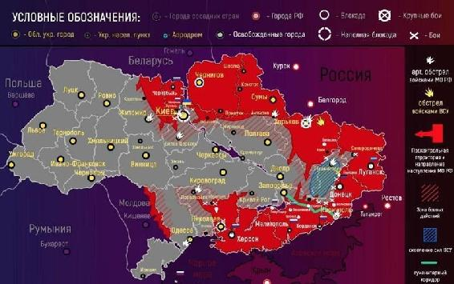A630：可怜的猫，你与这事有什么关系！！

【生存斗争的两个核心要点】

（展麟解读：讲个体生存结构中，有 2 个核心求存要点，第一个核心要点，一定要确认规则，确认边界，确认秩序，让一切都有据可查，而这些确定的秩序，规则，边界，源于上一次生存竞争，生存斗争中博弈停止下来的达成诉求要点，任何被遵守的规则，都是经过生存斗争博弈后最终妥协，而不是随便写几条规则让大家遵守，生存竞争博弈后确定的边界才是最佳生存状态，大家都能遵守也能心服口服，这就是竞争最大的好处，冲突就是确立新秩序最佳时机，不管爱情中的争吵，还是婚姻中的出轨，还是职场的斗争，还是官场的潜规则，都是经历生存斗争博弈后，参与者都遵守的底线，边界。第二个核心点，要设置门槛，必须要有门槛，过滤出来能承担责任和支付成本的人拥有决策权，强者的理性和克制源于要为自己的任何行为承担责任并支付成本，弱者的疯狂恰恰源于自己不能为任何行为承担责任并支付成本，所以拥有决策权的人，都必须是经过筛选和过滤，实力和能都能匹配上的人。对于个体而言，完成精神结构升级，从冲突中找到新平衡点的获利机会，站在决策权的角度去思考当下的政策的机会，不管是国家政策还是企业政策，还是团队政策，用更高的精神层级去做谋划）

正文

出轨这事最大的损害并不是绿了对方或者被对方绿，就

行为本身而言并不是最重要的！最重要而且不可逆的不是生理上这点事，而是彼此之间的信任被彻底摧毁。信任一旦被摧毁之后，彼此之间的任何行为都变得不可信。于是，彼此之间不仅会滋生出各种戒心，也会从保护自己和维护自身利益的角度渐行渐远。任何一点的误会都会导致连锁反应并形成更深的裂痕，从而加深这种不信任的氛围。这就如同推倒了多米诺骨牌，一发不可收拾！

契约也好，诺言也罢，总的来说，它都只是一种仅存在

各自脑子中的观念，当大家都认可并主动遵守的时候，它就是一种约束，并由此形成确定性的边界。然而，当彼此都不再相信，也不再遵守的时候，它就变得毫无约束力，而且这种曾经不可逾越的边界就会先变得模糊，随即就消失的无影无踪。一旦没有了边界，也就没有了确定性。所有的边界，无论好坏，都能够给人一种确定性。一旦这种边界被突破并无法恢复，这种确定性也就消失了。置身其中的个体在做判断时就需要到更大的混乱中去寻找新的确定性因素并确立新的边界！

我们对人和事的判断都是通过一切确定性的边界为依

托，基于其上，搭建起稳定的演进逻辑。律师的作用是什么？

律师最大的作用就是在法条和事实之间通过逻辑搭建起一座稳定的桥梁，从而做出是非曲直的判断。法律为什么需要不断修改？因为法条所搭建起来的规则是一个理想的社会模型，一个静态且充满确定性的法理世界，但生命体的求存行为所演化出来的现实状况时刻处于变化之中。有些冲突本身就是对生命体在生存竞争中产生的力量变化对原有确定性边界的冲击和改变。什么是国界？就是上一次战争停下来的地方！

构建起秩序非常的困难，需要足够的资源和能量。维系

住确定性的秩序也需要持续的消耗资源和能量。任何秩序的构建都是生命体在生存竞争中经过充分生存博弈之后呈现的最佳形态。不仅法律在与时俱进，日常生活习俗是不是也在随着人的变化而做相应的改变？一代人有一代人的规矩。

当科学无国界、艺术无国界、公共服务无国界的原则都

被主动打破，当“我不同意你说的每一句话，但我誓死捍卫你说话的权力”的准则被彻底抛弃，当" 尊重私有财产“需要以共同立场为前提。曾经被千万人当作确定性边界遵奉的最高原则，被昔日的宣扬者主动撕碎。不仅音乐需要根据国籍来决定是否具备演奏的资格，连同猫都不例外，而且它还无法为自己辩护，甚至无法表达自己的选择和立场，这些猫在一脸懵逼的情况下被动的卷入了一场决定自己命运和待遇的漩涡。今天无比仇恨它们，并把它们打入另册的人，昨天还曾温柔的抱着它们，宣称要做它们的保护神，爱它们一辈子。我们只好用魔法来打败魔法：猫猫那么可爱，你们于心何忍？！

以信息技术为代表的互联网，并没有让这个世界变得更

加紧密，反而让这个世界变得更加的疯狂。就如同让一群幼儿园小朋友冲进了古董店…谷爱凌让许多焦虑的妈妈们第一次认清了自己，不是娃不行，主要是自己不行！什么样的土壤就长出什么样的果实。信息技术的高速发展和互联网渗透到生活的方方面面，第一次让参与公共事务的门槛如此之低。以至于哪个群体人数最多，整个事的是非曲直的判断就会以那个群体的认知、心态和自我代入后的感受来决定。不管在什么社会，不管采用什么社会组织方式，高度聚集的民意不仅会干扰对复杂事物的判断，而且会形成一种无形的压力。阿里的那件轰动一时的事，最后真相大白之后，阿里愤然开除了策划这一切的当事人。然而，在舆情汹汹的时候，阿里只能把策划人当作完美受害者去对待，明知是坑也要咬紧牙先跳进去再说。否则，面对乌合之众汹涌澎拜的情绪叠加所形成的压力，任何讲道理摆事实的行为都是自取灭亡。

你只能顺着对方，让其将情绪宣泄完，然后充分的抚慰并转移其注意力。这套应对之策就是许多父母应对幼儿哭闹的有效方法。

在《入戏太深！》中我们揭示过当下许多事情的背后逻

辑：归根结底一句话，什么样的土壤就会长出什么样的果子！

当下最流行的东西一定是最能代表那个土壤的东西。当社会动荡不安的时候，英雄最受欢迎，因为安全感的缺失是大众最普遍的状态。当社会处于贫困中的时候，企业家最受欢迎，因为匮乏感是大众最普遍的状态。当社会逐渐进入稳定状态，流量明星最受欢迎，因为无聊是大众最普遍的状态。网络所能连接的人越多，疯狂和轻率的行为也就必然会越来越频繁，越来越没有底线，越来越匪夷所思。因为在喧嚣的环境中，声音越大行为越极端才更吸引人。

强者的理性和克制源于自己需要为自己的任何行为承

担责任并付出成本。而弱者的疯狂恰恰在于自己不能为任何行为承担责任也无法为任何行为支付成本。这就好比一个上幼儿园的小朋友在家里疯，把家里贵重的瓷器砸碎了，你能怎么办呢？你甚至连打都不能下狠手打，只能做个样子吓唬一下！这也恰恰是为什么未成年人需要监护人的缘故，因为不需要对自己的行为负责，也无法为自己的行为支付成本，还不会受到惩罚的人，一旦拥有超出其认知范围的决策权，一定会酿成不可收拾的恶果。

这个社会之所以会在无形之中设置许多门槛，并通过门

槛把许多人阻挡在门外，主要是为了让决策权和承担责任的能力相匹配。因为德不配位者无法对自己的行为负责，也负不起责。人一旦负不起责又拥有这种权力，肯定会无所不用其极！因为人只有能够负得起责任的时候才会越来越具有责任意识。任何责任都负不起的人，连这种意识都不会有。所以不管不顾，胆子大的很，但认知有限，眼界和经验更有限，把一切都想的很天真。

# A630：下狠手了！！【我辈精神结构匮乏的扭曲商机】

（展麟解读：讲个体生存结构中，弱者的精神结构求存

方式让你得不可思议的烂，强者的精神结构求存方式却可以让你感到心安，一种无比坚定的确定性。求存方式的不同，源于每一辈的背景不同，祖辈因为处于失序的时代，只要谁能建立起新秩序就跟谁走的求存策略，父辈得到祖辈的传承处于稳定有序的时代，但是匮乏，没有钱，没有更好的物质条件，这个时代跟谁能准赚钱就跟谁走的求存策略，我辈得到祖父辈的传承，有了稳定的秩序和比较丰富的物质条件，不用忍受饥饿和流离失所，再差工业文明都能保障我辈的温饱，然后精神缺非常匮乏，不敢面对任何形式的不确定，恐婚恐育还社恐，成为精神的矮个子，害怕承担责任并支付成本，这是我们精神结构匮乏的扭曲，这是商机也是悲剧，你能贩卖精神世界的东西，对于你就是商机，你被精神结构匮乏保护机制束缚，对于你而言就是悲剧。对于个体而言，洞察我辈精神结构匮乏的巨大商机，做精神结构买卖的生意，同时完成自己精神结构升级，用更高层次的精神结构层级收割更低层次的精神结构的人，这是一门天大的生意）

正文

在《韩非子》的《亡徵》篇中有这样一段话：大心而无

悔，国乱而自多，不料境内之资而易其邻敌者，可亡也！国小而不处卑，力少而不畏强，无礼而侮大邻，贪愎而拙交者，可亡也！太子已置，而娶於强敌以为后妻，则太子危，如是，则群臣易虑者，可亡也！

翻译成白话文就是：君主狂妄自大而不思悔改，国家混

乱还自我夸耀，不评估本国实力而轻视邻近敌国的可能会灭亡。国小力弱却不懂审时度势，人菜却瘾大，还经常挑衅和侮辱邻近大国，贪婪固执而不懂进退的可能会灭亡。太子已经确立，君主却又娶强大敌国的女子作为正妻，太子的地位就会危险，这样一来，群臣就会根据利益改变立场，利益格局被打破内乱会持续不断，给外部干涉制造可乘之机，内争变成列国纷争，最终导致自己灭亡。

在《A629：唇亡齿寒！！》一文中阐述过：稳定的秩序是对所有人的保护，为了临时性的诉求而破坏稳定的秩序，最终将会导致不可预知，也完全失控的危险。古人云：小乱入城，大乱入野。意思就是：局部发生混乱的时候，就往秩序井然的地方跑，那地方才有保障。一旦整体秩序完全失控了，就要跑到没人的野外跑，整体失序的时候，什么保障都不会再有，一切温情脉脉的底线都会逐渐丧失。这个时候没人的地方反而更加安全！

我们的祖辈生于天下失序的动荡之中，苍生离乱，朝不

保夕。所以，谁能恢复秩序，给予一份安宁，就会不计后果跟谁走。因为除了自己这条命，已经再也没有什么可以失去了！我们的父辈生于长期匮乏的环境中，所以，谁能创造条件让自己能够摆脱匮乏就跟谁走。因为他们什么苦都吃过，所以不怕累也不怕苦。我们这一代人没有饥饿的记忆，更没有流离失所的记忆，所以，当我们成年之后，整个人的状态处于一种非常尴尬的境地：大开大合跑马圈地的时代已经结束，精耕细作的时代正在成型。出人头地的机会依然存在，但对于绝大多数人而言，出人头地的机会就如同海市蜃楼，看起来很美但真正起身去追逐的时候又摸不着！但不管怎么样，不管多么的不上道，也不会沦落到饿死自己的地步。不像祖辈处于这个年纪的时代，能够在朝不保夕的状况下，活下来本身就是淘汰之后的优胜者。也不像父辈处于这个年纪的时代，积极勤劳逆流而上都不一定能吃饱，躺平的话早就饿死了。我们这一代人当下就处于一种躺平也饿不死，努力也够不着的时代。这种状态下的人最显著的特征是什么呢？

时而焦虑，时而无聊，时而义愤填膺，时而热泪盈眶，受到了刺激就挣扎几下，刺激的烈度下来之后又不自觉地躺下了。

沉迷于各种短暂刺激、以及各种表面性的细节，不敢面对任何形式的不确定，恐婚恐育还社恐。总之，越来越多的人讨厌承担责任，渴望活成小朋友《X29：拒绝长大的人群！》小朋友都很天真，习惯性把人和事想象的非常简单，把

自己想象的无所不能，自己的感受绝对是大过天。对人和事的判断，往往是通过自我代入产生情绪共振来完成是非曲直的判断。于是，一种软乎乎的幸福主义的观念，一种懒洋洋的乐观主义的心态，日益蔓延开来。为什么女性化的流量明星那么受欢迎？因为小朋友都喜好外表好看，能给自己带来快乐的东西。在他们简单的世界中，拥有爱就拥有了一切。

因此，对复杂世界的理解和关注也就只会集中在这种表面的漂亮装饰上。会主张用爱发电，甚至会相信自己能用爱解决所有问题…

残酷和充满不确定的生存环境会让人快速成长，这个成

长集中体现在激活生命力，并提升精神结构的层次上，而舒适的环境则会让长出的菱角逐渐退化。非洲人之所以没有进化出农耕文明是因为他们所处的环境太容易获得食物了。根本就不需要升级自身的精神结构，也不需要激发生存竞争所需的生命力。于是，他们就一直这样躺平，直到有一天殖民者带着枪炮前来，轻易夺取了他们的土地，掠夺了他们赖以生存的资源，并将他们贩卖到大洋另一边的种植园里充当永恒的奴隶！

越往下，人越追求感情、道德、尊严这些简单又抽象的

美好。越往上，观念、心态、行为就越接近生存竞争最本质的样子。所以，人在懵懂无知或者低层次的状态下，往往会动不动就要为一个人或者一件事去死。而随着这个人的成长和层次的提高，对于人和事就不会再那么冲动，而是先暗中观察，待机而动。但同时，也愿意为一个人或者一件事忍气吞声地活着。看到了更大的世界，认清了人性的复杂和生活的本质，并不表示这个人失去了牺牲精神。只是在这种情况下，当这个人决定去牺牲的时候不再需要向外界索取某种回报，也不会抱怨和后悔。所以，这样的温度不再表面化，如同夜空中稍纵即逝的烟火，而会像烧红的烙铁那样不容易冷却…

在《三体》中，程心绝对是善良的，她既是大众选择的

结果，也是大众对自我的投射。然而，就是这种善良和对朴素感情的追求，让程心作为面壁者放弃了对三体文明的死亡威慑，恰是这种威慑的存在，三体人才对地球人呈现出一种温情脉脉的友好。威慑一旦被程心主动毁掉，三体人立刻撕掉所有温情的面纱，一秒都没有耽搁立刻开启了毁灭和掠夺地球的行为。而看到这一幕的程心除了痛苦之外，也干不了任何事来阻止悲剧的发生…

社会之所以会在无形之中设置许多门槛，并通过门槛把

许多人阻挡在门外，主要是为了让决策权和承担责任的能力相匹配。因为德不配位者无法对自己的行为负责，也负不起责，不管是判断还是行为，最终在自认为的善意的引导下一定会把事情搞得更糟，然而又无力控制，最终为所有人铺就通向地狱之路…

当一个人一无是处的时候，往往会本能的觉得自己别人

更加的善良，也更加的重情重义，事实上，这种幻觉是人的精神结构为了抵御外部反馈对自我的彻底否定虚拟出来的假象，之所以会形成这样自欺欺人的假象，源于精神结构的自我保护机制！

# 000：长津湖之水门桥！【制胜的生存技能】

（展麟解读：讲在个体生存结构中，从残局中掌握制胜

的生存技能非常重要，从每一个制胜的生存技巧中，都是一次又一次生命力的强大展现，用制胜技巧武装起来的生命力会一代比一代强。不管是我们祖辈为求得整体有序的时代，用血肉去拼搏一个残局中的胜利，用残局中能够利用的资源去搏杀一个整体有序的和平时代，才有我们父辈，我辈，子辈的传承接力，还是当下的职场，官场，在已知的残局中，采用制胜技巧，一次又一次的烫平波浪，赢得一次又一次的平衡，从而展现出强大的求存生命力。我辈的生存环境中，让自己拥有更高维度的认知，锻炼出来的好身材，拥有能说会道的演讲能力，训练出来好听的声音，阅读经典的好习惯等等，这些稀缺的技能，就是制胜的技巧，你掌握的越多，拥有的越全面，你能影响的人就越多，自然就能体现出强大的生命力，生命力强盛就是精神结构层级提升的强大，拥有更高层级的精神结构就拥有更持久的目标和生命力，而生命力强盛也是生存竞争最核心的核武器。对于个体而言，让自己持有更多的稀缺的制胜技能，完成精神结构升级，从而展现更强大的生命力，赢得一场又一场生存竞争的冠军）

正文

大年初一看了《狙击手》和《长津湖之水门桥》。从煽

情和制作的精细度来看，肯定是《长津湖之水门桥》要好得多。但狙击手更加的中立和写实。这种写实并不是指还原度高，事实上，水门桥对历史的还原度更高，而狙击手是糅合了许多人的事迹艺术创造出来的。但是，它为什么会给人更加写实的感觉呢？就是因为狙击手这种特殊的对决方式，不是依靠一腔热血就能战胜，它确实更加的依赖于战术和头脑。

这里的写实就是它能够更加贴近狙击手这种特殊兵种对决时的状态。在这样的对决中，技术落差、战术技巧、指挥艺术、个人的精神状态都融合在一起。所以，越尊重这种特征，越写实，反而更能凸显出主题！

小时候老爷子教我下棋的时候，总是喜欢从残局开始。

他告诉我，不管是做什么事，绝大多数情况下你都不可能从零开始，当你参与进去的那一刻，就已经事残局了，而且你一开始就处于不利的状态和局面。这种时候，你如何利用现有的条件，去改变这种局面并求得胜利，这才是训练的核心所在！我小的时候似懂非懂，越到后面越觉得他是对的！

精神气肯定是要的，但在面对极度悬殊的时候，光有一

腔热血并不顶用。就如同飞机在天上扫射的时候，你拿着轻武器根本打不到它，不管你多么不怕死，不管你多么愤怒都无济于事。这种时候就只能依靠战术和灵活性，去把现有资源的优势发挥到最大。当年抗美援朝的时候志愿军司令部就给各部队下发了一份百来字的《十五军对空射击经验通报》：

1. 选好地形构筑坚固射击工事隐蔽伪装，构成火力网，火器编排应分散，火力点集中，29 师数次空射未遭损失。2. 瞄准点选放标尺 42 度（高机）在距敌 500 公尺内为有效射程，其瞄准点战斗机为机前 150 公尺。3. 干部重视，选好地形具体掌握及射手勇敢沉着随机旋转瞄射为最有效。4. 观察员要少并且切实隐蔽。

在电影《长津湖》第一部中有这样的镜头：当敌机来袭

的时候，所有人都在找地方隐蔽卧倒，三营长和何平拼命向上山跑，就是要利用地形并通过战术方式去击落敌机。在电影《我和我的父辈》中，冀中骑兵团也曾经遭遇敌机，一个射手往山上跑，预先选定攻击的角度，另外的人骑马引诱敌机，敌机在追击马的时候需要转弯，转弯的时候飞得相对慢，而且低并靠近山脉。这个时候埋伏的射手突然对进入预设角度的敌机开火，把敌机击落了！

这些实实在在的战术技巧和经验积累才是制胜的根本，

而不仅仅是一腔热血。那种精神需要与这些具体的战术结合起来，才能成为克敌制胜的力量。事实上，这种胜利本身就凸显了那种精神！曾经在一个老兵访谈的节目中，昔日活动在敌后的老兵现场给大家秀了一段流利的日语，而且没有口音。这些人从未上过学，但是日语却非常地道。主持人问他为什么能学这么好，口语比现在学日语专业的大学生都好。

老兵笑笑说，我们当年学日语的时候跟现在的大学生不一样。

你们学不好最多不及格，我们那些学不好的同志都已经牺牲了！所以，能够取胜的技巧中本身就蕴藏着那种不可磨灭的精神，只不过它更加的深沉，不浮于表面！

当人不成熟的时候，往往不愿意接受现实，宁可凭空焦

虑也不愿意深入现实中的具体问题，更不会试图通过解决现实的问题来呈现人性中的不屈和抗争。事实上，这个过程中所呈现出来的智慧、胆略和技巧，才会凸显出真正的生命力。

然而，人在不成熟的状态下，总会试图通过极度表面化的张牙舞爪来凸显自身的力量，但有阅历的人总能一眼就看出来这种虚弱和匮乏下的自欺欺人！

我们的目标是过河，既然要过河，要么就得有船，要么

就得有桥。就算是泅渡趟水过河，也得勘察地形找到那个能趟水过河的地方。否则，就只能站在岸边望河兴叹，一筹莫展。不管如何焦虑，都无法完成过河的任务。

在《长津湖之水门桥》中有两句台词我记忆非常深刻：

第一句是打下机场的时候，余从戎指着美军的直升机说，这是他们的新装备，能够直上直下，有一天我们要能有这种东西的话，一定会比他们要强。五千里无比坚定地说，一定会有的！“人民海军“今天还特别截取电影中的这段做了一个视频，展示海军当下拥有的新设备。第二句记忆深刻的台词就是最后五万里在集合的时候说的：第七穿插连，应到 152 人，实到 1 人！全连都死光了，但又留下了种子，军魂犹在，生生不息！

# 000：虎虎生威，一往无前！【生命体的求存之道】

（展麟解读：讲在国家生存结构中，还是个体生存结构

中，求存才是生命体的本质，只有占据资源并维系自身存续，才是真正的主航道，不管成败，都必须让生命体活出破土而出的生命力才是核心，对于开始就担忧的凋零和泯灭那都是后话，先取得生存竞争胜利，先破土而出，先去干先去做比其他一切都重要。不管是曾经我们发展农业还是发展工业的争论，还是现在短视频互联网头部效应的更大共同体对人工具化的要求，还是我们社会从农业社会向工业社会发展的改革，还是人精神结构升级继而升级自己的生存结构，这一切都是生命体的求存之道，都是每段时间每个周期活下去的求存之道，对于结果如何不是很重要，但必须主动选择生存竞争，从残局中赢下一场又一场冠军。对于个体而言，需要从生命体的结构中去洞察时事的三个角度，第一个是技术元素，第二个是生命体相互博弈达成的底线，最后形成的制度，第三个是生命体结构占据资源并维系自身存续的基本属性以及原点悖论衍生出来的生存策略，这个 3 个角度，是你分析时事的角度，需要主动接受生存竞争，从残局的生存竞争中赢得一场又一场冠军，继而完成精神结构升级，从生命体的高度去洞察其他组织，政党的求存之道。行动中需要创造增量，更需要从精神结构中创造增量，才有更多的制胜的解决方案）

正文

生命体是一种能够从外部攫取资源并转化为能量维系

自身存在的有序结构。维系自身存在的关键是有序。之所以能够有序是因为存在一套能够自我运行的调度体系。因此，扰乱其有序运行，让其精神结构处于失衡状态，就能有效的操控和牵引目标对象，不管它是一个人还是一个社会群体。

人因为精神结构的运行状态的层次性差异，逐渐演化为

占据资源多寡的差异，最终形成无法逾越的社会等级。不管发展到什么时代，生命体结构内部属性的这种特征决定了基于生命体构建而成的更大共同体的基本特征！

从结构学的视角来看，纷繁复杂又相互联动的社会可以

从三个层面来洞察：1. 技术元素和由此锻造的各种工具；2. 基于生命体相互博弈形成的规则，以及基于其上形成的制度体系；3. 基于生命体结构基本属性及其原点悖论衍生出来的生存策略。

我们通常把共同体中成员共同的生存策略称之为文化。

文化本身具有强烈的排他性和自我遮蔽性。这种自我遮蔽性会让人在做出判断时滋生出一种不证自明又理所当然的理直气壮。换句话说，它确立了是非判断和价值评估的原点，由此衍生出来的一切，包括审美在内，都会沿着这个原点形成根深蒂固的观念和心态，从而驱使着大众的行为。

人类一直试图组织起来以应对所处的生存环境。当时机

成熟之后，具有生命体结构特征的共同体不仅进行着生存竞争的博弈，而且会存在一种力量驱使着个体向着构建起规模更庞大，内部分工协作密度更高，控制的资源更多，利用资源能力更强的共同体！

要构建具有生命体结构特征的更大共同体，就需要将个

体从原有的平衡中拽出来，让其处于一种无依无靠，上不着天下不着地的状态。因为稳固的状态具有天然的内在束缚力，它由内而外的决定着置身其中的个体内在的精神结构和外在的行为规律。这种内外一体的自洽性恰好能够形成一种类似于死锁的平衡状态。举一个最简单的例子：生活在某个阶层的人，其自身处境决定了他会相信什么，不相信什么，继而由这种偏向性决定着他的观念、心理和行为，这些东西又会让他长期处于这样的处境之中！从而形成了一个类似于死锁状态的完美闭环。有的时候人并非不能迁徙，而是不愿意迁徙，那种死锁状态的确定性所带来的安全感恰恰是其精神结构所处层次特别依赖的东西。这种依赖性会滋生出一种由内而外的驱动力，让他在做决策的时候，主动选择待在熟悉的环境中并试图通过简单的重复来回避面对不确定的人和事，这恰恰是许多勤劳却不富有，努力但没有结果的底层逻辑。

人在成长的时候需要经历一段非常痛苦的阶段，这个阶

段之所以不可避免，是因为所谓的成长首先是人的精神结构完成升级，继而是在升级之后的精神结构的驱动下，人的处境和生存状态完成升级，从一个低层次的平衡状态进入到一个高层次的平衡状态，痛苦的阶段就是从一个平衡状态切换到另一个平衡状态的过程。这个过程必然充斥着不安、焦躁、质疑和患得患失。

个体升级过程中的痛苦与整个社会结构的破碎与重构

的过程中产生的痛苦往往会形成叠加。许多个体在这种叠加的痛苦下会生不如死，在其精神结构的自我保护机制的怂恿下甚至会滋生出各种逃避的心态和极具破坏性的行为！所以，在社会结构变化的过程中，从彻底破碎到秩序重构，往往会伴随着剧烈的动荡，甚至会产生社会革命和持续的失控…随着城市化的进程和整个社会彻底从农业社会的结构

切换为工业社会的基础结构。首当其冲的就是产业权重的变迁和人员的迁徙。农业的占比断崖式的下降，工业的占比也在极剧下降，从而让附着在这些产业之上的人，被迫从中溢出，并迁徙到新的产业之中。新的产业往往分布在社会分工协作密度更高的地区。所以，大城市对农村和乡镇中的人员的吸纳能力就如同宇宙中的黑洞对周围空间中的一切行星的吸纳能力一样。那些像血管一样渗透到村镇之中的高铁和公路网络，将那些地方的劳动力、人才、美女、教师、医生等各种社会优质资源都吸纳到大城市之中。因为大城市的社会分工协作密度更高，产业中的高薪职位更多，对人的吸引力更大。在这个人口迁徙的过程之中，昔日支撑起农村和乡镇社会旧秩序的关键要素都被吸纳走了，从而让农村和乡镇的旧秩序加速坍塌。从某种意义上来说，稳定的小农经济的破产，恰恰在为日后的产业化农业和土地的自由交易让路。

更愿意从农村和乡镇迁徙到大城市的人群是年轻的女

性，特别是受过教育的年轻女性。她们在这个迁徙的过程中能够获得更高的经济收入和人生的自主权。特别是早几年的红利让她们享受到了大城市的便捷和自由，就会更加坚定她们留在大城市的决心。人类作为一种双性繁殖的生物，普通女性的偏好往往能够决定着普通男性行为的方向。从而加速让普通人群中的优秀分子进一步向大城市聚集。这种人和资源的加速聚集必然会形成一个必然的结果，那就是内卷！所谓的内卷并非是因为人相互挤兑，而是因为彼此的同质化很高又都无处可去。就拿电影院来打比方吧：内卷的关键并非是因为第一排的人站了起来，搞的后面的人被迫都站起来，而是这些人都无处可去，只能在这里看电影！如果他们还能去另外一个地方看电影，他们就不会被迫站起来看，而是会走出去。他们之所以宁可站起来看都不离开，主要是因为他们是同类，所以才淤积在同一个地方，也只能淤积在这个地方！

任何一种聚集都会加速同质化的竞争。当一个乡镇的第

一名考进市重点中学的时候，他会发现昔日轻轻松松就能拿第一的状况无法重现了，因为市重点中学聚集了所有乡镇、县城和市区各学校的第一名。这种竞争的激烈程度必然更加惨烈。等他们通过高考进入全国超一流的高校之后，就会发现聪明和勤奋的人更多，竞争也更加的惨烈，压力也更大。

这就是高度聚集带来的同质化竞争的后果，这种同质化竞争也在无形之中加速让标准趋于统一！标准越统一，门槛越水涨船高，跟不上节奏的人就会越绝望，也会变得更加的愤怒。

这种愤怒表面上看起来是对标准的质疑，实际上是对自己的无能和无力的隐蔽攻击。如果有一种办法能够让其跟得上节奏，对标准攻击最强烈的人往往会变成最彻底的拥护者。

互联网平台所产生的头部聚集效应，是这几十年来城市

化进程所造成的聚集效果的缩影。这种结构性的力量发展下去必然会让强者更强，弱者更弱。虽然不人道，但不可否认，这个趋势在加速锻造一个规模更大，内部的分工协作密度更高，控制的资源更多，对资源的利用效率更高的共同体。这个共同体在与别的个体和共同进行生存竞争的时候，往往具有更强的竞争力。当然，这样的共同体对内部个体的控制力度会更大，对其独立性的摧毁和拆解程度也更彻底。个体的自主权和独立性会增加共同体内部维系秩序和转嫁成本的难度。就如同一部机器的内部控制越精确，各部件的咬合度越高，它的整体效率和力出一孔的输出就越高。越是如此，内部的部件就越会彻底工具化。同样的道理，内卷和淤积所带来的痛苦，就是置身其中的个体在加速工具化时，精神结构中的抽象自我被不断拆解降级所带来的痛苦。

抖音这样的短视频平台在聚集海量人群的时候，也在加

速驯化人群，具体来说，它在所有受众的脑子加速形成唯一的标准。譬如说，在没有这种无比具体又高度一致性呈现的平台之前，村里的翠花可能村长家的儿子是一个不错的选择。

但是抖音会以 360°无死角的示范告诉她什么样的男人还是好男人，什么样的生活才是自己应该过的生活。在这种统一标准和具象模型的熏陶下，村长家的傻儿子就会显得什么都不是了！当所有受众的目标诉求都高度一致的时候，就必然会造成头部的凸出效果和标准的水涨船高，继而会造成强烈的同质化竞争。所有向女性灌输的消费观念，本质上都是为了驱动男性之间进行更加剧烈的同质化竞争，详情去读：

《A431：这依然是男人之间的厮杀！》

纷繁复杂又相互连同的事物背后总是存在着有章可循

的底层逻辑。这个至今还拥有 8 亿农民的社会，土地制度与社会的产业发展之间存在着天然的矛盾。为了社会稳定不得不向现实妥协，采取符合小农经济的土地政策。但是农业问题从来都无法通过农业来解决。在 1953 年曾经发生过一次著名的争吵。梁漱冥说：我们依靠农民取得胜利却没有优先发展农村，而先发展城市，甚至让农村为发展城市做出牺牲。

红太阳批评他：有人不同意我们的总路线，认为农民太苦，要求照顾农民。这大概是孔孟之徒施仁政的意思吧。然需知有大仁政和小仁政者，照顾农民是小仁政，发展城市、大工业、打美帝是大仁政！我们搞了几十年农民运动，还不了解农民吗？！

破碎的小农经济是不足以支撑得起一个十几亿人口的

现代社会的。小农经济的脆弱性在于：即便是最好的状况，也仅仅能够维系住最低温饱的平衡状态。一旦天下有事或者天灾人祸，就会无力应对！作为一个共同体的生存环境如此，作为个体的生存环境也是如此！

为什么需要一代一代务实的接力，为什么需要从将要坍

塌的地方向社会分工社会密度更高的地方迁徙，为什么需要克服惰性逆流而上完成自我的精神结构升级，继而驱动自我状态和自身处境实现升级？这一切的一切都源于生命体的求存之道，不管它的规模是大还是小，都需要在自己所处的生存环境中破土而出！那些不可避免的凋零和泯灭，就如同时空中已经远去的记忆，可以在破土而出之后再去凭吊、同情和惋惜…

# 000：反复被删，发不出去！【真正的门槛】

（展麟解读：讲国家生存结构中对个体生存结构的致

命打击，那就是国家在我们父辈那一代采用限制人员流动的城乡隔离，实现阶层锁死的循环，农民那么世代都是农民，市民那么世代都是市民，这就是城乡隔离的残酷，国家在我辈采用的更加隐蔽的隔离，就是精神结构隔离，认知力隔离，更是信息隔离，从你看到的听到的信息前就已经把你分好等级，进行算法的精准匹配，让我们从精神结构自我保护机制中自洽的循环，彻底隔离，让我辈甚至下一代都锁死在这个死循环中，从精神结构算法投喂中隔离，我辈这样，子辈更是这样子。这才是真正的门槛，不管是考证，还是考编，还是其他人际门槛，还是成本的持续投入，都不算真正的门槛，真正的门槛就像我们父辈城乡隔离才是永世绝望。普通人无法完成累积，精神结构失衡，就是我辈工业时代下人工具化的阶层隔离，从你用手机吸收信息开始，就对你进行彻底隔离。对于个体而言，需要从这个阶层固化的残局中，去布局自己三代人的传承，同时完成精神结构升级，从生命体的精神层级去完成每一代人的精神结构培养）

正文

昨晚写了篇贼好的文章，但是发不出来，发两遍都被

删了，还收到一个警告！只能放【觉悟社】里了，这种尺度的内容以前还能发出来，现在发不出来了，越来越收紧了！

只能谈风月，不能深入思考，尤其不能对社会和公共政策的形成规则进行思考，更加不能将思考的内容揭示出来。但可以尽情的猎奇、八卦、性别互撕…

民众需要一个能满足其高频短刺激的信息茧房！从而

能够让某个群体由内而外的把自己彻底锁死在某种自洽的状态中。有多少人每天都无法集中精力干成一件事，既对手上的工作和当下的处境极度不满，丝毫提不起精神，又时常感到无可奈何。整天沉迷于各种短视频和新闻的高频短刺激之中，无法静下心读完一本书，也无法沉下心来干好一件事。

时而不靠谱，时而不着调！时而热泪盈眶，时而又义愤填膺！

然而，这都是一阵一阵的抽风，这一阵过了之后，什么都不会改变…

真正让人焦虑的并非外在的刺激，而是自己的能量一

直无法聚集，对任何改变都无能为力。对任何行动都提不起劲也无法持续下去！

一个无法深度思考的大脑肯定无法接收到深层次刺

激的信号。就如同你拿出一本书完全看不懂，你自然会对它毫无兴趣！那什么样的东西会勾起你的兴趣呢？当然是你能接受到信号的那种刺激啰。所有高频短刺激都是一种很表层的刺激，它就如同寂静夜空中的烟花一样，刺激的持续时间很短，更加无法形成一浪接着一浪的持续推动力！

所有的表层刺激都会让人瞬间兴奋，但有很快沉寂下

去，需要不断的寻找这种刺激。然而，这种刺激的效果最多让人瞬间热泪盈眶或者义愤填膺，但是它始终动力不足，最多也就只能让人感动一把或者愤怒一下，情绪发泄出来也就逐渐黯淡下去了，人也就消停了。

如果人长期处于这种状态下，这种表层的高频短刺激

会让人逐渐麻木。它就如同用一阵大火烤红薯，表皮已经烤焦了，里面还没熟。这就很尴尬了，对表层刺激虽然上瘾却越来越觉得无聊，而能动思考和行为的深层次刺激又接收不到信号。这就好比需要 100 块才能买到打开某个匣子的钥匙，但你总是一块一块的花掉了，越来越无法积攒起 100 块。

顺手写下这些废话，扯犊子就先扯到这吧！要看那篇

发不出去的文章去【觉悟社】里看（下面红色字有提示）。

趋势只会越来越收紧，好时代结束了！多年以前互联网上能够随便下载音乐和电影，后来音乐和电影都无法随便下载了，尤其是当红的好电影和音乐更是如此。这就是环境的变化趋势，它无形之中对人群加速了筛选… 因为真正的门槛并不是价格很高，真正的门槛是父辈那个时代的城乡的彻底隔离，再聪明和勤奋的农民也不可能享受城市中的任何东西，只能待在原地刨一辈子的地，人无法流动，也完全看不到自己熟悉的世界之外的部分，连万一的机会都没有！

# 000：入戏太深！【判断力才是底层能力】

（展麟解读：讲在个体生存结构中，主动挑战生存竞争

的赢家才是真正的统治者，有实力的家伙，而不是被互联网时代被普通民众用自己喜好选出来的代表者，知识永远都两种，一种是门内知识，用家学的方式传承，一种是门外知识，就是广泛宣传的知识，同样真正的生存竞争赢家也有两种，一种是根据自身实力赢得的冠军，一种是被民众想象放大的符号的代表者，你能洞察出来这层理解，你的精神结构层次就是上上签到达了统治阶级的精神结构。互联网让普通民众参与公共事务提供便利，同时也凭自身偏好选举代表者到前台表演，但这是临时性的表演，很多普通民众以为是永恒的表演，真正的表演者是临时性，能搭建台上表演者的幕后操盘手，才是真正的永恒的生存竞争的实力赢家，人家有经验，有家底，更有传承。不要把表演者临时状态，你把他当成永恒来追随，这是没有判断力的表现。对于个体而言，完成精神结构升级，看懂临时表演的戏码，洞察搭台的背后的真正实力掌权，革新自己的判断力，从统治阶层角度，从生命体结构角度，从个体结构角度去日常的衣食住行事件）

司令解读：在《入戏太深！》中我们揭示过当下许多事

情的背后逻辑：归根结底一句话，什么样的土壤就会长出什么样的果子！当下最流行的东西一定是最能代表那个土壤的东西。当社会动荡不安的时候，英雄最受欢迎，因为安全感的缺失是大众最普遍的状态。当社会处于贫困中的时候，企业家最受欢迎，因为匮乏感是大众最普遍的状态。当社会逐渐进入稳定状态，流量明星最受欢迎，因为无聊是大众最普遍的状态。网络所能连接的人越多，疯狂和轻率的行为也就必然会越来越频繁，越来越没有底线，越来越匪夷所思。因为在喧嚣的环境中，声音越大行为越极端才更吸引人。

司令解读：在《入戏太深！》一文中已经阐述过这个时

代会因为信息技术的发展把一些流量明星推到前台，在聚光灯下表演。不管表演的多么有烟火气，多么的贴近生活，多么的真实，终究还是一种表演。一件事参与的人越多，门槛就会越低。越是普罗大众都交口称赞的行为一定蕴藏着惊人的灾难！你要让所有人都说你好，有一个最简单的方式：不断给所有人发钱！问题是，你有没有这么多钱一直发下去。

当胃口越来越大，剂量的需求越来越高的时候，你是否会后继无力？！到那个时候，你的风评就会从交口称赞变成千夫所指！

司令解读：在《入戏太深！》中开篇就有这样一段话：

一件事真正让人感到恐惧或者兴奋，不在于它当下的状况。

因为当下的状况一目了然，得失利弊清清楚楚。真正会让人感到兴奋和痛苦的点，是基于这个起点将会演化成什么样的趋势。人们的痛苦或者兴奋都源于对这种趋势的想象。

正文

一件事真正让人感到恐惧或者兴奋，不在于它当下的状

况。因为当下的状况一目了然，得失利弊清清楚楚。真正会让人感到兴奋和痛苦的点，是基于这个起点将会演化成什么样的趋势。人们的痛苦或者兴奋都源于对这种趋势的想象。

为什么是想象而不是判断呢？因为绝大多数人都没有判断能力，但习惯性一厢情愿的想象，并把想象当作事实去撩拨自己的情绪并驱动自己的行为。

有一个这样的传闻，未知真假：陈道明老师在扮演康熙

王朝中的康熙帝的时候非常成功，据说他刚演完戏的那段时间，在家里的言行举止亦如戏中的康熙皇帝，他太太就问他：

你是不是入戏太深了？他突然站起来，看都不看她说道：

朕…并未如此！

对于专业演员来说，入戏太深是好事，入戏深才能与角

色更好融为一体。但对于普通人来说，生活不是表演，如果不是在活出真实的自己，而是在极力扮演一个自己认为的自己。那样不仅很累，而且会时常出现走错片场的错觉。

互联网时代凭借着信息技术的发展和资讯网络的普及，

民众对社会公共事务的参与度异常高涨，而参与的门槛也足够的低，但聚集起来的人数却非常大。乌合之众更容易以情绪的共鸣替代理性的思考，以冲动的行为替代谨慎的决策。

更重要的是，当这股力量拥有影响力和决定权的时候，这个群体的喜好会将那些能够迎合自身偏好的代表者推到前台，作为自己的代表。

最近这些年，西方出现了一堆年轻漂亮又毫无经验的网

红式统治者。他们没有根基只有民意，因此，他们的权力基础非常的脆弱。除了表演也干不了什么别的事。一个社会错综复杂的利益纠葛和各种势力的相互博弈，是通过说几句漂亮话，做做秀就能搞定的么？难道之前一直搞不定是因为统治者长得不够帅气或漂亮么？！

在《X29：拒绝长大的人群！》中描述过现实生活中一些人的真实状况：这些人虽然年纪增长了，到了要背负责任成为别人依靠的对象的时候，其内心依然停留在小孩的状态。

小孩是什么状态呢？有很多诉求和想法，爱恨鲜明，对人和事的态度非黑即白。力量弱小但诉求强烈，习惯性以情绪化的撒泼来获得自己想要的一切。

生活之艰难，世事之复杂，往往不是非黑即白的是非观

所能理解的。也不是小朋友的心智所能应对的。但小朋友自己不会这样想，他们会认为自己无所不能，因为他们的所有诉求都是父母买单，一旦不如预期就只需要发泄情绪打滚撒泼或者以自我伤害的方式迫使父母为达成自己的心愿支付成本。首先会把一切都想的很简单，不如预期之后又不能承担责任，反而总是需要被原谅、被关注和被包容。真正区分人的不是实际年龄，而是精神结构所处的层次和运行状态。

当你上幼儿园之前，你会觉得你是宇宙的中心，周围的

一切都围绕你转。当你上幼儿园之后，你会发现其它的宇宙中心可能会过来抢你的玩具还把你打哭。当你上小学的时候，你的世界是简单的，简单到你认为自己是那个世界独一无二的存在，直到你需要升学考试的时候才发现，这个世界中还有其它比自己更厉害的英雄。当你上高中大学的时候，你觉得你懂了很多与众不同，未来可能出人头地。当你刚参加工作的时候，你会觉得老板缺乏格局，上司没追求，自己是潜龙在渊，绝对不会活成那个样子。工作几年之后，你就会发现自己好像并不像想象中那样优秀，那些曾经看不上，只关心房子车子这种俗事，毫无追求的人却过的比自己好得多，甚至开始偷偷得羡慕起这样的生活状态… 也越来越发现那个曾经入不了自己法眼的上司好像也还有点本事！反而是自己，并无所长，也不曾做出过任何上得了台面的成绩。那些自己每天在重复的事，好像也没有什么门槛。

在《F1：底层逻辑（框架）》中阐述过：建造和连接是构建更大生命体的两种演进方式。这几十年全世界的基础科技都没有什么突破性的发展，唯一得到迅猛发展的就是网络技术。连接之所以能够形成力量，是因为它能够突破时空的限制指数级的提高连接点的数量。并且能够快速形成一致性并引导所有节点向一个点聚集。当然了，就如同网络攻击只能利用对方自身的缺陷，而不能由外而内形成真正的破坏一样。这种方式聚集的万钧之力，也如同夜空中的烟火一样缺乏持续性并且只浮于表面。

在古典时代，驾驭整个社会的代表，要么是残酷的生存

竞争中的胜出者，要么占据社会资源并编织了社会势力网络的家族代表，要么是能够调动大量社会资源的新崛起者。总之，他们更能代表真实社会的生存竞争格局，并拥有应对真实社会中各种现实问题的经验、能力和资源。这种产生的过程就如同沿着一座无形的金字塔往上攀爬，同时又随时置身于角斗场之中，真正能够爬到顶端的人，往往经历过无数次的淘汰，也就拥有了应对各种挑战的能力、经验和资源。然而，信息技术的井喷式发展和人群的广泛参与，就让一切都越来越趋于表面化，不仅是五官决定三观，而且越契合心智更低的群体，就越受欢迎，因为那样的群体数量最多！

要迎合这样的群体就需要善于演戏，也仅仅只需要演戏

就行了。入戏越深就越容易自我感动，也更容易得到受众的喜欢。然后，表演者和受众之间就如同一群幼儿园的小朋友都沉浸在自己想象的简单美好的故事中尽情狂欢。一旦事情搞砸了，除了哭之外也没有其它的办法，最后连哭都会变成一种自欺欺人的表演…

以这种方式产生的人就如同流量明星一样都只是临时

的过客，真正的艺术家必然要靠作品说话。每一次社会组织方式的改变，就如同池塘下一个巨大的生物搅动了一池涟漪，水面上会浮出一堆泡泡，但这种状况都只是临时的，那样的代表人物也都只是临时的，不管是台上的表演者，还是台下众人狂欢的状态，都只是临时的过眼云烟！

说一句题外话：人有的时候会把一时的鼓噪（声势）当

作永恒的状态，然后就跟风去追逐一些临时的泡泡，最后得不偿失，悔恨不已，这都是没有判断力的表现。举个例子，姑娘们会去追逐一些看起来符合当下流行趋势的完美男人，然而，真正优质的筹码，流通率非常低，你如果发现一根金条，肯定会拿回家藏起来，哪有货真价实的金条在市场上频繁转手的？！

# 000：昨天是情人节呀！！【美好是生存竞争赢家奖励】

另一种标题：000：又到需要送礼物的时间了！

（展麟解读：讲个体生存结构中，爱情的求存之道，从

农业文明的浪漫升级到工业文明的仪式，让人变得越来越现实，越来越工具化，也更加明显自己的诉求，更要求匹配度，这是好事，越物质目标就越明确，为目标是去匹配自己的爱情，自然就得到相对好的良缘，虽然没有绝对理理性的爱情，却有标准的流程和形式上符合预期，就是一段匹配度更好的配对。当一个女人转身的时候，那么就是不好的时候，自己过的好，甚至越来越好，自然就不会留恋曾经，只有有更高的要求更多的匹配度，女人转身就是一个巨大陷阱，将就就是悲剧的开始。对自己越来越没有信心，自然就不断提纯和美化以前或者遥远的符号，这种唯美符号会让你彻底锁死在不值得爱的死循环中，让你从此跟真正的良缘阴阳相隔。对于个体而言，要主动接受生存竞争，获得性资源更需要，任何真正的美好都是生存竞争中优胜者的奖励，而不是遥远符号唯美符号想象符号的残花败柳，完成精神结构升级，定下自己长期目标，爱情也好，物质也罢都是你目标奖励，而你的精神结构突破才是你一生最大的财富，从精神结构升级到物质财富丰盈再到社会等级的锁定，完成精神结构升级源头才是核心）

正文

似乎越来越多人的内心深处开始怀念鸿雁传书般悠远

而绵长的温情。但在这个快餐时代，大家都是拾荒者，不断随意的丢弃，又不断去捡别人丢弃的人，越是滥情，反而越渴望忠诚，越是速朽（速朽是指精神或品质的快速消逝），却试图通过一些仪式来追求永恒的感觉，这不仅荒谬，而且可笑，还自欺欺人，然而，大家却乐此不倦，甚至会互相攀比。

感情是一种很私人的事，却越来越表面化，变成了一种

基于形式的表演。农耕时代有农耕时代的浪漫，工业时代有工业时代的仪式，一切朦胧的东西都在变清晰，再抽象的感觉也会逐渐被抽丝剥茧为一套标准的表演流程。不管是被迫，还是主动，人们终究会对流程越来越炉火纯青。最终，它变成了一种外显的仪式，人的内心越来越空洞，却不得不依靠外部的反馈来反复的向自己证明，但内心深处却是深度质疑的，随时准备打退堂鼓。不管是恐婚、恐育以及亲密关系中的高度不信任，都源于这种内在的空洞。人无法判断自己，也无法判断别人，所以，只能通过不断的消耗彼此，以沉没成本来确认自己的重要性，以形式来确认自己正在拥有。

慢慢地，人对感情的态度逐渐变成了这个样子：既然无

法判断内心真实的状况，那么，只要在流程上做到滴水不漏，在形式上做到符合预期就很满足了。这让人想起《让子弹飞》中刘嘉玲的一句经典台词：我想做县长夫人，至于县长是谁，我无所谓！

这是一种讽刺吗？不是！这反而说明这个人非常清楚自

己要什么。一个懂得自己要什么的人，目标明确，不会稀里糊涂的半推半就，一旦不如意又滋生出各种怨念和悔恨。正因为知道自己要什么，所以会用尽全力去争取，并且让自己配得上，还守得住。要感情的人与别人谈钱，要钱的人又试图跟别人谈感情，于是，各种心有不甘，各种不如意，各种怨念缠身，各种破罐子破摔。那个想当县长夫人的人肯定知道如何识别能成为县长的人，对于成不了县长的人绝对不会浪费时间。与之同时，她也学会如何做好一个县长夫人，不至于德不配位，从而得偿所愿，也就不会滋生出各种怨念来。

如果说幸福是一种自我满足的感觉，那么得偿所愿就是

最大的幸福了。由此可见，目标明确，边界清晰的人往往更容易获得幸福，因为这样的人不会随便入坑，而一旦入坑，方方面面都能得偿所愿，人得到了自己想要的生活，并且置身于一种感觉安全的稳定关系中，懂得取舍和抓重点，拥有足够的心智和能力去维系一种动态的平衡。继而编织出一个交织着依赖和利益的共同体，并且能够让它拥有应对风险和创造增量的生命力。

在我们不明就理的时候，总是会把一些抽象的东西看得

非常神秘，人为的加上滤镜，赋予一种想象的唯美。然而，它终究只是想象的唯美而已：小时候特别迷《三国演义》，特别是三顾茅庐的桥段让我对昔日孔明高卧的隆重心驰神往。老版本的《三国演义》在对隆中进行取景的时候，尤其突出了人们想象中的意境。简直是一种世外桃源的感觉，一看就是高人隐居的地方。我还真的以朝圣之心从古襄阳城的二桥头出发，一路向西，在大概二十华里的地方，就是昔日孔明高卧的隆中。进门是一个传统的牌坊，上面刻着三个字：

古隆中！然而，我的失望之旅就是从进门的那一刻开始的。

完全没有电视剧《三国演义》刻意取景营造出来的那种意境，也没有人们想象的那种美好。整体来说，和任何三线城市的普通主题公园别无二致，就连同那些塑像和著名的八卦阵都是粗制滥造的，这些细节恰恰透露出一个地区当下的经济状况：当地人需要的并不是为你营造出某种世外桃源的意境，而是创造收入接近燃眉之急。因此，他们在景区中尽量多增加各种能够收费的游乐园项目…

人类因为会相信不存在的美好，所以才能有序的组织起

来，完成预言的自我实现。这个特征中国人尤其突出，因为我们总是以规划未来的方式活在当下。因此，我们更加容易对遥远的过往存在一种美好的想象，对遥远的未来要么一厢情愿，要么焦躁不安，但对当下的一切都感到失望！

人在当下过的不如意的时候就会不断的提纯和美化以

前。譬如说，现在的生活让你力不从心，就会突然觉得小时候的那种生活是多么的轻松和惬意。再譬如说，许多人都无比推崇 40 年前的一部老电影《牧马人》，觉得电影中演绎的那种感情无比的纯粹。然而，电影中也毫不避讳的讲述了这份纯粹背后的现实处境：女主公连饭都吃不上，快饿死了才跑到外面去逃荒，她之所以嫁给男主人公，用她自己的话来说就是：找个吃饭的地方！男主人公不仅贫穷，而且是在那个时代被打倒和放逐的边缘人物，也就是所谓的黑五类分子。

明明是知识分子，却不得不去当牧马人，放了二十年的马！

彼此都是走投无路，都是被主流社会遗弃的人，所以这种相涂以沫不过是迫不得已下的才抱团取暖。如果说这就是最纯粹的爱情，那还不到处都是。至少当下你有自主权，而且没有沦落到完全没有选择的地步！

当一个女人越来越难以找到更好的对象的时候，就会无

比的怀念前任，会主动把往昔的所有争吵都通过想象的滤镜美化成一种浪漫，并沉浸其中。如果自己越来越过得好，自己的状况也越来越好，即便前任一路跪舔，只要各方面达不到自己心中期待的样子，就会转身的非常潇洒，不会心存一丝怜悯和留念。当一个人转身的时候，并不是因为她深情，而是因为她找不到更好的！人性掰开来看都很龌龊。但知道自己要什么的人，往往能够理解人性中的龌龊，并在这样的地基上尽力去构建起基于现实的美好！

所以说，任何美好都是对生存竞争中的优胜者的奖励。

俗话说：纹绳总从细处断，厄运总找苦命人。自己越糟糕，不管怎么折腾，想要获得任何一种美好都很难，即便走狗屎运，也只能昙花一现。

# A632：生命可以被摧毁，但不可以被打败！【独立性才能赢得绝对尊重】

（展麟解读：讲不管是国家生存结构中，还是个体生存

结构中，永远保持自身的独立性，才能赢得绝对的尊重，同时为了自身的存续，卧榻之处，是绝对不允许你藏刀备刀的，必须让你把刀拿开，这个底气的背后也是你独立性后对你强大的尊重，你没有强大到可以收拾人的能力，别人就会对你疯狂试探，甚至组团来对你试探，最后把你拥有的东西就一点一点的占为己有，主动接受生存竞争的斗争，保持自己的独立性，成长为能保护自己也能保护别人的强者实力，不管是过去的古巴导弹危机，还是过去的朝鲜战争，还是日常生活的围群打架，都是非常实在的生存竞争博弈，也是把你的资源占为己的疯狂试探，保持自身独立性，拥有接受生存竞争的底气，才能赢下一场又一场残局冲突后的新相处规则。

对于个体而言，永远保持个体的独立性，才是你赢得尊重的前提，不管是过去的刘邦，还是现在俄罗斯，始终都保持自身的独立性，完成自己精神结构升级，让自己面对生活，有更多更全的制胜解决思路。同时要关注知识分子成为不了领导者的三个弊端）

正文

在《A629：唇亡齿寒！！》中已经详细阐述过，在此就不再赘述。假如你的枕边人拿把锋利的刀放在枕头下，或者握在手上，你是否还能在旁边安然入睡？一个正常人肯定是睡不着的，一定会强烈要求对方把刀拿走，否则就报警。然而，对方会说：拿不拿刀是我的自由，我只是把刀放在我的枕头下，又没放刀你那边，你睡你的嘛！面对这种情况，你会怎么办？1962 年，苏联在古巴部署导弹，当时的美国不惜与苏联打核战，强迫苏联把部署在古巴的导弹撤走。在此之前，还发生过著名的猪湾登陆事件，因为古巴发生了革命，美国人感受到了不安，于是，中情局策划了著名的猪湾登陆，进行武装干涉。只不过战斗力不行，被古巴的军队击败了。

1950 年隔壁的朝鲜半岛爆发战争，美国人在仁川登陆之后，不仅越过了 38 线，还一路把战火烧到了鸭绿江的对岸。此时此刻，我们是出兵还是不出兵呢？按照圣母们的想法，美国人只是在朝鲜的土地上，又没有大规模进攻中国，你睡你的嘛！问题是，你这样会让我们睡不着呀！东北是重工业基地，当时全部的家底都在这一江之隔的地方。你在对面杀人放火，耀武扬威。卧榻之旁，你在不停的挥舞着寒光闪闪的尖刀，让我如何安然入睡呢？！不管怎么样，我都必须要让你把刀拿开吧。

在日常生活中，如果两个人打架，旁边往往会围一圈看

热闹的，如果你三下五除二把对方打趴在地，他们也就只是观望而已。如果你很犹豫，那些看热闹的人都可能趁机踢你一脚、推你一下。他们会吃定你，并毫无顾忌的加入对你的群殴。甚至是最弱小的旁观者，并且是跟冲突双方都不认识的人，也会趁机对你喊打喊杀。这是人性使然，小到个体，大到国家这样的共同体，概莫能外！

凡事做最坏的打算反而有可能取得最好的结果。如果一

开始就没有做最坏的打算，最后的结果一定是最糟糕的。自从 2014 年开始，北方的邻居（俄罗斯）就开始逐步清空手上的美债。他们并非没有做准备，事实上，他们一直在做准备。08 年经济危机的时候，北方曾经约我们一起大规模抛售美债，给金融风暴中的鹰酱致命一击。我们综合考虑了各方面的因素和时机，婉拒了这个建议。自古以来，他们虽然属于欧洲却自成体系。许多人嘲笑苏式武器粗糙，但它依然很有效，不是吗？他们每一次在最绝望时刻，总是能够以超乎想象的方式挺过去。当年斯大林格勒被围困 199 天，第三帝国的专业人员计算过城市中平均每人每天所能获得的食物所能提供的热量不足以维系人的基本生存。然而，他们不但挺住了，还逮住对方攻击受挫的间隙，组织起大规模的反攻。

要不是德军的防守大师莫德尔盯住了这种大规模反扑，二战提前就结束了！

知识分子之所以不能当老大是因为他们精于算计而不

敢决断。更没有勇气和能力去面对最糟糕的状态。所以，他们自以为精明，却很容易患得患失，不是膝盖天生缺钙，而是知识分子往往存在三个自己无法克服的天然缺陷。这导致他们能够成为很好的辅助人员，只能附着于潮流之上，却永远无法成为潮流本身！这也是为什么许多学霸型的专业人士只能做辅助，而一些带有草莽气息的人则能独当一面。因为领导者只输出两种东西：1. 远见和决断，2. 意志和勇气。

北方邻居的整个社会都比较崇尚科学家，热爱体育，崇

拜英雄，也热衷于自己当英雄，连女性都非常彪悍。二战的时候，有位女性的丈夫牺牲了，她决定要给丈夫报仇，把自己所有的财产都变卖，买了一辆 T-34 坦克捐给前线，但有一个条件，她要成为这辆坦克的驾驶员。经过 5 个多月的训练后，她如愿以偿，开着自己的坦克去为丈夫报仇，她在战场上不仅丝毫不输男性战友，反而表现得更加勇敢和不顾一切，并且成为了让人敬佩得战斗英雄。虽然她在胜利前的 1945 年牺牲了，但她凸显了这个族群女性身上的特征。这样的女儿，这样的妻子，这样的母亲，孕育了一个族群最基本的特征，这种彪悍和简单粗暴的背后呈现出的是一种在极度恶劣环境下生存下去的顽强生命力。千百年来，他们给欧洲的整体感觉是这样的：不管怎么打击他们都依然能够保持自己的独立性，蛰伏一段时间之后，又会再一次以更加强大的面目冲过来！19 世纪是这样，20 世界更是这样，而且后一次比前一次更强大也更让人恐惧。

在《三国》中，曹操为什么对天下实力派都不放在眼里，反而对眼前走投无路的刘备推崇备至，甚至说：天下英雄，唯使君与操耳！因为刘备一直能保持自己的独立性，不管遭遇什么困难都从来没有放弃这一点。有些人就像刘备，每一次你认为他没戏了，他却总是能死灰复燃，绝处逢生。那种韧性让你感到绝望，那种能够将自己变成潮流的能力又让你总是提心吊胆。门捷列夫的元素周期表，柴可夫斯基的交响曲，普希金的诗歌，托尔斯泰的小说，代表人类第一个上太空的加加林，还有列宁的思想和他亲手在现实中建立起来的体系，所有的这一切既是原创的，也是能引领潮流的开创！

一个家庭条件并不好的农村姑娘，因为在城市中生活了

几年，模仿别人的生活方式，学会了到网红酒店和旅游景点打卡，学会了化妆、消费和穿衣打扮，就开始嘲笑考上那些家里有矿，还能考上清华的女生不够洋气并且咄咄逼人缺乏女性的魅力。她可能完全搞不清楚什么才是真正的魅力，什么才是真正的力量！

钟老（钟南山）说过这样一句话：生命可以被摧毁，但

不可以被打败！这听起来简直不像一个医生说的话，而像一个政治家和哲学家说的话，你能从中感受到一种莫大的鼓舞，那是来自生命本源的力量！

鹰酱看到了这次针对北方邻居的各种措施的效果，已在

某个岛上如法炮制开始拱火了，这是要把亚欧大陆这边的火也点燃。假如亚欧大陆的两端都起纷争，并被切断所有的经济往来，请问钱会往哪里流动？你猜对了，钱会加速从亚欧大陆向华尔街流动。鹰酱不仅要你的钱，还要你的命，而你还圣母心爆棚，在为鹰酱的阴谋诡计摇旗呐喊，这属于被人卖了还帮人家数钱的行为！

# A632：这不是两代人的冲突！【两个起冲突的真正根源】

（展麟解读：讲个体生存结构中，求存之道能产生冲突

的有两方面原因，第一是穷因，你穷，就不单物质匮乏也精神匮乏，物质的匮乏和对自己不能变好的无力自我判断，行为表现的就更加的自私，无情和双标，这些跟人品无关，跟自己生存环境和精神结构自我判断的穷有关。不管是穷人家养孩子，还是穷人家养狗，对工具性和实用性的要求都非常高，养的东西实用性不够，自然就是累赘，自然就是负担，也是生命体占据资源，和维系自身存续利弊得失的内在驱动力，就是人的本能，穷的人对物质和情感索取更加严重，本身就缺，好不容易找到一个能薅的人，自然会不管不顾索取物质和精神需求，跟人品无关，跟道德无关。第二是在当下自身能理解的轨道中分析出来的潜在危害，并臆想最坏的结果，自己有又力支付成本，自然会用强烈的情绪反应来斗争当下发生的状况，基于当下起点演化后的趋势激烈情绪冲突，才是真正的冲突。对于个体而言，理解冲突的根源，就是看懂很多现实无休止的争论，从而不过多浪费自己时间关注世间争论的精力，从而让自己更有精力集中一点干事情，完成精神结构升级，从而让自己对日常生活有更多的制胜的解决方案）

正文

在《A629：唇亡齿寒！》中，以不至触发封号的含蓄方式阐述了许多两难的事情的决策形成过程。成年人的世界总是处于两难之中，就拿日常生活中的例子来说吧。许多来自底层的农村学子或者小镇青年，当他们出来工作之后，他们所处的生存环境与他们的父母长期生活的环境是截然不同的。但是他们的父母是不能理解他们所置身的生存环境的状况以及运行方式。反而会按照自己的想象和诉求向儿女提要求。这个群体在好不容易离开原有的阶层努力融入新的阶层之时，会滋生出一种这样的感觉：身后不仅空无一人，一切只能靠自己去摸索，并且时刻站在悬崖边缘，却还有一双手拼命的把自己往下拽，他们的原生家庭不仅在物质和精神上帮不上任何忙，还会生怕自己的儿女受新的环境影响滋生出与自己不一样的想法和生活方式，这样会削弱自己对儿女的影响力，那种失控的感觉会让他们极度不安。于是，在内心诉求的驱动下，会用尽各种手段进行道德指责和亲情捆绑，以便能控制住自己的儿女，并让其为自己所用！

社会层级越往下，亲人之间的关系越趋于工具化，这种

工具化突出表现为实用性。这与人品无关，而跟人的现实处境息息相关。人的生存环境很大程度决定了自己最在意的东西，继而决定人的观念、心态并以此驱动人的行为。人在处于匮乏和弱势状态的时候，习惯性挂在嘴边的东西都是试图用来约束别人的，而约束别人是为了能让对方在这样的约束下满足自己的诉求。对于在自己的生活环境中不受待见，既没有突出的优势也没有特殊的价值，无人在乎和关注，社会关系也极度简单的人而言，亲人是唯一能抓住的救命稻草，就如同你发现前面有一条狗，你感到害怕又不得不往前走，哪怕只是抓根枯树枝在手上，恐惧感也能缓解一点。对于无力应对自身所处的生存环境的人而言，不能工具化为己所用的人就会被看成是累赘。低价值的自我判断所形成的匮乏感和无力感，更强化了这一点！

从这个角度来审视落后地区重男轻女的观念，你就会瞬

间豁然开朗：养儿是为了防老，就如同养狗是为了看家。底层社会没有人去养宠物狗，都是养功能性非常明确的狗，如果这条狗不能看家，不但不受待见，甚至会被宰了吃掉。匮乏的父母更容易指责自己的儿女，因为自己无能，所以不能容许儿女无能，如果儿女也和自己一样无能，自己的后半辈子就没有保障。在《A436：双标是弱者的必然选择！》中阐述过原理，在此不复赘述。总之，匮乏和无力的自我判断决定了人只能自私、无情又双标。这些都跟人品无关，而跟所处生存结构和精神结构的自我判断有关。

养儿是为了让自己在失去劳动能力后有保障，养狗是为

了人不在家的时候能看门。但是在传统的农耕文明中，女儿长大了是要嫁入别人家，并成为那个家族中的成员。所以，在她出嫁之前的投入往往就没有收益和回报。这就造成了越是处于匮乏状态的人，就越会把养育女儿当作一种纯粹的负担。那种源于生命体对占据资源的态度，以及由这种朴素的利弊得失所形成的内生驱动力，怂恿着处于匮乏状态的人依据趋利避害的本能对待人和事！

有些特别渴望逃离这种原生家庭的女生，认为自己的父

母完全把自己当作工具，是源于重男轻女的传统观念，事实上不是这么回事。那些同样渴望逃离这种父母的男生们，也会发现他们的父母本能的把自己当作工具。这种事跟性别无关，只跟穷有关，匮乏的不仅仅是物质，还有心态、观念、精神等方方面面。感情也是一种资源，而且，抽象的东西需要消耗更多的具象资源去锻造。纯度越高，锻造时消耗的能量和物资也就越多。不要存在一种误解，认为精神上类似于感情这样的东西，是任何人就天生拥有，并且取之不尽用之不竭的东西，这真的是天大的误解！匮乏者对感情的索取往往比对物质的索取更强烈，也更加的没有节制。这种索取无度和道德捆绑都以自身为出发点和落脚点。当然，这也不能全怪他们，因为匮乏的父母，自身的能量很低，不管是认知的升级还是眼界的扩展都需要能量，这就如同看片，高带宽可以看高清画质的内容，低带宽只能看模糊的内容。模糊的画质看不起很正常。所以，他们完全想象不到自己儿女所处的生存环境的艰难。因为没有这样的认知，自然也就无法感同身受；越是匮乏的人，自我感受就大过天，因为能够感知的世界很小，但自己的匮乏感和无力感却无比深重。这就好比房间很小，所以床就显得很大，只要走进房间，目光都会停留在那张床上。匮乏的人必然会更加的自私，因为这样的人感受到的世界就是那个憋屈的房间，而自己就是那张床！

在《入戏太深！》中开篇就有这样一段话：一件事真正

让人感到恐惧或者兴奋，不在于它当下的状况。因为当下的状况一目了然，得失利弊清清楚楚。真正会让人感到兴奋和痛苦的点，是基于这个起点将会演化成什么样的趋势。人们的痛苦或者兴奋都源于对这种趋势的想象。

不同层级的人之间发生冲突的时候，冲突之所以会被不

断放大，是因为彼此都会在自己的轨道中，按照那个轨道中的模型来判断它将会造成的潜在危害性，并以此臆想出最坏的结果。一旦发现最坏的结果自己不能接受，就会以强烈的情绪反应来阻止当下冲突中那个微不足道的状况。这种彼此激烈的反应都不是基于当下具体的问题，而是基于彼此在自己熟悉的那套生活体系中臆想出来的最坏的情况！只有彼此处于同一套体系中的时候，才能避免这种自动放大的情况。

# A633：除了胜利，已经别无选择! 【俄乌战争思考求存】

另一种标题：000：大毛不会倒下，差不多快要合围了！

（展麟解读：讲国家生存结构中，看三大阵营，两个配

角，美国，欧盟，中国是三大阵营，俄罗斯和乌克兰是配角，配合美国解决内部尘封已久的内部负债过高，在全球化输出资金和技术时转移了技术和钱，却没有把劳动力转移出去的结构性问题。这是大国的博弈，同时我们个体的博弈中，男女博弈，强者与弱者博弈，穷人和富人的博弈，不同生存层级的博弈等等是最常见的生活场景，而这些博弈最重要的是，内部博弈中精神博弈，完成精神结构升级，是升级自己的判断力，从而影响决策能力和制胜计划能力。俄乌战争给我们国家求存和个体求存提供一种思考，有时候成为人家的连接点，保持自身独立性，同时不倒向任何一方，左右逢缘，两边获利，发展自己才是最佳求存方式，如果自己作死，亡国灭种是有可能的事。同时要警醒跨国集团会成为斗争的抓手，控制着斗争态势还能置身事外并获利成功。对于个体而言，在残局中完成精神结构升级，并增强自己的判断力，为自己的判断和决策提供提供依据，从而为制胜的解决方式提供更多思路，从残局中赢得一场又一场生存竞争胜利，更好去解决内部问题，内部有序高效转移成本的良性循环，才是抵御一切问题的核心，国家如此，个体更是如此）

司令解读：时无英雄，使竖子成名！今天的舞台上活跃

的都是一群网红。既没有力量，也没有远见，还没有勇气，唯一拥有的就是各种装腔作势的技巧。即便此时此刻后悔了，也已经骑虎难下。在《A633：除了胜利，已经别无选择！》中已经阐述过了，这事的关键不在于演员，而在于鹰酱。更准确的说，取决于鹰酱自身的危机如何度过去。只要无法度过去，鹰酱就必然抓住这个溃烂的伤口使劲的抓，来来回回的撕扯。恰恰是这种不确定性对他们最有利。几个月前在《A608：鹰酱到底要干什么？！》一文中就提前阐述过。

前言

大毛（俄罗斯）不会倒下，差不多快要合围了!鹰酱这次项庄舞剑意在沛公，只不过这个沛公并非大毛：一周时间内，大量资金从欧洲流向了美国。同时，150 万难民开始进入欧洲，再过一周可能会高达 400 万以上。

正文

兔子供应链的综合成本优势和效率还无可替代，只会被

进一步强化。总的来说，兔子不会轻易卷入任何大的冲突，反而会成为更加频繁的冲突各方的依赖对象。做生意需要好脾气!一个人的行为与其处境息息相关，不能认清自身处境的人，其行为往往进退失据。所有把一手牌打的稀烂的人都有一个共同的特点，那就是陷在一种死循环中出不来，并试图通过简单的重复获得自己想要的结果! 其结果不仅无法得偿所愿，而且越来越糟，继而心生怨恨破罐子破摔!

如果一个男人家庭条件差，自身状态也很糟糕，能力平

平无奇，性格缺陷还很明显。那么，其处境会比较憋屈，也自然没有欣赏和在意的人。正确的生存策略应该是清晰的认清自身的处境和状态，基于那些暂时无法改变的现实约束，去构建一个状态更好的自己，努力让自己变成价值连接点或者桥梁，继而逐步编织出更好的处境。然而，绝大多数这种状况的人并不能采取如此理性的行为。

一个出身比较普通，家庭条件比较糟糕，自身也比较普

通的女生，想过好生活是正常的，然而，既无法改变自身，也拒绝以提供价值为出发点与更高阶的人构建起一种稳定关系，而是强迫更优秀的人向自己低头，不是去创造双赢的局面，而是以损害别人利益的方式来满足自身的诉求。当无法得偿所愿的时候，就一味哀怨自己的不幸和命运的不公。

为什么闺蜜能嫁得那么好，还能过得那么幸福，自己却不行? 为什么!

以上两种情况在现实生活中司空见惯也比比皆是。然而，当事人总是陷在自己的那个死循环中出不来，并伴随着抱怨、愤怒和哀怨。其精神结构的自我保护机制又会怂恿着自己破罐子破摔，一条道走到黑。表面上看起来是造化弄人，本质上是自我状态和自我判断决定了一系列的选择，最终叠加出来这样的命运…

安全感是所有人在形成判断和决策时的第一诉求，但安

全的诉求遵循着" 安全不可分割原则" 。什么样的人会双标呢? 把自己的生活彻底搞砸了的弱者! 弱者才会不管不顾地强迫别人满足自己无力满足的各种诉求，通常这种行为被称为道德捆绑。弱者不具有独立性，其自我判断无比坚定地判定无法通过自身的能力获得自身想要的生活，所以，才会不遗余力的追求一种寄生的状态，所有的道德捆绑本质上都是为了迫使对方接受自己的寄生性诉求。

在全球通用的礼仪中，握手是表达友好的姿态。然而，

这个礼仪源于远古时代的一个习惯，主动伸出手来是为了让对方看见自己手上没有武器，从而让对方解除会受到安全威胁的戒备。彼此都主动伸手，意味着彼此都不会威胁对方的安全，也就意味着友好。这种源自于远古时代的礼仪应该是经历过无数次误解和杀戮之后才逐渐达成的共识。人类的安全不可分割原则都是在一次又一次的冲突中逐渐形成的共识。由这种共识所构建起来的秩序保障着所有人的根本利益! 现实生活中有些女生，刚开始的时候要求还算正常，随

着时间的推移和各种作死把自身状态搞得越来越差，要求反而会越来越高，许多人嘲笑处于这种处境的女生不切实际，其实，处于这种状态的人也是没有办法。因为现实的困境和自身的状况就如同一个泥潭，越来越难以通过自身的力量爬出来，才需要一个完美的外部力量拉自己一把。人就是这样，对自己越感到绝望，对任何改变就越提不起劲，总是觉得与自己想要的差距太远，挣扎和努力也无济于事，彻底认命向现实低头又心有不甘，所以只能寄希望于一种捷径。并且越来越会通过自我催眠让自己坚信：只要通过这个捷径抵达彼岸，所有的问题都能迎刃而解! 因此，人在把自己搞的越来越糟糕的时候，往往会不惜代价的去追逐捷径，甚至是主动刷新底线和破坏保护自己的秩序也在所不惜!

二毛（乌克兰）从一个欧洲面积第二大的工业大国，欧

洲的粮仓，欧洲的能源大国，沦落为欧洲子宫，以前二毛能生产航母和世界上最大的飞机，现在连小汽艇都生产不了! 以前大毛输送到欧洲的油气主要通过“兄弟”和“联盟”两条途径二毛家的油气管道，输送的额度高达总输送额度的 90%，二毛不仅躺着收过路费，还能以市场价十分之一的优惠享受大毛的油气供应。要知道，在工业社会，油气成本决定所有工业生产生活的基本成本。油气涨价，社会生活方方面面的成本都极具升高!

二毛的处境决定了其最好的生存策略就是：充当独联体

和欧盟之间的经济桥梁和战略缓冲区，而不倒向任何一方。

本来可以左右逢源，依托自己的工业和资源优势从两边获利来发展自己。然而，内部的财阀和寡头们因为分赃不均开始从外面找帮手，一而再再而三引狼入室。2014 年之后，承认双重国籍的二毛统治集团的高官们 80%拥有美国国籍，目前的那个卫生部长，2015 年之前只是美国的一个医生，2015 年紧急加入二毛的国籍并被任命为副部长，后来又被演员力排众议提拔为正式部长。演员（泽连斯基）刚开始的时候或许也想有所作为，但他最终发现自己除了表演什么都做不了，因为权力的传导体系不在他手上，许多事不管如何许诺，最终也只能不了了之!

当年二毛家著名的金雕部队被强行解散，反而是动乱中

壮大的乡粹组织亚速营成了正式的国防力量! 当一群极端分子和外国人在充当一个国家的大脑，并占据决策中枢和传导体系的时候，自然就不再会以本国民众的利益为重。于是，从武装力量到中枢要员，二毛家的普通人算是彻底被绑架了! 现在二毛家的普通民众在冬天的时候需要把一半的工资用来支付日常生活的燃料成本，民生之艰苦，早在几年前就开始了。而且，8 年来二毛家的冲突从未停止过，根本就没法好好发展，这种虚弱就进一步依赖外部的施舍，没有任何施舍是免费的，给你钱，你自然就要替人干活，哪怕是那些会导致自己被灭口的脏活，你也没有其他选择。

许多事就是这样，如果你没有主见，做不了主，你就依

赖别人替你做主。为什么一直强调要剖析自己的精神结构并增强自己的判断力呢? 因为一旦依赖别人的判断和决策，许多事最后就由不得你自己。你去观察生活中那些自我作死的人，无一例外的都具有这样的共同特征：1. 缺乏主见，2. 自我质疑，3. 急功近利。大到一个组织，一个社会，一个国家，小到个人，人一旦把自己的生活搞砸，就会进退失据，最后只能一错再错，一路滑落，一条道走到黑。所以，才会一手牌打的稀烂…不要总觉得浪子回头金不换，绝大多数情况下，当你回过头去的时候，根本就看不到岸!

大毛这次也是没有办法，如果退缩，对方就不仅仅是得

寸进尺了!部署在二毛家的导弹只需要 5 分钟就能飞到莫斯科上空。部署的远程雷达会让莫斯科起飞的任何一只鸟都让对方知道当下的位置。如果一个东西需要飞 13000 公里来会出现在你头顶，即便它是核弹，你也还有几十分钟甚至一个小时的时间来拦截和响应。如果只飞 5 分钟，而且你的一举一动都在对方雷达的监视中，那就不是拿把刀藏在枕头底下了，而是拿了一把刀直接架在你的脖子上。而且，什么时候割开你的喉咙完全取决于对方的心情! 稍微有点常识的人就会明白，这个比喻一点都不危言耸听，而是在描述一个无法回避的事实!

在现实生活中，两个有利益冲突的大富豪，彼此都是有

头有脸的人，如果一方要致另一方于死地，往往会特意去寻找那些在生活中陷入极端困境并且走投无路的人。然后给这样的人一点钱，让他们去干脏活。就算没干成，被对方打死或者被警察抓住，他也毫无损失，并且会在证据上摘的干干净净。要致力于死地的人绝不会因为你的退缩就放过你。冲突发生之前，在【觉悟社】里就反复阐述过：项庄舞剑意在沛公，但这次的而沛公不是大毛，而是欧洲! 因为鹰酱内部经济问题焦头烂额需要杀一个体量大的来过冬，大毛的 GDP 还不足一个省，显然是不够的。鹰酱不是没有在东边（中国）努力过，只不过搞了几次都失败了，这才转向了西边（欧洲）! 这次的制裁几乎把方方面面都包含进去了，是人类历史

上前所未有的阻断措施，即便是在冷战时期，两大敌对阵营也没有如此过。如果不能达到预期，就会让被制裁者，或者下一个将会遭受这种全方位隔绝式制裁的国家信心大增，就如同军队里流传的一句话：如果你的火力很猛却没能打死几个人，只会让敌人的勇气大增!

这一次连同猫都没有放过的全方位无死角的制裁，以及

信息舆论上一边倒的带节奏，让人意识到许多日常生活中的工具也是一种威力巨大的武器! 那些跨国企业在关键时刻往往能笑眯眯的给你致命一击! 平时人畜无害的社交平台居然可以彻底让一方发不出声音，从而让整个世界只能看到另一方的表演。然而，这个阀门却掌握在置身事外者的手中! 不可否认，欧盟这次冲动的决策与早期舆论节奏所形成的强烈民意施压政治人物的效果不无关系，现在他们的政治人物应该为自己的草率行为感到后悔了，但已经骑虎难下：这些天，大毛每天向欧盟出口的油气高达 5 亿欧元，这比冲突发生之前的 2 亿欧元翻了一倍多! 欧洲人现在需要用多一倍的钱去进口油气! 同时，一周时间内，大量资金从欧洲流向了美国。

同时，150 万难民开始进入欧洲…鹰酱家的军火商要大发一笔，而华尔街也会笑的肝颤…

抗美援朝那会儿我们遭受了全世界的制裁，当时联合国

总共 60 个国家，有 45 个对我们彻底禁运。剩下能做生意的不过是几个同一阵营的国家。我们等于被全世界孤立，但是我们没有倒下! 毛熊 2020 年出口最多的几个国家有 G7 成员国，也包括白俄和兔子，但是其他几个加起来的份额与兔子加白俄的份额差不多。VISA 和 MasterCard 退出之后， 银联就接上了。这些制裁倒不至于形成致命一击，但不管怎么样，冲突双方都被卷入一个需要不断加码消耗的死循环之中，而拱火的人却置身事外并坐收渔翁之力，当西方在对大毛进行 360°无死角制裁的时候，华尔街的高盛和摩根大通却在大量买进诸如矿业公司 Evra z Plc、俄罗斯天然气工业股份公司、俄罗斯铁路等公司的廉价企业债券。不仅如此，他们还发布报告建议他们的客户低价购买大毛的资产。因为他们非常坚定地相信：在不久的将来，这些下注将会带来几倍的收益。一切道义、口号和装腔作势都只是外在的装饰，实实在在的利益才是最核心的东西，也是策划者唯一在乎的东西。

26 号的时候在【觉悟社】里说过，72 小时内为黄金处理时段，如果 72 小时内不能以迅雷不及掩耳之势斩首成功，就只能采取下下策：占领沿海的四个港口城市，打通南线的陆地补给线，继而沿第聂伯河北上，北线在占领哈尔科夫之后，再占领波尔塔瓦，从而形成对东部区域的合围。最后再围困基辅，能以北平模式解决是最好的结果。即便不能，失去了南部港口和东部工业区之后，二毛事实上也就不存在了。

一旦被迫采用下下策，就会造成一种“除了胜利，已经别无选择”的局面! 根据不断反馈的进展消息绘制出来的形势图显示，合围快要完成了，明天会进攻东南方向最后一个大港口敖德萨。

这事完了之后，敌对的余波还会给亚欧大陆的商贸交通

线造成许多困难，也极度影响这条商贸大通道的效率。这对兔子而言是极度不愿意看到的结果。与之同时，鹰酱的重心东移的围堵计划也需要因此而搁置或延缓，配置战略资源时会再次在东西两个重心之间摇摆。大毛的油气不能西去就只能东来，除了兔子也没人能吃得下这么大体量的供给，而欧洲经此一劫，必定会拼了老命发展新能源产业。

各方真正的问题都在内部，内部的结构问题造成了各个

社会无论采取何种制度都越来越僵化。内部的冲突解决不了就会变成外部的冲突，这种趋势只会进一步加剧。与他们比起来，兔子内部的结构性问题主要是市场任何一个主体的负债都太高，内部消费不足，供应链的综合成本优势和效率的韧性还无可替代，只会被进一步强化。总的来说，兔子不会轻易卷入任何大的冲突，反而会成为更加频繁的冲突各方的依赖对象。

# 000：知识分⼦最⼤的⽑病是恐惧！【知识分子三大天然缺陷】

（展麟解读：讲个体生存结构中，知识分子求存中三个

无法克服的天然缺陷， 第一个缺陷就是精于算计而内心恐惧，在面对问题的时候，要先证明自己的观念的高明而不看重解决实际问题的方案，第二个缺陷追求完美背后是过于执着对错，谁对谁错特别在乎，却没有判断力去识别什么才是真正的强大，法学只是对规则的解释，而政治家才是制定规则的人，才是真正的强大。第三个缺陷就是没有真正的领导力，不具备以短期利益去推动长远利益的实现，而真正的领导着会放下执念，从受众和诉求来推动长远利益的实现。对于个体而言，识别自己这 3 个方面的缺陷，从这 3 个方面的缺陷去加强训练，让自己完成精神结构升级，提升自己的判断力，从而让判断和决策，更有利于赢得残局中生存竞争的胜利，拥有更多精神结构中制胜技巧方案）

司令解读：知识分子之所以不能当老大是因为他们精于

算计而不敢决断。更没有勇气和能力去面对最糟糕的状态。

所以，他们自以为精明，却很容易患得患失，不是膝盖天生缺钙，而是知识分子往往存在三个自己无法克服的天然缺陷。

这导致他们能够成为很好的辅助人员，只能附着于潮流之上，却永远无法成为潮流本身！这也是为什么许多学霸型的专业人士只能做辅助，而一些带有草莽气息的人则能独当一面。

因为领导者只输出两种东西：1. 远见和决断，2. 意志和勇气。

正文

知识分子最大的毛病就是精于算计而内心恐惧。在决

策中，为了证明自己的高明和正确远重于解决真正的问题! 现实中，许多事都是两难中做出决策! 不可能两全其美，只能两害相权取其轻!

恐惧会让人在关键的时候采取保守和退缩的偏好，从

而让对方拿捏住自己，并且像切香肠一样，一点一点拖进完全缺乏主导性的泥潭。生命的价值恰恰体系在绝处逢生打破困境的勇气。在彻底合围之前把水搅混，伺机寻找突破口，并创造筹码，从来都是英雄豪杰，之所以成为英雄豪杰的关键。恰恰是内生的这种恐惧让所有专业的才能的威力大打折扣，所以，知识分子只能成为附着于潮流上的装饰，永远成为不了潮流本身!

两个同样能力，同样背景，同样威望的人竞争同一个

领导岗位，然而，在面对一个极度不确定的未知情况，甚至需要赌上自己的前途和现有的一切。那个内心犹豫的人，瞬间就明白了自己只能做副手!

追求完美的背后是过于执着于对错。凡事追求一种自

我证明的强大，而忽略了聚集力量才能真正让自己变得更强大，表面的强大是一种通过当下的外部反馈所呈现出来的影响力，而真正的强大是确立规则的权力，法学家不过是解释规则的人，政治家才是真正制定规则的人!

普通人都很俗气，对大众的教育是一个循序渐进的过

程，但这个过程很漫长，参差不齐是再正常不过的事。普通人都不关心长远的利益，只关心与自己的日常生活息息相关的切身利益。最能打动普罗大众的也就是这些实实在在的东西。知识分子往往不善于以短期利益去推动长远利益的实现。

而真正的领导者会放下执念，从受众的状况和诉求来推动事情向前发展。这个过程就如同某些女生遭遇的骗局：每一个细节都是真实、确定并非常完美，但最终导向的结果是假的! 譬如说，法国社会穆斯林问题日益严重。知识分子的

表述是：这些穆斯林问题是对法兰西文化和价值观的颠覆，并将彻底摧毁法兰西的基督教文明，因此法国人要起来捍卫自己的价值观和文化。除了极少数人能够感受到抽象概念背后深切的危机和被投射的感情之外，大多数普通人则完全无感在他们眼中，法国的文化就是巴黎左岸的咖啡，卢浮宫里的绘画和雕塑，以及面包店里的法棍面包。这些不都好好的么?!

与知识分子不同，政治家会用另外一种方式来表达同

样的主张：那些不断涌入的穆斯林抢走了你们的工作。他们不断搞恐怖袭击让你的生活时常处于危险之中。他们不断挤占你们的福利，让你们的生活越来越艰难。他们的生育率比你们强，正在通过人口替换抢走你现在和未来的一切! 司令寄语：中概的这⼀波攻击还有 1000 亿

的敞⼝需要填【对乌克兰现状思考】

（展麟解读：讲对俄乌战争，乌克兰成为交战区，对

全球的影响分析，从芯片到粮食，再到石油的思考和分析）正文

中概的这一波攻击还有 1000 亿的敞口需要填。攻击还会继续，攻击的结果就是造成市场的流动性不足，然后拖累国内市场。国家队不会放任不管，因为这是非市场行为的金融战的手段之一。但是，也需要等待时机，因为敞口太大叠加起来的资金量太高。一旦重兵投入攻打坚城，容易被声东击西反向包围。所以，国家队会等待时机才出手!

接下来芯片短缺会影响和拖累各行各业，因为芯片制

造的一种核心原材料主要由乌克兰生产，占比高达 40%以上。

它是在光刻时形成光束用的原材料，没有这玩意有光刻机也没法生产。这个产业集中的地方目前不是被俄军占领就是出于交战区之中无法生产。而且二毛家的领海和领空都被封锁了，也没法出口!

粮食和与粮食生产息息相关的化工产业会成为下一

步影响国际粮食生产和供应的瓶颈。已经小小的反应一波了，但真正的还未开始。二毛家不仅是欧洲的粮仓，更是许多农业生产所需原材料的生产基地，因为现代农业本质上是化石农业。当年朝鲜的十年苦难行军，本质上就是完整的现代化石油化工农业生产，因为苏联的消失，失去了原材料的廉价供应，最终造成粮食大量减产! 近期有所恢复是因为兔子用得着，允许他们出口铜和煤炭，换取外汇购买石化原材料。与之同时，在过去的几十年里，朝鲜自己也做了调整，结合实际切换模式，降低对化石农业生产的高度依赖，恢复一部分现有条件下的生产。同时也被允许从兔子家进口一部分。

大毛与二毛的谈判是权宜之计，没有消灭有生力量之

前（战争潜力），无法真正的落实。所以，当下期望通过局势缓和来持续反弹的期望不太切实际。加息不如预期的恐惧会怂恿鹰酱继续搞各种招数制造动荡。与之同时，兔子必然要进一步宽松，增加自身的流动性。就业问题会更加突出，第一个季度的社会融资不及预期，说明经济形势严峻，务必规避高估值的东西。

# A635：你可以使劲骗她，但别讲道理！【骗才是对索取弱者的打开方式】

（展麟解读：讲个体生存结构中，女性和男人关注的重

点完全不一样，也就造就了对两种人的相处方式的不同，女性要求的是情感共鸣，不关注真正解决问题的内容，男性要求是真正解决问题的能力，才能真正的改变处境，不然说再多好话都没用。只要你要的是情感共鸣，追求情绪共鸣，追求自我满足的过程，那么就有很多你追求的悖论，关注安全感带来的满足而忽略外部反馈和证据链，关注自我满足痛恨被人的不顺从和跟自己不一样，关注加过滤镜的自己而忽略真是自我彻底否定。对于生存竞争索取的弱者，我们是不可以讲道理，更不能讲事实，只能使劲骗，从欺骗顺从他，给他需要的情感共鸣，和带有欺骗的安全感就足够捕获他的芳心，毕竟这些索取弱者，就类似重症需要无菌病房，对周围环境变化都非常敏感，也非常脆弱，更容易情绪化，更容易极端。对于个体而言，需要洞察自身的问题，特别是索取弱者的问题，喜欢唯美，喜欢自我投射，喜欢自我想象，喜欢加滤镜看人，喜欢情感共鸣，不喜欢理性，更不喜欢事实，更不喜欢证据链，对照自身的情况，日后加强这方面的训练，完成精神结构升级，继而提升自己的判断力，让自己能更加从容去判断和决策，让自己有更多精神层面的制胜解决方案）正文

偏向理性的人会以问题为出发点，一切反应都立足于解

决问题。但感性的人则立足于同频共鸣为出发点，一切行为都围绕产生情绪共鸣并追求在这种同频共振中获得一种自我满足。

男人比女人更容易绝望恰恰就源于此：只要这个问题解

决不了，处境改变不了，不管你怎么安慰都没用。因为他的判断会无比清晰的告诉他，这个问题没解决！因为关注的重点就是解决问题，只有解决问题才能改变处境，继而才能从产生这种情绪的环境中解脱出去。当他意识到完全无法解决，彻底无法改变的时候，他就绝望了、崩溃了、放弃了！

而偏感性一些的女性对人和事的关注点并不是在解决

问题上，而侧重于强烈同频共振下的共鸣带来的自我满足。

不管是人、事还是双边关系，出问题的时候，偏理性的人会把它当作一个工程去拆解，找出与预期的蓝图不相符的异常部分，并试图修正它，从而让其回到蓝图预期的运行状态。

而偏感性的人，往往会把它看成是自我的投射，各种问题反而是触发各种感觉的源头，每一种感觉都给自己不同的情绪体验。她们通过情绪共鸣来感悟彼此并体验自身状态的不同侧面。共鸣这种事与问题能不能被解决，整体状态是否运行稳定都毫无关系，两个都很情绪化的人往往能非常默契并高度的情绪共鸣，但彼此的关系也极度的不稳定！

在追求情绪共鸣和自我满足的过程中，事实、证据链、

是非、对错，统统不重要！唯一重要的是那个自我投射的目标所呈现出来的状态与自我内心的预期和感受是否处于同一频段上，并能够引发高度的情绪共鸣。所谓恋爱脑就是由情绪共鸣形成的自我满足能够让自己在形成判断的时候完全枉顾事实。那么，形成什么样的判断呢？当然是对人和事的判断！

我们来剖析一下这种人的精神结构：你让我很开心，我

判断你是一个好人。即便有成堆的证据证明你十恶不赦，我的判断依然认定你是一个好人，因为你我之间构建起来的这种关系，作为自我的一种自我投射，能够满足我内心的期待和诉求，这种同频共鸣的体验所带来的满足，让我能够感受到一种确定性的安全感。我越是依赖于这种确定性安全感带来的自我满足，我就越会本能的忽视掉，甚至是排斥和敌视那些会破坏掉这种坚定判断的外部反馈和证据链！

如果外部的反馈不断地引发对自己的否定和质疑，久而

久之，人就会非常痛苦，感受到极度的无力和压抑，甚至会滋生出各种形式的自我嫌弃。恰恰是这种低价值感的自我嫌弃会引导着自己对自身采取潜在的攻击行为。譬如说，对一切都充满愤怒，以各种作死的方式摧毁自己与别人的关系，不断地挑起与周围一切人和事的冲突，并滋生出一种整个世界都与自己作对、专门针对自己的委屈感。

通常这种情况下，人的精神结构中的自我保护机制会被

触发。这种自我保护机制为了抵消掉现实反馈对真实自我的彻底否定，往往会像直升机在面对精确制导的防空导弹时采取的策略一样，发射出诱导弹来充当被攻击的目标。具体说来，它会以你的自我判断为模板，并根据你的内在需要修改模板中的内容，然后像投影仪一样投射到幕布上。于是，你看到了你想要的自己！那是加了滤镜还动过手脚的自己，但这个投射在幕布上的自己可以抵御那些来自现实反馈的攻击。当有人不断的给你讲道理，试图证明那不是真实的你，这个时候你肯定无比的愤怒。因为对方不仅是在讲道理，摆事实，而是要把那个引诱弹拿掉，让防空导弹直接击落你这架直升机！

越是重症就越需要无菌病房，自身的处境和状况越糟糕

就越需要自我欺骗。越是对自己感到绝望和无力，在任何方面都不相信自己能采取行动改变什么，做任何事都虎头蛇尾，不断地下决心、发毒誓、采取极端行为，但每一次都让自己失望的那种人，就越无法接受真实的自己，也无法面对真实的处境。这种状况下的人最需要什么呢？捷径！这条捷径将会通向哪里呢？你猜！（这个捷径就是骗，使劲的骗）

# A636：没什么好谈的！【外部冲突时内部结构性问题的转移】

（展麟解读：讲国家生存结构中和个体生存结构中，都

面临这样的实际问题，那就是自身内部自我判断失误和无能的结构性问题累积，一定是为了求存，转化了外部冲突。个体的表现冲突问题，就是越来越情绪化，也越来越喜欢辱骂别人，更容易一不顺心就发脾气，这一切都是自身累积多年的没有进步，不相信自己能变好的精神结构失衡，造成自身整个自我判断系统的失衡和扭曲，这种失衡和扭曲更多表现为没有实力为自己的行为支付成本，为他人的诉求支付成本，从而你会发现这个人特别作，像刺猬一样活着，让人不想靠近，而对对象的打骂，还是孩子的训斥都是自己精神结构失衡和扭曲的生活中表现。个体会如此通过外部冲突缓解自身问题，由个体组建起来的共同体也是如此，国家生存结构中，过去 1945 年德国发起第二次世界大战，就是为了解决自身内部的结构性的问题，而转为外部冲突，让全世界的为德国自身问题分担风险，同时今天的俄乌战争，也是美国自身的内部结构性问题，利用俄乌作棋子，把欧洲当肥猪宰，从欧洲中获利来解决自身内部问题，从而转移自身无法解决的内部问题，这就是生命体的基本特征，占据资源并维系自身的存续，你说人现实也好，残忍也好，都是为了自身的存续。

对于个体而言，要时刻洞察自身内部的结构性问题，从日常生活中的习惯中去养成更好的秩序，让自己内部更加有序，有更强转移成本的能力，从未维系自身的高效有序低成本的运作，这一切的起点，都需要完成自身精神结构升级，提升自己的判断力，用自己的的判断和决策，做对生存竞争的求存策略，从而让自己再生活中有更多的制胜的解决问题方案）正文

众所周知，打是为了谈。但不是跟演员谈，而是跟演员

背后的是势力谈，并且不是为了跟他们一起谈，而是为了跟他们分开谈！如果对方不愿意跟你谈，你就只能创造条件来谈。读书是为了能跟讲道理的人好好讲道理，而健身是为了能跟不讲道理的人好好讲道理。

就如同握手这个国际通用的礼仪，它源于远古时代的一

种传统：主动伸出手来让对方看见自己手上没有武器。当彼此都这样做的时候，就能放下戒备，同时也就表达了友好。

安全的不可分割原则，对于群体而言叫做相处原则，对于国家而言叫做地缘格局，对于个人而言叫做心理安全距离。

任何外部的冲突都发端于内部的结构性问题。而这种结

构性问题皆源于自我的失误和无能。这一点应该很好理解，当你读书的时候不好好读书，工作的时候抓不住好机会。生存环境恶化之后，挫败、焦虑和无力就会持续的积压，继而又造成人难以心平气和的去做好任何一件事，总是像一个赌徒一样，不是遇到问题就逃避，就是急功近利追求瞬间逆袭的捷径。久而久之，既无法面对自身的无能，又不能接受当下的状态和处境。为了缓解现实反对带给自己的否定和打击，就只能把这种内部结构性失衡造成痛苦、压抑、焦虑、愤怒统统转移出去。而这种转移的捷径就是找出一个让自己可以恨的对象来怪罪。而且把任何无能为力带来的痛苦和不如意都怪罪到这个对象身上。

生命体的行为具有其自身的运行逻辑，不管在什么规模

的生命体上都一样！上面描述的是现实生活中的个体行为。

如果把它扩大到一个社会，依然是如此！想一想 1929-1933 年的德国，无力应对自身处境的德国人把所有的问题都怪罪在一个仇恨对象身上（犹太人），然后，各个阶层的人都瞬间找到了一条解决一切问题的捷径，那就是清除和消灭掉这个仇恨对象。于是，犹太人就被德国社会挑选出来当成了解决所有问题的那个捷径。

如果你去看过一部叫《意志的胜利》的纪录片，你就会

发现，即便是把全社会的问题都怪罪到犹太人身上的杀戮和掠夺行为，也会被描绘为极其神圣，不仅圣神而且还特别触动人心，抛弃我们已知的背景，就把纪录片中演讲的内容单独提出来看，它绝对是极度鼓舞人心的演说词，而且每一句都迎合生命体基本属性所呈现出来的那些特质。

这就是为了任何生命体形式的载体获得新生都源于某

种接近神话的壮举，它是意志、组织方式和自我牺牲，以及预言的自我实现的集合体。如果演员真的要锻造一个全新的国家，他不应该选择当一个傀儡，哪怕是被迫当一个提线木偶也应该主动死在战场上，让鲜血浸染土地，用自己的血去献祭于那种自我标榜的崇高和理想！真正的力量从来就不源自于器物和工具，而是源于生命体本身，那是前仆后继又生生不息的抽象生命意志，它并不是附着于潮流之上的装饰，它自始至终都是潮流本身！

那些附着于潮流之上的装饰因为自身并非潮流，不能源

源不断地产生力量，所以才热衷于各种精于算计的技巧，力不足，则巧多！所有的表演都只能创造临时性的效果，就如同夜空中的烟花，虽然能在瞬间吸引所有人的目光，但终究只是稍纵即逝。在夜幕降临的荒野之中，熊熊燃烧的篝火更能让人感受到力量和温暖…

在一个极具变化的大时代中，那些开天辟地的人，纯粹

得如同未曾雕琢得石木，总是意志坚定又毫无畏惧。半吊子最大的毛病还不是缺乏远见，更多的心存恐惧，许多善于技巧的知识分子最大的毛病就是恐惧，这种致命的缺陷会让自己所有的优势都黯然失色。

时无英雄，使竖子成名！今天的舞台上活跃的都是一群

网红。既没有力量，也没有远见，还没有勇气，唯一拥有的就是各种装腔作势的技巧。即便此时此刻后悔了，也已经骑虎难下。在《A633：除了胜利，已经别无选择！》中已经阐述过了，这事的关键不在于演员，而在于鹰酱。更准确的说，取决于鹰酱自身的危机如何度过去。只要无法度过去，鹰酱就必然抓住这个溃烂的伤口使劲的抓，来来回回的撕扯。恰恰是这种不确定性对他们最有利。几个月前在《A608：鹰酱到底要干什么？！》一文中就提前阐述过。

当然了，这也是欧洲千千万万普通人的选择。正因为如

此，任何人都应该吞下自我选择酿成的苦果，不管它如何苦涩难忍。昨天有个在德国的朋友告诉我，不仅油价涨 60%了，欧元跌了 40%，而且火车上难民越来越多…生命体的基本特征不管在什么规模上都呈现出相同的轨迹，不仅是个体在精神结构失衡的时候会不断作死，由个体构建而成的共同体也是如此。

1945 年柏林在被苏军攻下的前夕，小胡子（斯大林）下令要把整个柏林的所有基础设施都彻底破坏掉，并且不允许撤出那 300 万平民。理由是：是德国的民众选择了我们，选择了这条路，现在失败了，就说明他们不配活下去！幸运的是，著名的战时组织天才，军备和战时生产部长施佩尔没有执行这个极端的命令去彻底破坏平民生活所依赖的基础设施。不幸的是，小胡子都没有办到的事，今天的德国人办到了…

# A638：合围已成，见招拆招！【中国的求存方式】

（展麟解读：讲国家生存结构中，目前的世界格局，制

约中国的合围已经形成，目前中国的一切手段，都是为了见招拆招而已，美国为了解决自身问题，努力去外部拱火，来解决自身问题提供强大的资金，只要目前全球的秩序还在，那么有足够钱，足够的资金就可以解决自身问题。拿个体求存来说，一个人越无能越无法改善自身，就会演化出强烈的攻击性，看谁都不顺眼，对一切都充满愤怒，老是用受害者的心态来应对不受自己控制的人和事滋生一种彻底摧毁的冲动，这样的人也容易被人利用，成为别人的棋子，给别人干脏活累活甚至是违背底线去摧毁人家。同样一个由个体组建的共同体国家也是这样，不管是日本，还是印度，还是尼泊尔，还是俄罗斯，还是越南，还是菲律宾，还是台湾，都是美国为了自身的求存进行的不断的挑拨离间，但是我们也必须重视一个细节，那就是俄乌战争，让三百年来绝对保护私有财产神圣不可侵犯的资本主义基本原则的信任感被破坏，破坏背后的后遗症讲持续数年，甚至几十年，就跟亲密关系出轨对信任关系被破坏，迟早都必须终结这段关系才算真正的回归平衡。对于个体而言，让自己慢慢变好，观念，心态，行为更好，内部变的有更加有秩序和高效，让自己的精神结构完成升级，提升自身判断力，从而拥有更高的判断和决策强者能力，从而在生存竞争中赢得冠军。整体有序的时候，有钱有资金很重要，整体失序的时候，社会生产能力才是最重要的）

前言

前天监管部门连夜发公告，直接斥责鹰酱出于政治需要

干涉市场的正常运转。这源于有针对性的攻击中概（股），并试图以此让处于惊弓之鸟状态的香港市场加剧动荡，从而传染到内地市场引发恐慌和踩踏。

正文

每一个人都有自己的心理安全距离，当别人突破你的心

理安全距离的时候，你就会感到不舒服，甚至会激烈反应。

这是生命体最本源的东西，即便是放大到一个国家也是如此。

所以，安全遵循不可分割原则! 在日常的社交中，人会根据彼此关系的远近自然而然地决定着彼此之间的距离。这甚至会延伸到称呼、礼仪和行为等方面。

人在一个不安的环境中，整个人的反应就会非常强烈。

似乎其他的一切都可以先放一放，必须要集中所有的能量和精力优先解决这个会导致自身极度不安的问题。如果实在解决不了，也需要做一番挣扎和调整，从而在自己的内心重建新的安全边界。

所以，基辛格在对兔子的战略决策做出判断的时候有一

句经典的总结：他们所有的决策都围绕一个关键点展开，那就是避免在四周形成合围的态势。这个原则一百年来从未改变过! 也正是基于这样的判断，当年在四周即将形成合围态势的前夜，基辛格的破冰之旅打开了兔子尘封多年的大门。79 年的自卫反击战，本质上也是为了打破战略合围。而且是以具体的行为来落实这个原则!

上一次南海仲裁的闹剧消耗了不少的资源去平息它，那

个时候彼此的对立还没有今天这么尖锐和全面。因此，棋子的作用也就没有那么大。任何棋子的威力和作用都取决于棋子背后的势力之间对抗的烈度，以及信任的脆弱程度。即便是个体与个体之间也是如此：什么情况下那个挑拨离间的人所造成的危害性最大? 就是彼此不信任而且误解和猜忌非常严重的时候!

读过多年前的预言《向正在坍塌的地方踹上一脚!》的人应该明白：明面上的贸易冲突，不过是原有结构难以为继的表面化显现而已。一切外部的冲突和行为都源于内部结构问题的积压和无能为力! 就如同一个人总是对自己不满意，又没有办法改善，往往就会演化出强烈的攻击性，看谁都不顺眼，对一切都充满愤怒。受害者心态非常严重，对任何不受自己控制的人和事都会滋生出一种渴望彻底毁掉的冲动。

当中立者（瑞士）摧毁了私有财产神圣不可侵犯的原则

之后，这个世界上所有的互信都坍塌了! 而在一个缺乏互相又相互提防的世界中，彼此之间的冲突只会加剧而不会得到缓和。这就如同亲密关系中的出轨，它真正的危害是摧毁了彼此之间的信任基础，从此之后，彼此都从自我保护的角度小心翼翼地相互提防。任何一点误解都会在缺乏信任基础的情况下被自我保护的驱动力无限放大，从而进一步加剧裂痕、猜忌和提防。

这样的背景决定了许多边缘地带的棋子们往往会发挥

超过其自身能量的破坏性威力。越是把自己的生活搞砸的弱者，做起事情来往往越没有下限。两个有头有脸的人虽然彼此敌视却会笑脸相迎。但是暗中较劲，明枪暗箭不可避免。

更重要的是，在这种状态下，越是把自己的状况搞得一团糟，越是一无是处走投无路的人，对有头有脸的人来说就越有价值，这种利用价值恰恰就是用来干脏活的价值!

2016 年 7 月份非法仲裁出来，阿基诺三世跳的那么高，搞幺蛾子恰是在配合鹰酱在周围形成合围。化解之后，2017 年鹰酱在韩国部署萨德，虽然受阻还是搞了一半。2018 年 1 月，鹰酱拉着白象脚盆鸡和袋鼠提出了印太战略的概念，要搞四方安全平台。突然之间三面火气，防不胜防。在这种氛围下，宝岛上的跳梁小丑们也就更加的活跃起来。

当年老杜（菲律宾总统杜特）因为打击国内的毒品泛滥，触动了各家族的利益，导致自己在内部孤立无援，而那些被他侵犯到利益的家族势力也就想顺势把他拉下马。恰恰是在这个时候鹰酱用力过猛，直接公开力挺他的反对势力，于是，杜特尔特直接反跳，他这个时候的这种中立性举动，恰恰为要形成的合围态势提供了一个打开缺口的机会。于是，他得到了他所需要的外部支持和资源倾斜，并且顺利的把禁毒事业进行了下去，同时站稳了脚跟。虽然这几年他得罪的人很多在内部不断的遭受挑战，但他也得到了外部的足够支持，包括疫情期间，优先得到医疗资源和疫苗。因为菲律宾不仅代表一个国家，还是东盟的重要成员，搅动的是一池春水! 当时的我们（中国）太需要周边消停下来，只要给与时间，产业和综合工业链的外溢就能让大家都雨露均沾，从而能从中获得发展收益。但这需要时间，在小树林长出一片森林之前，需要稳定的大环境。

周边任何陷入困境的国家都可能被利用，并且成为替人

干脏活的急先锋。内部势力如果势均力敌，而没有一个能做主的主导力量，看起来很民主，其实很危险，因为势均力敌的撕扯很容易变成各自从外部找帮手。特别是在争夺权力的过程中处于下风，但又不太悬殊的一方，更容易为了眼前的私利不顾国家的整体利益和长远利益，主动替外部势力干脏活，去挑战现有的格局和秩序。

二毛（乌克兰）就是这样的状况，招致的结果也是显而

易见的。估计三十年都翻不过身来，整个社会很难再回到最初的水平。到头来不仅仅是苍生离乱百姓受苦，更重要的是，打破了整体格局之后，后遗症造成的危害性必然波及长远。

这就如同婚姻中出轨造成的后遗症一样。

尼泊尔（国家）刚为了 5 亿美元就放弃了自主性，这是西南方向的一个橛子，其目标是为了撬动白象和袋鼠参与群殴。小阿西家的右派后选择之所以能在大比分落后的情况下险胜，你能够看到背后鹰酱的影子。除此之外，现实的经济困境也是顾不了那么多的普通人命中在极其渴望改变现状的情况下做出的选择。接下来是否会把当年没有部署完的萨德部署完，以及东北亚由合作氛围转为对抗氛围呢? 这是东北方向的犄角之势在形成。除此之外，不管是鹰酱没有搞下来的缅甸，还是今年处于十字路口的菲律宾，以及跳的非常厉害的宝岛上的宵小之辈，都确实存在形成一股搅动一池春水的可能。如此一来，就会在三个方向形成压力。

东北方向还好，毕竟还留有一个朝鲜，日韩闹得越过头，对朝鲜就会放的越松，甚至请人帮忙主动搞个大新闻来对冲也未必不行。西南方向的尼泊尔倒不要紧，主要是白象（印度）。白象如果自己不打算动静太大，西南方向就不会火上浇油。这一次白象（印度）和兔子以及大毛（俄罗斯）惊讶的发现彼此更加互补，事实上，白象每一次挑起与兔子的冲突都源于自己内部的问题搞不定，需要通过外部冲突转移一下。但每一次这样搞，又被人利用，最终自己的问题没解决，反而让利用自己的人挣的盆满钵满。加下白象家要面临的最大问题就是经济问题和吃饭问题。经过这次冲突，全世界依赖的粮食供应以及与农业生产息息相关的原材料的供应都会出问题，这种问题将直接导致各国的吃饭问题和经济问题。

兔子和大毛如果能够帮助白象度过难关，西南方向的稳定就能进一步延续，合作甚至能加深一些。这一路的围困也就可以暂解。

所以，最终的重点就是南方。最差的情况是菲律宾、缅

甸都被弄的反跳，并在黑手的撮合下与袋鼠（澳大利亚）以及宝岛上的小丑们相互抱团。这种情况下就只能拿宝岛开刀打开合围的缺口，这也是最差的情况。它必然会导致一系列的制裁和经济往来的彻底断绝。大毛的遭遇为我们提供了一个容器，用以观察这些综合打击的演变过程和具体威力。

私有财产不可侵犯的基本原则是三百年来西方那一套

观念的基础，当这个基础都被抛弃的时候，构建在此之上的一切都已经不存在了! 有些人的脑子被别人早就主动放弃的那套西方观念洗的太白了，油盐不进! 刀都架脖子了还如此的圣母。现在就如同遭遇了灾荒，活下去是第一位的，为了活下去已经什么都顾不上了。生存竞争在这一刻不仅呈现出赤裸裸的血腥，也呈现出血淋淋的阴险和卑鄙。如果这个时候还很天真，那就活该在物竞天择的生存竞争中被淘汰! 前天鹰酱直接攻击中概（股），试图以此让惊恐不安的

香港市场进一步下挫，然后用香港市场的剧烈恐慌去拖国内市场。所以，这两天非市场力量直接出手。昨天晚上，我们的监管部门甚至连夜发公告直接指出对方在利用非市场手段干预金融市场，以政治化的手段处理经济问题，违背了市场原则。这几乎是从未有过的直白。合围早已开始，现在是见招拆招的时候，战争已经在不同的维度和空间打响。信息、认知和舆论这个维度，本来就在进行一种话语权的争夺，金融和经济方面的攻防也已经展开。

在整体秩序有序运转的时候，资金是重要的，但整体秩

序被彻底破坏之后，一个社会真实的社会产出能力才是最重要的。供应链综合性的效率、规模和弹性优势都在兔子身上，阴霾终会散去，胜利属于兔子!

# A639：普京不会崩溃! 【真正的蜕变需要一套理性指导思想】

（展麟解读：讲一个国家生存结构中，要想得到更好的

基础和发展，需要一套理论指导思想，就跟一个医生需要有医治病人的一套方案，同样一个国家也一样，目前的很多发达国家，都是受资本主义理论的指导思想发展起来和强大的，同样以前的苏联和现在的中国，目前正在受社会主义指导思想在发展，目前中国经过改良拥有的发展中国强大中国的社会主义特色指导思想，而目前的俄罗斯还没有一套，切实可行的指导思想，只是在普京个人魅力和建立的威权中摸索前进，所以还处于一种一会三一会四的动荡，而俄罗斯的更强大需要有俄罗斯一套切实可行，符合国情的指导思想。同样一个人要想翻身，必须要完成精神结构升级，拥有自己的独立的判断力系统，同时拥有一套变好的理性指导思想体系，要成做成一件事，成就一个优秀的人需要一套理性的指导思想，否则这个人蜕变不出来。这就是一个个体一个国家的核心地图，你没有地图就走不到远方，也就更没有吸引力。回顾孙中山提出的社会改造方案，还是目前俄罗斯用普京个人魅力摸索的社会改造方案，还是目前中国走自己中国特色的社会改造方案，都需要一套理性的指导思想在一步一步的朝着指导思想最理想状态努力。对于个体而言，要改造自己，要蜕变自己，要革新自己，需要一套改造自我，改革自我的理性指导思想，如果你不具备，你就是一个残次品，不会成长为真正的强者，更不多赢的生存竞争的冠军，完成精神结构升级，提升自己的整个判断力系统，同时更高级的改革自我的理性指导思想，从而获得更多日常生活的制胜解决方法）司令解读：读过《A640：介入叙利亚战争并非虚荣心作祟！》、《A644：收回克里米亚绝对是正确之举！》、《A639：

普京不会崩溃！》和《A641：吹响了反攻的号角？！》你就会清晰的看到那种两害相权衡取其轻的务实和多维度下的最优选择。普京和拜登都是那个时代训练出来的政治人物，他们的基因里遗留着冷战时代的深刻络印，就如同三体中最理性且冷峻的执剑人！

司令解读：在《A639：普京不会崩溃！》一文中已经详细阐述了那些表层之下的东西。普京真正的危机不在当下，而在身后。千言万语汇成一句话：他毕竟已经 70 了，退休甚至是去世也就是不远的将来必然会发生的事，等他不再掌舵之后，俄罗斯这艘船将会驶向何方？又能驶向何方？！在回答这个问题之前，需要先回顾一下过去的二十年发生的事。

因为不管是一个国家还是一个人的现实处境和职业生涯都不是这一刻造成的。就如同疫情中许多人生活无以为继，也是一系列选择和许多无可奈何的无形约束共同作用的结果。

棋盘上的局势，不是把棋子摆上去所呈现出来的，而是一步一步走到了现在这个样子。个人生活的状况也是如此！

司令解读：英国工业革命之后，为什么要拼命发展海军，而且英国的海军吨位数和武力值不仅比第二名高出一大截，还超过全世界其他国家总吨位数之和。之所要保持这种优势就是因为岛国切断与外界的连接之后，无法凭借自己的资源维系住一个当下生活水平的工业社会。日本最怕被孤立，因为日本岛除了硫磺什么都不盛产。它自身的资源也不足以维系一个工业化社会的持续运转。俄罗斯即便是被隔绝了，它自身的资源也能维系起一个战时经济体系的持续运转。读过《A639：普京不会崩溃！》就会明白，经济制裁核弹会让他们难受，但不会摧毁他们维持独立运转的能力。事实上，我们这个社会比他们更害怕这种全面封锁的经济制裁。古往今来，俄罗斯虽属欧洲，却没有参与文艺复兴，也没参与宗教改革，还没参与大航海，它是完全独立的一个体系，是欧洲文明的一个异类。这个群体一直有个特点，只要有一个强大的狠人作为整个社会的旗杆，面对危机的时候就会加速向旗杆凝聚起来。如果不是一个意志坚定的狠人充当社会主心骨，反而呈现出犹豫和软弱性，他们就会乘机闹事把仁慈的统治者掀翻在地：尼古拉二世的时候是这样，戈尔巴乔夫的时候也是如此。然而，叶卡捷琳娜对战土耳其，亚历山大对抗拿破仑，斯大林抵抗纳粹的时候，哪怕是遭遇巨大损失之后，他们不仅没有崩溃和内乱，反而会更加紧密的团结起来后发制人！梅特涅有句话非常贴切的描述了这种类似于草原民族的性格：当四周动荡不定时，最重要的是要有点什么，无论是什么，能在任何情况下都岿然不动，这样迷途的人才能确定方位，离散的人才能找到避风港。

司令解读：最近俄罗斯有个国家经济持续发展委员会的

人辞职了，这个人是当年主张全面西化和彻底私有化最主要的鼓吹者。读过《A639：普京不会崩溃！》的人就会明白，普京这些年最主要的工作就是把当年苏联解体时，俄罗斯采取经济全面私有化的休克疗法所造成的恶果矫正过来。当年的那一套全面私有化，把所有的国有资产和社会生活中的主要资源彻底弄进了寡头的腰包。从而让大大小小的寡头把持着社会经济生活的命脉。这些寡头天然具有买办性质，他们非法占有许多资源却不具有社会权力的根基，所以只能出卖内部的整体利益去从外部势力那里获得支持。在任何社会这种人都是如此。所以，美国社会也存在两个派系，一个是全球利益派，一个是本土利益派。只不过今天他们是世界老大，不需要勾结别人，而是别人家的买办去勾结他们以求得支持和保护。普京用了两个任期才收拾掉 7 个主要寡头，并把他们控制的资源收归国有。然而，每打击一个寡头都会伤害到寡头背后的外部势力在俄的切身利益，从而引发一轮新的制裁。其实所有苏联国家都存在类似的问题，只不过有的是一家独大，有的是诸侯遍地各有后台。二毛家的寡头比大毛家的寡头有过之而无不及，但他们缺乏一个强有力能压住所有诸侯的人，寡头不仅控制社会经济生活的所有关键资源，还逐渐走向前台直接获取国家权力。那个糖果大王就是通过颜色革命被美国人推上台的，他获得合法权力之后，家族生意就更大了，垄断了二毛家的好几个行业。二毛家已经错过了解决寡头控制社会资源这个核心问题的最佳时间窗口期。只能在内外势力的双向作用下越陷越深，越来越不能自主，最后由普通百姓位这一切买单！寡头天然具有买办特征，在内部秩序还未彻底崩溃之时，会通过出卖总体利益依附外部势力来维系自身利益和安全，一旦内部秩序彻底崩溃之后，就会开始在内部培育私人势力，新纳粹组织亚速营这样的武装就是其中一个寡头出资豢养的。然而，对这个社会来说是灾难性的！我们当年就经历过漫长的军阀混战的阶段，那时候每个军阀都依附于外部势力并出卖内部的整体利益来维系自身的权力和地盘。所有的外部问题，本质上都是内部问题引发的。人自辱而后人辱之，家自毁而后人毁之！

司令解读：就如同这次（俄乌）冲突中暴露出来的诸多

问题，既没有幸灾乐祸，也没有义愤填膺，只有冷静的观察和合乎利益的决策。以解决问题的视角，而不是以吃瓜群众的视角来审视彼此高明的攻防策略。为了验证判断，132:1 的时候买了卢布，这并非基于某种立场，而是基于《普京不会崩溃》、《收回克里米亚是正确的》等一系列的理性判断。

毕竟用的是真金白银，总不能连自己都骗！值得庆幸的是，无论是买的卢布，还是在觉悟社里给大家的下注标，都如预期涨了！接下来还有一个判断，由此筛选的标的晚点再给大家。

前言

这篇只要你能看得到，绝对非常值得！已经尽量用比喻

去隐藏敏感性，但逻辑和事实是清晰的。综合性的视角去理解现实中的决策，而不是刻舟求剑。兔子目前处于最佳位置，兔子肯定会调停，但在此之前，需要拿出点筹码来换，否则，不管怎么叫唤都没用。大毛顶得住，能制裁的手段都用完了，大毛顶的越久，兔子的出场费就越高。在此之前，兔子要遭受鹰酱一轮明里暗里的攻击。接下来看 4 月份欧洲在中欧贸易协定中的出价…所以，演员要延长一个月。

正文

知识分子最大的毛病就是精于算计而内心恐惧。在判断

和决策中，证明自己的欲望远高于解决真正问题的意愿。同时，知识分子往往热衷于追求完美，花 8000 去挣 10000 的事是绝对不会去干的，内心有一个声音总是怂恿着他们去追求以 100 的成本去挣 10000 的事。其结果就是经常被拿捏住，然后被人像切香肠一样一点一点的按在地上摩擦。现实中许多事都是在两难中做出决策，不可能两全其美，恰到好处，只能两害相权取其轻!

建议先读《A640：介入叙利亚战争并非虚荣心作祟!》。

有些事就如同下棋，棋局不是把棋子摆上棋盘呈现出来的态势，而是你一步我一步走到现在的轨迹。今天的许多行为都受过去的约束，不管是个人还是一个社会概莫能外!

普京当年接手的烂摊子，用出师表中的一句话来表述最

为贴切：“受任于败军之际，奉命于危难之间，尔来二十有一年矣!梦当年的俄罗斯经济崩溃，内外交困，寡头控制国家命脉，中枢缺乏权威，地方自行其是，整体处于二次解体的边缘，特别是第一次格罗尼次战役的惨败，更加让世人质疑俄罗斯是否还有能力作为一个整体而存在。一个小小的车臣就让庞大的俄罗斯颜面尽失，而且还被迫签订城下之盟! 要知道当年苏联的崩溃也就发端于华沙街头的抗议，而当局却无力应对，只能听之任之，这就如同割肉喂狼，以身饲虎，只会让其他心生狐疑者，蠢蠢欲动，一旦左支右绌无力兼顾，就再无回天之力!

普京立主用强硬态度应对车臣战争，不惜血本，并且第

二次策略得当，最终打赢了! 然后用了两个任期的时间才勉强把主要的寡头搞定，把那些能控制政治生活和国民经济命脉的资源重新掌握在官方手中。要知道手上没把米，鸡都唤不来。有了这些资源才能够进行制度调整。他又用了一个任期的时间，才把当年下放到各州和自治共和国的权力收上来，强化中枢的权威，削弱地方各行其是的各种自主权。至此，1992 年以来俄罗斯社会的整体秩序才被重新确立。

当时的寡头公开嘲讽他不过是自己这些寡头们放在前

台的提线木偶，甚至公开拍电影讽刺。事实上，当时这些行为一点都不过头。因为他说的是事实! 包括电视台和媒体都在他们手上，想让你是什么公众形象，你就是什么形象。而且包括银行，交通、石油，食品等社会生活方方面面的所有核心资源都在他们手上。而且他们的背后是西方势力，他们控制的资源和产业中拥有许多西方的利益。寡头本身也是买办和西方利益的代理人。但这群代理人可以左右俄罗斯的权力体系。他们甚至不甘心躲在幕后，而且决定亲自下场。普京搞掉的第一个寡头就是掌控电视台和媒体网络的寡头，他不仅讽刺普京是傀儡，而且准备自己参政竞选。要知道他不仅有钱还控制媒体网络，从而就能引导民众的看法和行为。所以，最先搞定的就是他。在重建秩序的过程中，首先抢回来的就是电视台和媒体网络的控制权。其次抢回来的就是俄罗斯社会最主要的财富石油天然气的控制权。在这个过程中，苏联解体时沦落到这些寡头手上的核心公共资源，再一次通过国有化的形式被收回。其收益开始变成公共收入，有了这把米，就逐步把鸡都唤来了。

然而，每一个寡头的灭亡，都伤害到西方势力的现实利

益。从而就引发各种理由的制裁。譬如说有一个寡头逃到英国之后在外面继续搞事。然后有一天莫名其妙就死了。英国指控是普京指使的，然后就顺势推出一轮制裁。恰恰是这样的生存环境和生存状态，会让其感到愤怒和不安，并且会主动去创造博弈的筹码。所以，你会看到大毛在国际事务上总是到处插手。有的时候搞得好，就能迫使对方解除一些制裁，而有的时候则会招来更多的制裁。

为什么明明没有那么多钱，却非要在国际上造成一种无

比凶残，极具威胁性的形象呢? 其实这不仅仅是大毛的生存策略，也一直是苏联的生存策略! 你看见过眼镜蛇么?它在攻击之前会把周身盘紧，膨胀出好几倍，并且在攻击的时候，故意第一口不咬中，让被攻击者不寒而栗不知深浅!早几天俄乌冲突的时候，美国人做了一个随机的调查，只有 5%的美国人觉得可以跟俄罗斯开战，而 95%的美国人觉得无论如何都应该避免。但是有 25%的人认为可以与中国开战，认为可以与伊朗开战的人就高达 55%以上。这就是这种生存策略的效果吧! 坦白讲，在常规战争中，大毛对阵鹰酱毫无胜算，但鹰酱不敢动大毛。而鹰酱却敢动比大毛更富有和强大的兔子。

那种威慑策略能在力量悬殊的情况下，避免被拿捏和骚扰，否则就会被人像切香肠一样伤害。与之同时，在国际事务中也能够利用这种威慑力获取裁决纷争，获取利益的权力。我们这几年也高调一些了，是因为有位金将军向上面建议：力量转换为权力，一方面自己要能做到，另一方面要让对方知道自己真的会这样做。如此，才能不战而人屈人之兵，以威慑换利益。

不管这一战打成什么样，不管遭受什么样的制裁，俄罗

斯不会崩溃，普京和他的团队也无可替代。照本宣科可以用来上课，但不能用来对复杂和变化的现实世界做判断。

这与 1917 年前后完全不同。当时的工人组织既是生产组织也是政治组织，不仅力量高度集中，而且布尔什维克对这种组织的掌控是实实在在的! 不仅存在严密的组织，还存在更先进的社会改造理论的指引。伟大的列宁为内外交困的俄国社会不仅开出了药方，还亲自下场主刀，而且他不是一个人，他的社会医疗团队是一群极度有影响力和才能的社会精英人物。

今天的俄罗斯不存在能让人耳目一新的社会改造理论。

如果说学习西方是一种标新立异的噱头的话，1992 年开始的休克疗法，不仅是全盘西化，几乎是自废武功式的投怀送抱! 结果呢? 所以，它不再有吸引力。当年俄国人为了表达自己与过去的彻底决裂，主动跑到美国驻俄大使馆，告诉他们克格勃特工安装的所有监控的位置。美国大使非常感谢他们，但又加了一句：非常感谢你们能这样做，但即便如此，我们也不会做同样的事情!

这句话所反映出来的恰恰是俄罗斯全面西化的结果：即

便你自废武功，即便你全面西化，即便你四次申请加入北约，你依然是被排斥在外的异类。所以，全盘西化的指导思想不仅没有收到任何预期效果，反而被空头支票刮走了太多真金白银。且不说当时许诺的数千亿美元的援助影子都没有，就是北约发誓赌咒许诺的安全保障，也随着四轮东扩，推到俄罗斯家门口而变成了一句空话。

这就好比两个人建立亲密关系，一个人相信对方的长期

许诺，不仅一片真心，憧憬着美好的未来，不断掏出真金白银的家底。结果发现，不仅到头来一场空，而且对方总把自己当傻子耍，需要你的时候就说几句空话，用完你了就态度冷漠。这份信任会随着被欺骗的次数的增加而逐渐被消磨殆尽，等你明白过来之后，不恼羞成怒才怪呢! 你甚至会为自己曾经如此的信任对方，心甘情愿被对方欺骗和利用而对自己愤恨不已。

正因为如此，在俄罗斯人的心中，彻底导向西方，进行

全面西化的这个社会改造的药方缺乏号召力! 普京曾经说过一句话：我并不反对其它人来做这份工作，但不能只说一些空洞的漂亮话，你需要拿出一套可行的解决方案来! 俄罗斯社会政治生活中真正的真空部分，还不是缺乏另一股有组织的势力，而是缺乏一套清晰的解决方案和指导思想。于是，它目前只能靠普京的个人威望和基于这种威武构建起来的国有化势力来牵引着这艘船在狂风暴雨中摸着石头过河! 而且还未能摸出一条清晰的路来，只能根据当前的形势两害相权取其轻，做一些随机应变的应对。

任何一个社会的组织方式有着内在的脉络，这个脉络既

有支撑的一面，也存在制约的一面。不可否认，不管是大毛还是兔子这种被历史传统裹挟的国家，必须要有一个强有力的中央权威：这种社会一旦产生社会权力真空，把社会的最高权力丢在地上，让一群疯子抢来抢去，对于任何人来说都是巨大的灾难!

这就如同从幼儿园到高中毕业都被一套严密的流程和

节奏带着走的人，一旦进入大学，往往不能很好的利用好这种自由度和自主权，反而特别容易沉迷游戏荒废学业自我作死。所以当年孙中山才提出社会改造要经历军政、训政和宪政三个阶段，军政阶段追求秩序和稳定，训政阶段追求温饱和发展，宪政阶段追求幸福和繁荣。这是一个循序渐进的过程，我们今天，其实也不过是处于训政阶段。

有些人强行照葫芦画瓢，危言耸听，既不了解社会，也

不了解权力，更不了解人性。自从七大寡头被收拾了之后，大毛用二十年的时间对决定权力基础和社会命脉的关键领域重新进行了国有化。这种国有化的本质与经济效益无关，而更社会权力体系的重建息息相关。在这个过程中，清掉的不仅仅是外部利益的代理人，更是消除了能够挑战现有权力体系的潜在势力。

360°无死角的制裁已经全部就位，而且能用的手段都用光了，效果也就这样!原子弹真正的威慑力在发射架上，一旦真的丢出去之后，别人反而就不怕了。因为不管结果如何都变成了确定性的事实，人类精神结构的运行机制决定了人最恐惧的是未知和不确定! 一件事之所以会让人焦虑和恐惧，甚至愿意为了摆脱这种焦虑和恐惧的折磨而妥协并支付高昂的成本，就是因为它会演化出一种循环叠加的未知和不确定。

当鹰酱为了证明制裁的威力巨大，而主动说出：” G7 的经济总量加起来占全球总份额的 45%，优势在我”这种话之时，和走夜路唱歌没啥区别，都是一种为自己壮胆的行为。

也就意味着，他们心理真的没有把握，自己把所有的制裁手段都用上之后能不能逼对方就范。所以，才各种喊话要兔子去调停，同时又对兔子是否会暗中援助极度忧虑。不仅把这事作为首要议程，而且非常急切，甚至杯弓蛇影，叫嚣要制裁兔子，来防止兔子施以援手。事实上，鹰酱不仅自己没底气，而且非常清楚自己搞的那个制裁看起来铺天盖地，实际上漏洞百出。威胁印度不起作用，印度还是乘机购买了大量便宜的油气和粮食。威胁兔子就更没用了。另外，土耳其也拒绝制裁，还乘机做生意。最重要的是，所有这些拒绝参与制裁并且与之做生意的国家都在与大毛搞绕开美元的交易方式! 就连欧洲的那些国家，在跟随鹰酱制裁的同时，也把最主要的油气交易排除在外。更重要的是，这次彼此都可以理直气壮地进行绕开美元地交易了。

这次仓促又不计后果地制裁，开了一个非常不好地先河，而且后遗症只会越来越严重，并且反噬鹰酱自己：目前这个世界上财富建立在国际信用的基础之上，这种信用就如同“两国交兵不斩来使”，一旦规矩破了，信任也就彻底不存在了。那么，在整个世界上能够代表财富的锚定就需要重新寻找。在一个缺乏信任又相互戒备的世界中，什么才能作为财富为所有人接受呢? 目前来看是黄金和生产生活所必须的那些资源! 在许久之前的《A450：G7 宣言，美元周期，联合绞杀?》中阐述过。当大家都认你手上的钱的时候，它就拥有购买力，一旦大家都不认了，它就是废纸。所以才有句俗话叫：盛世古董，乱世黄金! 而美元恰恰就是现有财富体系下的“古董”一旦这个体系无以为继，生产生活所必须的各种资源才是乱世下的“黄金” !

目前兔子出于进退有序的最佳位置，我们一直是呼吁和

谈的。我们的原则从来没有改变过。许多人只看到了冲突双方不能久拖，没有看到鹰酱更不能久拖，策划这一切都是为了解决自己那个不能久拖的内部问题。兔子和鹰酱最近面对面吵了 7 个小时。之所以吵这么久却没有结果，是因为鹰酱一直在提需求而迟迟不出价。需要等事情进一步恶化，让兔子去劝和没有问题，但鹰酱和欧洲都必须要那点实实在在的东西来换!不能只提要求不出价，先看四月份欧洲主要国家会在中欧贸易协定中会出什么价。

如果一个人用非常粗暴地方式，还动不动威胁你，不许

你做什么，就说明你如果这样做了会让对方功亏一簧。沟通地时候越是蛮横和高声，也就越说明对方心虚，或者正处于一种两难之中，急需看到预期的效果!

# A640：介入叙利亚战争并非虚荣心作祟！

【安

全遵循不可分割原则】

（展麟解读：讲国家生存结构中，安全不可分割原则，

我们用 2015 年俄罗斯介入叙利亚的案例来提升自己在生活中的判断和决策能力。从国家求存结构中，都遵循安全不可分割原则，不管是历史左宗棠对皇帝的收复新疆的建议，还是过去中国深度介入朝鲜战争，还是 2015 年俄罗斯深度介入叙利亚战争，都是让自己的安全不受侵犯，安全不受挑衅。

只有第一次有人挑衅你安全不可分割原则的，你一定要疯狂反击并一定要必胜，才能用你的不要命的残忍去震撼和收复蠢蠢欲动的其他虎视眈眈的别人。对于个体而言，要洞察一个人为安全感投入成本和方式，和为获得安全感背后的精神结构，人会为了自身的安全感会不计成本的投入，完成精神结构升级，提升自己的判断力系统，从而让自己拥有更完备的指导思想，拥有更全的制胜的衣食住行解决方案）

司令解读：棋在局之外，有的时候战争与和平真的跟正

义无关，而是背后的利益息息相关。

司令解读：建议先读《A640：介入叙利亚战争并非虚荣心作祟!》。有些事就如同下棋，棋局不是把棋子摆上棋盘呈现出来的态势，而是你一步我一步走到现在的轨迹。今天的许多行为都受过去的约束，不管是个人还是一个社会概莫能外!

司令解读：首先去读《A640：介入叙利亚战争并非虚荣心作素!》，然后就能理解为什么 2014 年俄罗斯乘机收回克里米亚是最优的选择。任何人置身事外，特别是从后往前看的时候都可以逞口舌之快。但对于置身于漩涡之中，受制于多维度隐形约束的人而言，在所有的制约中两害相权取其轻，有所为有所不为，做出最有利的决策，往往最为艰难。

司令解读：读过《A640：介入叙利亚战争并非虚荣心作祟！》、《A644：收回克里米亚绝对是正确之举！》、《A639：

普京不会崩溃！》和《A641：吹响了反攻的号角？！》你就会清晰的看到那种两害相权衡取其轻的务实和多维度下的最优选择。普京和拜登都是那个时代训练出来的政治人物，他们的基因里遗留着冷战时代的深刻络印，就如同三体中最理性且冷峻的执剑人！

前言

在这个时代，包括战争在内的一切事物都是一场秀。判

断事物的利弊得失，绝对不是线性逻辑。因为棋在局之外！

书生善于算计却内心恐惧，许多时候这种内在的恐惧会抵消掉专业上的优势，刻舟求剑难免聪明反被聪明误。解剖这个案例，看清楚复杂又两难的事务在形成决策的过程中的多维度思维模型。上一个这种案例剖析是已经被现实验证的是关于治疆策略的判断《C12：务必要建设好兵团》

司令解读：虽然许多人把普京看成是硬汉。但绝大多数

人看到的硬汉是形象上的，这与奥巴马、克林顿、希拉里，甚至川普的网红性质是一回事。真正的硬汉不是形象上面的铁血柔情，而是思维上的极度务实和冷峻。读《A640：介入叙利亚战争并非虚荣心作祟！》和《A644：收回克里米亚绝对是正确之举！》才能理解这句话真正所指。

司令解读：在《A640：介入叙利亚战争并非虚荣心作祟!》《A639：普京不会崩溃!》

《A644：收回克里米亚绝对是正确

之举!》和《A641：吹响了反攻的号角?!》一系列文章中已经深度剖析了更底层的运转脉络，许多决策都受制于更底层的逻辑，以及多维度的生存结构的制约。能够两害相权取其轻，避免最差的结果，并且有勇气《向正在坍塌的地方踹上一脚!》就已经是最佳的选择。s

正文

有一种论调认为当年大毛（俄罗斯）介入叙利亚战争是

一种赢得面子输了里子的行为，是外强中干的政治强人在虚荣心作祟下强行搞出的面子工程。这就如同许多人认为当年古德里安如果不听小胡子的去抢占西南的油田和粮食就能赢一样。从纯粹军事的角度来看，古德里安是对的，应该集中兵力咬住原来设定的目标。但拿破仑前车之鉴，即便打下了莫斯科又怎么样呢?

机械化的部队没有油就是一堆废铁，装备只能丢弃。这

一点在后来西线的突出部战役中得到验证。德军的反击是有效的，而且距离要封锁的港口就一百公里不到了，然而德军的装甲部队没有油了，只能丢弃装备徒步撤退。因为失去装备的轻步兵没法去攻占港口并封锁登陆盟军的物资中转点。

小胡子并没有错，在距离德国本土那么远的地方，又没有公路和铁路作为物资输送网，只能用汽车甚至是骡马输送，送的量太少不说，送到前线的武器弹药，特别是油料，运送者自己都要用掉一大半，而且德国缺油气，今天都还非常缺! 所以，当年小胡子（丘吉尔）下令去西南方向抢占油田和粮仓也是两害相权之后的艰难决策。

为什么有时候知识分子比普通人更容易陷入一种自我

编织的幻觉之中? 因为普通人靠本能、自我代入和常识做判断，而知识分子则更容易陷入一种线性的思维之中，甚至会为此而罔顾事实。

背景

不管是叙利亚，还是埃及，甚至 2014 年的基辅，经济停滞带来的社会矛盾在原有的社会结构中都找不到出口。正因为如此，才会给外部势力四两拨千金的可乘之机。有句老话是这样说的：人自辱，而后人辱之；家自毁，而后人毁之! 所有把一手牌打的稀烂的人都具有自我作死的特质，然而，所有自我作死的人都缺乏理性的判断和冷峻的思考，只追求当下爽了再说。即便是个体也是如此：一步跟不上，步步跟不上，最后自暴自弃，越是能够彻底让自己变得更糟的应急行为就越会有吸引力。对于别有用心的人来说，这种状态的人就是最好的棋子，也特别适合用来干脏活。

埃及的动荡直到今天余波都还未消停，更要命的是：在

埃及内部不断动荡的这段时间内，邻国以前顾忌埃及的强大而不敢在尼罗河上游修建大坝，因为大坝的修建对处于下游的埃及的水资源的控制是致命的，而且埃及国土中只有尼罗河流域这一块适合农业生产，其它沙漠地区无法生产粮食来养活越来越多的人口，而且埃及的人口比几十年前翻了三倍! 这是影响整体安全和所有人长远利益的大事。但普通民众是看不到这一点的，危机不到眼前，也没有人在乎。更在意一些鸡毛蒜皮的事，所以，他们聚集在广场上被人煽动着一而再再而三的导致整个社会动荡不安，并且在这种动荡中不断削弱整个社会的力量。从而让邻国的胆子大了起来，在埃及无暇顾及的这几年中，对方就把大坝修建起来了。今天的埃及还在为这事跟邻国闹别扭，但不管怎么闹，这事都已经生米煮成熟饭。以后的以后，埃及人都只能忍着，忍受这种一直被卡住脖子的命运. .

有些事就是这样，一步错步步错，最后就只能越来越糟

糕。当年叙利亚也是因为油价低，社会失业率很高，引发各种矛盾，在外部力量的鼓动和策划下演变成了全社会的撕裂、冲突，最后变成了战争。后来披露的信息显示当时反对派的资金来源都指向沙特，而反对派的训练营就在约旦。沙特与伊朗一直在这个区域争夺老大的地位，彼此都是各自教派当仁不让的老大，自从伊拉克变天之后，伊拉克由逊尼派变成了什叶派，而伊朗以各自支援的名义加大对这一地区的渗透，最终取得了巨大的影响力，后来被美国用导弹定点清除的著名伊朗将军就是搞这种四两拨千斤的情报和组织方面的专家，而且也效果显著，所以才被干掉了。这种影响力的持续扩大，造成了一个地缘格局的改变，从伊朗高原，经过伊拉克，再到叙利亚，一直延申到地中海的这片区域中形成了一个什叶之弧的势力范围。在波斯的历史上曾经有个王朝就是沿这条路扩张的，最后它成了当时这个地区的霸主。这势必引发沙特的强烈反应，而沙特的背后是鹰酱。因为石油美元的关系，沙特一直是鹰酱在这个区域的代理人。

沙特对叙利亚的各自行为到底是受人指使还是自主自

发不得而知，但鹰酱推翻萨达姆之后，在伊拉克投入重金的结果并不理想，最后自己只能控制几个中心城市，其它地方完全控制不住。鹰酱的存在反而成为伊拉克社会各自社会问题无法解决后各阶层共同怪罪的对象。在一个什叶派民众占据绝大多数的社会，当逊尼派铁血统治集团被鹰酱暴力推翻之后，这个社会再也建立不起来整体性的秩序，各阶层各群体各部族为了自保，各自组织起自己的力量，只不过这种力量直接的博弈不是在议会，而是在战场! 这种情况就如同到处都铺满了干柴，伊朗作为什叶派大本营，派出干练的人员进行渗透和组织简直轻而易举。而鹰酱不管是来软的还是来硬的都组织不了这个趋势，除非鹰酱能够把这个社会的整体秩序重新恢复起来，然而，不管投入多少资金都解决不了这种水土不服的根本性问题。这也是为什么鹰酱最后不讲武德，以定点清除的方式直接干掉伊朗负责这种事的那位将军的缘故。

伊朗是支持叙利亚的，因为叙利亚的统治群体是什叶派。

所以，只要假以时日，什叶之弧的延申几乎势不可挡。（所谓什叶派之弧就是俄罗斯打造 的，以三个国家为核心：伊朗、伊拉克、叙利亚。这三个国家成为什叶派之弧的核心）这么一来就引发了沙特和鹰酱的共同不满，于是，就有了后面的那些小动作。这些小动作结合叙利亚社会自身不可调和的矛盾，最终就变成了整个社会的糜烂和持续不断的冲突。

抉择

叙利亚危机刚开始的时候，大毛（俄罗斯）并没有介入。

大毛正式全面介入的时间在 2015 年末。在此之前发生了一件大事，那就是二毛家发生了颜色革命，大毛乘机收回了当年被赫鲁晓夫送给二毛的克里米亚地区。由此遭受了以美国为首的西方社会的制裁，而且这个事一直找不到合适的筹码去与对方做一种交换。博弈的本质就是交换筹码，而没有筹码的时候需要创造筹码!

巴沙尔政府续存至关重要，因为叙是俄在中东为数不多

的忠实盟友，塔尔图斯港是俄在海外的唯一军港，巴沙尔垮台将使俄在中东失去重要的立足点；这样的支点能保障力量的投射，巴沙尔政府是遏制极端势力向北高加索地区扩张的重要屏障。如果垮台，叙一旦被极端势力占据将直接威胁俄南翼的长期安全。

左宗棠在给慈禧太后的奏章中说：“我朝定鼎燕都，蒙

部环卫北方，百数十年无烽燧之警. . . 是故重新疆者所以保蒙古，保蒙古者所以卫京师。若新疆不固，则蒙部不安，匪特陕、甘、山西各边时虞侵轶，防不胜防，即直北关山，亦将无晏眠之日。而况今之与昔，事势攸殊。俄人拓境日广，由西向东万余里，与我北境相连，仅中段有蒙部为之遮阂。

徙薪宜远，曲突宜先，尤不可不豫为绸缪者也。

左宗棠阐述了安全不可分割原则：只有保住新疆，才能

形成一个完整的防务体系。“若此时即拟停兵节饷，自撤藩篱，则我退寸，而寇进尺，关外一撤藩篱. . . 虽若闭关自守，势有未能”。整体防务体系的崩溃，后果将不堪设想，尤其招致英国、俄国渗透，必将雪上加霜，一发不可收拾。

虽然性质不同，比喻也有些不恰当：左公是收复国土，

而大毛是介入纷争。但决策逻辑差不多：一旦伊斯兰国这类极端势力无法遏止，俄罗斯处于中亚这一部分的南部边疆必将蠢蠢欲动，甚至车臣都会暗藏心思。叙的失败不仅会让什叶之弧的延展受挫（所谓什叶派之弧就是俄罗斯打造的，以三个国家为核心：伊朗、伊拉克、叙利亚。这三个国家成为什叶派之弧的核心），伊朗遭受战略挤压，而且，大毛国土这一区域的民众绝大多数信仰的是逊尼派，必然会被渗透并受到鼓舞。如此一来，大毛后续不管是搞转移支付的补贴，还是用强力收紧社会控制都会得不偿失，进退失据，并且消耗大量成本去维持社会稳定。看看一个小小的车臣，一年需要消耗多少钱养着就知道了。其它地方如果受到鼓舞，必然有样学样。与其拿这笔未来不得不花的钱去维稳，不如拿这笔钱去主动出击! 打的一拳开，免得百拳来。

得失

大毛曾经公布一组数据：在介入叙利亚之后 3 年的打击中总共消耗 22 亿美元的直接费用。西方认为这个数据过于保守，他们认为可能高达 100 亿的投入。并且认为大毛在 6 年的时间内先后总投入高达 300 亿美元。好吧，即便按照最多的算。从 2016 年初算起，到 2022 年初，即便是 300 亿美元的投入，但油价从 2016 年初的 30 块到这次冲突之前就已经翻倍了，这次冲突在翻倍的情况下又翻倍了。这个收益就远远高于 300 亿美元的投入! 在这次冲突发生之前，俄罗斯每天向欧洲输送油气 2 亿多欧元，现在涨价到 5 亿欧元每天，即便是按照之前的价格，总费用也就 100 多天的油气收入，这 6 年俄罗斯可没有停止过向欧洲输送油气。还不包括因为介入叙利亚战争检验了一系列新武器的性能，由此带来军火订单。自海湾战争以来，大毛家的武器性能就饱受质疑，这次是自我证明的机会。土耳其后面就放弃了美国的军火改为购买大毛的 S400。

好吧，也引用一次梅特涅的话：当四周动荡不安时最重

要的是要有点儿什么，无论是什么，能在任何情况下都岿然不动，这样迷途的人才能确立方位，离散的人才能找到避风港!

当年美国介入朝鲜，我们抗美援朝遭受全世界的禁运和

制裁。然而，当美国在越南搞事的时候，我们画了一条线，他们就真的不敢过那条线了! 如果没有抗美援朝，周边随时风起云涌，任何抗议都不会让对方停止脚步。大毛在 2014 年收回克里米亚之后遭受制裁，在与西方的博弈中需要创造新筹码。事实证明，在介入叙利亚局势并取得优势之后，西方对俄罗斯收回克里米亚的态度发生了松动。更主要的是，俄罗斯介入并开始扭转局势之后，国际油价开始逐渐稳步上涨。

而且，在剿灭伊斯兰国这类极端势力在两河流域的嚣张气焰之后，大毛的南部边疆和邻近的中亚地区得以稳定。现代的国际冲突，战场上的表演更像一场现场直播的秀，而真正的内容往往会在战场之外展开. .

# A641：吹响了反攻的号角？！【主权信用违约危害】

另一种标题：A641：俄罗斯会违约么?!

（展麟解读：讲国家生存结构中，信用是各个国家之间

贸易交易的基础，有信用才有更多的国家支持你，国家的违约，叫主权违约，国家的信用，叫主权信用，只要你信用违约，永远存在三种人来消耗你，第一种是主动攻击套利的，第二种是在违约形式下主动避险的，第三种就是恐慌情绪引发的跟风者，所以主权违约的背后的，连锁危害不在当下，而在未来。在主权信用中，目前是大家都认同的外部财富，就是美元储备，是目前全世界公认的，如果美元失信，那么全世界杀戮和掠夺的金融危机又开始了，更恐怖的战斗就将开启。个体信用违约，也是一样，走更难走的路，失败了只能终结自己的生命，这就是信用违约很难修复的裂痕。婚姻也是一场信用经营，信任没了，为了自保相互提防的成本就会上升，从而让两个的关系最终走向破碎，才能重新回归平衡。对于个体而言，人与人相处最重要的信用，从日常生活中洞察其个体对守信的程度，将决定的是否可以合作，是否可以长久，同时完成精神结构升级，提升自己的判断力，让自己拥有更高的判断和决策能力，从而拥有更多制胜的日常生活存续解决方案）

司令解读：读过《A640：介入叙利亚战争并非虚荣心作祟！》、《A644：收回克里米亚绝对是正确之举！》、《A639：

普京不会崩溃！》和《A641：吹响了反攻的号角？！》你就会清晰的看到那种两害相权衡取其轻的务实和多维度下的最优选择。普京和拜登都是那个时代训练出来的政治人物，他们的基因里遗留着冷战时代的深刻络印，就如同三体中最理性且冷峻的执剑人！

司令解读：鹰酱这次得偿所愿。此时此刻，华尔街和五

角大楼应该在开香槟庆祝，即便会造成后遗症也是全世界和他们的普通百姓来承担后果。项庄舞剑意在沛公，这个沛公并非大毛，而是欧盟。关于这一点，几个月前在觉悟社里就说过了，

《A608：鹰酱到底要干什么？！》中也提前预言过了。

因为鹰酱自己的困境没有办法通过正常的调节来解决，必须要转移出去，放别人的血来救自己，本来是想对兔子下手，试了几次都被兔子化解了，所以，就只能转向西边，放那些蠢货们的血来救自己的急。那边目前在台上的都是网红式的垃圾，被人玩弄也就不值得大惊小怪。读一下《A641：吹响了反攻的号角？！》就知道，真正的危机才刚刚开始…

前言

这是一场战场沦为配角，战场之外反而更激烈也更起决

定性作用的冲突。鹰酱的制裁造成大毛存在 1500 亿美元债务违约风险，这些风险对双方都会产生核弹级影响。这是一场看谁更不怕死的对决：目前大毛宣布用卢布支付，等同于不支付并让它在金融市场上酝酿叠加的风险，接下来就看鹰酱是否顶得住了。显然鹰酱有点急，它所造成的敞口会与加息造成的市场预期相叠加…

司令解读：在《A640：介入叙利亚战争并非虚荣心作祟!》《A639：普京不会崩溃!》

《A644：收回克里米亚绝对是正确

之举!》和《A641：吹响了反攻的号角?!》一系列文章中已经深度剖析了更底层的运转脉络，许多决策都受制于更底层的逻辑，以及多维度的生存结构的制约。能够两害相权取其轻，避免最差的结果，并且有勇气《向正在坍塌的地方踹上一脚!》就已经是最佳的选择。

正文

大毛家有 1500 亿美元的债务，这是外债不是内债，因此，就存在一种主权违约的风险。就近期而言，大毛需要为其外债支付 2 笔总计 1.7 亿美元的利息，这些债务是长期债务，但需要按期支付利息。不管因为什么原因无法支付利息，就会造成主权违约，违约必将在金融市场上引发连锁反应。

因为购买这些债务的基金通过其金融网络在全球的金融机构中衍生出不断叠加的相关性。而这些相关性会放大支撑当下位置的资金敞口，从而引发连锁反应式的踩踏。

先抛开金融市场的临时反应不表，作为给金融市场提供

基本面支撑的社会经济活动也会造成巨大负面影响，从而腐蚀掉金融市场的长期支撑点：在经济活动中任何不确定的增加，都需要更高的收益来对冲掉不确定带来的风险。这就无形之间增加了交易成本，也增加了投资门槛。其结果就是投资和生产的减少。生产生活所必需的原材料的上涨，必然会在经济生活的各个环节中进行传递，继而造成生产成本和消费成本的提高，从而进一步造成通胀。这就会反过来让消费意愿萎缩，同时加剧社会经济活动的不确定性和市场的悲观预期。这种悲观预期又反过来驱使人的投资和消费行为变得更加谨慎和保守。于是就形成了一个死循环，有个专业名词把这种情况叫做滞涨。滞涨之后就会演变为经济的萧条和衰退，伴随着大量失业和社会矛盾的相互叠加!

粮食和能源的供应不畅，将持续推高大宗商品和社会通

胀，进一步打击需求并腐蚀收入。社会的不稳定性不仅阻断经济活动，形成区域性的经济荒漠化，资金、技术、人才持续从这个区域流失，主要经济活动为了规避风险和收益率的考虑会主动回避这一地区，从而造成如同水土流失一样的荒漠化，而且荒漠就如同蒸发水分的黑洞，会持续侵蚀周边地区，从而不断形成更大面积的荒漠。

更加重要的危机，还不是这次冲动的全面制裁造成的破

坏，而是作为当下国际经济生活基石的一些基本原则的彻底崩溃。这种崩溃就如同出轨对婚姻的危害一样，真正的危害并不是出轨这种行为，而是这种行为导致的信任的崩溃，一旦信任崩溃之后，彼此之间为了自保就会时刻小心翼翼的相互提防。由此造成的猜忌、误解和互不信任将渗透到日常生活的方方面面，深度影响人的心态、观念和行为。同样的道理，国际经济活动的一些基石在这次冲动的制裁中彻底崩溃，它必将导致能源贸易、国际供应链配置，以及金融系统的碎片化，在所有的体系建设中，基于安全考虑的防御性机制会优先于效率。并成为主流。国际经济活动的主要环节逐渐变得支离破碎，不再追求整体的综合性效率，继而让技术和投资体系日益碎片化，这就必然造成整体性的经济衰退! 这些碎片化和不确定的叠加，会改变地缘和政治经济格局，从而让主要的区域国家从安全的角度重新审视外汇储备的价值和配置方式，由此产生的加速去美元化浪潮将无可逆转。当某种东西作为全球财富衡量标准被击穿之后，就不得不向下寻找更底层的共识作为社会财富之锚! 没有物流的电商，只能进行信息的撮合交易，这恰恰是京东能够逆风翻盘并且越来越有后劲的缘故。同样的道理，满足人的日常生产生活需求的东西本质上不是钱，钱是一般等价物，是一种能够高效配置资源的抽象符号。信用货币的核心是信用，同时要能占据经济活动的流动管道才等同于能满足人日常生产生活的资源本身。当这种信用不再存在的时候，它就分文不值了。所以俗话说：盛世古董，乱世黄金。在这种趋势之下，谁控制生产生活所需的资源，拥有开发新资源的技术和综合性效率更高，成本更低，灵活性更强的生产供应链体系，同时能能够控制和渗透更大的消费市场，谁就拥有真正的社会财富。

这种后遗症已经不可避免，事实上，在几年前的《向正

在坍塌的地方踹上一脚!》中就已经阐述了这种格局和趋势形成具有不可逆的性质，只不过作茧自缚的一系列行为加速了这个趋势的进程。

事实上，自从 98 年以来，我们社会对内的财富之锚是房子。连相亲都以有房有车为前提条件。这个社会中具有消费能力的主流群体的家庭财富的主要形式也是房产。当然了，主要债务也是! 对外的财富之锚是外汇储备，更准确的说是美元储备! 各个国家对内的主流财富形式存在差异，但所有中下游国家的外部财富都是外汇储备。因为信用货币存在适应范围，除了美元之外，其它主权信用货币的适应范围只限于自己国家。在国际上需要通过汇率来标记一个国家的整个经济活动形成的财富量。美国处于目前整个体系的上游，中下游的国家通过囤积大量外汇储备来应对波动，从而维系住本币在国际上的汇率稳定。这也是为什么我们这些年把全国人民辛辛苦苦挣的钱都拿去买美债的原因，并不是图他们那点未必能拿得到的利息，而是为了建一个规模足够大的池子。

从某种意义上来说，这就类似于你把你们家所有的积蓄

都存到银行。你要购买大件或者进行投资的时候，可以直接用银行账户进行转账。不管在什么情况下那个钱都是属于你的，你也可以随时提取。如果有一天，你发现你存在银行的钱随时可能被挪用，甚至禁止你使用和取出来。你还会把一辈子辛苦挣的钱存到这家银行么? 那个账户里的数字代表着你可以支配的财富，甚至是你做许多事的底气。然而，当账户里的钱不可以取的时候，你瞬间就变成穷光蛋了!

同样的道理，不管你在别人的结算体系中囤积了多少外

汇储备，如果对方直接给你封号了。那么你整个社会创造的财富，在国际上就失去了财富之锚。就好比过去用的那种称重的秤，别人把你的秤拿走了，不管你怎么称重都是零!因此，你的汇率会瞬间直线坠落，而你的钱在国际上就彻底变成废纸了。这个时候如果还开放经济活动，人家就能直接去抢劫你整个社会创造的财富。打个比方你就理解了：你账户上的钱被银行冻结了，但是你要吃饭要正常生活吧?花光家里的那点之前当作零用钱用的纸币和硬币之后，你就没有钱去买生活必需品了。当时你还是要活着，你就只能把家里的东西贱卖去换点纸币。譬如说，你以前囤了一些茅台，当你没办法的时候，哪怕是人家出十分之一的价格你也不得不卖。再比如你的车，甚至是房子，在走投无路的时候也只能低价抵给别人。通过这个现实生活的案例就能理解这种抢劫是如何实现的!

什么样的人没办法通过这种方式抢劫呢? 住在山里面彻底自给自足的人!这样的人自己种植粮食，而且采用的是原始方式耕种，并非现代的石化农业。自己开荒自己种菜，自己盖房子。完全不需要与外界互通有无。这样的人过得比较清苦，始终处于一种最低水平的温饱状态，发展不起来。也正因为如此，它的生存是一个内循环，对外界没有任何依赖。

也不存钱，所有的财富都以能够应用于生产生活的东西来体现。在最原始的状况下，社会财富的多寡体现在占据多少土地、拥有多少良田，囤积了多少粮食。再高一个层次的古典社会，除了土地、良田之外，也包括金银这种无论什么时候大家都认可的物资交换媒介。

一旦金本位制（黄金）回归，损失最大的就是那个自己

不生产的社会。因为它缺乏生产生活所需的各种资源和物资。

这个缺口越大，维系整个社会的正常生活所需的一切就不得不通过与外部进行交换来获得。在金本位制之下，你要与人交换就得拿真金白银或者自己生产的东西。如果你自己生产的东西不足以交换回来这么多，你就需要有足够多的金银。

在国际贸易中用信用货币替代金银最大的好处就是突破金银持有量的瓶颈，可以不断地加杠杆。美国现在 3 亿人消耗全球四分之一的资源，如果回到金本位制，根本没有足够的黄金到国际社会上买回这么多的东西，来满足他们社会生产生活的需要。换句话说，美国社会目前真实创造的社会财富和通过这套美元信用体系在国际上标记出来的社会财富量存在巨大的落差! 就如同一个人通过不断打欠条的方式维系着非常奢华的生活。一旦所有提供商品和服务的商家都只收现钱，他的生活质量瞬间就打回原形，而且还有一堆欠条要还，挣的钱要优先还债，生活质量就只会越来越糟。为什么许多大老板破产了就只能跳楼? 因为有些事真的是不可逆的! 现在回到标题上提出的那个问题：俄罗斯宣布要用卢布

来支付到期的债务利息。如果真的这么干，就等同于主权债务违约。这种主权违约的事，只有在 1917 年十月革命的时候发生过一次。苏联解体的时候都没有违约，当时大毛把毛熊遗留下来的所有债务都承接下来了。现在大家在赌，看谁先撑不住：鹰酱赌大毛如果主权违约，以后大毛将变成整个西方社会的投资禁区。这在经济上将造成的后果就如同水土流失会造成土地荒漠化一样。除非有另外一股清泉能提供同样的水量，就看大毛怕不怕这个可能的后果了! 那大毛的主权违约对西方社会将造成什么后果呢?会造成金融市场上的连锁反应。因为这事太突然，之前各大机构的评级都比较正面，所以，许多比较大的机构都出资购买了这些债券。违约不仅会造成它们的巨大亏损，而且这些亏损在金融市场上造成的敞口以及由此对市场造成的影响会通过金融机构彼此之间的相互关联呈指数级的放大。要知道早几天美国只是放风，试图让五家中概企业退市，就让市场造成了相互叠加的踩踏。

有主动攻击套利的，有下挫形势之下主动避险的，有恐慌情绪引发的跟风者。总之，金融市场的这种破坏性就如同原子弹爆炸时链式反应所造成的毁灭。如果再叠加美元加息和通胀以及上文描述的那些对经济效率产生长期负面影响的效果，它所产生的连锁反应的破坏效果就会更强。引爆比 08 年更大的全球金融危机也未可知!

坦白讲，鹰酱挺急的，它急切地需要大毛屈服。也特别

害怕大毛真的因为他们的这种自杀式制裁酿出最坏的结果。

因为制裁的结果不仅已经搞成了半吊子，退一万步，就算真的能对大毛的经济造成荒漠化的危害，那也是以后的事，以后的事谁说得准，只要不下牌桌，长远的事总是存在变化的可能。但眼前的危机就不一样了!它迫在眉睫，生命不可承受之重，还真的需要好好掂量一下!

今晚美联储要宣布加息的消息，关键还不是加息的时间

点和力度，而是关于加息的后续操作的思路。市场的不同参与者将通过这种思路来评估他们的政策应对现实问题的效果。总之，今天并不是值得庆祝的开始，真正的风险正在加速聚集。

# A644：收回克里米亚绝对是正确之举！【国家之间的生存竞争】

另一种标题：A644：永远不要低估经历过冷战的人! （展麟解读：讲在国家生存结构中，俄罗斯的求存方式

得意于普京的战略和眼光，在 2014 年乌克兰颜色革命的夺回属于自己的领土克里米亚，同时为未来的多油气管线布局铺路，就跟中国的油气输送中必须是东南西北四个方向，都必须有油气输送入口来保障我们社会工业化对油气的需求，同时不被掐脖子，这也是中国领导人的战略，同样俄罗斯输送油气管线过去只有经过乌克兰的两条管线，被制裁限制了，那么就会影响俄罗斯的国家安全和经济安全，因为俄罗斯经济 70%都是跟油气产业有关，你说油气产业被关闭了，民生问题，经济问题，国安问题严重不严重。这就是超高的战略和布局去识别当下的生存环境的两难，同时有看见生存竞争中机会，精准的出手，为自己赢得一场又一场博弈的冠军，这是俄罗斯国运战略进步，也是中国过去成立 70 年的超高政党战略和指导思想。所以俄罗斯 2014 年收复克里米亚是一种生存竞争的战略布局，是一代人应对生存环境的恶化群体智慧，任何深远的决策都是生存结构中两害相权的艰难抉择，这同我们 08 年为美国经济危机泄洪一样，也是一种两害相权的求存方式。对于个体而言，能洞察生存结构中短期利弊和长远利弊，是一个人完成精神结构升级，或者一个集体完成精神升级后，整个系统判断力提升的核心，从而拥有深远的判断和决策能力，同时拥有更多制胜的解决方案）司令解读：这篇应该是近期以来写的最好的。生存竞争

的底层永远是那么的冷峻，温情脉脉的装饰会妨碍人看到更底层的脉络。影响深远的决策永远是所处生存结构中两害相权的艰难抉择！不能洞识全局的纸上谈兵容易把真实的处境简化为自己能够理解的样子，还沾沾自喜的自认为高明。

司令解读：读过《A640：介入叙利亚战争并非虚荣心作祟！》、《A644：收回克里米亚绝对是正确之举！》、《A639：

普京不会崩溃！》和《A641：吹响了反攻的号角？！》你就会清晰的看到那种两害相权衡取其轻的务实和多维度下的最优选择。普京和拜登都是那个时代训练出来的政治人物，他们的基因里遗留着冷战时代的深刻络印，就如同三体中最理性且冷峻的执剑人！

司令解读：虽然许多人把普京看成是硬汉。但绝大多数

人看到的硬汉是形象上的，这与奥巴马、克林顿、希拉里，甚至川普的网红性质是一回事。真正的硬汉不是形象上面的铁血柔情，而是思维上的极度务实和冷峻。读《A640：介入叙利亚战争并非虚荣心作祟！》和《A644：收回克里米亚绝对是正确之举！》才能理解这句话真正所指。

司令解读：在《A640：介入叙利亚战争并非虚荣心作祟!》《A639：普京不会崩溃!》

《A644：收回克里米亚绝对是正确

之举!》和《A641：吹响了反攻的号角?!》一系列文章中已经深度剖析了更底层的运转脉络，许多决策都受制于更底层的逻辑，以及多维度的生存结构的制约。能够两害相权取其轻，避免最差的结果，并且有勇气《向正在坍塌的地方踹上一脚!》就已经是最佳的选择。

司令解读：就如同这次（俄乌）冲突中暴露出来的诸多

问题，既没有幸灾乐祸，也没有义愤填膺，只有冷静的观察和合乎利益的决策。以解决问题的视角，而不是以吃瓜群众的视角来审视彼此高明的攻防策略。为了验证判断，132:1 的时候买了卢布，这并非基于某种立场，而是基于《普京不会崩溃》、《收回克里米亚是正确的》等一系列的理性判断。

毕竟用的是真金白银，总不能连自己都骗！值得庆幸的是，无论是买的卢布，还是在觉悟社里给大家的下注标，都如预期涨了！接下来还有一个判断，由此筛选的标的晚点再给大家。

前言

不要听信那些刻舟求剑套公式的判断，一个影响深远的

决策不是你想的那样草率。拿个锤子在手上很容易看什么都像钉子！书生在课堂上可以照本宣科，只要讲的生动就行，如果你打算用来解决现实问题，绝不能这样，否则会死得很惨！

从多个维度进行综合性的复盘，普京已经是在无法改变

的处境中兼顾长远与当下做了最有利的决策。这恰恰是值得学习的地方，也是自己能够用得着的东西。

正文

首先去读《A640：介入叙利亚战争并非虚荣心作素!》，然后就能理解，为什么 2014 年俄罗斯乘机收回克里米亚是最优的选择。任何人置身事外，特别是从后往前看的时候都可以逞口舌之快。但对于置身于漩涡之中，受制于多维度隐形约束的人而言，在所有的制约中两害相权取其轻，有所为有所不为，做出最有利的决策，往往最为艰难。

刘邦的大军最开始是让张良指挥的，但在张良的指挥下

没有打一场胜战。为什么呢? 张良置身事外的时候可以冷眼旁观，对人和事品头论足。然而，当他自己置身于漩涡之中的时候，面对各种未知又迫在眉睫的问题的时候，他越是追求完美越容易陷入左右为难举棋不定的状况之中，然而，战局瞬息万变，机会稍纵即逝. 许多连小队长都没当过的人，总是认为指挥千军万马的人不如自己聪明。

许多底层的员工总是说自己的老板各种无能，然而那个

无能的人却能维系着一摊子人和事的运转，并在各种不可预料的跌宕起伏的内外危机中保障大家的生活和业务的有序开展!

出身贫寒又自诩很高，特别是生长于父母都比较无能的

原生家庭的人，往往都目无尊长，特别喜欢通过藐视权威的方式来彰显自身的出类拔萃。从某种意义上来说，过于聚焦自身而本能的忽视掉别人身上的优点。不仅仅是看不到，而且是不屑于去看。如此一来，就特别容易沉浸于自认为擅长的维度，而忽视复杂事物的多面性。说的更加具体一点，就如同拿着锤子看什么都像钉子。在《C12：务必要振兴建设兵团!》中，已经阐述过知识分子们一厢情愿的局限性。现实中正在执行的政策恰恰验证了《C12：务必要振兴建设兵团!》中所提出的方式。

为什么现实中的国家政策最终会与《C12：务必要振兴建设兵团!》中提出的思路不谋而合呢? 因为，提出解决方案是为了立足解决现实问题，而不仅仅是为了说一段评书，或讲一个大家都喜欢听的故事。

有位知名咨询公司的人讲述过一个自身的经历。那是多

年前的一天下午，他在北京的一间办公室里。正准备下班的时候，他的大老板把他叫到办公室，让他用一周的时间做一份行业报告。事实上，这个报告的主题就是今天的碳中和政策，当时还处于酝酿阶段。一周之后他兴冲冲的做完了报告，框架逻辑是自己事先想好的，然后借鉴了国外公开的一些信息，并找了一些数据填进去，整体看起来比较完整，他认为自己可以交差了，就给大老板送了过去。第二天大老板把他的报告啪的一声摔在他面前，非常生气的批评了他：这份报告不是拿去忽悠某个不懂行的企业老总的，这是 XX 部的部长委托下来形成专业报告的备选草案，而且最终的报告是部长用来给国家二号人物汇报时用的! 我看上你最专业才让你弄，你看你弄了个什么东西，你是在写小说么?

许多时候，外面的人总是嘲笑体制内的人都是无能之辈，事实上，很大程度是自己给自己编造的幻象。带着脚镣都能舞姿动人，一旦彻底放开约束，绝对能跳得不错。目前掌握这个社会主要资源和财富的 92 派都是从体制内出来的! 自古以来，朝堂比战场更危险，因为把全天下最聪明的

一群人都聚集在一起，这些人都是人精，稍有不慎就万劫不复。在这种情况下能够长期屹立不倒，甚至还能开创局面于成一番事的人，绝对有超乎常人想象的过人之处，只不过常人看不见也理解不了罢了。

叙利亚发生动乱的时候，最开始虽然声势浩大，却并不

危险。局势是在什么时候发生根本性的改变的? 是在叙政府中有内部的官员叛逃到反对派那边之后。这群人才知道如何把人有序的组织起来，如何协调各派的利益和立场，如何争取外部的援助，如何进行宣传，并且是在当事成员国主动向组织发出请求的情况下。

2022 年哈萨克斯坦这次行动完全符合以上的所有条件。

如果当时大毛派兵去控制二毛家，并扶持被颜色革命搞

下去的派系。那么今天所遭遇的一切形式的制裁和整个西方社会的敌视行为，就会提前到 2014 年! 当年的西方社会还没有今天这么衰弱，当时的中国和印度都不会有今天这样的态度，甚至没有今天这样的底气。08 年金融危机的时候，我们其实是以自己的牺牲在帮美国泄洪，当时人民币兑美元的汇率单边一路上涨。为什么当时选择怂? 就是因为实力还不够，另一方面也因为当时社会的负债率还没有这么高，咬牙忍一忍也还勉强能顶过去，再三权衡之后就只能忍了。当时印度对大毛依赖程度也远没有今天这样高，印度在全球地缘宽争格局和经济体系中也没有像今天这样被西方所需要。当时大毛自己的主要外汇储备都是美元，许多事都还没有准备好，外部环境和自身准备都完全承受不起后续的连锁反应。

在《A639：普京不会崩溃!》中阐述过大毛家内部权力结构的演进节点，事实上，普京用两个任期才基本搞定掌握国内经济政治传媒等所有社会关键资源的七大寡头。康熙除掉一个敖拜都隐忍准备了那么多年，搞定十个不同领域的寡头没那么容易，有的时候还需要借力打力，还需要做内部的制度建设，而且每一个寡头与西方的利盖都深度捆绑，每一次搞一个寡头都引发西方的制裁。普京刚接手的时候，在寡头眼中他就是傀儡和提线木偶，因为包括电视台和传媒系统都掌握在寡头手中，想要给他塑造什么公众形象就能塑造什么形象。所以，他第一个打的就是这个寡头，第一件事就是把电视和传媒体系重新收归国有，其次就是搞石油寡头，把石油天然气这种俄国社会的主要收入弄成国有以解决政府的开支和民众的福利问题。总而言之，搞定内部这种四分五裂的势力耗费了两个任期，同时搞制度建设，把苏联解体时下放的权力收归中枢，从而断绝形成新的诸侯势力的土壤，目前唯一的例外就剩一个车臣了。之前是遍地都是各种形式的" 车臣" ，听封不听调。

好了，现在回到正题。2014 年二毛家发生颜色革命，鹰酱的对外情报部门策划了这次街头运动，而且充分利用了内部势力的争权夺利，产生的裂痕最终四两拨千斤，取得了非常成功的效果。为什么当时大毛不能像最近的集安组织（集安组织一般指独联体集体安全条约组织）在哈萨克斯坦的行为那样派兵控制局面呢?

首先，集安组织从未包括二毛，集安组织只能通过协调

对付国际恐怖主义、武器及毒品走私、团伙犯罪、非法移民和其他紧急情况的措施，保障各成员国的国家安全、领土完整和主权不受侵犯。09 年才开始筹集快速反应部队，只能在成员国中执行以上性质的行动，并且是在当事成员国主动向组织发出请求的情况下。2022 年哈萨克斯坦这次行动完全符合以上的所有条件。

2012 年普京开始他的第三个任期，刚搞定寡头腾出手来，就遇到了 2014 年二毛家的颜色革命。当时美国在石油领域出现技术突破，就是页岩油技术形成了产业：至 2014 年 7 月，总原油产量进一步增长至 470 万桶/天，占到美国原油产量的 55%。根据国际能源署的数据，美国将超越沙特，成为全球最大的液态石油产出国。所以，市场上的布伦特原油价格从 2014 年的 6 月份 11519 美元/桶持续下跌到 4811 美元，跌幅达 58%!普京好不容易把油气从寡头手中拿回来，而且俄罗斯经济的 70%都依赖于油气相关产业。油价大幅下跌的结果就是造成政府入不敷出!

即便是 2014 年 5 月发生颜色革命之时，大毛家输入欧洲的油气 80%依然走的是二毛家的兄弟和联盟，这两根苏联时期修建的主要油气管道。同时也给二手家非常优惠的价格并且给二毛过路费。按照过去的习惯，即便是二毛家由一个寡头替换另外一个寡头上台，也没有人会把这明显无比对自己有利的生意有不同的想法。

美国的页岩油产业上来了，之所以要策划二毛家的颜色

革命，很大原因就是要废了毛熊兄弟（管道名称）输往欧洲的主要油气管线。正因为基于这样的目的，这一次二毛家寡头轮替和以往的性质就完全不一样了。纳粹分子和极端分子逐渐被扶持起来，亲俄的州长、高官、军队里的实力派都被各种形式干掉。不仅从权力中枢到地方风气完全异化，更重要的是居然开始主动切断对自己百利而无一害的主要油气管线! 所以大毛后来才搞了那么多支线，包括直接从黑海到土耳其的管线，以及直接从波罗的海到德国北部不经过其它国家的管线，这条就是著名的北溪二号线!

当时的大毛是不能进行武力干预的，不仅师出无名，而

且内外环境所呈现出来的现实条件都力不从心。更加无法应对后续整个西方的全面制裁! 要知道，北约四次东扩全部发生在普京的任期之内! 普京不是没有忍过，现实条件的不允许，迫使他都忍了下来并没有冲动，但这一次是实在退无可退了。

就如同卫国战争时期的那句话：苏联虽大，已经没有可退的地方，背后就是莫斯科!

二毛家的群众之所以能够被鹰酱的情报机构策动进行

颜色革命，内部寡头的配合是一回事，更主要的缘故还是源于内部社会结构的扭曲。二毛（乌克兰）和大毛（俄罗斯）都脱胎于毛熊（苏联），大毛家出了个普京把苏联解体时国有资产私有化进程中形成的寡头都收拾了，把社会的政治经济生活中的关键要素都重新国有化，从而让这些垄断资源的收益大部分能够用于社会福利。虽然大毛家的经济发展的不咋地，但普通民众的基本保障体系还是在逐步建立。但二毛家则沿着苏联解体后的轨迹一路滑落。二毛的经济总量不大，而且国家整体很穷，但超级富翁特别多，而且他们还占据政府高官和地方大员的位置。这次 100 个亿万富翁中瞬间跑了 96 了，另外 4 个之所以没跑是因为被关在监狱里。

二毛这些年把苏联留下了的好东西能卖的都卖了，其中

还卖给兔子不少好东西。这种败家子的行为主要源于内部寡头政治的权力及经济结构。赤贫的民众和垄断的寡头之间最容易在一件事上达成一致，找出一个外部的仇恨对象，并把所有的愤怒和无力都导向这个仇恨对象。

当年的纳粹就是这样玩的，垄断德国社会权力、财富和

资源的容克地主群体与底层绝望的德国人在某种有意或者无意的引导下达成了一致，并且把所有的愤怒都导向了犹太人!

二毛家如果在那样的时间窗口上，也出现一个类似于普

京的人，把那些寡头都收拾了，把社会关键资源重新国有化，然后把这些收益的一部分弄成民众的社会福利。依托二毛的工业基础、人员素质和苏联遗留下来的技术优势和自身的资源优势，两边做生意，人民的生活水平绝对比大毛还好。两兄弟的关系也自然会比较亲密。然而，二毛家解决不了这个关键问题，就只能把一手好牌打的稀烂，无可救药的滑向必然形成死循环的深渊。这有点像那些出身普通又极端缺爱的小美女，她们始终无法解决内心由于缺乏安全感，低价值感和情绪化所形成的窟窿，然后任由这种窟窿驱使着各种自我作死的行为，最后把一手好牌打的稀巴烂。最后自暴自弃，整个人也变得越来越极端，对一切都充满了愤怒。

苍蝇不叮无缝的蛋。鹰酱之所以能够策划成功 2014 年的颜色革命也是因为清晰的看到二毛家的社会结构性问题存在着天然的死结。于是，他们充分的利用了这一点，顺手推了一把，让事情的发展态势逐渐向着自身真实目标所预期的方向滚滚向前。事实上，自从 2014 年以来，鹰酱都在不遗余力的把大毛家通向欧洲的油气管线全部搞黄。因为鹰酱逐渐从世界上最大的油气进口国逐渐变成最大的油气出口国了。也正因如此，鹰酱与沙特的关系逐渐变得貌合神离。

欧洲是一个无法能源自给的工业化地区，所以，这不仅是生意也是权力。

俄罗斯有句粗俗的谚语：这就如同新婚之夜，不管新娘

子挣扎与否，早晚都会被干。当时这句话是普京用来回击德国的，但也是大毛在许多纷争中自身处境的精准描述。2014 年发生颜色革命的时候，策划者本来就把亲俄的寡头描绘成大毛的代理人，并且给那些对自己的生活前景充满绝望的年轻人展现出一条捷径：亲俄的寡头占据着这个社会的资源，只要干掉他们并清理掉毛熊的影响，二毛家就能立刻海晏河清（海晏河清比喻太平盛世，天下太平），充满生机与活力。

捷径往往特别的吸引人，尤其是吸引那些未经世事，身

处困境还对自身感到绝望的年轻人。正因为如此，2014 年发生在二毛家的暴力行为被冠以"革命"之名。当通过选举产生的总统亚努科维奇被街头暴力赶跑之后，他没有组织支持者与之对抗，而是直接选择了逃去俄罗斯，亲美的糖果大王波罗电科上台。亚努科维奇逃到大毛家不仅让他失去了控制内部局势的机会，也失去了自身的合法性。如此一来，大毛的干预不仅没有现实基础，甚至连法理基础都不存在。

在二毛家变天，又无法进行干预的时候，拿回克里米亚

是存在法理基础的。因为克里米亚确实自古以来就属于俄罗斯。它被划到乌克兰是 1954 年的时候，出身于乌克兰的赫鲁晓夫当上了苏联的老大，当时是一个国家，它把属于俄罗斯但连接乌克兰的克里米亚半岛直接划到了乌克兰的行政区。这就如同把广东的某个更靠近广西的县调整到广西是一样的。后来苏联解体，克里米亚因为行政区域的缘故就成了乌克兰的一部分，但克里米亚一直试图回归俄罗斯，特别是在俄罗斯的经济比乌克兰越来越好的情况下。当俄乌关系紧密的时候，这种事暂时搁置属于顾全大局。然而，当二毛彻底倒向西方之后，收回克里米亚不仅仅具有法理基础，更具有现实意义：失去克里米亚的俄罗斯，整个黑海就跟自己没啥关系了。到时候乌克兰的管道被切断之后，通过黑海过境土耳其向欧洲输送油气的管道都没法修。这不仅仅是安全问题，也是赖以生存的经济问题! 收回克里米亚，通过修建一条跨海大桥就彻底把亚述海控制住了，黑海的绝大部分属于自己的海域。从而保障通往土耳其的油气管道的合法和安全。

同时也留下一个后手：为了防止申请者把自己拖下水引发连锁反应，北约规定凡是存在领土争端的国家都不能加入北约。

颜色革命之后权力和金钱空前相互结合，寡头们在垄断

资源的同时也都直接走向政治前台。特别是在颜色革命中上台的糖果大王波罗申科，家族产业急剧扩大，成为这个国家掌握糖果、殡葬业、报纸媒体和电视台的超级寡头。但二毛家的经济越来越糟糕，一年之后，人均跌到 131 美元，沦落为前苏联加盟共和国中最低的国家，只能和柬埔寨持平。这就是后续整个社会的发展变得越来越极端，越来越放弃自主权沦为西方的工具，政客越来越渴望加入北约进行安全捆绑，民众越来越渴望加入欧盟过好日子。虽然一厢情愿，但这是后续所有极端行为的社会基础，只要这个生态没有改变并持续恶化，整个社会就必然会变得更加极端。因为处境糟糕深陷泥潭的绝望者，特别需要一个仇恨的对象。

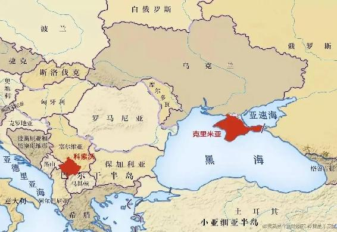

merge

# 000：战争转⼊下⼀个阶段！【有生力量，战争潜力】

（展麟解读：讲在国家生存结构中，俄乌通过战争的

方式解决争议，就是生存竞争最底层的冷峻，没有含情脉脉的装饰，只有生死存亡的博弈。在生存竞争中有生力量，战争潜力，后勤补给，才是影响生存竞争时长最有效的手段，你的有生力量越多，你的战争潜力越大，你的后勤补给也持久充足，你赢得生存竞争的机会也就越大，俄乌战争看似战争，其实更是一场生存竞争的生存博弈，是国家与国家的博弈，也是由个体组建而成更大共同体的博弈，同样拥有生命体的基本特征就是占据资源并维系自身的存续。对于个体而言，不管你是学什么技能，学什么手段，看什么书，都是为了让自己在个体生存结构中的求存方式中拥有更多的有生力量，斗争潜力，从而让自己真正赢得生存竞争胜利，不管是怎样优质睡眠，怎样养生，学营养学，学健身，学技能，学送礼，学为人处事，学两性关系等等，都是源于自己有更强大个体生存结构目标，完成自己精神结构升级，提升自己整体系统判断力，拥有更高层次的判断和决策，同时拥有一套变好的指导思想，继而持有更多的生存竞争中制胜的解决技巧）

正文

剧本还是老剧本，顿巴斯地区完全吃下已经铁板钉钉。

目前这个区域的兵力对比已经 3：1，而且后勤补给、空中支援、火力状况都略胜一筹。打下马里乌波尔之后，整个南线沿亚速海和黑海沿岸直通克里米亚的屏障赫尔松州就通了。

这也意味着南线的陆上补给线被打通。

后勤补给一直是这场战争中最突出的问题，事实上，

后勤补给会是任何战争的核心问题。切断了补给线就会后继无力。当年苏德战争在这一块的争夺中，德国之所以支撑不住反攻，而苏联在稳住之后还能百万大反攻。是因为苏联在这一块搞过基础设施建设，乌冬地区是工业区，工业区需要配套的基础设施，最核心的就是铁路网的建设。

铁路网的建设为快速输送兵员装备和物资提供了便

捷。这也是为什么我们需要修建通往边境的高铁和高速公路的缘故。中印对峙那会儿，有新闻报道，部署在东南沿海应对台海问题的集团军一天之内机动到新疆并被部署在边境上。它所传递的信息是不言而喻的。

哈尔科夫是东部的铁路网的枢纽，类似我们北方的郑

州和西部的兰州。接下来的主攻方向会是东部的哈尔科夫和顿巴斯地区，这里是铁路交通枢纽，攻下之后，可以启用铁路网来输送后勤物资。这比卡车的运输稳定，量也大，而且补给线不长，也更容易防止小股渗透对运输线的骚扰。

宣传上的那些东西不重要，重要的是兵线。后勤一直

是战争的核心问题，卡车运输效率不高，本身的消耗太大，补给线太远也就更脆弱。改变策略不是从这个时候开始的，而是从普京发表那篇小作文《接下来怎么办》的那一刻开始的。文中最核心的一句就是：我们不缺粮食，不缺资源，不缺能源! 小作文分析了自身和对方的优劣，并且据此展开了反击。这个反击首先是在经济上，其次才是战场策略方面。从那之后，开始打击基础设施，打击与战争潜力相关的一切目标。这个剧本最初的版本是 1996 年的第二次车臣战争：打掉所有与战争潜力有关的储备、资源和生产基地。放走平民之后用重火力清理建筑物，然后稳步推进。后勤补给的问题不仅仅是俄军的问题，对乌军而言更严重，因为它失去了制空权，主力不能离开城市，只能依托原有的工事和物资储备。

如此一来，不管是武器弹药还是兵员都是越打越少没法补充。

改变思路之后，俄内部的军工厂开始大量生产用于打

击的导弹。从那之后，导弹的使用量明显增多了，重型火力的使用也更加频繁。部署在顿巴斯北部哈尔科夫附近的乌军 81 空中突击旅就是这样被团灭的。乌冬地区部署了 10 个旅的主力，已经有 5 个被团灭了，其中战斗力最强的 53 机械化步兵旅就是亚速营，海军陆战队 36 旅的残部和 12 防卫旅的残部被消灭在马里乌波尔。

打下南线的马里乌波尔，同时用油气、粮食在经济上

对制裁进行反击，卢布与美元的汇率，从恐慌时代的 132：

1 涨到 88：1 了，等于回到了战前的汇率。欧盟迫于社会经济和民众生活的现实压力，态度有所松动，特别是德法已经没有刚开始那么狂热了。俄又刚刚发布了 13 万人的征兵令，虽然表示不会把这些人投入进去。但还是在这个节骨眼上做了个姿态。事实上，俄军真正有战斗力德是边境上的部队，而不是训练不足的御林军，目前开始换驻防南奥赛梯的边境军队进场，第六集团军因为打的不好被批评和整顿。

俄在形势有利于自身的时候，却主动宣布要减少对基

辅和苏梅方向的用兵，实际上，乌军也证明了，调整策略之后，这个方向的俄军更多的是采用远程火力在打击基辅，地面部队围而不攻。今天宣布减少这个方向的军事行动，本质上是为了收缩北部的后勤补给线，集中兵力于东部的哈尔科夫和顿巴斯方向，这里有铁路，而且距离后方补给点更近，这个方向的俄军开始启用老式武装专列而不是汽车来输送后勤物资。运输方式的改变和补给线的大幅缩短，将大幅改善后勤补给压力。然后就是逐步缠食东南各州，一边打一边谈，慢慢清扫。

斩首行动失败之后，基辅周边一直是围而不攻的态势，

攻击基辅是为了牵制其有生力量保护首都，不去增援东部和南部。之所以采取围城打援的战术，也是因为基辅是一个拥有 300 万人口的城市，除了拥有大量的平民之外，这里也是乌军三个重点部署点之一，乌军在基辅及其周边部署了：14 机械化步兵旅(已遭重创)、72 机械化步兵旅、近卫第 4 机动旅、第 10 山地突击旅、第 61 猎兵旅。可谓部署重兵于此，而且距离基辅不远的苏梅方向，苏军部署了第 92、93 机械化步兵旅(损失严重)、第 30 机械化旅、81 空中突击旅(已被团灭)、近卫第 3 机动旅、第 58 摩步旅、第 46 空中突击旅。

这是第二个重点布防的方向，与西边的基辅互成犄角。俄军在基辅外围部署的只有近卫坦克第 1 集团军，第 6 集团军，第 20 集团军所属的 5 个师又 6 个旅。这些兵力不足以去攻打一座大城市，何况近在咫尺的援军会进行支援。所以，做出攻击的姿态，牵制一大堆有生力量不使之南下，从而能够集中兵力先解决顿巴斯地区的乌军，同时集中兵力打通南部的烟海陆地后勤补合线。马里乌波尔攻下之后南线的陆地补给线就彻底打通了，而且处于安全状态，因为能威胁这条补给线的海上和陆地的控制权都在俄军手中。

第二阶段不再大开大合，而是步步为营。这个剧本就

是第二次车臣战争中格罗尼茨战役的剧本：缩短自己的补给线并让补给线的延伸处于己方的保护之下。然后摧毁对方的战争潜力，并占领交通枢纽，步步逼近，不断挤压有生力量的生存空间。

乌军在敖德萨还部署了几个旅的兵力，因为黑海舰队

做出了进攻敖德萨的姿态，而且占领赫尔松全境的俄军也做出了向西进攻奥德赛的态势，所以，敖德萨的驻军一直没有调走投入到其它战场。乌军唯一能够动用的后备力量就是乌西部边境上一个 4500 人的第 128 山地突击旅，但俄军不会去进攻那片区域。另外可以紧急动员的就只剩下直属于陆军总司令部的后备第 4 军，下辖 1 个坦克旅、2 个机械化旅和 1 个山地旅。这些预备力量都是临时新组建的，缺乏训练和战斗力。除了西部山区，乌克兰是大平原，在大平原上作战缺乏装甲力量和燃料的步兵无法形成真正的攻击力量。小股骚扰和攻击补给线的游击战更适合山区，而不适合大平原地区。前期俄军大开大合的时候有很多捡漏的机会，当收缩兵力控制补给线稳步推进的时候，效果就会大打折扣。在策略调整之后，俄军的目标侧重于消灭乌军的有生力量，同时破坏影响战争潜力的所有基础设施。当年的格罗尼茨战役中，强悍的车臣叛军和大量外国雇佣兵不断地损失掉军工厂、炼油厂、武器库、修理厂等各种影响战争潜力的设施之后，被步步为营的俄军不断压缩，然后派重兵占据枢纽，分割包围，逐步清理掉了。

最大限度发挥舆论战威力，需要在于一切都处于不清

晰的状态。一旦逐渐清晰，它的威力就会越来越弱。怎么让它变得清晰呢? 一个又一个被彻底控制的地区宣布独立就会让兵线变得非常清晰。打下马里乌波尔之后，顿巴斯地区一个被控制 93%的州宣布要举行加入俄联邦的公投这就是非常清晰的信号。另一个州被扫清之后也会发出类似的信号。

然后，赫尔松，扎波罗热等南部各州一旦被稳步推进所扫清，就会发出独立的信号。赫尔松州已经成立了管理民政的委员会，有成立独立共和国的趋势。不管如何宣传，当一个一个州都宣布独立的时候，所有人都会明白真实的局势变成了什么样子!

战争不会很快结束，而且战争拖下去对英美有利。等

把东部的有生力量全部报销之后，下一轮谈判会更容易快速找到共识。

# A645：被低估的拜登！【美国当下最佳求存之道】

（展麟解读：讲在国家生存结构中，美国的求存方式，

让所有人就觉得不可思议，全球的所有动荡，都是美国为了解决内部问题，而展现出来的手段，一次比一次狠毒，一次比一次血腥，不管是 2014 年在乌克兰搞的颜色革命，还是搞中国的华为，中国的芯片，还是允许欧洲的数字税等等这些动作，都是为了搞垮搞乱其他国家，其他地区的生存环境，让处于这个生存环境的人更加的恐惧更加的不安，没有稳定的政策，更没有靠谱的营商环境，从而让这个区域的人为了自己的安全考虑相互提防，最后放眼全球，只有美国的营商环境，生存环境是最好最稳定的，所以让有实力的企业，财团都投资美国，让美国恢复他的美国制造，从而解决美国内部不可逆转的劳动力无法转移的结构性扭曲，也是美国最佳的求存之道，就是让高薪产业，回归美国本土，为美国本土提供供应链，提供就业，再次从设计，科研，到生产，经营，流通强大美国制造。不管是川普还是拜登，都是让制造业回流美国，只不过川普用是商人的方式，拜登用是政客的方式，目的都是搞乱搞坏全球其他地区的制造业，让他们产生更加恐慌和不安的情绪，从而再次选址美国本土发展。商人的方式有底线，政客的方式没有底线，这是最近国家各方面越来越多冲突的原因，不管新疆棉花事件，还是华为事件，还是制裁 5 家中概股事件，都是搞乱全球的制造业的生存环境，这也是有效的制胜生存策略。对于个体而言，能够从搞乱生存环境的角度，让其他地方的生存环境更不适合生存，也是一种非常不错的制胜技巧。完成精神结构升级，完善整个判断力系统升级，让自己拥有更高维度的判断和决策能力，同时具备更多的制胜解决实际问题的技巧。未来是政客斗争时代，更加没有底线，只有生死的存活斗争，讲放弃更多以前坚守的基本原则，变得更加不讲信用）

正文

在长达几十年的冷战时代，两大阵营的人每天都需要直

面彻底毁灭的生死考验。那个环境所培养出来的人，往往能够抛开所有表层的装饰直击本质。他们对生存竞争的现实又理性的认识，让他们主动抛弃幻想并采取极度务实的态度去应对任何可能的危机。那种明枪暗箭的算计和恰到好处的妥协是一种深深地刻进骨子里的本能！

读过《A640：介入叙利亚战争并非虚荣心作祟！》、《A644：

收回克里米亚绝对是正确之举！》、《A639：普京不会崩溃！》和《A641：吹响了反攻的号角？！》你就会清晰的看到那种两害相权衡取其轻的务实和多维度下的最优选择。普京和拜登都是那个时代训练出来的政治人物，他们的基因里遗留着冷战时代的深刻络印，就如同三体中最理性且冷峻的执剑人！

所有的政治决策最核心的一点就是避免最坏的结果，同

时要有勇气《向正在坍塌的地方踹上一脚！》。与之同时，还遵循另外一个原则：任何决策都会产生严重后果，魔神皆以血饲，欲戴王冠必承其重！

今天的纷争再一次激活了彼此蕴藏在基因中的古老记

忆。这预示着一个温情脉脉的时代的结束，也昭示着一个血雨腥风的时代即将拉开帷幕。几年前在《向正在坍塌的地方踹上一脚！》一文中就预言了这个不可逆转的趋势：鱼离开了水就不再是鱼，再也回不到过去了…

潮流

因为冷战对决中，美国赢得太精彩，特别是海湾战争中，以不足 200 人的损失横扫号称全球第四的陆军，并让口碑和实力能与自己抗衡半个世纪的苏式装备在各国心中的信心一落千丈。正是此战之后，原苏联的加盟共和国争先恐后申请加入北约。美国几乎是在一种箪食壶浆以迎王师的状态下顺势接收了原苏联在东欧的全部势力范围。作为苏联继承者的俄罗斯不仅未曾强烈抗争，甚至也曾主动申请加入北约。

如此的战略大胜，让美国上上下下滋生出一种独步天下的感觉。放眼寰宇，在无对手。于是，熟谙冷战生存竞争思维和心态的政客不再吃香，近三十年来的美国政客清一色的由“硬汉“向”鲜肉“转变。因为冷战和海湾战争胜的太出彩，从而为美国的政客们营造出一种温室般的国际环境，不管怎么瞎搞，反正都是实力碾压，优势在我！于是，作为社会精英群体的目光开始从全世界收回来，更多的关注于国内，以及自我在选民心中的政治形象。

随着互联网的崛起，这一点就变得更加的突出。谁政治

主张正确，更善于讨好选民，言行举止更契合同样是温室中长大的这一代人的小确幸的喜好，谁就能获得空前的支持并成为网红时代最耀眼的明星！克林顿是这样，代表黑人的奥巴马更是这样，代表女性的希拉里也是这样，而这种潮流的巅峰代表人物应该是掌握了流量密码的川普，没有人比他更懂如何讲段子和吸引民众。

每一个时代都有它的潮流，这种潮流一旦起来，附着其

上的代表就会红得发紫，并迅速成为整个群体的代表。网红时代重要的是长得好看，或者善于调动大众的情绪！不仅民间如此，朝堂也是如此。不仅美国如此，欧洲更是如此。当今欧洲台上的政治人物基本上都属于网红特质的人物。在这次冲突中，乌克兰总统把这种网红特质发挥到了极致。

硬汉

虽然许多人把普京看成是硬汉。但绝大多数人看到的硬

汉是形象上的，这与奥巴马、克林顿、希拉里，甚至川普的网红性质是一回事。真正的硬汉不是形象上面的铁血柔情，而是思维上的极度务实和冷峻。读《A640：介入叙利亚战争并非虚荣心作祟！》和《A644：收回克里米亚绝对是正确之举！》才能理解这句话真正所指。

拜登在世人眼中是一个步履蹒跚的老朽，如同那个帝国

的形象一样。在深入研究之后才猛然发现：拜登和奥巴马虽然属于同一个阵营，却从来都不是同一个物种。奥巴马是温室中的鲜花，虽然讨喜，但也不过是网红与粉丝之间的关系。

他本身是没有力量的，甚至还不如川普有力量。这个力量是真正的力量，是残酷生存竞争中生命力的韧性。

在网红时代老牌政客拜登显得暗淡无光。就如同小米风

靡一时之时，最吸引人的不是它的手机，而是小米所提倡的互联网思维。曾经跟一位基金经理朋友争论，对方认为小米会把各行各业的细分市场全部横扫。我坚定的认为不会。因为我自己深入过供应链，知道真正的竞争门槛在什么地方，有些东西是绕不过去的：

《B1：去不掉的中间环节！》。然而，

在潮流起来的当时，人们会本能的忽视掉那些真正的底层逻辑和隐形门槛。这也是为什么拜登这样的冷战政客会在网红时代被低估和忽视的缘故！

2007 年已经 65 岁的拜登准备抓住青春的尾巴，参加总统竞选，当他发现对手是年轻帅气又擅于讨好选民的黑人奥巴马的时候，他不免有些嫉妒的哀叹：一个符合主流政治正确的黑人，聪明帅气口才一流，这简直是这个时代天生的主角呀！所以，他只能退出竞选并转而支持奥巴马。当选的奥巴马来到他家，邀请他出任副总统，拜登愤怒的爆了粗口：

你的意思是让我做一个妓女？！他的目标是总统，而不是一个任人摆布又毫无实权的配角。然而，奥巴马需要他在国会里 40 多年积攒下来的人脉，以及拜登平衡各种关系的天赋。

并且许诺自己干完，就全力支持他上台。于是，拜登接受了奥巴马的副总统的职位，并且开始帮他搞定，那些奥巴马搞不定的各种关系。有些东西是需要根基的，你即便能顺势风光一时，但缺乏根基就无法深入。这也是风光无限的奥巴马为什么来找一个 65 岁的拜登做搭档的缘故。

虽然拜登心中充满怨气，但他依然凭借丰富的经验和人

脉为奥巴马立下了汗马功劳。也是在这个时候开始，副总统的权力开始增加，而不仅仅是一个备胎。2008 年格鲁吉亚爆发危机，拜登代表美国与格鲁吉亚和俄军谈判。2010 年，拜登在国会里四处奔走，各种串联让奥巴马医保计划得以通过。2014 年策动了乌克兰的颜色革命，俄罗斯乘机收回克里米亚，拜登去东欧活动摆平事情。为什么这种事都是副总统拜登去搞定，因为拜登在世界各地都有人脉！拜登曾经以副总统的身份访问过中国，但他的访问是故地重游。因为中美最开始接触的 1979 年，拜登就是谈判团队的成员！按照我们的政治传统，这种人被称之为老朋友也不为过。其人脉之广泛，与各国交集之深，由此可见一斑。

1965 年，雪城大学法学院的一名研究生正在被老师训斥，因为他的论文直接抄袭了《福特姆法学评论》上的一篇文章。他极力争辩说自己是因为不知道引用规则，最终他不及格。这个人就是如今的美国总统小约瑟夫拜登！1987 年又在一次演讲中直接剽窃英国工党领袖的演讲稿，除了名字其它部分都抄了。他非常清楚为了达成自己的目标哪些可以投机取巧，哪些需要坚持底线。他并不是一个没有意志力的人，他从小口吃，硬生生的通过练习演讲矫正了过来。这样的人是可怕的！就如同重庆谈判的时候，蒋介石对身边的人说他的谈判对手（毛泽东）：我认识他好多年了，他从来都是烟不离手，这几天一根都没抽，这种人是很可怕的。拜登在求学的时候成绩一直是靠后的，而且非常靠后。属于倒数的那种水平。但他在竞选领导时表现的非常积极，而且当仁不让。拜登有一句名言：学位这种东西，重要的是得到而不是第几名！这恰恰揭示了他务实的人生态度，门槛在那里，能够用尽一切办法跨过去就行了，至于是不是落在最后面根本不重要，反正是在里面不是在外面，能进到门槛里面才是最重要的！

2020 年，川普代表着一股反潮流的叛逆，所有的主流政客都不敢与之挑战，77 岁高龄的拜登终于赢得了机会。他用尽所有的人脉和各种突破底线的手段最终以微弱的优势赢得了总统宝座。一个走路都摔倒的总统，一个高度分裂的社会，一个穷途末路的帝国，当世人对这一切冷嘲热讽的时候，拜登如同晚年的司马懿一样以老态龙钟的姿态，让世界再一次感受到被冷战支配的恐惧！

布局

在《向正在坍塌的地方踹上一脚！》一文中，已经用清

晰的逻辑阐述了美国社会无法持续的社会性结构扭曲。金融体系的全球收割模式虽然让华尔街挣的盆满钵满，但资金、技术、产业都在向全世界流失，但一个社会的劳动力是无法随便流动的。这就造成了产业加剧空心化。奥巴马在早两年的一次采访中承认，他在 09 年的时候就想挑起贸易冲突，但 08 年刚经历过金融危机，而且当时的兔子非常配合，主动为之泄洪。综合考虑经济复苏还要依仗兔子，他就手下留情了，这才让川普成为发动贸易冲突的那个人。这多多少少有点属于自我粉饰。曾经有许多投资人天真的认为拜登上台，川普所弄的一切都会被拜登拨乱反正。这种天真在我们的社会普遍存在，而且还是一些掌握着社会财富和资源的人。这就不得不让人担忧！

坦白讲，川普和拜登属于同一种人，虽然他们水火不容，属于不同阵营，代表不同群体。但他们都是那个时代训练出来的人。一个在商界一个在政界。不管在哪里，时代的烙印总是不可磨灭。所谓夏虫不足以语冰，他们都属于见过真正冬天的人，也知道如何在冬天中生存。他们都非常地冷峻和务实，并不在乎那些漂浮在表面上地装饰，直取最有利于生存竞争的核心内容。

从川普开始，美国就试图造成制造业回流。只不过川普

是用商人的方式，而拜登是用政客的方式。商人的方式是做交易，亏本的买卖不做，但商人是有底线的，也是遵循规则的，这个底线是他们在做生意的经验中形成的。川普虽然认为自己赢得了选举是被拜登的手段作假搞掉了。但是，商人的软弱性决定了他只会虚张声势，却不会越过卢比孔河！凯撒不是商人而是从事军政之人，所以他毫不犹豫地越过了卢比孔河向罗马进军。他此举突破了罗马立国以来的一个潜移默化的基本原则，罗马军团不能越过卢比孔河用暴力来解决罗马的内部问题。所以，当川普的支持者都自发组织民兵的时候，川普会主动选择打官司，当官司无望之后，他也只会指责彭斯，而没有选择鱼死网破的抗争。因为商人的思维是：

做生意有挣有赔，只要不掀桌子就能东山再起。但政客的思维则完全不同，他们更加的冷血也更会不管不顾，因为政治斗争往往关乎生死！

所以，与川普的思路不同，与其提供各种优惠条件，创

造环境哄着供应链和生产岗位回流。不如让他们争先恐后自己跑回来。如何让他们争先恐后跑来呢？让别的地方的更不适合生产经营，整体生产经营环境变得比美国还烂！2021 年 9 月，美国商务部以打击中国半导体为名，要求亚洲的主要半导体企业向美国提交客户数据、存量和销售数据等企业机密核心信息，否则就制裁它们。这就不是商业竞争了，而是直接用国家力量来硬的！随后又通过了《2022 美国竞争法案》，拨款 970 亿美元推动半导体供应链的本土化。与之同时，欧盟也推出了 430 亿欧元的芯片法案。中国也指定了半导体发展的宏伟计划。大家都在争夺高附加值的高端产业和高薪岗位的制高点。

然而，不管以新疆棉花为借口的产业链打击，还是以华

为为代表的各种制裁。东边都没能突破防线。辛辛苦苦搞了一年，依然没啥成效。包括在香港的布局都被反杀了。于是，重点转向西边。就在欧盟宣布自己宏大的半导体和数字产业的芯片法案不到 20 天。2022 年 2 月 24 日早上就发生了一件惊天大事！在此之前，俄罗斯主动撤军，依然无法缓和局势。

有一个未经多方证实的情报，也许几十年后解密了今天

各方决策过程的资料才能证实：鹰酱设计了一个局，故意让大毛获取一个情报。这个情报就是鹰酱授权北约支持演员进攻乌东地区，因为当时乌东两州确实快被部署在东乌的主力推平了，实控区域已经所剩无几，而且民间武装临时控制的哈尔科夫州又被夺了回去。所以，基辅在北约的支持下，一举荡平乌东两州未必不可能。情报还包括亚述营在推平乌东两周之后将会对俄语群众大开杀戒，从而通过人口结构的改变，一劳永逸的解决乌东问题。情报的内容除此之外，还包括更加重磅的内容：为了防止以上行动会招致俄军的干涉，北约答应最晚 5 月份之前在乌境内部署 4 个旅的机动兵力，其中两个信息化合成装甲旅，一个海军陆战旅和一个旅级单位的空军力量，其中部署的空军会携带战术核弹头。以此威慑并阻止俄军对行动的干涉。情报中包括北约授权二毛采取行动的时间定在 2 月 25 日。目前看来这个情报夹杂了真消息和假消息，但它有效的刺激到了大毛最害怕的事：战术核导弹距离莫斯科只有 5 分钟！于是，大毛在没有充分进行动员的情况下，决定先下手为强，提前一天采取了行动。这恰恰是鹰酱所要的！随后鹰酱以各种方式制造舆论刺激民众并怂恿欧洲采取全方面的制裁措施，但自己死活不下场！

这是一套组合拳，欧盟宏大的半导体和数字产业的计划

在炮响之后就彻底化为一纸空文了。在放出《向正在坍塌的地方踹上一脚！》的时候就说过，当鹰酱全面收缩之时，最核心的事就是敲碎全球各地潜在的竞争者。旧秩序的彻底崩溃从此时开始。美国不再需要与欧盟进行任何经济上的竞争，就已经取得了胜利。当时美国主动提出与欧洲统一数字关税，主动放弃自己的部分利益分化欧盟各国在发展独立的数字产业上的一致性立场就是为后续的组合拳布局。按照传统的国际税法，只有在本地注册经营生产的实体才需要交税，而数字产业的特点就是，不需要在使用的地区注册经营实体，却能够以信息流的方式为当地的用户提供服务并开展业务。

全世界的人都是数字科技企业的用户，但税只需要交给美国。

正因为如此，德法提出要搞自己的数字产业，目前全球成熟的数字产业就只有兔子和鹰酱拥有。兔子不是没打过，只是没能搞下来，最多也只能搞搞中概而已。欧盟则不同，他们还未成形又没有一个主体能统一步调。所以，拜登提出改规则，不管主体在哪里，只要在当地提供服务，就让出 15%的税给当地。结果欧洲许多国家都皆大欢喜，特别是那些自己没能力发展相关产业的小国尤其如此。也正因为这种干扰，欧洲的芯片法案拖到最近才通过。

接下来欧洲要遭受的可不仅仅是半导体和数字产业的

计划变成废纸，金融市场上的连带反应还在酝酿之中。欧洲在俄罗斯有大量的投资，而且俄罗斯的外债也主要是欧洲的债务，这些债务还只是第一波，在断绝经济往来和金融连接的时候，债务风险在金融市场上造成的缺口会衍生出叠加的风险，这些风险会在金融机构和银行之间相互传染，最终反应到金融市场上形成相互踩踏。不管是参与者出于风险对冲的需要还是出于避险的需要，总之，趋利避害的本能会驱使人的行为造成那样的市场效果。想一想早几天美国宣布要让 5 家中概退市，又未明言具体是哪 5 家，结果就造成整体的相互踩踏。这种相互踩踏传导到香港市场，继而拖累了大陆市场，效果已经看到了！

金融相关的打击才只是一个开始。它最多造成一些资金

从欧洲撤出跑到美国市场，或者英国市场，或者溢出一点到兔子的市场，如果兔子的市场稳定的话。拜登真正要打击的是欧洲这几十年积攒的汽车、化工、机械、新能源、电子等社会经济支持产业全部流向美国。从而让美国流失的工业链能够得以重建。加上美国本身已经成熟的投资和设计优势，即便不发生新的技术革命，也会重新获得活力并创造社会增量提供高薪就业岗位。这才是缓解现在社会撕裂的根本之法。

穷是万恶之源，不管是对个人还是对整个社会的主流人群都是如此!

要实现这一点就必须要让欧洲的整个生存和经营环境

彻底的恶化，而且不可逆转。想一想第二次世界大战，整个欧洲打的稀烂的时候，多少科学家和技术人员以及资金流行美国！然而，不仅华尔街不断给纳粹帝国提供资金，福特这样的美国企业也获得过纳粹帝国颁发的杰出服务勋章。从 1933 年到 1939 年短短六年时间，没有美国的支持，一个要啥缺啥，烂的像一团泥一样的德国还被凡尔赛条约绑住手脚，如何在这么短的时间内重新武装起来？要知道修建高速公路是超级花钱的，更别说建那么多兵工厂生产那么多飞机大炮，养那么多军队，钱从哪里来？！美国人当时要挑战英国的全球体系，借了德国人的手。

欧洲状态的恶化已经有目共睹了，26 号的时候提醒在德国的朋友多囤积一点粮食和食用油以及日常用品。他们当时觉得有点小题大做，只有一个女生去囤积了一个房间的日常用品。昨天反馈说，柏林的超市上周就空了。米已经涨到 60-70 人民币，食用油也是 70 多人民币一升了！比较有危机感的华人在当时都觉得没什么，单纯的本地人肯定更加不会觉得有什么。直到猛然发现汽油涨到 1160 美元一吨，柴油居然超过了汽油，超市里突然没有了物资，火车上的难民越来越多，他们才意识到问题的严重性，但是已经骑虎难下回不了头了。

欧元从 11 块多跌到了 6 块 9，资金的流失不仅开始，而且加剧了。一下子把所有制裁的手段都用干净了，把能够断绝的都彻底断了。除了金融危机之外，能源危机已经显现。

过去每天从俄罗斯进口 2 亿欧元的油气，现在同样的量需要花 5 亿多欧元。能源是工业社会一切生产生活的基础，它的成本提高会叠加在生产生活的每一个环节中，从而造成生产和交易成本的提高，可支配收入的减少，消费欲望的萎缩，以及因为成本问题造成停工停产，继而造成供应链的断裂，从而让整体的经济效率降低，综合交易成本持续升高。这些东西的叠加已经不可避免。更具石油危机的模型预估欧洲的 GDP 将会衰退 5%，而制造业的衰退将在 15%左右。

紧接着就是粮食危机和难民危机的冲击。已经抵达欧洲

的难民有 250 万，还有 200 万在去的路上，如果持续不断，估计会有 400 多万人涌入欧洲。而且难民将会对欧盟的财政和社会秩序造成长期的影响，这些影响都是纯粹的消耗，需要用钱去填补窟窿。乌克兰是欧洲粮仓，战争的冲突持续时间越长，造成人员的流离失所，就更别说粮食耕种了。到时候不仅无法向欧洲提供粮食，还需要调拨粮食来救济当地人。

粮食已经在涨了，小麦和玉米、大豆都首当其冲。

所有的这一切都最终要导向产业危机，让生产经营的环

境持续恶化，生产经营和融资成本持续升高，最终迫使他们向美国迁徙。欧洲在失去这些社会支撑产业之后加速印度化。

当然了，兔子也不会放过机会去承接一点。近期的中欧贸易协定谈判说不定会有不小的突破也说不定！

拜登一方面反复宣称不会派兵与大毛对抗，另一方面又

不断递送刀子，并搭建各种平台让演员到处露脸，拼命把他打造成一个流量明星，从而战事持续下去。拖的越久效果就越好！拜登早些天在国会演讲的时候信心满满的宣称：我们不会通过压低工资来解决美国的问题，我有一个更好的办法让美国获得成本优势，而不必降低工资。这意味着美国将提供更多的高薪岗位，也意味着这些产业将在美国被建立起来。

更多的基础设施和创新产品，商品流通的更快也更便宜。更多的工作机会，并且不依赖国外的供应链，而是在美国制造！

生存竞争的最高形态就是赶尽杀绝。那种直面生死的心

态和思考方式，既冷峻又理性，就如同三体中的章北海和罗辑。那张会让习惯了温室大棚和流量网红的一代人感到恐惧的大幕正在徐徐拉开：德国乘机宣布了重整军备的计划，而日本也在蠢蠢欲动试图重新武装。透过电视镜头可以清晰的看见，当德国总理在国会大厦宣布要重新武装德国的时候，所有人都站了起来掌声雷动。然而，如果有任何一个德国高官或者议员在 2 月 24 日之前胆敢提出重新武装德国的议题，一定会被看成新纳粹分子并自毁前程，甚至触发法律。经此一役，天下人人自危。许多曾经被看成基石的东西都将被彻底质疑。于是，基于安全考虑的防御措施会优先于综合效率成为所有事情的优先考虑因素。一个更加收紧控制，相互猜忌，彼此隔绝的艰难的时代将会到来…

# A645：舆论战很成功！【利用舆论的制胜技巧】

（展麟解读：讲在个体生存结构中，不管国家还是个体

都会利用舆论来为自己赢得生存竞争，从而达到自己的索取目的，也是男女关系，常常一方被另一方利用的关键，女人喜欢用指责的方式来获取男人的物质奖励或精神奖励，也可能通过哭闹的方式获得其他方式的奖励，这就是利用舆论最常见的一种手段。女人骂男人没有责任心，其实是想让男人对这个女人负责，父母骂子女不够孝顺就是利用舆论压力然后主动孝敬自己，老板骂员工不用心工作就是期待员工可以更加努力工作并拿出结果出来等等，生活太多利用道德绑架的方式，利用别人优点去道德绑架人家，通过舆论的方式让当事人压力巨大，然后满足索取者的要求，这是弱者的制胜技巧，强者也可以利用，每个人的利用方式不一样，都是一种生存策略，可以不去评判，但你必须能知道弱者常用的舆论制胜技巧。同时也要学会自己的分辨能力，自己是基于内心观念需要，还是基于理性判断需要。对个体而言，需要洞察弱者常用的舆论制胜技巧，同时能拥有破解弱者制胜技巧的解决方案，完成自己精神结构升级，完善自己整个判断力系统提升，让自己拥有更高层次的判断和决策，同时让自己具备更多制胜的应对方案和破解方案）

前言

安全是所有资源配置的第一驱动力，疫情让清水衙门变

成了炙手可热的部门。任何一种资源被广泛应用，就必然会形成社会权力体系中的一股势力。不管是个体之间的争吵，还是国家之间的舆论战，其关键都不在信息本身，而在于受众！原理都是一样的，在日常生活中许多老实人也频繁中招。

纹绳总从细处断，厄运总找苦命人。在此不做道德判断，只就事论事。

正文

鹰酱用了 20 年的时间和数万亿美元的消耗，最后把阿富汗搞的千疮百孔，并未能建立起任何新秩序。然而，在这二十年中，国内的军工复合体得到了巨大的发展。自古以来，安全永远是社会资源配置方式的第一主导力量。疫情带来的安全威胁就让属于清水衙门的卫生系统变成了炙手可热的强势部门。出于安全的考虑，这个领域的体系建设必然会加快速度并得到进一步的充实，作为应对公共安全威胁的执行部门，自然而然就会拥有了许多临机处置的权力。在结构学的基本原理中我们阐述过：任何资源一旦被公众广泛需要，围绕这种资源的应用就会进化出越来越繁杂的体系，继而吸引更多的人参与其中。如此一来，它就不仅仅是社会经济生活中的产业或公共事业，也会因为利益的捆绑自然而然地成为社会权力体系中一股独立的势力，由此构建起来的共同体也具有生命体结构的所有特征，譬如，扩展自身并占据更多的资源!

一旦具有生命体结构的共同体在社会权力体系中占据

更多的资源和话语权，在形成政策和法规之时，必然会趋于有利于自身占据更多资源的导向性。军工复合体在美国社会的权力体系中像滚雪球一样越滚越大，影响力和渗透力也就必然越来越强。由此就必然造成种具有明显导向性的特征：

将共同体所能支配的一切，都当作自身的工具，让工具的一切行为，都有利于自身占据更多资源。明朝的文官集团是这样，今天美国的军工复合体也是如此。昔日苏联的某股势力，以及今天伊朗的某个军事化组织皆是如此，不仅垄断社会权力的关键节点，也控制社会的核心资源。这是生命体结构的基本特征，覆盖其上的所有装饰都不足以影响这种更底层的运转逻辑。

在《A640：介入叙利亚战争并非虚荣心作祟!》《A639：

普京不会崩溃!》

《A644：收回克里米亚绝对是正确之举!》和

《A641：吹响了反攻的号角?!》一系列文章中已经深度剖析了更底层的运转脉络，许多决策都受制于更底层的逻辑，以及多维度的生存结构的制约。能够两害相权取其轻，避免最差的结果，并且有勇气《向正在坍塌的地方踹上一脚!》就已经是最佳的选择。

普罗大众习惯于以自我代入的方式去对复杂事物做出

判断，不会试图从中获得什么有益的教训：刷一千个短视频，时而热泪盈眶，时而义愤填膺，等情绪消散之后，似乎什么都不记得了，也什么都没有获得。唯一获得的不过是短暂高频的情绪共鸣，随后就是无穷无尽的空虚和浪费时间的懊悔. . 大多数人这样的状态决定了自身的处境，处境又决定了自己在面对许多问题时的立场和选择。弱者更容易同情弱者，是因为自我判断为弱者的人，也渴望被同情。

一对退休老夫妻，老头有退休金，老婆婆没有，老婆婆

很要强，就去找了一份大清早扫大街的临时工的工作。然而，她又起不来，就强迫老头每天早上起来扫大街. . 许多女生觉得这很浪漫。你去问这些人，如果互换一下还浪不浪漫? 如果真的互换角色，她们一定会破口大骂，上纲上线。这就是人的立场选择基于自我需要的缘故，人内心的某种需要恰恰源于对自我的判断! 自我判断为弱小和低价值的人，需要通过消耗别人来验证自己的重要性，而不相信自己本身就拥有某种不可替代的价值并值得被欣赏。

如果一个人不相信自己能够驾驭得住自己的生活，对与

人建立亲密关系充满恐惧和质疑。她内心最真实的需要是什么呢? 是退缩和逃避。只是迫于社会和周围环境的压力，不得不去尝试，但这种尝试从一开始就预设了立场和结果：不会有什么好结果，甚至会再一次失败，并遭受伤害! 它是不是事实并不重要，重要的是它是自己内心特别渴望的确定性答案。在这种确定性结论的指引下，自身的所有行为都不会具有建设性，而会以摧毁和放弃的方式来建立防御机制，以求掌握主动权并进退自如。在这样的状态下，一旦遇到挫折或者出现任何不如预期的状况。就更容易听得进去劝自己放弃的声音，并通过自我代入别人的描述和自我的想象，将困境和危险放大到无以复加的地步，从而给自己营造出一种氛围让自己的主动放弃变得理直气壮!

对于一个恐婚的人，应该劝对方不要尝试，并告诉她这

世间的俗人，配不上她的珍贵和独特；对一个挣不到钱的人，应该劝对方安贫乐道，并强调朴实和纯粹才重要。对于一个自我价值感非常低与周围人关系都很差的人，应该多跟对方讲“燕雀安知鸿鹊之志，天生我材必有用” ! 编织一个逻辑和事实都无懈可击的幻境，去欺骗别人的人都是些低段位的菜鸟。真正高段位的人不会干这种罔顾事实主动欺骗人的事，而是通过洞察别人内心最真实的需要和难以启齿的顾虑，然后以极其真诚的姿态和无比谦卑的言辞顺势推一把。

两个彻底缺乏信任的夫妻会为了日常任何一点小事都

形成越演越烈的冲突。那种莫名的仇恨，并不源自于对方触犯了自己的底线，或者对自己做了什么伤天害理的事。绝大多数情况下都只是日常生活中鸡毛蒜皮的小事，但这些小事所触发的感受，以及由这种感受泛滥开，所营造出来的终极暗黑情景，会让自己感到彻底的绝望和窒息。激烈的反应并不源自于那件小事，而源自于脑海中那个绝望情境带来的压迫感。似乎不用尽一切破坏力量就不足以打破那个终极绝望情境对自己的囚禁和压抑。所以，这无比深刻的怨恨和仇视就自然而然喷涌而出，以最能伤害对方的方式来表达自己的终极抗争。

不管是个体之间的争吵，还是国家之间的舆论战，其关

键都不在信息，而在于受众本身! 读过《X26：亲密关系中的精神控制!》的人应该有所理解。一个渣女总是能操控一个老实人，即便是外人看着都心疼，但那个老实人总是被渣女拿捏的死死的，被人榨干了骨头还亦步亦趋。之所以会这样，并不是渣女手段高明，而是老实人身上存在着一种自我囚禁的内在束缚。当一个女人指责一个男人不在乎自己的时候，她的内心非常清楚这个男人很在乎自己，否则，她根本就不会这样指责。因为真正不在乎这个女人的男人，即便是被她指责也完全不在乎。所以，这样的指责会毫无效果，也就无法达到下一步驱使对方按照自己的意愿满足自身某种诉求的目的。而且，对方的漠视和鄙夷，反而会让自己获取一种毫无价值和影响力的反馈。所以，绝对不会无的放矢，而是极度有针对性!当她无比确定这个男人很在乎自己的时候，她才会通过指责的方式，让对方陷入一种慌乱和愧疚之中，然后，对方就会急于证明自己是在乎的。如何证明呢? 接下来她就会提出某种诉求来让对方满足。对方如果没有满足就坐实她之前的指责，而一旦满足了她的诉求，也就达到了她指责对方的目的。

这种情况在日常生活中经常发生，许多老实人也经常中

招。纹绳总从细处断，厄运总找苦命人。人的生存策略各有不同，在此不做道德判断，只就事论事：它是如何发挥作用的呢?! 如果这个男人是一个很有责任心的人，女生通常会指责他没有担当；如果这个男人心地善良平时很照顾她，女生通常会指责他自私；如果这个男人能力很强，女生通常会指责他过于直男；如果这个男人很帅气，女生通常会指责他缺乏能力。同时会暗示或者明示自己周围的男人或者闺蜜的男人具有他所缺乏的优势。如此一来，那个男生的各种行为表面上看起来是在否定她的指控，并试图向她证明自己不是她说的那样不堪。事实上，他是在极力地向自己证明：一个有强烈责任心的男人，真正束缚其行为的恰恰就是责任心本身! 他会用尽全力去做到问心无愧，哪怕遭受巨大的损失，从而再次确认自己是有责任心的。恰是这种观念的束缚才是对方能够利用的关键所在!

读过《A650：无论如何都不能接受!》的人就会明白：

有的时候人捍卫某种立场并非是源于自己对立场背后的一切事实的深入了解和理性判断。而是源于自己内心深处的许多需要，以及那种能够给自己带来安全感和确定性的东西都建立在驱使自己选择某种立场的观念之上。有一个简单的方式可以分辨出自己对立场的选择是基于内心观念的需要，还是基于理性的判断：你认为某家公司的市值会一直上涨，它是基于内心的需要还是基于理性的判断呢? 这个公司的产值、盈利能力、市场占比、供需关系等各种基于事实逻辑的确定性因素能够勾勒出一个比较清晰的真正价值!

# A646：普京的危机！【帝国传承才是危机】

（展麟解读：讲在国家生存结构中，帝国的传承才是核

心危机，同样一个人的发展起来后传承才是核心危机，传承到位，百年基业千年家族，传承不到位，也是一代人的烟花，是灿烂也悲凉。从普京的视角去思考俄罗斯的传承，俄罗斯全面西化这边路是行不通的了，用几十年自毁前程如入西方得到残酷的教训，那么俄罗斯的何去何从又回来一百年前的共识，用列宁的指导思想去探索叶卡捷琳娜大帝的共同记忆，用战时经济方式，建造城市，改变生活，凝聚城市化的共同生活方式，同时守护这个城市文明中心理安全边界，替换进口，走自给自足的强大路线，独立自主的发展，这是俄罗斯的未来发展方向，同时也需要得到传承人的延续，才能继续大放异彩。同时中国的求存传承方式也是一样，继续发展城市化这套凝聚民众的共同生活方式，替换进口方式，开始内循环经济，同时启动战时经济体制，完成内部结构的正向良好循环。中俄有类似的发展方向，保持独立自主，守住国土的心理安全边界，打造一套完整战时经济体制并持续运转才能让社会立于不败之地。对于个体而言，同样需要打造一套属于个体，属于家族运转的战时独立运转机制，为应对未来可能面临的生存危机，疫情就给个体更好的启示，城市有其便利性，同样也有其脆弱性，完成精神结构层次升级，完善自身的整体判断力系统，让自己拥有更高维度的判断和决策，具备更多制胜的应对方案和破除方案）

正文

在《A639：普京不会崩溃！》一文中已经详细阐述了那些表层之下的东西。普京真正的危机不在当下，而在身后。

千言万语汇成一句话：他毕竟已经 70 了，退休甚至是去世也就是不远的将来必然会发生的事，等他不再掌舵之后，俄罗斯这艘船将会驶向何方？又能驶向何方？！

在回答这个问题之前，需要先回顾一下过去的二十年发

生的事。因为不管是一个国家还是一个人的现实处境和职业生涯都不是这一刻造成的。就如同疫情中许多人生活无以为继，也是一系列选择和许多无可奈何的无形约束共同作用的结果。棋盘上的局势，不是把棋子摆上去所呈现出来的，而是一步一步走到了现在这个样子。个人生活的状况也是如此！

苏联解体那会儿，人心思变，但乌合之众从来都不会理

性思考，往往会为了反对而反对，为了愤恨而发泄，哪怕是破罐子破摔也不管不顾，只要当下爽了就行。那个时候人们对苏联的讨厌驱使着大众否定和反对苏联的一切。在这样的氛围下，社会的主流观念转为全面西化，甚至从上到下都认为，只要全面西化就能马上过上好日子。苏联人甚至主动跑到美国驻莫斯科的大使馆中去告诉美国人克格勃在他们的使馆中安装了哪些监听设备。美国人表达了感谢，但他们表示自己不会做同样的事！

全面西化不仅仅是一种类似于叛逆的行为，也成了精英

阶层关于这个国家要往哪里去的新共识，而对于普通民众而言，那就是一种迅速获得幸福的捷径。任何反对的人和行为，甚至是想法都是自己的死敌。就这样，苏联庞大的公共资源被某些摇身一变的人都装进了自己的腰包。在休克疗法之下，国有资产的流失不仅越来越快，而且合情合理也合法。于是，这些人成了新时代的寡头。他们控制社会生活中所有的关键资源。从电视台、媒体网、报刊书籍，到石油能源和生活必需品。掌握资源的寡头为了自身的安全，通常与海外的势力相互勾结，同时又在内部开始染指权力。对他们而言，这是一种双重安全的保障，但对一个国家而言，经济命脉和权力节点掌握在买办手中，绝对是一条万劫不复的路，因为买办的两面性决定了他们天生缺乏独立性。

第一次格罗尼茨战役的惨败将全面西化和寡头社会的

恶果呈现在人们面前。普京临危受命的时候，寡头们公开嘲讽他，不过是另一个前台的提线木偶。这是可以理解的，就如同华尔街的某位大佬的一句名言：只要我掌握货币，我不在乎谁制定法律。当时俄国社会的 7 大寡头掌握的可不仅仅是货币，他们控制了那个社会的一切，同时还是俄国连接西方资源的通道。当时叶利钦下台的时候，他们真的打算自己到前台来接管权力。而且他们掌握媒体，可以决定你的公众形象，或者让你的声音发不出去。所以，普京在打赢第二次格罗尼茨战役之后，挟胜战之威，第一个搞的就是掌握媒体集团又公开表明要到前台接管权力的寡头。从此之后，普京用了两个任期的时间和各种形式的博弈，把几个寡头统统搞掉，然后把他们手上的那些关乎国计民生的核心资源全部国有化。而且在这个过程中，他习惯重用克格勃出身的人。那套机制和冷战时代训练的人在生存竞争的问题上更加的清醒也更加的忠诚。这种忠诚不是一个人的忠诚，更是对一种立场的忠诚，恰恰是后一种忠诚更让人放心。这就好比你的合伙人也想做成这件事，你就不需要去激励他，也不用担心别人把他挖走，他的自我选择会主动激励自己。

每一次动寡头都会招致西方的制裁，这是可以理解的。

譬如说，尤先科这个石油寡头的董事会里有超过一半的董事是西方的利益代表。当收回尤先科手中的油气股份的时候，西方的利益必然受损，哪怕是用交易的方式让对方出局也是不乐意的，因为没有人愿意放弃咬在嘴里的肥肉。当然了，制裁的时候肯定要扯一些高大上的理由。无非就是人权、自由诸如此类。但最终都会落在实实在在的利益上。内部行为为什么会引发外部的强烈干涉呢？因为内部势力和外部势力的利益紧紧捆绑在一起！所以，每一次损失别人的利益都必然遭受制裁。

搞掉寡头之后，俄罗斯的经济在西方制裁的情况下也曾

经保持过每年 7%的高速增长。再加上国际油价的上涨，国有化之后这些核心产业所产生的利润变成了财政收入。也就是在那个时候，普京开始建立一些社会福利制度。这种经济增长得益于寡头被收拾之后，释放出来的社会经济红利。这也是在两个任期结束之后继续留任的社会背景和民意基础。

当时全社会都滋生出一种要中兴的幻觉，认为这个势头会继续下去。所以，继任的梅德列夫其实是采取了比较开放的经济政策，这显然也是普京所认可的。

然而，08 年的经济危机造成的恶果在随后的几年中逐渐凸显出来。最大的恶果就是造成大量的中小企业的倒闭。这就不仅仅是经济问题了，也是社会就业问题和社会稳定的问题。因为这会造成社会资源的进一步集中，并且要与严厉打击的势力进行和解，这就等于在培育新的寡头。一收就死，一放就乱，这似乎不仅仅是俄罗斯社会独有的问题。这个困境必须要解决，否则就容易陷入一个死循环。

共识

除了经济方面的这种死循环的问题需要找到解决方案

之外。另外一个问题更加重要。那就是这个社会到底要往哪里去！这是一个把所有人聚集到一点之上的战略性方向问题。

我们在立国之初，经历过一边倒，到两个拳头打人，最后改革开放三个阶段。这些阶段都是根据内外形势进行的探索。

有得失，也有灾难。先不说那十年对普通人的生活和整个国家造成的深刻影响，就说最近这二十年，虽然整体是向上发展，但某些因为内外因素相互作用造成的失衡，不仅让跟不上节奏的普通人也是遭受巨大的影响，全社会居高不下的债务风险对于整个国家而言也是影响深远。所以，一个社会往哪个方向去这个战略性的问题，一旦出现问题，那就是天大的问题！

1917 年，列宁为俄罗斯社会将要向哪个方向发展提供了一套指导思想。它不是一套像大杂烩一样的微操指南，而是一套设计蓝图。先不去评价它，但不管怎么样，对于当年处于十字路口的俄国社会，它确实是一套让人耳目一新，并且极具美好想象力的方案。不要小看了这一点，人类就是因为能够相信现实中不存在的东西，并以此为牵引力，才能协同一致构建起一个更加智能，规模更大，协同性更好，控制的资源更多，也更加强大，并在生存竞争中拥有更大优势的共同体。

这种人类解放的宏大指引是跨越民族和宗教的蓝图，因

此，在这种指导思想的框架之下，不管是民族还是宗教都是临时性的东西，终究会消亡。因此，在构建未来的美好蓝图的时候，这些东西不仅不能被重视，甚至应该被舍弃。也正是在这种框架下，试图构建的是超越民族和宗教的共同体，因此可以把各种不同的人都包括进去。同时，也具备进攻式的扩张特征。事实上，高举自由民主旗帜的美国也是同样的叙事方式和社会架构。

这套东西最大的内生的缺陷就是：一切都建立在意识形

态之上，而意识形态又完全靠整个共同体的综合实力来支撑。

当运行成本超过共同体所能创造的增量之时，实力就会衰退，而实力的衰退必然会让意识形态这个将整个社会凝聚在一起的基座坍塌！基座一旦坍塌就必然四分五裂矛盾重重相互消耗无休无止…

所以，当实力不济整个社会处于防御阶段的时候，就必

然要抛弃这种框架，而向下去寻找那些更底层的支撑点。所以，当苏联解体几十年之后，末代沙皇和东正教被社会重新评价。这是一百年前能把他们的社会凝聚起来的支点。这也是我们的社会处于爬坡阶段时，以民族复兴为社会凝聚点的缘故。任何一个大国开启拥抱传统的行为都是为整个社会向下寻找一个能够重新凝聚社会绝大多社会成员的支撑点。

事实上，对于整个俄罗斯社会而言，有个核心问题又回

到了原点：1905 年的社会改革造成了内部的失序，而恰恰是这种内部的失序衍生出来的那些无法调和的矛盾，需要通过对外的冲突来转移出去。这也是促使其投入一战的内因。

然而，这个问题并没有得到解决反而恶化了。随后的整个苏联时期都是在为整个社会以什么方式凝聚起来并且要向哪里去提供一个探索的方向。当这种探索也失败了之后，这几十年从全面西化到全面对抗的转变，恰恰证明了另外一种尝试也行不通。于是，这个问题又回到了 100 年前的原点！

普京的偶像是叶卡捷琳娜大帝，而叶卡捷琳娜大帝的偶

像是近代俄罗斯的奠基者彼得大帝。彼得大帝将一个亚洲化的传统俄罗斯变成了一个西化的近代俄罗斯，叶卡捷琳娜在彼得大帝开创的基础上，一路扩张，特别是向南直抵黑海第聂伯河以东的土地以及克里米亚和敖德萨等地都被收入囊中成为俄罗斯的一部分。在她的统治下建造了 144 座城市，奠定了一个能够支撑各种方向的外部压力的帝国基本框架。

这应该也是俄罗斯民众心理的安全范围。就如同我们认为自然疆界之内的区域是保障我们这个文明延续下去的心理基础。为什么大家都不待见宋朝呢？其实宋朝的生活水平很高，社会管理也很精细。但是大家的心理总是感觉怪怪的。因为宋朝的收缩已经突破了这个文明的心理安全边界。昔日郭子仪的孙子坚守西域数十年，完全与内地的朝廷断绝，但是，满城白发兵依然在坚守。这就是这种文化在每一个人心中所确立的心理安全边界。就如同任何一个人不管有没有出息，都会觉得败掉祖业是一种内心无法接受的事。这就是某种文化为其所化之人在内心深处确立的边界。人往往会为了这种边界去抗争，而恰恰是那些会让人去抗争的东西能够从更底层把人凝聚起来！

叶卡捷琳娜大帝对俄罗斯最大的贡献还不是开拓土地，

而是建造城市，改变生活方式，城市是一种文明的代表。真正把人凝聚起来的是共同的生活方式。这也是为什么我们必须持续推进现代化生活和城市化进程的原因。一个文明赖以生存的核心区域决定了这个文明下，所有成员的心理安全边界。当这个文明无法向外扩展的时候，就会用尽一切力量守住心理安全边界之内的核心区域。

转向

经过金融核弹的制裁和打击，俄罗斯的失业率提高了，

日常生活所需的轻工业产品也涨价了，但食品还是基本稳定的。而政府最近还宣布要补贴食品生产保持物价稳定，并提高民众的福利。普京最近一直强调：俄罗斯不缺资源、粮食和保护自己的能力，并且决定独立自主的发展。许多行为看起来不可思议，因为这些行为与经济学教科书上的基本原则相违背，诸多政策不是导向开放，而是导向封闭。

经济危机特别是金融危机之所以能够给一个社会造成

巨大的破坏力，是因为市场各要素之间的你中有我，我中有你的杠杆叠加。就如同一条完整的供应链中，每一个环节都向自己的供应商赊账。因为是长期合作，这种模式不仅没有问题，而且还能以加杠杆的方式盘活整个链条的生产。否则，就如同一个队列中有一个人走不快被卡住了，整个队列就都走不快。让生产各要素加快流动，效率能够更好利用资源并创造整体的社会增量。

正常的情况下，市场经济在编织一张越来越大的社会分

工协作网络。这个分工协作的规模和调动的资源体量会突破国界和文化的界限，从而在更大的范围内构建起新的共同体。

任何一个共同体要能存续都依赖内部存在强有力的约束，以及能够源源不断产生能维系整体运转的增量。这恰恰是为什么经济发展势头好的时候大家都支持开放与合作，经济发展陷入停滞状态，各种矛盾就日益滋生的缘故。所有的冲突和撕裂，本质上都是为了拆解经济活动中的分工协作所编织起来的共同体。

然而，你如果去观察战争情况下各国的经济运转方式，

你就会发现一个非常有意思的现象：首先，要有足够的能力能控制这片区域，是真正的控制，而不是被渗透和架空的那种象征性控制，其次，这片区域中要能持续的生产出粮食并养活这个区域中的人，再次，就是这片区域拥有足够的资源，并且能够建立起满足民众生活所需的完整生产体系。这就是所谓的战争潜力！玩过帝国和星际争霸这类战略游戏的人一下子就能明白过来。

秦国当年东出受阻之后，就躲在函肴之险后面变法自强，依托关中平原的沃野千里猥琐发育，一点一点的灭掉了义渠部落，还向南吞并了巴蜀，把这些地方的生活方式都改成了郡县制下与咸阳别无二致的社会生活方式。所以，秦国的东出分为三部分，首先是裂变，其次是纵横，最后才是崛起。

裂变的关键不仅是商鞅变法，更是夺回河西之地。否则就无险可守，也无法作为一个整体存在下去。

俄罗斯能不能守住他们心理上的传统区域，关乎他们是

否能作为一个独立的文明存在下去的基础。可以肯定的说，普京并不具备，也绝无可能去复兴苏联。相反，他们真正追求的目标是守住叶卡捷琳娜大帝奠定的那个俄罗斯！它不仅是版图上的势力范围，更是这个独立文明所化之人内心俄罗斯的范围。恰恰是这一点，能成为向下找到的凝聚起这个社会的支撑点。

可以预见，接下来俄罗斯社会会不断强化这个共识，回

归它的传统，从民族主义中吸取力量。不仅在文化上，也在社会经济和产业方面：它首先会努力打造一个能独立运转的战时经济体系。推动的各种进口替代，反而会催生一堆解决日常生活所需的中小企业。而这些中小企业的增加不仅能解决就业问题，更能够成为一种摆脱对寡头依赖的社会基础。

那些关系到国计民生的核心资源及相关领域，不仅会继续国有化而且会强化这一点。中央集权的体系不仅不会削弱，反而会加强。只不过当下经济困难，需要临时下放一些权力，一旦度过最危险的阶段，普京一定会在自己离任之前收回这些权利。他这 20 年一直在收拾苏联解体之后俄罗斯全面西化所造成的恶果。俄罗斯的精英群体将不会再尝试这条路。

当整个世界原有的经济政治秩序崩溃之后，只有能够打造一套完整战时经济体制并能持续运转的社会才能立于不败之地。否则，就必须要依附于其它势力。而一个社会内部的稳定依赖于两点：1. 能够凝聚起全体成员的共同记忆，2. 一套在任何情况下都能有序运转下去的体系。

不管是大毛还是兔子，其实都面临同一个问题。

# A647：可怕的渗透！【做领导的渗透方式】

（展麟解读：讲组织生存结构中，最核心渗透的三个核

心关键点，第一是财权，第二个是人事权，第三个否决权，这是空降领导或者高层，需要抓住的核心关键点，让自己的权力传导体系是顺畅的，从而让自己的计划得以落实，这是领导者的思维，更是领导者核心，只要出现空降领导，有几类人是可以有机会突破的，一种是有能力迟迟没有升迁，一种是有能力但是没有背景的，都将是空降领导需要会启用，甚至纳入空降领导传导体系的人物，所以说任何变动是机会也是灾难，就看你处于那种位置，那种角色，能不能精准判断和决策自己当下的生存结构，从而做有利于自己的生存策略。在国家生存结构中，最核心渗透方式就是构建一个封闭的特权组织，独立于整个体系的秩序，成为整个体系秩序中异类，类似我们唐朝历史，藩镇割据就是封闭特权组织的存在，特权阶层对整个社会传导体系的渗透和拿捏，为日后的悲剧埋下伏笔，当下的国际社会渗透方式，就是民间所有的非政府组织，平时看起来没什么，但对社会和人群的渗透就是潜移默化和潜伏式的，为日后的冲突埋雷，所以接受别人帮助，日后就需要付出代价，最好的方式是原有组织对原有问题，需要进行一视同仁的改造是最彻底的改造，就跟我们振兴乡村和扶贫都是原有组织对原有问题的一视同仁的社会主统一改造，而不是接受国际非政府组织的帮助为日后埋下祸根。对于个体而言，掌握渗透方式，洞察任何组织的核心关键点，了解其渗透方式，你是拥有领导者思维的第一步，完成精神结构层次升级，完善自身的判断力系统，让自己拥有更高维度的判断和决策能力，同时让自己具备更多制胜的应付方案和破解方案）

正文

当一个组织空降了一位领导之后，这位空降者首先要做

的事就是建立起自己的权力传导体系。通常情况下，会去发掘某个有能力又有野心的新人，或者拉拢某个有一定能力但因为各种原因而无法升迁的人。再者就是用明升暗降的手法把当前占据关键岗位又不太愿意与自己一条心的人挪开。否则，一纸任命就形同废纸。

在这一系列的操作中，最核心的东西就是让愿意合作的

人占据组织中权力传导体系的关键节点，并且培育起后备势力准备接手。如此一来，整个组织就被控制住了。组织中最底层的普通人是靠规则去约束，但不占据传导体系的关键节点，这种规则就是挂在墙上的口号，而不能成为约束个体行为的规则。

由此看来，不管一个组织规模有多大，关键节点就那么

几个，占据了关键节点，权力的传导体系就顺畅了，整个组织也就能够按照内部的规则有序运转起来。统兵多多益善的韩信有句名言：我只需要十个得力的将军，就能有效控制百万大军。所以，任何组织中都只有三个核心权力：财政权、人事权和否决权！

财政权就是批准花钱的权力，有钱才能使鬼推磨，没钱

则寸步难行，有赏才有罚。我们党在革命初期，为什么要听共产国际的，而且他们瞎指挥我们都还不能反抗，甚至陈独秀作为创始人都一度为共产国际的瞎指挥背锅。之所以会这样是因为革命不是过家家，干什么都需要钱。当时的革命者还没有找到一条自力更生的路，还不能自己筹集经费，只能从共产国际融资，所以就只能听他的，哪怕他是瞎指挥你也得忍着。许多创业者也遭遇过一些不懂行的投资人瞎指挥的情况，在还未盈利之前，还不是要忍着，甚至替人背锅。

人事权就是用谁去占据组织中某个关键节点的决定权。

关键岗位就那么几个，决定用谁还是不用谁，就是人事权的核心内容。原则上是德才兼备，实在不行肯定是忠诚优先，然后配属一个业务能力强但背后没人的副手。虽然这些东西说出来有点龌龊，但任何一个组织的有序运转都是这么玩的，不这么搞还真的会玩不转。在用人的时候，越是公开公平透明到接近于理想状态的那种岗位就越不重要。如果螺丝和螺母可以随意都能拧上，这种绝对是批量生产的标准件，一点都不值钱。不管你认为是纳投名状也好，还是利益捆绑也好，总之，作为权力传导体系的关键节点，并且捆绑了太多的利益和特权，它就必然会存在明确的偏向性。

领导的核心是什么？无非就是出主意和用干部！用干部

就是人事权，而出主意就是对否决权的使用。不管是钱还是人都围绕做事去配置。所以，做什么事或者不做什么事，这种否决权，决定要不要用这笔钱和要不要用这些人。

阐述完这些常识性的东西之后，再进入本文的主题：组

织的渗透和社会的渗透。关于组织的渗透先从一个历史上的真实案例开始：南京解放前夕，国民党政府里有个负责向国军传达命令的部门，这个部门召开了一次紧急会议，主持会议的是管事的副局长，因为正局长是挂职常年不在岗。这位国军的副局长把部门所有的军官都召集起来开会，他站起来说的第一句话就是：同志们，我们中间出现了一个国民党的叛徒！要知道屋子里正在开会的所有人都是在国民政府上班的国军军官。可见这个部门已经被渗透到了什么程度！一个组织被渗透最开始肯定只是某个或者某几个关键节点，紧接着，被渗透的岗位可以利用岗位所拥有的特权开始拉拢、策反、威逼、感化其它关键节点的人，不管是处于被动还是主动，不管是先被动后主动，还是半推半就，总之，越来越多节点被感染，并且被逐步拉下水。最后，就是这个部门的正职不再是挂职，而由一个忠诚和干练的人来担任，他下达的任何命令都已经没有了传导体系。符合渗透方诉求的命令会被加速传达落实，不符合渗透方诉求的命令则会被截断、敷衍、篡改、拖延… 在任何组织中，一旦失去传导体系，就如同老虎被拔掉了牙，即便站在金字塔的塔尖，也只能按照对方的意愿妥协并逐渐沦为傀儡。

一个社会的渗透往往是从出现拥有特权的封闭性人群

开始的。当某个群体拥有能够不遵守整体秩序的权利，它就像人体中出现了一个肿瘤。这样的肿瘤越多、越大、越无法穿透，整个人体就会变得越来越虚弱。就如同一个虚弱的老人，更害怕折腾，也更容易妥协。

为什么在《C12：务必要振兴建设兵团！》中提出边疆地区的治理绝对不能按照书生之见培育一个特权阶层，而必须一视同仁的进行现代化社会改造。因为割肉喂狼和以身饲虎的行为，只会不断地刺激虎狼永无止境的欲望，让肌体中的肿瘤越长越大，也越来越多。

任何形式的社会渗透，首先都是极力去构建一个封闭的

堡垒。这个堡垒通过获得的特权阻断整体秩序向内部延伸。

也就是说，内部的一切外面都管不着。于是，这些封闭的堡垒就变成了整体秩序中的异类，成了某种意义上的国中之国。

如此一来，这些封闭堡垒就必然会用尽全力去获取更多的特权，从而在更大的范围内形成这种封闭堡垒，并进一步让外部的秩序无法穿透。这会形成一种循环叠加的效果，最终完全失控！

在唐王朝后期，藩镇割据就形成了这样的局面。整个社

会被这种封闭的堡垒割裂得支离破碎。从而唐王朝的朝廷无论对内对外都变得越发的无力。然而，这种软弱和无力以及整体秩序的破碎，只会形成越来越糟糕的局面，并且被内外的势力拿捏住，彻底沦为工具。

法国上次因为油价上涨 7 分就引发了黄马褂运动。直到想露脸的帅哥硬扛不下去选择了退缩，才息事宁人。这次上涨 7 毛都不止了，已经从 1 欧元涨到 2 欧元，翻倍了。类似黄马褂的抗议街头运动却没有遍布大街小巷！为什么法国人对上涨七分钱如此的敏感，而在油价比之前的上涨 10 倍之上却毫不在意了呢？显然当年的黄马褂运动与当年油价上涨 7 分钱关系并不大，而跟组织者的意愿和收到的指令息息相关。

法兰西与澳大利亚的数百亿欧元的潜艇合同被美国以

羞辱的方式撬了生意。骄傲的高卢雄鸡却在发泄一下情绪之后选择了忍耐。这就像电影《树先生》中王宝强的那句台词：

你平白无故占了我们家的地，好歹跟我说一声嘛…这种小心翼翼的抗议显得既卑微又无可奈何，而且根本就得不到对方一丁点的尊重。

马克龙早些天跟普京打电话，各种沟通和斡旋，虽然都

是场面上做个样子，并没有什么效果。但是，好歹也还是向美国人表达了占我们家的地好歹跟我说一声的这个诉求。只不过想表现出自己还有点面子，毕竟制裁造成的损失都是欧洲在承担后果，美国却袖手旁观。于是，他说了一句：普京和俄罗斯需要被尊重，通过沟通和协商解决问题。结果话才落音，后院起火，科西嘉岛就出现暴乱并且闹独立了。这个点踩得这么准，你说巧不巧。更巧的是，科西嘉一闹独立，法国政府马上就宣布冻结俄罗斯在法国机构账户中的资金 1500 亿欧元，以及俄罗斯人在法国价值 5 亿欧元的房地产。

想必要不了太久，科西嘉闹独立的事就会平息下去…

美国民主基金会每一年拨款培育了大量的 NGO（非政府）组织，这些平时看起来没什么的组织，对社会和人群的渗透是潜移默化的和潜伏式的。但他们对社会人群的组织和动员能力，以及在这个时代与媒体的熟练配合，再辅助于舆论上带节奏以及背后经济政治势力的配合，往往能达到意想不到的美妙效果。而且这种效果往往是那种权力体系下的政治人物承受不起的。于是，整个欧洲那些缺乏根基又被某种势力推向前台的网红式政客，一个个就如同傀儡。

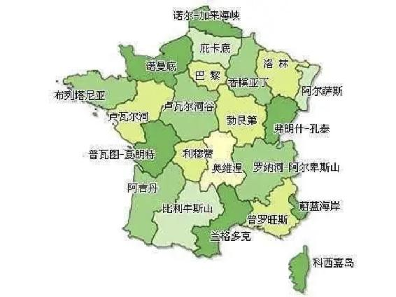（法国地图）

# A648：生死无常，一切皆虚幻！【整理失序才是个体真正灾难】

另一种标题：A648：生命无常，你是否也感到悲观?! （展麟解读：讲个体生存结构中，整体的失序才是真正

的灾难，突然的疫情，突然的战争，突然的天灾人祸就是一种整体的失序，这种失序，是普通人是没有办法承担的后果，必然导向个体奋斗无望，成长无望，这就是整体对个体最大的最残酷的打击，偶尔的升迁无望，偶尔的人情世故被穿小鞋，偶尔的冲突争吵都是表象的装饰，不起决定性作用，假如这家企业倒闭，假如这个供电系统倒闭，假如这个供水系统倒闭，假如这个供应链倒闭等等，才是真正的灾难，偶尔失意，偶尔得意，都是个体的自己添加的装饰。整体秩序不存在，个体将无比艰难，军队系统一样，都有其关键节点和战损比，超过这个比例这套系统就不存在，也就无从谈起给你输出持续的服务。对于个体而言，洞察系统的重要性和系统的脆弱性，是一个成人应该具备的精神层次，只求自己得失，自己欢乐都是小人得志，长久不了。完成精神结构升级，提升整体判断力系统，从而拥有更高层级的判断和决策，同时具备更长更远的制胜的应对之策和破解之策）

正文

在第二次世界大战中，美国海军的一艘舰艇遭受攻击，

其中有 5 个水手是亲兄弟，遭受团灭。从此之后，美国军方明确规定，有直系血亲的人不能在同一个单位服役。《拯救大兵瑞恩》中就是因为这个缘故才派出一支小分队去寻找瑞恩并把他带离战场。青少年时代看这部电影的时候感受到的是一腔热血，一种“唯有牺牲多壮志，敢叫日月换新天”的豪情。随着年龄的增长，在这份英雄豪情的背后，依稀能读懂更多的东西。譬如说，影片中那些非战斗场面的对话，往往更加的触动我的内心，让我明白真正的力量源自于为何二战，坚守和忍耐，甚至牺牲都是因为心底的那份记忆和美好。

那些美好，那些记忆如果不是透过生与死的战争，你或许察觉不到它的珍贵，因为它就是生活中的点点滴滴，就是亲人朋友之间日复一日的日常。我记得里面有个人说他妈妈每天都需要上夜班，回来之后本来应该抓紧时间睡觉，但他妈妈强打着精神不睡，就是为了能跟他说几句话，但是当时的他宁可装睡都不跟他妈妈说话。在他与战友们分享这些东西的那一刻，他的内心应该是后悔的，但一切都回不去了！

世事无常，你不知道什么时候会被封禁，也不知道什么

时候会被裁员，更不知道什么时候，你用尽全力想维持住的企业会经营不下去。你甚至不知道你坐的飞机会不会突然掉下去！人最恐惧的就是不确定，但这个时代又不得不面对越来越多的不确定，而且是那种你完全驾驭不了的不确定。譬如说突然爆发疫情，再譬如说突然爆发战争，又譬如说突然发生天灾人祸…

承平日久，人就越来越追求一些小确幸和能立刻带来感

官刺激的表层事物。人们会把支撑起当下生活的一切都看成理所当然。回到家里，按一下开关灯就亮了，扭开水龙头就一定会流出干净的水，丢到楼下的垃圾一定会定时有人收走。

渐渐的，会觉得这一切都是理所当然的，甚至有些无聊和乏味。得找点刺激性的乐子来抵御这种日复一日的无聊，譬如说以各种破坏性的方式对待自己的健康、亲密关系以及过于稳定的生活。人总是通过失去来感受到拥有，也总是通过苦难来感受到幸福！

1898 年米塞斯从那些天天打交道的数据上，看到了欧洲经济增长和放缓与社会和人口问题的结构性扭曲，从而对欧洲的未来感到忧心忡忡。这种经济增长的停滞和社会结构的变化所形成的内生矛盾，一定会外化为不同社会阶层和不同族群、宗教、国家之间的冲突。在那个时代，尼采提出了超人哲学，他认为过往的一切价值都需要被重新评估，并呼唤强有力的生命力。从另一个角度来说，一切价值的重新评估就意味着再也不存在确定性的东西，这种不确定的感觉会在人心之中引发更多的焦虑、愤怒、恐惧，继而催生更加偏执的主张和更加激进的行为…

一个月前，如果哪个德国政治人物提出德国应该重新武

装起来，一定会被当作新纳粹分子。然而，当下不安的紧张感瞬间改变了整个德国社会的观念和心态。当德国总理宣布要增加 1000 亿欧元的军费开支，重振德军的时候，下面的议员集体起来并热烈鼓掌。人们在平和的秩序中会推崇温文尔雅，而在动荡的不确定中，则更加推崇孔武有力。越是彻底破碎的社会，极端的思想、观念和行为就更加吸引人。

人类一直试图组织起来，应对自身所处的生存环境。但

是任何一种秩序的建立和维系都需要成本。当成本高到不足以支撑之时，秩序就会逐渐瓦解和坍塌。破坏性的行为将缺乏内在的约束力的制约。于是，潜移默化的规则被打破，长期坚守的原则被抛弃，一切都让位于当下最现实的需要。继而让相互支撑又相互约束的个体更加的互不信任，并争先恐后的突破各种约束的限制，以自我保护的姿态为自身谋求最大的利益。合作的基础从此瓦解，追求综合性的效率将让位于各自追求安全的需要…

一个体系的崩溃往往从悄无声息的地方开始。三年以来

各大航空公司的业务大幅缩水，设备是国有资产不能流失，但在现实的成本压力下，人员就是唯一能控制成本的地方。

不管是降薪、并岗还是向社会输送专业人才，这都是经营中的正常操作。然而，有些东西需要依赖整个体系的有效性，当体系中的某些密度降低到一个阈值之后，整个体系的稳定和有效性就会大打折扣。就拿航空来说，飞行员肯定是最重要的岗位，但地勤和相关辅助性的配套岗位就不会那么凸出。

恰恰是这种不够凸出的性质，更容易被忽视。然而，像航空这种极度依赖体系的服务，遵循着安全不可分割原则。整体有效的时候它才安全有效，不管是哪个环节因为各种现实考虑造成缺失，它都会让整体无效。剩下的其它环节，即便全部有效也没有意义了。根据最后的飞行轨迹，我们看到飞行员在用尽全力把飞机拉升，同时避开右边的那个城镇。

在悲剧出现之前，零零星星有一些没有造成人员伤亡的

失误和疏忽造成的小事故在日常运营中发生。因为没有造成人员伤亡也就没有传开，更不会引起世人的关注。收紧成本是正常的经营行为，也是应对当下行业现实状况的无奈之举，但一个体系的稳定性决定了有些成本是无法压缩的，有些岗位是无法合并的，有些冗余和繁琐的流程看起来不重要，甚至浪费成本，但在关键时刻往往是决定整体价值的开关。

看电影和电视剧，我们经常看到英雄人物高喊着要战至

一兵一足。真实的战争和真实的军队是不可能战到一兵一足的，越是现代这种体系对抗就越不可能。任何一支部队都有一个战损比，通常是 10%，15%已经是极限。美军手册如果能够坚持到 15%的战损才投降，不仅无罪还会受奖。因为战损达到这个临界点之后，组织起来的这个体系的稳定性和有效期就不存在了。这种时候如果强行对抗，很容易被对方打破相互支撑的平衡，继而内部失序，变成单方面的屠杀。

在纯粹为轻步兵的陆军中，因为党组织的存在，可以承受的战损比可以更高。但是，在需要各种装备协同的现代化合成作战单元中，一个独立的战斗单元就如同一个稳定有序的结构，依赖于关键支点的支撑，当支撑点的数量和质量少于最小的需要时，整个单元就无法形成战斗力。

体系的对抗和体系的有效性，以及安全的不可分割原则，提供了重新审视各要素价值的角度。同时也让许多事变得更加的缺乏回旋的余地。譬如说，打破一个支撑整体稳定的东西，就不仅仅是损失这一个节点，而是整个体系以及依赖于这个体系的稳定，附着其上的一切都会不存在！就好比这次美国冻结了俄罗斯在其金融体系中的外汇储备，你以为这仅仅是美国和俄罗斯之间的事吗？它摧毁了整个世界建立在这套体系之上的所有经济活动的基础。要知道，回到家按一下开关灯就亮了，打开水龙头就有水，而且能够以很低的成本使用水电。并不是因为你安装了节能灯泡和水龙头，而是存在一套成熟且稳定，综合成本还很低的城市供水体系和供电体系。当这套成熟、稳定且成本很低的体系不存在的时候，大家就需要自己购买发电机和柴油去发电，自己去井里排队打水，自己买水缸存储。那种情况下可别指望着能尽情的在浴室洗一个小时不出来。

从小受老爷子训练，造成了一种不太正常的心态和思维

方式：总是从最惨烈的生存竞争的状态下去看待一件事情的价值和有效性，总是想着为最糟糕的状况未雨绸缪。一个健壮的程序 70%的逻辑都是在处理各种可能的异常，只有 30%的逻辑在处理业务。我总是会想如果我明天突然死了，那些我在乎的人是否都已经安顿好，在没有我的情况下是否也能衣食无忧。如果还没有，这就是目标，应该围绕这个目标去做点什么。

人生无常，但真正的艰难和更大的无常都发端于秩序破

碎之后…

注：觉悟社里满足条件的人赶紧发私信拿 2022 年第一个正式的下注标的，觉悟社里已经发了消息，还没看到的这里也通知一下。赶紧的！

# A650：无论如何都不能接受！【你捍卫的立场就是深渊】

（展麟解读：讲在个体生存结构中，是人都有一个巨大

的观念盲区，就是你坚守的观念，你捍卫的规则，并不是你的当下生存环境最优的生存策略的捍卫，而是你捍卫的规则，你捍卫的立场，你捍卫的仪式能给你一种确定性的安全感，所以你用全力去守护和不断为自己的坚守支付成本，只是换取自我判断中卑微确定性的安全感，而不是当下最棒的生存方式。这是一个普通人观念盲区和行为盲区，更多的是同为普通人，大家都认为这种观念和行为没有错，因为大家都是这么做的，不会自我觉得有啥不妥；同时拥有资源人的观念和行为盲区，有资源的人别人有求于你，自然更能忍受你的一切缺点，而不会给你改正的机会，你只会感觉自我良好，以前都这样，现在为啥就不行了。观念带来的冲突，跟你认为来带的冲突，跟你获取确定性安全感带来的冲突，是你不能接受的，这是你必须不能接受的，因为这种冲突后重新建立起来的规则，让你没底，也就没了确定性的安全感和你无法估计成本支付预算，你就绝对反抗，绝对的不能接受，也是不可以调和的，这是没资源人的死穴，也是有资源人的死穴，有时候你捍卫的立场，规则，仪式，就是你一生最大的陷阱，你还义无反顾往下跳。对于个体而言，完成自己精神结构升级，需要用理性和感性的角度去看待自己捍卫立场的两面性，只有不是当下最合适的求存策略，就带有一些历史惯性，从而让你蒙在鼓里，永无出头之日，提升自己整体判断力系统，让自己拥有更高层次的判断和决策，从而拥有多当下制胜的应对方案和破解方案）

司令解读：读过《A650：无论如何都不能接受!》的人就会明白：有的时候人捍卫某种立场并非是源于自己对立场背后的一切事实的深入了解和理性判断。而是源于自己内心深处的许多需要，以及那种能够给自己带来安全感和确定性的东西都建立在驱使自己选择某种立场的观念之上。有一个简单的方式可以分辨出自己对立场的选择是基于内心观念的需要，还是基于理性的判断：你认为某家公司的市值会一直上涨，它是基于内心的需要还是基于理性的判断呢? 这个公司的产值、盈利能力、市场占比、供需关系等各种基于事实逻辑的确定性因素能够勾勒出一个比较清晰的真正价值! 正文

在任何生存竞争中，真正的赢是最终能求得存在和延续

的结果，而不是争一时之强。大家都喜欢项羽，而讨厌刘邦。

但这个国家的主体民族是以刘邦的国号命名的。刘邦最终代表着存续、荣耀、富强和文明，而项羽则代表着幼稚、残暴和绚丽之后的消亡…

在我的少年时代有两首歌留给我的印象最深。一首是

《滚滚长江东逝水》，另一首就是《我的中国心》。一切英雄豪情和丰功伟业都终究会消亡于历史的长河之中，但与之同时，也能从这历史的长河中感受到那些沉淀和传承。我们所有人的启蒙教育，都是从父辈给我们讲述祖先的故事开始的。

于是，我们能够穿透时空与千百年前的人产生共鸣。看到山川河流的时候，眼中看到的就不仅仅是风景，还有那些从历史长河的上游漂来的古老纷争和艰难抉择。不管是辉煌还是苦难，不管是荣耀还是屈辱，我们都能够感同身受，并且在自己面临抉择的时候潜移默化地以过往为参照。当我们知道了一切都将消逝，所以传承就是永恒。于是，我们的幸福并不依赖神灵的馈赠，却以孜孜不倦地以追求传承的方式去追求永恒！

在我的青少年时代，国门打开不久。美国人赢得了冷战

的胜利，那种胜利有点让人眩目。当美国人学着它的表兄的样子以唯我独尊的胜利者姿态肆意鞭笞天下的时候，开了眼界的社会精英们反而会诚心的认为：雷霆雨露皆是恩典！这不怪他们，当年的我也曾经幼稚过。那是一个时代的记忆，一种生存环境对置身其中的人进行的潜移默化的雕塑。那个时代我也曾经跟老爷子激辩过，老爷子认为有些东西在底层是不会改变的。他的原话叫：狗改不了吃屎的本性，丰收的年景一个过路的陌生人都会热情的招待，遭灾的年景，亲兄弟都会像防贼一样防着。我不懂你讲的那些什么天赋人权，自由民主，三权分立，但我知道人总是一样的！不管是什么社会，只要是由人组成的社会，由人搭建起来的规则，始终都会建立在人性的基础上！科学技术那些东西是可以学会的，我不会用电脑，但你学会了，对吧？这才多少年。等到你儿子那一代的时候，美国年轻人会的东西他也会，你信不信？

一个人有钱的时候，对谁都客气，对谁都大方，大家也都说他这人好。一个没有钱的人，他就算穷大方，也大方不了几次，对不对？所以，我们做人不是要去学别人阔气的样子，而是要去学人家是如何变得阔气的那个过程。那美国人是靠你讲的这些虚头巴脑的东西变得阔气的吗？我虽然没啥文化，但我晓得他们把人家印第安人都搞死了，还抢了人家的地。你以前不是说他们这套东西是跟一个叫雅…雅什么典的国家学的，那国家二千多年前就搞这一套了，如果真的是灵丹妙药，那么早就搞这一套，那…那现在还不是世界第一呀！

搞得徒子徒孙变第一，自己反而不咋地，我都不知道它叫啥名。

老爷子没啥文化，但对有些事的看法却更加接近本质。

随着时间的推移，事实越来越证明他是对的！仓禀实而后知荣辱，衣食足而后知礼仪。由人构建起来的社会，不管如何混搭，但构建起来的砖瓦始终是人。所以，人的底色决定了构建起来的这些上层建筑的本质。于是，这就回到了原点：

生命体结构的基本属性是什么？生命体之间为什么要进行生存竞争？

人类的宗教本质上是一种社会化的组织方式，古今中外，以宗教之名试图夺取社会权力的案例不绝于史。信仰和神灵则是人的某种共同诉求的抽象表达。不管是祈求安全还是祈求幸福或者祈求五谷丰登和风调雨顺，终究是人在无力应对自身所处生存环境时的一种共同诉求的抽象表达。在这样的一种关系中，如果神不能代表人的意志，它将会因为缺乏受众而无法被感知，没有人建立教堂庙宇，没有人编撰经文和典籍，没有人通过举行仪式和行为规范来彰显神圣，也没有与之相关的任何痕迹，总之，它无法被人类社会感知，也就在人类社会不存在。一旦这些东西都存在并且代表着人的诉求和意志，那么，它就必然变成了人的傀儡，它所彰显出来的一切都是按照人的意志彰显出来的！

在《我的中国心》里面有句歌词我特别喜欢：洋装虽然

穿在身，我心依然是中国心！这并不是要渲染什么不忘本的民族情绪，而是它凸显了一个跨越不了的基本事实：当你学一门外语的时候，随着你的深入，你就越能发现那些无法跨越的裂痕，那是一种像东非大裂谷一样的底层裂痕。一个族群最初的生存方式决定了它的走势，就如河水顺着河流的蜿蜒曲折进行流淌一样。

不管是苏联还是美利坚，它们本质上都是通过架空历史，建立在一种意识形态之上的共同体。它的好处就是可以无限扩展，不管你是什么族群，什么生活方式，什么人种，只要以这套意识形态为标准接口，就能与这个平台上进行对接。

并不是因为我以此与这个平台对接了，我作为人的诉求就消失了，那些被生命体结构的基本属性所驱动的一切，以及由此形成的生存竞争，并不会立刻就消逝。群体之间的这种冲突同样不会消失，如何解决这个问题呢？通常我们会把这些冲突称之为内部矛盾，通过共同体内部强有力的约束和内部利益的转移支付来平衡。不管是哪一种，都需要持续消耗共同体的资源和能量。

当这个共同体能够持续创造增量的时候，意识形态的号

召力就会很大。因为它符合普通人习惯性把复杂事物归因到简单因素的这种思维特征。与之同时，意识形态所营造出来的一种无边无际的扩展性，让普通人获得一种虚幻的归属感和力量感。这就好比你是市长的司机，当你去到一个下属单位传话的时候，别人会把你当回事。并不是因为你具有被人当回事的社会价值和能力，而是因为你被归属到一种社会权力之中去了。他们并不是在尊重你，甚至都不是在尊重市长，而是在尊重那种社会权力。那你作为一个普通的司机，能够获得一种如此具有象征意义的归属感和力量感，虽然是虚幻的，但也很满足，甚至足以让同类羡慕不已。

当一个人取得社会成就，甚至就是单纯的挣到钱的时候，我们会习惯性的去夸这个的道德如何高尚，人多么的纯粹，人品是多么的让人仰望。怎么说呢，这其实是一种非常扯淡的行为。乔布斯的天才能力并不改变他极度刻薄寡恩和缺乏安全感的性格。这种东西是成长环境雕塑而成的，可以缓解却很难彻底改变。特别是人拥有了一定资源之后，更加没有改变的驱动力，因为周围的人出于利益的考虑，往往会选择忍受下来。如此一来，当事人甚至都察觉不到自己存在这方面的性格问题，更别说去矫正和改变了！

个体是如此，共同体也是如此。一个共同体的意识形态

就如同个体的道德和性格。绝大多数情况下，它所代表的价值观之所以拥有号召力，主要源于它所彰显出来的力量（创造增量的力量）。苏联强大的时候，苏联的意识形态能够在全世界范围内鼓舞人心，而当它衰退和崩溃的时候，它就会遭受包括自己人在内的彻底质疑。事实上，美国也会如此！

灯塔的黯淡乃至熄灭只与燃料供给不上了有关，各种内部的撕裂和冲突也是如此。这就像当年老爷子说的：丰收的年景，路过的陌生人都会被好好招待，遭灾的年景，亲兄弟相互之间都会像防贼一样。

古往今来，一个王朝的兴起总是从一群务实的赳赳武夫

开始。而一个王朝的崩溃，留下的却是一些受这种价值观深度影响的知识分子痛哭的背影。有的时候人捍卫一种立场，并不是真的认可自己所捍卫的立场，而是因为这种立场代表着一种价值观，而这种价值观曾经给自己带来过虚幻的归属感和力量感，甚至是一种高人一等的优越感！所以，才会用尽全力去捍卫它。哪怕那些宣扬这些东西的主体和当事人都早已经放弃，并不断地用行动戳破自己吹起来的那些玫瑰色泡泡。

许多从农村考入城市的学子在还未能在大城市立足之

前，会用尽全力捍卫乡村各种美好的立场。并不是因为这些人真的认同自己坚守的这种立场，如果真的认可，就不会离开农村，而会选择留下建设自己的美丽家乡。之所以捍卫这种立场主要是支撑起自己内心安全和尊严的归属感还依赖于这种立场。与其说在捍卫这种立场不如说是在捍卫自己的尊严。同样的道理，许多人选择无条件支持二毛的立场并非源于自己对二毛家的历史演变，社会问题，甚至是文化和生活方式有多少了解，主要是在捍卫一种价值观，这种价值观曾经在自己成长过程中被投射了各种美好的期待，否定它会让自己陷入一种缺乏精神支持的空心化。虽然，当年将这种价值观一点一滴渗透给自己的那个主体在不断用实际行动破坏掉自己所宣扬的一切。但是，自己依然不能接受这个事实。就如同你不能接受从小到大一直看不起的某个人，混的越来越好，而你在外面漂泊了许多年却一事无成。你无论如何都不能否定自己的前半生，不能承认自己的一腔热情追逐的是一片虚空的幻境，甚至冒出质疑的想法都接受不了！

注：觉悟社里满足条件的人赶紧发私信拿 2022 年第一个正式的下注标的，觉悟社里已发消息好几天，已抵达第一个阻力点，还没看到的人，这里最后通知一下！

# 000：俄乌战争中造成的短缺【人类危机底层需求是粮食】

（展麟解读：讲在国家生存结构中，任何繁荣背后的某

种技术的过度推广都是假象，应对危机的本色才是真相，战争危机，疫情危机，自然灾害危机，人活下去还是需要最基础的条件，那就是粮食和粮食生产，还有就是现在化农业的化石农业，没有化石能源的参与，农业就会减产，粮食收成就会降低，就会影响人的温饱，温饱就是生死，这才是就底层的核心求存，其他装饰的东西，富足的时候觉得不可以缺，危机的时候很多装饰都可以去除，只留下活下去必需品就可以。对于个体而言，需要完成精神结构升级，提升自己整体判断力，让自己拥有更高的判断和决策，从而能洞察人活下，共同体活下去最底层的需求，揭开装饰的面纱，让自己拥有更多的制胜的应对方案和破解方案）

正文

中概的这一波攻击还有 1000 亿的缺口需要填。攻击还会继续，攻击的结果就是造成 H 市场的流动性不足，然后拖累国内市场。国家队不会放任不管，因为这是非市场行为的金融战的手段之一。但是，也需要等待时机，因为敞口太大看加起来的资金量太高。一旦重兵投入攻打坚城，容易被声东击西反向包围。所以，国家队会等待时机才出手!

接下来芯片短缺会影响和拖累各行各业，因为芯片制造

的一种核心原材料主要由乌克兰生产，占比高达 40%以上。

它是在光刻时形成光束用的原材料，没有这玩意有光刻机也没法生产。这个产业集中的地方目前不是被俄军占领就是出于交战区之中无法生产。而且二毛家的领海和领空都被封锁了，也没法出口。

粮食和与粮食生产息息相关的化工产业会成为下一步

影响国际粮食生产和供应的瓶颈。已经小小的反应一波了，但真正的还未开始。二毛家不仅是欧洲的粮仓，更是许多农业生产所需原材料的生产基地，因为现代农业本质上是化石农业。当年朝鲜的十年苦难行军，本质上就是完整的现代化石油化工农业生产因为苏联的消失，失去了原材料的廉价供应，最终造成粮食大量减产! 近期有所恢复是因为兔子用得着，允许他们出口铜和煤炭，换取外汇购买石化原材料。与之同时，在过去的几十年里，朝鲜自己也做了调整，结合实际切换模式，降低对化石农业生产的高度依赖，恢复一部分现有条件下的生产。同时也被允许从兔子家进口一部分。

大毛与二毛的谈判是权宜之计，没有消灭有生力量之前，无法真正的落实。所以，当下期望通过局势缓和来持续反弹的期望不太切实际。加息不如预期的恐惧会怂恿鹰酱继续搞各种招数制造动荡。与之同时，兔子必然要进一步宽松，增加自身的流动性。就业问题会更加突出，第一个季度的社会融资不及预期，说明经济形势严峻，务必规避高估值的东西。

# 000：再也不会有凤凰男的问题了！【阶层固化的周期即将到来】

（展麟解读：讲在个体生存结构中，个体的命运受国家

生存结构命运的绝对影响，整体秩序存在并还有些混乱的时候，个体的命运就有向上发展的可能，也就是升级阶层的可能，当整体秩序存在并稳定的时候，个体的命运就锁死在那个原本的阶层，更多的传承祖辈父辈的奋斗路径，再也没有向上突破的可能。今天美国的年轻一代，就是处于国家整体秩序存在并稳定的周期，所以这代美国人锁死在固定阶层，只能通过追求同类的差异化，来突出自己，彰显自己，这就是未来我们中国年轻一代需要走的路，讲究所谓的精致和情趣，精致和情趣都是温饱上面的装饰，用来凸显个体差异化的东西，同质化的个体需要用这种差异化来确认自己比同类更优秀一点，其实都是同一区间，同一阶层，再更长远的时间周期这些比较的精致和情趣毫无意义，但是现在的美国年轻一代人且无比的追求和自我满足，这是能彰显自己同类生存竞争胜利的一点点差别。对于个体而言，需要完成精神结构升级，能够洞察时代周期，国家生存结构周期中的向上突破的可能，让自己拥有完整的系统的判断力，从而让自己保持一直在核心点奋斗，最后完成阶层的升级，同时拥有更高层次的判断和决策能力，让自己当下的生活有更多应对之策和破解方案）

正文

你是不是在平日里习惯于跟别人讲道理，明明什么道理

都讲不通，但你还是乐此不倦。当别人反对的观点，并且你也无法说服别人的时候，你是否会气急败坏，甚至滋生出莫名的仇恨？

这种状况在生活中比比皆是。甚至在任何形式的关系中

也不可避免。许多家庭中亲子之间是完全无法沟通的，彼此都小心翼翼又互不信任。如果对方表达不同的意见就会被看成是对自己的挑衅和彻底否认。不能被拒绝，更不能被忽视和否认。于是，就只能以其他的方式迫使对方屈服和认可。

这种状况只能维系表面上的一致性，而无法做到背靠背的信任。无法沟通的结果最终就变成了沉默！彻底的沉默也就意味着彻底的不信任和彻底的疏远…

有一个女生发了一篇帖子说她一直忙工作，后来年纪大

了，迫于压力就急忙相亲找了一个各方面都还不错的人结婚。

结婚十年还有了一个女儿，但她从来就没有爱过自己的老公，也感觉不到老公对自己的爱。日子就这样日复一日的过着。

虽然生活并不匮乏，老公也蛮有责任心，对家里和小孩也比较负责任。但是，她依然有一种慢性自杀的窒息感和麻木感…

这个帖子引发了强烈的反响。许多在婚姻中痛苦挣扎的

女性觉得她的表述引发了自己的共鸣。其中绝大多数人还不是被迫相亲，而是主动恋爱才结婚的女性。她们认为自己曾经所憧憬的一切都在岁月的琐碎中被消耗殆尽，亲密关系中再也没有任何养分，最终沦为了彻底的沉默…

出轨这种事以前是男性的专利。不过随着时代的变迁，

女性的后来居上呈现出越来越猛的势头。许多置身于婚姻中的女性，因为在婚姻中感受到窒息般的枯萎，所以开始转向婚姻之外寻找各种被爱的感觉。婚姻对于她们而已，唯一的价值就变成了保障生活品质的工具。

曾经在徒步的时候听领队说起他自己的一段经历：他以

前在徒步的时候认识一个女的，因为他是队长，长得也还行，在照顾队员的过程中就跟那个女的混得比较熟悉，一来二去就跟那个女的勾搭上了。当他知道那个女的不仅有老公还有两个孩子之后，感到非常惊讶。但那个女的反而镇定自若甚至毫不在意，觉得理所当然。那个女的告诉他，她一点都不爱她老公，结婚之后她老公在东莞开厂，对自己不闻不问，也没啥情趣，还大男子主义严重。越到后来她就越讨厌他，看他哪里都不顺眼：嫌弃他说话声音大，嫌弃他穿衣没品位，嫌弃他长得丑还没情趣，越来越不想理睬他，不想跟他说话…

如果说他觉得自己如何有魅力足以吸引少妇存在吹牛

逼的成分，但是他转述的那些嫌弃和抱怨应该是八九不离十的！社会上一直流传着一个这样的论调：中国男人配不上中国女人。很显然，这种话肯定是中国女人说出来的。之所以会在女性群体中引发共鸣，可能是源于女性的某种共同需求没有得到满足。按照同样的句式和内心诉求，这句话也可以说成：中国父母配不上中国儿女。想必这也会在许多人心中引发强烈的共鸣！

总的来说，这是大时代发生切换的周期中，角色和预期

的不匹配造成的落差。在一个平顺的周期中，整个社会的工业化和城市化充分实现之后。社会上绝大多数人一辈子都只是重复父辈甚至祖辈的人人生轨迹。无法往上突破，也比较难向下坠落。于是，社会的主流群体毕生的时间、精力和关注点都集中在对生活细节的细微差异化追求上，这也就是所谓的精致和情趣。

如此一来，内心的各种细微感受都能得到对方的回应。

因为对方也处于同样的状态，关注同样的东西，把时间精力和生活的重心都放在同样的节点上。因为除此之外也没有别的地方可以投射！你到街头去问这一代普通的美国人，你拿出地图他们都指不出新疆和西藏在图上的什么地方。因为他们的生活不需要知道这些，他们整个生命周期中所需的一切，以及所能做的一切其实早就被固定在一个隐性且平顺的轨道之中了。即便再用力挣扎结果也一样。于是，他们更加关注自我当下的满足，并且在同类之中通过追求细微的差异来彰显自己的不同。从更宽广的视野来看这种拼命营造的差异性毫无意义。然而，这对于当事人来说，这点细微的差异性不仅是自身的与众不同，还是优越感和独特性的全部内容！

就如同长期的疫情造成大量裁员，失去收入后生计艰难的中产们开着自己的 BBA 去跑滴滴，却倔强的坚持在车里放古典音乐。这是最后的体面，是唯一能把自己与其它跑滴滴讨生活的人分开的唯一方式。

这一代的父母用自己最原始的朴素感情和最原始的挣

钱方式，把自己的儿女抚育成人，并供养他们上大学，甚至在软磨硬泡之下，一咬牙一跺脚一狠心，把毕生的积蓄都拿出来给儿女结婚买房付首付。

这里会产生一个巨大的分叉：在父母看来，他们辛苦了

一辈子，总算让儿女脱离了原有的生存环境，当自己把最后的保障掏出来给儿女结婚买房之后，他们的想法是：自己已完成人生的任务，倾尽所有，从此以后跟着儿女过好日子！

但是儿女的视角则是：你们已经完成了任务，接下来我们要在更高一层的轨道上活的精彩，你们就不要拖后腿了！

这不是任何一方的错，而是时代的错！这个时代还能够

让大量的普通人完成阶层的流动，从而造成各种滞后性。这就是 XXX 配不上 XXX 的根源所在！不过用不了太久的时候就会彻底配不上了。因为下面的人上不来，你也上不去。困住同一个夹层中的大多数，必然会越来越懂得彼此的感受。

因为除了把毕生的一切都投入在这些细节上，其他的事也彻底跟自己没有关系！

# 000：战争不会很快结束！【后勤，有生力量才是战争的核心】

（展麟解读：讲在俄乌战争的国家生存结构中，思考个

体生存结构在生存竞争，需要准备的攻防，俄乌战争中攻的核心点是对方的兵线，对方的后勤补给，对方的有生力量，同时防的核心点是自己的兵线，自己的后勤补给，自己的有生力量，在厉害的瞬间，在宏大的场面，在高调的舆论宣传，都只是临时的功夫，只要不具备可持续性兵线，不具备可持续性的后勤补给，不具备可持续性的有生力量，那么这种厉害，这种宏大，这种宣传就是纸老虎，吓人一下而已，不具备持续赢的潜力，也就没有了吸引力和可参考的价值。在个体生存结构中，面对生存竞争，自身的健康，自身的精神层次，自身的判断和决策系统，自身的后勤特别是吃好穿暖，自身婚姻关系亲子关系，自身的组建的共同体，自身的风险应对方案，都是自身的有生力量，没有这些有生力量的加持，一个人很难有好的结果，因为处理日常冲突就浪费你百分之 90 的时间，你就没有办法去集中精力再一个核心点上发光发热，一个人的成就需要一个系统甚至一个家庭来托起。对于个体而言，需要完成精神结构升级，需要保持健康的身体，需要拥有良好的饮食习惯，需要提升自身整体的判断力系统，让自己拥有更高层次的判断和决策能力，需要拥有更多的制胜的攻防破方案）

司令解读：战场上彼此的随机应变非常精彩，战场之外

其他纬度的攻防策略，更是刀刀见血，那些决定战争潜力的攻防更具有决定性作用！目前是俄军的军备物资的生产和输送能力，与美国及西方的物资输送能力在赛跑。只不过俄军具有随时打击决定战争潜力的那些目标的能力，而乌军缺乏打击影响俄军战争潜力的目标的能力。关于这一些已经在《战争不会很快结束！》一文中已经清晰的阐述了战场上的策略调整和兵力部署及消耗情况。

司令解读：在《战争不会很快结束！》中判断俄军收缩

战线，是为了利用东部的铁路运输，并不是基于这样的计算，而是从一个指挥官的角度，去考虑如何克服现实的困境，并利用自身的优势来达成目标。乌军固守堡垒，也是充分利用自身的优势去克服自身的不足。战争是一种博弈，所谓战略战术就是利用自己的优势去，攻击对方的劣势，用自身的有序，让对方陷入无序。

正文

剧本是一开始的老剧本。顿巴斯地区完全吃下已经铁板

钉钉。打下马里乌波尔之后，整个南线沿亚速海和黑海沿岸直通克里米亚的屏障赫尔松州都打通了。

这也意味着南线的路上补给线都打通了。后勤补给一直

是这场战争中最突出的问题，事实上，后勤补给会是任何战争的核心问题。切断了补给线就会后继无力。当年苏德战争在这一块的争夺中，德国之所以支撑不住反攻，而苏联在稳住之后还能百万大反攻。是因为苏联在这一块搞过基础设施建设。最核心的就是铁路网的建设。

铁路网的建设为快速输送兵员装备和物资提供了便捷。

这也是为什么我们需要修建通往边境的高铁和高速公路的缘故。中印对峙那会儿，有新闻报道，东南沿海的一个对付台海的集团军一天之内机动到新疆。

哈尔科夫是东部的铁路网的枢纽，类似我们北方的郑州

和西部的兰州。接下来的主攻方向会是东部的哈尔科夫，这里是铁路交通枢纽，攻下之后，可以启用铁路网来输送后勤物资。这比卡车的运输稳定，量也大，而且补给线不太长，也更容易防止小股骚扰。

表面上的那些东西不重要，重要的是兵线。后勤一直是

战争的核心问题，卡车运输效率不高，本身的消耗太大，补给线太远也就更脆弱。

打下南线的马里乌波尔之后，卢布兑换美元也差不多回

到战前，欧盟迫于社会的现实压力态度有所松动之后，俄刚刚发布了 13 万人的征兵令之后，却迅速做出场面上的让步，实际上是为了收缩北部的后勤补给线，集中兵力于东部的哈尔科夫，这里有铁路，而且距离后方更近，这个方向的俄中央军区司令早两天去前方布置任务了，并启用了老式武装专列。运输方式的改变和补给线的大幅缩短，将大幅改善后勤补给压力。然后就是逐步缠食东南各州，一边打一边谈，慢慢清扫。

斩首行动失败之后，基辅周边一直是围而不攻的态势，

攻击基辅是为了牵制兵力，使其有生力量要保护首都，不去增援东部和南部从而打通南路补给线。马里乌波尔攻下之后南线的陆地补给线就彻底打通了，而且处于安全状态，因为能威胁这条补给线的海上和陆地的控制权都在俄军手中。

第二阶段不再大开大合，而是步步为营。这个剧本就是

第二次车臣战争的剧本。缩短自己的补给线，并让补给线的延伸处于己方的保护之下。然后摧毁对方的战争潜力，并占领交通枢纽，步步逼近，不断挤压有生力量的生存空间。

最大限度发挥舆论战威力时候是在于一切都处于不清

晰的状态。一旦逐渐清晰，它的威力就会越来越弱。怎么让它变得清晰呢？一个又一个被彻底控制的地区宣布独立，就会让兵线变得非常清晰。打下马里乌波尔之后，顿巴斯地区一个被完全控制的州宣布要举行加入俄联邦的公投。这就是非常清晰的信号。另一个州被扫清之后也会发出类似的信号。

然后，赫尔松，扎波罗热，哈尔科夫等东南部各州，一旦被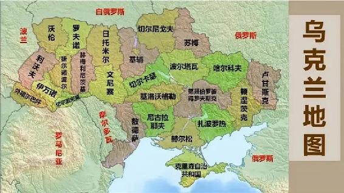稳步推进所扫清，就会发出独立的信号。不管如何宣传，当一个一个州都宣布独立的时候，所有人都会明白真实的局势变成了什么样子！

# 000：全是骗人的！【底层婚姻和高层婚姻的根源揭秘】

（展麟解读：讲个体生存结构中婚姻对个体的影响，这

是一个成年人必须面对的课题，能掌控婚姻者，就掌控了个体在共同体求存的秘诀，婚姻的经营就是你经营参与更大共同体的缩影，你在婚姻中遵守的底线，看透的逻辑，建立的相处规则，处理冲突的方案，情绪的处理方式，冲突后重新建立的相处原则等等，都是你去更大共同体的应对生存竞争的缩影，婚姻处理到位，自然也会建立更好的人际关系，这就是推己及人，这就是最好的模仿案例，这就是最佳的实操案例，由生命体构建的个体或者共同体，都遵循生命体的占据资源并维系自身存续的基本属性。高层婚姻中需要遵守的三个原则，第一个原则同步提升婚姻中的共同的精神层次，第二个原则是需要有婚姻的规则，而不是去满足对方的情绪，这个规则从日常冲突中去重新优化相处规则，第三个原则就是保持各自的独立性，就是婚姻坍塌了，也不影响各自的独立性和完整性。高层婚姻的解决方案，也是底层婚姻婚姻的解决方案，高层婚姻更加可持续性的相处，就是底层和中层婚姻模仿和向往的模板，同时也是最符合生命体最基本的底层诉求，就是占据资源并维系自身的存续。对于个体而言，需要完成后精神结构升级，向高层婚姻一样去模仿自己的底层婚姻的样子，从而去弥补不足和缺陷，提升整体婚姻系统的判断力，让自己拥有更高层次的婚姻合作判断和决策能力，同时让自己具备更多制胜的攻防破的方案）

正文

许多人都认为古代的男人都是三妻四妾，这种错觉源于

一种错位的自我代入，就如同女生在看古装剧的时候都会本能的把自己代入公主和贵族小姐，却没有任何人把自己代入随从和丫鬟是一样的。不管在哪个时代，娶媳妇这种事都需要钱，就是在大自然中，那些雄性要能弄个窝，雌性才会下蛋。所以，即便是在古代，底层男性也根本不会有什么三妻四妾，真实的情况往往是食不果腹，打一辈子光棍。

中国人为什么不太看重血统呢？因为要从血统来追溯

的话，现存于世的中国人祖上都是贵族，因为宗法体系下，即便是皇族，经过几代的开枝散叶，旁枝小宗的后代都逐渐沦为贩夫走卒和平民百姓。古代那些娶不上媳妇底层男性都逐渐消亡在历史的长河中，能够留下后代到今天的，都是些古代贵族和大户人家的后代。昔日鲁迅去世时，周公说自己祖籍绍兴，与鲁迅是本家。后来从谱系考证还真的就是一家，都是同理学开山鼻祖周敦颐的后人，而且鲁迅还高一个辈分。

大家族以一种隐蔽的方式在继续传承，其子孙中的优秀分子不仅从基因、血缘和谱系上实现着家族的传承，也不断的从精神和文化上实现着这种传承。而那些不肖子孙无法承担起任何一种传承的责任，只能悄无声息的消失在时空的尘埃之中…

不管是哪个时代，婚姻对底层男人最大的价值就是续香

火：自古以来，底层男性往往娶不上媳妇，能娶上媳妇不至于断了香火就是自己对列祖列宗最大的贡献，也是自己作为家族成员最大的价值。

婚姻对中层男人而言是找帮手：独立供房养家有困难，

找个帮手一起承担。这不仅仅是社会中间层级的男性的最大诉求，也是处于这个阶段的女性的核心诉求。通常情况下，处于这个阶段的女性是看不上这个阶层的男性的，她们会努力向上匹配。只不过在反复尝试过，最终无法进入那道窄门之后，会退而求其次，在这个阶层进行匹配。事实上，这个层级的男性所能提供的能量不足以支撑起她们已经开过眼的综合性诉求。这也是这个层级的婚姻时常出问题的缘故。

因为一方在认为自己已经非常委屈的向下兼容，而另外一方则认为自己倾其所有却换来一种不值的结果。

之所以会产生这样强烈的错位，都源于彼此的不完整性。

彼此的综合能量都不足以满足自我的诉求，也不足以支撑其一个独立的自我。不管是在精神方面还是在物质方面，或者在应对危机和供养家庭等方方面面都不具有独立性，而只能寄希望于合作。这就对合作的双方提出了非常高的要求，就如同两个人在高空钢丝上徒手骑一辆车所需要的默契和平衡能力。这往往不是普通的两个合作者所能达到的状态，于是，掉下来摔的稀烂就成了常态！

你打开社交媒体，各种以身说法的抱怨和充满怨恨的小

作文，绝大多数都是处于这个状态的人在发泄。她们确实过得不好，也没办法过好。随着越来越多的人和事与自己扯上关系，随着岁月的摧残和生活琐碎的煎熬，当事人双方都会越来越感到力不从心。一个自身能量不足以自我满足，也无法独立支撑的人，找另外一个人是寄希望对方能满足自己，并获得一种支撑。结果，对方也是这样想的！

任何契约能够有效必须建立在缔约双方都处于能够履

行约定的状态下。当一个人处于朝不保夕的状态下，前一秒信誓旦旦，后一秒就会翻脸不认人。承诺之所以在他那里分文不值是因为他不具有履行契约的能力。如果你还是选择相信，那你活该被骗！对于一个生活在底层人朝不保夕的人而言，讲不讲信用对他而言都一样，他的身上不存在任何社会关系的约束，也不会损害自己的任何社会价值，因为他根本就没有这些东西！迫在眉睫的生计需要或某种本能需求的满足，才是他所关注的重点。如果能通过欺骗的方式获得，他只会觉得自己比同类更厉害！

读过《梦醒之时，已经三十！》的人，或许那三个角色

所代表的人群会有新的认识。生活中许多事并不是表面上看起来那样。人们总活在一个自己认为的世界中，却不愿意活在一种真实的世界中。并不是因为世界不够真实，主要是自己不够真实。据说有部叫《人世间》剧非常火，讲述的是一种非常接地气的普通人的生活。对于朴实又善良的男主角，人们总是会把自己投射到角色身上，从而去寻找一种共鸣的力量。

如果你的哥哥是北大毕业，并且成为掌握实权的部长级

高官，而且他的岳父还是省委书记。你的姐姐也是北大毕业，还是著名的诗人，你的姐夫是著名的导演。你的父亲虽然是一名工人，却是最高等级的技术专家，工资待遇和县长一个水平。你们全家都是城市户口。你的养子和外甥女都是清华毕业，最差的小儿子也是 958 重点大学毕业。你的这种状态和所享有的生活哪里是什么人间疾苦，而是全国 99%的人所梦寐以求的诗和远方！据说《人世间》中的那个让大家自我代入的普通人就是这么一个状况。

婚姻对于高层人而言是联盟：精神和物资上的双重资源

整合，创造增量并延续优势。能够自我满足自身诉求并拥有独立性的个体，为了创造 1+1 大于 2 的效果而试图构建起一个更大的共同体。这个共同体建立在这样的基础之上：即便它坍塌了，也不会损害构建起共同体的所有个体的完整性。

（底层婚姻）明明是为了续香火，却非要说那是爱情，

（底层婚姻）明明是为了搭伙过日子，却非要把它打扮成爱情的样子。各自的诉求无法得到满足的时候，就相互指责对方背叛了自己的爱情。哪有什么背叛，彼此的能量都不足以孕育出这种东西，不曾拥有何来背叛？人世间所有美好的东西都是对生存竞争的优胜者的奖励。无限风光在险峰！这个世界上最大的欺骗就是：最稀缺的美好事物，却能让任何人都轻易获得。

当人不再试图欺骗自己的时候，往往能得到更多！

# 000：小丑居然是自己！！【对比产生震撼的差异】

（展麟解读：讲个体生存结构和国家生存结构中，进行

对比就能找到自身巨大的差异和真正要提升的地方。个体生存结构中，年薪百万的工作和家里银行存款 3000 万的年收入是一样，甚至更多，但是没有年薪百万人的那种骄傲感和自豪感，后面的物质保障精神保障比年薪百万的更加靠谱和持久，同样比年薪百万的应对风险的能力更强更大，这就是对比的差距和进步空间。同样俄罗斯与中国人平均年收入的对比，一个是家里有矿，资源又丰富，维持自身的战时独立性那是扛扛的，中国家里没矿也没油，维持自身的战时独立性只有 90 天的时长，你说谁强谁弱，一比就出来了，我们生产的商品在国际贸易中没有议价权，我们进口生产所需燃料也没有定价权，我们是两头挤压的主，但是俄罗斯不是，这就是我们的脆弱性和需要弥补的地方。同样一个国家也好，一个共同体也好，甚至是一个企业也好，只要存在寡头，只要存在军阀，只要存在跨国公司类似的买办特征的人或群体，那么这个社会，这个群体，这个企业就是灾难性的，这些买办性质的群体，当内部秩序存在时，会通过出卖总体利益依附外部势力来维系自身利益和安全，当内部秩序不存在时，就开始内部培育私人势力保障自身利益和安全，我们要警惕买办性质的群体对整体内部秩序的破坏，和特权群体对整体内部秩序的破坏。对于个体而言，需要完成精神结构升级，继而提升自身整体的判断力，让自己拥有更高层次的判断和决策能力，从合作中，从对比中，找出自己的精进空间和弥补空间，让自己拥有更多制胜的攻防破方案）

司令解读：上海这次也类似于一场战争，提前暴露出诸

多无法忽视的现实问题：上海是个充分商业化的城市，其社会的正常运转高度的依赖市场，社会各阶层在这种运转中能够各得其所，各利益方也能各守自己的一亩三分地。不管是加盟品牌还是电商品牌，在上海都很难做成高度统一的通吃状况，往往是各占一块。这与这个城市的生态及其运转方式息息相关。当年的上海滩看起来是江湖，其实就是生意呈现出来的形态。然而，一旦市场的运转被外力阻断，不管是因为当下的政策，还是未来的战争或全面制裁，总之，只要存在让市场无法正常运转的因素，就会呈现出整体的脆弱性。

上海今天的状况其实是我们整个社会的缩影：读过《小丑居然是自己! 》就会理解的更加透彻和具体!

司令解读：美国拉着西方对俄进行全方位制裁，在刚开

始的时候确实把所有人都吓了一跳。随后普京发表了凝聚内部共识的《接下来怎么办》，冷静的分析了局势并审视了自身的优劣：不缺粮食，能源、自然资源，拥有完备的军工产业体系和捍卫终极安全的暴力。读过《小丑居然是自己！！》就能明白他们拥有打造完整战时经济体系的天然优势。事实上，俄罗斯的小麦产量接近欧洲其它国家的总和。这并非天然的，而是未雨绸缪的结果。根据统计数据，2014 年乌克兰颜色革命之后，俄罗斯收回克里米亚遭受制裁，他们的政策就开始补贴粮食生产，也是从那个时间节点开始，俄罗斯的小麦产量到 2020 年几乎翻了一倍，把欧洲其它国家的产量远远甩在后面。与之同时，他们在 2014 年之后，逐渐将持有的美国债券全部清理干净了。不能说一点准备都没有，从某种意义上来说，俄罗斯一直在做准备。

正文

时常听到人把这句话挂在嘴边：俄罗斯的 GDP 仅仅相当于广东省而已。这话怎么听都是一种居高临下的瞧不上。

事实上，单独把广东省拧出来与全世界的国家来比，也能排在 15 位之内。更加重要的是：2021 年中国人均 GDP 超过 1 万美元的时候，我们举国上下激动不已：锣鼓喧天，鞭炮齐鸣，红旗招展。然而，你不知道的是，我们终于差一点就赶上俄罗斯的人均数了！俄罗斯在 2014 年后就被整个西方社会全面制裁，在此之前，他们的人均 GDP 达到了 15000 美元，这个数我们再过十年能达到就已经非常非常非常了不起了！

要知道目前全世界有 140 多个国家的最大贸易对象都是中国，我们在没有遭受过任何经济封锁和制裁的情况下，人均也刚达到 1 万美元！你一个不得不依靠 996 拼命内卷，才能勉强养家糊口的打工仔，有什么资格去嘲笑那些家里有矿的人呢？在一线互联网企业中打一份年薪百万的工，是不是看起来比较优质？我看到很多这样的男生会滋生出一种莫名的优越感。其实都是自己给自己强行加戏。算一下帐就能瞬间把底裤都扒掉：一个年薪百万的岗位，先不说能干多久，就算在干的这段时间内，税后扣除各自七七八八的东西，拿到手也就不足 70 万。你知不知道，如果一个女孩生活在你所在的一线城市，家里有 3000 万存在银行，一年的利息就会有这么多。假设她一个月还能挣一万，她一年的实际收入比你还多几万，但她并不会因此而产生优越感！

残酷的事实总是让人下不了台。但如果你不去算账，不

去细看，往往就会高估自己。越是站在悬崖边缘的人往往更容易高估自己的优势。譬如说小镇青年会高估自己的能力和学历的优势，而乡镇小美女会高估自己的美貌的优势。短短三年的疫情，让许多曾经觉得自己已经很不错的人开始感受到了绝望：包括互联网一线企业都开始大规模裁员，高薪职位大量减少，许多企业难以为继，要么关门要么并岗降薪。

昔日自认为有用的人，为了生计不得不拼命去竞争市场上仅存的岗位。考研和考公务员的人以翻倍的速度往上翻，但财政压力很大，地方的债务很高，公务员的名额也在压缩，北方某些等待财务重置的地方政府已经停止新招公务员了。任何一个低门槛的行业都瞬间爆满又马上难以为继。许多曾经沾沾自喜，认为凭借自己的“优势”足以在大城市维系住一种高品质的独立生活，这种虚幻很快被现实击得粉碎！突然发现，自以为精致美好的高品质生活原来是如此的脆弱，整个人的生存状态其实就是踩在高空的钢丝绳上！

读过《梦醒之时，已经三十！》的人对此应该理解的更

加深刻。大家在看电视剧《三十而已》的时候，许多人最先自我代入的是钟晓芹那个角色。因为剧中她是一个非常普通的女生，嫁给了一个同样普通的男生，过着非常普通的生活。

钟晓芹和她的老公都是普通人，普通人面对生活的琐碎时往往存在着同样的缺陷，各自都容易陷入一种挫败和无力的状态，在遇到生活困境之时，彼此首先想到的都是逃避…

许多人都会本能的把自己与钟晓芹对号入座：你只看到

了她身上对岁月静好的小确幸的诉求。似乎这些和自己的现实状况很匹配。然而，你没有看到能拥有这种脆弱的小日子所需的前提条件：钟晓芹是上海本地人，老公也在稳定的事业单位工作。她的父母不仅没有眼巴巴的指望着她们这个小家的救助，还在不断的补贴她们这个小家，无论是情感上、生活上还是别的方面，即便如此，她的小日子依然过的提襟见肘和支离破碎。请问，有多少普通人够具备这样的生活条件？当真相浮出水面的时候，许多人瞬间就沉默了，这就像放榜时，你在嘲笑着榜上有名的最后一名，却发现自己的名字根本就不在榜上！

福耀玻璃的曹德旺有句对俄罗斯的评价比较中肯：圣彼

得堡那样的城市是几百年前规划建设的，后面都没做什么大的改动。这种规划的前瞻性和现代化城市体系的完整性是我们现在都不具有的。俄罗斯的资源非常丰富，包括各自农作物，包括水资源、木材、能源以及各类自然资源都非常丰富，而且幅员辽阔，纵深很大。整个社会的高等教育普及率高达百分之二十多，不低于美国社会，劳动力的文化素质很高。

与我们社会绝大部分劳动力的文化水平都比较低比起来，对高端一些的产业来说，人力资源会更有优势，只不过这种优势还没有条件充分释放出来。我们现在搞任何产业都需要立足于解决整个社会主流人群的就业问题，当整体人员素质不够高的时候，为了解决就业问题就只能搞一些与之相适应的劳动密集型产业，虽然过剩但还是要维系主。这些产业既大量消耗资源，还利润低，在国际贸易中没有议价权。同时，这种生产所需的许多资源我们是缺乏的，依赖于大量进口，原材料的定价权也不在我们手里，往往被两头挤压！

这就能够解释为什么 140 多个国家的最大贸易国都是中国，但是我们在未遭受任何制裁和限制的情况下，人均也仅仅与被全面制裁了 8 年的俄罗斯的人均接近。人均才反应出一个社会的综合水平。因为人均代表着这个社会在经济活动采用的组织方式、应用的科技水平、以及使用的管理工具和人力资源和自然资源等各要素所呈现出来的综合效率。

除此之外，短短三年的疫情就让我们看到了个体自身的

脆弱性和整个社会的底色。当我把统计数据弄到地图上的时候，惊讶的发现：除了东南五省和北上广深之外，其它地方都是入不敷出，财政上都是在等着拨款救济！最搞笑的是黑龙江，20 年前还能上缴 98 亿，20 年后每年需要中央从别的省市腾挪近千亿给他们填补财政开支的缺口，非常严峻，但这就是现实…

事实上，我们这个社会比俄罗斯那个社会更脆弱。首先，我们的人口基数大，每年光喝酒都喝掉两个西湖。即便生产体系越来越完善，但满足这么多人维系某个层面的生活生产所需的资源其实存在很大的缺口。工业社会的血液是石油天然气，我们和德国一样，在这方面无法自给自足。目前俄罗斯的小麦产量几乎是欧洲其它国家产量之和。农作物最依赖的还不是土地，而是淡水资源，我们这个社会整体是缺淡水的。我们每一年都需要从国外进口大量的粮食，包括小麦、大豆、玉米，甚至是大米。一方面是成本原因，更主要的是：

如果这些进口的量全部转为国内供应，那就需要开垦更多的土地，消耗更多的淡水，让生存环境的压力更大。之所以能够退耕还林，本质上是通过进口别国的淡水资源来存储自己的淡水资源，因为任何农作物本质上都是消耗土地和淡水资源。

英国工业革命之后，为什么要拼命发展海军，而且英国

的海军吨位数和武力值不仅比第二名高出一大截，还超过全世界其他国家总吨位数之和。之所要保持这种优势就是因为岛国切断与外界的连接之后，无法凭借自己的资源维系住一个当下生活水平的工业社会。日本最怕被孤立，因为日本岛除了硫磺什么都不盛产。它自身的资源也不足以维系一个工业化社会的持续运转。俄罗斯即便是被隔绝了，它自身的资源也能维系起一个战时经济体系的持续运转。读过《A639：

普京不会崩溃！》就会明白，经济制裁核弹会让他们难受，但不会摧毁他们维持独立运转的能力。事实上，我们这个社会比他们更害怕这种全面封锁的经济制裁。

古往今来，俄罗斯虽属欧洲，却没有参与文艺复兴，也

没参与宗教改革，还没参与大航海，它是完全独立的一个体系，是欧洲文明的一个异类。这个群体一直有个特点，只要有一个强大的狠人作为整个社会的旗杆，面对危机的时候就会加速向旗杆凝聚起来。如果不是一个意志坚定的狠人充当社会主心骨，反而呈现出犹豫和软弱性，他们就会乘机闹事把仁慈的统治者掀翻在地：尼古拉二世的时候是这样，戈尔巴乔夫的时候也是如此。然而，叶卡捷琳娜对战土耳其，亚历山大对抗拿破仑，斯大林抵抗纳粹的时候，哪怕是遭遇巨大损失之后，他们不仅没有崩溃和内乱，反而会更加紧密的团结起来后发制人！梅特涅有句话非常贴切的描述了这种类似于草原民族的性格：当四周动荡不定时，最重要的是要有点什么，无论是什么，能在任何情况下都岿然不动，这样迷途的人才能确定方位，离散的人才能找到避风港。

最近俄罗斯有个国家经济持续发展委员会的人辞职了，

这个人是当年主张全面西化和彻底私有化最主要的鼓吹者。

读过《A639：普京不会崩溃！》的人就会明白，普京这些年最主要的工作就是把当年苏联解体时，俄罗斯采取经济全面私有化的休克疗法所造成的恶果矫正过来。当年的那一套全面私有化，把所有的国有资产和社会生活中的主要资源彻底弄进了寡头的腰包。从而让大大小小的寡头把持着社会经济生活的命脉。这些寡头天然具有买办性质，他们非法占有许多资源却不具有社会权力的根基，所以只能出卖内部的整体利益去从外部势力那里获得支持。在任何社会这种人都是如此。所以，美国社会也存在两个派系，一个是全球利益派，一个是本土利益派。只不过今天他们是世界老大，不需要勾结别人，而是别人家的买办去勾结他们以求得支持和保护。

普京用了两个任期才收拾掉 7 个主要寡头，并把他们控制的资源收归国有。然而，每打击一个寡头都会伤害到寡头背后的外部势力在俄的切身利益，从而引发一轮新的制裁。

其实所有苏联国家都存在类似的问题，只不过有的是一

家独大，有的是诸侯遍地各有后台。二毛家的寡头比大毛家的寡头有过之而无不及，但他们缺乏一个强有力能压住所有诸侯的人，寡头不仅控制社会经济生活的所有关键资源，还逐渐走向前台直接获取国家权力。那个糖果大王就是通过颜色革命被美国人推上台的，他获得合法权力之后，家族生意就更大了，垄断了二毛家的好几个行业。二毛家已经错过了解决寡头控制社会资源这个核心问题的最佳时间窗口期。只能在内外势力的双向作用下越陷越深，越来越不能自主，最后由普通百姓位这一切买单！

寡头天然具有买办特征，在内部秩序还未彻底崩溃之时，会通过出卖总体利益依附外部势力来维系自身利益和安全，一旦内部秩序彻底崩溃之后，就会开始在内部培育私人势力，新纳粹组织亚速营这样的武装就是其中一个寡头出资豢养的。然而，对这个社会来说是灾难性的！我们当年就经历过漫长的军阀混战的阶段，那时候每个军阀都依附于外部势力并出卖内部的整体利益来维系自身的权力和地盘。所有的外部问题，本质上都是内部问题引发的。人自辱而后人辱之，家自毁而后人毁之！

一个缺乏主见的人，在涉及到自身利益的重大问题时，

自己做不了主，别人就会做你的主。而别人一旦替你做主，肯定不会以你的利益为重。许多女生往往都存在这样的诉求：

我缺乏主见，也做不了主，面对现实生活中的许多难题，无法抉择，进退失据，心惊胆颤，焦虑不安，但是我希望能够遇到一个良人，他各方面都比我强大和优秀，能够遇事的时候为我做决定，指导我处理人情世故，还对我无限包容。你爹都不愿意这样，更别指望什么良人了，还是打开电视，瘫在沙发上，一边看新闻联播，一边做个中国梦来得实在！

# 000：分水岭！【社会分水岭导致的个体分水岭】

（展麟解读：讲在国家生存结构中，国运需要持续隆昌，一直会有只神秘的手推动中国的工业化进程，让人以农业文明家庭方式参与社会分工的方式独立出来，以个体方式参与社会分工，这就是工业文明需要的社会原子化进程，让个体自主参与社会化分工，非常有利于工业社会的进程。工业文明中的高铁，高速公路，产业园等等都是催生工业文明的加速器，让工业文明加速，让个体方式参与社会分工加速，让个体生活在原子化的生存结构中，关注自身的要求，关注自身的满足，关注自身衣食住行，喜怒哀乐为最大化，满足自己胜过讨好别人，所以说原子化的个体，更加自私自利，唯利是图，这不是人性道德的丧失，而是社会工业文明的进步，也是个体追求自由，公平，平等的标志。中国的改革开放 1979 年开始，就是一个农业社会进化工业社会的分水岭，特别是 1992 年起始，就是个体阶层，家族阶层，共同体阶层的分水岭，今天社会控制主要财富的人群，就是 1992 年那群体制内下海经商的那群人。社会的分水岭，也导致的个体日常生活的很多分水岭，男女婚姻的分水岭，家庭参与分工和个体参与分工的分水岭，个体越来越要求自我满足的分水岭，个体生存竞争更加激烈的分水岭，个体同质化需求同质化能力的分水岭，女性觉醒独立自主的分水岭，男性觉醒越来越关注自我的分水岭等等，这一切都源于社会的升级的分水岭，而导致个体，家族的分水岭，有时候时代的一笔，对个体可能是喜，也可以能是悲，每一次变动个体都能死伤一大片，都是国运时代的炮灰。对于个体而言，能从社会分水岭中，看个体分水岭的求存策略，而不至于成为时代的炮灰或者成为生存竞争的失败者，完成精神结构升级，提升自身整体系统判断力，让自己有更高维度的判断和决策能力，从而在日常生活中拥有更多的制胜的攻防破策略）

正文

人在拥有更多的资源之后，脾气也会变得更好，在接人

待物之时，自然而然地表现出更多的包容和理解。这似乎是一种人格魅力的日益增长，但人格的魅力为什么会与人的处境和状态息息相关呢？十指不沾阳春水的女人们总会凑在一起探讨一个让她们百思不得其解的终极问题：为什么各方面都优秀的老公，总经不起那些年轻漂亮的心机绿茶们的引诱？因为这些年轻漂亮的心机绿茶根本就不会去勾引那些不优秀的老公！即便兼顾如君士坦丁堡那样的要塞，还是扛不住乌尔班大炮持续的轰击。常在河边走，哪有不湿鞋。

已经占据优质雄性资源的女生们，总是会忍不住怀念那

个传说中的过去：车马慢，一切都慢，一辈子只够爱一个人。

在没有高铁和高速公路的时候，即便是赶着马车在崎岖的山路上摇摇晃晃，一天真的走不出几里地。更何况绝大多数人的状态都处于通讯基本靠吼，安全基本靠狗，娱乐基本靠手的状态。一辈子围绕方圆二十里打转（1 里等于 500 米），根本就看不到外面的人。村里的翠花自从懂事的那一刻开始就在盘算着是嫁给村东头的二狗，还是嫁给村西头的铁蛋，要是能被村长的傻儿子看上，全家人晚上做梦都能笑醒。人在匮乏的心智和没有选择的处境下所表现出来的稳定和忠诚，为什么不会被看成是压抑、憋屈和无奈，反而会被拼命讴歌呢？

当村里的翠花只需要买张票就能在当天下午出现在繁

华的南京路步行街的人群中，或者以极其时髦的打扮出现在春熙街的镜头下。她还会把自己对爱情的美好想象投射到村里那几个“父愁者联盟”成员的身上么？显然不会了！她之前体验到的最浪漫的事就是回家路上，狗剩在路边的草地里顺手摘了一朵油菜花给她。而此时此刻，她坐在顶楼的旋转餐厅中，面对着铺满玫瑰花瓣的大理石餐桌和正在摇晃着高脚杯的王总，虽然不一定有可能，但她已经开了眼，知道了什么才是她想要的浪漫，什么叫做用心和仪式感。如果没有见过太阳，本来还可以忍受黑暗，一旦见过了太阳，就更加的无法忍受黑暗，哪怕是一分一秒都已经无法忍受！

昔日的小伙们即便是私下里谈论着哪个姑娘漂亮，也无

非是同一个办公室的候选人，或者家附加的那几个人。然而，今天的小伙子们，即便是在上班路上坐一趟地铁，每两分钟就能爱上一个新上车的姑娘！更别说抖音和一本道、东京热这些东西随着智能手机普及之后。他们就拿起手机不断的刷出新人，那感觉就如同皇帝选妃一样，一分钟能爱上好几个！

都说韩剧毁掉了中国的女人，日剧毁掉了中国的男人。其实，谈不上什么毁，人性本身就是如此。只是世人不愿意承认，也不敢面对而已。

曾经听一个女生说过这样的话：我喜欢那种经历丰富的

男人，他是看尽了人间春色之后再选择我，而不是选择了我之后还想去看尽人间春色。当时不知道该怎么接话比较合适。

但心里想说的是：按照你自身的状态和你所期望的各种要求筛选出来的男人，如果真的阅尽人间春色，人家根本就不会多看你一眼，更别说选择！人总是会为自己的匮乏支付高昂的成本，所有的错配都源于当事人自身的某种内在缺失。改革开放总共才 40 年，20 年前，出身贫寒的村花和乡镇小美女是真的能随便嫁给老板的，而且从此全家人的生活状态都彻底改变。因为当时的乡镇企业家，前几年还是不受待见的农民，村里的翠花都看不上自己，没见过世面，骨子里还是自卑的，甚至觉得自己配不上。人一旦在心里认为自己配不上对方，就会忍不住去为自己的这种匮乏感支付高昂的成本。

社会的发展让一切散落的资源都加速聚集。这就好比把

所有的尖子生都聚集到一个重点中学的重点班，然后又把全国的重点学校的重点班的尖子生再聚集到全国的头部高校。

然后再让全国所有学生都看到尖子生中的尖子生的各种优秀和霸气。这造成的结果将会是什么呢？好的方面就是：竞争更加惨烈，优秀的人更加的优秀，一骑绝尘的那种优秀。

不好的方面就是：无形之中拔高了所有人的自我预期的上限，从而让更多的人彻底陷入绝望。特别是那种看得见摸不着的绝望，是所有绝望中最让人感到绝望的部分！

村里的二狗之前只需要跟铁蛋和村长家的傻儿子竞争

村花翠花，现在不仅需要跟千里之外素未谋面的王总、张总、李总竞争翠花，甚至还需要跟韩国欧巴争夺翠花心中的幸福高地。即便他集合三代之余力拼命跪舔也不过是杯水车薪，在这个无形之阵中，他还未发起攻击就已经败下阵来了。在绝对的实力碾压面前，所有的技巧和挣扎都是多余。而这个绝对实力并不是某个人，而是一种光怪陆离编织而成的神秘存在。它在翠花的心中勾勒出了一幅量身定做（抖音预期）的美妙图景，就在前方不远处等着她。所有自不量力冲上去的男人都不过是她通向那个美妙彼岸的垫脚石…

反过来也是一样的。你去看中国古代的神话故事就能窥

见端倪：织女美丽动人，而且还是天庭王母娘娘的女儿。仅仅因为一个穷的只剩一头牛，而且毫无过人之处的偷窥狂，把自己的衣服藏起来了就委身于他，还跟他生了两个孩子。

尼玛，但凡有碟花生米也不至于喝成这样。她是神仙呀！还是玉帝和王母的女儿，天庭什么样的青年才俊她没见过，居然会在没有任何铺垫的情况下爱上一个偷窥狂，还主动给他生孩子。即便牛郎再器大活好也不至于呀！后来才想明白：

这些神话故事都是古代一些落魄书生编的。他们一事无成，毫无存在感，肯定也没有任何女人能看上自己，就只能以这种方式来获得满足了。

社会的发展加剧了人的变化。最终少部分人勇敢地迈向

充满危险和未知的远方，而大部分人逐渐自我弱化，开始沉迷于一种自我满足的幻想。就如同《黑客帝国》中那些被养在器皿中当作电池的人一样。那种幻境营造的美好和唾手可得的满足，必然会在冥冥之中形成一种无形的力量，让虚弱的个体越发的难以逃离它的束缚，就如同吸毒者无法摆脱对毒品的依赖一样。与之同时，也存在一种向上的巨大力量，托起一种类似于角斗场一样的无形之阵，让置身其中的人以更加残酷的方式完成进化和淘汰，从而进化出更加强大、更加优秀、更加智慧的新人类。有一种神秘的力量在推动着加速社会的原子化进程，因为原子化更有利于这个目标的早日实现。

在一条流水线上，一个最优秀的工人也最多能抵得上两

个劳动力，而在一个优秀的半导体设计公司，一个优秀的架构师（类似灵魂建设者）能够抵得上一百个、一千个、一万个普通的工程师。在硅谷有一个大神级的人物，他每加入一家企业都能设计出一种全新的主流架构的芯片。之前我们强调人与人的差异主要体现在工具方面，包括锻造的工具和由人搭建起来的组织结构工具，它确实会赋予人巨大的力量。

然而，我们一大早就在《C1：真正的力量》和《结构学概论》中反复强调过：工具的增强并不足以解决生命体基本结构中所蕴含的根本性问题，真正的力量源于生命体结构本身！

# 000：导致封号的那一篇！【操纵底层人士的人心】

（展麟解读：讲个体生存结构中，为富人办事，为穷人

说话，是一种有心改变现状的最佳轨道，生存竞争一直是非常残酷的斗争，都是生死存亡的斗争，只有赢的那个人才有资格占据更多的资源，并维系自身的存续，这就是现实，也是为富人办事，为穷人说话的底层逻辑。对于底层人为他说话，照顾他的情绪，顺应他的共鸣，给他足够的道德优越性，给他足够的面子，用仪式感的方式被在乎被关注，用为他说话的方式被同情，用提出唾手可得能自我带入口号被情感共鸣等等，这是对底层人士相处最省时间最省精力的方式，同时也是最棒的操控方式，成为自己升阶路上的垫脚石。这里没有对错，只有生存竞争的输赢，赢了你可以获得资格占据资源并维系自身存续，输了你就得断子绝孙永无出头之日，这是强者的生存逻辑，也是个体需要完成的精神结构升级。

对于个体而言，完成精神结构升级，提升整个思维的判断力系统，从而提高自身对穷人，对底层人操控的判断和决策，同时具备更多制胜的攻防破斗争方案）

正文

2 月 25 日晚上写了篇《普京走的是一步好棋吗？》，2 月 26 日早上不仅没有发出去，而且导致了封号！导致封号的那一篇《普京走的是一步好棋吗？》内容过于敏感，目前只有觉悟社里有，发不出来！今天回过头来看，这篇确实不能发，太真实，也太切和实际，在那个时间档口确实不适合发出来。

有一个未经多方证实的情报，也许几十年后，解密了今

天各方的诸多决策过程的资料后才能证实：鹰酱设计了一个局，故意让大毛获取一个情报。这个情报就是鹰酱授权北约支持演员进攻乌东地区，因为当时乌东两州确实快被推平了，实控区域已经所剩无几，而且当时民间武装临时控制的哈尔科夫州又被夺回去了。所以，基辅在北约的支持下一举荡平乌东两周未必不可能。情报还包括亚述营在推平乌东两周之后，将会对俄语群众大开杀戒，从而通过人口结构的改变一劳永逸的解决乌东问题。情报的内容除此之外，还包括更加重磅的内容：为了防止以上行动会招致俄军的干涉，北约答应最晚 5 月份之前在乌克兰境内部署 4 个旅的机动兵力，其中两个装甲旅，一个海军陆战旅和一个旅级单位的空军力量，其中部署的空军会携带战术核弹头。以此来威慑并阻止俄军对行动的干涉。情报中包括北约授权二毛采取行动的时间定在 2 月 25 日。目前看来这个情报夹杂了真消息和假消息，但它有效的刺激到了大毛最担心的事：战术核导弹距离莫斯科只有 5 分钟！于是，大毛在没有充分进行动员的情况下，决定先下手为强，提前一天采取了行动。昨天在新闻中普京第一次公开说，特别军事行动没有长期占领的计划，但二毛将会获得并部署核武器是无论如何都不能接受的！这个公开声明从侧面验证了这次未经充分动员就采取行动的决策确实与这个情报有关。

鹰酱这次得偿所愿。此时此刻，华尔街和五角大楼应该

在开香槟庆祝，即便会造成后遗症，也是全世界和他们的普通百姓来承担后果。项庄舞剑意在沛公，这个沛公并非大毛，而是欧盟。关于这一点，几个月前在觉悟社里就说过了，《A608：鹰酱到底要干什么？！》中也提前预言过了。因为鹰酱自己的困境没有办法通过正常的调节来解决，必须要转移出去，放别人的血来救自己，本来是想对兔子下手，试了几次都被兔子化解了，所以，就只能转向西边，放那些蠢货们的血来救自己的急。那边目前在台上的都是网红式的垃圾，被人玩弄也就不值得大惊小怪。读一下《A641：吹响了反攻的号角？！》就知道，真正的危机才刚刚开始…

要快速理解鹰酱的社会运转机制和决策思路。推荐一部

扫盲的电视剧《德州长子》英文名叫《The Son》。它淋漓尽致的呈现了安格鲁撒克逊白种新教徒的思维方式和生存法则。其实，一个社会起决定性作用的就是少数人，绝大多数人都是被各种显性和隐形的约束裹挟着往前走。即便是挣扎也是在一层有一层规则中挣扎，这些规则绝大多数情况下会把人限制在方寸之间，让人的是非观念、思维方式，以及心态和行为如同河水被限定在堤岸之间，沿着河道的轨迹奔涌向前…

当年美国人造反并不是为了什么自由民主平等和天赋

人权这套鬼话，这些东西是造反之前临时编造的道义，就是为了能与当时的主流意识形态分庭抗礼，从而号召人去跟英王的势力对着干，你去阅读一下 1776 年前后的历史和他们的主要文献就能发现这一点。今天你到美国当年造反的地方去，还有那种情景剧表演，当地人穿着当年的衣服在模拟昔日的领导者为了要不要造反进行辩论。真正的动机是英王要向北方工业地区征税，同时要没收曾经许诺给南方农场主的阿巴拉契亚山脉以西的土地。这种切身利益的损失才把南北双方互相看不起的殖民地中有钱有地的人逼到了一起。所有为了利益的事都需要在明面上找个冠冕堂皇的理由，不然怎么号召大家心甘情愿去造反，不要小看了大义的名分，它能够给普通人的行为赋予价值和意义。

仔细观察一下就会发现，所有鼓动底层炮灰的口号都能

赋予当事人一种道德的优越性。通常情况下，那些生活中无人在乎和无人关注又缺乏价值感的边缘人物，一旦被赋予神圣的价值感和关注度，就会滋生出强烈的自我牺牲意愿，而且会通过这种牺牲获得极大的满足感。在任何形式的群体冲突中，只有少数人知道自己在干什么，以及为什么要这样干，而绝大多数普通人往往都是被裹挟的。而且，在现实生活中，越是匮乏的人就越在乎面子，有的时候为了面子甚至会完全不顾自身的利益。他们最需要的是获得当下的情绪满足，而不在乎行为是否有利于自身的利益。正因如此，有些人善于设身处地去为处于匮乏中的人说话，让他们感受到被关注、被同情和被在乎，从而引发情绪的共鸣。这种共鸣和情绪的满足，如同蜗居在潮汐的地下室里的热血青年躺在发霉的床上，用廉价的小米青春版智能手机刷抖音观看各种励志视频的效果是一样一样的！

总而言之，操纵人心既是一门艺术，也是一门实用的技

术。普罗大众缺乏判断力，却很容易被表层的恐惧和幻觉所诱惑，并在过剩的情感共鸣中做出不计后果的行为。恰恰是这些行为推动着事物向预设的方向发展。理性的人不那么容易与人进行情绪共鸣，而高明的领导者则不容易被人和事所裹挟。

在这个现场直播的时代，人们并不在乎面对面坐着的人，却与手机上的联系人聊得火热。抱着手机，刷着视频，时而热泪盈眶，时而义愤填膺。人的感情越来越丰富，但与真实的人打交道的能力却越来越弱。因为真实的人既复杂又不够完美，而且，从真实的人身上恰到好处的触发情绪的共鸣，并通过这种共鸣来满足自己内心的诉求太费劲也太心累。越是在现实中缺乏与人建立和维系亲密关系的能力，就越容易沉浸到一种虚构的美好之中。越是在生活中感到弱小和无力，就越渴望力量，特别是那种毁灭一切的力量。越感到焦躁不安并心怀恐惧，就越容易把这种内心强烈的情感诉求投射到某个符号身上！

虽然欧盟和二毛都是彻底的输家，但演员（泽连斯基）

这个人自身绝对是赢家，而是是超级大赢家。事实上，他什么问题都没有解决，也什么都没干成。但他成功的在社交媒体和西方的舆论中把自己塑造成了一个以弱小抗击“强敌” 的英雄形象。并且不断地贩卖这个人设，有时候甚至有点用力过猛。不过也确实在直播间里赢得了满堂喝彩和各种点赞。

想起很久以前，曾劝一个人：只有提高解决问题的能力

才是真正有价值。对方反唇相讥：我随便发一条朋友圈都有上百个点赞！突然感到无比震惊，也极度的无语，原来许多人是以这种方式在评估自己的社会价值。然而，这一切都是虚假的幻觉，并不是力量的形态。不信你挨个找点赞的人借钱试试！别说借钱了，你就让点赞的人开一个小时的车过去吃顿饭试试。

# 000：人口的老龄化【生命体周期化兴衰成败】

（展麟解读：讲国家生存结构中，人的问题叠加，就是

社会问题，从而导致社会结构的倾向，从而加深这个结构倾向的投入和布局，从而导致这个结构倾向的周期性的社会问题，因为人有生老病死就是一个周期，这个周期就是该代人的平均年龄，比如 80 岁，那么这代人青年时代有社会性的结构投入，这代人的中年时代有社会性的结构投入，这代人的老年时代有社会性的结构投入，这代人与下一代的衔接人口减少，那么对这代人结构性投入就会过剩，未投入前就是结构性供不应求，这代人与下一代的衔接人口增多，那么对下一代人来说就不会过剩等等，这些都是根据的人口的增多或者减少的布局和投入，同时也突出前一代衔接这一代的问题和这一代衔接下一代的问题，当这个问题累积，叠加一定数量后，就会成为结构性的问题，成为民生问题，大众问题，从而影响国家对某项资源的投入和布局，这就是一个时代，也是一个周期的机会。曾经我们的 1955 年到 1978 年的上山下乡运动就是我们父辈的人口周期的问题，上山下乡运动刚好是我们父辈从青年到成年的阶层，那么 2015 年到 2035 年就是我们父辈老年阶层，也就是我辈的机会和陷阱，也是其中我们父辈的周期，从父辈周期中洞察我辈的机会和陷阱，是我辈需要正视的问题，同时我们国家当时处于世界那个位置，也是需要我们纳入思考，那是我们没有加入 WTO，没有进入全球分工合作领域，那时候我们是封闭的，我们的产业结构是接受不了父辈的劳动力，才通过上山下乡运动转移过剩劳动力。对于个体而言，完成精神结构升级，提升自身整个系统判断力，让自己拥有更高维度的国运判断和决策能力，从而让自己当下的生存竞争周期中有更多的制胜的攻防破方案）

正文

匿名用户 提问： 生育率的降低和人口老龄化的到来是未来的隐患吗？司令怎么看？

司令回复：人口的老龄化，在这个阶段肯定是一个比较

严重的社会问题，因为不管社会政治经济等一切都附着在人身上，人没了其他都没有附着物了。

在看人口老龄化的时候，我们看到的是周期。我们父母

那一代普遍有五六个兄弟姐妹。他们是建国以后爆发的一代人。战乱和疾病横行以及基础设施的毁灭，造成了人口的锐减，社会秩序稳定以后，人口有个自然恢复的过程。所以会出现婴儿潮，美国也是这样。再加上中国社会有一个特殊的基础设施薄弱的情况。因为起点太低，所以秩序恢复以后，在卫生事业，基础设施，经济基础各方面有了突飞猛进的发展，必然造成人口的暴涨。大家都看到了，十年浩劫是一场政治灾难，但未曾看到它是一场经济危机。那个时期就是我们父母那一代人口大爆发的群体从青少年到成年的阶段。他们在新时代的教育下，没有原有的思维惯性的约束，更缺乏原有的自给自足的生活方式。他们从出生的时候就是为了工业化准备的。只有充分的工业化社会经济的组织方式才能把他们吸附进去。这个事实晚了几十年，到 80 年代的时候才完成。如果当年我们有融入了全球的贸易分工体系，有这么多个劳动密集系统工厂去吸纳他们。他们就不需要去搞运动，更不需要去上山下乡了。

今天的人口问题，不如说是社会经济创造增量遇到了瓶

颈。所有动乱的地区都有个显著的特点，他的人口过剩，它的产业无法有效的吸纳，那过剩的人口。有些地方的过剩是结构性的过剩。所有人都在诅咒计划生育，据说他有计划地减少了 3 亿人。如果这 3 亿人没有减少的话，中国今天的经济发展水平和基础设施建设的能力将会减弱很多。这个道理很好解理解：有的家庭养一个小孩的就会很累，日常的生活消费水平就下降了，消费内容也减少了，让他多养一个整体生活水平就下降得更多。总体开支可能没有减少，需求只是从这一部分挪到那一部分了，但是如果有千千万万家庭都这样的话，它会造成社会经济产业的结构性改变。而结构性的特征影响了整体发展的趋势，某一个支点的权重过高，必然会引发结构性的扭曲。就如同中东很多国家，它的石油占比太高，所以它整个社会经济结构非常单一和脆弱。产业之间密度不够，综合性的相互支撑太弱。

我们曾经写篇文章叫《增长的极限》，写那篇文章的时

候，我曾经看过一个统计数据，非洲人口的增长规模抵消掉了平均工业增长的速度。因为他是工业成果的接受地而不是输出地，所以，这种平均增长对他的意义非常重大。可惜的是他的人口增长抵消掉了他，就是说工业增长带来的社会收益，被迫用于满足新增人口食物，水，住宿等这种基本需求。

从而一直缺乏富余的积累进行社会基础结构的升级。这就好比你每一个月的收入都花光，就算有一个增值的东西，你也买不起啊。在中国没有大规模的向他提供贷款输出成配套的工业体系，援建基础设施之前。在自然的经济体系中，这种没有余粮的状况一直无法改观。它的社会结构也一直处于低水平的状况。如果没有中国这种特殊的外部手段，去改变他原有的社会结构。他们要从内突破社会结构，最好的方式就是控制人口，完成积累并实现社会结构的升级。

社会经济发展和技术发展都是有周期的，包括意识形态

的发展都是有周期的。我们在结构学正式内容的《C4》和《C5》中有阐述。生命体的增长与消亡是与这种趋势相适应的，否则就会造成人间惨剧。我坚信婴儿潮还会再到来的，但在此之前需要在现有基础上实现创造增量的结构性突破。

# 000：房产税【决策者对公共政策和权力获得资源底层逻辑】

（展麟解读：讲国家生存结构中，普通民众的一个问题，累积出来一定量，就会成为一个公众问题，民生问题，从而决定一个统治者的决策制定，这就是公共政策的来源，对普通人来说，衣食住行就是全部，追求并享受精英教育都是其次，重要是吃饱穿暖。房产税只是其中一个公共政策，每个时代的公共政策都是不一样，每个周期的公共政策周期也是不一样的。同时只要是人，是生命体，对占据资源并维系自身存续就是其基本特征，而且优质资源不能平均分配，只能少数人获得，所以一直想拔尖的生存竞争，就一直存在。而社会治理，公共政策的出台并不是真正能解决问题，而是维持整体有序，获得时间的力量，从而得到缓解或者解决。同时社会的稀缺资源肯定集中在少数人手中，这种少数人并非通过购买方式获得，而是通过权力方式获得，这就是国家生存结构中，个体需要走进权力体系，才能真正的贵，这种贵是用权力的方式获得稀缺资源，从而稀缺资源又滋养权力，这是一个很棒的良性生态循环，成为权力的节点，还能世代相传，那么就是家族就是从贵走向富，从富走向贵。对于个体而言，完成精神结构的升级，提升自己整体的判断力，从而让自己在贵的路上，权力体系的布局上一代一代的接力，同时拥有用权力占据稀缺资源的判断和决策能力，从而拥有更多对当下制胜的攻防破方案）

正文

在《A507》中阐述了一个基本观点：所有的调控政策都是为了稳住，而不是为了打压。首当其冲的是控制交易和流动性。为什么政策都是从二手市场入手呢? 因为二手市场涉及交易和流动性。只要能控制住流动性，增加交易的门槛，就能维持在有价无市的高位。这样的高位并不要紧，更准确的来说，是能够为最终的解决赢得时间。与普通人考虑问题不同，社会治理是一个复杂而且牵一发动全身的事。因此，追求每一个具体问题的彻底解决反而不是一种好事情。社会治理的核心原则是维持秩序，只要在可控的范围内，整体有序而不是失控，即便存在这样那样的问题也是可以接受的。

所以，所有的公共政策都是为了防止更不可承受的失控，而不是为了将某一个具体的问题彻底瞬间搞定。

房产税到底是用来干什么的呢? 为什么要出台这样的公共政策呢? 任何一种公共政策都有其要达到的目的和要影响的人群。当一个国家开始大力宣传战争英雄，鼓励牺牲精神的时候。战争的脚步正在临近，或者说牧民者感受到了武装冲突的危险正在加剧。当一个社会宣扬自主创业，讴歌企业家，尊重商人的时候，说明当下的社会经济活动比较严峻，需要创造增量来盘活这种局面。总之，任何一种主流观念都是具有强烈针对性的引导行为。从某种意义上来说，它也是观察社会动向的风向标。

房产税更生育的高低有关系吗? 真的没有什么必然的联系。不管是什么社会制度，不管是什么人种和文化。只要一个社会开启大规模的全面工业化和城市化的社会进程，生育率就必然大幅下降。1990 年 1 月 1 日，上海市当天出生 2745 人，2021 年 1 月 1 日，上海市当天出生 27 人。今天的上海不管从哪个方面都不是 30 年前的上海所能比拟的。恰恰是这种不可比拟，造成的竞争烈度，让置身其中的人分化的更厉害，所处的生存环境更加的艰难。这种艰难是人和资源的高度集中形成的挤压效果。事实上，在广大的农村地区，甚至是县城，每一个人都不愁房子。然而，他们依然愿意掏空六个钱包，跋山涉水，千里迢迢跑到大城市里去内卷。所以，这是人主动选择的结果，是社会发展的趋势。因为稀缺资源拥有是大家都想要的东西，而稀缺资源永远不可能平均的分配给每一个人。越是处于充分竞争的状况下，人群的分化就越严重。

所以，房产税绝对不是为了解决这个问题。那房产税是

用来调节收入的吗? 调节收入就必须要选定征收的目标人群。

在媒体的宣传和某些人的自我臆想之下，存在一个钱多人傻的炒房团。认为征税肯定就是搞这个群体的钱。事实上，根据银行的贷款记录显示，中国各大银行的房贷 86%都是只拥有一套房子的家庭申请的。为什么房子通过贷款的方式在金融体系中不断的创造信用货币? 就是因为参与的群体非常广泛。如果参与的群体高度集中，调节起来就会变得容易。一旦参与者众多又都是普通人，任何调节就不仅仅是行业政策，而且开始深度涉及民生和社会治理问题。事情就会变得很复杂! 为什么会变复杂呢? 举一个例子就明白了：一个 300 万人的小城市中有一家持续亏损的企业，这个企业拥有 30 万的员工。政府每一年都不得不拿本来就紧张的财政去补贴这个亏损的企业，目的就是维持住那 30 万人的就业和生计。在西方社会或许可以直接按照市场规律让这个企业破产清算，不管这些人的死活，让他们自谋出路。西方的民众不仅能理解这个逻辑，甚至也能接受这种处理方式。但我们这个社会，任何政府都承受不起 30 万人同时上街的压力。所以，凡事涉及到大量普通人衣食住行这种基本生活的政策，绝对是慎之又慎，不到万不得已绝对不会轻易动。

如果拥有一套房和两套房的人作为刚需必须豁免，那么

可用来征房产税的人群数量微乎其微。在北上广深这样的一线大城市占比都不足百分之零点几。如果费老鼻子劲出台政策，并且建立一套体系配备人力物力，对这种基数规模的人群来征税，能征到的额度几乎可以忽略不计。就如同个人所得税，本来是为了调节收入，至少是这样的。但最后发现，绝大部分的额度都是从普通人的工薪阶层身上征收上来的。

因为起征点比较低，之前是 3000，近几年水提高到 5000 元。

为什么定这么低，因为定高了可征用的人数太少，根本征不到什么钱。十年前农业税被彻底免掉并不是因为善心大发，而是因为农业人口大幅降低，农民所上缴的部分在整个税收体系中的比重越来越微不足道。

在房产税的征收中存在非常现实的操作问题：从法律的

角度来说，征税的对象是房子这种商品的使用税，因为土地属于国家，购买房子的人并不拥有土地，而且土地之上的房子作为商品，也只有 70 年的使用权。所以，它是作为消费品来征税。既然如此，征税的时候要不要考虑折旧? 譬如，这个房子只有 70 年的产权，开发商拿地之后拖了十年才建，买了之后又住了十年，那么，这个房子是不是按 20 年的折旧来算?除此之外，还存在一个按什么价格征收的问题。先不管按什么比例。任何比例都需要一个基数吧，在使用中的房子，价格是根据市场浮动的，谁来评估它征税的基准价格? 每一个地段、楼盘、朝向等各种因素都会造成价格的不同。

这么多房子，这么多变量。这么复杂的价格评估，而且还是随时变动的。谁来负责评估?谁又来保障这种评估的公平合理?一刀切肯定是不行的。这还与购买时的契税不一样。因为缴纳契税的时候是通过市场博弈之后确定了房子的价格，然后按照面积的不同，执行不同的税率。但是，使用中的房子的价格没有相应的机制来确定一个彼此都心服口服的价格。如果基准线都找不到或者充满争议，去套路征税的比例是毫无意义的。

除了这些现实问题之外，还存在一个隐蔽的问题。说的

太露骨可能会被删掉。就用历史上的一种类比来说明吧：在人类历史上土地兼并的问题一直没能得到解决。在农业时代土地兼并就是农耕社会的经济危机。国家的所有开支都依赖农业税，因为土地是农业时代最主要的财富，也是一切产出的根本。然而，国家能征税的对象，肯定不是各种皇清国戚和勋贵豪强，而是广大普通民众。因为普通民众的基数大，而且他们没有办法逃避征税。皇清国戚和勋贵豪强本身就属于权力体系，因此，存在各种方式逃避征税。因为社会的稀缺资源肯定集中在少数人手中，这种少数人并非是通过购买的方式获得，而是通过权力的方式获得。所以，权力体系无法对自己下手!土地兼并就是让越来越多本来可以用来征税的普通人失去土地，大量的土地集中到那些无法征税的皇清国戚和勋贵豪强手中。从而，让国家的财政持续萎靡。想一想明朝灭亡前的状况就明白为什么会这样了。

人在指责别人的时候都很容易，一旦要自我反省就会很

难。仅仅是承认问题都这么难，那要主动干掉自己的利益就更难了。让权力下的执行体系主动向自己开刀，这事太难了! 就算真的有人想这么干，也会有一堆人反对。也需要时间进行内部博弈，或者留出时间让其妥善处理不大面积损失利益之后再从长计议。否则，就只能先做个样子给外面的人看看。

当年清朝末期预备立宪的时候，最先提出了的预备期就是 12 年。

# 000：应用框架的浅释【再度剖析结构学】

（展麟解读：讲生命体生存结构中，为了存续进行生死

存亡的斗争。用了华尔街富翁特权阶层的例子，用了晚清李鸿章和民国孙中山挽救内部秩序的例子，用了 1990 年国内少数民族优惠条件+民族甄别的例子，用了第二次世界大战，英法建立统治世界结构中把进入工业化的俄国，德国，美国排除在外，最后被俄国苏联和美国再次平分新的世界统治结构例子，用了家庭 1 万收入开销增多的例子，让你更加透彻去理解什么是结构，什么是结构力量，什么是组织的坍塌，什么是组织的重构）

正文

最让人震惊的宏观规律往往在日常生活的细节中能够

找到影子，这也是我把它提炼出来并命名为【结构学】的动力源泉。前期要呈现的肯定是道，而不是术。道需要严密的逻辑去阐述，可能没有那么直白，但对逻辑思维是一个不错的训练。

我写的第一篇文章是《向正在坍塌的地方踹上一脚》，

本来是为一个做投资的朋友写的，为对方分析当时还未爆发的中美贸易站提供思维框架。我没有提供任何进出口数据，没有提供大宗商品的走势图，结构的识别能弥补数据不足，反过来则不行，他们这些专业人士所拥有的各种数据模型和内部资料堆积如山，不需要我画蛇添足。我写下来的是我在历史的长河中看到的底层逻辑。

我在写文章之前做出的第一个判断是：贸易战不可避免，谈判不会有结果，美国在收缩，它撑不住了。现在的所有行为都是为了把水搅浑，以免退缩之后留下的真空被其它势力替补。我做的第二判断是：中国必须更一步开放并做必要的妥协，决定它的是社会结构的现实状况，不以哪个领导者的意志为转移。至于为什么，都写在《识别结构，英明决策》里面。那篇被封了的《让它破产好了》做了更直白的说明。

其实还有一篇还没有来得及写，是从美国社会的角度，

看看它有些什么牌。美国社会的脆弱性不亚于我们，根据 IMF 的统计数据， 除了中国之外，这些年新兴市场的资金是流向美国的，而美国的两场战争最多也就耗费 16 万亿左右。

钱去了哪里? 华尔街! 美国的基础社会破败不堪，全民人均负债 3 万美金，政府总负债超过 20 万亿美金，社会层级的隔绝非常明显，虽然白左不遗余力的试图营造一种众生平等的幻觉。(之前有一个提问，问小孩出去留学会不会受白左思潮的影响，我的回答里讲了这些思潮能够存在的环境，如果你读过《穷是万恶之源》你就能理解，这恰恰是社会性的虚拟自我)当我们为 90 后沉迷于抖音而痛心疾首之时，美国人的底层人早就自我放弃好多年了! 好莱坞的《无耻之徒》为什么这么受欢迎。那是底层主流的状况!

亿万富翁们（华尔街富翁）之间的共同点远远多于与各

自贫穷的同胞之间的共同点。这个群体自成体系，从来就不是任何金字塔的一部分，不会对任何人效忠，最多做交易，无论国外还是国内都益。战争债券是华尔街为北方政府发明出来的金融创新，而且直接面对个人。到了战争后期，它的融资能力已经能够让募集的资金大于战争所能花掉的资金量。所以南方必败! 南方只能采用传统的借债和印钞的方式来支撑战争。越到后面，通货膨胀越厉害，债务也越积越高。

以华尔街为代表的那帮爷是一个独立存在的势力，只要谁能有利于那帮爷，他们就是谁强有力的支持者!

说回那个框架：一个结构坍塌的时候，其关键支点的矛

盾如果无法解决，那么顺势摧毁比努力弥合更为明智，大到地缘政治和经济体系，小到两个人的关系。根本性的矛盾如果无解，任何努力都只能自我感动，最后的结局一定是精疲力竭的分崩离析! 李鸿章显然是当时非常能干的一等一的人才，但他所有的努力最后都化为灰烬。我依稀记得他临终前的绝命诗：

劳劳车马未离鞍，临事方知一死难。

三百年来伤国步，八千里外吊民残。

秋风宝剑孤臣泪，落日旌旗大将坛。

海外尘氛犹未熄，请君莫作等闲看。

一生努力流下的只有死不瞑目的惆怅和洗刷不尽的骂

名! 反而是孙大炮（孙中山），虽然一事无成，但坚定不移的向正在坍塌的结构踹上一脚，虽然不是他踹倒的，但是他第一个冲上去踹的!所以，他是先驱，是国父，是新世界的缔造者!

结构之所以会坍塌，源于内部力量的变化。具体来说，

无论是科技树升级，还是组织度跃升都会造成人群的分化和资源的重新配置。大家对科技的理解存在一个误解：发明蒸汽机和蒸汽机被产业化广泛应用是两回事! 后者才会造成社会结构的力量变化，造成财富和资源的重新分配，造成人群的彻底分化。所以，产业化很重要! 除了中国之外的其它新兴市场，为什么最终资金反而都流向美国呢?因为他们对吸收和消耗产业和技术的能力太弱，对吸收的资金的利用能力不行。一旦充分开放，反而造成它社会的投资人群和资金会追求资产安全，从而流向美国。

懂得枪械的原理，到拿到一张图纸，再到把它造出来，

最后变成神枪手。这里面的每一点都是一套体系，而建立这套体系并让其正常运转，既需要巨大的投入，也需要时间的沉淀，这些都是竞争优势! 认知不是一个抽象的原点，只需要拿一个原点去套就行了，认知是从原点出发到落地之间的所有支撑逻辑和经验。你不知道枪械原理，你压根就造不出枪，你知道了原理，但是你没有图纸，没有机床，没有合格的钢材，你也造不出来。造出来了，还得经过上万次得射击练习，趟过所有得坑，才能成为指哪打哪的神枪手，才形成真正的生意。

上世纪 90 年代，湖南湘西搞民族甄别，由于少数民族高考加分等优惠条件，很多人都自认为土家族。刚开始政府都认，结果甄别为土家族的人越来越多，人一多就要求把一个地方化为土家族自治县或者自治州。中央立刻叫停，不许再做民族甄别。这就是两个政策造成了内部结构力量的改变的典型案例：少数民族优惠条件+民族甄别（类似特权阶层）。

它造成的结果就是，原本完整的行政区域，被民族自治单位所肢解，一旦给一个群体注入一个共识并赋予共同的利益，他们就自然而然形成一股独立的势力。这股势力（特权阶层）在原来结构的关键支点之外形成一股破坏力量。要想再达到平衡必须重构这个结构，把它纳为新结构的一个关键支点。

这不是科技树造成的，这是组织力造成的坍塌和重构! 我在《见大行远》里写了这样一句话：结构力量通过组织来聚集（鼓励特权）也通过组织来释放（特权纳入体系）。限于篇幅，我没有展开，以后讲述如何搭建结构的时候才详细展开，上面先给出了一个例子。

从上面的例子中，我们看到了，一股新的势力的崛起，

它必然同时具备改变内部结构和外部结构的势能。如果这股势力在组织度之上再叠加科技树的力量，它就会引发巨大的动荡!在《向正在坍塌的地方揣上一脚》中，我讲外部结构坍塌的时候，先举了拿破仑的国民军的例子。拿破仑战争中，其它国家的军队都是国王养的职业军队，只有拿破仑的军队是国民军，就是征用的普通国民，短暂训练后投入战场。我在文章里写了这样一句话：到第一次世界大战的时候，所有参战国家的军队都已经是国民军了，一个群体在社会中是否拥有权力，就看它能够参与公共事务及参与程度! 全都是国民军，这意味着什么? 意味着一个全新的势力成为社会权力结构中的一个关键节点! 但是，无论内外的原有结构都没有他们的位置! 革命和世界大战其实是同一回事，是同一股力量。他们是怎么来的呢? 社会的工业化!

第二次世界大战必然爆发的根本原因是，一战后英法搭

建的世界统治结构中，把已经完成统一和工业化的德国社会排除在外，把刚发生了革命，正在狂飙突进工业化的俄国社会排除在外，还把已经完成工业化，规模更庞大的美国也排除在外! 英法要面对三个要掀桌子的工业化社会的挑战。美苏拥有更大的潜力，他们怂恿了德国这个二愣子打头阵，最后自己来收拾局面，坐收渔翁之利。二战之后，美苏联合把英国从世界经济和政治秩序的维护者的位置上拉了下来，并平分了全球的势力范围。

美苏两国建立了两个相互割据的势力范围，也是两个相

互割据的经济体。彼此都是三层的金字塔结构：科技金融，生产贸易，源材料这是一个内循环的经济结构，直到今天都是如此! 苏联解体其实对美国是一个悲剧，因为它打破了两个相互隔绝的封闭经济体，融为了一体，最后美国成为那个唯一输血的塔尖。美国虽然剪羊毛，但与它的资金、技术和产业息技术。链接只能做存量优化，不能解决基础支撑不足的问题。这几十年全世界人口暴增，科技树并没有升级，那新增的人口就会消耗原有的资源，并延缓新的社会升级所需要的海量资金和资源。一个家庭只有 1 万块的收入，如果只有 1 个小孩就可以供他上大学，如果有 3 个小孩，又都要求平等对待，那么就只能念到初中就去打工。这个水平的打工能挣到的钱的数量又在一个低水平，从而形成恶性循环! 如果挣这 1 万块钱的父亲迷上了抖音，不断从三个孩子挣的钱里拿钱去赏女主播。时间一长，这种内部的对立将无法缓解。妈妈是打不过爸爸的，所以，她会选择与 3 个孩子联合起来。这个时候她有两个选择：

1.联合孩子造父亲的反，建立一套新的制度。

2.联合孩子和父亲，以隔壁拿了孩子玩具为理由，抢劫隔壁老王补贴家用。

显然第一种不太行得通，因为与基因不和!第二种比较立竿见影，但不可持续! 如果有一天抖音里的女主播对父亲说，你别在那个家待了，到我家里来吧，让你更爽。这个时候妈妈带着穷孩子就会崩溃。妈妈能不能让孩子在抢劫补贴的时候，（孩子）刻苦努力上个麻省理工什么的，（孩子）升级能挣更多钱的精英群体呢? 不能! 野惯了的孩子只会干粗活，也缺乏进取心和自制力!

旧文重提不是为了讲故事，而是为了呈现思路的来龙去

脉和支撑逻辑。

睡了，晚安!

# 000：切勿盲从，多想一步! 【欧成效与司令的争论】

（展麟解读：讲国家生存结构中，提供一种求存的玩法，特别重要，能玩下去，你就能长久，更能持续获利，从而得到时间的助力，获得解决问题的机会。美国等发达国家资本主义的充分交易的一套玩法，中国特色社会主义的赌场筹码交易一套玩法，看似相同，确是非常的不同，一个是老大顶层的玩法，一个是小弟突破的玩法，是一样的思路，这个思路的背后是根据自身的手上持有的筹码和自身的最佳求存来实施的，都没有绝对的对，也没有绝对的错，需要得到时间助力，用下一代传承的眼光去看到历史的求存方式。对于个体而言，需要深刻了解资本主义的充分交易的玩法，和特色社会主义赌场筹码交易的玩法，当你深刻理解这 2 套玩法，你就可能用这 2 套玩法发现的当下自己最适合的求存机会，布局机会）

正文

通胀要来了!

钱提不出来!

刚才欧成效（欧神）同学一直和我争论这个蓄水池锁定

货币的问题。争论的焦点在于：欧同学认为只有充分的交易才能锁住货币。我理解他这种思维的源头，这是极致的奥派经济学思维。我跟他说：我知道你为何会形成这种思维，因为你认定如果不能充分交易就无利可图，资金必然会从中撤出。但是，你忽略了一个问题：真正沉淀资金的是土地，房子只是土地的投影，如同赌场的筹码。资金沉淀在土地上，钱被政府拿走了，政府并没有让这个钱闲置，它拿去建设基础设施去了。这笔钱是买房者的储蓄和贷款，对政府而言是负债，对买房者是间接的长期投资，这个长期投资是无法随时撤出来的。

你到赌场先换筹码，钱固定在赌场里了。如果筹码可以

交易，等于钱在频繁交易，钱锁定在这个相互交易的人群之间。如果不让充分交易，但是允许把筹码换成现金，你肯定会兑现离开赌场。如果不让玩，也无法把筹码换现金呢?只给你一个筹码在上涨的预期，但无法轻易兑现，现在钱是不是在赌场里，而且筹码是交易低频?

赌场拿走了这笔钱可以有两种用途：

1.投入短周期的投资和消费，真正的钱依然会进入市场快速流通，没有起到蓄水池作用，蓄水池无法消灭货币，只是减缓流通速度。

2.投入长期固定资产投资，钱的流通速度被极大减缓了。

降低这笔超发货币的周转次数，就如同把水凝固成冰山，不至于形成洪水造成物价飞涨。

资金被土地吸纳，你拿了房子，如同你到赌场换了筹码。

然后赌场不让你轻易兑现，也不让你充分交易筹码，你拿着筹码无法轻易套现。你的钱被赌场拿去做长周期的基础设施建设和社会升级的长期投资去了。这些资金还是在社会上流通，但是流通的周转次数降得很低，如同把水凝固成冰山，从而不形成洪水去冲击物价!

好几个在文章下留言的都是欧同学的那个充分交易锁

定的思维定式，没有去质疑和多想。

# 000：突破一厢情愿的幻觉【突破幻觉的 2 个核心角度】

（展麟解读：讲个体生存结构中，突破一厢情愿的幻觉，就必须从两方面去洞察和判断，第一个隐性的制约因素，就是成本的高低是这个隐性因素的核心，找到流量入口的创新，交付供应链品控的创新，复购服务细节的创新，这些组合在一个就是体系的成本因素，体系成本因素，华为做到了，小米没做到，格力做到了，美的没做到。行业内有句话说是占领用户心智非常重要，占领心智的背后需要高成本的堆积，可口可乐的占领心智是百分之 99 企业都支付不起的成本。

第二个隐性制约因素，就是转移成本这能力，底层共识也好，企业文化也罢，激励机制都好，目的都是通过一套组合拳，去有形成一个精神生态内循环去把成本，转移给个体，转移给外部，转移给未来。让人越来越有购买力就是底层公司，让人越来越服从公司的安排就是企业文化，让人时刻保持低成本的奋斗状态就是激励机制。人最怕的判断和决定，就是忽视成本和转移成本的方式，从而一厢情愿那个服务会对自己的持续，那个人会一直对自己好，某种收益会一直上涨，而自己不需要支付任何成本，更不需要投资自己让自己变的越来越好，这一切都是个体自己心甘情愿的相信的内心戏，是你自己赋予的好，而不是真正的好。对于个体而言，生存竞争中正确的生存策略需要依赖历史的生存经验，完成精神结构升级，继而提升自己整个判断力系统，提升自己日常和关键时刻的判断和决策能力，同时让自己拥有更多制胜的攻防破的生存竞争方案）

正文

随着生活水平越来越高，能够消费得起的人数越来越多。

没有一个统一的品牌能够承载这么多千差万别的需求。所以大品牌在势微，代表小众的一些品牌在崛起。这些小众品牌的背后，是对人群更细微的生活差异进行挖掘，对人群进行更细的归类。它的优势是扩散的快，它的劣势是没有门槛。

觉悟社里面有一篇文章是关于营销模式（B5：这个生意怎么办）在发生根本性改变的文章，到精华里找找。

据说网易严选裁员 1/3，网易严选的口碑其实还不错的，可是不赚钱。做过供应链的人都知道，品类太多，真的不好控制供应链成本：量少，没有议价权，交付成本过高，仓储不好管理，时间节奏也不好控制。所有这一切，都会折算成成本，而这个成本你不可能压到前端。因为你不是奢侈品! 其实你的出发点是在用户那里建立这样的认知：用更少的钱过更精致的生活。它从一开始限制住了你的客单价和利润。

可是你后端有很多不可控的隐性成本会不断的挤掉你现有的这点利润空间!

商业不是单维度的，很多你看不见的地方有致命的制约

因素。觉悟社里有篇文章《B1：去不掉的中间环节》是实践总结，你可以参考一下。在整个电商交易结构中，无非是：

找到、交付和复购。交付靠效率，复购靠产品。现在的很多所谓的模式创新都集中在“找到”上想办法，也就是改变交易入口。任何一种能够快速聚集大量人的新事物都会成为新的交易入口。至于交易的转化能力取决于聚集的人群结构。

不管是哪一种大众化工具被广泛应用之前，最先聚集的永远是不具有商业价值的那个纯粹小众群体。其交易入口的价值是根据快速聚集人群的数量来决定的，而商业价值则根据其聚集的人群结构来判断。

隐性制约

不标准的行业需要自身能够把整个链条都打通。所以华

为出来了，小米后继乏力。根本原因在于：华为可以让你模仿前端营销策略，但是你无法模仿他经过多年所沉淀，而且能高度控制成本和品质的供应链及其配套设施。

要说差异化，锤子手机的前端品牌差异化做的比其它品

牌都突出，而且自带人格化的品牌营销符号。但是，它的产品设计出来，不能按时保质保量生产出来，就算生产出来也不能保证成本的可控。一开始就决定了产品的价格空间和利润空间，成本环节的任何一个不可控，都会让前端营销所做的一切付之东流。觉悟社中曾经有人提过一个关于定位的问题：都说定位是抢占人的心智。然而，可口可乐为了抢占用户心智，不仅仅每一年花巨额的广告费，每一个新生代都不敢怠慢。而且它的支撑系统渗透到末端的每一个报刊亭，隔一段时间就会有人到报刊亭那里去检查一下库存量并补货。

所以，他们每一年天价的收入，但利润不到 3%，绝大部分就变成了这样的成本。那个所谓抢占心智的定位是由这样高的成本堆砌起来的!

一个产品后端的一切如果都是标准的，所谓标准就是每

一步都是确定的，供应端会在标准下生产和流通，并充分竞争。那么，谁的营销能在前端形成品牌优势，谁就能反向的整合后端。反之，谁能拥有成本可控的完整生产供应链条。

谁的品牌和产品，才会有脱颖而出的优势!

我调研过，格力电器在过去的 10 多年中，把跟空调相关的所有关键组件的公司都收购整合成自己的了。也就是说，这个产品的所有关键组件和生产流程都控制在自己手上，其成本和质量的标准化是可控的。这一点美的（公司）是做不到的，其他任何一家都做不到。所以格力在空调质量上一马当先，价格也高出其它家的产品。(关于格力的优势和隐性的制约因素，觉悟社中有一篇)

底层共识

商业的竞争是体系的竞争，不是单点的竞争。不管是营

销，还是流通，或者生产、研发都是一根绳上的蚂蚱，势来上下皆同力，才能发挥体系的效果。要让组织形成有序的合力，首先得凝聚起某种共识。对于任何组织的普通成员而言，共识都是挣钱。没钱可挣的时候，明天就会散伙!大家活着的成本都非常高，要有相应的成本来保障自身，否则日子就没法过。当组织不能给大家发钱的时候，任何共识都会瞬间破灭!

钱是个体生命能够存续下去所需生存资料的标记物。对

于普通的乌合之众而言，只要发钱就有信仰。唯一的信仰就是发钱。所谓激励机制就是：遵循一套规则就可以得到更多的钱，所以发钱是组织中的底层共识，也是最大的共识。

《B18：

中层和高层之别!》中清晰的阐述了执行者的特征，以及重赏之下必有勇夫的前提条件。我们在《结构学》中阐述过，这源自生命体维持自身存续所需资源的无限需求，不管这个资源是显性还是隐性的，是当下的还是未来的。

任何共识要作用于现实，需要一个让所有个体都能够兑

换成各自生存所需资源的媒介，不管这个媒介是权力还是购买力，总之，能够兑现成自己所需要的资源，钱只是购买力的标识符号。一个组织能够建立，源于所有个体都相信能够通过它来创造增量，让个体获得更多存续所需资源的共识。

这种共识将人凝聚起来，形成分工协作的组织，组织未来能够创造的增量和当下拥有的存量构成了整个组织所拥有资源的总和，也是自己所能分配给成员的资源上限。我们说的成本，就是对组织所拥有的资源总量的消耗。由此可以非常清楚的看出，组织最好的分配方式是尽量分配未来的资源。

形成结构力量需要用各种方式来将未来的资源作为成员当下付出的回报，从而将成本转嫁给组织的成员个体，让整个组织吃得更少，跑得更快，自我约束，井然有序，继而能以一种低成本的消耗输出巨大的结构力量! 正因为如此，人类组织的所有激励机制都在围绕如何将组织成本转嫁给个体，转嫁给外部，转嫁给未来而展开。

企业文化

我们在《结构学》中阐述过：所谓文化就是一个群体在

共同的生存环境中进化出来的共同的生存策略。由此类推，所谓企业文化就是一个企业的生存策略。任何一个生存策略都包含一个有利于存续的导向性，以及基于这个导向性形成的内部激励机制。所有的激励机制都是在围绕如何将组织维持秩序的成本转嫁给个体，转嫁给外部，转嫁给未来而展开。

之所以能够做到这一点，首先需要凝聚一个被所有个体

都公认的底层共识。任何有组织的行为都需要这样的共识，共识决定了个体在组织中最高的对错判断标准，并由此判断标准衍生出一套具有导向性的行为规范。这就是《结构学》中《C3：共识的形成》中阐述的原理，共识的形成机制以及如何作用于现实。要更深入的理解它，需阅读《结构学》中的《C4：道德与宗教》。

如果你读懂了《结构学》中的《C5：文化的本质》(草稿在觉悟社中)，你就会明白：人类与所有其它动物最大的区别在于，人类的生存经验能够超越个体生命周期和活动范围的限制，在更大的时空跨度上进行交换和传承。这种积累会在时间和空间两个维度进行自我累积，这种累积的密度突破一定阀值就会造成结构内部组织度的跳升，从而实现结构的自我升级。这就是所谓的量变的积累实现质变的飞跃。详情自己去阅读《结构学》中的内容，在此不复赘言。

企业的文化是需要时间沉淀的，需要人来夯实和接力，

所以，关键点依然是人，培养和遴选正确的人才能接力和传承，否则，就会把沉淀的文化搞得支离破碎。文化的韧性和脆弱性是同时存在的。它的脆弱性表现为：一旦没有了载体，它也就自动消散了。因此，生存策略必须被生命体所使用才能存在，文化必须要作用于现实才能传承。宗教为什么必须要有教堂、庙宇、清真寺，要有天启的经书，要有德高望重的高僧、阿匐、神父?以及特殊的节日和仪式?所有这一切都是为了聚集载体!

企业文化是保证企业存续的一种共识，这个共识决定了

什么行为被允许，什么行为不被允许。其激励机制之所以能够驱动其成员，是因为设置了基于底层共识的未来收益。大家为了追逐这种收益，会主动让自己的行为符合激励机制所确立的规则，越虔诚就越会被激励机制所肯定，也就更愿意为之付出。如果没有这样的自愿付出和虔诚程度，整个组织要达到同等效果的输出，就必须消耗更多的成本才能实现。

如此一来，则能以极少的成本就达到同等效果，从而让这种输出为组织突破外部边界的限制集聚起力量，并在行业竞争格局中占有一席之地。我们在《结构学》的《C4：道德与宗教》中揭示了这样的真相：所有有组织的有序力量都具有宗教特征，而宗教和信仰不同，宗教本身就是一种个体的组织方式!

激励机制是通过分配无形的资源和未来的资源驱动个

体，从而达到转嫁组织成本的目的。如果未来是光明的，我将忍受眼前的所有痛苦这种共识一旦形成，个体就会自愿以低成本的方式接受当下的各种安排。

任何由个体构建而成的组织，越靠近核心圈层越需要基

于信任基础的稳定，房子的装修可以随时换，但栋梁不能随意拆卸，地基不稳的建筑很容易轰然倒塌。因此，组织中层级越高的人越容易成为企业文化的传承者。在现实与企业的生存策略发生错位之时，也往往是最固执的群体。因为，这种惯性的坚持，在企业文化的内部激励机制中不仅有理而且有利!

# 000： 精 神 结 构 是 如 何 对 自 我 作 出 判 断的?(草案)【推理精神结构升级的路径】

（展麟解读：讲在个体生存结构中，精神层次是如何运

用在日常生活中的，就是通过一个自身能感知信息和参考物，把抽象世界转化为主观世界，最后揉合形成主观的抽象世界运用在你的言行举止，衣食住行上，成为这个人当下的生存策略。这是一个精神生态闭环，也是俗话说的自动运转，被动收入的魅力。在没有结合之前，人是人，抽象世界是抽象世界，主观世界是主观世界，当人加入整合后，抽象世界和主观世界中间加一个这个人能感知的信息和参照物，就会变成这个人，这个个体的主观的抽象理解，从而作用在这个个体的日常生活的衣食住行，言行举止中。我们父辈是产业工具人，我们这辈是自我选择工具人，比上一辈看是更加自主，实际被控制的更多，约束力更强。同时理性的效率必须以消灭个体意识为前提，只要个体自主意识强，那么跟理性效率，跟共同体的对立和冲突就多，这就是被控制被约束其中一种展现方式。对于个体，理解个体是如何通过揉合抽象世界和主观世界中间加上能感知的信息和参照物，最后变成自己的言行举止，衣食住行的精神生态闭环是非常重要的，这是完成精神结构升级，并作用生活的系统理解，完成精神结构升级很重要，洞察精神结构升级的途径也非常重要，只有这样，你才能真正能完成自我升级，你才能真正能做到精神结构升级。这也是揭秘你的判断力是如何形成的，同时不管是个体，还是共同体在进化，升级，迭代的道路上，标准化的秩序，节奏化的步骤是最省成本的）

正文

人的器官从外部获取信息，构建起一个主观抽象的世界，因为获取和筛选有偏向性，即便面对同一事物，每个人筛选出来的抽象世界都各不相同。因此，这个抽象世界是主观的。

抽象世界所呈现出来的生存环境以及自身状态，会成为

生存策略的形成基础。这种生存策略所匹配的并非现实世界，而是某一种主观的抽象世界。

任何判断的做出必须要有参照物。所以人的生存策略会

驱使自身采取行动，并获得新的反馈。如果反馈所呈现出来的信息与抽象世界吻合。它就会成为参照物，并对这个主观抽象世界作出肯定。因为这种主观的抽象世界是以自己为中心筛选抽象而成。它就会形成一种控制外部世界的自我意识。

抽象的自我就会成为这个主观世界的主导者。

这个特征会驱动着人去采取行动，并强化这个循环。激

励的底层逻辑，是不断自我强化能控制主观抽象世界的自我意识! 人类的小孩在两岁的时候开始形成自我意识，分得清我与外部世界。在这个阶段他的探索欲望得到空前的强化。他通过行为的反馈开始意识到，自我能够控制自己感知的那个世界。所有的正向激励都是不断强化这一点这种控制会增强确定性。

如果人的劳动行为创造出来的东西，处于自我意识的控

制之下，人会从中得到积极的反馈。因为它强化抽象自我对主观世界的控制力和主导性。如果人被自己创造出来的东西所控制，就会在抽象自我与主观的抽象世界之中制造一种冲突和疏离感，继而产生失控的恐惧!

一个木匠耗费大量的时间和精力，做出一把椅子。他会

从中得到愉悦，满足和肯定因为他的劳动所创造出来的东西和获得的反馈强化了抽象自我对主观世界的控制力度。而一个家具厂椅子生产线上的工人则会非常反感做椅子。因为他们重复的完成椅子的某一个部分，而且控制节奏取决于流水线的传送速度。这种反馈，让他清晰的感知抽象自我无法控制那个主观抽象的世界，继而产生一种疏离感、挫败感和失控的恐惧。

理性的效率必须以消灭个体的自我为前提：这就如同由

个体构建而成的更大生命体，要想最大限度的形成结构力量，必须对个体形成强烈的约束，并将内部的博弈降到最低! 无论是意识形态，教育培训，还是奖罚机制，都是通过凝聚共识或者强力制约的方式，将这种内部的不确定降低到最少。归根结底无非两种方式：宗教的方式是激发个体自我的热情，主动转嫁成本。控制的方式是以精确的计算，流程的梳理，强力的约束去删繁就简量化一切，将损耗无限的压低。

后一种方式所追求的理性效率，效果越好，个体的挫败

感就越强。抽象自我对自我的主观抽象世界的控制力也就越低，无力感和对失控的恐惧自然就越强烈!这与生命体的进化背道而驰。这种理性效率依赖于最大限度的去掉自我意识。

因此，这种状况下只有机器人才能适合。具有自我意识的个体，一旦聚集的数量达到一定规模，就会形成新的破坏性的共识! 老马（马克思）为这种共识的形成提供了严密逻辑的理论基础。20 世纪上半叶，所有的风起云涌，都源于这一点。

今天的目标群体正在由下往上逐渐延伸。信息技术、金

融资本、运输能力的蓬勃发展，编织成一张风驰电逝又永不停歇的网，那些挂在网上的小白鼠们，正在经历着比上一代产业工人（父辈）更强烈的无力感，因为他们的感知系统和自我预期，比上一代产业工人要高出千万倍! 然而，当下的理性效率，在金融和科技两个都能形成结构力量的基本元素的交织作用下，以更高效和迅猛的力度在量化一切，并最大限度的剔除自我意识带来的不确定。个体正在被加速的吸附进一个更大的生命体，并被无孔不入的力量碾碎自我意识，再重塑成它的部件或燃料。随着这个节奏的加快，你会看到越来越多扭曲的灵魂，以及匪夷所思的主张，那与其说是一种无力的挣扎，不如说是一种扭曲的反噬。

结构工具

如果将个体按照一定的方式组织成一个整体，就如同锻

造一把锋利的刀一样，或者生产一辆汽车一样，搭建起一个结构工具。搭建结构工具的人也必须置身其中，就如同驾驶员必须与车融为一体。汽车的操控性越好，作为一个工具，它的价值就越高。超驾驶员获得的主导性反馈也就越强烈，抽象自我对主观世界的控制力度也就越大。这是一种积极的正向循环和自我强化。作为驾驶员，这种正向激励一定会鼓舞他去最大限度的将车的性能发挥到最好。如果从车的组成部件的角度来看，这种内在制约的控制力度和渗透程度必然越来越强。如果这样的部件，只是有缺乏自我意识的机器组成，这样的工具只会越来越有效率，也越来越有价值! 如果某些环节必须由具有自我意识的生命体来构成。这种个体部件与整体工具之间的对立只会越来越强烈。

具有共同特征的个体，甚至会打破自己所从属的整体的

限制，与同类连成一片。任何内部的纷争，会迅速的扩展到外面并连成一片，形成两个群体的对立! 在现实生活中，这样的案例已经比比皆是，但没有人去深思这背后的逻辑和形成机制。

# 000：营销的边界【营销三个阶段三种边界成本】

（展麟解读：讲共同生存结构中，三个营销边界，也是

三个成本边界，第一种是当交易不足的时候，你搞流量，增加新的流量入口，持续去投放广告获取流量，这个时候的核心，大部分的成本，都会花钱怎么搞流量这个边界上，如何获取更精准的客户的边界上，第二种是当交易充足，同质化严重的时候，你就要建立品牌，不停的去坚持打广告，让用户心里有你，拿你来做参考，拿你跟同行对比，这个时候抢占人的心智，跟用户形成共识，你就需要不断的花钱，就是你建立品牌，占领用户心智的支出的成本，决定你是局部市场还是全国市场还是全球市场，同时你的产品也进入标准化，进入批量生产，进入产业化生产，随时都可以根据市场需求，调整自己的增产减产需求，这就是营销中你要关注的第二个成本边界。第三种是品牌泛滥后，流量泛滥后，标准化泛滥后，产业化泛滥后，私人定制的，群体定制的细分品牌，个人品牌，个人 IP 就变的更加重要，这个时候人工成本，专业成本就是你的一个成本边界。对于个体而言，洞察日常生活的人和事，需要从隐藏的成本边界来考虑问题，只有你考虑了隐性成本，你就能洞察很多人和事的真相，这些人和事的真相，才是社会的真实的样子，也是你完成精神结构升级后，需要制定最有利的生存策略，最佳的求存方式，只要标准化，节奏化也就没有最不可控的博弈成本）

正文

当交易不足的时候流量是第一位的。交易充足同质化严

重的阶段，提高识别度的品牌建设是第一位的。一旦品牌的门槛降得很低，品牌开始泛滥的时候，创建最契合某个群体的人格特征或内在诉求的细分品牌就变成第一位的了。

标准化

在农产品的整个生产周期之中，不确定性太多，可控制

力太差。工业品只要改进流程和工艺，增强它自动化程度和机械的操作精度。产品质量就整体可控，生产效率也能够得到保障。但农业在这一块还远远不够，农业产业化和生物科技都跟不上。所以，这个产出就会变得随机和不可控，譬如一场暴风雪或一场瘟疫就足以在瓜熟蒂落之际让一切都前功尽弃!

因此，现代农业在生产方向必然要走集约式的工业化方

式，让整个生产周期的流程可控，变成标准化的产出。什么是标准化? 标准化就是每一步都是确定的。使坏品率完全可控，能保质保量的批量低成本生产。一旦市场反应良好，也能迅速扩大产能供应得上，而不降低质量或者贴牌糊弄。举一个现实的例子：假设某个农产品的市场营销做得好，瞬间火了。市场的需求量很大但产能有限。你不可能有钱不挣，一般会怎么做? 一定会拿别的同类弄产品贴上你的牌子出售。

你为什么会这么做? 因为生长周期很长，流程也不可量化可控，没法批量快速投产。为什么有人囤积和炒作冬虫夏草，但没人去囤积炒作工业品? 因为一旦把价格炒高以后，工业品可以马上多开生产线生产，瞬间就把供需落差填平了! 目前工业品生产流程是向模块化和数据化方向进化。让

硬件能像软件一样版本升级和模块组合。这种进化的方向预示着什么? 农业产品的生产往工业化方向发展，首先也是强化周期内的过程干预，让每一步都变成是确定性的，形成一种只要按照流程就能得到确定结果的标准。这需要很多的生物技术、工控技术、信息技术、化学物理及其他学科的专业投入。它是一个有别于听天由命的传统农业的底层逻辑切换，本质上是一种工业，只是作用的对象是农牧产品。

流通

需要储存和物流配送的农业品，最大的问题是它的辐射

面积太窄，不管整个市场规模有多大，能够有效抵达的市场范围非常小。从产地抵达餐桌的成本往往远高于生产本身的成本。这就是为什么很多东西烂在地里，却不能出现在远方卖得很贵的城市的根本原因。因为运到那个城市所消耗的成本，即便按那个高价去卖掉依然会是亏本的! (为什么外星人没有抵达地球?因为还没有造出能抵达地球的飞船，消耗掉的资源就让他们自己的社会秩序陷入崩溃了!)

我们的农产品的生产效率偏低，成本较高，但流通成本

更高。一个北方的苹果运到南方，那个运费成本，流通过程中所要缴纳的各种费用，以及储存、保鲜和渗透到末端的成本。比利润还要高。这个综合成本就决定了它最远所能覆盖的市场规模，密集的种植和充满不确定的长周期生产，最后还只能在周围有限的范围内消化。必然造成局部的供大于求，都卖不出去! 所以，降低干线物流的成本，降低存储、保鲜和末端渗透的成本，降低整个流通的综合成本。底层基础设施的建设，让整个流通成本降低。这些貌似跟农产品甚至整个产业关系不大的基础设施的改善，却能决定产业的上下游的市场规模、交易的密度和行业格局。

除了这种基础性的公共设施，产业化运作才能形成持续

性。它不仅仅要解决生产上的集约化，经营上的企业化，还需要解决核心生产资源的产权归属问题。比如说土地是不可以交易的，并且归属于集体。生产资料也是产业化体系的重要部分，如果不是一种统一的市场交易方式，而是需要与每一个拥有者进行博弈，这个效率不仅仅低下，而且在底层就蕴藏着一剑封喉的风险。所以，土地的所有权首先要虚拟化，按照不同的土地类型，虚拟化为对应种类的筹码。然后，土地唯一归属于全国性的统一平台，土地的拥有方和需求方，在那个全国性的交易所上交易筹码，如同交易一家企业的股权。

品牌

产业化是个立体性的分层结构。创造并营销一个产品品

牌，只是企业化运作的很小一部分。在交易都不充分的时候，即便通过高明的营销手段，放大了品牌的能量，也不具有持续性。

真正品牌的竞争处于第二阶段，在标准化大批量生产和

低成本流通形成的充分交易之后，这个阶段的农产品会在整个市场，而不是淤积的局部市场供过于求，同质化严重。品牌价值才能持续，品牌是一个符号，最大的价值就是提高市场识别度，附着了信任度和对质量的筛选。

到第三阶段品牌泛滥的时候，大品牌就会衰落，因为维

系大规模的共识是需要成本的。一旦成本扛不住，就笼络不住那么大规模的群体，共识的浓度也就逐渐被稀释。此时此刻，更契合于细分人群人格特征和内在诉求的特色小众品牌就会崛起。今天的 LV 已经烂大街了。真正试图展示个人特征的女生们，都有自己各自喜欢的小众的品牌，而不再选择大众品牌。在大众品牌泛滥的时期，几乎就等于没有品牌，毫无识别度。就不再满足用来表达自己的社交诉求。

社会也是如此：所谓社会升级，就是先实现底层社会结

构的标准化，将协作度低下，封闭、低效耗散的最小社会单元改造成能相互嵌套和协同的标准件，继而减低协作的成本，形成基于契约的自然约束。最后增强金融对社会资源配置的渗透密度，编织更复杂的社会分工协作网络，渗透的更深，编织也更密。

# 000：科技树与分配协作关系【要想升级必须完成两种核心突破】

（展麟解读：讲在国家生存结构中，可以让国家完成升

级的的两个核心因素，第一个因素是科技树的升级，就是实验室的突破和产业化的突破都属于科技树的升级，那么人才就是一种资源，智力智商都是一种资源，实验室，科研人员都是一种资源，这种资源需要持续的投入和研发，这种资源一旦突破威力是巨大的，可以让企业持续盈利，并形成一种周期。第二个因素是组织度升级，组织度也就是标准化，产业化，秩序化，节奏化的分工协作，分配协作的提升，就是更加精细化的管理，从而让资源浪费更少，资源利用效率更高，不管是物质资源的利用效率，还是人才资源的利用效率，都讲因为组织程度，组织架构的完善，从而达到非常好的发挥，从而把供需的扭曲矫正过来，产生经济繁荣，社会荣昌。

对于个体而言，要想蜕变，要想完成升级，也必须要完成两种升级，第一个是精神结构升级，是观念，是认知，是说话方式，是理解方式，是阅读能力，是判断能力，是决策能力，都是一些你看不着，且时时刻刻能用得着的虚拟武器，第二个是个体组织度升级，就是把自己的衣食住行，都进行标准化，制度化，秩序化，节奏化，流程化，同时对自己要完成的事，要做的事进行自我分工协作，从而高效完成，这两种升级，只要累积到一定程度，就可以彻底改变你底层命运的因素，完成升级，是你变得越来越好的前提条件）

正文

关于科技树与分配协作关系，哪一个是更底层推动力的

论述。

你们能坚持自己的想法并提出理由这很好。辩论总是好

的，它能把一些模糊不清的东西阐述得更为清晰。

你举的例子是关于原始技术突破之后的产业化的例子，

印刷术在最开始在欧洲被应用是因为教会要印刷圣经，类似某种形式的政府主导，并非商业化。这个细节不重要。我一直把产业化和实验室的原始突破并列为科技树的升级。瓦特是改进蒸汽机，让它变得可以广泛被应用，但真正发明那个圆点在之前更久远的时候。我们把这一切都归于科技树升级，都是技术突破和应用的普及。

要想搞清楚问题，必须追踪溯源。就好比说暴力是仲裁

的决定力量。那我就要问，为什么它是仲裁的决定力量呢? 我向上追溯那个根，《F2》是承接《F1》的。同样的道理，我们今天继续追踪溯源：

1.科技树升级的第一源动力是什么?

是资源总量! 必须聚集相应的资源，并形成构建方式才会产生升级。而原点突破之后就是产业化，让它成为新结构的基础。换句话说，只要能聚集这么多资源总量，假以时日，就必然产生科技树升级的突破!

当美国的 GDP 全面超过英国以后，当美国的市场需求量远大于欧洲以后。当第二次工业革命的东西被美国广泛应用以后。那么第三次工业革命就发生在美国。美国人今天要打贸易战最核心的东西是打你的高端，因为他知道下一次工业革命突破按照这个发展下去，必然发生在你那里。因为你有比它大几倍的市场和需求。你不缺资源，智力也是一种资源，基数越大，筛选后的密度也越高。

苏联早期在封闭和敌视的环境下，也完成了工业化和技

术突破，也搞出了原子弹。他那完全没有市场经济和交易。

我们在《去不掉的产能过剩》里也讲述过，在经济结构三层顶尖的是金融科技。一个产业只要能持续必定以低成本弄到钱，它就会蓬勃发展起来，东西方都是这么引导产业的。而持续向实验室拨款就促进基础技术突破的不二法门。

2.组织度跃升的第一推动力是什么?

交易就如同热传导，从高温传导到低温。它的动力是落

差，价值源于扭曲，利润源于落差。(这句来自奥派，我也认可)

组织度的改变就是生产关系和利益分配的调整。在科技

没有突破的时候，为了解决资源的供给和需求之间的扭曲。

才会推动生产关系和分配方式的改变。分工协作密度的提高，资源利用效率的提高，这些都是为了解决供给不足和需求更多之间的矛盾。就是把那个供需扭曲矫正过来，从而产生经济的繁荣。主要让市场去引导资源往哪个地方去，让资源配置的浪费度降到最低，配置最合理。所以你会发现越成熟的产业，它的那个精度和密度越高。还有一个新兴的产业，它往往是比较大的浪费的。因为新兴的产业创造一种新的落差，他那个资源是充足的。

市场竞争的参与者，一定把资源持续投入自己有优势的

那个地方。而竞争格局会强化这一点。你更不会把资源投到一个新的领域去，只会把资源投入在你不停的改进。最快的骑兵，他依然是骑兵。最慢的坦克他却是坦克。骑兵和坦克的战术完全不一样，坦克也绝不会诞生在一个骑兵用的最好的军队里面。因为骑兵占优势的军队，一定会把骑兵的优势发挥到最佳，他所有的精力和资源都投到这里。

如果没有电话的基础技术突破，就不能发明电话，并产

业化，那么围绕电话相关的所有产业分工和交易都不会存在。

美国的曼哈顿计划，阿波罗计划，都是开创其航空产业和核工业产业的第一推动力。并非靠市场的随机交易演化而成。

基于国富论的经典经济学理论，有一个缺陷，所以后面

才诞生了凯恩斯的经济学理论。如果古典的分工理论能够解决所有问题的话，1929 年的经济危机就不会发生。那就是在古典时代的经济学指导思想完全的放任自流。我们上面说的那种竞争格局，会造成死锁。就是互相等对方的资源释放出来。对方不会把资源释放出来，它只会不停的投它原有的竞争优势中。从而形成宏观上的供需扭曲。所以凯恩斯的经济学，主张在这种死锁的时候，政府主动投资，去打破那种由竞争格局形成的死锁，让市场恢复之后再退出。

# 000：区块链迷局【具备识别工具的真正能力】

（展麟解读：讲国家生存结构中，某种技术的运用也只

是工具，那么就具有工具的特性和适用群体，不管是啥技术的突破，移动互联网也好，云计算也好，去中心化也罢，甚至是人工智能，自动机械化，还是王朝更迭，都没有彻底解决人口和土地的矛盾，所以不要对技术工具的应用过度的幻想，好像某种技术就要接管地球了，这是底层人的思考维度，是一种无脑的一厢情愿。只要是工具，就有工具的特性和适用群体，不要过度的幻想和一厢情愿，人工智能是工具，区块链也是工具，云计算更是工具，抖音微信也是工具等等，不要过度的美化工具的威力，工具的特性就是能具体解决人的某些问题，而不会解决人的底层问题，适用的人群也就越多，共识也就越强，这对工具来说是一个良性的生态循环。

区块链技术的适用群体是绝望的个体和逃生的企业主体，这两拨人都是属于边缘人员正在垂死挣扎，没有良性的自主独立运行的生态生存系统，所以容易被某种捷径吸引，这种捷径不是捷径需要他，而是他们自主需要捷径。但凡你有独立自主的生存生态，你也不至于被捷径蛊惑，被捷径吸引。对于个体而言，洞察工具的特性和适用群体，完成精神结构升级，提升自身整体的判断和决策能力，同时形成自己的生存良性生态系统，从而规避被某些工具某些捷径对自身的破坏）正文

暴力的成本太高，幻象才是更好的劫掠武器!

一线城市最黑暗的地方不是城市边缘的罪恶角落，而是

被科技金融公司填满的大楼。那里潜伏着最邪恶的力量，它像毒蛇一样隐藏在昏暗的角落，轻轻扭动身子，吐着舌头，随时准备着突然咬你一口.

空手套白狼

王朝更迭从来就不曾解决人口与土地的矛盾，它只是一

种社会经济系统的自我调节机制，通过战乱消灭多出来的人口，通过王朝更迭重新分配土地，让一切回到原有的秩序。

真正改变生存结构的内在力量只能是科技树升级和组织度跃升。每当这种时候，首先泛起的是一种思潮，随着思潮的扩散，由科技树升级所孕育出来的新势力会被一一叫醒，并以更高的组织度聚集在一起，在结构原有的关键支点之外形成一股独立的力量。此时此刻结构必须得以重构：温和的方式是重新解释大义，把新的势力变成新结构的关键支点，这种方式叫改革。激烈的方式是让原有结构中掌握资源的群体彻底溢出，并通过残酷的斗争将其消灭或改造这种方式叫革命。

首先提出“科技是第一生产力”，然后才有“实践是检

验真理的唯一标准”，前者是新结构需要纳入的势力，后者是重新解释大义。后世称之为：改革! 1998 年开始鼓励民营企业家群体加入组织（党组织），也与之前如出一辙，只不过框是现成的，装起来也方便。随着改革开放崛起的新势力，逐步被吸收和接纳为新的支点，在悄无声息中完成了结构的再次重构。

古往今来的所有革命，首先是一种贩卖希望的思想营销，继而是一套营造幻觉的旁氏骗局，最后是一场收割韭菜的秩序重建。

营销

小米的饥饿营销引爆了智能手机的狂潮，最后连华为这

种一本正经的公司，也在潮流的裹挟之下主动放弃矜持，变得越来越不正经。它无形之中揭示了一个真理：所有人都认这个东西，它就会变得值钱；所有人都认可这种方式，这种方式赢得人心的成本就最低。创造一种共识是营销唯一的目的和最大的价值。巴黎时装周在制造全球流行服饰的共识，创业投资圈和财经媒体在制造创业风口的共识，搞传销的也在拼命制造一夜暴富和屌丝逆袭的共识。当共享经济的风口逐渐熄灭之时，一个带着颠覆性的新概念在创投圈控制的财经媒体上逐渐频繁亮相，紧接着就是创投行业的大佬们开始以夸张的表演互相鼓吹，于是，区块链闪亮登场，成为街角巷议中新的高频词以及财富与科技的新方向. .

交易所

区块链概念兴起之后，最早一批下水从事区块链创业的

实践者，主要做了两种项目：

成立一家区块链媒体：鼓吹区块链，聚集了足够的目光、人和资金之后，转型为区块链项目的投资方。

做一个区块链交易所：包装项目为区块链空气币，动员

韭菜们来交易，交易所负责市值管理，也就是拉盘操控。交易手续费不过是其微不足道的挣钱方式而已。

目前存在超过 9000 家交易所，那天在科技园吃饭，从谈话之中，我听出来周围有三桌都是做交易所的!坦白讲，做交易所就如同开赌场。一家公司要到深交所或上交所上市是必须达到最低标准，还需要花销一笔不菲的费用才能进入等待审批的排队池，如果一切顺利，最终才能去敲钟。上市之后股票要锁定半年不能卖，卖股票的时候还需要提前公告。

这一切规定至少是从形式和流程上保护投资者利益。

区块链交易所没有这么复杂，所有的区块链交易所和一

个公司的网站没什么区别，内部规定就是这个交易所的最高规则。如果你要发行一种空气币，只需要支付给交易所一笔费用并赠送 5%的币就能上线。没有锁定期，没有监管，没有限制，也没有保障，所有参与者都知道这是零和博弈，也都清楚有人要成为牺牲者，但没人相信会是自己，所有人唯一在乎的是挣钱，听到的都是挣钱的故事。如果亏的渣都不剩，也只能偷偷的抹眼泪，自认倒霉，愿赌服输。

空气币

随着经济系统中社会分工的越来越细，金融成为一种必

不可少的工具，资产和业务的证券化也是不可阻挡的趋势。

传统的方式是通过向银行借债或者上市到资本市场融资。借债主要依靠抵押和企业信用担保。不管是哪一种，都操作复杂而且额度有限。所以，能够上市的都会努力上市，从资本市场募集资金的方式来的直接，而且韭菜们往往数量庞大，生生不息。

募集资金的本意是为了扩大生产，公司通过募集的资金

盈利之后向所有购买股票的股东分红。发行债券支付利息也是类似的思路。总之，募资的目的是为了经营和盈利。所有造成严重后果的泡沫，都源于公共政策的失误；所有失误的政策也都出于某种良好的初衷。

我们的金融机制与真实经济状况不匹配，资金的传导机

制不够顺畅。在资金的供需方面存在结构性的失衡，这是地下钱庄、民间借贷、非法集资、通道业务、P2P 和区块链空气币存在的现实基础。举一个最简单的例子：一个地方龙头企业，不断通过负债扩大规模，规模越大，从事的产业越多，它的信贷需求越高，愿意为之提供信用担保的也更多，它的信贷额度就会水涨船高，所有从事企业放贷的业务经理都会选择有国有背景或者这种规模大、信贷额高的龙头企业去放贷。从而形成一种负债越多就越能获得资金的局面，让资金淤积在这个小范围之内，最近出事的都是高负债的大企业，甚至是有很强背景的龙头企业，就是这种逻辑运行的结果! 其它需要资金的企业没有正常获取资金的渠道，就会寻

找其它渠道获取所需资金。他们是所有民间借贷、P2P、通道业务的项目方，也是区块链空气币的项目方!区块链本身并不具有金融属性，它只是一种没有中心节点不可篡改的分布式数据存储技术，就技术本身而言还非常初级。为什么目前绝大多数的区块链创业项目都集中在区块链媒体和交易所? 因为其它的暂时还做不了，就如同你无法在当年的 56K 拨号网络上做天猫双 11 秒杀这种电商业务!

所以，把一个需要钱的项目包装一下，然后发布一个数

字货币，再把这个数字货币放到区块链交易所上去炒，有人负责它的市值管理，说白了就是用一些操控方式拉抬价格，让拉盘信息逐级扩散，价格水涨船高，A 股的涨停是只能涨 10%，这里没有任何限制，拉抬 100 倍也不足为奇。韭菜们看到价格疯涨，争先恐后的拿真金白银入场，项目方和市值管理的操盘者会陆续把手中的空气币都抛给韭菜们。

为什么叫空气币呢? 因为既没有流通也无抵押!全世界的信用货币都是以暴力压轴，让其占据流通领域，并深入社会经济生活的毛细血管。它并非基于什么共识，而是基于暴力；如果一定要找一个共识的话，那就是所有人对公共暴力的共识。当年苏区发行的红军票能在苏区流通，在白区就毫无购买力，因为发行货币的暴力没有覆盖白区。任何共识都无法克制暴力，鼓吹没有暴力压轴的数字货币会替代法币的行为，除了对金融一无所知的蠢货，就是睁眼说瞎话的骗子! 欧元之所以能够在欧洲各国流通是因为所有欧元成员国的暴力都支持。如果德国政府明天宣布不再支持欧元，只使用马克，欧元在德国就会变成废纸。

除了暴力压轴以外，还要占据流通领域，成为真正经济

生活的交易媒介。比特币曾经一度宣称可以用来在现实生活中买东西，后来也偃旗息鼓了。其它空气币从来就不曾在流通领域中成为交易媒介。所以，这种数字货币就如同空气一样，只是交易所里让韭菜们炒来炒去的筹码。

募资、操盘、发币

任何一个基金都由三个支点构成：募资、投研和咨询。

这个结构最早由上世纪 80 年代，所罗门兄弟公司的债券部门创始人刘易斯搭建而成，他设立了世界上最早的专业投研部门。募资很容易理解，就是去抱需要让自己的资产增值的大腿，投研就是制定增值的策略并操盘，咨询其实就是销售金融产品，把需要募资的项目包装成一个金融产品，然后卖给大众投资者。股权和风险投资的投研角色是能做决策的投资人，扮演咨询角色的则是满世界跑腿，过滤 BP 和创始团队的投资经理们。

创投行业蓬勃发展的这几年，在创业者和投资人之间衍

生一种捐客角色的中间服务商名字里大多带有“投资管理” 字样的财务公司。自己没啥资金，主要通过收集各种处于风口中的投资项目，筛选创业项目，把创业团队凌乱不堪的各项指标数据按照标准财务流程进行处理并美化，为创业团队的路演做指导，然后向一堆真正的投资机构推荐项目。成事之后会两头收费，运气好的项目，能从两边拿到总融资额度的 15%左右的服务费。这几年，创投产业链上这样的财务中介公司发展很快，慢慢有了募资能力之后也逐步转型为投资机构。

区块链领域这种角色进化出一种混合型的升级版：

募资，无论是法币还是各种区块链币都可以进入资金池，门槛非常低。

市值管理，募集的各种币的价格是随时波动的，波动就

可以套利，在区块链币与 USD 之间相互腾挪也可以套利，盈利多少取决于操盘水平。

转移资产，通过法币在国内购买区块链数字货币，再把

数字货币在国外卖掉，换成国外的法币，从而绕开 5 万美金的换汇限制。

负责拉盘，操控某种数字货币的价格割韭菜。通常情况

下是通过社群网络让拉盘的消息一层一层的延时传递出去，首先自己投入资金拉盘，接着是大户外围的中小户进场，最后是被分层隔离的韭菜们接着是大，然而是约定的其大户开始进场，再看到价格上升之后依此买入。当韭菜们买入的时候，操盘者开始抛出，继而是大户开始拋出，消息会分级延时传递。《让子弹飞》里葛优对姜文说：县长宣布去剿匪，让大户带头捐款，带动民众捐款，拿到钱后，大户的钱如数奉还，民众的钱三七分成。

发币，项目方对资金的需求从来没有停止过，他们以前

会借用 P2P 的方式，现在区块链的方式更加直接和便捷：只需出 100-200 万，并送 5%的空气币，短则一月，长则三月就可以写好白皮书并包装出一款空气币到各大区块链交易所上线，市值管理人员负责拉盘套现。许多对区块链一无所知的传统企业，产能过剩，找不到出路，又达不到上市的最低标准，就会找到这种机构，排队等着发币套现. . 绝望的群体

那天与一个 20 来岁正在办公室换灯泡的小伙子聊天，从他口中得知，他炒币亏了 10 万。我非常震惊，因为以他的收入水平，这 10 万可不是少数。我问他后不后悔，他说悔得肠子都青了，不敢跟家里人说。我又问他，你了解区块链吗? 为什么去炒币呢? 他说不知道区块链是什么，听别人说挣钱快，就去炒了!

币圈李笑来有一句话非常流行：傻逼的共识也是共识，

对韭当割! 被收割的韭菜集中于 90 后年轻人和 60 岁以上的老年人，他们对区块链的热情源于对未来深深的恐惧。大概在 20 年前，我在一本书的封面上看到过这样一句话：如果未来是充满希望的，你会忍受眼前所有的苦难；如果未来是让人绝望的，你会享受眼前所有的快乐。老家那些 70 后和 80 后的人能够背井离乡忍受恶劣的环境、微薄的薪水和节俭的生活状况，因为他们的心中还有所牵挂，对生活在家乡的下一代还存在某种不切实际的希望。而 95 后这一代人，别说对下一代，就是对自己也不抱任何幻想。他们不会再勤俭储蓄，而是负债消费，他们是各种消费贷平台的主要负债端，也是区块链投资源源不断的韭菜。

以前退休的老年人喜欢买保健品，可能想活久一点；现

在的老年人已经紧随时代步伐，学会了推广人员口中的专业名词，比如：智能合约，去中心化，共识算法，下一代全球数字货币. . . 当他们决心集数十年养老金于一役，赌一个光明富足的晚年之时，被 KPI 追赶的推广人员利用了他们的焦虑，编造了幻象，并向他们隐瞒了这些空气币根本无法保本，这一事实。

逃生的企业

大的行情一定是某种板块挤压的结果。去杠杆只是一个

诱因，结构性的产能过剩是一个客观存在的事实。天气降温，首先感冒的人群大多是身体本来就虚弱，平时也不锻炼的人。

没有人会坐在那里等死，即便是身体虚弱的人，在寒流袭击的时候，也会想方设法求生。

前一段时间，科技企业密集到香港上市，甚至不惜折价

也要上市。春江水暖鸭先知，资本圈子的敏感度是其它行业望尘莫及的。那些本来就不挣钱的企业如同身体虚弱靠药物强撑的身体，一旦没有了药物，就会有轰然倒塌的危险。上市是一种华丽的逃生，那些达不到上市标准，也缺乏资本运作能力的企业改怎么逃生呢?

区块链制造了一波行情：一个大多数人都搞不明白的科

技概念，一个富有想象力又谁都说不清的底层应用，一个与现实需求和金融模式能无缝对接的全新工具。对未来感到绝望，对股市感到失望，急功近利的庞大韭菜；被不顺畅的金融传导机制淤积的大量资金需要追求回报，产能过剩无力继续支撑，又没法上市的企业需要套现逃生真是天时地利人和汇聚于一点。

区块链

人工智能和区块链

人工智能目前只是在确定的起点和确定的终点之间，按

照确定的规则寻找最佳路径。这和输入参数解一个方程没什么本质的区别。对科学缺乏基本概念的人，搞得一惊一乍，似乎明天人工智能就要接管地球了一样。

人类社会目前的智能程度所消耗的资源已经让原有的

资源供给方式遇到了瓶颈，随着工业化社会的规模和纳入的人口越来越多，对能源的需求缺口也必然越来越大。更高的智能意味着对能量的需求要在现有消耗的基础上再作指数级上升。这种智能升级所需要的能量从哪里获取?根据能量守恒定律，如果无法提供这样的能量，进化到一定极限就会坍塌。人大脑的智能进化以来身体的存活，并持续从外界获取食物转化为所需的能量。

人工智能会改进生产力，但不会颠覆现有的生产力；区

块链会改进生产关系，但不会颠覆现有的生产关系。任何抽象层的复杂演化都基于物理层坚实的支撑。如果地壳碎裂了，上面修的建筑物再结实也会被瞬间撕得粉碎!

第一代区块链技术出来的时候，写入一个字节的信息同

步到各节点都需要 6 分钟，而且随着接入的节点增多，信任连接会指数级增长，耗时也会非常夸张。所以，第二代区块链技术放弃了理想化的所有节点的平等权重，开始划分区域，每一个区域内的节点由一个关键节点作为代表，写入的信息只同步到主要关键节点，关键节点再负责本区域内的信息同步。

只有如此，才能提升效率，让区块链技术能用。它无形

中揭示了区块链技术的演进方向：在现实世界中，最能体现层级的是什么? 回想一下在你的组织中，最能分出层级的是什么东西?“这个会议通知总监以上参加”对信息的过滤最能体现层级! 美军曾经做过这种实验：让前线的每一个士兵都直接与总部连接，实验的结果是指挥官被海量相互矛盾的信息所淹没，完全无法判断和决策。

技术的周期

自 1946 年计算机发明以来，信息技术的周期从集中走向分散，再从分散走向集中，接下来必然会再次走向分散。

从技术周期来看，区块链技术代表着一种再次由集中走向分散的发展趋势。目前的技术周期还是处于从分散走向集中的过程。伴随着移动互联网的兴起，对内容获取的及时性要求提高了，对所要获取的内容的大小大幅降低了，所以再次走向集中，各种云技术和云存储获得了巨大的发展。这个周期才开始几年， 阿里、腾讯和金山都在不惜血本的铺设 CDN 节点（用来缓存的服务器，指距离最终用户接入具有较少的中间环节的网络节点，对最终接入用户有较好的响应能力和连接速度。通俗来讲， CDN 节点就是用来缓存的服务器），以保障自家云服务的实时性和流畅度。

如果仅仅是去中心化的数据存储，目前的主流数据库技

术也在发展分布式多节点的存储模式，节点之间能够保持数据的一致性，无论从哪个节点，都能够按照一定规则操作整个网状分布的数据。节点之间的相关数据处理，是否发展出一种类似区块链智能合约的可编程模式也不是不可能。总而言之，区块链技术处于下一个，再次走向分散的技术趋势，它目前还没有定型的模型，无论技术本身还是区块链应用都处于初级探索阶段。

算法与计算力

只要谈到科学技术，普通人脑子立刻浮现出这样的画面：

头发灰白的教授正在实验室中指导一群穿白大褂的科研人员，他们不是在摆弄设备，就是在倒腾试管和显微镜。你为什么会有这样刻板的印象? 因为导演都是这样拍的! 基础科学强调底层逻辑的突破和原理性的发现。应用科

学强调科学技术的转化。西方有许多科学家和企业家相结合，把科技技术转化为产业化的产品。有些企业家本身就是科学家。甲骨文公司的创始人还是一个工程师的时候，有一天在一本学术杂志上看到一篇关于关系型数据库的论文。他找了另外一个工程师同事，一起按照论文的指引，开发出来一套当时比较先进的关系型数据库产品，并以此创办了一个甲骨文公司。这就是一种典型的转化案例。

无论是人工智能还是区块链，算法依赖数理逻辑，而算

力则依赖于产业规模。举一个最简单的例子：算法就如同根据枪械原理画出更好的设计图纸，算力就是更高水平的大规模生产工艺。这二者是相辅相成的，没有好的制造工艺、材料、成本控制，再好的图纸也只能拿出来瞻仰，无法变成具有杀伤力的武器。计算力依赖整个工业体系，以产业化的形式呈现，虽然最终落地的只是产品而已。计算力由需求拉动，没有大规模落地的应用，就无法创造海量的需求，也就无法让计算力疯狂增长，并拉动整个产业的高速发展。

正因为目前区块链技术在设计思想、技术瓶颈和应用模

式方面都处于有待突破的探索状态。关于区块链的所有喧嚣都集中在媒体自嗨和区块链金融方面。前者很快就会消停，后者倒是和 P2P 等其它金融工具一样，拥有有生生不息的强劲需求，只不过这种需求如同松动的地壳下涌动的岩浆，滚烫滚烫的. .

# 000：宝刀屠龙【家学传承才是后代最大的底气】

（展麟解读：讲个体生存结构中，家学传承教育才是你

给后代最大的底气，懂操控背后是曾经接受过类似的教育或传承，懂人情世故的背后也是曾经接受类似的教育或者传承，懂趋势判断的背后也是曾经接受类似的教育或者传承等等，当下的惊艳要么源于教育，要么源于传承，这背后都需要持续的成本支持，只有长期的投入才能得到真正的教育，真正的传承。而得到家学传承的背后，懂操控，懂人情世故后的生存竞争成本是直线拉低的，所以人为啥要学会某种核心技能，只有更多的核心技能傍身，你的生存成本会因为你的专业而降低，从而把更有用的支出，用在更有用的关键点上，这就是生存竞争中其中一个核武器，只要能降低成本，那么求存策略中就多一个核武器。对于个体而言，需要在家学的更多传承中，得到更多的生存竞争中的生存经验，从而指导当下的最佳的求存策略，这也是完成精神结构升级的核心部分，第一个是得到家学传承，第二个是博览群书，第三个是积极去实践，提升自身整体的判断和决策能力，从而拥有更多制胜的攻防破方案，赢得生存竞争的胜利）

正文

一切都需要支付成本，唯独被人操控是免费的。

操控

大约十年前，曾经用西格玛的方案开发网络硬盘点播机

卖给北美客户，很久以后国内才出现网络电视机顶盒这种产品：西方人首先意识到，按照别人规定的时间坐在电视机前等节目播出是一种愚不可及的行为，不是说顾客是上帝吗? 哪有让上帝付钱还得按奴仆的规定来消费的道理。

最近爱奇艺终于开窍了，学 Netflix 的商业模式：你只要出更多的钱，就可以一次性把整部剧都看完，而不是一个星期才能痛苦得等到一集，追过《权力的游戏》这部剧的人感受应该非常深刻。当年中央电视台的黄金档的广告费上亿元，因为全国十亿人都在那个点集中到电视机前观看新闻联播。

人为制造了一个黄金时段，其它时间段反而都不值钱。如果在时间轴的某一点上人为的制造关注，其实是通过牺牲其它时段的商业价值，来让这个时段变得更值钱。互联网公司的技术是新的，思维却是旧的，每一个星期只放出一集的目的就是人为制造黄金时段，把大家的注意力都集中在一个时间点上，从而提高这个时间段的广告投放价格。所有推翻了主子的奴才心里，都只想照葫芦画瓢的模仿主子!

一位知名互联网公司的 VP 曾经告诉我，京东一年投放的广告费高达 4 亿。但是，我发现那个有数亿用户的产品，只需买 10 块钱一个月的会员，就可以不用看到广告，那些连 10 块钱一个月都不愿意出的人，即便看到广告又能有转化吗? 为什么互联网越来越黄? 因为只有黄图和打鸡血的标题才能吸引这个数量庞大的群体去点击。这里存在一个商业上的悖论：真正愿意出钱的人看不到京东投放的广告，而能看到广告的人群是连 10 块钱一个月都不愿意出的人群，京东投的广告费都打了水漂了!

通过人为控制供应和流通可以持续制造上涨预期：人为

的限制流通，人为的控制供应，人为的把一切都集中到一个点。受恐惧驱使的大众很容易被带节奏，并不惜血本在各种人为设定的规则和时间窗口中厮杀的天昏地，暗血流成河，还乐此不倦，洋洋自得。

教育

绝大多数人从 3 岁开始进入幼儿园接受封闭训练，直到 22 岁进入社会，有的是 25 岁或者更晚。在同一时间段把所有人集中到一个地方去接受同样的训练，按照统一的标准评出优劣，这不是什么千百年来的教育传统，而是近 300 年工业化的副产品，机器大生产需要大量受过简单训练的操作工，全方位的教育耗费大量的时间和成本，产出太慢，价格太高。

于是，诞生了像机器大生产一样的大众教育。教育有三个层次：1. 你是一个合格的单一工具；2. 你是一个能够合格使用工具的人；3. 你是自己那艘船的主人，开的快或者慢都取决于你自己，你需要拥有洞察力，并能面对各种复杂局面做决策。大众教育属于第一个层级，大批量集中制造工具：只有集中进行大规模流水线生产，成本才能最低，产能才能最大，供应才会充足。

教育是一辈子的事，也是投入周期最长、成本最高、差

异最明显的系统工程。其目的是为受教育者建立一套自己的认知体系，自己的生存策略，自己的交易系统交织着理论与实践，逐渐雕琢成唯一的艺术品。然而，绝大多数人对教育存在天然的误解，认为教育是单一流程的升级游戏。所以在人为设置的黄金时间段，都会不惜成本力争上，一旦缺乏显而易见的评判标准，就一个个无所适从、焦躁不安、随波逐流. .

目前的人工智能都是在确定的起点和确定的终点之间，

按照确定的评判规则找出最佳路径，这与解方程并无二至。

就拿阿尔法狗来举例：围棋的规则是确定的，判断胜负的标准也是确定的，结果也是确定的。人工智能所要做的事仅仅在这些确定的设置中找出最佳落子方案，它的模型依然是输入参数解出方程。人类的智能是从不确定的起点出发，以不确定的规则，达到不确定的目标，必须要有自己对生存环境的认知，自己的价值判断，自己的取舍策略，这才是能以最优生存策略应对任何生存环境的真正智能，也才是教育的本质。

恐惧

如果你有一个女儿，再过 20 多年，你愿意让她嫁给一个来自底层的男人吗? 想必大多数人都不愿意，即便自己也是从底层奋斗上来的。处于奋斗路上的你会咬牙切齿的咒骂那些不愿意做你老丈人的中年油腻男。当自己变成得油腻之时，貌似也不愿意冒这个风险。难道你认为自己能脱颖而出仅仅是因为走运?还是不相信那个年轻人能拥有和你一样的勇气、智慧和野心?

你之所以不愿意冒这个险，是因为你认定这是一条不断

接力的单行线，并且能按预期继续下去，当你一无所有的时候，你并不认为自己有什么了不起；当你在生存竞争中脱颖而出之后，你会坚定的认为自己的基因是优秀的，必须接力、传承、更上一层楼，而不应该再去面对各种不确定!

如果你站在开阔的草地上，你可以从容的向任何一个方

面走。如果置身于无法转身的巷子里，你就会时刻有一种步步惊心的焦虑和狭路相逢的紧迫。为什么都喜欢把个人偶然的际遇，提炼成一种必然的因果，并深信不疑? 其实，它源于一个内心的恐惧：我不过是波澜壮阔的大时代中，一条幸运的越过龙门的鲤鱼。面对凶险的未知，并没有可以传承的家学来应对，最好进入有单一标准的进阶赛道，并按部就班的接力，这种心理如同一个士兵渴望通过提升射击水平逐级晋身到将军一样!

生命只是载体，一切都是工具，一旦没有了目标，也就

不再需要工具。害怕失去工具的人，并不具备拥有它的天命，自己其实也清楚这一点：所以才会时刻被恐惧所驱使，试图守住现有的优势，渴望按部就班的晋级。

家乡的老人曾经讲述过这样一个故事：当地有一户人家

通过几代人的努力好不容易有了些产业，结果赶上土改，被划分为地主。大家抢劫了他家的所有东西，还把他吊起来打，问其它东西藏在哪里。他最后奄奄一息的说：都藏在我脑子里! 改革开放之后，他们家的后人最先去做个体户，后来又抓住机会当包工头修路，最后做了房地产。

前天一个以前的客户跟我说：“最近生意太差，我又不

能像他们一样去上市，听说有各叫区块链的东西挣钱快，你懂行，帮我包装一样，只要能拉起套现，我给你三成!”我抽出一根廉价雪茄，摆弄了一会儿又放了回去，其实我不抽烟。

“这种事不能干，楼下昨天抓了两个公司!”

“厂子是我一辈子的心血. .“

“卖给同行吧。“

“没人要，大的看不上，小的都不饱和“

如果内功不够深厚，即便侥幸拿到屠龙宝刀，也留不住

呀. .

# 000：让它破产吧! 【失败破产背后的求存策略】

（展麟解读：讲国家生存结构中，个体生存结构中，不

管是破产还是负债，都是生存竞争中内部结构出了问题，你无力挽回，从而走向最坏的结果破产和负债，虽然是破产了负债了，也只是回到他最初的样子，但是开了眼界，知道了钱在那里，知道了怎么挣，但是你在破产和负债的进程中，完成的基础设施建设，是不会推倒重来的，你未来的的精进一定是建立在这上面的基础设施上面的，对个体而言这些基础设施包含某种习惯，某种底线，某种精神层次，某种人脉关系，某种信任关系，某种出色能力等等，对国家而言这些基础设施是高速公路，是高铁，是电网，产业结构等等。而即将破产前，作为老大的最佳的生存策略就是把水搞浑，让天下都糜烂，消灭或者制衡潜在超越自己的势力，防止老大自身没有完成内部重构前，被人超越成为新的老大，作用你不要觉得曾经的为啥这么绝情和残忍，这是做大哥的生存法则。而作为小弟，就要拥有应对老大骚扰的能力和反骚扰的能力，这也是作为小弟应该要布局的潜力和求存方式。所以你要深刻理解一句话，生存环境就是一个结构，如果不能突破生存边界，不能从外部创造增量，这个结构内部自身就是角斗场，不是同窗残忍，不是同事势力，更不是血亲关系现实，因为不能从外部赚到钱来维系内部的秩序，内部人员的相互残害是必然，这是人的必然，人的本性就是占据资源并维系自身的存续，资源就这么多，多一个人平分就会威胁自身的存续。对个体而言，要完成精神结构升级，提升自身整体系统的判断和决策能力，从而拥有更多制胜的攻防破方案）正文

最近密集爆出关于县城破产的消息，一堆人现身说法，

仿佛天就要塌了!

科技的进步让信息传递成本非常廉价，舆情裹挟着低智

商社会乌合之众的情绪，能瞬间形成海啸。但是它来的快也去得快，数据统计显示：最让人痛心疾首的疫苗事件 7 天后再也无人问津，天大的事，只要能顶住 7 天就能过关，什么土壤长出什么样的果子。

美国人当年开拓西部的时候，每一个小镇的建立过程都

遵循这样的脉络：最先来到的是银行家、牧师和商人，他们首先建立教堂，然后是市政大厅和充当交易市场的小酒馆。

教堂负责凝聚共识，市镇大厅负责确立规则和维持秩序，其它的事情交给市场自己处理。这是一个最小的结构，它能维系自身的存在。交易的对象可以是印第安人部落，也可以是小镇上的居民，还可以新到达的移民。所有人都遵循新教的伦理和资本主义精神，有了争端和矛盾，由市镇大厅负责裁决并执行。即便是与印第安部落的战和大计也是如此。牧师和银行家是同时到来的：一个为这个结构注入灵魂，一个为这个结构注入血液。

中国的城镇发展则沿着另外一种方式：政府先规划一块

地，低价征用之后，以高价抵押给银行，换取建设开发区的资金，一边开发，一边招商，通过公共债务来修建基础设施。

乡下过剩的劳动力和追逐机会的商人会慢慢聚集到这些开发区。无论是政府，商人，还是劳动力，无形中统一了指导思想：先试试看，不行再说。乡镇企业如雨后春笋般冒出来，一个园区的几个主要企业所生产的某类产品能占据此类产品半数以上的全国份额，有的甚至更高；并与地方的就业、财税和政绩深度捆绑，一荣俱荣，一损俱损。

无序野蛮生长的源动力来自于供需的结构性失衡，无论

是填补国内需求的空白，还是填补全球产业链的空白，总之，它是阶段性的，是外部拉动的。高度集中的产能，无法在当地消化，高杠杆的负债，无论地方政府还是企业自身都是以高杠杆负债在扩大产能。因为指导思想是“先试试看，不行再说“，所以自上到下都不会有预案。扩大产能让企业获得更高贷款额度，政府可以获得更多税收，并创造更多 GDP 和就业岗位，官员可获得更好的政绩，金融机构可获得更多的利润。这是所有人都能获利的结构，唯一承担风险的只有四个字：不行再说!

产业有其周期，按 1000 万订单做的配套建设，一旦低于这个数量就是浪费和纯亏损。但是，摊子已经铺开，咬牙也要扛下去，这个结构是人为设计的，它从一开始就依赖外部的力量来支撑，不管是来自国内的需求还是国外的需求。

当政府用低价从农民手中征用开发区的土地，再以高价质押给银行获得建设开发区所需资金的时候，就决定了后面所有的事情。

中国 GDP 的 70%来自 10 个城市的贡献，深圳市南山区一个区的 GDP 贡献在全国各县市区的排名中排名第三，房地产只占深圳整体经济总量的比重不足百分之十。县城的破产就让它破产吧，它只是在失去外力拉动之后再回到原本的样子而已。至少在这一波轰轰烈烈的“先试试看”的实践中，完成了基础设施的升级。这和 2000 年的全球互联网泡沫破灭的时候一样，之前全球的光缆只有 5000 公里，在上世纪末的互联网狂潮中，光缆铺设超过 1 亿公里，信息高速公路的基础设施建设在泡沫的狂潮中得以完成。泡沫是破灭了，但不会有人把这些基础设施再拆掉，只会基于其上创造新的需求。结果怎么样呢? 结果电子商务和互联网相关业务在这个基础之上得到蓬勃发展，你能想象在 56K 拨号网络上如何搞双 11 购物狂欢节秒杀么?

上世纪 70 年代，韩国面临两个选择：承接美日转移的低端产业，或者集中所有资源，重点发展当时前沿的电子、通讯和汽车产业，这在当时是一个冒险的决策，美国和日本在这些产业上的成熟度能瞬间碾压，以韩国这些产业，当时的水平很难在欧美和日本主流市场占有一席之地。然而，中国庞大的需求为韩国这些产业的发展提供了广袤的市场，并完成升级所需要的积累。这才有了后来的三星、现代和 LG 这些世界级的企业。

古迹修缮

最近流出“上千年的古佛像被当地县文物局的人修复成

了喜羊羊”的帖子，经历千百年的风雨的艺术珍品，在低劣的修复中彻底毁灭了。它让我想起当年的农民道士对敦煌壁画的破坏。

当年建造这些佛像是集全国之力，而且开销不限制预算，因为这是为了彰显皇帝的恩德。今天让一个县级文物单位来修缮，一个县级文物单位这种冷衙门能有多少预算，又能养多少能工巧匠和专业人士? 西欧曾经有一个亿万富翁买下一个数百年的古堡，并按原样修缮。他买下的时候并不吃力，但修缮完之后就破产了，修缮是一种花大钱的事情，属于顶级奢侈品消费。

深圳一个小小南头县城都被妥善保护并复原当年的风

貌，而昔日三顾茅庐的古隆中八卦阵却被搞的像街边游乐场一样。上海外滩的古建筑修旧如旧，置身其中，毫无违和感，品味跟生活水平有关，生活水平又与投入的成本有关。无论科技还是艺术，背后支撑的都是投入的成本。

中国社会其实是由一个个勉强维持温饱的自给自足的

小部落组成的。每一个单元都仅能维持温饱而没有盈余。如果不折腾还能勉强度日，稍微折腾就会造成民众流离失所。

千百年来为什么要把人固定在原地不让随意迁徙? 因为公共基础设施普遍薄弱，一个地方的流民很容易冲碎其它同样脆弱的单元，继而造成大面积的糜烂。所以，最好什么都别干，哪里都别去。日出而作，日落而息，鸡犬相闻老死不相往来。

这种脆弱性决定了两件事：1.社会的每一个基础单元都无力从事修缮文物这种高投入的事情，既然无力修缮文物也就无法投资芯片，只能生产鞋子、衬衣。2.必须要实现社会基础设施的升级，否则会永远锁死在什么都不能干，才能勉强维持温饱的低水平状态。

让每一个县城都兴旺发达是不可能的，资源有限，必须

要有所取舍。之前遍地开花的幻象源于内外需求的拉动，现在拉动力没了，回归各自本来的样子是正常的，至少已经获得了现代化的公共设施，比如公路、高铁、电网等，也看到了工业化社会的生存方式，这些东西是实现升级的坚实基础。

如要保障每个在大山里的人都过现代生活，就要给每个

被大山隔绝的村子修公路，搭电网，这种开支是巨大的，每个村子都支付不起，只能让别人为之出钱，这不仅仅浪费，还是一笔出不起的巨款。所以，选择只有两个：要么搬出大山集中到城镇生活，享受现代文明的各种便捷，同时背负现代生活的各种压力和债务；要么就保持原生态在大山里自生自灭。一切都需要成本，从来没有免费，只有成本转移。

天下糜烂

贸易战是不可避免的，框架性的认知请阅读《向正在坍

塌的地方踹上一脚!》美国人没法一鼓作气弄死我们，它自己也很虚弱，它其实是在收缩，也必须收缩，它需要在自己收缩的时候，保证世界的其它地方都在糜烂。在战略游戏中这叫“骚扰”，玩战略游戏的人如果不会“骚扰”和反“骚扰”，根本就没有入门。骚扰的目的是以四两拨千斤的战损，让对方无法实现升级。只要科技升不上去，就永远只能爆低级兵种，还要花掉本来就不多的资源去造配套，而且低级兵种很容易死，这是一个恶性循环，所以会被整体压制。

官渡之战曹操在偷袭得手之后，考虑自己基础薄弱，兵

马不多，打算见好就收。写信问荀彧的意见，荀彧给他回信：

战局有利于明公，而时间不利于明公，彼虽兵败，未伤元气，四州之地，兵马钱粮无算，卷土重来之时，明公将何以御之? 于是曹操横下一条心，拖住对方穷追猛打，利用其内部不和，彻底把袁绍的势力扫荡干净，统一北方。

不管贸易战怎么打，充其量就是官渡之战失手，元气未

损，只要不一时激愤，孤注一掷的冒险，适当的妥协并无损大局，因为时间在（中国）这边。那些建设好的公路和高铁，铺设好的高输压电网，建成的城市，发展起来的产业以及形成的社会协作关系都是拆不掉的。低层次的过剩产业会被挤压，一些盲目负债的县城会破产，那也仅仅是回到它们本来的样子。这就好比一个人在上世纪 90 年代胆子大开厂挣钱了，这些年乘势而起，搞了很多产业一时风光无限，在别人的怂恿下去澳门豪赌，结果破产了。那又怎么样呢?他只是回到自己原来的样子，他已经见过更大的世界，知道钱在哪里，怎么去挣。二战后的德国和日本虽被打成废墟，但很快重新崛起，已经工业化的社会即便被打烂了，也知道如何按工业化的方式去思考和组织资源。真正可悲的是永远没见过，也永远见不着!

从来就没有美国替代英国成为世界霸主这回事。二战结

束之后，是美苏一起接手，各自划分一块相互隔绝的势力范围，并在自己的势力范围内建立秩序，自己逐步变成一个高负债的社会，持续的向体系内的国家或地区转移资金、技术和产业。这些国家接受援助并启动工业化，同时受制于金字塔顶的霸主。

金融科技，生产贸易，能源原材料，这种三层分工的内

循环体系构建了一个稳定的经济系统。深圳和上海有交易所，全国各地的企业都需要到这两个地方上市，资金向这里涌入。

长三角和珠三角周边城市就是做生产贸易的，有些地方只适合提供能源和原材料。作为个体应向大城市聚集，向社会协作密度高的地方聚集，在那样的地方机会更多，资产也更安全。昨天有人问我要不要卖掉资产移民，我的回答是：不要! 理由很简单：当天下糜烂之际，少数族裔新移民身处撕裂和对立的环境中更没有保障，留在国内可押注一线城市。

美国绝对不会跟俄罗斯联合，也不会与中国休战，更不

会退出中东。当力不从心的美国从全世界收缩之时，它一定要敲碎所有潜在的势力，并让天下陷入糜烂. . . 欧洲的核心是德国，德国能够靠自己完备的工业体系立足于世，并不依赖华尔街续命，从波河东岸直抵达俄罗斯边界的广袤东欧平原上，没有一个经济政治实体，能够在任何一方面阻滞德国势力的辐射。从某种意义上来说，欧盟是德国的工具。所以美国推动英国脱欧，又怂恿法国也脱欧，德国则鼓动法国把安理会常任理事国席位由整个欧盟替代。各自小动作不断，又斗而不破。打破平衡的是中东难民，他们有效的从内部改变了堡垒的结构，从而使其坍塌，在德国执政 16 年的民基盟正在失去它的根基. .

美国需要中东的乱局，下一步的重点一定是在扎尔罗斯

山脉，延绵 2000 公里，纵深 200 公里，贯穿 4 个国家的扎尔罗斯山脉是库尔德人控制区，完全可以藏匿几万大军，并随时向四国的任何一国发起袭扰。这是一个能让对方持续流血的损招。美国人已经弄死了伊拉克，接下来会利用扎尔罗斯山脉和叙利亚持续给伊朗放血，并静候其内部结构的坍塌。

它会用尽一切办法让所有潜力的敌人自顾不暇，无力扩张. . 在《一脉相承》一文中已经阐述了上一次世界体系碎裂

之时，东亚新兴工业社会的机会和陷阱。也描述了在面对危机之时，日本和美国社会各自不同的选择及其后果。全世界都在比烂，超发的货币已足以形成海啸，它会加速资金毫无规律的聚集和撤离，如同草原上受到雪灾威胁的游牧民族一样。为了生存，它们必须南下抢劫。大家都认为长城是防御工事，其实长城最大的作用，并非用来抵挡游牧部落骑兵军团的冲击，长城防线这么长，不可能随处重兵防守，随便找一个薄弱点突破就整体成摆设了。长城真正的战略价值是用来阻断贸易的，草原缺乏生产能力，如果人丁兴旺，生活所需都需要劫掠。一旦遭遇雪灾，草原脆弱的生态环境瞬间会让所有人陷入绝境。所以，关键时刻需要南下抢劫，平时需要与内地贸易，或边贸，或走私。当年著名的晋商就专门贩运茶叶供应蒙古草原。如果没有长城阻隔，走私是无法禁止的，有了长城的存在，虽无法阻挡大军，却能轻易阻断走私。

贸易战从来都是战略级的武器。中原王朝只要能扛得住草原骑兵的第一波攻击，继而彻底断绝与草原的贸易和走私，草原民众就会在天灾和无法劫掠的双重生存威胁下陷入内乱。

生存环境是一个结构，如果不能打破，结构自身就是角

斗场，对谁都是! 有所取舍，只抓重点，扎紧篱笆，静待金融危机的到来。

# 000：军队【了解军人和商人背后体系】

（展麟解读：讲个体生存结构中，需要了解两种人，第

一种是军人，这是一批守护秩序的人，军人背后的体系，才是值得你研究的对象，更值得你深入研究，军人只是军队系统训练出来的成品工具，也是这个体系训练出来的展示面，所以舞台表演的人不重要，搭台的人才是重要。第二种是商人，这是一批开拓秩序的人，商人的逐利那种源动力，逐利背后就是凸显人的基本特征，就是占据资源并维系自身存续就是人的基本特性，逐利背后这种洞察能力，这种判断能力，这种决策能力，那是杠杠的，也是可以创造增量的牛逼群体。

对于个体而言，必须从这两种体系传承中，洞察自身当下的求存策略，同时完成自己精神结构升级）

正文

军队是一个完备的体系，万人敌的勇略，绝非逞匹夫之

勇：一个信念，一个组织，一套规则!

在 960 万平方公里的陆地和 300 万平方公里的海洋之上，一个波澜壮阔的时代图景正在编织之中，不管有意还是无意，你我都参与其中：我们正在完成一个社会基础结构的整体性升级。斗争不一定是紧握钢枪，棋在局之外，我们为自己执棋，落子无悔。一个蓬勃发展的社会，鼓励他的个体在任何领域进行各种可能的探索，并会给予这种探索以丰厚的回报。

民族的复兴并非宏大的叙事，它就在生活的日常之中. . 力出一孔，力争上游。

从这个意义来说，每个在自己生存结构中寻找出口的人

都是战士，人与天奋斗，其乐无穷；人有地奋斗，其乐无穷；人与人奋斗，其乐无穷! 奋斗是不坐地打滚，是解决问题，是寻求突破。

大丈夫，当如卫霍，驱十万众，纵横沙漠，开拓漠北，

封狼居胥。这是自由的国土，勇士的家乡。向秩序的守卫者（军人）和开拓者（商人）致敬!

# 000：华为的策略！【华为宗教结构的求存策略】

（展麟解读：讲华为企业生存结构中，从战略到战术，

从内部到外部，都是一点一点去蚕食，一点一点去布局，这就是领导人的智慧，更是一个领导人顶级的精神层次的远见。

华为的求存之路和当下党的求存之路是类似的。华为对外采用是不对称的战略，这一点通过中国奉行的防御性国防策略一样，但是武器都是尖端攻击性武器可以窥探一二，华为就是入股供应链的每个细节，并努力成为供应链的一部分，产品的一部分，没有我的参与，你还真的不行，这就是不对称战略布局，今天的华为胜利，依托的就是不对称攻击的战略布局。华为对内采用对人才的筛选，对人才的驯化，对人才的利用，都是拿捏非常到位，启用背景条件更差的有实力人才，利用华为的教育完成对组织的忠诚，利用华为制度把人的不确性降到最低，满足人才渴望破格获取和保障这份破格获取组织的持续。华为这种对内对外的策略，就跟宗教结构力量类似，把宗教结构力量用到企业，这是一个企业家牛逼的智慧和远见，用宗教的智慧打造一个现代化民营企业，从宗教智慧有千年的累积和传承去打造一个百年的企业，华为牛，任老更牛，通过华为的案例去了解宗教的结构力量，去洞察洞察宗教这个威力巨大的共同体，运用这，套力量用在自己未来的创业公司中，宗教结构力量加军队战略战术）正文

华为的战术

在真实的作战中，如果部署一个团去攻占某个目标。绝

对不会像电视剧里一样一拥而上，然后死守。在任务分配的时候，会把整个团按连队为单位，分成很多拨攻击单元相互接力，而且会遵循明确的接力时间。

华为在攻坚的时候遵循的是军队的那种打法，并不是外

人臆想的那样嗷嗷叫一拥而上：比如攻克某项新技术，首先会组织一个专家突击队，这个突击队的任务只是把原理变成一个初级原型。做出来以后，这个团队解散。留下一部分人组建第二梯队，成为研发骨干和领头人，另一部分开始分流到售前、市场等各个部门去组建开拓应用的团队。因为从技术原理变成现实模型是这些人搞出来的，他们去跟客户讲一个新技术的应用场景的时候是最清楚的人！在他们做市场教育的时候，第二梯队的主要目标是把一个粗糙的实验室原型变成一个通用的产品。完成目标以后，第二梯队解散。一部分留下，作为第三阶梯队的细分项目带头人和骨干。其他人进入市场开拓团队，有了前面的市场技术应用教育和个性需求挖掘之后，配合成熟的产品和应用，他们开始成为市场开拓强有力的火力支援，甚至突击主力。第三梯队的任务是根据收集的细分需求和对不同市场的研究，基于成熟产品做出差异化的应用，以满足各区域客户的专属需求。最后一波则是根据合作方的需要，做出更细分领域的定制产品方案。然后，将整个市场层层渗透. .

任正非非常推崇林彪的战术：林彪发动攻击之前会充分

准备，一旦决心已下，会把 4 个纵队，纵向配置，而不是横向配置。攻破一个小口子以后，前面的纵队至两翼于不顾，继续向前突击。后面的纵队立刻从口子进去向两边扩张，扫清两翼，然后与突击纵队成品字形立体推进。后面的纵队及时补漏，保持攻势延绵不绝，直至彻底将敌人摧毁。

华为的战略

战争的手法说到底就八个字：保全自己，消灭敌人！如

果计算一下火力和规模就能绝对胜负的话，战争的技巧就不能称之为艺术。将军们也就真的变成赳赳武夫了！战争的技巧之所以被称之为艺术，这是因为将军们很像音乐家和美术家一样，演绎出不可量化的化腐朽为神奇。

孙子兵法上说：善攻者动于九天之上，善守者藏于九地

之下。所谓的奇正，这是有效的隐藏自己的意图，并让敌人产生误判，乖乖的钻进自己编织的圈套。在所有的欺骗中，战略欺骗最为可恶，也最能显示出一个将军的智慧和勇气。

战略级的伪装不是在头上插两根稻草，而是要让你睁眼瞎，出现在你意想不到的地方，既出乎意料之外又在情理之中！

美帝的阳谋

虽然九段线（九段线即南海诸岛归属范围线，是中国对

南海海域权益边界的一种画法。在中华人民共和国版图中，在南中国海里有 9 条断续线组成的 U 形线，通常称为九段线，线内区域为中国南海）内的整个南海都是我们的传统海域，但很长时间内，我们的海空力量覆盖不了那么远。所以我们的策略只能是：阁制争议，共同开发；既不按国际法谈判，也不明确宣布精确的海上边界线。这是处于弱势之时的有效策略，就像沙漠里的眼镜蛇一样：在攻击之前，会把自己周身盘紧膨胀出好几倍，不经意间突然攻击，又故意不咬中，让敌人心生恐惧又不知深浅。

美国人受不了这种模棱两可的折磨，为了反击这种策略，为了搞清楚我们心理能坚守的底线到底在什么地方。他们想出了一个笨办法：不断派出飞机和军舰延着九段线由外向里一点一点的拱。遇到拦截和警告就马上退回去并记录下来，没有遇到拦截和警告就继续往里试探。就这样，在经过 N 次的海空侦察之后，把遇到拦截和警告的点连接成一条线，就从地图上清晰的看出了我们的海空力量能覆盖的底线在什么位置！派海空力量一点一点的在地图上划线的办法虽然蠢，而且花费成本巨大，但是达到了他们的战略目的。

不对称攻击

如果一个策略能消耗敌人 10 倍甚至上百倍的成本，从战略上来说，绝对是成功的。何况，事物是发展变化的，你提升一点，对方的消耗也要相应放大，这会把人拖死。

当年我们面临着是搞飞机还是搞导弹的选择。钱学森说，搞导弹所要的配套设施和材料我们国内都有。搞飞机所要的一些东西必须依赖进口。而且导弹发射出去就不用管了，飞机要发挥战斗力需要太多不确定因素的配合。所以我们用仅有的那点家底，全力以赴去搞导弹。结果我们的飞机技术虽然落后于人，但是导弹技术跟两大帝国并驾齐驱，这就是战略性取舍的胜利。

虽然我们一直奉行防御型国防政策，但是尖端的核心部

分全是攻击性的！这叫不对称攻击策略，不管你比我强多少，我只要能对你一剑封喉，就能达到暴力平衡，你就不敢藐视，否则就同归于尽！

命运共同体

铁扇公主可以轻易的把孙悟空扇到十万八千里以外，但

是，当孙悟空钻到她肚子里去的时候，她就有劲使不上，无能为力了！

大家只看到华为去开拓亚非拉，在北美以外的市场里面

下大力，干苦活，挣辛苦钱。废了九牛二虎之力才挤进欧洲市场。始终都在北美市场之外，不得其门而入。另外一个非常深刻的感受就是华为在芯片等关键领域都处于应用的下游。即便有仿造，用的英国的技术和台湾的制造工艺，也与主流的美国芯片相去甚远。所以这个态势很容易让人得出结论。大家的脑子里面甚至会冒出中兴被人卡住脖子的惨样，只不过华为的研发投入让它可以多挣扎两下。结果还是一样的，因为形势摆在那里！

所谓睁眼瞎，就是一切都合情合理，所以才会出乎意料

之外又在情理之中！领导人说要构建人类命运共同体，至少在产业上已经先行一步，在产业上上下游之间早就是命运共同体了。门外汉认为芯片就是一个整体，不是的，那个装在你手机或者电脑里面的芯片是有很多单元组成的。他虽然小也是由各种单元集合而成的。在这个全球分工协作的时代，没有哪一家公司把所有的单元都自己做了。华为早就提前埋伏进去投资，并扶持了一些为那些芯片公司做内部单元的企业，并且以欧美企业完全不一样的方式，充分的让所有芯片商使用，努力成为它的一部分。一个卖服装的不会过于在乎某个纽扣供应商。这就是睁眼瞎！但它跟服装不一样的地方在于：它不是附带其上的装饰品，而是铁扇公主肚子里的孙悟空。没有这一部分，整个芯片也没法用！这就是一剑封喉的不对称攻击。这也是华为的策略：所有的谦卑和低眉顺目就是为了防你今天这一手！

华为的力量

我人生第 1 份 offer 就是华为给的，虽然我拒绝了它，因为当时有一个创业项目要搞。但是他们录取人的标准给我留下了非常深刻的印象。我记得面试的时候有 5 个人应征那个岗位。看得出来另外 4 个人都非常优秀，而且成长环境比我好。后来我问了一个同学才明白：之所以最后跟我发 offer，是因为我的家庭条件比另外 4 个都差。这符合他们的选人标准，如果几个候选人都能胜任，选出身最差的那个！之所以这样是因为家庭环境更差的那个人，更能吃苦耐劳，更会打心眼里感激华为，发给的超出平均水平的薪水。更愿意接受华为的教育、熏陶和安排，因为这样的人更没得选择！

这里就引申出了一个价值观偏向：华为自始至终强调组

织力量，而不推崇个体力量。个体的价值必须在组织内发挥。

华为推崇奋斗者精神，根据人性的本能，越是没有选择的人越有破格获取的冲动和野望！同时又特别渴望保障。这是一种悖论，但华为也很巧妙的满足了这种悖论。所以他能把这股没有方向的力量引导到传导体系中形成磅礴的结构力量。

教育的本质是启迪而不是训练。启迪是种下一颗种子，

让个体自己探索和取舍。重要的是：分辨事物的方式，感知事物的能力，表达事物的逻辑。但是，任何组织的训练都是为了统一认知，统一行为，统一目标。并将行为进行量化和比较，通过优劣的刺激形成一种相互挤压的推动力，奖惩措施看起来是外在的激励，其实，驱动力恰恰产生于人心之中。

华为不惜重金打造流程体系，就是将人的不确定性降到

最低。正确的策略和连续的胜利，不断激发每一个个体的荣誉感，归属感和成就感。凝聚起一种使命性的共识，激发内心主动付出的热情。同时让所有个体获得自己独立无法获得的一切，从而轻易将其纳入流程的规范之中，必须努力符合组织导向性的要求去赢得认可和奖励。由此搭建性价比最高的传导体系，从而形成了一种类似于宗教的结构力量。

# 000：隆平高科【中国当下的两个核心命脉】

（展麟解读：讲国家生存结构中，粮食和能源是国家生

存竞争的最基本的命脉和保障，我们 14 亿人每天消耗的粮食和能源是海量的，因为我们的受自然条件一是土地太散，二是科技投入不足的约束，粮食保障一直是我们的弱项，能源保障更是我们的弱项，我们是一个煤多油少的国家，这些都是我们的不能忽视的问题，不能因为政绩，业绩，GDP 的高速发展而忽略最核心的保障要求。中国每年 3 万亿的外汇储备，其中有一半用在购买粮食和能源上，这就是决定性的命脉，不管外表多么光鲜亮丽，活下来靠嘴本质的粮食和能源，这是我们不能忽视的问题，在个体奋进，发展的过程的中，个体的衣食住行和健康是非常重要的，如果衣食住行解决不了，没有健康的身体，其他的一切都是装饰，都是可以拿掉，甚至减少开支的项目，而衣食足行和健康身体是你一切的基础，每年投入的维护成本应该是最大的，同时也要存钱，存风险金来应对衣食住行和健康身体的意外）

正文

曾经给大家说过，能源是社会工业化和城市化的命脉。

粮食是所有的命脉，中国的农业生产虽然面积不小，但是效率太低，成本太高。所以大米都是从东南亚进口，大豆玉米只是从欧美进口。美国 33%的大豆出口中国。中国新增的 4 亿城市人口，每一年消耗的肉是非常恐怖的。为了满足这种需求，所以生猪会消耗大量的粮食，这粮食主要是玉米和大豆。除此之外，很多其它的下游制品，也需要这种原材料。

所以，巴西的潘帕斯高原。以前是以出产牛肉闻名于世界的。

现在绝大部分已改成种植大豆的农场。他们主要供应中国。

中国的外汇有两个比较大的支出，一个是购买石油，一

个是购买粮食。这两个都关系到整个社会的命脉，所以我们不得不保持至少 1 万亿美元的安全储备来应对这种命脉性的需求。所以中国即便有 3 万亿外储，真正能动的也就 1 万亿多一点。所以一旦发生几千亿的外流的时候，整个国家就会紧张。这是一柄悬在头顶的剑。

农业问题一定要解决，只要提高农业的效率，加大科技

投入，进口就可以被大幅替代，这是具有战略安全意义的。

我很久以前在星球里多说一句的时候提到过一个叫隆平高科的企业。它是全世界十大种子企业的第九名，也是中国唯一入围的，之前与中信合作，在国际上兼并其它大型种子公司，种子就是农业的芯片。中国农业长期受两个东西的限制，一个是土地打的太散，另一个就是科技投入不足，成本居高不下。这两者都需要战略性的决心和投入，一定是政策主导的。真正完成布局，狼群进场的时候就是撤退的时候。我埋伏进去了一部分，星期五逢低加了点仓。但我不打包票，你们自己判断，自己决策！

银行放水了，但放水不是漫灌地产的。我刚刚跟一个做

投资的喝茶。我跟他说你要做多，而不是要做空。做多的重点不在民营企业，可能在国有企业。为什么呢？我们都知道，政府直接发钱。这个钱甚至不会通过银行体系，如果很紧急，甚至会通证券体系直接发放。这么一来，它就变成了一个类似于计划经济的资金配置方式。当然他是为了战略需要，这个资金会投入在科技前沿的产业。这里会存在一个问题。什么问题呢？大家会制造各种假象去骗取这个资金，骗到手以后不一定会用在制造业上。寻租会大行其道，这个没法监管，因为能寻租的肯定是内部势力。自己无法监管自己。如果这样的话，战略意图就无法达到。（寻租又称为竞租，是指在没有从事生产的情况下，为垄断社会资源或维持垄断地位，从而得到垄断利润，所从事的一种非生产性寻利活动）

所以，我的思路是：政府会把钱发给国有企业。因为国

有企业有一套政府能够直接控制，一竿子捅到底的独立体系。

国有企业拿到这个钱以后去兼并或入股，战略方向行业中的龙头民营企业。这些民营企业将会通过党委来控制和管理。

在资本市场上，收益会合并到国有企业里面。因此，投资的关注点应该注意这样的动向！具体什么我就不说，自己去找，自己判断。

隆平高科上周五 14.92 接回，昨晚挂了 15.8 做 T，刚才打开看，成交了。先后做了三次 T，只用来验证判断。

第一次做 T 是年前 12.5 买，上上周 16.09 卖掉，第二次做 T 是上上周五 15.12 接回，上周三 15.89 卖掉。

第三次就是上周五 14.92 买回，刚才看到 15.80 卖掉。

现实中，经济状况下滑的厉害，大家都想吃肉，但政府

想吃大家！所以对政府的生存策略而言，会呈现出边打边拉的态势。每一次打和拉，在人心之中就是建立约束和放开约束。传导体系会将它放大并作用于市场。我的整体策略就是以此为边界，做 T 去验证判断。

看好基建、粮食和能源，做 T 是用来验证对《C16：十字路口的新选择》和《B16：当下股市各阶层分析》 的判断。

无人能准确的预测末端变化，试图通过对主要参与者的生存策略和传递体系的理解去判断会形成的边界，以便做范围的判断。传导体系的节点识别和边界抽离还没有系统的梳理。

只写出了基本原理，还需实践的验证和反复的辩论。《结构学概论》完成前两部分了，第 3 部分还没定稿。

# 000：务必保持理性！【普通人一生的两个惯性】

（展麟解读：讲个体生存结构中，普通人决策深坑和普

通人最大的偏见惯性。第一最大的决策深坑是判断解决从自己的视角出发，而采取行动的时候确根据周边的反馈来决策，来执行，这是普通人天然存在的穷人惯性和决策逻辑，你一生过不好，就是拥有太多的这样的错误决策堆积在一起，从而让自己的一生永无出头之日。判断和决策务必保持绝对理性，判断的时候，根据周围的形式来综合判断和决策，不加入任何个人情感，执行落实的时候，根据剥离自身客观判断后的决策路径，再结合自身的实际情况去执行，做到最大的执行落实效果。第二最大的偏见惯性，因为从小的所见所闻，形成了自身的认知，会根据与自身的利益关系来判断人际关系和事物关系，就会存在很多你看不见盲区和忽略的细节，因为你没见过，很多时候你连想象的解决方案的场景都没有，自然就会有更多偏见，我认为，我觉得。对于个体而言，需要，洞察自身的这两个缺陷，一个是判断决策缺陷，一个是自身的偏见盲区，从而完成精神结构升级，提升自身整体的判断力系统，从自己有更高维度的判断能力和决策思维，同时向同行向历史学习解决更多制胜的攻防破方案和解决问题场景）

正文

辩论当然是好的，理不辨不明。真理也不害怕辩论。辩

论基于逻辑和理性。我一直努力克制情绪对思考的影响。两千多年前柏拉图说：所谓奴隶，就是情绪战胜了理性的人！

我发现法学是一种没有激情的理性。法学是属于统治阶级的，所有的取舍，都是两害相权取其轻，都是在艰难的时刻。

真正的理性是冷眼旁观，是和光同尘，是置身事外的洞

察。每当我会对人痛心疾首的时候，我都会很警惕。真正的理性是自律和跳出自己，情绪天然会形成自我强化的叠加继而造成自我遮蔽性偏离，对此我非常警惕！

那天跟一个朋友去吃饭，她问我当下自己有两三个很好

的机会，她应该选哪一个。我没有正面回答她。我说：我发现绝大多数的人观察问题的时候，都是从自己的视角出发，而采取行动的时候反而会根据周边的反馈来决策。以自己为中心的视角，对外部的抽象，天然会具有偏向性和自我遮蔽特征。所以，对自身所处的生存结构的判断往往是失真的！

生命体在其生存结构中的求存之道，决定了自身才是执行和贯彻生存策略的主体，外部的一切都只是搭建传导体系的工具。所以行动是以自己为中心，其他一切都是配合自己的节奏，而不是反过来被其裹挟。但绝大多数的人两个都搞反了！

洞察事物的时候要出离自身，对包括自己在内的一切冷眼旁观，这样才能更接近于真实的看清所处的生存结构，从而形成最合适的生存策略。搭建传导体系来执行生存策略的时候，外部的一切都是自己选用的工具，工具为你所用，而非你被工具所牵引！

基于这样的基本原理，你看这些机会是不是你要实现某

一个计划的工具。然后她说，我发现结构学解决现实问题很有用啊！

偏见都是在悄无声息中形成的，它最开始的样子，或许

出于善意。正因为如此，才务必警惕。只有能量相当的人才能相互识别，不试图主动改变任何人，科学无法普及！

# 000：无处不在的陷阱！【生活陷阱三个源头】

（展麟解读：讲个体生存结构中，因为内心的失衡，经

历的匮乏，精神层次失真的判断，而导致过度消费，造成的负债累累，都给商业营销提供的机会，都给商业野兽主动递刀子，这就是很多普通人一生都无法爬出来的深坑，即便爬出来也是九死一生，从这个坑跳到另一个坑，底层人的生活都是不断进坑和爬坑的阶段，让很多普通人的一生都在做很多无用功，从而导致没有任何累积出息的一生。因为内心的失衡，因为经历的匮乏，因为精神层次判断的失真，导致生活中，不管是消费陷阱，还是金融陷阱，还是透支未来陷阱，还是过度高估自己陷，还是回报率为负的军备竞争等等，都跟你有关，都好像是你自己自主的选择，这都是科技的进步对人操控更加的隐蔽和不可以察觉，不管是抖音的算法推荐，还是淘宝的价格过滤，还是滴滴消费的等级分明，这些都是科技提升，生产力提升对人更加精密的控制，但是给普通人的感觉这一些都是自己的选择，这就是科技背后操控和控制。

对于个体而言，需要洞察自身内心的失衡，经历的匮乏，精神层次判断的失真，完成给你精神结构升级，提升自身的整体判断系统，让自己拥有更高层次的判断和决策能力，需要正视自己的缺陷，同时也要加强缺陷源头的匮乏训练，和正确的升级训练，从而让自己拥有更多的功法破的制胜法宝）正文

生活中许多人对现实不满又无力改变，每天愁容满面，

看谁都不爽，心中时常无名火起，热衷于追逐负面信息。其实道理谁都懂：对现状不满，要么改变它，要么接受它。然而，现实情况却是：既无力改变，又无法接受，所以徒增烦恼，心力憔悴，这是一种越来越普遍的社会现象，不是某个人的困境。《穷是万恶之源》详细的阐述了这种让人精疲力竭的内耗的演化过程。

竞争最容易形成焦虑，这焦虑夹杂着恐惧和欲望。对于

生命体而言，求存是第一位的：一旦有竞争就会有输赢，一旦有输赢就会分出优劣，而生命体作为基因传递的载体，淘汰意味着死亡。分出优劣会激活潜伏于记忆深处的恐惧，失败意为着被淘汰，淘汰意为着死亡！因此，会用尽一切方式去否定失败，来抵消这种本能的恐惧。然而，社会的发展和科技的进步，正在越来越深入的渗透到生活的方方面面，将人的一切都量化、展示和比较。逐步压缩任何可以躲藏的模糊地带，让你越来越无处可逃…

读过这篇《A23：一个正在坍塌和重建的时代》的人都明白传统的社会结构正在坍塌，这种结构性的坍塌是社会发展的必然，城市化的进程将优秀的人从农村抽离出来投入到城市高楼大厦的格子间、车间、门店、仓库和街道。这种抽离是一种市场化的行为，这些人和资源，只要接入市场就必然会被市场重新配置。所谓人往高处走，水往地处流。这符合自然规律，无法阻挡！

今天坐在写字楼的格子间中的白领和当年趴在生产线

上的父母，在生存状况的层级分布上面，并没有什么本质的区别，只是不愿意承认，所以会刻意营造各种自我安慰的幻境。科技的发展和城市化进程的提升，势必强化对人的控制，只不过这种控制会让你看起来好像一切都是自我的选择。其实有一股无形的力量在驱赶着你的行为、思想、心态甚至情绪…

驱动人的力量源于内心的恐惧和贪婪。当一个人的欲望

和拥有的资源不匹配的时候，就不可避免的陷入深不见底的漩涡。一旦陷进去，就会被一种自我强化的情绪所左右，为了摆脱这种循环叠加，你会急于逃离，并对一切都越来越没有耐心，渴望一步登天，瞬间解脱，你即便懂得所有道理，依然什么都做不了，因为内心的拉锯已经把你的能量消耗殆尽。心力憔悴，感觉被无形的力量裹挟着越陷越深，这几乎是无解的恶性循环，就如同吸毒上瘾的人，即便暂时的自我麻痹，也终究无法逃避无处不在的虚无和愤怒！

这个时代的所有商业营销都在拼命暗示一种人与人之

间的竞争：社交的本质是展示自己的与众不同，这既是一种相互认可，也是一种相互刺激。鉴于者这样的特点，将所有商品都赋予社交属性，人为的设计出一种看起来不俗气的俗气；或者一种看起来不炫耀的炫耀，就能够有效的通过社交在人群之中实现相互刺激，并让选择趋于一至！

这个时代的消费信息不但泛滥无度，而且无孔不入扑面

而来。这些经过精心设计，并商业利益所驱动的营销，不断暗示人在消费中，所呈现出来的层级和优劣，继而刺激人通过提高消费来弥补内心的缺失、匮乏和恐惧。

除了恐惧之外，生命本能具有占据资源的无限欲望，这

源于基因对能量的无限需求。在这个时代，即便是客观现实造成的无能为力，也会被有心的商业行为所化解，金融工具可以通过够透支未来满足当下的欲望。青春不能被辜负！驱动这一切的正是回报丰厚的商业利益。因此，任何个体都会成为商业怪兽追逐的目标，越是缺乏自我的人，也越容易迷失自我！越是缺乏自律的人，就越容易陷入各种万劫不复的陷阱。

此时此刻，各种等待收割的镰刀，都在磨拳擦掌，跃跃

欲试，拼命把猎物赶入陷进之中！一旦落入陷阱，在奋力挣扎过几次以后，就越来越缺乏振作的勇气，很多人确实努力过，最后还是放弃了；曾经也挣扎过，终究还是躺下了；有过不甘和纠结，最后彻底绝望了：陷进中的猎物会不断叠加对自己的失望和质疑，并试图将自己彻底禁锢起来，不再抱任何希望，不再有任何诉求，也不对自己心存一丝一毫的信任。有一个流行的词，称之为：佛系！这是一种彻底的绝望：

中国人意气风发的时候是儒家，试图站在风口浪尖，治国平天下；中国人心灰意冷的时候是道家，试图超越三界之外，不在五行之中；中国人绝望的时候是佛家，万事皆空，一切都是虚妄！

不管愿不愿意，这个社会的发展都正在把人卷入其中。

即便在受过教育的人群之中，也出现越来越多跟自己过不去的人。那些一厢情愿的美好和不切实际的诉求，都源于内心的恐惧和慌张。那些不愿意跟自己和解的人，既无法接受现实，又不愿放弃幻想；还试图设置围墙来隔离外面的世界，以求得内心的安宁。然而，树欲静而风不止。与自己和解，跟成长环境烙在心底的痕迹告别；放下执念，主动适应，掌握规律，总比把头埋在沙子里自欺欺人要强。自己吓唬自己的人，喜欢把生活中的一切都想象成高空走钢丝，每一步都手足无措又紧张兮兮。没有遥远的救世主，大家都很忙！

自律和提升认知可以规避一些风险。编织密度更高的个

人价值网可以放大能力变现的效果。诚如产业有其层级一样，个人能力其实也是存在层级的：同一层级的能力具有跨行业的适应性。这一点往往被忽视，所以都喜欢淤积在同一个过剩的甬道之中，还拼命搞回报率为负的军备竞争。

实实在在的获得感、胜任感和认可感，能消弥内心的焦

虑和质疑，增强对自己的信任，哪怕这种感觉源于旷野上的奔跑或健身房里的锻炼也会是实实在在的。打破自我判断失真在内心形成的恶性循环是第一位的，其它都是第二位的。

这就好比戒毒，用强制手段也要先隔绝毒品，在不脱离毒品供养的情况下，任何方法都不会奏效！

在这个时代，失衡的内心很容易被各种商业怪兽所利用，越失衡越会急功近利，一旦坠入陷阱，就很难爬出来，即便爬了出来也是九死一生。保持平和的心态，方能不给怪兽们觊觎的机会！人缺失的东西总是要补上，逃避是没有用的，还债是一个漫长的过程，并不存在捷径，所有举重若轻的背后，都存在没被看见的日积月累。这好比登山，注意力应该关注脚下的台阶，而不是总是遥望远处的山巅，不停的遥望会让你踏出的每一步都变得微不足道。

从明白枪械的原理到成为神枪手之间，不仅仅隔着批量

制造的能力，还隔着至少十万次的射击练习！批判的武器不能替代武器的批判，不管怎么样，终究需要补齐批量制造枪械的能力，并完成这十万次射击!

# 000：不要从单点思考问题【个体最大的思考方式陷阱】

（展麟解读：讲个体生存结构中，你的出生环境决定你

的起点，你所处的时代周期决定你的机会，你的性格，认知，努力，生存策略决定你的突破的高度，这些是个体最底线的制约因素，也是很多人最容易忽略的事实，可能跟对了时代机会踩对一个项目跟对一个人赚过一笔钱，就开始飘，认为这一些都是自己的能力所为，更是自己神通广大的结果，疫情 3 年让这一批没有真正的实力，一次又一次打回原形，一定要看清自己的生存环境的起点和时代周期的机会，同时进行更加全面的思考，不管是生存环境起点还是时代周期机会，都是一个体系，也是传承的结果，更是你一步我一步博弈出来的结果，不是你臆想，你假设的状态，不管我们生活中，存在的交易结构还是统治结构，都是持续博弈中产生的动态平衡，供应链也好，大众教育也好，还是资源利用，甚至是全球贸易分工，都是共同体与共同体博弈出来的结果，这个博弈是体系与体系，系统与体系，而不是单点的博弈，这是很多普通人没有办法思考的维度，也是底层人最大的思维缺陷，对人对事更多的一厢情愿去臆想，用情绪替代理性完成判断和决策。对于个体而言，需要洞察自己的起点和时代周期机会，同时完成自身精神结构升级，从性格，认知，奋斗程度，生存策略等多方面使用科技工具能力提升，继而完成自身整个判断系统的提升，让自己拥有更高维度的判断和决策，从而拥有更厉害制胜的攻防破生存方案）

正文

成体系的东西不是一个点，而是一个系列，也不是一朝

一夕形成的，而是一层一层慢慢衍化出来的。当你试图突破的时候，不是在突破单点，而是要突破它内部一个体系形成的内在约束力。

金蝶的一位高管曾经问我一个这样的问题：我们准备进

军供应链金融，我打算给供应商 98 折，只要他提前一个月还款。把我们的服务嵌入到供应链里面去，用金融的方式挣钱，你觉得可行吗？我当场就回绝他了，我说：不可行！因为在没有你之前，现有的整个体系也在运转，一般是 3~6 个月的账期。这个通过账期创造的信贷体系不是一个环节，而是环环相扣。就是客户欠我的，我欠我的供应商的，我的供应商欠他的供应商的，他的供应商欠原材料商的钱。别说 98 折，你就是 9 折或者 8 折，我的下一级不把钱还我，我也没钱还你呀！读懂过《B1:去不掉的中间环节》的人就会明白：

越是重资产长周期的投资，它的稳定性就越重要。要做任何的替代，必须要以更低的成本提供不低于原有环节效率的功能和服务！而且要与上下游环节无缝连接。否则，你就替代不了，不管烧多少钱，最后一定会被打成孙子！

某一种资源如果非常充足，而且利用成本非常低，就一

定会被广泛的应用，这种应用会成层级延伸，就是会形成与之配套的产业链。同时吸引更多的资金和人员参与其中。当围绕它所提供的产品和服务变成了千万人赖以生存的营生。

就不仅仅是社会经济分工中的一个行业，也会成为社会政治生活中的一股势力！不管这个社会以什么方式组织起权力，它都会是一方势力！所以我们在结构学的框架中说：那些能够大量的创造增量或者大量的消耗存量的节点，都会成为生存结构中的关键支点！

如果某一种资源相对匮乏，而且利用成本过高，从市场

交易的角度，应该通过交易的方式，从那些能够便宜提供这种资源的人那里获得，如果你能买来直接用，你肯定无需重新去发明轮子。如果通过组装就能挣钱，那你为什么要去自己研发生产呢？从经济学角度来说，这是划算的。但是，从生命体的求存策略来说，一旦在底层被人掀翻，基于其上的一切都会瞬间消失！结构学的底层不是某一种经济学说，而是生命体的存续之道。在结构学看来，凯恩斯与熊比特的经济学争论，就如同一条鱼是蒸着吃还是煮着吃一样。

在生存竞争中，对资源的占有最直接的方式是暴力掠夺。

当掠夺的综合性成本过高的时候，才会用交易的方式来实现对资源的占有，这个资源包括有形的也包括无形的，包括现在的也包括未来的。总而言之，它是有利于生命体存续所需的一种能量标记。

如果某种交易能产生巨额盈利，它就会由交易结构转化

成统治结构，也就是垄断。垄断才拥有定价权，继而由内而外确立规则。统治结构的核心要素是秩序，维持秩序需要成本，当成本撑不住的时候，统治结构会松动，继而转化成交易结构。通过充分博弈达到一个动态的平衡。交易要能够达成，最核心的是交易成本，交易成本是为了达成交易所支付的所有综合性成本。在交易结构中，除了交易成本，另一个关键支点就是信任链条。有时为了建立这种信任链条，会主动增加中间层级，这正是中介的价值所在。中介的核心不是两边骗，而是为交易双方建立起信任链条，具体来说，就是通过自己的专业服务去减少不确定性，消除建立信任链条的障碍。中介获得的回报源于自己所提供服务对促成交易的稀缺性价值。

全球贸易分工体系从来就不是网状的，它至始至终都是

统治结构！依靠原始暴力和虚拟暴力来确立和维持秩序，比如购买力、认知力，在现实世界中，此处购买力表现为金融体系，此处认知力表现为科技和价值观。一旦进入它的国际结算的金融体系，就要忍受它的铸币权薅你的羊毛。一旦接受它的价值观和科技标准，那么你就必须要遵守它的判定，它会告诉你什么是对，什么是错，什么合规，什么不合规！

在同一套体系中，规则的设计者同样是主导者，并且占

据着关键节点。在它的航道中，你无法弯道超车，也无法永远的友好合作，因为它具有改变规则的先天性优势。包括教育在内的所有规则的设立和改变都是为了筛选。某些规则并不是做某件事必须具备的素养和能力，仅是用来筛选谁拥有做这件事的资格！即便是在全球贸易分工协作的体系之中，同样如此：一旦你利用它设定的规则玩过了头，它就会改变规则！假如 TPP（跨太平洋伙伴协议）搞成了，某个成员国以后一旦玩过了头，新规则也会被主导者废掉或重新修改。

不要从单点去考虑一个问题。一棵小树经年累月的长成

一片盘根错节的森林，存在各种各样的路径依赖和内在的相互制约。只有菜鸟小白才会认为一盘棋，是把棋子摆在棋盘上所呈现出来的态势。老鸟们都心知肚明：一盘棋是你一步，我一步，来来往往，相互攻防搏杀，一直演化到此时此刻所呈现出来的轨迹！

你的出生环境决定了你的起点，你所处的时代周期决定

你的机会，你的性格特征、认知水平、努力程度和生存策略决定了你能在自己的生存结构中突破到什么程度。溥仪出生于皇家，却以悲剧收场，那些隐藏的路径依赖，决定了他的选择，而时代潮流所演化出来的生存结构，如同漩涡一样将个体卷入其中！

# 000：以进为退，创造筹码【冲突中其中一个制胜技巧】

（展麟解读：讲个体生存结构中，面对摇摆不定的情况，如何快速的去解决问题，就是树立一种共识，然后快刀斩乱麻，把这件事变成一种确定性的形态，这是解决冲突一个非常好的方法，在个体求存中，必用的一个制胜技巧。就跟官场目前正在进行的扫黑除恶的行动，很多时候，就是树立一个共识，快刀斩乱麻，打掉最大的那个，也就变成一种确定性的形态，最后整条链条都可以清除掉，这就是有智慧之人的一个制胜技巧）

正文

之前就说过，既然以退为进，依然不依不饶，在签署协

议（与俄罗斯建立北向能源输入渠道），建立制裁下的生命线之后，干脆以进为退，去创造筹码!创造筹码是为了讨价还价，但创造筹码的手法越是出乎意料，就越能分化对方，使其骑虎难下! 进，不敢!退，内部反对势力，一定不会放过这个机会。任何一种转移内部矛盾失败的行为，都必然引发内部的剧烈撕裂。

接下来，如果所有人对事情发展的预期，都呈一边倒的

共识。而且一件复杂的事情能够快刀斩乱麻，变成另外一种确定性的形态。所有人的接受度都会更高! 反而不会进一步酝酿为不可控的态势。反而是不断拉锯和含含糊糊的状况，反而容易酿成更大的不可控! 这是生命体的共同特征，不管是个体之间，还是共同体之间。

因此，动静搞得越大越好，不但搞大，还要让世界都知

道。接下来你们会看到各方真真假假的密集信息，因为舆论也是创造筹码的一部分。只要这些信息呈现一边倒的态势，并加速恐慌，反而是好消息。另外，骑虎难下的鹰酱在内外压力下，会需要与兔子做一些临时性的妥协。

刚刚有个基金经理朋友给我发消息问我的看法：当下到

底是情绪叠加的波动，还是一个漩涡的开始? 不同的判断对应不同的行为。以上就是我发给对方的看法。

# 000：灯下笔记【从三个结构扭曲中找机会】

（展麟解读：讲国家生存结构中，加息是解决通胀问题

其中一个自救行为，实际却伤害其他国家，这就是生存竞争生存策略的一种残酷性，只要美联储加息，我们央行就得承受被割韭菜的情况，造成我们各方面成本的提升，从而影响普通民众的生活。第一个结构性扭曲，国家制定 2025 年双碳目标，国家大力发展新能源目标却需要消耗有色金属 ，而有色金属又是高耗能产业，这就是一种结构性的扭曲，第二个结构性扭曲，市场上最有拉动力的消费就是衣食住行和教育，对一个家庭来说，衣食不是消费的大头，只有日常消费，住，行和教育才是消费大头，而国家对教育和住都被按住了，只能从日常消费和行方面下功夫，而汽车就是其中一个方面。第三个结构性扭曲，不管个体或者共同体都有一个选择惯性，要投入资源去稳定去拉去投入都是自己心里有数，能控制在自己手中的产业，而不会感觉那个好，就要那个，这是一个选择性的扭曲。从这 3 个结构性扭曲中找到属于你的机会和危机，那么你就能洞察很多以前看不到的东西。对于个体而言，需要洞察生活中，个体和共同体种种结构性扭曲，从这些扭曲中找到突破口，从这些突破口中找到机会，完成精神结构升级，提升自己整个系统的判断力，从而拥有更高维度的判断和决策，同时让自己具备更多制胜的攻防破的求存策略）

正文

现在全世界都被通胀困扰，而西方在对抗通胀的时候居

然不约而同的选择加息! 英国已经加了，力度很大。美联储接下来也会有动作。这些行为明面上是自救，实际伤害的却是其他国家。土耳其崩了，全球股市、债市投资者都感受到一种极度不确定性带来的压力。那些缺乏利润支撑或者过高估值的标的这个阶段风险最大。大众的情绪不足以影响波动，主体机构的观望和疑虑才是行情的最大的威胁所在!

美国人急了，所以拼命把乌克兰的局做实。明明已经缓

和了，却依然不遗余力的去挑拨，就是为了让欧洲和俄罗斯都陷进去，最后把兔子也拖进漩涡。醉翁之意不在酒，目的还是创造筹码逼兔子松口。兔子（中国）这回原则底线上是不能松口的，但不排除有一些临时性的工具与对方做一点阶段性的交易。因为保就业是兔子当下的头等大事!

2025 年的“双碳”目标与能耗双控形成矛盾，会进一步加剧相关行业涨价。发展新能源需要有色金属，有色金属冶炼等又是耗能高的产业，这种矛盾可能会导致有色金属价格进一步上涨。目前非现货市场的有色金属正处于上涨阶段，即便 2021 下半年严打炒作，煤炭螺纹钢之类大跌的情况下，有色金属依然坚挺。原材料价格依然有进一步上涨，最差也会是一个高位徘徊。

疫情这两年不管是那种形式的水，不管是走金融体系的

放水，还是专项债这种放水，都是在扩充市场上的货币量。

然而，经济增速放缓是明眼都能看到的事实。这就回造成钱淤积在银行，消费和投资的意愿都不足。虽然有提振消费的部署，但是市场上最具拉动力的消费就是衣食住行和教育。

对一个家庭来说，衣食不是大头消费，只是日常消费，住、行和教育才是大头消费。教育和住都被按住的话，就只能在汽车方面下功夫了!

原材料会涨价，这是不容置疑的。基建、公共服务、汽

车等方面是目前唯一能通过官方的资源和执行者落实到位的领域。必须要创造拉动力才能解决就业问题。科技方面的投资是一个持续的过程，但并不能解决眼下急迫的就业问题。

许多科技公司完全靠概念和热情去支撑，即便是柔宇和商汤这样具有代表性的科技企业，也没有找到稳定的业务模型，并长期处于亏损之中。这种类型的支撑力非常脆弱，风格切换很快。市场反应就如同那句话说的那样：时来上下皆同力，运去英雄不自由! 抄概念需要等政策明确，政策明确才能让大机构达成一致的共识，从而作用到市场上。

不管是一家企业，还是一个家庭，甚至一个人在状态好，环境宽松的时候，会去尝试新路子。砸点钱亏了也没事，万一能探出新路呢!在状态不好，环境充满不确定的时候，往往会回归最稳妥的老本行。即便是官方投入资源，去稳住也肯定是去拉自己心里有数，而且控制在自己手上的那些。哪些属于这种类型呢?

那天我不该让大家去追 002878（元隆雅图）那样的标，虽然我下注了一点，但它只是甜点，不能当主食。这种类型的东西完全无章可循，对长期训练没有意义，而且风险很大。

机会还是要从结构性的扭曲中去寻找。

# 000：鹰酱的日子不好过【生命体其中两种求存策略】

（展麟解读：讲国家生存结构中，第一种求存策略，生

命体在生存竞争中的特征就是，在自己无法变好的时候，让别人变得更烂，也是一种求存策略。目前在全世界的国家之间的生存竞争中，美国采用的，就是这种求存策略，就是自己无法变好的时候，让其他人变的更烂，这就是最接近底层的生存竞争，残酷而又血腥。美国不断拱火乌克兰这颗棋子，然后从欧盟或者中国的更烂中，找到解决自身问题的药方，可惜中国这么多年的要求的独立性强迫自己不被再收割，而欧盟的成员国，因为这个那个原因让自己丧失了自主的独立性，从而让目前欧盟成员国的民众生活在水深火热的物价上涨的被迫下。第二种求存策略，就是在经济学中上游控制货币总供给量，中下游的各行各业，以及人的经济行为都会完成自动调节。在美元体系下，各国央行都不是真正的上游，而是中下游，美联储才是真正的上游，美联储的动态对全球央行影响深远。对于个体而言，洞察个体和共同体的两种求存策略，第一种是自己无法变好，让对方更烂的求存策略，第二种上游控制支出总量，让中下游完成自我调节，这就是很多个体和共同体共性求存策略，完成精神结构升级，提升自己整体的洞察力系统和判断力系统，让自己拥有更高维度的判断和思考，从而拥有更多制胜的攻防破求存策略）

正文

鹰酱的日子不好过，债务突破 30 万亿了!08 年奥黑（奥巴马）上台之前才 10 万亿美金的债务，奥黑 8 年把它抬升到 22 万亿，去年不仅放水，而且直接撒钱。不仅搞得就业人数降低了 400 万(不上班领钱都比上班挣得多，谁还去上班)，通胀历史新高，还让债务突破上限达到 30 万亿。

内外交困之时，加息是必须的，但是加息需要有高就业

率和经济强劲复苏来支撑，否则一系列猛烈回收美元的行为会在市场上引发连锁反应。搞出一个 2008 年那样的经济危机来就漏屋又遭连阴雨了!

2008 年那次兔子被迫做了一次负责任的大国，硬着头皮死扛。人民币一路升值，造成大量的美元涌入，鹰酱开闸泄洪，把多余的水转移出去，造成兔子家的地产行业一路暴涨。大量涌入的美元，也让借美元非常便宜，许多企业大规模负债扩张。同时，美元基金如同雨后春笋，创投和互联网行业一片火热，资本无序扩张加速，把任何优质的资产都席卷进去，裹挟着那些，本来稳步发展的行业加速向头部聚集。

今天被捶死的，那些日进斗金的行业，就是在这股力量的推动下旋风般加速形成赢者通吃的局面的。而某些（恒大）欠债 2 万亿的代表性企业的背后是一个行业的高负债扩张，而且是外债!

今天的许多政策，都是为了应对这些后遗症和收拾烂摊

子。不仅仅是我们这样，土耳其（国家）今天进退两难的经济困境就是当年借了太多美元外债。对于企业来说，能拿到便宜的钱快速扩张抢占先机，肯定会拿呀。人民币一路升值，美元贬值，美元洪水大量涌入，借美元成本更低，当然会去借。然而，当这些债务风险叠加起来之后就会成为一个严重的社会问题，而不仅仅是一家企业的债务风险。

大量的美元涌入也让内部的货币不断膨胀，从而不仅推

高通胀，更推高不动产。因为它是全民公认的最稳妥的筹码，而且允许个人和家庭加杠杆。弗里德曼曾经有个理论，说政府只需要在上游控制货币的总供给量，中下游的各行各业，以及人的经济行为会完成自动调节。问题的关键就是总量也控制不了! 因为在美元体系下，各国央行都不是真正的上游，而是中下游!

鹰酱最近密集的搞各种事，就是为了创造筹码试图与兔

子再谈一场 08 年那样的合作。让兔子为自己泄洪，体量太小的没用，何况这次的水比上次还多。一年前就说过，如果兔子的篱笆太紧实在弄不开，就不排除阴盟友（欧盟）。

虽然鹰酱（美国）的就业率不如预期，经济复苏也困难

重重，供应链的问题迟迟不能解决，通胀居高不下，然而，越是这样，收水这种需求就越强烈。生命体在生存竞争中的特征就是：在自己无法变好的时候，让别人变得更烂，也是一种求存的策略。

德国新政府上台是一个契机，因为绿党崛起，是美国的

相关产业喂养的。欧洲的一致性行动最大的阻力就是德法。

德国如果听命，法国就孤掌难鸣。乌克兰不仅是个棋子，而且是一个陷进! 就是要让欧洲和俄罗斯都陷进去! 要这两个地方处于高度危险的状态，所有的避险资金都会向美国市场跑。

德国在关键时刻按了暂停，还算保留了一点理智。但是北溪二号被搅黄了。欧洲缺能源，北溪二号搅黄之后，能源上只能更依赖鹰酱。现代社会粮食和能源是底层命脉，依赖度越高被控制的程度只是个时间问题。

大毛（俄罗斯）不是来参加奥运的（2022 年北京冬季奥运会），而是来要钱的。有了钱就有底气。落地就签署了 480 亿立方米的长期供应合同。在过往这么多年中，总共才 200 亿立方米。这一下等于卖出过去这么多年的 2 倍多的能源给兔子。更出格的是居然用欧元结算! 这不仅是一笔大钱，还是一种深度捆绑。在遭遇制裁的时候，兔子为了这么大的利益不得不管。而且兔子和大毛的卫星系统签署了加速融合的备忘录。总之，只要能耐住性子化解危机，让两个大家伙（欧盟和俄罗斯）不卷进漩涡，鹰酱的洪水就要自己扛。鹰酱不会停止搞事的，因为它也没有办法。

兔子会受鹰酱加息影响，并造成波动，开完会之后能不

能走出独立行情，就看第一个季度的经济数据了。当然了，政策肯定是围绕走出独立行情来布局。但不管怎么样，兔子这次不会跪。不跪也就意味着，有些关键不会有烈火烹油的行情，即便放松也是临时反抽和波动。

# A651：下注标的的判断逻辑！【标的判断逻辑】

（展麟解读：讲国家生存结构中，底层永远都是掠夺和

交换中平衡，当掠夺变得容易主题就是征服和反抗，当掠夺变得不容易，主题就是和平与贸易，当下的国家生存竞争中就是掠夺不容易，在和平与贸易中平衡，而贸易中的三个关键因素，第一个是供求关系，第二个是需求关系，第三个是交付成本，供需关系一直都是存在的，现在更多的是交付成本，让供需扭曲，供需不平衡，导致到消费者手中成本过高，而无法普及和盈利。交付成本中最重要的有运输成本，安全成本，信任成本，这三者的关系越有保障交付成本就越低，否则交付成本就越高。而这供需关系中的交付成本的变化，就是我们可以获利的危机和机会，而我们下注的机会，就是从交付成本中洞察财富商机。当下国际形势，海洋生存竞争和陆地生存竞争，背后就是生存成本的竞争，而这次俄乌冲突，导致背后的交付成本，生存成本提高，而形成很多我们没有看见的连锁反应，个体与个体，企业与企业，国家与国家的生死斗争。从生活场景中，多多思考供需关系背后的交付成本思考维度）

前言

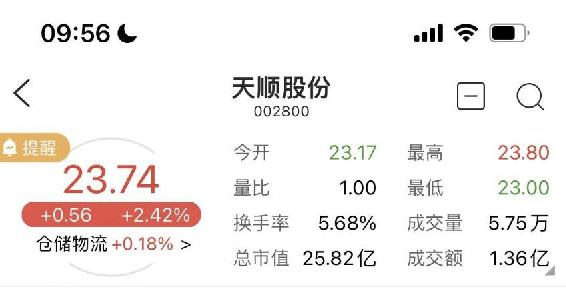这是一个多星期前给大家的第二个下注标的的判断逻

辑。一个星期前发在觉悟社里。这两天新出台的公共政策正在落地预判的内容。标的 2 突破了第一个阻力点，正在向第二个阻力点迈进。包括《做局》和《算账》两篇都是从我提交的一份报告里截取的一小段改写而成，立足点都是总结经验教训，借鉴有用的手段，提高下残局的能力。任何事都会出现意外，如何应对才是重点。不要去与别人做无谓的争论，实在闲得慌，可以顺着判断的思路挣两小钱也比争论有价值。

2022 年第二个标：天顺股份，行业属于仓储物流

正文

海洋

工业革命早期的大城市必须建立在靠近河流和资源的

地区，譬如说伯明翰和伦敦。但大型运输船舶的兴起，让缺乏资源的地区也能建成大城市，譬如说日本的大板。

对于传统的海洋国家而言，譬如说岛国或者半岛，海洋

就是生命线。这样的国家越是加快工业化进程，整个社会的稳定和安全对外部的依赖度就越高!

正因为如此，海洋国家必须要大力发展海上力量。当英

国还是世界老大的时候，他的海军无论吨位、火力、战力都远远的把第二名甩在后面很远。甚至比其他国家的海军的吨位总数还高。这种优势不仅仅体现在装备上，也体现在专业人员的培养方式上。以前的海军人员军官是类似于工匠带徒弟方式培养，水手没有培养体系，临时招募在实践中训练。

英国的海军太庞大，需求量太大，无论军官还是水手都不够，于是摸索出了一套培训专业人员的体系。这套体系日后发展成今天的大众教育模式。无独有偶，今天的美国海军及海上力量也是如此。这并非什么巧合，而是因为海洋竞争遵循赢者通吃原则。

在陆地上大家可以依托地形限制各霸一块，但海洋之上

则不行。互联网是平的，所以赢者通吃，海洋同样是平的，永远绝对优势的一方，可以轻易的把另一方堵在家里。直到今天，我们的海上力量有了巨大发展，还是被堵在家门口。

一旦有事，西边的马六甲海峡，东边的宫古海峡，中间的南海都可能被阻断。

英伦三岛是一个纯粹的海洋国家，它的一切都高度依赖

海外殖民地体系。直到今天英联邦国家，依然是其经济体系中的核心部分。当它失去殖民地体系之后，它就只能萎缩到今天这个样子了。美国虽然是一个拥有广袤纵深和数亿人口的大国，但他的陆地与外部联系较少。所以，它也是大力发展海上力量，并构建其自己的全球贸易体系。

今天世界上主要的海上贸易大通道有九个，全部由美国

海军控制。其指导思想就是海军上校马汉提出来的海权理论体系。（有本书可以看看）海上力量首先是能够控制主要海上通道的海军建设，其次就是自身能够占据主导的海上国际贸易体系。后来还进化出与这种国际贸易体系深度捆绑的金融体系。所以，美国灯塔的三个支点分别是：五角大楼、华尔街、好莱坞!

陆地

亚欧大陆是地球上最大的一块陆地，也是整个人类文明

的主体承载者。那些不绝于史的古老纷争，归根结底都无非是为了掠夺或交换。当掠夺变得容易的时候，主题就是征服与反抗。当掠夺变得不容易的时候，主题就变成了和平与贸易。

因为山川河流的地理阻隔，以及各族群的发展，又不得

不与所处生存环境形成深度的耦合，这就造成了陆地更容易被分割自守，各霸一块。中国历史上的赢秦部落，要不是在西部山区活的太艰难，也就会像东部平地上的诸侯们一样去追求细节上的精致和华丽去了。开启大一统的驱动力，除了赢秦君王的野心，对于整个社会来说，更吸引人的会是东部的土地和富饶。千百年来，打得过就征服，打不过就贸易。

但贸易的最佳状态是在商路能够得到安全保障的情况下。亚欧大陆的西段曾经出现过罗马治下的和平，就是因为整个疆域内各族群的经济贸易能够得到安全保障。与之同时，罗马每占领一个城市就会修建这个城市与罗马之间的公路，从而能让交易成本最低。正因为如此，才会有条条大道通罗马的谚语。

秦皇修建的驰道体系是中国历史上第一套完整的高速

公路体系。虽然修建的目的是为了强化中枢对帝国各处的控制，罗马的公路也是为了运兵，所以，罗马大道和大秦驰道的宽度都不约而同是两匹军马的屁股宽度。无心插柳柳成荫，这种古典的交通网络体系，让内部各地的经济往来变得更加便捷，交易成本在安全保障和快速流通的双重加持下持续走低，从而孕育出富足和繁荣!

由此可知，陆地上有安全保障的互连互通，足以强化各

区域的社会联系。古往今来，陆上贸易大通道的延伸和改道都会造成沿途城市的兴起和衰落。而那些能够控制和维系住贸易大通道的帝国，其影响力都会沿着通道往前推进。回顾历史，俄罗斯对远东的真正控制是在修建了贯穿亚欧大陆的铁路之后。不管是 1905 年，还是 1939，俄罗斯都是依赖这条铁路补给线才守住了远东地区。基于这样的经验，苏联大量修建了前出东欧平原的铁路枢纽。那些铁路线就是当时的苏联深入势力范围每一个角落的罗马大道。也正是因为这个原因，我们的铁轨宽度当年就故意搞得跟他们不一样。

成本

控制海洋最终还是为了与陆地进行贸易。在陆地上修建

通向各个角落的陆地通道，同样是为了让陆地上的各方能够互通有无。殊途同归之下，唯一的差异就是实现的成本了! 为什么大城市都建在水边? 不是大海就是大河! 因为水陆运输一直以来都是最便宜的。一直以来中国南北方依靠漕运，所以，这种物资的输送养活了百万漕工。清朝后期可以通过轮船，沿近海来运送南北双方的物资，而且效率更高，运量更大，成本更低，但漕运势力一直阻拦，因为影响其利益。

埃及这个国家没啥产业，但联通两大洋的苏伊士运河，

足以养活这个国家：在没有这样的运河之前，东西方的海上运输需要需要绕一大圈，那个成本会高的吓人。正因为如此，大家更愿意交这种通航的费用。当年埃及收回运河的时候，英国为什么要跟埃及打战? 因为苏伊士运河就是下蛋的金鹅! 当年巴拿马收回自己国家运河的权益，美国马上出兵巴拿马这个主权国家，夺回对巴拿马运河的控制权，还把人家按照美式民主选举出来的合法总统抓到美国受审。

黄金水道最核心的价值就是对贸易交易成本的巨大影

响。如果东方是最大的生产方，西方是最大的消费方。那么，在这种经济活动中，除了供需关系，最重要的影响因素就是交付成本! 去年通往美国的海运成本持续上升的时候，许多订单就交付不了!但是中美之间，除了海运没有其它的交付方式。

空运是不可能的! 最大的飞机刚刚被毁掉，运力也就 200 多吨而已，而且成本高的吓人。一艘轮船可运输的集装箱可高达十万吨!

如果中美之间存在铁路，甚至是公路连接，也可以有效

缓解当时的海运紧张的问题。美国与欧洲的交付方式也只能是通过大西洋的海运。西方作为世界经济的主要消费和需求方，除了美国市场就是欧洲市场。生产中心已经在亚洲，与美国市场的交付方式没法改变，但与欧洲的交付方式存在另外的可能!

亚欧大陆从来都存在着连成一体的可能性。不管是成吉

思汗的西征，还是马可波罗的旅行，在古老的驼铃声中，寄托着一种让亚欧大陆互通有无的期盼。

东南亚与中国经济一体是早晚的事，中南半岛上最具代

表的是中老挝铁路的开通。值得关注的是，欧洲再次超越东南亚成为中国最大的贸易伙伴。亚欧大陆那一端的欧洲是需求方，这一端的亚洲是生产方，不仅仅是中国，整个亚洲都是生产者的角色。欧美才是消费者的角色。美国市场的交付已经没法改变，但欧洲市场的交付存在另外的可能!

冲突

俄乌冲突的加剧，首当其冲的是欧洲。粮食和能源的短

缺不会只是暂时的。这种短缺即便找到替代方案，成本也会更高。就拿油气来说，管道输送是最便宜的，就是建设的时候花点钱。但液化天然气，需要建立一整套专门的液化体系，而且需要用专门的液化天然气的船进行运送。运输之前供应方需要先液化，然后需求方在运过来之后需要重新解冻操作。

总之，既麻烦又受各种其它因素的干扰限制。

譬如说海运成本增加，或者恶劣天气的运输延期。所以，从美国进口液化天然气比从俄罗斯获取管道天然气的成本，在抛开市场价格波动之外，额外成本要高出两三倍是正常的。

这种工业生产所需的底层油气能源的成本翻倍，基于其上的各环节的成本都要叠加。举个例子：在造纸中有一种核心原材料依赖进口，占据 25%的比例。海运成本增加之后，进口成本也增加，进口成本增加导致原材料整体加价，原材料提价，造纸成本增加，纸的进货价也要提，然后生产纸箱的厂家成本增加了!要么不生产，要么提高出厂价。经济活动就是这样一环套一环。底层能源的成本增加会造成社会生产供应链的短缺和成本被动提高。如此一来，不仅会降低自身商品的市场竞争力，也会造成经济生产供应链中的各种短缺和日常消费成本的提高。这种时间贸易的价值就体现了：对方如果可以低成本生产，你肯定会通过向对方采购来缓解社会所需。问题是，怎么交付?

大家只看到俄乌冲突对欧洲的影响。更重要的东西却没

有进入眼帘：埃及缺粮了，黎巴嫩破产了，斯里兰卡掏不出 5200 万美元内乱了! 什么叫城门失火，殃及池鱼? 这就是! 这个世界上许多国家，就如同我国一线城市中的工薪阶层一样，在勉强的维持着一种还能继续下去的生活。那种脆弱性经不起任何风浪，稍微有点入不敷出就难以为继了!

黎巴嫩和北非各国破产和缺乏食物，一定会造成难民，

而且会往欧洲跑。乌克兰的难民是临时的，但这些难民一旦涌入就不打算回去，也很难在欧洲自力更生。潘多拉魔盒打开之后，真正的后遗症才刚刚开始. .

先不管北非那些国家如何求存。埃及有个动作应该不可

避免：那就是提高苏伊士运河的通过费用! 这是它唯一能够利用的武器。但如此一来，会让东西方的海运成本增加。海运成本增加，虽然不会彻底改变东西方交付的方式，但是，在存在另一种选择的时候（亚欧大陆的陆上运输体系），大家对这种选择的期待和尝试会加大。

中欧之间的货运依赖于亚欧大陆的铁路运输，但许多地

方是我们目前的势力无法企及的区域。这个时候就需要借助别人的力量，特别是借助别人的控制力和影响力。在中俄关系中，开战之前，俄是主导者；开战之后，反过来了，不仅仅是今天，而且是从此以后! 不管怎么样，经此一役，一切都无法回到从前，世界经济政治格局彻底改变，大国之间出于安全的考虑都会去努力摧毁现有的国际经济政治体系。俄罗斯不仅此时此刻，在以后的很长一段时间内，将更加依赖中国，不仅仅是俄罗斯，包括它的势力所能覆盖的区域。当俄罗斯主动提出它的一些资源，在对外贸易时采用人民币结算之时，兔子这两天的态度明显热情了一些。中俄之间的通过铁路运输的新贸易线路也正式开通。

中国拥有全系列的工业体系，特别是轻工业和机电产品

已经是最大出口品类。当俄罗斯全面转向之后，这类经济合作只会越来越频繁。其实，俄罗斯社会的所有问题，其它独联体国家同样存在。不管是伊斯兰世界还是独联体国家，都是亚欧大陆上被这条线路串起来的节点。

所以，中俄之间的铁路运输，不仅仅是中俄，而是亚欧

大陆陆上运输的主干线! 亚欧大陆上经济活动越频繁，对主干线的流速要求就越高。这就是华为所说的：我是做管道的，只要未来数据流量越大，对我这个管道的依存度就越高。这条陆地主干线就是亚欧大陆上经济活动的主要管道。可以肯定，中俄之间的类似铁路线路会更多，速度需要更快。就如同油气管道一样。目前中俄之间的铁路运输主要线路是经过东北，然后走西伯利亚铁路进行运输。这个瓶颈是俄罗斯的西伯利亚铁路。与俄罗斯境内的运力比起来，中国境内的运输速度更快。因此，从乌鲁木齐经过哈萨克斯坦进入俄罗斯境内的新路线会落地并加速。中俄之间的铁路路线是亚欧大陆的主线，东方向西方进行货物交付的其它支线未来也会汇聚到这根主线! 包括东南亚各国，甚至是日本、韩国、朝鲜等东北亚国家如果选择走陆运的话。

# A652：结构学对作战体系的浅释！【结构学中两种生存竞争思维】

（展麟解读，讲国家生存结构中，作战思路的生存竞争

思考和日常和平的生存竞争是两个完全不一样的思考方式和操作手段，作战生存竞争的建设要求是侦查能力，打击能力和突击能力，要求强大的地方要求更强，甚至是超强，要求对综合能力，体系能力更全面和补给时间更短，这就是作战思维对背后的建设要求，同时不太注重利润，而重视是否牢牢掌握底层命脉。而和平生存竞争是建立在交换，贸易，匹配的能力上，对时间要求和综合要求是相对低的，甚至可以缓和，获得未来的时间来解决。和平生存竞争，更要求的是有利可图，而不太注重底层命脉。这就是两者的真正区别，和平生存竞争以来作战生存竞争的保障，没有作战的安全保障，就没有和平生存竞争中的经济繁荣和有利可图。生活中需要从战时生存竞争与和平生存竞争去思考生存策略）

司令解读：读过《算账》和《结构学对作战体系的浅释》就会明白，所有的生存竞争终究还是体系的对决。不管是未雨绸缪的制定应对预案，还是随机应变的调整反制策略，都是为了获得结构性的体系优势，归根结底一句话：用己之长，攻彼之短! 棋局的精彩之处就在于对决者能够心平气和的接受现实并及时调整策略，一步步的逼近目标。

正文

机械化和信息化对于进攻单位来说，最大的价值就是能

够赋予进攻单位更大的动能！不管是火力输出的增强，还是信息协同的增强，都让进攻单位瞬间聚集起更大的力量，从而突破对方的兵线！

以己方的有序，让对方陷入无序是永恒的制胜之道！不

管是远古时代的阵型还是一战时期的战壕，都是为了维持住兵线和己方的有序性。只有己方的个要素能够组织起来有序的投入战斗，才能抵挡住进攻方对兵线的冲击。在对方的兵线出现破绽或出现混乱时，组织起反击并将兵线往前推进。

坦克作为突击集群的价值，恰恰表现出机械密度的提高

强化了进攻单位的火力密度，从而能在兵线上形成更强的动能！如此一来，即便对方的人数众多，只要在单点上的火力不足以压制住突击单元的动能，（对方）兵线就一定会被突破。闪电战的核心思想就是以突击单元的巨大动能，迅速突破对方兵线，继而快速推进，攻击对方的后续目标，迅速的将兵线往前推进很远。同时围歼，落在兵线之后的敌方有生力量！

大纵深进攻的思想也是强调用尽一切技术和组织手段

强化突击单元的动能。但突击单元不是用于兵线的单点突破，而是先用密集的火力打击前沿，突击单元在敌方前沿被打乱之后快速向纵深推进，同时对敌方的纵深进行火力延伸。从而形成多点同时突破，分进合击的态势。造成对方兵线从纵深到前沿的整体性崩溃。

大纵深的防御侧重于三个关键要素：1.战场纵深和多梯次的阻击点，2. 强化阻击点的动能优势，3. 拥有纵深火力打击能力。

在一个狭小的战场空间中是无法进行大纵深防御的，一

个缺乏战略纵深的国家无法进行大纵深防御。当国土面积很小，但拥有海岸线的时候，需要大力发展海上力量，并占据岛礁将战略纵深往前推进，从而形成一定的纵深防御基础。

在进行纵深防御时需进行梯次布防，并能随时支援。梯次布防的重点是借助有利地形和工事构建起来的阻击点，并且应该强化阻力点的动能，包括火力、信息和物资的密度，以及增援和反击的能力。在纵深防御时，需要强化远程火力压制的能力，从而能够阻断或滞缓进攻方的后续攻击单元的跟进。

从而在对方先头攻击单元，无法突破纵深阻击点时，迅速组织反击，将阻击点往前推进。

以上的作战思路为装备所需要具备的功能指明了方向，

也为人和装备的组织方式提出了明确的要求。总得来说，装备的发展和体系的建设需要突出以下三点：1. 侦查能力，2. 打击能力，3. 突击能力。

侦查能力的建设主要依靠信息技术：不管是天上的卫星

监控，还是海底的深网和深潜技术，或者陆上的战场监测，都是为了尽早发现并提供预警。发现之后就需要具备有效打击能力。这个能力包括打击的力度、精度和有效性。说的更直白一点就是：发现之后能不能够的着，能不能打的中，会不会被拦截或者打中了也没用。任何时代的突击能力都是在强化突击单元的动能。古代的骑兵突击和现代的超音速导弹突击，都是在强化突击单元单点突破兵线的综合性动能。

从作战思想来审视装备就会发现：以航母为中心构建起

来的察打一体的作战体系，既是突击单元，也是大纵深防御的阻力点。作为突击单元，需要不断提高其探测纵深和火力密度，从而赋予突击单元更强的突击动能。同时，也不断强化防空、反潜、反舰等技术手段，除此之外，战略打击力量不断提高对敌纵深的火力压制能力。

假如出现某种能够绕开侦查，或者可以无视损耗的廉价

小型智能武器，或者是即便侦查到，也来不及响应的大型武器，就能瞬间撕开对方的防御网。如此一来，同时作为突击单元和阻力点的作战体系所能覆盖的防御纵深和探测范围都会瞬间被撕碎，从而让兵线被大幅往前推进。与高速导弹相结合的无人化狼群战术和峰群战术会成为新时代的突击单元，就如同二战时期的坦克集群。

包括金融、舆论认知、外交、经济制裁在内的各种打击

手段，都是属于纵深打击，这些摧毁战争潜力的手段与纵深防御时，用远程火力对敌进行纵深压制，从而阻断或滞缓后续攻击单元的跟进是一样的性质，只不过增加了新的纬度而已。由此可见，随着科技的发展，攻防双方无论是纵深的时空范围，还是纬度都在不断增加，但万变不离其宗！

本文先阐述框架，后续篇幅结合战场上的具体案例，梳

理彼此之间那些行之有效的策略和手段。譬如，为什么乌军不组织力量，去撕开包围圈的口子救援被困的亚速营，而是派出特种兵小分队，渗透到马里乌波尔与赫尔松之间的后方。

这是一种什么样的策略，是否能得偿所愿达到四两拨千斤的效果？许多人在情绪的驱使下急于捍卫自己偏好的立场，而不关心冲突中那些真正有用的手段。试图解决实际问题的人，更应该关心那些行之有效的手段，而不管这份精彩来自于哪一方！

# 000：斯洛伐克经济部长说话【其中一种特别有效的生存策略】

（展麟解读：讲在国家生存结构中，还是个体生存结构

中，长时间拥有一样东西后，就会变的理所当然，认为就是这样的，不是这样你还不干，这个时候的生存策略，就需要制造动荡和不安，让此时的不安和曾经的安全做对比，只有对比，只有比较，才能降低预期，预期降低了，就可以产生更多的合作，因为有前后对比，人就会妥协，就会降低预期，从而达成合作，所以在美国主导下的经济全球化，已经祥和了几十年，大家都觉得现在的可以更好，甚至更上一层楼，要求越来越多，也更难满足，只有关乎自身利益和存续的时候，才会思考其他替代生存方案，而此时的俄乌战争，正好打破一直向上的预期，一直越来越好的惯性，甚至是全球疫情，也给人一种前后对比，让更多的人降低预期，为接下来的生存合作提供更多可以匹配的条件，这也是人求存的一种方式，用前后对比和前后落差去争取更多的合作）

正文

斯洛伐克经济部长说：天然气供应不能断绝，虽然对某

些人来说过于务实，但我想说，如果条件是以卢布支付，那我们就用卢布支付!

除此之外，法国总统好像归还了扣押的俄罗斯的一艘船，并且赔偿 16 万美金。这应该是释放软化立场的信号，后续看法国什么时候解除制裁。匈牙利在欧盟投了关于拒绝用卢布支付俄罗斯石油天然气的反对票，根据欧盟的规则，任何议案如果有一个成员国投反对票就不通过。这也是给大家找个台阶下。

许多人被西方思维方式带偏了。俄罗斯没打算融入西方

主导的世界经济秩序之中。因为融入其中，他们的现实状况只会沦为原材料供应者，并且所有的轻工业和日常生活相关的产业都会被冲垮。因为这些他们都不具有竞争力! 我们有一个误解，认为世界处于同一发展阶段，走在同一条路上，这个观念是西方灌输给我们的。事实上，不同的社会在刷不同的副本。譬如说，一个清华毕业生如果去美国加入波音公司，他会在那个基础上搞出新东西，这与他自身无关，或者说不那么相关。他站在巨人的肩膀上。那是波音公司和整个美国社会积累的基础，他在这个基础的层面上再往上拱一点。如果他留在国内，他可能会搞出中国最新的航天发动机。譬如说帮助太行涡轮发动机实现突破。如果没有他，他的同学也会做到!这是因为我们的综合基础和积累，目前只能刷这个副本。

美国南北战争的一个核心因素就是北方工业区要关税

保护自己刚刚起步的工业产业。而南方种植园需要降低关税，因为他们的棉花出口是最大收益，而且自己的农产品在欧洲有优势，需要扩大这个优势!另外，北方工业发展需要大量廉价劳动力，解放黑奴能够获得大量廉价劳动力，用于当时还处于低端劳动密集型的产业。但是，免费的黑奴也是南方种植园成本优势的来源。因为农业技术在当时就那样，但欧洲的劳动力是有成本的，而美国的黑奴几乎可以忽略成本。这是竞争优势，农场主肯定不会放手。

俄在这个阶段，优势是他们的粮食、能源、原材料和军

工。他们的轻工业和半导体产业完全经不起外部冲击。但是，如果能够通过进口，替代逐渐建立起自己的相关产业，其实符合自己的现实状况和发展阶段。任何事都需要一个动力，需要创造条件。

我们与俄完全不同。我们需要拥抱全世界，在全球化中

我们是受益方。但是我们正在遭受有针对性的全球化压力。

有的时候就是这样，只有情况更糟的时候，之前的状况反而就觉得不错了。其实，不仅美俄不希望快速冷却，兔子也不希望快速冷却。没有压力，中欧之间的合作会更困难一些。

过两天把另一个机会的思路写出来。再给大家新的标的，有苗头了。

# A653：终究还是要拼刺刀! 【利益本质是存量竞争】

（展麟解读：讲在国家生存结构中思考个体生存策略，

国家在生存竞争中有一个最核心的前提，就是存量生存竞争，军事行动为政治服务，政治手段为利益服务，利益的本质是在日益恶化的生存环境中进行存量生存竞争，不管是金融制裁，还是俄乌冲突，还是贸易限制等等，都是生存环境日益恶化后的存量生存竞争。生存竞争最大的问题不在外面而在内部，所有外部行为都是内部需要的延续，也是通过外部反馈来调整自己，这就是斗争的，冲突的前提，不要觉得好像是，这就是事实。面对存量的生存竞争，需要树立一个全新的思维，就是要更关注解决问题的手段，而不是是非判断，立场选择。在俄乌冲突中，俄罗斯撕下面子，应对金融制裁的有效手段让卢布与石油结算，让大宗商品与黄金结算，从而稳定汇率，保护了俄罗斯外部财富。应对舆论制裁的有效手段从强调自身行为去军事化去纳粹化维护自身利益，转变为强调自身行为为了摧毁美元收割全球的罪恶体系，把关注自身利益变成大家利益，这种话语权的转变让其他国家都积极配合了，因为跟自己的自身利益有关，这就是不关注是非判断和立场选择后，采用有效制胜手段的结果。个体也好，共同体也罢，甚至是国家也好，面对各种不如意状况，真正的有效手段有两种，第一种手段主动接受现实的勇气，并及时调整生存策略去达成目标，就是这个个体，共同体，国家最重要的能力体现。第二种手段要主动去解决内部问题，不管是大力反贪污还是查内鬼，还是内部自我革命，都是在真正竞争的时候纠正自身存在的脆弱性。对于个体而言，需要完成精神结构升级，完成精神层次的整体判断力提升，从而拥有更高维度的精神层次判断和决策，继而拥有更多的制胜的有效攻防破手段，卸掉是非判断和立场选择的盲区）

司令解读：注：《A653：最终还是要拼刺刀！》这篇是近期最满意的万字长篇，但简介不能写的太直白，否则不仅发不出来，还会封了。虽值得一读，但对理解力有要求！

前言

不管是个体，还是群体之间的许多是非争论，本质上都

是因为缺乏解决现实问题的手段！一旦市场的运转，被外力阻断，不管是因为当下，还是未来的战争和全面制裁，只要存在让市场无法正常运转的关键因素，就会呈现出整体的脆弱性。

正文

从技术角度复盘了一下，莫斯科号被击沉的实现路径。

任何有效的手段都值得研究和学习，尤其是以小博大的方式。

就俄罗斯号导弹巡洋舰本身具备的能力而言，亚音速的海王星反舰导弹和 TB-2 的无人机，是无论如何都无法对其构成威胁。光荣级导弹巡洋舰从远至近设置了四道安全网，每一道安全网，对应不同的雷达探测系统。事实上，只要海王星开启车载雷达去确定目标的时候，它就已经在莫斯科号的雷达探测范围之内了，除非海王星导弹关闭车载雷达盲发。就算由天上的 TB-2 无人机提供目标引导进行盲发。也需要对方配合，这个配合就是莫斯科号主动把自己的所有雷达都关闭。然而，这是不可能的! 因为任何军舰都会安排值班，必然要开启雷达去监视周围的状况。海王星是掠海飞行通过偷袭击中了莫斯科号左弦上挂的 4 组“玄武岩”导弹引发殉爆，才把自己炸沉的。不管怎样，300 公斤的海王星反舰导弹要击中，外挂的重达近 8 吨的玄武岩导弹，在正常情况下也是不可能的!这一点可以通过计算机模拟得到验证。除非对方把所有雷达都关机，但没有任何一艘军舰，在战争中会把自己的所有雷达都关机!

所以，情况只有一种：有人在莫斯科号雷达探测范围之

外，在给乌克兰的反舰导弹提供坐标和指引，同时，莫斯科号唯一开启的那部雷达不具有对海搜索能力! 我认真查询了一下莫斯科号光荣级的导弹巡洋舰的技术参数，还真有这样一部雷达：MPZ-301 属于中段预警雷达，能够探测 43 公里的中段距离，但它只能对空搜索，无法发现掠海飞行的低空对海目标。与之同时，乌克兰的海王星反舰导弹并没有开启自己的车载雷达，而选择了盲打，这也就必然存在一个更高级的神秘力量，在为乌克兰的这波操作提供坐标探测和信号引导。

在乌克兰的边境存在北约的预警机，预警机的有源相控

雷达的探测范围能够高达 500 公里。它并没有进入乌克兰的空域，所以不违规，同时处于莫斯科号雷达覆盖的最大区域之外!也就是说，你在明处，它在暗处。它能看到你，但你看不到它，而且它还在战区之外!这场战争俄罗斯不仅是自己跟自己打，也是在跟整个北约打。北约以乌克兰为棋子，充分的检验自己的新思维、新战术新技术、以及最高级的金融制裁和经济阻断下的极限压力测试。军事行动为政治服务，政治手段为利益服务，利益的本质是生命体在日益恶化的生存环境中进行的存量生存竞争!

漏洞

生存竞争中最大的问题不在外面，而在里面。所有对外

的行为都是内部需要的延续，即便是个人也是如此! 在生存竞争中，总是会通过外部的反馈来调整自己。对俄罗斯而言，这次需要纠正的问题包括：内鬼泄密、情报失真，后勤保障和前线协调等一系列问题。不管是个体还是更大的共同体，在生存竞争中，最核心的问题永远是矫正和修复自身的问题，只有修复了自己的漏洞，才不会被对方利用和拿捏。我反复阐述过：乌克兰最大的问题是自己做不了主，只能一而再，再而三的由各种内外势力做自己的主，不管是外部势力的操控，还是内部寡头的捆绑，总之，民众被迫成为这一切的承受者。开战之初，100 个亿万富翁跑掉 96 了，另外四个没跑，是因为被关在监狱里没法跑。最后由普通民众以家破人亡和骨肉相残的代价扛下了这一切，唯一的收获就是一份自我牺牲的感动。是不是有点像东部沿海某一线城市（上海）的状况? 神仙打架，庶民遭殃!

许多人都热衷于做是非判断，任何是非判断都会导向一

种价值观，从而怂恿着人无原则的趋于某个立场。这不是解决问题者的思维方式! 解决问题者更关注实现目标的有效手段，不管是哪一方采用的手段都值得研究和学习。任何得偿所愿，都基于那些有效的手段，而不是某种高贵的价值观。

在做是非判断的时候，意识形态会让任何人都认为自己的价值观是高贵的，对方的价值观不仅愚昧，而且荒缪。因为价值观体系都是从原点衍生出来的逻辑自洽和不言而喻，但这种原点天生就具有排他性，并强调自己的不证自明! 关于这一点，可以去读《C4：是非的源头》!

我只对解决实际问题的有效手段感兴趣，买卢布是因为

理性判断认为能挣钱。因为工作的需要，跟进和研究都是为了挖掘彼此的决策逻辑和各方达成自身目标的有效手段。这些才是值得借鉴、学习和研究对策的关键部分。俄罗斯暴露出来的所有问题，都可以追溯到苏联解体之后，有些问题我们自己也存在，也需要解决。普通人的思维具有两个特征：

1.喜欢用自我代入的情绪共鸣和道德化的是非来判断一切，2. 把宏大的社会变迁所造成的问题归咎于某个人物的品性。但决策者的思路、心态和视角不是这样的，也不能这样。政治只考虑治乱的秩序，而不考虑是非判断，因为任何是非判断都存在天生的偏向性。解决问题要靠那些行之有效的手段，就如同治病要听医生的一样，因为只有医生才真正掌握那些解决病理问题的有效手段。所以只研究有效的手段，不管这种有效的手段来自冲突的哪一方。我一直一位英国首相说的一句话：魔鬼手上的剑那也是剑! 在《每天挣一万的快递员!》一文中，也只是关注以什么有效手段去解决当下的现实问题。

不管是个体，还是群体之间的许多是非争论，本质上都是因为缺乏解决现实问题的手段! 当男人拿不出彩礼的时候，习俗就变成了人的道德问题：要彩礼就是不重视感情，道德低下的人；不要彩礼才是重感情，道德高尚的人。同样的道理，当女人无法通过自己的努力获得想要的生活的时候，挣钱不多的男人也就变得面目可憎道德低下。所有是非之争，本质上都是因为缺乏解决现实问题的手段! 所以，结构学不争是非，只关注切实有效的手段。当解决的手段足够多，也足够有效的时候，基于是非的立场争论不仅会变得模糊，甚至会变得可笑!

手段

乌军在战术方面的灵活性，源于北约的训练和北约军官

的直接指挥，我们可以从中看到这些年来西方军事思想的演变过程。技术的发展一直在引导战术的变化，国防部官网上有篇文章就提倡在军事理论研究时要特别注意这一点。甚至恩格斯当年在研究欧洲最先进的炮兵战术的时候，也是从火炮开始的。

虽然军事思想虽然基于技术的发展，但军事思想为作战、训练、组织和兵器发展思路等方方面面提供指引。举一个最简单的例子就明白了：在发展歼-20 这样的先进战机的时候，其实存在两种指导思想。任何一种指导思想要落地都会对应相应的体系和配套。一种是苏式思维，一种是美式思维，他们分别对应的是沈飞和成飞。技术细节和专业知识就不展开了，因为有门槛。长话短说，就是苏式思维追求飞机的机动性，俗称空中拼刺刀。美式追求导弹的机动性，俗称快速发现迅速打击。

伴随着苏联解体和改革开放，我们这一代人的思维方式

偏美式。但这并不妨碍，（苏联建设的）伏龙芝军事学院依然是世界上最优秀的军事学府。事实上，二者各有优劣，凡事能克敌制胜的有效手段都值得学习。表面上看起来我们的许多设备，已经比俄罗斯更先进了，而且俄军在这次冲突中表现出来的问题，更加强化了这种判断。但事实上，他们拥有的北风之神核潜艇，我们还是搞不出来，他们拥有的图 160 高速突防的战略轰炸机，我们也还是搞不出来。在二十年前的车臣战争中，他们的近卫 76 师，就能让人直接坐在坦克里从飞机上空降下来，降落之后直接投入战斗，我们今天才能做到装甲车和人一起安全降落。

天下功夫唯快不破，在苏式的指导思想中，快速突防一

直是他们所追求的。白天鹅核战略轰炸机在当时是无敌的存在，当时的超音速战略轰炸机，能够瞬间撕开任何防空系统抵达目标上空，让对方来不及反应。事实上，今天超高音速的东风-17 依然是按照这种思路发展出来的快反战术武器。

如果你要追求极限的快速，肯定会无限的突出这个点，

从而弱化其他的点。就如同我们当年强调近战，夜战和快速穿插，也是基于自身的忍耐力和组织度优势，以及火力和机动能力不足的现实状况提出的战术思想。当年的士兵因为长期生活在流离失所的艰苦环境中，所以忍耐力特别强，今天生活条件普遍提高了，特种兵还可以做到，但大面积要求普通士兵达到那样的忍耐力和顽强的生存能力就不现实了。而且火力也不再匮乏，正因为如此，战术也需要与时俱进。

苏军不太注重航电系统（航电系统一般指综合航空电子

系统），而一味强调机械动能方面的优势。这跟美苏争霸的不同路径是息息相关的。为什么第一个上太空的人是苏联人，而第一台计算机是美国人发明的? 当时在面对核战争的时候，苏联追求的是在近地轨道部署武器，再像达默斯之剑一样，从头顶上发射核弹威胁美国这种思路。而美国当时则侧重于在遭受核打击之后，如何有效的建立起指挥链路，进行二次反击。计算机最早是军方研究的，目的是为了战争。后来美苏争霸结束了，军方研究的东西失去了作用，也就没有了持续投入的动力，从而技术外溢，并通过持续的改进和发展，就变成了后来的互联网。但是，今天俄罗斯即便没钱，在航空航天领域依然领先，想一想，为什么中俄依存度更高的这些年，中国的航天技术和各种先进装备发展的那么快? 有些人有技术但没钱，有些人缺技术但有钱，稍微指导一下就能给弄出来。

歼-20 的面世，代表着早发现早打击的思路暂时占据主导，这也是因为我们的北斗系统已经完善，并且在通讯方面具有优势。所以，我们的无人机、无人船等相关领域都发展的很快。而且民用的互联网和数据产业，全球也只有兔子和鹰酱能够并驾齐驱。所以，在某些方面的指导思想，二者会加速趋于一致：今天的鹰酱也开始极力发展航空和卫星领域，需要依靠美国政府拨款的 NASA， 摇身一变，变成一家可以通过金融市场获得持续融资，不再受限于国会预算的金额限制，不仅搞火箭回收，还在大力搞星链计划。这等于昔日美苏争霸的两条线路，在自己的互联网方向取得优势之后，也开始向昔日苏联具有优势的领域迈进了。而兔子接过毛熊的接力棒，同时在两个领域都齐头并进。真是殊途同归，越来越像!在武装力量的建设上，兔子这些年在不断地增加自己的火力覆盖的能力，而鹰酱这些年在不断的强化灵活机动的穿插能力。当年抗美援朝时，兔子的那种战术灵活度属于 1.0 版本，而鹰酱在利用通讯技术构建 2.0 版。彼此都在拼命向无人作战单元的 3.0 版进发. .

但这并不表示苏式的指导思想就没有价值，恰恰相反，

最具代表性的高超音速的东风-17 这种导弹率先由兔子列装部队，恰恰说明兔子在充分的挖掘两种指导思想的优势，来发展自己独特的体系。这也是为什么，不要人云亦云的去嘲笑大毛的掉链子，而是应该学习那些有效的应对手段! 反制

不管是战术方面，还是打击战争潜力方面，甚至是话语

权的争夺方面，俄罗斯都在见招拆招。总得来说基本上抓住了要点：为了反制金融制裁，让卢布与石油、大宗商品和黄金的绑定，从而稳定了汇率，让外界的信心恢复。从 2014 年开始就有针对性的，让小麦等粮食的产量快速增加，接近欧洲其他国家总和的一倍。设定稳定国家金融体系的专项基金，为应对金融核弹的全面打击，储备黄金和储备弹药。土耳其看到卢布顶住了，昨天已经恢复与俄罗斯的航班，并允许卢布购票。国家之间没啥道义可言，都是逐利而动。感觉你不行的时候就会抛弃你，甚至趁火打劫，觉得你又行的时候，就会见风使舵，甚至提高下注。所以，在遭受任何突如其来的意外打击的时候，重要的是要能具备稳住关键点的能力。这就如同战场一样，稳住了关键支点，整条兵线就能够恢复!

人生不如意十之八九，不可能预计到所有的情况，重要

的是要有应对的手段。在《算账!》一文中我们阐述了战场上制胜的三个关键点：1.任命一位富有战斗经验的前线指挥官统一指挥调度；2.重点摧毁决定战争潜力的基础设施和燃料、粮食的供应能力。3.彻底摧毁对方中高空域的防空能力，抢占绝对的制空权。与之同时，俄军也在努力克服自身短板，缩短战线，稳打稳扎，大量采用铁路运输来保障后勤供给，同时，在后勤运输和地面集结的时，派空中力量在空中掩护。

目前俄军在东部增加了电子战车配合防空体系来反击乌军的无人机偷袭，同时在地面坦克装甲车推进时，派武装直升机在低空同步掩护，防止被乌军小队偷袭。

在话语权方面也重新做了调整。之前的叙事方式是强调

自己的行为是为了保障自身安全和去纳粹化。这种叙事不仅底气不足，而且更外人无关，只在强调自己的那一亩三分地。

西方可轻易的利用民众，对俄罗斯的刻板印象，将俄的行为描绘成以大欺小的有一次对外侵略，而且西方占据着媒体的话语权制高点，可以让俄方的任何辩解都显得虚伪和无力。

大国之间的安全不可分割原则是普通人理解不了的，虽

然 1962 年的古巴导弹危机，也是因为大国之间安全不可分割原则导致的，美国当年采取了同样的行为：当年美国先是在土耳其部署导弹，仅仅与苏联隔黑海相望，苏联说你威胁到我的安全，让美国撤回导弹。肯尼迪当年利用黑帮势力的选票上台，上台之后又清理黑帮，导致内斗不止焦头烂额，急需通过外部强硬来立威。坚决不同意撤回导弹，于是，苏联就在古巴刚革命胜利，急需外援的古巴部署导弹虚张声势。

美国的情报部门为误导了，认为他们部署了 4 万人，上百枚核导弹，感受到了巨大的安全威胁，肯尼迪绑架全世界以全面核战为威胁要求苏联撤回去。最后彼此达成秘密协议各退一步，先是苏联撤回古巴的导弹，继而美国找了重新部署的理由，从土耳其撤走了导弹。大国之间的安全缓冲重新恢复，古巴导弹危机得以解除。当然了，就在这个危机期间，白象（印度）觉得大哥们都很忙，准备乘机揩兔子的油，结果被兔子反杀，差点到新德里散步!为什么兔子当年打赢了却主动撤退收兵呢? 就是因为古巴导弹危机，以美苏各退一步的方式解决了! 因为大哥们又有空了，只能见好就收。

总之，能够理解大国之间安全平衡的政治人物，是不会

去跟民众说清楚的。因为自己当年也是这么干的，而且干的更出格。讲清楚反而对自己不利。在这种需要放别人的血来救自己的关键时刻，利用民众无法理解事情的前因后果和来龙去脉的特点，把整个事简化为，以大欺小从而激发民众的反感和情绪共鸣，就能抢占道义上的制高点和话语权。

对于非西方国家而言，俄宣称的去军事化，去纳粹化目

标与自己的利益毫无关系，所以，保持中立看个热闹，顺便做点生意已经是最理性的行为了。于是，俄针对这种情况，在话语权的争夺方面也做出了应对的调整：最近开始宣称自己的行动是为了摧毁美元收割全球的罪恶体系! 这就跟大家的利益都有关系了! 天下苦美久矣，又到了美元收割的季节，疫情之下大家都过的紧巴巴的，美元体系还要来割一把，早就不满的各国，特别是有潜力的大国，巴不得有人挑头，把这套吸血的美元收割体系削弱，甚至摧毁。恰好俄罗斯资源、能源、粮食都丰富，在这个废纸（纸钞）过剩的周期，这些东西才是真正的硬通货。于是，观望的态度变得积极起来：

兔子宣布合作无上限，陆上增开了好多货运列车的线路。不仅走东边，也走西边。走西边进俄罗斯送货更快，而且水路也不断有集装箱，在俄罗斯的码头卸货。白象（印度）则顶住鹰酱压力，不仅买东西，还与大毛弄出了本币交易机制。

把用本币购买的能源和大宗商品倒卖给欧洲。土耳其看到卢布稳定了就开始恢复与俄罗斯的航班. .别小看了话语权，它不仅抢占道义制高点，还更准确的指明利益，从而决定别人的态度和参与程度。利益又引导一致行动人，按照自身利益采取行动，同时不约而同，高举那个道义的旗帜，最终形成合力，达到目的!

价值

人在解决现实问题的时候，总是会产生各种不如意的状

况，能力的差异就体现在遭遇不如意的时候，是否有接受现实的勇气和及时调整策略去达到目标的能力! 当苏军把红旗插上德国国会大厦屋顶的时候，英美法等所有西方大国都没有人去藐视苏联，并嘲讽他们前期失地千里的狼狈。

演员（泽连斯基）前期的高光状态，源于他的行为符合

棋手的利益。当其行为不再符合别人利益的时候，这种高光就会逐渐黯淡下去，并最终被抛弃。这就如同投资人需要一个白手套，在开局之前就想好了，如何退出的方式。于是去捧起一位明星创业者，把各种高光都投射在这个明星创业者的脸上，让他站在舞台中央表演，并通过自己的资源和人脉叫来一堆人捧场。然而，一旦明星创业者的行为对自己形成利益上的反噬，投资人就会把梯子抽掉，把捧场的人都叫走! 然而，明星创业者突然发现自己根本撑不起这个场面，错把平台的能量当作自己的能力!

诚如《做局!》一文中阐述的那样，演员在舆论方面的策略非常成功，乌军在战术上，也呈现出许多高明和有效的手段。这些都会被台湾复制并采用。作为进攻的一方，需要找到克制和应对这些有效手段的方法。俄罗斯暴露出来的问题和应对策略，对同样处于进攻角色的我们而言，是活生生的案例!

中海油早些天取消了对加拿大、美国、英国总计 1000 多亿美元的投资，就是为了避免有一天被制裁，导致这些海外投资打了水漂。之前所有人都会天真的认为，不管发生什么对方都会坚守契约精神，制裁也不至于突破这个底线。但俄罗斯的遭遇，让所有国家都看到了对方会突破所有底线! 因此，不再心存幻想，必须提前未雨绸缪。

虽然我们的装备和人员的训练状况，不至于发生类似于

莫斯科号被亚音速导弹偷袭击沉的情况。但这种不可能，却发生了的问题值得警醒! 这种事是战术的一部分，绝对不是随意为之，北约的指挥官在发动偷袭之前，肯定提前做过多次沙盘模拟。昨天乌军的一架米八武装直升机去袭击俄罗斯边境的村庄，被俄军 S400 防空导弹击落。站俄罗斯的人会叫好，站乌克兰的人会强调乌军都反击到俄境内了。这属于为自己的立场找证据，除了满足情绪没啥价值。这里面凸显的有价值的信息是什么呢? 我在查看飞行路径和击落地点的时候发现：它是返回的时候，被 S400 防空导弹的雷达发现并击落的。为什么去的时候没被发现呢? 因为它是超低空贴地飞行，利用地形起伏造成的回波干扰和 S400 雷达在超低空区域的盲区躲过了侦查。这显然需要非常精确的通讯引导，稍有不慎就会被发现或者坠落，并且出发前，要能提前知道对方防空导弹的雷达位置，并能实时测绘出实时的环境图景，根据地形起伏计算出一条能躲避探测的最佳导航路径。这一点不是飞行员能够做到的，只能借助于战场监控，并配合类似于星链，这样的卫星支援系统进行精确导航。

预防

俄罗斯在调整新思路之前，逮捕了俄联邦国家安全局第

五处的负责人谢尔盖·贝塞达和其副手阿纳托利·博柳赫，普京严厉的批评了第五纵队的破坏活动。俄罗斯在进攻之前肯定坚信乌方军政大员，就如当年萨达姆的高官和将领们在开战前被鹰酱策反了一样，认为俄军一到，乌方被策反的高官和将领们就会望风而降主动带路，甚至乌百姓会箪食壶浆以迎王师! 这种误导性的判断显然是源于内部情报部门的工作失误。

稍有军事常识的人，都会在开战之前先切断通讯，阻断

指挥链的正常运转。但俄军开战伊始，连乌克兰的电视台和指挥链的网络都不切断，估计是被内鬼欺骗，试图让全世界都看到王者之师多么受欢迎的景象吧! 结果完全出乎意料，完全缺乏 B 方案，仓促之间打的束手束脚，又各自为战。最后还是要把城市打成了一片焦土!做人做事就是如此：先做恶人，再选择做好人，别人最后会记得你的好；先做好人，再被迫做恶人，别人最后只会记得你的不好! 费力不讨好，里外不是人。

兔子最近也加大反贪污和查内鬼的力度，不断报道抓获

哪些间谍。这得益于大毛这次血的教训。在上场之前，如不能提前把自己的各种问题解决掉，场上表现出名不副实的状态，就会让对方变得更加的兴奋和大胆! 这就如同在战场上，火力很猛，却没能打死几个人，只会让敌人变得更加勇敢。

上海这次也类似于一场战争，提前暴露出诸多无法忽视

的现实问题：上海是个充分商业化的城市，其社会的正常运转，高度的依赖市场，社会各阶层在这种运转中能够各得其所，各利益方也能各守自己的一亩三分地。不管是加盟品牌还是电商品牌，在上海都很难做成高度统一的通吃状况，往往是各占一块。这与这个城市的生态及其运转方式息息相关。

当年的上海滩看起来是江湖，其实就是生意呈现出来的形态。

然而，一旦市场的运转，被外力阻断，不管是因为当下的政策，还是未来的战争或全面制裁，总之，只要存在让市场无法正常运转的因素，就会呈现出整体的脆弱性。上海今天的状况其实是我们整个社会的缩影：读过《小丑居然是自己! 》就会理解的更加透彻和具体!

上海是个社会分层非常严重的城市，社会的商业化程度

越高人群分层的情况也就越突出。市场能够让不同层级的人各得所需。然而，市场的脆弱平衡被打破之后，在混乱和紧缺的情况下，社会资源肯定会优先向头部涌入，优先服务于头部人群。而大多数人的生活成本会变得更高，能获得的资源却会更少，也更没有保障!

当下上海社会的市场运转是可以尽快恢复的，但战争和

全面制裁的状况下造成的市场失灵，则会在胜利之前无法恢复。所以，需要有这种状况下的应对之策。最近中枢提出要在城市近郊建立应急的生活物资储备系统，就是为应对全面制裁下的战时状况做准备吧!

读过《算账》和《结构学对作战体系的浅释》就会明白，所有的生存竞争终究还是体系的对决。不管是未雨绸缪的制定应对预案，还是随机应变的调整反制策略，都是为了获得结构性的体系优势，归根结底一句话：用己之长，攻彼之短! 棋局的精彩之处，就在于对决者能够心平气和的接受现实，并及时调整策略，一步步的逼近目标。

对决

人类所有的战争都是通过步兵在地面上结束的。不管多

么花哨，最终还是要拼刺刀。俄乌冲突是二战以后唯一的欧洲战争，是两个真正的工业国家之间的对决。它与之前现代工业国家教训非工业化小国的那些战争都不相同。二战时亚洲战场和欧洲战场完全不是一个层面的事，在亚洲战场看起来武装到牙齿的日军精锐师团，在诺门坎被苏军的边防部队打的满地找牙。这就是工业国家的战争方式与非工业国家的战争方式的区别。乌克兰的每一座城市下面都修建了坚固的战备工事，不仅非常宽敞，而且能够相互连同，能够转运车辆和伤员，能够扛得住轰炸。每一个居民楼下面都修建了防空地下室。每一个公共设施都修建了兼顾的地堡。这些都是苏联时期为了预防第三次世界大战而准备的。因为在当时苏联的版图中，从西边和北边过来的北约军队，需要依次占领苏联势力范围的外围国家，才能逼近苏联本土。但西南方向隔着黑海就是北约的土耳其，因此，乌克兰就首当其冲成了前沿的第一道屏障。所以，苏联不惜血本把乌克兰各城市都进行了堡垒化建设。

近些年来受鹰酱的军事思想的影响，主要大国都在向轻

量级快速反应部队的思路发展。这种用来反恐还行，或者美国打伊拉克，俄罗斯打格鲁吉亚这样的前现代小国效果明显。

如果两个都是规模足够大，而且充分工业化的国家进行对决，在城市群被充分堡垒化的情况下，大纵深的作战理论是否已经过时? 自古以来，城市本来就是要塞和堡垒。只不过现代城市堡垒战术，将大纵深防御提升到更高的层面，时空规模和涉及的方方面面也更宏大。譬如说上海有 2500 万人要生活，在战争中，如何让这种规模的城市有序运转，并保障民众的生存和生活，就是非常现实的课题。防御的一方不可能像乌克兰军队一样拿平民来做肉盾，让对方投鼠忌器，正常的军队反而要保护自己的平民，保障他们的生存。这些人是自己的负担不是对方的负担。进攻的一方，反而可以通过围困城市，并切断城市与外界的经济往来和物资补给通道，通过城市本身的大量消耗，并引发混乱来让其丧失战斗力，不得已时，才通过狂轰乱炸和艰苦巷战来逐个拔点。俄军接下来，在东部的大规模行动，将回答这个问题：大纵深的立体作战理论是否依然有效!

# 000：昨晚给 XX 的备忘录【空域作战自我强化自循环体系】

另一种标题：000：突然感到无比的恐惧

（展麟解读：讲国家生存结构中，现代化的战争，分为

三种空间作战体系，第一种是陆上作战体系，会受地形的影响，容易成为各占一方的，各自为政的格局，第二种是海上作战体系，那就是平面竞争，会呈现赢着通吃的格局，强者海军实力会其他弱者的所有之和，甚至更多，这就是平面竞争的残酷的一面，第三种是空中作战体系，是俯视角度，更加全面，更加立体，同时赢者通吃的局面更加残酷，他不但解决了研发的成本问题，转移给民众，还把运用终端布局到千家万户，再利用人工智能的整合分析，判断和决策，这是一种不断自我强化自循环体系。这是美国空域作战体系的建成，星链项目发现体系+特斯拉终端发现体系+人工智能体系+军方精准打击体系构成了目前美国最强空域作战不断进化的自我循环系统，这是我国目前还不太具备的能力，最后我国的军民融合项目，没有像美国那样子先进，也是我们最匮乏的地方，我们进化需要更长的时间和周期，这是我们必须要正视的问题，甚至这个进化时间和周期是不能忽视的。同时也是我们需要思考的应对之策，面对美国空域作战体系的攻防破之策，是我国当下急需解决和布局的国家生存策略，这个应对之策还没有出来，需要这一代人持续提成更多的攻防破解决方案。对个体而言，求存策略也必须转变，竞争方式不一样了，求存方式也必须不一样，完成精神结构升级，是你必须要完成的首要条件，是你成败，攻防破制胜解决方案的前提和必要智商）

正文

XX 同志，这是一个备忘录，在梳理清楚应对之策后，我会把这个问题写出一个详细报告，再烦请你整理和修改之后提交给首长参考。

马斯克的星链经过一周的测试，已经能够成功为美军的

F35A 传输数据，而且速度是原有方式的 30 倍。2020 年马斯克向美空军上将提出军民融合的项目，2 年时间内取得了巨大成功，并在这次俄乌冲突中检验了它的有效性! 我们在同时期在青岛西海岸园区搞的军民融合项目，最终都沦为了房地产圈钱! 两相比较，是否倍感事态严重? 我认为之前的思路完全错了。军民融合发展战略不是要把军方的技术做阉割和简化，然后转为生产民用产品。这个思路一直占据主导，已经不合时宜。基于这种思路做的任何整体性设计，最终落不了地，变成圈地搞园区，最后变成房地产一点都不奇怪。

我想先阐述一下，我所看到的美国的军民融合项目是一

种什么样的思路：与传统的国防项目需要通过国会拨款不同，新型的军民融合项目，是以民营企业的方式运作，通过金融市场获取几乎无限制的资金，不需要请说客去争取国会拨款，即便搞砸了也是市场承担。因此，它会变得更加富有探索精神。

在 X space 项目中的专业人员 70%来自 NASA， 而且这是一种正常的市场行为和职业选择。但他们不再需要为资金而担忧。不仅企业具有从市场融资的成熟方案，而且，只要有利可图，华尔街的相关机构会引导市场去支持这种融资行为。因此，他们可以采用更加激进的方案去尝试各种突破性的可能!

资金一直是开拓性创新和系统性改进项目的致命瓶颈。

一旦能够从市场上源源不断获取资金用来开发民用产品，不仅能构建和铺设支撑这些民用产品的基础设施。还能通过民用产品的利润和由此在金融市场的溢价，进一步获取资金来改进产品，同时升级背后的基础设施，形成正向循环。这些民用产品及背后的基础服务，一方面能够为军用完成前端铺设，另一方面这些民用产品的基础服务，也能为军方的终端产品提供辅助。更加准确的说，渗透进日常生活的那些民用产品，都是军方通过这种基础服务体系获取前端数据，并进行处理和分析的工具。

长此以往，星链比北斗发射成本和分布式抗打击能力会

越来越强。体系对抗终究是成本和效率的比拼。而综合效率的比拼，突出为形成一个不断自我强化的自循环体系。

我说一个这种民用产品及其基础服务，在军事上的应用

场景吧：体系对抗的关键突出体现为两点：一是发现，二是打击! 如果我能看见敌，敌不能看见我。我就有一千种办法找到，敌人唯一的那次失误完成攻击。就拿亚音速海王星反舰导弹击沉莫斯科号，这样的万吨导弹巡洋舰为例。北约的预警机能够在边境之外的空域对莫斯科号进行 360℃无死角的侦探，而莫斯科号发现不了 500 公里外预警机的雷达探测。

对方就能在盲区之外，引导盲发的海王星反舰导弹去掠海攻击莫斯科号。虽然莫斯科号正常情况下不会被击中，但你在明处，对方在暗处，不怕贼偷，就怕贼惦记。总能等到机会，等到只有 MPZ-301 这部只能对空搜索，不能对海低空搜索的雷达开机，其它雷达都关闭的小概率机会。然后用 TB-2 无人机在天上做疑兵佯动，最终偷袭得逞。

所以，发现的能力更加重要，精确打击的能力源自于精

确发现。目前星链在太空中建立密集的探测网，随着链路的节点密度更高，发射成本更低，整体性的能力就会越强。而且，能力越强所提供的民用服务就越价廉物美，也就更有竞争力。从而形成赢者通吃的市场格局。我们就算能够在单品上突破，在单点上进行技术突破，却很难突破一种占据优势的民用生态体系! 这个优势一旦形成，在军用上的应用能力也就越强，而且这个庞大的建设成本都不用军费开支，只需要支付一点应用成本。

基于同样的模式，除了星链之外，特斯拉这样的新能源

汽车，将填满全世界各国的大街小巷。车上的摄像头和数据接口能在无形之中构建起一张网格式的战场监测系统：每一个路口，每一辆移动的车上的标识，每一张人的面部识别，都能通过特斯拉和星链网络之间的数据交换，传输到分布式指挥中心的人工智能系统中进行情报分析，从而确定目标轨迹、目标价值和目标的意图。这不仅仅具有战术价值，而且，阿尔法狗这样的人工智能能够下围棋，就逐渐能做复杂的策略分析，从而为前端部署的攻击单元提供战术方案。甚至能比人类参谋更快的制定出战役方案的草案，不仅能辅助战役和战术的决策，而且随着人工智能在数据分析和策略分析上能力的提高，如果再把战斗单元改成无人设备，不管是无人机，无人船，无人机器人，通过指挥平台就能完成部署并组织实施!

这个可怕之处在于，整个体系的任何一个关键环节，都

可以循环叠加的不断进化：市场解决钱的问题，并承担失败的风险，进入千家万户的民用产品解决军事监测系统的终端部署问题，而人工智能解决数据加工和策略分析问题。这套完整的体系，天然具有赢者通吃的特征，就如同海军的发展一样：第一名的优势会强过后面所有之和! 日后海陆空任何可以民用的智能生活物品都会进一步强化整体的优势。当我一点点的看清正在张开的网，突然感到无比的恐惧!

必须要有应对之策，否则，所有前线将士的勇敢都将变

得毫无意义! 可怕的不是技术，而是这套能够自动运转不断循环叠加自我强化的体系，从融资瓶颈、风险转嫁、技术开发、基础服务、终端产品，任何一个环节都是顺畅的!

关于应对之策，暂时还没有完整的方案，我需要至少一

周的时间来整理思路。也烦请你思考一下这个问题，下周末我们交换一下意见。这也是你的职责所在，比手头那些无足轻重的事更迫在眉睫!

2022.04.18

# A655：涟漪与石头【判断力训练最需要思考的两个方面】

另一种标题：000：2022 年的标的 1 可以先撤！

（展麟解读：讲个体生存结构，生存竞争中判断力训练

是你一生最重要的训练之一，判断力训练最直接的两个收获，第一个收获是可以通过判断直接获得收入，例如可以靠察言观色，可以靠股市判断等等，都可以通过判断直接获取收入，第二种收获是可以通过底层判断，影响你生活的方方面面，最后持续回报你的一生，这就是判断力训练最大的好处。很多人在没有形成判断力之前，都是靠感觉，凭借心里不成熟的实力亏掉了所有运气获得的财富，这是需要自己根据外部反馈来提升自身的持续训练，很多普通人一生都没有接受过这方面的训练，更多的是靠感觉，靠经历，靠外部的反馈做判断。在判断中最需要思考第一面就是结构性的扭曲，这个扭曲是危机也是机会，利用好就是你判断获利的机会，利用不好就是你危机四伏的时候。在俄乌冲突中，欧盟就是没有判断对，从而承担了俄乌冲突的所有军费支出，从而让欧盟的民众生活在物价高昂的水深火热中，这就是作为国家领导者和国家精英群体判断的失败。在判断中最需要思考第二面就是判断盲区，叠加了情绪末端的波动，从而让任何方式的判断都变成深不可测，这是很多普通人一生走不出的深坑和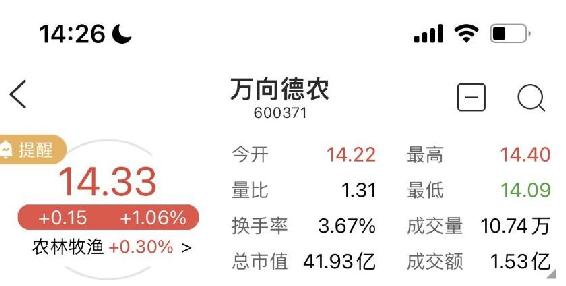泥潭，这个判断力叠加情绪后的末端波动盲区也是悲剧人生的终结，所以可怜之处必有可恨之处。对于个体而言，完成精神结构升级，同时接受判断力训练，从而提升整体的判断和决策能力，从而拥有更多制胜的攻防破生存方案）

2022 年第一个标：600371 万向德农

正文

前言

判断力的训练是可以得到回报的，但这只是搂草打兔子，顺带的。判断力真正的价值会影响自己生活的方方面面。不管是对人和判断，还是对事的判断。有句话叫选择大于努力，选择依赖于什么? 依赖于你的判断力! 你看有多少女人在抱怨自己不幸福，那是因为她缺乏对男人的判断力。一个多月前，在觉悟社里给了符合条件的同志们 2022 年的标的 1，已经突破了第一和第二各阻力点，接近第三个阻力点。判断力没有提升，这三瓜两枣毫无意义!

正文

2022 年的标的 1 在向下整理之后，向上突破了第二个阻力点，但没有突破第三阻力点。你们有没有先撒退?越过第三个阻力点 16.1，再往上就是 16.7 附近的阻力点了，即便越过第三个阻力点，16.7 也不会马上突破。末端的波动是参与者的情绪叠加，无法准确的判断，所以实操时的纪律性很重要! 这就和打战一样，出击之前必须设定目标，达到目标之后，就按计划撤退，撤退要有撤退路线，还要有掩护。否则，你的攻击计划是把目标消灭了，结果撒退的时候，被人家反杀，那不等于打个寂寞!

心里不成熟所造成的各种微操失误，没有人能帮得了，

必须自己锤炼。将军起于行伍，宰相拔于州县，判断和决策永远是最难的! 沉着应变的心理素质和果断决策的判断力，就如同狙击手在复杂环境中的百发百中，虽然有独特的判断力训练体系，也是成千上万的子弹喂养出来的!

总的来说，任何趋势都源于一种结构性的扭曲。只要这

种扭曲没有被打破，整体趋势不变。但是，形成这种结构的各支点之间会不断制造波动，而那些附着于潮流之上的参与者，会火上浇油的情绪叠加。置身于这种生存结构之中的不同势力，会根据对自我处境的判断产生不同的诉求，自然要去创造有利于自己的筹码来进行博弈。就拿俄乌冲突举例吧：

参与者并不只有两方，甚至任何国家都是参与者，而且利益相互交错，没有那么泾渭分明。美国肯定是想打击俄罗斯，之前的金融核弹没有凑效，接下来最主要的打击点就是油气，因为这是对方的优势，博弈就是以己之长攻敌之短，以自身的有序，让对方陷入无序! 美国是怎么发展起来的，两次世界大战，文明世界群殴，他都能躲在远离战火的地方拼命生产，两边挣钱。俄乌战争在乌克兰的土地上打，美国不断地拱火，打残地是乌克兰。美国人很清楚，乌克兰早晚都会与俄罗斯重新变成一个整体，所以，彻底地阿富汗化，从长远来说是抛给俄罗斯的包狱。

金融核弹攻击了之后就是油气上做文章，但欧洲顶不住，特别是德法地意愿不强。因为油气价格的居高不下，对欧洲的经济是毁灭性的打击，而且极度的影响到了民生。所以，欧洲的意愿就不会那么强。这是一个老剧本。当年在欧洲大陆上称霸的法兰西第一帝国皇帝拿破仑，试图把所有人都拉进来彻底孤立英国。这就是著名的大陆封锁政策。刚开始还好，打击态度一致，步调也一致。然而，英国海军能够保持自己与最大的印度殖民地的航运安全，印度能够提供英国所需的各种物资。越耗到后面，法国控制力越弱的国家就越顶不住了。当时最先放水的就是沙俄，因为当时沙俄只是与法国合作，并不是受拿破仑控制。沙俄当时处于农奴社会，经济薄弱，所以，沙俄率先违背大陆封锁政策与英国暗通款曲。

紧接着是瑞典和西班牙顶不住了，也偷偷与英国做生意。结果拿破仑盛怒之下就直接出兵西班牙。结果不仅没有摆平西班牙，反而让自已控制下的西班牙站到了对立面。随后又讨伐沙俄，更是彻底输掉了本钱。

美国人现在就在重复当年拿破仑的大陆封锁政策，但是

今天的漏洞，可比当年英国所拥有的印度要大得多。而且欧洲会越来越受不了。所以，美国需要做点什么，一方面让他们能够坚持制裁，另一方面又能让他们不至于那么痛苦。

各国心怀鬼胎是再正常不过的了，彼此都会根据自身的

情况来变换态度。立陶宛的通胀都超过 16.7%这种夸张的程度了，也需要油气和其它原材料。因为俄罗斯不给原材料，立陶宛最大的化肥厂都被迫停工了。即便如此，它依然急切的要求欧洲全面禁止购买俄罗斯的油气和粮食。那是因为他们国家小，随便从欧洲哪个角落匀一点就能保障自己。然而，一旦欧洲各国态度松懈，自己的力量太小，如果导致制裁无效，等俄罗斯赢了，自己就危险了!所以，它会拼命横跳，反正死道友不死贫道!

看到欧盟，尤其是德法两个需求量大到缺乏替代方案的

社会快顶不住的时候，美国释放了自己的油气储备，这是为了应对战争和应急情况准备的战略储备，也正因为它大规模释放战争必需品的储备，所以美国不会亲自下场。美国自己释放油气储备的同时，还要求别的国家也一起释放储备。虽然释放出来也不能很快运过去，但可以向市场释放强烈信号，把油气价格打下来，从而缓解欧盟在这种压力下的不坚定。

当然了，俄罗斯也不会坐以待毙。欧佩克不肯增产，就

是为了保持油价不掉，也门的胡塞武装，甚至去袭击沙特的油田，虽然没造成什么影响，但会在市场上造成供需紧张的信号。然后，美国用外交努力和利益交换，鼓动欧佩克成员中的产油大国伊拉克增产。当伊拉克决定增产之后，土耳其的军队就顺势进入了伊拉克境内，宣称要去打击库尔德武装! 土耳其是一举两得。因为库尔德武装确实对自己的边境威胁非常大，一直在找合适的理由去搞他们。美国在策动库尔德人闹独立，而库尔德人光在土耳其境内就有 1500 万人之多。

库尔德人分散在四个国家，聚集的地方既是粮仓也是油田! 当年 ISIS 崛起，占据这块粮仓和油田，然后美国以反恐为名大举介入，同时扶持当地的库尔德人，在反恐的过程中，库尔德人被美国武装起来，鼓动高达 4000 万人的库尔德人独立建国，一直是美国手中超级好的一张牌，足以一石多鸟! 各种博弈所造成的波动会反应在市场上。人的恐惧源自

于你不知道那些波动到底会导向何方。叠加了情绪的末端波动，任何方式都不可预测，它就如同池塘中相互叠加的涟漪。

但是我们明白涟漪是源于有人往池塘中丢石头。

# 000：⽣⽇礼物【关键点突破改变海战模式】

（展麟解读：讲国家生存结构中，生存竞争关键点的突

破，会改变整个战斗模式和战斗体系建设，这就是生存竞争中关键点的突破，从而让改变整个模式。在对马六甲海峡海战那次奠定是大炮巨舰时代射程覆盖 50 公里，在珍珠港海战那次奠定了航母时代射程覆盖 350 公里，到后期升级到 750 公里，而在中国人民海军 73 周年的演习中超高音速海基 DF-21D 击中军舰射程覆盖 3000 公里，这将改变未来的海战模式，从纯粹的海战模式，转变成海战+制空权+制太空权模式，这就是生存竞争关键点突破，对整体模式的影响。

对个体而言，完成精神结构升级，同时完成整体判断力训练，让自己有更高维度的判断和决策，拥有自身更多制胜的攻防破生存方案。比如在日常生活中养成健身习惯，锻炼出一个好身材，比如学会好好说话，更懂察言观色，人情世故，比如完成精神结构升级，完成整体判断力训练，比如养成持续阅读，每天三篇文章等等都是关键点的突破）

正文

今天是列宁的诞辰，4 月 23 是人民海军建军 73 周年的纪念日。看热闹的人们都在关注新下水的 075 和 055，以及将要下水的 18 号航母，真正有价值的是早几天演习中一个不起眼的信息：从 052D 导弹驱逐舰上发射的海基 DF-21D 击中了正在高速移动的军舰，外行看热闹，内行看门道。海基 DF-21D 和海基 DF-26 才是生日礼物! 之前 DF-21 和 DF-26 只有陆基版，DF-21 从海岸线发射能覆盖 3000 公里之内目标，陆基 DF-26 最远覆盖关岛。

海基版 DF-21D 超高音速反舰导弹，可不仅是把陆基版改成能在军舰上垂发，它真正的价值将会在未来改变海战模式! 对马六甲海峡海战的那次，奠定了大炮巨舰的时代，因

为巨炮能够覆盖 50 公里；珍珠港海战的那次，奠定了航母时代，因为舰载机能够覆盖 350 公里。当覆盖 350 公里的舰载机出现之后，只能覆盖 50 公里的巨炮就没用了。海军到今天体系依旧延续山本五十六开创的模式，只不过是把舰载机的航程延长到 750 公里，舰载机上的有源相阵雷达最远探测 350 公里，空空导弹只能打 150 公里。然而，能以超高音速击中高速移动的军舰的海基 DF-21D 海基改进版能够覆盖 3000 公里，这将意味着什么不言而喻!

超高音速海基导弹的突击，目前任何防空系统都无法阻

挡，万吨级的 055 上有 128 个垂直发射单元，就是演习中用的 052D 舰上也有 64 个垂发单元。海战与陆战不同，陆军是为了进攻消灭敌方有生力量，而海军是为了控制关键支点，阻断航道，将敌人隔离在某个区域之外让其慢慢枯萎. . 这将会改变未来的海战模式! 当然了，超远距离的，超高音速精确攻击，这更加的依赖于天基卫星系统。以后制空权变成制太空权!

# A657：上海问题的深层次原因！【凑钱方式决定你未来能走多远】

（展麟解读：讲国家生存结构中，生存竞争中所有控制

无非是三点，第一点是财政权，你以什么方式搞钱，就决定你可以做什么事，第二点是人事权，这是强大组织体系呈现表面的人事任命，第三点是否决权，你能决定什么东西不能做，什么东西可以做，而你获取资金的方式，就决定你剩余啥否决权。利益之争表面装饰的就是话语权之争，所有话语权的背后是谁支付成本背后的争论。曾经的国共两党是深度合作，都是试图救亡图存，在大革命之前，都是国共两党的凑集资金的方式都是一样的，同时通过组织架构，直插社会基层，重建社会基层秩序和治理体系，然后通过发展农业生产和工商业流通来收集财税，只是这周凑钱方式时间周期长，前提需要付出太多的社会治理工作，这种凑钱方式最大的好处，就是保持自身的独立和自主性，这是内部发展起来凑钱方式，稳定而长久。但是在大革命时期，江浙财阀和英美买办为国民党找到新的一种凑钱方式，这种方式条件少，只需满足上海租界中少数人的利益和诉求，就能立竿见影的快速来钱，这种凑钱方式就像当下的信用贷款，只要你没有违约记录满足银行要求就可以给你放款一样，很多就陷入债务深渊，让自己的大半辈子，甚至一辈子都毁了，同样国民党也因为这种凑钱方式，让自己背负太多债务深渊，而直接导致自己出走台湾濒临灭绝，而大革命后的共产党还是坚持用独立自主，强大内部的方式凑钱方式，所以成为目前中国唯一的执政党，还能欣欣向荣，这就是从凑钱方式开始，导致未来可以选择的格局。对于个体而言，目前两种凑钱方式，也决定你未来。第一种通过完成精神结构升级，完成整体判断力训练，从内部升级去提升自身实力去交换财富，然后去发展自己的事业，保持自身的独立性和自主性，那么你一辈子都过的很幸福。第二种通过银行融资的方式，自身内部不变，内部结构一大推问题不解决，通过银行的贷款去扩大生产，超前消费，都会给自己的未来埋下具体的祸根，导致自身负债累累的半生，甚至是一辈子）

前言

这个社会的主流价值观、叙事方式、生活态度、以及消

费观念和社会心理都将不可避免地向这个方向转变。由此产生的各种阵痛，以及群体之间的相互鄙夷和隔阂，价值观严重对立，越来越变得自我，更加缺乏信任和安全感，敏感脆弱又富有同情心，并逐渐形成相互隔绝的圈层，都是不可避免的过程。许多人会为此感到沮丧和愤怒，但也没有办法，这就是社会转型的代价！

正文

人的观念、心态、立场往往都基于自己的处境和对自我

的判断。所以，人会情绪激动的去批判，或者赞扬某件事或者某个人，都是基于自己的心理需要或者利益需要。普通人是基于心理需要，而掌握权力和资源的人是基于利益需要。

基于利益需要的人，难免会睁眼说瞎话，哪怕是以官方的面目出现都不例外。

利益之争的表面总是会覆盖一层冠冕堂皇的装饰，这装

饰就是话语权之争。它通常情况下会以道德化的表述呈现出来，因为这种简化表达，容易在绝大多数的普通人心中引发共鸣。即便是关于社会治理方式和经济模式之间的不同，也会被简化为先进与落后，好人与坏人之间的生死搏斗。显然，普通人无法理解经济和政治的运转方式，但能够从这些带着感情温度的词汇中，快速做出是非对错的判断，并选择自己的立场。

国共两党都试图救亡图存，在大革命的洪潮中，彼此曾

经紧密相连，这种紧密相连不同于第二次国共合作。抗日战争时期国共之间的合作，还真的就仅仅是两股独立势力之间，为了迫在眉睫的目标进行事务层面的合作而已。但大革命时期的国共两党不是这样。那时候才是真正的结合在一起! 这种深度的结合，不仅通过苏联的军事训练和武器援助体现出来，更通过国民政府的财政来源来呈现!

在那篇著名的《湖南农民运动考察报告》一文中，“我

党”指的是国民党。不仅苏联在帮助国民党，按照苏联的方式训练新式的革命军，本土的革命力量（共产党），也在帮助国民党在重建底层社会的基础结构。深入到每一个县乡的党组织，虽然是打着国民党的名义，成为中国社会的基础节点，然后再逐级往上垒出一张金字塔节点的社会权力网络。

大革命时期的省府首脑来自于文官体系，由南京的中央党部派出，国民革命军每一个师都有南京的国民党中央党部派出的党代表来负责大政方针。看到这个脉络是不是似曾相识? 没错，它就是我们今天整个社会组织形式的雏形。只可惜蒋光头将它破坏掉了，破坏的原因，即不是源于意识形态，甚至都不是源于党派矛盾。

这样一种高效、稳定、且强有力的社会组织体系，能够

源源不断的获得兵员，也能够彻底摆脱外部控制，独立自主的从中国社会内部筹集革命所需的经费。要知道有效统治所建立起来的秩序，对市场的恢复有着决定性的作用。市场可以解决一切问题，但市场不能维系自身的存在。必须要有一种市场之外的力量，维系住市场交易的秩序，让物资和人员能够在安全和便捷的状况下快速流通，生产和交易的各要素就能循环的流通起来。

供销社不是 1949 年之后才有的，它最早出现就是为了打通商路加速各区域的物资流通。为什么需要这样做呢? 那是因为清朝崩溃之后，有枪就是草头王，各种势力盘踞拦路设卡，阻断流通，就为了自己能够盘踞一块地盘。光四川一个省当时就出现 5 个军阀各占一块，动不动就相互攻伐的情况。在这种完全没有保障的状况下，人员和物资的流通被阻断，商品经济和农业生产都加速萎缩。

这种能够直插基层的社会组织体系，不仅能够重建基层

社会的权威和秩序，也能在控制的区域恢复生产和商品流通，继而重建税赋体系! 当时的中国是一个纯粹的农业社会，农业社会政府的最大财税收入来自于农业生产和商品流通的税赋，以及通过盐铁专营制度，对社会生活的必需品资源，进行垄断来获得财税收入。不管是哪种形式，它都深深的扎根于社会主体经济活动，并需要一个强有力的组织体系和财税收集体系。

然而，当这套体系在大革命（1924 年 1 月到 1927 年 7 月）中逐渐建立起来之后，蒋介石却主动破坏了它! 当国民革命军打下武汉之后，没有继续北上，而是转向东边。在国民政府控制东南各省，特别是占领上海之前。江浙财阀及英美买办已经为蒋光头找到了另外一种获取资金的方式。不仅量大而且快捷! 于是，蒋介石不愿意通过打下一块地盘，重建基层社会的秩序和治理体系，然后通过发展农业生产和工商业流通来收集财税。这种方式的周期太长，需要做太多前期的社会治理工作。而另外一种方式则可以快速来钱，只要满足上海租界中少数人的利益和诉求就能立竿见影。于是，他选择了挣快钱，从此形成路径依赖，只能一条道走到黑。

当时国民革命军，只是国民党中央党部下辖的武装力量，要听命于以汪为首的文官体系的指挥。然而，搞到了钱，手上又有军队的蒋光头，正应了吕布的那句话：大丈夫岂能郁郁久居人下! 既有了贼心也有了贼胆。不仅开始清党，还让自己麾下各军师的黄埔军官，去兼任打下来的那个省的党部主任和地方首脑。不仅对自己的黄埔嫡系如此，对其它地方军头也是如此。他很快收编各路军头，把整个由国民党中央党部延申出去到基层的权力体系拆的稀碎，虽然他暂时获得了权力和表面上的权威。然而，即便是他的黄埔嫡系，只要外派为封疆大吏，就会变成一方诸侯，并将自己管辖的地方视为自己私人的藩镇。

国民政府自 1912 年开始到北伐，统治在北京，真正的权力中心在天津。因为天津的势力掌握经济命脉，没有钱，它就撑不下去。后来的国民政府，统治在南京，真正的权力中心在上海。同样是因为投资人在上海，投资人的代理人也在上海。沿海港口的关税、生活必需品的盐税以及资源出口的统税，是国民政府所有财政来源的组成部分。在一个纯粹的农业国家，国民政府统治 38 年居然从来不收农业税! 意外不意外? 并不是说民国时期农民不需要交税，恰恰相反，他们缴纳的税赋高达 65%以上，比现在最高的个人所得税都要高出一大截。这还是在当地比较太平的情况下。否则，就会像《让子弹飞》电影里面揭示的那样，税早就收到许多年之后去了。这些苛捐杂税由谁收取呢? 地方各路诸侯! 蒋介石就是通过这种方式来换取各路诸侯的效忠。基层农村的地主、还乡团之所以站在蒋那一边，是因为他从来不去触碰那些人的利益。而重建基层社会将收缴这些人的权力和利益。从财税的角度来看，国民政府并不是一个共和政权，而是一个分封制下的松散王国。

淮海战役之前，蒋介石嫡系在东北遭受巨大损失，忌惮

桂系势力的威胁，刚开始想阻止李宗仁参选副总统，阻止失败之后，又找了个理由，把白崇禧从国防部长的职位上调开，任命为华中剿总。白崇禧刚开始不肯就任，跑到香港去了。

就有高人劝他华中剿总掌握几十万的军队，比一个空名头要强。等蒋介石把嫡系消耗差不多的时候，与李宗仁里应外合未必不能逼蒋介石下台。事实也确实是这样发展的。当淮海战役进行到焦灼状态，胜负不可预料的关键时刻，蒋介石调用华中的国军去增援。结果白崇禧按兵不动，看着蒋介石的嫡系报销。等他的嫡系都打光了，就挟兵威与李宗仁里应外合迫使蒋下台，由李宗仁代理。

这就如同中世纪的欧洲一样，国王不过是大一点的领主，一旦力量被削弱，就会被其它领主逼迫。所有，你会看到国民政府做什么事，都不够彻底和爽快，因为这种结构造成内外交困，不得不反复算计，四面提防。当年他们追剿红军的时候，各省诸侯对红军都网开一面，更加提防蒋介石的嫡系进入自己的地盘。到了后期，蒋的控制力持续下降之后，各省诸侯都非常识时务。蒋的控制力是如何快速下降的呢? 战场损失倒在其次，最主要的就是金主爸爸不肯给钱了! 国民政府从来就不需要，从自己国家的主体群体中获取

财税，那你觉得它会为谁的利益服务? 举一个例子就明白了：

中国民族资本家所创办和维持的那些实业，在经历过 8 年的艰苦岁月之后，好不容易迎来了抗争胜利。试图获得喘息和发展的机会。然而，1946 年蒋介石与美国签署了《中美友好通商条约》，中国的商品可以沿密西西比河深入美国腹地，美国的商品也可以从上海经过长江覆盖沿途八省。彼此的海域都开放给对方，让商贸没有任何障碍和门槛。在二战中美国是盟军的生产基地，为了战争的需要不断地扩大产能。战争一结束，它地产能过剩问题就非常尖锐。于是，它需要转移或者消化掉过剩的产能。除了欧洲的马歇尔计划之外，与国民政府签署的这个狗屁条约，就是来用来消化它的过剩产能的一种方式。当时的中国工商业非常脆弱，而且刚刚经历 8 年抗争的摧残，哪里能向美国大量输出产品和服务。但是，我们的关口和内陆向美国开放之后，我们自己的企业就大量倒闭，城市失业人群的态度迅速左转。反战反饥饿等发生在国统核心区域的事件此起彼伏，而且参与者都不是泥腿子，而是作为国民政府统治基础的城市居民，甚至包括破产的民族资本家。那个给自己的统治致命一击的条约，换取的仅仅是 4 亿美元的援助。蒋介石的统治依赖于外部资金的输入，当金主爸爸不愿意再给钱之后，他的整个统治就业凉凉了! 从古至今，所有的控制无非是三点：财政权、人事权和

否决权。你以什么方式搞钱，就决定了你可以做那些事。譬如说，你有个超级好的剧本，打算拍一个电影。但投资人要安插女主角，甚至要按投资人的偏好去选角。以什么方式搞钱，决定了能做什么事，也决定了你能用什么人。国民政府里面的人，都是留美的博士，这些人不是地方实力派，就是大家族的公子，并与海外存在千丝万缕的联系，他们与中国社会并没有太深的连接，而且随时有海外的退路。他们对西方的如数家珍，远超过对中国社会现实状况的了解。在制订政策的时候更多的是照搬理论，而不会深入现场。人都不可能捏着鼻子去深入了解自己本能，就嫌弃和鄙夷的人和事。

这就是为什么 1947 年，他们试图用全国行使宪政来吸引民众，而民众被另一方的“耕者有其田”吸引走了的缘故。因为当时中国社会的民众主体是食不果腹流离失所的农民! 当年李嘉诚虽然很成功，但并不是中国企业，他与中国

社会只是合作关系。当华为、阿里、腾讯这一批起来之后，才有了真正的中国企业，并不是因为股权结构，而是因为这些企业的主要业务、主要利益和主要人员都根植于本土! 当中国彻底废除农业税之后，生活在城市中的主体人群

就成了这个社会的主要税赋来源。什么样的群体成为一个社会税赋的主要载体，这里的赋税不是人头税，而是这个群体的生活生产方式，所产生的赋税。那么，这个社会的许多东西就会慢慢的去迎合这个群体。许多人不适应，甚至痛恨城市小资群体的心态、观念和生活方式。这个社会的主流价值观、叙事方式、生活态度、以及消费观念和社会心理都将不可避免地向这个方向转变。由此产生的各种阵痛，以及群体之间的相互鄙夷和隔阂，价值观的严重对立，并根据自己瞎子摸象一样的感受对人和事形成预设立场的严重撕裂状况，以及人越来越变得自我，更不愿意妥协，也更加缺乏信任和安全感，敏感脆弱又富有同情心，还逐渐形成相互隔绝的圈层，这些都是不可避免的过程。许多人会为此感到沮丧和愤怒，但也没有办法，这就是社会转型的代价!

# 000：上海问题的本质! 【上海是社会基础结构升级还不到位】

另一种标题：000:爱丁堡问题的本质

（展麟解读：讲区域生存结构中，永远存在两种手段运

作，第一种是市场手段，市场手段要求参与方都是深明大义，眼光长远，行为理性，重视诚实守信的原则，在高效配合中持续不断的交换，在合作中可以让自己具备更多解决问题的实际业务能力。第二种权利手段，权利手段拥有业务相关的控制权，赋予没有业务能力群体就会以权谋私，形成的外包方式来解决业务问题，这就是造成特许经营，阻断正常的市场交易手段，比如物业，比如居委会，比如学校食堂。上海的 2022 年 4 月面临的疫情问题，外力阻断了市场的正常交易，上海百年以来背后的权利手段，就开始从隐秘的地方呈现在大众眼前，这就是整体的脆弱性，这种整体脆弱性是内部造成，所以需要内部根据外部的反馈去解决，近年来的扫黑除恶，教育整顿自身队伍，自我革命，就是根据外部反馈着手解决内部问题，从而提升整体的稳定性，降低整体的脆弱性。同时还有更深层次的根源问题，就是社会基础结构升级没有到位，没有把对原有结构溢出的群体，要么彻底消灭，要么给利益供起来，因为上海的基数比较大，没有把传统上海那批原住居民，用市场手段去置换他们传承百年的权利手段，这是上海的根源的底层问题，所以上海需要发展，更需要持续的发展，只有持续创造增量，才能完成社会基础结构升级，从而彻底解决特许经营的垄断问题）

正文

上海各级基层组织的动员和组织能力不强，不管是人员

配置，还是组织形式和力度都无法应对突如其来的局面。这种状态是进化出来的，因为那个社会的运转体系，不需要它很强，甚至可有可无。因为整个社会的有序运转，都与这些基层组织没有太多的关系，他们自身的诸多职责，也是通过外包的服务来完成的，各种专业的外包服务是可以通过市场交易的方式获得，这些官方组织是不具有业务能力的甲方。

将与业务息息相关的控制权，赋予没有业务能力的群体，它必然会成为谋取私利的手段。然而，解决业务问题的方式，依然是通过外包的方式来实现，因为自身不具有亲自下场解决具体问题的能力。这就造成了一种垄断性质的特许经营。

也就是说，具体解决问题的方式依然是通过市场的形式，但承接方不是由市场筛选出来的，而是由垄断者筛选出来的，不管是居委会还是物业，一旦拥有特许经营的权力，就必然会去阻断正常的市场交易，从而造成事实上的垄断! 之前在阐述结构学基本原理的时候就阐述过：获取资源的方式有两种：

抢劫和交换，交换一旦形成垄断，就转化为抢劫行为。只有抢劫的综合成本太高，难以为继的时候，才会主动打破禁锢，再转化为交换，伴随着这种切换还会滋生出与之相契合的观念和说辞。

在上海发生的事情，首先是权力和义务不对等，将权力

和资源授予缺乏解决问题能力的群体，使其能够垄断供应，而任何垄断都天然滋生暴利，必然会催生出各种对市场交易的阻断行为。由此造成的混乱和短缺，本质上与清零与躺平关系不大。有时候为了掩盖缺乏解决问题的有效手段，从而会把这种手段的无效，转变成更抽象的是非之争。事实上，这是个技术问题，与是非无关。这种模式在乡镇和县城比比皆是，市场的有效性存在一个前提，那就是供需双方都不存在垄断，否则，店大欺客，客大也欺店。在社会分工协作密度不够高的县镇，不管是哪种形式的基层势力，一旦能够控制供应方，就决定了那个区域的民众所能购买到的东西，或者能享受到的服务类型和质量。譬如说，你在一线城市，滴滴打车的司机都比较规矩，按照其企业要求的标准对待客人。

然而，你在穷乡僻壤用同样的滴滴打车，司机的服务态度和质量都没有保障，甚至拉到半路，要求绕开平台临时加价的情况也同样存在。滴滴的监管拿这些人是没有办法的，因为他们是滴滴在那个区域唯一的供应方。全国各大院校内的食堂和小卖部的状况，其实与上海爆出来的模式一模一样。一些高校曾经也爆出学生抗议，学校禁止外卖进入校园的消息，这就是特许经营下最真实的状况，授权的校方与食堂承包方会自然而然的成为利益共同体和一致行动人!

理想化的市场模型，只存在想象之中，现实中的市场充

满着非市场因素的各种博弈。理想的完美模型，建立在一个预设的前提上：所有构建起市场的参与方都是深明大义，眼光长远，行为理性的主体。事实上，人的认知、诉求、处境、心态、观念、行为各不相同，生存竞争下的博弈，之所以还坚守原则是因为自己无法突破这种边界。如果能够突破，而没有遭受到自己能立竿见影就感知到的损失和惩罚。加速破坏整个模型稳定性和有效性的行为不仅不会停止，而且会成为示范，引导着更多的参与者，采取投机和自保的策略来求得利益最大化。正因为如此，首先是居委会阻断物资的正常流动，通过保供清单搞特许经营，继而爆出快递员对于职责范围内的配送任务挑三拣四，按照额外的打赏额度，来决定配送的优先顺序和是否给予配送，最后连志愿者都沦陷了，通过倒卖物资来获取暴利。那些幻想着以付出最小自由，来获取最大保障的人民，最终会在生存竞争和生命体的相互博弈的现实面前惊恐的发现：他们既无法获得自由，也根本得不到任何保障!

大家会把上海社会看成一个整体，事实上，存在两个不

同的上海：一个是完全市场化的现代化上海：格调、金融、国际化，另外是一个被忽视的传统上海。就如同你可以看到上海许多先进的产业，也可以看到许多动不动就上百年的历史的传统企业，那些企业不死不活，但不断地消耗着资源，内部极度的官僚，却还有许多人依靠它们维持生计。一个外地人跑到上海打拼，如果无法立足是可以退回去的。但另外一个上海人是无路可退的。他们就如同璀璨的霓虹灯下阴影中的旧弄堂，里面生活着另一套生存逻辑和社会运转方式。

正常情况下，远处新建成的摩天大楼其实与自己的生活没有太大关系。只不过这一次（疫情）让另外一个隐匿运转的方式呈现出来了。

本质上来说是社会基础结构升级还没到位。深圳和北京

能够渗透到基层都是长期投入的结果。北京是权力驱动的社会，资源随权力渗透到最基层，组织度之高，甚至会出现朝阳大妈这种外围触角。

而深圳是因为没有历史包袱。改开之前只有 3 万人。基层的集体早就股份制运转，这些人不是出租分红，就是集体产权按市场经营所得分红，本质上都是不管事的股东，有专门的市场团队负责打理。

上海的社会结构带有很多历史包袱。在改开之前上海是

工业城市，好多上百年的大型企业，只不过基层组织，随着企业的没落都形同虚设了。改开之后上海新扩充的那些区域，包括浦东在内的社会基础结构，其实是农村的水平，还不像广州那样具有严密的宗族组织特征。从经济角度来说，后续没有必要去投资夯实基层，并提高其业务水平。因为不需要他们管理什么，把他们剥离出来，不要插手搞事，反而更有利于社会的正常运转。事实上，任何一种社会基础结构的升级，对原结构中溢出的群体，要么彻底消灭，要么给利益把他们供起来。只不过上海社会结构的现实，决定这个群体的规模太大，覆盖的面积也太广。社会的发展程度还没能彻底把他们置换出来! 在过去，上海滩有租界，非租界地区又有那么多帮派，不管是军统还是上海的警察办案都找帮派。当时上海的帮派是经济产物，属于用暴力垄断一个区域的某种生意进行特许经营。

（基层组织概念知识扫盲：党的基层组织是党在社会基

层组织中的战斗堡垒，是党的全部工作和战斗力的基础。新形势下基层党组织工作开展的怎么样，直接影响到党的凝聚力、影响力、战斗力的充分发挥。党的基层组织，根据工作需要和党员人数，经上级党组织批准，分别设立党的基层委员会、总支部委员会、支部委员会。 企业、农村、机关、学校、医院、科研院所、街道社区、社会组织、人民解放军连队和其他基层单位，凡是有正式党员三人以上的，都应当成立党的基层组织。 截至 2021 年 12 月 31 日，中国共产党现有基层组织 493.6 万个，比 2020 年底净增 11.7 万个，增幅为 2.4%。其中基层党委 27.8 万个，总支部 31.6 万个，支部 434.2 万个）

# 000：卢布升值不可持续！【深度剖析生存竞争的制胜手段】

（展麟解读：讲国家生存结构中，生存竞争最激烈的手

段就是发生战争，当发生战争后，生存竞争的有效手段变的非常重要。在俄乌战争中，不管是泽连斯基的造型还是文宣，还是利用乌军禁止平民出逃，把火力部署在居民区，把平民当作战争的肉盾，还是在居民区狙杀俄军高级军官，这些是乌军面对生存竞争充分利用可以利用的战场资源达到自身目的的有效手段，俄军从当初的四面进攻到重点消灭战争潜力的目标制胜手段，只要有效制胜手段都值得我们学习，不管这个手段来自敌方还是我方。在抗美援朝战争中，我军从一口气吃掉美军师级单位到吃掉美军营级单位转变，美军从被包围就撤退转变为积极应战，主动进攻的转变，都是根据现实情况有条件去创造有利于自身的局面，这也是非常有效的制胜手段，值得我们深入研究。曾经的俄罗斯车臣战争手段，曾经的阿曼战役手段，甚至是 1942 年纳粹帝国德军的战争手段，包括目前俄乌战争中，美国利用这场冲突解决自身问题的手段，全方位用金融手段制裁俄罗斯，甚至金融制裁失败后拉拢全部西方国家孤立俄罗斯的手段，等等这些生存竞争的制胜手段，都值得我们研究和学习。对个体而言，完成精神结构升级，完成整体判断力训练，搞清楚底层逻辑了，就要持续研究同行，研究对手的制胜手段，持续根据外部反馈来进化自己，优化自身）

司令解读：在《卢布升值不可持续！》一文中说过，顿

巴斯打下来之后，才是卢布抛售的时间节点。既是这么判断的，也是这么执行的。这与立场毫无关系，成年人不必过于纠结于对错，因为对错是小朋友判断人和事的方式。在生存竞争的底层逻辑之上，所有与人有关的道德和观念，本质上都是用来引导人行为的工具。我们只关注生存竞争本身，以及有利于生存竞争的策略。

正文

我不是乌拉党，做判断不根据情感偏好，也不根据价值

观所选择的立场。坦白讲，我缺乏道德，只关心生存竞争本身的利弊得失。

就如同这次（俄乌）冲突中暴露出来的诸多问题，既没

有幸灾乐祸，也没有义愤填膺，只有冷静的观察和合乎利益的决策。以解决问题的视角，而不是以吃瓜群众的视角来审视彼此高明的攻防策略。为了验证判断，132:1 的时候买了卢布，这并非基于某种立场，而是基于《普京不会崩溃》、《收

回克里米亚是正确的》等一系列的理性判断。毕竟用的是真金白银，总不能连自己都骗！值得庆幸的是，无论是买的卢布，还是在觉悟社里给大家的下注标，都如预期涨了！接下来还有一个判断，由此筛选的标的晚点再给大家。

不得不承认泽连斯基的舆论战非常成功。特别是造型和

文宣，他在各国议会中有针对性的演讲，连《华盛顿邮报》都不得不啧啧称奇：泽连斯基将他专业上的天赋，带入政治领域，产生了非常棒的效果，虽然战场上不如人意，但你不得不承认他在舆论战方面非常成功！《华盛顿邮报》的这个评论是中肯而且恰当的，这是一场多纬度的混合战争，世界各国都会认真研究。任何一个领域的可取之处都值得学习！

乌军禁止平民出逃，把火力部署在居民区，虽然不人道，但很有效。俄军有好几个高级军官，都是在疏散平民的时候被狙击手干掉的。以平民为诱饵，干掉对方的高级将领，所造成的影响力是实实在在的，外人并不关心这些高级军官是如何死的，只知道乌军把对方那么高级别的高级军官都打死了！如此一来，目的就达到了。利用平民这一招，虽然不那么道德，但很有效。换而言之，他们充分利用可利用的一切战场资源去达到自己的目的，这显然是美军顾问的策略。

事实上，俄罗斯并不是在跟乌克兰作战，而是在乌克兰

的土地上与美国和西方作战。美国人除了没有派出，成建制的现役军人直接参战之外，其它一切一切作战资源都用上了。

而且派遣了非现役的人员或以顾问，或以教官，或以雇佣兵的角色参与其中。他们不仅提供了作战所需的物资、武器、通讯设备、指挥链，并且还负责指定具体的战术。坦白讲，在开战之处，俄军四面突进的时候，（美国）果断的让乌军主力不离开城市，就地凭借工事，并以平民为人质进行就地坚守，而不是沿着公路西撤，确实是高招！乌东不是没有部队西撤过，因为任何意识到自己陷入包围的军队，主动跳出包围圈是军事常识。只不过西撤的那支部队，被俄军的空中力量消灭在公路上。这正是俄军一开始搞那么大动静，四面出击想要的效果。但这招被美军顾问识破，命令乌东主力停止西撤，反而进驻城市就地组织抵抗。

当年抗美援朝的前几次战役，我军集中兵力想一口气吃

掉美军师级单位，美军也是本能的快速后撤。直到具有敏锐洞察力的李奇微，从局部战报反馈的信息中发现我们缺乏重火力的轻步兵，虽然人数众多，却并不能快速解决掉，陷入包围圈的美军机械化部队。于是，他改变思路，即便是被数倍于他们的我军包围，也不允许美军指挥官后撤，而是让他们凭借火力就地组织防御，并提供空中和远程火力支援，然后组织机械化的机动部队反扑。这一招非常凑效。我们遭受了巨大损失之后，也相应调整策略，不再试图集中兵力包围美军的师级单位，因为包围了也吃不下，反而会被敌人的反扑，把自己的包围圈撕的粉碎。于是，我们转变为集中优势兵力，利用机械化部队只能沿公路运动的缺陷，通过自身翻山越岭的穿插优势，去包围敌人的一个营，甚至一个连。彼此都根据自身的优势，规避自身的劣势，从而在战争中学习战争。根据现有条件去创造有利于自身的局面。这就如同下棋，棋逢对手，有来有往，非常精彩。

俄乌冲突打到第二阶段，大家都调整了策略。打的越来

越像当年的格罗尼次战役了！第一次车臣战争，俄军也是一开战就灭掉了对方的空军。然后四面调兵遣将，装甲部队快速推进，造成一种泰山压顶的态势。然而，攻入格罗尼次的俄军两个机械化摩步旅和两个装甲旅，都被暗藏在市区的车臣叛军和欧美雇佣兵打了个措手不及：126 辆坦克被反坦克武器干掉 102 辆。不是几乎，而是实实在在的全军覆没！

后来俄军吸取经验教训，开始重点摧毁包括电厂、油料

库、物资转运点、修理厂、兵工厂、机械加工厂、通信设施和训练营等各种影响战争潜力的目标。同时，将装甲部队集中部署在城市外围，抢占主要交通枢纽，并切断对方的补给线，而不轻易挺进城市。通过重型火力摧毁建筑物和掩体，让狙击手和反坦克小队无处藏身。先头侦查的坦克和步战车遇到阻击就立刻后撤，然后用重炮直接摧毁建筑物，牛刀杀鸡非常有效。

任何一场战争，后勤都是关键。当年沙漠之狐隆美尔，

在北非战场以少胜多，长驱直入上千里横扫英军，最后为什么败在阿曼战役中？不是蒙哥马利有什么过人之处，而是因为盟军的海军，在地中海切断了德军的补给线：隆美尔本来在北非就人员装备不足，补给线被切断之后，就更是越打越少了。在这种情况下，局部的胜利已经没有意义了，它改变不了最终的结果！

1942 年初，德军在前线遭受巨大挫败，燃料、飞机、装甲车和汽车运输都急需补充，特别是缺乏作战和运输飞机、中型坦克、补给卡车和有经验的初级军官。纳粹帝国本来在 1942 年就难以为继了。但阿尔伯特. 施佩尔以创造性的组织方式，让军备生产提升了 50%，奇迹般的保障战场所需，从而让战争又拖了两年多。

战场上彼此的随机应变非常精彩，战场之外其他纬度的

攻防策略，更是刀刀见血，那些决定战争潜力的攻防更具有决定性作用！

目前是俄军的军备物资的生产和输送能力，与美国及西

方的物资输送能力在赛跑。只不过俄军具有随时打击决定战争潜力的那些目标的能力，而乌军缺乏打击影响俄军战争潜力的目标的能力。关于这一些已经在《战争不会很快结束！》一文中已经清晰的阐述了战场上的策略调整和兵力部署及消耗情况。

美国要利用这场冲突，从政治、军事、外交、经济等所

有方面彻底拖垮俄罗斯，不达目的绝对不会停止继续拱火。

事实上，俄罗斯一直在跟美国打，而且是全方位多领域立体性的攻防。然而，全球 190 个国家中有 140 多个国家，并没有跟风制裁俄罗斯。今非昔比，美国不再有那样的号召力了！

如果美国强行迫使大家封锁俄罗斯，其结果就如同拿破仑强迫所有国家参与大陆封锁政策去孤立英国一样，最终会反噬自身！首先，各国与被孤立的大国存在基于现实利益的依存度。即便迫于美国淫威也会偷偷摸摸的进行。如果美国以切断经济联系来对不听话的国家进行制裁，只会让美元体系所能覆盖的人口、资源和市场范围更小。事到如今，美国社会自身的消耗量，需要通过美元体系剥削全世界才能支撑得住。

这种缩小美元体系覆盖范围的行为无异于自杀！你不可能彻底孤立和封锁住一个粮食、能源、自然资源都异常丰富，幅员辽阔并拥有上亿人口，且拥有核毁灭能力的大国。拿破仑如日中天的时候，试图裹挟整个欧洲封锁和孤立英国，最后把自己搞崩溃了！

美国拉着西方对俄进行全方位制裁，在刚开始的时候确

实把所有人都吓了一跳。随后普京发表了凝聚内部共识的《接下来怎么办》，冷静的分析了局势并审视了自身的优劣：

不缺粮食，能源、自然资源，拥有完备的军工产业体系和捍卫终极安全的暴力。读过《小丑居然是自己！！》就能明白他们拥有打造完整战时经济体系的天然优势。事实上，俄罗斯的小麦产量接近欧洲其它国家的总和。这并非天然的，而是未雨绸缪的结果。根据统计数据，2014 年乌克兰颜色革命之后，俄罗斯收回克里米亚遭受制裁，他们的政策就开始补贴粮食生产，也是从那个时间节点开始，俄罗斯的小麦产量到 2020 年几乎翻了一倍，把欧洲其它国家的产量远远甩在后面。与之同时，他们在 2014 年之后，逐渐将持有的美国债券全部清理干净了。不能说一点准备都没有，从某种意义上来说，俄罗斯一直在做准备。

美国在等待俄罗斯社会的民众在制裁之下受不了。俄罗

斯社会有一个特点，在艰难的时刻，如果有意志坚定的人做主心骨，他们就会凝聚的更紧密，承受能力也更强。如果是犹豫和软弱的人主政，哪怕对他们再宽容和仁慈，他们也会掀桌子。前面因为汇率的原因俄罗斯的物价上涨 10%，但日常生活所需的食品价格基本稳定，没有像德国那样面包都限购。目前汇率不仅恢复到战前，还涨得比战前更高了。事实上，美国在等俄罗斯人滋生不满，俄罗斯也在等欧洲人在生活困境和经济衰退中坚持不下去。整个欧洲都是缺能源的，也缺乏粮食。德国的油气有 66%依赖俄罗斯，德国的超市早就开始限购面包和食用油了。德国最大的天然气公司的负责人警告说：如果真的断气，必须优先供应民众的生活所需，德国的化工、造纸和一些机械制造会被迫停产，而供应链也会断裂，从而推高通胀并让经济陷入衰退…

欧洲国家虽多，但真正能在经济上创造增量的，也只有

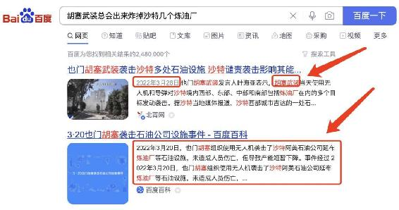德法，其它国家都是需要被救急的。这就如同我国历史上的王朝虽然疆域广大，但真正支撑整个国家运转的赋税之地只有东南五省。一旦赋税之地都难以为继，再大的疆域也没法平稳运行下去。欧洲其它国家不管跳得多高，就看德法的民众能撑到什么时候！

早几天德国的一位前大使说了一段意味深长的话：我们

西方人高估了自身，没有想到，那些非西方的国家是如此的恨我们，他们未必支持普京，之所以不参与制裁更多的是在表达对我们的讨厌，更乐意看到制裁失败！

卢布升值不可持续，什么时候抛？彻底扫清顿巴斯地区

的时候！每当油价要跌的时候，也门的胡塞武装总会出来炸掉沙特几个炼油厂，怎么就这么巧合！

# 000：大事糊涂，小事精明！【生存竞争中缺乏判断力的病源】

（展麟解读：讲个体生存结构中，生存竞争中百分之 99 人都会犯的一个误区，就是大事糊涂，小事计较，这是一个人缺乏判断力的典型表现，孩子保障父母殷实的晚年生活，父母骂孩子不记得一个自己的生日，老公保障一家老小支出，老婆骂老公每晚都是那么晚才回家等等这些日常生活的小纠纷小争执，都是缺乏判断力的表现，能为你的诉求支付成本的人才是大事，其他都是小事，只要是小事都可以妥协，都可以协调，都可以商量，都可以改进，但是你只要失去能支付成本的人，你斤斤计较的所有小事都变得苍白无力。在俄乌战争中，欧洲政客建议欧洲人控制自己和孩子的洗澡时间，限购食用油，限购面包等一系列战时举措，都是网红政客大事糊涂，小事计较的后遗症，也是这一代网红政客被美国操控后必然反映，当本土世家精英群体不从内部结构调整获取长治久安的独立性和自主性，变成直接从外部获取资金发展自己后，自身就满满失去了独立自主性，这是一个时代周期的悲剧，也是因为欧洲精英群体判断错误后，给未来相当一部分时间周期内欧洲民众最大的灾难，欧洲普通民众承受了所有。这些缺乏判断力的案例，生活中比比皆是，最后导致个体也好，共同体也罢，都水深火热的艰难度日。对于个体而言，完成精神结构升级和整体判断力训练，让自己拥有更高层次的判断和决策，从而借鉴历史更多的制胜手段，为自身的当下的求存策略提供更多制胜的攻防破求存方案）正文

生活中不乏这种情况，在影响深远的大事上表现的非常

随意，不敢承担责任，能躲则躲，能逃则逃。但是在微不足道的细节上总是斤斤计较，甚至以极其夸张的方式高调介入以彰显自身的价值。

欧盟委员会副主席居然公开建议，欧洲人控制自己和孩

子的洗澡时间，然后关闭水龙头说：接招吧，普京！这些花瓶和网红们忝居高位，自己把事情搞砸了，却大言不惭的让欧洲社会的普通人去承受生活不可承受之重。这就是典型的大事糊涂，小事精明。

现代文明的欧洲社会，居然开始对日常生活必需品和食

物搞起了类似于凭票供应的限购。这可是 21 世纪，真是闻所未闻，见所未见！惊喜不惊喜？意外不意外？！

食用油从不足 1 欧元涨到 3.6 欧元了。用来生产食用油的原材料，全世界供应量分别是二毛家占 46.8%，大毛家占 29.6%，二毛家的港口全部出不去，大毛家刚签署法令，5 个月内禁止葵花籽出口。这食用油的价格很大概率还要涨。

日常生活必需品的价格按照权重，组成了一个非常重要的经济指标 CPI，它会显示一个社会的经济通胀状况。过高的通胀率不仅抑制消费，同时减少能够转化为交易的需求。要知道是能够转化为交易的需求在拉动生产，没有这样的拉动力，也就没有生产的动力。何况生产的综合性成本，会因为供应链的断裂，原材料的涨价，能源成本和供应的不确定，造成生产成本的水涨船高。生产和流通成本的逐级叠加，只会进一步推高物价，降低可支配收入和消费支出。这将会造成经济衰退，从而让普通人的生活更加艰难。

生活中你时常会发现这样的行为：譬如说，草率的选择

一个人，然后用各种破罐子破摔的方式，去试图把对方的方方面面，都改造成自己喜欢的样子。其结果可想而知，彼此撕扯不断，心累之极，相互怨恨。那种仇视和恨意不需要任何理由，也不再建立在任何事实之上，总之失望透顶，恶从胆边生。不将对方彻底摧毁就不解心头之恨。所以，中国的夫妻之间的称呼往往不是亲爱的，而是杀千刀的！

曾经有个做社会调查的社会学家说过一句这样的话：传

统的中国女性勤劳善良，任劳任怨，但就是对丈夫充满了恨意。这源于她们缺乏独立性，整个人的所有内心诉求，都依赖于丈夫的配合和给予才能实现。如果丈夫不配合，特别是那些精神方面的需求，她们就无法通过其它的方式获得满足，从而滋生出一种强烈的匮乏感。人越是匮乏就越渴望，越求而不得就越痛苦，越痛苦就容易攻击自己。所有的怨恨本质上都是对自己无能为力的愤怒。只不过，这种愤怒引发的强烈内在冲突需要转移出去。然而，传统的家庭和社会关系的各种观念束缚，决定了她们只能以平白无故，对孩子发火的方式发泄出来。因为对于丈夫，她们也不敢平白无故的发火，只能压在心里碎碎念的怨恨。这种长期压抑必然造成人更加的情绪化，也更加极端和残忍。

什么事情是大事？影响深远的事是大事。哪怕这种事需

要两害相权取其轻，也必须当机立断，用理性的勇气克制住感性的恐惧。选择大于努力。选择错了，在细节上，即便费劲心力，试图做的滴水不漏，最终也仅仅是爬出坑来而已。

许多人之所以过得无比心累，就是因为缺乏判断力。从而在漫长的岁月中，不是在坑里挣扎，就是正处于掉进下一个坑里的路上…

缺乏主见的人，都缺乏判断力，而缺乏判断力，不管做

人还是做事，都会陷入进退失据的尴尬境地。这种反复的挫败感，会让人更加不信任自己的判断。面对任何无法做出判断的人和事，就只会想拖延和逃避。似乎不面对问题，就不存在了一样。然而，到了不得不面对，已经无处可逃的时候，就只能抓住那些微不足道的细节，去拼命的自我感动。在生活中是不是经常听到这样的话：我都这么辛苦了，你还要怎么样？！

问题是：在下暴雨之前，你把晾晒的稻谷都收好，就不

必在顶着狂风暴雨去收，人不必那么辛苦，搞得像落汤鸡，稻谷也不会湿漉漉的发霉。然而，大多数人更加享受在狂风暴雨中，那种于事无补却能够让自我感动的行为。

许多刚被提拔到管理岗位的人，都容易犯这样的毛病：

不懂得抓大放小，大事糊涂，小事精明。任何领导者，都不是因为比别人更勤奋才成为领导者的，而是因为比其他人更有判断力，更能看清问题的关键要素，并能够避免最坏的结果，提前做出艰难的决策。人家让你做领导者需要的是你的判断和决策，以及承担责任的勇气，而不是你毫无价值的勤奋和自我感动！

# 000：只有怨恨，没有互相欣赏！【美式民主的后遗症】

另一种标题：000：怨恨

（展麟解读：讲个体生存结构中，受美国灯塔指引下的

民主，自由，平等，公平价值观影响的这几十年中，后遗症越来越严重了，美式民主的后遗症需要牺牲一代人才能疗愈，这是我们需要正视的整体社会价值观的问题，而复兴中华五千年的文化就是应对美式民主破坏性的制胜的有效手段，这个需要一代人的时间周期来证明，短短的十几二十年周期是纠正不了这个美式后遗症的，复兴中华五千年文化来应对运行 200 多年的美式民主文化。我们骨子里那种传统文化价值观与美式民主文化交锋中，产生我们 90 后这一代人青黄不接，七上八下的价值观，造成我们 90 后这一代人精神结构失衡。导致的个体越来越重视自身的自我满足，导致个体的越来越来孤独自卑，导致个体在信息茧房中同质化认知越来越严重，导致个体越来越难匹配婚姻对象，导致个体精神结构一系列越来越多自我保护破坏行为等等，文中讲述了个体整体自我判断为自我嫌弃和自我低价值人，所自主产生的行为和外部的反馈，最后在自我臆想的证据链中不断自我强化的死循环，这些都是美式民主的后遗症作用在个体身上的表现，就如同老人的虚弱和固定一样，是没有办法的，自我选择，有时候不是别人让你选择做什么，而是你自身需要这样的选择，这就是你深渊遥望你，你也需要凝视深渊。对于个体而言，不管个体精神结构频繁启动的自我保护机制，还是普通人的越来越难于脱单的背后精神固化等等，都需要个体主动完成精神结构升级和整体判断力训练，让自身有更高层次的判断和选择，洞察我国社会基础结构升级的底层逻辑和美式民主价值观影响下的糟粕，找到更有利于自身求存的攻防破生存解决方案）

正文

一个人如果能够改变，早就改变了。之所以不能改变，

是因为有太多无形的枷锁，束缚住了这个人。让这个人进退失据又举步维艰。为什么有些人什么事都搞不成，但特别喜欢找借口？因为这是自我判断下，触发的精神结构的自我保护机制。换句话说，如果这个人认为自己能够改变，早就采取行动，也真的改变了，而变得更好的自己，就不需要去找借口了！

人的精神结构所驱动的一系列自我保护行为，虽然连当

事人自己都受不了，但每一次还是会像条件反射一样，一而再再而三的这样做。这就如同情绪化严重的人，一旦冷静下来就会为自己情绪化的反应感到懊悔，但下一次还是会如此！

这就是精神结构中自我判断引发的自我否定和自我攻击，以及由此触发的自我保护所形成的死循环。

一个自我判断为糟糕和低价值的人，最害怕的，就是再

次遭受挫败。因为这会验证对自己的否定式判断。一个自我嫌弃的人，最害怕的就是外部的评价和别人对自己的看法。

因为自我嫌弃，所以渴望被重视，渴望被关注，不仅对此会非常敏感。而且会时常因为，臆想中的被轻视所带来的伤害，做出破坏性的过激反应。似乎不如此就不足以捍卫自己的尊严。然而，这种不可预知，又超出正常反应的行为，往往会更加让别人觉得难以相处，于是小心翼翼的主动疏远和隔离。

这种行为又进一步刺激到了当事人最害怕的点，不被关注，不被在乎，不受欢迎，自身缺乏价值还被人讨厌。这些反馈所形成的证据链，恰好完美的验证了自我判断中，对自己的无比嫌弃和痛恨的结论。可谓证据确凿！

自我糟糕的人，是不会欣赏别人的，因为连自己都不欣

赏。每当夜深人静独自回味的时候，就能想起自己种种的不好，以及各种悲催的遭遇。并且感叹命运的不公，怪罪遇到的人和事。似乎自己来到这个世界上，就是一个笑话，似乎整个世界都在嘲讽自己、嫌弃自己、针对自己…

一个讨厌自己的人，一个时常感到挫败和无力的人，在

生活中一定会，不断挑起与周围人的冲突。在工作中，一定会觉得别人都针对自己，不配合自己，故意让自己不顺心。

总之，心中时常压抑，时常苦闷，时常一切都充满愤怒，同时又感到恐惧…

这样的人内心的冲突，就如同饭煮熟时候的高压锅。如

果不能通过一个气孔释放出来就有爆炸的危险。所以，这样的人往往极度敏感，还特别情绪化，油盐不进，还一点就炸。

这样的人对人和事的认知比较偏执。这种偏执源于内在的需要。时常误会别人，并且喜欢罔顾事实的认定，别人就是那样想的。事实上，别人并没有那个意思，但当事人自己只有在那个圈里面，才会有一种掌控感。所以才会强行认定别人就是那样想的，别人的行为就是那个目的。

如果你认真观察，你会发现这样的人挺可怜的。因为主

动陷在自我臆想的剧本中，然后，把身边的人和事对号入座。

这种偏执的行为，虽然让人无比讨厌，只能主动隔离。但当事人只有这样活着，才会觉得自己拥有主动权和支配感。越是无力、恐惧、逃避的人，越容易陷入这种状态。

许多人在生活中发现人越老越虚弱就越固执。这主要是

因为人老了之后，不管是身体机能还是精神状况，或者智力和判断力都在退化。如果把它比喻成一台电脑，就如同一台旧电脑，不管是存储还是运算，都不足以支撑起复杂的程序。

于是，就只能跑简单的小程序。当它只能跑简单的小程序的时候，它的功能就越低，愿意用的人也就越少。如此一来，它已经无法去改造自身，去适应现实世界，只能自我营造出一个简化的世界及其运转方式，然后强迫外部去适应自己的那个世界！

大多数普通人越到后面越难以脱单，好不容易脱单也难

以相处。这其中最大的障碍并非钱和年龄，而是彼此都彻底固化了！这种固化突出表现为，没有活在同一个世界中。即便在理性的驱使下，极力做出一种友好的合作姿态，但骨子里都是一种自循环的状态，而且任何不如意和风吹草动都会强化这种状态。

即便是迫于压力和形势结了婚的人，也彼此非常无语。

在挣扎和拉扯之后，逐渐变得沉默。男人的心态就变成了：

她想干啥就干啥，她让干啥就干啥，不招惹，不在乎，不干涉。女人的心态就变成了：他能挣钱就挣钱，能干活就让他干活，内心没有期待，不指望也不沟通，不闻不问，把他当工具用。

彼此都感到失望，又都无能为力。彼此都活在自己的闭

环之中，都觉得自己不幸福。觉得自己牺牲了太多，却获得太少。觉得自己内心的诸多诉求和一系列玫瑰色的梦想都因为对方而碎了一地！怨和恨由此而生，又哪里还会互相欣赏…

这个世界最大的恶，就是在一个部落社会引入美式民主。

它所造成的后遗症，往往需要毁掉一代人，才能恢复到正常的社会进程…

（美式民族知识点扫盲：美国的民主模式常被看成是西

方民主的典范。但是，它在存在的 200 多年里，面临的问题已经超过了带来的福利，明显暴露出重大缺陷。国际学术界对于“民主”的定义有许多不同观点，但一般都会认为民主政体须遵循四条基本原则：人民主权、多数统治、政治平等和政治参与）

# 000：沙中建塔式的热血和自信！【农村和城市生存安全网】

（展麟解读：讲个体生存结构中，从农村生存环境向城

市生存环境迁移，同时也伴随着个体对生活安全网的选择，可以选择农村生活安全网或者城市生活安全网，当选择越多的时候，个体就会变得更加现实，更加自私自利，这是社会基础结构升级给个体更多的底线，我农村生活不下去可以去城市，我城市生活不下去可以回农村。第一种生活安全网选择，农村生活安全网要求个体互帮互助和一诺千金传统习俗，大家都不关注眼下自己的得失，而选择维护这种呢习俗和规则为第一要务，就是因为生存环境个体力量太弱，需要大家遵守农村习俗才能最大限度提高整体生存概率，在农村这样的生存环境中，时间不值钱，口碑和风评变的非常重要。如果自己生活在农村，不遵守农村习俗，很快就可以得到生存环境对你个体的惩罚，这是个体最大的恐惧。第二种生活安全网选择，城市生活安全网要求个体的专业能力，要求个体的时间观念，要求个体解决问题能力等等，因为城市的构成更加庞大，更加复杂，更加抽象，编织起来的节点也太多，偶尔几个节点出问题，并不影响城市的正常运转，如果个体破坏行为逐个叠加，就会成为破坏城市生存安全网的一道力量，这就是城市生存安全网的脆弱性。一个真正有热血的人，不会被架空现实的抽象所迷倒，而是能守住自家的黄金，在两个生存安全网中安顿好自己在乎的人，最后义无反顾去接受更残酷的生存竞争。对于个体而言，需要洞察农村和城市生存安全网的利弊，能看到他的稳定性也能看到他的脆弱性，完成精神结构升级，完成整体判断力训练，让自己拥有更高层次的判断和决策，同时具备更全面更多备份的生存竞争的攻防破解决方案）

司令解读：自信的获得，并不是通过喊口号打鸡血就能

获得。它本质上就是一系列判断和反馈的相互验证叠加而成的定式。人和事越复杂就越难以做出确定性的判断。面对这样的人合事，你往往就会不知所措。真正的勇气来自于确定性的判断和能够承担起结果。家庭出身比较糟糕的人为什么大多遇事犹豫不决?因为见识少，经历简单，所处的生存环境对自我精神结构的雕塑会趋于简化。读过《沙中建塔式的热血和自信!》就更能理解这一点。因为心态、观念、认知必须要与所处的生存环境高度契合，否则就会滋生出各种不适，甚至处处碰壁和举步维艰。所以，生存环境越简单，人的心态和观念，也就更加趋于道德化的是非判断方式，因为这样最简单，小朋友对所有事物的判断都是通过好人和坏人来区分。这种状态下驯化出来的人，一旦生活在更加复杂的生存环境中，就会感到无所适从。因为面对着新的生存环境中不断变化的人和事，无法通过最简单的道德划分来得出确定性的判断。就譬如说职场吧：某个同事平时经常跟你一起玩，有什么好吃的也会想到你，甚至你在生活中遇到什么困难，都会伸出援手。按照简单的道德判断，这个人肯定是个好人，对自己好，可以交心。然而，发生岗位竞争的时候，他为了能升职不断地给你下套。如此看来，他又是坏人，对你不好。

那他这个人到底是好人还是坏人呢? 对你到底是好还是不好呢? 能与之交心，还是要提防且彻底不信任呢? 这就是老革命遇到了新问题，通过简单的道德判断和细节评估，无法做出确定性的判断，更没法通过这种一劳永逸的判断，来为自己如何对待这个人，提供确定性的指引。恰恰是这样不确定性让人感到很无力，并且无所适从。有句话是这样说的：小朋友关注对错，大人更关注利弊。大人的世界更加复杂，没有那么多的泾渭分明和黑白清晰，更多的会呈现出混沌的灰色调。就拿上面这种情况来说吧：这个人本质上，并不是一个极度自私和热衷算计的人。他在平时对待你的时候是真诚的，在帮助你的时候，也是实实在在的。而在升职竞争中给你下套，也是非常正常的。因为待遇福利都捆绑在岗位上，一个层级的天花板，还不及更高一个层级的下边缘。理性的人不会放过这个机会，当二桃杀三士的局面出现的时候，就已经置身于角斗场之中了，任何置身于角斗场的人，必须要先活下来，再去谈仁义。昔日黄埔的同学归属不同阵营，在战场上作对厮杀都下狠手，打完之后，要么命降重的祭奠对方，要么抓住了好好叙旧，同学归同学，钢刀归钢刀。这才是真正的道德，才是真正的坦然，也才是真正的同学情谊! 正文

许多人很容易被宏大的叙事所感动，时而热泪盈眶，时

而义愤填膺，时而热血沸腾。然而，那种架空现实的抽象表达，就如同夜空中的烟火一样，虽然能让人瞬间兴奋，但很快又会沉寂下去。沉寂之后的幻灭感往往更加的痛苦，更加的让人难以忍受…

出身不仅普通，甚至还抵达不了，普通水平的女生，往

往比那些看起来更“市侩”的城市中长大的女生，更加的憧憬美好的爱情。并不是说她们更加的渴望，通过爱情来改变命运，主要是她们更像卖火柴的小女孩那样，需要一种想象中的美好，来逃避现实的残酷和无助。

人的一生不论贵贱，在成长的路上都会经历三个层级的

蜕变，只不过大多数人会永远的停留在第一个层级，无法向上自我突破。人在能量小的时候，更愿意将外部世界简化到自己能够理解和能够应付的样子。并以道德化的方式来评判一切。并不是说这些人，更加朴实和善良，主要是没有办法。

我在边疆的时候就发现：同样是少数民族的人，而且同一个族群的人，在山区的牧民和生活在城市的人就完全不一样。

这种不一样，不是体现在语言、服饰、生活习惯方面，而是体现在心态和思维方式等更加抽象的方面。为什么会这样呢？生存环境的雕塑！人的心态、思维、观念等与精神结构息息相关的东西，必然会与其所处的生存结构日益趋于契合状态，如此才能以一种平稳运转的方式，让其在这样的生存结构中如鱼得水。否则，就会格格不入，寸步难行，进退失据，焦虑、恐惧、愤怒还非常无力。

山区的牧民真的非常的淳朴，那是因为这样的接人待物

的方式，更有利于他们在这个环境中生存。我们曾经有一次骑牧民的马上山，最后一段距离没有路了，我就让他在那里等着，我给了他钱，然后对他说，如果 3 个小时之后我们没有下来，你就自己下山。他满口答应，然后就在那里等着。

3 个多小时之后，我们从另外一条路下山，在半山腰的地方有一个岔口，两条路汇聚在一起，我惊讶的发现，他牵着一群马在那个地方等我们。我就过去跟他说：我已经把钱给你了呀？！他憨厚的笑了笑，用并不流利的国语说：我知道，我怕你们下来还需要骑马，任何一条下山的路都会到这里，我就在这里等你们，除非你们坐直升机下山，那我就等到天黑再下去。我们当时确实非常的感动！感叹少数民族牧民的淳朴和善意。

事实上，祖祖辈辈都生活在这种环境中的牧民，拥有许

多互帮互助和一诺千金的传统习俗。之所以会进化出这样的习俗和观念，是因为这样的习俗和观念，才能更有利于他们在这样的环境中生存。大家并不在乎眼下自己的得失，而是以维护这种习俗和规则为第一要务，因为在这样的生存环境中，个体的力量太弱小，只有当大家都遵守习俗的时候，才能最大限度的提高整体生存的概率。在那样的生存环境中，时间是不值钱的，但口碑和风评非常重要。譬如我们约定你带着水和干粮到某个山口去接应我，如果你没有去，或者提前走了，我就可能活不下去。这张安全网络，需要彼此通过对自我行为的约束来实现，任何人都是网络中的一个节点，个体越是稳定可靠认死理，这张网就越结实。越是务实到顾及自身利益得失的人越不受欢迎，因为这样的人一多，整张安全网络就编织不起来，从而让所有人的利益都受损！

什么情况下会发生改变呢？就是有另外一种力量，为所

有置身其中的个体，编织起另一张安全网的时候。为什么同样族群的人，从牧区迁徙到城市中生活，就慢慢变了呢？因为城市本身，就为大家编织起了一张安全网：公交车会按时开出，按时到站停靠；只要是在商店的营业时间之内，去了就能买到东西；按一下家里的开关灯就会亮，拧开水龙头就会有水用；去银行就能存取款；普通人只要按规定上班，到时间就会发工资。所有的这一切，共同的编织起了一张更加宽广，也更加密集的安全之网。它所提供的保障和确定性，能够让置身其中的人，拥有足够的安全感去面对生活中基本需求的日常。有了这样的安全网之后，人的时间就开始值钱了，大家也更多的关注自身的利益得失，从而驱使着人的行为，去追逐反馈链条更短的直观回报。

这里就会产生第二个问题：牧民们知道，如果自己破坏

了，那张生活在这个环境中的人，共同编织起来的安全网，生存环境就会立刻惩罚自己。所以，他们不会去这么做，即便有不懂事的晚辈，试图这样做的时候，年长的人都会惩罚和教育。但城市中的那张安全网，因为过于庞大和抽象，编织起来的节点也太多，偶尔有几个节点出问题，也并不影响它的正常运转。久而久之，普通人就不会再去维系它的存在，反而会为了最大限度地顾及自己当下的利益，而不惜主动破坏和摧毁它。但他们意识不到真正的危险，就是这张安全网一旦破碎，个体在所处的生存环境中将会更加的难以生存。

之前有多便利，之后就会有多么无力：建立起一套电网系统需要投入巨大的成本，而维系其正常运转也需要投入大量的人力物力和成本。最终才能让每个人以低廉的电价，支撑起日常生活所需。如果这套系统崩溃了，那么就需要自己购买柴油和发电机，自己发电供应自己的小区。即便是一个小区自己发电都组织不起来，更何况一家一户。即便能够忍受没有电带来的不便，那么粮食呢？并不是你去楼下的超市，去买就会有供应。最近华东（上海）某一线城市就发生大量的抢菜的问题，并不是没有钱，大家都有钱，而且愿意支付高价，但没有菜供应！这是一整套体系，楼下超市紧急是平时看不见的整套体系正常运转下的末端窗口而已。

体系搭建的越庞杂，越便利，越精巧，越能给人一种确

定性和安全感。当它无法维系之后，人的处境就会反向叠加！

以前外卖骑手没有女的，或者极少看到女骑手。但现在越来越多，为啥？曾经许多在一线互联网企业的人，认为自己拿到高出其它行业一大截的薪资是因为自己有本事。甚至觉得自己只要在不同的互联网企业中跳槽，就能三五年之内获得更高的收入，这种美好的幻觉，源于非常表层的结论。当整个行业都开始大幅裁员之后，突然发现，不仅跳槽加薪的机会微乎其微，甚至守住现有的一切都变得越来越难了。本来认为自己是个人才，突然发现一堆比自己更加资深，更加有本质的人才们，姿态一个比一个低都来抢自己的位置了！

许多人非常的热血，动不动要支持这个打那个，貌似正

义感爆棚，实则满心恐惧。最近有件打死人的事出来之后，许多热血的人内心中瞬间就产生了幻灭感，前一秒还英勇无畏，后一秒就觉得一切都不值，这种幻灭感主要来自于自己内心那种毫无依托的恐惧。一个真正热血的人不会追求那种，架空现实的抽象且虚幻的力量，而是能够守住自家的水晶，然后安顿好自己在乎的人，最后才义无反顾，不惜慷慨赴死！

# 000：意见不同时，如何判断人！【判断男女相处的具体方法】

（展麟解读：讲个体生存结构中，接受完整的判断力训

练是非常有必要的，可以终生持续收益。在生存竞争中，每个人来自不同的成长环境，原生家庭，就是不同的生存环境，自然对要面临的人和事有不同的看法，不同的观念，不同视角。这个在正常不过的个体冲突，判断一个人能不能持续相处，就看这个人面对冲突的时候，如何处理。一般情况有两种情况，第一种情况，面对冲突，对方非常坦然，还能足够理性冷静，有理有据的逻辑来说服你，这个人就靠谱，值得你去深交和信赖，这次能不能达成一致不重要，重要的这种坦然的心态，是一种自信和冷静的表现，这种人才会真正守住自己的底线，尊重生存环境的规则，从而有利于双方的真正存续。第二种情况，面对冲突，对方气急败坏，破口大骂，甚至滋生莫名的仇恨，你就要务必小心了，这种是没有底线的，他不是跟你争论是非，而是需要你的顺从，而他需要这种顺从，是因为他本身内部就是不稳定，本身内部也是无底线做人做事的，这些都不是性格偏执，脾气不合，源自自己对自己自我嫌弃和自我低价值判断，对外部没有掌控感的深层次恐惧，这种人更加无底线，更加会不折手段，表面要你的顺从态度，实际是内心深处千疮百孔的不安。对于个体而言，必须要完成精神结构升级，完成整体判断力训练，从而让自己有更高层次的判断和决策，拥有更多有效的制胜的攻防破生存方案）

司令解读：在《意见不同时，如何判断人！》一文中，

我们阐述了一个最简单的判断方式：如果对方不认可你说的每一句话，做的每一件事，但对方能够心平气和的与你打交道，这样的人是靠谱的，也是可以合作的。因为这样的人有自己的底线，而且所坚守的原则是充满确定性的。如果对方气急败坏并富有攻击性，这样的人要务必小心。因为对方对事实和逻辑都不感兴趣，其唯一的诉求是外界对自己无条件的顺从。这种情绪化的背后是高度的不稳定。所谓的不稳定不仅仅是指情绪，还包括宣称的原则和高举的道义都可能随时被放弃，而且并不需要太高的成本。

前言

如果对方因为你，与之产生不同的观点而气急败坏，甚

至会滋生出莫名的仇恨。这种人要务必小心！虽然这样的人会把无比高尚的词汇挂在嘴边，但本质上并不看重是非，真正渴望的是别人的顺从。这并不是什么性格偏执，而是源于深层次的恐惧，这种恐惧来自于对自我价值的不确定性，需要通过外部的顺从来反复的向自己证明。就如同你的领导强迫你喝酒一样，喝的不是酒本身，而是一种顺从和屈服的态度！

正文

任何一种事都存在不同的看法和视角，站在不同视角，

看待问题的人即便是面对同一件事，也会得出不同的结论。

这个时候彼此的观念不同，态度南辕北辙是再正常不过的事。

人最重要的是要拥有自己的判断，并根据自己的判断来采取行动。并对自己的行为负责。如果能够做到这一点，就能够坦然的面对生活中的任何未知遭遇。

人不能自己做主，别人就会做你的主。人自己缺乏判断

力，就会极度依赖别人的判断力，并且会对人和事做出的判断都将信将疑。所谓智者不惑，并不是说智慧的人永远能够为仆先知，而是说在面对未知之时，更能够抵御表层的虚幻所造成的干扰。与之同时，在做出判断之后，不会患得患失。

我们经常说人自卑、不够自信，自卑的人到底卑在什么

地方呢? 为什么无法自信呢? 不自信是对自我的价值，特别是对自己做出判断的能力极度质疑。自信的人就如同太阳，它拥有足够的能量和引力，让别的天体围绕自己转动，并能处于一种平稳的状态。而不自信就如同太空中的陨石甚至是尘埃，随机的飘荡，需要靠别人的引力和能力，才能进入一个稳定的轨道。面对未知时，能够让自己感到确定和安全。

自信的获得，并不是通过喊口号打鸡血就能获得。它本

质上就是一系列判断和反馈的相互验证叠加而成的定式。人和事越复杂就越难以做出确定性的判断。面对这样的人合事，你往往就会不知所措。真正的勇气来自于确定性的判断和能够承担起结果。家庭出身比较糟糕的人为什么大多遇事犹豫不决?因为见识少，经历简单，所处的生存环境对自我精神结构的雕塑会趋于简化。读过《沙中建塔式的热血和自信!》就更能理解这一点。因为心态、观念、认知必须要与所处的生存环境高度契合，否则就会滋生出各种不适，甚至处处碰壁和举步维艰。所以，生存环境越简单，人的心态和观念，也就更加趋于道德化的是非判断方式，因为这样最简单，小朋友对所有事物的判断都是通过好人和坏人来区分。这种状态下驯化出来的人，一旦生活在更加复杂的生存环境中，就会感到无所适从。因为面对着新的生存环境中不断变化的人和事，无法通过最简单的道德划分来得出确定性的判断。就譬如说职场吧：某个同事平时经常跟你一起玩，有什么好吃的也会想到你，甚至你在生活中遇到什么困难，都会伸出援手。按照简单的道德判断，这个人肯定是个好人，对自己好，可以交心。然而，发生岗位竞争的时候，他为了能升职不断地给你下套。如此看来，他又是坏人，对你不好。那他这个人到底是好人还是坏人呢? 对你到底是好还是不好呢? 能与之交心，还是要提防且彻底不信任呢? 这就是老革命遇到了新问题，通过简单的道德判断和细节评估，无法做出确定性的判断，更没法通过这种一劳永逸的判断，来为自己如何对待这个人，提供确定性的指引。恰恰是这样不确定性让人感到很无力，并且无所适从。

有句话是这样说的：小朋友关注对错，大人更关注利弊。

大人的世界更加复杂，没有那么多的泾渭分明和黑白清晰，更多的会呈现出混沌的灰色调。就拿上面这种情况来说吧：

这个人本质上，并不是一个极度自私和热衷算计的人。他在平时对待你的时候是真诚的，在帮助你的时候，也是实实在在的。而在升职竞争中给你下套，也是非常正常的。因为待遇福利都捆绑在岗位上，一个层级的天花板，还不及更高一个层级的下边缘。理性的人不会放过这个机会，当二桃杀三士（成语故事）的局面出现的时候，就已经置身于角斗场之中了，任何置身于角斗场的人，必须要先活下来，再去谈仁义。昔日黄埔的同学归属不同阵营，在战场上作对厮杀都下狠手，打完之后，要么命降重的祭奠对方，要么抓住了好好叙旧，同学归同学，钢刀归钢刀。这才是真正的道德，才是真正的坦然，也才是真正的同学情谊!

当你与别人因为不同的视角，得出不同结论的时候，就

要看对方，以什么样的状态来应对。如果对方很坦然，或者能够理性，并冷静的通过有理有据的逻辑来说服你。这样的人是靠谱的。不管彼此能不能达成一致，这种坦然的心态，都是一种自信和冷静的表现。这样的人会守住自己的底线，所以是值得信赖的。

如果对方因为你，与之产生不同的观点，得出不同的结

论而气急败坏，破口大骂，甚至会滋生出莫名的仇恨。这种人要务必小心! 虽然这样的人会把一切无比高尚的词汇挂在嘴边。但这样的人本质上并不看重是非，更看重的是别人对自己的顺从程度。气急败坏的愤怒和仇恨心理源自于发现自己根本控制不了你! 这并不是什么性格偏执，而是源自于深层次的恐惧。这种恐惧来自于对自我价值的不确定性。需要通过外部的顺从来反复的向自己证明。

就如同一个低价值感的女生，在亲密关系中会通过不断

地作死，来向自己反复证明，自己在对方心中的重要性。当男人内心觉得自己，配不上对方的时候就会拼命的跪舔，而当女人觉得自己，配不上对方的时候就会拼命的作。生活中经常会发生这样的事：当一个女人道德指责一个男生的时候，其实她关注的并不是对错。而是你顺从的态度。许多男生会极力的去证明自己没有错。虽然她满口正义感爆棚的道德标准。却根本就不关心这个，真正关心的只有一件事，那就是你是不是无条件的认同她，并彻底顺从她的意志。这就如同你的领导强迫你喝酒一样，喝的不是酒本身，而是一种顺从和屈服的态度!

# 000：做局！【生存竞争中做局制胜手段】

（展麟解读：讲国家生存结构中，在世界的格局中，是

以国家与国家的形式进行斗争，联盟与联盟的形式进行斗争，在俄乌战争中，不管乌克兰总统站着乞讨的做局制胜手段，还是希特勒成为德国领袖的制胜手段，还是欧盟成员国立陶宛夸张的制胜手段，还是欧盟成员国波兰的强硬让美国下场的制胜手段，都是在世界格局生存竞争中去求得有利于自身的生存策略，这些制胜手段的都是应对危机的有效手段值得我们学习，同时这些国家做局制胜手段背后还有一个美国布下的更大的局，那里就是通过俄乌战争作为棋子，在欧盟成员国的这里割肉喂饱自己，解决美国本土自身内部的生死存亡的问题，同时也在做台湾这个棋子，在中国大陆中割肉喂饱自己，也是为了解决美国本土自身内部生死存亡的问题，这是老大做的大局，其他都小弟维护自身存续做的小局，我们作为个体，不管谁做的局和有效的制胜手段，都值得我们深入研究和找到应对之策。对于个体而言，完成精神结构升级，完成整体判断力训练，让自己有更高层次的判断和决策能力，同时拥有更多制胜的攻防破生存手段，要学做局能力，也要学制胜手段，更要储备反制手段，这才是真刀真枪的生存竞争）

司令解读：这是一个多星期前给大家的第二个下注标的

的判断逻辑。一个星期前发在觉悟社里。这两天新出台的公共政策正在落地预判的内容。标的 2 突破了第一个阻力点，正在向第二个阻力点迈进。包括《做局》和《算账》两篇都是从我提交的一份报告里截取的一小段改写而成，立足点都是总结经验教训，借鉴有用的手段，提高下残局的能力。任何事都会出现意外，如何应对才是重点。不要去与别人做无谓的争论，实在闲得慌，可以顺着判断的思路挣两小钱也比争论有价值。

司令解读：诚如《做局!》一文中阐述的那样，演员在舆论方面的策略非常成功，乌军在战术上，也呈现出许多高明和有效的手段。这些都会被台湾复制并采用。作为进攻的一方，需要找到克制和应对这些有效手段的方法。俄罗斯暴露出来的问题和应对策略，对同样处于进攻角色的我们而言，是活生生的案例!

正文

乌克兰的演员总统就很会做局：本来他需要向别人乞讨

武器、装备、人员、技术、培训、通讯等各种物资和支援。

但你看到他，在以伏低做小的姿态在乞讨吗？并没有！他硬生生把自己弄成了，能够站在道德制高点上，对欧洲各国的领导人，横加指责的高姿态：他指责德国前总理的时候，默大妈还需要特意发正式声明为自己辩护。他指责德国给的武器不够多的时候，德国外长还需要特意向他证明，德国目前的武器库存中能给的，都已经搬光给他了。看见没有，软饭硬吃，才是乞讨的最高境界！（演员的制胜手段值得学习）虽然我经常以调侃的语气来描绘他，但他在舆论战上的

许多手段确实很高明。任何有效的手段都值得研究，哪怕是那些突破底线的手段，只要有效就应该好好研究。因为他用的这些手段，有一天东南小岛上（台湾）的人，一定会全盘照抄。如果这些手段很有效，那这种杀伤力，也一定会作用在我们身上。所以必须深入研究，并找到反制的措施！

演员为什么能够做成这样的局，并且堂而皇之的软饭硬

吃？他明明是向别人索要东西，却是那样的理直气壮，那样的居高临下，而欧洲的各种网红政客，却如同臣仆一样乖乖听命。并且在被道德指责之后，还像舔狗一样，急于向他证明自己的忠诚，然后按照他的要求，以自杀的方式去采取制裁措施，或者送上他想要的东西。之所以能够做成这样的局，是因为他利用关键支点形成了结构力量！

大众化的民主政治（美式民主）越来越将影响深远的重

大决策，交给最缺乏理性和远见的乌合之众。希特勒当年也是在这套体系下，通过完全合乎大众民主政治的流程，被大众选上去的。许多人说如果希特勒 1939 年打下波兰之后，就停下来消化已有成果，第三帝国就会如何如何。说这样话的人，既不了解大众化民主制度的本质，更不了解人性。1945 年苏军都要攻陷柏林了，第三帝国宁可让军队的军靴更加粗糙，并且为了节省成本不再用牛皮，也不敢削减柏林民众的福利。不管是反犹（犹太人），还是对外扩张，本质上都是通过掠夺外部来满足内部的各种诉求。

（名词扫盲：水晶之夜是 1938 年 11 月 9 日至 10 日凌晨，希特勒青年团、盖世太保和党卫军袭击德国和奥地利的犹太人的事件。“水晶之夜”事件标志着纳粹对犹太人有组织的屠杀的开始）

水晶之夜是在内部抢劫最有钱的那群人，抢完内部这群

人之后就只能去外部抢了，谁让他们 1933 年以救世主的面目闪亮登场的时候，把调子起的太高，这吊起了德国民众的期待，不管怎么样，都只能增加，而不能削减，必须要按这个调一直唱下去！一旦唱不下去的时候，大众就会抛弃你，并强烈要求换人！为啥密集的刺杀行动，都发生在东欧战场彻底失利之后。如果真的如同刺杀者所言，是为了从纳粹魔爪下拯救德国。之前为什么不干？刚开始的时候，希特勒对德国陆军忌惮三分，陆军让他们灭掉自己的冲锋队他们就被迫清理冲锋队。陆军不让他们从内部招人扩充武装党卫军，他们也就真的不敢越线。所以，刺杀希特勒试图颠覆纳粹统治的人，以拯救德国为理由，来为自己的背叛行为洗白，其实非常的扯淡：在你们自己力量最强大的时候，在他们还需要对你们忌惮三分的时候，在你们还能给他们划红线的时候，你不清除他们去拯救德国，反而为虎作伥，一个比一个积极。

等到他们威名日盛，已经完全控制整个社会，同时又在对外抢劫变得无望之时，你们就行动了！所以，它间接验证了前面的结论：德三调子起高了，但不得不按这个高调唱下去，唱不下去就会粉身碎骨。

今天的欧洲同样是各种高福利政策，各种政治正确，以

及单方面的无限包容。虽然已经难以为继，但是，任何人胆敢提出削减福利，或者触碰政治正确的红线，谁的政治生命就会瞬间结束。于是，政客们不仅对现实中难以为继的危机装聋作哑，甚至故意迎合普罗大众，各种政治正确的观念和行为。自古以来都是：人自辱而后人辱之，家自毁而后人毁之！任何能够被控制的系统，本身就存在严重且致命的漏洞，只需要找到那个漏洞即可。

（名词扫盲：政治正确是指态度公正，避免使用一些冒

犯及歧视社会上的弱势群体的用词，或施行歧视弱势群体的政治措施。如不能冒犯不同民族、性别、性取向、身心障碍、宗教和不能因政治观点的不同而产生歧视或不满与打压。常见的争议点包含性别、性取向、宗教信仰、少数族群）

演员不管是用各种表演树立人设，还是以各种政治正确

的剧本，去撩拨西方普罗大众的神经，目的都是占据道德的制高点，并牢牢抓住话语权。他始终控制着节奏，哪怕让别人看见自己的前后矛盾，极不靠谱也毫不在乎，能够始终处于创造议题，并带节奏的主导地位，才是他真正关注的点。

他的所有表演，都不是给政客们看的，而是给普罗大众看的。

这些年来，西方社会的各种政治正确思潮，已经成功的驯服了所有胆小甚微的政客。因此，只要始终占据政治道德的制高点，就能以民意裹挟，那些不敢越雷池半步的政客们乖乖的俯首听命，从而反客为主！漩涡一旦形成，置身于漩涡之中的所有人，都必然形成相互支撑，又相互挤压的状态，理性在这样的挤压下，是起不了作用的，就如同看见了眼前是万丈深渊的瀑布，也只能咬牙闭眼顺流而下！这就是做局。

欧洲的制裁已经达到自身能够承受的极限了。德国的通

胀率已经突破 7.6%，达到了 40 年来的最高值。立陶宛更夸张，已经达到 15%通胀率。所以它跳的最高，因为它最着急，特别渴望对方快速屈服。波兰最近态度越来越强硬，那是因为 420 万难民，有一半以上在它境内，难民的人数已经超过它全国人数的 6%，对粮食、药品、物资的需求，正在给它自己的社会保障体系，带来崩溃性的冲击力。别看波兰傻傻的说话，做事很疯狂，那是因为他真的没有退路，所以它也要做自己的局。它的局就是要把美国彻底拉下水，并迫使美国亲自下场去摧毁俄罗斯。波兰为什么要这样做呢？因为它非常清楚，包括波罗的海三国也非常清楚，欧盟是指望不上的。只要美国不亲自下场，这场战争就赢不了！一旦赢不了，后果是显而易见的，不管对方有没有意图，自己都首当其冲。

如果乌克兰这样的底子都扛不住，自己就更扛不住了。到时候美国人袖手旁观，自己就只有被按在地上摩擦的份。所以，它极度强硬，一会儿要求欧盟往死里制裁，一会儿让美国到自己家部署核武器，不惜弄成第三次世界大战。它也试去图做局。然而，对美国来说，不下场才是自己做的局，亲自下场了，那就是入了别人做的局了！

美国人没打算彻底搞死俄罗斯，更不打算，冒着会同归

于尽的风险去把俄罗斯搞崩溃。项庄舞剑，意在沛公。沛公是欧盟和兔子，并非俄罗斯。打劫是为了求财，并不是为了杀人。欧洲也撑不了太久，快到自身能够承受的临界点了。

所以，鹰酱的目标是乘泄气之前，乘机在亚洲也铸造一把类似于北约的剑，就达到目的了，这是鹰酱要做的第二个局。

（操控台湾，打劫中国大陆，求财来解决自身问题）

# 000：鸿沟的自动形成！【生存竞争中的两种鸿沟】

（展麟解读：讲个体生存结构中，在生存竞争中存在两

种鸿沟，第一种是显性鸿沟，更多体现的物理隔离和人为隔离，这种呢很多人都能识别出来，划区域隔离，划等级隔离，划法律条文隔离，划行政手段隔离等等，这些都是非常容易看到和识别出来的显性鸿沟，这些鸿沟就肉眼可见的被分出来，同时也在体现一个人群的划分，同时个体也根据自己的判断主动的选择适合自己的区域，有些人一辈子都不敢去劳斯莱斯 4S 店，有些人一辈子都不成想过去一线城市最贵的小区住住，有些科学家的技术一辈子都禁锢在国家法律条中不可外传等等，这些人为的隔离。第二种隐性鸿沟，你支付不起，你觉得贵背后的成本鸿沟是隐性，很多一辈子也想不明白，为啥自己老是持有，就算能拿起来，也持有不了，这背后就有两方面的成本，一方面是提供的服务设施成本和服务利润成本，另一方面是自身的成长成才成本，你才具备识别这项服务这套设施的成本，只有能量相当的人，才能长期持有，这个成本比单纯的价格成本贵更多，这是很多普通人一辈子都没有想明白的事，也是很多人一辈子都不曾剖析的脆弱性。对于个体而言，要洞察自己的生存结构，及时发现这两种鸿沟的自身不具备的脆弱性，而针对性查漏补缺的求存行为，完成精神结构升级，完成整体判断力训练，让自己有更高层次的判断和策略，去弥补显性和隐性的鸿沟，拥有制定更多制胜的攻防破求存方案）

司令解读：就如同在《鸿沟的自动形成！》中阐述的一

样：掐头去尾的视野，决定了对许多事物的判断局限，在某种自以为是的范围内。那些精雕细琢的技巧，要能发挥作用必须高度依赖于，某个必然成立的预设条件。所有通向地狱之门，都是由自以为是的善意所铺就的。在三体之中，彻底毁掉人类文明的持剑人程心，是一个无比善良的人，甚至是人类道德的最高标准。事实上，她的所有行为都符合道德和流程的要求。但这些完全符合道德和流程的善良所驱动的行为，最终彻底毁灭了人类文明，将千千万万的人，置身无法逆转的灾难之中，并且让他们在痛苦的挣扎中慢慢的死去。

面对这样的结局，程心流下了善良又充满同情的眼泪…

正文

当城市化率越来越高之后，城市人口就开始替代农村人

口成为社会的主流人群。城市中的工薪阶层替代农民成为税收的主要载体。一切商品和服务都可以拆解为土地和劳动。

所以，城市中有限的土地会越来越贵，因为它是那个区域内所有经济活动的承载单元。这个区域的人数越多，分工协作的密度越高，这个区域中的人，所产生的经济活动越频繁，产出越高。这个区域的土地就越值钱，而这个区域中的劳动则会两极分化，处于内卷状态的劳动，会越来越不值钱，而处于短缺状态的劳动，则会越来越贵。短缺有两种，一种是没人愿意干造成的短缺，另一种大多数人都干不了，造成的稀缺。第二种劳动才会值钱！

任何社会创造财富的过程都遵循这样的阶段：劳动创造

财富，创新创造财富，投资创造财富，垄断创造财富。前三者的性质都属于交易，最后的性质属于抢劫。获取资源的方式从来都是两种交替，当掠夺的综合成本太高的时候，就会切换为交易。当供需关系出现完全不对等的状况时，又会切换为掠夺模式。

西方社会目前处于第四个阶段，特别是美国。完全平等

的自由市场是不存在的，市场的各要素能够进行平等交易，得益于非市场因素的暴力平衡。简而言之，市场的交易建立在契约和规则之上，但参与者选择遵守契约并维护规则，源于破坏的成本太高。当市场的参与者，通过违反规则去获利，而这套规则本身却无力惩罚。那么，整套规则就会随即破裂。

在兵荒马乱的时代，即便存在高昂的回报率，在无法保障安全的情况下，也没有人去贩卖货物。所以，公平交易以及与之相关的契约和规则需要外力来维持！

美国社会中的最新计算机加密算法，即便作者自己愿意

开源共享，但美国法律也禁止出口。更别说其他的科技产品和技术服务。这就是非市场因素对自由交易的限制。这种限制就形成了一种有钱，也买不到的现实状况。这种人为制造的供需不对等，能够形成技术代差，从而让自身在供需关系中拥有垄断性的优势。如果这种技术代差，对某些产业形成发展瓶颈的限制，久而久之，就能在经济和产业上，甚至是武力对抗中的己方优势。不管是用经济制裁的手段，还是通过暴力打击的手段，都能为己方创造不可抗拒的优势。这种优势能够将交易转变为掠夺。

不管怎么样，这种鸿沟的形成原因是非常明显的，任何

人都能看清它的来龙去脉。但另一种鸿沟的形成则非常隐蔽：

当动车成为主流之后，绿皮就必然会退出，因为这种服务依赖于一整套配套设施及服务体系，所以二者不可兼顾。但它无形之中让某条线收入以下的群体，需要支付更多的成本才能享有这种服务。而类似于这样的各种支出叠加起来，就形成了一条无形的沟壑，收入在这条成本线以下的人，只会越来越难以维系在这个生存环境中的生活。

当一个社会的城市化进程达到一定程度之后。人群必然

发生分化。虽然同属于不掌握生产资料的群体，但有一部分人会通过购买力的差异，滋生出一种不属于没掌握生产资料群体的幻觉。通常情况下，把这个群体冠名为中产阶级。这个群体寄生于组织之中，无需对最终结果负责，只需要对中间流程负责。所有的技巧和能力都围绕中间环节而展开。这种掐头去尾的视野，时常会让他们产生一种幻觉：回到家按下开关灯就会亮，拧开水龙头水就自动流出，久而久之，就逐渐忘记了需要一套电网系统和供水系统，能够持续稳定且廉价高效的运转才能保障这一点。反而认为这一切都是理所当然的！这种幻觉归根结底一句话：看不清自身的脆弱性和只能面对中间环节的那种能力的局限性，错把平台和体系的力量当作自己的竞争力！

我小时候读过一本美国人写的书，名字忘记了。讲述的

是一个人如何拯救一家亏损的工厂，同时把已经破碎的亲密关系彻底修复的过程。作者讲述的是自己的亲身经历，那是一个现场解剖的案例。读这本书的年纪我，对后半部分不感兴趣，只对他为什么能够拯救一家工厂非常感兴趣，因为那是组织力和领导力的具体呈现。

他开篇就说：所有还未卖出去的存货和半成品以及工厂

内部的一切开支都是成本！就是这句话吸引我读完了整本书。

这句话是什么意思呢？就是过程中自我赋予的所有价值其实都毫无价值！这就好比一群幼儿园小朋友，排着间隔半米的长队往前行进，只要其中任何一个小朋友不走或走不动，整条长队其实都没有前进。在那家工厂中，每一个人都很勤勉负责，也都认真的遵守流程和规则，甚至不少人会努力超过流程和规则，对岗位提出的要求标准。然而，他们一直亏损，存货和半成品也越来越多，虽然人力成本不断上涨，但许多岗位依然反馈极度缺人手。他发现每一个人的行为都符合规范和流程的要求，但没有任何人对最终结果负责，更没人在意工厂是否会倒闭。市场部门的人总是抱怨，好不容易搞定客户，但生产部门的人，总是没法按时交货。而生产各环节，则抱怨客户临时变更需求，以及采购部门，总是跟不上自己的生产要求，需要的原材料严重短缺，不需要的反而库存过高。然而，采购部门的人说，都是按照他们的计划要求进行采购的。总之，谁都符合流程和规范，但合在一起就没法挣钱！

作者是把它当作一个案例在剖析，所以写的很细，把自

己每一个阶段的发现、观察、思考、总结、调整、反馈、效果等方方面面都描绘的非常详细，包括自己的心理活动和认知误区，甚至包括自己跟不同的因为观点不同，而吵架的细节。最后他是如何成功拯救了自己的工厂的呢？让每一个人的行为都直接对最终结果负责，以做成每一单盈利的生意，为所有人工资的唯一指引。

看清自己所处的生存结构，才能真正发现它的脆弱性，

从而有针对性的采取查漏补缺的求存行为，而不是被临时性的幻觉所蒙蔽。短短三年时间（疫情三年 2019-2022），多少人自以为体面的生活，突然发现原来如此的脆弱，而且自己也并不是像一直认为的那样具有生存竞争能力！

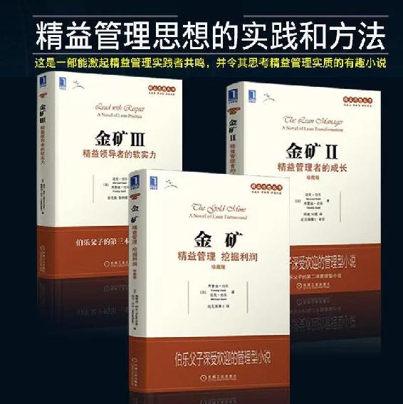（评论区：推荐的三本书《金矿》《拼劲》《目标》）

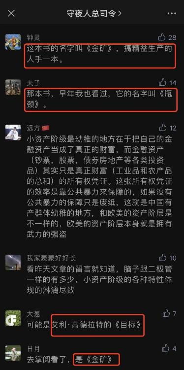

merge

# 000：一厢情愿！【精神结构失衡的四个陷阱】

（展麟解读：讲个体生存结构中，在面对生存竞争制定

求存策略的时候，容易陷入精神结构失衡的四个保护机制，第一个精神保护机制是自以为是抽象唯美的善良，只要不需要支付成本前，啥都想去保护一把，啥都想去追求一把，即真实又热血的善良，往往隐藏着不愿意支付成本的抽象唯美的善良。第二个精神保护机制是自以为是的是非对错判断的正义感，不去了解真相，不去思考开始和结果，一上来就是掐头去尾的是非对错的正义感，自以为自己的做法绝对符合法律要求，殊不知这是作恶，这个恶的因果累积会日后作用到自己身上，但是当事人看不见也就直接忽视，这种是非对错的掐头去尾的正义感，也是当下百分之 99 普通人会启用的精神保护机制，自己却浑然不知。第三个精神保护机制就是不切实际的期待，这种期待，在男女关系特别容易体现，男人的跪舔，女人的作，都是对对方抱有不切实际的期待，这个期待就是期待对方能够变好，来满足自身内在需求，殊不知，如果这个人能变好，这二三十年里，就不会还停留在这个阶层，而碌碌无为。您呢个拿捏的，你能控制的另一半，在另一半眼里你就已经是它的天花板，那里还有变好的可能，这就是缺乏判断力，对人对事造成的失衡判断。第三个精神保护机制源于自身需要而不是外部强迫，很多不如意的人，很多驴拉磨的行为十年不变，你看似没有必要，却是这个安全感，自我感动的来源，因为本身自己对这种不如意的人和事存在隐性的强烈需要，需要这种虚幻来确认自己无能的力量和价值。对于个体而言，完成精神结构升级，完成整体判断力训练，从这四个精神结构失衡中去优化自己，进化自己，同时查漏补缺去逆向训练自身存在的精神自我保护机制，让自己有更高层次的判断和决策，同时拥有更多制胜的攻防破求存方案）

正文

善良

实验室做完实验的小白兔要被安乐死。有个女生极力反

对，她觉得小白兔如此的可爱，居然对它进行安乐死，简直太血腥太残忍了。她无比愤怒的质问，两个试图对小白兔进行安乐死注射的师兄没有人性。搞得她的两位师兄，像做了见不得人的事一样，愣在原地不知所措又百口莫辩！她温柔的看着小白兔，眼中泛滥着天真又善良的光芒，就如同一个母亲深情的凝视着她的孩子…

当她试图把一小截胡萝卜片，塞进小白兔的嘴里的时候，小白兔一不小心咬到了她的手指。她突然大叫一声，愤怒不已的她，抓起手边的扳手狠狠的砸在小白兔的头上。打的鲜血，从小白兔的眼睛里渗了出来…然后她扔掉扳手，向放着小白兔的台子踢了一脚才解恨！

两位师兄再次愣在原地不知所措。她委屈巴巴的对他们

说：我的手都被咬伤了，你们都不怜香惜玉送我去医务室，也太冷血了吧！

正义

一个 15 岁的小女孩，因为家庭破碎被父母抛弃，不得不流落街头。有个小饮品店的老板，看到她可怜就收留了她，让她给自己打工当店员，凭借自己的劳动养活自己。她很感激老板的收留，也认真工作，并在心底感觉到人间，还有真情在，燃起对生活的希望。有一天她在卖饮品的时候，跟一个打扮时尚的客人聊天，客人得知她只有 15 岁之后就不淡定了。客人的正义感让自己接受不了，看到有人雇佣未成年人而熟视无睹，怀揣着强烈的正义感，举报了这家小店。

然后这家店的老板认识到了自己的错误，并接受了处罚

和教育。然后，那个女孩再一次两眼空洞，一脸茫然地走进熙熙攘攘的人流之中，消失在某个没有路灯的街角… 没有人知道她将如何解决自己的吃住问题，将会遇到什么样的人，遭遇什么样的危险，最终会走上什么样的命运轨道，她就如同凛冬将至时，被狂风从树干上，拽下的一片还未枯黄的嫩叶，不知道会被吹到哪里去，但终究会变成烂在地里的枯叶，当她被风从树梢上拽落的那一刻起，她的命运就注定了！

就如同在《鸿沟的自动形成！》中阐述的一样：掐头去

尾的视野，决定了对许多事物的判断局限，在某种自以为是的范围内。那些精雕细琢的技巧，要能发挥作用必须高度依赖于，某个必然成立的预设条件。所有通向地狱之门，都是由自以为是的善意所铺就的。在三体之中，彻底毁掉人类文明的持剑人程心，是一个无比善良的人，甚至是人类道德的最高标准。事实上，她的所有行为都符合道德和流程的要求。

但这些完全符合道德和流程的善良所驱动的行为，最终彻底毁灭了人类文明，将千千万万的人，置身无法逆转的灾难之中，并且让他们在痛苦的挣扎中慢慢的死去。面对这样的结局，程心流下了善良又充满同情的眼泪…

期待

许多人在挑选人的时候，总是会有这样不切实际的想法：

他/她以后会变得更好！一个人长到二三十岁，才出现在你的面前，这个人的原生家庭和成长环境，对这个人方方面面的深度雕塑已经沁入骨髓。除非自己能破茧而出，没有人能够通过外力改变。因此，不要产生任何期待！

许多男生不会处理与女生的关系，时常引发冲突，最终

让对方感到讨厌。这源于一种渴望改变对方，来满足自己内心需要的驱动力。当你觉得自己这一辈子，只能买这一套房子的时候，你是不是非常的斤斤计较？几乎与这个房子有关的任何事 ，你都会从几十年的时间跨度来考虑。恰恰是这样沉甸甸的包袱，让你变得非常的没有魅力。如果你觉得自己这一辈子只能买一辆车，你是不是希望这辆车能满足所有场景的任何需求？最好是：既能越野，又能载人，还能拉货！

不仅你会对这个车，产生不正常的诉求，而且你买回来之后，也免不了各种小心翼翼。恰恰是这样不切实际的诉求和小心翼翼的方式，更加会让人觉得你毫无魅力！为什么呢？因为前者会让你显得幼稚、粗暴且大男子主义，后者则会显得你优柔寡断和娘娘腔。

当一个男人觉得自己配不上对方的时候就会拼命的舔，

当一个女人觉得自己配不上对方的时候就会拼命的作死。这些行为特征往往不受理性的控制，总是会不经意地流露出来。

你看，对方自己都控制不了，你还指望能改变么？

有些女生会选择一个自己能拿捏得住的男生，然后拼命

的逼他，试图让他变得更好。有期待是好事，但有脑子更容易获得幸福。当你能死死地拿捏住他的时候，你就是他的天花板！他应对外部世界的能力、手段、心智、认知等方方面面，就如同孙猴子逃不出如来佛的手掌心。你选择了这种安全，就必须要接受这份平庸。人可以追逐悖论，但绝大多数情况下不会有什么结果。

有些人的成长环境存在着这样那样的缺陷，即便是成年

之后，也会终生叛逆。精神结构中存在着一些自己都浑然不觉的失衡，由此形成的各种缺陷，如果不是遭遇到巨大的人生变故，往往很难调整过来。因为没有意识，也就不会审视，甚至精神结构的自我保护机制，还会特意为其笼罩起一片迷雾，从而彻底回避被触碰到。有些自身都深陷泥潭的人，总是觉得自己能够成为拯救别人的救世主。事实上，并不是自己真正拥有那样的能量，仅仅是存在这样的强烈需要。这种对力量和价值的需要，源自于精神结构的自我保护机制营造出来的一种虚幻！

就如同上面第一个人的善良和第二个人的正义感一样！

# 000：清树坪大捷！【历史事件看制胜手段】

（展麟解读：讲共同体生存结构中，面对生存竞争最激

烈的时候，看领导者的判断和决策，最后呈现给大众的制胜手段，是非常值得我们后辈深入研究的，特别是从历史事件中的制胜手段去思考当下的求存方案，是非常奏效的，在时间周期中，太阳底下没有新鲜事，今天发生的生存竞争，在历史长河中也发生类似的生存竞争，也有可以参考的制胜手段。从 1949 年 8 月的青树坪战役看各自的制胜手段，国军白崇禧的制胜手段是从三个师的力量去围剿共军一个师，用这种胜利在媒体中大肆宣传，从而获得美国的关注，从而得到美国的军援，这是为这个生存竞争做的制胜手段，确实起到了一定的效果，让共军 49 军 146 师从此成为了预备队。

共军林帅制胜手段，面对白崇禧媒体的手段，把这些报纸的照，从新洗出来分发给全师，让全师从骨子里扬起必胜的斗志，同时夸大国军实力，同时派兵消灭回广西的部队，拖住白崇禧撤军湖南回广西，最后被解放军第四野战军消灭在湖南，同时打开了广西大门。必须从更高的层次去俯视历史事件，从历史事件接受制胜手段的训练，从而制定自身当下更多的攻防破求存方案）

（知识扫盲：青树坪战役是解放战争时期，解放军第四

野战军对国民党军追击发起的一次战役，但遭到国军反击被迫撤出。有的史书称为青树坪战斗，从持续时间短的角度说它可以称为一场战斗，但从双方投入的兵力规模看，是一场战役。1949 年 8 月 15 日至 8 月 17 日，四野 49 军 146 师在青树坪遭到了一次重挫，这就是青树坪战斗，又称青树坪战役。青树坪一战是四野渡江之后最惨重的失利。这是一场典型的作战失败案例，上至军官，下至士兵都错误的估计了敌人的作战能力，在情况尚不明朗的条件下，仅凭一腔热情和决心便与敌人针锋相对，指挥作战的军官被眼前的胜利蒙蔽的双眼，作出了错误的判断，最终造成了不可挽回的结果。

此役，第 146 师以及负责接应的第 145 师都有大的伤亡，第 146 师更是在此战过后成为了预备队，再也没有在前面冲锋陷阵。）

正文

在解放战争的尾声，四野的前锋逼近长沙，在隐蔽战线

的努力工作下，陶潜和陈明仁通电起义，湖南得以和平解放。

电视剧《人间正道是沧桑》中董建昌的身上就有陶潜的影子，在电视剧中，董建昌知道四野派来接收城防的将领，是自己昔日极力栽培的小舅子之后，苦笑的说了一句：本来以为自己是伯乐，谁料到最后做了千里马的草料！

四野在和平解放湖南之后，湖南有 10 万起义部队。然而，我们有暗线操作，对方也有暗线操作。在军统（当时叫保密局）的运作下，跟着起义的 4 万国军主动向南溃逃。四野的主力还相隔太远，于是，101 就命令最近的部队南下截住这 4 万叛军。因为四野一路势如破竹，将士们难免信心十足情绪高涨，钟伟的 146 师在追击的过程中，孤军深入抵达清树坪。在湖南的那些地名中，坪意味着这个地方是山谷中的一块面积不大的平地。因为追的太猛，大家都很疲惫，又因为对方跑的太快，一路没有任何阻击，于是 146 师的将士就轻敌冒进，甚至都没有派出侦察分队去搜索两边的山岗，大队人马就径直，从山谷中的空地上通过。事实上，这是白崇禧的一个阴谋。他派了自己的嫡系主力第七军和 46 军的三个师四面包围钟伟追击的 146 师，准备一口吃掉这个师！

白崇禧的 46 军 236 师在青树坪的山岗后设下了埋伏，等着钟伟的 146 师上钩。四野 146 师的前锋一个营率先进入青树坪伏击圈，密集的火炮覆盖之后，国军的 46 军的 236 师率先居高临下发起冲锋。但是，他们混战一阵之后，且战且退，引诱着 146 师的后续部队追击追击。然后，白崇禧命令第 7 军的 171 师和 172 师从两翼迂回，把整个 146 师包围起来。

当时被伏击的时候，146 师的先头营在 10 分钟的激战中消灭敌方两个连，并俘虏连长以下 50 人。因为一个营总共才 3 各连，而且还是在被伏击的混战中，打出这样的战损比。这个胜利被报告上去之后，师长认定伏击他们的敌人数量不多，最多一个团的兵力，而且战斗力不足。于是，四野 146 师决定全力追击残敌，并一举消灭之。前卫 437 团通过青树坪，向前推进到界岭，为全师开路。然后全师攻击前进，结果越打越激烈，发现对方似乎不止一个团。然而，146 师一路南下，还未遇到过像样的抵抗，变得异常兴奋，以为逮住大鱼了，准备先咬住，等后续部队赶来消灭。结果电台被打坏了，联系不上。于是，146 师在白崇禧三个师的包围圈中一直打到天黑。白崇禧动用了 4 架飞机和 20 余门大口径火炮的远程火力支持，171，172 和 236 三个师不间断的向包围圈中的四野 146 师发起攻击压缩包围圈。钟伟的 49 军和 13 兵团，以及更高一个层级的四野司令部都联系不上包围圈中的 146 师。146 师在青树坪周围的山头上与包围他们的三个国军师进行反复拉锯。达到天黑的时候，开始意识到敌方精锐的重兵包围，开始向北部制高点的几个山头交替撤出收缩，兵力转为防御。还好对方不善夜战，他们得以喘息，但天一亮，对方又发起了攻击。在半个小时之内，阵地上就落下近 2000 发炮弹，从声音就能听出来，来自于不远处不同位置的多个炮兵阵地。坚持到中午的时候，电台终于修好了。才知道知道自己陷入了对方精锐部队的重兵包围。四野命令他们立刻撤退，但 146 师的师长冷静后发现，对方天上有飞机，地上有坦克和重炮，此时此刻撤退，只会被打成筛子。他决定利用制高点和山岗为依托，继续坚持到天黑。利用夜色的掩护和对方不善夜战乘机突围。与之同时，钟伟电令 145 师全速前进，去接应 146 师突围。顶住了 37 轮冲锋之后，终于等到天黑，在 145 师撕开口子的接应下，突围而出。146 师牺牲 877 人，受伤 2000 多人，战损高达 30%，元气大伤，在此后的战斗中，开始被当作预备队使用。

重点不是这些战斗，因为这是真正决定桂系命运的大西

南衡宝战役的序幕。白崇禧之所以策划了这次伏击，目标也不是在于这一个师。因为自从淮海战役以来，国军在任何战场都已经兵败如山倒。甚至在程潜陈明仁通电起义的时候，美国居然背后捅刀，发表了艾奇逊中美关系白皮书，把蒋统治下的国民政府说的一无是处，这于几年前的吹捧完全不同。

美国人就是这么现实！正因为如此现实，所以需要重新找一个代理人，当时的美国太平洋舰队准备了 40 个师的美械装备和 7500 万美元（当时的美元可不是现在的美元）的援助，但（美国）务实的人不见兔子不撒鹰，相对保存完整的桂系需要能证明自己！唯一能证明自己值得被投资的方式就是在战场上取胜。

于是，就有了这次伏击。在伏击之前和之后也是做足了

文章。在此之前，李宗仁大造舆论说，白崇禧打算把主力从湖南撤出，撤到广西去。湖南衡阳是湘桂铁路和粤汉天路的交汇处。正常的情况下，白崇禧应该守住这里，并在此布置防线，因为西南边当时还在国军手中，有人掩护他的左翼，而右翼的广东地区也在国军手中。他要是能守住中间，就还能形成当年南明占据的态势。获得军援之后，就战场态势的位置而言，既可以东出江西恢复闽浙，也可以夺回长沙，北进武汉。凡事都有利弊，如果他真的在此布防，他的主力就会留在湘南，而不会退回到经营多年的两广。而且四野主力抵达湖南还需要时间，他的主力留在湘南，就为四野主力的抵达争取了时间。如果在四野主力还未抵达的时候，他主动撤退到广西，利用主场优势和广西的多山地形还真的不好搞！

要知道解放之后，光在广西十万大山剿匪都大费周章。四野其实是非常害怕他把主力撤回广西的。因此，在这种舆论出来之后，四野就急切地电令，最近的部队加速追击，既要拦住叛军与桂系主力汇合，还要拖住桂系不使之南撤。

以上是之前的骚操作，打完之后，白崇禧离开召开发布

会，在媒体上大肆宣扬清树坪大捷。对于当时拥兵上百万的四野来说，这连三千人的伤亡真的算不了什么。即便是对白崇禧集团，这样的胜利，从军事上来说，也根本没改变任何敌我态势的力量变化。然而，此战的重点不在战场上，棋在局之外！白崇禧号称小诸葛，在当时的军阀中，确实非常善于搞这一套：当年他负责堵截，长征的红军，在湘江会战中，他为了保持实力，特别是害怕自己，跟红军打成焦灼状态时，蒋介石以帮助他围剿为名，派嫡系进驻广西。所以，他摆出围堵红军的态势，但不截头，不击身，只象征性的尾随追击一下，礼送出境就算完事。糊弄归糊弄，在湘江会战中，湖南本地的军阀，被打的只剩残渣的时候，他赶去摘桃子了。

还特意拍了部，叫七千俘虏的纪录片公映。从而向老蒋邀功，又堵住天下悠悠之口。而缺乏脑子的湖南军阀何健，却费力不讨好，还被进驻湖南的中央军架空，最后蒋的弟子薛岳成了新的湖南老大。

总之，白崇禧的小聪明还是很厉害的。他在青树坪大捷

之后大肆宣扬，试图把所有的目光都集中在自己身上，反复宣称，这是自从内战国军转为守势之后唯一的胜仗。极力的把自己打造成自己所属的那个阵营中，唯一值得内外势力投资和下注的希望。这对于失望透顶又心有不甘的美国人来说，份量是沉甸甸的，而对于一败涂地的反动阵营来说，更是救命的稻草。于是，各种媒体 360 度无死角的大肆宣传，各种夸张的吹捧，至少在媒体上造成了，马上就要大反攻的热烈氛围。国民政府的官方甚至宣称：此役打破了四野林大军神不可战胜的神话，笼罩在国军心头的阴霾一扫而空。更出格的是，有些极端反动的媒体，不仅夸大解放军的战损规模，甚至编造出砸断了四野林帅的一只胳膊。远在京师的统帅从报纸上看到那种夸张的宣传之后，对四野的轻敌冒进大为愤怒，告诉 101，白崇禧是中国最狡猾的军阀，要他们好好总结这次的教训。

101（林帅）的应对策略非常有意思：他命令把这些夸张的敌方宣传，都拍成照片发给各兵团、各军和各师。因为内部人知道实际情况，所以看了之后都非常愤怒。匹夫一怒血溅十步，何况四野各师那些名将们。除了激发全军的斗志，也让他们更加理性的分析敌我优劣，总结经验教训。总结的反馈非常有意思：桂系不同于其他军阀部队，都是广西子弟兵，依照原始的宗族方式组织严密，善于山地作战，短促突击和机动能力斗很强，一旦发起攻击，攻势凛冽，悍不畏死。

如果与他们擅长的地形相结合，往往如虎添翼，战斗意志也非常顽强。然而，敌军三个精锐主力师 3 万余人包围了解放军一个二线师 1 万人，凭借飞机坦克和大炮的 37 此轮番攻击，没能吃掉。而且在最初的伏击中，对方一个团伏击一个营，居然在遭遇战中 10 分钟被消灭 2 连个连，还俘虏包裹连长在内的 50 名俘虏。说明单兵战斗力和基层指挥的灵活度更胜一筹。这得益于解放军的单兵武器更先进，火力更猛。

虽然对方拥有远程火力，但在这些山谷之中，坦克和飞机的优势发挥不出来，至于其它步兵支援火炮以及轻重机枪和冲锋枪，桂军三个精锐师居然只和 146 师差不多。

事实也是如此，因为白崇禧常年跟蒋介石斗，他的桂系

无法获得，后来比较先进的美械装备，士兵大多用的还是比较落后的单兵武器，甚至有些用的还是清朝汉阳兵工厂生产的汉阳造步枪。而解放军在打赢了三大战役之后，获得了运输大队长送来的大量美国好东西，而且在东北也接收了一些苏军的先进装备。特别是接收了东北的兵工厂，我们自己都能生产 105 榴弹炮和炮弹。在打长春的时候，组织起上千门的大口径炮兵集群。而国军的美械武器，弹药是需要从美国订购的。小米加步枪是早期，打到后期的时候，解放军有自己的坦克部队，自己的汽车运输部队，自己的空军和炮兵，而且在东北拥有能独立生产和维修这些装备的军工体系。

然而，白崇禧被各方抬上去了下不来。他们把这一次的

胜利看成了国共对决的巨大转机，恰恰是在这样的期待和氛围的压力之下，白崇禧再也不能把有生力量，从湘南撤到广西境内，凭借山川险发挥己方长处。只能在湘南的盆地上，构筑起无险可守，而且缺乏纵深支撑的防线，等待着四野集结完毕之后的雷霆一击！等白崇禧这把硬着头皮的豪赌输光最后的有生力量之后，广西的大门洞开，就只剩下剿匪了…

merge

# 000：算账！【国家必须算明白的三种帐】

（展麟解读：讲国家生存结构中，面对生存竞争的战斗，分了三种账目，精英群体需要算清楚这三种帐，你才能确定这件事干的值不值。第一种是经济帐，需要花更少钱，得到更多的好处，同时民生的物价问题，不至于影响大众情绪，谁来支付成本是你需要要算清楚的经济帐，俄乌冲突中，支付成本就是欧洲，欧洲普通民众承担了所有。第二种就是政治帐，政治帐要求维护的是己方秩序和全球秩序，俄乌这场竞争中不仅关系俄罗斯安全，还有美元霸权地方，这背后的政治帐就会更加复杂，就需要考虑全球秩序中美国老大的诉求，美国老大的诉求，才是局部动荡的关键。只要俄罗斯输了，那么欧洲，中国，俄罗斯都会成为美老大口中的肉。第三种就是军事帐，军事帐最核心是后勤补给和空中控制权，只要掌握这两个关键点，不管是人员还是装备，都是比较好解决的，但是后勤补给不行，又没有绝对的控制制空权，那么战争对你的消耗就不可估量，这就是参与者最恐惧的地方。

国家是如此，个体也如此，要算清楚个体生存结构中的，占据资源并维系自身存续的帐，不是算清楚后就没有期待，而是在算清楚后，立足现实，查漏补缺，创造条件，慢慢逼近生存目标）

司令解读：这是一个多星期前给大家的第二个下注标的

的判断逻辑。一个星期前发在觉悟社里。这两天新出台的公共政策，正在落地预判的内容。标的 2 突破了第一个阻力点，正在向第二个阻力点迈进。包括《做局》和《算账》两篇都是从我提交的一份报告里截取的一小段改写而成，立足点都是总结经验教训，借鉴有用的手段，提高下残局的能力。任何事都会出现意外，如何应对才是重点。不要去与别人做无谓的争论，实在闲得慌，可以顺着判断的思路挣两小钱也比争论有价值。

司令解读：人生不如意十之八九，不可能预计到所有的

情况，重要的是要有应对的手段。在《算账!》一文中我们阐述了战场上制胜的三个关键点：1.任命一位富有战斗经验的前线指挥官统一指挥调度；2.重点摧毁决定战争潜力的基础设施和燃料、粮食的供应能力。3.彻底摧毁对方中高空域的防空能力，抢占绝对的制空权。与之同时，俄军也在努力克服自身短板，缩短战线，稳打稳扎，大量采用铁路运输来保障后勤供给，同时，在后勤运输和地面集结的时，派空中力量在空中掩护。目前俄军在东部增加了电子战车配合防空体系来，反击乌军的无人机偷袭，同时在地面坦克装甲车推进时，派武装直升机在低空同步掩护，防止被乌军小队偷袭。

司令解读：读过《算账》和《结构学对作战体系的浅释》就会明白，所有的生存竞争终究还是体系的对决。不管是未雨绸缪的制定应对预案，还是随机应变的调整反制策略，都是为了获得结构性的体系优势，归根结底一句话：用己之长，攻彼之短! 棋局的精彩之处就在于对决者，能够心平气和的接受现实并及时调整策略，一步步的逼近目标。

司令解读：黑海舰队司令确实有责任，泽连斯基一直在

向外，索取反舰导弹，这个信息是公开的，因为黑海舰队，在这个位置能覆盖乌西部，而且舰上的雷达，能够监视内陆的乌军调动，乌军肯定要想办法解除这种压迫感。读过《算账！》就会明白：虽然俄损失一艘军舰不会改变总体的战场态势和最终结果，俄海军最多退后一点，不靠岸那么近，还是会不断从黑海攻击内陆目标。并且会更加不管不顾的攻击，那些真正决定战争潜力的基础设施。然而，莫斯科号的沉没会让西方更加大胆，也将极大影响俄系武器的军火市场！事实上，不管是攻击黑海上的军舰（用海王星这样的导弹绝对没想到能击沉俄罗斯号这样的万吨巡洋舰），还是用直升机去炸，俄边境上的村庄。最大的诉求都是为了向西方展示自己，还在继续战斗，甚至还能还手。让西方别放弃自己，赶紧给钱给物资。这就如同当年珍珠港事件之后，美国立刻让杜立特上校带领 B2 轰炸机群，从大黄蜂航母上起飞去轰炸东京。就轰炸的效果而言，这支飞行中队自己损失惨重，却没有炸毁什么有用的军事目标。但是，它向全世界传递了一个信息：美军即便遭遇了珍珠港也能马上反击！

正文

人在年轻的时候，生活过得像一首诗。青春烂漫的本质

不是朦胧、唯美和疯狂，而是生活中不需要算账。因为没有责任在身上，而且时间也很充裕，可以用来随便挥霍。

那种朦胧的唯美和浪漫是从什么时候消失的呢？是从

你开始算账的时候消失的！当你考虑买房子的时候，你就会算账户上有多少钱，收入除去开支还能够攒下多少钱。据说不成熟的女生追求的是当下的感觉，对方会哄就行。而成熟的女生追求的是未来生活的模式，需要对方会算账。一个具体的生活模式，不是悬浮在空中的玫瑰色泡泡，更像砖木石头，在地上垒起的建筑。既然是实实在在的建筑，就会涉及到一系列非常具体的东西，这些非常具体的东西最后都会以成本的方式呈现出来。所以，要会算账！

生活终究会从旅游、打卡、下午茶、烛光晚餐、音乐会

和仪式感满满的浪漫惊喜，逐渐变成柴米油盐酱醋茶，变成孩子的学费，老人的医药费，家里的房贷、车贷、人情往来及家庭投资等现实议题。前者是不惜成本，满足当下的感受，后者就变成了务实的规划，以便让整个家庭能够稳定的运行下去…

在《是的，大臣》这部经典英剧中，借用汉弗莱之口道

出了政治家视角和平民视角的根本性差异。汉弗莱对大臣说：

政治不关心是非对错，只关心治乱状态，以谨慎和务实的态度，应对各种内外冲突，避免最糟糕的局面，从而让整个社会平稳的运行，不至于陷入失序和混乱，让社会中的每一个人都能找到自己的位置，而不至于互相杀戮，这就是政治家最主要的工作。不管是正义、是非或道德主张，都只是为了达到这个终极目标所采取的策略。正因为如此，政治家可能言不由衷，也可能前后矛盾，但没人拿这个来判断政治家的优劣，唯一的判断标准，就是他的一系列行为是给整个社会造成了混乱，还是把整个社会从混乱中拯救出来，或者规避了可能的混乱，从而让社会得到治理，变得稳定有序并充满活力。

越往上，人越喜欢算账；越往下，人越不喜欢算账。因

为账算清楚了，许多事会变得一目了然，连回避的余地都没有了。不去算账，反而能够心存侥幸的保留着一丝希望。因此，越是状态不好的人，就越容易相信冥冥之中的神秘力量，会帮助自己逆天改命。能把账算清楚的人，并非没有期待，而是会立足于现实，查漏补缺，创造条件，慢慢逼近目标，但不是试图通过把水搞浑去摸到鱼！

经济账

干什么事都得花钱，通常情况下，花钱更多的一方比花

钱更少的一方胜率要高。关于这一点，不管是美国总统候选人赢得选举，还是普通人去弄个稀缺的指标，概莫能外。俗话说，大炮一响，黄金万两。没有什么比打战更花钱了，真的是花钱如流水呀！

乌克兰之前拨款 5 亿美金，欧盟援助了 10 亿欧元，抛开欧盟免费给的那些物资和装备，就实打实的资金开支，一个月出头的时间，乌克兰的国库彻底见底了，截至到 4 越 7 日，只剩下 245 万美金。要知道一辆 T72 坦克的售价都在 300 万美金！俄罗斯在这次战争中，也花掉了近 10 亿美金的军费。只不过欧盟各国，在这个月中给俄罗斯送了 350 亿欧元的军费，因为能源涨价了，买同样多的油气，需要支付原来好几倍的价格。从军费的角度来说，俄罗斯打仗的钱是欧盟各国给的。这一点欧洲的政客最近公开承认了，觉得非常具有讽刺意味，因为他们给俄罗斯的军费，是给乌克兰的军费的 35 倍！

俄罗斯在经济制裁的打击下，汇率一度从 90:1 下跌到 136:1，从而造成了俄罗斯社会的日常生活的巨大压力。但是在俄罗斯央行行长的两波专业的操作之后，汇率不仅恢复到了战前，还创下了历史新高。4 月 8 号的时候，卢布兑换美元的汇率居然史无前例的突破了 73:1！比最糟糕的时候，几乎翻了一倍。除了欧洲的塞匈两国同意，用卢布支付油气之外，印度和土耳其以及兔子，都在与大毛形成彼此之间通过本币结算的机制。大毛知道自己的卢布，在国际上没啥号召力，主要是因为自己有粮食和能源，最近也提出在国际贸易中可以用人民币结算。所以，这些天兔子也更积极了一些。

不仅投了反对票，还派了 6 架胖妞去给老塞送二脚踢。总之，这是两场战争同时打，比俄乌之间的冲突，更重要的一场战争，是全世界主要大国之间的去美元体系的战争。这场打赢了才是真正的赢，也是彻底釜底抽薪的赢！

汇率下降的时候民生承受压力，当时物价上涨了 10%，目前汇率不仅恢复到战前，而且还涨了不止 10%，物价基本稳定，特别是与普通居民，日常生活息息相关的食品价值一直比较稳定，目前就更稳定了。相比较而言，目前乌克兰的通货膨胀上涨了 13.7%，特别是食物的价格上涨了 20%！

自从 2014 年俄罗斯，有针对性的扶持粮食产业之后，俄罗斯的小麦产量几乎等于整个欧洲之和。这个欧洲之和还包括产量第三名的乌克兰！第二名是德国，但是德国已经短缺到，需要强制限购面包和食用油的地步。德国的通胀率达到

7.6%，就已经是 40 年来的最高值了，民众开始受不了。乌克兰的通胀率，几乎达到德国峰值的一倍。虽然处于战争中的民众的忍受力更强一些，但人总是要吃饭的。

欧洲无法援助乌克兰粮食，甚至欧洲，还等着乌克兰的

粮食去救他们的民众。美国要是有粮食支援的话，欧洲就不至于面包，都需要开始凭人头限制购买了。接下来全世界都会缺粮。埃及已经缺粮两个星期了，现在在四处找人救援。

中东北非许多国家都将步埃及后尘。民以食为天，人总不能饿着肚子。

现代社会能够持续运转的基石，就是能源和粮食。除了

食品短缺和国际粮食价格上涨之外，燃料的短缺不仅影响民生和经济，同样制约着军队的战斗力。即便能够通过美国的租界法案，从欧洲获得一些置换出来的装备，但燃料呢？没有足够的燃料，这些装备用不了也开不动。当年二战末期，德军在诺曼底登陆之后，试图发起反击，夺取盟军的补给港口。只要夺取港口，登陆的盟军失去了补给，就难以立足，然后还有把他们赶下海的机会。所以，德军抽调装甲部队组织了突出部战役。本来出其不意，一路势如破竹，就在距离没来得及设防的港口 100 公里的地方，德军装甲部队实在是没油了。只能丢弃装备徒步撤退。因为一群轻步兵，即便到了港口也受不住盟军的反扑。如果不快点撤退，反而会被对方赶来的机械部队包围吃掉。事实上，在这场战争的早期，俄军在穿插过程中，因为后勤保障跟不上，也丢弃了许多完好无损，但没油开不动的坦克和装甲车。西方是可以给乌克兰提供一些装备，但没法给乌克兰持续的输入，人所需要的食物和装备所需要的燃料。自从俄罗斯调整策略之后，每天出动 300 架次的飞机，对乌克兰全境的物资储存地、油气燃料存储地、炼油厂进行轰炸。乌军的装备得到了一些补充，但燃料却和国库中的资金一样日益告急。

政治帐

欧盟其实在为交战双方提供军费，虽然两边都给钱，但

自己反对的那一方，居然给的是自己支持的那一方的 35 倍。

并且还让自己的通胀率达到 40 年来最高水平，备受社会诟病。彭博社预测俄罗斯今年仅油气出口就会达到 3200 亿美元，比 2021 年还要增加 30%的收入。因为除了欧洲在高价买，其他人也没闲着。如果这场战争的军费不超过 1000 亿就等于自己完全没出钱！

大众很容易倍情绪煽动，但这种状态，也就是一阵风，

一旦这股劲过去了，态度就会立刻改变，而且没有任何不好意思的心理负担。不久前还对你欢呼的民众，一旦自己的生活受到影响，就会开始变得对你愤恨不已，甚至咬牙切齿，恨你入骨。所以，民众就如同一头喜怒无常的怪兽，政治人物就如同坐在这头怪兽的背上，一旦驾驭不好，就会被它的突然扭头转身，弄的跌下来并被其踩踏。（法国选举）高卢大统领就是一个鲜活的例子，一个月前马克龙遥遥领先，而现在只有不到 2%的微弱优势，有可能在第二轮中败下阵来！

民生压力越大，欧洲体系下的各国政治人物的地位就越

微妙。民众很容易，被道义煽动情绪，然后一股脑的支持某项主张，但也很容易，为了生活而放弃道义。对于他们而言，虚无的道义，远比不上自己日常的生活所需。所以，通胀率越高，对民生的影响和经济的危害越大，反对的声音和力量就会越大。所以，西方也在孤注一掷，急切地希望俄罗斯能够认怂妥协。

但这对于俄罗斯来说是命运之战。此举的目的就是为了，避免原苏联势力范围倒向北约，以及核弹能 5 分钟之内飞到莫斯科上空。如果这个目标做不到，反而让生存环境更加恶化了。那就真的要彻底，被西方按在地上摩擦了。其实，那种情况下，不仅大毛要被按在地上摩擦，甚至是兔子和这次反骨已现的白象（印度），也要被按在地上摩擦。因为此战关系的不仅仅是俄罗斯的安全，还有美元的霸权地位。要知道，在这场才一个月的冲突中，它的后遗症，就已经让埃及缺粮、黎巴嫩和斯里兰卡破产，北非和中东的许多国家将难以为继。正是在这种脆弱的时候，美国还要强硬加息，而且是连续加息。这对那些濒临破产和缺粮的国家来说，无异于雪上加霜。大家都能按照自己的利益来选择立场，才有希望去美元化，如果大家都无法独立稳定的运转，不得不依靠外力的支撑。那就不仅去不了美元，反而会被套上一根更紧的绳子。战争是为政治服务的，而政治是为经济服务的。

军事帐

这方面涉及一些专业性的知识，如果缺乏常识就理解不

了。总的来说，乌克兰战场上对俄军来说，最核心的东西只有两个：燃料和制空权！

（标枪是美国研制的便携式反坦克导弹，1989 年 6 月开始研制，现仍在研制中。采用红外焦平面阵导引头，是一种实现全自动导引的新型反坦克导弹。）

乌克兰是平原，东西的最大落差才不到 200 米，特别是乌东地区，完全是一马平川的开阔地。这样的地形作战，再多的步兵在机械化装甲集群的突击下都束手无策。许多缺乏尝试的人，会夸大标枪这种单兵武器的作用，一个小队去伏击一辆落单的坦克，这玩意还有效，真面对坦克集群，配合装甲车的时候，就完全没用了。首先，坦克的有效射程在 2000-2500 米，而标枪要去打坦克，你需要跑到距离坦克 1000 米地方去瞄准，当一大群坦克装甲车冲过来的时候，坦克和步兵战车上有红外装置早就发现你了，别说大炮，在你还未瞄准之前，上面的机枪也会把你打成筛子，而且突击集群会相互掩护，BMPT 这样的步战车，就是用来清理狙击手和反坦克步兵的。这种状态就如同，步兵在草原上遇到一大队的骑兵一样。真正的战斗是体系对体系，不是单点对单点。

所以，真正要想打败俄军，需要乌克兰集中，同样的空

中和地面装甲力量，进行大纵深防御和大纵深进攻。不管是大纵深防御还是大纵深进攻，装备是需要的，但燃料更需要！

没有燃料，所有的装备，都只是摆在那里好看。当年德军与苏军在这个地方互有攻防，但德军不管是打赢无法扩大战果，还是打输最终顶不住，一个最核心的要素就是缺燃料！事实上，德军始终缺燃料，缺乏燃料德军闪电战的战术和战役优势就发挥不出来。总不可能让一群步兵去发起什么闪电战的攻击吧。

你用卫星去观察乌克兰的机场，特别是西部的机场，许

多飞机从开战第一天到现在，还在原地一动不动。要么就是废弃的，要么就是起飞不了，要么就是没燃料。俄军在前期大规模穿插的时候，因为后勤补给跟不上，也是燃料供应不上，许多完整的坦克装甲车，不得不丢弃在路上。一辆坦克加满油，不打战，就纯粹在比较好的公路上以 60 公里/时的速度，加上附加的油箱也只能开 500 公里。一旦在泥泞的路上开就更加开不了多远了。当年苏军反攻的时候，T-34 的改进型，不仅增加装甲厚度和主炮口径，还增加了装弹量和油箱容量，可以多跑 150 公里。

自从调整策略之后，俄罗斯开始大规模炸毁，乌克兰的

燃料存储和炼油厂，每天出动 300 架次的飞机去轰炸这些与燃料相关的基础设施。最近比较多的也是这类信息，除了毁掉对方的燃料供应之外，另一种主要信息，就是又炸毁掉乌军多少套 S300 防空系统。

目前乌军对俄军最大的威胁，并非什么标枪、毒刺、星

光这类低空防空武器，甚至都不是地堡和城市中的地下工事。

单兵武器作用有限，找个落单的打伏击还行。真正的威胁是 S300 和山毛榉这样的防空导弹系统。这样的导弹系统对中高空高速目标具有很大威胁，反而对低空目标威胁不大。俄军的先进战机为啥低空飞行，就是因为乌军的防空导弹还没被清理干净。许多人不了解乌克兰，乌克兰是苏联的第二大加盟共和国，在开战之前，它拥有 200 多套 S300 系统。虽然俄军一开始，就宣布摧毁了乌军的空军和海军。但那只是摧毁了乌军的舰艇和飞机而已。防空导弹系统并没有全部被摧毁，飞机停在机场上，舰艇停在港口里，但防空导弹会隐蔽部署。刚开始俄军连通讯设施、机场和油库都没有破坏，甚至装甲部队推进的时候还等红绿灯。可能是情报造成了错觉，期待着民众箪食壶浆，以迎王师的局面吧。结果不仅没有出现这样的局面，反而让对方在舆论上掌握了话语权。俄军一直在用反辐射导弹，去摧毁乌军的 S300 和山毛榉防空系统。但乌军后面学乖了，不轻易开启雷达，就没法被捕捉到。俄军只能靠无人机和直升机低空巡逻，以及通过特工，去发现它们隐藏之处并提供坐标，再用远程火力或派飞机低空轰炸。在这个过程中损失了一些直升机，甚至是高空高速的先进战机。不是他们蠢，而是没有办法。彻底掌握制空权，才会在体系对抗中占据决定性的优势。否则，就只能被对方，拉到地面上去打消耗战。

昨天爆出敖德萨的一个 S300 防空导弹营被炸毁，就是因为坐标暴露了。俄罗斯对欧洲援助乌克兰装甲车和坦克没有吭声，但对斯洛伐克，要把自己以前的 S300 给乌克兰的时候，反应很激烈，还对其发出了警告。因为俄军最担心的就是乌军的高空防空导弹系统的存在。4 月 10 号，俄军的通报中又摧毁了西方援助的 4 套 S300 防空系统。这是俄军特别关注的重点。因为战争不是单点对单点，而是体系对体系。

在体系的对抗中，最大的优势，就是能够形成田忌赛马式的优势。

俄罗斯目前的制空权是不完整的，彻底解除对方，对中

高空域的安全威胁之后，俄军的空天军，就能在对方低空单兵导弹够不着的中高空域进行巡航、监视、侦查和肆意打击。

就算不用精确制导武器，纯粹的丢苏联时代的航空炸弹，下面不管有多少坦克装甲车，在空中降维打击下，都是毫无还手之力的活靶子。在叙利亚战场上，俄罗斯的空天军，就是在中高空的安全距离之上，配合叙利亚第四装甲师和第 25 特种装甲师，对城市堡垒中的敌人进行立体清剿。所以，俄罗斯最在意的不是西方给乌克兰送坦克装甲车，坦克装甲车又不能防空，在平原上缺乏，空中掩护的坦克对天空的对地攻击没有还手之力。最在意的是乌军的燃料和能威胁到轰炸机的中高空的防空导弹系统。虽然 TB-2 无人机具有对地打击能力，但是，连我们的翼龙 2 都不如，只有 250 公里的有效航程，150 公斤的载弹能力，5200 米的作战高度。我们最新试飞成功的猎鹰，才具有察打一体功能，和一万多米高空的长时间巡航能力，最大载弹量 3500 公斤，自身就具有对空作战能力。对俄军来说，目前完整制空权的关键，还是彻底摧毁对方拥有的 S300 这样的中高空防空导弹系统。

乌军确实可以，从北约国家得到一些坦克，但没燃料这

些装备也没用。何况第一批送来的坦克，在运到哈尔科夫中转站的时候，被俄空军直接炸毁了。乌克兰是平原，在一望无际的平原地区进行主力对决，面对机械化突击力量和不受威胁的空中打击，就只能依托工事。而那种一炮能直接拆掉一栋楼的 240 毫米重型榴弹炮拉上来，就是专门对付城市堡垒的。

总之，在军事上俄军要想取得最终胜利，当务之急需要

解决三个核心问题：1. 任命具有实战经验的将领负责前线的统一指挥！邵伊古可能搞军队建设有一套，但指挥方面就实在是外行了。目前俄军各种掉链子的状况都是缺乏统一协调和现场指挥导致的。2. 不遗余力的摧毁掉乌克兰全境的燃料储备和生产能力。3. 摧毁乌军中高空域的防空能力，夺取完整的制空权！在处理好这三个关键要素之后，采用苏军的大纵深，立体打击的战术进行主力决战！

# 000：每天挣一万的快递员！【上海问题的制胜手段】

另一种标题：000：日入一万的快递员！

（展麟解读：讲国家生存结构中，生存竞争是残酷和现

实的，不要抱有侥幸心理，以为他不会怎样，以为他也理解啥的，关键生存竞争中制胜的有效手段，才是政治家，领导者需要关注的核心关键点，政治家关注的是秩序，领导者关注的也是秩序，只有稳定的秩序下，才能让受众感到安全，从而集中精力去创造增量创造财富。2022 年 4 月上海因为疫情封城，导致居民生活物资紧缺，而导致的持续的价格动荡和供需不平衡，而解决这个问题的制胜手段，就需要从商品交付中下文章，领导者做好以下三个关键点的突破，第一个关键点，让主干物流能畅通无阻的到达一级仓储配送点，从而有注意这群人的隔离和保护，第二个关键点，让一级仓储配送点向终端配送点转移物资，第三个关键点在终点配送点进行分发和具体配送，才能真正解决上海民居物资紧缺的问题。要想达到战时经济运作体系，主干物流和一级仓储配送点，就需要收缴权利归国家所有，平时无需干涉，按照市场方式运作，但是到了战时情况，就用战时的官方手段去对接，保障其运转，从而保障整体物理体系都能顺畅的传导下去，这就是因为上海问题，而引发国家需要布局的制胜手段。

对于个体而言，完成精神结构升级，完成整体判断力训练，借鉴更多历史事件的制胜手段，为当下的自身的求存提供有效的攻防破制胜手段）

司令解读：我只对解决实际问题的有效手段感兴趣，买

卢布是因为理性判断认为能挣钱。因为工作的需要，跟进和研究都是为了挖掘彼此的决策逻辑和各方达成自身目标的有效手段。这些才是值得借鉴、学习和研究对策的关键部分。

俄罗斯暴露出来的所有问题，都可以追溯到苏联解体之后，有些问题我们自己也存在，也需要解决。普通人的思维具有两个特征：1.喜欢用自我代入的情绪共鸣和道德化的是非来判断一切，2.把宏大的社会变迁所造成的问题归咎于某个人物的品性。但决策者的思路、心态和视角不是这样的，也不能这样。政治只考虑治乱的秩序，而不考虑是非判断，因为任何是非判断都存在天生的偏向性。解决问题要靠那些行之有效的手段，就如同治病要听医生的一样，因为只有医生才真正掌握那些解决病理问题的有效手段。所以只研究有效的手段，不管这种有效的手段来自冲突的哪一方。我一直一位英国首相说的一句话：魔鬼手上的剑那也是剑! 在《每天挣一万的快递员!》一文中，也只是关注以什么有效手段去解决当下的现实问题。不管是个体，还是群体之间的许多是非争论，本质上都是因为缺乏解决现实问题的手段! 当男人拿不出彩礼的时候，习俗就变成了人的道德问题：要彩礼就是不重视感情，道德低下的人；不要彩礼才是重感情，道德高尚的人。

同样的道理，当女人无法通过自己的努力获得想要的生活的时候，挣钱不多的男人也就变得面目可憎道德低下。所有是非之争，本质上都是因为缺乏解决现实问题的手段! 所以，结构学不争是非，只关注切实有效的手段。当解决的手段足够多，也足够有效的时候，基于是非的立场争论不仅会变得模糊，甚至会变得可笑!

正文

虽然顺丰出来澄清公司员工配送物资给沪上（上海）居

民一天挣一万，是因为大部分是客户打赏的。事实上这不是孤例，最近沪上配送物资的人，不管是客户打赏还是配送溢价，搞万儿八千一天，还是大把人。按市场原则就是会如此：

价格与供需的扭曲程度息息相关。在（疫情封锁）这种状况下，即便是眼高过顶，而且非常有腔调的贵妇，也会对这些配送人员态度极其热情。骄傲也需要向现实低头，民以食为天，没办法！

不管是用打赏的方式，还是求着人家给自己配送，下单

购买的物资。这个成本和状态，都不是所有人能够长期承受得了的。虽然对一部分人来说，即便如此，也毫无压力，但那座城市中的大多数人，还没有富裕到这种程度。所以，需要找到一种能够兼顾大多数人的办法。

在所有商品交易中，有一个非常重要的环节叫“交付”，有些东西的交付，还有时效性的要求。这也是为什么电商起步的时候，都从 3C 产品做起。因为这种标准件，不需要额外服务的干预，送到就行，也对交付的时效性没啥影响：一台冰箱在仓库里多放两天也不会坏，但你要送条鱼过去，如果中途存在积压状况，放久了就臭了！几年前写的《去不掉的中间环节》一文中有这么一个论断：只有数字化的交付，才能快速扩张。任何涉及到实物商品的交付，不管烧多少钱，打多少广告，引多少流量，最终起决定作用的永远是那些制约交付过程的因素。

在所有实物商品的交付中，交付过程的核心要素，主要

涉及到仓储和物流，物流包括主干物流和末端物流。仓储就是在主干物流和末端物流中起承接作用的服务体系。

主干物流依赖于国家的基础设施。即便是顺丰那种自己

买飞机的专业玩家，也依赖于国家的机场建设。这方面需要全国一盘棋，尤其是建立统一市场，首当其冲的就是要有一个流通层面的全国性的规划，这个规划会协调海陆空主干物流体系的主导单位来统筹和建设。和平时期，它是商业活动的支撑，战争时期则是后勤补给的保障。总之，主干物流跟各大商家没啥太大关系，即便是这样的主干物流体系延伸到海外，也高度依赖国家的影响力和安全保障。

各大商家竞争的是末端物流和服务体系的响应速度。京

东的优势就在于，它花了好多年的时间和投入，去不断的建设、训练和调整这种末端物流体系的灵活度和有效性。我曾经为了搞清楚民用后勤体系的具体运转方式，在北京的时候，深入调研了京东的物流配送体系，还深入一线，跟随最末端的配送点的负责人，体验了一整天的工作流程。他很热心，也讲解的很详细：我跟着他们一个小分队，去仓储点领货物，在末端配送点分类，再分配到具体人的头上，每个人负责哪几条街，走什么路线，怎么样分头行动效率最高。他们对自己负责的街区，就如同一个片警对自己负责的辖区那样如数家珍，这是时间沉淀出来的效率和技巧。

一套体系建立起来之后，最开始建立者具有，其它追赶

着所不具有的系统性优势。但这种体系的优势会扩散，别人并不需要重新发明轮子。从而快速提高整个行业的综合水准。

会以什么方式扩散呢？通过挖人的方式！或许刚开始复制的没那么好，经常掉链子，但只要持续投入，慢慢会赶上来，日益趋同！

不管是冷链还是其它相关的衍生品，本质上都没有出圈，不过是针对特殊商品的交付需求和时效性提供针对性的服务。这些充满温度的人性化服务，依然遵循着整个物流体系的主体框架。

如果主干物流被切断或者被延缓，那么，从主干物流转

向末端物流的仓库系统，就会处于库存不足甚至是空仓状态。

这种情况下，即便末端物流体系再完善，服务再细致，也会陷入巧妇难为无米之炊的尴尬境地！

所有，首先要疏通主干物流，不能让长途货运车辆堵在

高速上下不来。如果实在没有条件，可以先把货卸了，再把司机集中起来检查。实在不具备条件，也可以做一些统筹，把一个方向的长途货运集中起来发货运列车。这就不需要沿途停下来做检查了，弄一个闭环的卸货环境就行了。总之，先疏通主干物流是当务之急。

其次，就是开放一级仓储配送点。像批发市场，就属于

一级仓储配送点，农贸市场，这种属于二级仓储配送点。这些是整个末端物流体系中的关键节点，不仅拥有存储和配送能力，也提供加工、处理、分类等中间环节的配套服务。

这些关键点可能是一个地方特色的市场，也可能是一个

大仓库，或者是一个加工点，不管是以什么类型呈现出来，它都坐落在非市中心的某个基层辖区内。基层为了避免承担疫情扩散的责任，肯定会先把这种进出频繁，且流动性大的地方先关闭或封控起来。这就阻断了主干物流向末端物流体系中分发处理物资的通道。这些末端物流体系中的关键节点应该独立摘出来，由市级的协调小组统一负责，平时无需干涉，按照市场的方式运行。但应该制订一个应急预案，就是能随时切换到当下，这种类似于战时情况的时候，它应该有个对接的机制，来保障其正常运转，在这套应急预案中，物资向下分配和处理的下游环节，应该是经过筛查，具有资质和处理能力的承接单位。从而保障物资，在整个末端物流体系的每个环节中能正常的传导下去！

除了末端物流体系中的这些一二级仓储配送加工点，整

套末端物流服务体系的终端节点通常是门店、卖场、超市。

这样的地方属于基层的社区和街道管辖，也肯定一早就封闭了。大家都在线上下单抢购。抢购之后，如果是外地的物资就算能从主干物流上下来，也是临时堆积在某处。运送的人已经完成任务，而分发配送处理机制无法运转。物资根本就到不了末端。即便组织干部群众志愿者去送东西，也没东西可送！

于是，这些人只能临时性的试图，去搭建一套并不专业

的末端物资流通体系。在这种临时性，漏洞百出的物资流通体系中，必然时常掉链子，特别是那种有时效性的东西，更是成批成批的积压和浪费掉。原有的那套末端物流体系，是通过市场机制，在海量人员动态参的情况下调试出来的，不是一朝一夕随便弄弄就能正常运转。

恰恰是这种状态，导致了眼前的各种状况：整个物资流

动和处理的体系无法运转，物资不正常的淤积，但终端客户又各种短缺，焦虑不安的终端客户，会求着末端配送员给自己送，同时不断的出更高的价，去抢这种末端配送人员这种资源，但这些人并不能决定什么，起决定作用的是有多少东西能到他们手上，他们才能送出去。物资如果淤积在未知的某个中间环节，他们也没用办法。但末端客户不理解这一点，只会认为是自己出价不够多。这种不断加大打赏的行为，反而让末端配送人员的心态发生了变化，即便是能抵达的物资，出价低的，也懒得去配送，配送员会像羊群效应一样，争先恐后的抢夺出价最高，打赏最猛的配送单。这就进一步造成末端配送资源的错配、闲置和紧张！

要从根本上解决问题，上海市负责物资流通的协调小组，首先要把与物流体系各环节息息相关的各级节点，都作为特别区域摘出来，这些特别区域的管控权和责任都挪到自己身上。然后，把这些点快速恢复，制订并启动应急预案，筛查符合条件的单位，去对接相关的仓储配送加工服务事宜，让物资在这个体系中能够传导到末端。

就算不能恢复门店，只要能让物资流畅的传递到街道社

区，这个时候，再组织干部群众和志愿者来按家挨户分发，包干到户，像京东的末端配送点那样，就能全部覆盖，及时保障。普罗大众有了基本的生活保障，才能心平气和的好好的配合，不至于因为各种迫在眉睫的生活缘故，造成更大的混乱，从而让人力和物资完全无序的陷入疲于奔命的混乱。

在有保障的情况下，进行网格化的筛查，才能让人没有后顾之忧，基层人员也不至于疲于奔命到崩溃！

（事件回顾上海 2022 年 4 月疫情全程封闭发现的问题）

merge

# 000：打到莫斯科了！【工业文明下的三种脆弱】

（展麟解读：讲国家生存结构中，最残酷的生存竞争就

是因为战争而引发的连锁反应，这是牵一发而动全身，而不是单单战斗区域的影响。这里就有工业文明的三个脆弱性，急需制定有效的制胜手段。第一个重要影响粮食，在俄乌冲突中乌克兰是战区，但是战区是欧洲的粮仓，因为打战而停止生产，欧洲就缺粮，导致更多储备和消耗粮食，导致欧洲人民生活在水深火热中勉强维持温饱。第二个重要影响能源，俄罗斯是欧洲的能源供应地，打战和制裁导致俄罗斯能源价格上涨，从而导致油气产业所有产业的生产成本上涨，无利可图，作为企业不生产还好，一生产就是持续亏本，导致油气成本上升，而停工停产。在工业化时代，能源和粮食是人类的底层命脉，因为俄乌冲突，导致欧洲这两样命脉都缺，也就引发了非常多的维持温饱的冲突。第三个重要美元，美元是全球通用货币，国家与国家之间交易都是靠美元，现在美元加息，美元回流美国，造成更多获取使用美元成本的快速上升，而导致更多国家破产，这就是美元霸权主义的收割，也是美国为解决自身问题，向世界掠夺行为，受苦就是全球人民。这三个工业文明的脆弱性下，要重新思考接下里的世界格局中的国家制胜手段，保持独立和自主，从内部发展自己强大自己，从内部不断革命自身队伍提前解决内部问题，去迎接未来的世界格局的不确定性）

正文

俄黑海舰队司令伊戈尔·奥西波夫上将被捕,并接受调查。

一个多月的时间，损失了两艘军舰了，而且俄罗斯号,还是全世界最大的核动力导弹巡洋舰。不说玩忽职守，确实存在很大的问题。苏梅方向的 60 集团军损失较大，那位中将,也被绍伊古撤职查办了。俄罗斯海军最后的门面。乌克兰的尼古拉耶夫造船厂被炸，俄乌都再也造不出来这么大的军舰了！

实事求是的说，乌军亚音速的海王星反舰导弹总共才

300 公斤,是无法摧毁世界上最大的光荣级导弹巡洋舰的，其战斗部装药量,对一万多吨的核动力光荣级巡洋舰没啥破坏力。应该是恰好击中了俄罗斯号左弦外挂的 P-1000“玄武岩”超音速反舰导弹，这些 P-1000 导弹每一枚都有 7 吨多重，光战斗部的装药量都在 500 公斤以上，而且并排挂了八枚！就像当年在八六海战中, 人民海军只有几十吨的小炮艇，误打误撞之下用最后一颗穿甲弹, 击中了国民党海军猎潜舰队的旗舰“章江”号的弹药库！造成瞬间殉爆，把对方整个舰队都吓跑了。

莫斯科号导弹巡洋舰是 83 年建造服役的, 世界上最大的核动力导弹巡洋舰，俄罗斯海军唯一拿的出手的水面舰艇。

当时的技术,解决不了垂直发射的问题，就挂在外面斜着发射，里面还有近 400 枚导弹，光荣级简直是导弹仓库，所以是导弹巡洋舰。它虽然有三层防空系统，但装备太旧，也靠岸太近，那套 S300F 防空系统应该在跟踪天空目标，没来得及对掠海飞行的导弹做出反应。

乌军战术确实得当，用无人机在天上吸引注意力，然后

海王星反舰导弹低空偷袭。估计乌军也没想过能击沉，最多逼着退远一点，再搞个宣传。谁曾想到这么一个小玩意, 能引爆舰艇自身外挂的那些导弹，通过殉爆把世界上最大的导弹巡洋舰击沉！

另一方面也说明：这种隐蔽性好，机动性强的小型导弹

发射平台是未来发展的主要形式：不管是隐蔽、机动、突防都非常不错。如果这种小型发射平台, 还是无人模式，不管是陆上、海上、水里、空中都能以小博大！我们已搞成,能在集装箱里发射导弹的技术，任何一辆公路上跑的挂车都可以瞬间变成导弹发射平台。在货轮上也行，还有能够发射导弹的半潜无人船。歼 20 的升级款，能够带 4 架无人机形成空中突击的尖刀。这些都在佐证这个发展方向。

实事求是的说，虽然演员作为政客很不称职，但乌军打

的很顽强，战术的灵活性方面胜过俄军。只不过这种微操不影响基本面，就如同一个男生很暖，也时常能制造一些惊喜和浪漫。但结婚的几个核心要素，在这些精彩的微操不足以改变。譬如说，挣钱能力，是否有房，家里条件好不好，负担重不重。

经过对战斗的复盘，实事求是的说乌军的一些战术细节

确实更西化了！早几天被困马里乌波尔的守军，在社交媒体上绝望喊话，乌军没有组织东进兵团，去救援陷入包围中的他们，而是派遣特种分队渗透到马里乌波尔外围，骚扰赫尔松与马里乌波尔之间的运输线，并以特种兵就近，释放微型无人机为观察哨，给后方炮兵，提供马里乌波尔与赫尔松之间的铁路坐标。他们没有中俄军围城打援的计，反而以小博大去围魏救赵，虽然效果不明显，但思路是对的，这个派特种兵小分队的战术深得美军精髓！

黑海舰队司令确实有责任，泽连斯基一直在向外，索取

反舰导弹，这个信息是公开的，因为黑海舰队，在这个位置能覆盖乌西部，而且舰上的雷达，能够监视内陆的乌军调动，乌军肯定要想办法解除这种压迫感。读过《算账！》就会明白：虽然俄损失一艘军舰不会改变总体的战场态势和最终结果，俄海军最多退后一点，不靠岸那么近，还是会不断从黑海攻击内陆目标。并且会更加不管不顾的攻击，那些真正决定战争潜力的基础设施。然而，莫斯科号的沉没会让西方更加大胆，也将极大影响俄系武器的军火市场！事实上，不管是攻击黑海上的军舰（用海王星这样的导弹绝对没想到能击沉俄罗斯号这样的万吨巡洋舰），还是用直升机去炸，俄边境上的村庄。最大的诉求都是为了向西方展示自己，还在继续战斗，甚至还能还手。让西方别放弃自己，赶紧给钱给物资。这就如同当年珍珠港事件之后，美国立刻让杜立特上校带领 B2 轰炸机群，从大黄蜂航母上起飞去轰炸东京。就轰炸的效果而言，这支飞行中队自己损失惨重，却没有炸毁什么有用的军事目标。但是，它向全世界传递了一个信息：美军即便遭遇了珍珠港也能马上反击！

打战打的是钱，几千万人的吃喝，也需要钱，整个社会

体系的正常运转依然需要钱。打到现在，乌克兰的基础设施，被破坏的越来越严重，燃料和粮食都开始出现短缺，经济就更别说了。所以，才向西方要几百亿美元来维持运转，每个月需要 70 亿美金，来发政府和军队相关人员的工资和控制区域的养老金，以及社会运转的日常开支。西方愿意给武器，但要他们掏腰包养着乌克兰整个国家，他们就不愿意了！毕竟投资是为了挣钱，不是为了亏钱。如果愿意亏钱，就不会从阿富汗撤走了。不管是当年的越南战场，还是阿富汗战场，美军在战役战术方面，可从来都没有输过。曾经听一个教官讲述海军陆战队连营级的战术，他用的案例是美军在伊拉克的一次经典反击案例。但讲完之后，他说了一句意味深长的话：当这座城市的 80%人都处于长期失业状态的时候，这样的战术胜利是毫无意义的！

俄罗斯这一次暴露出来好多问题，有些问题大家都知道，就他们自己不知道。如同我们当年在越战中暴露出来的各种问题一样。在十年不务正业的动乱中，所积压的各种问题，外人洞若观火，只有我们自己视而不见。所以，（文革）十年浩劫，在国防上的后遗症需要用鲜血来警醒。战争直接将内部那些意识形态的争执，以血淋淋的现实，呈现在所有人面前，于是，内部就不再争论，而是开始直面问题，并进行大刀阔斧的改革！（1979 年进行改革开放）

这些年来的联合军演，我方舰队从 80 后，到 90 后，再到 00 后，装备不断更新换代，但俄海军总是那几艘 70 后和 80 后的苏联遗产。听一线的人说，他们保养的时候，除锈都不好好弄，只是用油漆盖住就算完事。这就如同长期住老破小，既懒得装修，也懒得添置家具电器，甚至懒得收拾和打扫。

几年前俄海军也曾打算更新换代，以应对未来的挑战，

本来可以让我们帮忙建造几艘七八千吨的导弹驱逐舰，但因为曾经做过老大哥拉不下面子：向我们订购护卫舰用的柴油发动机等组件，都在他们内部引发轩然大波，可见阻力之大！

人许多时候改善处境的最大阻力，往往都来自于思维、心态和自尊心，不管是个体，还是族群，很难冷静的看待自己的问题，总是会被一种惯性所裹挟，直到被血的教训警醒！

人类的战争最终都是在陆地上以步兵来结束。俄罗斯是

一个自给自足的陆上国家，要真正打败俄罗斯，都必须彻底击败它的陆军。俄军在乌东地区差不多快完成集结了，北约答应给乌克兰的重武器，却还没有送过去，除了捷克斯洛伐克送了 50 辆坦克，在哈尔科夫中转的时候被俄空军炸掉了，其他国家都变得磨磨蹭蹭，德国抓住总统被羞辱的理由，态度变得冷淡和纠结，本来有几十辆反坦克战车要送过去，又突然变卦，说要与其他人步调一致。法国处于选举的关键时刻，如果马克龙失利，法国将重回戴高乐的政策，选择退出欧盟和北约。

现在也就几个要啥没啥的东欧小国态度比较积极，因为

大家的处境差不多，但是，都帮不上什么忙。这就如同处境差不多的穷亲戚，虽然感同身受，但真遇到难事了，除了给你打气也帮不上任何忙。立陶宛的化肥厂被迫停产了，因为俄罗斯不愿意再给原材料。欧洲许多国家的化肥，都是从立陶宛这家最大的化肥厂进口，要么就从白俄罗斯进口，现在都没法进口！难怪最近马克龙一改常态警告说：再这样持续下去，会有大量非洲和中东国家，将因为缺乏化肥和粮食而形成难民，欧洲需要做好高达 6000 万难民涌入的准备，这话比说要投放核弹更吓人！

斯里兰卡因为支付不了 520 亿美元的外债，而宣布国家破产，巴西有 80%的工厂陷入停工状态：因为大宗商品的原材料和生产所需的能源都涨价了！在经济活动中，有一个最关键的要素就是交易成本，当成本太高卖不出去的时候，什么都不做，都比继续生产要强。油气涨价之后，不仅叠加到生产的各个环节，也叠加到国际贸易的货运成本之中。更要命的是，美元要加息，从而造成这些下游国家的美元外流回美国，他们的债务及利息又必须要用美元去还。于是，他们就需要用更高的成本，去他们的市场上抢美元，从而让市场上的美元，因为争抢而进一步升值，造成恶性循环。这还只是一方面，更重要的是，全球粮食短缺之后，国际市场上的粮食价格必然快速升高。而从国际市场上购买粮食的结算货币往往也是用美元… 美国有家媒体的标题是这样写的：

Washington Wil Fight Russia To The Last Ukrainian ! 翻译成中文就是：美国政府宣称要与俄罗斯战斗到底，直到流干，最后一个乌克兰人的血！它何止是要流干乌克兰人的血，简直是要流干，美元体系中下游所有国家的血…

# 000：能看到的只剩下扯淡了！【生命体的工具】

（展麟解读：讲个体生存结构中，面对生存竞争的时候，很多人高估了互联网的作用，手机的作用，旅游的作用，崇高道义的作用，抖音的作用等等，这些都是都是个体求存中一种工具，这是很多普通人一辈子都没有想明白的东西，在生命体占据资源并维系自身存续的基本特征底层逻辑面前，这一切都是生命体的工具，工具就没有好坏之分，面对生存竞争中只有自己用的顺不顺手，能不能解决自身当下的问题，能解决就是好工具，不能解决就换下一个。互联网这个工具，曾经是可以自由言论的，随着参与者的人越多，限制也越来越多，真正的思辨是不允许的，只允许无脑人基于是非立场选择进行情绪化的撕扯，普通人在生活太苦，无法内化自身的内部问题，需要通过情绪化的方式外部转移。反而百分之一的精英阶层，是掌握的生存资源的群体，接受者生死存亡的训练，从而掌控百分之九十九普通人的命运，这就是会使用工具和不会使用工具的最大的区别。对于个体而言，生活中很多东西都是身外之物，都是自身达成目标的工具，并不是你生命的你认为的全部，占据资源并维系自身的存续才是你的全部，完成精神结构升级，完成整体判断力训练，让自己拥有更高的层次去使用工具为自己所用，同时拥有更多制胜的攻防破求存手段）

正文

待在大城市中的许多普通女生，被生存环境中高度内卷

的节奏折磨的死去活来，于是，试图通过旅游来缓解，然而，事实反复证明：这种临时性的逃离，并不能缓解各种让自己感到焦虑的现实问题，反而消耗掉了原本就不多的积累。让自身的处境，变得更加艰难。古往今来，所有试图把自身问题往后拖延的逃避行为，都只会让一切进一步恶化。

十几年前的网络，给人一种天高地阔的自由感觉。随着

参与的人越来越多，各种限制越来越多，人与人之间的主动隔离，也越来越与现实中的状况如出一辙。互联网并没有建立起一个平行的网状世界，反而将人与人之间的对立和撕裂变得更加尖锐。因为它本质上只是一个工具。就如同所谓的元宇宙一样，本质上也只是一个工具，一个可以搞出更多逃避空间的工具。就如同散落在群山之中，千百年来一直相互隔绝的村落，最终会被高速公路、高铁、手机等立体连接网络渗透，并连接起来一样。任何一种可以暂时逃避的虚拟空间，也并不会是世外桃源。

所有对当下的自己感到不满的人，都会试图在记忆中营

造出一个静态，并唯美的场景作为自己精神上的最后避难所。

譬如说你的家乡和青少年时代生活的环境，并不像你现在想象的那样恬静祥和。你很清楚，你记忆中的那个世外桃源，从来就不曾存在过，它就如同网络空间和所谓的元宇宙下面衍生出来的某个虚拟空间一样，仅仅是自己为了暂时逃避，构建出来的避难所。

人的自我觉醒是一种幻觉，人总是试图将毫无意义的行

为，赋予各种各样自定义的价值和意义。只有如此才能自我麻痹，并对还未过完的生活，心存一丝期待和幻想。

人需要靠一点自欺欺人的精神支撑才能活下去，就如同

一个独自在外面漂泊的人，经过生活反复揉捏，精疲力竭心力憔悴的时候，会思念远方的家乡和亲人。然而，他或者她心里都很清楚：自己所有挣扎，其实就是为了逃离那个家乡和亲人。他们在电影院里被各种煽情的亲情、友情、爱情感动的稀里哗啦！然而，当她们在这种情绪余波的推动下，试图打个电话给自己亲情、友情、爱情的承载对象的时候，对方往往不会按照电影中的桥段，或者自己内心渴望的样子配合。于是，内心再一次幻灭，紧接着会迸发出一种被羞辱和被欺骗愤怒、压抑、痛苦、恐惧、绝望…

崇高的道义，有可能只是更高一个层级的人，用来驱动

更底层的人群采取某种行为的工具。当你意识到自己置身于步步惊心的无形之阵，但你发现所有的常量，都变成了变量。

当你意识到你所接收的信息，都是不完整的拼盘，你会感到不知所措。人最大的需要是安全感，从小没有获得足够安全感的人，往往会情绪不稳定，并且终生叛逆，不管男女都是一样！

本来转了一篇半年前，关于兔子对阿富汗的相关政策的

预测，因为现实恰好验证了文中的预测。然而，之前还能发出去，现在转载都是违禁内容了！大门正在加速关闭，真正的思辨，是不允许的，但允许人无脑的基于不同的立场，进行情绪化的撕扯。这是谁的悲哀？反正不是我的悲哀。

# 000：只关注手段的有效性！【解决问题有效手段是根基】

（展麟解读：讲个体生存结构中，特别是面对生存竞争

的时候，你解决现实问题的有效手段是你底气和实力关键体现，如果你缺乏解决问题的有效手段，那么面对很多的生存竞争问题，都会变成是非问题，立场问题，情绪问题，人品问题，道德问题，强者和弱者最直接的差别，就是面对问题的时候有没有具体解决现实问题行之有效的手段，这才是可以赢得生存竞争有直接的捷径。同时在日常生活，向同行学习，向同辈学习，向历史学习，向领导学习，向父母学习，向长辈学习，向下属学习等等，都是学习人家解决现实问题的有效手段，而不是在那里吹牛逼，炫耀来满足自己的面子和可怜的自尊心。一个人的判断和决策，也高度依赖制胜的行之有效的手段，这是判断力系统的闭环，制胜有效手段+判断+决策，相互影响相互作用，从而变成你想要的结果，这也是领导者的领导力和组织力的具体操作环节。对于个体而言，完成精神结构升级，完成整体判断力训练和制胜手段训练，让自己拥有更高层次的判断和决策，拥有更多攻防破的求存制胜手段）

正文

军人以服从命令为天职，不做是非判断，但亚速营偷袭

伤兵，抢平民食物，拿平民做肉盾的诸多行为，确实不断突破底线。当年志愿军虽然各方面也不如敌方，血海深仇虽然深重，但从不虐待俘虏。有位战斗英雄因为气愤的时候，打了美国俘虏耳光，还被处分了！

不管怎么样，也不管什么时候，平民都是兵源所在，也

是物资供应所在，更是抗争的意义所在！保家卫国，家和国都很具体，具体到一个个有血有肉的人，而不是一个空洞又抽象的概念！在生活中各种不如意，对一切都充满愤怒，又感到无力的人，往往更热衷于把自己对力量的诉求和对感情的宣泄，都投射到一个抽象的概念上。在这种状态下，时而义愤填膺，时而热泪盈眶，但这种力量或情感，不仅虚幻而且脆弱。真正能持续输出力量的人，就如同大海中的波涛，而不像溪涧轻佻的浪花。

人可以暂时处于弱势的状态，但不能有一种弱者的心态：

不卑不亢，有条不絮，理性务实，坚守底线，都是一种自信的表现：当你认为某种东西早晚属于自己的时候，你会主动爱护，如果你认定自己永远也得不到，就只会不管不顾的破坏！弱者心态最大的问题，就是本能的认为自己不配拥有任何美好，也永远不会赢得任何尊重，所以，只会以攻击性的姿态和破坏式的方式与外界打交道。甚至本能的认为所有人都厌恶自己、针对自己、嫌弃自己、痛恨自己，在这种思维和心态的引导下，其行为获得的外部反馈，只会不断地验证这种自我判断，继而就更加坚定的确认，这种自我判断，行为上也更加疯狂！

所有的是非之争，本质上都是因为缺乏切实可行，解决

问题的有效手段。提高解决问题的手段，能够避免让自己陷入争执的泥潭。当别人提出不同看法的时候，你之所以会情绪激动和破口大骂，是因为你的判断力不足以进行反驳，而潜意识，反而在不断的确认，这恰恰是让你感到恐惧和愤怒的地方！因为潜意识中的这种认可，会触发对自我的否定。

人有的时候不管不顾的捍卫某个东西，并非是基于事实逻辑，而是基于心理需要，更准确的说就是触发了精神结构的自我保护机制。

在《意见不同时，如何判断人！》一文中，我们阐述了

一个最简单的判断方式：如果对方不认可你说的每一句话，做的每一件事，但对方能够心平气和的与你打交道，这样的人是靠谱的，也是可以合作的。因为这样的人有自己的底线，而且所坚守的原则是充满确定性的。如果对方气急败坏并富有攻击性，这样的人要务必小心。因为对方对事实和逻辑都不感兴趣，其唯一的诉求是外界对自己无条件的顺从。这种情绪化的背后是高度的不稳定。所谓的不稳定不仅仅是指情绪，还包括宣称的原则和高举的道义都可能随时被放弃，而且并不需要太高的成本。

一旦缺乏解决现实问题的手段，许多技术问题和成本问

题就会变成一个是非问题。这就好比在相亲的时候，你能拿的出对方要的彩礼，这就是一个谈婚论嫁的生活问题，如果实在没办法拿出这么多彩礼，它就会变成一个道德问题：女方会认为男方缺乏诚意，人品不行；男方则会认为女方过于物质，人品有问题！看见没有？是非和立场的争论就是这么来的：每当缺乏行之有效的手段之时，日常生活的任何问题，都会转化为人的品性和道德问题！

不喜欢争论是非，只关注行之有效的手段。判断和决策

都高度依赖于手段。白猫黑猫抓住老鼠就是好猫！虽然不做是非判断，但弱者心态引导下的那些完全没底线的行为，确实不是什么行之有效的手段。

注：

《A653：最终还是要拼刺刀！》这篇是近期最满意的万字长篇，但简介不能写的太直白，否则不仅发不出来，还会封了。虽值得一读，但对理解力有要求！

# 000：突然感到无比的恐惧! 【本文重复】

另一种标题：000：昨晚给 XX 的备忘录

前言

当大家还在心存侥幸，甚至沾沾自喜的时候，其实危险

已经临近!

正文

XX 同志，我将就这个问题写出一个详细报告烦请你修改后提交给首长参考：马斯克的星链经过一周的测试，已经能够成功为美军的 F35A 传输数据，而且速度是原有方式的 30 倍。2020 年马斯克向美空军上将提出军民融合的项目，2 年时间内取得了巨大成功，并在这次俄乌冲突中检验了它的有效性! 我们在同时期在青岛西海岸园区搞的军民融合项目，最终都沦为了房地产圈钱! 两相比较，是否倍感事态严重?我认为之前的思路完全错了。军民融合发展战略不是要把军方的技术做阉割和简化，然后转为生产民用产品。这个思路一直占据主导，已经不合时宜。基于这种思路做的任何整体性设计最终落不了地，变成圈地搞园区，最后变成房地产一点都不奇怪。

我想先阐述一下，我所看到的美国的军民融合项目是一

种什么样的思路：与传统的国防项目，需要通过国会拨款不同，新型的军民融合项目，是以民营企业的方式运作，通过金融市场，获取几乎无限制的资金，不需要请说客，去争取国会拨款，即便搞砸了，也是市场承担。因此，它会变得更加富有探索精神。在 X space 项目中的专业人员 70%来自 NASA， 而且这是一种正常的市场行为和职业选择。但他们不再需要为资金而担忧。不仅企业具有从市场融资的成熟方案，而且，只要有利可图，华尔街的相关机构，会引导市场去支持这种融资行为。因此，他们可以采用更加激进的方案去尝试各种突破性的可能!

资金一直是开拓性创新和系统性改进项目的致命瓶颈。

一旦能够从市场上源源不断获取资金，用来开发民用产品，不仅能构建和铺设，支撑这些民用产品的基础设施。还能通过民用产品的利润和由此在金融市场的溢价，进一步获取资金来改进产品，同时升级背后的基础设施，形成正向循环。

这些民用产品及背后的基础服务，一方面能够为军用，完成前端铺设，另一方面这些民用产品的基础服务，也能为军方的终端产品提供辅助。更加准确的说，渗透进日常生活的那些民用产品，都是军方通过这种基础服务体系获取前端数据，并进行处理和分析的工具。

长此以往，星链比北斗发射成本和分布式抗打击能力会

越来越强。体系对抗终究是成本和效率的比拼，而综合效率的比拼突出，为形成一个不断自我强化的自循环体系。

我说一个这种民用产品及其基础服务在军事上的应用

场景吧：体系对抗的关键突出体现为两点：一是发现，二是打击! 如果我能看见敌人，敌人不能看见我。我就有一千种办法找到敌人唯一的那次失误完成攻击。就拿亚音速海王星反舰导弹击沉莫斯科号这样的万吨导弹巡洋舰为例。北约的预警机能够在边境之外的空域，对莫斯科号进行 360℃无死角的侦探，而莫斯科号发现不了 500 公里外预警机的雷达探测。

对方就能在盲区之外，引导盲发的海王星反舰导弹去掠海攻击莫斯科号。虽然莫斯科号正常情况下不会被击中，但你在明处，对方在暗处，不怕贼偷，就怕贼惦记。总能等到机会，等到只有 MPZ-301 这部只能对空搜索不能对海低空搜索的雷达开机，其它雷达都关闭的小概率机会。然后用 TB-2 无人机在天上做疑兵佯动，最终偷袭得逞。

所以，发现的能力更加重要，精确打击的能力源自于精

确发现。目前星链在太空中建立密集的探测网，随着链路的节点密度更高，发射成本更低，整体性的能力就会越强。而且，能力越强，所提供的民用服务就越价廉物美，也就更有竞争力。从而形成赢者通吃的市场格局。我们就算能够在单品上突破，在单点上进行技术突破，却很难突破一种，占据优势的民用生态体系! 这个优势一旦形成，在军用上的应用能力也就越强，而且这个庞大的建设成本，都不用军费开支，只需要支付一点应用成本。

基于同样的模式，除了星链之外，特斯拉这样的新能源

汽车，将填满全世界各国的大街小巷。车上的摄像头和数据接口，能在无形之中构建起一张网格式的战场监测系统：每一个路口，每一辆移动的车上的标识，每一张人的面部识别，都能通过特斯拉和星链网络之间的数据交换，传输到分布式指挥中心的人工智能系统中进行情报分析，从而确定目标轨迹、目标价值和目标的意图。这不仅仅具有战术价值，而且，阿尔法狗这样的人工智能能够下围棋，就逐渐能做复杂的策略分析，从而为前端部署的攻击单元，提供战术方案。甚至能比人类参谋更快的制定出战役方案的草案，不仅能辅助战役和战术的决策，而且随着人工智能在数据分析和策略分析上能力的提高，如果再把战斗单元改成无人设备，不管是无人机，无人船，无人机器人，通过指挥平台，就能完成部署并组织实施!

这个可怕之处在于，整个体系的任何一个关键环节，都

可以循环叠加的不断进化：市场解决钱的问题，并承担失败的风险，进入千家万户的民用产品，解决军事监测系统的终端部署问题，而人工智能解决数据加工和策略分析问题。这套完整的体系天然具有赢者通吃的特征，就如同海军的发展一样：第一名的优势会强过后面所有之和! 日后海陆空任何可以民用的智能生活物品，都会进一步强化整体的优势。当我一点点的看清正在张开的网，突然感到无比的恐惧!

必须要有应对之策，否则，所有前线将士的勇敢，都将

变得毫无意义! 可怕的不是技术，而是这套能够自动运转不断循环叠加，自我强化的体系，从融资瓶颈、风险转嫁、技术开发、基础服务、终端产品，任何一个环节都是顺畅的! 以上只是报告前言的问题说明，后半部分是主体内容不

能发。

# 000：从无字处读书！【历史典籍的缺陷】

（展麟解读：讲个体生存结构中，面对生存竞争中有一

项最核心的能力，就是阅读能力，阅读能力的提升是你判断力和决策能力的核心，而人一生可以伴随一生的能力就是判断能力和决策能力，只要具备这个能力，你的生存竞争能力可以跑赢百分之九十九的普通人。同时我们悲剧时刻清醒认识到，我们的历史记载书籍，存在一种致命的缺陷，这个缺陷就是古代书籍上，关于战争的记载都大而化之，不是大而化之的强调气势，就是聚焦于主帅的道德人品。因为经历过的人写不出来，而负责编撰史书的人，又缺乏经历和专业知识。怎么编队，怎么行军，怎么布阵，怎么供给粮草，往往一笔带过。这就很考验后代的阅读理解能力，只有这个阅读古代历史的历史能力，特别是战争的制胜手段理解，成了当代人阅读历史必须训练的理解能力，具备这个理解能力，自然也就具备可以更高水平的判断和决策能力。能从简单的历史事件描述中，看到全局的棋局和全局的制胜有效手段，就是当下成年人最应该关心的事。对于个体而言，完成精神结构升级，完成整体判断力和制胜有效手段训练，同时提升自身的阅读理解能力，让自己具备更高的层次的判断和决策，从而拥有的当下更多的制胜的攻防破求存方案）

正文

古代书籍上，关于战争的记载都大而化之，不是大而化

之的强调气势，就是聚焦于主帅的道德人品。因为经历过的人写不出来，而负责编撰史书的人，又缺乏经历和专业知识。

怎么编队，怎么行军，怎么布阵，怎么供给粮草，往往一笔带过。三国里面决定北方归属的官渡之战，战役的转折点就是曹操一把火烧了乌巢。袁绍为什么要把全军的粮草都囤积在乌巢？

袁绍在河北，曹操在河南，隔黄河对峙。大军从河北进

入河南必须要渡过黄河。因此，出于黄河渡口，及其支流渡口的城市就会成为要紧之地。虽然黄河多处可渡，但大军行动就依赖比较大的登陆场，如果你不通过大渡口渡河，而通过小渡口渡河，大部队半天过不去，半渡而击之，你就死翘翘了。所以，越是大兵团作战，就越要抢占大渡口。在黄河北岸有个地方叫黎阳，对面黄河南岸的渡口要塞叫白马（就是关羽诛杀颜良，解白马之围的那个地方）。延着黄河北岸向西南方向 20 里的地方，有条南北走向的黄河支流叫淇水，在淇水的西边，黄河的北岸，有一个比较大的渡口叫延津。

袁绍的先头部队从黎阳出发，渡过黄河围困白马，为了

解白马之围困，曹操亲率领主力进驻白马，同时派出御禁领两千骑兵，守住白马西南方向的延津渡口。大张旗鼓，弄出主力要从延津北渡黄河绕到黎阳背后，切断袁绍先头部队的后勤补给线的态势。袁绍判断失误，命令先头部队兵分两路，一路由郭图率领延黄河北岸，向西南方向进攻延津，另一路由颜良率领从黎阳渡过黄河围困白马。曹操亲率主力去解救白马，在袁军主力渡过黄河立足未稳的时候，派张辽和关羽发动突袭，在混战之中关羽趁乱斩杀了颜良。

解了白马之围，曹操知道白马这个渡口守不住，不仅黄

河北岸黎阳的兵马会源源不断过来，而且白马身后的西南方向的延津渡口，于禁的 2000 人马虚张声势还行，受是受不住的。如果被袁绍两路，渡过黄河的兵马包抄就死翘翘了。

所以曹军从白马撤出，沿着黄河南岸，向延津方向撤退。从黎阳渡过黄河的袁军主力，占领白马之后尾随追击，曹操主动丢弃辎重，在袁军争夺物资陷入混乱之时，曹军突然杀个回马枪，率军追击曹军的袁军主将文丑过于靠前，约束不住，因争夺物资陷入混乱的部队，被曹军突如其来的回马枪杀死在乱军之中。

虽然初战告捷，但与袁绍比起来，曹操的兵马实在太少。

黄河渡口很多，曹军兵少，绝不能分兵把守，被人各个击破。

一旦分开部署，不仅让本来就处于劣势的兵力更加不足，也增加了各条线上的补给难度。于是，曹操把所有主力都往回收缩到距离河南许昌大本营 70 里的地方。他选的地方是黄河的一个支流上的渡口：官渡，也就是今天河南的中牟县。

它西高东低，南北高，中间低，呈现盆地状态。其中北部濒临黄河，是河北进入河南的渡口。而且官渡地处鸿沟上游，濒临汴水，鸿沟运河连接着虎牢关和洛阳等大城市，向东下游连接淮泗，作为水陆连通的要地可以随时增援，也方便为前线大军提供补给。为许昌北方和东面的屏障。距离大本营很近，后勤补给线比较短，也相对安全。

乌巢在什么地方呢？乌巢就是今天延津县的僧固乡东

史固村。这个地方因为靠近乌巢泽而得名。（从延津就能想到天津，从乌巢泽也能想到云梦泽，古代的这些地名的命名都根据其所处地里特征来命名。津是渡口，泽就是水边）乌巢距离官渡 40 里，正北方向就是从河北进入河南的黄河主要渡口，延津渡口！袁绍的后勤基地的选址，并没有什么问题，为了方便运输和防火，选择靠近黄河渡口，并囤积粮草于有湖泊的水边，距离大军南下的官渡，也只有 40 里的距离。而且在官渡和乌巢之间还有一条支流的阻挡。在支流的渡口封丘，袁绍派了一支军队去警戒。所以，曹操偷袭乌巢这种事，要是没有许攸这种级别的内鬼帮忙，真的很难成功！

史书上一笔带过的记载是曹军，去偷袭的时候打着袁军旗号，穿着袁军衣服，中途还遇到袁军盘查，假冒袁绍派来的增援乌巢的部队才蒙混过关。其实，没有那么容易蒙混过关的，除非你知道对方调动的正确番号，口令，甚至拥有特殊通行证。许攸作为袁绍大本营的高级参谋，这些东西都不在话下，甚至调动部队的虎符，和一路通行的袁绍腰牌他都有！

# 000：舆论战检讨！【洞察舆论的两种力量】

（展麟解读：讲个体生存结构中，面对生存竞争一定会

有话语权的争夺，话语权就是舆论，而舆论就是是非判断，立场判断，人品判断，道德判断，强大舆论压力的背后，要求你的是顺从，是服从，而不是理性的说服，更不是解决实际问题的制胜有效手段。舆论的背后存在两种人，一种是是需要为结果承担成本的管理者，一种是不需要为结果承担成本的非管理者，而这两种人的理解方式并相通，管理者关注整体秩序和制胜的有效手段，非管理者关注的是自我代入的预期和是否满足我情绪，对我当下有没有好处的满足，非管理者的诉求充满足牛头不对马嘴的悖论。互联网的兴起，让普通民众拥有更多参与公共权力的机会，坏大于好的一面，坏的一面正在未来的某个时间回馈给非管理者，因为不是当下发生的，非管理者理解不了，为何我要遭受这般孽待，只能默默的负重前行，悲哀又凄凉。这几年欧洲上台的网红政客就是很好的利用，成也民众所赐，败也民众所赐。对于个体而言，要理解真正的生存环境和大众教育给你灌输的生存环境，是不在一个时空生存结构，同样生存竞争的制胜手段也不一样，千万不要全部照搬照套去执行，这样你会死无葬身之地，完成精神结构升级，洞察当下的真正的生存环境，完成整体判断力训练和制胜有效手段训练，具备更高层次的判断和决策，拥有更多的制胜有效的攻防破求存方案）

正文

在一个互联网时代，不管被动还是主动，公共权力都在

加速向主流民众让渡，它是通过以更低的门槛，让更多的人能够参与到公共事务之中来体现的。普通人的行为，被迅速扩散形成示范效果。从而能够更加快速的进行社会动员。但凡事都有两面性，一旦某些事，并不是按照普通人所能理解的方式运转。这种认知上的差异和由此形成的不信任和不理解，也会快速形成极具破坏性的漩涡。

社会治理的运转规则与普通人所理解的方式并不相通。

真正的管理者不可能按照宣传中，便于普通民众理解的道德化是非，评判方式去做决策。那样会死无葬身之地的！

办事能力超群的和珅曾经这样调侃书生纪晓岚：这普通

百姓，懂得什么大是大非呀！只要所杀之人，比自己地位高、身价大，他们就心中暗喜。今天杀了杭州知府，他们拍手称快，明天杀了纪大人，他们照样欢欣雀跃！千百年来，能够作为道德标杆的清官，也只有宋朝的包拯和明朝的海瑞，凤毛麟角而已。但是贪官呢？如同黄河之沙数不胜数！天下这么多事，如果都按照普通民众的道德标准和内心偏好，根本就没人去干事了。就好比赈济灾民这种事，是你去发粮，还是我去发粮呀？所以，不要一味唱高调！你不喂饱了他们，又怎么让他们去把粮食，发到灾民手中呢？无赏亦无罚！

现实中许多事都充满了悖论，就拿看病这种事来举例：

普通人不会算经济帐，也理解不了建立和维系一个体系的成本和周期，一旦想要某种东西，就马上想要。而且不能接受人与人之间的差异，但现实中人与人之间又确实存在巨大的差异。同样拿看病来举例，每一个人都想要住最好的病房，最好的医生治疗，并且最先响应自己的诉求。至于费用嘛，最好是免费。这是普通人在正常不过的公平正义的诉求。然而，且不说好的医疗资源和优秀的医生本身就有限，与需求量比起来，供给量几乎可以忽略不计。供需关系的极度扭曲本来就无法做到人人平等，只能价高者得！除此之外，不管按照那种方式分配，其他人都会觉得对自己不公平。价高者得的资源的分配方式，由中心化分配转换为去中心化的市场配置，最大的好处就是：可以有效的把分配的公平问题，转化为购买者自身的能力问题！

自古以来远离战场者，永远是正确的！这些人之所以永

远正确，是因为他们掌握话语权，并抢占了道德制高点，却不需要解决实际问题。人无需冒失石之险，在直面生死的瞬息万变中，当机立断做出两难的抉择，自然会永远正确。

美国曾经发生过一次飞行意外，两台发动机同时熄火，

机长将飞机迫降在河里，幸好无人伤亡。但调查部门的人，质疑机长的专业性，因为在附近就有机场可以迫降。而且他们用飞机的飞行数据，让操作人员模拟飞行了好几次都能顺利迫降在周围的机场，而不是降落在河里，差点把乘客淹死。

机长一度百口莫辩。在他感到绝望的时候突然问了一句：模拟迫降的人，心里是预知结果的，甚至预知周围机场的位置，他们用时 15 分钟来从容迫降。但两个发动机都熄火到成功迫降，在河里总共才 2 分钟反应时间！于是，调查方让模拟人员在两分钟之内，根据当时的飞行状况重新模拟迫降。结果模拟多次之后，都没有一次能安全降落！事实证明机长不仅专业，而且在一种完全不可能的情况下救了所有人。

不要试图去说服任何人，更不要试图去改变任何人。对

于那些会因为不同观点，愤恨不已的人要特别小心。因为这样的行为源自于一种强迫别人无条件顺从的内在需要。这种需要则源于对自我价值的不确定，需要通过别人的顺从来予以肯定。所有缺乏安全感和自我价值感的人，都会表现在强烈的控制欲，不能接受，被拒绝和被否定。这就如同有些人强迫别人喝酒，他们真正想要的并不是让你喝酒，而是你顺从的姿态！

现实世界的运转方式，与生存环境中被灌输的那些东西

截然不同。但是，理解真实社会中的运行逻辑，理解真正解决复杂问题的人的思维方式和判断逻辑，有利于让自己成为那样的人。

# 000：中医药背后的逻辑【洞察话语权背后利益和筹码】

（展麟解读：讲国家生存结构中，面对生存竞争中，每

个国家对外部对内部都有自己的底线，也就是不可以妥协的地方。中国对外部不可妥协的地方，第一个安全不可分割原则，不是是领土完整，还是领国被占领，还是四个方向油气输入线被阻断等等，都是安全不可分割原则不能妥协的地方，第二个就是独立自主性原则，任何合作任何贸易都可以协商，可以妥协，但是独立自主性是不可以被外部的跨国集团所掌控的，这就是我国对外部不可以妥协的原则。美国对外部不可以妥协的地方，除了安全不可分割原则和独立自主性，还有一个不可妥协的原则，就是去美元体系，只要去美元体系手段存在，就会得到美国的攻打，不管是曾经的伊拉克战争，还是阿富汗战争，还是很多地方武装冲突，都是因为触碰了去美元体系，而得到的强烈的打击，美国就是要通过美元体系收割全球人民，为自身内部发展问题赢的资金和时间。从更大的棋局来看，中国提倡中医院发展也好，还是积极参与全球碳中和政策等等，都是为自己的安全不可分割原则做布部，做规划。对于个体而言，需要洞察话语权背后的利益和筹码，完成精神结构升级，洞察真正的生存环境情况，完成整体判断力训练和制胜有效手段训练，具备更高层次的判断和决策，拥有更多的制胜有效的攻防破求存策略）

正文

钟南山和张文宏最近都不约而同的出来表达，中医药的

有效性和新思路。中医粉变得无比兴奋，而西医粉则嘲讽这是迫于政治压力。

先把预判放在这里吧:在为放开做准备了! 放开之后最大的事是什么呢? 医药产业! 这不是中医和西医之争，这是本土产业和西方产业之争! 不仅仅是利益之争，也是安全之争! 放开之后，整个社会对相关的防治药物会有巨大的需求，这种海量需求不仅仅是生意，还如同对外贸易一样会被用来博弈。

如果全面用辉瑞的所谓特效药，这个需求量会有多大不说，如果不供应呢? 如果大面积用起来之后，附加条件供应呢? 如果像芯片一样，根据需要进行制裁呢?在话语权的引导和恐惧的支配下，民众的需求会日益高涨，这就等于在脖子上套根绳子，绳子的另一头在美国人手中! 为什么要去争碳排放，争环保议题，争各种虚头巴脑的话语权? 因为话语权后面就是是非标准，而是非标准后面就是产业，产业的后面不仅仅是利益，还有筹码!

任何一种被广泛需要的资源，都会成为致命的武器。特

别在此时此刻和未来的全面冲突中。收台并不是美国不能妥协的地方，去美元体系，才是美国真正不能妥协的! 但这个趋势已经不可逆转，俄罗斯开了去美元体系的第一枪! 未来的形势会更加的残酷，大家都箭在弦上，不得不发!

病毒发展到今天，毒性以及不太致命，重症都凤毛麟角，中医药应对这种轻症，基本上是安全的，不管能不能治疗，至少不会危害人的健康。公共决策追求的不是最好的结果，而是避免最坏的结果。这也就算是一种进口替代策略吧! 不管是否存在差距，能顶上解决当下，最急迫的问题再说。

当然了，博弈还会继续。不管是辉瑞，还是利益链下游

的各方，都会在接下来用尽解数!生存竞争的博弈就是如此，但又只能这样!

# 000：主动认怂为哪般! 【利用舆论的各方制胜手段】

（展麟解读：讲国家生存结构中，面对残酷的生存竞争，可以被舆论伤的遍体鳞伤，也可以利用舆论达到自己的目的。

在俄乌战争中，乌克兰利用舆论赢的了军援，赢得了民众的支持，在各方面泽连斯基都用演员的手段把舆论用到极致，然后用站着乞讨的方式，跟西方国家要武器，要资金，要援助，甚至通过舆论，把乌克兰以小搏大的顽强军队的存在，得到北约的组织的全方位支持，同时也赢得了泽连斯基个人魅力的高光时刻，让俄罗斯在这次战争中吃了不少哑巴亏，被干掉的莫斯科号核潜艇，都是不小的损失。同时俄罗斯在调整整体兵线和补给后，在战况不错的情况下，主动低头，主动认怂，同时大范围从乌克兰占领的地方撤军，缩短自己的补给线，造成俄军马上的就要失败的凶猛舆论，让乌克兰隐藏在城市堡垒下不愿意出来的部队，出来去夺回被占领的地方，而俄罗斯就利用从城市堡垒出动的有生力量进行空中打击，来消灭乌克兰的有生力量，这就是俄罗斯利用舆论风口，去除掉乌克兰的有生力量，也是高明的有效制胜手段。

不管是乌克兰利用舆论的制胜手段，还是俄罗斯利用舆论制胜手段，都是非常有效的生存策略，值得深入学习和研究。

对于个体而言，能学会网络舆论，为自己达到目标，也是一个非常不错的制胜手段，这一点也要跟多多看看其他案例的制胜手段，特别是娱乐明星的花边新闻，就是利用舆论来曝光自己的有效手段，从曝光中获利）

正文

一直以来俄罗斯都以强硬示人。这两天却非常罕见的在

接受英国记者采访的时候，主动说己方遭受了让人感到无比悲伤的巨大损失。甚至主动说从基辅撤军，就是为了表达出对和谈的诚意，希望通过和谈达成协议早点结束军事行动。

然而，早两天乌克兰总统都已经明确表示，没什么好谈的，绝不妥协，要通过战争来决定。但俄罗斯此时此刻，却寄希望于和谈。惊喜不惊喜，意外不意外?反正舆论上已经被点燃了! 大家的情绪都很高涨，正在为俄罗斯的败局已定而欢欣雀跃。甚至开始以无比同情的口吻讥讽，早知如此何必当初，悔之晚矣!

俄罗斯为什么要在卢布兑换美元的汇率创历史新高突

破 73：1 的时候如此低三下四呢? 要知道战前也不过 90：1，被切断结算系统，全面制裁的时候跌到了 147：1，这都已经圣翻倍了。且欧洲有几个国家公开宣布，用卢布支付来购买油气。欧洲的通胀率达到了近 40 年来的历史新高。通胀这种东西最影响的，就是普通民众的生活，大众的立场，往往只跟自己的日常生活息息相关。你让普罗大众长期处于高通胀和物资短缺之中，还想让他们不遗余力的支持，你的某种观念这是不可能的。德国、英国、保加利亚、意大利都出现了严重抗议，继续制裁的民众游行。特别是法国，与马克龙争夺大位的候选人，以结束制裁为号召，已经非常接近追平马克龙的支持率了! 本来马克龙的连任是铁板钉钉的，之前遥遥领先，这才一个月时间，民意就快速恶化了。这些现实生活问题和民众态度的转变，让欧盟各国的对制裁的态度出现了分化。

除了这些基本面的情况在好转，就算是在战场上的处境

也并没有恶化。之前摊子铺的太大，会造成各个战场都兵力不足，后勤补给跟不上。现在把拳头收回来了，许多后勤补给问题根本就不存在了。不再需要承受，被对方小队袭击长途补给线的风险。现在整个北方的部队都撤回去了，装备拉回去修理，人员转向东部，早几天从其它地方抽调的新装备，已经通过铁路运达东部前线，用来还给从北方撤出的部队。

通过小队利用标枪，对落单或缺乏掩护行进中的小股坦克有威慑力。但坦克装甲部队一旦被集中起来作为突击力量使用，这 种 单 兵 武 器 的 骚 扰 就 没 啥 用 了 。 因 为 坦 克 的 射 程 在 2000-22500 米，而标枪需要靠近到 1000 米发射才能有效打击坦克。如果是坦克集群相互掩护，再配合 BMPT 战车的掩护，单兵武器是完全没用的。就如同一对步兵在平原上遭遇大队骑兵的冲击一样。更何况马里乌波尔就剩下钢铁厂这个最后据点，清理干净之后，又能再腾出 3 万兵力的有生力量。

按理说，不管是整体的基本面，还是战场上的具体情况，都是查漏补缺，变得更加有利于己方。形势不是小好，而是大好! 为啥反而开始低三下四的认怂呢?

不怕人逞强，就怕人示弱。逞强是对方骗自己，示弱则

是想干扰判断，并引诱行为，有意下套：这两天胜利在望和全面反攻的舆论氛围已经拉满。之前龟缩在基辅这样的城市中，凭借坚固工事进行防御的部队，在这种舆论的鼓舞下，开始离开据点，向俄军撤退的地方进发，不管是在舆论上，还是在事实上，都要造成全面收复失地的态势。于是，许多从基辅等城市中开出去收复被战略地的部队，在公路上遭到了俄罗斯空军的狂轰滥炸! 许多汽车和人员，以及部分坦克和装甲车都被炸毁在公路上。

从前天开始，俄罗斯增加了空袭的力度和频率，而不再

追求精确打击，更多的呈现出无差别轰炸的特征。包括敖德萨的油气存储地和炼油厂都遭到了轰炸，东部炼油厂和民用的油库也遭受了轰炸。包括在马里乌波尔开始使用一炮能覆盖 50 米，拆掉一栋楼的 240 毫米重型榴弹炮。

今天俄军又大规模轰炸了乌方，通向东部的铁路枢纽和

运输线路。这应该是为了切断东部乌军的后勤补给。以其人之道，还治其人之身。战争中双方都存在后勤补给的问题，前线的部队越多，补给的问题就越突出。当然了，乌军在东部经营多年，囤积了不少物资和武器弹药。而且乌军得到过高人指点，甚至越来越多的信息显示，就是高人在直接指挥! 他们构建的城市堡垒战术非常有效。而且乌东是工业区，光顿巴斯地区的工业生产，就占据乌克兰全国总出口的 30%! 这些工业城市，在苏联时期就修建了，许多国防地下工事。

像敖德萨和基辅这样的大城市，地下工事的掩体不仅弯曲贯通加起来，总长高达上千公里，而且能扛得住小型的核弹攻击。基辅郊外的安东洛夫机场，俄军只有轻武器的伞兵之所以能守住，就是利用了机场本身坚固的地下工事。经历过二战，他们的城市建设和公共设施的功能设计，都会考虑战争因素极其需要。

现代城市巷战和堡垒式攻坚确实非常难打。早几年美国

人在伊拉克以 7：1 的兵力在第二次费卢杰战役中，凭借空地一体的立体性优势，打 2000 只有 AK，连反坦克武器都没有的伊拉克反美民兵，打了一个月才彻底剿灭。乌克兰的马里乌波尔是费卢杰城区的十倍，有苏联时期就修建的永备工事，守军有 1.6 万，俄军顶峰时期 3 万人，差不多兵力 2：1。

这里的守军可不是只有 AK 这样的轻武器，直升机、装甲部队、坦克部队，成建制的榴弹炮部队，天上的卫星支援，还能呼唤远程的圆点导弹反击。

所以，有理由担心攻台（台湾）时，需要面对同样的城

市堡垒战术，到时候也不好打。这不是喊口号就能解决的。

当然了，绿蛙（台湾绿党）不会有乌克兰军队这样的战斗力和专业性。毕竟熊大（俄罗斯）和熊二（乌克兰）都是熊，而且苏联的军事教育本来就名列前茅。在北部苏梅方向，给进攻的俄军 61 集团军，造成巨大损失的乌军部队，就是由著名的苏梅炮兵指挥学院的军官生，组建起来的一个机炮旅造成的! 总之，如果对方躲在城市堡垒中，你就不得不像，打马里乌波尔这样步步为营的推进，从而己方优势发挥不出来只能与对方一样，进行长期的巷战消耗。

我的判断是：对于演员总统来说、成也舆论，败也舆论。

俄罗斯在收紧拳头的同时，通过主动示弱来制造一种，能绑架基辅方面的舆论氛围，从而让其下不来台，不得不让乌军的有生力量，在大获全胜的舆论氛围和国际观瞻的心理预期下主动出击。从而能够集中力量办大事，一波团灭掉乌军，还剩下的所有机动部队。

# 000：卸下担子，一身轻松！【从社会生产力中看个体觉醒】

（展麟解读：讲个体生存结构中，面对生存竞争中，最

怕的就是观念没有升级，认知没有升级，思考没有升级，从而导致的生存策略落后于生存环境，从而造成很多布必要的冲突，不必要的矛盾，不必要的分离。精神结构没有升级，而导致的求存方式落后于生存环境的悲哀。1979 年的改革开放是个体精神结构升级的临界点，改革开放之前，我们的生存环境是农业文明的环境，社会生产力没有发展到，离开家庭离开族群离开村落就可以保障自身的独立生存，所以我们的观念还是男耕女织，我们的存续是建立在家庭或家族这个平台上获得的，所以对男人强调的是责任，是传承中的节点，做任何事情都需要借鉴过去和遥远的未来，考虑了未来才敢做，这就是农业文明的束缚和捆绑。改革开放之后，我们的生存环境是向工业文明升级，社会生产力已经发展到，能让个体通过社会交易和保障体系获得独立的生存，那种两个人深度捆绑，禁锢一生的陈规陋习，就变的格格不入，生存策略就要根据生存环境变化而变化，男人应该放下千年的担子，去享受当下，去追求自我满足，在跟女人交往的时候，放下千年传承的责任，就是当下最合适的生存策略，拥有这种符合生存环境的生存策略的人，就过的非常舒服，同时也很有魅力。对于个体而言，完成精神结构升级，洞察生存环境的变化，让自己的生存策略匹配上生存环境，完成整体判断力训练和有效制胜手段训练，具备更全面的俯视判断和决策能力，拥有更多制胜的攻防破生存策略）

正文

善于搞定女生的男人，都有一些内功心法。他们遵循的

第一条规则就是：只关注眼下的满足，不考虑长远。当你需要考虑长远的时候，不管是说话，还是做事都会瞻前顾后，不自觉的就会，对别人产生诸多要求，并且在内心设置了太多禁区。事实上，善于搞定女生的男人们，既不对别人有任何要求，也不会因为长远的考虑，而人为的设置太多顾虑，只关注当下的感受，那种能够让对方感到极大满足的洒脱，和包容正是魅力所在。不是每一个人都能坚持跑完马拉松，但每一个人都能跑完 100 米冲刺。以 100 米冲刺的状态，去跑马拉松肯定会感到恐惧。这种恐惧感会让人束手束脚，说话做事都瞻前顾后，毫无魅力！

如果一个男人把许多无形的责任，都背负在自己身上，

动不动就考虑几十年，甚至下一代情况，不仅让自己如牛重负，也会让女生感到巨大的压力。背负承重的枷锁并不是你的错，而是这个社会千百年来的惯性对人的压抑，这种惯性要求女人贤良淑德，要求男人勇于承担责任。从新时代的观念来看，这种秩序是对自由的侵犯和人性的极度压抑。不管是庙堂的国史，还是祠堂的家谱，总是试图将久远的过去和遥远的未来串联起来，每个人都只是连接过去和未来的一个节点。正因为如此，人活着的首要任务，就是为这种传承完成接力，它不仅仅是血缘上的传承，也包括精神上的延续，还包括整个族群或者家族的持续接力。想一想这有多可怕，所有的个体都只是完成，这宏大（传宗）工程的电池和燃料，完全感受不到个体的自由意志，所呈现出来的活力，也就无法享受短暂人生带来的愉悦。

改革开放一声炮响，这个社会的男女们，开始从千百年

的极度压抑中惊醒。越来越多的男女们开始意识到自己，并非传承的节点，也并非整体秩序的电池和燃料。每一个觉醒的灵魂，都如同在万古长夜的黑暗中睁开了眼睛。人的觉醒首先是将目光，从千秋万代的久远过去和遥远未来的一片虚空中收回来，开始关注自身的喜怒哀乐，关注内心的各种欲望和诉求，关注那些能让自己感到愉悦和快乐的短暂瞬间。

夜空中的烟花虽然短暂，但它以惊艳和璀璨，给人带来乐愉悦。在这种情绪的满足中，人性开始得到充分的释放…

尊重人性，就是尊重人的欲望，尊重人的各种不完美，

将一切不合理的行为都合理化。总之，不需要去攀登高峰，也不再想负重前行，生命就是用来绽放的，青春就是用来挥霍的，在丛林的深处，大家围着篝火，可以尽情的欢愉。那是生命的狂欢，也是被秩序和责任压抑太久的人性的充分释放…

当个体无法独立生存的时候，人才需要结伴同行。当社

会生产力已经发展到，能让个体通过社会的交易和保障体系独立生存之后。那种将两个人深度捆绑，禁锢一生的陈规陋习，就已经变得不合时宜。一个社会到了某种状态，与这种状态相适应的价值观、心态、理念、生活方式就会倍受推崇。

那些试图开历史倒车的人，不管多么的歇斯底里，最终都只会沦为笑谈中的丑角。就如同时代潮流中的老古董…

一人吃饱全家不饿，已经越来越成为时代的主流。当一

个男人，背负着结婚、买房、教育后代的重任之时。他的一生都处于枷锁中，即便他是一个尽职尽责的人，他的一生其实就是在固定的几个点上不断地循环，而且终极一生，如同在高空走钢丝，任何一点闪失，都会彻底的前功尽弃。

假如存在一个这样的男生：出身于西北的某个县城，或

者中部的某个四线城市。用尽全力考上东部某 985 的高校，毕业之后留在当地，经过几年的摸索，最终在一家一线互联网企业稳定下来，又过了几年，升到了基层干部，也攒了一点钱，贷款买下了一套，不大不小的房子。然后就开始张罗着找个女的结婚。结婚之后每天像老黄牛一样勤勤恳恳。因为背负债务，就不得不用尽全力去保住岗位，毕竟一线互联网内部的岗位竞争很厉害，外面的人愿意以更低的成本进去，因此，内卷就变得非常厉害。疯狂的内卷，不仅仅消耗时间精力，也消耗人对生活的情趣。又这样耗了几年之后，他老婆越来越精致，而他则变得越来越猥琐，越来越不讲究。矛盾逐渐积累，嫌弃在心底疯长。当孩子出生之后，矛盾更是集中爆发。女生觉得自己不幸福，嫁给他已经降低了，打破了自己少女时代内心憧憬的那份美好。没想到还要遭遇这么多无可奈何的现实困境。于是，彼此之间的争吵和隔阂进一步加剧。市场的不景气造成了公司的裁员。于是，男人失去了最后的底气，女人心中的恐惧和焦虑演化成更大的嫌弃和悔恨，不得不以情绪的方式发泄出来。彼此都处于极度焦虑之中，同时将对方的不可理喻看在眼里，痛在心里。争吵之后只剩下沉默，反复的沉默之后，彼此都意识到了，这是一个牢笼，也是一道枷锁，只有彻底摧毁它，彼此才能获得自由。于是，在无法解决债务的冲突中，彼此都心灰意冷，最终曲终人散… 冲冠一怒，失去的不仅仅是房子和人生的黄金时期所攒下的钱，还有在一线立足的机会，以及今后的整个人生！不管孩子归谁，彼此都已经没有了重新开启人生的本钱，剩下的只是收拾残局的一路沉沦…

人一旦背负包袱，许多事就放不开，只能一条路走动黑。

譬如说，小区的保安最担心的就是封控结束。否则，他们眼睛中的光，就会逐渐的暗淡…更别说挣的盆满钵满的那些利益集团。

# 000：真相！【男女关系同批次竞争的真相】

（展麟解读：讲个体生存结构中，必须面对生存竞争中

的同批次竞争的真相，男人无需跪舔，女人无需作死，这个不行，换下一个，你能搞定的那个人，你能吸引的那个人，都是同一批次生产出来的螺丝和螺母，只要同一批次换那个都是一样可以匹配上的，就是缺乏这方面的意识，从而导致男人的跪舔，女人的不断作死。这就是跟大众教育培养出来的大学生，抖音培养出来的爱情观，都是同一批次的，你能吸引的那个人，其实是一批，而不是一个。男女关系的真相是合作关系，始终需要对方配合，而不是对立关系，所谓的对立，都是无法自我满足的匮乏者之间的相互残害，最恶毒的怨恨，一定来源你的同类，比你高一阶层的人，你对他无关紧要，比你第一阶层的人，他对你无关紧要，连交集都没有，那里来的怨和恨，你能认识的，你能打交道的都是同类，只有同类才能相互识别。对于个体而言，完成精神结构升级，洞察生活中的真相，完成整个判断力和有效制胜手段训练，具备更高俯视的判断和决策，拥有更多可以制胜的攻防破有效求存策略）

正文

王莽这个皇帝是通过选举上台的！当时拥有选举权的，

是受过教育的士大夫群体，平民没有文化，只会跟着起哄，村里的私塾先生说什么就信什么。王莽被受过儒家教育的士大夫，选上去做自己的代表，是因为在此之前，王莽的所有道德行为都特别符合儒家的要求。西方的柏拉图写了一本理想国，提出应该由哲人王，来统治城邦。而东方的儒家子弟则认为道德水准最高的人，才是天下的表率。中国人耳熟能详的尧舜禹，不仅是想象中的黄金时代，而且这三位君主更是儒家道德的典范！人类在那个阶段，即便是互相隔绝的文明，也不约而同的提出了相似的主张。这个主张是某个即将成为社会主流群体的核心诉求，所投射出来的抽象形象。

人的许多追求，其实都是在填补内心的某种抽象需求。

这就如同好比爱情是一个抽象的概念，承载着一系列的内在诉求，然而，成长轨迹，出身环境，家庭背景等方方面面非常接近的群体，爱情这个抽象的符号，在他们心中所泛化出来的情景、桥段、形象、诉求都差不多。说的更直白一点就是：你要能搞定某个层次中的一个女生，你也能搞定这个群体中的其他女生，因为她们由内而外的相似性，远大于她们宣称的差异性。这是一个很悲惨的事实，就是不管男女，你被某个生存结构所雕塑，你就如同一个批次生产的螺丝或螺母一样。没有什么独一无二，也没有什么非你不可，任何两个同批次的都能拧上！这个同一个批次生产，说的就是同一种生存结构雕塑出来的人，彼此的成长轨迹、经历的事、家庭教育方式、生活水平、社会关系、甚至兴趣爱好等方方面面都大同小异。我就说的更加直白一点吧：如果你有一天看到一个四岁的小朋友拉小提琴拉的很好，如果你能跟着这个小朋友去她家，你就会发现她家左邻右舍，同年龄的小朋友都会这些，而且水平都能达到她这样的水平。如果某个人的生活方式、兴趣爱好、甚至性格和才能，都让你很上头，这并不是说明这个人独一无二，只说明你们不是同一条生产线生产的！

许多男生最终沦为舔狗，就是因为没有看清一个事实：

让你上头的那些特质，并不是她所特有的，而是她那条生产线的标配。她之所有让你如此上头，原因不在她，而在你，源于你的这个生产线的批次，拧不上她的那条生产线所生产的批次。强拧也没有用！除非把自己融化了，按照那条生产线的标准进行重塑。这个时候你就会发现，她那些让你上头的特质，在同一个批次里面，非常的普遍！有些女生抱怨，为什么结婚之前老公各种好，好的让人爆炸。结婚之后，特别是在自己的鞭策下，变得越来越符合自己各种要求之后，反而对自己越来越不耐烦，越来越冷淡了？那是因为人会为自己的匮乏支付高昂的成本，当他不匮乏的时候就不愿意了。

为什么不匮乏了呢？因为他已经把自己融化重造了，当他各方面，都越来越能满足你的诉求的时候，以为着这种回炉重造已经完成，他突然睁开了眼睛，看清了一个可怕的事实：

你的一颦一笑，穿衣打扮，兴趣爱好，生活方式等方方面面，曾经让他无比上头的特质之所以吸引他，是因为在他原有的生产线上根本就不是标配。这种源于缺失和匮乏所滋生出来的美化，和拔高就如同美颜滤镜一样让人上头。然而，当他融化之后，按照你的生产线的标准进行重塑之后，他就会发现这些让他上头的东西，不过是这条生产线的标配而已。同一批次的其他人都同样具备！

真相是：男人和女人是合作关系，不是对立关系。没有

真正意义上的男女对立，所有的对立本质上都是同属于，无法自我满足的匮乏者之间的相互撕咬。最恶毒的怨恨，一定是发泄在同类身上，弱者的刀也一定会砍向更弱者。一个人自身的能量越低下，就更容易对一切都充满愤怒，又无可奈何。这种无力感和低价值感，所引发的内在冲突会持续不断的折磨自己，也不断的消耗掉自己本来就匮乏的能量，这种煎熬会怂恿着匮乏者，以极度情绪化的方式，应对所处的生存环境，同时也以非常纠结，进退失据的状态与外界打交道，并持续遭受挫败…

这些挫败感的积压，会让人越来越自我嫌弃，不断的自

我否定，同时又恐惧于毫无价值和被孤立。于是，会在精神结构的自我保护机制的牵引下将内心恐惧和嫌弃的一切，都反向打包投射到一个抽象的载体，或者一片唯美的虚空之上！

# 000：谁会赢？！【关注棋局中内外制胜手段】

（展麟解读：讲国家生存结构中，战争是最残酷也是最

直接的生存竞争中，从生存竞争中关注目标的设定和实现目标的手段，才是成年人应该具备的思考能力。俄乌冲突中，双方的任何的行之有效的攻防破手段，都值得我们参考和研究，甚至是复制，但是对这场冲突起真正作用的，决定性因素的地方，是美国和俄罗斯能不能在某个点能否达成利益平衡，能达成利益平衡，那么俄乌冲突就会更快降下帷幕，不能达成利益平衡，那么俄乌冲突将更加激烈，俄乌冲突就是一个棋局，这是棋局之中的人，要思考决定棋局成败的外部因素，很多时候外部因素才是真正的关键因素。美国通过俄乌冲突来从欧洲取财，来解决自身内部无法解决的问题，这才是俄乌冲突中真正棋局，俄乌冲突只是局中局，能满足美国的诉求，才是真正棋局的制胜之道。对于个体而言，要关注目标的设定和实现目标的手段，任何行之有效，任何根据现实条件做出的策略调整，都值得我们的研究和复制，这才是成年人真正的视角，而不是是非立场争论，更不是人品道德审判，这些在有效制胜手段面前，都是不知道一提的。完成精神结构升级，完成整体判断力训练和制胜有效手段训练，具备更高层次的判断和决策，拥有更多的攻防破有效制胜手段）

正文

在《X1：用魔法打败魔法！》中已阐述过为什么不要去对价值观进行争论。是非的争论毫无意义，而且也不会有任何结果。立足于解决问题的人只讨论目标的设定和达成目标的有效手段。二战的时候，苏联和西方结盟对抗纳粹，西方建议苏慈宗放宽对苏联境内的教士群体的政策，苏慈宗的回答一针见血：上帝有几个师？并不是说精神力量没有价值，事实已反复证明：不管是纳粹的党卫军还是苏军的政委，信仰加持之下的战斗力都超级爆表！然而，精神力量是调料，不是主食。调料确实能让你食欲大增，但你不可能靠调料去填饱肚子。

鉴于这样的事实，要达到目标和解决困境，需要从现实

条件和具体约束着手找到切实可行的方法。这就如同我们的人生，残棋已经这样了，如何在现有的条件下获得最好结果才体现出下棋者的水平，也是那些立足于提高自身解决现实问题能力的人审视问题的视角。下注卢布并不表示选择某个立场，只是理性反馈它有利可图。

在俄军从基辅方向撤军的时候，判断战争并没有结束，

反而会在东部地区变得更加激烈。在深入研究俄军在基辅和苏梅方向的战斗推进状况的细节之后，试图找出俄军为何打的烂的原因：进攻苏梅市的 60 集团军中将司令都被撤了。

因为损失较大，苏梅市有个世界著名的炮兵军校，这个苏梅炮兵技术学院的军官生，收集当地驻军追击组建了一个旅，不愧是世界知名军事院校的军官生，他们指挥协同和战斗意志都非常专业，把突入市区的俄军 60 集团军下辖的 200 多辆机械旅的坦克和装甲车成建制摧毁了。这个损失就如同第一次格罗尼茨战役中，突入市区的那两个旅一样。基辅方向的进攻就更扯淡了，俄军精锐的近卫第 8 集团军的第四坦克师 200 多辆 T-8U 坦克负责充当突击尖刀。在他们突破乌军外围防线之后，穿插时跑的太快，负责掩护他们侧翼的友邻部队，根本就没跟上来，更要命的是 T-8U 是油老虎，后勤的油料供给，没有跟上突击部队的节奏，而且也没有空投支援。让担任尖刀角色的近卫第四坦克师，在没有物资补给，没有油料，没有友邻部队增援，也没有步兵掩护的情况下，被乌军反击包围，损失过半，才撕开口子撤回去。

俄军从基辅和苏梅方向全面撤退，一方面源于损失惨重，另一方面是意识到了自己确实吃不下，不得不基于现实做出策略上的调整。我们认真研究了俄军的后勤保障体系，发现俄军的一个集团军，编有一个独立的后勤保障旅，旅级单位有一个保障营，营级单元只有维修连和通讯连，但没有独立的保障部队。所以，许多物资调配的权限，都集中在更高级的单位。俄军作战单元的另外一个特点，就是加大火力配比，却没有编制相应的保障单位。为什么会这样呢？我发现它的一个集团军中，配属的独立保障旅居然有两个列车营，而且还有两个管道营！这是全世界陆军中都没有的编制。这意味着什么呢？意味着集团军这个层面，通过列车来集中供应物资，甚至通过铺设临时管道来集中供应油料！意外不意外，惊喜不惊喜？所以，苏联特别喜欢修铁路，也特别喜欢铺设油气管道。只要铁路和管道延申到哪里，他的大军就能集结到哪里。然而，一旦这种方式不灵，它就悲催了。因为保障旅中，剩下的两个汽车运输营根本无法保障，这么多火力所需要的弹药物资和人员给养。如果一定要保障，它能够推进的距离，就非常有限，只能稳打稳扎，步步为营。否则，它的物资、油料和弹药就供应不上！我计算了一下，它现有的火力配属，要让后勤保障，对攻击部队的稳定支持最多维持 90 公里。这还是要在物资集结点稳定可靠，运输道路安全通畅的情况下才行！所以，俄军连民用车辆都征用了，去给前方的攻击部队拉物资。接下来，俄军在东部一定会按照铁路线往前稳步推进。

在《战争不会很快结束！》中判断俄军收缩战线，是为

了利用东部的铁路运输，并不是基于这样的计算，而是从一个指挥官的角度，去考虑如何克服现实的困境，并利用自身的优势来达成目标。乌军固守堡垒，也是充分利用自身的优势去克服自身的不足。战争是一种博弈，所谓战略战术就是利用自己的优势去，攻击对方的劣势，用自身的有序，让对方陷入无序。

乌军的优势是开了天眼，在北约卫星系统、预警机、侦

测无人机和特斯拉星链的帮助下，乌军几乎能随时看清，俄军任何一支部队的调动情况。我不明白俄军，明明拥有自己先进的 1RL257（克拉苏哈-C4）和 R-330 自动干扰站，还有 RB-341B（里尔-3）电子战系统和“海雕-10”能联合作战拦截卫星导航信号，以及 3G 和 4G 通信。而 RB-301B 系统则能拦截地面和机载高频和超高频无线电通讯，RB-636Svet-KU 系 统 可 以 定 位 和 截 获 无 线 电 信 号 。

R-934B“Sinitsa" 电子干扰站，能够干扰低地球轨道卫星的通讯和制导功能，但这些东西之前，从来都没有拉出来用过。

4 月 18 号，俄军的参谋总长才下令把这些东西部署到前线去。

显然俄军的情报工作，做得非常糟糕，根本不清楚乌军背后的科技辅助，能达到什么程度，甚至都没有想到北约，会如此深度的介入。换句话说，北约的情报和战略战术的欺骗做的非常好。

战打到现在，观摩者的预期，是非常沮丧的，最开始预

期看到二战后，欧洲工业国家之间基于现代化立体战场的精彩对决，后来把预期降低到二战时期，大纵深进攻和大纵深防御的机械化立体攻防。现在都打成一战时期的阵地战了！

而且给所有人一种这样的感觉：俄军一直在明处，乌军则一直在暗处。战争中一旦彻底打明牌，任何战略战术都用不上，因为战略战术，都建立在隐藏意图和战术欺骗的情况下才能实施。俄军目前还拥有制空权，否则，即便是组织部队穿插，包围乌军的一支小股部队，也会被对方的空中支援所阻断。

从旁观的角度来说，这场战争一方面让我们看到了舆论场上的话语权，在战争中的巨大价值，另一方面也让我们看到了，科技赋能下的以小博大。同时，也让我们看到了俄军那种有力，使不出来的憋屈和无奈。

生存竞争决定了当事人，不管拿到什么牌，都必须用尽

一切技巧和策略去把牌打好。在现实处境下，正对自己和对方的优劣，做出有针对性的策略调整，才是整个观摩中，最有价值的部分。俄军还有些电子对抗和干扰系统，还有 S400 这样的防空系统，还有能在全球任何地方发射，并击中任何目标的核武器，以及现行防空网络无法拦截的超高音速导弹。

如果换一个国家，譬如说，塞尔维亚，北约只需要按照武装乌克兰的方式，武装它的邻居或者内部的反对势力，这个国家，就会如同铁牛陷入泥坑一样，任何挣扎都是徒劳的！只能在任何事情上，都放弃自主权，屈从于北约的意志。

看到这一点，就越发能够理解 1979 年粟裕将军，在面对苏修（社会帝国主义）与我们之间巨大落差时感受的压力了。在他的报告中，我看到的不是一个无敌战将的豪迈，而是一个背负千万人生死的将领在面对：天上会失去制空权，地面挡不住钢铁洪流，就算组织力量，偷袭敌人的小股部队都要担心撤不出去，会被敌人反杀的忧虑！家族中父辈那一代有好几个人参加了，当年的对越自卫反击战。即便再发生这样的事，家族中我们这一代的兄弟，也会像父辈一样挺身而出，人不能通过价值观去绑架别人，但可以按照自己的判断守住自主权，就如同愿赌服输的下注一样。当时的苏修利用自身的优势武装起越南，就像今天的北约武装起乌克兰一样。南北两面对我们的生存和改革开放的内外环境都形成巨大的安全压力。虽然战争在南边打，但我们的主力，一直在北部枕戈待旦（枕戈待旦的原义是枕着武器等待天明；形容时时警惕，准备作战，不敢安睡）。不知道这次战争中的俄军是不是也担心，把全部家当压上去之后，北约突然亲自下场，伙同北欧几个国家，从距离列宁格勒很近的港口来一次现代版的仁川登陆。这种模式的可怕之处：真正的对手不直接下场，但随时保持亲自下场的可能性，然后全力武装白手套来以小博大。进可以扩大战果，退可以把白手套脱掉，以清白之身，置身事外。总之，当年我们在南线跟越南打，但目光始终盯着北线的动向。因为“乘你病，要你命” 这种事，从春秋战国时期开始，就不绝于史。科技会发展，但人性不便！

1996 年，美国用了几架电子战机做了一次侦测，我们的雷达探测到，有几百架的美军各种飞机入侵，从天津卫到三亚，东南沿海所有的雷达开机，所有的战机都起飞迎敌。

结果我们的战机，像无头的苍蝇一样在天上乱飞，没有发现一架敌机。但是所有的机场和雷达站都暴露了！美国人就像玩弄我们一样，来来回回搞了好几次，最后是一架歼 7 的飞行员用肉眼看到了美国的电子战机。最高层无比愤怒，但愤怒又有什么用呢！

生存竞争就是这样：殖民者来到南美大陆，骑着当地人

从未见过的马，用火枪把那些拿竹条为武器的土著，杀的血流成河。明明自己远渡重洋，是为了抢劫当地的黄金和白银，却要告诉对方：你们之所以遭受杀戮和掠夺，主要是因为你们太愚昧和野蛮！这一切都是你们进入文明社会的阵痛和代价。他不仅抢了你的金银，还给你输入了价值观，让你深深的为自己的落后、愚昧和野蛮感到羞耻，并且认可他们的所作所为才是文明的象征。譬如说，文明的抢劫你的金银，基于价值观的诸多指责，目的是为了引导被抢劫者产生自我嫌弃！

在《卢布升值不可持续！》一文中说过，顿巴斯打下来

之后，才是卢布抛售的时间节点。既是这么判断的，也是这么执行的。这与立场毫无关系，成年人不必过于纠结于对错，因为对错是小朋友判断人和事的方式。在生存竞争的底层逻辑之上，所有与人有关的道德和观念，本质上都是用来引导人行为的工具。我们只关注生存竞争本身，以及有利于生存竞争的策略。

成年人只关注目标的设定和实现目标的有效手段。如果

存在自己没有看到的事实盲点，或在判断的时候存在忽略的逻辑上的错误。被别人指出来之后，大方承认就好了，面子不重要里子才重要，里子才决定生存竞争的最终胜利。史记中记载：昔日高祖屡败于项羽，而垓下一战而成，汉家四百年天下，刘邦是个极度务实的人，就算他无法像项羽那样赢得女孩子的芳心也不要紧。我反而觉得吕雉，那样的女人更有魅力。

不得不承认，乌克兰的国防军的战斗意志和战斗技巧都

出乎意料。即便是亚速营那些没底线的人，就战斗力而言，也是非常强悍的，虽然他们对乌克兰的破坏力更大。毕竟任何军队都需要民众支持，否则，再强悍的战斗力，都只是昙花一现，这就是为什么军阀，都难以长久的缘故。当我们年少的时候，我们推崇曹操的那句：宁可我负天下人，不可天下人负我。等我们经历了一些岁月，经历了一些事情之后，往往更认可刘备的那句话：大丈夫行于乱世，当光明磊落，即便处于逆境，也当屈身收份，以待天时，不可与命抗争也！

这份坦然、笃定、尽责和不屈，以及对自己和他人的理解、包容、欣赏，就是所谓的成熟吧。

中国第一批人道主义物资，交付给乌克兰的时候，中国

大使说的那句话很中肯：这些天来，全世界都看到了你们的勇气和实力，我们并对此表达尊重。演员作为政治人物，不能基于理性和长远的考虑，来处理国家之间的安全问题，主动成为棋子，让民众承担一切后果。对政治人物的评判标准来说，这是不合格的。然而，事已至此，作为职业军人承担起了自己的责任，即便是在弹尽粮绝下，选择投降也是无可指责的。赞赏并尊重所有尽职尽责的行为，同时也关注那些行之有效的手段。对这些手段的研究，将有利于提高解决问题的能力，并能在事情落到自己头上的时候，能挺身而出并从容应对。

美联储负责人公开说，欧洲可以购买俄罗斯的油气，因

为供应链问题，已经在全球范围内造成持续通胀，美国的通胀率已经达到了 40 年的最高值 8.5%！随后英国批准用卢布购买欧罗斯的油气。早几天英国首相还在威胁，如果德国继续购买俄罗斯的油气，应该对德国进行制裁。然而，言犹在耳，不但自己买了，还同意用卢布买。随后欧盟也表示，在不违背制裁的原则下，欧盟各国可以用卢布购买俄罗斯的油气。具体的操作就是欧盟各国，先通过俄罗斯银行开个卢布账户，然后将欧元按照当天的汇率去购买卢布，再用卢布支付油气的费用。不仅制裁了个寂寞，而且让卢布跟石油天然气捆绑了。随后，联合国秘书长也表示近期，会去莫斯科与普京好好谈谈。你会发现，在这个棋局之中，所有的棋子，都围绕美国的态度转，而且各种 180°的转弯，都是那么的顺畅，并且毫无心理障碍。

乌克兰确实收到了一些北约的援助武器，后续能不能持

续的收到，将会在美方的态度暧昧下充满变数。依据租借法案，提供的所有武器都不是免费的。二战的时候美国通过租界法案，向苏联提供武器装备和其它物资，这笔债苏联解体的时候都还没有还清，俄罗斯 2006 年才彻底还清。如果乌克兰最终顶不住，甚至失去了东部和南部的工业区和港口，作为一个纯粹的内陆农业国家，各种投入都会彻底打水漂！

这将会成为做生意的人，会认真考虑的成本。估计联合国秘书长是去递话的，如果美俄之间能够达成某种利益妥协，美国就会把乌克兰这只白手套扔掉。如果美俄之间不能找到利益的妥协点，不仅战还会打下去，而且彼此都会加大力度下狠手，迫使对方屈服。

从战场态势看，俄调整策略之后，开始回归正常的操作：

局部集中兵力，并沿着铁路线稳步推进。进攻之前先火力侦察，再用火炮摧毁前沿阵地，同时用火箭炮和航空兵对纵深的乌军集结点和补给点进行打击。不过有一件事一直困扰着我：一个少尉都知道围歼乌东地区的乌军，应该先把第聂伯河上 5 座桥炸掉，让西部的物资和兵员不能增援东部。除非是俄军想把乌军的所有有生力量全部吸引到东部来，拉长对方的补给线，并将这些关键点作为威胁，对方后勤补给线的筹码。否则，没有理由不炸毁，第聂伯河上那些贯通乌克兰东西方向的 5 座主要桥梁！

俄军在乌冬地区集结了 87 个营级作战单元，10 万人左右的兵力，精锐的几个近卫坦克集团军，都已经拉过来了，马里乌波尔的围城部队将会陆续转场，有一个团的叙利亚老兵参与到顿涅茨克方向的进攻。最近车臣训练完一批志愿者，也开始开赴前线。虽然铺开的兵力不够，但可以在局部集中兵力。目前看来这也是俄军根据自身的短板和现实状况做出的调整。

乌军确实从西部调了一些部队增援东部，也在通过北线

以哈尔科夫为中转战的铁路和中部的公路对乌冬守军进行补给。现在从后勤的角度来说，乌军的补给线拉长了，而俄军的补给线缩短了。聚集在一起的俄军，即便是被天上的卫星一览无余，其后勤补给线将难以被切断。乌军只能派小股的特种部队去袭扰和破坏。但这种渗透式的破坏，在有备而来和俄军拥有群众基础的乌冬地区会比较难。这几天有不少关于乌军渗透到俄军后方的特种小队被伏击的消息。俄军订购了一批深圳生产的民用红外夜视设备，乌军也订购了不少大疆无人机，这都属于正常的生意。

目前乌东的几个关键据点分别位于，北顿涅茨河流域，

及主要铁路线上的城市。伊久姆是这个区域最北端的据点，它位于哈尔科夫市南方，北顿涅茨克河的河口北岸。沿着北顿涅茨河南岸，有两个相临的城市据点，分别是斯拉维扬斯克和克拉玛托尔斯克，它们与北岸东北方向的鲁别日诺耶和北顿涅茨克市，以及河南岸的利西昌斯克构建起，北顿城市群堡垒。

其中北顿涅茨克市，是北顿涅茨克地区的首府。它与鲁

别日诺耶、利西昌斯克构建起了，北顿涅茨克城市堡垒群。

在这个北顿核心城市堡垒中，鲁别日诺耶是北顿涅茨克市的补给点和东北方向的据点。斯拉维扬斯克和克拉玛托尔斯克是沿河流而下的外围据点，河对面掩护这两个据点的小城“红力曼” 是北线的补给线铁路和公路的转运站。波帕斯纳亚是外围的南部据点，外围的西部据点是阿特木斯克，它也是南线铁路和公路运输的关键中转站。这几个城市是整个乌东战局的关键！

目前的北顿涅茨克堡垒群和外围据点形成了一个突出

部，处于被俄军三面包围的状态。乌军只能从西面经过进行阿特木斯克进行补给。俄军在 20 号从东北方向沿铁路线南下攻占小镇叫克列缅纳亚，这是北顿涅茨克河东岸靠近俄军控制区域铁路站点，铁路沿线的下个站叫克里米纳，也已于 21 号已经被俄军占领，俄军攻占克里米纳之后，一部分沿铁路线南下于 22 号占领了鲁别日诺耶，另一部分则向西进攻扎里奇涅，威胁北顿乌军补给，所依赖的北线铁路和公路的转运点，红力曼！

乌军在北顿核心城市群部署了乌军第 79 空突旅一个营，乌军第 57 摩步旅的残部，还有乌国民警卫队第 3 快速反应旅。而从东部、东北部、南部包围他们的是俄军的第 5 集团军的第 57 摩步旅和东部军区直属 127 摩步旅，以及卢甘斯克民兵第二军第 2 旅。

南边的波帕斯纳亚已经被占领 70%，估计这两天就会被彻底占领。卢甘斯克民兵的第 2 军的三个旅在进攻，又调来了俄军的一个主力团来助攻。城中守卫的是乌军第 24 机步旅，他们能够得到城外西南方向，阿特木斯克的乌军 30 机步旅的兵力支援，也能得到城外东北方向，乌军第 26 炮兵旅的火力支援。阿特木斯克是南线乌军补给的铁路和公路转运点，它与波帕斯纳亚之间毫无屏障，如果波帕斯纳亚被攻占，它就岌岌可危，乌军在北顿地区的南线补给线就彻底被切断。

所以，乌军将守不住北顿涅茨克这个区域，整个地区的

补给转运点，就是北部的红力曼和南部据点波帕斯纳亚西北方向的阿特木斯克。红力曼正在被从伊久姆南下的俄军和 3 天前占领克里米纳后西进的俄军围攻。23 号守城的乌军自己炸毁了红力曼城外的铁路桥，北顿乌军北线的铁路补给线中断。波帕斯纳亚被攻克之后，阿特木斯克这个北顿地区乌军唯一的后勤供给转运点就会被包围。所有的补给线都会被彻底切断！因为从波帕斯纳亚到阿特木斯克完全无险可守，中间别说有河流和山口阻隔，就是能用来迟滞俄军的城镇和村庄都没有！

鲁别日诺耶被占领之后，意味处于北顿涅茨克河东岸的

顿涅茨克市将无法获得补给！估计过几天乌军会放弃北顿涅茨克市，将河东岸部队，全部撤到西岸来固守西岸的“利西昌斯克”，并收缩兵力沿着北顿涅茨克河的西岸，构建起包括西岸的利西昌斯克、斯拉维扬斯克、克拉玛托尔斯克和波帕斯纳亚这几个核心据点的北顿防御区。在失去后勤补给的情况下完全没法守。因为阿特木斯克本身，就是整个被三面包围的北顿地区，乌军向西撤出这个突出部包围圈的唯一路口，而掩护它的只有南部的波帕斯纳亚。整个地区北面的伊久姆，南面的波帕斯纳亚，都是开启大门的钥匙。就在这几天，将会看到决定乌东的北顿涅茨克地区最终命运的结果了！

俄军自 23 号开始调兵南下，目标应该是敖德萨。估计不会马上进攻，只是为了让聚集在敖德萨的乌军主力，以及还散落在西部的一些小股部队加速聚集，去布防而不向东部调动。另外，从伊久姆方向南下的俄军，并没有去扣斯拉维扬斯克的大门，而是在向西进攻一些公路沿途的村庄，估计是打算去占据斯拉维杨斯克西北方向的铁路枢纽巴尔文科沃。乌军的 81 步兵旅守护在这里，而且还在抢修了一个临时性的简易机场，估计是为了用来空降物资。俄军 23 号已经攻击前进到迪布罗夫涅，并在一个超大型仓库中缴获了几千吨的武器弹药，包括许多美国送来的武器。65 号仓库是欧洲最大的军用仓库之一，是当年苏德之间爆发哈尔科夫战役时，苏军为了大反攻，准备弹药而建立的后勤仓库。这应该是乌军用来支撑整个哈尔科夫方向的弹药补给储备，不知道为什么，如此轻易就被占据了。俄军应该也搬走不了多少，接下来乌军肯定会派出特种小队渗透进，去炸毁这些武器装备。当然了，俄军肯定也会在此张网以待。

最终会怎么样，取决于美国和俄罗斯在那个点上能达成

利益平衡。就战场而言，乌东的状况很快会出现，具有转折性的结果。还是那句话，只关注目标的设定和实现目标的手段。任何行之有效的手段，任何根据现实条件做出的策略调整都值得研究和学习。

# 000：去解决问题，别自我嫌弃！【真正的洞察背后的真正理性】

（展麟解读：讲个体生存结构中，面对生存竞争的时候，一定要从一个人的说话和行为，看到背后那种日积月累的惯性，和自身需要急需解决的自身问题，这才是真正的洞察。

舔狗也好，自我嫌弃也罢，还是不尊重自己也好，还是对外的戒心和敌意也罢，甚至是非对错的立场选择，人品道德的批判，情绪化的背后，还是不喜欢面对喜欢逃避等等这些隐蔽的自我攻击言语和行为，都源于精神结构中自我判断为自我否定和自我嫌弃展现出来的自我保护的死循环，这些言语和行为中，同时也具备话语权的争夺，就是是非对错的判断依据，你接受这种话语权所确立的是非判断原点，你就掌握了这套话语权的死循环，自己还不自知。你认为农村好，那么就接受农村话语权所确立的是非判断原点，衍生出来一切死循环。你认为城市好，那么你也接受城市话语权所确立的是非判断原点，衍生出来一切死循环。你认为中国好，有中国话语体系下的是非判断依据，你认为美国好，有美国话语体系下的是非判断依据，你认为中式教育好，有中式教育话语体系的是非判断依据，你认为英式教育好，有英式教育话语体系的是非判断依据，只要你关注是非，每个人有每个人的立场和判断，而真正的洞察背后的理性，应该是关注解决问题的有效手段，我出现这个问题，遇到这个难点，突破这个问题这个难点的有效手段是什么，这才是真正洞察后的真正理性。成年的世界不应该关注是非论断，而更应该关注解决问题的有效手段，这才是真正的成熟。对于个体而言，洞察一切表象背后的日积月累的惯性和自身需要解决的问题，完成精神结构升级，完成整体判断力和有效制胜手段训练，用成年人的有效手段去解决问题，让自身具备俯视的判断和决策，同时具备更多的有效制胜的攻防破求存方案）

正文

自我嫌弃的人比正常人更难以尊重别人，因为这样的人

不尊重自己。一个人之所以不尊重自己，是因为这个人的自我判断认定自己是可鄙的、是罪恶的、是不值得被善待的人。

这样扭曲的自我判断，对内会滋生出一种极具匮乏感的偏好，对外则会形成一种过滤，无论如何，都无法呈现出正常的内外状态。

舔狗的那些自虐式的无限包容，源于一种深层次的自我

嫌弃。一个人只有无比认定，自己配不上对方的时候，才会毫无原则的跪舔。他们认为自己的跪舔，会让人家感动，事实上，瞎子一旦睁开了眼睛，首先丢弃的就是拐杖！糟糕的人无法欣赏别人，更无法欣赏自己。看自己遍体鳞伤，看别人满身带刺。对外的时候戒心和敌意不是一般的高。而一旦开启内省模式：夜深人静的时候，往事历历在目，遇到挫折的时候，不会试图去搞清楚，具体问题的来龙去脉，而是会通过快速得出一个情绪化的结论，然后在这种情绪的引导下，渴望着把眼前的一切都推倒和砸碎。似乎只有破罐子破摔，问题就能迎刃而解。当面对问题的时候，一旦缺乏行之有效的解决手段，就迅速演变成，是非对错的立场选择。一旦找不到定义问题的头绪和解决问题的方法，就会在情绪化的怂恿下，快速得出人不行的结论。然后就是在这种情绪下滋生出各种恨意，甚至不断的挑起与周围人或事的冲突，其目的是为了引导外界来攻击自己。因为所有的恨意其实都指向自己，从精神结构的谱系上来说，这是一种隐蔽的自我攻击，源于深层次的自我否定和自我嫌弃！

有些人不喜欢像庖丁解牛一样，把现实问题拆开来看，

里里外外的结构都搞清楚。恰恰相反，一旦遇到超出自己预期的状况，首先会快速得出一个彻底否定的结论，然后试图把一切都掩盖起来。最后拒绝面对，恐惧于被质疑，极力的想躲起来。面对和逃避都是解决问题的方式，只不过选择逃避的人，会习惯性的逃避，这种处理问题的捷径会让人上瘾。

不断逃避的人，总是不敢面对真实的自己。然而，每当

夜深人静，独自回味的时候，又会像放电影一样来来回回的，把自己的一切都扒拉一遍，最后发现自己在任何方面，都一无是处：做人很失败，做事更是一塌糊涂！越扒拉就越愤怒，这种不敢面对一无是处的愤怒，源于强烈的自我嫌弃所滋生出来的无力感！

所有的话语权争夺，都有一个共同的特点，那就是让对

方陷入自我嫌弃的死循环。这种事就如同网络攻击，网络攻击和其它任何有组织的武力打击都不同。武力打击是直接摧毁其原有结构。而网络攻击只能利用系统自身的漏洞，引发失序和坍塌。如果找不到漏洞，这种攻击就无法凑效。你会发现所有的海王海后，都只渣那些本能，就存在巨大缺陷的人。这不是什么受害者有罪论，但事实就是苍蝇不叮无缝的蛋。东汉末年，董卓和吕布联手，变成了一个解不开的死结。

天下的十八路诸侯，聚兵于一处都拿他们没办法。最后是怎么灭掉的呢？司徒王允用一个手无缚鸡之力的貂蝉，就拆散了这个联盟并弄死了董卓。貂蝉如此的倾城倾国，为啥王允自己不留着，却舍得奉献给那两个，自己内心无比鄙夷的莽夫粗汉呢？那是因为董卓和吕布都是小地方来的，没见过世面，貂蝉这样的女子，才能用温柔收割他们。而王允身居三公之位，啥样的女子没见识过。在女色方面，他的内心是不匮乏的。所以貂蝉的吸引力不大，而恢复大汉王朝原有秩序的历史功绩和独一无二的权力才是他所渴望的。在这样的人心中，貂蝉就和他收藏的那柄七星宝刀一样！

认知战的核心，就是抢占话语权，而话语权的核心，就

是确定思维方式和是非判断的依据。只要你接受话语权所确立的是非判断的原点，由此衍生出来的一切，都是天然自洽的。先进与落后，文明与野蛮，所有的标签，都基于一种话语权的定义。金星曾经怼一个西方的记者，那位美国的记者指责中国的文化，怼同性恋极度苛刻，而西方的文化则比较尊重。金星是这样反击的：关于同性恋人群，自古以来不仅存在，而且在史书上有关于男皇后的记载，但中国人从来没有大惊小怪。25 年前，两个小伙子在大街上勾肩搭背，中国人会觉得非常正常。是你们不停的去给人群贴标签，不断地制造出异类。正是受了你们的这种思维方式的影响，今天的年轻人看到这一幕，反而觉得不正常了！

英国曾经做过一个社会实践：分别以中式教育方式和英

式教育方式，来教育一个非贵族学校的普通初中。分成两组，以一个月的时间来验证，哪一种教学方式更有利于，这个年龄阶段的普通家庭的学生提供学习兴趣和成绩。最开始，所有的英国初中生都极度抗拒，而且上课根本无法正常进行，因为这些孩子早就自我放弃了。实验刚开始的时候，这个学校的校长，是极度的质疑中式教学方式，对这种家庭和自身状态的学生的有效性。不仅嘲笑它愚蠢、落后、野蛮、残忍，甚至带着专制痕迹，譬如说，星期一早上升国旗的活动，虽然让学生升的是英国旗，他们依然认为这种行为本身就不够文明。一个月之后的实验结果是，中式教育在这个阶段和这种出身的孩子身上，更加有效，因为他们的专注程度，学习热情，以及考试的成绩都大幅提升了。家长和校长则根据结果改变了价值观，引导他们预先得出的结论。现实中是非对错的判断，往往是通过结果来判断原因。这在无形之中揭示了一个真相：意识形态的优越感，并非源于自身，而是源于一种与之无关的结果。譬如说，公元前实际阿拉伯半岛上的游牧民族崛起之时，西班牙地区接受信仰，并将其奉为神圣的真理，恰恰是源于对方武力征服的实力。当西班牙人能够通过武力反杀之后，在西班牙人民心中，这种信仰在神圣性瞬间就消失了。

不同层级的家庭出来的人，有自己的剧本要刷。盯着别

人的剧本是没有意义的。就如同世界各国，在产业发展的早期就存在一个保护阶段。美国内战真的是为了解放黑奴吗？

就算是，也不是为了意识形态，而是为了经济效益。在那个阶段，美国的北方发展工商业，工业生产的相关产业与欧洲的工业强国之间还存在差异，此时此刻越是充分的市场开放，美国的产业就永远发展不起来了。所以，他们要求设置高关税进行贸易保护。而南方的种植园在棉花和大宗农产品上具有竞争优势。因为当时都无法农业机械化，而欧洲是不能蓄奴的，但美国的种植园奴隶，连廉价劳动力都算不上，直接是免费劳动力！这种竞争优势让欧洲只有羡慕的份。所以，南方需要低关税，需要开放市场，因为在充分的开放市场中，自己具有绝对的竞争力。任何要求开放市场的时候，都是自己拥有竞争优势的时候，任何要求贸易保护的时候，都是自己的产业还不具备竞争优势，或者已经丧失竞争优势的时候。

表面的主义，底层都是生意！美国北方的洋基佬，当时在发展劳动密集型产业，也需要大量的廉价劳动力进入工厂。但是，南方把那么多廉价劳动力，禁锢在土地上从事农业，而不是更能在未来凸显优势的工业，他们也是不能忍受的！工业相关的产业，天然就是一种高杠杆的金融模式，美国南北战争的前期，家底更厚的南方占优势，到了后期，在华尔街的介入下，北方的赢面越来越大。因为华尔街发明了一种叫战争债券的金融产品。每一天通过这个金融产品筹集的资金比战争中每天消耗的资金量还多！在这种情况下想不赢都不行。与之同时，南方的债务增长了 9 倍，将所有的家底消耗殆尽，再也筹集不到钱，只能战败投降！

你看看，事实和真相跟他们宣称的不一样吧！具体的问

题，需要有行之有效的手段。缺乏耐心和手段，才会渴望走捷径，那种包治百病又一试就灵，还毫无门槛的捷径，绝大多数情况下都是陷阱！你在收音机的这一头，听到对方描述的美好生活，你知道为什么收音机的那一头的人，生活为什么那么美好么？雅典的哲人们能够在殿堂中，讨论关乎人类的宏大命题，是因为有成千上万的外邦奴隶，在暗无天日的劳作。美元的这一波全球收割又开始了…

# 000：带节奏的基础！【生存竞争四点清醒认知】

（展麟解读：讲个体生存结构中，面对生存竞争有四个

点必须清醒的，第一点真实世界是金字塔生态环境，金字塔的核心不是等级，而是统一标准，等级在统一标准下根据个体差异自动形成的，而且能站在金字塔顶端层的，都是占据资源的精英阶层。第二点在金字塔的生态环境中，每个人每个层级的发展阶段是不一样的，别人所处的层级，可能是你这一代人的终点，有些甚至几代人需要接力，不要觉得不可能，这就是真实世界的真正层级。第三点金字塔顶层生态精英群体，最不能妥协，最触碰的底线就是让他失去占有稀缺资源的控制权，只要能占据稀缺资源，其他都是可以妥协的，协商的，第四点金字塔的生态中，舆论认知战永远有两面性，宣传给普通民众的是一套，宣传背后又是一套，真正启决定性作用的是宣传背后那一套，但是普通民众看不到，更理解不了。利用舆论达到自身目的，是精英阶层最喜欢利用的有效手段。对于个体而言，完成精神结构升级，清楚生存竞争中四点清醒认知，完成整体判断力训练和有效制胜手段训练，具备俯视的判断和决策能力，拥有更多的有效制胜的求存手段）

正文

如果一个家里有三个优秀的孩子，但父母所挣的钱只能

供养一个上大学。都考上 985 大学的另外两个孩子，则可能因此放弃这样改变人生的机会，而自谋生路，父母集中力量供养其中的一个。真实的世界存在层级，不管是个人、家庭或者社会，都各有各的剧本，处于不同的层级，别人所处的层级，可能就是你这一代人的终点。这种层级所形成的巨大禁锢，不是所谓的咬咬牙就能突破的，那个无形之阵是一种多维度的束缚、牵扯和遮蔽共同形成的边界。拥有这样优秀儿女的家庭，父母难道为什么不多挣点钱，去供养三个都上 985 大学呢？这个问题就如同别人问你，为什么不去上清华，难道是因为你不喜欢？那种无法突破的边界，是所有艰难选择的源头！

以互联网为基础的社交媒体，并没有形成一个互联互通

的平面世界。反而构建起一座更加牢固的金字塔。金字塔的核心不是等级，而是统一的标准。等级是在统一的标准下根据个体差异自动形成的。散落在群山之中的村落，彼此之间是没有统一标准的。各个村落之间的人们，终极一生都在按照，既定的轨道周而复始的生活。连接这些村落的公路和铁路网络，将这些人都纳入到，一个统一的标准之中。于是，北上广深的生活方式和生活状态，就成了所有人的唯一标准。

这种标准可以很快在人心之中普及，但各自的处境和能力，却没法瞬间拉平。有的鸿沟需要几代人的持续接力才够得着。

然而，统一标准的反复刺激，会让人越发的感到匮乏。那种匮乏感所滋生出来的痛苦，也就会让人更加的焦虑、愤怒和难以忍受。如果没有见过太阳，可以长期的忍受黑暗，一旦见过了阳光，哪怕一丁点暗淡，都会让人感到无比的黑暗，这就是人性使然。这也是为什么贫家败子越来越多的缘故！

从古罗马沿革而来的政治体系从来都是精英体系。本质

上是在社会上占据资源的精英群体之间进行博弈。成员都是体面人，都拥有资产和社会人脉网络，所以点到为止不会掀桌子。即便是今天的美国，真正起决定性作用的是参议院和最高法院。大法官任职终生，师徒相承。参议院的滋生政客连任 8 界的都大有人在，拜登就干了几十年的参议员。他们各自代表着一方势力。没有他们通过法案，总统什么都干不了。这就是为什么麦肯锡一个参议员，居然能左右整个 50 年代的美国政治的缘故。这是一个表面上隔几年，花大价钱让民众狂欢一次，但起决定作用的势力雷打不动，家族相互交织，师徒相承的体系。英剧《是的，首先》也间接的反映了这一点：公务员体系决定大政方针，首相和部长们实际上是公务员体系的前台代言人。

所有殖民地在获得独立之后，都不约而同的存在一个共

同的特征：社会的关键性资源，依然掌握在宗主国或者其它跨国公司手中。但是，独立自主的国家，却按照美式的民主模式来运转。美式民主的最大特点就是运行的成本太贵！这就如同一个出身贫穷家庭的孩子，学会了花钱太多的生活方式，但挣钱的能力更弱了。其结果就只能受制于人，永世不得翻身。

许多后发国家都是如此，他们的资源和社会经济生活中

的核心产业，都控制在跨国集团手中。缺乏基础知识的人，可能一下子理解不了，说个更直观的事一下就明白了：埃及的苏伊士运河是地中海到红海的黄金水道。埃及独立的时候，它控制在英国手上。独立时的埃及是一个农业国家，它从哪里去搞钱呢？如果没有钱，又如何维系自己整个社会的运转，如何搞建设，并给民众相关的基础生活保障呢？没有钱什么都干不了，统治会极度不稳，过几天又会被推翻。百废待兴的社会，要搞钱首先就要能把值钱的东西控制在自己手上。

于是，埃及就去收回苏伊士运河。结果英国和法国马上就与埃及开战了！巴拿马运河的情况也是一样，巴拿马政府收回运河的管辖权，美国马上派兵攻占巴拿马，并把巴拿马按照美式民主选举出来的合法总统抓到美国受审。因为这些是不能容忍的，殖民时代过去了，可以放弃表面的东西，但不能放弃实实在在的东西。法国在非洲十几个国家目前也是如此，控制他们国家的核心资源，同时控制他们的金融，通用法郎。

同一个社会中，两个发展阶段不同的家庭，其成员的处

境和生活状态是完全不同的。有的人的母亲在满世界旅游，而有的人的母亲还在三点一线的干活。然而，在统一的生活标准的引导下，这种不同，是难以忍受的！因为新式的教育，从来都只告诉我们人和人是平等的，应该各方面都一样。

（知识扫盲：布恰平民死亡事件是乌克兰方面 2022 年 4 月 3 日指责俄军在乌首都基辅西北部布恰市杀害了数百名平民，并发布了一系列据称是在俄军撤离后拍摄的照片和视频作为证据。照片和视频显示，路上有一些尸体。对于乌方指控，俄方明确否认。俄国防部 4 月 3 日说，俄军于 3 月 30 日完全撤离布恰，而所谓的“犯罪证据”在俄军撤离后第四天才出现，当时乌安全局相关人员已抵达该地。布恰事件触发了俄罗斯与乌克兰及美欧多国之间的激烈外交战，也对俄乌和谈进程产生影响）

社交媒体的实名制和显示地址确实有侵犯隐私的嫌疑，

但目前处于非常之时，需有非常之策。在一场万里之遥的（俄乌）冲突中，我们看到了认知战的巨大威力。就布恰事件而言，德国最新公布的独立调查结果和尸检报告以及现场的西方记者的录音都显示出真正的凶手，是亚速营对那些领取俄军食物的乌克兰平民的惩罚。此时此刻，真相已经不重要了，因为目的已经达到。所有的手段都是为了服务于目标，只要目标达到了，事后就没有人会去在乎手段。这个结论或许让人感到震惊，它与我们从小受的西式教育所秉持的理念南辕北辙，但现实就是如此。文明是一种盈余和富足状态下的理性和克制，并不限于某个特定的地域、人种或宗教！人性在底层都是一样的，所以，需要从生存竞争的角度，来审视那些行之有效的手段，并制订应对之策。