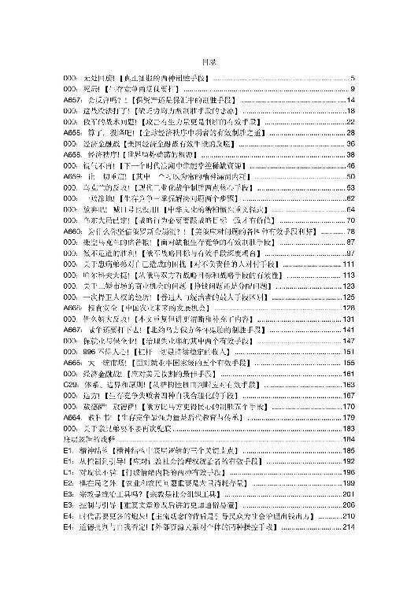
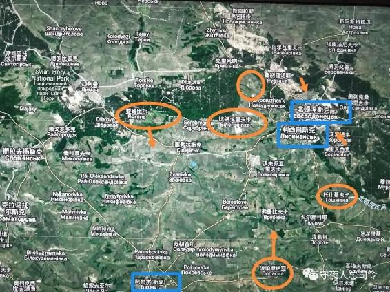
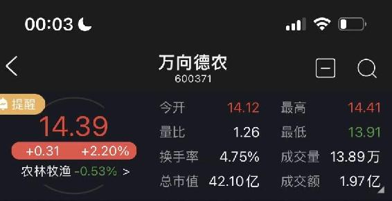
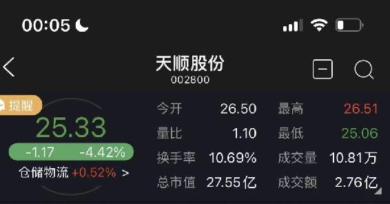
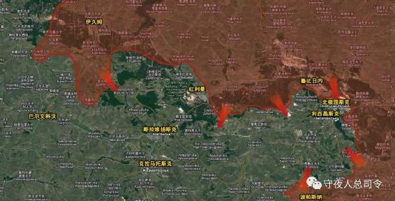
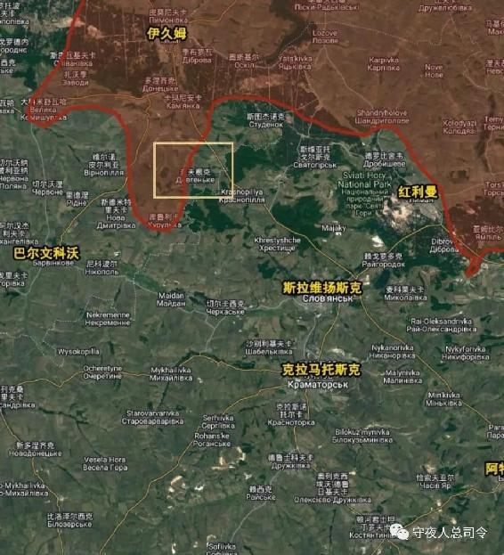
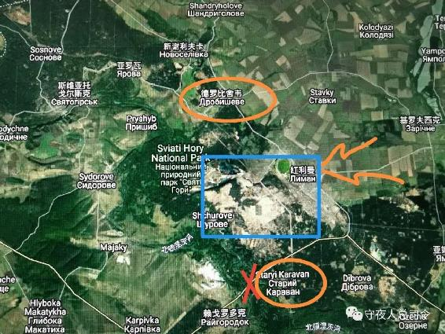
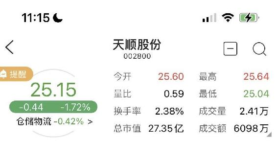
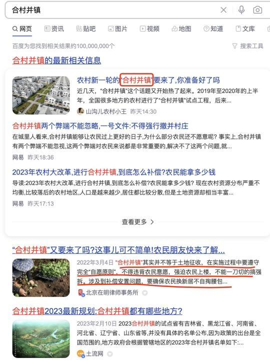
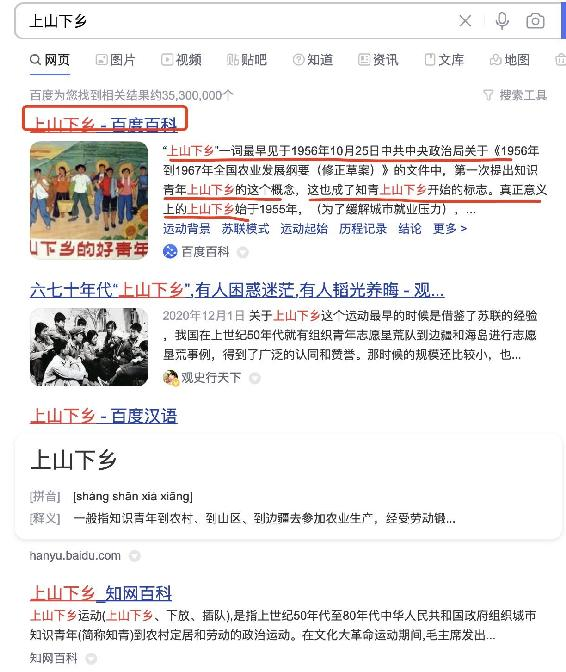

# 《结构学》精读第二期

# 000：无处回旋！【真正征服的两种制胜手段】

（展麟解读：讲国家生存结构中，生存竞争中有两种底征服制胜手段，第一种征服手段那就是进行人口替换，下一代替换，从受过教育更高级的人口，进行对本地人口，本代人口的替换是最彻底的。现在法国高福利背后的后遗症，就是法国过去几十年享受了非洲资源红利，最大的反噬殖民地对法国的反向人口替换，还有就是曾经俄罗斯的扩张和移民是同步进行的，只要攻下这个地方，就在这个地方建立城市，然后进行人口替换。还有现在乌克兰的人口格局，就是曾经俄罗斯扩张和移民的结果。还有哈萨克斯坦当下的人口格局也是俄罗斯人口替换的结果。第二种征服手段文化认同，创造共同经历，共同奋斗，共同并肩作战的机会，就会形成一种文化也是一种征服，军队的战友情深就是这么来的，在同一面旗帜下，共同经历，造成只要目标在，一切都可以磨合都可以协调。对于个体而言，掌握和参考这两种征服手段，完成精神结构升级，完成整体判断力训练和制胜手段训练，具备更高俯视的判断和决策能力，拥有更多有效制胜的攻防破方案）正文

真正的征服是人口替换。法国人享受了几十年的非洲自然资源的红利，但最大的反噬就是殖民地，对宗主国的反向人口替换。发达国家的高福利和优雅的生活条件，得益于产业优势和所控制的前殖民地的原材料供应。然而，凡事都需要付出代价。就算当下不付出代价，日后也需要为此付出代价。

在历史上，俄罗斯的扩张与移民实际是同步进行的。克里米亚之前是鞑靼人建立的汗国。叶卡捷琳娜大帝在征服了现在的乌冬地区和南部地区之后，建造了 400 余座城镇。在黑海上打败了土耳其的舰队，并吞下克里米亚半岛，从而为旧俄帝国打通了出海口。在占据和经营克里米亚的过程中，俄帝国不断地迁徙民众，去这些新建立地城镇生活。慢慢的，这些地方的主体人口就变成了俄族人口，克里米亚最后 98%的人都是俄族人口。

乌冬地区的俄族人，从 17 世纪开始逐渐增加，苏联时期开启的工业化进程，更加吸引更多的人移居这一地区。从而造成了乌克兰的人口格局。这样的人口格局，如果没有超越民族之上的东西把人团结起来，早晚都会变得像南联盟一样！顿巴斯地区的工业产出，占据整个乌克兰的 30%，这也在侧面上反映出经济结构与人口矛盾的双重叠加。

那些原属于苏联的加盟共和国，唯一的共同记忆就是苏联，说的更加准确一点就是卫国战争的并肩战斗。除此之外联系并不深刻，甚至还伴随着各种各样的历史纠葛。人与人的凝聚力必然是源于某种共同的经历。为什么战友之间的感情总是无比深，本来是来自天南地北完全没有交集，甚至饮食文化习俗都不相同的一群人，因为共同的并肩战斗，以命相互托付的浴血经历，就会从此形成紧密的情感连接。

他们说着不同的方言，甚至来自不同的民族，但是认可同一身军装，同一面旗帜。战争是一个大融炉，面对同样的命运，一切做过共同的事，才会把人与人之间的差异消弭，把共性放大。这比任何宣传都更有效，因为这种融合源于更底层的人性。

当卫国战争的硝烟逐渐散去，共同的战旗，也被踩在脚下。承载记忆的人群，随时间逐渐凋零。新一代身上是没有记忆的。于是，历史深处的陈渣与当下的现实矛盾相互交织，滋生出莫名的仇恨和戒备。

前苏联地区各国与俄罗斯在经济模式上具有强烈的雷同性质。不仅是经济上，甚至在人口方面，都存在千丝万缕的关系。这是因为苏联的少数民族领导人比俄族领导人更加激进，不管是来自格鲁吉亚的苏慈宗，还是来自乌克兰的苏穗宗和苏勋宗，他们更热衷于让俄族人与加盟共和国的人混居。这种混居与当地的工业化进程息息相关。许多落后的加盟共和国没有工业基础，甚至农业和游牧都处于原始阶段，但拥有自然资源，苏联在向那些地方输入工业的同时，也大量输入人口。

这在同属于一个国家的状况下是没有问题的。然而，一旦分家。这种问题就凸显出来了，它既是经济问题，也会因为经济利益的冲突逐渐演变成民族问题。

东亚五国为什么对俄罗斯的态度暧昧，特别是哈萨克斯坦！因为哈萨克斯坦境内，靠近俄罗斯的地方也有三个行政，区是俄族人口占绝大多数，而且苏联在那些区域建立了航天等相关产业的基础设施。

这么一类比，它是不是和乌克兰的顿巴斯非常像呀？！所以，哈萨克斯坦会很敏感，态度会非常的谨慎。不仅哈萨克斯坦不会承认顿巴斯独立，连兔子的出版的地图上，至今克里米亚半岛，还是在乌克兰的版图上。只不过我们需要俄罗斯去顶住西方的压力而已！

之前哈萨克斯坦发生紧急情况，集安组织紧急干预。坊间流传着新老大，对旧老大的背叛和清算等臆想性的传闻。传的有鼻子有眼的是这样的剧本：旧老大有意骑墙，与欧美勾搭，于是，俄罗斯支持了旧老大一手培养和提携的新老大清算了旧老大的势力，并且“拨乱反正”。事实上，政治人物的言行和行为，是根据内外处境来决定的。

别说一个国家培养几十年的接班人，就是一个非常小的组织，你要是靠背叛和出卖上位，其他人难道不会有样学样？一旦人心如此，队伍还怎么带呢？！

作为一个国家的创始人和统治了几十年的老领导，不管是对外交政策的选择，还是对接班人的选择都是谨慎的。如果要改弦更张，肯定是集体意志，这种集体意志是根据处境，而不是根据某个人的喜好。

既然是根据处境形成的集体意志，那就更没有必要去背叛老领导了！

这就如同已经开始交班的时候，太子勾结外人造反一样荒唐。

哈萨克斯坦现在处于一种尴尬的境地，如果俄罗斯不步步紧逼，它至少会保持中立的态度。如果俄罗斯的某些人缺乏智慧和耐心，对哈萨克斯坦过于紧逼，从新建经过哈萨克斯坦到俄罗斯这条铁路的全面贯通和提速就可能要往后拖延，这对谁都不好。估计兔子会去斡旋，并稳定这个区域，并与之进行更加强烈的经济合作，不至于让其（哈萨克斯）没有选择，被迫加入群殴。

俄罗斯的大学普及率居然高达 57%，这也是为什么数学强的一塌糊涂的缘故。就如同古巴的医学非常发达，因为一个社会，在哪个领域投入的多，那个地方就会具备优势。然而，俄罗斯的黑客超级厉害，也从另外一个角度反应出他们缺乏足够的科技岗位，来消耗这些数学天才们，他们就只能成为黑客。事实上，从此以后，俄罗斯的半导体行业就彻底没戏了。因为最大的一家俄罗斯本土的芯片设计公司在全面制裁下面临倒闭的风险。因为俄罗斯国内现有的工艺无法承接他们的设计。所以，这些工程师大量离职。想必某些人应该去抢人才了。这不是落井下石而是帮忙，就如同当年乌克兰自废武功之后，大量优秀的军工专家，需要有人给碗饭吃一样，我们非常非常感激那些人，这些年在我们军工进步上提供的巨大帮助！

兔子的文化强调做事考虑长远，因为千百年的经验教训告诉我们，今天的优势，可能为成为明天的劣势，所以，做人留一线，日后有回旋的余地。采取任何政策都会考虑长远。然而，毛熊的文化不是这样的，所以，毛熊的历史总是在两极之中来回切换，没有任何中庸的选择，个体身上同时交织着神性和兽性，狂热和悲情。你几乎无法想象，他们一个十几岁的孩子会对你说：人反正早晚都会死的！当年核泄漏发生的时候，事实并不像黑他们的那部电影描述的一样，不管是军官，干部，还是工人都表现出一种极大的视死如归的英雄气概，而且明知不测，还是前赴后继。然而，在你感动之余又会为搞出这种灾难的官僚体系感到咬牙切齿。不管是大毛还是二毛，都是同样的文化，同样的问题，同样一群人。在第二次世界大战中，二毛总共 3000 万人，却为苏军贡献了 700 多万的士兵。与之同时，德国占领乌克兰的时候，一方对另一方同胞的残忍程度，连盖世太保都自愧不如。所以，神性和兽性集于一身，两个极端来回切换，情况不管是向上，还是向下都会不断叠加自我强化。

# 000：死局！【生存竞争两场仗要打】

（展麟解读：讲国家生存结构中，目前在世界秩序中，只要参与打战，就有两个战场，第一个是实际的战场，俄乌冲突中乌克兰就是实际战场，生死存亡的血脉较量。第二个就是反美元体系战场，俄乌冲突，真正的做局者是美国，美国利用俄乌冲突去割欧洲的肉，来解决美国自身存续问题，这才是这场战斗的源头，俄乌都是美国棋局中的棋子而已，这个战场更加残酷，没有明显的流血牺牲，却导致非洲粮荒，斯里兰卡国家破产，这才是更加残酷的隐蔽的生存竞争。目前在俄乌冲突中，俄罗斯需要一个台阶下来，来结束这场军事行动，不然这个死局就一直打不开，打不开战争的消耗就会一直存在，甚至会一直加大，在贵的重建的都比不上失控的战争的消耗大。个体的生存存结构中，一样有两场仗要打，第一场是国运仗，就是所谓的趋势仗，你能跟着国运趋势走，在对的趋势上，干上十年二十年，你的成就不会少，第二场是个人的命运仗，你自身的人生规划，目标规划，每一个人生关键点的有效制胜手段，个人的要跟国运结合起来一起干，效果才能做好。对于个体而言，完成精神结构升级，完成整体判断力训练和有效制胜手段训练，具备占据稀缺资源并支付成本判断和决策能力，拥有更多有效的攻防破制胜方案）

正文

策略调整以后，乌冬地区上一次有关于乌军反击的消息还是 4 月 14 日，那次乌军从 79 空降旅和特种部队中抽调 200 名精英，去偷袭俄军在哈尔科夫伊久姆地区的补给线，结果被伏击全军覆没。从此之后，就再也没有爆出任何关于乌军在顿巴斯地区反击的消息了。俄军调来了国民警卫第 12 旅来负责这个区域的警戒。国民警卫第 12 旅不属于对外的战斗部队，而类似于我们的武警，只负责治安相关事务，在俄罗斯这样的编制有 34 万人，不属于各军区的编制，也不属于国防体系，由总统直辖。

乌军在东部地区有过几次，从哈尔科夫西部靠近边界线上对俄军边境地区的偷袭。无人机的半夜偷袭成功过两次，一次是村庄，一次是格尔别罗德的油库。乌军组织了凑齐 10 辆 T-72 坦克的部队进行越境偷袭，被俄军伏击，击毁 8 辆，另外 2 辆退会了乌方境内。在伊久姆地区，俄军早些天占据了著名的 65 仓库，缴获几千吨的乌军弹药，前两天又在推进中，占据一个乌军的弹药库，里面有大量欧美援助的各种武器，还有上百辆坦克装甲车之类的重型装备。前天驻守在被顿涅茨河的乌军国民警卫第一旅的 1000 人奉命在伊久姆东南方向进行反击，现在陷入三面包围，一面临近水库的危险境地。东线的乌军后勤补给似乎出了问题，开始出现主动丢弃没有油的坦克和装甲车的情况。

79 空降旅最新被俘的士兵，居然都是 40-50 岁的兵，还有 60 岁以上的士兵。要知道 79 空降旅可是乌军中的王牌，来自于苏联的英雄部队。在第一阶段也确实到处调去救火。按道理这样的兵员素质，是不能够编到王牌主力部队的，可见双方爆出来的情况都不属实，俄乌两军的主力部队损失都比较大。彼此都在想办法扩充兵员。最近有越来越多关于乌军在中西部地区抓壮丁的消息爆出来，俘虏宣称他们没有收到承诺的高工资，受伤和战死也没有收到之前承诺的抚恤金。

虽然俘虏的话不完全可靠，但乌东前线有一队士兵对着西方媒体的抱怨视频应该是真的。视频中的乌军抱怨上级让他们驻守，并挖坦克工事，但他们已经挖好 2 个星期了，现在快没有弹药和吃的了，还是没有援军过来，更别说坦克。另外一个视频是苏梅地区的女人们，在阻止征兵的人拉走自家的男人。而在乌东地区的另一支精锐 93 机械化重型合成旅，第一营第三连的所有士兵战场抗命拒绝继续服役，还写了七条理由通过媒体发了出去：缺乏重武器，缺乏伤员疏散途径，缺乏反坦克人员，指挥乏力，缺乏兵员补充，损失度高，丧失作战能力。

这些信息表明彼此都很疲倦。战争中的消耗是巨大的，困难也是双向的。目前乌军的补给线比俄军长，战争发生在乌克兰的土地上，生产生活都无法进行，西方的援助对于剩下的三千多万人的生活而言是杯水车薪。想一想上海 2500 万人一天要消耗多少粮食，用掉多少燃油，一个月停摆需要消耗多少钱，就能理解乌克兰整个社会的消耗状况了。俄罗斯当然也深受战争的影响，但战火不在其国土上，经济活动还能继续，这两个月的油气收入增加 440 亿欧元。所以，俄罗斯才有底气，给每一个在前线战死的人员发放 500 万卢布的抚恤金，受伤的发放 300 万卢布，折合人民币分别是 50 万和 30 万的样子。

这对于平均工资 2000-3000 人民币的社会，这笔钱还是有吸引力的。

据说俄罗斯开始用 5 倍的价格，去挖乌克兰的那些欧美雇佣兵为自己打战。

在伊久姆方向，之前在基辅受挫的第 1 坦克军，第 20 集团军，第 68 集团军都已经休整完，通过格尔别罗德的火车运输到伊久姆地区。值得注意的是，俄军调来了南部军区的一个独立工程旅。这应该是为了在北顿涅茨河上架桥，让大军能够通过。目前顿涅茨河的北岸，俄军的在三个方向，保持着能互相支援的距离，互为犄角。这也是为什么乌军国民警卫第一旅的那 1000 人的反击，会立刻陷入三面包围的缘故。俄军这些天，在其它地方进展不大，在乌东地区还是逐渐把战线拉平了。这个时候彼此都是强弩之末，乌军的主力也都在这里了。

任何一方都不敢轻易冒险，报销了主力接下来就没法打下去了。俄军在这里已经集中了 93 个营级战斗群，在边境的俄方一侧，又部署了 2 万人的预备队，甚至开始把远东太平洋舰队的陆战旅都装车往西边调了。

俄军对乌克兰中西部地区的运输线路的摧毁程度远远不够，西方的援助肯定还是能够流入。但是，俄军开始炸毁第聂伯河上的桥梁，这就意味着无法完全阻止外部的输入，但阻止中西部的物资向东调。

一方面说明俄军认清了现实，那就是整个西方形成了一致性的目标，不可能完全阻止武器弹药的流入，只能在自己力所能及的区域形成一个隔离带，从而强化本区域内己方的各种优势。断其十指不如断其一指，自身的兵力有限，只能在局部集中优势。目前已无任何余地，西方是铁了心要彻底搞死大毛，大毛只能先取得局部的战场胜利。然后以此为筹码进行利益交换。

现在是两场战争一起打，一场是反抗美元体系，另一场就是战场上的成败。在反抗美元体系的战斗中，对欧元的打击是巨大和立竿见影的。但是对美元的打击还不够大，俄罗斯提议金砖五国，重新搞一个结算体系，完全绕开美元。关键是三哥和兔子，南非和巴西的态度倒在其次。如果这个搞成功，将覆盖几十亿人口，而且资源和产业互补，包括中东各国也会考虑加入。这个搞成了，就是此战的最大胜利！

美国肯定不会坐以待毙，不仅会有反制措施，而且下手还会很重。

本来德国态度暧昧，在美国的一波操作下，德国目前铁了心要干死大毛。大毛在战场上将会承受更大的压力。当然了，东西送过来还需要时间，而且从训练到，用于战场至少需要几个月，把一个平民训练成步兵需要 3 个月，军训过的人就知道：即便是只教 5 项基本的技能，三个月的新兵训练是什么水平。如果新兵是坦克兵，训练需要 5 个月的时间，在二战期间都是如此，现在的装备更复杂。除了基本技能，重武器必须要训练协同配合的战术，才能形成战斗力。这个时间窗口，是能够结束这场战争的最后机会。

战争服务于政治，在政治上打破平衡，是为了建立新的平衡。如果平衡无法建立起来，这种打破就会变得没有意义。当然了，在这件事上面，不管俄罗斯打不打破，北约都主动打破平衡了。不管迎战还是不迎战，北约东扩到乌克兰的时候，平衡都已经被打破了。不管是彻底趴在地上，还是奋起迎战，都是为了构建新的平衡。能不能构建起来就看策略和手段如何了。战场上是一方面，整体的平衡不仅限于战场。就乌东地区的兵线推进而言，俄军是可以赢得胜利，但这不是最后的胜利：打下来之后，要不要派兵长期驻守？如果不驻守，它就会如同 2014 年一样，当时连同哈尔科夫州都占据了。然而，俄军一撤退，乌东民兵就丢掉了 70%的领土。西方武装的乌军把主力都部署在乌东地区，亚速营这类国民警卫部队轮番上阵。结果顿巴斯地区的民众被屠杀，领土没有守住。

要说这场战争俄罗斯最大的收获是什么，那就是弄了 90 多万的人口过去吧。对于一个高度缺乏劳动力和人口的社会这个收获还是挺大的。经此一役，俄乌两个同宗同源的民族再也无法缓和。因为年轻的一代，在相互仇恨中长大，而且没有了上一代并肩战斗的记忆。再加上年轻人对长辈的逆反心理更加强化了这种恨意。就如同今天国内许多人发自肺腑的渴望俄罗斯战败，也并非源于什么道义，更多的是源于一种心理需要。现实生活中的压抑感，让人们把这种压抑所转化出来的愤怒，投射到象征着威权的俄罗斯这个符号上。有人做过统计，中国民众中 16-26 的人群没有经历过生活的毒打，容易被 B 站中红色信仰的抽象感情所俘获，把这种心理需要投射到俄罗斯这个符号上。

而 26-46 这个群体中绝大多数人既受过西式价值观的教育，又经历过改革开放过程中内外巨大落差的冲击，还在现实生活中，被一种无形的权威所压制。内心的那种愤怒，被抽象为一种神圣的反抗精神，并投射到乌克兰这个符号上。至于 50-60 岁以上的人，绝大都是因为他们早年的教育和记忆惯性，更多的把自己内心的那份怀旧的感情，投射到俄罗斯这个抽象的符号之上。事实上，所有人都不在乎，真实的情况如何，更多的是通过那个遥远又抽象的载体，来满足自己内心的情感需要和某种满足。

人与人之间如果是因为利益冲突，往往能够心平气和的进行理性探讨。而一旦进入满足内心某种需要的情感投射状态，任何否定的行为，就是一种不可饶恕的攻击。利益冲突是就事论事，还可以探讨得失，而这种被精神结构的自我保护机制投射了整个内心需要的情况，任何质疑都会否定整个人，必然会引发全力反击，这种本能的捍卫源于精神结构的自我保护机制，在生活的其它方面也经常发生。

总而言之，全世界都高估了俄罗斯当下这种高不成低不就的军事现状。经济是一个方面，军事体制转型的半途而废是最主要的原因。

下一篇详细阐述这个问题。总的来说，它目前还是苏军的那套指挥和后勤架构，却裁掉了适合那套军事动员和指挥体系的规模。所以体系的优势，不仅发挥不出来，彼此都只能打成极具消耗的巷战。基于战场各要素的现实演化过程，俄罗斯在基于现实条件调整它的策略，简而言之就是有什么菜吃什么饭。面子什么已经不重要了，已经没有啥面子了。美国都出现这样的声音了：既然俄军是个这样的状况，我们为什么还要维持每一年 8000 多亿美元的军费开支？！

俄罗斯是输不起的，只能在现有条件下去争取胜利。你让它此时此刻去改体制是不可能的，只能去利用原有体制的优势。5 月 9 日会不会启动全国动员机制是一个关键。基于目前的战场态势，别的地方不好说，在东部顿巴斯地区是可以啃下来的，目前红莱曼已经处于完全包围之中。北部的那个要点波帕斯纳，处于最后巷战的争夺之中。

这两个南北物资中转枢纽和 M03 的那条交通线，决定了顿巴斯地区最后的命运。

主要的问题是打下来之后，能不能巩固这个军事胜利就不好说了。

这种巩固就不仅仅涉及到军事方面，还涉及到经济、政治、安全和地缘平衡。任何一个环节无法支持，这种平衡就无法建立。而一旦无法建立新的平衡，就会引发连锁反应。这个死局接下来有两个关键点：

1. 乌东地区的主力消耗状况，2. 占领区的行政机构能否正常运转。

（2014 年克里米亚事件）当年克里米亚之所能够平顺的过渡，是因为它的整个行政机构都是完整的，那个传奇的疯子假传圣旨，骗克里米亚的各级官员自己是钦差，一路封官许愿，得到克里米亚原版行政机构的所有人的支持，才能兵不血刃的直接拿下克里米亚。当然了，还有另外一个巧合的因素，就是当时驻守克里米亚的 2 万乌军，是新换防的部队，事发突然又没有抵抗意志。这种传奇的巧合性太高，无法复制。而且它导致了两个不可逆的恶果，这也是普京从此以后，把这个做事完全不顾后果的传奇疯子雪藏的原因。

只有建立完整，并独立运转的行政机构，才能恢复社会秩序和经济活动，并进行征兵和建立治安管理体系。它不仅释放占领区域的武装力量，而且也释放物资和资金的投入。波兰也确实想趁乱夺回自己的故土，乌克兰西部三个州是当年苏联从波兰夺取，并入乌克兰的。

作为补偿，让波兰占领了德国的故地。现在确实是波兰夺回故土的最好时机。美国与波兰近期策划演习，以保护民众为名义，接管乌克兰西部三个州。俄罗斯巴不得波兰这么干！波兰真的采取这一步的行动，俄罗斯目前的死局也就解开了。大家各占一块，中间的那块纯粹的农业区域做战略缓冲地带。新的平衡可以重新构建起来，西方和俄罗斯都可以体面的退出，并且各自都达到了自己的目的。

# A657：会反弹吗？！【保资产还是保汇率的制胜手段】

另一种标题：A657：主动贬值

（展麟解读：讲国家生存结构中，面对美元体系的生存竞争，国家作为主体参与竞争的很多时候我们需要思考两个问题，第一个是汇率问题，汇率是外部财富，第二个是资产问题，资产是内部财富。面对国际的动荡，我们政策决策者，需要常常需要思考，根据国内的实际情况制定合适的生存策略，是保资产还是保汇率的问题。放弃汇率去保资产有利于出口，不利于进口，对资源型国家来说是好事，保护国内资源去出口换取更多的财富；对生产性国家中国来说，就不是好事，反而是坏事，我们资源靠进口，利润靠出口，选择保国内资产价格，我们是辛苦付出了，进口原材料生产产品出口给人家，但是我们没有利润，甚至是亏本，这就是我们的必须面对的实际情况，在全球经济秩序中，我们是生产型国家不是资源性国家更不是消费性国家。

放弃资产去保汇率，有利于进口，不利于出口，对于消费型国家来说是好事，花更少的钱，获得更多的产品，自然是买买了，对于生产型国家的我们而言，也是不利的，虽然花更少的钱进口原材料生产，但是出口就更难了，生产出来产品没有人要。所以我们的政策决策者，要两害相权取其轻，更多的是倾向放弃资产保汇率，从而在内部启动房地产这个特殊的拉动手段，历史证明，对房地产的调整可以同时解决很多问题，还可以促进 200 多行业的发展，这就是操控房地产手段的魅力，而接下来可能操控的房地产手段，就是棚改，内部启动棚改去保护汇率保护外部资产，让外部资产回到正常的估值，正常的市值，这又是一次接受美元体系下的收割，我们还不够强大，只能默默承受。）

司令解读：昨天那篇阐述了一些隐藏在表面之下的底层逻辑，真实的世界总是残酷的，亦如生活本来的面目，但这种残酷是不允许公示的。大众需要活在一种简单，且美好的想象中，如此才能被引导。

所以它被删除了！本文所呈现的脉络与更加实实在在的东西有关。

（那

篇文章是指 A658：算了，投降吧）

前言

战事不扩大，欧元的汇率就不会继续跌了，没有吃饱的美国，绝不能善罢甘休。西边吃不饱，肯定要在东边发力，既然佩罗西无法去台湾，小本子就要发力，现阶段兔子在汇率与资产之间，并不完全是二选一。

正文

美元体系是用来收割全世界的。这一点毋容置疑! 每一次美国内部的矛盾，无法调和的时候都要来一波收割。通常情况下的操作是美元先放水贬值，向全世界各国出借便宜的美元，或大量热钱涌入，购买别人的低价资产。然后到了收割周期的时候开始连续加息，造成美元回流，恶狠狠的收割一把。在这个过程中总是会伴随着冲突、动荡甚至战争。没有也要搞出一些来!

世界上有三个是非之地，一个是中东，一个是印太，另一个就是北约和独联体的边缘地区。为啥这些地方容易成为是非之地呢?因为牵扯比较大的利益和博弈! 通常情况下，不是在独联体地区搞事，就是在中东煽风点火，要么就在东亚或南亚搞摩擦。都不是平白无故的搞，凡事无利不起早!

欧元贬值

俄乌冲突收不了场，沙特和伊朗这两个千年仇敌，居然头一回握手言和! 这些天三哥（印度）很识大体，也不跟我们闹别扭了。甚至东南亚都必经平静，虽然暗流涌动，终究是没有掀起什么风浪。事出反常必有妖。美国的通胀这么高，之所以在俄乌冲突上最积极，不断加码火上浇油，显然是没有吃饱!

欧元兑换美元的汇率从 1.2 跌到 0.88，确实在美元的连续加息之前，造成了欧元区资金的回流。显然力度还不够，所以还需要绑架欧盟的主要国家与俄罗斯死磕到底，最后能让冲突加剧，造成更大的恐慌和动荡。从目前的现实来看，让资本市场最恐慌的阶段已经过去了。

因为俄罗斯稳住了卢布，欧元跌到这个程度之后发现：冲突再怎么恶化也就那样了。因为俄罗斯能给欧洲带来的恐惧，其实也就不过如此! 一个打乌克兰都这么费劲的俄罗斯，又如何威胁欧洲的其它国家呢?! 资本市场的精英和民众不一样，他们会更加理性的去评估风险，而不是按照价值观或者情绪需要来决定进退。既然俄罗斯对欧洲的威胁非常有限，所有的制裁都用完了，对俄罗斯造成的伤害也就不过如此。

卢布还通过与能源的捆绑稳定住了。那么，欧洲虽然叫喊的凶，但那都是表面上的。在俄罗斯公开宣布，用卢布结算之前，上个月 30%的油气就是不能公开的欧洲国家，用卢布私下里购买的。这种默契的背后是彼此都探到了底，也就不继续恐慌了!

欧元和卢布不继续恐慌，美元就需要坐立不安了! 因为没吃饱，又没法继续榨出油来。所以，西边美国榨不了更多油，那就得搞东边了! 早两天本来德国已经答应公开卢布结算油气，这两天在鹰酱的运作下，德国突然改了腔调。最新的声明中主要包括三个点：1. 援助重武器，2. 继续加大经济和金融制裁，3. 警告中国并威胁制裁。

你要援助乌克兰就援助，要制裁俄罗斯就制裁，总共就三点，还留出三分之一，给置身事外的中国，可谓此地无银三百两。剧本是美国爸爸写的。演员已就位!果不其然，发完带上中国的声明，德国管事的人马上去了日本。要知道在过去的十几年里，德国总理来亚洲都是先去中国。事出反常必有妖!

日元洼地

日本在海外拥有大量资产，如果日元贬值，这些资产就会变得很划算。那么，别的国家就非常值得卖出自己手上的筹码，去购买这些更便宜的日元资产。日元大幅贬值之后，即便美元加息，这些资产的也没用太多下降的空间，所以会比较安全。如此一来，其它国家的资产，按照自己的汇率来计算就会显得估值过高，风险更大。

如果其它国家，也跟随日元大幅贬值，那么，就等于放弃汇率去保资产。放弃汇率的结果是有利于出口，而不利于进口。对于资源型的国家而言，其实是好事。但对于中国而言这不是好事! 因为我们目前出口的核心产品，所需要的原材料都是国内供应不足的。换句话说，我们这样的产业优势，并不具备利润优势。以更高的原材料价格进口来进行生产再出口。西方各国能够以更加便宜的价格，大量获得中国生产的产品。但中国的企业并没有什么利润! 当然了，虽然白忙活但能数据上会好看一点，也能保一部分的就业。政策的制定者确实在保汇率还是保资产的选择上犹豫过，决断就是两害相权取其轻! 日元的主动贬值，显然不是日本人能够决定得了的。日本在防务、金融和外交方面都缺乏自主权。当年日本有位首相，要搞中日韩统一货币互换机制，没多久他就出意外死了。时隔十来年后，中日韩再一次准备向这个方向努力，极力倡导的日本财相也突然出事。对于日本政治家而言，自己有主见是很危险的，美国爸爸说啥就是啥! 欧洲各国也正在加速变成这样。不想变成这样的就是十恶不赦的恶魔。曼德拉为什么受全世界推崇? 因为他把一个国家能放弃的未来都放弃了，所以五大善人都夸他!

资产和汇率

目前摆在面前的艰难决策，就是保资产还是保汇率。如果保资产就让汇率贬值。金融市场上的筹码已经跌得差不多了。汇率贬值，会让它们的估值得到修正。说的更通俗一点就是反弹!

这对房产而言，也是一样的情况。虽然一线的楼市还比较坚挺，但其它地方的房子其实已经贬值不少了。政府也没打算让一线大涨，但对于欠发达地区的房产，还是希望能有所回暖。只不过愿望很好，但经过现实和政策的叠加打击，民众的心理预期和承债能力，都难以立刻扭转局面。估计棚改又要提上日程! 当然了，这是最后一次接盘。

所以，还是不要去考虑三四线!

（知识扫盲：棚改其实就是政府部门对某一个地方的一个集中改造工程，其原本的意义就是说在寒冬临来之际，能让老百姓在穿上棉衣，披上棉被能够拥有一个非常好的入睡环境，政府部门对于这一说法叫做棚改。 但是很多人都会把棚改和拆迁混为一谈，拆迁说白了，就是把原来这块地皮上的人迁到别的地方去，而且分给每家每户一个安置房，而棚改的意思就是从原来的地皮上面直接建造最新的楼盘，让原有的百姓还在原来的地面上面居住。棚改指棚户区内将要被改造拆迁的住房，是依法拥有被拆迁房屋的所有权;另一层含义是指棚户区改造后建设的住房。棚改工程是政府为改造城镇危旧住房、改善困难家庭住房条件而推出的一项民心工程。）

如果日元在东亚地区引发大家竞相贬值。美元还没加息，大家的资产相对于美元就变得很便宜了。等美元再好好的加息几次，大家的资产相对于美元就会更便宜。如此一来，本来就以美元标注的美元资产是不是更值钱? 汇率和资产都升值，这是正向循环! 不仅全世界的钱往美国涌入，而且美国人的消费是其他国家生产的拉动力。同样的钱，美国人可以从全世界买更多的东西，为什么不买呢?而下游国家大量资金出逃，造成债务危机和社会资产的估值坍塌。汇率和经济基本面都反向循环将会是灾难。综上所述，让经济的基本面有支撑，汇率暂时贬值没有太大关系。如果要保住经济基本面的支撑，各种刺激手段，就不能吝啬了!

（知识扫盲：经济基本面即公司的经营业绩、盈利能力和成长性，是影响公司股价的决定性因素）

# 000：这战没法打了！【缺乏势均力敌制胜手段的悲凉】

（展麟解读：讲国家生存结构中，面对生存竞争，要想按照理想市场交易模型进行，必须满足一个前提，只有势均力敌的情况下才能公平交易，没有这个前提，谈不上公平交换，更太不上尊重，不要觉得怎么可能，请认清生存竞争的真实运行逻辑，生存竞争中只有两种方式，一种是交换，一种是掠夺，只要你没有与人势均力敌的能力，就是在掠夺中平衡没有交换。俄乌战争中，俄罗斯面对北约的技术落差，二号人物的指挥被轰炸也只能忍了，在中国曾经的落后中，8 万件衬衣换一架飞机忍了，炸我们南联盟大使馆我们忍了，曾经利用电子对抗模拟进攻我们沿海，暴露了我们所有军事设施我们忍了，70 后那代普通人向往美国生活被美国价值观绑架等等，曾经我们的落后，也一样面临无数的掠夺行为，渗透到我们的日程生活中。落后就要挨打，这是在更高科技面前，落后没有应对的制胜手段，空有一腔热血和同归于尽的臆想，存在我们国家生存结构中，也存在我们个体生存结构中，这个悲凉需要我们一代，甚至几代的人的接力，去弥补这种差距，否则我们永远得不到所谓公平交换的环境，对于个体而言，从势均力敌的制胜手段中找到自己的落差，和自己需要弥补的目标，只有具备势均力敌的能力才能迎来真正的公平交换，完成精神结构升级，完成整体判断力和有效制胜手段训练，具备占据稀缺资源并支付成本的俯视视角的判断和决策能力，拥有更多有效制胜的攻防破求存方案）司令解读：生命体的抗争从来就不是为了过把瘾就死，而是为了某种接力。就如《这战没法打了！》中描述的那位同学的父亲说的一样：我们这一代只能去死，你们这一代才可能赢。这真的是为了争什么输赢吗？不是的！是在争夺生存资源和更好的生存机会。科学技术的发展会把饼做大，但不会改变分配的方式。分配方式永远是生命体抗争后的结果。生命体结构与其它工具最大的不同，就是生命体结构会用尽一切办法维系自身的独立性！人的工具化最突出的表现，就是放弃独立自主，沦为像一把铲子，一把刀，一个任人摆布的物件，所以才叫工具化！

正文

第二次世界大战，唯一在战场上受伤的交战双方的统帅只有南斯拉夫的铁托。这是几十年来，第一次有一个国家的总参谋长在战场上受伤。而且是指挥部被对方精确击中，而且用的是二战时期的老古董火箭炮，并不是精确制导的导弹！这意味着什么呢？这意味着交战双方中的有一方，在另一方眼中，从基层士兵到最高层的统帅的一举一动都完全是透明的，毫无秘密可言！这一点比任何先进武器更加的可怕。估计这一波针对指挥部的袭击，并不是针对二号人物的，而是针对负责电子战的那位少将。因为现场有总指挥，二号人物是来提升士气的，但那位负责电子战的少将，肯定不是孤身一人，他的团队和这个领域的主要专业人员，都聚集在他身边，这一群人如果被一锅端了。

比那个二号人物在战场上更加具有实际意义。根据俄军的这个体制，部队的末端完全靠中枢指挥，如果中枢停摆，末端就会被动等待命令。

俄军最近这几天在东线，不管是包围乌军的国民第一警卫旅 1000 人，还是另外一支反击部队的 600 人，或者摧毁乌军的山毛榉防空系统和乌军的雷达，这些都与最新拉上来的电子对抗部队息息相关。虽然不能像北约的卫星系统和预警机那样先进，但至少能在局部形成有针对性的遮蔽和干扰。因此，电子对抗的这个指挥部中的专业人员，就必然是乌军首先要干掉的目标。俄军二号人物跑过来给前线打气，结果被搂草打兔子了。

在 20 多年前的台海危机之后，有一次我们沿海的警戒雷达上出现几百架的美军飞机入侵的警报。于是，沿海所有的雷达开机，所有隐蔽和公开的机场的战斗机，都紧急升空迎敌，导弹部队立刻进入战斗状态。我们的雷达上敌人的飞机密密麻麻飞过来，但我们的飞机在天上到处乱飞，一架敌机都没遇到。如此反复了好多次，每一次都精疲力竭，但又无可奈何。更加要命的是，我们部署的所有雷达、机场、导弹基地，全部在这种反复的闹剧中全部暴露了！最后是怎么发现的呢？东海方向有一位歼 7 的资深飞行员，用肉眼看到了一架美军的电子对抗机。动不动几百架各种飞机集群突击的假象，就是美军的电子对抗机在我们的雷达上模拟出来的！这件事让最高层震怒，让全军憋着火，但又能怎么样呢？！

二十年前有一部小说叫《全频段干扰》，好像就是《三体》的作者刘慈溪写的。他在书中描述了在当时的技术条件和国力的情况下，我们在面对北约的极限压制和武装入侵时奋起反抗，最终一败涂地的悲壮和无奈。作者还是比较理想化的，他在小说中构建了一个代表了当时军队主流思维方式和心态的克敌方法：通过一种同归于尽的方式，让双方都失去通讯和电子信息的能力。然后迫使对方与自己开展传统的“拼刺刀”的战斗模式。最后通过自身的组织度和牺牲精神去获取惨胜的机会。这是一种无奈的臆想，一种悲壮的控诉，一种走投无路的绝望。

我们曾经把坦克搬运到军舰上，用坦克的主炮来提高海战的火力。

那是因为我们的军舰火力不足。南联盟曾经利用美军 F117 在投弹时打开舱门时失去隐身的几秒空隙，击毁一架美军的隐身轰炸机，就是今天我们用运 20 把 FK-3 送给他们的那支英雄部队。当时我们也提出过类似的战法，但这也是一种绝望下的无奈。敌人都隐身飞到到你的头上来投弹了，图穷匕见之时，这种巧合的机会微乎其微。我们也曾经考虑用大功率对敌人的雷达进行压制，但是在美军的跳频技术下，这种大功率的干扰毫无意义，而且人家的扩频技术在微弱信号的情况下也不影响通讯。这种绝望是无论如何都够不着的那种绝望！

我们曾经遭受过非常多的委屈。南联盟的大使馆遭受无辜轰炸的时候，当时正在上中学，班主任一大早来到教室，站在讲台上两眼通红，他欲言又止，我们发现他的身体在发抖。他像一个咆哮的受伤野兽，又像一个临死前托孤的父兄。他要我们去考军校，去学理工科！

有个同班同学的父亲是当地驻军的大校旅长，他们让我们几个有志于此的同学，去军营感受一下真实的高射炮。我依稀还记得他亲自给我们讲解的样子。还有那句意味深长的话：我们这一代人只能去死，你们这一代人才有可能去赢！

这种心态在当时是普遍存在的，许多题材的作品，突出表现的都是不屈和悲壮。这种不屈和悲壮的精神背后恰恰是有效手段的极度缺乏！老爷子曾经最喜欢看的一部电视剧叫《突出重围》讲述的是我军进行改制和升级过程中观念、心态、现实条件的各种挣扎。曾经无比有效的三三制、四组一队，一点两面，四快一慢，阵前潜伏短促突击，在山坡的反斜面挖坑道，这些创造过辉煌的战术技巧，统统变得毫无价值了！在 60 米的钻地炸弹的攻击下，地下几米厚的钢筋混泥土掩体都没用，何况土工挖的坑道。在红外线热成像的照射下，即便能像邱少云那样忍受痛苦，也会被敌人看得清清楚楚。

炸了南联盟的大使馆我们忍了，“银河号”的奇耻大辱和对主权的肆意侵犯，我们也忍了。8 万件衬衣换一架飞机如果是限于经济水平，那么，在产业链的最末端被肆意修改规则进行盘剥，我们也不得不忍。大面积的血汗工厂和廉价劳动力之所以存在，是因为你在国际贸易中没有议价权。进口原材料和出口产品都没有议价权，为了保住千千万万普通人的饭碗就只能压低利润。为什么任何一种进口的商品出现替代品，它的进口价格就会瞬间降低一半呢？许多事并不是按照理想的市场交易模型进行的。公平交易只存在势均力敌的状况下！在生存竞争中，或许资源的方式有两种：掠夺和交换，垄断就是一种掠夺，只有掠夺的综合成本高到划不来的时候，才会转变为交换，而交换的一方如果拥有某种特权，交易就会转化为垄断，俗称特许经营。

上海这次爆出来的许多情况就是，非市场因素形成垄断下的特许经营。

一个国家的贫穷和弱小，她的军队感受最深。而在你没有准备好的时候，突如其来的危机，通常只有悲壮的抗争和忍辱负重两条路可以选。我们曾经忍辱负重卧薪尝胆。在那些年中，受过高等教育之后的学子们，最大的愿望是去美国，最不济也是进入美国，在北京和上海跨国企业。对于个体而言，追求更好的个人生活无可厚非，每一个人都有自己的选择。一个正常的社会应该允许个体做出符合自己意愿的选择，而不进行道德绑架。然而，那些逆行者的默默奉献和那些明知不敌，还坚守岗位穷尽一切手段，去争取更多自主权的人们，才为更多的普通人赢得了，更加宽松的生存环境和与独立自主的权力！

政治服务于经济，军事服务于政治。所有的政治和军事斗争，博弈的都是经济秩序和在这个秩序中各自的角色和位置。当我们也开始输出高铁这类东西的时候，我们就与日本和德国、英国、法国这个梯队的国际矛盾重重。当我们也开始用美元在全世界投资的时候，美国就与我们不共戴天。巴黎左岸的精致和悠闲，是以法国对非洲 15 国的金融和自然资源的垄断为基础的。美国之音所描述的生活，是以大洋彼岸富士康流水线上的内卷状态支撑起来的。雅典的殿堂中，讨论哲学和诗歌的先贤们从容而优雅，城邦外不远处的农田中，有成千上万的外邦奴隶在挥汗如雨的劳作，供养着雅典这座璀璨的城邦。生存竞争不仅仅发生在个体之间，也发生在不同的共同体之间。共同体占据的资源更多，共同体中的个体所能享有的资源也就更多，内卷的程度更低，个体的自由度也就越高。无论什么时候，无论什么民族和人种构建起来的社会，文明都是充盈和富足状态下的理性、克制和包容！

# 000：俄军的战术问题！【攻击有生力量更是制胜的有效手段】

（展麟解读：讲国家生存结构中，面对生存竞争的战争手段，现在拥有什么不是很可怕，可以集中精力去摧毁，但是能持续拥有的有生力量是非常可怕的，所以一招致命的手段，就是集中精力去摧毁敌方的有生力量，只要摧毁其有生力量之后，接下来就是集中精力消灭现存力量。在俄乌冲突，非常佩服乌克兰根据自己的实际问题和实际情况去执行自身的求存策略，根据俄军的空地指挥缺陷，重点狙杀俄军高级将领的有效制胜手段，利用平民做肉盾，跟俄军打城市消耗巷战也是有效制胜手段。俄军根据自身实际问题和实际情况，在无法进行精准打击的情况下，拉苏联时期的旧火炮到前线，进行地毯式轰炸乌军工事和阵地，为地面部队扫除障碍也是有效制胜手段，包括俄军接下来要摧毁北约培养乌军军事人才的基地的有生力量，是更关键的制胜手段等等，在这场俄乌冲突中，我们不关注对错，是非判断，我们只关注基于现实问题，应对问题具体的有效手段，为我们以后可能面对的台湾冲突做准备。对于个体而言，要洞察竞争对手的现有力量和有生力量，有生力量更加决定竞争的成败。完成精神结构升级，完成整体判断力训练和有效制胜手段训练，具备占据稀缺资源并支付成本的顶层俯视视觉的判断和决策，拥有更多有效制胜的攻防破求存方案）

正文

许多人渴望乌克兰赢，另一些人渴望俄罗斯赢。这种急切地心理源于一种内在地需求。根据统计，16-26 岁的人群没有经历过生活的毒打，容易被 B 站中那些体现红色信仰的抽象感情所俘获，把内心对纯粹、崇高和力量的渴望投射到俄罗斯这个符号上；而 26-46 岁这个群体，绝大多数人受过西式价值观的教育，又经历过改开之后内外巨大落差的心理冲击，还在现实生活中被一种无形的权威毒打。内心的那种无力、压抑和愤怒被抽象为一种反抗精神，并将这种内心的诉求投射到乌克兰这个符号上。至于 50-60 岁以上的人，因为早年的教育和记忆的惯性，会把自己内心的怀旧感情投射到俄罗斯这个抽象的符号之上。事实上，所有人都不在乎真实的情况如何，主要是通过那个遥远，又抽象的载体来承载自己内心的情感需要，并从中获得某种精神满足！

军事行为必须服务于政治目标。即便在乌东取得了胜利并占据了顿巴斯地区。如果不能建立起某种平衡的政治机制，战场上的军事胜利也只是暂时的。2014 年的经验教训已足以说明问题。平衡被北约主动打破之后，不管俄罗斯迎战不迎战，其破碎的结果都是一样的。

迎战反而还有可能构建起新的平衡！这也是普通人应对问题时的一种思路：如果生活的平衡已经被外力打破，不管怎么样都已经没有了选择，逆流而上，还有一线生机，忍气吞声，即便人为刀俎我为鱼肉，逆来顺受，也不会有什么好下场！

要解决现实问题靠的不是内心的渴望，而是那些基于现实的具体手段。就如同每一个人的人生，你拿到牌的时候就已经这样了，不管怎么样，你都要打下去，而且是硬着头皮都要打下去，并取得最好的结果。所以，那些基于现实的缺陷，去调整策略把牌打好的有效手段，是值得借鉴和研究的东西。

先把目光聚焦到战场上：4 月 30 日，敖德萨的机场，被俄军从克里米亚半岛发射的“凌堡”导弹摧毁，存储北约军援的仓库被毁，但没有人员伤亡，机场和跑道已经不能用了。估计此举是为了阻止北约，继续通过空运向敖德萨补给武器弹药和战争物资。敖德萨南部的跨海大桥也被导弹摧毁，但罗马利亚依然可以通过乌克兰西部的铁路继续输送物资。事实上，为了规避俄军的打击，都是在晚上通过火车运输物资进入乌克兰。最近运送最多的物资是石油。因为乌克兰境内绝大多数的炼油厂和燃料仓库都被俄军摧毁了，不管是军队还是民众的生活都需要燃料，所以在逆向补给。

空地脱节

乌军在俄军最近被击落的一架苏 34 战机残骸中发现，俄军飞行员在领取任务时用的是手写坐标，并通过手工输入来确定攻击目标的位置。这么先进的战机，明明具有自动导航和自动锁定目标的功能为什么不用呢？原来俄军飞行员把 GPS 相关的一切都关闭了，防止被美军定位到自己。这等于拿着一把狙击步枪，却用来拼刺刀用，虽然很心酸却也没有办法。

北斗系统能够提供 GPS 的所有服务，并且精确到 0.6 米这种精度。但俄罗斯碍于自尊心，一直拖着没有开启接入北斗系统的技术合作进程，可能是为了等自己的卫星系统成型。但他们昨天才发射了自己的第一颗军用卫星，他们自己搞的那个卫星系统，目前只有 6 颗在轨卫星，根本覆盖不了战场。

这个事情也就暴露出来俄军第一个战术问题：空地脱节。空天军在缺乏自动导航的情况下，完全凭借飞行员的经验，很可能一不小心就错过目标。这种状况让空天军与地面部队协同作战和精确打击，既危险又困难。想象一下这样的情景：地面部队在推进的时候，召唤空军攻击前面的堡垒，结果空军攻击的时候偏了一点。在几千米高空上偏一点在地面就可能偏几百米，不仅会变成无效攻击，甚至可能误伤进攻的己方部队。这种情况在伊拉克战争中，拥有精确制导的美军在配合的时候都时有发生，何况这种情况下的俄军。空地协同，需要能够协调数据链和控制链的专业人员。俄军中目前缺乏这样的人员！

体系弊病

在审查俄军的后勤编制的时候，我发现他们的集团军的后勤旅，居然编有两个列车营。这是全世界其他国家的陆军中闻所未闻的编制。

这就说明俄军承袭苏军体制，喜欢通过铁路来集中供给物资。这是结合当时苏军的大兵团作战的特征以及俄罗斯通过修建铁路扩张势力的传统。但现在的问题是，俄军这些年搞体制改革，不仅把大规模编制的陆军裁撤了，甚至把全国动员体系都裁撤了。且不说这样造成兵员不足，更主要的是，目前正处于体制改革，进行到一半阶段突然发生这种规模的战争。从俄军的陆军编制上来看就足以窥一斑而见全豹：

物资供应和指挥链还，是沿袭传统的苏军兵团的体系，但编制规模以及兵员和装备的数量却与那套指挥和后勤体系完全不匹配！这就好比台湾就一个省，但是它顶着一个疆域比中国大陆还大的名头，整个体系还按照秋海棠地图的规格去设置机构。

（知识扫盲：民国时期的中国地图形似一片海棠，因此也称作是秋海棠地图，面积为 1154 万平方公里。1911 年 10 月 10 日，武昌起义爆发后，中国外蒙地区在沙皇俄国的支持下宣布独立，随后又回归中国的统治，中央也在此地留有驻军和办事人员）

缺乏军事常识的人可能不能理解这种矛盾，举个例子吧：当年库尔斯克会战，德军的虎式坦克确实无敌，苏军的 T-34 拿它完全没办法。即便是改进增大了主炮口径和油箱容积的 T-34/85 型坦克，而不是之前的 T-34/76 型坦克也打不穿虎式的正面装甲，只能在 400 米的距离击穿其侧面装甲。苏军是怎么打赢的呢？简单来说就是数量堆死质量：一个坦克军有 500 辆 T-34 坦克，集中一个又一个集团军前仆后继的发起不间断的钢铁洪流般的冲锋。不管怎么样，你开一炮只能击毁我一辆，坦克又不能像机枪一样连续不断的开炮。只要坦克兵不怕死、数量够，冲上去与德军坦克交织在一起，就能在 400 米之内，以多欺少把德军的虎式坦克群殴掉。事实上，这个战术很凑效的！

T-34 的制造工艺非常简单，生产也非常快，不像虎式，虽然强大精巧，但制造的工艺复杂，依赖的材料太多，生产速度太慢。苏联不缺资源，但德国几乎什么都缺。

苏军的这套打法和这套指挥体系要能发挥这样的作用，依赖的前提条件就是编制够大，能随便拉出来 500 辆坦克冲上去报销。如果你总共才 500 辆坦克，就不能指挥官一声令下全部冲上去，而是要采用更灵活更加精打细算的战术，这种战术就依赖于更高的灵活性和基层指挥官的创造性和自主权，准确的说是必须赋予基层指挥官随机应变的权力。然而，大兵团作战体系必须令行禁止，才能形成整体性的合力，这种整齐划一的服从和勇敢更能最大限度地发挥出钢铁洪流地威力。这也是为什么传统步兵连长以下，不配望远镜的缘故。在火力密度和信息密度都不够的情况下，就必须要依靠人数密度，通过严密的纪律组织起密集的攻击队列。这种情况下基本单元需要的是勇敢而不是自主权，但这种状况下也需要高密度的人员编制作为基础攻击单元。一旦不具备钢铁洪流的规模和编制，指挥体系和后勤供应的高度集中，反而会是劣势：不仅会让基层在接敌时，缺乏随机应变的处置权。一旦指挥链的中枢被端掉，整支部队就陷入停摆状态。这也是为什么俄军的高级将领总是死在前线的缘故。如果不靠前指挥，就不了解战场的现实情况，一旦过于靠前就会成为乌军的目标。乌军与俄军都曾经是苏军，彼此的编制和套路都门清，越是懂你的人，就越知道该往哪里捅刀子！从军事角度来说，乌军的这种有针对性的打法是值得赞赏的，也是行之有效的手段。我们从务实的角度来审视冲突中，各方基于现实所采用的策略，并研究那些切实存在的问题和行之有效的手段。这才是真正有价值的部分！

步炮协同

乌东三个方向的推进，虽然互成犄角稳步推进，但速度不够快。

究其原因就是单点突破之后无法扩大战果，反复陷入拉锯状态。大纵深作战理论是先用炮击摧毁敌方前沿阵地，然后用步兵突击为坦克部队扫清反坦克火力，再用坦克集群在打开缺口的地方向纵深突进。用装甲力量去扫清城市外围和纵深的防空力量，再用空中力量打，击敌方地面部队的集结点和补给点，在敌后进行空降配合正面作战。

俄军的这种战术优势完全没能发挥出来。第一阶段的大踏步前进，还有点这种大纵深进攻的影子，可能因为第一阶段的失利，即便在乌东占据兵力优势的情况下，也害怕有闪失，打的更保守，更小心翼翼。

虽然还在稳步推进，但几乎把每一个据点都打成了马里乌波尔模式。

总的来说，俄军的炮兵和步兵没有能够很好的协同，炮兵和步兵几乎是各打各的。指挥体系的掣肘是一个很大的原因。缺乏用于战场监测的无人机，也是一个重要原因。前线的炮兵观察，只能用大疆这种民用的低空无人机去搜寻目标和确定坐标，然后还需要逐级往上反馈，通过更高级别的协调通知炮兵部队进行火力准备。炮火轰击乌军阵地时，地面的坦克和步兵就应该同步推进。然而，大多数情况下是炮兵轰完了，机动部队根据观察的反馈才开始推进。乌军躲过炮火又进入工事。结果还是步兵强推，炮兵的火力没能发挥合力。等步兵受阻退回来之后，根据一线反馈又轰击一轮，结果乌军发现了这种协调上的缺陷，马上又进入掩体躲过火炮的攻击。乌军的这路数，有点像朝鲜战场上志愿军，利用山体工事阻击美军的情景。

俄军为了应对这种现实困境，在无法快速提升战场监测能力和炮兵观察能力的情况下，开始把苏联时期封存的大量旧火炮用列车拉到前线，估计是为了在无法提供精度的情况下，通过增加火炮覆盖的密度，来摧毁乌军的工事和阵地，为地面部队的突进扫除障碍。

巷战困境

北线的红莱曼是乌东地区城市堡垒群的北线补给枢纽，四天前就开始从左右两路向红莱曼发动钳形攻势，昨天才把这座城市彻底包围。

红莱曼的乌军将会如之前判断的那样，退到北顿涅茨河的右岸，去斯拉维扬斯克构建新的阻击点。炸毁了从红莱曼通往斯拉维杨斯克的铁路桥，这座桥跨越北顿涅茨河，也是己方的火车物资运输，从北面唯一能通过的铁路桥。南边的波帕斯纳是整个北顿城市堡垒群的关键据点。目前还在巷战的争夺之中。乌军退守剩下的城南的居民楼和地下室中与进攻的俄军进行巷战周旋。而且，从城市堡垒群核心地带的利昌斯克和正在被攻击的被顿涅茨克市撤离的部分乌军主力，正在南下增援守卫波帕斯纳的乌军 24 机步旅。这些关键节点的争夺，双方都在持续投入兵力。

在叙利亚俄军不需要出动地面部队。所有，不仅俄军自己没有意识到，甚至美军都没有意识到，现代城市巷战对陆军的消耗和依赖程度：2004 年的第二次费卢杰战役，1.5 万全副武装的美军和 2.5 万美国训练和用美国装备武装起来的伊拉克军队，在费卢杰围攻 2000 人的极端分子，那些人连重炮都没有，只有 AK 步枪和肩扛式 RPG。

即便如此悬殊也耗时 47 天才打下来！打下来之后，极端分子还有近一半的人活着。美军死亡人数虽然只有 88 人，但受伤 1300 多人，伤亡人数加起来，比只有原始武器还弹药不足的极端组织还高。打辅助的伊拉克军队比美军的伤亡人数更高。

马里乌波尔虽然打的艰苦，但证明可以通过城市巷战的方式打下来。但是这样打的时间会拖的非常长，消耗也非常大（马里乌波尔巷战模式）。马里乌波尔的乌军的战斗意志绝对是乌军中一流的水准，在这种巷战中被干掉了 1.5 万的精锐。53、54 两个机步旅被彻底消灭了，36 海军旅陆战旅被消灭一半，投降一半。12 海军步兵旅和 79 旅的一个营也被消灭在巷战中。早几天在乌东地区被俘的 79 旅的士兵，大多数是 40-50 岁的老年士兵，有的甚至是 60 岁以上的士兵。

79 和 93 旅都是主力部队，通常情况下不会把这样的士兵编入主力部队的。除非第一波战斗力最强的部队消耗太大，彼此的兵员都已经不足，而且都开始疲倦了。乌军已经开启第二级的全国动员。乌军自从 2014 年以来建立了三级动员机制。除了现役的人员之外，自从 2014 年以来退役的人员属于第一级被动员的范围。这个群体目前已经动员了 5 万人参战，显然是不够才启动第二级的动员。第二级人员包括所有曾经受过军事训练的人员，第三级就是 18-60 岁的平民。

俄罗斯也好不到哪里去，我在他们的部队番号中发现，曾经驻防海外的各支部队都被调来参战了。之前还是只抽调乌拉尔山以西各军区的部队，现在连靠近中国的太平洋舰队陆战旅，都通过西伯利亚大动脉往西调去替换守马里乌波尔这个交通枢纽的部队，并把这些经过巷战考验的部队调到东部去参战。除此之外，俄罗斯轮流调用国内的“武警”部队，去战场负责被占领区域的警戒。防止乌军小股部队的渗透，而且特种兵也派去不少。乌东地区有关乌军小股部队的渗透和对后勤威胁的消息越来越少，这与区域内的兵力投入密度是息息相关的。

基于现实条件和信息技术的落差，俄罗斯要与北约，去打什么合成旅的信息化战争是扯淡的。在信息密度不够的时候，只能增加火力密度和人员密度，通过全国总动员重新发挥大纵深作战体系的优势，否则就是纯粹拿自己的劣势去对抗对方的优势。乌军的防守打的很不错，其战术特征具有强烈的美军特种作战的战术痕迹。实事求是的说，单独把亚速营 53 机步旅拉出来，与另一个俄军的机步旅进行一对一的巷战，俄军将不会是它的对手。虽然这些人对平民很残忍，做事也没有底线，但就军事素养、战斗意志和作战手段，以及配合程度等方面而言，他们比普通的俄军机步旅更胜一筹。当然了，这也是连续八年的北约军官的调教和战场实践才驯化出来的，尤其是长期的实战经验的驯化作用。与北约援助的几件重武器比起来，这种实战训练出来的主力部队才是乌军真正的杀手锏。人永远是战争中最核心的要素。

俄军的重点应该是摧毁对方的战争潜力，并消灭掉这种长期实战喂养出来的有生力量。

# A658：算了，投降吧！【全球经济秩序中弱者的有效制胜之道】

（展麟解读：讲国家生存结构中，在目前的全球经济秩序中，面对严峻的生存竞争，我国面临三次选择，第一次是纳入苏联经济秩序中，但不愿意服从苏联给我们安排的经济位置角色，导致了我们黑暗的文革十年，第二次是改革开放纳入美国的经济秩序中，加入世界贸易组织，伏低做小，服从世界经济秩序的安排，平稳度过了 30 年，让我国慢慢累积，慢慢强大起来，现在又面临再一次选择。第三次是去美元体系，构建合适自身的经济内外循环，这个需要亚洲各国的协同努力，为这个目标奋进。每一次选择，都是需要前一次选择做累积，每一次选择，都是突破自身的经济秩序位置，从而面临着国运的动荡，个体的生死存亡，历史经验告诉我们，每次突破都是对外血雨腥风，对内兴百姓苦亡百姓苦。在面对生存竞争的时候，我们永远有两种选择，第一种是顺从，可以享受当下，但是没有未来，第二种是反抗，不能享受当下，可以享受未来，但是未来面临更加严酷的挑战，中国共产党的百年，引领中国的百年，都是从弱者中累积成强者，并每一步都是反抗，辛苦当下，享受未来，这就是党的百年的性格和初心。

对于个体而言，面对生存环境我们是顺从还是反抗，取决你的选择，完成精神结构升级，完成整体判断力训练和有效制胜手段训练，具备占据稀缺资源并能支付成本的顶层俯视角度去判断和决策，拥有更多有效制胜的攻防破求存方案）

司令解读：昨天那篇阐述了一些隐藏在表面之下的底层逻辑，真实的世界总是残酷的，亦如生活本来的面目，但这种残酷是不允许公示的。大众需要活在一种简单，且美好的想象中，如此才能被引导。

所以它被删除了！本文所呈现的脉络与更加实实在在的东西有关。

（那

篇文章是指 A658：算了，投降吧）

正文

汪精卫也曾是一位热血青年，年轻的时候曾经孤身前去刺杀摄政王，刺杀失败被捕，还学着谭嗣同的样子引亢高歌：慷慨歌燕市，从容作楚囚。引刀成一快，不负少年头。此举曾经让世人耳目一新，赞赏不已。然而，此等热血又是如何一步一步沉沦为，遗臭万年的大汉奸的呢？因为武汉沦陷之后，他彻底绝望了！不仅仅是他，一大群社会精英分子都彻底绝望了。所以组织了一个低调俱乐部。这不仅仅是一个小圈子，而是代表了当时广泛人群的普遍绝望心态！

有部电影叫《我的团长我的团》，我觉得它是拍的最好的抗战片，它不是从高层的角度，而是从一线的普通人的角度拍出了那种普遍性的绝望心态、对眼前安逸的无底线眷恋，对生存环境的漫不经心，以及对改变生存处境的急切渴望和深度质疑。《我的团长我的团》里最经典的台词就是“孟瘸子”对“死啦死啦”嚷嚷的那句：我们恨你，因为你给了我们不该有的希望！

到目前为止，没有任何一个资源型的国家能够成功转型，中等收入陷阱通常都发生在这样的国家。先通过贩卖资源挣一波，然后这种状态就越来越难以为继，最后被打回原形。沙特似乎是一个例外，虽然采用的是原始的教法统治下的君主制，但这几十年的富有，是沙特主动将自己的石油与美元深度捆绑之后获得了某种恩赐。此时的富有，与整个社会的成功转型没有关系，真正的富有是能够形成一种造血的机制持续到未来，沙特需要更另一个老大捆绑，否则是没有未来的。

然而，在新型能源成为主要趋势的当下和未来，红利也就最多十几二十年了。日本社会目前许多处于这种状况的人：自身六七十岁已经退休，因为医学的进步，父母九十多还健在，儿女三四十岁却已失业，退休金根本不够这一家子生活。这样的人曾经也风光过，但今天只能以凄惨来形容其处境。当然了，这只是普通人的命运。这种命运源于当年日本经济势头发展非常迅猛时，美国为了防止日本的发展，突破它在整个经济体系中的层级和角色，强迫日本签署广场协定，造成了连续几十年的经济衰退。那道无形的天花板决定了一个国家，能够在这种国际贸易分工协作体系中的位置，也决定了千千万万民众，不管如何挣扎都无法改变的命运…

体系

大自然的生态体系中存在不同的物种，处于生态链上游的物种，往往能够享受到更多的能量。而处于生态链下端的物种，则必须要反向进化，找到一种能够在低能量状态下存活的方式。所谓的内卷就是大量的同类，被迫淤积在同一个层级中为了生存，去争夺这个生存层级中少量的能量的生存竞争状态。

层级与层级之间存在无形的边界，这种边界是由一系列的相互作用编织而成的天花板。不管是在大自然中，还是在人类社会，甚至在一个国家之内。不管是产业还是人群，分层状况都不可避免。突破层级所能获得的资源会呈指数级上涨。在西部内陆乡村刨一年的地，或许不如中部一个工薪阶层一个月的收入，而这个工薪阶层辛苦一年的收入，则远不及远东第一大国际大都市里金融精英们一天的收入。他们并非不努力，而是在那个层级里，越努力就越引发内卷，但突破那个层级就必然会遭受内外双重前所未有的压力。

在一个大房子里，一家人可以住在各自的房间里，还有独立的书房、衣帽间、客厅、餐厅、大阳台、健身房、浴室。而在一个非常小的公寓里，一家人可能要把床垒起来才能躺下，甚至无法翻身。没有什么比生活中这种直观的场景，更能呈现出人的尊严和自由。

位置

曼德拉之所有受全世界五大善人的一致好评，是因为他把一个曾经世界第六的国家的未来，能给的都给出去了！南非曾经能够做世界上第一颗心脏移植手术。从今天南非的状况来重新审视这个事实，会让人觉得不可思议。倾巢之下焉有完卵！这种主动放弃未来的行为，虽然为个人赢得了荣誉，但也把整个国家和生活，在这个国家的所有人未来的生活状态往下压了一个层级，就如同一个中产家庭重新回到赤贫，赤贫状态下的天花板，都不如中产状态下的下边缘。这个朴实的事实是写在《国富论》里的：社会基础层级更低的部落酋长，能够从他的生存环境中获得的东西，甚至比不上更高社会层级中普通人所能获得的东西。

当然了，人是可以流动的。所以，下一个层级中最优秀的分子一定会流向更高的层级，资金也是如此！IMF（国际货币基金组织）的统计数据显示：在过去的 40 年，并不是华尔街的资金流向那些不发达地区，而是那些不发达地区的资金，在加速流向华尔街。不仅仅是资金，还有人才！数据显示的唯一例外就是中国，中国接受了转移的资金、技术和产业并消化了这些，逐渐升级了自己的社会基础结构，构建了完整的产业链，并试图捅破天花板往上走一步。那些无法消化资金、技术、产业转移的地区，只会在这种转移浪潮中，造就一小撮暴富的买办。然后通过对内私人垄断，对外出卖社会关键资源，来维持自己的奢华生活。如此一来，他们成为了世界公民，其利益与本地区的民众并不紧密，与华尔街更加紧密。他们是跨国企业，在本地区的深度合作者，同时也受其保护。作为代理人垄断一个社会的核心资源和关键性产业，不仅会有钱，也会有权，并成为呼风唤雨的存在。

对于个体而言，这没什么不好，而且这将是毫无约束的自由，因为不需要对这片土地负责，也就不需要在乎，那些无法离开这片土地的民众。如果资源榨干了，或者实在难以为继，转移资产拍屁股走人就行。反正是世界公民，也就无所顾忌。在这种模式下，最大的不好仅仅是普通人的生活会更加的惨淡，所有未发展起来的国家，如果社会由寡头把持就必然如此。

整个社会能够建立起什么样的产业，在国际分工协作体系中，就扮演什么样的角色，这不取决于这个社会，而取决于美国所主导的经济分工体系给它安排的位置。这一套是英国玩剩下的游戏。当年日不落帝国建立的全球殖民体系，本质上就是一个国际分工协作体系。给每一个地方都安排了，在这个体系中的层级和位置。安排你种植橡胶，你就不能种植粮食，你的粮食只能通过，它规定的方式购买。如果你违背给你的角色定位，主动种植粮食，试图在粮食上自给自足，对不起，大英帝国舰队的大炮会马上自动开火！

秩序的受益者会用尽全力去维持秩序！所谓维持秩序，就是你只能待在规定的层级中，干那些分配给你的角色所能干的事。只有如此，才能让全世界的鲜血，流向金字塔尖，供养山巅之城的人们。为什么罗马公民的身份如此值钱？因为所有被罗马征服的土地上的蛮族，都向罗马输送粮食和财富，而且匍匐在罗马的文明之下…

为什么我们就不能成为罗马呢？不仅仅是因为罗马不是一天建成的。最主要的是，维持罗马那个水平的生活，构建起那样的基础设施和运转方式所需要的成本，需要全世界的供养才够，这才是关键！

富二代比你更容易赢得女生的心，他的阳光、洒脱、阔绰、包容、大度、优雅、气质、富有，所有的这一切构建起吸引女生的魅力。你之所以在女生面前没有这样的魅力，是因为你没有学习和模仿他说话做事的方式吗？不是的！是你没有能够支撑起他长期如此的经济基础！

抗争

生命体的抗争从来就不是为了过把瘾就死，而是为了某种接力。

就如《这战没法打了！》中描述的那位同学的父亲说的一样：我们这一代只能去死，你们这一代才可能赢。这真的是为了争什么输赢吗？

不是的！是在争夺生存资源和更好的生存机会。科学技术的发展会把饼做大，但不会改变分配的方式。分配方式永远是生命体抗争后的结果。生命体结构与其它工具最大的不同，就是生命体结构会用尽一切办法维系自身的独立性！人的工具化最突出的表现，就是放弃独立自主，沦为像一把铲子，一把刀，一个任人摆布的物件，所以才叫工具化！

二战后日韩得到了发展，承接了一些产业、技术和资本。那是因为存在另外一个阵营，构建起了另外一套经济体系的秩序。它不仅仅是地缘格局中的势力范围，也是这个区域内的人口、资源和市场自成体系。改开之后，我们在保住独立性和自主权的前提下，把这么大的市场、人口、资源投入到美国主导的经济秩序中，并从苏联主导的经济秩序体系中剥离出来。这种切换造成了彼此的彻底失衡。虽然美苏之间从制度到意识形态都完全敌对，但各自在自己的势力范围内建立的经济秩序和分工协作体系完全一样：都是以自己为资源配置的中心，其它国家被分配为某一种固定的角色，不允许发展超出这个角色和层级的产业，即便是在苏联内部也是如此。这套经济秩序与美国的那套经济秩序，唯一的区别就是缺乏一个叫华尔街的东西。朝鲜战争之后，全球 60 个国家中有 45 个国家，把我们派出在经济体系之外。于是，我们只能倒向苏联的经济体系，在这个体系中，我们完成了重工业化。

然而，天下没有白吃的午餐，当苏联试图给我们划定经济秩序中的角色之时，我们为了捍卫自身的独立性和自主权，与之进行了抗争。于是，我们被剩下的苏联阵营彻底排除在经济体系之外。为了这份自主权，我们在彻底与世隔绝的情况下，渡过了最匮乏、最混乱、最没有安全感的十年（文革十年）。后来，我们审时度势的加入美国主导的经济秩序之中，甘愿干最脏最累的活，甘愿接受他们分配给我们的角色。于是，我们与之相安无事的渡过了前 20 年，再磕磕碰碰的又渡过了 10 年。当我们不再安于这套经济秩序，给我们划定的产业角色和经济位置的时候，在这套体系的主导者眼中，我们就不再那么乖巧，开始变得无比丑陋和恶毒。在过去的磕磕碰碰的十年中，我们与第二梯队的国家冲突比较多，而到了现在开始与主导者直接起冲突。这些冲突源于什么呢？当我们也能输出高铁，这样的产品的时候，德国、法国、英国、日本这样的国家开始对我们进行指责，因为我们发展的相关产业，对他们的传统优势形成了压力，我们在体系中开始攀爬到他们的层级，就如同在机关中，你感受到了下级，欲取而代之的蠢蠢欲动。再后来，我们开始用囤积的大量美元储备在海外进行投资，美国就开始与我们不共戴天。因为这是这个体系中，属于（美国）它的专属技能，不容许这个体系中，原本只配干来料加工这种低端事情的佣人染指。理解了这一点，就能理解几年前的那篇《向正在坍塌的地方踹上一脚！》预言贸易冲突为什么不可避免。

投降

1946 年国民政府与美国签署《中美友好航海通商条约》，国民政府得到了 4 亿美元的经费用来打内战，而在二战中作为盟军生产基地的美国严重的产能过剩，开始通过条约大幅向中国倾倒它过剩的产能。

造成那些好不容易熬过八年抗争的民族企业统统破产，城市中那些作为国民政府统治基础的人群大量失业，这就间接的导致了他们的态度极度左转。当上海的金圆券失控之后，国民政府的统治也就结束了。

走投无路的蒋介石派宋美龄去找美国拉兄弟一把，结果，几年前还让宋美龄在美国国会演讲，让她大放异彩的美国政要们，都不愿意见她了，棋子的命运从来都是如此！白手套是用来干脏活的，干完之后就会丢弃。

国民政府统治时期，中国 4 亿人是一个纯粹的农业社会，但国民政府却从来没有征收过农业税！那它维持统治的钱哪里来的？你猜！

所以，当别人不出钱的时候，它就撑不下去了。国民政府没有在一个纯粹的农业人口的社会征收农业税，并不意味着它的国民没负担，恰恰相反，农民的税赋高达 65%，你没看错，就是 65%起步！这些农业税因为缺乏渗透到底的组织体系，所以国民政府直接给了愿意效忠自己的地方势力。这就是一个彻底的买办经济模型，自身存续的决定性因素与国内的民众，并不具有利益的一致性，自然也就顾不上普通人的死活，即便有心也无力。所谓农村包围城市的本质是从下往上，建立起一套能够自己造血的经济体系。当我们能够从这套体系中，源源不断地自己筹集到经费之后，我们就拜托了苏联派来地那些代理人的瞎指挥。

所有的抗争都集中于一套经济秩序和自身在其中的位置。然而，放弃了自主权，屈服于被安排的位置和层级，整个社会就只能接受不可承受之重。虽然极少的部分能够获得世界公民的机会，但普通人是永远没有盼头的。真正的贫穷不是当下的处境，而是彻底放弃自主和未来。许多拥有资源和人力的国家，为什么发展不起来，因为这些社会家里的矿都掌握在跨国集团的手中，产生的巨大收益与整体国民毫无关系，也不能拿来做社会基础结构升级的长期投资。不得不向国际货币基金组织借钱，向国际粮农组织借粮，来勉强维持自身的基本生存。就如同一个穷人家的孩子开了眼界，一方面压迫父母，另一方面极力的模仿别人高消费的生活方式，极力想融入别人的圈子。谁都知道这样的人，是没有未来的，即便是底层的小美女，也无法上岸。

俄罗斯与中国走近，从来不是因为主动的原因，而是因为被动的原因。这个被动的原因，并不是什么地缘格局，而是经济分工协作体系中的角色。俄罗斯从来都不认为自己是一个亚洲国家，虽然其国土的绝大部分在亚洲。虽然欧洲人无比的嫌弃他们，但他们总是一而再再而三的试图融入欧洲。因为在美国主导的经济分工协作体系中，欧洲与俄罗斯更加契合。这些年因为欧洲的加速去工业化和中国的日益工业化。不管是中东各国还是俄罗斯这样的资源型大国，都开始与中国越来越走近。这种近，源于经济上的深度合作。人与人之间最强烈的持久性关系不就是利益的深度捆绑吗？

俄罗斯本来有机会拿到高端俱乐部的入门券，在《小丑居然是自己！》中已经阐述过，在 2014 年之前，俄罗斯的人均达到 1.5 万美元，不要动不动拿俄罗斯的经济总量只有广东省说事。首先，广东省的 GDP 拿出来与全世界的国家比，也能排进前 15 名。其次，俄罗斯的人口不足我们的十分之一，即便是在被制裁 8 年之后，与我们今天的人均也差不多，真正代表一个社会的资源利用程度、组织效率、社会发展标准的是人均，不是总量。人均才是社会经济发展水平的综合性指标！俄罗斯曾经是 G8 成员，西方最发达的几个工业化国家，是愿意带俄罗斯玩，并将其视为自己的一员。俄罗斯如果不去弄那些寡头，西方绝对跟俄罗斯关系铁的很。这些年之所以关系越来越差，就是因为把寡头都干掉了！俄罗斯石油大亨寡头尤先科的董事会里有一半的董事席位属于西方。而尤先科控制俄国最挣钱的油气产业，这些产业目前收归国有，油气收入的利润用来发放养老金和做财政支出。随着反寡头的深入，制裁越来越多，形象越来越差。所有政治军事的博弈，最终都是为了自己在经济秩序中的位置，最终都是为了利益。当普京铲除了垄断整个社会，所有关键资源的寡头们都清理干净之后，在西方的利益谱系中是无论如何都无法接受的。自 2008 年以来，全世界都没有从经济危机的余波中走出来，为了应对各自的各种危机，大家除了印钱没有任何其它办法。如此一来，钱越来越不值钱。那些实实在在能够用于生产生活必需品的资源就成了真正的财富！俄罗斯这些年在反击寡头的同时，也在想办法拜托单一的自然资源和能源产业对经济的决定性影响。开始尝试一些轻工业和军工的民用化转型。包括从西方引入汽车工业，也在引入中国的汽车产业进行合资生产。坦白讲，如果这样发展下去的话，是可以逐渐摆脱美元体系，所主导的经济秩序给他们设定的角色。兔子拥有完备的轻工业全产业链的技术和配套设施，兔子还积攒了一大堆的美元储备，那玩意不拿去投资，就毫无用处积压在那里。如果兔子与毛熊用彼此的资源、资金、技术、人力进行深度合作，再把印度、伊朗和中东国家也拉进来，真的是可以形成内循环的。这种内循环覆盖几十亿人，许多国家都还未完成社会的工业化。最重要的是，可以把美元排除在外，不用遭受美元体系的盘剥，以及美元体系主导的经济秩序中给各自划定的角色！

人有的时候就是想不开，做一个买办其实挺好的，反正受苦的又不是自己。放下屠刀就能立地成佛，马上成为座上宾。我们当年也是，过于在乎自己的独立性，既不愿意顺从美国，又不愿意顺从苏联，结果被全世界隔绝，经历了最混乱的十年（文革十年）。要是当年直接投降该多好呀，那就不会有现在的状况，普罗大众就能过上南非或者印度那样的好日子了！不管怎么样，顺从比反抗更容易一些。但反抗的收益可能更大。想起《我的团长我的团》中揭露的人性：对眼前安逸的无底线眷恋，对生存环境的漫不经心，对改变处境的急切渴望和深度质疑。最重要的是这句台词：我们恨你，因为你给了我们不该有的希望！

# 000：经济金融战【美国经济金融战有效手段的反噬】

（展麟解读：讲国家生存结构中，自从苏联解体后，目前世界上基本都处于美国主导的经济全球化，他为全球国家的安排了固定的经济位置，你能做什么你不能做什么，只要做好你的角色本分，位置本分，你的攻击也就少。目前因为美国的自身内部问题无法处理好，只能把内部问题转移外部，起哄俄乌冲突生存竞争，通过美元体系来收割全球，为自己内部问题赢得解决资源和时间，这就是全球老大的恶，让全世界人民一起承担，所以说兴也百姓苦，亡也百姓苦。美国为解决自身内部问题，才有的有效手段，就是在美元体系下，发动经济金融战，让世界各国是保内部国内资产还是保外部国外汇率，这一把双刃剑，只要用，就有好处和坏处，是好处多一点，还是坏处多一点的问题。这次俄乌冲突背后的经济金融战，好处是为解决美国内部问题，收割了全世界，赢得了资金和时间，坏处就是在这场旧秩序，有能力的大国，已经开始使用去美元体系的有效制胜手段，只要去掉美元体系，下一次美元的加息，对本国影响就更小，俄乌冲突，为去美元体系开了一个口子，这个趋势讲不可逆转，只会越来越大。这也是搬起石头砸了自己的脚，在某种意义来上，有能力的大国也希望俄乌冲突久一下，这样子去美元化的决心也就越大，时间也就越多，谁都不想当冤大头，一直被收割，让自己身不由己）

正文

默克尔治理的 16 年，德国追求债务清零和收支盈余。今年德国破天荒，需要借债 400 亿欧元，来度过今年的财政开支。领导者是看路的的人，缺乏远见的领导者无法创造潮流，反而被潮流所裹挟，最终不得不由，普通人来承受一切短视造成的后果。

信用货币的价值，不仅需要经济基本面支撑，更需要国际贸易中不可或缺的东西作为货币，占据流通和结算的压舱石。美元体系最初是通过与石油捆绑，后来是通过下游国家对自己的科技公共服务和金融服务的依赖，进一步稳固美元在国际贸易结算体系中不可替代的地位，再通过这种地位反复收割全世界。

本来这次加息、是要狠狠收割全世界的。你看日元都跌成啥样了，人民币也承受巨大压力，现在决策者在保汇率还是保资产之间权衡利弊。欧元的汇率实在没法看了，只有卢布逃过一劫! 因为直接与油气和大宗商品捆绑在卢布，而且欧洲各国还不得不从市场上，购买卢布去支付自己的油气费用。以前俄罗斯出口油气大多数都是用欧元结算，从某种意义上说是用自己的油气和大宗商品为欧元站台。上一个试图用自家资源，为欧元站台的萨达姆坟头长满了青草。被干掉之后，美国做的第一件事，就是把伊拉克的石油出口改回美元结算。只有俄罗斯能够坚持用欧元结算而不怕被揍。所以，俄罗斯对于欧元，就如同沙特对于美元一样重要。因为油气和大宗商品是世界各国生产生活的必需品!

一旦欧元区各国主动摧毁欧元的这个压舱石，欧元价值的大幅缩水，就不是临时性的。信用货币在国际贸易中占据流通的权重，决定它在世界上的价值。抵押物大幅缩水，你能贷款的数量就大幅缩水了! 欧元汇率的持续下跌，意味着欧洲各国以后进口资源和购买商品需要支付更高的成本，而出口产品和服务的利润则进一步压缩，这是削弱长期竞争力的自杀行为。竞争力的降低，则会削弱经济和产业优势，进一步让欧元不值钱，这是个死循环!

这场战争打久一点会更好，虽然造成暂时性的波动比较大，但这种破坏性也是对旧秩序的摧毁。就生产能力和社会产出而言，在现行货币体系下的价值评估，与真实的价值严重不符。如果能够改变估值方式，同样的社会产出所呈现出来的价值就完全不一样。我们是旧秩序的受害者，有人主动摧毁它，应该加一把柴火。这就如同早几年，在风投产业链掀起的旋风中，许多新概念、新模式，但从不盈利的企业估值一路高涨。反而那种每一年都正向利润的企业，被嘲笑为模式落后。然而，资本狂欢的风一停，所有不盈利的明星企业都死翘翘了。

反而是那种能保持稳定正向受益，能够为日常的生产生活提供必需品的企业更加具有生命力。风物长宜放眼量!

（知识扫盲：风物长宜放眼量”的意思用更为宽广长远的目光去看待世间万物。出自(毛泽东的《赠柳亚子先生》)“牢骚太盛防肠断，风物长宜放眼量。）

# A658：经济秩序! 【世界局势动荡的根源】

（展麟解读第 2 次：讲国家生存结构中，面对生存竞争有两种底线是必须坚守的，第一种是保持自身的独立和自主性，才能得到时间的助力，赢得一个更加长远的未来，第二种是保持抗争，向上突破的状态，都是为了自身所处那套经济秩序更高的位置，才能让自身的内部结构处于良性循环。中国的发展史，就是保持自身独立自主性之后，纳入苏联主导的经济秩序，完成了重工业的布局，纳入美国主导的经济秩序，完成了全产业链生产布局，我们不听苏联主导经济秩序，不听话的十年，被排挤的十年，就是我们发展中停滞的文革十年，让我们的百姓承受了十年。不单我国这样，世界其他国家，也要遵守主导经济秩序国家的安排，否则就是没有好日子过，总会有各种冲突各种矛盾，甚至是各种战争的发生，这也是目前世界范围之内，各种混乱和冲突的源头，有能力的大国在突破经济秩序主导安排的角色和位置，向上突破，从而挤占了上层人的利益，从产生的冲突。对于个体而言，同样需要保持着两种底线，你的未来才会越来越好，第一就是保持独立性和自主性，第二就是保持突破阶层，向上突破的累积和野心。完成精神结构升级，完成整体判断力训练和有效制胜手段训练，具备占据稀缺资源并支付成本顶层俯视视角做判断和决策，拥有更多具备有效制胜的攻防破方案）

（展麟解读第 1 次：讲从 3 个维度去理解秩序的布局，第一个维度从全世界和国家维度讲，目前美国就是经济秩序的主导者，其他国家是根据这套经济秩序被美国安排了自己在该套秩序的职能，你越界了就会通过各种手段来收拾你；第二个维度从公司的这套经济秩序也是一样的，公司整体是分层的，都明显的等级制度，安排在那个岗位就做那个岗位的事，超过了就是越级，不守本份；第三个维度从个体精力和专业方面讲，当你拥有更多的精力和更专业的能力，你就能享受刚好的待遇和物质基础，所以任何时候，我们得清楚这个秩序中我们处于什么位置，我们得作用是什么，做好本职工作情况下，如何去谋求层级突破和财富原始累积，是每一个有心改变现状的普通人需要思考的践行的目标，位置越高，层级越高，享受的精神和物质就越丰富，反之能享受的到的东西，呈指数级下降）

司令解读：从公开的消息中就可以看到，欧盟的那位女士与乌克兰的那位演员谈论的重点只有两个字：粮食！此时此刻，全球粮食短缺已经是普通人都能理解的事实，这个情况在下半年会反映在国际粮价上。根据高盛的报告，小麦在金融市场上已经溢价 40%，这个趋势还会继续。随着国际粮价的上升和美元加息和缩表造成美元的进一步升值。需要通过美元在国际市场上购买粮食的国家必然遭受双重挤压：一方面的损失来自于需要更高的成本来抢购粮食，另一方面的损失来自于汇率造成的巨大损失。处于美元体系下游的国家只能咬牙忍受！毕竟雷霆雨露皆是恩典。它的空气之所以香甜，是因为他们出于金字塔的顶部，你们家的乌烟瘴气才成就了他们的香甜。读过《A658：

经济秩序！》的人都能轻易明白过来。当然了，要相信灯塔的组合拳：

仅仅是推高国际粮食价格和美元价格还不够，还要去囤积粮食，并减少其它国家的粮食储备，迫使他们不得不去国际市场购买粮食并抢购美元。

司令解读：在下一个浪潮中，大多数的年轻人不用太努力，过于努力会伤身体，有些东西是一种结构性的处境，不是通过简单重复的努力就能突破的。回过头去读： 《依依东望，望的是时间！》不仅是个人如此，社会也是如此：《A658：经济秩序！》

司令解读：读过《A658：经济秩序！》、《算账！》和《乌克兰的反攻！》之后，就会对扑朔迷离的复杂事务，有个框架性的理解，继而就能理解某些关键性节点的决定性意义。棋在局之外，这场战争本来就是为了配合美元加息的收割周期！俄罗斯这次，是不会被收割了，因为美元收割的核心，源于大家的国际贸易对美元的依赖，而俄罗斯被彻底隔绝，在美元贸易的体系之外了。整个欧洲之前是，用欧元购买油气，现在改用卢布购买油气，欧元不仅兑换卢布跌了将近一半，欧元兑换美元也跌了 30%，换而言之，所有的欧元资产与同类美元资产比起来，两个月之间直接变成 7 折了。俄罗斯这两个月的财政盈余是 8000 亿卢布，换算成美元 120 亿美元。所谓盈余就是收入减去开支之后纯粹多出来的钱，包括战争费用、公共开支，额外发放的福利，以及用来稳定物价的补贴等所有支出。事实上，战争双方的军费都是欧洲给的！当然了，美国也没少给。加上新通过的 400 亿美元预算，美国今年的财政支出中，为乌克兰提供了 540 多亿的预算，比年度预算中的白宫行政开支总额还要高，占乌克兰 GDP 的一半！

司令解读：在《A658：经济秩序！》中阐述过后进者的幸苦到底来自于何处。军事服从于政治，而政治服从于经济，具体来说，任何一种对外行为，都是为了构建或者维护某种经济秩序，并且让自身能够在这种经济秩序中占据更好的位置。诚如生活中人的劳动回报率取决于自己所处的层级一样。经济秩序中也存在这样的等级，不同的产业对应不同的等级，无法构建起那样的产业，也就无法进入那种收益的层级。从 1 到 99 的改进可以通过专注来完成，但从 0 到 1 的突破则依赖于斗争。这种斗争不仅需要力出一孔，还依赖于某个量级的持续投入。达不到某个量级，就永远也无法突破。一个社会被困在经济秩序的某个层级中，就只能从事建立起这个层级的产业，也就只能提供这个层级产业所能提供的岗位。即便是不惜成本培养出能服务于更高端产业的人才也是留不住的。这样的人才要么大材小用白白浪费，要么就流失到拥有与之适配的产业的国家中去了。许多人从民族情感的角度，去对别人进行道德绑架，其结果就是让一个人平生所学无用武之地，让物理学博士考编制去街道办扫地，这样真的好么？！

前言

昨天那篇被删了，改写之后更加逻辑清晰，删除了一些可能的敏感内容，本文阐述底层逻辑值得一读，读懂的人很多支杆上的脉络就一通百通了！当然了，对理解能力有要求：讲微积分的时候，幼儿园的小朋友先到外面玩一会儿。

正文

在大自然的生态体系中存在着不同的物种，处于生态链顶部的物种，往往能移享受到更多的能量，而处于生态连底层的物种，则必须要反向进化，找到一种能够在低能量状态下存活的方式，所谓的内卷就是大量的同类被迫派积在同一个局级中为了生存去争夺这个层级中少量能量的生存竞争状态。

在一个大房子里，一家人可以住在各自的房问里，还有独立的书房、衣帽间、客厅、餐厅、大阳台、健身房、浴室。而在一个非常小的公寓里，一家人可能要把床坐起来才能躺下，甚至无法翻身。这种无比直观的生活现实所呈现出来的是不同生存层级下人的生存状态。

层级与层级之间存在无形的边界，这种边界是由一系列的相互作用编织而成的天花板。不管在大自然中，还是在人类社会，甚至在一个国家之内。不管是产业还是人群，分层状况都不免。突破层级所能获得的资源和能量会呈指数级上涨，能够享受的自由和尊严亦是如此。

西部内陆乡村刨一年的地，或许不如中部一个工薪阶层一个月的收入，而中部工薪阶层辛苦一年的收入，则远不及一线大都市里某个群体一天的收入。各一个人都在自己的生存环境中努力，但努力的结果，却很大程度取决于所处的层级，越往下的层级，身处其中的人越努力，就越容易引发类似于角斗场式的内卷，而突破层级无形边界的限制，就必然会造受内外前所未有的双重压力。外部的压力，来自于维系整个体系秩序的压力，而内部的压力，则源于人本身对安全感的追求，所选择的那些与当下生存状态高度契合的观念、心态及由此形成死锁状态的行为。

横店剧组的群演，饭店后堂的帮厨，工地上的小工，这些不同的角色，虽然分布在不同的行业，但属于同一个层级的岗位。一个人可以在这些不同行业的不同角色中，自由切换毫无障碍，然而，这种切换换来的收益却差不多。整个人看起来经历丰富，其实并没有任何长进。依然是在一种高度内卷的生存环境中，争夺那少得可怜的生存所需的能量，甚至会为了这一点能量，与淤积的同类产生不顾后果的冲突。前段时间新闻就爆出这样的一种情况：一个因为朝不保夕，跑到工地打临工的人下班的时候，被一个同样为讨生活不顾及交通规则的外卖小哥撞了。在工地打临工的人没有医保，高昂的医药费，让本来就惨淡的生活更加雪上加需，而肇事者不仅拿不出钱，在湖南的土坏房子早还痛着一个常年卧病在床的父亲。连前来处理问题的负责人，面对这样的两个人都只能一声叹息!

不管编织起多少自欺欺人的幻境来哄骗自己，人的生存都是一种努力往上突破的过程。就如同向日葵会极力的争取更多的阳光一样，往上突破的所有尝试和努力都是为了获得更多的能量。文明是充盈和富定状态下的克制和包容。仓禀实而后知荣辱，衣食足而后知礼仪。

不管是精神层面的荣尊，还是社会交往上的繁文缛节，本质上都需要消耗更多的能量，来撑起这些仪式感满满的行为。在能量不足的时候，硬撑，也是不可持续的!所以，每一种能量层级的生存状态，会透过那些生活细节流露出来。

亚当斯密在他那不朽的著作《国富论》里的开中写了这样一段话：

社会层级更低的部落酋长，能够从他的生存环境中获得的东西，甚至比不上更高社会层级中普通人所能获得的东西。他所说的社会层级与上面列举的不同，而是一种更加宏观的经济秩序，某个社会在人类社会整体经济秩序中，处于国际分工协作体系中的什么位置。

某个社会能够建立起什么样的产业，并在国际分工协作体系中就扮演什么样的角色，取决于这套经济秩序的主导者给它安排的位置。

以前的经济体系都是区域性的，罗马治理下的构建和平是罗马势力范围内的经济秩序。东亚的朝贡体系构建的是东方文明的经济秩序。不管是哪一种，都不约而同地存在两个共同特征：1，存在一个主导者，2. 只能覆盖一个区域。之所以只能覆盖区域，是因为构建并维持住一种秩序，需要消耗的资源和能量，而在当时的社会组织度和科技发展下，这已经是极限! 第一个全球性经济秩序是英国人建立的殖民帝国。

英国人的工业革命与殖民扩张是同步进行的，社会基础结构的升级需要消耗大量的能量，而这些能量无法从人口和规模如此之小的英国本土获取，即便是圈地运动这种原始积累，也不足以支撑起工业革命这种社会基础结构的整体升级。所以，英国才需要从全世界吸血来完成自己的秩序，受益者会用尽全力去维持秩序! 所谓维持秩序，就是你只能待在规定的层级中，干那些分配给你的角色所能干的事。只有如此，才能让全世界的鲜血流向金字塔尖，供养山巅之城的人们。为什么当年罗马公民的身份如此值钱? 为什么美国的绿卡一度让人趋之若鹜? 因为所有被罗马征服的土地上的蛮族，都在向罗马输送粮食和财帛，并匍匐在罗马的文明之下. .

为什么其他地方，就不能成为罗马呢? 这不仅仅是因为罗马不是一天建成的。最主要的是，构建起罗马社会的基础结构，并维持罗马社会那种水平的生活方式，及生活状态所需的运转成本，要全世界的供养才够，这才是关键! 富二代更容易赢得女生的心，他的阳光、酒脱、阔绰、包容、大度、优雅、气质、富有，所有的这一切构建起吸引女生的所谓个人魅力。你之所以没有这样的魅力，是因为你没有模仿他说话做事的方式吗?不是的!是你缺乏能够支撑起他长期如此的经济基础! 之所以缺乏这样的基础，是因为你长期处于能量更稀缺、采集更困难的生存层级和经济秩序中!

（知识扫盲：五大善人的梗是指联合国中的五个常任理事国；其中包含中国；美国；俄罗斯；英国和法国。常任理事国权能是在联合国各项投票中拥有一票否决权。）

南非曾经能够做世界上第一颗心脏移植手术。从今天南非的状况来重新审视这个事实，会让人觉得不可思议。曼德拉之所有受全世界五大善人的一致好评，是因为他把一个曾经先进到世界第六的发达国家的全部未来毫无保留的全送出去了! 政治人物的这种主动放弃国家未来的行为是不称职的，它将整个国家和生活在这个国家的所有人未来的生活状态往下压了一个层级，就如同一个中产家庭，因为自毁程序的操作重新回到赤贫，赤贫状态下引发的自我消耗，再也够不着之前层级的下边缘。这也是我认为乌克兰的演员作为政治人物不合格的根本性原因所在。对于政治人物而言，所有决策的唯一评判标准就是：

这种决策是否能够在整体的经济秩序中获得更好的位置，突破到更亮的层级。

抗争

生命体的抗争从来就不是为了过把瘾就死，而是为了存续的接力。

就如《这战没法打了!》中同学父亲说的一样：我们这一代只能去死，你们这一代才可能赢。这真的是为了争什么输赢吗? 不是的! 是在争夺生存资源和更好的生存机会。科学技术的发展会把饼做大，但不会改变分配的方式。分配方式永远是生命体抗争后的结果。生命体结构与其它工具最大的不同，就是生命体结构会用尽一切办法维系自身的独立性! 人的工具化，突出的表现就是放弃独立自主，沦为像一把铲子，一把刀，一个任人提布的物件，所以才叫工具化!

二战之后，英国构建的全球经济秩序彻底瓦解，当时并没有另外一个接力者，能够构建起同样的球经济秩序。于是，两个阵营（苏联和美国）的主导者，在各自势力范围之内构建起了各自的经济秩序，虽然彼此从社会制度到意识形态都完全敌对，但它们构建记来的经济秩序却不约而同：都是以自己为资源的配置中心，也以自己为整个势力范围的生活方式和生活水平的榜样，其它国家会被分配某个固定的经济角色，不允许发展超过这个角色的产业。今天顿巴斯工业区的许多前苏联时代的著名工厂，没有设计能力只有生产制造能力，而这些著名工业产品的设计能力聚集在莫斯科。事实上，美国在其体系范围内也是如此。苏联在其势力范围内构建的那套分工协作体系和经济秩序，与美国在它所主导的势力范国内构建起来的分工协作和贸易体系，唯一的差别就是缺乏一个叫华尔街的东西。

新的全球体系是在苏联解体之后才构建起来，我们的改革开放意味着我们将如此大规模的人口、市场和资源，纳入到美国主导的经济秩序之中，并接受其分配的角色。在改开的前 20 年，我们任劳任怨，很乐意用 8 亿条牛仔裤去换回一架飞机。廉价的人力资源和严重的环境污染，就是接受这种角色的代价。然而，这是难以为继的。所以，我们开始吸收和消化转移的资金、技术、产业，并构建起自己的全产业链工业体系。在这个基础上，我们开始出口电机，而不仅仅是牛仔裤，当我们能够出口核电技术和高铁技术的时候，美国、德国、法国、日本这些工业制造强国，就开始向我们发难，因为我们的努力，在排挤它们在整个经济程序中的位置。如果我们的产业发展能够挤上那个层级，它们社会悠闲的生活就会逐渐击破。因为文明和优雅都需要大量的利润来维持! 所以，改开的第三个 10 年，第二的发达国家对我们的指责明显多了起来，只要你不愿意继续待在，给你划定的角色中继续忍辱负重的乖巧下去，这种指责和怨恨就不会消停!当我们将常年的贸易顺差累积攒下的海量美元债券，用于海外投资的时候，这套经济秩序的主导者，就开始与我们不共戴天! 因为这种行为是这个体系中，属于（美国）主导者的专属技能，不容许体系中只配干来料加工，这种任劳任怨的佣人来染指。理解了这一点，就能理解几年前的那篇《向正在坍塌的地方踹上一脚!》预言贸易冲突为什么不可避免! 朝鲜战争之后，全球 60 个国家中，有 45 个国家把我们排除在国际经济体系之外。我们将自己纳入苏联主导的经济秩序之中，在这个过程中，我们完成了重工业化。然而，天下没有白吃的午餐，我们的发展超过这套经济秩序所设定的角色之时，老大哥就不乐意了，开始各种干涉、打压和控制，为了捍卫自身的独立性和自主权，我们与之进行了抗争。于是，我们被彻底排除在这套经济体系之外，在彻底与世隔绝的情况下，度过了经济上最匮乏、最混乱、也最没有安全感的十年（文革十年）。南联盟处于两大阵营的交错位置，维护住自主选择权的同时，还能左右逢源，进退自如。当时的南联盟是非常发达的社会。而我们并不处于两大阵营犬牙交错的核心地带，所以无人问津。直到 70 年代后期美苏的天平发生了倾斜，我们才利用手中的自主权，有条件地将自己纳入到美国主导的经济秩序之中。

（知识扫盲：南联盟是由塞尔维亚共和国和黑山共和国组成的。

南斯拉夫联盟共和国（简称南联盟）于 1992 年 4 月 27 日宣布成立，由前南斯拉夫的塞尔维亚共和国和黑山共和国组成。南联盟原来有 6 个共和国：塞尔维亚，克罗地亚，斯洛文尼亚，马其顿，波斯尼亚-黑塞哥维那，黑山。其中塞尔维亚共和国内部还有 2 个自治省：科索沃（阿尔巴尼亚族）自治省和伏伊伏丁那（匈牙利族）自治省。）所有的抗争都集中于自身在一套经济秩序中的位置。自主权的价值在于以自己的需要、处境和判断为主，外部的一切是工具，反制，则自己沦为工具。放弃自主权，就只能完全屈从于被安排的位置和层级，整个社会就只能接受不可承受之重。最主要的还不是当下之苦，而是完全没有未来! 真正的贫穷不是当下的处境，而是彻底放弃自主和未来。

许多拥有丰富自然资源和充足劳动力的社会，为什么发展不起来。

因为这些社会即便家产有矿，核心资源也都掌握在蹄国集团的手中，产生的巨大收益与整体国民毫无关系，更不能拿来做社会基础结构升级所需的长期投资。为了维系住整个社会的生计，不得不向美国主导的国际货币基金组织借钱，向国际粮农组织借粮，来勉强维持自身的基本生存。然而，这些往往伴随着关键岗位的人员安插和毁掉未来的附加条件。就如同穷人家的孩子开了眼界，一方面压迫父母供养自己，一方面极力的模仿高消费的生活方式，极力想融人羡慕的圈子。谁都知道这样的人是没有未来的：即便是底层的小美女，也无法上岸! 选择

在《小丑居然是自己! 》中已经阐述过：2014 年之前俄罗斯的人均达到 1.5 万美元，不要动不动拿俄罗斯的经济总量只有广东省说事。

首先， 广东省的 GDP 拿出来与全世界的国家比，也能排进前 15 名。

其次，俄罗斯的人口不足我们的十分之一，即他是在被全面制裁 8 年之后，人均和我们今天差不多。真正代表一个社会的资源利用程度组织效率、社会发展水平的是人均，不是总量。

人均才是社会经济发展水平的综合性指标! 历史上俄罗斯本来有机会拿到高端俱乐部的入门券，俄罗斯曾经是 G8 成员，西方最发达的几个工业化国家愿意带俄罗斯玩，并将其视为自己的一员。如果不去清理内部的那些寡头，西方绝对跟俄罗斯关系很好。这些年之所以关系越来越差，就是因为把寡头都干掉了! 每干掉一个理持社会关键资源和产业的寡头，都会让西方的跨国集团损失大量的利益，寡头尤先科的董事会里有一半的董事席位属于西方，而尤先科控制俄国最挣钱的油气产业! 这些产业目前已收归国有，油气收入的利润用来给民众发放养老金，并做各种社会财政支出，随着反寡头的深入，国际制裁就越来越多，形象也就越描越黑，所有的政治军事博弈，都是为了自身在经济秩序中的位置。所有的冠冕堂皇的理由，都是为了维持有利于自己的经济秩率和利益! 当垄新整个社会所有关健资源的寡头!逐渐被清理干净之后，西方跨国集团的利益受到巨大的损失，而西方的社会权力组织方式，决定了这些势力对内外政策的影响力，前台的那些政治木偶们，不过是他们利益的代言人。

自 2008 年以来，全世界都没有从经济危机的余波中走出来，为了应对各自的各种危机，大家除了印钱，没有任何其它办法。如此一来，钱越来越不值钱，那些能够在生产生活中持有的资源，就成了真正的财富! 兔子拥有完备的轻重工业，全产业链的技术和配套设施，也在大力发展数字产业和半导体产业，兔子积攒了一大堆的美元储备，可以用于海外投资。如果一些国家用彼此的资源、能源、资金、技术、产业、人力、市场等优势进行深度合作，构建起来的区域范围还能够包含几十亿人，还不必忍受美元体系的后期性剥削，也不用忍受美元体系主导的经济秩序给各自划定的角色! 当然了，这是经济秩序的主导者最不能忍受的，他必然会用尽一切办法掐灭这种菜头。这就是眼下所有混乱和冲突的源头!?

# 000：锐气不再！【下一个时代浪潮中谁能掌控稀缺资源】

（展麟解读：讲国家生存结构中，经过 40 年的改革开放发展，特别是这三年疫情对整体社会环境的纠正，我们的社会主流思想从锐意进取，过度到求稳求安定的状态，具体的转变表现为目前中国最优秀的高校毕业生热衷进入体制类工作可以看出倪端，追求稳定成为目前中国社会普通的真正社会心态。我国社会普通人心态转变，就有点类似 1985 年日本签下广场协议后，日本社会经济停滞的 30 年，日本社会普通大众的心态，追求稳定和活下去就成为日本社会的精神面貌。从 1945 年到现在 70 多年的时间里，我们经历两次时代潮流的，第一次是解放之初的时代浪潮，当代人从流离失所的战乱中安顿下来，他们感受到了一种新生，人的锐意进取的状态被重新激活，第二次是改革开放的时代浪潮，普通人从匮乏和贫困之中苏醒，为了获得更好的生活，鼓足了干劲。接下来就是第三次三年疫情之后的时代浪潮，是大多数的年轻人在城市化中能得到底层保障，也就不用太努力太上进了，过于努力会伤身体，追求稳定，追求精致是普通人的普通心态，未来是家族精英的天下，只有家族才能支付其这样的成本和眼界，去培养优秀的精英人才，去突破更多的未来无人区研究，成为占据社会稀缺资源的精英人物，类似甲骨文的董事长也是超牛的科研人员。对于个体而言，完成精神结构升级，成为家族精英锐意进取的下一批有志之士，完成整体判断力和有效制胜手段训练，具备占据稀缺资源并支付成本的顶层视角的判断和决策，拥有更多有效制胜的攻防破求存方案）

正文

三年的疫情和内外的局势的急剧变化，让狂欢的舞会突然停了下来。一群认为自己跨越了阶层的人，突然发现自己拼命搭建起来的生活是如此的脆弱。社会经济生活的任何一种参与的主体，都猛然发现自己负债过多，却对即将恶化的生存环境束手无策。

中国经济占据美国经济的比重已达 80%，超过苏联鼎盛时期所占的比重。国内的市场和人口规模都足够大，全产业链的工业体系都是完整的。作为未来趋势的数字产业也只有中国能够与美国并驾齐驱。

即便是被卡脖子的芯片制造方面，只要能够量产 28nm 的芯片，90%的半导体产业的需求都能得到解决。在过去的 40 年中，已经有将近 6 亿人从农村常住人口转变为城市常驻人口。城市化进程已经超过 50%，这个消费市场，虽然还没有完全培育起来，但潜力还在。假以时日，那些存在落差和门槛的领域也会逐渐突破，这是量变到质变的过程，到了这个阶段，只要不陷入自我消耗的泥潭就能够突破。体量在，基础在，惯性也在，整个社会还是会继续向前发展。但是，一个奇怪的显现也悄然出现…

最优秀的高校毕业的学生，都越来越热衷于进入体制类。一个武汉警队的新成员，曾经就在社交媒体上自嘲自己一个医学博士进入警队成为一个新兵，在聊天的时候才发现，警队里 40%以上的队员，都是名校的硕士！无独有偶，深圳中学的所有学科的老师，都是全球知名院校的博士，不了解情况的人，还会以为深圳中学在下一盘大棋，可能打算组建一个芯片研发团队，而不是组建一个中学的教研组。一看公布的薪水也不高呀！或许在内地中学显得比较高，但在北上广深也就一个普通白领的薪水而已，据说还要降薪。然而，即便如此，这种岗位依然那么强烈的吸引这样的名校高材生们！

从中你看到了什么？一个字：稳！两个字：求稳！追求稳定，已经逐渐成为普遍的社会心态。时来上下皆同力，运去英雄不自由。人的精神面貌出现了异化，而且是严重的异化！不要被抖音和 B 站中年轻人的表演误导了，虽然他们以左的面目出现，然而，只要任何需要付出代价的事情，落到自己头上，立刻就会 180°大转弯直接右转。

真正的左或者右都是一种持续性的坚定。苏联的第一颗原子弹是怎么造出来的？不是苏联的科学家造出来的，而是贝利亚领导的克格勃造出来的。因为克格勃手上有英国和美国参与原子弹项目的顶级科学家自愿为其服务。甚至遇到解决不了的科学问题，直接通过克格勃，去询问那些为克格勃服务的英美科学家，让其给出符合苏联建造条件的解决方案。这些都是解密后的公开史料。重点是那些英美的顶级科学家，以及剑桥五杰这样的漂亮人物，为什么自愿为苏联服务？那些被英美抓住的科学家，在被审问的时候回答了这个问题：他们做的一切都是自愿的，没有拿苏联一分钱，因为他们在为自己的信仰服务。

真正的坚定是一种持续性，不管是左还是右都值得敬仰。因为这种持续性的坚定代表着一种力量。有些人想火焰一样会点燃所有触碰到的人和事，他们就是潮流本身，而大多数人是附着于潮流之上的装饰。所有没有那么坚定，对待人和事的态度更多的是根据当下的感受来选择。太把这种临时性的态度当回事，并以此来形成政策就很扯淡了！

社会主流人群的状态决定了什么会成为一个时代的社会主流观念。一百二十年前，梁任公在太平洋的轮船上写下了《少年中国说》：

红日初升，其道大光，河出伏流，一泻汪洋。潜龙腾渊，鳞爪飞扬。

乳虎啸谷，百兽震惶。这种锐利进取的少年之气，我们曾经感受过两次，一次是解放之初，一次是改开之初！

当一代人从流离失所的战乱中安顿下来，他们感受到了一种新生。

那种新生是人的解放，是千千万万的人从困苦、匮乏、麻木、压抑和绝望的工具状态被重新激活。是找不到价值锚点的社会精英们，重新找到航向的振奋感。于是，两股锐利的少年之气编织在一起，形成敢于以一国抗击全世界的勇气和战力。

另一次就是改革开放的时候，普通人从匮乏和贫困之中苏醒，为了获得更好的生活，鼓足了干劲。许多昨天还是农民、工人和普通知识分子，今天就冲进市场的大潮中尽情搏击。他们并没有什么使命感，也对宏大的叙事不感兴趣，但他们对贫穷和匮乏有一种切肤之痛。他们不像知识分子那样背负着振兴国家的责任，他们就只想让自己和家里的人过上好日子。这是一种源于生命体本源的洪荒之力。用时髦的话说叫动物精神！你看过动物世界吗？虽然杀戮无比残酷，但并不让人感到血腥，那就是生命体源自本能的存续之道。也正因为如此，在改革开放的初期，最先崛起的居然是，谁都不看好的乡镇企业。而乡镇企业的主体人群，就是想过上好日子的普通人。他们像荒原上的野草一样野蛮生长，同样也像野草一样富有生命的韧性。

虽然今天在台上掌握社会核心资源的人群，是那个时代怀揣着振兴祖国和产业报国的理想冲入市场的精英们。但他们只是金字塔尖的那个顶，而支撑起整座金字塔的是那些想过好日的普通人。在这些普通人身上，凸显的是一种筚路蓝缕，以启山林的少年锐气！

（知识扫盲：“筚路蓝缕，以启山林”意思是驾着简陋的车，穿着破烂的衣服去开辟山林，形容开疆拓土创业艰苦。出自《左传》与《史记·楚世家》：“昔我先王熊绎辟在荆山，筚路蓝缕以处草莽，跋涉山林以事天子，唯是桃弧棘矢以共王事”记载）

这种少年的锐气去哪了？昔日在一片洪荒之中，敢于压上一切去拼一个未来的人们，今天却谋划着如何将自己毕生的事业，尽快的转手套现。不仅没有了进一步做大做强的意愿，更没有代代相传的想法！

昔日怀抱着玫瑰色理想投身市场的精英们，在成为受人敬仰的人物之后，似乎也忘记了初心。开始成为一个又一个资本系的话事人，甚至开始模仿那些能够操控一国命脉的外国同行们的手法和做派。更多的呈现出老谋深算，而不是锐利进取！

不管是个人的命运，还是整个社会的前进轨迹似乎又到了一个选择的十字路口。每一次处于十字路口的选择，都源于一种来自于生命体本源的驱动力。然而，第一次的洪荒之力，来自于更加广泛的人群，所以能够以那么简陋的武器与全世界抗争，能够用那么原始的工具，在神州大地上开凿出那些让人瞩目的工程，并为整个社会的工业化奠定基础。第二次的洪荒之力来自于一部分人群，让这个群体在未知中摸索和开拓的原动力，来源于对更好的生活状态的期盼，但是，期盼的人多，行动的人少。所以，他们才是筚路蓝缕以启山林的佼佼者。

市场奖励了这种开拓性的壮举，但他们在整个社会人群中依然是少数。

于是，在人群之中就开始出现两极分化的感观。在下一个路口为整个社会创造增量的人群会更少，这种洪荒之力，来自于他们对自我的期许。他们才是潮流本身，而其他人只是附着于潮流之上的枯叶而已。

以后的锐气或许真的更大多数人没有了什么关系，少年的锐气还在，但只存在于少数人的心中，成为驱动自身和整个社会的反应堆…在下一个浪潮中，大多数的年轻人不用太努力，过于努力会伤身体，有些东西是一种结构性的处境，不是通过简单重复的努力就能突破的。回过头去读： 《依依东望，望的是时间！》不仅是个人如此，社会也是如此：《A658：经济秩序！》

# A659：让一切重启！【其中一个习以为常的精神漏洞内耗】

（展麟解读：讲个体生存结构中，面对生存竞争的时候，精神结构中有一个不容易让个体发觉的精神漏洞，就是不断重启，老是觉得再来一次就好了，老是想习惯性放弃再重来，这是一种捷径又特别容易上瘾，而且生活中还几个场景也是这么处理，让你觉得理所应多，生活就是这样子的，电脑卡顿了，手机卡顿了，打开软件卡顿了等等，都是重启或者推出软件，再来一次的习惯性场景操作，导致一个人的做人做事，也向这个方向发展，这个人不行那就换一个人再来一次，这件事不行就换另外一件事再来一次，这个工作不行就换另外一个工作再来一次等等，导致精神结构中，启动这种没有累积，没有提升精神陷阱，同时又启动精神自我保护机制，反复消耗累积不多的资源，从而一次又一次向下选择，降低自己的能量消耗，就想走迷宫一样，再一次走向边缘，成为边缘化的一份子，用一种低能量维持一种低温饱。是从一个平衡切换到另一种平衡，确实更糟糕的平衡，不是更好的平衡。对于个体而言，完成精神结构升级，洞察生活中的精神自我保护机制的内耗，完成整体判断力训练和有效制胜手段训练，具备占据稀缺资源的顶层视角去判断和决策，拥有更多的有效制胜的攻防破求存方案）

正文

在现实生活中应该经常遇到这样的人：老公送的生日礼物不合意，马上离婚；与领导意见不一致，一言不发立刻裸辞；与朋友有点分歧就直接拉黑、绝交。伴侣遭遇了事业困境，脑子里最先出来的想法就是离婚… 所有的这些表象都指向同一个驱动力、同一种心态、同一种脑回路。

你可以说这种人情绪化严重，时常冲动又时常懊悔。你也可以说这种人太自我又太脆弱。你还可以说这样的人，因为极度的缺乏安全感，所以在任何方面都逆反心特别强，甚至终生叛逆！但所有这些描述，依然只停留在表象，未深入形成这种心态和驱动行为的源头。

有的人面对一团乱麻，能够沉下心，抽丝剥茧，把这团乱麻捋清楚。而有的人遇到一团乱麻，只会气急败坏的乱扯乱抓一顿，最后无比狂躁，又无比沮丧的渴望毁掉眼前的一切。当你拥有判断复杂事物能力的时候，你会更倾向于解决问题。当你缺乏判断问题的能力和解决问题的手段之时，你更倾向于绕过问题，通过摧毁来制造一个更大的困境就能绕开眼前的困境。而最后的摧毁方式就是死亡！

系统测试人员经常发现这样的情况：用户并不会按照产品设计的方式去操作，而是会按照自己认为的方式去操作。一旦不如预期，用户的第一反应，不是去了解规则和原理，而是将系统重启！这种重启操作能够给用户一个确定性的预期：一切都恢复到最初的样子！这种充满确定性的预期，能够让人瞬间从失控的沮丧中解脱出来，并重新获得主导权和支配感。于是，它就滋生出一种以“重启”来应对一切困境的心态和思维方式！与其它任何艰难的解决方法比起来，没有什么比重启更容易、也更简单。于是，它就自然而然的成为了许多人应对一切的捷径。

不断重启的另一个专用名词叫“习惯性放弃”，不管面对的是人还是事，没有什么困境不能通过放弃来解决，如果实在不能，那就再主动放弃一次！做好一桌，荤素搭配色香味俱全的菜肴是困难的，但掀翻一桌子菜却非常容易。如果一个人在自身的处境中，无法开展建设性的工作，就必然会用尽全力从事破坏性的行为。这就如同持仓很高的人，一旦发现做多无望，绝对会变成做空的主力军！所以，在任何一套秩序中，边缘人就最具破坏性，怨念也最为深厚。那种自我判断下的绝望会，怂恿着自己不断的尝试重启，哪怕是处于毫无响应的死机状态，也不会停止重启的尝试。如果电脑没有响应，就会愤怒的把电脑砸碎。如果人没有回应，就会气急败坏的滋生出莫名的仇恨，恨不得将对方碎尸万断！用最恶毒的言辞去攻击对方，用最决绝的破坏性去伤害对方，只有彻底的毁灭，才能让自己从仇恨的漩涡中解脱出来…

一个人如果孤独又愤怒的活着，就很容变成极端分子。人的孤僻是一种自我选择的结果，人的情绪化则是一种持续性的主动放弃，所积压出来的愤怒感。它就如同一个高压锅，敏感度越高，爆发力越大，破坏性越大，就越会在自己周围形成一种隔离带。这种无形之中的隔离带，将自己与外部世界彻底疏远开来。不管存在什么样的诉求和内心渴望都不会得到外部世界的回应。于是，就只能在这种无形的隔离带之内，形成一种脱离现实的内循环！这种状态的时间一长，人就越来越活在一种自我想象的世界中，并且时常把想象当作事实。这种状态下的人，会天然的把别人当作满足自我诉求的耗材。任何试图与之建立连接的尝试，都会以悲剧收场，因为这种建立连接的尝试，就如同靠近黑洞的宇宙飞船…

精神结构的层级越低，抵御外部冲击的能力也就越弱，更容易陷入失衡的状态，也就更容易缺乏判断力，并放弃自主权。最后被一种结构性的力量所牵引，陷入一个无法挣脱的死循环之中。著名的科幻片《西部世界》中有一个镜头：当你在一个迷宫中摸索前进的时候，你不知道你会走向中心还是走向边缘。走向中心将会完成升级，而走向边缘则会从此沉沦…

高频短刺激不能给人带来持续的满足感，反而会让人变得更加的焦躁和空虚。打一天游戏，打的时候很兴奋，打完之后就会有种失魂落魄的感觉。有的人刷抖音会上瘾，因为高频的短刺激，虽然能让自己陷入时而热泪盈眶时而义愤填膺的情绪剧烈波动的状态，然而，这种状态依赖于持续的刺激，这种频率的刺激一停，整个人都塌陷了。

对刺激频率和强度达不到这种程度的事都提不起劲。于是，就只能不断地刷下去。一天很快就刷过去了，虽然充满了懊悔，又摆脱不了。

更重要地是，刷的时候，似乎在不断接收各种信息，这股劲过去之后，什么都不记得了，就如同醉酒了一次，醒来之后什么都没有留下…自我消耗是低能量状态下，精神结构的自我保护机制反复重启，所触发的混乱状态，这种内生的冲突和混乱会加速能量的消耗，从而向下去寻找一种更低能耗状态下的平衡。你会发现自我消耗非常严重的人，往往都很孤僻，也对什么都提不起劲。这种切换自己与外界一切连接的自我隔离行为，与对什么都提不起劲一样，都是在寻找一种舒适感，这种舒适，感本质上就是整个人运行于更低能耗状态下的平衡和稳定。

不管是一个人的状态，还是一个社会的状态，总是从一种平衡切换到另一种平衡。这种切换并不一定是升级，也可能是降级。大自然的进化从来就不只是沿着唯一的方向，而是与生存环境息息相关。一个社会在升级的时候，因为不同的人，对同样的事会得出不同的判断，也就必然会根据自己的处境和判断采取行动。而这些行动则可能形成一种内在的冲突，让整个社会不断的处于重启状态。个人也是如此，进退失据时的选择，就如同迷宫一样，既可能导向升级和突破，也可能滑落到边缘坠落进不断逃避地深渊。

# 000：乌克兰的反攻！【现代工业化战争制胜两点核心手段】

（展麟解读：讲国家生存结构中，此次的俄乌冲突，从乌克兰全面发动反攻的总动员中，分析当下的局势的利弊。战争是进攻体系对进攻体系的博弈，谁的武器体系，指挥体系，兵线体系越有序，越容易在冲突的战场上赢的胜利；战争也是立体对立体的消耗，维持军队本身的战斗力就是一种消耗，同时维持城市居民有序运作也是一种消耗，这种消耗都决定战争的有生力量，有生力量越强，整体战胜的机会就越大。这场俄乌冲突，突出了所有现代工业化需要思考的一个战争问题，就是维持后勤有序运作的核心，后勤对现代工业化战争有致命的影响。现代工业化战争制胜的两点核心手段，第一个核心手段是精准打击的能力，从海陆空一体化的精准打击能力，同时具备更强的武器先进化去压制对方，和体系化的战斗单元。第二个核心手段是维持后勤保障体系，为战场战斗提供一切有生力量，这个后勤一方要保障军队的后勤，另一方面要保障城市居民的衣食住行，这个跟农业化时代不一样，农业化时代本身就没啥社会基础设施，所以就算打烂了再重建成本不大，但是工业化时代，城市基础设施，如果关键点被打破，那就是几百几千万人的同时生计问题，重建成本那是不可估量的。

所以现代工业化战争，打击也是打击这两方面，维护也是维护这两方面，才能真正的赢，如果你赢了，不能保存城市基础设施，行政体系，也不能持续的赢，舍弃比持有的概率更大。对于个体而言，家庭的后勤问题和家族的事业问题，一直有冲突的话，注定就是鸡飞蛋打，成不了任何事，完成精神结构升级，完成整体判断训练和有效制胜手段，是你摆脱家庭后勤和家族事业的行之有效的方法）

司令解读：读过《A658：经济秩序！》、《算账！》和《乌克兰的反攻！》之后，就会对扑朔迷离的复杂事务，有个框架性的理解，继而就能理解某些关键性节点的决定性意义。棋在局之外，这场战争本来就是为了配合美元加息的收割周期！俄罗斯这次，是不会被收割了，因为美元收割的核心，源于大家的国际贸易对美元的依赖，而俄罗斯被彻底隔绝，在美元贸易的体系之外了。整个欧洲之前是，用欧元购买油气，现在改用卢布购买油气，欧元不仅兑换卢布跌了将近一半，欧元兑换美元也跌了 30%，换而言之，所有的欧元资产与同类美元资产比起来，两个月之间直接变成 7 折了。俄罗斯这两个月的财政盈余是 8000 亿卢布，换算成美元 120 亿美元。所谓盈余就是收入减去开支之后纯粹多出来的钱，包括战争费用、公共开支，额外发放的福利，以及用来稳定物价的补贴等所有支出。事实上，战争双方的军费都是欧洲给的！当然了，美国也没少给。加上新通过的 400 亿美元预算，美国今年的财政支出中，为乌克兰提供了 540 多亿的预算，比年度预算中的白宫行政开支总额还要高，占乌克兰 GDP 的一半！

正文

战争是一种体系对体系的博弈，战争的消耗是立体消耗，不是单点的消耗，前方与后方是作为一个整体在消耗，最后看谁的消耗更大，更难以为继。战争是两个具有生命体结构的共同体之间的生存博弈，以己方的有序，让对方陷入无序是制胜之道！

这种有序不仅仅是战场上的兵线，更包括整个社会作为一个有序整体的运转状况。如果整个体系处于严重失衡的状态，内部触发的自我消耗，反而能够帮到对方打败自己。正因为如此，维持住与生产生活息息相关的基础设施的正常运转，就不仅具有经济价值，也极大的影响着战争的胜负。

所以，现代战争首先必须瘫痪对方的动员体系，同时要摧毁对方的经济潜力。暴力是一种有组织的力量，这种力量需要传导体系，将各要素组织起来形成一个有序的整体。如果不能有序的组织起来，即便各要素非常充分，也无法形成力量。最具有代表性的案例就是，清朝时期的中国社会。在面对日本挑衅的时候，中国社会散落的资金、人员、物资都无法有序的组织起来，虽然总量上大过日本，但单点却非薄弱，很容易被刺破。一旦被突破，就会溃烂一大片，从而陷入相互叠加的混乱和消耗之中。

消耗

1979 年粟裕将军在南京军事学院做报告的时候，提出了一种全新的思路：之前一直提倡全民皆兵的人民战争，在战略战术上提倡诱敌深入。这建立在一个预设的前提条件之下，那就是整个社会没有任何家底，即便打破坛坛罐罐也不可惜，敌人在这种极度匮乏的生存环境中无法立足，而我们因为长期生活在匮乏的状况下，可以与对方比拼忍耐力的极限，通过慢慢的消耗对方，最终取得胜利。随着社会建设的发展和人们生活水平的提高，这种通过将现有的生活基础彻底毁掉，来消耗敌人的方式就不太合时宜了。

这也是一个社会从纯粹的前现代社会的农业状态过渡到，工业化市民社会后必须面临的现实问题。经过苏联的工业化进程，今天的乌克兰和俄罗斯都已经是现代化的市民社会，其社会的运转方式不再是阿富汗那样，前现代社会的运转逻辑。通过许多照片和视频就能看出来，乌克兰的城市虽然规模不如我们的城市大，但那些城市的所有现代化设施以及地下工事、隧道、排水和排污系统，甚至居民楼下面都有地下室，这些配套不仅不弱于我们社会，甚至在有些方面，比我们的城市更完善也更显得工业化。与之同时，我们也发现他们的农民采用的是联合收割机这样的大型机械，农业的机械化程度甚至比我们社会要高，尤其是比我们南方的农业生产更现代。这一切都表面呈现着，这两个社会的消耗模式和维系运转的成本，需要按照市民社会的方式来计算。市民社会与纯粹的农业社会比起来，其先进性与脆弱性是成正比的。这一点从疫情中的城市居民的生活状态和市民社会的经济状态就能看出来。

在这次冲突中，俄罗斯社会目前处于正常运转状态，而乌克兰社会处于总动员状态，所谓总动员就是停止一切正常的社会经济活动，所有的资源都纳入战时体制。乌克兰有 500 多万人离开了本土，什么样的人能够离开，什么样的人无法离开呢？俗话说，贫贱不能移！

全社会 100 个亿万富豪跑掉了 96 个，其他那些主动跑到国外的，也大多是有产者或者在海外有亲友，或者有一技之长，否则就不会跑了，因为跑出去也无法生存。

当一个社会的主要工业区处于炮火之中，主要农业区在春耕的季节无法耕种，主要港口全部被封锁，主要富裕群体都已经跑掉。而且整个社会的经济活动陷入停滞，整个社会的基础设施正在被破坏。维系这个社会正常运转的成本将来自于何处？这种战时状态的社会运转模式可比上海要严重的多，人性都是一样的，在失去秩序约束的状态下，人性之中的恶，必然造成相互戕害，并让整个社会陷入，更加严重的混乱和自我消耗之中。2450 万人的上海每一天需要消耗多少物资，3500 万的乌克兰就要消耗更多。上海所需的物资可以从全国调配和驰援，乌克兰社会所需要消耗的那么多物资从哪里获得？！北约运送武器可能比较积极，至于运送平民生活所需的物资就没那么积极了。即便有象征性的人道主义物资运过去，乌克兰现有的西部运力运送武器弹药都费劲，哪里还有多余的运力，去顾及到平民生活所需的物资。德国记者就很气愤的发现，他们运送给乌克兰的物资被随意丢弃在靠近波兰的边境，而进入乌克兰的火车和汽车只运送武器弹药。

在这个现场直播战争的时代，信息满天飞，甚至会故意编造信息，但万变不离其宗。核心的几个关键要素才起决定性的作用：1. 燃料，2. 经济，3. 兵线。一个工业化的社会，不管是打战，还是生产生活，能源就像人体的血液一样重要。血液不足，整个人体就无法运转下去。

不管北约援助多少装备，没有足够的油气供应，这些装备都没法发挥作用。就如同德国援助的一匹装备，先进是先进，但是弹药无法供应，附带的弹药太少，后续无法补充，消耗完附带的那点弹药，这一批昂贵又先进的武器装备就是纯摆设了。

在这次冲突中，彼此都看到了后勤对战争的致命影响，但后勤不仅仅是补给线，除了保障那条路的通畅之外，更重要的是要有用一套体系，能够源源不断地补给那些必须的消耗品：燃料、食物、弹药以及兵员！

只有极少数的人能够依托信念，在极度匮乏的情况下坚持下去，绝大多数人都是普通人，或许会在情绪的裹挟下，愿意不计成本的拼死一搏，然而，这种情绪持续不了太久。在没有食物、缺乏燃料、弹药得不到补充，伤病无法转移和救治，伤残拿不到抚恤金，在这种情况下普通人中又有多少人，能够凭借爱国心坚持下去？很少！乌克兰后方的平民开始拒绝征兵，前线开始出现拒绝服役的情况，与这些现实条件的无可奈何是息息相关的。与之同时，俄罗斯那边宣布给战死的人补偿 500 万，受伤的人补偿 300 万。对于俄军士兵来说，这种实实在在的生活保障，比任何动员令都更加让普通人觉得值。这就好比一个博士生考编后成为一个街道办的办事人员。虽然外人会有很多种指责，但他觉得值得。因为普通人追求的就是一份生活，生活需要一份保障。在这种保障之上再赋予更多的意义。

这种个体的生存状态背后反应的，是两个处于对抗状态的共同体之间的经济状况和战争潜力。早些天凤凰卫视的记者杨海鹰向基辅政府的发言人提问：乌克兰目前是不是在间接的购买俄罗斯的油气来应急。乌克兰发言人没有否认，说这是一个公开的秘密。同时，他辩解乌克兰是从欧洲进口油气，没有从俄罗斯直接购买，欧洲的天然气有多种供货途径，也包括俄罗斯提供给欧洲的天然气。

早几天乌克兰总统呼吁欧洲，对乌克兰提供油气援助，他说乌克兰的油气储备已经消耗殆尽，而且油气储备和炼油厂不断遭到俄罗斯的连续打击，乌克兰已经极度缺乏燃料，急需欧洲伙伴提供援助一解燃眉之急。

乌克兰耗光的不仅仅是自己的燃料，还有各种财政开支所需的资金。且不说乌克兰士兵没有拿到之前说好的薪水和抚恤金，就是被占领地区的养老金和财政支出乌克兰都主动停发了！要知道一个社会能够有序组织起来，最核心的部分就是由财政供养的权力体系。乌克兰主动停发这些人的薪水、养老金和各种支出，这些人还会再认可乌克兰政府么？虽说有奶就是娘这句话不好听，但人都需要生活，少数人可以不吃不喝，但你无法让整个体系，处于这种状态还依然保持忠诚。

所有战争最核心的点，就是能够建立起有效的统治！如果这些地方无法建立起稳定的统治，那就还存在反复的可能，一旦能够建立起稳定的统治，并恢复正常的经济行为。那么，这个地区就能自行运转，甚至自己产生税收、维持秩序、征发兵员。整体的战争潜力就会此消彼长…

乌克兰因为缺乏运转资金，甩掉了这些地方的财政包袱。切断了这些地方的经济联系和网络信号，停发了这些地方的养老金和各级公务员的社会财政支付。这是实在没钱的情况下的迫不得已，否则，不至于今天高喊着全面反攻的时候，做这种让人寒心的事。打了两个月了，之前一直没有放弃这些被占领地区的公务员和忠于基辅的社会组织网络。今天在高喊全面反攻的时候，主动把这些地区推到对方的怀抱。俄罗斯确实立刻宣布，所有这些被基辅断掉养老金和薪水的人群用莫斯科的财政来支付，与之同时，还将这些区域的经济活动改为卢布。所有的信用货币都与它所能覆盖的区域息息相关。战场上的进退充满着变数，但信用货币一旦占据日常经济生活的通道，就会与许多东西形成深度捆绑。乌克兰的官方信用货币，在经济生活中覆盖的区域越少，它就越不值钱。持有这种货币的普通人的购买力和生活状态就越艰难。这一点可以通过当年退守重庆的国民政府的法币，对普通人经济生活的影响清楚的看出来。

普通人唯一在乎的是自己的生活，唯一抗争的也依然只有自己的生活。当自己的生活能够得到保障的时候，愿意为之牺牲。当生活无法保障的时候，就能说服自己另外一条路是对的，哪怕之前自己极力反对。这就是普通人的选择，也是普通人正常的心态和思维方式。昔日的城市居民是蒋介石统治的基础，他们对那些来自于西北边缘山区的势力充满了偏见和恐惧，在这种偏见和恐惧的支配下，他们用一套冠冕堂皇的说辞，说服自己支持蒋介石的各种政策。然而，当法币改革和金圆券风波，让他们的生活难以为继之后，这些人瞬间态度左转，开始痛斥国民政府的腐败、无能、黑暗！前不久还狂热支持，现在就强烈反对，一切都基于自身处境的选择。而且，任何一种选择，都能迅速找到一套说服自己的理由，并且冠冕堂皇，合情合理。这就是人之常情，这就是人性。所以，驭民者都充分了解这一点。所以，签署命令给每一个战死的人发放 500 万抚恤金，给每一个受伤的人发放 300 万慰问金，比在电视上发表演讲，强调爱国主义更能稳定军心，鼓舞士气！

转变

俄罗斯一直没有做动员，而乌克兰已经启动全国动员机制两个月了。当时的动员令有效期是 90 天，他们在考虑延长动员令。乌克兰建立过三级动员机制，第一级动员涵盖 5 万预备役人员，是 2014 年以来退役的人员。这个群体早就编入战场了。目前开始的是第二级动员令，就是只要曾经受过军事训练的都要被征召。所以，你会看到像 93 旅和 79 旅这样的主力部队被俘的人员中，开始出现 60 多岁和大量 40-50 岁的士兵。不可否认，战事的焦灼造成兵员素质在下降。即便是主力部队补充的兵员，也远不如之前。乌克兰的第三级动员机制会征召所有 18-60 岁的平民入伍。将平民训练成一个能上战场的步兵至少需要 3 个月，而坦克兵和炮兵至少需要 5-6 个月。所以，6-7 月份全面反攻这个事会比较困难。且不说燃料、资金、弹药的供应问题没法解决，就是兵员的训练和补充也无法解决。最近已经很少听到标枪击毁坦克的消息，也没有听到战术小队，切断俄军补给线的消息了。

反而是被对方伏击和包围的消息越来越多。可见彼此都在调整，都在强化对自己有利的策略，克服对自己不利的战术。

俄罗斯恢复了 5 条导弹生产线，这些生产线能够在 2 周之内生产 2000 枚各种导弹。这意味着战争的性质开始发生了改变。根据《战争论》的经典论述：真正的战争和军事冲突最大的不同在于，战争不是军事恫吓，而是要占领土地并建立统治，迫使对方彻底屈服，从而瓦解其作为一个主体的能力。在战争的目标是敌方首都的时候，应该在进攻点到目标之间的主要交通线上，通过决战消灭掉敌人的有生力量。从这个定义来看，俄军前期行为的性质属于军事恫吓，试图通过这种军事恫吓，达到自己的政治目的，结果失败了！

目前彼此依然没有宣战，但已经开始切换成战争模式。一个显著的特征就是破坏对方的战争潜力，并试图在占领区建立起稳定的统治。

同时，开始专注于摧毁对方的有生力量。这一切行为都符合《战争论》中关于战争行为的经典定义。俄军在加速摧毁乌克兰的修理厂、炼油厂、电力设施、运输设施、物资仓库、指挥所、以及关键渡口和桥梁。

这些基础设施许多是军民两用的，它不仅仅制约着军队的后勤力量，更决定着社会运转的成本和自我消耗的力度。

战争的本质是以己方的有序，让对方陷入无序，让对方的系统性消耗比自己更大，从而难以为继。现代战争的精确打击之所以凑效，就是能够让对方的整个社会系统和决定战争潜力的整套社会体系，都陷入瘫痪和自我消耗的混乱状态，从而无法组织起持续的抵抗，内部仅有的秩序，也会在各种自我消耗的撕扯下逐渐失效。所以，军事服务于政治，政治服务于经济，经济服务于普通人的生活！

俄罗斯在这次冲突中遭受了巨大的损失，也暴露了许多问题。但有一点他们还是始终如一，那就是：收获了人心！不管站在什么立场之上，乌军，尤其是亚速营和国外雇佣军，对待战区平民的态度 ，确实要比俄军更加的粗暴。但是，他们的战斗力确实更高，所以基辅只能依赖于他们，也无法约束他们。早期的时候，乌军还曾经用圆点导弹攻击过亚速营的指挥部，因为亚速营不听指挥与乌军起内讧。后期基辅就更加没有选择，只能主动为之洗白，更加的依赖他们的战斗力。也就只能对他们的所作所为，睁一只眼闭一只眼。然而，他们无所谓，但基辅作为合法的政府，对自己民众的这种态度会被平民看在眼里，记在心里。

俄军中有好几个将军，都是在给平民发放物资的时候被狙击手打死的。俄军对待平民的态度和亚速营对待平民的态度形成鲜明对比，这种对比会让民众产生一种偏向性。普通人更关注自己的生活，不用讲道理，谁对自己好，谁对自己不好，大家心里有杆秤。这种朴实的判断，会决定他们的态度和选择。不管因为什么原因，一方拼命的把民众向外推，另一方面去接纳这些被抛弃的人：当基辅因为财政负担切断被占领地区的社会养老金和公务员体系的财政支出。俄罗斯以自己的财政，保障了这些人的生活和社会经济的正常运转。重要的是，这些人具有社会组织能力！当年克里米亚能够轻松拿下，最主要的就是负责整个社会组织的行政体系全部被策反了！

基辅通过切断电视信号、经济往来、金融结算和网络的方式来惩罚。然而，这等于把民众推向俄罗斯的怀抱。俄罗斯在接管，那些社会经济的基础设施和体系之后，开始接入俄罗斯的经济和金融系统，并且重新恢复这些地区与克里米亚的经济和物流。保障社会有序运转，恢复社会生活的经济行为。一旦能够恢复社会秩序，建立起让社会正常运转的统治，这些地方和民众，就再也不属于乌克兰了！因为人的归属，决定地的归属，商贸汇聚的方向，决定权力的所在。这就是为什么条条大路必须通罗马的缘故，那是资金、物资、人才汇聚的方向，也就自然而然成为土地和人心归属的地方，更是权力的所在。

一个地方一旦被纳入一套体系，并建立稳定的秩序，这个地方的资源和人就会被组织起来为其所用。顿巴斯两个州组织起好几万人的部队，而且打战冲锋在前，非常卖命。这是一种朴素的心态：个体会捍卫共同体的前提，是个体认为自己归属于共同体。当这些地方的民众切断了与基辅的联系，他们就不仅在心理上，而且在事实上自成体系。他们将会捍卫自己的利益，而不是乌克兰这个抽象共同体的利益。

战事

乌冬地区的两个主要要点是北线的物资转运中心红力曼，南部的转运站阿特木斯克。波帕斯纳亚是阿特木斯克的核心屏障，如果波帕斯纳亚被攻破，阿特木斯克必然不保！目前红利曼已经被包围，乌军主动炸毁了红力曼通往背后的据斯拉维扬斯克的公路桥和铁路桥，这是跨越北顿涅茨河的桥梁。切断之后，物资就无法转运进，北顿涅茨克乌军城市堡垒群。目前红力曼集结了乌军 3 个旅的主力，在此与进攻的俄军在红力曼左上角的森林中纠缠，但顿涅茨河北岸已经受不住了，否则，乌军不会自己炸毁自己所有的补给线。因为在红力曼的右后方不远处的亚姆比尔已经被俄军占领，目前已经推进到厄泽伦这个居民点，这个地方是北顿涅茨河最窄的部分，适合搭建浮桥，让后续的大部队通过。

北顿涅茨市的补给点鲁别日内，已经被俄军完全占领，乌军残部退守郊外，为撤退到河对岸的据点利昌斯克做掩护。然而，进攻北顿涅茨克市区的俄军前锋，已经抵达北顿涅茨克市的郊外，把鲁别日内郊外的乌军往北顿涅茨克市撤退的路切断了。这就等于把他们三面包围在北顿涅茨河的东岸。与三天前包围反攻的乌军国民警卫第一旅的那 1000 人于水库边一样。乌军虽然组织了反击，但被车臣部队击退了，还抓了一些俘虏。这些俘虏的战斗意志，与之前的乌军部队相比有所下降，原因是乌军为了防止波帕斯纳亚被攻破，抽调了这个地方一些战斗力强的部队，南下去支援波帕斯纳亚。

今天早上在与俄军争夺波帕斯纳亚剩下城区的，乌军第 24 机步旅放弃阵地往西撤退，俄军完全占据了南线的核心城镇波帕斯纳亚！

在这个地方乌军曾经几次抽调部队增援，这次彻底放弃了。之所以放弃是因为早两天俄军新的增援部队，从波帕斯纳亚的左边占据了特罗伊齐克这个居民点，从而能够绕到乌军身后，还能切断驻守乌军身后的补给公路。如此一来，整个乌东地区南北两线的大门都洞开了！

从伊久姆南下的部队沿 M03 公路抵达斯拉维扬斯克外围，在北顿涅茨河上的阵地对面。南线波帕斯斯那亚的俄联军接下来将会攻占 M03 公路上的补给线中转站阿特木斯克，从而关闭乌东地区乌军西撤的大门，并沿 M03 公路一路北上，与沿 M03 公路从伊久姆南下的俄军主力形成包围圈。同时，从亚姆比尔撕开，乌军北顿涅茨河防线的俄军，可以在乌军北顿涅茨克堡垒群中间打进去一个缺口，将斯拉维扬斯克地区和利昌斯克地区的乌军分割开来。

目前乌东地区打的是消耗战，这种战术在马里乌波尔被验证有效，但拖的时间会很长，打的很不过瘾，也不是那么好看。因为北约援助的先进武器越来越多，但乌克兰的经济和战争潜力后劲不足。而俄罗斯的整个社会和经济运转都比较正常，保持谨慎的稳打稳扎，虽然不会马上取得战果，但会慢慢的让对方陷入崩溃。这种战术只能应用于自己拥有资源优势的一方，资源和经济优势处于劣势，自身作为一个社会整体的消耗过大的一方是拖不下去的。乌军目前在哈尔科夫方向有两个满编的机械化旅，但俄军在哈尔科夫方向的军队都抽调到东边去助攻了。只剩下一个第 90 坦克师的两个团和一个炮兵营，在维持对哈尔科夫市区的炮击，并牵制这个方向的乌军。即便如此，乌军在这个方向的反击也没有什么进展，彼此还是就哈尔科夫城郊的几个村庄反复争夺。

美国援助的 M777 的先进榴弹炮，已经运抵乌东前线，但是第 26 炮兵旅对波帕斯纳亚的炮火支援也就那样，依然没有能够抗住这个地区俄军的进攻和推进。与北约比起来，俄军的武器装备确实存在落差，这是不争的事实。而且这种落差已经给他们的军队造成了巨大的损失，这也是无法否认的事实。然而，决定战争的不是一两件武器，而是各种综合因素的相互配合。毕竟彼此之间的落差还远没有到，用骑兵对抗坦克的地步。事情已经到了这种地步，只能根据自己手上的牌去调整策略，用自己的长处对攻击对方的短处，如此才是正确应对困境的有效手段，也是唯一可行的务实态度。

# 000：一败涂地！【生存竞争中掌握解决问题两个步骤】

（展麟解读：讲个体生存结构中，面对生存竞争，需要掌握一套解决问题的两个步骤，第一个步骤需要把问题和解决问题需要支付成本说清楚，我们的文化是格言式文化，而不是逻辑式文化，我们对复杂的人和事都是做非黑即白的判断，而不是自然科学那样立足长足发展，立足把问题说清楚，把任何细节都像药物分子成分一样清晰明了。

第二个步骤关注认识问题的方法，关注解决问题的有效手段，关注判断力的形成逻辑，而不是关注是非之争，情感之争，黑白之争。贫贱夫妻百事哀背的背后就是缺乏解决问题的手段，最后变成了是非之争，缺乏有效制胜手段的人容易情绪化。对于个体而言，完成精神结构升级，完成整体判断力训练和有效制胜手段训练，更要掌握解决实际问题的步骤，从容应对面对问题的有效制胜的攻防破方案）

正文

我们的思维方式是格言式的，不是逻辑式的。许多对复杂的人和事做出判断的时候，只需要一个非黑即白的答案，而不在乎现实与结论之间的演化逻辑，这是我们这个文化的思维方式。我们坚信存在一个博大精深的东西，但我们始终说不清楚，它到底博大精深在哪里，甚至不愿意说清楚它！

自然科学之所以能够获得长足发展，在于它立足于把问题说清楚。

这种清楚不是捏花一笑，以心传心式的清楚，而是像药物的分子成分一样的清晰明了。这就如同拿一笔钱去做一个生意，在没有开始之前，它应该是可以说清楚的：商业模式是什么，以什么方式挣钱，挣谁的钱，需要多少成本，成本构成是什么样子，毛利润在什么水平，同行业的毛利润在什么水平。所有的这些影响成败的关键点越清晰明了，成功率越高。

这些年风险投资最大的贡献，还不是给创业注入资金，而是引入了一套规范的模式。在这种模式的训练下，从业人员不再像当年的草莽英雄那样，凭直觉去做生意。凭直觉并非不能判断正确，只不过它适合跑马圈地的时代，细节上的弯路和阶段性的成败都无关紧要，反正没人跟你抢。这就如同《加勒比海盗》中的杰克船长所言：随着地图画的越来越精细，留给海盗的未知岛屿越来越少了，属于他们的时代一去不复返了！

当年张之洞办汉阳铁厂，花大价钱从德国引入高炉。然而，不同的高炉对应不同的矿石，需要先检测矿石的成份，再有针对性的引入高炉。然而，张之洞说：我天朝无所不有，何须如此麻烦。结果引入的高炉，与当地的铁矿石的酸碱度不匹配，炼出来的钢经常断裂，根本做不了铁轨。在那个完全一片空白的时代，搞砸了大不了不惜成本再搞一次，虽然损失很大，但再搞一次，搞对了依然是开拓者，甚至会因为独一无二不愁没有销路。然而，今天没有那么多得空白，让人去试错。想做某件事，并且能做这件事的人有很多。以前鲁冠球搞了一个很大的汽车配件的民营企业，想招几个大学生还要求领导给指标，好吃好喝的供着都没人愿意去。今天还会有这样的情况吗？因为大学生不再是稀缺资源，因为整个社会的文化水平都提高了，所以，能做一件事的人很多。谁先做并且做成了，就抢占住那个赛道。而因为这样那样的失误，原地转圈几次，这个机会就跟自己没啥关系了！

小朋友在判断问题的时候，只关注好人还是坏人，因为这样能够快速的，获得一个确定性的答案。因为小朋友不需要解决现实问题，所以不需要关注手段，也不需要权衡利弊。小朋友觉得你坏，那就是百分之百的离你远远的。如果觉得你好，则是百分之百毫无保留的觉得你哪里都好。成年人的世界不是这样的，也不能这样。成年人的世界更关注解决问题的有效手段和得出结论的判断逻辑。准确的说，是不需要别人给出答案，而是需要提供解题思路。因为你给的答案可能是骗人的。但那些行之有效的手段可以借鉴，而那些基于事实演化出来的逻辑则可以被检验。这才是有价值的部分！毕竟成年人，不需要别人为自己做主，成年人需要有自己的判断，那种能够说清楚，有理有据的判断逻辑！

康德在他的《纯粹理性批判》提出了一个思路让我很有启发：即便是面对那些神秘的事物，也应该借鉴自然科学中，那些已经被证明有效的逻辑工具，像自然科学的工作方式一样来对待与人有关的各种判断。当我们能够系统的阐述清楚，到底哪里博大哪里精深的时候，许多引发相互仇视的争论，就会逐渐烟消云散…

（知识扫盲：互成水火的意思范仲淹与吕夷简互成水火，在国难当头之时，明确相逢一笑泯恩仇。吕范二人之间从互有嫌隙，到互相讥讽，再到面对面互怼，其实都是因为国家事务的政见不同，当边境战事叠起、国难当头时，二人均能放下私人成见，以国事为重，在同心协力对抗外敌基础上达成了共识，因此吕夷简和范仲淹都是宋仁宗的能臣。）

许多问题之所以会演化成互成水火的是非之争，皆源于缺乏行之有效的解决手段。譬如，一对男女到了谈婚论嫁的阶段，女方向男方要一笔彩礼。如果男方能轻易的拿出来，这就是一个结婚的流程和仪式。如果男方拿不出来，这就会上升为人品问题：女方会觉得男方缺乏诚意，人品有问题；男方会觉得女方太物质，人品有问题！任何理性，都无法建立在极度的匮乏之上，不管是物资还是精神。随着手段的增强，许多水火不容的争执，都能够变成利益均沾的包容和理解。

贫贱夫妻百事哀，为什么会有这种说法？就是因为这种状态下的彼此，面对生活中的各种问题，都缺乏行之有效的解决手段，任何无法解决的问题，最后都会变成关于是非立场的相互指责。最后失望透顶，怨气冲天，一拍两散，宛如仇敌。所有会引发你情绪激动，甚至让你破口大骂的不同看法，往往都在悄无声息中，让你陷入了一种不舒服的状态。这种不舒服的状态并非源自于外部，而是源自于内部。

《意见不同时，如何判断人！》

关注认识问题的方法，关注解决问题的手段，关注判断力的形成逻辑，是非一点都不重要，重要的是：为什么对了！以及到底错在哪里？一场球踢完，总要学会几个技巧，而不仅仅是一点谈资，否则，多年之后依然会一败涂地。

# 000：放弃吧！喊口号也没用！【中华文化的糟粕惯性重文轻武】

（展麟解读：讲个体生存结构中，我们的中华文化，存在一种致命的文化糟粕惯性重文轻武，重文轻武的背后，就是对实际解决问题的手段的忽视，只推崇这个人的人品和道德，不用深究其理，深度推理，只需要道德化去占领制高点就可以，把真实问题掩盖起来，又乞求有神秘力量，让一切问题都迎刃而解，这就是我们文化中的糟粕，贻害无穷，让一代又一代普通人原地打转的完成消耗。这种糟粕文化惯性背后，造就一批又一批无能的后代正在我们的生活场景中上演，比如使用任何电子产品时候，遇到任何卡点，我们习惯性的推出重来，关机重启，习惯性放弃的要求在来一次；同时这种习惯性放弃也培养出一批情绪化的后代，情绪化是一种持续性主动放弃所积压出来的愤怒感，愤青越来越多，自我放弃的人也越来越多，3000 万光棍就是最大的载体。同时迷恋游戏，迷恋抖音的人越多越多，因为这种高频的短刺激太爽了，简直可以瞬间忘掉自己的不堪和现实问题，好像找到了虚假的上进力量等等，这些都是我们重文轻武糟粕文化的背后，所以面对这种现实问题，让努力的人努力，让放弃的人放弃是最好的解决问题的有效手段。对于个体而言，完成精神结构升级，完成整体判断力和有效制胜手段训练，洞察我们中华文化的糟粕，从而有意识去规避和突破训练，让自己具备占据稀缺资源并支付成本精英阶层视角的判断和决策，同时拥有更多的制胜的攻防破求存方案）

正文

这个社会正在对普通人，变得越来越恶毒。这种恶毒往往是一种无形之中编织的陷阱，甚至自己就是参与者之一！譬如说，生活中许多人对大龄女性，充满了恶毒的嘲讽。从这个角度来看这些女生是受害者。然而，在这些女生还没有处于这种境地的时候，她们未尝不是，对那些入不了自己眼帘的人，充满了恶意的嘲讽，甚至对怀揣着一份真心的舔狗们利用完了，还充满着鄙夷的嘲讽一番。人都是这样：没有置身于那种弱势的处境之中，就无法感同身受，能够做到不趾高气扬，都已经超越绝大多数人了。根据能量守恒原则，自己在某个处境下遭受到的恶意，或许是自己在另外一种状态下，施加于别人的恶意的反噬。就如同所有的举步维艰，很大程度上源于一次又一次，在关键路口的错误判断和选择，拖延和逃避也是一种选择！

情绪化的人很让人讨厌，但情绪化不是一种性格。从精神结构的角度来审视，你会发现它只是一种状态，这种对外部环境的判断和响应状态与自己当下的处境和精神结构的层级息息相关。如果一个人实在无法改变自己的处境，但又不甘心。这种情况下，人往往会变得易怒，充满攻击性，还缺乏耐心。既冲动决策又立刻懊悔，总是想做点什么立刻改变处境，但每一次都把处境搞的更糟糕。总是想证明自己，却越来越质疑自己的判断力和为人处事的能力。渴望与外界建立稳定的关系，并从这种稳定的关系中获得安全感，但又会不断的将任何关系都导向毁灭。渴望任何事都自己做决定，渴望将主动权掌握在自己手中，但真正需要自己做决策的时候又犹豫不决，既张牙舞爪又敏感自卑，潜意识中充满着对自我的极度嫌弃，但又会表现为终生叛逆，有时候纯粹是为了反对而反对，为了破坏而破坏，这本质上是潜在的自我攻击。人是社会关系之和，摧毁自己的所有社会关系本质上就是为了彻底摧毁自己！

理解了这一点，也就能坦然的看待生活中，那些让人感到匪夷所思的行为：老公送的生日礼物不合意，马上要离婚；与领导意见不一致，只生闷气却不沟通，越想越气，不管不顾的立刻裸辞；与朋友聊天的时候，如果就某个无关轻重的事有不同看法，就气急败坏的直接拉黑、绝交。伴侣遭遇了事业困境，脑子里最先出来的想法就是离婚、分手、逃离…

我们总是从道德上去指责别人，却不关心别人的处境，同时又因为不关注其处境和精神结构的状态，而对别人的行为产生不切实际的期待，当别人不能按照自己预期的那样采取行动之时，就会心生怨恨。

在《结构学概论（最新）》中就说过：只有能量相当才能相互识别，也只有能量相当才能同频共振。而人的能量级别，会在其精神结构的层级和状态中表现出来。仓禀实而后知荣辱，衣食足而后知礼仪。你对一个处于自己无力应对的困境中的人，产生一种不切实际的期待，最后滋生出一种被欺骗的恨意，这并非源于对方的无耻，而是源于你自己的愚蠢，所有的责任都会转化为成本，你强迫一个无力支付成本的人来承担责任是残忍的，也是不可能的！

俗话说选择大于努力，这不仅仅是在应对事方面，也体现在应对人方面。判断力是最重要的技能，人的所有修炼，本质上都是在锻造自己的判断力。但判断力的形成是有章可循的。就如同行军打仗这种事看起来无比复杂，但是，在一系列的瞬息万变之中，也存在许多比较稳定的关键因素。这些因素就如同结构中的关键支点，支点与支点之间构建起来的约束，就是不确定中的确定性边界。

山川河流形成的地理阻隔，决定了那些高耸入云的山脉中可以通行的隘口，以及喘急的河流中适合搭建浮桥的渡口，就成为关键的支点。抢占了这些支点，就能保障人员和装备以及持续的后勤物资的通畅。反之，这种支点一旦被切断，即便孤军深入，也难以为继。这些确定性的因素比各种基于内心需要的想象，能够更加清晰地反应复杂局势的走向。

当我们对一个复杂事物理不清头绪的时候，就会对其产生一种混沌的自我想象。这一点不管是对事，还是对人都是如此！当你对一件事或者某个人产生某种预期的时候，你的判断力应该是能够说得清楚的，而不是说不清楚的。俗话说，事出反常必有妖。有的时候人并非没有意愿，而是没有这个能力。当一个没有这样的能力的时候，所有的承诺都是一种基于当下需要的情绪安慰。

有的人面对一团乱麻，能够沉下心，抽丝剥茧把这团乱麻捋清楚。

而有的人遇到一团乱麻，只会气急败坏的乱扯乱抓一顿，最后无比狂躁，又无比沮丧的渴望毁掉眼前的一切。当你拥有判断复杂事物能力的时候，你会更倾向于解决问题。当你缺乏判断问题的能力和解决问题的手段之时，你更倾向于绕过问题，通过摧毁来制造一个更大的困境，就能绕开眼前的困境。所有无视结构中的关键支点，而一味强调：

你行，你能，你可以，都不是立足于解决问题，其出发点是为了掩盖问题。如果你认真观察就会发现，当你在生活中，陷入困境的时候，那些总是能够站在你的立场上，按照你的内心需要为你说话的人，从来都不打算拉你出来！只要你依然陷在困境之中，你就特别需要这种为你说话的人，一旦瞎子重见了光明，首先丢弃的就是拐杖！所以，熟谙此道的人都是《为富人办事，为穷人说话》。

用户并不会按照产品设计的方式去操作，而是会按照自己认为的方式去操作。一旦不如预期，第一反应不是去了解规则和原理，而是将系统重启！这种重启操作能够给用户一个确定性的预期：一切都恢复到最初的样子！这种充满确定性的预期能够让人瞬间从失控的沮丧中解脱出来，并重新获得主导权和支配感。于是，它就滋生出一种以“重启”来应对一切困境的心态和思维方式！与其它任何艰难的解决方法比起来，没有什么比重启更容易、也更简单。于是，它就自然而然的成为了许多人应对一切的捷径。

不断重启的另一个专用名词叫“习惯性放弃”，不管面对的是人还是事，没有什么困境，不能通过放弃来解决，如果实在不能，那就再主动放弃一次！只要你躺的够平，别人就拿你没办法。不要去劝别人努力和振作，如果能够振作起来，如果努力能够改变，人家早就不至于如此了。一路走来，每一步都跟不上，看人不准，做事不成，看什么都不顺眼，尤其是看自己哪里都不对劲。这种处境是不断积压的结果，俗话说，冰冻三尺非一日之寒，绝对不是喊几句口号就能改变的！既然都一路放弃到这里了，再多放弃一次又有什么关系呢？何必跟自己过不去，何必做毫无意义的挣扎。谁说人与人就一定要一样，一辈子很快就过去了，怎么过不是过呢？让那些没有放弃的人继续努力，让那些已经放弃的人继续放弃，其实这样挺好，各得其所，互不为难。

不管怎么样，做好一桌荤素搭配色香味俱全的菜肴是困难的，但掀翻一桌子菜却非常容易。如果一个人在自身的处境中，无法开展建设性的工作，就必然会用尽全力，从事破坏性的行为。这就如同持仓很高的人，一旦发现做多无望，绝对会变成做空的主力军！所以，在任何秩序中，边缘人天生就具有极大的破坏性，行动最无力，怨念也最深。那种对自我的绝望会怂恿着自己，不断的尝试重启，哪怕是处于毫无响应的死机状态，也不会停止重启的尝试。如果电脑没有响应，就会愤怒的把电脑砸碎。如果人没有回应，就会气急败坏的滋生出莫名的仇恨，恨不得将对方碎尸万断！用最恶毒的言辞去攻击，用最决绝的破坏去伤害，既攻击别人也伤害自己。无比的渴望力量，特别是那种能够毁灭一切的力量，只有彻底的毁灭，才能让自己从愤恨的漩涡中解脱出来…

一个人如果孤独又愤怒的活着，就很容变成极端分子。这种自我隔绝的孤独和愤怒，源于自我选择的结果，人的情绪化则是一种持续性的主动放弃，所积压出来的愤怒感。它就如同一个高压锅，敏感度越高，爆发力越大，破坏性越大，就越会在自己周围形成一种隔离带。

这种无形之中的隔离带将自己，与外部世界彻底疏远开来。不管存在什么样的诉求和内心渴望，都不会得到外部世界的回应。于是，就只能在这种无形的隔离带之内，形成一种脱离现实的内循环！这种状态的时间一长，人就越来越活在一种自我想象的世界中，并且时常把想象当作事实。这种状态下的人会天然的把别人，当作满足自我诉求的耗材。任何试图与之建立连接的尝试都会以悲剧收场，建立连接的尝试，如同靠近黑洞的宇宙飞船…

精神结构的层级越低，在对自己做出判断的时候，自我价值就越低。对许多未知和不确定都会充满恐惧。畏手畏脚不敢尝试。即便是因为实在受不了自己的这种状态，不管不顾的去尝试，也往往是一种情绪化的冲动，冲动完了之后往往会马上后悔。贪婪和恐惧总是交织出现，不仅患得患失，而且不管自己做什么决策，或者什么都不做，但新的挫败依然，会降临在自己头上。每一次的尝试都会让愿望落空。

渴望赢，但总是输。渴望被万众瞩目，但总是无人问津。

于是，就需要寻找一种不需要事实佐证的捷径，来满足内心的各种诉求，在现实中做任何事都受制于，那些关键节点。譬如说，两军对垒，胜利就不取决于一种意愿，而是取决于许多实实在在的现实约束。必须要一点一点的克服掉，这些现实约束的障碍，才能取得胜利。

但你有没有发现，中国历史上记录的战争，都只强调统帅的性格和双方的气势，从来不会阐述兵马的准确数量，编制、行军路线，粮草补给情况，总而言之，那些真正决定胜负的核心要素，统统被忽略了。

只会大而化之的强调，谁代表正义，谁的士气更胜，统帅的道德水平更高。为什么会这样呢？因为中国社会历来重文轻武，将解决实际问题的能力视为奇技淫巧，只推崇道德文章。写历史的人对现实中的战争一窍不通，只能按照自己的这种道德化的理解来描写。被这种氛围浸染出来的人，对人和事的判断往往不愿意深究其理，更热衷于去抢占某个制高点，然后大而化之的凭借感觉做出判断。这么做的好处是把复杂的问题极度简化，从而就能逃离做任何判断，都需要深究其理的复杂。许多人在生活中遇到困境的时候，首先会用尽一切办法把问题掩盖起来，或者回避问题，然后又乞求冥冥之中存在一种神秘力量，让一切都迎刃而解。

有一种非常有效的逃避方式叫转移注意力，高频短刺激不仅能立刻转移注意力，还能给人带来瞬间解脱的满足感，然而，这种满足不能停，否则就会变得更加的焦躁和空虚。你打一天游戏，打的时候很兴奋，打完之后就会有种失魂落魄的感觉。刷抖音为什么会上瘾？因为高频的短刺激，虽然能让自己陷入时而热泪盈眶时而义愤填膺的情绪剧烈波动的状态，这种情绪的满足，让你产生一种错觉：似乎经历了很多，也懂了很多。然而，这种内心的满足依赖持续的刺激，甚至连刺激频率都不能降低，频率不够，或者刺激一停，整个人都塌陷了，对刺激频率和强度达不到这种程度的事都提不起劲。于是，就只能不断地刷下去。刷着刷着一天很快就刷过去了，虽然充满了懊悔，又摆脱不了。更重要地是，刷的时候似乎，在不断接收各种信息，这股劲过去之后，什么都不记得了。就如同醉酒了一次，醒来之后什么都没有留下…

# 000：乌东大局已定！【战略行为必要要跟战略目标一致才有价值】

（展麟解读：讲国家生存结构中，从大局来说，俄乌冲突是为了配合美元加息的收割周期，通过这个冲突美国也确实达到目标的，欧元贬值百分之三十，所有欧元资产与同类美元资产比起来，两个月时间直接变成 7 折，这是做老大做局的一种胜利，就是从欧元这里取肉来解决自身的内部问题，此次俄乌冲突双方的军费都是欧洲给的。从小局来说，俄乌冲突中两个战争国，乌克兰注定是失败的，战场的进退必须要跟战略目标息息相关才有价值，但是乌克兰作为就是战场进退和战略目标关系不大，同时俄罗斯也在打击乌克兰的所有战争潜力，打击乌克兰的有生力量，靠外部融资打赢的战争，自然就要受投资方无底线的收割，靠内部融资打赢的战争，才能保持自身的独立自主性，这样的胜利才会更有意义。对于个体而言，完成精神结构升级，让自己的日常行为必须要跟战略目标相吻合才有价值，完成整体判断力训练和有效制胜手段训练，具备占据资源并支付成本顶层精英的视角判断和决策，拥有有效制胜的攻防破方案）

司令解读：在《乌东大局已定！》和《搬空乌克兰的储备粮！》中，已经阐述过了俄罗斯根据自身的实际情况在调整目标和策略。俄军目标只有两个：1. 卡住后勤补给，2. 打掉有生力量。现代战争打的是后勤，卡住后勤，前线就难以为继。

司令解读：在《乌东大局已定！》、

《搬空乌克兰的储备粮！》和《微

不足道的胜利！》中已经梳理清楚决定走向的关键点，以及围绕这些关键点，双方下一步会采取什么行动。在《搬空乌克兰的储备粮！》中，提到了亚速营在哈尔科夫新组建了一个叫 127 旅的部队。它的三个营分别是：亚速侦察营，亚速侦察破坏营和亚速坦克营。亚速侦察营是 127 旅 225 营，亚速侦察破坏营是 127 旅 226 营。而亚速坦克营是重建的亚速营坦克连。亚速营坦克连已经在马里乌波尔全军覆灭，亚速营在哈尔科夫重建了这个番号，然后扩编为一个机械化营并编入 127 旅。乌军的独立 127 旅并非国防军，而是在哈尔科夫新组建的亚速营武装，目前还有战斗意志的都是亚速营武装，也为基辅能够依赖的战斗部队。这些天 127 旅对哈尔科夫郊外发动了反击，一口气夺取了 5 个村庄，并且把战线推到了俄罗斯边境，还用大炮轰击了俄罗斯边境的村庄，造成俄罗斯境内平民的 1 死 8 伤。在此之前，哈尔科夫周边的俄军，已经被调去进攻顿巴斯地区，仅有的 138 旅和一个炮兵营也撤回到俄罗斯境内的别尔哥罗德进行休整。目前俄军在这个方向没有什么力量，在乌军反攻夺取沿途村庄的时候，也没有进行抵抗，只是用炮火轰击反攻的 127 旅，制造出一个炮火隔离带。

在别尔哥罗德目前不仅有调回去休整的部队，还有 2 万来自中东的志愿者在这里进行整训。整训完之后，估计会被投入到对南部而不是东线。综合情报来看，只要能形成一个炮火隔离带，保障补给线的安全，在顿巴斯城市堡垒群没有彻底被打下来之前，俄军近期都不会把兵力部署到哈尔科夫方向。目前俄军变得越来越务实了，反而是乌军需要证明自己。

司令解读：综上所述，《乌东大局已定！》，而且在更大包围圈的关键枢纽城市，红军城方向的核心防线的主要据点“阿瓦迪夫卡”也被俄军突破，目前正在争夺通往红军城的高速公路。这个据点与马林卡等据点形成了一条坚固的防线，乌军自 2014 年以来就在这个区域，构建一条号称马奇诺防线的围困工事。这条防线确实阻挡了俄军，向扎波罗热和顿涅茨克州北部进攻的步伐，而且阻挡了将近一个月的时间。上周乌军快守不住了，就派主力 128 机械化旅前来增援，又顶了一个星期，5 月 13 号，俄军在这个方面增加了一个旅，估计是伊久姆地区去向不明的某支部队。在获得增援之后，俄军攻破了这条防线的关键据点“阿瓦迪夫卡”，接下来红军城方向南线的进度，就看几经易手的马林卡是否也被突破。俄军也开始学习乌军第一阶段的战术：派出特种兵小队渗透到乌军后方，去炸毁乌军的铁路运输线，或者在主要公路边部署那种能够感应半米内有装甲部队通过，就自动发射到半空中，通过红外引导攻击顶部的智能反坦克地雷。

司令解读：在《微不足道的胜利！》已经更加系统的阐述过决定一种结构的演化趋势的关键支点：《乌东大局已定！》，接下来的重点在敖德萨，敖德萨的关键一方面在于蛇岛的再次争夺，另一方面就是尼古拉耶夫方向对赫尔松的反击。而且乌东方向，俄联军会采取保守战法，先吃掉内包围圈，再染指外包围圈。目前在伊久姆南下的进攻，更多的是佯动，做出切断，巴文斯沃和斯拉维扬斯克公路连接的姿态，但攻击的重点会放在红里曼包围圈里的主力身上。

司令解读：在《做局！》、《算账！》、《乌东大局已定！》、《搬空乌克兰的储备粮！》和《微不足道的胜利！》等一系列文章中已经详细的阐述了判断的逻辑框架，并梳理清楚决定走向的关键点。同时，阐述了双方会围绕，这些关键点采取什么样的行动。

司令解读：综上所述，《乌东大局已定！》，除了北顿城市群长 45 公里，宽 30 公里的包围圈中有 4.5 万人被包围之外，更大包围圈的几个关键城市构建的防线，也开始被俄联军突破，南线的主要据点“阿瓦迪夫卡”被俄军突破，这个据点与它左边的马林卡据点形成了一条坚固的防线，乌军自 2014 年以来就在这个区域，构建一条号称马奇诺防线的围困工事。这条防线确实阻挡了俄军向扎波罗热和顿涅茨克州北部进攻的步伐，而且阻挡了将近一个月的时间。上周乌军快守不住的时候，派主力 128 机械化旅的一部前来增援，又凭借工事顶了一个星期。之前都是民兵在进攻这个方向，5 月 13 日，俄军从伊久姆调了一个旅过来。在获得增援之后，俄军攻破了这条防线的关键据点“阿瓦迪夫卡”。

正文

读过《A658：经济秩序！》、《算账！》和《乌克兰的反攻！》之后，就会对扑朔迷离的复杂事务，有个框架性的理解，继而就能理解某些关键性节点的决定性意义。棋在局之外，这场战争本来就是为了配合美元加息的收割周期！俄罗斯这次，是不会被收割了，因为美元收割的核心，源于大家的国际贸易对美元的依赖，而俄罗斯被彻底隔绝，在美元贸易的体系之外了。整个欧洲之前是，用欧元购买油气，现在改用卢布购买油气，欧元不仅兑换卢布跌了将近一半，欧元兑换美元也跌了 30%，换而言之，所有的欧元资产与同类美元资产比起来，两个月之间直接变成 7 折了。俄罗斯这两个月的财政盈余是 8000 亿卢布，换算成美元 120 亿美元。所谓盈余就是收入减去开支之后纯粹多出来的钱，包括战争费用、公共开支，额外发放的福利，以及用来稳定物价的补贴等所有支出。事实上，战争双方的军费都是欧洲给的！当然了，美国也没少给。加上新通过的 400 亿美元预算，美国今年的财政支出中，为乌克兰提供了 540 多亿的预算，比年度预算中的白宫行政开支总额还要高，占乌克兰 GDP 的一半！

许多事不能算账，一算账就会发现别有洞天：乌克兰这两个月接收到的武器装备的总价，绝对比自己十年的国防开支的预算还要高。

从各个渠道接收到的援助款项和物资总额，绝对比全国民众正儿八经干一年的 GDP 还高！这就如同一个乌克兰难民跑到德国去，什么都不干，就可以从德国政府获得 1700 欧生活补助外加 800 欧的交通燃料补助，而且不需要交税。如果他正儿八经在德国找份工作挣的钱交完税，还没有躺着领取的救济金多！这个事情很魔幻，但它就是这样运转的。因为德国有一个救助产业链，从业人员高达 200 多万人，这个产业以救助难民来谋生！所以，他们的主张都很激进，巴不得制造动乱，然后产生更多需要救助的难民，他们的生意就来了。美国著名的武器公司雷神的 CEO 早两天发了一段视频，他在视频中公开说：

我们的武器被运送到乌克兰肯定是用来捍卫自由和民主的，这一点毫无疑问。然而，它同时也是一个好生意。目前包括美国和北约各国的库存都被搬空了，他们肯定是需要补库存的，这对我们而言是一个巨大的机会！他说的一点都没错，对他们而言这确实是一个非常好的生意，战争持续的时间越长越好，战场消耗的武器弹药越多越好。这就如同国内有些（疫情核酸）单位突然发现原来检测可以日进斗金，于是，开始修改数据。只需要修改几十个人的数据，就能让整个城市都做好几次的全体检测。对他们而言，这也是一个非常好的生意。

反攻

乌军这两天在哈尔科夫郊区的外围，发起了反攻，沿靠近边境地区的一个大型水库的西岸向北推进，占领四个村镇，没有遇到俄军的任何抵抗。俄军只是炸断了跨越水库的桥梁，让乌军的反攻无法威胁到水库的另一边。因为俄军从别尔哥罗德到库皮扬斯克的交通线，在水库的东侧。哈尔科夫地区的俄军基本上都被抽调去攻打顿巴斯方向了。仅剩的 138 独立旅和一个炮营，也都撤回别尔哥罗德去休整了。

乌军的这支孤军，一路向北推进都比较顺利，但也没有对伊久姆的补给线造成什么威胁。但乌军的火炮随机打死了俄罗斯境内，靠近边境的一个村子里的 6 个平民。这让在别尔哥罗德休整的俄军开始进行集结。同时，伊久姆方向的俄军开始炮击这支孤军，深入的乌军背后的阵地。会不会两路包抄把这支乌军，压缩在水库西岸，需要过几天才能看到结果。

顿巴斯形势图草稿

另一个乌军获得战绩的地方在北顿涅茨河沿岸的一个叫“比洛戈里夫卡”的渡口。这个地方河流比较窄，俄军出动了一个营的先头部队，两次试图在河流上搭建浮桥。但两次都被乌军击败，从损失的装备来看，至少一个机械化步兵连，一个坦克连被乌军歼灭，而且用来架设浮桥的工兵连也损失殆尽。估计俄军不会放弃这个渡口，应该还会组织起第三次。因为占领这个渡口，就能切断 T1302 公路，这是北顿涅茨克和利昌斯克两座城市中的守军唯一的退路。

虽然俄军遭受了近期以来比较大的损失，4 辆坦克，8 辆步战车，还有一个工兵连的架桥设备，损失的士兵应该不少于 100 人。但他们还是从另外两个地方渡过了被顿涅茨河。一个地方就是红力曼的右后方的亚姆比尔，这个地方三天前占领了。另外一个地方就是克里米纳和鲁别日内之间的居民点，有一条跨越北顿涅茨河的小路能够抵达对岸。这个居民点的名字太长，我不知道怎么翻译，它在俄军遭受损失的比洛戈里夫那个渡口的右边，距离连接鲁别日内的 T1302 公路很近，也是利昌斯克左上方的屏障。目前过河的俄军正在与利昌斯克赶过来的乌军，进行争夺这个桥头堡。这个桥头堡有条无名公路沿着被顿涅茨河通向“比洛戈里夫卡”那个渡口。也就是说，右边过河的俄军，可以沿这条公路在河这边占据”比洛里夫卡“，然后让对岸两次假设浮桥都失败的俄军顺利过河。与之同时，左边从亚姆比尔过河的俄军，只需要攻克一个叫”塞弗尔斯克“的居民的点，就能沿 T1302 公路抵达”比洛戈里夫“这个渡口。简单的说，就是这个渡口左右两路，已经过河的俄军可以夹击”比洛戈里夫“这个渡口。所以，这个渡口的俄军过河是没有太多悬念了。在这个渡口成功阻击俄军两次的乌军，今晚应该会撤退到利昌斯克，避免被两路夹击。北顿涅茨河防御体系彻底破碎了，明天俄军就会兵分三路过河，然后切断 T1302 公路。另外一个方向的俄军，已经进攻到利昌斯克外围的 T1303 公路上的“托什基夫卡”。南部早几天攻占了波帕斯纳亚的俄军正在北上，攻击退守“利昌斯克”南部郊外的“佛鲁比夫卡”这个居民点。

从鲁别日内出发的俄军，已经在进攻北顿涅茨市区了。守城的乌军炸断了鲁别日内通向北顿涅茨克市的高架桥，试图延缓俄军向市区推进的速度。但是，北顿涅茨市受到俄军攻击的不仅仅是鲁别日内方向，城市的另一个方向也在受另外一路俄军的攻击。另一个方向的俄军已经占据了市郊的直升机场，正在对角线的方向进攻市区。总之，顿巴斯地区的北顿城市群被彻底包围了。

乌军这 15000 多精锐，本来是可以向西撤退保存下来的，基辅为了面子死活不让受军撤退。有消息称乌军的最高指挥官从军事角度考虑，是准备撤出会陷入包围的乌东部队，但演员总统否定这个理性的决策，不顾现实的命令驻军死守！被困在红利曼的那三个旅也是如此，目前乌军试图派兵救援，但通往红利曼的桥，梁已经被乌军自己炸毁了，公路和铁路桥都炸毁了！而且红利曼目前三面，都出于俄军的包围之中，唯一通向斯拉维扬斯克的乌军的撤退、救援和补给通道被乌军自己切断了。可见乌军的指挥系统出现了混乱，下达命令的人，对于是原地固守还是紧急撤退举棋不定。最后造成了前线的精锐，陷入这种危险的境地！要知道，顿巴斯的守军，都是打了八年的老兵，报销了这些老兵，那些临时征召的士兵可能枪都端不稳。这不是信口开河，而是有事实为依据：昨天基辅命令乌克兰国土防御部队中的 101 旅赶赴顿巴斯前线增援，结果 101 旅直接公然战场抗命！从开战以来，乌军最多发生过连级单位拒绝继续服役，从未有营级单位拒绝执行命令。这次是一个旅级单位直接公然抗命！抗命的理由是：部队没有重武器，士兵根本没有经过充分的训练，上去就是送死。

重武器

目前西方提供的进攻性重型武器 M777 榴弹炮，已经全部交付，而且还培训出来了 310 名炮兵。M777 发射的时候需要 7 个人一组。

6 门炮一个连队，18 门炮一个营再加上维修和运输等后勤人员，西方训练出来的乌军人员差不多，能够武装起来两个满编的炮兵营。

M777 榴弹炮的口径右 155 毫米，但它是牵引式的，没法打完马上跑，而且需要手动装填弹药。虽然可通过奴干支重型直升机吊装部署，但这种东西只有美国人有。乌克兰的部署，必须要先用火车拉到前线，然后用履带车拉到炮兵阵地安装好。打完之后，需要在对方的反炮兵雷达，找到自己的坐标之前拆掉拉走，否则马上会招来对方的炮兵、火箭弹、导弹或空中飞机的攻击。

武器的整体优势需要成体系的配合，M777 确实存在火力优势，但它的机动性不足，需要用空军来弥补和配合。这 90 门 M777 榴弹炮，总计交付了 11 万枚各种炮弹。按照目前俄乌两军在前线的炮击密度，这个弹药量差不多，会在两个星期内耗光！印度曾向美国订购过 45 门 M777 榴弹炮，每一套的单价是 500 万美金，炮弹另算。美国军火好是好，就是特别贵，而且还需要许多更贵的，先进玩意来配合才能发挥出优势。譬如这个 M777 榴弹炮，就需要 C17 战略运输机或者奴干支重型直升机来快速部署。C17 类似于我们的运 20，奴干支就是前后有一对大螺旋桨的那种黑色直升飞机，我们至今都还未能研发出来。如果用飞机吊装部署和转移都非常快。但没有这些配套的东西，部署和拆走，都非常麻烦，维护的成本也很高。开一炮就暴露位置了，还没拆下来装车拖走，对面就可能反击，这就是缺乏配套设施的劣势。所以，我们的 155 榴弹炮是车载的，直接架在车上开炮，开完炮直接开走不需要收起来。部署的时候也不需要挖坑、打桩、搬运弹药什么的。弹药都直接在车上，极端情况下一个人都完全能操作并转场。估计下一步乌克兰会要求，西方提供这种车载的自动榴弹炮。

一两件武器真的不会决定战场走势。当年全美械的新 1 军开进东北的时候也是各种无敌，携带了大量从美国采购的 105 榴弹炮。结果消耗太快很快打完了，打电话向南京要弹药，南京回电说，你们再坚持一下，已经向美国下订单采购了，他们很快就会生产，下下个月就可能运送过来！前线的新一军听到这个就开始骂娘了。因为美械的火力优势，是建立在后勤供应源源不断地情况下。美军在伊拉克和阿富汗，平均 20 万发子弹才打死一个人，这种消耗是非常惊人的。俄军重开了 5 条导弹生产线，弹药补给会有所改善，目前俄军的补给线比较通畅。乌军的补给线变长了，而且运力慢慢成为了瓶颈。暂时还未能找到改进的有效办法。

潜力

战场上的进退必须与战略目标息息相关才有价值。否则，就只能用来鼓舞士气和振奋人心。然而，这种鼓舞也只是暂时的。这就如同我们的人生。出身底层家庭的人并非不努力，只是做事没有章法，许多时候做的事，只是为了眼前争口气，或者试图向谁去证明什么。串起来缺乏连贯性，也无法形成一种积累性的优势。这就好比一些小镇美女，工作了很久也挣了一点钱，甚至还与不同的人，谈过很多次无疾而终的恋爱。但不管是花钱的方式，还是与人建立亲密关系的方式，都是纯消耗式的，无法形成任何长期积累，也就是说不会随着时间的递增变得更加有优势。

乌克兰目前全国只有 10%的加油站还有一点存油，剩下的 90%的加油站都已经完全没有油了。这仅剩的 10%的加油站，即便排起长长的加油队伍，也只能提供汽油，因为柴油必须全部用来保障前线，因为所有的坦克、装甲车、履带式大炮牵引车都需要柴油。而且作为平原地区的农业大国，乌克兰所有农业生产的机械都需要柴油驱动。

即便停止一切生产生活用油，优先提供给前线，东部前线也如同西部一样出现燃料短缺。

西方目前确实在提供武器，但他们始终无法提供燃料。事实上他们也极度缺乏燃料。乌克兰昨天把过境乌克兰，向欧洲供应油气的阀门关闭了。这让已经全部同意用卢布购买油气的欧洲再遭受致命一击，欧洲的油气价格又涨了 6.8%，并且让欧元兑换卢布的汇率第一次跌破 70:1。泽连斯基也是着急了，因为德国和法国都组团忽悠他加入欧盟，光走流程也需要 5-10 年，马克龙说的是几年甚至几十年！这等于明摆着拒绝乌克兰加入欧盟。给武器是可以的，但给油气就不行了，持续给钱，养一个打的稀巴烂的国家就更不可能了，这个事大家都心知肚明，只有演员一厢情愿。

演员最近确实有点急，开始外行指挥内行，一切为了宣传，到处插手瞎指挥。蛇岛的夺岛计划，乌军的那位最高指挥官是不同意的，但演员听英国顾问的忽悠，强行下令不惜代价去夺岛。结果损失了西部军区仅有的 3 架苏 27、苏 34，还损失了 3 架米-8 直升机和 2 架无人机。这些装备还在其次，主要是损失了 50 多名特种兵，还误杀了自己的一个旅长，损失了一个中将，乌军负责海军航空兵的海军副总司令。最最重要的是，蛇岛没有能够夺回来，敖德萨港口的船依然没法开出去！

乌东的精锐目前是撤不出来了，包括红利曼的那三个旅一万五千人和北顿那两座城市里被包围的一万五千人。这三万人的命运就会像马里乌波尔被围困的乌军一样，但这些地方可，没有亚速钢铁厂那样的堡垒。也没有那么多的食物和弹药。目前斯拉维扬斯克和克拉玛托尔斯克这两个堡垒中的乌军，包括巴文科沃的守军，都还可以抓紧时间往西撤退。因为俄军攻克了波帕斯纳亚之后，并没有向西去抢占阿特木斯克，把整个顿巴斯地区乌军西撤的大门彻底关上。而是追击从波帕斯纳亚溃逃的乌军 24 机步旅残部，一路北上去包围利昌斯克了。

根据演员死要面子的尿性，肯定不会同意这斯拉维扬斯克的乌军西撤的。因为他的形象，已经被捧的太高了，他不能容忍瞬间丢掉整个乌东地区这样的事实。这不仅会让自己绷不住，而且会极度影响争取外援。所以，他现在急需一些看得见摸得着的反攻行为，来坚定西方金主们的信心。然而，打战必须要沉得住气，要遵守客观规律，等待时机，准备充分之后才有的放矢。演员如果能不那么情绪化，不去越俎代庖，干扰乌军指挥官的战场指挥，反而会打的更好一些，他越是这样沉不住气，瞎指挥乱干预，反而会把战场上仅剩的那点精锐全部断送掉！

# A660：为什么你坚信俄罗斯会崩溃？！【美俄应对问题的各四种有效手段利弊】

（展麟解读：讲国家生存结构中，面对生存竞争，俄乌冲突在美元体系收割周期中，我们来看看美俄各自的求存手段。俄罗斯为了应对美元收割周期有四点提前布局，第一点俄乌冲突未开战前减持美元储备，降低美元的依赖，让欧元成为结算石油结算货币，第二点从 2014 年开始大量补贴农业生产，特别是向东发展，发展粮食，让底层人能把能基本的温饱解决了，所以经过几年的发展，俄罗斯的小麦产量是整年的欧洲之和，把握住工业时代的粮食命脉，第三点内部改革，收拾寡头，把核心资源收入归国家所有，积极的调整自身内部的问题，不让自身的内部问题，成为战场上的短板，就类似目前我国大力推行的扫黑除恶，也是在未雨绸缪，第四点在俄乌冲突进行时，顶住美国的金融制裁，把大宗商品原材料价格彻底跟卢布绑定结算，特别是石油结算货币，彻底切断美元的收割，从而保障了国内经济秩序的稳定，让普通人的生活有保障。美国因为自身问题没有解决，把矛盾转移到外部，取外部的血来维持自身的运转四点手段，第一个手段就是利用美元的霸主地位，用美元收割全世界，在美国美元统治世界的几十年里，基本都是美元加息的制胜手段，以前管用，现在开始越来越不管用了，反抗的国家越来越多，甚至有了替代方案，这就是制胜手段也是有时间周期的，第二个手段就是利用民主党对国内掌控的媒体势力，进行逃避问题而把仇恨转移到普京身上，从而追加援助去打败俄罗斯，但是效果不佳，甚至让国内普通人民的生活成本越来越高，第三个手段就是看到自身产业空心化的弊端，去释放石油储备，降低石油价格，从而降低油气供应链的生产成本，从而让本国人民更容易更低廉的价格获取日程产品，第四个利用华尔街金融市场，操纵全球大宗商品原材料获取成本，从中获利解决自身问题。综合来看，俄罗斯有效制胜手段更加符合生存竞争，美国的有效制胜手段反而效果甚微，也预示着美国的衰落和大萧条埋下伏笔）

司令解读：人民币从 6.3 单边升到 6.8，美联储还会连续两次加息 50 个基点，也要加剧制造动荡助推升值趋势。它需要让生产型国家的资产和劳动都不值钱，目前只有卢布逃过收割！08 年奥运期间格鲁吉亚战争，22 年奥运期间俄乌冲突；08 年和 22 年美国都发生高通胀，随后美元快速升值。这是周期布局不是巧合！

知识扫盲：

（一个基点等于 0.01 个百分点,即 0.01%,因此,100 个基点等于 1%）

前言

虽然产业空心化的美国，试图通过美元加息周期进行一波收割，但这与上世纪 90 年代初的那次真的不一样。镰刀已经不是当年的镰刀，韭菜更不是当年的韭菜了！当时的《务必要建设好兵团》就预判过治疆之策，绝对不会延续过去的老办法，后来现实中推行的政策证明了这一点。

正文

所有相信俄罗斯会崩溃的人，无非是依据两个历史事件进行依葫芦画瓢，继而把自己对威权的讨厌，再夹杂着被现实生活毒打后，感到极度无力的反叛情绪，投射到这种诉求之中。下面我们就一一剖析这些内心诉求和判断依据。

工程师群体中流传着这样一句经验之谈：程序只要还能跑，就不要乱动它! 一个生态体系是一种充分博弈后长期进化出来的平衡状态。

这种调整是缓慢的，也是需要依托其自身进化的力量来逐渐调整的。

就如同 40 年前开启的改革开放，刚开始的时候，我们并没有完整，且详细的经济体系的改造计划。所以才提出白猫黑猫之论，要求改革的执行者摸着石头过河。说白了就是具体问题具体分析，根据具体的问题采取有效的手段，去达到让大家把日子越过越好，社会越来越开放的目的。在这个声势浩大的社会改造过程中，想过上更好的生活亲自下场的民众才是主体。所有的领导工作，都是服务于这种主体诉求。

1905 年的俄国村社改革失败，不仅对俄罗斯经济造成了混乱，对俄罗斯社会，更是造成了不可挽回的破坏，这种破坏打破了原有的社会平衡。某种社会制度的平衡被打破，绝对是因为经济原因，而不是因为政治原因。一种半吊子的经济改革，必然导致一个社会出于一种废除拧巴的状态，既无法前进变成新的状态，也无法退回到原来的平衡状态。这种上不着天，下不着地的不确定状态，最容易引发人与人之间的矛盾，人与社会之间的矛盾，最后积压出一种共同的情绪，所有人都渴望摧毁，当下的这种状态! 就像法国大革命前夕，全社会都滋生出一种情绪化的天真想法：只要把国王弄掉，一切问题都迎刃而解!事实上，自从摧毁旧秩序之后，杀了一个国王，迎来一个皇帝。

在拿破仑建立新秩序之前，法兰西互相残杀血流成河，一直出于动荡之中：今天还是万民敬仰的革命领头人，名头就被压上断头台，成为众矢之的叛徒。主张越来越激进，但社会人心越来越不稳定。

列宁的成功得益于，他找到了一个关键性的解决方案：旧俄罗斯基于村社经济的凋敝状态，只能通过全面工业化来解决。今天我们都在批判计划经济，那是因为我们站在现有的经济状态下，来审视它对社会经济发展的各种弊端。但站在一个还未启动工业化的经济基础之上来审视，就会发现：近代以来，所有前工业化社会经济腾飞的基础，都建立在威权统治之上。现实就是这么具有讽刺意味，包括韩国和台湾地区的经济大发展的阶段，都是处于威权统治之下。为什么会这样呢?因为一个农业社会开启工业化之初，各方面的条件，都只能发展劳动密集型产业。而劳动密集型产业最核心的优势就是成本低! 如果自己拥有自然资源，这种成本优势还能体现在原材料方面，否则，就只能从人的劳动成本上去体现。这是罪恶的，但也是没有办法。就如同一个赤贫的家庭，要想改变命运，最开始只能去干别人不愿意做的事，受别人受不了的苦。如此才能有一点积累，继而逐渐往上发展。

否则，永远锁死在最底层，那种自我消耗朝不保夕的状态。

所有威权体系在开启劳动密集型产业的时候都有一个骚操作。那就是尽量把金融对生产各要素的影响排除在外，只注重于实物产出，而不注重于金融估值。通过生产的实物来满足民众的生活所需。在这个生产过程中，为民众提供更高收入的就业岗位，也因为普通民众的收入提高，使购买力也提高。继而能够消化掉一部分相关产业的产品。

在出口创汇持续投资的同时，也逐渐提高通过自身产业满足社会需求的能力。

当然也可以不以实物产出，来满足民众的生活需求，而通过交易来满足民众的日常需求，但如此一来，自己的相关产业就无法发展起来。而相关产业无法发展起来，随着对外依赖程度越高，没有东西可以与外界交换，却在社会生产生活的方方面面都，被别人把小命捏在手里。于是，内政外交都必须要依附于人，不容忤逆。这还不是最要命的，最要命的是会欠一堆外债，而且自己的主体经济形态，只能靠劳务输出、发展旅游、或出卖原材料。国内掌握资源的寡头天生跟外面更亲近，不会立足长远，更热衷于在国内进行压榨和收割，进可以通过代理人身份上台掌权，退可以转移资产拍屁股走人。

金融操控手段就如同网络攻击，如果对方直接把网线拔掉了，你就一点办法都没有。当然了，如果对方没有拔掉网线，但对方的系统比较完整没有明显漏洞，你也没有办法。所以，在前期更热衷于拔掉网线，而在后期则更热衷于主动修补好漏洞与狼共舞。列宁以及继任的斯大林，以简单粗暴但有效的方式，开启了拔掉网线下的社会工业化进程。在城市中建立起完备的工业体系，尤其是重工业体系。在乡村建立起机械化的集体农庄。虽然它的附带伤害很大，对个体的命运，产生过许多悲剧。但也完成了自 1905 年以来俄罗斯社会的社会经济的结构性困境。我们的革命其实也是如此，它重建了农村社会的经济秩序。不管是革命时期还是建设时期，我们之所以能够持续下去的原因，就是找到了一种能够基于本土的融资方式，并由此构建起自循环的体系。前期通过土地革命凑集资金来取得革命胜利，后期通过对农村的剪刀差，来为重工业建设凑集资金，后来再通过土地财政为整个社会的现代化基础设施提供资金。接下来，我们需要通过国内消费市场和我们的金融体系向全世界筹集资金进行下一步发展。

旧时代的乡村经济存在着结构性的问题：农民的税率是 65%起步，但国民政府统治 38 年，在一个纯粹的农业社会中从未征收过农业税。不是他不想征，是征不上去。要征税需要重建基层社会组织和经济关系，这会动摇其统治基础。所以，国民政府的主要财政收入，只能来自于与欧美息息相关的领域。说他们是买办，真的不是宣传口号!1948 年，当他们花光美国给的 4 亿美元的军费之后，宋美龄跑去找美国要钱，美国一改之前的热情，一个子都不愿意再给，形势就一泻千里不可收拾了! 在要钱方面，泽连斯基比蒋介石要强的多，但性质是一样的：基辅政权目前也完全靠外面的钱撑着。

乌克兰的寡头们把持着国内的经济命脉，演员缺乏根基，也就只能做好自己的公关工作。事实上，他目前的整个核心团队成员，都是当年出演那部让他扬名立万的喜剧的经纪人团队，包括制片人、投资人、编剧、导演、经纪人等等。这部片的投资人就是乌克兰三大寡头之一的“伊戈尔. 瓦列里耶维奇. 克罗莫伊斯基，它的财富排名在乌克兰排第二，第一是前总统糖果大王波罗申科。他曾经担任过第聂伯罗彼得洛夫州的州长，还是第聂伯罗足球俱乐部的老板，战局乌克兰最大的媒体集团 70%的股份(乌克兰的媒体是私人的，不是国营的，俄罗斯之前也是一个寡头拥有全国的媒体集团，后来被普京收归国有了)。这个 1+1 的媒体集团，拍了一部著名的喜剧叫《人民公仆》捧红了一个演员，就是现在的乌克兰总统。目前乌克兰总统核心决策圈的成员，都是这部喜剧的经纪人团队。另外，乌克兰目前最有战斗力的亚速营之类的武装组织，就是这位老板的私人武装，他是这样组织的金主和实际控制人。

乌克兰的战争会打成什么样子，不取决于乌克兰，甚至不取决于欧洲，而取决于美国的经济危机造成的大萧条什么时候到来。美国目前的通胀在 40 年来的最高点 8.5%，各项经济数据都不如预期。经济危机是周期性的，只能延缓，无法逃过。等美国撑不住的时候，就会给乌克兰断炊，战事也就接近尾声了。目前美国主动提出川普，强加给我们额外征收的关税全部免掉。我们之前就这个事跟他们谈判过好多次都无果，这次却主动要求彻底取消。就是因为通胀居高不下实在有点撑不住了，搞不好，会来一个 1929 年的大萧条。睡王 80 多了，肯定无所谓，但大萧条真来了，民主党许多年富力强的政客，毕生的前途就会彻底毁掉，上一次大萧条砸在共和党手中，共和党的人，连续 20 年都没机会上位。

（知识扫盲：星球大战计划，亦称战略防御计划，是美国在 1980 年代提出的一个反弹道导弹军事战略计划，该计划源自美国总统罗纳德·里根在冷战后期（1983 年 3 月 23 日）的一次著名演说。旨在维持与苏联的核优势，同时也凭借美国强大的经济实力，通过太空武器竞争，把苏联经济拖垮。20 世纪 80 年代初，当美苏两个超级大国的战略核武器数量和质量都处于均势，走入军备竞赛的死胡同时，美国国防情报局前局长丹尼尔·格雷厄姆中将首先提出了“高边疆”战略。

1983 年，美国国防部向里根总统和国会提交了一项新的战略防御技术研究计划，并编制出 1984～1989 年财政年度数额高达二百六十多亿美元的技术研究经费预算。1984 年 1 月，里根签署了第 116 号国家安全指令，正式批准“星球大战计划”。这年夏天，

“星球大战计划”

开始进入全面研究阶段。）

苏联的崩溃并不是始于阿富汗战争，而是始于星球计划的战略欺骗。在这种战略欺骗之下，苏联出于安全考虑，主动打破了自己经济结构的平衡。这种失衡最核心的部分还不是轻工业，而是粮食安全! 苏联虽大，在当时也就从乌克兰的第聂伯河往东，乌拉尔山脉以西这一小块东欧平原在经济上有用。换而言之，也就是这样的一块小地方，在经济上撑起了整个苏联势力范围。国防重工业虽然先进，但这些产品没法出口。能够与西方做生意的产品，只有粮食和天然气! 这就等于你们家投入最多成本，最能创造利润的东西卖不出去，只能拿那些必需品去卖钱。这种时候人家就会故意压价，让你的必需品更加的不值钱，你就必须拿出更多的必需品去卖掉。普通人不懂那些大局观，也不关心你的核弹头有多少颗，是不是全世界唯一拥有空间站的国家。

普通人只关心自己的生活，只关心邻居家有的那些生活用品我也想拥有。普通人对复杂事物的判断，就是通过这些触手可及的东西。于是，苏联需要大量进口这些东来消弭普通民众的这种巨大落差感形成的对制度的彻底质疑。进口需要外汇，而外汇只能通过卖粮食和油气获得。粮食和油气的市场价被对方的金融体系打到地板上去了! 苏联粮食越卖越多，反过来造成民众不够吃。这就更不能忍了! 你别跟我讲这个那个遥不可及的东西，我只知道饭都没吃饱。于是，所有的不满都转向对制度的彻底质疑。普通人不约而同地形成这样的心理：只要摧毁它一切都会瞬间好起来!这与法国大革命前如出一辙，也与十月革命前如出一辙。人性永远是一样的，社会心理、基本诉求、应对行为都一样，并跨越种族、文化、信仰. .

任何社会都需要基于绝大多数普通人的诉求去看待问题。那些覆盖其上的价值观、理念、道义、原则，在普通人眼中都不如日常生活所需重要。民众和统治者一样，天生具有表演特质。不管今天爱国的口号，喊得如何如何。真到事情危及到自己的生活的那一步，瞬间就会态度 180°大转弯。而且能够理直气壮地说服自己，丝毫没有任何心理障碍。自古以来，只有极少数地贵族，才会用生命去捍卫荣誉。

绝大多数的普通人真正追求的，永远是一些触手可及的东西。电影中拍出来可以很感人，但每一次的现实总是惨不忍睹。我读了粟裕将军的传记，他描写自己在最艰难的三年南方游击时期的经历：找老乡带路直接给一个银元，那个时候的一个银元超级值钱。而且，即便给了重金，依然要提防带路的老乡会出卖他们，一般只让他们带路到岔口。

真正的胜利者一定对人性具有无比清晰的认识，从来不心存幻想! 因此，以任何方式组织起来的社会，统治的核心都是维系秩序的平衡。当一个社会以农业社会为主体的时候，农业生产是税收的主要承载体。社会的主流观念肯定更贴近这个群体的观念、心态和思维方式。那个时候会强调勤劳善良、艰苦朴素、人情味和强烈的民族自尊心。今天社会的主体是市民阶层，城市的经济活动的主体才是财税的主要承载者。所以，他们所偏好的审美、观念、心态、思维方式就会成为社会的主流观念。包括昔日贬斥的小资情调，会被描述为一种积极乐观的生活情趣，毫无边界的人情味，会被淡化为基于包容和尊重之下的热心肠，强烈的民族自尊心，会被转化为开放心态和国际视野。

勤劳善良和艰苦朴素不再体现在行为上，而是被抽象为一种积极进取的奋斗精神。所有的这些转变不仅与时代息息相关，主要是与社会的主体人群息息相关! 因为主体人群是维系现行秩序的关键性要素，满足主体人群的诉求，是维系这种秩序的出发点和落脚点。

在《A639：普京不会崩溃!》中已经详细阐述过几个关键性的要点：俄罗斯国内的寡头，并清理的差不多了，之前垄断社会关键领域和关键资源的七大寡头都被干掉了。之前会流入他们及其海外伙伴口袋中的垄断性财富，目前成为了俄罗斯政府的财政收入。被用来发放养老金，提供生活补贴和社会性的投资。这里面有没有腐败? 肯定有! 任何形式的垄断都必然产生腐败，腾讯负责充 Q 币的运营，都利用职权贪污，何况那些控制垄断资源日进斗金的官员们。这里不是要为贪污辩护，只不过这种事是可以通过监督制度降低概率。而绝大部分的收入能够用于社会公共支出和民众的基本保障。之前油气掌握在尤先科这样的寡头手中，在尤先科的董事会中，有一般的董事是欧美的金融财团成员。这些油气收入与俄罗斯政府无关，更与普通民众无关。

在俄罗斯的 7 个最大的主要寡头中，第一个倒霉的是掌握全国电视媒体网络的寡头。因为他太作死了，他掌握媒体网络，就可以随意地塑造一个政治人物在大众心中的想象。结果他还作死，故意拍了一部讽刺普京，只能成为自己的傀儡的动画片公开放映，动画片角色不断地引用普京说过的话。更重要的是他想掌权，并且公开宣布。结果他很快就被弄了，普京顺势把全国媒体网络的控制权和所有权直接收归国有。

2014 年之前得益于油气价格的上涨，俄罗斯的人均收入达到了历史最高峰 1.5 万美元。要知道我们社会今天的人均才 1 万美元出头。

俄罗斯的总量是不如我们，但人口也只有我们的 1/14! 人均代表一个社会的综合性的资源利用率和社会组织度。这就是为什么俄罗斯，曾经是 G8 成员的缘故。俄罗斯在经历过 8 年西方制裁之后，今天的人均和我们差不多，都是 1 万美元出头。其真实的经济韧性，没有外界想象的那样糟糕。经济状况往往决定一个社会秩序的稳定程度。这就如同朱元璋虽然杀了许多功臣和官员，但洪武朝的统治却很稳定。因为从混乱中安定下来的，普通民众相对于以前，生活更好，也更有保障了!

之前过的很好，突然一下过得不好的社会容易崩溃。之前过的很糟心，慢慢过得比以前更好的社会不容易崩溃! 俄罗斯这些年吸取苏联解体的教训，做了两件核心的工作：1.大力发展农业，保障食品安全。2.向东转向，经济互补。不要小看了发展农业这种事。苏联时期拥有乌克兰这个大粮仓。苏联解体之后，苏联的整个军工生产体系遗留在乌东地区，莫斯科只有设计局。以前是靠乌克兰供应粮食，苏联解体之后就变成了，从乌克兰购买粮食。所以，普京大力发展农业，特别是 2014 年之后，政府大力补贴农业生产，小麦的产量目前产不多是整个欧洲之和! 当这次冲突导致德国，需要按人头限购面包的时候，俄罗斯的食品供应充足，而且物价稳定。这得益于他们大力发展农业的结果。俄罗斯曾经也大力发展轻工业，但 08 年经济危机，导致大量中小企业倒闭，把这个势头打下去了。目前他们采取招商引资和加大从中国进口的方式来解决。这个处境与苏联时期不一样。苏联时期美苏经济体系相互隔绝，苏联基于战略误判和安全考虑不得不把有限的资源，绝大部分投入到国防、航天等重工业领域。造成轻工业的失衡，但又没有不搞他们的进口替代方案。只能被迫卖粮食和基础能源，从西方换取民众日常生活所需的轻工业产品。今天俄罗斯的处境好得多，因为隔壁邻居拥有完整产业链的全套轻重工业生产能力，而且产能过剩! 家族中有个亲戚就一直在做向俄罗斯和独联体国家出口各种电机和机械设备的生意，有些是利用国内的产业链组装好成品出口，有些是直接出口零部件，那边的需求在逐年增大。俄罗斯也在招商引资合资建厂，包括引入汽车产业。我们在国内卖 7 万的奇瑞有款车，在俄罗斯卖 28 万还挺受欢迎。他们也在与我们谈判引入奇瑞的生产线进行本地化生产。就像我们当年引入德国大众的生产线生产桑塔纳，今天引入特斯拉建立最大的新能源生产和出口基地，以此培育国内相关产业链一样。

这一次美元通过加息周期收割全世界，俄罗斯逃过一劫，因为它把美元体系排除在外，通过油气和粮食这种必需品作为国际交易的压仓石。推动基于这种压仓石的本币交易。俄罗斯的油气交易占国际能源总交易的 17%，中东各国也在跟全球最大的能源需求国，兔子谈判用人民币进口油气。石油美元体系中油气结算的主要买家和卖家如果绕开美元进行结算。美元的适应范围就会大规模萎缩。要知道信用货币收割别人最核心的点，就是被收割者都离不开美元交易。一旦离开了，反而会造成美元收割无力。要知道美国和英国的产业空心化非常严重。他们手上除了少数科技之外，其它全部是资本。在美元体系之下，这些钱能从生产型的国家获得本国民众所需的一切产品和服务，并且可以通过自己掌控的金融市场，操控那些生产型国家所需的大宗商品和原材料的价格。假如生产型国家与大宗商品和原材料供应的国家直接绕开美元结算。一旦国际交易中的核心部分，都不需要美元了，不仅价格操控会变得无处发力，美元的国际购买力也就下降了。而美元的国际购买力下降，必然导致国内商品和服务的供应短缺，从而持续推高通货膨胀。

美国的通胀就是因为货币过多，而民众的生活必需品的商品短缺造成的。美国为什么主动释放自己的石油储备，还强烈要求包括韩国，在内的仆从国都释放石油储备?就是为了降低油气价格，因为油气价格，会在生产环境不断的叠加成本，最后造成生产成本不断升高。当成本高到一定程度的时候，有些生产因为划不来就不生产了。这就是供应链断裂! 一个产品的成本，取决于整体供应链运转的效率和综合成本，如果供应链断裂，必然影响生产效率，也会推高供应链的综合成本。供应链中每一个环节的成本上升，本身也会推高供应链的综合成本。如此一来，许多例如不够的产品，就会停止生产或者需要延期交付，并需要支付更高的成本。要理解这一点，只需要对比一下疫情前后的状况就一目了然!

俄乌战争持续下去这种状况，不仅不会得到缓解，甚至会不断的加剧。通胀的最大恶果不仅影响经济，更影响普通人的日常生活。与普通人生活息息相关的指标是 CPI， CPI 的持续走高，会让保障最基本的生存所需的成本不断提高，收入在这种最基本的成本之下的家庭就活不下去!活不下去就必然会引发更多的社会问题，滋生更多的矛盾，从而对现行社会秩序的稳定，形成巨大的冲击力。社会矛盾无法化解的时候，各方出于各自利益的考虑，不仅不会缓和矛盾，反而会激发矛盾。全世界各国的人性都是一样的，对待失衡的社会秩序的态度也是一样的。美国目前最大的优势，就是民主党背后的势力，目前掌握着所有的舆论工具一定程度上，可以对民众进行观念和心态上的引导。但这种优势具有时效性。目前美国政府可以通过民主党背后的媒体工具和社交网络，让民众让大家生活艰难的通胀都是普京的错，应该加大援助去打败俄罗斯，只要打败俄罗斯，所有的困境都能迎刃而解。然而，问题的关键就是，援助了这么多，几百亿几百亿的预算往里面投入，不仅没有产生立竿见影的效果，甚至让全世界的供应短缺越来越厉害，美国的通胀也越来越高了，一旦引爆会，造成大萧条的经济危机，收割不成，成千上万的美国普通民众的生活都会陷入绝境。1929 年的经济危机造成了 10 万美国工程师移民苏联，为苏联当时开启的工业化进程，恶狠狠的添了一把柴火! 当然了，如果这一次发生大萧条，兔子也更适合鹰酱家高端技术人才的就业。

# 000：搬空乌克兰的储备粮！【面对缺粮生存竞争的有效制胜手段】

（展麟解读：讲国家生存结构中，面对缺粮的生存竞争，参与方的小棋局有效制胜竞争，欧盟是是如何斗智斗勇的。第一方欧盟提出向乌克兰粮食换武器的做法，来解决自身缺粮的问题，第二方乌克兰为了能尽快战胜俄罗斯，一厢情愿去臆想，只要拥有先进武器就可以马上打败俄罗斯。用粮食换武器的提议下，两者一拍即合，最后就是最后一个环节，就是交付环节，铁路交付不符合条件，航空交付成本又高，最后只剩下最后一个水路交付，水路交付中进行对黑海上蛇岛的争夺，因为这个地方被俄罗斯占领的，最后争夺还失败了，损失武器不说，还损失了一个 50 多人的特战旅，真实雪上加霜。做局方的大棋局竞争有效制胜手段，俄乌冲突是配合美元收割进行的一场战争，让欧元资产对比美元资产跌了 30%，中国也不例外，全世界跟美元体系的国家，都会在这次汇率下跌中资产缩水，这就是美国美元体系收割，同时英国英镑同步升值的有效手段。和平时代，政治体系和军事体系是分开的，战争时代军事体系是需要服务政治体系的，军事体系考虑得是如何取胜就可以，政治体系考虑得是全局，两害相权取其轻，这就是军事家和政治家的最大的不同，能政治和军事高度耦合的人才就非常稀缺）

司令解读：在《乌东大局已定！》和《搬空乌克兰的储备粮！》中，已经阐述过了俄罗斯根据自身的实际情况在调整目标和策略。俄军目标只有两个：1. 卡住后勤补给，2. 打掉有生力量。现代战争打的是后勤，卡住后勤，前线就难以为继。

司令解读：在《乌东大局已定！》、

《搬空乌克兰的储备粮！》和《微

不足道的胜利！》中已经梳理清楚决定走向的关键点，以及围绕这些关键点，双方下一步会采取什么行动。在《搬空乌克兰的储备粮！》中，提到了亚速营在哈尔科夫新组建了一个叫 127 旅的部队。它的三个营分别是：亚速侦察营，亚速侦察破坏营和亚速坦克营。亚速侦察营是 127 旅 225 营，亚速侦察破坏营是 127 旅 226 营。而亚速坦克营是重建的亚速营坦克连。亚速营坦克连已经在马里乌波尔全军覆灭，亚速营在哈尔科夫重建了这个番号，然后扩编为一个机械化营并编入 127 旅。乌军的独立 127 旅并非国防军，而是在哈尔科夫新组建的亚速营武装，目前还有战斗意志的都是亚速营武装，也为基辅能够依赖的战斗部队。这些天 127 旅对哈尔科夫郊外发动了反击，一口气夺取了 5 个村庄，并且把战线推到了俄罗斯边境，还用大炮轰击了俄罗斯边境的村庄，造成俄罗斯境内平民的 1 死 8 伤。在此之前，哈尔科夫周边的俄军，已经被调去进攻顿巴斯地区，仅有的 138 旅和一个炮兵营也撤回到俄罗斯境内的别尔哥罗德进行休整。目前俄军在这个方向没有什么力量，在乌军反攻夺取沿途村庄的时候，也没有进行抵抗，只是用炮火轰击反攻的 127 旅，制造出一个炮火隔离带。

在别尔哥罗德目前不仅有调回去休整的部队，还有 2 万来自中东的志愿者在这里进行整训。整训完之后，估计会被投入到对南部而不是东线。综合情报来看，只要能形成一个炮火隔离带，保障补给线的安全，在顿巴斯城市堡垒群没有彻底被打下来之前，俄军近期都不会把兵力部署到哈尔科夫方向。目前俄军变得越来越务实了，反而是乌军需要证明自己。

司令解读：在《做局！》、《算账！》、《乌东大局已定！》、《搬空乌克兰的储备粮！》和《微不足道的胜利！》等一系列文章中已经详细的阐述了判断的逻辑框架，并梳理清楚决定走向的关键点。同时，阐述了双方会围绕，这些关键点采取什么样的行动。

司令解读：在《搬空乌克兰的储备粮！》中，阐述了这场战争不过是再一次，配合美元周期加息而被精心策划出来的行为。在《卢布升值不可持续！》一文中建议大家卖出卢布的时间结点是等俄军赢得乌东顿巴斯之战！

司令解读：在《搬空乌克兰的储备粮！》中阐述了乌军的现状，其中提到亚速营在哈尔科夫新组建了一个叫 127 旅的部队。它的三个营分别是：亚速侦察营，亚速侦察破坏营和亚速坦克营。亚速侦察营是 127 旅 225 营，亚速侦察破坏营是 127 旅 226 营。而亚速坦克营是重建的亚速营坦克连。亚速营坦克连已经在马里乌波尔全军覆灭，亚速营在哈尔科夫重建了这个番号，然后扩编为一个机械化营并编入 127 旅。乌军的独立 127 旅并非国防军，而是在哈尔科夫新组建的亚速营武装，目前还有战斗意志的都是亚速营武装，成为了基辅唯一，能够依赖的战斗部队！这必然导致基辅政权，不得不进一步迁就纳粹化的势力。而这种迁就越到后面就越会造成强烈的反噬。人权也好，自由也罢，它都会以非常具体的方式呈现出来，老百姓心中有杆秤。

老百姓不关心这些虚无缥缈的概念，更关注那些看得见摸得着的生活。

亚速营等势力天生具有强烈的破坏性，这种破坏性会把民众推到俄军那一边。

正文

那位欧盟女士的各种行动，都极度配合美国的布局。5 月 9 日，那位欧盟女士去了敖德萨，而不是基辅。为什么不是去基辅拍照，而是要去敖德萨呢？因为目前最重要的事，与乌克兰唯一还在手中的港口城市敖德萨息息相关！两个多月前在觉悟社中给大家的标的 1（万向得农）已经涨了两轮了，就是基于俄乌冲突后遗症的判断。不管是下注卢布还是下注标的 1 和标的 2（天顺股份），这种顺手牵羊的小钱都不重要，重要的是判断复杂事物的思路和解决现实问题的手段。

关于标的 1 的判断逻辑，我认为大家需要卖出卢布的时间节点，这个趋势才会势微。

从公开的消息中就可以看到，欧盟的那位女士与乌克兰的那位演员谈论的重点只有两个字：粮食！此时此刻，全球粮食短缺已经是普通人都能理解的事实，这个情况在下半年会反映在国际粮价上。根据高盛的报告，小麦在金融市场上已经溢价 40%，这个趋势还会继续。

随着国际粮价的上升和美元加息和缩表造成美元的进一步升值。需要通过美元在国际市场上购买粮食的国家必然遭受双重挤压：一方面的损失来自于需要更高的成本来抢购粮食，另一方面的损失来自于汇率造成的巨大损失。处于美元体系下游的国家只能咬牙忍受！毕竟雷霆雨露皆是恩典。它的空气之所以香甜，是因为他们出于金字塔的顶部，你们家的乌烟瘴气才成就了他们的香甜。读过《A658：经济秩序！》的人都能轻易明白过来。当然了，要相信灯塔的组合拳：仅仅是推高国际粮食价格和美元价格还不够，还要去囤积粮食，并减少其它国家的粮食储备，迫使他们不得不去国际市场购买粮食并抢购美元。

就在欧盟的那位女士冒着导弹威胁去敖德萨视察的隔一天，美国总统一方面要求国会追加 70 亿美元的武器援助，并且对国会说，之前给乌克兰的援助再过十天就耗尽了，需要继续追加 400 亿美元。

当然了，美国也不做亏本的生意。租借法案给予的物资和武器主要是租借，所以还是需要付钱的。乌克兰目前没钱怎么付款呢？聪明的欧美精英想出了用粮食换武器的高招！所以，拜登说乌克兰还有 2000 万吨足以让全国 4000 万人（跑出去 530 万）活命的战略储备粮，我们要去搬空这些粮食，并通过欧洲伙伴运到世界各地，这里的世界应该是指欧盟国家和美国，显然不会运到阿富汗、叙利亚、埃及和斯里兰卡等地方，不管怎么样，他们也买不起！

事实上，罗马利亚在一个星期前，就开始与乌克兰做粮食换武器的生意了。通过西部的铁路把乌克兰的粮食运送到罗马利亚境内，然后再转运到港口，去售卖给欧洲。再以这些卖粮食的钱，来向西方的军工企业下订单。德国外长目前去了基辅，一方面表达了乌克兰加入欧盟这事大家都很赞成，但心急吃不了热豆腐，流程还是要走上 5-10 年，小伙伴们已经尽力了，规矩就是规矩。总比法国总统那个不靠谱的好，他说流程要走几年，甚至几十年！德国外长很暖心的只说了 5-10 年。当然了，这份暖心也不是平白无故的，她坦诚的告诉基辅的领导层，德国是全力支持乌克兰的，而且会在几年之内，彻底摆脱对俄罗斯油气的依赖。譬如说，投资修建液化天然气的整套设施，放弃便宜且稳定的管道天然气，再用 3 倍的价格，从美国进口从大西洋对岸运过来的液化天然气！不管怎么样，总之是全力支持就对了。然后又话锋一转，贴心的告诉基辅：德国的军火仓库已经搬空了，可以帮忙联系德国的军工企业，让基辅向他们下单。德国政府会帮助基辅，与这些德国军火企业进行深度合作，并督促他们尽快交付基辅所需要的重武器，如果基辅能下单的话！

没有钱也没有关系，不是还有一些用来活命的战略储备粮么？虽然今年的春耕错过了，而且也已经无法为耕种的机械农具提供柴油，因为前线的坦克、装甲车、火炮的履带牵引车都需要柴油，必须要优先满足。秋收的情况会比较糟糕。然而，即便发生饥荒，也是秋天以后的事。只要在饥荒发生之前赢得战争，一切都还可为。所以，当务之急就别管那么多了，赶紧把粮食都拿出来换武器，一波流推到莫斯科，什么问题都解决了！基辅面对这种善意的建议，虽然犹豫过，但对推到莫斯科的强烈渴望，还是决定豁出去了：舍不了孩子套不住狼，谁说不能在秋天之前，取得决定性胜利呢？不管怎么讲，人还是要梦想，万一存在这种可能呢？于是，基辅真的决定把活命的粮食，都让欧洲搬空，换取更贵，也更先进的重武器。演员已经没有退路了，只能期待一锤定乾坤！

为了达到这个目的，通过时常遭受导弹威胁的西部铁路运输效率太低，运量太少。而且乌克兰的火车头和铁轨都是前苏联的标准，与北约那些国家的都不同。别人的国家无法为其提供火车头，能够生产火车头的工厂早就被炸毁了。早几天又被俄罗斯，从黑海发生的导弹毁掉 6 个火车头，这就让运送粮食的车次变得更少。铁轨炸断可以修复，火车头没了又无法生产，这对运力是致命的限制。所以，必须要恢复敖德萨港口的海运。虽然土耳其封锁了海峡出不去，但至少可以在黑海沿岸航行，把粮食从乌克兰运送到隔壁的北约国家，只要运送过去了就算交货！

要恢复敖德萨港口与周边北约国家港口之间的近海岸航线的最大障碍就是靠近海岸线的蛇岛！那个岛屿才 1.7 平方公里，开战之初，俄罗斯就占据了这个小岛，驻岛的 82 名乌克兰官兵直接投降了，当时基辅还发了一个宣传说，驻岛官兵宁死不降，全部壮烈牺牲，授予他们乌克兰英雄的最高荣誉，结果他们很快在视频中出现说他们是主动投降，结果基辅气的要审判他们。

早几天有个法国媒体的记者问乌克兰外长，为什么乌军出现成建制的投降，却没有看到俄军主动投降。乌克兰外长叹了一口气说：投降是一件不容易的事，必须是专业人士才知道该怎么做。不知道他是不是在暗中讽刺法国投降很专业，以此来怼对方提这样的问题。总之，在乌军中只有亚速营，才是最不容易投降的部队。亚速营因为粗暴的对待乌克兰平民，是乌克兰平民，不是俄罗斯平民，如果被俄军抓住也会被残忍对待，所以他们的战斗意志非常强，横竖都是死，肯定不投降。这也是为什么基辅越来越依赖亚速营的缘故，只有他们有战斗力，并自带强烈的战斗意志。在乌克兰国防军征兵出现困难的时候，亚速营组织，却又扩编了四个作战单元：1. 亚速营，亚速营部署在马里乌波尔，亚速营特种作战部队部署在基辅。部署在基辅的亚速营特种作战单元已经由一个营扩编为一个团。2. 波尔塔瓦营，地方防御部队，部署在从哈尔科夫到基辅的必经之路，波尔塔瓦市。3. 亚速志愿营，这是国际雇佣兵，之前部署在乌东顿巴斯地区，目前乌东被合围，亚速志愿营中的外国雇佣兵跑掉不少。4. 第 98 亚速领土防卫营，这是新编的地方防御部队，部署在扎波罗热市。5. 亚速破坏侦察营，部署在哈尔科夫，属于非主力的国土防御部队，现在升级为乌军 127 旅第 226 营，另外一个同样性质的亚速侦察营，目前也在哈尔科夫升级为乌军 127 旅第 225 营。这个在哈尔科夫新组建的乌军第 127 旅，下属的另外一个营是在马里乌波尔被歼灭的亚速坦克连，目前在哈尔科夫重新组建，并扩编为一个机械化营。所以，整个部署在哈尔科夫的乌军 127 旅都是亚速营的部队。之前亚速营这样的武装力量，只能属于国民警卫部队或者国土防御部队，现在开始成为乌克兰国防军序列中的正式主力。这就是为什么演员随便发一张乌军士兵的照片，都会出现纳粹标志的缘故。现在能理解为什么在 5 月 9 日胜利日乌克兰总统发的照片，士兵身上有纳粹德国党卫军，第三机械化师的骷髅标志了吧？因为愿意为基辅卖命，而且战斗力比较强的作战单位只有这个极右群体了！

5 月 9 日发生过一件非常重要的事：蛇岛争夺战！这是一场英国顾问策划、组织实施，却遭到乌克兰国防军总司令极力反对，最终演员强行干预同意执行的行动。坦白讲，从军事角度来说，双方打的都非常精彩！甚至可以作为战术教学的案例。整个俄乌冲突中，就这场战斗打的最像现代化战争。彼此都进行了立体性的攻防和战术欺骗操作。乌军先后发起了三波不间断的进攻。高空有苏 27、苏 34 这样的战斗机和战斗轰炸机相互搏斗，低空有无人机负责战场检测和定点打击，直升机和登陆艇相互配合立体攻占。乌军损失了西部军区仅有的 3 架苏 27 和苏 34 战机，还损失了 8 架米-8 直升机和 TB-2 无人机。

除了装备损失，北约帮助训练的 50 多名特种作战的精锐部队一次全部报销了，而且负责特种作战指挥的旅长还被自己人误杀。另外，乌克兰海军副司令，训练出乌海军航空兵的中将在返回途中，乘坐的直升机被俄军用缴获的毒刺导弹击中身亡。与这些巨大的损失比起来，最主要的损失是付出了家底的代价，却没有达到夺取蛇岛的目标！夺取蛇岛才能构建一片安全的海域和空域，从而让敖德萨港沿的运输船，能在黑海近海向临近的北约国家运出乌克兰的战略储备的口粮，从而换取作战所需的重武器和弹药。

在此次争夺战中，俄军采取了一个欺骗性的战术。第一轮偷袭造成俄军 20 多个驻岛士兵伤亡，然后俄军做出了全面撤离的战术佯动。

乌军在海空立体掩护下，派出特种兵部队强行登陆。结果提前在外围等候的俄军从海上形成了一个包围，还用导弹反击摧毁了敖德萨的一个国际雇佣兵训练中心。乌军和俄军都摧毁了对方的快艇和登陆艇。

这次行动彼此都是有备而来，只不过后者预判了前者的预判。可见俄军在敖德萨的情报能力有所提升，否则无法做到这么精准。

这就如同下围棋，整个盘面关键点往往会成为劫争的风暴眼。争夺蛇岛并不是因为蛇岛这 1.7 平方公里的土地有多么重要。其实大家是在争夺对后勤的控制力。第一个阶段乌军就是因为能够很好的打掉俄军的后勤补给，才让处于前线的俄军举步维艰。目前乌军的后勤出现了瓶颈。不管是运出去粮食换武器，还是援助中的武器弹药运送进来，乌西的铁路都成为了瓶颈。如果敖德萨港口能够被利用起来，情况就会好很多。这也是为什么俄军不去进攻哈尔科夫，而抽调部队南下准备打敖德萨的缘故。从马里乌波尔撤出的部队，有 2 个旅级单位被部署在赫尔松地区，为进攻敖德萨做准备。

当年古德理安打的顺风顺水，但希特勒强行要求它抽调部队进攻西南方向。古德里安告诉他这不符合军事常识。但希特勒也告诉古德里安，你只看到了战场上的那点事，我考虑的是全局：德国的油气不够，补给线太长，从德国运送燃料和物资到达前线的时候，运输队自己都要消耗一半。所以，必须先去抢占西南方向的油田和粮仓。古德里安最后听从的希特勒的命令，当然了，他也在自己的回忆录《失去的胜利》中抱怨希特勒的瞎指挥，让他们不能集中兵力，先打下关键城市。从今天的视角来审视，他们都没有错。从某种意义上来说，希特勒当时是对的。因为不去占领苏联西南的粮仓和油田，即便拿下了莫斯科和斯大林格勒，也是守不住的！这一点已经被拿破仑证明过了。

正因为拿下了西南的粮仓和油田，德军还能把苏军的反攻往后拖了两年。

今天的演员面临着同样的两难。从开战到现在，乌军的那位总司令一直表现的比较务实，坦白讲他是一位非常不错的将领。但是，他面临的处境，就如同当年的闪电战之父古德里安面对希特勒的要求一样。演员虽然不懂军事，但他知道怎么样做，才能获得援助。他也非常清楚，如果无法持续从外部获得武器弹药是撑不下去的。政治的需要干扰了军事的决策，包括在乌东地区，被包围在水库边的那支乌军国民警卫第一旅 1000 人，也是基辅强令他们进行反击的。俘虏交代前线的乌军指挥官不同意，但基辅强行命令他们，在那个方向发动反击来配合宣传。这也是没有办法的事，当年国民政府也做过类似的事，必须要打给外界看，才能从外部获得物资援助，只有获得援助才能继续打下去。在《我的团长我的团》中虞啸卿师长对龙文章说过一段经典的话：今天之所以有源源不断地物资运进禅达，我、你和唐副师长各占三分之一的功劳！虞啸卿守住了最后的怒江防线，否则日军兵锋直指重庆；龙文章以少胜多为构筑防线赢得了时间，搞出了吸引所有人目光的大动静；而唐副师长向各方要东西的活动能力一流。三者缺一都撑不起那样的局面！

现在是一个死局，置身其中的双方都已身不由己。即便明白过来是英美设置的圈套，也不得不往里面钻，越到后面就越没有退路。这就如同男女在婚恋问题上一样，随着年龄的增长，不管是男人还是女人，都只能一条道走到黑。外人总是指责当事人为什么不妥协，不降低标准，只有当事人自己清楚，一旦进入轨道中，许多事根本，就无法妥协也已经回不了头。所以，长辈才有这样的告诫：不要在不懂事的时候，遇到过于让自己感到惊艳的人。如果一个女生在年轻的时候遇到过于，让自己感到惊艳的男人，越到后面越无法接受各方面低于这个标准的人，也无法接受带给自己的体验低于这个人的其他男人。

如果一个男人在年前的时候遇到过，让自己感到惊艳的女人，在耗光自己所有的前途和心力之后，越到后面越抓不住，同时也再也没有，与其他女人建立亲密关系的信心、能力和本钱。个体之间尚且如此，由不同诉求和利益交织在一起的群体之间更是如此。这就是结构性的困境，它就如同一个修罗场：角斗士们各自为了活命，在场上相互厮杀，以命相搏，而贵族们却在看台上欢呼雀跃，纵情欢笑…

这场战争是配合美国进行收割的。欧元与美元的汇率已经从 1.2 多降低到 0.9 左右了，等于欧洲的资产在这场战争之后打了个 7 折！

就算美元不继续升值，欧洲的资产跌了 30%，而美元资产凭空比同类欧洲资产高 30%的溢价，随着美元升值还会更高。一个正常人会怎么做？当然是卖出估值下跌的资产，去买估值会上升的资产了！中国最近的汇率也跌了一些，全世界都是以美元估值资产，这就意味着中国的同类资产也缩水了。美国和英国社会的产业空心化都比较严重，金融和科技发达，但民众日常生活所需的各种东西都通过全球供应来满足。只要自己的钱具有购买力，大家都要去挣他们手上的钱，也就自愿为其生产商品并提供服务。所以，英国和美国最积极，他们要让自己的资产增值，让自己的货币也升值，让全球其他负责生产的地区的资产和劳动都不值钱！

欧洲被一个局绑架了，只有社会承受力到了极限，实在受不了，开始反噬的时候才会去挣脱这种绑架。欧洲没有自己的互联网和数字产业，他们社会的主流观念，受制于美国的互联网平台。美国的各种政治正确思潮，在欧洲的年轻人中同样风起云涌，有过之而无不及。

每一代年轻人都充满着反抗权威的精神，这源于年轻人拥有的资源太少，而老年人掌握的资源很多。尤其是在经济增长停滞的周期中，这种反叛的愤怒，就会像野火一样迅速蔓延。你以为德国越演越烈的环保组织真的在乎环保吗？许多政治团体的利益受制于数以万计的各种 NGO 组织。德国的救济产业的就业人数居然高达 200 万之多，不亚于汽车等制造工业。今天德国的总理和外长所属的社民党和绿党之所以崛起，与环保运动息息相关，那些环保组织是谁（美国）资助的就不知道了。反正他们上台之后，亦步亦趋，配合的挺好。《A647：

可怕的渗透！》

读过《A300：这是投机的大机会还是大陷阱？！》的人就会瞬间理解今天北方的小麦为什么会在成熟前，被当作清储饲料收购了。特别是在国际小麦价格即将暴涨的前夕。这不是什么新鲜事，2014 年的大豆产业，就是被同样的手法弄残的。感谢袁隆平，保障了我们的主粮产量。你不能强迫农民要有什么大局观，人家一年到头就想多挣一点钱，而且化肥种子农药都在涨价，不管怎么卖，什么更划算就卖什么，也合情合理。政治家的责任，不能由平民来承担，然后再指责平民不够爱国，没有流尽最后一滴血。这恰恰是为什么一直觉得演员作为政治家不合格的缘故！

2019 年演员上台的时候，本来已经要达成协议了。演员先是来了一波圣母心爆棚的骚操作，把自己套进去了，然后又觉得委屈，气急败坏下 180°大转弯主动引狼入室，试图通过抱大腿，把所有难题一股脑都解决，最后什么问题都没有解决，反而被别人当猴耍。整个国家的民众及其后代都需要承受这种幼稚和冲动所带来的结果。文艺工作者拥有一种情绪的张力是专业优势，但政治家需要务实、冷静、理性，并立足于解决一个又一个现实问题，不存在包治百病的灵丹妙药。所有渴望通过捷径解决积年沉疴的人，最后都会掉进更大的坑。

为什么有些女生总是被骗，因为她们的诉求只有骗子才能全部满足。

村落甚荒凉，年年苦旱蝗；老翁佣纳债，稚子卖输粮；壁破风生屋，梁颓月坠床；哪知牧民者，不肯报灾伤！

# 000：微不足道的胜利！【俄军战略目标与有效手段深度耦合】

（展麟解读：讲国家生存结构中，俄乌冲突，俄罗斯务实的目标转变，从大到小，再从小到大，这是真正抵达目标的有效方式。从全局进攻到局部进攻，从长线后勤补给到短线后勤补给，先打港口和海运，在打击火车头和变电站，最后在打击炼油厂，润滑油厂，修理厂，这一切务实的转变，让战略目标与有效制胜手段结合起来，持续消灭乌克兰的有生力量，成为俄罗斯战胜这个战争的有效制胜手段，从一个地方一个地方的攻打和占领，破坏一个又一个现存有生力量，从而让自己的每一步都步步为赢，这是俄罗斯后期俄乌冲突中战略核心目标，摧毁有生力量，让维系自身运作消耗加大，最后不攻自破。对于个体而言，不管是达成目标，还是建立自信，都要关注每一个有效手段，从每一个有效手段累积中达成目标，建立真正的自信，这就是普通人突破圈层之道。完成精神结构升级，完整整体判断力训练和有效制胜手段训练，具备占据稀缺资源并支付成本的顶层精英维度的判断和决策，拥有更多面对具体问题的具体有效攻防破的手段）

司令解读：在《乌东大局已定！》、

《搬空乌克兰的储备粮！》和《微

不足道的胜利！》中已经梳理清楚决定走向的关键点，以及围绕这些关键点，双方下一步会采取什么行动。在《搬空乌克兰的储备粮！》中，提到了亚速营在哈尔科夫新组建了一个叫 127 旅的部队。它的三个营分别是：亚速侦察营，亚速侦察破坏营和亚速坦克营。亚速侦察营是 127 旅 225 营，亚速侦察破坏营是 127 旅 226 营。而亚速坦克营是重建的亚速营坦克连。亚速营坦克连已经在马里乌波尔全军覆灭，亚速营在哈尔科夫重建了这个番号，然后扩编为一个机械化营并编入 127 旅。乌军的独立 127 旅并非国防军，而是在哈尔科夫新组建的亚速营武装，目前还有战斗意志的都是亚速营武装，也为基辅能够依赖的战斗部队。这些天 127 旅对哈尔科夫郊外发动了反击，一口气夺取了 5 个村庄，并且把战线推到了俄罗斯边境，还用大炮轰击了俄罗斯边境的村庄，造成俄罗斯境内平民的 1 死 8 伤。在此之前，哈尔科夫周边的俄军，已经被调去进攻顿巴斯地区，仅有的 138 旅和一个炮兵营也撤回到俄罗斯境内的别尔哥罗德进行休整。目前俄军在这个方向没有什么力量，在乌军反攻夺取沿途村庄的时候，也没有进行抵抗，只是用炮火轰击反攻的 127 旅，制造出一个炮火隔离带。

在别尔哥罗德目前不仅有调回去休整的部队，还有 2 万来自中东的志愿者在这里进行整训。整训完之后，估计会被投入到对南部而不是东线。综合情报来看，只要能形成一个炮火隔离带，保障补给线的安全，在顿巴斯城市堡垒群没有彻底被打下来之前，俄军近期都不会把兵力部署到哈尔科夫方向。目前俄军变得越来越务实了，反而是乌军需要证明自己。

司令解读：在《微不足道的胜利！》中已经详细阐述了为什么乌克兰，不能失去援助，甚至持续性的援助不能停止和间断。因为现在的乌克兰自身完全失去了造血能力，需要靠外部的持续输血来维持。

这两天有个不起眼却非常重要的细节，那就是马里乌波尔的亚速营派代表与俄军商量投降事宜，而且谈妥了，俄军保障伤员会得到救治，俘虏会得到安置。5 月 17 日第一批乌军 307 人从钢铁厂地堡中走出来向俄军投降，并上了俄军的车。总投降人数 2227 人，其中伤员 700 人。投降的人中包括一些美军和北约的中高级军官。至于大鱼是不是美军特种部队司令四星上将，埃里克.奥尔森还需等俄军官方确认，目前人在他们手中。重点不是钢铁厂的乌军投降，而是这次投降事宜，是由前线自己谈成的，而不是由基辅谈成的！这才是不起眼却具有决定性意义的事。两军交战最不能允许的事，就是前线人员自行其事，尤其是战和大计，绝不允许前线人员自行商议。每当出现这种情况的时候，意味着指挥中枢的权威，已经不足以约束前方部队了。国共内战进行到前方，出现成建制的战场起义或者投诚的时候，南京政府就已经完全约束不了！甚至不得不在每一支前方部队都派出军统人员进行监督。并且在媒体上为前线的行为，进行粉饰和辩解。譬如，马里乌波尔的亚速营投降之后，基辅的用词叫撤离，然而，撤离的目的地是俄军控制的医院和战俘营。演员在演讲中强调了他们的巨大贡献，譬如牵制住了俄军保障了扎波罗热没有被攻占。同时，强调了保存士兵生命的重要性，要民众理解他们的投降行为。乌官方用词是他们把马里乌波尔移交给了俄军。然而，基辅此前是下了死命令不允许投降，任何投降行为，将会受军法处置。当这种事由前线自作主张进行商议决定的时候，基辅已经控制不住前方的部队了！

司令解读：在《微不足道的胜利！》中就系统阐述过战争胜负的关键要素：后勤问题不仅仅是俄军的问题，也是乌军的问题。自古以来，俄军打战从来都不是以少胜多。包括俄罗斯历史上的那些名将和苏军的军神们都是如此。把拿破仑耗死的图库佐夫，你要去研究他的战例，你会感到非常失望。即便是朱可夫的经典案例，那也是用大量的装备和人员的损耗堆出来的胜利！不过俄罗斯军人有一个特点，他们会根据自身优劣快速做出调整。当然了，乌克兰军人也有这个特点，因为他们不仅是同一个族群的不同分支，而且脱胎于苏军的训练体系和军事教育。

司令解读：在《微不足道的胜利！》中阐述过决定胜负的关键点：

后勤和补给既会对前线俄军产生致命影响，同样会对乌军产生致命影响。所以，从更宏观的层面，俄方通过金融上的反击，以及对粮食和能源的控制，并与欧佩克等产油各国达成战略上的一致。持续推高全世界的短缺和西方社会的通胀。虽然通胀是双向的，但经过三年疫情对全球供应链体系的摧残之后，油气这种工业社会底层必需品的成本越高，叠加在供应链各环节中的成本也就越高。综合成本越高，综合效率越低，供应链断裂的概率就越大，全球生产生活的供应能力就进一步萎缩。当供应端不足，而需求端旺盛的时候，想不持续通胀都难！

美联储连续加息，虽然在收割全世界，但美国和欧洲的通胀依然居高不下降不下来。因为你虽然能让美元更值钱，但买不到所需的东西！

在供应端严重不足的情况下，货币增值对普通人来毫无意义，只对华尔街有意义！普通人关注自己的生活，CPI 的持续走高加上物资短缺，就会让普通人活得越来越艰难。

司令解读：许多事如果不只是停留在大而化之的抽象层面，一旦算账，并具体化就一目了然！譬如说大反攻，只需要问：向哪个方向反攻？由哪些部队来进行反攻，它们目前部署在哪里？拥有什么样的部队编制和装备？装备、人员、物资从何而来？当提到外部援助的时候，要算一下援助的东西，可以装备一个什么样的部队编制？援助的弹药可以持续用多久？反攻时需要多少必要的物资和什么水平的兵员，这些必要条件具体是如何满足的？在《微不足道的胜利！》的最后有这样一句话：看清生存结构，抓住关键支点，找解决问题的方法，不谈无抵达路径的格局！

司令解读：在《微不足道的胜利！》已经更加系统的阐述过决定一种结构的演化趋势的关键支点：《乌东大局已定！》，接下来的重点在敖德萨，敖德萨的关键一方面在于蛇岛的再次争夺，另一方面就是尼古拉耶夫方向对赫尔松的反击。而且乌东方向，俄联军会采取保守战法，先吃掉内包围圈，再染指外包围圈。目前在伊久姆南下的进攻，更多的是佯动，做出切断，巴文斯沃和斯拉维扬斯克公路连接的姿态，但攻击的重点会放在红里曼包围圈里的主力身上。

司令解读：在《做局！》、《算账！》、《乌东大局已定！》、《搬空乌克兰的储备粮！》和《微不足道的胜利！》等一系列文章中已经详细的阐述了判断的逻辑框架，并梳理清楚决定走向的关键点。同时，阐述了双方会围绕，这些关键点采取什么样的行动。

司令解读：在《微不足道的胜利！》中详细阐述了为什么乌克兰不能失去援助，甚至持续性的援助不能停止和间断。因为现在的乌克兰自身完全失去了造血能力，需要靠外部的持续输血来维持。有个不起眼却非常重要的细节，那就是马里乌波尔的亚速营派代表与俄军商量投降事宜，而且谈妥了，俄军保障伤员会得到救治，俘虏会得到安置。5 月 17 日第一批乌军 307 人从钢铁厂地堡中，走出来向俄军投降，并上了俄军的车。总投降人数 2227 人，其中伤员 700 人。截止到 19 号已经投降 2000 人左右。投降的人中包括一些美军和北约的中高级军官。至于大鱼还需等俄军官方确认，目前人在他们手中。想必俄罗斯会拿这些重点俘虏与西方做交易，而不仅是为了在镜头前羞辱一番。

司令解读：在《微不足道的胜利！》中系统阐述过战争胜负的关键要素：后勤问题不仅仅是俄军的问题，也是乌军的问题。自古以来，俄军打战从来都不是以少胜多，包括俄罗斯历史上的那些名将和苏军的军神们都是如此！把拿破仑耗死的图库佐夫，你要去研究他的战例你会感到非常失望。即便是朱可夫的经典案例，那也是用大量的装备和人员的损耗堆出来的胜利！不过俄罗斯军人有一个特点，他们会根据自身优劣快速做出调整。在战争中学习战争的能力还是很强的。在《A653：最终还是要拼刺刀！》中说过，任何战争的胜利最后还是由步兵在地面上结束。城市巷战确实变得越来越重要，而车臣的特种作战训练体系非常出名，我们的一些特战队都派人去车臣接受过训练。

司令解读：许多人判断问题只停留在大而化之的抽象层面，再读一下 4 月初的这篇《算账！》吧。一旦算账许多事就一目了然！譬如说大反攻，只需要问：向哪个方向反攻？由哪些部队来进行反攻，它们目前部署在哪里？拥有什么样的编制和装备？装备、人员、物资从何而来？当提到外部援助的时候，要算一下援助的东西可以装备什么规模的部队编制？援助的弹药可以持续用多久？反攻时需要多少必要的物资和什么水平的兵员，这些必要条件具体是如何满足的？在《微不足道的胜利！》的最后有这样一句话：看清生存结构，抓住关键支点，找解决问题的方法，不谈无抵达路径的格局！

司令解读：在《微不足道的胜利！》中阐述过：俄军最开始规划的乌东包围圈是整个第聂伯河以东的所有区域，发现做不到之后，根据实际情况调整策略，包围圈越缩越小。从军事角度来说这是对的，集中优势兵力先攻克能够搞定的部分：不要小看这种微不足道的胜利，包围圈先从大到小，再从小到大，兵线比宣传重要，排兵布阵更能体现真实意图和真实能力。没有抵达路径的格局是扯淡的，没有可行的解决方案，任何目标都只是说说而已。

正文

穷人家的孩子大多数会在年少时期为自己设定宏大的目标，那种目标不是创办一家企业，并能解决几百个家庭吃饭问题，或者成为某个领域受人尊重的专业人员。这样的目标往往会被他们嗤之以鼻。他们的目标通常会更加的超凡脱俗，譬如说，在历史上留下自己的名字，或者能在教科书上有一段是关于自己的介绍，又或者成为一个国家的领导者。为什么会产生类似于白日梦一样的宏大目标呢？因为原生家庭的匮乏和成长环境中遭受的冷眼，让他们特别的渴望出人头地，而且是那种让人万众瞩目的出人头地！除此之外，他们还会梦想着这样的情景：绝世美女们一个个上杆子的恋上自己，而且是那种反复驱赶，都死皮赖脸不愿意离去，而且还能像众星拱月一样，围绕在自己身边和平共处。然而，不管是青史留名式的出人头地，还是集才情和美貌于一身的绝世美女环绕的艳福不浅，他们都只有幻想式的目标，却没有抵达的路径！

不要笑，这样的人在现实中有很多。他们不会去了解，哪种贷款利率更低，哪些手段可以买到房子，以及如何去攒下首付。他们对这些具体的技巧和可以抵达的目标都不屑一顾。然而，他们总是会躺在潮湿的地下室单间中，梦想着自己有朝一日能够平步青云，继而，不管是什么样的豪宅，都能一掷千金不在话下。然而，三年过去了，五年过去了，甚至十年过去了。他们把自己出人头地的宏大目标抱的更紧，却始终找不到改变现状的方法，更别说抵达的路径！

人生就如同棋局。它并非把棋子摆上去所呈现出来的态势，而是你一步我一步走到现在的处境。许多时候需要两害相权取其轻，有的时候你未必已经准备好，但你依然需要结合当下的处境，做出自己的判断，并勇敢的走出一步。有的人一开始就抓一手好牌，但把它打的稀烂。有的人一上来就是残局，但通过务实的目标设定和行之有效的手段，打的越来越好。后者的务实、机敏和果决，以及抓关键点的能力，是最具参考价值的部分！

不管是创业还是下围棋，目标的设定和修正是一种再正常不过的事。只有书生才会认为生存竞争就如同盖房子，先画一个蓝图，然后按部就班依据蓝图施工就行了。一旦发现施工或预算出现问题，首先就是惊恐，继而坐在地上捶胸顿足，懊悔不已，最后破罐子破摔。这恰恰是书生不足以成事的缘故。真正能够在现实中做成一些事，特别是这种事，需要组织一群人去完成，中途会遭遇各种意外和反复博弈的事。这样的人不追求完美，但很务实，也会抓重点！书生与做事的人最大的区别就是：书生们精于算计，且热衷于向外界证明自己，但内心充满恐惧，容易被人拿捏。而真正做事的人，不在乎面子，更关注的是目标本身，以及抵达的路径和方式。在推进的过程中，可以因地制宜的做出调整。当年丘吉尔与法西斯阵营中的各种仆从国，做过一系列私下里的交易，包括西班牙的弗朗哥、维系法国以及与希特勒暗通款曲的土耳其，灵活的身段，老辣的手段皆服务于其最终目标。

如果你对眼前的处境，没有任何行之有效的办法，却坚信会实现最高的目标。就如同一个常年租在潮湿地下室单间里，周九晚五只能勉强养活自己，却又坚信有一天自己会青史留名，出人头地，绝世美女环绕一地。任何目标都应该有抵达的路径，任何问题得以解决，都必须有行之有效的手段。如果目标缺乏抵达的路径，那就说明目标设定有误，需要立刻调整目标。如果找不到解决问题的手段，这个问题肯定无法解决！

俄军最初的目标没有抵达的路径。这种情况下，立刻调整目标是务实的行为。如果是恼羞成怒不惜代价的去，死抱住最初的目标不放，才是愚蠢的。俄罗斯也没有在 5 月 9 日之前，向前线部队施加任何压力，可见普京这个人并不像某些偏见认为的那样，为了面子而不顾实际。当他发现水很深，跟想象的完全不一样，面对的不是乌克兰，而是整个西方的组团群殴。此时此刻，坐在地上捶胸顿足是没有用的。

既然是组团群殴，不管你跪不跪下，揍得都是你。为什么要揍你？因为美元的加息周期需要你配合一下！

局中人

2008 年美国的国内通胀居高不下，美元周期进入加息的升值通道。那一年，鹰酱在格鲁吉亚搞事，他们掐准了毛熊的脾气，有针对性的设了一个局。毛熊钻了进去，但那个局太小，对毛熊的影响不大。

而且当时的欧洲德法两国的话事人，都还比较务实，欧洲拥有一定的自主权。鹰酱没能割到欧洲的韭菜，转身放了兔子不少血，兔子家第一次举办奥运会，这是头等大事，小布什以不组团抵制为条件，要求兔子允许汇率单边升值，说白了就是让兔子放点血，给鹰酱续命。兔子权衡再三，答应了。当时没有力量去拒绝，对方真要组团群殴，还真的顶不住。于是，兔子承受了大量的输入性通胀和不动产的持续暴涨！

2022 年美国的国内通胀又居高不下，比上次更严重。美元周期又进入加息的升值通道。美联储错过了，控制住通胀的机会，或许是过于自信，在追求加息利益最大化，一直在等待东边或者西边发生大事，但兔子这一次硬气的拒绝了。鹰酱并非不想搞兔子，只是尝试了许多种方法，兔子见招拆招，都扛下了所有。包括中环的乱象、棉花事件和疫情指责，以及宣称要抵制奥运等各种施压。兔子这次一硬到底，死活不松口。于是，重点就转向西边。鹰酱把住了毛熊的脉，你越害怕什么，就越拿什么刺激你，就等你下水，再驱赶着欧洲下场群殴。

各种制裁预案和金融核弹攻击都是现成的，要的就是造成恐慌性的预期。两个月时间，欧元区资产普遍下跌 30%，而美国立刻大幅加息，六、七月份还要连续再加息 50 个基点，同时启动 1.53 万亿美元的缩表计划，进一步推高美元升值，驱赶各国的资金，去接盘高位的美元资产。兔子已在用各种手段尽量稳住汇率，但还是从 6.3 升到了 6.8！虽然利率降低有利于出口，但主要出口的产品所需的原材料都是需要进口的，虽然可以扩大对美贸易，却不过是为美国提供所需的商品，并不能因此而多挣钱。

剧本还是十四年前（2008 年）的老剧本，老配方，老味道。只不过主角换了人，男二号依然是大毛，男三号变成了二毛。同室操戈，兄弟相残！鹰酱把欧洲卖了，欧洲还帮鹰酱数钱。鹰酱只是玩弄大毛，但要割肉的对象从来就不是大毛。大半年前就在【觉悟社】里说过：

鹰酱自身的困境，需要宰杀一个体量足够大，大到能让自己过冬的对象。大毛的体量不够，只有兔子和欧洲才够量。这三年鹰酱超发了 35 万亿的美元，这个雷要是爆了，比 08 年的经济危机更要命！所以，拱火一定不会停，而且，一旦西边榨不出更多油，就会在东边复制一次。没有办法，这就是生存竞争！

目标

在《乌东大局已定！》和《搬空乌克兰的储备粮！》中，已经阐述过了俄罗斯根据自身的实际情况在调整目标和策略。俄军目标只有两个：1. 卡住后勤补给，2. 打掉有生力量。现代战争打的是后勤，卡住后勤，前线就难以为继。

乌克兰自身目前没有造血能力，如果外部停止援助，很快就会撑不下去。这与 1948 年的蒋介石，1975 年的西贡（越南）政权是一样的。当自身的造血功能丧失之后，自身的消耗越大，维系自身有序运转的资金和物资消耗量就越大。所有人都本能的认为乌克兰很小，其实它是欧洲面积第二大的国家，拥有 4000 万人口，马里乌波尔的钢铁厂就是欧洲最大的钢铁厂。体积和规模越大，消耗就越大，如果你许多方面都是最大的或者数一数二的供应方，当你歇菜之后，其他人维持自身的供应都比较困难，哪里还有余力去供应你的缺口。这就好比俄罗斯是欧洲第一小麦生产国，乌克兰是第三大生产国。这两个交战国都不出口小麦，欧洲与小麦相关的食品价格都涨了一倍了，哪里还有多余的供应乌克兰。同样的道理，油气和燃料也是如此。以此类推，那些乌克兰自己占比越高的资源和产品，一旦被摧毁，欧洲都无法提供！这才是后勤问题的致命之处。

自 2014 年之后，乌克兰各地的州长和市长都由寡头充任。就拿尼古拉耶夫市长来说吧：尼古拉耶夫就一个 59 摩步旅，但他有野心想扩大地盘，强令 59 旅进攻赫尔松，而对面俄军部署了整整一个集团军。59 旅旅长不同意，他就用手段，撤换了 59 旅的旅长。然后让孤军深入的 1000 人被包围在海边。演员总统 5 月 9 日在乌军总参谋部强烈反对的情况下，强行让好不容易训练出来的特种部队，去执行夺取蛇岛的计划，最后遭受惨败，损失了一个旅长，一个副司令，还有一堆本来就缺的重型装备，最重要的是依然未能夺得蛇岛。虽然这种外行干涉内行的行为不对，但出发点至少是为了解决迫在眉睫的后勤问题，只有夺取蛇岛启动敖德萨港口，通过海运向外输送粮食运进武器弹药才能保障前线所需。然而，尼古拉耶夫市长此举，就完全是瞎指挥乱干涉了。亚速营之类的国民警卫部队，就是这些寡头出钱募集和供养的，基辅无法约束这些人，甚至还不得不依靠这些人维持局面。所以，倒卖援助的武器，以及类似的事情对于乌克兰的整体力量来说，都是一种自我消耗。

如果有源源不断地外部援助的输入，这种自我消耗还能被抵消掉一部分，如果援助减少甚至断绝，不用对方打，维系住内部的秩序就会变得越来越难。乌克兰会变得像东汉末年一样，寡头变成割据军阀。

当年蒋介石花光了 4 亿美元的援助，无法继续像美国要到钱，也无法为其美械主力，提供弹药。结果先败东北，再败平津，又败淮海。特别是淮海战役的时候，关键时刻让白崇禧派兵压上去，结果白崇禧按兵不动，快收尾的时候，才派蒋介石的嫡系部队去送死。等拼光了蒋介石的黄埔嫡系，马上与李宗仁迫使老蒋下野。经三大战役蒋介石嫡系老兵损失殆尽，虽然长江以南又动员了上百万人，却只守了 24 小时，南京就被解放了！乌克兰目前的处境类似，不仅打战高度依赖外部供给，3500 万人日常生活所需，也依赖外部供应，而且许多寡头在这个过程中开始招兵买马组建私兵。亚速营本身就是前第聂伯彼得洛夫州的前州长，乌克兰第三寡头出钱豢养的部队。而且这个寡头掌握乌克兰的媒体网络集团，他的公司还拍摄了一部喜剧叫”人民公仆“，这部喜剧的男一号目前就是乌克兰总统。而这部戏剧的制片人、场务、经纪人、剧场经理等整个团队，目前原封不动的占据着乌克兰政府的核心决策圈！现在知道为什么演员的公关和文宣做的这么好了吧？因为他的团队真的是专业的。

目前乌克兰战场上最重要的地方其实不在乌东，而是在敖德萨。

对于物资的出入而言，海运比陆运的量要打的多。俄军对乌军后勤的打击，首先要卡住其海运能力，其次才是卡住其铁路运输的能力，最后才是卡住公路运输的能力。关于海运能力，目前只剩敖德萨港口。

所以，彼此才针对蛇岛进行惨烈的争夺。虽然这一次乌克兰夺岛失败，但一定会卷土重来。因为海运对其后勤的影响是致命的。正因为如此，俄军昨天在蛇岛上部署了 S300 防空系统，还部署了探测雷达，为导弹提供攻击目标。5 月 15 日，敖德萨扎托卡一批刚卸货的 M777 榴弹炮就被俄军导弹击中。与之同时，俄军对敖德萨之前轰炸过的跨海大桥又炸了一次。随着俄军 5 条导弹生产线的重开，俄军的导弹补给会得到加强，对敖德萨方向的后勤控制的破袭行为必将会越来越频繁。

控制后勤的关键点，除了海运就是铁路运输。炸毁铁路过几天就修好了，目前俄军改为攻击变电站和火车头，因为乌克兰已没有生产和维修火车头的能力，且乌克兰的铁路与西方不同，对方也没法提供补充。当然了，乌军还可以通过卡车从西部跨境运输物资和武器弹药，而且用导弹攻击卡车成本太高及不划算。所以，俄军想完全阻止外部的物资和武器弹药输入乌克兰是不可能的，只能将目标设定为让乌克兰无法使用大型运输工具。

然而，公路运输不仅运量很少，而且需要消耗大量的油气，乌克兰目前全国都缺乏燃料：90%的加油站都已经没油了，战场上也缺乏燃料，农业机械和民用车辆的油气供应都被剥夺，用来优先满足坦克、装甲车和牵引大炮的拖车的机动所需燃料。除此之外，俄军自从 5 月 13 日开始，不仅攻击乌境内的炼油厂，而且开始轰炸润滑油厂和车辆修理厂这种民用设施。没有润滑油，坦克装甲车和牵引车很快就会损坏，没有修理厂损失的车辆和装备就无法得到补充。其目标聚焦于大幅降低乌军的补给和机动能力。目前俄军的补给线是畅通的，而且油气和粮草充足。彼此所有的行为，都是在以自己的优势攻击对方的劣势。

俄罗斯本来就是欧洲第一小麦生产国，其产量是欧洲之和。今年新增的收成是 8700 万吨，是乌克兰所有战略储备的 4 倍。当乌克兰需要通过运出战略储备粮食换取武器弹药的时候，在小麦产量最高的印度和俄罗斯都静止出口的时候，全球缺粮的国家，估计又需要进口高价小麦了，俄罗斯囤积了这么多，肯定又会让欧洲用卢布去买他的小麦，继续打下去的军费又有了。

之前封存的坦克和导弹生产线被重新启动，俄军预定的 2000 枚导弹将在下下周交付给前线。与之同时，伊久姆方向的俄军于 5 月 14 日获得 300 辆坦克装甲车的增援，以及 50 架海鹰-10 无人机，海鹰-10 的性能比不上 TB-2，但它能够最远探测 120 公里，虽然对地攻击只能击毁轻型装甲车，但它的视距是 M777 最先进的炮弹的最远射程的好几倍，可以为导弹、战机提供视野和坐标。这对于火炮射程不如 M777 的俄军来说，也是一种克制的办法。看来俄军重启封存的生产线之后，装备的生产能力有所恢复。俄军许多生产线之所以封存，也是因为没钱。目前处于战争之中，而且收入有盈余，某些封存的生产线被重新激活。一度传言海鹰-10 无人机的生产用的，是从浙江义乌采购的民用电子元器件，后来发现传言有误。俄军目前生产海鹰-10 无人机所使用的各种元器件，并非义乌批发的民用产品，而是一些进口的元器件。至于是如何搞到的就不知道了，貌似俄罗斯将平行进口合法化了，也就是某些产品的走私合法化了。

自 5 月以来，虽然俄军在乌东地区取得进展，并占据了一些决定整个区域战局走向的关键枢纽。但整体来说推进的比较缓慢。这是因为俄军调整了战术，这种战术的核心是拖住，并消耗掉对方的有生力量。当年在渡江战役之前，发动了三大战役，这三大战役最大的价值，就是把蒋军经过八年抗战和十年内战训练出来的老兵和黄埔系的军官都报销了。当年在淮海战场上，蒋二公子亲自率领受过德国装甲训练的坦克旅参战，对于当时的我军而言，这种坦克集群冲锋的黑科技，完全没有破解之法。然而，它并没能改变战局的走向！

策略

俄军目前的战术是这样的：先用轰炸机对乌军阵地轰炸一轮，然后马上用炮兵轰击一轮，再派出无人机观察，如果还有喘气的，就马上继续轰炸和炮击，坦克装甲车按兵不动，直到对面没啥动静了，步兵在前面搜索打掉反坦克的小队，然后坦克装甲车压上去撕开防线扩大战果。这还是苏军大纵深的作战思路。德军的闪电战思路：用飞机和坦克撕开防线，后续部队从撕开口子的地方涌入，从两翼去包抄防线内的敌军。德军之所以这么打，是因为他们的虎式坦克敌方打不穿，所以，每一次都用装甲部队当尖刀用。苏军的大纵深作战思想则不同，它有点不在乎战机的战备和人员：首先用飞机和大炮轰击要进攻的防线，保障足够的火力让对方的防线陷入混乱，然后派出步兵冲锋，一波接一波的冲锋，在被炮火轰碎的防线上撕开口子，然后装甲部队从步兵撕开的口子上冲进去，快速向纵深推进，如果前队遭受攻击，剩下的继续冲锋，后面的装甲梯队继续跟上，保持突击节奏和持续性的力度。最后再步兵大量涌入，向纵深目标发起连续进攻。

当然了，在乌东地区目前还没有发生这种精彩的大纵深运动战。

因为目前装备和兵员，都不足以支撑这种操作。只能在小范围玩一下。

譬如说，早两天撕开北顿涅茨河防御体系的战斗：俄军损失了整整一个营的装备。搭建了三座浮桥被乌军召唤炮兵炸毁两座，但俄军后续梯队依然继续抢滩登陆。虽然损失惨重，但兵线还是推过去了，撕开了乌军北顿涅茨河的防御体系。从军事的角度来说，这是值得的。能减少损失当然最好，实在不能，撕开防线达到战术目的就不亏。当年在库尔斯克会战中，36 辆虎王坦克构建的兵线坚不可摧，因为 T34 只能在 400 米击穿虎式的侧面装甲，而虎王能够在 2000 米之外一炮报废一辆 T-34！这样的悬殊完全没法打。但是，苏军在 4.6 公里的正面上集合了 500 辆 T34 坦克，不间断的向德军阵线，发起自杀式冲锋。虽然许多 T34 都直接被虎王摧毁，但没有被击毁的 T34 还是冲了过去，与虎王交织在一起混战，最终撕开了德军的防线。防线被撕开之后，德军的阵型就多点突破，最后被迫溃败。库尔斯克会战不仅是推掉了德军的兵线，更重要的是消灭了德军引以为傲的装甲部队这支有生力量。后来，即便德军抓住机会打反击，集结了几十万人的部队，也凑不出一个完整的坦克师来充当尖刀了。

基辅有 5 个旅，乌军把 2 个旅调去防御基辅东北方向的切尔尼戈夫。另一个旅调到南部增援敖德萨，还有一个 72 旅目前驻地不明。

为什么乌军不把剩余的主力投入乌东地区去决一死战呢？只有两种解释：1. 乌军指挥官认为乌东地区不需要增援，自己扛得住。2. 乌军指挥官认为乌东地区早晚会丢失，已经没救了，所以不要把剩余，还能一战的剩余主力再投入进去。5 月 15 日，演员在对来访的美国人说：乌东地区的情况比较艰难。按照他的习惯，说出这样的话，说明乌东的战局确实出现了不可逆的状况。为什么他提都没提，哈尔科夫乌军的反攻，明明又夺取了一个村庄，并且在边境上开炮炸死一个俄罗斯境内的平民，炸伤八个。这一次他居然没有提及哈尔科夫的反击。那是因为这样的反击没啥意义。伊久姆的俄军不仅没有回防，而且还于 14 号攻占了阻击俄军向斯拉维扬斯克推进高达 2 个星期的一道乌军防线：多夫根克。这个小镇部署的是乌军在顿巴斯的三大主力旅之一的第 95 空突旅！这是一支源自于苏联时期的英雄部队，也是顿巴斯乌军的主力。另外一支乌军主力第 17 坦克旅被困在红力曼左郊。

斯拉维扬斯克右边有座海拔 340 米的山，已经被俄军占领，榴弹炮架设在山上，可以随便轰击斯拉维扬斯克城区任何位置。如果斯拉维扬斯克的守军试图沿公路向巴文科沃撤退，必然会被伊久姆南下的装甲部队拦截。乌军目前火力和兵力都处于劣势，防守还可以凭借工事固守肆机攻击对方，如果离开城市，在旷野上主动进攻俄军，那会正中俄军下怀。早两天在哈尔科夫向北推进的乌军在占领了几个俄军已经撤出的村庄后，组织了一个营，向俄乌边境上一个拥有乌军驻扎的小镇发起主动进攻，结果对方的遭受火力覆盖，损失大部。进攻方的火力和兵力都必须要比防守方强一倍以上，否则必然遭受巨大损失。乌东的乌军目前防线都北撕开了，只能依靠城市堡垒来死守。处于北顿涅茨克市和利昌斯克的乌军已经无法撤出，因为向西撤退的 T3012 和 T3013 两条公路都被切断了。目前过河的俄军已经逼近利昌斯克的近郊。南边从波珀斯那亚出发的俄军，向北推进又占领了一个村庄，24 机步师继续向利昌斯克方向退却。另外，车臣部队从波帕斯那亚，向阿特木斯克这个铁路和公路的枢纽，以及连接依久姆的 M03 高速公路的关键城市派出了部队。从波珀斯那亚，到阿特木斯克中间没有村庄和障碍。

除了顿巴斯地区的合围正在收紧之外，南线 5 月 15 日也取得了进展。阿瓦迪夫卡的工业区和森林被俄军突破，这个地方是控制北上高速空路的关键城镇，已经争夺了一个多星期了。乌军之前依靠 109 独立旅和 110 独立旅在争夺这个城镇，后来调来了主力 128 山地突击旅来增援，但还是没有守住。南线突破之后沿公路北上，就会与伊久姆南下的俄军在一个更大的范围内形成合围。距离目前攻占的据点中间还有两个据点就能抵达乌克兰通往顿巴斯地区的铁路唯一中转站：红军城！5 月 14 日，演员果然不允许顿巴斯地区被围的乌军马上撤出来，而是宣布要增援乌东。然而，不仅基辅的主力不动，连近在咫尺的哈尔科夫的部队都不抽调前去救援。而是宣称要从苏梅方向抽调防御俄军，再次从北方攻入的部队，5000 人通过火车长途跋涉去增援利昌斯克。然而，要去增援顿巴斯必须要经过两个地方，第一战就是红军城，第二站就是阿特木斯克。希望这支增援部队能够在阿特木斯克被俄军攻占之前能抵达红军城。否则，来了也进不去包围圈了。红军城是另一个更大包围圈的必须攻取的关键枢纽。

这些微不足道的胜利正在加速围困和逐渐消耗调乌军仅剩的有生力量。这些经过战火洗礼的老兵，是唯一还能一战的力量。一个务实的统帅应该早一点，让这些有生力量向西撤退。存人失地，失可复得，存地失人，人地皆失！然而，前期宣传过猛，调门起的太高。一旦放弃投入了八年的顿巴斯城市堡垒群，演员不仅会被亚速营这类极端仇视俄罗斯的武装力量造反，也会被金主们看成是失败，而不愿意继续投资。许多时候，一旦入了局，不管是俄罗斯还是乌克兰都只能咬着牙一条道走到黑。

俄军一开始的目标设大了，这就如同下围棋，第一步下在了天元（棋盘正中间）。然而，高举高打不可行，就必须要不断调整目标。

既然后勤是致命的弱点，那么它就是第一个目标。虽然灰溜溜的从基辅苏梅方向撤军非常丢脸，但确实把薄弱的后勤问题解决了。集中在东部可以利用火车来解决后勤问题，掩护起来也比较容易。继而集中力量打通南部的陆地补给线，然后在有后勤补给的保障下再稳打稳扎。

既然后勤是致命问题，在解决了自己的后勤问题之后，俄军开始反过来攻击乌军的后勤补给。事实上，占据马里乌波尔，打通南线的后勤补给线，本身就是在攻击乌军最大的后勤补给能力，海运补给。目前赫尔松俄军部署了整整一个集团军，而对面乌军就一个 59 旅而已。

然而，俄军居然没有进攻，而是吸引对方主动反攻，来消灭其有生力量。在反击乌军的后勤补给能力的时候，俄军先打击港口和海运，其次打击火车头和变电站，最后攻击炼油厂、润滑油厂、修理厂。每一招都聚焦主题分级打击，打到关键点上。目前乌军的后勤问题确实开始凸显出来，尤其是油不够的问题非常突出，而且无解！

俄军的包围圈从大兵团穿插席卷整个第聂伯河左岸，缩小为以哈尔科夫和顿涅茨克形成包围圈，再缩小为以伊久姆和红军城形成包围圈。目前真正打下了的包围圈，是北顿涅茨克城市堡垒群，这个圈里围困了第 17 坦克旅和第 95 空突旅唯一能打的主力。打下了这个切断了外部补给的包围圈，不仅卢甘斯克全境被夺取，第二个大的包围圈也就坐实了。然后从南线、东线、北线三面往西稳步推进，把曾经吹过的牛一点一点的实现。目标设定的从大到小，再从小到大，这不是什么丢脸的事，反而是一种能够真正抵达目标的路径和解决现实问题的有效方式。对一个人来说，这是一种务实和成熟。所有抵达目标的艰难跋涉，都是由一系列切实可行又微不足道的胜利铺设而成的路。

包括一个人自信的建立也是如此…

看清生存结构，抓住关键支点，找解决问题的方法，不谈无抵达路径的格局！

# 000：关于患病弟弟对自己造成的困扰【对不负责任的人对付手段】

【学员提问】

司令打扰了，近期一个同事因家里变故导致工作和情绪都面临很大影响，希望您看过事情的大致情况后能够给她点建议，再此先谢过司令!

大致情况：2020 年同事她弟弟(12 岁)疫情期间停课长期熬夜导致身体不适，随后检查发现为急性白血病，起初家里人，很慌乱父母做不了决策，后面是她自己查资料、找医院、找医生带着她弟及时就医，目前情况暂时稳定，但需要长期有人照顾、定期带着去检查。

据我了解目前她家里的收入来源还要靠她，而且她还兼顾照顾她弟起居、定期检查，时间、精力被限制。最为麻烦的是医生建议，她弟要多出去运动、锻炼，但自从病了之后她弟根本不出去，没有社交整个人很孤僻，每天晚上她弟睡不着得，给他按摩 1-2 小时才能入睡，她自己每天晚上 3 点以后才能睡，早上六点多就要起来，身体已经开始跟不上了。更为麻烦的是他弟经常趁她睡觉偷摸手机玩通宵，导致有天早上起来脸色惨白吓坏了一家人，这种情况不止一两次，每次跟她弟说不要这样，她弟就以死相逼，觉得活着也没啥意义，导致后续其他不合理的要求，她都只能答应，怕她弟出事情。也从这开始她情绪越来越低落，加之疫情她父母回四川，现在回不了北京。现在就剩她一个人处于苦苦支撑的困境，她也不知道如何与她弟沟通，让她弟明白要注意身体，要多出去走走。

【司令回答】

她父母呢?让父母承担起责任，分担起照顾的工作呀!为什么把一切都背在她一个人身上，不能调动全家人，分工协作么?

所以，第一步就是让他父母承担起责任。父母才是 12 岁未成年人的监护人。如果他们不承担责任这个问题无解。如果你要解决问题就必须抓关键点。第一个关键点就是维系这一切的成本。目前只有她能提供，没了收入，一切所有挣扎、安慰、治疗都毫无意义。不可持续的努力最终结果是一样的! 第二个关键点是治疗。治疗一方面需要钱，另外一方面需要配合。不配合再怎么治疗都没用，结果也是一样的。配合治疗除了医生就是患者，患者未成年，自制力差，肯定是长期缺乏管教导致的毛病。这就必须要监护人承担起责任。监护人如果不承担责任，所有的努力都毫无意义。把利害关系说清楚，就知道谁该干什么了。

当然了，不愿意承担责任的人，肯定会以道德绑架的方式把麻烦都转到别人身上。那好办呀!就是以魔法打败魔法。就是先礼后兵，先把前面的利害关系说清楚，把解决问题的关键点和各自需要负责的事讲清楚。如果讲清楚了还胡搅蛮缠，那就反向指责呗。是他们故意不负责任，要把他活活害死，不仅心狠，而且违法。因为根据未成年人保护法，没有尽到监护人的责任是违法的。虎毒不食子，亲生父母让他这样下去，于心何忍! 怎么狠的下心，做的这么绝!

对于心狠又不负责任的人，你只能比对方更加心狠。他们都不在乎，你更不在乎。不负责任的人有一个共同特点，那就是自私和怕麻烦。必须让他们意识到，自私会给自己带来损失和更大的麻烦，才能驱动他们。所以，愚昧和短视非常普遍的地方，统治方式往往简单粗暴。除此之外没有办法驱动。

备注：《A093》文章也提供一个解决思路

# 000：哈尔科夫大捷！【从俄乌双方看战略目标和战略手段的有效性】

（展麟解读：讲国家生存结构中，俄乌冲突的真正做局者是美国，是为了配合美元体系收割，美元加息准备的混乱。俄乌冲突真正参与者，俄乌双方，俄方越来越务实，从战略目标到执行手段越来越靠谱，步步为赢，在具体的战场上给予特别多，根据具体情况做出来的具体手法，越来越管用，战略目标是打掉乌克兰的有生力量和战争潜力，具体执行手段，海运方面骚扰敖德萨港，铁路方面摧毁变电站，火车头，派特种小分队破坏铁路，公路方面摧毁炼油厂，润滑油厂，修理厂，油库等关键点，这些都是俄罗斯战略目标和战略手段的深度配合，从而打了稳赢的局面。乌方是主战场，战争已经把本土生活秩序打乱，现在所有投入都靠外援，只要外援停止或者减少，都会让乌克兰的军队生活，居民生活难以为继，这就是最大的制约因素，也是最深的边界，乌军除了要仅可能赢的战争胜利，还要配合基辅政权赢得外援，所以乌军是身不由己，为了打给基辅政权做宣传，消耗了很多不必要的核心军队资源，从而让战争打的更举步维艰，同时目前的乌克兰的媒体宣传也开始漏洞百出，安全不顾军事常识，乱喊口号，有生力量被持续消灭，外援获取越来越难，自己又没有办法从内部发展获得资产，这是乌克兰战败的延续。）

正文

在《乌东大局已定！》、《搬空乌克兰的储备粮！》和《微不足道的胜利！》中已经梳理清楚决定走向的关键点，以及围绕这些关键点，双方下一步会采取什么行动。在《搬空乌克兰的储备粮！》中，提到了亚速营在哈尔科夫新组建了一个叫 127 旅的部队。它的三个营分别是：亚速侦察营，亚速侦察破坏营和亚速坦克营。亚速侦察营是 127 旅 225 营，亚速侦察破坏营是 127 旅 226 营。而亚速坦克营是重建的亚速营坦克连。亚速营坦克连已经在马里乌波尔全军覆灭，亚速营在哈尔科夫重建了这个番号，然后扩编为一个机械化营并编入 127 旅。乌军的独立 127 旅并非国防军，而是在哈尔科夫新组建的亚速营武装，目前还有战斗意志的都是亚速营武装，也为基辅能够依赖的战斗部队。这些天 127 旅对哈尔科夫郊外发动了反击，一口气夺取了 5 个村庄，并且把战线推到了俄罗斯边境，还用大炮轰击了俄罗斯边境的村庄，造成俄罗斯境内平民的 1 死 8 伤。在此之前，哈尔科夫周边的俄军，已经被调去进攻顿巴斯地区，仅有的 138 旅和一个炮兵营也撤回到俄罗斯境内的别尔哥罗德进行休整。目前俄军在这个方向没有什么力量，在乌军反攻夺取沿途村庄的时候，也没有进行抵抗，只是用炮火轰击反攻的 127 旅，制造出一个炮火隔离带。在别尔哥罗德目前不仅有调回去休整的部队，还有 2 万来自中东的志愿者在这里进行整训。整训完之后，估计会被投入到对南部而不是东线。

综合情报来看，只要能形成一个炮火隔离带，保障补给线的安全，在顿巴斯城市堡垒群没有彻底被打下来之前，俄军近期都不会把兵力部署到哈尔科夫方向。目前俄军变得越来越务实了，反而是乌军需要证明自己。

昨天乌军 127 旅的一支小队跑到边境旁边，把旗帜插在界碑的俄罗斯一侧，并且拍照上传，宣传他们反攻到了俄罗斯境内。虽然基辅通令嘉奖了 127 旅，并宣称哈尔科夫大捷。不过 5 月 17 号有未剪辑的完整视频放出来：127 旅把乌克兰的国旗插在了界碑的俄罗斯一方的那张照片中，代表国界的那个界碑其实是一个道具，视频中乌军小队扛着那个界碑在跑，然后找了一片空地放下界碑，再在界碑后面插旗拍照。不管怎么样，西方媒体这次没有配合跟进基辅的宣传，在视频还未出来之前，法国和德国的媒体第一次公开说，乌军在哈尔科夫的反击和插旗行为只具有象征意义。就目前的情况来看，美国和欧洲的舆论都有所转向，开始爆出一些乌克兰难民与当地人的冲突。譬如说，拉脱维亚的乌克兰难民，在当地人的宝马车上用涂料画乌克兰国徽和标语，再譬如说，波兰的一位老奶奶在超市买东西的时候，被强行扣除了 25 欧元支持乌克兰，还有德国柏林发生乌克兰难民，捅死当地人的事件。之前这样的消息是不会被爆出来的，因为此类消息明显政治不正确，没有上层的默许，谁都不敢冒险放出来。

5 月 10 日，美国参议院情报委员会向国家情报总监办公室（DNI）、国防情报局（DIA）和中央情报局（CIA）发函质疑他们在处理情报时，对局势的判断模式存在问题。与之同时，拜登要求追加的 400 亿援助，本来之前两党都商量好了特事特办，国会紧急通过立刻批准，结果共和党议员突然变卦，开始在国会拖延和阻扰援助议案的快速通过。这里来出现变速应该来自华尔街的意志，而不是华盛顿的意志。

华尔街很现实，预期很高的投资会持续加码，一旦预期降低就会考虑及时止损。

在《微不足道的胜利！》中已经详细阐述了为什么乌克兰，不能失去援助，甚至持续性的援助不能停止和间断。因为现在的乌克兰自身完全失去了造血能力，需要靠外部的持续输血来维持。这两天有个不起眼却非常重要的细节，那就是马里乌波尔的亚速营派代表与俄军商量投降事宜，而且谈妥了，俄军保障伤员会得到救治，俘虏会得到安置。5 月 17 日第一批乌军 307 人从钢铁厂地堡中走出来向俄军投降，并上了俄军的车。总投降人数 2227 人，其中伤员 700 人。投降的人中包括一些美军和北约的中高级军官。至于大鱼是不是美军特种部队司令四星上将，埃里克.奥尔森还需等俄军官方确认，目前人在他们手中。重点不是钢铁厂的乌军投降，而是这次投降事宜，是由前线自己谈成的，而不是由基辅谈成的！这才是不起眼却具有决定性意义的事。两军交战最不能允许的事，就是前线人员自行其事，尤其是战和大计，绝不允许前线人员自行商议。每当出现这种情况的时候，意味着指挥中枢的权威，已经不足以约束前方部队了。国共内战进行到前方，出现成建制的战场起义或者投诚的时候，南京政府就已经完全约束不了！甚至不得不在每一支前方部队都派出军统人员进行监督。

并且在媒体上为前线的行为，进行粉饰和辩解。譬如，马里乌波尔的亚速营投降之后，基辅的用词叫撤离，然而，撤离的目的地是俄军控制的医院和战俘营。演员在演讲中强调了他们的巨大贡献，譬如牵制住了俄军保障了扎波罗热没有被攻占。同时，强调了保存士兵生命的重要性，要民众理解他们的投降行为。乌官方用词是他们把马里乌波尔移交给了俄军。然而，基辅此前是下了死命令不允许投降，任何投降行为，将会受军法处置。当这种事由前线自作主张进行商议决定的时候，基辅已经控制不住前方的部队了！

控制不住前线部队，其实早有信号：几天前驻扎在南线的独立 101 旅成建制公然抗命，拒绝去增援顿巴斯地区就是一个明确的信号。

所以，基辅当局不得不舍近求远，宣布要从几百公里外的苏梅地区抽调 5000 人辗转东行，去增援乌东战场。马里乌波尔最具抵抗意志的亚速营，都通过自行谈判的方式投降保命，此举必然引发其它乌军部队的效仿：驻守乌东的乌军 115 旅在马里乌波尔达成协议之后，在其旅长的率领下，公开发视频宣称要成建制投降。他在视频上说：

“上

级把他们当作炮灰，没有支援，没有食物，没有水，更没有武器。我们没有办法，再听从基辅的命令，当我们被迫撤到后方时，却没有准备第二道防线和后备阵地，由于部队的士气极其低落，我们无法执行任何战斗任务，我们以后也不会听从乌克兰任何的官方命令！” X，桥被炸断；圈，俄军新攻下的据点

115 旅属于国土防御部队，可以算杂牌部队，乌军的主力就那么几只部队，最有战斗力的主力部队，不是在马里乌波尔消耗掉了，就是陷在了乌东的包围圈里：根据 5 月 17 日的状况，俄军抽调到东边的增援部队彻底攻克了红力曼左侧的“德罗比索维”据点，同时攻克了红利曼右侧的“特洛伊茨基”村，乌方守军 110 旅和 54 旅残部损失惨重。红利曼剩余守军唯一，能够撤退到河对面的跨北顿涅茨河的大桥被俄军炸毁。困在这里的乌军主力陷入三面包围，一面临水的危险境地，这个区域非常小，没有太多腾挪空间。乌军试图在北顿涅茨河上架设浮桥撤退到对面，目前浮桥反复被俄军炮火炸断。红力曼右侧的俄军已经从“亚姆比尔”方向过河。如果乌军无法通过架设浮桥撤到对岸，过几天已过河的俄军会绕到这支孤军背后，并占领对岸，那就彻底被四面包围了！

另外一支乌军主力被困在利昌斯克南面的据点，不过这两天从南面进攻的俄军攻击速度有所加快，前天提到过，从波珀斯纳亚向北攻击的俄军又占据了一个村庄，乌军 24 旅残部继续向利昌斯克方向撤退。除了从波帕斯纳亚一路北进的俄军 102 摩步团，336 海军旅战旅正在向距离利昌斯克南郊 30 公里处的托什科夫纳北进，另外一支从东边进攻的俄联军正在进攻托什科夫纳，根据最新情报，托什科夫纳已经被俄军占据。两支部队将在此合兵一处，共同向利昌斯克进发。

其目标就是为了围困乌军的另外一支主力第 17 坦克旅！

之前扫清波帕斯纳亚南部城区的车臣部队，目前并没有北上，因为他们是特种兵适合打巷战和攻坚，并不适合与坦克旅对抗。车臣部队从波帕斯纳亚一路向西，目前已经出现在著名的铁路和公路枢纽阿特木斯克的城郊，并为波帕斯纳亚的炮兵以及俄军的导弹和空天军指引轰炸目标。目前补给利昌斯克的 T3012 公路上的阿特木斯克和苏勒答尔都在遭受轰炸。此举应该是为围攻北顿涅茨城市群扫清外围，并切断补给线。目前，北顿城市堡垒群中的北顿涅茨克市的市区正在遭受两面夹击，虽然乌军炸毁了鲁别日内通向北顿涅茨克市的高架桥，但北部的几条街区，还是已被进攻的俄军夺下，目前正在向市中心挺进。南边的直升机场也被南线的俄军攻占。只不过河对岸的利昌斯克的地势更高，北顿涅茨克的地势在低处。即便是占领北顿涅茨克市之后对利昌斯克也是仰攻，北顿涅茨市区的乌军守不住的时候，一定会过河退往利昌斯克，同时炸毁过河的大桥。所以，南线更可能会成为俄军攻击利昌斯克的主攻方向，而且南线有两股俄军会合兵一处，并且都已在北顿涅茨河的乌军一方，不需要渡河。

除了乌军 127 旅在哈尔科夫方向的那个表演性质的反击之外，伊久姆方向的乌军在获得部分 M777 炮之后，也确实发起了反击。乌军第 82 空中突击旅的前锋渡过了北顿涅茨河在伊久姆地区的河段，并从“旧萨尔季夫”这个村庄架设浮桥突击进了河对岸的，俄控伊久姆地区的外围，河对面是一片森林，过河的乌军把火炮部署在森林中。

M777 的正常炮弹射程都有 20 多公里，足以威胁到伊久姆的核心区域。伊久姆地区最近获得了 300 辆坦克装甲车的增援，俄罗斯让包括乌拉尔机械厂在内的 T90M 坦克生产线恢复生产。伊久姆控制区的军队部署非常密集，原来俄军的精锐坦克第 1 集团军和近卫 76 空中突击师两个团都部署在这一带，这两天有些部队不知去向，轮换到这里的俄军部队是俄罗斯其它军区的部队。俄军似乎在把自己所有军区的部队都轮流派上战场锻炼，让参战一段时间的部队轮流回国休整，如此一来，没有启动动员令，也没有动用义务兵，却间接的让数量更加庞大的，非合同兵得到了实战训练。估计是为了预防与北约发生更大规模的战争偷偷做准备。

不管怎么样，乌军反攻进了俄军伊久姆的核心区域，并且把大炮部署到了河的这一边。5 月 16 日俄军炸毁了乌军在伊久姆方向架设的浮桥，阻止了乌军 82 空中突击旅，后续部队的跟进和武器弹药的输送，目前已经派出就近的俄军第 4 近卫坦克师和第 114 近卫摩步师从向反攻到河这一边的乌军发动钳形攻势，并且从正面派出特种兵进入森林清剿。5 月 17 日的情报显示，俄军已经歼灭了过河的乌军，并且缴获了数门 M777 榴弹炮。估计缴获了俄军也不会用，这种美军的东西虽然性能好，但需要配套设备才能使用，而且需要培训才会使用。7 人一组相互配合才能正常发射，还需要专门的牵引车来转移和部署。据说乌军炸毁了配套的设备，俄军缴获也无法使用。

综上所述，《乌东大局已定！》，而且在更大包围圈的关键枢纽城市，红军城方向的核心防线的主要据点“阿瓦迪夫卡”也被俄军突破，目前正在争夺通往红军城的高速公路。这个据点与马林卡等据点形成了一条坚固的防线，乌军自 2014 年以来就在这个区域，构建一条号称马奇诺防线的围困工事。这条防线确实阻挡了俄军，向扎波罗热和顿涅茨克州北部进攻的步伐，而且阻挡了将近一个月的时间。上周乌军快守不住了，就派主力 128 机械化旅前来增援，又顶了一个星期，5 月 13 号，俄军在这个方面增加了一个旅，估计是伊久姆地区去向不明的某支部队。在获得增援之后，俄军攻破了这条防线的关键据点“阿瓦迪夫卡”，接下来红军城方向南线的进度，就看几经易手的马林卡是否也被突破。俄军也开始学习乌军第一阶段的战术：派出特种兵小队渗透到乌军后方，去炸毁乌军的铁路运输线，或者在主要公路边部署那种能够感应半米内有装甲部队通过，就自动发射到半空中，通过红外引导攻击顶部的智能反坦克地雷。

在《微不足道的胜利！》中就系统阐述过战争胜负的关键要素：

后勤问题不仅仅是俄军的问题，也是乌军的问题。自古以来，俄军打战从来都不是以少胜多。包括俄罗斯历史上的那些名将和苏军的军神们都是如此。把拿破仑耗死的图库佐夫，你要去研究他的战例，你会感到非常失望。即便是朱可夫的经典案例，那也是用大量的装备和人员的损耗堆出来的胜利！不过俄罗斯军人有一个特点，他们会根据自身优劣快速做出调整。当然了，乌克兰军人也有这个特点，因为他们不仅是同一个族群的不同分支，而且脱胎于苏军的训练体系和军事教育。

如果完全执行基辅，为了面子的各种瞎指挥，乌东的守军早就报废了。根据情报，乌东前线的指挥官具有很大的灵活性，其中就包括经常违抗基辅当局的命令，他们根据实际情况做出自己的判断。基辅当局命令他们坚守某处，他们发现情况不对可能会主动撤退，有时候强行命令他们反击，他们也会置若罔闻。这得益于那些完全听命于基辅的国防军的持续消耗，从而让基辅拿他们没办法，还不得不依仗他们坚守住，乌东地区为基辅从外面获得更多援助。基辅并非不想指挥前线的乌军部队，只不过随着乌克兰国防军逐渐被消耗掉，前线越来越多的乌军，不是地方自己扩充和新组建的部队，就是由亚速营这样的私人武装扩编而成。当他们越来越难以从基辅拿到物资、装备和钱的时候，他们更不会听基辅的指挥。115 旅的成建制投降只是一个开始。这类似于国共内战时，非黄埔系地方军队的自保选择。所以，基辅目前的应对策略就是从西部，特别是利沃夫那样的西部城市征兵组建新的部队，这样的部队，因为家眷都在西部，多多少少有所顾忌，往往还能硬着头皮执行基辅的命令。

在《微不足道的胜利！》中阐述过决定胜负的关键点：后勤和补给既会对前线俄军产生致命影响，同样会对乌军产生致命影响。所以，从更宏观的层面，俄方通过金融上的反击，以及对粮食和能源的控制，并与欧佩克等产油各国达成战略上的一致。持续推高全世界的短缺和西方社会的通胀。虽然通胀是双向的，但经过三年疫情对全球供应链体系的摧残之后，油气这种工业社会底层必需品的成本越高，叠加在供应链各环节中的成本也就越高。综合成本越高，综合效率越低，供应链断裂的概率就越大，全球生产生活的供应能力就进一步萎缩。当供应端不足，而需求端旺盛的时候，想不持续通胀都难！美联储连续加息，虽然在收割全世界，但美国和欧洲的通胀依然居高不下降不下来。因为你虽然能让美元更值钱，但买不到所需的东西！在供应端严重不足的情况下，货币增值对普通人来毫无意义，只对华尔街有意义！

普通人关注自己的生活，CPI 的持续走高加上物资短缺，就会让普通人活得越来越艰难。

（知识扫盲：布恰平民死亡事件是乌克兰方面 2022 年 4 月 3 日指责俄军在乌首都基辅西北部布恰市杀害了数百名平民，并发布了一系列据称是在俄军撤离后拍摄的照片和视频作为证据。照片和视频显示，路上有一些尸体。对于乌方指控，俄方明确否认。俄国防部 4 月 3 日说，俄军于 3 月 30 日完全撤离布恰，而所谓的“犯罪证据” 在俄军撤离后第四天才出现，当时乌安全局相关人员已抵达该地。布恰事件触发了俄罗斯与乌克兰及美欧多国之间的激烈外交战，也对俄乌和谈进程产生影响。2022 年 4 月 7 日，联合国大会通过决议暂停俄罗斯人权理事会成员资格。）

民众更关注自己的生活，生活难以为继就会态度转变，选举政客的态度大多，随着民意的改变而逐渐变得模棱两可。第一次爆出“布恰”事件的时候，西方几乎不假思索的迅速做出加码制裁，并提供更多援助的决策。整个西方的舆论更是一边倒。然而，最近在基辅又爆出一个千人坑的新闻，不仅西方的舆论没有像上一次那样，不问青红皂白就一边倒的指责，反而出现许多质疑的声音。基辅所期待的舆情不仅没有起来，甚至引发普通的西方民众对“布恰”事件真实性和动机的怀疑。这些微妙的变化会，影响西方对乌克兰援助的持续性，属于在宏观层面打击后勤补给。

在更加具体的层面，海运是第一位的，铁路是第二位的，公路是第三位的。公路运输无法断绝，所以，俄军在加大供给炼油厂、润滑油厂、修理厂、油库这些关键性制约因素。铁路方面主要供给变电站、火车头，也开始派特种兵小队渗透进去破坏铁路。海运的核心目前集中在敖德萨港！

围绕蛇岛双方已经较量过一次了，虽然双方都有损失，但目标蛇岛还在俄军手中，并且蛇岛上部署了防空导弹和探测雷达。这就不仅让乌方海运的问题没有解决，反而更加恶化了。乌军唯一的应对方式就是在敖德萨港部署新到货的 M777 榴弹炮，但蛇岛上的探测雷达不是炮兵雷达，而是专业雷达，这个探测距离比 M777 的最远射程还远得多，它是为黑海上的军舰发射导弹提供指示目标用的。部署在岛上的防空导弹主要是为了防乌军的 TB-2 无人机对探测雷达的攻击。说实在话，战争打到现在，也就敖德萨港门口双方的攻防有点现代战争的影子。

乌军真正会反攻的方向，绝对不是宣传的哈尔科夫方向，那是给外行看的宣传。根据情报，乌军真正会大举反攻的方向，在敖德萨的右翼尼古拉耶夫方向，反攻的重点是赫尔松。之前这个方向乌军只有一支不满编的 59 旅驻守尼古拉耶夫市，这两天从西部和北部调来了第 80 空突旅和第 14 机械旅。俄军在赫尔松靠近尼古拉耶夫一侧沿 45°对角线依次部署了第 10 特种旅，第 205 摩步旅，第 7 近卫山地空降师，第 20 近卫摩步师。宣传是一回事，排兵布阵更能反映双方的真实意图。

虽然俄军的兵力占据优势，但俄军没有轻易进攻，反而开始修筑工事，等待乌军来反攻。因为进攻的一方，必然付出更大的代价和损耗。俄军正在利用乌军对付自己的方法以逸待劳。其目的是为了一劳永逸解决掉，对方仅剩的有生力量！

乌军没有将自己剩余的机动部队以及装备 M777 炮的主力往东调去，增援乌东被围的部队。可见基辅的指挥部也认为乌东守军没法救援了。早些天宣布要从苏梅边境抽调 5000 人和 300 辆坦克装甲车去支援乌东最后不了了之，拖了几门 M777 炮给伊久姆外围的乌军第 81 空突旅就算支援了！

事实上，5000 人是一个步兵旅的规模，而 300 辆坦克装甲车则是一个集团军的规模。一个纯粹的机械化坦克集团军，也就 500 辆坦克，而机械化步兵旅有 300 辆装备就不错了。想必做宣传的人忘记了跟军队的人，确认一下常识问题。退一万步，别说苏梅方向，就是整个第聂伯河以西的乌军加起来，也没有 300 辆坦克装甲车了，而且也没有这么多柴油！为什么 101 独立旅公然抗命不愿意去乌东增援？根据其旅长公开拒绝执行命令的理由是：完全没有重装备，而且士兵也没有经过充分的训练，只能白白送死。

许多事如果不只是停留在大而化之的抽象层面，一旦算账，并具体化就一目了然！譬如说大反攻，只需要问：向哪个方向反攻？由哪些部队来进行反攻，它们目前部署在哪里？拥有什么样的部队编制和装备？装备、人员、物资从何而来？当提到外部援助的时候，要算一下援助的东西，可以装备一个什么样的部队编制？援助的弹药可以持续用多久？反攻时需要多少必要的物资和什么水平的兵员，这些必要条件具体是如何满足的？在《微不足道的胜利！》的最后有这样一句话：看清生存结构，抓住关键支点，找解决问题的方法，不谈无抵达路径的格局！

乌国防部长早几天在媒体上宣布，要组织 100 万军队在 8 月份大反攻。之前说的是 6-7 月份全面反攻，改到八月份，多训练一个月也能理解。因为就算是纯粹的步兵新兵都至少要训练三个月。然而，现在已经 5 月 18 号了，这一百万人目前就必须要征召到位，并开始训练。然而，至今基辅政权都未启动三级动员令。乌总统早就签署了二级动员令，所有受过军事训练的人员都已经投入战场。就算马上启动三级动员，按照目前乌克兰的人口比例，刨除老人、妇女、儿童、伤残病号，18-60 岁的所有健康男性都上战场，就需要每三个家庭抽走一个人，谁来负责运输、后勤和生产？妇女老人和儿童还活不活？！

早些天在“比洛夫里夫卡”强行渡河时，遭受了一个装甲营和半个步兵营损失的俄联军部队，其实就是卢甘斯克人民军下属的部队，并不是真正的俄军部队，而且还渡过河了！顿巴斯的民兵，在 2 月份的时候，顿巴斯民兵的士兵手里拿着的，是二战时期的莫辛纳甘步枪，现在他们却拥有 200 多辆主战坦克，而且绝大部分是乌克兰生产的 T-64 和改进型 T-72M。5 月 9 号顿巴斯民兵还搞了个阅兵，把自己的装甲部队开了出来。200 多辆坦克是什么概念，当时在基辅方向充当突击力量的俄军第 1 坦克军也就 200 辆 T-80U 主战坦克！顿巴斯民兵能修理坦克就顶天了，完全没有生产能力。那么，这些坦克哪来的？！

常识是最好的判断依据！所有的一厢情愿都是一种笼统和抽象的情绪，不能容忍将抽象的东西具体化，也不允许抓关键点。就如同有人跟你说某某东西博大精深，但永远说不清楚具体博大在哪里，精深又在何处！要么就撇开结构中的关键性节点，过于强调某个单点细节，并以此得出结论。这就如同许多人认为，士兵只要不怕死，枪法准就能一步一步升为将军，然而，成为将军并不是因为枪法准。

在《微不足道的胜利！》已经更加系统的阐述过决定一种结构的演化趋势的关键支点：《乌东大局已定！》，接下来的重点在敖德萨，敖德萨的关键一方面在于蛇岛的再次争夺，另一方面就是尼古拉耶夫方向对赫尔松的反击。而且乌东方向，俄联军会采取保守战法，先吃掉内包围圈，再染指外包围圈。目前在伊久姆南下的进攻，更多的是佯动，做出切断，巴文斯沃和斯拉维扬斯克公路连接的姿态，但攻击的重点会放在红里曼包围圈里的主力身上。

# 000：关于二婚市场的商业机会的问题【挣钱问题还是分配问题】

【学员提问】

司令好!当下社会离婚率日益见高，出现这样一个群体，离异单亲(离异重组)家庭，您能全面分析下，这些群体的生存结构，矛盾点，心理状态，需求变化的情况么?(群体成员包含孩子，父母和其他近亲，以及重组家庭成员等)。针对您能想到的矛盾以及需求，哪些可以在商业上，进行开拓产生交易，应用在哪些商业场景里，如何交付变现? 谢谢司令的

【司令回答】

这个问题提的好大，而且问题中大的套小的，展开能写一本书! 我没法给你展开，就核心问题谈一点私人的看法。你的核心问题是如何从中发现商机挣钱。在回答这个问题之前，你需要搞清楚你到底要挣谁的钱，挣谁的钱才为谁提供服务，并聚集其所需。

通常情况下，一个家庭的需求是多种多样且错综复杂的，但核心问题就是挣钱! 许多家庭之所以分崩离析矛盾重重，最核心的问题，首先是挣不到钱，其次才是分配不均。

一个能够挣钱的丈夫，即便存在这样那样的生活习惯问题，也依然会被理解和体谅。甚至会从另外一个角度发现这些性格和生活习惯也很有趣。大家互相体谅，各退一步，就能找到新的平衡。所有的矛盾，都源于一种平衡被打破，而又无法以别的方式去修复。

所以，第一个生意就是你能帮别人的家庭挣钱。这事挺难的，因为别人不会听你的。不管是一种新的工作方式，还是种新的挣钱方式，别人都不会尝试。且不说你有没有这样的能力，能够帮别人挣钱。就对方而言，如果是一个能听得进去，并自己做的了主的人，早就开始尝试了。一个人的生活如果长期原地打转，不愿意尝试任何不熟悉的东西，那说明当下的处境和生活方式让自己感到最安稳! 你别看有些人长期抱怨，你想过没有，在单位抱怨，他为什么不辞职，在家里抱怨，她为什么不离婚? 所有的行为看起来漫不经心，其实都是根据自己的对生存结构和自我的综合判断做出的最有利于自身的选择。抱怨本身就是这种选择的一部分! 如果改变这种处境，反而会更加不安，更加不知所措，更加恐惧和焦虑。

响鼓不用重锤，很多人和事是无法改变的。因为编制其处境和状态的心态、观念、行为以及与外界的关系和对自我的判断都互成支点! 要突破只能靠自己觉醒，自己从内部打破!一个鸡蛋从内部打破，意味着诞生了一个生命。而从外部打破不过是有别的生命，要把它当作食物享用而已。

所谓清官难断家务事，就是因为一种死锁状态下的冲突是持续不断的。把混乱整理出秩序，需要消耗大量的能量或资源，而维持住则需要持续的消耗! 你能够持续的输入么? 不能! 不管是一个人还是一个家庭，甚至一座城市，所有的输入都是为了构建起一种自循环。而这种自循环肯定是一种结构的重构和升级。重构和升级意味着内部的密度更高，资源利用率和能量的转化力度更强，与外界进行生存竞争的能力也更强。生命体结构的特征，就是从外部攫取资源转化为能量维系自身的存在。内部的团结是为了对外进行斗争，对外的斗争和交换，是为了让内部更加有序和团结。

所以，你无法针对一个家庭，尤其是破碎重组的家庭，提供外部服务。如果其自身的构建和维护能量不够，冲突不断，你即便能提供单点的帮助，也无法持续输入能量。任何内部持续的混乱，都需要持续不断的输入能量去整理和平复。为什么女人需要闺蜜诉苦，男人需要兄弟喝酒? 这就是一种持续输入能量的免费机制。其实也不是免费了，是一种社会化分布式互助机制。如果聚集起来集中高频提供，谁都消费不起!

# 000：一次捍卫人权的经历！【普通人与统治者的最大手段区别】

（展麟解读：讲个体生存结构中，存在两种生活状态的人，一种生活在教科书中的普通人，需要引用书本中条条框框来讲道理，同时也是对美式民主中的天赋人权，自由公平特别热衷，期待生活就应该按照法律中条款来，最好一模一样最好这样才跟学的东西相符，这种一般都是生活在底层普通人或者初生牛犊不怕虎的书生，只要不用支付成本，不影响自己的正常生活，都是最狂热的追随者，一旦触碰到他自己的利益，需要支付成本，影响他的正常生活，他比谁都跑的快，无缝转换毫无压力这就是普通人预期的理想状态。一种生活在现实摸爬滚打占据资源的统治者，他们做任何事都是两害相权取其轻，更容易站在生命体角度，人性角度去思考问题，去落实有效制胜手段，可能不太符合普通人所思所想，但且把问题处理了，同时也支付了成本，这就是统治者的判断和决策。对于个体而言，洞察日常生活的表象，一定要站在占据资源并支付成本的角度去判断和决策，完成精神结构升级，完成整体判断力训练和有效制胜手段训练）

正文

普通人会为各种抽象的东西兴奋一时，但难以久持。人只有在不需要自己支付成本，不会影响到自己生活的时候才最狂热，也最起劲。

一旦危害到自己的生活，态度就会 180°大转弯。这是乌合之众基于人性所衍生出来的天然行为，任何社会都是这样。因为人性永远都是一样的！

不管两拨人，在同一个事情上基于不同立场争吵的多么厉害，甚至恨不得，将对方碎尸万段。然而，只需要将其置身于一种，会遭受实实在在损失和不便的环境中，越是自我判断为弱势者的一方，就越容易妥协。绝大多数人会基于一种自我代入的感情需要，或基于某种简单的抽象概念，去捍卫某种特定的立场，然而，当自己需要为之支付成本之后，越激进的人放弃就越快。不信的话，等上海解封之后，你找两个封控之前，在这个问题上立场极度对立的上海朋友问一下就知道了！普通人真正关注的只有自己的生活，判断问题比较表面，做决策非常冲动又极不坚定，无比狂热又容易妥协。正因为如此，普通人才是大多数！

我在高三那年曾经组织过学生罢课，抗议学校为了提高升学率，用欺骗的方式哄骗成绩差的学生，放弃应届生的高考资格，让他们以社会青年的资格参加考试，然后把他们的应届生名额给复读生，从而提高整个学校应届生的升学率。

我依然记得当年得到这个消息时的风怒和震惊，当我反复证实了这个消息之后，我决定采取行动，去捍卫那些人天赋的人权。根据宪法和法律的规定，在人民法院未做出判决剥夺公民权利之前，任何个人和组织都不能剥夺这些差生，本来就拥有的作为应届生参加高考的资格。于是，我一大早跑到每一个班去演讲，把全校都鼓动了起来，还联系报社的人让他们过来调查，并策动那些被取消资格的学生的家长跟学校闹。我最尊敬的班主任最开始，试图在教室中说服我们恢复秩序，年轻气盛的我在课堂上跟他辩论，我用他启迪给我们的那些天赋人权和为人处事的原则反驳他，他很尴尬，最后拍桌子发火，批评我不尊重老师。最后，副校长和他一起把我叫过去语重心长地说：你成绩挺好，表现也不错，还是学生干部，而他们都是无可救药的人。

你不要为了一些虚无缥缈的东西自毁前程。为了这些人不值得，而且他们一点都不会感激你！你觉得你现在很有正义感，对吧？你觉得你现在被他们众星拱月像个英雄是吧？我告诉你，我们都年轻过，都曾经是热心青年，我当年在北京比你现在更出格。但现实世界不是按照书上说的那样运行的！你才十几岁，还不了解这个世界，也还不了解人。关于这个事，你想你应该能理解：这是义务教育又是公立学校，学生的学费是微不足道的，但学校需要不断为师生，提供更多更好的设施，宿舍的条件是不是比你刚进来的时候好多了？食堂是不是改善很多？还要减免贫困生，这些钱哪里来？还不是要靠拨款，拨款就要排名！别人都在这么干，我们不这么干，我们就排在后面，能拿到的拨款就越少，师生的状况也就更差，就会形成恶性循环。这个道理你懂吧？我那时候才十几岁，觉得公平正义以及人权高于一切，这些零零散散的账，虽然都是事实，但与神圣的原则比起来都算不了什么！

最后，文的不行来武的，我油盐不进，被气急败坏的保卫科老师揍了一顿。我不仅没有屈服，反而滋生出一种烈士般的自我感动和道德优越感。

这场神圣的抗争以什么方式结束的呢？以我们冒着自毁前程的风险，去极力捍卫他们正常权利的那个群体，主动投降结束的！副校长很老辣，非常懂得抓关键点：既然组织者想当烈士，不愿意屈服，那就只能对其诛心了！他找到那群差生，许诺为他们去另外一个考场提供更好的住宿条件，比这些去主考场的考生的住宿条件更好。并且找了那些差生的家长代表座谈，各种保证，各种夸。这些家长们知道自己的孩子成绩差，从来没有被老师正眼看过，更别说校长亲自夸，感动之余，主动去劝说其他差生家长顾全大局。对于其他成绩好的学生而言，完全是拿自己的前途，在为这群差生捍卫法律赋予他们的正常权利。当他们自己都主动放弃的时候，其他人在各自班主任威胁他们，不要在档案中留下不好记录的警告下全部借坡下驴。那一刻，我有一种幻灭感，这才是最高明的杀招：杀人诛心！古往今来，烈士最害怕的不是残酷的斗争，而是捍卫的东西，变得毫无意义的幻灭感！

底层员工总是觉得老板非常愚蠢，挣了两个小钱的人，总是觉得能够管理好一座城市的人，完全是照稿子念和拍脑袋决策。事实并非如此，只是普通人看不见那些凶险的处境和两难的抉择！许多看起来不聪明的行为，其实是基于两害相权取其轻的艰难决策。至于同样的生存结构中，换一个人来，也不得不这样做。

我始终认为当年的校长是一个非常厉害的人，他先给我讲道理，我沉静在一种烈士般的自我感动的情绪中不能自拔，然而，他随便露了一手，就轻易地击碎了一个十八岁少年基于自我感动的需要，在脑海中构建起来的世界。他让坍塌就发生在我的面前，这是最生动的一课，我一辈子都记忆深刻，也感激不尽！更重要的是，当一切都坍塌之后，他并没有在我的档案中，写下任何不好的评语。只是拍了拍我的肩膀说：“不要有心理负担，好好去高考，我很欣赏你的勇敢，但真正的勇敢需要更多的知识和更大的视野，你这个年纪的勇敢确实是慷慨赴死，等你到了我这个年纪，勇敢就变成了负重前行”。

事后我甚至不恨，情急之下揍我的那位保卫科老师。他让我明白了一件绕不开的事：在现实生活中，当一个人无法说服你的时候，气急败坏之下会用言语，甚至行为攻击你，而且这就是人性，也是绝大多数人的本能反应。有时候别人攻击你，并不是因为你错了，而是因为对方无法让你屈服，从而感到一种无力，并对自己的判断和选择充满愤怒，这个别人甚至会包括你的父母！

《意见不同时，如何判断人！》

# A668：粮食安全【中国农业未来的发展机会】

另一种标题：A668：农民不种地是好事!

（展麟解读：讲国家生存结构中，粮食安全不管是农业社会还是工业社会，都是最底层的需求，安全不可分割原则，就是你可以通过市场方式解决一部分，进行适当的调整，但是你不能彻底打破完全弃用农业粮食生产，如果你的粮食全部国外购买，高度依赖外部来保障，对于一个国家来说不是锦上添花，而是把命根子套上绳子，然后把另一头给别人。在局势和平的时候，根据市场经济方式交易，在局势动荡的时候，就会成为人家一剑封喉的武器。同时从农民弃耕中看到一些更底层的两个核心，第一个核心农民弃耕，代表他找到了其他方式养活自己和一家人，也说明工业的产业发展接纳这一批人，让这批人找到了新的谋生之道，第二个核心农民弃耕的背后，对未来中国农业的发展和布局有非常大的影响，以前农民靠农田养活一家人，从而没有多余的地种植经济产值更高农作物，让农民世代都锁死在这个循环而没有累积，现在弃耕了，对未来发展集约化农业和种植经济价值更高的农作物提供了机会。这就是中国未来农业的发展机会。同时国家为了 14 亿人的粮食安全，进行农业补贴去维持部分就业和保持农业生产供应链，从而让粮食问题不被人插脖子，这也是统治者的远见和务实，没有像欧洲一样完全靠购买粮食维持整个社会的粮食命脉。对于个体而言，从生活现象中看利弊和机会，完成精神结构升级，完成整体判断力和有效制胜手段训练，让自己的求存方式符合国内国际大环境，也符合个人整体发展）

司令解读：农民种地不挣钱，但为什么粮价一直上不去？为什么越来越多的农民，宁可荒废土地进城打工？这会不会危机到粮食的安全？！许多事不是表面看起来那个样子！

前言

许多人看到农民弃耕自己的一亩三分地就痛心疾首。为什么总是用那么低的价格去收购粮食，为什么不能提高粮价呢？真相与直觉完全不同。这不是什么大棋，也不是什么格局，而是现阶段基于现实情况，两害相权取其轻的结果，许多东西往细了扒，就会发现当下这个阶段没有更好的办法！

正文！

连续加息已成定局，关键是我们的手段能否稳定住汇率。汇率下跌或者波动没有关系，只有能稳定住，就是一种确定性的支撑! 目前的观望态度，主要源于一种缺乏支撑的不确定性。

全球粮食短缺已经铁板钉钉，欧洲的缺粮主要是一种经济结构性的缺粮，而是不是技术、土地、种植能力方面的匮乏。他们的土地、资金、技术，即便是投资在农业方面，也侧重干经济收益更高的葡萄、花卉或者其它经济作物，而不是谷物和小麦。因为在经济秩序中，其它国家负责这些更低收入的农作物的种植。如果不理解，再往前读一下《经济秩序》就能理解的更加深入一些。基于化石和机械的集约化农业生产本质上是产品为农产品或者肉产品的工业，更次一级是东亚和东南亚的农业生产。中国每一年也大量进口小麦、玉米和谷物。我们的稻米和小麦为什么卖不上价格? 因为种植成本很高，从市场经济的角度来说，有更便宜的为什么不要?我们社会的农产为什么种植成本很高? 因为集约化程度不够，从水资源到种子，再到人力成本以及化肥农药等方方面面叠加起来的成本比较很高，在市场上没有竞争力。

只能以战备储存的方式收购。然而，中储粮之所以不能大规模的抬高收购价格，是因为体量太大，抬高收购价，亏损非常巨大。这些亏损本质上是一种农业补贴，用来维持住国内粮食生产体系的有序运转，也通过农业保障数亿人的就业。这是社会安全和粮食安全的双保险。

如果让中国农民种植的粮食参与纯粹的市场竞争，许多地就会荒芜，许多人就会失业。在社会发展还不能提供更多劳动密集型产业来消化这些溢出的农民之前，这是社会不可承受之重! 也是撕开粮食安全无法保障的封印! 当十四亿人大规模形成买粮食，来解决吃饭问题的时候，这对国际粮食市场来说，就如同一块巨大的陨石砸进一个池塘样! 这种规模的扫货，不仅迅猛的抬高国际粮价，而且会让需求量少的国家根本买不到粮食，从而造成饥荒! 当然了，粮食和能源是社会基础的最底层支撑，这种支撑都高度依赖外部来保障，而不是锦上添花的满足，就等于在脖子上套根绳子，然后把另一头放到别人手上。

所以，我们可以不用，但需要有储备。并且要有一套机制，既能解决大量农业人口的就业问题，也能保障这么多规模的人群的粮食安全问题。这就是为什么我们的粮食收购价总是起不来，但也不用出现粮荒。

我们的 CPI 中猪肉价格占比高达四成，之前双房叠加造成猪肉疯长。最后也是通过完善猪肉储备体系来平抑肉价。坦白讲，我们许多东西，并非完全市场化的。如果完全市场化，在现阶段许多人就活不下去! CPI 指标是普通人日常生活必需品开支的成本指标。这个社会绝大多数人还是穷人，月收入在二千以下的占一大半。而且我们所处于世界经济秩序中的位置和产业结构，还不足以提高那么多更高薪的就业岗位。

为什么要委曲求全，保持对美国每年 5000 亿的贸易顺差? 就是为了保住低技术水平的就业。这些就业，在吸收从完全不挣钱的小农经济中解放出来的农村劳动力。如果没有这些就业岗位来保障他们的生存所需，就不得不把他们赶回，那种自给自足的小农经济状态。这种状态只能维持最低水平的温饱，是一种高消耗的农业生产模式，既浪费淡水资源，也浪费劳动力! 仅仅能保命而已。一旦更多的人依赖这种土地生存，土地的集中化使用，发展集约化的产业，以及改为种植经济作物，都无法开展。

因为土地是碎的! 而且这么碎的土地，仅仅能支撑最低温饱的小农经济生产模式，这种规模已经被数千年验证过了，土地的产出仅能维持温饱。所以土地无法挪为它用。袁隆平老爷子曾经这样解释，他为什么要搞高产的杂交稻：只有大幅提高单位面积的产量，才能让农民在养活自己的同时，拿出一部分土地来种植收益更高的经济作物! 由此可见，袁爷爷不仅是科学家，而且对现实看得很清楚，懂国情，也懂经济。国士无双!

许多人对农田，被农民弃耕痛心疾首，其实是好事。说明这些农民，能够从其它渠道找到养活自己和家庭的路子。也说明产业的发展，吸收了更多的农村劳动力。同样的劳动力投入在不同的行业，历史社会产出和个人收益都不一样。一个人当快递小哥如果比种田收入更高，也能给家庭带来更好的生活。为什么要把人家按在土地上让，他长年累月干不挣钱又浪费生命的农活呢?如果小农经济下越来越多的农民，弃耕自己的那一亩三分地，这就意味着更多的人，可以不必捆绑在土地上。那么这些土地也就可以集中起来使用! 即便是进行农业生产，也可以进行经济效益更高的农业生产，或者集约化程度更高的方式降低综合成本，提高农产品的市场竞争力。

# 000：伊久姆大反攻！【本文重复但讲更清晰和补充了内容】

另外一种标题：000：哈尔科夫大捷

正文

在《做局！》、《算账！》、《乌东大局已定！》、《搬空乌克兰的储备粮！》和《微不足道的胜利！》等一系列文章中已经详细的阐述了判断的逻辑框架，并梳理清楚决定走向的关键点。同时，阐述了双方会围绕，这些关键点采取什么样的行动。

在《搬空乌克兰的储备粮！》中，阐述了这场战争不过是再一次，配合美元周期加息而被精心策划出来的行为。在《卢布升值不可持续！》一文中建议大家卖出卢布的时间结点是等俄军赢得乌东顿巴斯之战！

在《搬空乌克兰的储备粮！》中阐述了乌军的现状，其中提到亚速营在哈尔科夫新组建了一个叫 127 旅的部队。它的三个营分别是：

亚速侦察营，亚速侦察破坏营和亚速坦克营。亚速侦察营是 127 旅 225 营，亚速侦察破坏营是 127 旅 226 营。而亚速坦克营是重建的亚速营坦克连。亚速营坦克连已经在马里乌波尔全军覆灭，亚速营在哈尔科夫重建了这个番号，然后扩编为一个机械化营并编入 127 旅。

乌军的独立 127 旅并非国防军，而是在哈尔科夫新组建的亚速营武装，目前还有战斗意志的都是亚速营武装，成为了基辅唯一，能够依赖的战斗部队！这必然导致基辅政权，不得不进一步迁就纳粹化的势力。而这种迁就越到后面就越会造成强烈的反噬。人权也好，自由也罢，它都会以非常具体的方式呈现出来，老百姓心中有杆秤。老百姓不关心这些虚无缥缈的概念，更关注那些看得见摸得着的生活。亚速营等势力天生具有强烈的破坏性，这种破坏性会把民众推到俄军那一边。

这些天 127 旅对哈尔科夫郊外发动了反击，一口气夺取了 5 个村庄，并且把战线推到了俄罗斯边境，还用大炮轰击了，俄罗斯边境的村庄，造成俄罗斯境内平民的 1 死 8 伤。在此之前，哈尔科夫周边的俄军已经被调去进攻顿巴斯地区，仅有的 138 旅和一个炮兵营，也撤回到俄罗斯境内的别尔哥罗德进行休整。目前俄军在这个方向没有什么力量，在乌军反攻夺取沿途村庄的时候也没有进行抵抗，只是用炮火轰击反攻的 127 旅，制造出一个炮火隔离带。在别尔哥罗德目前不仅有调回去休整的部队，还有 2 万来自中东的志愿者在这里进行整训。所以，乌军不会往前推进太多，127 旅是新组建的，战斗力并非能像马里乌波尔，那些打了八年的老兵那样。所以，这种反击的象征意义大于实际意义。另外，进攻和防守不同，防守一方可以依托工事，对进攻的一方进行消耗。目前俄军变得越来越务实了，稳打稳扎不求虚名，反而是乌军急于证明自己来获得外部的援助。

昨天乌军 127 旅的一支小队跑到边境旁边把旗帜插在界碑的俄罗斯一侧并拍照上传，宣传他们反攻到了俄罗斯境内。虽然基辅通令嘉奖了 127 旅，并宣称哈尔科夫大捷。但 5 月 17 号有未剪辑的完整视频放出来：代表国界的那个界碑其实是一个道具，视频中乌军 127 旅的士兵扛着那个界碑在跑，然后找了一片空地放下界碑，站在界碑后面插旗拍照。

西方媒体这次没有配合跟进基辅的宣传，在视频还未出来之前，法国和德国的媒体第一次公开说乌军在哈尔科夫的反击和插旗行为只具有象征意义。就目前的情况来看，美国和欧洲的舆论都有所转向，开始爆出一些乌克兰难民与当地人的冲突。譬如说，拉脱维亚的乌克兰难民，在当地人的宝马车上用涂料画乌克兰国徽和标语引发当地人愤怒，再譬如说，波兰的一位老奶奶在超市买东西的时候，被强行扣除了 25 欧元支持乌克兰，还有德国柏林发生乌克兰难民捅死当地人的事件。之前这样的消息是不会被爆出来的，因为此类消息明显政治不正确，没有上层的默许，谁都不敢放出来！

5 月 10 日，美国参议院情报委员会，向国家情报总监办公室（DNI）、国防情报局（DIA）和中央情报局（CIA）发函质疑他们在处理情报时对局势的判断模式存在问题。与之同时，拜登要求追加的 400 亿援助，本来之前两党都商量好了特事特办，国会紧急通过立刻批准，结果共和党议员突然变卦，开始在国会拖延和阻扰援助议案的快速通过。这个拖延非常巧妙，因为之前的援助在 19 号会消耗完，而 16 号突然有议员出来阻扰，要求三天后再讨论。出现变数应该来自华尔街的授意，而不是华盛顿的意志。华尔街很现实，预期很高的投资会持续加码，一旦预期降低就会考虑及时止损。在这一系列的文章中已经反复说过：22 年这场和 08 年的那次一样，始终都在围绕华尔街的诉求在打！

在《微不足道的胜利！》中详细阐述了为什么乌克兰不能失去援助，甚至持续性的援助不能停止和间断。因为现在的乌克兰自身完全失去了造血能力，需要靠外部的持续输血来维持。有个不起眼却非常重要的细节，那就是马里乌波尔的亚速营派代表与俄军商量投降事宜，而且谈妥了，俄军保障伤员会得到救治，俘虏会得到安置。5 月 17 日第一批乌军 307 人从钢铁厂地堡中，走出来向俄军投降，并上了俄军的车。总投降人数 2227 人，其中伤员 700 人。截止到 19 号已经投降 2000 人左右。投降的人中包括一些美军和北约的中高级军官。

至于大鱼还需等俄军官方确认，目前人在他们手中。想必俄罗斯会拿这些重点俘虏与西方做交易，而不仅是为了在镜头前羞辱一番。

重点不是钢铁厂的乌军投降，而是这次投降事宜是由前线自己谈成的！两军交战最不能允许的事就是前线人员自行其事，尤其是战和大计，绝不允许前线人员自行商议。每当出现这种情况的时候，意味着指挥中枢的权威，已经不足以约束前方部队。国共内战进行到前方出现成建制的战场起义或者投诚的时候，南京政府就已经完全约束不了！不得不在每一支前方部队都派出军统人员进行监督。然而，这必然适得其反。最后只能在媒体上为前线的行为进行粉饰和辩解。譬如，马里乌波尔的亚速营投降之后，基辅的用词叫撤离，但撤离的目的地，是俄军控制的医院和战俘营。演员在演讲中强调了他们的巨大贡献，譬如牵制住了大量俄军，保障了扎波罗热没有被攻占。事实上，4 月底以来，钢铁厂外只有 1780 人的乌东民兵部队和少数警察部队，钢铁厂里面已经投降的乌军比外面的俄军还多。最新消息说里面的乌军其实不止 2000 人，比想象得更多。最后，演员在演讲中强调了保存士兵生命的重要性，要民众理解他们的投降行为，他们决定把马里乌波尔这座城市已经“移交”给了俄军。然而，基辅此前下了死命令不允许投降，任何投降行为将会受军法处置。当前线自作主张通过与敌人进行商议决定投降的时候，基辅不仅控制不住，还需要为其不听号令的行为，找一个合理的理由！但西方媒体这一次只配合了一半，虽然用的词是“撤离”和“移交”，但也直言不讳的说基辅遭受了巨大的失败！

几天前驻扎在南线的独立 101 旅成建制公然抗命，拒绝去增援顿巴斯地区。所以，基辅当局不得不舍近求远，宣布要从几百公里外的苏梅地区抽调 5000 人辗转东行，去增援乌东战场。马里乌波尔最具抵抗意志的亚速营都通过自行谈判的方式投降保命，此举必然引发其它乌军部队的效仿：驻守乌东的乌军 115 旅在马里乌波尔达成协议之后，其旅长率领剩下的全体将士公开发视频宣称要成建制投降。

他在视频上说：“上级把他们当作炮灰，没有支援，没有食物，没有水，更没有武器。我们没有办法再听从基辅的命令，当我们被迫撤到后方时，却没有准备第二道防线和后备阵地，由于部队的士气极其低落，我们无法执行任何战斗任务，我们以后也不会听从乌克兰任何的官方命令！”

X，桥被炸断；圈，俄军新攻下的据点

115 旅属于国土防御部队，可以算杂牌部队。但乌军有战斗力的主力部队，不是在马里乌波尔消耗掉了，就是陷在了乌东的包围圈里：

红力曼左侧的“德罗比索维”据点和右侧的“特洛伊茨基”村都在 17 日被俄军攻占，乌方守军 110 旅和 54 旅残部损失惨重。红利曼剩余守军唯一能够撤退到河对面的跨北顿涅茨河的大桥被俄军炸毁。困在这里的乌军主力陷入三面包围，一面临水的危险境地，这个区域非常小，没有太多腾挪空间。乌军试图在北顿涅茨河上架设浮桥撤退到对面，目前浮桥反复被俄军炮火炸断。这里被包围了 15000 人，包括乌军的 95 空突旅这支主力部队。

另外一支乌军主力第 17 坦克旅被困在利昌斯克南面。这两天从南面进攻的俄军攻击速度有所加快，从波珀斯纳亚向北攻击的俄军连续突破三道防线，乌军 24 旅残部继续向利昌斯克方向撤退。除了从波帕斯纳亚一路北进的俄军 102 摩步团，336 海军旅战旅正在向距离利昌斯克南郊 30 公里处的托什科夫纳北进，另外一支从东边进攻的俄联军已经占领了“托什科夫纳”，这两支俄联军部队将会合兵一处共同向利昌斯克进发。已经三面围住了乌军的另外一支主力第 17 坦克旅剩下的 2000 人！

波帕斯纳亚的车臣部队和雇佣军部队目前四面出击，都有斩获。

前锋已经出现在著名的铁路和公路枢纽阿特木斯克的城郊，此举是为围攻北顿涅茨城市群扫清外围并切断补给线。目前，北顿城市堡垒群中的北顿涅茨克市的市区正在遭受两面夹击，虽然乌军炸毁了鲁别日内通向北顿涅茨克市的高架桥，但北部的几条街区还是已被进攻的俄军夺下，目前正在向市中心挺进。南边的直升机场，也被南线的俄军攻占。在这个城市群中，河对岸的利昌斯克的地势更高，北顿涅茨克市在低处。即便是占领北顿涅茨克市，对利昌斯克也是仰攻，北顿涅茨市区的乌军守不住的时候，一定会过河退往利昌斯克并炸毁过河的大桥。所以，我认为南线还是俄军攻击利昌斯克的主攻方向，北线和东线都是起牵制作用。目前南线有两股俄军正在围歼乌军主力第 17 坦克旅，消灭了这 2000 人的机械化部队，这两股俄军不需要渡河，就能进攻利昌斯克。为了防止出现另外一个亚速钢铁厂，昨天车臣部队先行抢占了北顿涅茨克最大的化工厂。看来是在马里乌波尔打出经验了，这次攻占各种厂区的速度很快。

除了乌军 127 旅，在哈尔科夫方向的那个表演性质的反击之外，伊久姆方向的乌军在获得部分 M777 炮之后也确实发起了反击。乌军第 82 空中突击旅的前锋，渡过了北顿涅茨河在伊久姆地区的河段，并从“旧萨尔季夫”这个村庄架设浮桥突击进了河对岸的俄控伊久姆地区的外围，河对面是一片森林，过河的乌军把火炮部署在森林中。

M777 的正常炮弹射程都有 20 多公里，足以威胁到伊久姆的核心区域。俄军昨天在森林中发现了这些榴弹炮，用火箭炮摧毁了乌军的一个 M777 榴弹炮连的人员和装备。

伊久姆地区最近获得了 300 辆坦克装甲车的增援，俄罗斯让包括乌拉尔机械厂，在内的 T90M 坦克生产线恢复生产。伊久姆控制区的军队部署非常密集，原来俄军的精锐坦克第 1 集团军和近卫 76 空中突击师两个团都部署在这一带，这两天有些部队不知去向，轮换到这里的俄军部队是俄罗斯其它军区的部队。俄军似乎在把自己所有军区的部队都轮流派上战场锻炼，让参战一段时间的部队轮流回国休整，如此一来，没有启动动员令，也没有动用义务兵，却间接的让数量更加庞大的非合同兵得到了实战训练。估计是为了预防与北约发生更大规模的战争偷偷做准备。

不管怎么样，乌军反攻进了俄军伊久姆的核心区域，并且把大炮部署到了河的这一边。5 月 16 日俄军炸毁了乌军在伊久姆方向架设的浮桥，阻止了乌军 82 空中突击旅后续部队的跟进和武器弹药的输送，目前已经派出就近的俄军第 4 近卫坦克师和第 114 近卫摩步师从向反攻到河这一边的乌军发动钳形攻势，并且从正面派出特种兵进入森林清剿。5 月 17 日的情报显示，俄军已经歼灭了过河的乌军并且缴获了数门 M777 榴弹炮。乌军炸毁了 M777 榴弹炮的配套设备，俄军缴获也无法使用。虽然过河的乌军榴弹炮部队被摧毁和缴获，但乌军 82 空突旅还是从森林里出来占据了，伊久姆地区外围靠近河岸的一个小村庄。俄军目前在伊久姆地区的部队都在向南推进去切断斯拉维扬斯克和巴文科沃核心城市乌军往西撤退的公路，尚且没有顾及到这个村庄，今明两天应该会派兵去夺回被乌军占据的村庄，乌军的后续部队在北顿涅茨河上搭建浮桥都被俄军反复摧毁，后续部队和武器弹药无法增援，渡过河的孤军将无法久持。

综上所述，《乌东大局已定！》，除了北顿城市群长 45 公里，宽 30 公里的包围圈中有 4.5 万人被包围之外，更大包围圈的几个关键城市构建的防线，也开始被俄联军突破，南线的主要据点“阿瓦迪夫卡”被俄军突破，这个据点与它左边的马林卡据点形成了一条坚固的防线，乌军自 2014 年以来就在这个区域，构建一条号称马奇诺防线的围困工事。这条防线确实阻挡了俄军向扎波罗热和顿涅茨克州北部进攻的步伐，而且阻挡了将近一个月的时间。上周乌军快守不住的时候，派主力 128 机械化旅的一部前来增援，又凭借工事顶了一个星期。之前都是民兵在进攻这个方向，5 月 13 日，俄军从伊久姆调了一个旅过来。在获得增援之后，俄军攻破了这条防线的关键据点“阿瓦迪夫卡”。

俄军目前再整个东线和南线的补给线都是通畅和安全的，部队调动就比较顺畅。与第一阶段比起来，简直是天壤之别。俄军自己的后勤补给问题解决了，就开始骚扰乌军的后勤补给线。也开始学习乌军第一阶段的战术：派出特种兵小队渗透到乌军后方去炸毁乌军的铁路运输线，或者在主要公路边部署那种感应半米内有装甲部队通过就自动发射到半空中通过红外引导攻击坦克装甲车顶部的智能反坦克地雷。

在《微不足道的胜利！》中系统阐述过战争胜负的关键要素：后勤问题不仅仅是俄军的问题，也是乌军的问题。自古以来，俄军打战从来都不是以少胜多，包括俄罗斯历史上的那些名将和苏军的军神们都是如此！把拿破仑耗死的图库佐夫，你要去研究他的战例你会感到非常失望。即便是朱可夫的经典案例，那也是用大量的装备和人员的损耗堆出来的胜利！不过俄罗斯军人有一个特点，他们会根据自身优劣快速做出调整。在战争中学习战争的能力还是很强的。在《A653：

最终还是要拼刺刀！》中说过，任何战争的胜利最后还是由步兵在地面上结束。城市巷战确实变得越来越重要，而车臣的特种作战训练体系非常出名，我们的一些特战队都派人去车臣接受过训练。

后勤和补给的保障与否，既会对前线俄军产生致命影响，同样会对乌军产生致命影响。从宏观的层面来看，通过金融上的反击和对粮食和能源的控制，并与欧佩克等产油各国以及东方两个神秘大国达成战略上的一致。燃料和供应链造成的短缺，让整个社会的繁荣与富足建立在金融货币体系上的西方社会架在了火上烤。虽然通胀是双向的，但经过三年疫情对全球供应链体系的摧残之后，油气这种工业社会底层必需品的成本越高，叠加在供应链各环节中的成本也就越高。综合成本越高，综合效率越低，供应链断裂的概率就越大，全球生产生活的供应能力就进一步萎缩。当供应端不足而需求端旺盛的时候，西方想不持续通胀都难！美联储连续加息虽然在收割全世界，但美国和欧洲的通胀为什么依然居高不下？因为加息和缩表虽然能让美元更值钱，但买不到所需的东西！在供应端严重不足的情况下，货币增值对普通人来毫无意义，只对华尔街有意义！普通人关注自己的生活，CPI 的持续走高加上物资短缺，就会让普通人活得越来越艰难。

民众更关注自己的生活，生活难以为继就会态度转变，选举政客的态度，会随着民意的改变而逐渐变得模棱两可。第一次爆出“布恰” 事件的时候，西方几乎不假思索的迅速做出加码制裁，并提供更多援助的决策。整个西方的舆论更是一边倒。然而，最近在基辅又爆出一个千人坑的新闻，不仅西方的舆论没有像上一次那样，不问青红皂白一边倒的指责俄方，反而出现许多质疑乌方亚速营的声音。基辅所期待的舆情不仅没有起来，甚至引发普通的西方民众对“布恰”事件真实性和动机的怀疑。这些微妙的变化，会影响西方对乌克兰援助的持续性，并对乌军的后勤补给釜底抽薪！

关于后勤补给的釜底抽薪，说的更加具体一定啊：海运是第一位的，铁路是第二位的，公路是第三位的。公路运输无法断绝，所以，俄军在加大摧毁炼油厂、润滑油厂、修理厂、油库这些影响运力和机动性的关键性制约因素。铁路方面主要摧毁变电站、火车头，也开始派特种兵小队渗透进去破坏铁路。海运的核心目前集中在敖德萨港，除此之外，所有港口都在俄军手上了！

围绕蛇岛双方已经较量过一次，虽然都有损失，但蛇岛还在俄军手中，蛇岛上俄军新部署了防空导弹和探测雷达。这就不仅让乌方海运的问题没有解决，反而更加恶化了！乌军唯一的应对方式就是在敖德萨港部署新到货的 M777 榴弹炮，但蛇岛上的探测雷达不是炮兵雷达，而是专业雷达，这个探测距离比 M777 的最远射程还远得多，它是为黑海上的军舰发射导弹指示目标用的。部署在岛上的防空导弹主要是为了防乌军的 TB-2 无人机和前苏联的北约国家支援的苏 27 这类飞机对探测雷达的攻击。说实在话，战争打到现在，也就敖德萨港门口双方的攻防战有点现代战争的影子。

俄军知道北约能够监听到自己的通讯，也能观察到自己部队的调动，所以，在蛇岛上设计了一个陷阱，先让北约监听到北海舰队，让蛇岛驻军撤退的命令和相关细节的讨论。然后驻军在一个掩护下进入地下掩体，然后派出小队和登陆艇佯装分批撤离。乌军的特种部队在英国顾问的指挥下，趁机发动立体突袭，从海面派登陆艇抢滩登陆，同时空中派直升机降落特种突击队，还派出了苏 27 等飞机进行掩护，同时用无人机在现场直播。第一波攻击确实打死了 20 多名守岛的俄军，并成功机降，然而降落之后发现是一个陷阱。黑海舰队的海陆空部队从四面反向包围。乌军也不计成本连续三次发起突袭，最终以失败告终。损失了 8 架各类飞机，报销了好不容易训练出来的特种部队，还顺便损失了一名中将和特种部队的指挥官。

乌军真正会反攻的方向，绝对不是宣传的哈尔科夫方向，那是给外行看的宣传。根据情报，乌军真正试图大举反攻的方向在敖德萨右边的尼古拉耶夫方向，反攻的重点是赫尔松地区。之前这个方向乌军只有一支不满编的 59 旅驻守尼古拉耶夫市，这两天从西部和北部调来了第 80 空突旅和第 14 机械旅。俄军在赫尔松靠近尼古拉耶夫一侧沿 45°对角线依次部署了第 10 特种旅，第 205 摩步旅，第 7 近卫山地空降师，第 20 近卫摩步师。俄军兵力占据优势却没有进攻，反而学着乌军的方式开始构建坚固的工事等对方来进攻！有点军事常识的人就知道这个战术是对的，因为俄军控制着敖德萨港口前的据点蛇岛，布置了立体的攻防体系，还不断从黑海上用军舰发射导弹轰击敖德萨，同时又在周边部署重兵。如果对方龟缩不动就用导弹、飞机和大炮不断轰击，让其不得安生。如果对方被迫主动攻击，以更优势的兵力和火力凭借坚固工事，消耗掉对方本来就不多的有生力量。进攻的一方必然付出更大的代价和损耗。俄军正在利用乌军对付自己的方法以逸待劳，逐渐消耗掉对方仅剩的有生力量！宣传是一回事，排兵布阵更能反映双方的真实意图和处境。

乌军没有将自己剩余的机动部队往东调去增援乌东被围的部队。

可见基辅的指挥部，也认为乌东守军没法救援了。早些天宣布要从苏梅边境抽调 5000 人和 300 辆坦克装甲车去支援乌东最后不了了之，拖了几门 M777 炮给伊久姆外围的乌军第 81 空突旅就算支援了！为什么南线的 101 独立旅公然抗命不愿意去乌东增援？根据其旅长公开拒绝执行命令的理由是：完全没有重装备，而且士兵也没有经过充分的训练，只能白白送死。许多缺乏基本军事常识的人以为几百亿的援助很多，其实美式武器非常贵，几百亿的东西，也就装备两个营而已！两个榴弹炮营才三百多人，与乌军几十万大军比起来能顶什么事？！

许多人判断问题只停留在大而化之的抽象层面，再读一下 4 月初的这篇《算账！》吧。一旦算账许多事就一目了然！譬如说大反攻，只需要问：向哪个方向反攻？由哪些部队来进行反攻，它们目前部署在哪里？拥有什么样的编制和装备？装备、人员、物资从何而来？当提到外部援助的时候，要算一下援助的东西可以装备什么规模的部队编制？援助的弹药可以持续用多久？反攻时需要多少必要的物资和什么水平的兵员，这些必要条件具体是如何满足的？在《微不足道的胜利！》的最后有这样一句话：看清生存结构，抓住关键支点，找解决问题的方法，不谈无抵达路径的格局！

早些天乌东战场俄联军在“比洛夫里夫卡”强渡北顿涅茨河时遭受了一个装甲营和半个步兵营的损失，有张战损的照片爆出来。其实那是卢甘斯克人民军下属的部队，并不是真正的俄军部队。虽然遭受损失但他们还是成功渡河打过去了！判断问题要抓关键点，关键点是什么呢？是防御体系还在不在！当波帕斯纳亚那个关键点被占领之后，如果乌军无法夺回来，整个乌东的防御体系就崩溃了。缩小到北顿涅茨克市和利昌斯克防御圈，河防是不能被撕开的，一旦被突破，不管对方付出什么代价，都已经瓮中捉鳖！这就好比 1945 年柏林国会大厦的战斗，虽然苏军损失了将近一个师的兵力，但德国宣传守军阻止了苏军的进攻，并且把他们从国会大厦的二楼重新赶到了一楼。这样的胜利有意义么？苏军都打到国会大厦了，德军守住的是一楼还是二楼有什么区别！

退一万步来说，顿巴斯民兵虽然遭受巨大损失，但在 2 月份的时候他们的士兵手里拿着的是二战时期的莫辛纳甘步枪，现在他们居然能凑齐这么多坦克装甲车。即便损失了这么多坦克装甲车，顿巴斯民兵依然拥有 200 辆主战坦克，而且绝大部分是乌克兰生产的 T-64 和改进型 T-72M。5 月 9 号顿巴斯民兵在马里乌波尔搞了个阅兵，把自己的装甲部队开了出来展示。200 多辆坦克是什么概念呢？当时在基辅方向充当突击力量的俄军第 1 坦克军也就 200 辆 T-80U 主战坦克！

顿巴斯民兵能修理坦克就逆天了，完全没有生产坦克的能力。那么，这些坦克是哪来的？特别是那些全世界只有乌克兰会生产的 T-64 坦克哪来的！

常识是最好的判断依据！所有的一厢情愿都停留在笼统和抽象的情绪，不能容忍将抽象的东西具体化，也不允许抓关键点。就如同有人跟你说某某东西博大精深，但永远说不清楚具体博大在哪里，精深又在何处！要么就撇开结构中的关键性节点，过于强调某个单点细节，忘了生存竞争是体系对体系的较量。

就拿 M777 炮来举例，它的射程确实比俄军的榴弹炮远，如果配上美军拆掉的探测雷达和增程炮弹，可以最远覆盖 45 公里。然而，即便是美军不拆掉那些辅助功能。45 公里的射程也不具有改变战场态势的优势，因为对方的海鹰-10 无人机能够探测 120 公里，虽然作为无人机远不如 TB-2，但作为侦察机还是能覆盖 120 公里远的距离，比 45 公里的榴弹炮远得多。然后召唤空军或者发射导弹，不就可以克制 M777 的射程优势了？毕竟制空权在俄军手中。单点优势具有增强体系的作用，但在体系对抗中不具有决定性的作用。

在《微不足道的胜利！》已经更加系统的阐述过结构中的关键支点。接下来的重点在敖德萨，敖德萨的关键，一方面在于蛇岛的再次争夺，另一方面就是尼古拉耶夫方向对赫尔松的反击。乌东方向，俄联军会采取保守战法，先吃掉内包围圈，再染指外包围圈。目前伊久姆向南的进攻，更多的是佯动，做出切断巴文斯沃和斯拉维扬斯克公路连接的姿态，但北部攻击的重点会放在吃掉红力曼包围圈里的主力身上，而东部北顿城市群的主攻方向会集中在南面，也是先消灭乌军的另一支主力第 17 坦克旅。

# A667：战争还要打下去！【北约乌方俄方各怀鬼胎的制胜手段】

另一种标题：A667：投降！！

（展麟解读：讲国家生存结构中，面对战争的生存竞争，现代后勤保障两方面变的至关重要，第一方面是维持前线将士所需要的军费，第二方面维持战时城市经济运行的最低成本。目前乌克兰角度这方面越来越弱，高度依赖外部的持续供给，只要外部援助断了，乌克兰的战败的事实就可以立马呈现，现实是不可能断的，毕竟欧美已经投资了那么多，还没有彻底完成美元体系的收割，还会有不断的外部援助帮助乌克兰持续维持这场战斗。目前俄罗斯角度这方面越来越强，向中国采用更多的军用产品，同时开启自身的导弹生产线，也占据最重要的海岸线去保障自身海运打击乌军海岸线，同时利用战略转变找到克制星链技术的方式，重新找到了体系上的优势。目前北约方面要想真正达到战争最初的目的，那就是绝对的配合乌克兰战胜俄罗斯，否则自己的投资，都会随着乌克兰的失败而付诸东流。想要打赢俄罗斯就必须做到这三点，第一点就是在金融上摧毁俄方的目前融资方式，第二点就是在经济上阻断哪些形成互补国家的正常油气贸易来往，第三点要亲自下来，为乌克兰援助一套打赢俄罗斯的一整套立体战胜体系，从武器到人员到资金，就是类似自己亲自参与第三次世界大战一样的付出和卖力，这是北约的底线，就是不想亲自下上，又不能从各方面绝对满足乌方战胜俄罗斯的全方面援助。综合三方的实际情况，所以俄乌战争还需要持续的打下去）

司令解读：在《A667：投降！！》一文中强调过：资金、燃料和武器的问题乌克兰无法解决，局势只会进一步恶化下去，而且会加速。

要解决燃料和武器的问题，运力瓶颈就首当其冲。在所有的运力中海运最为关键！乌克兰又搞来了两架苏 27 战斗机部署在敖德萨港，最近又增加了侦察的频次，在为发起下一次的蛇岛争夺战做准备。在波兰派了 1200 人以志愿者身份进入乌克兰西部的时候，白俄罗斯设立南部战区，把主要兵力部署在乌克兰北部边境。此举不仅牵制进入乌克兰的波兰军队，也牵制基辅方向的那三个旅，使其无法南下敖德萨。

彼此都在见招拆招。

正文

现代战争中后勤补给至关重要！不仅仅是武器弹药还有燃料、粮食、各种必须物资，以及维持前线将士所需的军费和战时经济运行下去的最低成本。目前这些必须的资金、物资、燃料、武器弹药都无法自我满足，高度依赖外部的持续供给。

即便能够从外部获取，也受限于运输能力。在运输能力方面，海运要远优于陆运，铁路运输又远高于公路运输。所以，俄军有针对性的摧毁决定公路运力和前线机动能力的炼油厂、修理厂、生产车间、润滑油厂、电厂等工业基础设施。同时摧毁火车头和变电站以及生产和维修火车头的工厂。再集中兵力攻击乌方仅剩的敖德萨港。

乌克兰的其它海岸线和港口全部被俄军占领，所以，决定海运的敖德萨港和扼制敖德萨港的蛇岛是首当其冲争夺的焦点。另外，俄罗斯也在恢复占领的各大沿海城市和港口的运输补给能力，此消彼长，会进一步，在后勤补给能力方面拉开距离。一旦敖德萨战役打响，通过海运从俄罗斯的东部港口运送兵员和武器弹药等补给到靠近敖德萨的赫尔松或者克里米亚岛会比公路运输快的多，虽然公路已经通畅，但海运更胜一筹！

除了海运方面的此消彼长，铁路运输能力也已经发生了根本性的改变。乌军目前的补给线比较长，第聂伯河以东的地区，北部的铁路枢纽是哈尔科夫，南部的铁路枢纽是红军城。二者都处于俄军兵锋的威胁中！尤其是南部的红军城，南部俄联的攻击的前锋只距离两个小镇了。哈尔科夫方向乌军亚速营 127 旅的反击，虽然夺取了 5 个村庄，但 5 月 19 号有两个重要村庄，又被俄罗斯境内过来的俄军收复了！伊久姆方向的俄军并没有回援，而是南下攻击斯拉维杨斯克的外围据点。所以，乌军南北两个主要铁路运输的枢纽中心，都处于俄军的炮火威胁中，运力的安全和有效性无法保障。

随着 5 条导弹生产线的全面恢复和第一批 2000 枚导弹订单的交付，俄军会在前线加大导弹攻击的力度和密集度。19 号俄军分别用导弹攻击了敖德萨的军火库和基辅附近的切尔尼戈夫的训练中心。演员 20 号证实了这些攻击，并承认切尔尼戈夫的训练中心遭受巨大人员损失。随着导弹供应量的增加，这种攻击的力度肯定会加大。导弹攻击最大的瓶颈一方面是生产能力，另一方面就是资金。

从俄军最新公布的军费数据来看，每一天的军费是 2 亿美金，而财政盈余却超过 10 亿美金。至于芯片等方面的限制，北斗用的都是国产芯片，军工产品对稳定性要求很高，但不会像手机芯片那样必须小巧。5 月 12 日深圳宝安国际机场降落了一批俄罗斯伊尔-76 运输机。只能说这么多！没看到车臣部队的夜视设备和对讲机的性能都大幅提高了么？偶尔还能看清他们身上挂的对讲机是宝峰旗舰款。正常的贸易又不碍事，但正常的贸易就够用了！这两个月的贸易往来量极具攀升以达彼此运力的极限。目前增开了从成都经乌鲁木齐的铁路线路，还增开东北方向的铁路线。同时，俄远东修建五年的港口也开始投入使用。

印度大量采购 87 美元的打折石油也比战前的油价高。欧洲各国买的可是不打折的价格。接下来大家还需要大量，从俄罗斯购买煤炭和小麦。美国南北战争中北方真正的转折点是华尔街发明了一种，向个人兜售战争债券的金融方式，从此以后，每一天筹集的资金比战争花掉的还多。而南方在债务膨胀到总收入九倍之后，财政彻底崩溃了！

南方的李将军在战场上，向北方的格兰特将军投降，不过是在产生结果之后完成的一道仪式罢了。

外援

400 亿援助，一半是武器弹药的援助，其中 100 亿用于从美国军工企业订购武器，另外 90 亿用来支付之前，已经运过去的武器款项。

也就是说，乌克兰可以通过这笔援助再获得 100 亿的美式武器！

另外 200 亿需要用来购买油气燃料，给 100 万公务员发工资，发放社会养老金，以及作为军费和政府开支。除此之外，G7 财长也已经确认由 G7 各国再为乌克兰提供 187 亿美元的财政援助，用于乌克兰政府偿还内外债务避免违约。当然了，乌克兰政府可以用这笔钱，只偿还欧美国家的外债，而对其它国家的债务置之不管。譬如说，马克西奇公司违约需要赔偿我国的 35 亿美元。另外，也不会偿还那些欠民众的内部债务。

乌克兰外长 5 月 18 日宣称全国汽油还有 5 天的量，柴油还有 3 天的余量。每一天需要消耗 2 万吨的燃料。目前正在从欧洲进口燃料，计划到 5 月底能进口总量 35 万吨。要达到这个目标，需要欧洲提供 4000 辆运油车帮忙运输。根据乌官方公布的数据，即便到 5 月底进口了 35 万吨油气燃料，同时也消耗掉了一大半。剩下的部分依然只能支撑一个星期的使用。这还是按照现在停止一切民用，优先保障前线机动能力的情况下。

鉴于敖德萨港是转运武器弹药和物资补给以及运出乌克兰唯一能卖的储备粮最有效的运输工具。蛇岛的争夺不仅会继续还会成为焦点。乌方一定会让美国提供，能够攻击俄军黑海舰队的导弹和战斗机。

因为争夺蛇岛和敖德萨遭受的导弹攻击都来自黑海舰队。也就是说，这场战争在局部关键点的争夺上会打的越来越现代化。

优势

乌东地区之所以打的很传统，是因为技术落差还未找到应对措施之前，传统的战法虽然不好看也比较耗时，却能让对方的优势无法发挥出来。战法切换之后，标枪毒刺和弹簧刀之类的武器，即便有北约的信息技术的指引，再也发挥不出来什么效果。虽然俄军缺乏建立星链这样的卫星检测体系，但俄罗斯的黑客军团具有劫持和损毁星链卫星的技术。这也是一种克制的方式。战争是体系与体系的竞争，哪怕是通过田忌赛马的方式找到克制的办法，就能拼出一种体系上的优势。

北约要在体系对抗中建立综合性的优势，首先要在金融上摧毁俄方目前的融资方式，在经济上阻断那些能够与之形成互补的国家与俄罗斯的正常贸易。也就是说，找到办法阻止兔子、白象、山狮、哈士奇等主要国家与俄罗斯继续做生意。同时，还要找到办法让中东各产油国，不与俄罗斯保持攻守同盟，而是愿意大幅增产。这方面不是没有尝试过，利诱和威胁都用过了。伊拉克稍微增产了一点，土耳其就派兵进入伊拉克境内去打击库尔德人了。所以，现在美国跑去与自己既看不上，还一直要推翻人家的委瑞瑞拉商量增产的事，主动取消加在委瑞瑞拉身上的各种制裁。鹰酱此时此刻捏着鼻子吃，也是实在没有办法了，可见他搞不定中东那帮爷！

三十年前搞死苏联的时候，没有全产业链完整的兔子，更没有会与鹰酱对着干的中东产油国。中东产油国不听号令并非源于道义，而是基于利益：当年鹰酱是第一大油气进口国，而毛熊是他们的竞争对手。后来鹰酱自己发展页岩油产业，而且鹰酱国内产业日益空心化，只保留了少量军工和科技产业，其余的就是金融产业发达，服务产业、文娱和数字产业发达。对中东产油国的需要程度日益降低，而且自己还成了他们最大的竞争对手。页岩油产业连带着一堆相关技术的投资，这些由华尔街驱动的投资，在资本的驱使下必然要保障内外政策，都服务于让这些投资获得最大收益。事实上，北溪二号就是在这样的驱动力之下被搞黄的！如此一来，美国与中东产油国成了竞争对手。美国在中东的驻军一减再减，现在不足一万人了！反而把百分之六十的军力堵在亚太地区。排兵布阵最能反映，哪里才是自己的核心利益所在，也最能反映自己的真是意图！

其次，北约需要亲自下场。尤其是鹰酱不能只想做稳赚不赔的生意，而必须亲自下场以命相博！不管怎么样，毛熊还没有虚弱到通过代理人战争就能摧毁的地步。

在原有的经济秩序中，鹰酱在第一层，欧洲 G7 各工业国在第二层。兔子毛熊白象哈士奇红猴子都在第三层，要么提供原材料，要么做简单的生产加工。然而，这些家伙今非昔比，随着欧美国家的产业空心化，他们虽然富足，但这种富足只是金融富足，并非社会产出层面的富足。要理解这一点，看一下上海最近的情况就知道了！这种富足建立在一个必要的前提之下：那些劳心劳力的下游国家，愿意忙死忙活持续不断为他们提供产品和服务，并接受他们操控大宗商品和劳动的定价权，以换取他们手上的废纸。一旦这些人不愿意，自己社会的正常运转就难以为继！毕竟人靠吃饭活着，不是靠吃钱活着。

这就如同旧社会某个长期由佣人伺候日常起居的阔少，一旦解放了，五谷不辩的阔少，能够通过种地获得粮食么？目前就处于美元体系统治下的旧社会到了快解放的前夜！这三年来各国都在加速抛售美债。处于第三层的各国之间都在加大绕开美元进行贸易的力度。这就如同有一天家里的佣人、长工和家丁们猛然发现：好像是我们一起分工协作维持着老爷、太太、少爷和小姐们的体面生活。既然如此，能不能改变一下分配方式，不能压迫的这么厉害呀！譬如说，你们可以干一些自己洗脸穿衣服等力所能及的活。给大家多一点工钱，让大家的日子也能过下去。不至于一方面让我们需要一刻不停的辛劳，才能勉强维持最低水平的生活，转过身还嘲笑我们活得像动物。

我们的生活品质之所以这么低，付出却那么多，还不是在经济秩序中我们被压在下面的层级。越往上的层级能量越充足，越往下能量越稀缺，稀缺的状况下还淤积那么多人，可不就竞争惨烈却仅够果腹！

我们也想发展更高利润的产业，我们也想在全球经济秩序中，往上一个层级攀爬到更好的位置。你他娘的，在我爬上去的时候拼命踹我干嘛？！不是说好了公平竞争么？

我猜测鹰酱华尔街应该是这样跟欧洲各国的政客说的：只要能让毛熊的现有体系崩溃，毛熊的社会就能回到，昔日七大寡头把持毛熊家所有核心资源的局面。寡头们的董事会中又会有一半席位席位属于我们，他们社会所有核心资源的收益大部分要归我们，而且是通过合法方式！如此一来，再向中东产油国施压，他们没了主心骨就能被风化。然后，缺乏能源和大宗商品的兔子就只能妥协。如此一来，美元体系不仅可以持续下去，还能把他们再次压回第三层，好好为我们生产，并让他们培养的精英分子，在自己的社会和产业体系中无用武之地，只能投奔我们。如此一来，他们的普通民众就更加羡慕我们的生活状态，也更加信服我们宣扬的一切！

变局

如果鹰酱既无法阻断毛熊当前的融资方式，又无法阻断其它大国与毛熊的互补性经济往来，还无法让中东产油国改变态度。而且鹰酱始终不直接下场拼个你死我活，那么鹰酱的所有投入，最终就会打水漂！

在以上都没有变化的情况下，鹰酱依然可以搞点小浪花。第一朵浪花就是提供更先进的反舰导弹，提供更先进的战机，提供更多的军费和资金援助。首先解除乌克兰的港口封印，解决物资的交付问题，其次就是提供更先进的导弹、防空系统和美军先进战机，夺回制空权！

最后是提供 MIA1 这样的美军主战坦克，而且要量大并不计成本。还要解决燃料供应和人员训练的问题。

不是训练百八十个，而是一批一批的持续不断的训练。武器弹药和战争物资，以及军费和社会运转的开支，也需要持续不断的无条件援助。而不是讨论一个月才掏出来三瓜俩枣还要限制用途。除此之外，还要乌克兰能一直拖下去，因为装备越先进训练人员的时间就越长。

在蛇岛报销的那个特种战队，都是北约训练了半年才能用于实战的。

飞机坦克防空系统等各种先进玩意的相关人员的训练，更是动不动就半年以上才能用于实战。

综上所述，这是不可能的！如果能做的这样和鹰酱亲自下场，打一场你死我活的第三次世界大战没啥区别了。鹰酱此举是为了挣钱，肯定不拼命，拼命了还怎么挣钱！在之前的文章中说过：大家好好拿着买入的卢布，等顿巴斯彻底打下来再卖掉。

# 000：保就业与保企业！【治理失业率的其中两个有效手段】

另一种标题：000：大厂裁员

（展麟解读：讲国家生存结构中，维持普通民众的生活保障，不至于因为失业率过高而造成社会维稳成本持续上升，政府采用以下两个手段，第一个手段，明确真正的救助对象，清晰知道保障普通人生活的，是稳定持续的收入岗位，所以底层制定手段的逻辑就是保就业前先保企业，只要企业在，岗位就在失业率也就不会扩散，这跟历史的和珅救灾民的政策是一样的，救民先救官。第二个手段用行政手段让企业禁止裁员，同时缓解企业债务风险和现金流断裂，成立政府临时救济基金，把企业债务转移政府身上，获得未来的解决方案，同时也给企业提供退税政策保障企业的现金流。对于个体而言，绝大多数都是不占据资源的普通人，要把关注焦点从远方拉回来，关注的当下真正能让改变的你具体生活的关键点，好好工作，保住自己的稳定的收入岗位，稳定持续的收入才是其他的根基，不要想那些遥不可及的商机和机会。完成精神结构升级，完成整体判断力和有效制胜手段训练）

司令解读：能够提供高薪岗位的一线企业都在进行大裁员，不裁员企业无法自救，而裁员则导致许多人的生活难以为继。送外卖的女生越来越多了，二三线小区的法拍房也逐渐多了起来…

司令解读：大量的降薪潮出现了，对企业而言，裁员自保，也变得越来越司空见惯。这个时候降薪不裁员反而更良心，因为一个蟑螂被发现的时候，已经到处都是蟑螂。行情好的时候可以跳槽，行情不好的时候，你在合作多年彼此熟悉的地方都呆不下去，其它企业也在裁员，岗位更少，许多人的生活都依赖于一份稳定收入的支撑！

司令解读：996 作为内卷的标志非常的不得人心。然而，996 之所以普遍存在，就如同城市中堵车严重一样。我们都不喜欢人山人海的拥挤，然而，当有一天整座城市长期冷冷清清的时候，我们就会变得更加恐慌。那些提供高薪岗位的大厂是 996 最严重的地方，许多人对其充满了愤恨。甚至是那些依靠这些大厂提供的高薪岗位，才支撑起自己当下这个层面的生活状态，内部员工也是如此。然而，今年以来这些罪恶的大厂不仅没有了能够驱动 996 的业务，甚至争先恐后的大幅裁员。更有甚者，直接干掉 50%的岗位。

《保就业与保企业！》

就如同浪潮退却之后许多人发现自己在裸泳。这不仅仅是尴尬，对于许多人的生活而言，这是一种难以为继的危险。许多来自底层的人，通过那些大厂提供的高薪岗位和自身 996 的拼命内卷，构建起一个玫瑰色的中产生活。然而，这一切的支撑点居然是大厂提供的高薪岗位，是那个该死的 996 下的残酷内卷。

前言

和珅对纪晓岚说：如果你打算救济灾民，救民之前先要救官。否则，灾民是救不活的！这话听起来让人愤怒，但现实中，只能这样做才能解决问题。当下最主要的事就是保就业，然而，保就业首先就要保企业。企业要自救就必然会裁员，特别是提供高薪岗位的企业尤其如此，像一线互联网企业，既不需要厂房，也不需要机器，最大的成本支出就是人力，裁员就是最直接削减成本的方式。然而，许多东西都依赖，这些高薪岗位托举着…而且会形成恶性循环！

正文

继金融行业大幅降薪之后，一线城市的教师和公务员也被要求降薪了，据说今年要降两次。一线的互联网行业则迎来了大规模的毕业季! 包括华为都决定为社会输送 7000 名久经考验的人才! 美团据说做的最出格。其它互联网一线企业至少让员工“毕业”的时候还会送上 N+1 的大礼包，美团以亏损巨大为由，并不打算为那些被裁掉的人送上任何赔偿。对于一个每年亏损 200 亿的企业而言，面对当下这种情况，不裁员还真的不好办，因为互联网企业没有机器、厂房、设备，最大的开支就是人力资源的开支。所以，裁员就成了减少开支的唯一选择。这也是为什么所有一线互联网企业，都在向社会大规模输送人才的缘故，因为高薪岗位的背后是巨大的成本支出。自己开过公司的人都明白，一个月薪 1 万的员工，真正能拿到手的只有 7000 多一点，而企业为这个人真正支付的成本接近 1.5 万!以此类推，一个岗位拿到手的薪资待遇越高，企业付出的成本，往往会在此基础上再翻一倍! 凡事都有两面性，昔日你的高薪能够吸引更优秀的人，今天就会成为承重的包袱。一直以来，在一线城市为成千上万的年轻人提供高薪的互联网企业，都是中概股的主体。到目前为止，它们的市值还剩下一半都已经是佼佼者，许多企业的市值已经不足几年前的三分之一了! 摊子铺的越大，正常运转所需的成本越高，消耗现金流越厉害，风险性也就越高。为了做大做强，企业负债经营是再正常不过的事。

然而，当市值拦腰斩断，甚至不足四分之一的时候，之前以市值为担保所借的债，风险性就会加大。能搞出 2 万亿债务的地产龙头企业最后倒在债务上，而曾经被称为资本市场上的野蛮人的宝能，曾经调动几十亿资金都不在话下，而此时此刻命悬一线，仅仅是因为 2200 多万的债务缺口堵不上!

债务风险和现金流的断裂，就如同作战的军队所依赖的补给线一样是决定性要素。现实世界中总是锦上添花，而极少雪中送炭。当你的估值很高的时候，各大机构会拼命怂恿你借钱扩大规模或开拓新业务。然而，当你的业务受阻，估值下降之后，昔日怂恿你借钱的机构，会第一时间调整你的融资信用评级，让你拿出现金来偿还债务降低自己的风险。这个行为本身并没有什么问题，它就是真实世界的运转方式。但对处于企业而言，会形成漏屋又遭连阴雨的窘境。

企业是提供就业的主体，尤其是民营企业消化了 90%的就业需求。然而，提供就业的中小民营企业也最容易倒闭。不管是经济周期，行业周期，企业自身的成长周期，在任何一个十字路口做错几个决策，就会将自己置于命悬一线的险境!

龙头

依稀记得一位经济学家说过这样一段话：普通人还是好好想想，如何干好自己的工作，保住自己的饭碗。无需为经济周期的切换感到忧心忡忡，不用担心资产贬值，因为你本来就没啥资产；也不要试图在危机中抓住什么大机会。因为状况好的时候，你都抓不住机会，就更别指望在惊涛骇浪的危机中抓住什么机会了。这就好比在动物园里都打不中猎物，还指望能在原始森林中有啥收获，这不现实! 绝大多数普通人都是附着在潮流之上的角色，本身就不具有任何开拓性的能力，也承受不了那种高度不确定所带来的风险。不仅个体如此，一个社会、一个行业、一个城市也是如此：大量的人能够从一线城市找到高薪工作，二流人员至少可以退而求其次，在二线城市混的也还行。如此一来，小镇青年会向省城聚集，而乡下的人挣了一点钱也会搬到县城里去生活。这种虹吸效应来自于龙头城市、龙头行业、龙头企业的示范效果以及人在生存竞争中的次第分布。

普通人连吃个饭选馆子，都是看哪家人多就跟风去哪家，买房子也是买涨不买跌。这种心态决定了大众的行为。为什么美国这样的社会 70%的 GDP 产生与十个城市群和湾区? 这种龙头效果不仅仅表现在整个社会的经济格局这种宏观层面，也会从许多生活中的微观场景中呈现出来。

假如位于一线城市的龙头企业都开始压缩人员，那么，这些被压缩的人员会去哪里呢? 他们一旦无法立足，就会往二线城市退。这些拥有一线城市龙头企业的分工协作的相关经验和技能，却能够接受二线城市的待遇水平。显然可以轻易的抢走，二线城市中许多人的饭碗。

如此一来，又造成许多之前仅能在二线谋生的人，失去这个层次的收入，不得不回退到收入水平更低的三四线或者县城。

循环

上面所呈现的是一个在现实生活中必然会形成的循环，如果不能层层递进就必然会层层后退。虽然媒体不断的炒作各种像鬼影一样的炒房团和资本家。根据银行的贷款数据现实，86%的房贷都是由仅有一套房子的家庭贷出去的。也就是说，形成烈火烹油趋势的参与者，其实就是你身边的普通人! 这些普通人通过掏干净六个钱包凑齐的首付，通过高额的负债借来了资金。最后通过一线城市龙头企业的高薪岗位维持着稳定的还款记录。如果你眼明心亮，就能一眼就看到关键：

高薪岗位!

当银行期待着企业贷款扩大业务的时候，企业不仅不贷款，还在想尽一切办法降低债务杠杆率，并且通过裁员延缓现金流的消耗。当贷款利率下调之后，即便是手中凑齐了首付款的人也迟迟不出手。这些迟疑的刚需者真正忧虑的不是贷不到款，而是担心无法守住，能保障按时还款的高薪岗位!

一线城市的龙头企业开始大量裁撤一些高薪岗位，金融行业开始大幅降薪，公务员和教师也开启连续降薪模式。最大的影响就是越来越多的小区中出现断供的法拍房。因为那些持有这些房产的普通人，通过各种杠杆工具，构建起来的生活，都高度依赖于同一个关键要素：

高薪岗位!

正因为如此，非市场因素开始禁止那些提供高薪岗位的企业裁员。

并且出台政策让那些用公积金还款的人可以延期，不知道会不会叫停事业单位和公务员的连续降薪。然而，这并没有从根本上解决问题。

降薪是为了减少公共开支，而企业裁员也是为了减少企业的开支。不管怎么样，企业裁员属于市场行为，其目的是为了能在市场竞争中自保。如果出于非市场因素考虑，为了保住高薪岗位，继而通过这些高薪岗位作为资产保值和促进消费的基础。那么，就需要对这些非公有制企业提供相应的资金支持。除了退税之外，还需要更大力度的实质性支持。2018 年各地区龙头上市企业出现债务违约风险的时候，这些企业所属的地方政府，曾经成立临时的救济基金，等于政府借钱给这些龙头企业偿还债务，避免企业债务违约。从某种意义上说，等于把企业的债务临时性的转移到政府身上。当然了，这本是应急的举措，也有一些民营企业趁机摆烂，干脆让国企并购自己。

保就业首先要保企业，只有保住了企业才能真正保住就业!

# 000：996 不得人心！【杠杆一切是持续稳定的收入】

另一种标题：你是不是开始怀念 996 了？！

（展麟解读：讲个体生存结构中，对于个人而言，维持个人生活的一切是有收入，并且是稳定持续的收入，才能杠杆美好生活，精致生活的一切，否则一切都无从谈起，更没有可能要精致要舒服，是不是 996，是不是上班 12 个小时，是不是当月无休等等展现形式，都不是很重要的，重要的是你持续有收入，只要你有稳定持续的收入，你能杠杆的东西就很多，杠杆车子，杠杆房子，杠杆妻子，杠杆孩子等等。对于国家而言，这是农业文明升级到工业文明，工业文明拥有更多新的产业可以接纳从农业产业解放出来的人口，也就是说不用一定靠农业维持生活，做其他工作一样有一份稳定可靠的收入来养家糊口，这是社会发展给予个体要一个就业机会，个体一切的精致，都源于社会升级，有新的产业岗位接纳自己，从中你获得一份稳定的收入或者更高的收入。对于个体而言，完成精神结构升级，完成整理判断力训练和有效制胜手段训练，看懂维持自己生活一切关键点是啥，你要为这个关键点，持续努力持续进化，那就是不管搞啥，搞到保持自己的持续稳定的日收入或者周收入或者月收入）

正文

曾经苦口婆心给 90 后的弟弟妹妹，甚至 00 后的侄儿外甥们阐述一种更立体的审视问题的方式：譬如说，男人和女人是合作关系，员工与企业主也是合作关系。任何一种合作关系都是共生关系，彼此可以博弈，但遵循都而不破的原则。既合作又斗争是所有共生关系的基本形态，不可偏废一端。

人在弱势的时候，会渴望得到更多的保护，但这种保护建立在利益让渡的基础上。利益让渡存在一个限度，一旦打破平衡，整个共生性的合作关系就维持不下去了。合作关系一旦不存在，需要通过另一方让渡利益来维系自身存在的弱势一方就更加难以为继。这种共生性的合作关系类似于胎儿和母体，胎儿的膨胀一旦超过母体的承受能力，母体的死亡也就必然造成胎死腹中。

苏联如日中天的时候，美国建立起来了许多福利制度，并通过工会组织与资方博弈来改善劳资关系，这些制度的出发点，都是为了避免普罗大众被苏联的意识形态所侵蚀！那个时代最容易被苏联意识形态吸引的群体，是欧美社会中的顶级知识分子和科学家，反而不是受苦受难的普通民众。事实上，苏联的第一颗原子弹是贝利亚领导的克格勃造出来的，因为提供思路、方法、数据、技术并负责攻克设计和实施中难题的核心力量，都是欧美参与过原子弹计划的西方科学家。

他们并不是为了钱和利益，纯粹是为了信仰，免费为苏联干活。然而，这种人永远是社会中的极少数，绝大多数人选择保持在合作关系之内，而不去掀桌子，从而也就保障了整体秩序的稳定。恰恰是这种稳定，让美国在与苏联的生存竞争中笑到了最后。

美国普通工人的生活处境的持续恶化是在苏联解体之后。因为最大的威胁不存在了，也就不需要从安全的角度考虑维持那些产业，从而保持全面敌对环境下的战争潜力。恰恰是这道封印的解除，让欧美的产业加速向外转移，从而追求更大的利益回报。资金、技术、产业、管理经验都在华尔街的驱使下，向那些还未充分开发的地区转移，并在那些地区，进行更加低成本的生产，来供应欧美社会的需求。如此一来，被开发地区的各要素在输入的资金、技术、产业的混合作用下不断创造增量，也不断提供价廉物美的产品和服务，这些增量通过货币的形式加速流向华尔街，这些产品和服务也源源不断的供应灯塔之国。山姆大叔的产业空心化日益加剧，但整个社会的财富却水涨船高。

首先是财富加剧向 1%的极少数人聚集，其次是普通人的财富，不再通过社会产出来体现，而是通过金融化的方式呈现出来。这种金融化的财富呈现方式充满着泡沫、负债、通胀和日常物资供应的极度不确定。举一个最简单的例子：08 年金融危机爆发之前，一个完全没有收入的美国底层人，也可以通过一系列的债务手法和杠杆机制拥有好几套还在涨价的房子。这种账面上的财富，不仅是泡沫而且是幻觉。

08 年金融风暴发生之后，大量这种看起来拥有财富的人，迅速失去自己的房子并流落街头，而且还背负大量完全无法偿还的债务。这一次，美国普通人的金融收入和通胀同步上升，但购买力却持续下降。

然而，这种金融收入的幻觉也会在接下来的衰退中灰飞烟灭…在《A658：经济秩序！》中阐述过后进者的幸苦到底来自于何处。

军事服从于政治，而政治服从于经济，具体来说，任何一种对外行为，都是为了构建或者维护某种经济秩序，并且让自身能够在这种经济秩序中占据更好的位置。诚如生活中人的劳动回报率取决于自己所处的层级一样。经济秩序中也存在这样的等级，不同的产业对应不同的等级，无法构建起那样的产业，也就无法进入那种收益的层级。从 1 到 99 的改进可以通过专注来完成，但从 0 到 1 的突破则依赖于斗争。

这种斗争不仅需要力出一孔，还依赖于某个量级的持续投入。达不到某个量级，就永远也无法突破。一个社会被困在经济秩序的某个层级中，就只能从事建立起这个层级的产业，也就只能提供这个层级产业所能提供的岗位。即便是不惜成本培养出能服务于更高端产业的人才也是留不住的。这样的人才要么大材小用白白浪费，要么就流失到拥有与之适配的产业的国家中去了。许多人从民族情感的角度，去对别人进行道德绑架，其结果就是让一个人平生所学无用武之地，让物理学博士考编制去街道办扫地，这样真的好么？！

内卷的本质是同质化严重状态下的无处可去，太多的人淤积在同一个层级之中进行的存量竞争。如果大家的背景一样，原生家庭和成长环境差不多，思维观念心态和偏好，也就必然大同小异，面对同样的处境，也就会得出差不多的判断，并采取同样的行为。如此一来，你会去的地方同类也会去，你会的技能同类也会，你害怕的未知同类也害怕。大家就如同玻璃上的苍蝇。虽然看起来广阔天地大有作为，但大家方方面面的同质化都非常严重，必然高度淤积，为了获得一席之地拼命内卷。

996 作为内卷的标志非常的不得人心。然而，996 之所以普遍存在，就如同城市中堵车严重一样。我们都不喜欢人山人海的拥挤，然而，当有一天整座城市长期冷冷清清的时候，我们就会变得更加恐慌。

那些提供高薪岗位的大厂是 996 最严重的地方，许多人对其充满了愤恨。甚至是那些依靠这些大厂提供的高薪岗位，才支撑起自己当下这个层面的生活状态，内部员工也是如此。然而，今年以来这些罪恶的大厂不仅没有了能够驱动 996 的业务，甚至争先恐后的大幅裁员。

更有甚者，直接干掉 50%的岗位。《保就业与保企业！》就如同浪潮退却之后许多人发现自己在裸泳。这不仅仅是尴尬，对于许多人的生活而言，这是一种难以为继的危险。许多来自底层的人，通过那些大厂提供的高薪岗位和自身 996 的拼命内卷，构建起一个玫瑰色的中产生活。然而，这一切的支撑点居然是大厂提供的高薪岗位，是那个该死的 996 下的残酷内卷。

为什么这么说呢？不需要讲大道理。把现实的生活解剖出来就一目了然：假设有这样一位小镇青年，原生家庭很普通，父母老实本分也帮不上什么忙，自己的社会经历其实也比较简单，当年通过高考进入 985 的高校，毕业之后又赶上一波潮流，进入一线的大厂，几年的时间通过拼命内卷混到一个不高不低的中层，甚至是基层岗位。虽然比上不足比下有余，但也能混个 50-100 万的收入。在杠杆的帮助下，买下了一套不大不小的房子。有了稳定收入作担保，既能用杠杆买到房子，也能用杠杆买到车子。继而，只要不太木讷，还能找到妻子，生下孩子。总之，围绕这一切构建起一个看起来欣欣向荣的城市中产生活的状态。虽然这依然是普通市民的生活，但对于许多小镇青年来说，这已经是读书改变命运的现实验证。而且相比于父辈，已经迈进了一大步。

如果你看清了整个脉络就会一眼就看清关键所在。这个关键就是能够提供稳定收入的 996 岗位！这个薪水的岗位只有 996 内卷的非常厉害的大厂才能提供，许多人想要，还没有这样的机会。你不会认为你一个学金融或者计算机的人就真的比你那个学法学、机械和土木的同学聪明好几倍吧？！那个收入的差异并非来自于人，而来自于行业。换而言之，一旦行业不行了，你身上比同类多会的那点技能，并不具有任何优势。昔日可以随便跳槽，是因为整个行业都在加速向上从而形成内卷，你不在 A 家内卷可以换到 B 家内卷，整体都在内卷。

一旦整体都不卷了，那么，整个行业就会开始降薪裁员。这个时候你会发现自己并没有传说中的那么抢手，不仅不抢手，甚至保不住自己现在拥有的一切！

当一个人失去了稳定的高薪岗位之后，首当其冲的就是稳定的高房贷和车贷讲无以为继。为了解决迫在眉睫的生存问题，不仅不再挑三挑四，甚至主动降级和降薪，只求能有一个稳定的收入，先顶住房贷和车贷的压力，以及应对生活的必要开支。当这种迫在眉睫的现实问题找不到出口之后，追求浪漫和生活品质的夫妻，就会开始产生越来越多的矛盾，紧接着就是相互指责，继而各种心累，最后一拍两散！

多年精心搭建起来的中产生活，如同黄粱一梦。房子、车子、妻子、孩子，瞬间都失去了，白茫茫一片真干净！

之前许多女生高喊着要去父留子，在批判职场的工作力度太不尊重和体谅女性。然而，最近一段时间，随着大厂的裁员一波接着一波，外卖骑手中的女性却悄无声息的多了起来。与坐在空调房间的办公室比起来，风里来雨里去送餐的尊重程度和工作强度显得更加的不体谅，然而，没有一个女骑手破口大骂，反而态度极其谦卑。

生活会教会人许多东西，它远比任何辩论都更加直观也更加让人记忆深刻！正因为我们回到家按下开关灯就会亮，拧开龙头水就会流出，渐渐地我们会认为这些都是理所当然的。事实上，这种理所当然建立在一整套体系的有效运转之下，当这套体系不复存在或者无法运转之时，任何一点稀松平常的获得，都会变得极度昂贵，甚至完全无法企及！

# A666：大一统市场！【面对就业率国家级的五个有效手段】

（展麟解读：讲国家生存结构中，面对国际的生存竞争，我们存在出口下降，难以维持中美 5000 亿贸易顺差来保障国内的就业问题，这是三年疫情和俄乌冲突中，给当下各国的警钟，你必须要持有核心资源，同时要保障自身的独行运转，不然你他国，随时有可能对你的进行制裁，断了你的赖以生存的资源，从而对你一剑封喉。面对我国出口下降，内部失业率提高的情况下，国家采用一下五个制胜手段，第一个手段，和平时代的全球化，可以让我们用更低的成本获取原材料生产并卖出去，这就是全球供应链顺畅下高效和低成本，这个外部正循环不行了，那就来个内部循环，统一全国市场，提高我们内部的高效和低成本，打通流通的中地方门槛，流通中的隐性成本，从而让商品资源快速流转，第二个手段是用官方消费鼓励民众消费，用官方运作具体工程的方式，为民众提供就业，从而产生收入保障消费，所以会有很多类似的民生工程出现，第三个手段在房子民众的真正安全感中，先降低准入门槛，在降低获取资金的利率，第四个手段以前是注册地赋税转变成消费地赋税，从利益上打击地方政府因为跟自己无利而设置各种门槛，第五个手段，国家投资，地方政府是施工队，民众是就业主体，类似西藏模式利用自然资源发展自己的优势产业，贵州模式利用地区优势提供一种公共系统服务等等，这些都是目前中国应对失业率问题，执行的有效制胜手段）

司令解读：比较现实的问题，每一种应对之策，都是因为遇到了前后夹击的问题。虽是见招拆招，但神仙打架往往会压死一大批蝼蚁。

前言

当前对个体而言，最重要的是稳定的高收入岗位。对于整个社会而言最急迫的事就是解决就业问题。在一团乱麻的时候，抓住了关键点才能撬动一大片。虽然大家都艰难，但这就如同正在发生的战争，正确的策略能够改变局面！

正文

社会各级主体的债务确实高的吓人，为了控制债务规模，考核方式做出调整，不再通过 GDP 来考核， 而且谁要通过扩张债务去搞事，一旦搞砸就需要终生承担责任。这虽然管住了扩大债务的冲动，却也浇灭了他们不顾一切去发展经济的动力。

外部局势的恶化程度，确实有些出乎意料之外。西方的全面制裁开了一个坏头，它让彼此之间的投资变得更加谨慎，也让全球供应链陆续断裂，从而降低综合效率并推高综合成本。俄用粮食和能源进行反击，也从经济层面上拉开了潘多拉的魔盒。从此以后，各国都会把自家某种被广泛需要的资源、技术、工艺和产品当作筹码使用。而此起彼伏的博弈会加速全球供应链的进一步破碎。印尼早几天宣布一种食用油原材料的禁止出口，而印度作为全球第二大小麦出口国也宣布了停止小麦出口，应该是看到了俄罗斯的操作，有样学样创造筹码。

最近的达沃斯论坛上几乎所有与会者，都一致认为全球经济将陷入衰退。在这样的预期下，有些国家在努力自保，而有些国家在拼命使坏。逆全球化的加剧，对于需要外部拉动力来维系就业岗位的社会就是一种灾难，需要找到新的拉动力来保住内部的就业。经济增长和就业保障的三驾马车分别是：出口、投资和消费。然而，全球经济停滞和衰退的总趋势，以及逆全球化的现实状况抑制了出口，而且美元处于加息周期，对中小游国家的汇率影响，也深度的影响出口。至于消费，则需要消费者有信心也有钱才行。在所有的消费中，对大众的生活影响最深，对社会经济各行业拉动力最大的消费，就是住房消费。

拉动力

第一季度的土地转让金 1.2 万亿，比去年同期下降 27%，主要是房企变谨慎了，恒大（企业）前车之鉴，宝能（企业）危在旦夕，迅驰（企业）曾经还想当白衣骑士，现在自己都需要别人来拯救了。

许多东西开始充满着不确定，越是如此，不管是个人、家庭还是企业，长周期重投入高负债的行为，就会变得非常谨慎。

根据银行统计数据，全国 86%的住房贷款都放给了只有一套房的家庭。虽然媒体渲染炒房团如何可恶，事实上都是这二三十年附着在时代浪潮之上，积攒了一些社会财富的普通人，别的有门槛也进不去，就转化为买房这种投资行为。除了少数人的投资行为，剩下的都是普通人，在城市化过程中为了解决住房问题，所形成的家庭负债。

在过去的三十年，4 亿人从农村人口变成了城市常驻人口，人口角色的改变造成住房需求非常强烈!

三年疫情让普通家庭看到了自身的脆弱性，这种脆弱性对负债的勇气，形成了比较大的影响。普通人是人群中的绝大多数，他们的负债意愿和由此形成的体量，才能支撑起普遍性的高回报预期，从而形成一种正向循环。虽然整个社会都在讨论，甚至咒骂与房子有关的事物。然而，城市中的房子，其实是土地的投影，土地是中国人内心深处安全感的来源，不仅仅是一系列的产业与之息息相关，而且家庭的消费也围绕它展开。只有房子是自己的，才会舍得花钱去装修和购买更好的汽车、家电、钢琴等物品，从而搭建出某个层次的生活场景。

如果房子不是自己的，往往就比较随意，这种居无定所的感觉会抑制消费，因为没有归属感和安全感，也就不舍得花钱。

正因为如此，当经济的运行，需要强劲拉动力的时候，通常会放宽资格审查条件，去满足刚需群体的买房需要。如果资格审查条件放宽之后，市场的反馈依然不及预期，就会降低贷款利率，这些调节工具都是为了导向同一个目标。然而，市场上一点都不缺钱!

降准之后银行之间的拆借利率跌到了 1.8! 这意味着经济活动中贷款和借钱的意愿不强。之前许多大企业拥有巨大的信用担保额度，独立搞个财务公司，就能成为资金的一级代理商，过一道手把钱分发下去，都能轻松几十个亿的利差收入。且不说这样的企业，还有没有这种免抵押的信用额度，就是有人硬着头皮给钱，它也转手不出去! 因为三年疫情对全球经济的致命影响，首先杀死的就是中小企业，甚至包括路边小店。下游经济活动对资金的需求越强烈，上游才能挣利差，人都是买涨不买跌，一片繁荣时，哪怕是冒风险，也会加杠杆去投资或生产。缺乏必要抵押物和信用担保的末端主体，因为找不到便宜的钱，愿意以更高的成本获得资金。当一切充满不确定之时，末端主体的大量难以为继，造成社会面对资金需求的大幅减少，别说高利率的钱，就是低利率的钱也不想要了，要来不知道干什么? 还要付利息! 之前存在四个层级的资金分发体系，末端主体获取资金的年利率能够高达 20%，曾经一度为了降低末端，获取资金的利率，还专门出台文件，现在利率降低了，却没人要钱!

如果企业不借钱扩大生产，个人也不借钱扩大消费。试图通过消费来提供拉动力就会比较悬。虽然内部市场的消费者基数很大，但消费者手上没钱，或者有钱也不敢乱花，消费的意愿不强。去年在【觉悟社】中就预言过：2022 年的最大拉动力会来自于官方的消费。为什么不是给民众发钱这样的消费而是官方的消费呢?因为民众拿到钱，未必会去消费，就拿房子来说，许多一线城市的人并不缺首付，也有资格拿到贷款，但影响最终决策的最大恐惧，源自于对未来收入的不确定。恰恰是这种不确定的感觉，让他们不再敢于轻易的背负长期的债务。因为一旦因为收入的不确定，造成难以为继，不但竹篮打水一场空，还会彻底毁了现有的生活状态。这同样也是企业，不敢乘机扩大产能的缘故之一!此时此刻要打破这种僵局，就需要用看得见的手，通过官方的传导体系来把钱集中花出去。这种花钱的方式，可以有针对性的集中使用，从而能够通过某个行业或者某些项目来拉动一大串，以求达到增加就业创造增量，并盘活市场的目的。

统一大市场

当外部极度不确定的时候，增加内部的拉动力，不仅仅有利于经济和社会秩序，也有利于整体性的安全。否则，就会有一条生命线被卡在，某种未知性的制裁手中，全国统一市场是为了降低生产消费的综合成本，并提高综合效率。这就如同 08 年升级和重建南方的电网体系，并在全国主要线路上投资高铁。这种基础性的投资不仅创造就业岗位，也拉动一系列的配套产业。更重要的是，这些基础性的投资，加快了人员和物资的快速流动，这种快速流动间接的强化了经济活动的内部密度。事实上，主干线路的人员和物资流动，以及稳定的能源支撑系统的建设，恰是近几年电商能够蓬勃发展，并且能够下沉到乡镇一级的基础!

拉动力还是依赖投资。接下来就看政府投资的力度! 各级政府没有负债的意愿，除非也是专项资金来针对专项拨款。从某种意义上说，国家变成了花钱的分包商，各级政府是施工队，其它人跟着施工队去喝点汤。从而先保住就业率，有了就业才有收入，接着才会有消费。

全国统一市场，需要拆掉各种有形和无形的关卡阻隔，加速让人员和物资流动，要不了多久，高速的速度都会突破 120 公里，或许会提高到 140-150 都有可能。目标是为了降低生产和消费中间环节的隐性成本。这是有形的障碍，而无形的障碍则会围绕利益分配来做出调整。许多时候，各种增加经济活动中的隐性成本的举措，都是基于自身利益的考虑。要打破这种阻隔和束缚，就需要对利益的分配做出调整。譬如说，杭州的一家互联网（阿里）公司用户在全国，但收益所产生的税收，就只能归它所注册的辖区。其它区域即便拥有大量的用户和巨大的消费量，自身也无法分的一分一毫。从而就会把这种新形态的业务，看成是自己辖区内竞争对手的威胁，继而设置门槛。

如果转变政策，从消费的角度来分配赋税，那么，用户多消费量大的地区，同样可以从中获取赋税，也就有更大的动力，在辖区内推进这样这种形式的业务，从而主动拆掉某些隐性的门槛。

一季度数据中的赋税结构发生了变化：转让土地的收入减少了 27%，但与个体相关的赋税增加了 48%，培育一个充当经济拉动力的内部消费市场，不仅能够提供更多的就业岗位，还能减少对出口的依赖。以前企业缴税是给生产所在地，接下来会转变为消费所在地来征收。这种政策应该用不了多久就会普及。这样的好处就是，地方政府为了获得财政收入，从招商引资建生产基地，转变为培育消费市场。

特别是数字经济，大多在一线城市生产、研发、运营和投资，但用户是全国用户，挣得钱非常多，却跟大量用户的消费省份无关。杭州一个电商（薇娅）偷税能罚款 13.14 亿，用户是全国用户，税只交给杭州政府。而且，杭州电商的外省用户可能人数最多，但这种消费转到线上，对当地的线下消费是具有冲击的。当地政府再怎么招商引资，也没法把杭州电商企业弄过去。这种线上吸走流量，线下冲击消费额度，还不给自己分钱的模式必然造成进一步失衡。人和资源的高度集中，也是结构性扭曲的根源所在。

公共消费

关于国家投资方面，贵州模式和西藏模式会是主流：中国的光伏产业已经占据全球第一，正因为如此，频繁遭受非市场竞争的打压。

于是，我们把依赖于国外市场的产能转向西部地区。政府拨款让它们立项，做公共消费建立消化这些产品的基地。这笔公共消费一方面消化了自己的产能，保住相关产业的就业岗位。另一方面，西部为了消化这次产能，所建立的发电基地，以后能够通过特高压远程电力输送，并网向东部卖电力这种新能源，从而获得财政收入。与之同时，也可以减少东部因经济发展所需，去建设火力发电站或核电站。

贵州模式则是另一种公共服务，贵州建设了天眼，也建设了数据中心。目前苹果手机的所有数据都已经转到贵州的一个数据中心，既保障安全，也提供收费服务。你购买的 i Cloud 服务，苹果是需要与它们分钱的，苹果帮它们拉用户，海量用户就是一笔大钱。特斯拉的数据更海量，其它新能源汽车也是一样，它们也需要大型数据服务提供商，来保障安全和便捷。所以，这种投资收益是看得见的。前期由国家集中花钱，地方施工并创造就业岗位。查了一下，西数东算的所有投资方都是国家! 除此之外，全国物资储备系统的建设应该会提上日程。

平时用来应急，战时可以作为后勤补给点和城市生活保障的物资储备配送机制。这种仓库系统也是主干物流的一部分，包括与冷链相关的配套建设，都是物流的基础设施。物流公司主要在末端物流发力，可以租借这样的主干仓储系统作为自己的物资转运点。

还有一个方向会成为创造拉动力的重点，下一篇再展开详细阐述。

它也是上周在【觉悟社】中给大家的下注标的 3 的判断逻辑。

# 000：经济⾦融战！【应对美元收割的最佳手段】

（展麟解读：讲国家生存结构中，面对国家之间的生存竞争，内部资产是土地和土地上面的一切的一种资产，外部资产用外汇的方式呈现，在没有硝烟的战场中，经济和金融也是一种手段，来的更加凶猛，更加狂风暴雨，曾经我们依赖美元结算，现在你就的忍受美元收割，这就是事实。现在的美元加息就是狠狠的收割全世界，日元承受巨大的压力，人民币也是，让世界各国都在面对美元的加息，在保汇率还是保资产之间权衡利弊，美元加息的收割，这是一种旧秩序，曾经我们受全球化的影响，完成了累积，现在我们承受美元收割的时候，也在想应对手段，面对日元收割的有效手段，就是跟原材料输出国和原材料的进口相互商讨用本币交易，就可以防止美元的收割，俄罗斯对购买石油的买方就是进行卢币结算，从而就避免了美元的收割，而且俄罗斯为摆脱美元收割，开了一个好头，世界各国也会相互效仿，是对旧秩序的反对，也是建立新秩序的开始）

正文

默克尔治理的 16 年，德国追求债务清零和收支盈余。今年德国破天荒需要借债 400 亿欧元，来度过今年的财政开支。领导者是看路的的人，缺乏远见的领导者，无法创造潮流，反而被潮流所裹挟，最终不得不由普通人来承受一切短视造成的后果。

信用货币的价值，不仅需要经济基本面支撑，更需要国际贸易中不可或缺的东西，作为货币占据流通和结算的压舱石。美元体系最初是通过与石油捆绑，后来是通过下游国家，对自己的科技公共服务和金融服务的依赖，进一步稳固美元在国际贸易结算体系中不可替代的地位，再通过这种地位，反复收割全世界。

本来这次加息是要狠狠收割全世界的。你看日元都跌成啥样了，人民币也承受巨大压力，现在决策者在保汇率还是保资产之间权衡利弊。欧元的汇率实在没法看了，只有卢布逃过一劫! 因为直接与油气和大宗商品捆绑在一起，而且欧洲各国还不得不，从市场上购买卢布去支付自己的油气费用。以前俄罗斯出口油气大多数都是用欧元结算，从某种意义上说是用自己的油气和大宗商品为欧元站台。上一个试图用自家资源为欧元站台的萨达姆坟头长满了青草。被干掉之后，美国做的第一件事就是把伊拉克的石油出口改回美元结算。只有俄罗斯能够坚持用欧元结算而不怕被揍。所以，俄罗斯对于欧元，就如同沙特对于美元一样重要。因为油气和大宗商品是世界各国生产生活的必需品!

一旦欧元区各国主动摧毁欧元的这个压舱石，欧元价值的大幅缩水，就不是临时性的。信用货币在国际贸易中占据流通的权重决定它在世界上的价值，你的抵押物大幅缩水，你能贷款的数量就大幅缩水了!欧元汇率的持续下跌意味着欧洲各国以后进口资源和购买商品需要支付更高的成本，而出口产品和服务的利润则进一步压缩，这是削弱长期竞争力的自杀行为。竞争力的降低则会削弱经济和产业优势，进一步让欧元不值钱，这是个死循环!

这场战争打久一点会更好，虽然造成暂时性的波动比较大，但这种破坏性，也是对旧秩序的摧毁。就生产能力和社会产出而言，在现行货币体系下的价值评估与真实的价值严重不符。如果能够改变估值方式，同样的社会产出所呈现出来的价值就完全不一样。我们是旧秩序的受害者，有人主动摧毁它，应该加一把柴火。这就如同早几年，在风投产业链掀起的旋风中，许多新概念、新模式但从不盈利的企业估值一路高涨。反而那种每一年都正向利润的企业被嘲笑为模式落后。

然而，资本狂欢的风一停，所有不盈利的明星企业都死翘翘了。反而是那种能保持稳定正向受益，能够为日常的生产生活提供必需品的企业更加具有生命力。风物长宜放眼量!

# C29：体系、边界和原则! 【从结构性扭曲判断应对有效手段】

（展麟解读：讲国家生存结构和个体生存结构中，都存在这样的生存竞争要求，个体中要求叫原则，叫底线，叫习惯，国家中要求叫法律，叫边界，叫秩序，讲的都是同样的意思，就是在与外部打交道的时候，必须要保持自己的独立自主性，从这个独立自主中建立与人相处的规则和底层，而这些规则和底线，都是关键点的规则和底层，核心就是能保持自身的独立和自主性。在国家生存结构中，联合国的要保障五大常任理事的利益一致性，也就维护了全球的秩序，可能局部没有平衡到，而导致局部的溃烂，但是整体还是有序的；同样在个体生存结构中，你有对家庭，对事业，对健康，对生活有自己的原则和底线，保障住自身稳定有序的精进，把握住关键点，其他一切那么都可以妥协和商量。同样在任何一个结构中，都存在这样或者那样的扭曲，你能从这些扭曲中找到应对手段，就可以成为你的预判，每一种结构性扭曲都有应对手段，历史的每个周期都可以出现过，都有对应的解决手段，只要关注这些有效手段，借鉴历史的制胜方案，那么你就能形成自己的预判和判断，从而能做出提前的决策行为。对于个体而言，生活中一定要有自身的规则和底线，同时能洞察任何结构中的结构性扭曲，从这个扭曲中借鉴历史应对手段，找出适合自身当下的求存策略，完成精神结构升级，完成整理判断力和有效制胜手段训练）

正文

联合国为什么要授予常任理事国一票否决权? 此举是为了保障大国利益的一致性。何为大国利益的一致性?就是那些可能会打破平衡的事情，如果大国利益一致就授权去做，如果大国利益不一致就不做。

不做的结果可能会造成局部利益的损失，甚至是局势的糜烂。但这种损失和糜烂不足以破坏掉整体的均衡格局。也就是说，在整个国际秩序的结构中，五大长老是整个结构的关键支点，只要关键支点所构建起来的结构是稳定的，即便非关键节点出现动荡，整个结构依然是稳定的。如果任何一点矛盾都把关键. .

如此一来，拥有一票否决权的国家是不是凌驾于国际法之上呢? 表面上不能这样说，但事实确实如此! 国际法所构建起来的体系就是现行国际秩序。它是将现行国际秩序以法律的形式呈现出来。有法可依的最大好处，就是不必要在任何细枝末节的问题上，都进行反复的博弈才能达到一种平衡状态。生命体结构之间的任何行为边界，都是经过生存竞争的反复博弈所形成的平衡状态。法律体系直接为生命体结构确立了行为边界，这种边界的确立本身，就是对现实中的平衡状态的抽象。当法律不能描述现实中生命体结构充分博弈后的平衡状态之时，就需要修改不合时宜的法律，甚至废除时过境迁的法律。所以，是先有事实，后有法律!

不管是国内法，还是国际法都遵循上面阐述的基本原则。由此可知，国际法体系所维护的国际秩序，建立在五大长老所确立的均衡状态的基础上。如果五大长老的发展状态出现失衡，不管是变强了还是变弱了，都会造成整体结构的失衡。这样的事实就会与国际法体系所确立的规则不相符。上文阐述过：先有事实，后有法律! 当事实中的均衡状态与法律体系所构建起来的抽象秩序不相符的时机，如果是国内法，通常会因为某件影响力巨大的案件，促成立法机构修改与现实状况的法条。譬如说，孙志刚事件引发收容遣散制度的废除。再譬如说，当年的上，事件引发与经济体制有关的法律条例彻底改写。国内法的这种与时俱进的调整，源于核心驱动力维护住整个社会的统治秩序!

强行执行不合时宜的法律，就会造成事实边界与抽象边界的强烈错误，从而不断引发持续不断的冲突和矛盾。这种无解的矛盾，如果反复积压，必然导致整体秩序的崩溃。即便不能理解宏观视角，就拿家庭中的边界举例：小时候父母与儿女可以无比的亲近，甚至事事代劳也无伤大雅。然而，当儿女成家以后，彼此的关系，就不再是同一个家庭中的亲子关系，而是一个家庭与另一个家庭的关系，事实边界已经发生了改变。但在观念和心理的惯性作用下，抽象边界未必能及时被遵守，不管是源于什么样的驱动力，如果父母还像从前那样，不断干预儿女的生活和日常关系，就必然会导致新家庭的瓦解。

从现实的角度来说，大国之间的平衡是一切国际法，能够得以运转下去的前提，而不是反过来。有句调侃的话是这样说的：小国与小国之间产生了利益冲突，五大长老私底下一顿利益交换，各自给自己的小弟打招呼，联合国拿出国际法出面斡旋，问题就解决了。五大长老与小国之间产生利益冲突，五大长老私下一顿利益交换，然后联合国出面一斡旋，小国也就老实了。如果五大长老拍桌子摔板凳直接吵了起来，矛盾无法调和，各自小弟还疯狂战队开启团战模式。联合国如果不识趣，在没吵出结果之前试图斡旋，联合国自身就会岌岌可危! 你或许会愤愤的说：你这个想法太暗黑了，这不是丛林法则么? 生存竞争的底色本来就是如此。记得小时候有个纪录片叫《动物世界》，只是用最真实的镜头，呈现真实世界中的动物们，如何进行生存竞。

虽然残忍但并不血腥。不管是狮子要死羚羊，还是羚羊啃光青草，本质上都是生命体之间的相互杀戮，然而这种杀戮虽然残酷，却不显得血腥，因为它属于大自然的一部分。人类社会确实比动物世界要文明的多，但你不能说人类不是动物，人类是从动物进化而来，动物性是先天的，神性是后天的。它就如同一座房子，从地基到主体框架，再到各种墙壁和装饰，是一层一层往上累积而成。如果说文明是这座房子最后装修好之后，所呈现出来的唯美，但你不能否定这份唯美，构建在那些表层看不见的地基和承重结构之上! 有些人总是天真的认为，既然我是吃 7 个饼子吃饱的，那为什么就不只吃第七个饼子呢?如果前六个饼子没有进你的肚子，第七个事实上就是你吃的第一个饼子，又怎么会饱呢?

生命体之间残酷的生存竞争，是不是因为陷入存量争夺的漩涡。

科技能够创造增量，如此一来，存量竞争的困境，是不是就能彻底解决了?如果我没有记错的话，人类历史上的第一次世界大战和第二次世界大战中最残酷的部分，都发生在科技和文明程度最高的欧洲! 《结构学概论》中有这么一句：工具的增强只能暂时缓解或者转移、源自于生命体结构本身核心问题，而无法解决之!

千百年来，所有成功的大众化宗教，都强调人人平等，然而这种宣传的核心群体，都是无法从现实中获得平等地位的底层人群。为什么上层社会，也慢慢接受了这样的宗教呢? 因为信仰强调人人平等，但宗教作为一种社会化的组织方式，从来都等级森严。在这种兼顾了利益和神圣的宗教等级中，什么家族的子弟占据着宗教系统中的关键性岗位呢?

不久就下注卢布，叫其他人下注的时候，遭受了许多嘲讽。违反直觉的东西，不被理解很正常，当年那篇《A24：供销社会被重新激活》引出的嘲讽更多，许多人破口大骂，然而，半年之后，供销社体系真的被改造和激活了!今天的大一统市场，以及物流和普惠金融下沉，都沿着这个思路在铺开。而这个判断来自于哪里呢?来自于更早的《向正在坍塌的地方踹上一脚!》，这是根据美国社会的结构性扭曲判断贸易冲突的不可避免，并且不可逆! 后面的事实也验证了这一点，这种撕裂再也回不到从前。许多受西方观念影响深重的投资方和金融行业的从业人员，认为川普挑起的贸易冲突只是一个插曲，随着拜登上台就会回到从前。后面的事实证明了，这种不可逆无法调和! 判断供销社体系会被重新激活，也是基于这种不可逆的前提下，寻找出路的思维方式。许多事存在潜在的制约，并形成一种路径依赖，即便是政策的制定也受制于此! 所谓预判，无非就是对结构中的扭曲，以及决定走向的关键节点的理解。

# 000：远方！【生存竞争失败者四种自我合理化的手段】

（展麟解读：讲个体生存结构中，面对生存竞争的失败，会频繁启动精神自我保护机制，去为自己的失败找一个心安理得的合理化借口，一般会有四种自我安慰手段，第一种自我安慰手段，就像刺猬一样，受到外部威胁，立马把头卷起来，用满身刺对着外面，而人自我安慰的手段就是通过误会别人，指责别人，数落别人，辱骂别人的方式与别人形成隔离，孤独又愤怒的活着；第二种自我安慰的手段，当面临无法解决的迫在眉睫的现实问题的时候，就开始迷恋抽象，憧憬远方，回忆过去，会怀念过去的种种美好当话题，会喜欢旅游喜欢豪华奢侈的东西，会把内心的需要，投射到一个遥远的对象上，进行所谓的追随。第三种自我安慰的手段，主动去摆烂，喜欢用中庸的方式表达，主动去选择具体的词语，为自己的行为，为自己的失败找一个合理，又不被人数落的尴尬氛围，特别喜欢宏大，道德化描述的次，因为这种宏大，这种道德化不用拿放大镜来一一指出来。第四种自我安慰的手段，主动信仰宗教或者其他组织，从这些组织的所谓理念中，找到一种字面的平等，字面的自由，任何宗教任何组织，都是可以信仰人人平等，内部必须等级森严。真正的生存竞争就是这样，赢者有赢者的有效制胜手段，输者有输者自我合理化的手段，没有对错，更没有是非，只有解决问题的手段不同而已。对于个体而言，完成精神结构升级，完成整理判断力训练和有效制胜手段训练，让自己选择成为有效制胜手段的赢家，因为只有赢家，才能成为占据资源并支付成本统治阶层的一份子）

另一种标题：000：退无可退！

正文

如果有人，在人群中预见了危险，当这样的人向人群示警时，一定会被当成疯子嘲笑，甚至会成为众矢之的！然而，当预言的危险真的降临，人群都陷入无力挣扎的困境中。大家不仅不会感激吹哨人，反而会对其滋生出强烈的仇恨。因为这种正确，会让深陷困境又无能为力的人看到自己的短视和愚蠢。人不能否定自己，尤其是在无能为力的时候！越是处于这种状态下，精神结构中的自我保护机制，就越会频繁启动。这就是为什么自我判断的价值感越低的时候，人就会变得越敏感的缘故。所有的敏感本质上都是精神结构启动了自我保护机制。这种自我保护，就如同刺猬在感受到外部威胁之后，马上自我卷缩起来，把头深深的埋起来，然后把浑身的刺对着外面，让外部与自己保持距离，从而缓解无力应对的恐惧。人的精神结构的自我保护机制，要达到的目的其实是一样的，阻断自己与外部的连接，通过偏好性的筛选，营造出一个完全满足内心诉求的静态世界。所以，你能轻易的在生活中发现：那些高度敏感很容易误会别人的人，往往都孤独又愤怒的活着。虽然极力维持张牙舞爪的高傲，却又极度的脆弱，还会时常陷入悲观和绝望之中，既自我嫌弃又极度情绪化…

当人无法解决迫在眉睫的现实问题时，就会开始憧憬远方。这个远方可能是自己从未去过的地方，也可能是某种基于零碎记忆的元素，重新构建起来的回忆，甚至可能是一种纯粹的内心投射和白日梦式的自我想象。这种远方不仅仅是一种场景，甚至可能是一个虚构出来的自己。一个人越无法与自己和解，越无法接受真实的自己，就越会在精神结构的自我保护机制的驱使下，投射出一个虚构出来的自己。对真实的自己有多么厌恶，对这个虚构的自己就有多么强烈的依赖。这种依赖就如同雨夜里，在狂风巨浪中挣扎的一叶扁舟看到了远处的灯塔！

当一个人在现实中不断遭受各种挫折，经历过太多的自我放弃和反复逃避之后。不管是现实生活中的处境，还是自己的心境，都将处于一种退无可退的绝望之地。此时此刻，唯一应对的方式，就是启动精神结构中的自我保护机制。它能为自己营造出一种虚幻的力量感，甚至自带神圣的光环。一个人如果选择主动摆烂，其实会内心不安。

但是，精神结构的自我保护机制，能够为这种自暴自弃，赋予某种宏大且神圣的抗争意义。随之而来的各种行为，不仅理直气壮而且还能心安理得！

道义的最大用处，就是能够让行为合理化，从而将当事人从各种不安之中拽出来，变得心安理得。人心中的不安就如同组织内部的不团结，本质上是一种持续冲突的内在消耗。许多将一手牌打的稀烂的人，都有一个共同的特征，内在消耗非常强烈。人们通常会把这种自我消耗称之为“作”，

“作死”不是女生的专利，许多男生也特别的作，

但这种作并不像女生一样主要体现在情绪上的阴晴不定，而是集中体现在判断上的天真，决策中的冲动，行为上的懊悔、及破罐子破摔！

当你经历的事越多，见过的人越多，随着岁月的沉淀，你就会越来越发现：精神结构长期处于均衡状态，做事有章法，判断抓重点，思考讲逻辑，情绪稳定的人像蓝宝石一样珍贵！绝大多数的人终极一生，都在对抗各种形式的自我消耗，并且持续不断的为自我消耗衍生出来的各种问题搽屁股。

人在对现实不满的时候，就会想象过去，并且把这种想象当作回忆。譬如说，面对残酷的生存竞争，我们会不自觉的回忆起小时候的各种幸福场景。事实上，那是基于记忆碎片的自我想象，并不是真实的记忆。当年有当年的艰难和匮乏，今天有今天的问题。知识分子总是会把乡村想象的无比质朴和纯粹，然而，从那种生存环境中逃离的人会告诉他们：你想象的世外桃源根本就不存在。所有愚昧和残忍的观念和行为，都是与所处的生存环境的匮乏状态高度契合的。并不是因为他们不懂你说的道理，而是因为这种运转方式，才能让人在那种匮乏的状态下，通过相互消耗保持着微妙的平衡，恰恰是那些看起来无比愚蠢和残忍的潜在捆绑，维持着匮乏状态下的整体秩序。从而让整个群体与那个环境中能够利用的资源之间，达到一个可持续性的平衡，虽然残酷却无比真实！

革命导师说：宗教是人民的精神鸦片！第一次看到这句话的时候，我大概十六岁，不太理解。就如同当时不理解《资本论》第三卷中的那句：统治群体越是能够将被统治群体中的精英分子，吸纳到自己的队伍中来，其统治就越稳固也越残酷！自然科学建立，在纯粹的逻辑体系之上，可以通过置身事外的实验观察来验证真伪。然而，与人有关的一切，但你真正明白之后，也已经置身其中了！

宗教的形式各种各样，名头也会随时代而变换，但核心永远不变（信仰可以平等，内部必须等级森严）。所有受众广泛的宗教，都极力的宣扬一些简单和美好的理念，而且是专门针对绝望的底层人：永远无法通过自己的力量，获得平等对待的人更加渴望平等，永远无法挣脱有形和无形枷锁的人，更加渴望自由。然而，宗教作为一种人的组织方式本身依然存在等级，想一想，其内部的关键岗位都被什么样的人占据着？！

基督教的窄门，佛教的彼岸，伊斯兰教的天堂，本质上都是远方！

# 000：敖德萨！敖德萨！【俄方比乌方更得民心的制胜五个手段】

（展麟解读：讲国家生存结构中，面对此次俄乌冲突，俄方的五个制胜手段，第一个制胜手段，俄方用 2 万人围住乌东主力 1.7 万人拿下了马里乌波尔，拿下了钢铁厂，第二个制胜手段，俄方一直要求部队保持克制，特别不能伤害平民，这让遭受了巨大损失，很多高级军官被狙杀，但是在政治效果中特别显著，还得了民心，第三个制胜手段，俄方打下城市之后，着手恢复城市秩序，出来一套组合拳，包括清理城市，恢复交通，建立新的军政管理体系，分发物资，提供卢布养老，恢复经济活动，甚至还搞城市对口援助，指定某个俄方城市或者州对口援助某个占领区的某个城市或者某些项目，提供资金，物资，技术和人员，这个制胜手段非常得民心，不是临时占领，而是开始全面接受接收，去实现当年彼得一世和叶卡捷琳娜二世所追求的目标，让俄罗斯拥有北方和南方的出海口。第四个手段俄方本土再次下调银行利率，这是面对经济和金融全面制裁下逐步恢复稳定的表现，第五个手段，俄方与西方谈彻底解除经济制裁，帮欧洲解决粮食危机，能源危机。乌方摆烂的五个自我安慰手段，第一个安慰手段，为了防止投降军人越来越多，控制欲更强，允许指挥官根据士兵的叛逃和投降，直接狙杀士兵不需要负责任，第二个安慰手段，开始虚假宣传，甚至违背常识的宣传，然后不执行，第三个自我安慰手段，亚速营对平民的残暴，又不得不依赖她，第四个自我安慰手段，演员就是制造战争的始作俑者，最后让百姓承受了所有，演员背后势力本来乌东问题已经谈妥，最后又无故介入）

另一种标题：从赫尔松反攻！

正文

诚如《A667：投降！》中阐述的那样，马里乌波尔钢铁厂的大规模投降，开启了一个连锁反应。继乌东地区的国土防御部队这种杂牌军，在其指挥官的率领下录视频公开宣布投降之后，乌军第 58 机械旅这样的主力部队，也在其旅长的带领下公开宣布投降。国土防御部队又陆陆续续有些部队公开发视频，宣布自己不会继续执行命令。因为制约乌军战斗力的三大核心问题：武器、燃料和军费问题，基辅当局都无法解决！随着被攻克的地方越多，民心士气的变化是显而易见的。特别是号称绝对主力和天下第一堡垒的马里乌波尔的守军主动投降，且投降人数比围困他们的人还多。这一点对民心士气的打击是巨大的！所以，基辅当局已经一改开战之初，鼓励大家使用媒体网络的策略，开始控制媒体网络，一切信息以基辅的官方媒体为唯一渠道！

基辅当局为了防止士兵叛逃和投降，允许指挥官可以根据自己的判断，枪毙士兵而不需要承担责任。这是为了防止前线崩溃。因为主动投降和不听命令的乌军越来越多，为了避免形成连锁反应，各方面都开始变得越来越激进。人的控制欲越强，往往就意味着处境越来越糟糕，也越来越感到底气不足。

局势

决定战争后续进程的三大要素：1. 燃料，2. 资金，3. 武器。这三个问题乌方目前都缺乏解决方案。之前宣称要在 5 月底之前，从欧洲进口 35 万吨油气，每天要消耗 2 万吨，即便到了月低，完成了所有的进口量，油气也只能多撑 10 天又会见底。然而，受困于运力不足，进口油气的目标没有能够达到。基辅当局开始进一步控制整个社会的油气的使用，同时宣布要拆除西部的铁轨，按照欧洲的标准重建。

因为苏联的铁轨标准和欧洲的标准不同，乌克兰的火车头被击毁之后，既无法修也无法进口，严重限制了铁路的运力。同时，因为铁轨不同，东欧的北约各国的物资只能到边境，然后重新装车。另外，乌克兰已经通过了新的法律，拆除乌克兰和波兰之间的所有边界，并且允许波兰的军队和物资自由出入，甚至允许波兰公民担任乌克兰的各级官员和指挥官。这比袁世凯的二十一条更吓人！可见基辅当局已经完全走投无路，所以，什么都不管了。

波兰按照美国和德国以旧换新的许诺，搬空了自己的武器库存去支援乌克兰，但西方许诺给波兰的更先进的美国武器，并没有按照约定交付给波兰，波兰陆军开战前，相比还少了一个装甲师的装备。波兰接入的程度有限，更主要的目标是乌克兰西部的三个州。根据最新情报，波兰只派了两个营的兵力以志愿者身份，进入乌克兰西部三州，同时，还有一支波兰雇佣兵部队，被部署到了第聂伯河上的关键城市：

第聂伯罗彼得罗夫斯克。为什么没有前进到乌东战场，而是停留在这里呢？因为这是基辅设置的下一道防线。

5 月 27 日，基辅当局已让乌军，在第聂伯河沿途城市建立新的防线。从北到南的三个重要城市构建起第聂伯河防线，其中核心据点就是处于防线中间位置的第聂伯彼得洛夫斯克。由此可见，基辅的参谋总部不仅认为，正在被俄军围攻的乌东内圈守不住，而且还未陷入彻底包围的外圈，也守不住，所以，他们已经决定把下一道防线，构建在中部的第聂伯河沿岸，这就等于基辅也认为整个东部地区，已经完全守不住了！然而，从军事角度来说，这条河防体系存在天然的缺陷。赫尔松是整条第聂伯河的入海口，控制了黑海的俄海军可以沿河北上，与东面来的攻击部队形成夹击！当年日军占领上海之后，沿长江西进，配合北路南下的部队，对武汉形成了夹击。从纯粹的军事角度来看，这种河流中心的城市一旦出海口被抢占，往往难以抵挡两面夹击。

当乌军拥有多年实战经验的主力部队和老兵在乌东地区损耗殆尽之后，临时征召起来的部队，不管是国土防御部队，还是亚速营的部队都将抵挡不住。哈尔科夫的 127 旅是最近新建的亚速营武装，他们在哈尔科夫的反攻，曾经在完全没有遭到抵抗的时候占领了 5 个村庄，而且还抱着界碑这样的道具拍照宣传，虽然是虚假宣传，却一度让人无比振奋，甚至期待着哈尔科夫大反攻！然而，俄军在伊久姆的主力并没有回援，仅仅是在别尔哥罗德休整的 138 旅的一部发动了反击，就夺回了早几天乌军反攻时，占领的 2 个关键要点的村庄。

目前乌军在哈尔科夫方向停止了反攻，选择在哈尔科夫外围的几个据点建立防御阵地。这也从侧面反应出，临时组建的队伍战斗力真的有限。5 月 28 日，俄军在哈尔科夫外围俘虏了一些讲英语的国际雇佣兵，乌军并没有派成建制的部队增援乌东，仅仅是派了一些雇佣兵过来。之前大肆宣传要从苏梅方向抽调 5000 人和 300 辆坦克装甲车来支援乌东，最终也不了了之！基辅当局的核心团队，善于做宣传，但也只能在这个领域发挥作用，其他方面他们决定不了。

5 月 28 日乌东战略要地红力曼，已经被俄军完全攻克。负责进攻的主力是俄军近坦第 90 师，之前驻扎在伊久姆，他们进攻比较迅猛，几天时间就拿下了红力曼，这个北顿城市群的关键铁路和公路枢纽。目前俄军前锋已经抵达河岸，对面 10 公里就是斯拉维扬斯克！

俄军不会马上进攻，目前的重点是拿下，同在河对岸的北顿涅茨克市。

北顿城市群的右集群已经处于四面包围之中，不仅被顿涅茨克市已经被占据一半，利昌斯克的守军也已经无路可退，而且补给线也被彻底切断了。南线的俄军正在进攻南线的铁路和公路枢纽阿特木斯克。阿特木斯克拿下来之后，就会对被顿城市群的左边集群斯拉维扬斯克等城市群彻底包围，乌东地区的包围圈是一个套一个，大的套小的！

在《微不足道的胜利！》中阐述过：俄军最开始规划的乌东包围圈是整个第聂伯河以东的所有区域，发现做不到之后，根据实际情况调整策略，包围圈越缩越小。从军事角度来说这是对的，集中优势兵力先攻克能够搞定的部分：不要小看这种微不足道的胜利，包围圈先从大到小，再从小到大，兵线比宣传重要，排兵布阵更能体现真实意图和真实能力。没有抵达路径的格局是扯淡的，没有可行的解决方案，任何目标都只是说说而已。

真相

从纯军事角度来看，北顿乌军打的比马里乌波尔要好，不是小好，是大好！北顿乌军打的确实比马里乌波尔的乌军好。他们的抵抗意志是通过反复拉锯战体现出来的，而不是通过待在地堡中一直耗着来体现的。在乌军构建的北顿河防体系中，双方沿着漫长的北顿涅茨河动态攻防，有来有往，却一直把防线固定在河岸上！

北顿地区发动小包围圈战役之前，俄联军集合了 60 个营级战斗群，让乌东内圈的兵力对比接近 3:1，这比马里乌波尔的 2 万人围困 1.7 万人要密集得多。然而，北顿乌军因地制宜的采取了流动防御的战术。没有死守在几个据点中，等待对方来攻击城市，而是依托北顿涅茨河建立起机动防御的河防体系。虽然最终还是被攻破了，但拖了很长时间，牵制了俄联军绝大部分兵力在此。反观马里乌波尔，守军有 1.7 万，围困的俄军巅峰时期也只有 2 万人，后续龟缩到钢铁厂之后，围困的部队全部抽走，只留下民兵和警察部队不足 1800 人，从钢铁厂地堡中主动走出来投降的乌军，比围困他们的俄联军的民兵还多得多！

北顿战场的核心要地红力曼，巅峰时刻聚集了 3 个旅，然而，当他被彻底被围困的时候，只剩下一个旅的 1000 人，其它的机动部队都游走到，其它防御区域去了。驻守波帕斯纳亚的第 24 机步旅，从波帕斯纳亚被占领时仅剩下一个营的残部，然而，这个 24 机步旅的残部且战且退，一个村庄一个村庄的节节阻击，现在南线进攻的俄联军，都还未完全消灭第 24 机步旅残部，北顿的乌军在撤退的时候，会把沿途的适龄男性都拉壮丁，然后让他们去凭借工事消耗对方。昨天陷入三面包围的乌军主力第 17 坦克旅 2000 人，居然还在瞅准机会主动偷袭南线试图包围自己的俄军 102 摩步团和俄军第 336 海军陆战旅的后勤补给车队。虽然这是陷入包围圈中的第 17 坦克师的最后挣扎，但也是主动找对方薄弱环节出击。相比于北顿乌军的灵活性和主动性，马里乌波尔那 1.7 万人最终还投降 2400 多人，除去伤员，还剩半个旅的有生力量，而且投降时，守军交上去好几门榴弹炮和装甲车都是有弹药的，更别说那些大量标枪、毒刺、星光便携式导弹！

他们并没有战斗到最后，仅仅是拍照和录视频到最后！

自从 3 月 17 日马里乌波尔被围困，守军就主动放弃城市外围的阵地，龟缩进市区。也不在合围之前组织突围，这一点让人非常迷惑，因为这违背军事常识。当时围困马里乌波尔的俄联军人数并不多，巅峰时期也就 2 万来人。《孙子兵法》有云：十则围之，五则攻之，倍则分之，敌则能战之，少则能逃之，不若则能避之。集中的兵力是对方的十倍才能围困敌人，集中了五倍的兵力才能主动进攻敌人，这样的胜算会大一些。面对包括亚速营在内的多支乌东主力 1.7 万人，俄军陆续增加到 2 万人就围住了，显然乌军指挥失误，或钢铁厂地堡中有难言之隐。

在地图上标记出马里乌波尔攻防双方每一天的形势图之后，我惊讶的发现，乌军在马里乌波尔的排兵布阵非常的被动，更准确的说是不断的龟缩，不断的后退。不是退向海边，就是退向钢铁厂。车臣部队是没有重武器的，然而却能一点一点的通过巷战挤压他们，他们并没有组织起任何成建制的反攻。除了派小队进行零星的偷袭之外，没看到马里乌波尔的守军，像北顿地区的守军那样成建制主动出击过。

开战前亚速营分成两部分，一部分部署在基辅，另一部分部署在马里乌波尔，当时部署在马里乌波尔的亚速营是 1000 人，投降的时候居然还有 803 人，冰柜中有 200 具亚速营士兵的尸体。这个数据让人非常意外，这说明亚速营更像督战队！反而是属于国防军序列的海军第 12 旅和第 36 海军陆战旅坚持到最后，几乎损失殆尽！特别是乌军的第 36 旅，这支部队之前是驻扎在克里米亚的部队，2014 年的时候全体投降俄军，其中有一个少校，拉了一个营不愿意投降的人回到了乌克兰，在此基础上扩编重建了海军陆战旅，昔日的这位少校，就是现在被俘的乌军上校第 36 旅旅长。当年选择成为俄军的另外两个营，变成了现在俄军的主力俄军近卫第 126 旅！在马里乌波尔，这两只昔日在同一口锅里抡马勺的兄弟们捉对厮杀。结果还是俄军 126 海军陆战旅更甚一筹，所以最近获得了近卫的称号。

说句良心化，乌克兰的军人特别是职业的国防军都是好样的，包括那些战死沙场的乌军士兵都值得尊敬，他们尽到了自己的责任！当政客不能以自己的经验和理性为自己的国家承担责任的时候，就会把所有的责任，都压在平民百姓和这些军人身上。让他们活着领不到军饷，战死或者伤残没有抚恤。自己解决不了三大核心问题，却只会一味的要求将不支持基辅当局的民众的财产充公，让各级部队的指挥官可以随意枪毙，任何作战消极和试图投降的士兵！这就如同就一个企业的负责人，因为自己的无能和决策失误，最后把搞出的问题转化为对员工的苛责。难怪最近乌东前线有部队录视频公开说，他们真正的敌人在基辅！

态度

目前西方各国的态度都开始变得暧昧，就只有立陶宛和波兰一如既往的积极和热心。乌克兰外长公开指责欧洲：当乌方向欧洲要武器和物资的时候，他们都会以自己要与美国保持同步为借口。而美国最新通过的 400 亿援助法案，不扒不知道，一扒吓一跳。绝大部分款项的支出方式的细则，都是以援助乌克兰的名义花在自己身上！虽然波兰认为有利可图，依然在疯狂的支持乌克兰，但心有余而力不足，一旦有事，波兰自身的储备也不够。德国和美国之前答应波兰，以旧换新的武器装备一件都没有给，反而哄骗着波兰搬空了自己的武器库存。

俄军前期要求自己的部队保持克制，特别是不能伤害平民，虽然让自己遭受到了巨大的损失，但由此带来的政治效果正在日益凸显。

就如同我们当年发动上海战役时，不许在市区用大炮和炸药包，避免误伤平民和损失民众的财产。虽然遭受了巨大的人员损失。然而，打下上海之后，瞬间赢得了民心。当时上海 600 万民众，在整个战役中居然没有断过电。城市打下来之后，40 多辆卡车运输的物资立刻进城分发给民众，保障生活恢复秩序。特别是十万胜利之师，不入民宅睡在大马路上，让包括观望中的民族资本家都决定留下来。人心是肉长的，老百姓会进行比较，那些实实在在的感受，比任何宣传都有效。

所以，俄联军在打下城市之后，一旦初步恢复秩序就会马上实施一套组合拳：包括清理城市，恢复交通，建立新的军政管理体系，分发物资，提供卢布养老金，恢复经济活动，这套组合拳，在已经占领的区域都非常有效，一旦能够恢复城市的秩序，并建立其行政管理体系，就能够把兵力从城市中释放出来，投入到下一个地区。

在马里乌波尔乌军大规模投降之前的一次新闻报道中就有一个不起眼的信息：马里乌波尔军政当局的警察，配合驻守的乌东民兵，抓住了一个试图破坏的人员。重点不是破坏分子，也不是这样的人被抓住，而是马里乌波尔军政当局组建起来了自己的警察部队，并且开始参与到社会管理和反渗透的工作中。在之前的文章中就说过，一旦行政体系能够建立起来，经济秩序能够恢复，兵马钱粮就会此消彼长。

毕竟被占领区域，已经超过英国的总面积，乌克兰四分之一的人口生活，在这些被占领的地区，而且是乌克兰的核心工业区！昨天的另一个不起眼的新闻更说明事情：被完全占领并逐步恢复秩序的马里乌波尔的港口，迎来了第一艘外部驶入卸货的商船。

俄方不仅在占领区域恢复秩序和经济，发放养老金并推行卢布，甚至开始搞对口援助，指定某个俄罗斯城市或者州对口援助占领区某个城市或某些项目，为这种重建提供资金、物资、技术和人员。这已经不是临时占领，而是开始全面接收。目前俄罗斯占领的地方，恰恰就是当年彼得一世和叶卡捷琳娜二世所追求的目标，让俄罗斯拥有北方和南方的出海口。与基辛格齐名的著名地缘政治家布热津斯曾经说过：拥有乌克兰的俄罗斯必然会成为一个大国，而失去了乌克兰的俄罗斯，只能沦为一个二流的内陆国家，这里的乌克兰主要指当年彼得大帝和叶卡捷琳娜二世所占据的那部分，也就是现在的南部和东部！

俄罗斯收回乌东数州，波兰收回乌西三州，剩下的区域组成一个纯粹的内陆农业国的缓冲区未必不可能！

俄罗斯再一次下调了银行的利率，从开战之初下调了一半，这是经济和金融，在全面制裁下逐步恢复稳定的表现。当下俄罗斯在与西方谈彻底解除经济制裁，他们提出可以帮助欧洲解决接下来的粮食危机，但我认为敖德萨没有占领之前，这种提议欧洲不会理睬。俄军占领的南部港口城市会逐渐恢复海运，它能为俄军在敖德萨方向的行动，提供更加便捷的后勤补给和兵员运输能力。目前乌东的大包围圈都还没有开始，刚将小包围圈收尾。在打下北顿小包围圈之后还需要休整，不会马上发起更大包围圈的战斗。

在《A667：投降！！》一文中强调过：资金、燃料和武器的问题乌克兰无法解决，局势只会进一步恶化下去，而且会加速。要解决燃料和武器的问题，运力瓶颈就首当其冲。在所有的运力中海运最为关键！乌克兰又搞来了两架苏 27 战斗机部署在敖德萨港，最近又增加了侦察的频次，在为发起下一次的蛇岛争夺战做准备。在波兰派了 1200 人以志愿者身份进入乌克兰西部的时候，白俄罗斯设立南部战区，把主要兵力部署在乌克兰北部边境。此举不仅牵制进入乌克兰的波兰军队，也牵制基辅方向的那三个旅，使其无法南下敖德萨。彼此都在见招拆招。

圣母

2019 年乌克兰民众受够了寡头们轮流上台，换汤不换药的各种腐败和压榨，对一个从电视剧中走出来的“英雄”充满着期待。在《人民公仆》这部喜剧中，演员以各种戏剧化的方式，解决了整个官僚体系的所有问题。虽然是电视剧，但让那些通过影视作品，理解政治的民众耳目一新，充满依葫芦画瓢的期待！

特别是在总统竞选辩论的最后环节，演员把民众各种夸，愤怒的指责了乌克兰社会的官僚腐败和寡头们的各种让人无法忍受的行为。

而且还在辩论现场对着电视镜头对民众下跪。此举不仅把竞选对手吓到了，甚至让现场所有人都极度意外。然而，普通人特别喜欢为自己说话的人，能不能解决问题倒在其次，主要是能与自己共情！普通人也特别容易在做判断的时候把想象和事实相混淆，还特别喜欢用道德替代理智来判断一切。于是，演员以 75%的高票单选！

然而，当他实际处理问题的时候，发现现实并不像电影，自己那种王莽式的道德优势和天真想法，越来越让整个国家陷入绝境，却又无能为力，最后只能破罐子破摔孤注一掷。那些把自己捧到前台的势力，不仅自己无法左右，还不得不对寡头们不断迁就，让亚速营这样的势力逐渐成为主流。演员除了民意，什么根基都没有，他目前的整个核心决策层，都是自己拍电影时的团队，除了宣传也什么都做不了，这也恰恰是他的悲剧之处！

当年德法俄乌四国本来已经把乌东问题谈妥了。演员以为自己还在演《人民公仆》就按照剧本中戏剧性的方式做事，他突然提出把乌东两州的代表也拉进来谈，此举把法德俄三国首脑都震惊了：按照正常操作，即便是俄罗斯有这样的建议，乌克兰也应该严词拒绝，因为这等于间接承认，那两个乌东的州具有同等的政治地位。早些时间美帝把湾湾（台湾）拉去参加一个国际大会，我们立刻严词拒绝参加。

这是常识，但演员不懂常识，他在《人民公仆》中就是通过道德共情的方式解决了一切问题，然后竞选也是通过道德共情的方式打动人心赢得支持。然而，现实世界的政治不是这样的！

除了这个骚操作之外，他接下来干了一件更扯淡的事：俄罗斯当时只想保住收回的克里米亚，乌东两周差不多，已经被乌克兰占据了，俄罗斯也就打算默认，只需要成立一个监督委员会保障和平下乌东两州民众的权益。本来俄乌双方派代表成立这样的仲裁委员会就行了，彼此相互制衡嘛。结果演员不同意，他强行把卢甘斯克和顿涅丝克的代表也拉进来。不知道是为了显示大度，还是想以此感动那两个州。

结果委员会在对任何冲突和矛盾，做出判断的时候都会形成 2:1 的裁决结果，然而，演员又不愿意接受这种按照自己提议的裁决机制形成的裁决结果。这就如同你小时候父母跟你约定，洗完碗就可以看动画片，结果你洗完了碗，准备看动画片的时候，他们就反悔了，说要再拖完地才行，你拖完地的时候动画片已经开始了，正准备看，他们又再次说话不算数。如此反复你还会信任他们么？不仅不会信任，反而一肚子怨气，然后就会破罐子破摔，不再洗碗，也不拖地直接看动画片。他们也非常愤怒，于是，冲突就不可避免！演员在圣母心爆棚，搞砸了所有事之后，就破罐子破摔把一切宝，都压在加入北约和欧盟上面，一方面他向民众宣称很快就能加入，加入之后，不仅在安全上，不再需要害怕俄罗斯，在经济上也能马上过好日子。然而，美国的一位高官最近公开承认，他们一开始就是以此忽悠演员的。后面的事实也证明了这一点！

演员本身并不是非常恶毒的人，真正恶毒的是他背后的寡头，他只是前台的木偶，他目前的整个团队都是当年拍喜剧时工作室的原班人马，他的整个核心决策团队，唯一擅长的就是公关活动。他本人更像《三体》中的程心，做事的方式和造成的结果也与程心大同小异！

# A664：教科书！【生存竞争最强力量是后代教育与传承】

（展麟解读：讲国家生存结构中也好，还是个体生存结构中也罢，教育，特别是对孩子的教育，才是真正传承的核心，才是体现真正的力量，你一代人再风光，再奢华，如果是绝后，没有后代，更没有后代教育，那就一切都不可怕，在蹦跶也就这十几年而已，十几年之后还是会深深埋下黄土之下，不在彰显力量。教育背后的三点核心，第一点核心孩子能接触的一切东西，特别是教科书的引导，是非常关键的影响，读物解决未来，第二点核心有没有一个成熟的父母，为孩子的生活困惑提供更深的指引，构建孩子正常的精神结构是核心中核心，父母也是让孩子接触知识落地的核心一环，第三点核心孩子的成长环境的耳濡目染更会是潜移默化的深刻影响一辈子。古代帝王，还是家族子嗣，教育才是核心重要一环，是传承的有生力量，也是拥有更多制胜手段的有生力量，一个人不学习，不阅读，不主动接受教育，永远都只能锁死在这个循环，而无法想法突破。对于个体而言，主动接受阅读，主动接受成长，主动接受教育，完成精神结构升级，完成整体判断力训练和有效制胜手段训练）

正文

成年人的思维方式和内心需求是无法改变的，然而，所有的监管，都把关注点集中在成年人身上。而把更重要的部分忽略掉了！说句题外话，一个四五十岁的人，即便天天接受极端思想，变得无比偏执，最多也就是躲在家里生闷气，对着墙壁咆哮，说几句偏执的话发泄一下，并不会采取任何破坏性的行为。即便心有余也力不足。一个成年人会被太多的不舍所牵绊，即便当时义愤填膺或者热泪盈眶，睡一觉起来也就什么都忘了。年轻人则不同，年轻人什么都没有，经历也少，对于真实的人间知之甚少，又一厢情愿，再加上没有什么可以失去的，往往会比较极端。而且，这些极端会通过行为反映出来！

不管是昔日（香港）中环路上的废青，还是像乌克兰亚速营这样的极端群体都是年轻人。2014 年的时候，亚速营成员可能还只有几岁，最多十几岁。然而，自从 2014 年之后，乌克兰的教科书全部改了。在新的教育体系下，短短的 8 年时间，让一群儿童和青少年彻底变成了极端份子！

（知识扫盲：费利克斯·埃德蒙多维奇·捷尔任斯基 1877 年 9 月 11 日—1926 年 7 月 20 日，俄国革命家，曾为波兰裔白俄罗斯贵族，全俄肃反委员会（简称“契卡”）的创始人，“契卡”是后来闻名世界的超级情报机构克格勃（KGB）的前身。）

捷尔任斯基是克格勃的创始人，世人只知道他是著名的红色惩戒之剑，但许多人不知道他是个非常纯粹的人，他在战乱中，建立了儿童救助体系， 并收养和教育了上百万的孤儿。恰恰是这些孤儿，在抗击法西斯的战争中，成为了苏联最坚定和最勇敢的战士！捷尔任斯基清楚，任何事业都需要传承，成年人很难改变，但孩子的可塑性很强。孩子才决定着未来！

昔日的奥斯曼帝国从部落联盟，进入封建体系的一个最核心举措就是采邑制度。这套制度类似于我们的郡县制，其核心还不是体系的建立，最重要的是各级文武官吏的选拔。要保障这套体系能够有序稳定且高效的运转需，要同时解决人的两个问题：忠诚和能干！

（知识扫盲：采邑制， 西欧封建土地所有制形式之一，是中世纪在西欧实施的一种土地占有制度。采邑原指西欧中世纪早期国王封赏给臣属终身享有的土地。法兰克王国墨洛温王朝时期，国王对于服军役或执行其他任务的臣属，以封赐土地或金钱等作为恩赏，称作采邑，采邑一词的原意即恩赏。最初是查理·马特在担任法兰克王国宫相期间（714 年至 741 年）实施的改革内容之一，是对土地占有形式的改革，即将土地及当地农民一起作为采邑制分封给有功劳的人，以服骑兵役为条件，供终身享用，但是不能世袭。）

奥斯曼帝国在建立的过程中，是由原始的部落制慢慢过渡完成，整个统治体系的升级的。统治者在开疆扩土的初期不得不依靠传统的部落首领们，这些人与自己的关系，本质上是临时性的合作关系。其忠诚和能干的程度完全取决于博弈的效果。然而，这种临时性的忠诚，无法形成连贯性的整体策略。而且特别容易被各种下克上的冲动之举，把自己拖入更大冲突的泥潭。奥斯曼君主们的解决方案就是战争中的遗孤，而且是被占领地区异教徒的遗孤。这些孤儿的父母亲人在战争中丧生无依无靠，奥斯曼君主让各部落把这些孤儿，当作战利品上供给自己，然后把这些孤儿集中起来从小训练，根据其自身的特点，要么训练成教士，要么训练成官吏，要么训练成冲锋陷阵的将士。总之，这些无依无靠完全依靠奥斯曼君主的恩养和教育长大成才的人，因为来自敌方，所以在传统的部落势力中毫无根基，因为出生于异教徒家庭，所以更加的虔诚，因为从小在奥斯曼君主的教育和训练下长大，不管是内心的归属感还是现实中的依靠，都只能是奥斯曼君主。等他们长大之后，要么被派往前线，成长为完全忠于奥斯曼君主的新军队的各级指挥官，要么被派往占领的地区成为忠于君主的行政官员，要么就开始成为忠于君主的教士集团中的一员，抢占道义的解释权，并以此逐渐控制那些原始部落的旧贵族。

对于一个家庭来说，孩子是未来，对于一个社会而言，孩子更是未来！什么是真正的穷人？主动毁掉未来的人才是真正的穷人，而不是当下处境艰难的人。为什么，为人父母对一个人走向成熟很重要？

因为出现了一个指向未来的牵引力，让自己的生活有了方向。这种责任心并不是通过说教来灌输的，而是基于生命体存续本能的驱动！

在古代，教育是一种特权，因为教育决定了什么是对，什么是错。

决定了什么样的人是对的人，什么样的人是错的人。什么行为是合理的，什么行为是不合理的。所有是非对错和价值取舍的判断都源于此！

绝大多数情况下是筛选的门槛，并不是做事所必须的，而是用来决定谁有资格去做事。

人类通过教育完成跨域时空和生命周期的传承，在这样的传承中，我们感受到的是生生不息的生命。我们的传承侧重于姓氏，而不是血统，要论血统，现存于世的人往上翻几代，祖上都非富即贵，否则，早就泯灭在历史的长河中了，光武帝是汉景帝的直系后代，仅仅是短短的七代人而已，子孙后代就从皇子变成了平民。正因为我们都是贵族血统，所以我们不看重这个。宗法体系下的姓氏侧重的是什么？它侧重的是生生不息的家国精神的继承和传递！所以，庙堂会编撰国史，前事不忘后事之师；民间会建宗祠修家谱，使子孙后代的所作所为，无愧于列祖列宗。

古之帝王和大家族都特别注重子弟的教育，不管一个人多么的英明神武和权势熏天，生命的极限会让附着在生命周期之上的一切，都随着这种周期的结束而凋零。因此，唯一的应对之策，就是能让生命周期穿透时空的限制得以延续。不管是庙堂中的国史，还是宗祠中的家谱，甚至大山中朗朗的读书声，都是一种跨越时空的传承。

当我骑马翻越阿尔泰山，进入一个山谷中的小村庄之时，我看到了一所小学，一群孩子在老师的带领下大声朗读古诗的声音，在晨曦的山谷中回荡。那一刻，我感受到了一种跨越时空的连接和传承。从长白山脚下到阿尔泰山深处，从三沙的渔船到蒙古草原的毡房，我们都朗诵着同样的古诗，那是如同长江黄河一样，蜿蜒曲折又奔腾不息的载体，连接着久远的过去和同样遥远的未来！

不管什么样的大厦，都由一砖一瓦构建而成，九尺之台起于毫末。

然而，与砖石结构的大厦不同，人类社会正常运转的各种体系是动态，而不是静态的。动态的体系中最核心的节点是人，人的状态决定整个体系的状态。关于这一点，在《依依东望，望的是时间！》一文中有过完整的阐述。借用的是古代的案例，阐述的是亘古不变的规则。

教育决定着是非对错和价值取舍的原点判断，所有的一切都是，从这个原点衍生出来的。一个高度自卑敏感情绪化又缺爱的人如同深陷泥潭之中，一辈子都在挣扎，这种挣扎所衍生出来的行为，时而冲动，时而懊悔，进退失据里外不是人。这种状态源于其精神结构在初始化的时候，被植入了一个自我嫌弃的原点判断。后续的成长环境，又不断的强化了基于这个原点衍生出来的各种自我判断。于是，终其一生都处于漩涡之中，并不断的为自己的匮乏支付高昂的成本，叛逆、挣扎、愤怒、痛苦、咆哮、自残、绝望…

糟糕的父母会在本能的驱使下，给儿女植入自我嫌弃的原点判断，而别有用心的人，则会以循循诱导的方式，故意设置下陷阱。让孩子们对自身的一切都充满嫌弃。许多人男生很困惑为什么自己各方面的条件，都比有些来中国的普通西方男性要好，但有些女生却会本能的觉得，那些不入流的西方男性更优秀。这其实跟事实和条件无关，而是跟一种原点观念息息相关。如果要把这种原点观念驱动人的过程剖析出来，它首先是这种原点观念衍生出来的自我判断，其次是由此形成的审美偏好，最后就变成了一种心理需要。就如同你看到江南水乡的鲜花很美，而沙漠中的荆棘，虽然也是绿色植物，但你并不觉得很美。这就是审美偏好衍生出来的一种心理需要，而这种审美偏好，则根植于一种原始观念。

读《C4：是非的源头》就会明白：只有处于同样的是非对错和价值取舍的体系中，才可以讲道理摆事实。否则，你即便把一千条证据摆在对方面前，对方也一个字都不信！在现实生活中，许多争执是完全没有必要的，因为彼此不在同一套体系中，所有的证据和逻辑，在对方那里都毫无意义。对方并不是在质疑你的证据链或者要驳斥你的逻辑漏洞，对方的气急败坏，只有一个目的：迫使你屈服于自己！

《意见不同时，如何判断人！》

男生在与女生经常试图讲道理，事实上，你无需罗列证据去证明自己是对的，冤枉你的人比你更清楚你是被冤枉的，许多指责与对错无关，仅仅是为了检测一下你是否处于可控状态，你受得了就忍着，受不了就离开。所有的争吵、辩驳、讲道理都是没有意义的，而且与这些完全无关！

# 000：关于亲兄弟要不要再次兜底

【学员提问】

司令好，我有三个亲弟弟。在南宁的三弟媳现在收到法院传票，6 月 14 号开庭。因为三弟家的二押房贷断供(有两三月)。放款机构要求今年内还清尾款 14 万，否则，法院收房拍卖。房子一贷还没还完，三弟夫妻俩人(弟：开网约车媳：小学老师)，还各欠信用卡 10 万元左右，征信都不好。有女三岁，老妈帮带。房子首付是大弟出，没还。

结婚时借二弟的钱，还了一半。

买房之前有开快餐店，是借大弟的钱，做不下去，店铺转让，还大弟三分之一的钱，三弟 2019 年拿房子二次抵押贷款 20 万，一半还信用卡炒黄金原油亏的，剩下的继续炒黄金原油一博返本，结果可想而知一亏得渣都不剩。现在，二弟不想帮了，大弟想帮，方法是三弟的房本上加我的名字，防止三弟以后再拿房子去霍霍，钱，三个人出：大弟出大头，我和二弟各出一点。

我的想法是找熟人代持三弟的房子，首付就大弟二弟和我一起出，房子三弟继续住着，房租抵月供。15 年以后卖掉想请问司令，我们这次还帮他吗?要怎么样做才能正真的帮到他家?帮与不帮的平衡点在哪里

【司令回答】

为什么要帮?!成年人要为自己的行为负责，如果一直有人兜底，永远不会对自己负责。这就如同割肉饲虎!你不觉得你三弟两夫妻都半斤八两么?不断的向一个没有责任心的人屈服，同用毒药喂养一样! 底层逻辑的浅释

以下内容是对《F1：底层逻辑》及与之相关的 C 系列的扩展，是对原理的应用性阐述：

E1：从控制到引导!

E2：棋在局之外!

E3：宗教是统治工具吗?

E4：时代需要更多的炮灰!

E5：依依东望，望的是时间!

E6：向正在坍塌的地方踹一脚!

E7：他们到底怕什么?

E8：交易的本质

E9：教育的层次及误区!

E10：升级所需的密度!

# E1：精神结构【精神结构中底层逻辑的三个关键支点】

（展麟解读：讲个体生存结构中，生存环境会雕刻你的精神结构，同时你的精神结构也会反向作用你的生存环境，精神结构底层逻辑有三个关键支点，第一个关键支点是对自我状况的认知，就是你自己怎么看自己，你怎么判断自己，你感觉自己怎么样，你认为自己有没价值，第二个关键支点就是与外部资源的关系，就是自己和外部的人和物是怎样的关系状态，自己和这个人怎么样，自己和这个物关系如何，就是自己掌握工具的能力的如何，掌握的越熟练，你对自己的认可度就越高，第三个关键支点是对存亡绝续的判断和决策，这种行为是不是对自身的存亡绝续有利，还是无利就会产生这样或那样的求存行为。从这三个精神结构的支点，延伸出来关于大脑结构，关于生死，关于自我遮蔽，关于自我代入，关于反馈链条，关于自我强化，关于消弭冲突，关于保护机制，关于转移不安，关于对抗冲突，关于虚拟合理化，关于利用冲突，关于裹挟力量，关于相互制约，关于意识形态等 15 种的展示形式，而这 15 种展现形式，是由精神结构中的三个关键支点的延伸，这是一个循环，这循环中存在建设的力量，也存在破坏的力量。对于个体而言，熟练掌握精神结构的这三个关键支点，去延伸我们的日常生活的点滴，同时完成精神结构升级，完成整体判断力训练和有效制胜手段训练）

司令解读：当外界认为你成熟的时候，主要包含了两个意思：

1\. 你停止了索取；2. 你开始给予。我们以后在《精神结构》部分会详细阐述：人与人之间的任何评价，都具有导向性，哪怕这种导向性是隐蔽的，甚至是自己都浑然不觉的，也依然存在导向性。这种导向性，是在传递一种信息，并通过对方的精神结构的还原机制，触发对应的情绪和行为，从而达到施加影响力的效果。因此，外部对你的某种一致性评价，说明了两种情况：1.你当下或可能的行为，符合评价者的预期和诉求；2.你当下或可能的行为，与对方的诉求南辕北辙。前者是赞赏性的评价，后者是批判式的评价。其实字眼本身只是一种符号，但这种标签性质的符号背后，暗示着资源的获得与失去，这种获得与失去，都是通过影响与外部的连接来达到的：一个积极的标签暗示，着更容易与外部建立连接；而消极的标签，则暗示着更少的外部连接或者连接的完全断裂。

司令解读：读过《结构学》的《精神结构》相关内容的人应该明白：人为了摆脱不确定性带来的不安、焦虑和恐慌，愿意支付任何代价，而且，为了逃避这些困扰，人的自欺能力往往是无限的! 为什么一个社会只有少数人能够成为资源的支配者，而绝大多数人不得不依附这些，能配置资源的人生存?因为人群中能克服不确定带来的不安和恐惧，而逆流而上的人本来就凤毛麟角。

司令解读：在【结构学】的【精神结构】中阐述过：情绪只是一种指示刻度，它所指向的是精神结构调度机制中的死循环。打破死循环的方式，通常是用优先级更高的东西去抢占或者中断，就如同你身边突然出现意想不到的声响、强光、危险等强刺激，这种危及生存的刺激，会触发精神结构调度机制中优先级更高的响应，从而中断你当下所沉浸的死循环。这就是为什么心情不好的时候，反而需要通过改变外部的环境，甚至是与熟悉的环境产生强烈反差的元素，来阻断深陷某种情绪中不可自拔的死循环。

司令解读：我们在《结构学》的《精神结构》相关篇幅中阐述过：精神结构的抽象自我，对所能感知的主观世界拥有主导性和支配力，才能形成确定性的安全感。本文是一个非常小的应用，人总是愿意为逃避不安，付出任何代价，哪怕这代价是断送自己的未来! 司令解读：关于自我的这些属性和特征，我们会在《结构学》

的《精神结构》部分详细阐述。在此就一笔带过。总之, 你哪怕是爱上一个人，本质上爱的也是自己，那其实是对自我的投射。一个对自己各种不满的人，往往特别渴望找到一个懂得自己，关注自己，呵护自己，理解自己，欣赏自己的人来治愈，对自己的愤怒和不满。人们通常会把这种自我满足的投射称之为爱，同时，也把那些试图与外界建立关系时，如此投射自我的人，称之为缺爱的人！

司令解读：纯理论太枯燥，而且许多人的智商不足以深入理解。

所以，我在修改《结构学》的《精神结构》的时候，一直试图，找到一个生活化的应用点，这样足以，让许多人自我代入，理解的更具体。

这个时代的人越来越容易，陷入一种半清醒状态，不管是被外部诱导，还是被自我牵引，总是容易陷入一种无法自我满足的纯粹消耗的漩涡这种消耗挺折磨人。

正文

所有组织的领导者，都试图给内外展现出“一切尽在掌控之中” 的形象，最害怕的就是失控。人同时受内外两个世界的驱使，一旦失控的感觉蔓延开来，首先动荡的是人心，其次才是组织本身！

生存竞争不仅仅塑造外部的生存结构，也雕塑内在的精神结构。

群体外在的行为方式被称之为“文化特征”，群体内在的精神结构被称之为”文化心理“。所谓文化，就是群体共同的生存策略。生存环境决定生存策略！

我们的文化之所以习惯把问题都推给个人，从上至下不负责任，打击不遵守秩序的人，并进化出一套本地荣誉体系，把人固定在方寸之间。是因为千百年来脆弱的小农经济，只能让族群维持在一个勉强温饱的低水平，没有盈余！这种脆弱性决定了，只有各安其位什么都不做，才能勉力维持族群的存续。这样的生存环境决定了族群的生存策略，继而雕塑出与之相匹配的内在精神结构。

被生存环境雕塑而成的内在精神结构，不仅仅对自己的言行举止，具有强烈的主动约束力，也裹挟着其它个体遵循，同样的行为规范和思维方式：看到不符合规范的行为，就会义愤填膺，甚至喊打喊杀要维护道统。你的行为会受到自己内在精神结构的奖励，也会受到外部生存结构的认可，精神结构的驱使下，你无形中成为一种生存结构的内在约束力。文化天然具有自我遮蔽性，它让人根据内在的精神结构去筛选外部传来的信息，并不断自我强化。

底层机制

生命是基因的载体，生命体按一定的方式，去构建更庞大的生命体，从而控制更多的资源，抵御载体全军覆没的风险，以增强延续能力。基于这样的底层共识，个体生命通过自我约束和相互之间的约束，有序的组织起来，形成更复杂的生命体。

这种自我约束和相互之间的约束，都基于生命体的内在精神结构，它主要包含三个关键点：

1. 对自我状况的认知；

2. 与外部资源的关系。

3. 对存亡绝续的抉择。

大脑结构

人的大脑由三层构成: 表皮层负责语言和逻辑，中间层负责图像、颜色和情绪，最下面的本能层直接驱动人的行为。只有那些能够产生强烈情绪的思考，才会被中间的情绪层传递到本能层，并触发行为。人类从婴幼儿时期开始，对东西的识别，首先是通过颜色，其次是通过形状，最后才是抽象符号和语言逻辑。有时候你能感知对方的情绪，却无法用语言表达清楚，大脑之所以进化成这样，是因为他需要将获取的信息，做优先级的过滤。这个优先级根据精神结构来筛选！

关乎生死

人脑对图像识别和空间感知非常敏锐，因为这些是求生之道，这种信号会被大脑优先处理，并立刻触发本能反应，猛扑上去或撒腿就跑！

人脑处理信息时，关乎存亡绝续的信息，会被优先处理。于是，慢慢的进化出以自己为中心的视角，什么东西对你眼前的威胁最大，就会优先反应，因为迫在眉睫的威胁会被大脑优先处理，从而形成了追涨杀跌的惯性！

自我遮蔽

一个人对自己的认知和对自己与外部资源关系的认知，以及面对存亡绝续的选择，共同构建起自己内在的精神结构。这种精神结构，决定了信息筛选偏好和处理优先级，以及自己的生存策略。外部信息被大脑捕获之后，会根据你的内在精神结构进行过滤。它对信息的有效接受程度，犹如一个没有学过日语的中国人站在东京街头，不管公告牌上的内容写的多么精彩，你能识别的信息就是那几个零星的汉字。

这种结构必然形成以自己为中心的信息筛选机制，并不断自我强化。从而造成一种错觉，绝大多数的人和自己差不多，绝大多数的事就是自己看到的那样。事实上，那些与你存在巨大差异的人和事，都被无意识的主动屏蔽过滤掉了！因此，每一个人都可能高估自己的普遍代表性。一旦取样存在偏差，在不断的自我强化中必然越来越偏离现实，当外部生存环境改变之后，生存策略往往在内在精神结构的裹挟下一成不变，所有的悲剧都源于此！

自我代入

人如果置身于理不清头绪，又无能为力的复杂境地，就会本能的感觉害怕。交易结构特别强调契约，统治结构特别强调秩序，都是为了追求确定性。因果是一种确定性的线性对应关系。它将毫无头绪的复杂事务简单化，并给于确定性的安慰。如果说因果对应关系的自我代入，会让认知失真，那么情绪化的自我代入，则会让人预设立场并自我强化：大千世界中狮子吃羚羊，人们会感受到血淋淋的残忍，而羚羊吃草的时候，草也是生命，一样的残忍。但是，人们不会自我代入植物，确会下意识的把自我代入羚羊。

所有引发群汹激昂的自我代入，都源于自己的精神结构：通过营造强烈的对比，让受众在自我认知上，感受到弱小；在与外部资源的关系上，感受的极度匮乏；在存亡绝续的抉择上，感受到迫在眉睫。

每一种感受都会触发情绪，而情绪会被传递到本能层，触发行动。

反馈链条

现实中让你感到愉悦的反馈，在大脑中是一组信号，信号中包括有利于生命延续的信息；而那种让你感到恐惧的反馈，在大脑中同样是一组信号，这种信号包含威胁生命延续的信息。无论是威胁生命的信号，还是有利于生命存续的信号，所蕴含的信息，都关乎生命体自身的生死存续！都是优先级极高的信号。人的所有行为最后，都变成一组信号去争夺大脑的处理带宽。高优先级的信号，反馈链条必然非常短，从而极度容易形成循环，无论是正循环，还是负循环都会自我强化。

自我强化

在大自然中存在一种能够自我循环的结构，数学上被称之为递归，经济学上被称之为复利增长。配合时间的辅助，往往能形成泰山压顶的碾压态势。人的生存竞争环境如同一个角斗场，会不断雕塑其内在的精神结构，主要通过改变对自我的认知，以及改变对外部资源关系的认知，继而让生命体根据以上两者的认知，对自身的存亡绝续做出抉择。这种抉择就是生命体，在生存结构中的生存一种生存策略，它会反过来改变生存结构，从而形成双向雕琢的效果。正因为是双向雕琢，一旦进入递归式的循环，就会不断的自我强化。从而形成巨大的建设力或者巨大的破坏力！

游戏的反馈链条非常短，奖励也很明显，不断刺激大脑中的多巴胺，形成持续的神经兴奋，它类似毒品对神经系统的持续刺激，容易形成一种循环依赖。但复杂事物的反馈链条比较长，奖励效果就不明显，难以产生获得确定性的胜任感，反而容易滋生不确定性的无力和焦虑。

消弭冲突

大脑的本能层，蕴藏着对少数基本情绪的本能反应，所有的反应都基于生命体的存亡绝续这个根本。焦虑是一种内在的精神冲突，它破坏了原有精神结构，引发对自我的质疑和与外部资源关系的质疑，继而在情绪的怂恿下，迫使生命体做出应急的反应。克制这种可能带来恶性循环的应急反应，需要消耗大量的能量，去重建内在精神结构的秩序。因此，即便平复了情绪的冲突，也会感觉非常累。因为消耗掉太多的能量，大脑的神经元密集度非常高，维持正常的运转都需要消耗人体 40%的能量。如果处于冲突之中，就类似同时用最大的力气踩住刹车和油门。

内在冲突就如同电路短路，不仅仅会持续的消耗能量，还会造成精神结构的失衡、扭曲和坍塌！因为冲突容易激发情绪，特别是带着对生命体存在威胁，这种信息的情绪会触发本能的反应，继而坠入自我强化的恶性循环的不归路，郁郁而终和自杀之举皆是这种自我强化越过崩溃临界点后的恶果。所以，内在的冲突一旦形成，必须要有一套机制来中止。

保护机制

人一旦陷入既无法接受，又无力改变的内在冲突，整个人都会很萎靡，这种精神和身体上的双重萎靡，主要源于内在的冲突消耗了太多的能量。持续消耗能量，将危及生命体的存续，郁郁而终，皆源于此。因此，必须要有一套强制机制来中断这种持续的内耗状态。

转移

如果一个问题得不到解决，一定会在内部引发冲突。要中断冲突必先转移问题。通常情况下，会通过否认问题本身的价值，来转移冲突，引发冲突的问题变得毫无意以，所以也就不需要去解决了！

对抗

如果说通过否认问题的价值，来终止内在冲突是一种事后的解决方式，那么通过激烈的对抗，来拒绝面对要解决的问题，则是一种提前中止冲突的方式，需要用尽全力来掩饰的问题，正是内心最大的恐惧所在。

虚拟

如果会引发冲突的问题，既没法通过对抗拒绝掉，也没法通过否认问题的价值来逃避掉。那么，最后一种中止内在冲突持续发酵的方式，就是主动扭曲事实，虚拟一个自圆其说的自我，并不断的自我强化，深信不疑，从而将真正会引发冲突的问题忽略掉！这是一种以毒攻毒的方式，它源于内心的彻底绝望…

利用冲突

冲突容易激发情绪，情绪则容易触发行动，草率的行为容易带入恶性循环的持续冲突。而冲突的持续会直接威胁生命体的存亡，所以，能够解除某种内在冲突的方式，就很容易打动人心。所以营销会主动渲染冲突、利用冲突，甚至制造冲突！凝聚共识的管理人员和政治家也善于制造冲突、渲染冲突并利用冲突。

裹挟力量

精神结构由三个支点构成，前两个支点，都是第三个支点做出生存抉择的参考，而这种基础，往往并不完全基于事实，同时基于自我认知。这种自我认知的差异，决定了会选择的策略。因此，对于人心的贪婪和恐惧的把握，往往能够预测其在某种情况下的必然选择。

相互制约

个体生命按照某种形式，构建成更大的生命体以追求多样性并控制更多的资源。《F2：底层逻辑》中讲过：生命体面对生死存亡的威胁，是凝聚共识最有效的方式。然而，不可能通过让整体随时处于生死存亡的边缘，来凝聚所有个体。必须通过结构的力量来进行组织和传导。同时，通过结构的内在制约力来维持内部的秩序。

当个体之间相互角力的时候，整体就会处于一种低成本的有序状态。继而辅助以利益分配和奖惩引导，整体的力量，就能得到有效的传导。每一个个体的精神结构，既约束自己，也会约束彼此。从而形成一种相互制约又相互支撑的有序组织形态。由此我们可以看出，如何在所有个体的精神结构中凝聚共识，并激发热情，就是低成本大规模组织力量，搭建结构，并使用结构力量的关键所在。这个源源不断激发热情的共识就是：意识形态！

意识形态

意识形态是一种共识，它必须立足于个体，同时又超越个体。

无论是宗教、理论、文化、道德等，都是意识形态的一种。我们在《C1：

他们到底怕什么》和《C2：宗教是统治工具吗》里面零星的讲述了意识形态与结构力量之间的关系。接下来会在《F3：结构力量》中把各种类型的意识形态都详细阐述。在此不复赘言了。

# E1：从控制到引导! 【应对让渡社会治理权统治者的有效手段】

（展麟解读：讲国家生存结构中，面对自身的发展和富足，同时科技和信息的发展，让更多的普罗大众可以参与公共决策的权力，这就是对统治阶层社会治理权力的挑战，统治阶层面对让渡的社会治理权力，同样利用了高超的手段来应对这个矛盾，统治阶层的应对手段，从传统的封锁控制到对乌合之众进行有目的引导，也就是说现在统治者社会治理者，不在封锁控制消息，而是主动去讲新故事有目的去引导普通民众，让普通民众能凸显自身道德力量的同时也有参与感，同样也通过新的故事，达到统治者的社会治理的目标，只是方式更加隐蔽，对真正理解有效信息的门槛更加高，同时也更加复杂，普通民众理解不了复杂的东西，只能是简化到二年级的水平才能所谓的理解，这就是日常生活的东西，门槛越来越高的根源，不管是入学门槛，还是买房门槛，还是入职门槛等等生活点滴中越来越多的持证上岗，这是一种需要，更是一种筛选，不够资格的人，终其一生都只能在那个循环锁死，就像军队要求，没有读过军校的士兵不能成为军官一样，这就是成为无法逾越的鸿沟，不是你不行，是你永远没有资格了。对于个体而言，能理解新闻联播，人民日报背后的有效信息，都是有洞察之人，完成精神结构升级，完成整理判断力训练和有效制胜手段训练）

正文

当一种资源被广泛应用的时候，围绕这种资源的应用，会逐渐形成相关的产业，并吸引更多的人参与其中，去扩展和完善整个产业的相关配套。在这个过程中，越来越多以此为生计的人，会因为共同的利益，逐渐形成立场一致的共同体。于是，这个共同体，同样具有生命体结构特征，会主动的占据更多资源。于是，它不仅是社会经济结构中的一个产业，还会是社会权力体系中的一股势力：一旦在野的势力形成，在朝就必然会出现它的代言人。

任何势力登上历史舞台之时，都会有自己的诉求和主张。这种包裹着自身隐蔽诉求的主张，不是以宗教的形式表达出来，就是以道德的形式，呈现在众人的面前。

让渡权力

当今社会的信息技术越来越发达，无论是在金融上，还是在舆情上，借助工具的力量，能将千千万万人的力量瞬间汇聚于一点。如果是在金融市场，调动的是资金，形成的是能击穿原有态势的突击力量。继而会形成自我强化的循环叠加效果，并卷入更多的参与者，调动更大量的资金。这正是当今这个时代金融能够成为一种暴力的基础。

无论是技术、工具还是金钱，都是附着其上的装饰，力量的源头依然是人。

法律的基础是民意，而民意却飘忽不定，不同的人群都存在各种诉求，这些诉求叠加起来，就会形成一种洪流。任何有利于这股洪流的汇聚和叠加的工具、符号和手段都会成为结构中的关键支点，继而形成一方势力。无论是商业，还是在社会治理，所有的技术创新、模式创新、营销和传播创新，都是在锻造更强大的传导体系、连接工具、品牌载体和共识符号，其目的是为了最大限度将零散的个体，组织成有序的力量，并持续转移维系秩序的成本。

权力的本质是让他人按自己意志行事的影响力。对信息的垄断，其实就是权力的一种外在呈现形式。开会的时候，只通知某个级别以上的人员参加，就是通过粗暴的剥夺，其它人获取信息的知情权来凸显层级和门槛。

每个人都渴望对自己关注的事物拥有参与感。同时，人对信息的获取天然带有偏向性，只能看到自己愿意看到的，只会相信自己愿意相信的。对自己理解能力之外的信息，则会视而不见。所形成的生存策略，也依赖于在自己所能感知的视野内，对自身和外部事物所做出的判断，不管是被恐惧所驱使，还是被贪婪所蛊惑，都会试图将自己认为有利的主张作用于现实。处于相同状况中的人，就更容易形成共鸣，达成共识。

任何信息的获取都有成本，没有支付成本的人，不应该拥有获取的资格。因为，信息的背后是形成判断和决策，并对资源进行分配。

一旦不需要支付成本，却拥有对资源的分配权。这种分配必然带有竭泽而渔的掠夺性质，而不能有利于创造增量。

比如说，允不允许土葬。如果让 14 亿人来决策，以少数服从多数的原则，肯定是允许。但没有人会关心耕地是否够，那些视野的范围，完全无法看清问题全貌的人，不会关心是否存在死人与活人争地的问题。在他们的脑子中，土地有的是，目光所及的感受和迫在眉睫的需求才是头等大事，瞎子摸象的短视与生命体的求存之道背道而驰。

一旦拥有知情权，也就自然而然拥有了参与形成决策的权力。

因此，信息的开放不仅赋予知情权，而且是将社会治理的权力下放给普罗大众。无论是东方还是西方，都存在一群特别热衷于鼓吹，群体性智慧的知识分子。事实上，群体性迷失比群体性智慧更为突出。

《结

构学》中阐述过：个体在构建更大共同体的时候，必须消除自身的差异，而强化一致性，形成有用更强的整体，并用更低的成本维系内部秩序和约束力。基于这样的原理，在信息的传播过程中，越简单的信息，反而越容易被传播。所以，乌合之众更容易接受简单的立场判断和行为指引，天然缺乏对复杂事物的深度接受能力，因为传递的信息过于复杂，需要深度思考，反而不利于传播，而且，保留个体之间的差异性，会损害整体的稳定性和组织力。

随着信息技术的发展，信息的传递体系，由单向控制转向多维连接。因此，不管是主动还是被动，信息垄断的成本越来越高，效果和力度则越来越弱。从这个趋势来看，无论什么社会，都在逐渐向社会中的普罗大众，让渡社会治理的权力。信息技术和传播形式的发展，让普通人越来越多的参与到社会公共事务之中，并在决策中造成越来越强的影响力。

任何现身说法的故事，都更容易让普罗大众自我代入，普罗大众习惯性以情绪替代思考。因此，讲故事的水平决定了，千千万万人当下的立场和行为，乌合之众有自身的诉求，但表达的方式，却是零散和情绪化的。鉴于这样的特征，乌合之众无法有序的组织起来，形成转化成一股稳定过的博弈势力，只能成为一股破坏性的力量。

主动引导

当一个社会的统治者，不得不逐渐向它的普通民众让渡社会治理的权力之后。就会转向为利用幻象，对乌合之众进行有目的的引导，逐渐替代传统的封锁控制。表面上看起来信息技术的进步，将彼此拉到了同一个角斗场。事实上，控制依然存在只是变得更加的隐蔽，从暴力到购买力，从购买力到认知力，控制变得越来越隐蔽，也渗透的越来越深。

英国著名的政治讽刺剧《是的，首相》中有这么一段经典的台词：读泰晤士报的人是真正统治这个国家的人； 读 BBC 的人认为自己统治这个国家；读太阳报的人完全不关心谁治理这个国家，他们所有的关注力都集中于啤酒、裸女和八卦。

当普罗大众能瞬间形成力量，并参与公共事务，它天然就是一把好刀! 苏莱曼之死让伊朗人空前的团结一致，然而这种团结没能持续三天，就被美国人公布的一个消息击得粉碎：伊朗空军误伤了民航客机，造成数以百计的人无辜丧生。不管民航客机是否被有意误导，真相都已经不重要了：普罗大众在参与公共事务之时，从来不关心真相，仅仅需要一个能凸显自身的道德力量和参与感的立场!

基于这样的工具特征，它唯一的价值，就是用来突破原有势均力敌的边界。因此，使用这把刀的关键，集中于对主导权的争夺和关键角色的引导。面对只想发泄情绪，并凸显参与感和道德力量的群体，阐述真相无疑是一种缘木求鱼的无力举措。将复杂的事物简化为道德判断和立场选择，则是不错的引导方式。而且不可违逆其隐蔽需求，并顺应主流群体的心态、视野和思维惯性，以非理性引导非理性的群体。具体来说，就是讲一个新故事，并在新故事中能让他们误以为，自己很重要也很有力量，那种自我感动的幻觉，会让他们自我燃烧。

乌合之众的连接，并非呈出平面的网状结构，而是存在，大于其它个体影响力的关键节点。这种节点如同那些读 BBC 的人（认为统治国家的人），拥有一定影响力，也热衷于凸显其自身与现实极不相称的影响力，并暗藏某种不可明言的隐蔽诉求。对这个群体的争夺，决定着那把由乌合之众锻造的刀将会捅向哪里!

# E1：对现状不满! 【打破情绪内耗的两种有效手段】

（展麟解读：讲个体生存结构中，打破情绪内耗的两种有效手段，第一种有效手段就是降低预期，降低预期也有两种状态，一种是理性认清冷峻事实后，看到不可逾越边界的心平气和取舍状态，这种降低预期的是正循环，会让一个人越来越务实，也越来越靠谱，争取自己能争取的，舍去自己不能做的，另一种是反复打击，反复失败后内心的彻底绝望和对自己彻底失望的认命的状态，就是所谓的佛系，为自己的得到找一个理由，找一套话术，让自己心安理，这种降低预期是负循环，会让自己断子绝孙。第二种有效手段是增加资源，就是增加自身占据资源的能力，这个没有捷径，是一个漫长的过程，所有举足轻重轻重的背后，都需要日积月累。不管是见识升级，认知升级，还是家之王升级，还是专业能力升级，还是爬升位置更高，还是能钱能力，还是精神结构升级，还是判断能力升级，还是决策能力升级等等实际某项能力的提升，都需要一步一个脚印，从这些小事小能力中累积赢的能力，从而让提升精神世界嫩感知的获得感，胜任感，认可感，从而由内而外的提升自信心。对于个体而言，掌握情绪内耗的两种有效手段，完成精神结构升级，完成整体判断力训练和有效制胜手段训练）

正文

【学员提问】

司令好!请问对现状不满意应该怎样逐步改善?

【司令回复】

道理谁都懂：对现实不满，要么改变它，要么接受它。但现实生活中，人往往是既无力改变，又无法接受，所以徒增烦恼。这是一种普遍现象，不是你一个人的困境。你可以读一下《穷是万恶之源》。

当一个人的欲望和拥有的资源不匹配的时候，就不可避免的陷入这种漩涡。一旦陷进去，就会被情绪所左右，问题本身，反而变得不重要了。你会对一切都越来越没有耐心，渴望一步登天。即便你懂得所有道理，你依然什么都不会做，因为内心的拉锯，已经把你的能量消耗殆尽。心力憔悴的时候，会感觉被无形的力量裹挟着越陷越深，不可自拔。你想摆脱情绪的折磨，可是，既没有精力，也没有行动力，这几乎是一个无解的恶性循环。就如同吸毒上瘾的人，可以暂时自我麻痹，确无法逃避空虚，无力和愤怒!

此时此刻，打破内心情绪形成的恶性循环是第一位的，其他都是第二位的。这就好比戒毒，首先要做到的是不再吸毒，哪怕用强制手段，也要先隔绝毒品，其次才是锻炼身体，参加群体活动，训练克制力这种辅助策略。在不脱离毒品供养的情况下，任何方法都不会抽象，任何道理都是多余!归根结底，打破这种恶性裹挟的方法有两种：

1\. 降低预期

2\. 增加资源

在现实生活中，即便你反复告诉自己，已经调低了预期，但还是会时时心有不甘，这是因为你内心的欲望，并没有熄灭。一个人发自内心的降低预期，无外乎两种情况：

1.理性的认清冷峻的事实，看到了不可逾越的边界，心平气和的作出了取舍。

2.内心彻底的绝望，自我彻底被摧毁，已经认命!

让自己彻底绝望倒是一件很容易的事：只要反复的挑战，无法企及的目标，被现实的失败，反复持续的打击，就可以让自己彻底的绝望! 人只需要不断叠加对自己的失望和质疑，就能逐步构建一堵密不透风的高墙，将自己彻底禁锢起来，不再抱任何希望，不再有任何诉求，也不再对自己心存一丝一毫的信任。有一个流行的词，称之为：

佛系! 你会拼命寻找一个，能把自己隔绝起来的安全角落，从内而外彻底把自己圈禁起来。继而就能理所当然的接受一切。当然，我不推荐这种方式。

古人说，四十而不惑，五十而知天命。意思就是说，人活到这个年纪已经看到了边界，知道这辈子就这样了。值得做的事情必须马上去做，已经不再有下一次机会，也不再有任何妥协和犹豫的余地。

做不了的事也必须放弃，除非发生意外，否则，没有额外的力量突破边界，一味的挣扎没有意义，结果都一样! 这属于第一种，所以睿智的老年人能够豁达，从容，坦然…

另外一种摆脱被拉锯的情绪裹挟的方式，就是增加自己所拥有的资源。这就是所谓的激发斗志，去实现升级，无论是你的见识提升，还是你的价值网编织的更密，或者你的专业能力更强，或者你爬得更高，或者挣钱能力更强。都会增强你的自信心和胜任感。这种获得感、胜任感和认可感会够消弥你内心的焦虑和质疑，增强你内心深处对自己的信任，甚至能让你逐渐膨胀起来。

这是一个漫长的过程，并不存在捷径，所有举重若轻的背后，都有你没有看到的日积月累。很多人信心满满的开启这个征程，却铩羽而归，半途而废，确实努力过，还是放弃了，曾经挣扎过，还是躺下了，也曾纠结过，最后释然了：在初步取得效果之后，会产生急切的心情，渴望迅速登顶，这就好比登山，注意力应该关注于脚下每一个台阶，而不是时刻遥望遥远的山巅! 这种遥望会缩小你踏出的每一步的刻度，让它变得微不足道。

我们往往懂得所有道理，依然过不好这一生：内心的火苗，不足以点燃行动力，更不足以持续燃烧到实现突破。从明白枪械的原理到成为神枪手之间，不仅仅隔着能根据图纸造出枪械的制造能力，还隔着至少十万次的射击练习! 经济学家研究宏观的趋势，而企业家则补齐批量制造枪械和完成这十万次射击的练习!

人只有对自己本身信心不足的时候，才会无比急切的渴望出人头地；对自己所做的事将信将疑的之时，才会不停的东张西望。其实，这都是为了掩饰内心的焦虑和恐慌。非淡泊无以明志，非宁静无以致远。真正的心如止水，是看清楚了处境，并对将要达到的彼岸坚定不移。九尺之台，起于微末；千里之行始于足下。道理谁都懂，但真正做的时候，需要采取一些技巧，来隔离情绪的干扰，才能日拱一卒，得偿所愿!

炫耀式的消费，通过发达的传播方式，不断让你意识到自身的匮乏和基因的低劣。而优胜劣汰的天道，会让你的潜意识，产生一种直面生死存亡的紧迫感。这种刺激是如此的直接，也因为它的暗示直面优胜劣汰和生死存亡，所以这种信息会被大脑优先处理。从而形成一种特别短的反馈链条，并持续的刺激，有的人甚至会沉迷坏消息和丧文化的刺激，就如同吸食精神的毒品。

其实，人所有的行为最后都会变成一组信号，去争夺大脑的处理带宽。那种现实种让你感到愉悦的反馈，在大脑中也是一组信号。

因为这种信号有利于生命的延续，所以会被优先处理。而那种让你感到恐惧的反馈，在大脑中也是一组信号，因为这种信号威胁生命的延续，所以也会被优先处理。因此，在更底层，所有隔离情绪干扰的方式，其实是争夺大脑对哪一种信号的处理的优先级。

无论是威胁生存的信号，还是有利于生存的信号，对大脑而言都是优先级较高的信号。因为这种信号蕴含的信息，直面生命体的生死存续! 这种高优先级的信号，反馈链条必然非常短，从而极容易形成循环，无论是正循环还是负循环。所有隔绝情绪干扰的技巧，都基于这样的底层逻辑!

# E2：棋在局之外! 【农业和农民问题重要是大量消耗存量】

（展麟解读：讲国家生存结构中，面对任何升级发展问题，都需要解决两个问题，第一个是农业问题，第二个农民问题，这两个问题为何如此重要，因为她能成为社会结构中关键点，就是源于她大量消耗存量，任何结构中只要大量消耗存量或者持续创造增量都会成为关键节点，这就是中国社会，要想发展要想进步，必须找到农业问题和农民问题的解决手段，这个解决手段，决策者必须清晰的认知到，解决农业问题无法靠农业，解决农民问题无法靠农民。解决农业和农民问题，我国前四十年进行土地分配和土地所有权的有效手段，实行让耕者有其田，还是家庭责任承包制，实行城市化，实行供销社等等都是解决农业和农民问题的具体手段）

正文

农民问题始终是中国社会的核心。前四十年的核心问题，是关于农民的土地分配问题，如何让土地的效益发挥到最大，以解决新增人口的生计，并实现社会经济基础结构的升级。始终是社会治理和经济政策的关键所在!

无论是让耕者有其田，还是家庭责任承包制，表面上看起来，是为了社会主流人群的生计，对土地这种生产资料进行分配。实质上是在对社会财富进行分配，在农业社会土地是最核心的社会财富。所有的社会财富分配都是为了创造增量，当某种分配形式不足以创造增量的时候，就应该被重新分配。

土地作为社会核心财富，在社会经济结构升级的过程中必然产生溢价。因为人类的所有活动，最后都会结算成土地和劳动。土地的价值取决于这片土地上，所有社会协作产生的价值总和。不管是某一块区域，还是整个社会的土地资源，必然随着社会经济基础结构的升级而溢价，并水涨船高。因此，土地的所有权问题，会成为这个社会接下来的核心问题。它的关键点就是如何在维持现有秩序的同时，对社会核心财富进行重新分配。千百年来，土地、财政和货币三项政策只要两项出问题，必然造成天下大乱。

中国社会的底色依然是农业社会， 社会的主体人群依然是农

民， 虽然农业所占 GDP 的比重越来越低。这恰恰凸显出关键性的矛盾：在新的经济结构中，农业的投入和产出比，以及农业对劳动力的吸纳能力都越来越低。这一点非常容易理解：当整个社会都只能从事农业的时候，社会资源，包括劳动力的配置在横向上是差不多的，即便存在落差也微乎其微。一旦存在巨大落差的产业崛起，人往高处走的求存本能，就会自然而然的把人口从原有的主流产业中抽离出来。

同时，我们在《结构学》中阐述过：结构性的升级源于密度升高，协作密度的提升遵循这样的递进规律：人数密度，机械密度，信息密度。

后一种密度的提升，就会大幅度降低对前一种密度的依赖，而且整体协作密度提升。这种底层逻辑就意味着，社会的核心问题是农业在经济结构中低效的资源配置方式。它等于将社会财富进行不合理的分配。

农业和农民问题，之所以会成为整个社会结构中的一个关键之点，源于它大量的消耗存量! 《结构学》中曾经说过：成为结构中关键支点的两种方式分别是：1.持续的创造增量；2.大量的消耗存量。

当下的所有政策，都是为了解决农业，在经济结构中消耗存量的问题。解决土地的所有权问题，解决随着社会经济结构中密度提升，而大量溢出的剩余劳动力的就业问题! 然而，解决农业问题却无法靠农业，解决农民问题却无法靠农民。棋在局之外!

# E3：宗教是统治工具吗? 【宗教是社会组织工具】

（展麟解读：讲国家生存结构中，宗教从来都是一种社会组织工具，，也容易被统治者用来治理社会的工具，宗教的特性信仰可以人人平等，等级必须森严。宗教的受众都是普通民众，宗教的门槛也比较低，能把生活在水深火热的边缘人，纳入一个社会组织，从而让她的灵魂寄托，信仰有追求，而完成一生的自我消耗，不至于过度破坏社会。宗教的表达方式，都是非常契合普通大众的，这一点就是非常值得我们学习宗教的表达方式去吸引一批供养者，从宗教学习收割普通大众的话语体系，也是一种精英阶层进化的有效手段。同样宗教是社会组织工具，同样具体生命体的基本特征，占据资源并维系自身的存续。对于个体而言，要学习宗教笼络人心的话语体系，对于精英而言，要学习宗教工具在统治结构中的有效利用，完成精神结构升级，完成整体判断力训练和有效制胜手段训练

司令解读：已在《E3：宗教是统治工具吗?》中论证了思潮与受众的关系：首先产生人群的分化，然后才有观念的流行。任何观念都需要载体，而每一个群体，都有自己所相信的故事。结构学中的《C4：

是非的源头》从底层逻辑阐述了为什么会滋生出新的共识，成为群体用来分庭抗礼的旗帜，将个体凝聚成共同体，需要一种观念性的符号，不管这种共识以什么形式呈现出来，它都这个群体的求存提供某种指引，并为行为的合理性提供依据。观念要转化为行动力，需要一套传导机制。对于群体性的观念而言，这种传导机制就是能把个体有序组织起来的工具，统治机器的构成部件，一定会与真正的统治势力相契合，即便暂时错位，时间也会完成筛选。《E5：依依东往，望的是时间》结合现实的案例论证了这一点。

正文

佛教最后发展成禅宗，才真正的在中国扎下根并兴旺发达起来。

禅宗的创始人是六祖慧能，

他有首著名的诗：

菩提本无树，明镜亦非台；

本来无一物，何处落尘埃。

看起来似乎高深莫测，而且充满了哲理。但六祖慧能不识字：

文盲加玄学，这就是禅宗的源点! 小乘佛教，简直等同于古希腊的科学和思辨，那是极少数人的宗教。所以它的创立者必须是王子，只有王子才见大行远：见过世界切的繁华，享受世间一切的荣耀，一切都厌倦了，才戒荤吃素，大彻大悟。曾经有部叫《色戒》的电影，男主角是一位非常有天赋的修行者，他在破了色戒之后为自己辩护：佛祖是 29 岁才出家的，佛祖的出身是王子，人间的一切美好事物都经历过且厌倦了。而自己是从小就出家，啥都没经历过，怎能憋得住。他讲的确实符合现实，也很有道理!

小乘佛教只能渡己，通过认知，思辨，修行，探索，让自己觉悟，让自己活得自在。佛家说的苦，其实就是人深陷各种结构之中，被内在制约力裹挟的无力感；佛家说的悟，其实就是懂得如何打破各种裹挟，获得自主和从容和自主。

这玩意儿门槛太高，是精英小众群体的玩意儿，没法发扬光大。

所以后来进化出大乘佛教。大乘佛教的门槛就降的很低很低了：你只要不杀生，克制欲望，心地善良，帮助别人，就能获得解脱。

即便如此，传到中国来以后，还是很难被广泛接受。因为需要自律的规矩太多，中国人受不了。最后演化成禅宗，才真正的发扬光大。禅宗兴起于岭南，最早就是在广东韶关北部。这种地方在古代是鸟不拉屎的蛮夷之地。可见受众的文化水平和社会层次。要想让这些人无障碍接受，就必须要降级到这些人的层次，并契合他们的需求。

六祖慧能不识字，他是纯文盲。所以，他理解同为文盲的群体怎么理解世间的一切，也理解他们的诉求。所以，他宣扬：顿悟!

所谓顿悟，就是你不需要探索和修行的过程，也不需要克制自己。一个机缘巧合，瞬间就升华了! 你听听：酒肉穿墙过，佛祖心中留!捏花一笑，以心传心；世间万物，皆为禅境；它不仅仅契合了社会底层，渴望瞬间屌丝逆袭的心理诉求，还为这种白日梦提供了理论依据，所以烈火燎原，生生不息。宗教不是谁人为设计出来，用来统治人群的工具。恰恰相反，宗教要想落地生根，必须要契合社会基层原有的结构，表达原有存在的诉求，覆盖社会原有的结构!

伊斯兰兴起

先知穆罕默德 40 岁之前一直跟随商队，延着阿拉伯半岛东海岸的汉志商路奔波，那条商路是当时亚欧商贸的必经之路。后来被确立为圣城的麦加和麦地那都位于这条商道之上。经过充分与社会各阶层接触，他清晰的认知到了阿拉伯社会的底层结构及民众的诉求。

在伊斯兰教兴起之前，阿拉伯社会五里不同风，十里不同俗；村镇级的松散部落散落的到处都是。这样的社会基础，决定了能把人群凝聚起来的，必须是一种门槛很低的共识：所有人只以信仰区分，不以财富、民族、地域、和语言区分。非信仰者不受任何保护，可以肆意对待。任何信仰者都有义务，将敌对区域变成伊斯兰区域，为主道而牺牲者，可以在天国中享受永恒的幸福、安详和荣耀。这些都特别契合阿拉伯半岛上的游牧民族的生存方式和底层屌丝的诉求。而且门槛特别的低：只需要跪在那里念一遍：”万物非主，唯有真主，穆罕默德是真主的使者”，就可以算是穆斯林了!日常行为规范也极度简化，一天拜五次，重复这一句。所有穆斯林生的后代自动是穆斯林，所有与穆斯林结婚的人，自动成为穆斯林。任何人都可以信仰伊斯兰，但叛教者必须处死，只进不出! 敌对地区的人。

如果选择投降并改信伊斯兰，就能避免被劫掠，否则就会被肆意对待，毫无保障!伊斯兰在阿拉伯半岛兴起的时候那简直是烈火燎原啊。因为门槛低，效果明显，利益实实在在，又只进不出，所以像旋风一样，不断把不同民族和地区的社会底层屌丝裹进来。屌丝唯一能舍弃的就是自己的命，所以悍不畏死，战斗力极强。穆斯林从阿富汗进攻印度的时候，率先转投伊斯兰的都是底层人群，婆罗门刹帝利这种贵族阶层反而能坚持原有的信仰。

扶持黄教

有些历史学者认为满清统治者，通过在蒙古高原推行喇嘛教，让整个蒙古部落逐渐消沉，从而将骁勇善战的蒙古铁骑驯服，不再成为中原王朝的威胁。认为清朝统治者是通过宗教这种统治工具，以极低的成本，实现了对蒙古高原的有效统治。

扒开覆盖其上的喇嘛教，我们看到的是人口锐减，能征善战的群体的自我打散和禁锢。旧西藏的喇嘛庙，不仅仅是宗教场所，还是政治权力中心和经济中心。因为土地是属于寺庙的，社会统治权也属于寺庙! 那个社会就是以寺庙为中心建立的政教合一的统治。庙里的喇嘛们，其实是那个时代有文化的精英群体，掌管着财政权，行政权和意识形态的解释权! 所以，普通人家庭都会想方设法，把孩子送到庙里去当喇嘛，如同今天无数人头破血流像挤进公务员体系一样! 清朝统治者故意把大量的土地赠送给寺庙，并赐予僧侣特权，

人为的搭建一个层级分明的统治结构。《C1：他们到底怕什么》里已经讲过：在统治结构中，为了强化成员对组织本身的忠诚，并造成自下而上的挤压力，利益是与层级深度捆绑的，获得位置，就获得与之相关的所有利益和特权。换而言之，将特权和利益赋予某个位置，就能抬高这个位置在统治结构中的层级，并让大众对这个位置趋之若鹜。

一旦焚香诵经所能获得的好处，比纵马劫掠还要实惠，草原上彪悍的青年们就放下屠刀，立地成佛了! 从此，蒙古高原上的牧民家庭越来越热衷，将自己家的男孩送入庙里当喇嘛，而喇嘛是不能有后代的. . 教皇失势

在欧洲的中世纪。国王之所以要臣服于教皇，不是因为信仰，而是因为占据大量领地的教士领主逐渐成了多数，而土地是古典时代财富和权力的基础。这种恶果是他们自己造成的：刚开始，国王与各领主之间博弈。国王把土地赐予那些教士，试图让教士号召民众占在自己一边。结果那些教士们逐渐变成了政教合一的大领主，结果整个欧洲大陆，宗教领主占据的土地比世俗领主还多，国王就不得不变成教皇的奴仆了。工业革命让科技树和组织度升级，不再需要那么多土地照样能获得更多的财富，所以英国率先跟教廷决裂。当工业革命席卷欧洲之时，教皇的权威就已荡然无存，拿破仑加冕的时候，可以命令教皇，从罗马赶过去跟他加冕。当教皇要给他戴上皇冠之时，他抢过来自己戴上，君权不再神授，而是靠自己获得!

崇佛与灭佛

佛教自东汉时期传入中国，受到皇家的特别资助，经历数百年的社会渗透，在南北朝时期渐成规模，南朝四百八十寺，多少楼台烟雨中! 梁武帝萧衍曾经 4 次舍身出家，朝廷公卿花费 4 亿巨资才将他赎回。你或许会觉得他太虔诚了。其实不是这样：自西汉末年以来，社会经济的发展，让世家大族不仅仅垄断权力，更垄断土地。王莽为什么能上台，就是因为他要复古改制! 为什么失败? 就是因为他的改制危害了所有世家大族，地方豪强的利益。东汉光武帝建立政权的时候，纠正了王莽的政策，所以获得地方实力派的支持，他也投桃报李，不再试图改变这种类似于领主割据的社会结构和经济状态，而是尽量拉拢形成联盟。后世的书呆子们都夸光武帝刘秀作为开国皇帝没有屠杀一个开国功臣。书呆子们不知道，那些功臣们本来就是割据一方的地方豪强，刘秀一个都杀不动，还不得不选任他们的女儿，充当后宫的皇后和贵妃，以结成血亲同盟。

到了魏晋时期，九品中正制更是从制度上强化了士族豪强对政治和经济权力的垄断。梁武帝作为开国皇帝，以他的威望和权力，很多事都推行不下去，因为没钱! 所以，他脱下龙袍穿上袈裟，成为各种寺庙的主持，然后逼着公卿们前后掏了 4 亿巨款，给寺庙把他赎回来，而寺庙的主持就是他自己!

历史上另外还有四位皇帝用暴力摧毁寺庙，没收寺庙的所有土地、财产、庄园，把佛像融化为铜钱。逼着僧侣还俗，成为农夫或者士兵，以增强生产和充实军队，这是中国佛教历史上濒临灭绝的几次劫难。其中干的最彻底，最出格的就是周世宗柴荣，因为他想统一全国，开销比较大，薅这只肥羊的羊毛，他毫无心理障碍!

宗教从来都是一种社会组织工具，一个被广泛接受的宗教必然包括三部分：一个能给受众带来确定性指引，并契合受众诉求偏好的信仰；一个存在显性或隐性层级的等级体系；

# E3：控制与引导【重复文章修改后讲的更加通俗易懂】

另一种标题：E1：从控制到引导

正文

普罗大众习惯性以情绪替代思考，任何现身说法的故事，都更容易让普罗大众自我代入，这种让其自我代入的共鸣，有利于情绪的宣泄，无论是愤怒、恐惧、赞颂，还是贬斥、发泄。总之，普罗大众需要的是一个能让自己宣泄情绪的立场，通过宣泄抚平自己的内心。

如同在朋友圈发了深夜加班的照片，就心安理得的认为自己已经很努力，至于有没有效果反而无关紧要了。

鉴于这样的特征，理性思考永远要，让位于情绪宣泄，讲故事的水平决定了，千千万万人当下的立场和行为。有些人会过于看重舆情，其实，舆情这种东西就如同一阵风。来的猛，去的也悄无声息。

汶川大地震的时候，百度指数显示 7 天以后几乎再也无人关心. . 参与与否

在《结构学》的《C3：法律与秩序》中有这样的一段话：法律的基础是民意。而民意是飘忽不定的，不同的人群都存在各种诉求，这些诉求叠加起来就会形成一种洪流。任何有利于这股洪流的汇聚和叠加的工具、符号和手段都会成为生存结构中的支点和生存博弈中的一方势力。无论是在商业上还是在社会治理上，所有的技术创新、模式创新、营销和传播创新，都是在锻造更强大的传导体系、连接工具、品牌载体和共识符号，最大限度形成有序的力量，并转移维系秩序的成本。

当今社会的信息技术发达，无论是在金融上，还是在與情上，借助工具的力量，能够将千千万万的吃瓜群众的力量，瞬间汇聚起来作用于一个点。如果是在金融市场，调动的是资金，形成的是漩涡，能瞬间击穿原有态势的格局，并形成自我强化的循环叠加效果。于是，所形成的更大涡，会卷入更多的参与者，调动更大量的资金。这正是当今这个时代金融，能够成为一种力量的基础条件。

权力的本质是让能他人按自己意志行事的影响力。因此，对信息的垄断，本身就是权力的一种外在形式。公司开会的时候，只通知总监以上人员参加。它粗暴的剥夺其它人获取信息的知情权，并由此凸显出层级的门槛。

每个人都渴望对自己关注的事物拥有参与感。为何不能让其它人拥有获取会议信息，并参与其中的权力呢?因为人对信息的获取天然带有偏向性，只能看到自己愿意看到的，只会相信自己愿意相信的。

对于自己理解能力之外的信息，往往是视而不见。依据自己所能感知的部分对自己及事物做出判断，并形成相应的生存策略，不管是被恐惧所驱使，还是被贪所迷惑，都会试图将自己认为有利的主张作用于现实。相同状况的人更容易形成共鸣，达成共识。如果你是你们家族中最有出息的一个，那些试图找你解决困难的亲戚们，相互之间更容易相互理解，并且会相互佐证彼此是正确的。然而，他们达成共识的正确判断往往就是：你应该为他们解决问题，而且他们无需为之支付任何成本!

任何信息的获取都有成本，没有支付成本的人，不应该拥有获取的资格。因为，信息的背后是形成判断和决策，决策的背后是对资源进行分配，一旦不需要支付任何成本，却拥有解决问题，而且他们无需为之支付任何成本!

任何信息的获取都有成本，没有支付成本的人不应该拥有获取的资格。因为，信息的背后是形成判断和决策，决策的背后是对资源进行分配。一旦不需要支付任何成本却拥有对资源的分配权。这种分配必然无法做到理性和公平，甚至不会考虑自己主张的分配方案由谁来买单。

比如说，允不允许土葬。如果让 14 亿人来决策，以少数服从多数的原则，肯定是允许。但没有人会关心耕地是否够，那些视野中完全看不到问题全貌的人，才不会关心是否存在死人与活人争地的现实问题。在他们的脑子中，土地有的是，自己目光所及的感受和自己迫在眉睫的需求才是最重要的。英国人把是否脱欧这么复杂的事务，交给民众去裁决，其结果已经看到了. . .

一旦拥有了知情权，也就自然而然拥有了参与形成决策的权力。

因此，信息的开放，不仅仅是赋予知情权，而且是将社会治理的权力下放给普罗大众。无论是东方还是西方，都存在一群特别热衷于阐述群体性智慧。然而，事实上，群体性迷失比群体性智慧更为突出。这是有根据的：《结构学》中阐述过个体构建成更大共同体的时候，必须消除自身的差异化而强化个体的一致性，从而让共同体，拥有对个体更强的约束力，用更低的成本维系秩序，从而形成更强的整体性结构力量。基于这样的原理，在信息交流和传播中，越简单的信息，反而越容易被接受和传播。所以，乌合之众更容易接受简单的立场判断和行为指引，天然缺乏对复杂事物的深度思考能力。因为传递的信息过于复杂，需要深度思考，就不利于传播和被接受，而且，保留个体之间的差异性，会损害整体的稳定性及行动力。

随着信息技术的发展，信息的传递体系由单向控制转向多维连接。因此，不管是主动还是被动，信息垄断的成本越来越高，效果和力度则越来越弱。从这个趋势来看，无论什么社会，都在逐渐向社会中的普罗大众让渡社会治理的权力。换句话说，技术工具和传播形式的发展，让普通人越来越多的参与到社会公共事务之中，并在事务的决策中形成越来越高的权重。

博弈工具

当一个社会的统治者，不得不逐渐向它的普通民众让渡社会治理的权力之后，就会转向为利用幻像，对乌合之众进行有目的的引导，逐渐替代传统的封锁控制。表面上看起来，彼此逐渐被拉到了同一个角斗场，事实上，控制依然存在只是变得更加的隐蔽，从暴力到购买力，从购买力到认知力，控制变得越来越隐蔽，也渗透的越来越深。

著名的政治讽刺剧《是的，首相》中有这么一段经典的台词：

读泰晒士报的人是真正统治这个国家的人；读 BBC 的人认为自己统治这个国家；读太阳报的人更不不关心谁统治这个国家，只关心啤酒、裸女和八卦。

当普罗大众能瞬间形成一股力量，并参与公共事务之时，它天然就会是一把好刀! 苏莱曼之死让伊朗人空前的团结一致，然而这种团结没能持续三天，就被美国人公布的一个消息击得粉碎：伊朗空军误伤了民航客机，造成数以百计的人无辜丧生。不管民航客机是否被有意误导，真相已经不重要了，普罗大众在参与公共事务之时，从来就不关心真相，仅仅需要一个立场来凸显自己的参与感和道德力量! 基于这样的工具特征，它既可以为人所用，也可以为己所用。

核心是对主导权的争夺和对关键角色的引导。面对一群只想要一个立场来凸显自己的参与感和道德力量的群体去阐述真相无疑是一种无力的败笔。面对一群非理性的人去讲道理也是一种缘木求鱼的举措。

对主导权的争夺不能违逆，而应凸显其核心需求，继而才是顺应其心态、视野和思维惯性，以非理性的方式去引导非理性的群体。具体来说，就是要能让普罗大众参与其中，并给予一个宣泄的立场，讲一个新的故事，并在新故事中也能让他们凸显自己的道德力量。

即便是乌合之众，也不是真的像网状一样的结构，而是存在一些高于其它个体影响力的核心节点。这种节点正是那些读 BBC 的人，现实状况和他们对自我的判断存在巨大出入，然而，他们浑然不觉。

在拥有一定影响力的同时，也存在着热衷于凸显其自身与现实极不相称的影响力的隐蔽诉求。所以，对这个群体的争夺，往往决定着那把由乌合之众锻造的刀的刀口所向!

# E4：时代需要更多的炮灰! 【主流观念的背后是引导民众为社会治理出钱出力】

另一种标题：E4：后浪，时代需要更多的炮灰！

（展麟解读：讲国家生存结构中，不同时代的主流观念不一样，作用在普通人的身上的生活也不一样。农业时代要求个体不要有欲望，好好干好男耕女织的脆性的稳定生活，工业时代要求人要解放，追求自己的东西，目的是要解放农村劳动力给工业生产提供廉价劳动力，工业时代后期要求我们要重视自己的欲望，要及时行乐，主动满足自己，是因为工业时候后代生产过剩，消费不足，鼓励超前消费，鼓励贷款消费，鼓励信用卡消费。我们祖辈要求的是家国情怀观念，在流离失所的混乱立志为我们后代创造一个稳定的国家，而忍辱负重，我们父辈要求是责任担当，主动的开拓进取，从匮乏中向富足迈进，也是劳心劳力，在一穷二白的情况下打下自己的一亩三分地，我们我辈这一代要求精益求精，要求及时行乐，要求主动满足自己，要求弃天理满人欲。这些都是每个时代根据当下的生存环境需要主动引导的主流观念，从而引导大众的日常行为，同时也是在为人累积起来的求存，为解决统治者社会治理问题添砖加瓦。你是时代的一份子，同时也需要你承担一部分成本。对于个体而言，洞察人求存行为叠加起来的社会问题，统治者面对这些社会问题给出的有效手段，完成精神结构升级，完成整理判断力训练和有效制胜训练）

前言

乌合之众总是被虚幻所鼓舞，最终沦为炮灰，被榨干之后，又被无情的抛弃…

理性者得之，觉悟社成员去精华中找！

正文

每一种思潮的泛起，都源于社会结构的变迁。什么样的受众，接受什么样的观念，将人群组织起来的观念，一定与受众的现实状况和自身诉求高度契合：买不起房子的人，更乐意相信房价会暴跌，并自动屏蔽与之不符的信息。没上过学且困在底层的人，更热衷于将生活中万分之一概率的逆袭股市无比放大。越是自身匮乏的女生，更愿意相信白衣骑士和灰姑娘的故事。

这并不是一种巧合，而是一种需要! 不管相互联动的世界，表面多么的让人眼花缭乱，由生命体结构自身的悖论，所衍生的各种问题，无论在什么样的时空范围内，都呈现出一脉相承的特征。

已在《E3：宗教是统治工具吗?》中论证了思潮与受众的关系：

首先产生人群的分化，然后才有观念的流行。任何观念都需要载体，而每一个群体，都有自己所相信的故事。结构学中的《C4：是非的源头》从底层逻辑阐述了为什么会滋生出新的共识，成为群体用来分庭抗礼的旗帜，将个体凝聚成共同体，需要一种观念性的符号，不管这种共识以什么形式呈现出来，它都这个群体的求存提供某种指引，并为行为的合理性提供依据。观念要转化为行动力，需要一套传导机制。对于群体性的观念而言，这种传导机制就是能把个体有序组织起来的工具，统治机器的构成部件，一定会与真正的统治势力相契合，即便暂时错位，时间也会完成筛选。《E5：依依东往，望的是时间》结合现实的案例论证了这一点。

人只会看到自己能够看见的部分，也只会相信自己愿意相信的东西。所以，人群会本能的按照自己的状况去拥抱契合自身现状和诉求的观念。夏虫不可语冰，井蛙不可以语海。成年人最大的自律除了早睡就是克制纠正别人的冲动，这些俗语都是在强调被不同观念俘获的群体之间存在不可逾越的鸿沟! 你无法叫醒一个装睡的人，哪怕提供一千个证据，列举一万个事实，也无法说服那个与没有处于同一个是非判断的原点之下的人。那些鸿沟不是别人强加的，而是自我选择的结果。那些把自己封闭起来的鸿沟，恰恰是他们深信不疑的东西。

人的自我遮蔽性，无论是个体还是由个体构建而成的共同体都无法完全避免。

当社会经济繁荣的时候，广泛流行的观念，会更强调个体的自由，在流行服饰和美方面，也更推崇裸露的设计。反之，则更会更强调责任和家庭，在流行服饰和美方面，就更推崇复古的保守设计。在中国社会，父母的年代，所有人的生活都一眼能看到头，从生到死按部就班。老实人意味着可靠和稳定的持续积累。而在当今急剧变化的时代，老实人意味着无能、懦弱、目光短浅和循规蹈矩。所以，现在的女生会说：我不需要你一无是处的温柔!

主流观念总是与其受众的现实状况息息相关。与你完全处于不同阶层的人，对你所推崇的观念是免疫的，对方非常清楚：他的世界不是按你所想象的样子运转的! 你的热情、疯狂、痛心疾首和自我感动，他都无动于衷，只会礼貌的冷眼旁观。

当人类社会大规模，迈入工业化之时，与工业化相关的社会思潮风起云涌。由这些观念驱动的救亡图存行为，最后演变成世界范围内的冲突和战争战，战争是政治的延续，政治是社会经济的延续，而社会经济则是人的求存行为的延续。技术元素带来的变化，改变了人的生存环境，继而造成社会基础结构的变化和人群的分化。变化引发的动荡和失控，衍生出各种求存的主张、思潮和行为。即便是由于形成的冲突，也是为了重构与之适配的稳定社会结构，并建立新的秩序。

古代的骑兵，不仅需要具备购买得起马匹的经济实力，还需要连续训练三年，才能让一个骑士，在马背上精确的射中目标。正是这样的前期投入，决定了骑兵的威力和分量。然而，到了工业时代，枪械弹药能在机器上标准化批量生产，任何人经过三个月的集中训练就能投入战场。于是，战斗力的强弱，开始变成谁能有效的组织起更大规模的军队。事实上，由人构成的组织，规模越大，协同越复杂，内耗也就越高。然而，军队的力量首先是秩序，其次才是火力。因此，维系规模和秩序，就变成组织能力的关键。将人组织起来，并能持续转移维系秩序的成本，最有效方式就是通过观念引导个体自我驱动! 因此，20 世纪最核心的主题就是意识形态对人群的争夺。

引导人心的观念，在不同的时代会以不同的面目出现。比如：

人不能亏待自己，现在就要享受。年轻人要对自己好一点，过精致的生活。这些观念就是在引导消费。消费则是这个时代的主题，如救亡图存和艰苦奋斗是上个时代的主题一样：爷爷那一代人的家国情怀，父亲那一代人的责任担当，都源于他们所处社会现实的状况，通过自我牺牲去结束混乱，或者在一穷二白的状况下，牺牲眼下的享受去打下长远的基础。这是他们的生存方式，也是对应的社会现状，所滋生出来的观念对人的引导。

从细节就能看出社会结构涌动的脉搏：不管是以古代为主题，还是以现代生活为题材的电视剧，都越来越细的呈现，那些精致华美的细节，或者是跟注重呈现个体的细微感受。一个每一天都为琐碎的事情，而烦恼的人是幸福的，因为没有大悲大喜的事情发生。当主流人群的注意力开始转向细节的精致和日常的琐碎，就意味着大开大合的时代，已经结束，整个社会结构中框架性的秩序也已经建立。剩下的只是对细节的雕琢，不好再有突破性的变化，只剩下既定秩序内的博弈，跨层级流动的出口，已经落下沉重的闸门!

当社会全面进入工业化之后，不管是东方还是西方，都开始大力鼓吹人的解放。因为工业化的生产需要大量廉价的劳动力，机器密度的提高，必然造成供应过剩。为了维系社会生产的高速运转，这些过剩的产出需要被消耗掉!观念是用来引导行为的，什么样的人群，要被引导着去解决社会问题，什么样的观念就会大行其道!

当人类进入新世纪之后，主流社会面临一个显著的问题：增长缺乏拉动力，生产过剩和消费不足。当自动化，信息化，金融化越来越高之后，工业大生产的成本越来越低，效率越来越高，但决定生产的是交易，没有交易也就无法持续的生产。随着机器智能化的进一步发展，人作为劳动力的价值会越来越低，反而作为消耗者的价值越来越大! 这些年冥冥之中存在一种无形的力量，引导着人们不断的推高自己的负债，不仅仅是个人负债，家庭负债、企业负债和政府负债也在直线上升。

# E4：道德批判与自我否定! 【外部资源关系对个体的两种操控手段】

（展麟解读：讲个体生存结构中，精神结构是生存结构中重要的一环，而精神结构由三个关键点构成，第一个是对自我的认知，第二个是对外部资源关系认知，第三个是对存亡绝续的判断。道德批判是外部资源关系对个体的指责，自我否定也是外部资源关系对个体的引导，外部资源关系为啥要主动道德批判和引导自我否定呢，主动道德批判是希望你顺从，引导自我否定是为了操控你达到自己的诉求。

不管上级的指责，还是父母骂你不争气，还是女人不断作，还是老公对妻子孩子的阴晴不定等等生活场景，目的也是为了你顺从，屈服，并满足它的诉求。这是精神结构中两种操控手段。对个体而言，洞察外部资源关系对个体的操控手段，同时做出合适自己的应对手段是非常有必要的，这样才不会让自己的时间在十万个为什么内耗中消耗殆尽，完成精神结构升级，完成整理判断力循环和有效制胜手段训练）正文

在《E18：三大误区，早治早好》一文中阐述了教育的三个层次，以及绝大多数人陷在第一个层级的误区之中，正是这种教育的误区，塑造了驱使各种行为的观念和心理。失去了协调一切的中枢大脑，再健全的四肢，也会变得毫无意义。从某种意义上来说，人是观念的奴隶：别人认为你是什么不重要，你对自己的判断，才影响自己的行为及行为的反馈。外部的评价、责难或赞许之所以能够影响你的行为，是因为它潜移默化的改变了你对自己的评判。一个人真正属于什么阶层，并不取决于穿什么衣服，开什么车，住什么房子，而取决于如何真实的看待自己。

人的成长环境、原生家庭和现实境遇的持续反馈，雕塑了我们的精神结构，继而影响思维观念、是非标准、价值取舍、心理状态和自我判断。天然的自我遮蔽性特征，会让每一个人都成为自己的导演：

不管是什么事情，你的心里会有一个属于自己的剧本，所有的观察、思考、决策、行为及心理预期，都会按照这个剧本去走。在与人相处之时，所谓的性格不和或观念冲突，归根结底就是彼此的剧本对不上。

但每个人都认为自己的剧本就是唯一的剧本!

道德批判

在现实生活中，当长辈与晚辈沟通，上级对下级说话，父母责怪孩子的行为之时，往往不会聚焦在具体的事情上，而是习惯性对整个人做出批判。比如说：你不懂礼貌，不会尊重人。你不靠谱! 你总是让我操心，什么都做不好! 诸如此类的评价，都是对人的道德批判。

所有的道德批判都是为了驯化对方：这种驯化的首要目的，就是确立自己对与对方有关的所有事物的知情权、参与权和最高仲裁权。当一个人认为自己，只是当下的行为不合时宜之时，他/她不会彻底否认自己，只会试图搞清楚规则，并调整自己的言行符合规则。一旦对自己产生结论性的扭曲判断，发生任何失控的事，都会习惯性的将它作为佐证判断的证据。《结构学》的《精神结构》的相关章节中会详细阐述底层逻辑。

如果一个小孩的行为不合时宜，绝大多数家长会习惯性的为他/她不合时宜的行为，做出一个是非对错的判断。随即而来的指责，是将自己的判断强加给小孩。所有的道德指责和教育训练本质上都是一种驯化行为，只不过指责是为了让对方顺从自己，教育是为了让对方顺从于规则。家长之所以能将自己的判断强加给孩子，是因为家长拥有惩罚孩子的力量，不管这种力量是用暴力压制，还是通过阻断依赖来达到目的。同样的情况也会发生在上下级之间。

在《结构学》的《C4：道德的价值》中阐述过：所有意识形态和价值观，都拥有自己的原点判断。这个原点判断决定了终极的是非对错，并由此衍生出一套判断依据和取舍标准。法律作为一种由严密的抽象逻辑，搭建起来的规则体系，为是非曲直的判断，提供了确定性的依据。虽也存在明显的导向性，但这套规则体系，只赋予极少数人依据这套规则进行是非对错判断，并做出裁决的权力。而道德批判作为打人的棍子，往往不需要什么门槛，人人都能够把它捏在手里。

道德判断的依据，源于判断者自身的需要。如果你心悦诚服接受对方的道德批判，说明你主动选择了顺从。这种顺从就是将自己彻底置身于对方的坐标系之中，并接受其奖惩。对方的坐标体系以自己的需求，为是非对错的判断原点。这种道德批判的唯一导向性，就是驯化对方去满足自身的各种需求。

许多男生在与女生相处的时候感到左右不是人。这里的核心冲突是男人的思维本能的导向于可以遵守的规则，而女性的本能导向于对自己的顺从。这种顺从的本质，是确保自身的需求能够得到满足。

缺乏安全感是全世界公认的妇科病，这种安全感的缓解依赖于高频连接、稳定状态和不附带任何条件，及时满足自身各种显性和隐性的需求。因此，女性更容易对外进行道德批判，也更害怕别人对自己进行评价和指责。这种指责不是为了辩出是非或寻找真相，而是为了迫使对方顺从并满足需求。因此，具有女性特征的人，在对事情做出判断的依据是与自身关系的远近，而不在乎事情本身的是非曲直。

道德其实是关于行为适宜性的自我约束。当一个人觉得自己的行为不合时宜的时候，就会产生一种羞耻感。这种羞耻感源于对自我的判断。比如说，你认为自己是什么样的人，它就决定了一堆与之匹配的东西。当自身的行为与这个预设的模板不匹配的时候，反差所导致的不安，会触发羞耻感这种情绪因子。传统的礼义廉耻反复强调，人安身立命的道德规范：礼是与人交往的规则，义是与人交往的态度，廉是与人交往的边界，耻是对自身行为适应性的判断。中国的士大夫会担心身后的骂名，而日本人的耻辱感，会驱使自己采取剖腹自杀这种极端行为来消除不安。

自我否定

当道德被当作打人棍子之时，首先会作为一个符号，将所有具有相同诉求的人凝聚起来。立场的一致性，不仅能达到酒壮怂人胆的效果，还会赋予个体侵犯，被孤立者的正当性。因此，当人们将道德指责，作为工具使用之时，首先是聚集相同立场者并形成多数，其次就是孤立不同立场者，并使之成为少数。

道德批判为什么能够成为打人的棍子? 人害怕被孤立，因为共同体之间通过连接，来获得存续所需的资源。所以，斩断连接也就意味着路越走越窄，被孤立就意味着陷入匮乏的漩涡。所以，无论是国与国之间的外交，还是人与人之间的交往，其目标无非都是：把朋友搞得多多的，把敌人搞得少少的。另外，人不害怕别人的某种质疑，最害怕自我的彻底否定。人的精神结构对自身做出的判断，源于抽象自我的属性，这些属性处于被精神结构的调度机制雕塑的状态下，人的精神结构，正是通过获取外部反馈，来触发调度机制并形成判断。

自我遮蔽的结构性特征，决定了人对自己的判断和对外部的判断，都存在失真的状况。人在对事物做出判断的时候，会本能的先做根本性的判断，再做特殊性的判断，先做整体性的判断，再做局部的判断。这一特征有利于在面对复杂问题是快速抓住重点。然而，它的副作用也是显而易见的：当你对别人做出根本性的判断之后，任何与这一判断有出入的细节，你都会本能的放到这种根本性判断下面，做特殊案例对待。也就是说，任何一时一事不足以改变整体性的结论。

所以，偏见一旦形成，不仅仅难以消除误解，反而很容易被强化。因为人会本能的筛选那些符合根本性结论的证据，而主动忽略不符合这种判断的事实。如果一个人认定自己无法处理当下的问题，这不改变其对自己的原有判断。但如果他认定自己这个人不行。那么，任何一点无法胜任的事，都会强化这个结论。自我质疑最显著的特征，就是让其精神结构中的抽象自我，失去对主观世界的主导性和控制力。这种失控会让精神结构的调度系统，触发一些情绪因子和相应的响应机制。为了避免陷入这种情绪的死循环之中，就会尽量回避一切尝试和冲突。通过自我弱化和外部隔绝的方式来回归平衡。

一个疯狂付出的母亲，既会忍受一切苦难，同时又时刻，将自己遭受的苦难告诉自己的小孩。她的价值观、存在感和情感诉求，都在这种自我感动中得到满足。同时，她无形之中让接受这份付出的儿女，时刻处于愧疚之中，从而达到由内而外的控制。越是缺乏存在感、价值感和安全感的人，这种操控人心的控制，能够让其感到心安。对方的愧疚感稍有松懈，就会引发其内心的不安，于是会加大剂量，试图恢复到之前的稳定状态。

一个在生活中遭受挫败，对自己极度不满的父亲。会时刻的指责儿女和妻子，让他们完全摸不清自己的意图，也完全找不到可以遵守的规则。人的最大恐惧就是不确定。哪怕是伤害，只要是确定性的伤害，也会让人稍微心安，而不至于时刻处于恐惧之中。利用恐惧和不确定性操控人心，是所有弱者的常用方式，有时候甚至不是有意的! 我们曾经在《C1：真正的力量》中说过：人类唯一信仰的只有力量，确立或破坏秩序是力量和美的呈现方式。无章可循本身就是一种破坏，而这种对确定性规则的破坏，往往会产生一种力量，魔鬼手上的剑也是剑! 为了制止这种不确定性，哪怕只是双边关系，你也需要拿东西去与之交换。这恰是小孩通过哭闹，能换来糖吃，大人通过作，能换来自己想要的东西的底层逻辑!

我们在《结构学》的精神结构部分会阐述：所谓信任，本质上就是一种能够相互伤害的暴力平衡。一旦平衡打破，信任就会产生裂痕。自我否定是一种恶疾，困扰着千千万万的人。许多人试图通过诱导对方陷入，自我否定的漩涡来，达到操控人心的目的：有时甚至不是有意为之，无形之中就达到了这样的效果。

# E4：后浪，时代需要更多的炮灰！【本文重复修改后更通俗易懂】

另一种标题：E4：时代需要更多的炮灰!

前言

乌合之众总是被虚幻所鼓舞，最终沦为炮灰，被榨干之后，又被无情的抛弃…

理性者得之，觉悟社成员去精华中找！

正文

每一个思潮的泛起都源于社会结构的变迁。在《C2：宗教是统治工具吗?》一文中用详细的事实阐述了这样的底层逻辑：人群的组织方式依赖于一种共识，什么样的共识才能被什么样的受众所接受，被广泛推崇的思潮，一定是与自己的状况高度契合。买不起房子的人一定更乐意相信房价会暴跌，并且会有偏向性的自动屏蔽与之不符的信息。没有上学的人更热衷于，将生活中只存在亿万分之一概率的逆袭故事无比放大。越是无比匮乏的女生，就越容易相信白衣骑士和灰姑凉的故事。这种选择不是一种巧合，而是一种需要! 《结构学》的核心是研究生命体在其生存结构中的求存之道。不管相互联动的表层事物多么的让人眼花缭乱，但是，由生命体结构自身属性中，存在的悖论所引发的各种问题，无论在什么样的规模和时空范围内都呈现出一脉相承的特征。

我们在《依依东望，望的是时间!》中阐述了统治机器的构成部件一定会与真正的统治势力相契合，即便暂时不契合，时间也会助力。我在《A8：统治的关键支点!》中画出了统治机器的结构特征和关键要素。如果说，《依依东望，望的是时间!》中揭示的是统治机器传导体系的构成，那么，《C2：宗教是统治工具吗?》就从侧面阐述了思潮与群体的关系。观念的流行源于人群的分化。为什么会滋生新的共识来作为分庭抗礼的旗帜，结构学的《C4：道德与宗教》详细阐述了底层逻辑。总之，将个体凝聚成共同体需要一种共识，不管这种共识具体以什么形式呈现出来，通常会将其称之为意识形态、思潮、观念等。

不同的人群会被不同的观念所俘虏。观念的分层源于人群的分化。人只会看到自己能够看见的，也只会相信自己愿意相信的东西。

所以，人群会本能的按照自己的状况去主动拥抱契合自身的观念。所谓夏虫不可语冰，以及成年人最大的自律除了早睡，就是克制纠正别人的冲动。这些都是在强调被不同观念俘获的群体之间，不可逾越的鸿沟! 你无法叫醒一个装睡的人，哪怕你提供一千各证据，列举一万个事实也无法说服一个人。因为那些鸿沟不是别人强加的，而是自我选择的结果。那些把他们封闭起来的鸿沟，恰恰是他们坚信正在保护自己的围墙。

有研究显示：当社会经济繁荣的时候，广泛流行的观念会更强调个体的自由，在流行服饰和美方面，也更推崇裸露的设计。反之，则更会更强调责任和家庭，在流行服饰和美方面，就更推崇复古的保守设计。在中国社会，父母哪个年代，所有人的生活都一眼能看到头，从生到死按部就班。老实人意味着可靠和稳定的持续积累。到了今天，老实人意味着无能、懦弱和目光短浅。所以现在的女生会说：我不需要你一无是处的温柔!

以上的社会现实阐述的是一个非常明显的事实：主流观念与其受众的状况息息相关。与你完全处于不同阶层的人，对你所推崇的观念是免疫的。对方非常清楚他的世界，不是按你所想象的样子运转的! 你的热情、疯狂、痛心疾首和自我感动，他都无动于衷，只会礼貌的冷眼旁观。

当人类的主流社会全面进入工业化之后，与工业化相关的社会思潮风起云涌。由这些观念驱动的救亡图存行为，最后演变出两次世界大战。战争是政治的延续，政治是社会经济的延续，社会经济是人的求存行为的延续。人自身的变化和人群自身的分化，造成了社会基础结构的变化。这种变化中的失控，衍生出各种思潮、行为和冲突。

其目的是为了重构新的社会结构及稳定的新秩序。

在传统农业社会，工匠属于高附加值工种。包括对土地的精耕细作，从某种意义山过来说也是一种匠人精神。这就好比古代的骑兵，不仅仅需要具备购买得起马匹的经济实力，还需要连续训练三年，才能让一个骑士在马背上能精确的射中目标。正因为这样的前期投入，决定了它的威力和权重。但是，到了工业时代以后，步枪能在机器上批量生产，而且所有的枪支弹药都是标准化的，任何一个普通人，经过三个月的集中训练，只需要训练五项基本技能就能投入战场。于是，战斗力的强弱，开始变成谁能有效的组织起更大规模的军队。任何由人构成的组织，规模越大，协同越复杂，内耗也就越高。因此，维系组织的规模和秩序就变成重中之中的关键。将人组织起来，并让其持续转移维系秩序的成本的最有效方式就是观念：观念会引导个体自我驱动，主动遵守，持续转移成本! 因此，在救亡图存的 20 世纪最终演变成意识形态对人群的争夺。

意识形态不等于某一种思潮或者观念，不同的时代会以不同的面目出现。比如：年轻人不能亏待自己，现在就要享受。对自己好一点，过精致的生活。这也是一种意识形态，其目的是引导消费。消费是这个时代的主题，就如救亡图存和艰苦奋斗是上世纪的时代主题一样。爷爷那一代人的家国情怀，父亲那一代人的责任担当，都源于他们所处的社会现实的状况。牺牲自己为了在混乱中恢复秩序，在一穷二白中牺牲眼下的享受去打下长远的基础。这是他们的生存方式，也是那个时代的社会基础结构的现状对人的引导。至于为之贴上道德的标签，那都是某种具有引导目的行为。

从一个细节就能看出社会结构涌动的脉搏：现在流行的电视剧的主题，不管是以古代为题还是以现代生活为题。都越来越多的呈现出一种精致华美的景象。人们开始津津乐道宋朝的文雅和秀丽，而不在乎弱宋数百年，被持续压制的国家生存状况。人们的注意力开始转向细节的精致和日常的琐碎。这意味着大开大合的时代已经结束，框架性的秩序已经建立。剩下的是对细节的雕琢，是对个体感受的体察，是在既定秩序内的博弈. . 不管表面存在多么眼花缭乱的绚丽，结构性的阶层流动的机会出口，已经落下沉重的石门!

当社会全面进入工业化之后，不管是东方还是西方，都大力鼓吹人的解放。因为工业化的生产需要大量廉价的劳动力，机器大生产批量产生的东西需要被消耗掉! 观念是用来引导行为的，什么样的人群要被引导，什么样的观念就会大行其道!

当人类进入 21 世纪之后，人类的主流社会面临一个最显著的问题就是：生产过剩，而消费不足。当自动化，信息化，金融化越来越高之后，工业大生产的成本越来越低，效率越来越高，但是，决定生产的是交易，没有交易也就无法持续的生产。随着机器智能化的进一步发展，人作为纯粹劳动力的价值会越来越低。反而作为消耗者的价值越来越大!

美国三亿人的消费市场拉动了全球大多数地区的生产需求。中国的 14 亿人如果能够变成一个庞大的消费市场，辅助配套的金融体系和法律制度，再结合全品类的工业产业链。将会是一个巨大威力的经济发动机和权力中心。现在所有的政策调整都在向着这个方向而去。

当然，这个态势的形成对于整体而言是极好的。但是对于个体而言，就要看你处于什么位置了。好的会更好，差的会更糟。美国社会现状是分割成三个相互隔绝的社会层次。或许我们会尽量避免未来变成那个样子，但是，分层绝对不可逆转，反而会加速。不管是教育门槛，资产积累，还是机会选择，隐性的筛选网正在一张一张的铺设开来. .

这个世界上曾经有一个综合实力全球第六的国家叫南非，它当年的社会治理和医学水平能够做全球第一例成功的心脏移植手术。后来曼德拉上台，五大流氓都盛赞他，于是，在牢中关了 22 年，没有一天社会治理经验的曼德拉，瞬间获得了无上的荣耀和权力，在五大流氓的盛赞中和怂通下，把南非所有的历史机遇全部断送掉，自废武功，五大流氓谁都没有客气，全貌接管那些决定未来的关键产业和领域，然后吃的渣都不剩. . 南非在盛赞之中反向的去工业化，逐渐沦落到今天这种地步。

听说有一个女生自从用了各种美颜相机之后，越来越觉得自己漂亮，也越来越觉得自己的男朋友配不上自己，时间一长，就越来越看对方哪里都不顺眼，觉得自己委屈和不值。曾经有一个大佬在饭桌上传授经验：如果你要用一个一无所有，又野心勃勃的年轻人，你先使劲夸他，让他觉得自己是个人物，然后再带他去一些，他去不了的地方，体验一些，他无法体验的东西。然后，你把免费给的资源全部撤掉，接下来，你想让他干嘛，他就会干嘛! 我不觉得他心术不正，这就是现实中运行的规则，只是酒后失言，他不小心说漏了嘴而已。

最近有一个流行的视频叫《后浪》，里面是对炮灰的吹捧和盛赞。看完之后并不像以前那样激动，反而感到一阵寒意. .

# E5：依依东望，望得是时间! 【未来真正的统治者是士族集团】

（展麟解读：讲国家生存结构中，国家的真正的统治者，存在两种势力的统治，一种是军功集团统治，另一种是士族集团统治，按照中华 5000 年的历程，真正的统治是士族集团的统治，就是占据社会稀缺资源，占据民生资源的富足士族群体。军功集团统治在战争年代非常显著，同时也是舞台前的表演者，搭建舞台给表演者表演的士族才是真正的掌控者，他们为战场的战果提供源源不断的后勤支援，这就是士族的强大和士族持续的问题。古代皇权也是舞台的表演者，而士族集团掌控一套完成的行政体系，把千万子民纳入生产生活的秩序，并为皇权统治持续提供钱财，人才。1949 年到现在，我们的统治者，多数还是沿袭上一代人传承，就是军功集团统治，未来会逐步向真正掌控社会的士族集团替换。农耕时代，主要财富集中在土地，有土地的群体就是士族，也只有士族才有能力供养士子，工业时代，主要财富进行一次虚拟化，占据生产资料和贸易市场成为主要财富形式，未来管理天下就是占据生产资料和贸易市场群体的天下，能成为未来统治者的群体，不再是从传承中得到，而是从教育中得到，这又是更深更隐蔽的阶层隔绝。对于个体而言，构建未来士族家族，必须通过教育来实现，然后占据生产资料和贸易市场，从而形成一种正循环传承千年，完成精神结构升级，完成整体判断力训练和有效制胜手段训练）

司令解读：已在《E3：宗教是统治工具吗?》中论证了思潮与受众的关系：首先产生人群的分化，然后才有观念的流行。任何观念都需要载体，而每一个群体，都有自己所相信的故事。结构学中的《C4：

是非的源头》从底层逻辑阐述了为什么会滋生出新的共识，成为群体用来分庭抗礼的旗帜，将个体凝聚成共同体，需要一种观念性的符号，不管这种共识以什么形式呈现出来，它都这个群体的求存提供某种指引，并为行为的合理性提供依据。观念要转化为行动力，需要一套传导机制。对于群体性的观念而言，这种传导机制就是能把个体有序组织起来的工具，统治机器的构成部件，一定会与真正的统治势力相契合，即便暂时错位，时间也会完成筛选。《E5：依依东往，望的是时间》结合现实的案例论证了这一点。

正文

一次性看完了《军师联盟》，点睛之笔就是这句话：依依东望，望的是时间！

一旦必然的逻辑不可逆转，只需静待时间把它变成事实。赶尽杀绝，源于对时间的恐惧；克制隐忍，则源于对时间的期盼。于是，匍匐在地上看起来诚惶诚恐的人，却能让高高在上的人形同傀儡。大风起于青萍之末，常人畏果，圣人畏因！

无法逆转的大势

我一直对曹操挟天子，以令诸侯的根本动机心存疑虑。大义的名分是一方面，但是把一切都归咎于它，就如同把抗战胜利，完全归咎于正义必胜一样草率。写小说和拍电影只需要把目光聚焦在，这些前台的表演者身上，继而把所有的纷争都演绎成人与人之间的志气之争。然而，真实的世界不是这样运转的：如果不能维持秩序，不能解决赖以生存的根本问题，即便赢得所有战役，最终也会败亡，这一点项羽已经验证过了。

曹操起兵依仗的是宗族势力和家乡子弟兵，继而收罗各种归降的势力。我一直问自己这个问题：谁在帮曹操治国？是什么力量让一个身处四战之地的割据势力，能支撑得起连连的战乱并日益坐大？曹操自身出身卑微，赖其宗族起于行伍，用人自然不拘一格。然而，庞大的国家机器的运转不像决机与两阵之间，争雄于一时。需要一套完整的行政体系，把广袤国土上万兆黎庶的生产生活纳入秩序，并持续不断的为前线提供兵员、粮秣和钱财。谁能干这种事情？谁又会干这种事情？只有士族！

每一个士子的背后都站着一股地方势力，在那个年代只有这样的家族才能供养士子，自东汉立国以来，就是地方豪强割据的局面，光武帝的开国功臣全是这样的地方实力派豪强。今天我们依然能通过客家人的大围屋群，找到当年聚族而居，自成堡垒的影子。这种以宗族为纽带高度组织自成体系的封闭经济实体，几乎就是一个个大大小小的国中之国。据《三国志》里记载：周瑜起兵，找鲁肃借粮食。鲁肃豪爽的指屯相赠，汉朝三公的年俸是二千石，而一屯则是三十万石粮食，鲁肃能随便指一屯相赠，这就不仅仅是豪爽了！

汉光武帝依赖地方豪强立国，他不仅仅杀不动身为地方实力派豪强的开国功臣们，还不得不迎娶他们的女儿为贵妃和皇后，以结成血亲同盟。东汉后续的皇后贵妃，也大多出自这些地方实力派功臣家族，所以，整个东汉一直是外戚、宦官和士族相互制衡支撑着皇权。

不管外戚和宦官之间的权力之争多么的血雨腥风，都仅限于宫闱之间，整个国家机器的运转还是得仰仗士族子弟。他们是构建国家统治机器的元器件，这些元器件拆散之后，几乎百无一用，一旦组建成国家机器，则能让广袤的国土和亿万黎庶有序的运转起来。钱粮、兵马都源源不断，形成不可抗拒的磅礴力量。

曹操除了有喜欢少妇的嗜好之外，还有诛杀名士的嗜好。凡是名望隆盛的士族代表，他都忍不住在人家的脖子上抹上一刀，在天下碎裂的诸侯纷争中，曹操虽然有挟天子以令诸侯的便已，但也有一个别的诸侯都没有的隐患：内乱不止！或刺杀，或叛乱，或与外敌里应外合。所有这些发端于堡垒内部的危机，都源于同一批人：忠于汉室的士族。

当年袁绍为什么不去挟天子以令诸侯？这绝对不是一个目光短浅能解释得了的，袁绍集团显然是经过权衡利弊之后做出的决策。

一个人如果放弃一个好东西，肯定是因为心底存在更大的顾虑，袁绍集团心底的恐惧到底是什么？

儒家士子是中华文明的祭司，赋予他们社会特权的是大义的名分。他们组合起来又具备治理天下的能力。谁拥有大义的名分？天子！

袁绍四世三公，所以北方士子都聚集在他这位士族代表身边。这是他的招牌，也决定了他的根基。如果他把天子弄过去了，士族必然聚集在天子周围，而不是袁绍周围。因为他们共用同样的群众基础，而天子的那杆大旗，更契合士子心中的大义名分！曹操用人可以不拘一格，只要有才能可以不管出身和德行，但袁绍不行。袁绍只能用符合士族标准的人才，但这些人的内心优先认可天子，而不是袁绍！

曹操不仅仅需要借用汉室天子，向诸侯发号施令，更需要依赖汉室的官僚体系治理天下。所以曹操前期对汉室是非常恭敬的，也利用汉室朝廷的名义广泛的招纳治理国家的士族。后期，他利用宗族军功势力与汉室分庭抗礼。这个后遗症也是明显的。所以曹丕在代汉之后，只能借用士族的力量去平衡宗族军功集团的势力，并批准了士族代表陈群呈上的九品中正选官制，谁能通过秩序，将资源组织起来，持续不断的发挥威力，谁就能最终赢得未来。这种制度能够形成一种自我强化的正向循环，随着时间的推移，宗族军功集团无以为继，士族子弟一项一项的接过他们手中的权力。因此，作为士族代表的司马家替代缺乏根基，依赖无以为继的宗族力量维持的曹家，就成了一种不可逆转的必然。

不能打破的平衡

所有上层让人眼花缭乱的纷争，都源于底层的分化。社会发展的不平衡，必然导致人以群分。兴起于西北农村的势力，并不熟谙东南的城市社会经济形态，在经济单一的苦寒之地的农村行之有效的方式，未必适应于江南富庶之地，高密度的社会经济管理方式。然而，胜利者绝对不会认为失败者有什么可取之处，否则道义便会遭到质疑。

鉴于这样的大势和内忧外患的现实，50 年代初，熟谙大城市管理，务实但与大势相悖的主张，以及这主张背后的势力必然首先被清理出局。

社会经济发展不平衡这种底层逻辑，演化出不同的认知、主张和势力。但一种势力被清理之后，与之对应的势力就会获得快速的扩张，如同用药物杀死了器官中维持平衡的各种细菌，那唯一没有被杀死的细菌，将占据整个器官的养份，迅猛繁殖，直至占据整个器官！

然而，当某一种细菌的繁殖占据整个器官之时，往往也是器官即将彻底坏死的危险时刻。我们在《F2：底层逻辑》中清晰的阐述过：面对死亡的威胁是生命体能快速凝聚共识的根本原因。因此，根植于封闭小农经济的势力，经过 60-70 年代的迅猛扩张之后，被新的共识清理出局。

这两股势力，一方侧重于效率，一方侧重于秩序，都深深的扎根于各自的社会经济基础的土壤。80 年代末，当对效率的追求，威胁统治赖以生存的秩序基础的时候，激进者就被毫不犹豫的拉下了马，连同这股势力也被清理出局。

拉锯的博弈只会存在于社会升级的过程之中，如同一个稚嫩的少年成长为一个壮实的青年所经历的那段晦暗、敏感、冲动、彷徨又充满危险的青春期。越是靠近青春期的中后期，情绪也就越不稳定，也就越危险。2015 年就有势力试图借尸还魂，通过煽动在追求效率中处于下风，渴望退缩和封闭状态以求得安宁的群体来形成气候。但用力过猛，直接唤醒了上一次危及生存时的恐怖记忆，被迅速凝聚的共识扑灭了。为了抵御借尸还魂对大义的侵蚀，在新的开局中，还特意往另一个方向多走了两步！

在社会经济底层逻辑没有从农业文明彻底升级到工业文明之前，整个社会都处于危险的青春期。所以会看到忽左忽右的摇摆，这是在“稳定压倒一切”和“发展才是硬道理之间”，艰难的维持平衡，以期平稳的走过青春期这个充满危险的阶段。

任何器官中都同时存在各种细菌。因为器官的复杂性，没有任何一种方式能够精确的确保，某种细菌对器官绝对的适应。让人谈虎色变的癌症，其实就是某种细胞繁衍过快造成的病变。而根据美国一位医学博士的研究，癌症的病变其实是出于一个好的初衷：身体误判了器官处于损伤状态，并不断的繁衍某种细胞去“修补”这种“损伤“。这种错误又无节制的”修补“，造成了器官的病变和衰竭！

所有的生命体都以自己的生存为第一要务，我们在《F1：见大行远》中说过：生命本能的占有欲，源于基因对资源的无限需求。生命是一种能够从外部攫取能量维持自身存在的结构，生命是基因的载体。由生命构建而成的更大的生命体，也同样具有这种特征。社会生态的复杂度不亚于任何精密的器官，各种不平衡是天然存在的。因此，社会生态中的各种生命体，为了自我的生存不断的冲突和博弈是一种必然。但有一个边界不可逾越，冲突不能危机整体的生存，否则，就必须断臂求生。总之，在社会升级的阶段，平衡不能打破，否则社会升级将胎死腹中，资源与人口的终极矛盾，将裹挟着成千上万的人，卷入一场又一场各种势力角逐的杀场，并沦为食物。

无法阻挡的崛起

国家机器是由人构建而成的，军公教是国家机器的构成零件，所以也是国家机器的铁盘，这种铁盘的忠诚是重利喂养的结果。哪个群体是统治的基础，哪个群体的子弟就会被选拔和训练成国家机器的组成零件。由这些零件组建而成的国家机器，维持着整个社会的秩序，并控制和调配整个社会的资源。

农耕时代土地是一切的基础。财富的多寡，权力的大小，以及地位的等级都以土地的拥有量为评判标准。无论是举孝廉还是科举制度，都只是在某个群体中进行权力分配。无论是被推荐的子弟，还是能够参加考试的子弟，都必须有一定的经济基础才供养得起，能够耕读传家，首先得拥有土地，而土地是古典时代的经济基础和财富载体。

换而言之，他们是社会财富的主要拥有者，本身就是地方势力的代表，统治建立在这个群体的基础之上。

农业社会的社会财富主要是土地，社会升级为工业社会之后，科学技术赋予了社会财富全新的形态，占据生产资料和贸易市场成为拥有社会财富的主要形式。企业家群体的崛起和私有财产权的落实，是这个社会阶段，绕不过去的必然态势。随着社会分工的密度越来越高，资本处于所有产业的上游，能够通过自身的扩张与收缩，调节下游产业的资源配置。拥有、调动和配置资金会成为占有社会财富的主要形式。社会财富越来越向少数人聚集，资本会成为另外以一种“土地“，这一次的国王和贵族会更加隐蔽，他们的城堡不再由砖石建造，而是通过教育的门槛来实现隔离！

只要西方社会的资金和配置资金的能力，还在加速向 1%的人聚集，西方社会的白左之风就会越演越烈，也越来越离谱。这是一种逆流而上，试图以整个系统崩溃为筹码的无力抗争。

社会的不同阶段，社会财富的主要形态各不相同，占据主要社会财富的群体，就是社会统治的基石，统治机器也必然逐渐由这个群体的子弟构建而成，这是一个必然的趋势，即便占据主要财富的群体与构建国家机器的成员不相匹配，也只是阶段性的。就如同曹魏时代的宗族军功集团与士族集团的此消彼长，时间会让这种不匹配逐步凋零…

经过 40 年的孕育，中国社会由农业社会全面升级为工业社会已成为不可阻挡的既定事实。中国民营企业虽然只创造了 10%的利润，但是解决了 90%的社会就业，其在社会经济中占据的比重不言而喻。虽然上世纪 98 年开始就公开吸纳企业家群体加入组织，但效果并不明显。接下来会出现一系列匪夷所思的行为，所有的这一切，都是一种无力的抗争。

到目前为之，构建国家机器的主要成员，来自于上个阶段统治所依赖的基础群体的子弟。时间会让他们逐步凋零。社会升级之后，社会经济复杂度会迫使统治机器自身升级，继而对组成统治机器的人员提出更高的要求，要符合这种要求，并成为国家机器的组成部分，必然依赖高昂的前期教育投入，这种投入必然成为一个筛子，将占据社会财富的主流群体筛选出来，继而如同九品中正制一样，形成自我强化的正向循环…

依依东望，望的是时间！

# E6：向正在坍塌的地方踹一脚! 【本文重复，值得重复】

正文

向正在坍塌的地方踹上一脚!

创造奇迹的方式就是向正在坍塌的地方踹上一脚！

不管你愿不愿意承认，川普上台以来，美国的经济数据越来越好，他竞选时的许诺正逐个兑现：边境修墙、全民减税、限制移民、创造就业……不管做什么，赢得信任的第一原则，就是兑现承诺！

川普出身上层社会，却选择站在愤怒的平民一边，如同当年凯撒一样，凯撒出身贵族，却选择出任，只有平民才能担任的保民官，并始终站在元老院的对立面。希特勒出身平民，起家也是依靠街头的平民运动，但在关键时刻他选择了与普鲁士容克贵族们联合。在已经碎裂的结构中，最想掀桌子的群体，是唯一可以借用的力量！

当大地裂开之时，任何试图通过自己的双脚，把裂痕聚拢的人都是沽名钓誉的傻逼，正确的方式是立刻冲上去，对着正在倒塌的地方使劲踹上一脚！无论是希特勒还是川普都有着某种直觉，能轻易察觉结构性坍塌，并坚定不移的冲上去踹一脚，引起的争议越大，撕裂的越猛，矛盾越不可调和，对立越强烈，倒塌得也就越快！

等大众目睹到倒塌现场的时候，会狂热的认定是那个冲上去踹一脚的人，凭借一己之力创造了奇迹！知识分子骨子里存在一种卑贱的性格特质：一旦自己所鄙夷的人和事，展现出巨大力量，跪舔的速度和狂热的劲头，比其它任何群体都更加猛烈！

如果你轻易的做成了一件艰难的事情，说明你面对的是一个正在坍塌的结构，不明真相的观众会惊恐和狂热的对你所展示出来的巨大力量顶礼膜拜。然而，面对未坍塌的结构，无论你多么的歇斯底里都无济于事！

内部结构的坍塌

1918 年 11 月，德国在战败之后迅速发生了革命。柏林的红色政权昙花一现，在完成把德皇威廉二世赶下台之后，就被坚定的右翼军官团和摇摆的中间群众扑灭了！随后组建的魏玛共和政府，从一开始就存在着结构性的的缺陷：左翼的群体敌视它，因为它扑灭了 11 月的革命；右翼群体也敌视它，因为它认可推翻皇帝这一事实。中间人群更恨它，因为它自身不稳定，对内对外都软弱无力，让中间群体感觉毫无保障，无所适从！

魏玛政府不是没有努力过，他们让右翼军官团的代表人物，战争英雄兴登堡元帅出任总统，主动放弃权力制衡的原则逐步向右转，同时争取美国的经济援助，以解决国内的失业和通货膨胀问题。在突破凡尔赛条约的限制方面，其实魏玛政府做了很多努力，如果没有 1929 年的金融危机，魏玛政府是可以延缓内部坍塌，并建立新的秩序的，这也是希特勒在 1923-1929 年之间毫无起色的原因。

1929 年的经济危机，让魏玛政府的所有努力化为泡影，绝望的人群面对现实的生存困境，再也没有等待的耐心，再也没有妥协的余地，再也没有包容的理性思考，1929-1933 年，纳粹党的规模和影响力成倍的增长，并非源于希特勒的才能突然之间有了飞跃，而是社会结构的坍塌加速了！

纳粹党关于“一个民族，一个国家，一个领袖”的主张和仇恨犹太人的政策，从来没有改变过。持这一主张的人，在 1923-1929 年只是一群被嘲笑和无人关注的街头混混。

人不会因为有共同的朋友而亲密无间，但绝对会因为有共同的敌人，而步调一致，共同的敌人能够凝聚人心，如果不存在，也要被创造出来！人在陷入无能为力的绝望的时候，会特别需要能被仇恨的对象，也特别渴望结束绝望的现状，并重建秩序和保障，他们渴望抢劫别人的冲动和对权力的顺从，足以让统治者自身都感到震惊！

后人把希特勒的崛起，归于高超的欺骗和缜密的阴谋，真是太抬举他了！事实上，是内部社会结构的坍塌形成的民意洪流，选择了他一如既往的主张，他也自始至终都未曾变更自己的主张，那些主张一开始就清晰的写在《我的奋斗》那本纲领性的自传中。他所做的一切不过是按照列出的清单一一兑现而已，即便英美之间明争暗斗，英美与苏联之间貌合神离，敌人松散的联盟，存在太多导致分崩离析的龌龊，希特勒都视而不见，未加利用，他固执的按照原有的纲领执行，没做任何务实的调整！

1933 年希特勒上台后，一方面通过逆工业化的方式把一个岗位拆成两三个，同时大兴土木建设公共设施，修建全国高速公路网，以此快速消除失业人群。同时，以坚定的秩序挑战者的姿态，换取英国而代之的美国资本的涌入，在短短 6 年里，他立竿见影的医治了德国社会的恐慌和焦虑，并逐条兑现承若，如同今天的川普一样！

兑现承诺是赢得信任的第一要务。它会让信任者坚定，让质疑者狂热，让投机者助纣为虐……

外部结构的坍塌

亘古以来的人类历史揭示了这样的自然法则：任何一次打破平衡的行为，都是为了建立新的平衡！如有一个新的崛起者挑战原有秩序，最明智的做法，就是把它吸纳进原有的体系中，并授予恰当的地位和权力。当拿破仑被打败之后，富有远见的梅特涅，力主把战败的法兰西也拉进来，并充分尊重其利益。由此建立的维也纳体系，保障了欧洲 100 年的和平！

拿破仑战争看起来，像君主征服战争，也确实充分利用了民族主义的力量。然而，其本质是法国社会的工业革命分化出一个新的社会群体，这个群体所握有资产和社会影响力，与原有的社会权力分配体系不兼容。拿破仑颁布的所有法典都是有利于这个群体的，他们才是幕后的幽灵，拿破仑不过是他们布置的舞台上的演员。100 年后，随着德意志这个欧洲大国，完成统一并开启工业化，同一个幽灵再次挑战维也纳体系，所确定的君主同盟原则。100 年前只有拿破仑的法国军队是由普通人组成的国民军，其它各国都是君主的私人职业武装。

到了第一次世界大战的时候，各国军队都已由普通国民组成：一个群体在社会中是否拥有权力，就看它是否能够参与公共事务以及参与程度！

一战瓦解了好几个传统的大帝国，它预示着君主同盟规则下的平衡，已经彻底被撕碎。但未能顺应时代潮流建立符合新兴阶层利益的平衡体系。更加愚蠢的是，把一个已经工业化的德国排除在外，也没有把美国这个更大的工业社会考虑进去，还把革命后的苏俄从体系中剔除了，而斯大林正用极端手段，让苏联在工业化的道路上狂飙突进！日薄西山的英国带着满身伤痛的法国，无力维持任何平衡，却同时面对三个拥有更大潜力的工业社会的挑战：德意志、美利坚、苏维埃！

外部的结构本来就在坍塌，希特勒只是顺势而为。希特勒当年反复无常的态度和对国际规则的蔑视，如同今天的川普。他越是如此，越能获得美国资本的青睐和苏联势力的谅解，因为那两个大玩家都是现有体系的潜在挑战者，他们需要一个二愣子冲到前面，充当打手。

最后由他们来收拾残局，并建立一个符合新兴阶层利益的稳定新结构。

在建立联合国体系的时候，罗斯福力排众议，把一穷二白的中国和战败投降的法国，都拉进了核心圈！

正在坍塌的结构

战后构建的结构，运行了大半个世纪。无论是冷战还是边缘地带的冲突，都不曾从本质上改变底层的结构，无论是华约还是北约，都是采用了稳定的三级金字塔体系：美苏是各自的塔尖，掌握金融和尖端技术，负责制定规则，次级伙伴处于中间，参与规则并负责生产贸易。外围附庸接受援助，并负责提供原材料，这是一个稳定的互补型内部循环。

在现有的结构中，资金是可以自由流动的，人却无法大规模随意迁徙，出口商品其实是转移过剩的劳动力。前三十年中国社会过剩的是底层劳动力，他们被组织起来投入工厂生产低端出口商品。后三十年中国社会过剩的是中层知识劳动力，他们被互联网组织起来，以更低的成本出口服务。低价又勤劳的人抢占原来由昂贵又懒散的人群占有的资金，并从低端逐渐向高端蔓延，慢慢实现逐级替代。

英国人第一次工业革命所积累的财富，并没有被用于第二次工业革命，而是以金融的方式投资于美国的全国铁路网建设。当 1890 年美国的 GDP 超越英国之后，美国开始引领第三次工业革命。任何技术和产业的核心壁垒，其实就是所投入的成本！

自从苏联解体以来，中国社会的工业化进程和德国合并后的重新崛起，给美国社会造成了不可逆转的冲击，无论华尔街获得多少财富，与 3 亿总人口相比，金融群体毕竟只是极少数。今天的美国比半个世纪前多了 1 亿人口，其中 4600 多万是在美国社会毫无积累的底层新移民。全球的资本流动，让美国金融资本贵族群体大获其利，但这与普罗大众无关，原来由他们所占据的资金，正快速的流向新的洼地。这与古罗马从共和制走向帝国时，所面临的社会结构如出一辙，古拉格兄弟改革失败之后，经历过马略和苏拉的反复动荡，罗马人已经失去了耐心。凯撒顺势以武力征服罗马，以独裁强行推动变革，放弃几个世纪以来的城市自治联盟政策，联盟城市不需要向罗马输血，反而能得到罗马的庇护和资助（无法持续的古罗马的朝贡体系），改为直辖的行省制度，由皇帝直接派总督治理并缴纳赋税、承担徭役。

同时放弃了与蛮族的和平，发动对外征服和掠夺，来补偿日益增长的罗马贫困公民，并获得他们的效忠。

自二战结束以来，全世界新增了数十亿的人口，然而科技和生产力并未突飞猛进，特别是近 30 年来，唯一有突破的，仅仅是互联网信息领域，其它方面的改变并不大，这与暴增的人口形成不可调和的矛盾。埃及人口从 3000 万增长到了 9000 万，但埃及社会并未完成工业革命，原有的农业和旅游业，并不能吸纳新增的人口。换而言之，仅仅埃及就有超过 6000 万的剩余劳动力需要转移。美国自己也有新增的 1 亿人口。中国社会则在这几十年中新增了 10 亿人，要不是计划生育减少了 3 亿人，社会体系要承载压力会更大！这个世界正在形成一种生存竞争关系，过剩的劳动力，如果不能转移，就会持续推高维持秩序的成本，并引发内部结构的坍塌。除非生产力突然发生巨大的飞跃，否则，这个核心矛盾，只能通过斗争来解决。

人们在讨论中东的动荡不安之时，从未考虑那个地区，普遍存在过剩的劳动力无法转移的问题，那里的年轻人不断以各种身份投入战斗，对他们而言，战斗本来就是一种就业方式！在生存面前，一切道义的口号都苍白无力，当美国社会负担不起它的全球朝贡体系，并从全世界收缩之后，闪烁着普世价值的灯塔也会逐步暗淡下去……全球朝贡体系的终结

朝贡体系是一个金字塔结构，处于中心的强权，虽然威风八面，其实靠自己输血，去供养外圈的附庸和更远处的蛮夷。

二战以后的世界经济由两个相互隔绝的朝贡体系所控制，金字塔结构保障了各自内部的稳定性。虽然两个体系争斗不止，都仅限于无足轻重的边缘地带，而且往往斗而不破，适可而止。

苏联的解体和东欧的剧变，造成另外一个朝贡体系的崩溃，不但那个朝贡体系中的所有成员进入美国的朝贡体系，连俄罗斯这个原来的输血者，也跑到美国的体系之中。从此，全世界都纳入美国的朝贡体系，美国的全球化其实就是美国的资金和产业向全世界转移，美国以高负债的形式，向全世界输出资金、技术和产业，所有承接产业转移并获得贸易顺差的地区，都在间接的向美国转移自己过剩的劳动力！

匍匐在皇帝脚下的官僚集团越来越庞大，昏聩的君主会认为自己的权威更加荣盛，清醒的君主才会意识到：这需要更加残酷的压榨，才供养得起越来越多的官僚，独步天下的威权，不过是一时的虚幻！

增长有其极限，一切都是取舍。在苏联土崩瓦解的那一刻，二战以来建立的全球治理结构，就已经开始坍塌，因为它的基座，建立在两个相互隔绝的金字塔体系之上。处于塔尖的强权，向各自的体系输血并维持内部的秩序。苏联率先被自己的朝贡体系掏空，当它力不从心轰然倒塌的时候，有绣花枕头之称的里根，却挡不住抢劫一把的快感，被幻觉所怂恿，顺手接过整个世界……

秦王扫六合，二世而亡；古罗马的联盟城市越多，罗马公民就越贫穷！除非再一次类似从农业社会进入工业社会一样的底层技术革命，否则，在现有的技术水平之下，没有任何一个社会能够担负得起，向全世界输血的重担，尤其在多出来那么多人口的情况下。唯一稳定的结构就是威斯伐利亚体系：各霸一块，每一块都会形成一个小型的朝贡体系，由最发达的社会，充当区域体系中的输血者，同时维护秩序！

川普的种种”不负责任”的行为和当年苏联的全面收缩别无二致，也基于同样的原因，想必当年的各国，对戈尔巴乔夫的收缩行为的批判和嘲讽，也与今天对川普的嘲讽和道德批判如出一辙。

川普是被选中的，如同当年的希特勒一样，都只是前台的演员，搭建舞台的力量，本来就是为了让他们摧毁正在坍塌的结构，只不过川普顺势而为，冲上去踹了一脚罢了！所有的反复无常，所有的挑起对立，所有的不负责任，都源于同一个使命：摧毁这个无法继续维系，并正在坍塌的结构！

# E7：秩序的扩展! 【强者的展现形式底层是秩序，表层是气场】

（展麟解读：讲个体生存结构中，个体能引导，能吸纳，能影响的人数，就是个体的影响力，也叫个体的魅力，同时也叫个体的气场，你的影响力大魅力大气场大，你能引导的距离和人数就不一样，这些都取决你自身的功能就是你具备的能力，取决你自身的属性就是占据的资源，具备的能力越核心，占据的资源越多，你能影响的受众和范围就越大。共同体生存结构中，共同体能引导，能吸纳，能组织的人数，就是这个共同的影响力，也叫共同体的管理体系，也叫共同体的等级秩序，你的影响力越大管理体系越强等级秩序越靠，共同体就能组织多庞大的人群，这也取决共同体占据资源和转移成本的能力。

这种给人美好状态的感觉，在共同体中或者某种文化中叫秩序，在个体中叫气场，讲得都是差不多的意思，你的气场越大说明你的秩序就越井然有序，你的秩序越井然有序你的气场就越大，你看看军队的规模，看看国庆的阅兵，就能理解有序下的秩序，有序下的气场。对于个体而言，要不断学习核心的能力，比如人情世故理解能力，比如送礼能力，比如高情商说话能力，比如演说能力等一些核心能力，增强自身的功能，从而拥有更复杂更全面秩序下的气场，完成精神结构升级，完成整体判断力训练和有效制胜手段训练）

正文

人在自己的世界中能够活得惬意且自由。这个“自己的世界” 其实就是抽象的自我，在主观世界中拥有主导性和支配权的区域。其安全边界取决于自我，所能控制并建立秩序的区域。如果把整个国家看作一个生命体，这个安全边界就是它的势力范围。秩序的稳定性和支配权，从中心到边缘逐渐递减。对个体而言，通常用更通俗的名字，去描述这个辐射区域及其秩序。那就是：气场!

日常生活中，我们经常会说：某某人气场大，某某人气场小。

气场大的人很容易让自己成为焦点，并会由近及远形成一种秩序感，正因为存在这种秩序感，越是处于末端的节点，就越容易被向心力所吸引，即会表现出一种敬仰、羡慕和顺从。

从《结构学》的《精神结构》上来说，是他的抽象自我，对自己所感知的主观世界，拥有支配权。因此，他的精神结构在对自我做出确定性的判断。这种确定性的判断，会让其自动忽略掉外部干扰，表现出一种井然有序的自信。继而呈现出一种力量感，因为力量的核心是秩序，而人类唯一真正崇拜的只有力量。所以，周围缺乏力量感的人就会自然而然被这种自信，所呈现出来的从容和笃定所吸引，继而被无形中延伸的秩序，裹挟着融入其中。这个时候，处于这种秩序中心的那个人，说什么或做什么都不重要了，那些被一股无形的力量，裹挟着融入其中的人，都会自觉的顺应着某种节奏，并潜移默化的，在这种秩序中寻找自己的位置。我们经常在觉悟社中说：如果你不能做自己的主，别人就会做你的主，这个现象的底层逻辑就是上面阐述的原理。

绝大多数人在与人相处之时，都存在心理安全距离。只需要观察彼此在本能状态下，保持的距离就能洞察彼此关系的远近和信任的程度。现实生活中，一个人主动靠近另一个人，一旦突破日常的安全距离，对方就会感受到一种无形的压力，自己的安全空间被入侵。所以会本能的用言语、动作、表情、神态去阻止这种靠近，甚至会下意识的挪动自己的位置去拉开距离，直到重新回到心中的安全距离。如果自己所置身的环境中，不断出现打破心理安全距离的冒犯者，整个空间都会给自己带来压力，使之无所适从，只想尽快逃离。这不仅是许多人的社交障碍的底层逻辑，也是强权势力之间需要建立战略缓冲区的原因所在。

冲突和融合

两个气场都大的人，如置身于同一空间或做同一件事，势必引发冲突。这种冲突的根本，源于彼此对秩序的争夺，争夺以自己为中心，且逐渐递减的支配权，周围气场不足者，往往不可避免的被动卷入其中。一味讨好的和事佬为什么不受人待见? 因为至始至终都处于两种秩序的冲突之中，自己就如同水上的浮萍随波逐流，无法建立揽括冲突双方的新秩序，也无法拆解秩序冲突造成的不稳定，顾此失彼又费力不讨好。

气场所守住的边界，是精神结构中抽象自我，拥有支配权的有序区域，在主观世界的这个区域中，抽象自我对一切都拥有支配权。

这种拥有绝对支配权，所建立的秩序感会让一切井然有序。确定性是安全感的源头。任何能将未知理出头绪，将不确定限定在确定的边界之内的指引，都特能让人感到安心。

自我功能及属性的增强，将扩宽自身能量所能辐射的范围，并在这个范围之内，建立起以自己为中心逐级递减的秩序。这种建立和维系秩序的支配权，会在精神结构的同步机制作用下，让其它个体感知。接收者会根据博弈的结果，做出以下抉择：逃离、顺从、融合。

小到人与人之间，大到两个文明之间都是如此!

融合发生在冲突之后。势均力敌的双方经过充分博弈后，达成一种平衡的稳定状态。博弈的结果，会通过精神结构的调度，对自我属性进行修正，并重新确定抽象自我所能支配的范围和边界。与之同时，博弈所形成的边界，会在平衡状态下对内部形成约束力。

总遭受打击的人，会不断的剔除抽象自我的功能，并弱化与之相关的属性。抽象自我所能支配的有序范围越来越小，直到退无可退。

在秩序的争夺中处于下风的一方，会不断的否认自身，并衍生出以下三种求存策略：1. 逃避：试图通过极端的对外仇视，将自身与外部隔绝，在内部维系住原有的秩序。2. 顺从：彻底的否认自身的一切，全盘吸收，打碎重造。3. 融合：在维系自身秩序的情况下，有步骤的吸收并改造，融合成一种新秩序，会重新解释原点，但不放弃以自己为中心的支配权。

反向控制

如果不断的剔除属性，并弱化自我，恶性循环的结果，必然让自己陷入一种退无可退的绝境之中，只有生存策略能作用于现实，并获得预期反馈，才能进入正向循环的快车道。增强自我的功能和属性，不仅需要付出相应的代价，还必须在与外部进行交换的过程中完成。

生命体时常处于两难的悖论之中。比如说弱小的个体，本身就缺乏气场，但求存的本能，又需要自己对周围的资源拥有支配权。最显著的例子就是婴幼儿：事实上，婴幼儿对自己的身体都缺乏支配权。

然而，却能有效的调动周边的人，满足自己的诉求! 为何会如此? 生活中有些人习惯以指责的方式，去迫使别人顺从自己的意志。

指责的内容会随需要而改变，因此，摆事实和讲道理，面对弱者的指责毫无作用。其目的只有一个：既然在秩序中处于末端，干脆直接掀翻，在另一个维度建立以自己为中心的秩序，从而获取资源以满足自我的诉求! 比如说，当你拒绝一个亲戚借钱的时候，他会立刻数落你的无情无义，站在道德的制高点上挥舞着大棒，其目的还是为了拿到钱。

通常情况下，指责的步骤如下：

一、你的观念和行为不合时宜：以自己为参照物，做出是非判断，我从小生长的环境，反复证明豆腐应该是甜的，所以你认为豆腐是咸的这很可笑；

二、你应该了解我且和我保持一致，这一切都理所当然；三、不和我一样就是存心针对我；比如，不顺从就是对我有敌意，所以要指责你，批判你，甚至毁了你，迫使你顺从我的意志，满足我的需求!

秩序的延展

生命体都处于以自己为中心，且支配权次第衰减的秩序之中。

当顺从者放弃自我的主导性和支配权之后，其行为的适宜性，就不再取决于自己的判断，而取决于所顺从的秩序给与的评判，无论是个体之间，还是两个文明或宗教之间都是如此。归根结底，都是能形成原点是非判断和价值取舍的共识，所衍生出来的秩序体系。这种秩序也存在巨大的天然漏洞，那就是容易形成自我遮蔽性。所以，取得阶段性成就的人，比较容易变得刚愎自用。取得阶段性成就的文明或宗教，也会变得越来越固步自封。

无论是个体的气场，还是一个宗教或者文明所衍生出来的秩序体系。像原子弹爆炸所形成的冲击波，逐级扩展一样，推进的深远和辐射的面积，取决于原子弹的当量。原子弹的单量，无论爆炸与否都是存在的。是其自身的一种固有属性。用一句通俗的话来说，气场和秩序的延展就如同燃烧自己去照亮别人。自己拥有什么样的属性，决定了能释放多大当量的能量，以及能燃烧多久，覆盖多远。生命体的一切行为，皆为获取存续的资源，无赏亦无罚!

更底层的机制在《结构学》的《C7：理性的缺陷》中阐述。

# E7：他们到底怕什么? 【本文重复，经典值得重复】

另一种标题：C1:他们到底怕什么？

正文

电视剧《走向共和》里有这样一个场景：张之洞要办汉阳铁厂，向西方购买炼钢炉时，对方给出建议：欲办钢厂，必先将所有之铁、石、煤、焦寄厂化验，然后知煤铁之质地如何，可以炼何种之钢，即以何样之炉. . . 但张之洞的回复确是：以中国之大，何所不有，岂有先觅煤铁而后购机炉? 但照英国所用者购办一份可耳! 结果造成炉子的类型与矿石的类型不匹配，炼不出合格的钢材。李鸿章的势力趁机想参凑一本，老谋深算的李鸿章阻止了部下的鲁莽行为，而是把汉阳铁厂的问题，故意泄露给泰晤士报的记者莫里逊。莫里逊的批评文章果然很快被慈溪太后看到，李鸿章得意的对幕僚说：莫里逊的一篇文章胜过一百份御史的弹劾奏章。

无独有偶，在掀起一场旋风的电视剧《人民的名义》里也有一个类似的桥段：沙瑞金拿着尚方宝剑，到汉东一言九鼎，无人可以挑战。然而，一篇海外的文章指责他，在全面否定改革成果。他却异常紧张，还特意下令组织力量写文章反驳。这个不经意的细节和李鸿章利用莫里逊的文章，打击张之洞却有着惊人的相似性。即便相隔一百年，依然是熟悉的味道。是什么能让所有人都畏惧三分的沙瑞金，对一则海外的报道如此上心，还如临大敌不敢怠慢?

统治机器

权力通过组织来聚集，组织的规模越大，权力也就越大。要维系规模和秩序，就需要能控制与之匹配的资源。工业革命以前，东方的社会组织度远高于西方，所能组织起来的资源和有效控制的土地，能够轻易的碾压欧洲那些村镇级规模的领主们。一个社会也是一个具有生命体结构特征的共同体，这个结构的三个关键支点分别是：财政制度、人事制度、行政制度。处于大一统下的中央集权社会，三者分别对应的是：国企制，科举制，郡县制。

农业时代，社会财富的核心是土地，因为土地产出粮食，是农耕文明的经济基础。以上三者构建起统治机器的骨架，覆盖其上是关于秩序的文化道统，儒家被选择作为大一统中央王朝的意识形态，是因为它强调的秩序，恰好契合这个统治结构。而且，宗法礼制下的道德的羁绊，能够渗透到日常生活的方方面面，以最低的成本，维系自给自足社会的运行秩序。

天子驭官，州官牧民，用的都是这种由人搭建而成的结构工具。

正因为如此，一个优秀的统帅只需要十个得力的将军，就可以井然有序的驱使百万之众，决胜千里。一个士兵能在他所属的最小作战单位里，寻找到归属、认可、安全，同时，也受制于它的奖罚标准、荣誉体系和行为规范的约束。人就是这样陷在一个又一个结构之中，并被一道又一道无形的力量所裹挟。裹挟力越强，组织就越严密。

所有的求存行为，都是为了打破内在制约力的裹挟，但是，要想调动一方势力，就必须要向那一方势力纳投名状。所以，利用结构工具与锻造一把刀不同，锻造一把刀，自己不会成为刀的一部分。但利用结构工具的组织力量的同时，也受制于它的裹挟。越是经济分工协作度不高的地方，人情网编织的就越密。身处其中的人，受制于它的惯性也就越严重。

寄生者

一个规模越大的组织工具，所能利用和控制的资源也就越多，否则它无法维持下去。要想利用这种工具的便利和它所控制的资源，就必须先成为它的一部分并获得支配权。因此，为了获得资源的分配权，不管是用哪种方式，首先都必须获取准入资格。其次就是拼尽全力攀爬到高位。在攀爬的过程中，还必须不断的纳投名状，把自己一点点的嵌入到各种更细碎的结构之中，成为耦合得严丝合缝的齿轮，并逐渐形成盘根错节，相互牵制的格局。当你嵌入的越深，掣肘的势力就越多，可腾挪的余地就越小，独立生存能力也就越来越弱. . 统治机器为了强化成员对组织本身的忠诚，会形成由下而上的

挤压。利益往往与等级捆绑在一起，得到某个位置，就能获得这个位置的利益和特权，一旦失去这个位置，相关的利益和捆绑在上面的一切也就同时失去…

人类通过种植稻粟，由游牧转为定居；稻粟反过来驯化了人类，将人固定在一个地方，不再具有迁徙的能力，并最终形成一种相互寄生的依存关系。

路线之争

所有的路线之争都是权力之争；所有的权力之争都是利益之争；所有的利益之争都是位置之争。权力由共识，所赋予，共识一旦破碎，权力瞬间瓦解。鉴于这样的现实，所有抢位置的斗争，就会围绕共识而展开，当“实践是检验真理的唯一标准“逐渐侵蚀了”两个凡是“作为组织共识的地位之后，原有掌权的整个班底就整体失势了，这种山崩地裂的剧变，往往就发生在弹指之间。大风起于青萍之末，而沧桑巨变往往发端于毫不起眼的细节。因此，任何一种侵蚀组织共识的风吹草动，都会让身处高位者无比警觉。俗话说，与穷者言富，与富者言贵，与贵者言高，与高者言势，势是随时变化的，作为深嵌于统治结构之中的寄生者，大势一去，万事皆休!

统治结构天然具有层级性，上一层级对下一层级的影响力是决定性的，而下一层级哪怕是用一辈子的兢兢业业，来换取上级的一次收回成命，都会感激涕零。在这样的结构中，向下传递的不仅仅是信息，还有惩处和奖励。这种结构中的节点，会对信息进行过滤、加工和屏蔽。也正因为如此，所有节点都并不相信内部传递的信息，特别是由下一层级传递过来的信息。因此，体系外的信息往往比体系内传递的信息，更能影响各个层级的节点对自己所处形势的判断。这正是李鸿章借用莫里逊的报道，而不是通过御史们的奏章来打击张之洞的缘故。同样也是沙瑞金如临大敌，必须反驳海外不实之词的原因。

在金字塔结构中，每一层级的节点都压制着成千上万，下一层级取而代之的强烈诉求。还要时刻应对上一层级的刁难、打压和防备。

同时，要警惕被同一层级的其它成员挖坑设套。除此之外，还要想方设法向上攀爬以获取更大的资源分配权，你能从中国麻将的技艺中，深切的感受到这套运行逻辑的精妙之处。任何一个社会的组织形态，都深植于它的社会基础结构和文化传统之中，并能轻易在日常生活的细节中找到同样的运行轨迹. .

# E8：交易的本质! 【交易是同类人的接盘】

（展麟解读：讲个体生存结构中，面对生存竞争，不是掠夺就是交易，而交易的真正核心是同类人的连接，同类人的接盘，同类人的满足，不管是老板对你的某项咨询，还是某些人购买你的服务，其实都是跟你旗鼓相当的人，特别是流通少价值高的东西，更是棋逢对手的接盘。怎样才能成为同类人，差不多的原生家庭，差不多的成长环境，差不多的生活过程，差不多的解决问题的手段等等都是成为同类人的基础，类似的经历造就类似的感同身受，从而产生共鸣，产生理解，最后完成购买，完成交易。对于个体而言，要持续精进自己，持续去寻找更多解决问题的手段，持续去加入社群，同社群那批人做同一件事，持续去连接不一样的同类，让这些同类完成跟自己的交易，从而让自己的财富可以成倍的提升。完成精神结构升级，完成整体判断力训练和有效制胜手段训练）

正文

不仅是原生家庭和成长环境，生活的整个过程，都会不断雕塑人的方方面面。在这个过程中经历的任何事，遇到的任何人，读过的任何书，看过的任何电影，走过的任何地方，做过的任何梦，都会逐步叠加成一个专属于自己的剧本，我们都是自己的导演，都会拿着自己的剧本，去匹配外部的人和事。当外部的东西呈现出与自己的剧本一样的结果之时，人就会选择相信，否则，就会质疑。那些咨询的老板在跟你初步沟通之后，如果你说的与他自己的心里想的很契合，他就会说你专业。否则，他就觉得你一点都不专业! 事实上，他们寻求咨询的帮助，不是为了搞清自己企业的真正问题，只是为自己内心已经认定的结论，找一个权威的确认。这就是人的精神结构中天然的自我遮蔽性特征。

不管以什么为筹码进行交易，核心都是挖掘和满足人的需求，顺应并强化对方的自我遮蔽性。换而言之，交易的核心首先是根据其特征，深度融入目标人群。所谓术业有专攻，这个“专“主要体现为，与目标人群的融入程度，融入度越高，在对方的认知中就更加专注、专心和专业，影响力也就更强。任何人群都有自己的特征，这种所谓的特征是由一堆细节，从不同维度编织而成，所谓融入，就是能多维度的深度匹配。

社群是一群人去做同一件事，社交则是在自己熟悉的圈子里展现自己的与众不同。这里最大的悖论在于：你拼命展示与众不同的那个群体，恰恰都是和你差不多的人! 社交为什么经常会造成攀比和嫉妒呢? 因为心里明明知道都差不多，却又渴望在差不多的人面前，追求一骑绝尘的优越感。还暗自期待周围的反馈，满足自己内心的诉求。

普罗大众对人的判断停留在表面，而且笃信“物以类聚，人以群分”的信条。然而，画虎画皮难画骨。骨是藏在里面的，不显山不露水，不能深入进去，还真不知道怎么一回事。人总是努力的欺骗自己，却很难真正的欺骗别人。使用价值非常高的商品，交易价值就非常低，反之亦然。老洋房的使用价值，不仅仅是物业的居住价值，其厚重也不仅是产权的清晰与否。每一栋老洋房都是一个载体，如同树的年轮一样，承载着岁月的沉积，每一圈的沉积都与时代变迁和世事纷争中的人和事息息相关。它就如同一颗遮天蔽日的树，盘根错节本身就是门槛!

普罗大众一想到交易，脑子里第一个蹦出来的参照模型就是快消品。在这种交易模型中，人通过商品进行非常浅的连接，正因为连接非常浅，所以连接的数量就必须非常多。交易的真正媒介并非产品，而是品牌! 其本质就是通过品牌对人进行归类，品牌承载着某个人群的诉求、信任和归属，是市场上最具识别度的符号。快消品交易的核心，其实是锻造品牌的过程，而且品牌锻造和人群筛选的过程是重叠的!

交易价值越低的商品，对手盘也就越少，门槛自然就更高。任何交易都需要有对手盘，能做对手盘的人必须是旗鼓相当的人。所谓棋逢对手，将遇良才，实乃人生快事，最了解你的人不是你的朋友，最了解你的人往往是你的敌人：一方面，能够成为棋逢对手的另一方，本身就与你存在极高的匹配性。另一方面，对手要打败你，往往比朋友更热衷于了解你的一切，并准确预测你的行为。战国时的张仪和公孙衍彼此欣赏，两两相知，然而理念不同，张仪主张以横强之策，助秦国东出；而公孙衍主张以合纵之策，将秦国锁在函谷关之内。二者秉承各自的理念，以大地为棋局，列国诸侯为棋子，用尽一生去游走列国，实现各自的抱负，精彩纷呈的背后，是旗鼓相当的同类人! 交易只能在有对手盘的时候才能进行，没有了对手盘也就没有

了交易。交易的本质是同类人的连接，我们经常只见树木，不见森林，正是这种思维误区，让我们本末倒置，而且还搞错了进入的成本和交易的对象。

# E9：教育的层次及误区! 【教育的三个层次和天然误区】

（展麟解读：讲在个体生存结构中，你必须正视一个问题，那就是教育问题，你接受的教育是在那个层次，这是你必须心知肚明的事，不然你都不知道一生你真正要接受的教育方向。第一层次的教育是大众教育也是专业教育，更是技能教育，工匠教育，职业教育等等都是这一类教育，这一类教育强调听话，吃苦，万事不求人，勤俭，储蓄，更加不强调成本，重点是心情要舒服。第二层次的教育是管理教育，就是了解规则，尊重规则，利用规则的教育，然后分解目标，组织各个专业的人来完成各自的专业，最后整合拼接成自己的完整的需求，这就是送礼教育，升级教育，人情世故教育的核心，利用规则，去达成自己的目标，这就是管理最大的整合。第三层次的教育是精英教育，规则教育，帝王教育，真正的教育，这一类教育，需要训练受教者的洞察能力，判断能力，决策能力，有效手段能力，真正去承担责任为结果负责，并围绕成本去周旋去转移，最后建立一套能自动运转的秩序上。对于个体而言，要主动接受精英教育，贵族教育，掌握真正教育的洞察能力，判断能力，决策能力，完成精神结构升级，完成整体和局部判断力训练，完成整体和局部有效制胜手段训练）正文

普罗大众从小受的教育，首先被灌输的是如何把一件事做好，却从不深究为什么要去做这件事! 教育分三个层级：第一个层级是成为具有某种功能的简单工具，高级一点的叫匠人，低级一点的叫苦役。

第二个层级是成为能分解任务，并遵循规则做决策的组织工具。第三个层级才是真正的教育，首先，自己判断对错，承担责任和做取舍。

其次，外部的一切，都只是用来解决自己问题的资源，见大行远和见微知著都是为了抓住真正的问题，搞清楚产生问题的源头及其脉络，发现隐藏的边界，在两害相权取其轻中，完成交换或割舍。真正的决策者承担最后的责任，所以真正的教育从责任开始，再围绕成本展开，最终落在秩序上!

吃苦

普罗大众受限于成长环境中有限的眼界和阅历，只能接触到大众化的工具教育。其实，不输在起跑线上是对父母说的，不是对小孩说的，父母的状况决定了起跑的初始状态。因此，任何努力，不仅让自己突破禁锢，也决定着接力者的起步状况，同时包括外部资源和内在精神结构，后者的消极影响，需要用一辈子去修复。

第一个层级的教育，虽然提倡勤俭却毫无成本意识，那种节俭不过是一种应对未知恐惧的本能。有时候为了面子或某种自认为的尊严，反而不惜成本，把长时间积攒的本钱一把全浪费掉! 每当出现能逃离，原有圈层的机会之时，却无本钱，也无积累。这种教育虽然强调吃苦，但这种吃苦是种怯弱的自我麻痹。对于长期处于匮乏中的人而言，忍受匮乏是一种，让自己感到熟悉的舒适区，顺便还能收获道德优越感，所以沉迷其中，自我感动而不可自拔。真正的吃苦是能逆流而上走出舒适区，忍受压力和痛苦，用尽一切力量突破内外束缚的枷锁实现自我突破。努力在更大的范围内去产生影响力，并承担起更大的责任!

这个层次的教育强调：勤俭、储蓄、听话、吃苦和万事不求人。

听话、吃苦和万事不求人，这三者完美的编织起圈起自己的牢笼! 以便于让自己长期适应于匮乏。然而，为了捍卫想象的尊严，又会把自己辛辛苦苦积攒的本钱，毫无意义的一把消耗掉。为了获取外部的认可，则不计成本的顺从，同时，又极力避免与外部建立强关联，还试图在按部就班的简单重复中产生奇迹。

规则

如果彼此都置身于某种约束之中，不存在你被禁锢，别人却能横冲直撞。规则就如同一根棍子，你可以拿起来打人，别人也可以拿起来打你，绝大多数人不喜欢遵守规则，更不愿意去了解规则。既不会利用，也不想遵守。总认定规则在保护自己时会失效，而在保护别人的时候就自动带刺，这是心境，不是事实!

规则以及由规则搭建起来制度，是一种比看得见的工具更强大的工具。了解规则就能够利用规则。尊重、掌握并利用规则，是第二个层级的教育最显著的特征。对待规则的态度是第一个层级和第二个层级教育的分水岭。

交换

第一个层次的教育过于强调专业技能，认为只有专业技能，才是安身立命之本。不会考虑专业技能的交易价值。与人相处只有竞争没合作，只会发挥自身的价值，不会利用别人的价值。就如同一味强调生产，而忽视交易一样。然而，现实中是交易在拉动生产。殊不知，没卖出去的存货，只能算成本，只有卖出去的产品才能产生利润。任何东西都有成本，成本不会消失，只会转移。

管理的本质是交换：我创造条件去满足你们的某个需求，然后让你们来满足我的需求。只不过，作为管理者需要将需求，拆分成多份并行处理，让每个人满足一份，相互协作，最后拼接起自己完整的需求。作为管理者，需求被拆分成多份之后，能否在某个点上无缝拼接起来，决定着分配任务和控制节奏的水平高低，分拆和拼接就是管理的全部! 交响乐团的指挥，可不是拿根小棍子在空中瞎挥舞，他必须了解每一种乐器的谱曲，并能带好节奏，让所有乐手的演奏都能拼接的恰到好处!

# E10：升级所需的密度! 【国家政策制定的两点核心】

（展麟解读：讲国家生存结构中，面对内部的生存竞争问题，一个社会核心，一个社会关键需要我们去解决，一个社会核心就是解决剩余劳动力问题，一个社会关键就是增加社会生活结构升级的密度的问题，国家政策制定就是围绕这两点展开的，从这两个角度去思考国家的政策和国家要实行的手段，这也是考验个体洞察整体环境的能力。社会结构升级需要累积，需要沉淀，更需要连接密度，每一个环节每一点都畅通无阻，都高效信任，都连接紧密，都环环相扣，那么这个密度就具备升级的条件，就具备创新的条件，就具备创造增量的条件，同时成本还低，这就是综合效率，综合密度，综合升级的基础。

对于个体，也需要增加个体精神结构的密度，才能真正完成升级，同时需要接触更多的人，接触更多的专业，接触更多的书，接触更多的同行，从这些案例中重点关注有效手段，从而为自己升级做准备做规划，而不是每天吃饱了睡，睡饱了吃，目标要明确，执行要位，才能真正完成精神结构升级，完成内外部整体判断力训练，完成内外部有效制胜手段训练。对于国家而言社会核心点是剩余劳动力，对于个体而言成长核心点是剩余精力，对于国家而言社会关键点是升级社会基础结构密度升级，对个体而言成长关键是升级有累积衣食住行的密度，而不是闲着啥都不干）

司令解读：当一个社会全是文盲和农民的时候，它就只能发展农业。哪怕是一个家庭也是如此。然而，千百年来，农业的产出不仅周期长，风险高，而且非常有限。读过《E10：升级所需的密度！》的人应该明白：当一个社会的机械密度和信息密度都非常低下的时候，就只能增加人口密度。所以，父母那一代人，被鼓励多生，因为人多力量大。一个基础薄弱的社会，无论是启动工业化，还是发展农业，不需要前提条件，就能获得的资源就是人力资源。直到今天，农村的底层人们，都有多生孩子的本能冲动，因为养活的成本很低，多一个孩子多一份劳动力，也多一份延续和突变的可能。在上古时代，人类各文明都不约而同的，存在生殖崇拜，在人类处于极度弱小的阶段，大量的生育，是人应对灾难的唯一方法。

司令解读：所有的指责，都不足以解决问题。人本质上也是一种资源，作为一种可以自由流动的市场要素，不管是有意还是无意，都被无形的时代浪潮，裹挟着参与其中。当你从老家的小镇千里迢迢的，跑到一线城市打拼的时候，就在无形之中完成了迁徙和选择。从宏观的角度上来看，你作为一种人力资源，顺带着附着在你身上的一切，包括未来消耗和创造的财富，都随着你的迁徙，完成了资源的配置和流动。《A87：一个时代的终结!》一文中呈现了城市化进程的吸附现象，无论是美女、青年才俊、优秀的医生和教师，都顺着大城市延申出去的高铁、航班、公路等流通网络加速向大城市涌入。这种涌入，不仅仅带走了资金、知识、技术、人才，也带走了未来. .什么是真正的贫穷? 真正的贫穷是主动毁掉未来，读过《E10：升级所需的密度》就会明白：毁掉未来的方式最有效的方式，就是降低某个区域中的资金、知识、技术、人才等，各种社会资源的质量和密度! 司令解读：40 年前向西方阵营纳投名状的对越自卫反击战，源于美苏争霸时，苏联势力的扩张。这种扩张不仅仅在中国的周边，形成了地缘安全的合围。而且，在相互隔离的经济体系中，将中国陷入完全孤立的状态。不管怎么样，二战之后的美国和苏联共同接过了，英国主导了 400 年的全球经济体系。并在各自势力覆盖的范围内，建立起以自己为主导者的秩序。在这种秩序之中，不管是以何种形式来配置资源，归根结底，还是让资源在某种形式的社会协作中，有序运转并发挥作用。中国社会最混乱，也最困难的岁月，恰恰是被美苏两套社会协作体系，都排除在外的时期。低水平的独立自主是一种迫不得已，大量过剩的劳动力不得不通过，（上山下乡）某种形式的社会运动消耗掉。读过《E10：升级所需的密度!》的人就会明白，社会和经济结构的升级，依赖于多种密度的达标，这就如同你做一道复杂，且精美的佳肴。如果某种食材缺乏又无可替代，那么，其它的食材，即便都已经妥当，这道菜也是做不出来的。其它食材，如果不能处理掉，就会白白浪费掉。因此，那个时候的社会优质资源，是反向流动的!

司令解读：虽然这些年有 4 亿人从农村迁徙到城市，但中国依然有 8 亿农民。中国月收入不足 2000 的 9 亿人中，绝大部分是农民。

在《E10：升级所需的密度!》中用详尽的逻辑阐述了，解决农村过剩劳动力的问题，为什么是当下最重要的社会问题，也是一切内政外交的出发点和落脚点，以及最重要的经济政策规划的参照依据。扶贫是为了解决，这个群体的就业，扩大社会经济活动的参与者数量、规模和密度的有效方式。

前言

理解了这一篇就理解了许多政策的形成原因。读完这一篇，再回头读《结构学自序》就会发现打通任督二脉，更加通透！

所有付费和不公开内容，觉悟社成员都能在精华中找到。

正文

任何复杂的社会都由以下三个层级的东西构建而成：最上层是锻造各种工具的技术元素；中间层是编织成各种制度的抽象规则；最下层是属于共同体的生存策略。表层的技术元素越容易模仿，抄袭中间层的规则制度，会存在许多隐性的制约，最终造成画虎不成反类犬的状况。最底层的生存策略无法抄袭，它必须基于自身特征和所处的生存结构逐渐进化而成。一个族群的生存结构，不仅包括当下的各种显性和隐性的限制，还包括穿透时空的传承和累积，而且，在传承和积累的过程中，每一次修正都会成为前置条件。只有天真的人，才会认为抓住自己的头发，就能让自己飞起来. .

有一句话听起来像鸡汤，但阐述的是事实：你无法模仿别人，只能成为你自己。即便是一个社会、一个族群、一个国家也是如此! 中国社会是自上而下组织起来的，到目前为止，整个社会依然是由权力所驱动。在这样的社会组织形式之中，大一统不是一种需要，而是一种必要! 中心节点控制的资源越多，控制力也就越强，内部的秩序也就更容易维系。

美国社会的权力体系是由下而上组织起来，整个社会被交易所驱动。在建立一个新社区的时候，首先建立的三个支点分别是：教堂、法庭和市场，教堂负责确立是非对错的终极标准，法庭负责对冲突做出裁决，市场负责解决一切其它问题，民兵在信仰这一共识的引领下，为捍卫规则而自发组织起来。整个国家由一块块自成体系的殖民地联合而成，联邦无法干预每个州的事务。每一个州的国民警卫队，由本乡本土的民兵转化而来，且归州长所统领。1807 年杰弗逊总统以先见之明通过了平叛法案，在法律上确认了总统，在紧急情况下可以调动正规军平定叛乱。否则，内部乱成一锅粥的时候，总统也只能干瞪眼。欧洲为什么不能统一? 因为他们之间的关系和社会组织形式，就是一个更加松散的美国，而且还不存在，凌驾于整个欧洲各国之上的联邦政府这样的政治实体。

密度才是关键

认为社会处于支离破碎的状态，才有利于创新，这是一个伪命题! 事实上，创新的关键在于密度，不管是科技树的升级，还是组织度的跃升，都是因为成本的持续投入，让内部的各种密度增加，从而形成突变。无论是建造还是连接，都是在增加密度，同时消耗更多的能量。这个密度不仅仅包括协作密度，机械密度，信息密度，资金密度，还包括其它方方面面的沉淀和投入。周其仁教授写了一本书叫《创新的密度》，对书不予置评，但书中的案例却能说明问题：古巴的医学发达，甚至通过出口医疗队挣钱，那是因为古巴社会把大量的资源和人力都持续投进这个领域，不仅仅密度很高，而且造成了过剩。以色列的创新，是因为他们教育资源的密集度非常高，学术与企业协作的密度也非常高。美国硅谷那个地方集中了全美的智慧、资金、人才及高密度的协作于一身. .

要增加结构中的密度，就必须持续的投入，不仅仅是资金成本，人才培养的成本，还有所有配套的成本，以及时间成本。而且，实验室的突破，还只是第一步，要顺势完成产业化，则依赖更高密度的配套和海量的长周期投入! 现实中有些问题暂时无法解决，或者做到一半就做不下去了，是因为结构中的密度太稀薄，关键支点还撑不起整个结构的升级!

举一个生活中的例子：假如某个村子祖祖辈辈都靠种田过活，农田的收入勉强维持温饱，常年没有盈余。这样的生产水平和能积累的资金量，最多进化出铁匠铺，这种配套设施。如果某种工具的工艺和材料要求超出了铁匠手工能够打造的水平，这个村子即便存在过剩的劳动力，也没法把这些劳动力用于生产，他们所处的生存结构中，机械密度不够，资金密度也不够，即便劳动力密度足够了，知识技能的密度依然不够，增加以上任何一种密度都需要额外的持续投入。投入如果不能让密度达到需要的水平，这个村子就不具备能力锻造更高级的工具! 而工具又决定了他们的效率。效率则决定了他们的产出。

这就是结构性的困境! 虽然它是一个非常小，且被极度简化过的模型，但一个社会的产业，一个国家的经济结构，一个人的生存状况都是如此! 《结构学》研究那些根本性的问题，阐述底层逻辑演化出来的边界，并以此作为实践的指引。

解决就业问题

中国目前有 6 亿人的月收入才 1000 元人民币，这个现实决定了当下中国社会的底色和核心的问题。这个社会的许多地方的密度是如此之稀薄，空气稀薄的地方人不容易存活，社会基本结构中密度稀薄的地方，置身其中的人维系其生计也就会比较艰难。《国富论》中反复强调增加社会分工的价值，其本质也就是通过分工，提高社会协作的密度，继而创造增量，增加其它方面的密度。密度越高的社会自然比密度更低的社会更加的富有，置身其中的人，能够以更低的成本，获取更多生活所需的东西。所以，他在书中说：一个工业社会的乞丐比一个原始部落的酋长所能获得的物质和精神产品。

结构中的密度决定着，生活在那种环境中的人的生活方式，思维方式，以及看待自己和外界的心态。生命体的自我遮蔽特征，既会呈现在个体身上，也会呈现在共同体中。因此，社会并非一个平面，而会呈现出一块一块的死锁区域，它们都等着外力去打破结构内部的自我遮蔽和内在制约所形成的禁锢。如果手上只有这么一把粮，如何撒，才能引发创造增量的连锁反应，同时避免多米诺骨牌效应的恶化效果，这就是社会治理和分配方式的关键所在。

创造增量需要提高效率，但效率不只是单点效率，而是综合性的效率。当中国社会全面接入国际贸易分工协作体系之后，两个海平面的落差造成的挤压，让技术元素、资金、管理经验和外部需求像瀑布一样同时涌入，根据数据统计，这种持续的涌入一直截止到 2013 年。中国社会在消耗这些元素的同时，也重构了自己的社会基础结构。

因为有了持续投入的成本，也有了拉动力，再加上本来就富余的过剩劳动力，三者结合就形成了今天的局面。这并非中国社会所独有的。

日本社会在上世纪 50 年代开始，一直持续到 80 年代末，也是通过一样的方式，完成其社会结构的重构，大福增加社会结构的密度，完成社会基础结构的升级。即便是在广场协定之后，今天的日本社会，也是在密度更高的一个层级上相对停滞。

中日都拥有同样的历史包袱，都是由农业社会逐渐转型为工业社会。这种转型的困难之处在于：自给自足的小农经济反映的真相是：

每一个社会单元的密度都非常稀薄，勉强维持温饱并无太多盈余。除非借助外力的挤压或拉动，否则就一直缺乏增加密度，所需的各种持续投入。在过去的四十年，中国社会成功让 4 亿农村人口移居城市。

在负债投入的基础设施的助力下，农村的剩余劳动力，被像血管一样的通路吸附进城市，并成为城市所需的廉价劳动力。此举的社会效果是一箭双雕：首先，把剩余劳动力从农村拽出来，是打破其原有社会结构性禁锢的有效方式，否则，他们只能陷在那个密度更稀薄的地方，无法自我突破，也缺乏升级所需的投入和配套设施。原有的生存方式吸纳不了这么多的劳动力，只能在原有的生存结构中耗死。其次，城市缺乏必要的廉价劳动力，综合性的运行成本更高，交易的隐性成本更高。继而影响城市的增量和积累，从而影响进一步的结构性升级。

解决剩余劳动力的就业问题，是这个社会的核心；增加社会结构升级的密度，是这个社会的关键。所有的政策制订，都围绕这二者而展开。

# E10：以小见大的技巧! 【掌握结构性预判能力的剖析】

（展麟解读：讲个体生存结构中，必须掌握的结构性预判趋势能力，这种能力超级值钱，也是超级管用，这些都是帝王之学，值得你深度去研读。参与生存竞争，你就要关注有效的制胜手段，其中有效制胜手段中结构性趋势预判能力，就是有效手段中最核心的能力，这种结构性预判能力需要多加训练。要想掌握结构性预判能力，必须关注这四点，第一点结构性坍塌才是真正的趋势，而不是法律颁布，规则落地，那都是已经成熟的业态用文字的方式进行公示而已，这不是真正的趋势，而是普通人最容易接盘的陷阱，第二点结构性的周期，是预判结构性坍塌趋势前后都是一个周期，前面的周期，是结构性未坍塌的旧周期，后面的周期，是结构性亿坍塌的新周期，都存在机会和风险，这些权重的关键点，就看你能不能一眼抓住，并加以利用，为自己的生命体求存占据更多的资源。第三点是持续创造增量节点，也是结构性趋势的关键点，你持续创造增量就能解决很多问题，这就是有钱很多事都好解决。第四点是持续消耗存量的节点，为何破产，为何家破人亡等就是消耗了存量，导致一种外在表现而已。对于个体而言，需要掌握这种结构性预判能力，从上面四点勤加练习，这才是一生最宝贵的财富和家学传承，完成精神结构升级，完整结构性预判洞察训练，完成整体判断力训练，完成有效制胜手段训练）

正文

人类大脑的结构，决定了人更习惯于，对复杂事物做简单的判断。因此，能够一眼看到问题关键要素的技能备受推崇。纷繁联动的万事万物，即便处于一种稳定的结构中，也是一种动态的瞬间平衡，其关键要素的变化波荡起伏，彼之蜜糖，我之砒霜，时过境迁，又瞬间变得一文不值。因此，试图以刻舟求剑的招式，去掌握这种洞察力，往往如同缘木求鱼。

价值判断

判断房子的价格走向，一层一层剥离下去，我们看到的是不可再生的土地，土地是承载物，土地之上所有社会协作的综合性产出，标记了这块土地的经济价值。换而言之，这块土地上能够构建起什么样的产业，什么密度的社会协作，什么层次的人居于其上，就决定了这片土地的价值。这种价值包括当下的需求，也包括未来的预期。这种隐性的东西会反映在价格上。因为金融政策、资金量、人的情绪等各种原因的综合性作用，会造成价格的震荡和波动，但是，其核心价值，依然取决于前面所说的综合性社会产出，那是一条踏着时代的脉搏稳步上升的曲线。正因为如此，我从不买三四线的房子。

当基础社会渗透到每一个县城之后，第一波震荡造成的社会影响，并非充实那些末端，反而会把末端曾经因为各种原因无法迁徙的资源加速，吸收到协作密度更高的核心区域。读过《A87：一个时代的终结!》的就能自己对照文中所阐述的趋势，在日常生活中找到佐证的痕迹。包括村花、医生、教师通通被这些，像管子一样渗入的基础设施吸附得干干净净。继而引发原有社会基础结构的坍塌。被吸附之后，失去约束的匮乏，必然将人性中的恶逐步释放出来，造成瞠目结舌，匪夷所思的扭曲性悲剧。

关系判断

判断双边关系的走向，主要看是否存在鄙视。抛开山盟海誓和温情脉脉的面纱，只要存在鄙视，哪怕是隐蔽的鄙视，双边关系最终都必然走向破裂! 这种鄙视会让当事人时常处于心有不甘，和患得患失的不安之中。这种不安会让人在漫长的琐碎生活中，处于一种扭秧歌的状态：进三步又退两步半。时而振作一把试图改变现状，时而又感到深深的绝望，退缩到自己的角落里不愿意出来，甚至通过自我催眠的方式，让自己接受无法接受的一切。但是，这就如同强行把无解的矛盾压制住，风平浪静的背后，是汹涌澎拜的暗流涌动，表面任何的平静都非常脆弱，一个小火星就会引发熊熊大火。

这种结构性的不稳定，不仅需要耗费非常高昂的维系成本，而且时刻处于支离破碎的威胁之中。苍蝇不叮无缝的蛋。创业的时候去挖人，什么样的人最容易被说服? 不是位高的人，也不是位低的人，而是心有不甘的人! 自己对自己的期望，对周围的要求一旦与现实相去甚远，即便迫于形势，也会时常觉得自己不值，人在曹营心在汉。

这样的人最容易被挖走。你无法撬动一个处于圆满状态中的人，你也无法引诱一个对自身没有太高期望的人。尘缘未了，即便日夜静坐佛前，也无济于事。

个人是如此，一个社会也是如此。人的状态总是从一种满足，切换到另外一种满足。人在满足的状态中会感到愉悦、自由和幸福。

从深层次的角度来说，这是精神结构的升级。升级过程之中会带来不安、失衡和苦恼。所以，升级失败的时候，我们往往为了摆脱那种无穷无尽的痛苦，而选择自我弱化，退回到原来的稳定状态之中。人最痛苦和最可悲的状态就是：如果我不曾见过太阳，本可以忍受黑暗。

一旦见过了，即便退回到原来的状态，也会时常会心有不甘。

既无力改变，又无法接受。这个时候往往会以一种攻击性的姿态，对待当下的一切，似乎连同现有的美好，都要破坏掉，才能抵消心有不甘带来的患得患失。然而，现实中的约束，又不能让其彻底破碎。这就很容易让自己和他人都陷入一种无穷无尽的拉锯状态。伤痕累累的结果就是：双边关系中脆弱的信任持续的破碎，彼此都极力逃避，又无法真正的逃离。于是，人变得越来越佛系，也越来越愤怒。怒火心中起，恨从胆边生…

过去聚族而居，一大家子抬头不见低头见，相互之间矛盾重重，依然依据礼法，维系着表面的秩序。你无法体会他们彼此之间，存在什么样的深仇大恨，似乎都是鸡毛蒜皮的小事，然而，却能积压成一辈子都解不开，甚至代代相传的仇和恨。血脉相连亲人，为何会滋生这样的仇恨?《结构学》中的《C7：理性的缺陷》会阐述它的底层逻辑。

趋势判断

生命体的特征，无论是个人的精神结构，还是群体的行为特征，往往都会在时空的跨度上和生活的细节里，呈现出某种浑然不觉的一致性。就如同每一片雪花，掰开来看，每一部分也和整体呈现出一样的结构特征。

因此，大千世界中的各种结构，一旦具有生命体的特征，也就必然蕴涵着生命体结构与生俱来的悖论，同时，也就绕不开这种结构属性，在原点所形成的路径依赖。所谓路径依赖，存在一个非常现实的案例：今天航天飞机发动机的直径，是古罗马两匹军马的屁股的宽度。因为早期的工业水平和产业布局的限制，让航天飞机的建造地无法在发射场附近。中途需要通过火车运输。而火车可能在中途穿过隧道。当时的隧道技术，只能尽量的比轨道宽一点点。因此，发动机的直径不能超过轨道。而火车轨道的宽度来自于英国，最早的工业革命源自于英国，所以标准都是他们制订的。英国的轨道宽度取决于当年的官道的宽度。官道的宽度继承了古代罗马人的标准。古罗马人在修建官道，即罗马大道的时候，是以战车的宽度为参考的。他们战车的宽度取决于两匹军马的屁股的宽度! 冥冥之中似乎存在一种无形的牵引。我们在《结构学概论》中已经阐述并论证过，我们并不认为万事万物，都存在于一种决定论之中。

但路径依赖是存在的，这种依赖形成了某种结构性的内在约束。

它有助于厘清复杂事物的边界所在，哪怕这边界处于变化之中，也是一种可以作为参考坐标的稳定性动态平衡态。人类所有学科，所建立的规则体系，其实只存在于大脑的共识之中。作为一种具有约束力的边界，得益于潜移默化的遵守，以及围绕它，所形成的认知惯性。城市里的人认为遵守交通规则天经地义，看懂交通标识也是一种本能。

然而，从未在城市中生活过的人，则并不认为这些，是人的一种本能! 万千世界并不像钟表一样精准。没有人能够洞察纷繁联动的复杂事物的变化细节。但是，细节的变化，都不是天马行空的，不确定的纷纷扰扰，往往是在某种确定性的边界之内，沿着某条隐蔽的轨迹不断的生长和幻灭…

只有结构性的坍塌才能形成趋势，以及沿着趋势所形成的周期。

结构性的坍塌，往往都是从关键性的支点的权重变化开始的。不管是法律的颁布，规则的落地，都只是已经形成的竞争格局的显性公示而已。我们在觉悟社里反复阐述过：当一种资源被广泛应用之后，围绕这种资源必然形成相关的产业，继而吸引无数，以此为生计的人投入其中，搭建起层层叠叠的利益共同体。它们不仅仅是经济体系中创造增量的节点，也是权力分配中的一股新势力。这正是结构性关键支点，权重变化的轨迹所在! 发掘和提取这样的节点，就是在所谓的在复杂事物中抓住关键点。抓住了这个牛鼻子，围绕它而伴生，或者由此衍生的一切，也就在各自传导体系的作用下，逐级通畅…

曾在觉悟社中反复阐述过，另外一个关键节点的判断依据：创造增量者，确实会改变结构中的节点权重，大量消耗存量的节点，依然会成为结构中的关键支点。任何结构都是一种稳定的秩序，这种秩序依赖能量所维持。持续大量消耗存量的元素，会造成维系秩序的成本失衡，继而引发坍塌! 大量消耗存量的点一旦形成，围绕它而伴生，或由此衍生的一切就会相互叠加，自我强化，逐渐形成让你无法挣扎的漩涡!

如果未来是光明的，需要有勇气忍受眼前的一切黑暗，一步一步创造出可以期待的未来。如果未来是黑暗的，是否应该回避眼前的光明，则取决于各自的选择。不管怎么样，最重要的是明白自己要什么，以及自己能承受多少。欲望大于野心的追逐，就是一种幻境的虚荣，野心大于欲望，追逐的则是可以期待的目标。这种目标是从一种稳定状态升级到另外一种更复杂、更精巧、更具挑战的稳定状态。小到个人，大到一个社会都是如此。因此，在时机成熟时，推动社会基础结构升级构建新秩序的人，和在条件不成熟时，不被虚荣所怂恿维持住秩序的人，同样的伟大，也同样饱含着泪水，爱的深沉! 精神结构的探索

正文

以下内容是对《F2：精神结构》及与之相关的 C 系列的扩展，是对原理的应用性阐述：

E11：正确的抢劫方式!

F3：结构工具

C21：：统治机器的三个支点!

# E11：正在拉开的序幕! 【抖音是统治阶层对被统治阶层更隐蔽的操控】

（展麟解读：讲个体生存结构中，面对生存竞争，对阶层等级的识别非常有必要。从日常生活使用的工具洞察穷富阶层的流动，微信是连接生态，抖音是控制生态。这两种工具代表两种人群的博弈，抖音中的算法操控，对穷人的精准投喂，让人成为这台机器中的生产者和消耗者，这是一个完美的闭环，类似赌场，让你忘掉时间，忘掉一切，让沉浸在高频的刺激和超预期的体验中不能自拔。抖音的背后逻辑是统治者对被统治者更隐蔽的操控，也是更隐蔽的巨大差距，弱者的人越来越弱，强的人会越来越强，抖音就是统治结构中一个工具模型，这背后就是分层隔离，更是底层人无法跨越的高墙，都是棋局之中的人，看不出来自身的生产和消耗有何违和感，不但自己是如何，好像身边的其他人也是如此，甚至中华大地的其他地方也是如此，更隐蔽的操控背后就是更高残酷的生存竞争，让各自的人永远锁死在各自的自我消耗中，强者有强者的规则，弱者有弱者的隔离。对于个体而言，完成精神结构升级，完成结构性预判训练，完成整体判断力训练，完成有效制胜手段训练）

司令解读：中国的民营企业，虽然只创造了 10%的利润，却提供了 90%的就业岗位。客观的说，是市场，而不是任何一级政府，创造了最大数量的就业岗位。中国社会的经济活动出现两种截然不同，甚至泾渭分明的现象：高投入、长周期、不挣钱的项目由权力驱动。

符合市场运转规则，与日常生活息息相关的经济活动都由交易驱动。

最近 10 年以来，资本的驱动力越来越显著。不管是内资还是外资，当资本驱动社会协作的各要素的时候，它所遵循的是一套资本，自身的运作逻辑。如果你读懂了《E11：正在拉开的序幕!》，对这种逻辑的理解就会更加深刻，对标生活中的信号，即便放到更大的范围上，也能理解更透彻。

正文

微信和抖音

不管微信多么强大，它依然只是工具。在微信构建的网络中，人是主体，微信只是连接的工具。人在利用微信提供的功能或连接达到自己的目的。抖音则不同!抖音代表了另外一种全新的事物，如果说微信构建的是一个以人为主体，以人的相互协作为主要内容的生态。

抖音从一开始就是一个完整的控制系统，人只是往这个系统里填充的素材而已。在这个系统中，占据主导的是算法，人是主体，只不过是系统中的角色而已，就如同流水线上某道工序中，重复操作的那双手，流水线中上的手，从来就不曾被当作一个独立的人，它的价值取决于机械操作的精准和效率，只与那双手有关，而与那个人无关! 在算法驱动的抖音系统的流程中，人就是数据的生产者和消耗者。至于如何产生以及如何消耗数据，所有行为都是在算法的精密引导下完成的：

算法决定了受众接受的内容和方式，决定了奖惩规则，继而指引着生产内容的方式。周而复始，循环往复。甚至节奏，也是由算法来控制的，系统的智能程度越高，控制得越精细，这种趋势就越明显：高频的短刺激和精准的投喂，在不知不觉中，把人变成了这部机器的燃料. .

许多年前，有一部经典的电视剧叫《公安局长》，男一号叫钟六一，他包下了一些矿山。然而，那些矿山里，并没有在挖矿，而是被他搞成了一个闭环的世界：无论是男人还是女人，进去之后，就不愿意出来。他们从事盗版、制毒、卖淫、赌博等各种业务。里面的人通过从事非法勾当挣的钱，又被这个封闭世界里的各种刺激的体验消耗掉了。无论是男人还是女人，最后的去处只有一个地方，那就是坟墓!他们的贪婪和欲望，是维系这个世界不断运转的燃料，而且里面超高的收益和超刺激的体验，源源不断的把外面的人吸引进去，为整部疯狂的机器不断提供新的燃料。构建并控制这个矿山世界的人，才是真正日进斗金的收益者。

人类从来就不曾自由过，绝大多数人，不过是从一个虚妄奔向另一个虚妄。人是挂在意义之网上的动物。在自己所编织的幻境和相信的故事中，永恒能够获得自欺欺人的完美闭环。

沧桑巨变往往发端于不经意之间，真正的告别，并没有什么仪式。那些具有标志性的告别仪式，都是由后往前追溯时，刻意加上的标记。真正的告别是悄无声息的，就如同某个早上起来时，把一切都留在了昨天. .

资本和劳动

在《结构学》的《C7：真理的周期》中阐述过：任何复杂的社会都由上而下由三部分组成，最上层是技术元素，以及由技术元素构成而成的各种工具，锻造和使用这些工具能增强，生命体自身的功能和属性。中间层是规则约束，以及由这些规则构建而成的制度。规则及相关制度，作为某种原点是非判断和价值取舍下，演化出来的约束体系，依赖于更底层的共识和维系规则的内外成本。所以，制度演化的核心包括：转嫁成本和维持秩序。最底层是生存策略，以及求存策略所衍生出来的底层逻辑。

在一个正常的社会中，资本收益绝对不会低于劳动收益。否则，没有人会冒风险去投资。任何不确定性带来的风险，都需要更高的收益去对冲掉，这是最基本的常识。

读过《结构学》的《精神结构》相关内容的人应该明白：人为了摆脱不确定性带来的不安、焦虑和恐慌，愿意支付任何代价，而且，为了逃避这些困扰，人的自欺能力往往是无限的! 为什么一个社会只有少数人能够成为资源的支配者，而绝大多数人不得不依附这些，能配置资源的人生存?因为人群中能克服不确定带来的不安和恐惧，而逆流而上的人本来就凤毛麟角。

当整个社会的资源和资金，都归属于唯一所有者之时，权力就会替代交易成为内部的第一驱动力。当交易结构向统治结构切换之时，最显著的特征就是垄断。科技的发展能增强生命体的属性，并扩展其功能，在具有生命体结构的共同体中，科技元素会增强某个维度的密度，并将个体进一步工具化。每一次掀桌子成功之后，往往会比前任更加的变本加厉。

金融的本质既不是资金，也不是风险，更不是杠杆，而是人对破格获取的强烈诉求! 生命体内部的天然悖论驱动着自身的行为，并演绎出求存、竞争、冲突、协作等一系列相互联动又波澜壮阔的社会图景。

当一个社会的资本密度很低的时候，劳动产生财富。当一个社会的资本密度越来越高之后，交易产生财富。即便不占有资源，在前半个周期中，差异性往往很小，因为劳动的差异性，受制于人本身的极限，即便是最大的差异，也只是上边缘和下边缘之间非常小的区间。

而周期切换之后，劳动产生的财富远不及交易产生的财富。后者天然具有自我放大叠加的效果。因此，在新的周期中，越是无法持有增值筹码的人，其劳动所得就会越少，付出则会越多，不管是内在的焦虑，还是外部的驱赶，都会进一步压缩自己作为人的自主性，而更多的呈现出工具特征。

为什么底层人，会呈现出萎靡和麻木的精神特征? 因为这种状态，更有利于他作为纯粹工具的价值，也就是说，这是一种进化的必然结果。挣不到钱的人，都把钱看得很淡。除此之外，你让他怎么办呢?人的精神结构有一种自我调节机制，在相应的机制之下，会通过精神结构的主动降级，或剔除某种属性等方式，重新达到平衡。

分层隔离

缺乏独立思考的人，喜欢被情绪包裹的畅快感。对一切充满敌意的人，最恨的其实是自己，恨自己的欲求不满，恨自己的无能为力，恨自己的一切! 这种恨会转嫁到外部，任何自己无法掌控的事，都会被看成是故意针对自己，并充满愤怒，恐惧和焦躁。于是，情绪的困扰，应急的反应，敏感的特质和疲于奔命，又时常陷入无力应对漩涡的困境，让自己心灰意冷，无比的渴望，那种能毁灭一切的力量! 如果你读过本文底部的《结构学概论》，应该记得最后一句：

想一想，为什么人会以自己为丈量外部一切的标尺? 人对外部的认知和观察是以自己为中心的，人与外部打交道的出发点和落脚点都是自己。一个自身匮乏的人，会更热衷于寻求，能掩饰这种匮乏的捷径，不管这种捷径是某个人或者某种方式。人在做任何判断之前，会先审视自己，然后根据对自己的判断，来筛选和评估外部的一切。每一个阶层的人，都有着与之匹配的故事。同一件事，在不同类型的人心中会呈现出不同的故事，各自都只会相信自己能够理解的那个故事。

当你对某个人还有期待，说明你骨子里，把对方看成和自己是一样的人。当你骨子里认为对方与你完全不同的时候，你就不会愤怒，也没有期待。如果你足够强大，你能轻易的为对方画定边界，如果你还不够强大，你会主动隔离对方。总而言之之，人与人加速分层隔离，越来越不再活在同一个世界。

从《结构学》所阐述的底层逻辑来看：营销的本质就是为某一个共同的群体，找一个能代表他们的符号，并围绕这个符号，讲一个他们所能理解的故事。符号找的越准，故事与人群的匹配度越高，营销就越成功。

# E11：三种关系【必须明确什么是目标什么是手段】

（展麟解读：讲个体生存结构中，参与生存竞争之前，必须要搞明白你和外部的三种关系，才能更加没有心理负担是升级突破。第一种关系你和物真正关系，应该是你需要有目标，物是你达成目标的手段，切莫颠倒了这种工具，不管是电脑，手机，还是抖音，还是汽车，还是房子，都是因为你有目标后，达成目的可以利用物的手段，而不是物是你的目标，目标成为你达成物的手段，这种黑白颠倒就是普通人一生都没有累积的自我消耗。第二种关系是你与人的真正关系，是通过连接和交换获取生存资源，可以连接的人就是你的资源，你必须加强与核心人物的连接才能占据更多的资源，这才是社交的真正含义，你的目的不是认识某个人，而是占据某种资源，所以你自身也需要有目标，外部的人就是你的资源，是你达成目标的手段，切记不可黑白颠倒，认识人成了你的目标，自身成为人家的手段。第三种关系就是自己与自我的关系，认清自我，寻找真实的自我关系，我们可以依赖的手段，一种看别人的评价反馈，另一种是自我感受的反馈，别人评价存在误导操控的可能，自己的感受反馈存在自我遮蔽性，认清自我的角度应该是从生命体本能出发，不靠外部评价也不靠内部反馈。

对于个体而言，自身有目标，有野心，不管是是人还是物，还是自身都是达成目标的手段，这才能形成一种良性循环，一旦目标和手段颠倒，其结果就是万丈深渊的自我消耗。完成精神结构升级，掌控这三种的关系的手段，完成结构性预判训练，完成整体判断力训练，完成有效制胜手段训练，完成制定目标执行目标的训练）

正文

每一个人与所置身的生存环境不得不建立三种关系：人与物的关系、人与人的关系，以及人与自我的关系。

与物的关系

生命体习惯性把自身看作主体，把外部看成客体。主客体的位置和关系发生了颠倒就是一种“异化”：本来是人支配物品，结果物品却反过来支配人；本来是人支配着钱，最后变成钱支配着人。这些就是“手段变目的，仆人变主人”的异化。在没有任何强迫的情况下，自己也可能会把手段当目的，给自己设下各种圈套。一旦深陷这样的深渊，努力追逐的，不过是缺乏积累的虚幻刺激。

无论哪个时代，人与物的关系都应当是，人利用物来为自己的工作和生活创造价值，而不是被外物所拖拽，成为“物”的奴隶。

人与人的关系

人的一生面临着三大约束，一是为生存而工作；二是为生存处理人与人的关系，三是为了繁衍需要面临婚姻与家庭。

人从出生开始，就不是单独存在的个体，而是与周围的人有着千丝万缕的关系。人与人的关系，一类是由分享基因组成的亲缘关系。

另一类是在社会生活中形成的关系，比如同事、朋友，伴侣等。

在任何共同体中，人与人的关系，事实上是各种角色扮演的关系，生活中你无法逃离任何一个角色。我们就是在各种角色之中，带着现实世界，对各种角色的预期来进行生活。

最开始是他人对你，所扮演的角色存在一个预期，慢慢的你会自我驯化，去符合这种预期：在人与人的互动中，他人，并不关心你真实的状况和感受，只会关注你的言行是否符合，你所扮演的那个角色。

人与自我的关系

认清自己，是每个人终其一生都要去回答、面对的问题，每个人都在各种关系中去寻找真实的自我：这依赖两个反馈，一是他人评价的反馈，一是自我感受的反馈。他人的评价往往是以其自身为标尺，不管是有意还是无意，都会根据自身的需要给出相应的反馈。因此，从机制上就存在操控和误导的可能。而自己感受的反馈，天然会受自我遮蔽性的影响，从而对自我产生误判，人不自知和自以为是会交织在这种自我感受的反馈之中。

当你无能为力的时候，往往会特别的渴望自由不羁，你怕别人把你关在笼子里，然而，自我逃离又会亲手建立起，另一个孤立的牢笼把自己囚禁起来。

关系的本质

人与物的关系和人与人之间的关系，在精神结构中都是抽象自我与主观世界中的抽象资源的关系。生命体的存续所依赖的物体是一种资源，能够与之互动的人就更是生存所依赖的资源。个体之间的连接，所产生的能量交换，是存续所需资源的抽象形式。比如说，陌生的环境中遇到一个熟悉的人。双方都没有为彼此额外做什么，然而，此时此刻，彼此的内心，都增强一些安全感。安全感和愉悦感不会凭空产生。我们这《F2：精神结构》的基本原理中阐述过：当抽象自我对主观世界，拥有主导性和支配权的时候才会触发。彼此之间形成的连接，让各自的精神结构，在感知抽象周围环境构建主观世界时，会增加保障自身存续所需的资源。在精神结构中，这种资源是一种抽象，通过彼此的连接和交换自动获得。如果彼此表现出疏远或敌意，这种抽象的资源，就会随着连接的断裂而消失。

所以，当个体通过密集的连接，不断从彼此那里获得存续所需要的抽象资源后。不需要做额外的伤害，只需要斩断这种连接，就会给彼此带来巨大的痛苦。

# E11：正确的抢劫方式! 【弱者常用手段的核心武器】

另外一种类似标题：E18：消弭怨念的方法

（展麟解读：讲个体生存结构中，面对生存竞争，弱者最喜欢用的制胜手段的两个步骤，第一步强调和展示自己痛苦抢占道德制高点，第二步找到同类并形成多数孤立少数的局面，最后少数服从多数的是非判定和对错界定。这场的生活场景比比皆是，穷亲戚向你借钱，女人向男人索取东西的，弱者在大场面的采用攻击性的方式，汽车撞到闯红灯的外卖小哥等等，都是弱者展示痛苦和找同类进行的是非对错判定的索取，这套组合拳一打出，还能让索取者产生合理和神圣的感觉，并觉得自己没有错，还有理所当然的美滋滋的感觉，这就是道德打人棍子的厉害，让索取者理所当然，让被索取者被逼无奈，知道问题的核心，就要想清楚应对这方面的核心手段，这才是成年的人的应对方式，而不是在是非对错争夺中消耗自身的精力。对于个体而言，要洞察弱者常常使用的道德核武器，同时要想清楚面对别人道德核武器的时候，采用怎么样的应对手段是最合理，最讨人喜欢，同时成本还是最低的，完成精神结构升级，完成结构性预判训练，完成整体判断力训练，完成有效制胜手段训练）

正文

人的精神结构包括抽象的自我和主观世界。前者是包括自身的属性和功能，后者是对自身所感知的外部世界的抽象。这二者相互影响，存在一套调度机制来保障它的运转。你所有的患得患失，都源于前者对后者缺乏主导性，因此，精神结构的运行机制，会持续触发一些情绪因子，让你长期处于一种不安的状态中。精神结构中的情绪因子和对应的响应机制容易形成死循环，这种死循环不断的消耗自身的能量，这种内在的冲突引发的死循环，在不断的叠加中逐渐会形成暗黑的泥潭，它给人最直观的感受就是上瘾!

人的大脑在什么都不做的时候，就需要消耗 40%的能量来维系自身的正常运转，一旦形成死循环就如同把刹车和油门都踩到底，那种消耗是惊人的! 所以，身处这种状态中的人，往往自顾不暇，也无力打破自我编织的牢笼。

所以，人在陷入绝境的时候，特别渴望有人能拉自己一把：假如你掉进一个坑里面，任凭自己如何努力都无法爬出来。但求生的本能会让你持续在恐惧中挣扎，无法平静的接受正在逼近的痛苦和死亡。

此时此刻，任何能拉你出来的人，你都会发自肺腑的心存感激。至于这份感激会存留多久，则属于另外一个命题。

这种状态之所以无法避免，是由生命体的基本属性决定的，人的精神结构之所以无法避免自我遮蔽性的死循环，这恰恰是自由意志的副产品：全自动的工厂里，每个环节都井然有序的运转，稳定又高效，不出一丝差错。然而，这副画面给人的感觉，是冷冰冰的残酷。

看到生产线上在不断做着简单重复工序的人，富有同情心的人会感到悲哀。人以自己为标尺去丈量外部的一切。井然有序下的简单重复，将人变成生产流程中的工具，而不是拥有自由意志的生命体。所以，工厂效率越高，管理的越好，流程上的人，工具特征就越明显。

抢占道德高地

人越长大越能包容人，不是因为缺乏了锐气和活力，而是越来越清楚：能够自我改变的人，早就改变了，不能改变自我的人，才会一直陷在自我编织的困境中。鸡蛋从里面打破才是生命，鸡蛋从外面打破只是食物。所有一味等待被拯救的人，缺乏打破禁锢的内在力量，其求存策略就会变得具有强烈的寄生和吸附性特征。

通过强调和展示自己的痛苦，是抢占道德制高点的有效方式：

你如果理解这种痛苦，对方会让你伸出援手，如果你无动于衷，就等于把自己置于道德批判的断头台上。如果你的价值观不在意这些，对方会立刻占据心理优势和道德高地，然后指责你缺乏怜悯之心，冷血和铁石心肠. . 不管你的态度如何，都将处于不利的境地! 狼对羊说：你喝水弄脏了河水，让我没法喝水了。羊说：您在河的上游，我在下游喝水，水是从上往下流的，怎么会影响您喝水呢?狼勃然大怒：你什么态度，居然敢顶撞我! 所以，羊不管选择顺从，还是辩驳，都是错的! 如此一来对方就抢占了道德的制高点，接下来会让自己破格获取的诉求，变得合情合理，还理直气壮!

让诉求合理化

（第一步）通过强调和展示自己的痛苦，以此对你进行道德批判，并顺势抢占了道德高地之后，第二步就是要找出同类，并形成多数孤立少数的局面：虽然真理掌握在少数人手中，但大众的本能都是从众的，你吃饭的时候会选择人多的店，大家在街上夺路狂奔的时候，你会不加思考的跟着一起跑。这是一种本能，总而言之，处于同样处境的人，更加容易相互理解，也更容易统一立场，并快速形成同盟，立场只关乎自己的利益，与事实本身无关。

人的立场是根据自身的状况决定的：买不起房子的人，不仅更愿意相信房价会暴跌，而且主动屏蔽与诉求不符的信息。甚至以道德指责来掩饰、回避和否认。这是立场决定的，在不同的立场之下，无法产生共同的是非判断标准，也无法进行理性的沟通。最后只会演变为多数人的诉求，为少数人的行为界定对错。

自我绝望的人会非常敏感，它的工作原理就像删帖系统，一旦识别某个关键字，就马上把整个帖子都删除了，以此来杜绝可能给自己带来"伤害"的“危险”。与敏感的人交流就会很累，因为经常会被误解。你说了一大段话，其中有一两个关键字与主题毫无关系，但对方却因为捕获一个关键字就把你整篇都删除了。你刚开始会压制愤怒去申辩，然而，你在申辩的过程中，又触发某个关键字，申辩的内容也直接被删除了!于是，你只能选择沉默并主动隔离。自卑且敏感的人，本来自我质疑就很深重。如果周围的人都主动隔离。必然加深其自我质疑，就像在沼泽中挣扎，越陷越深，更加的自卑、敏感和退缩，持续恶化会让整个人会变得越来越无力，越来越绝望和愤怒，也越来越偏执和自暴自弃。不仅对自己充满了恨意，渴望毁灭性的力量，渴望瞬间逆转，却越来越没有耐心，对周围的一切都充满了愤怒和深深的质疑。

一群同样状态的人，聚在一起就特别容易形成一致的立场。这个立场就是：我无能为力，我需要被拯救! 如果你不去拯救，就如同拿着能让对方瞬间幸福的钥匙不给人家，对方必然滋生恨意，甚至会用主动摧毁的方式，迫使你去满足它们的诉求，而且，因为人数的优势，从而在道德上拥有了合理性。

让抢劫变神圣

通过强调和展示自己的痛苦，继而对你进行道德批判和指责，不管你是否顺从，对方都顺利抢占了道德高地。一旦同样诉求的人联合在一起，以多数决定少数的方式，拥有了裁决你行为对错的权力。

此时此刻，它们的任何诉求，都是合情合理的了! 人类的把戏一直都是这么玩的。举一个生活中的例子：如果一个人拿一把枪，在街上杀死另外一个人，且不说他会不会被惩罚，他自己都会心里不安，周围的人也会指责他。如果他是一个警察，还穿着制服。打死了人不仅仅心里是平静的，还会滋生出一种伸展正义的神圣感。周围的人不仅不会指责，甚至会颂扬他的勇敢，感谢他守护一方安宁。仅仅是一套警服而已，为什么内外都天壤之别?

区别就在于对道德制高点和是非裁决权的抢占，那身警服象征着法律，并代表公平和正义，他的行为是在公平和正义，这个道德制高点的授权下进行的。所以，哪怕是杀戮，也是合情合理合法的! 男人和女人经常为一点小事吵得不可开交。女性天然是统治者

思路，而男人天然是执行者思路。统治者首先讲究师出有名，就是要先抢占是非裁决的制高点：所有的无理取闹和歇斯底里只有一个目的，涉及到双方的所有的事务，谁拥有最高仲裁权! 拥有了是非裁决权之后，任何隐蔽的诉求不仅合理，还会滋生出某种神圣感!

# E12：观念的力量【能求存和延续的观念才更有生命力】

（展麟解读：讲个体生存结构中，面对生存竞争，要想有更多的行动，更强的有效手段，得现有更符合存续的观念，只有在观念的强大下，执行力和有效手段都会持续的放大和务实求存行为，符合存续的观念，配上执行力和有效手段，就是一个正循环，能成一件事，也是败一件事。所以训练自己正确的存续观念，是比你拥有多大的执行力和有效手段更重要。好的观念，需要从历史的求存故事中得到启发，生命体的每一个求存观念都经历了时间的洗礼，从而才会载入史册，成为后人求存的共识。对于个体而言，强化的存续观点训练，借鉴历史故事的存续观点和有效手段，完成精神结构升级，完成结构性预判训练，完成目标训练，完成整体判断力训练，完成有效制胜手段训练）

正文

真相

不被洞察和理解的事物或许以某种形式存在着，但是，在人所能理解和感知的范围内不存在：人所能感知的自然界，仅存在于被自身感知所抽离，而建立起来的主观世界之中。所谓客观存在的自然界，或者客观存在的真实世界，不过是个体精神结构中主观世界相互佐证的重叠部分，所谓的真实世界，就是在个体的主观世界中取的最大公约数。因此，随着样本的增加，如不能将其同化，"客观事实"也会逐渐的发生改变。换句话说，个体之间相同的认知或共同的想象，就可以创造出一个公认的事实：世界的本源是无序的混沌，秩序井然是一种非常态。如果生命体陷入无序的失控状态，其精神结构会形成某种能相互佐证的共识性观念，并营造一种确定性的指引，宗教是这样的东西，科学也是！

包括大自然在内的一切，都存在层次性，这种层次性并不源于某种客观事实，而取决于人的认知和共识：神是集合了，人的最高诉求的抽象表达。因此，如果不能满足人的某种诉求，神也就会失去它的载体。一旦缺乏信仰者这个载体，神也就不存在。如果神能够满足人的需求，那么神的一切，就完全取决于其信仰者。

人在观察经济系统之时，观察者置身其中。人在观察自然界之时，观察者则置身事外。因此，往往会认为后一种观察对象，是可以进行比对的客观事实。然而，从来都不存在，脱离人类的纯粹自然界。

所谓纯粹的自然科学研究对象，无一例外，都是人的实践活动，将其纳入人类社会的结果。

实践是主客体相互作用的过程，这个过程之中的主体不是抽象的人，而是接受前代经验熏陶的人，其求存实践不完全依靠自我的摸索，而是仰仗了前人的经验；实践对象被纳入到人类社会之中，是整个社会这一共同体，为了满足自身存续，而不断探索的结果。简而言之，即便是“真实的世界”也不过是一种不断迭代更新的共识。

观念

存续的诉求是生命体的本能，当它（观念）对秩序产生破坏力之时，往往会被看成一种恶。善或恶都只是一种价值判断，是非对错和价值取舍，皆源于价值体系的原点共识。对生命体而言，存续是最底层的共识。因此，老虎吃羊和羊吃草是同一性质的事物，都是生命体的求存行为。如果你认为老虎吃羊很残忍，而羊吃草则理所当然。

这种是非对错的观念，是通过“教育”这种形式人为训练出来的。

从远古时代开始，无论是诗歌、舞蹈、绘画、传说和故事，都在潜移默化的做一件事情，那就是人为的通过教育训练人的心智，由内而外的让所有个体，在教育下趋于一致，并由此在更大范围内，构建起生命体结构特征的共同体，人类一直试图组织起来，以应对所处的环境。高密度的连接，并不需要思辩和判断，只需通过简单的重复，不断增强熟悉感和确定性，促进彼此更加深入的相互感知，继而引发共鸣和相互模仿。通过对精神结构的影响，由内而外的让功能和属性都逐渐趋于一致性，并建立相互约束又互相支撑的密集连接。

千百年来，鼓舞人们走向未知远方的动力除了财富就是信仰。

无论是实践信仰还是攫取财富，所有的探索都是为生命体的存续，获得更大的机会。任何一种连接的试探或建造的尝试，都是为了能获得更多的资源，不管是获得新的资源，还是改进资源利用方式，又或者是定义、创造和发现新的资源，都是为了有利于自身的存续。生命体内部的激励机制，会奖励任何有利于自身存续的行为，并形成一种自我强化的正向循环。

传教士相信上帝的福音，应该被更多的人接受，所以会走向远方，接受福音的人越多，以信仰为共识，所聚集起来的力量就更强大，信仰所附着的结构工具，也就更有力量，作为共识的符号，也自然会被抬得更高，这本身就是一种自我强化的正向循环！

所有的商业开拓，都发端于创造增量和获取资源的美好愿望。

如何去开启一趟远航? 首先要做的不是造船和准备物资，而是要激发一群人对大海的渴望。所有的群体性疯狂，都发端于观念营销，兴盛于捷径获取，终结于秩序重建！

传承

人类社会井然有序的一切，都运行在一套公认的观念体系之上。

它逐层向上累积，相互佐证又互为支撑。它（观念）在无序之中，营造出一种确定性的指引，为生命体的求存行为摊开地图，并提供坐标。

人在诞生之初，不仅从基因中继承了超越生命周期和活动范围的积累，而且在生命过程中，必然被所处的生存结构所雕塑。这种雕塑是在原有基础上不断的向上累积，无论是通过教育，还是通过生命的延续，都是为了将超越时空限制的累积持续的传承。

只有能够积累和传承的东西，也才能得到时间的助力，并呈现出生生不息的巨大威力。

共同体

在中国普及国家通用语言之时，广东人强烈的捍卫粤语独立性地位，其理由是尊重语言的地方性差异。然而，五里不同风，十里不同俗，每个地方的语言，都有它自己的特色。粤语本身就是一个大集合，其中广府粤语正在不断的同化其它粤语！这就给捍卫粤语独立性的人制造了一个悖论：如果要捍卫地方语言的特色，为什么要同化其他的粤语？既然允许广东省范围内统一粤语，为什么不允许全中国范围内普及国家通用语言？

吃穿用度的习俗和日常交流的语言，不仅仅会在日常生活中形成差异性，而且会在共同体内部，强化自身与外部的这种差异性。比如说，两个老乡在另外一个城市碰到，如果一个用通用语言交流，另一个用家乡话交流，后者就会站在道德的高度指责前者。而前者似乎也会感到理亏，并在这种约束的影响下，改为用家乡话交流。在日常生活中，类似于以上案例中的隐性约束比比皆是。甚至浑然不觉到无人关注，是什么力量在底层引导着彼此的心态、观念和行为。

包括民族在内，个体习惯于将自身，归属于超出血缘和地域联系的想象共同体。共同体内部会不断消除差异化，并强化一致性：首先普及观念，然后统一行为。

# E12：如何把一手烂牌打的更烂？【拯救自我前必须完成精神结构升级】

（展麟解读：讲个体生存结构中，面对外部的生存竞争，必要提前剖析解决内部的问题，才具备更强的生命力。第一个习惯性指责的问题，第二个自我质疑的问题，第三个迷恋抽象完美自我的问题，第四个缺乏自我价值感的问题，第五个深度匮乏的问题，第六个渴望被拯救的问题，第七个自我攻击性很强的问题，第八个缺乏应对不确性的问题，第九个作茧自缚的问题，第十个无能为力的问题。本文讲了十个自身内部的问题，这十个问题相互支撑又相互依赖，把你呈现出来时而振作，时而萎靡的样子，这是病，需要治。同样一个社会也存在这样那样的问题，社会的扫黑除恶就是处理内部问题其中一个手段。而在个体中，要解决自身的内部所有问题，必须完成自身精神结构升级，观念结构升级，让自身越来越好的状态，才是根治这 10 个问题的核心。完成精神结构升级，完成结构性预判训练，完成目标制定训练，完成整体判断力训练，完成有效制胜手段训练）

司令解读：人的心情是如此，一个人的生存状态也是如此。我们在《A189：高度敏感的人群如何自救?》和《E12：如何把一手烂牌打的更烂?》中阐述过作为一个人是如何把自己由内而外的锁死，在某种层级的生存结构之中。

司令解读：一个充满恐惧和怨念的人，对自己不满自然也就对外部的一切都充斥着不满。《E12：如何把一手烂牌打的更烂?》已经清晰的阐述了它外显的形式和内在的逻辑。中国社会的母亲普遍被怨念和恐惧所笼罩，并深陷一种无力的自我消耗和恶性循环之中而不可自拔：儿女奋力挣脱她们的控制，丈夫不是逃离就是装傻充楞，对她们的幽怨，采取眼不见心不烦的策略。她们的儿子，不是被牢牢的控制住，呈现出软弱、无力、消极还缺乏主见的废物状态，就是极力撕裂并主动隔离，甚至对她们的恐慌、控制、自卑充满了仇恨和愤怒。

她们的女儿在潜移默化中，学会了同样的歇斯底里，并且准备有样学样的继续在下一代上演. .

正文

你在日常生活中，你是不是习惯性的把一切不顺心的事，都怪罪于别人？明明是自己的诉求，却总以一幅置身事外的态度，指责别人没有为自己考虑周期。明明是自己把事情搞得一团糟，都总觉得都是别人的错。因为不敢正视自身的千疮百孔，所以会习惯性，通过指责外部的人和事来掩饰自己的绝望、无力和自我质疑！习惯性指责的人，往往特别容易愤怒，所有愤怒都源于自己的无能为力。你被人冤枉的时候，你为什么会愤怒？因为冤枉基于对方自以为是的偏见，你完全无法自证清白。因此你会感到无力，所以你愤怒了！

人的自我质疑越厉害就越不安，控制欲也就越强。因为自我质疑的人，既渴望拥有，又不相信自己能够拥有，既害怕失去，又会不断的将自己至于失去的边缘，通过破坏的方式，来向自己确认自己没有失去。患得患失，将信将疑，既不放过自己，也拼命的折磨别人。

在现实生活中，你会发现：越是手上没啥钱，买东西的时候就越纠结。

越是觉得自己匮乏且不相信自己，能够通过努力拥有更多的人，就越会把自己拥有的那点东西，看得无比贵重，似乎需要你拿整个世界，来与之交换自己才不吃亏。那些总是把事情搞砸，每次都能华丽的避开，让自己脱离泥潭的机会，把路越走越窄，总是能够把一手烂牌打的更烂的人，都具有这种显著特征！

隔离

在撰写《结构学》的时候发现：一个人在批判和赞美别人的时候，都存在某种隐蔽的目的。对于绝大多数人而言，这种目的，不是由理性触发的，甚至自己都意识不到，但在底层，确实具有明确的导向性，向对方施加影响，并引导对方顺应自己的喜好和诉求。

通过评价一件事，一个人的行为、品格或道德，就能够影响到，对方的心理和行为，这几乎是人与生俱来的能力，即便是婴儿也会通过哭闹，来影响父母的行为，以达到满足自身需要的目的。为什么指责能影响人的心里、情绪和行为？要搞懂底层逻辑，请阅读《结构学》的《C4：是非的源头》。

乍一看，指责是为了驯化对方：让自己拥有裁决对方，一切行为是否适宜的判决权。让对方在无章可循的不确定中心生恐惧，拼命满足自己的喜好，并顺从自己的意志。从而在自己的周围，人为的营造出一种，自己能够控制一切的虚幻，并享受由这种虚幻，所滋生出来的确定性和安全感。

在《穷是万恶之源！》一文中揭示了以下的逻辑：精神结构的调度机制，很容易形成死循环，并呈现出上瘾的状态，为了缓解它触发的不安，精神结构的调度系统所启动的保护机制，会驱使着自己以敌视、逃避、和做白日梦的方式来缓解：人越感到失望就越容易愤怒，对外部的人和事总是充满敌意，遇到问题的时候，会习惯性的逃避和拖延。当人觉得自己，还有希望的时候，往往会振作起来试图做出改变。如果反复被挫败蹂躏，就会陷入绝望。绝望的人，即便在人前嘻嘻哈哈，一旦回到自己的安全空间，就会坠落黑暗的深渊，似乎有一只手，从黑暗的深渊中伸出来，使劲的把自己拽进去。为了抵消这种恐惧的侵袭，往往会反向提纯一个无比完美的自我形象，并认定这就是真实的自己。这就好身体腐烂的已经无法救治，就在上面套一件华丽的袍子把一切都掩盖起来。只有这样，才会让自己逃离恐惧的煎熬。

一个人越是在人际关系中举步维艰，越是在尝试之后，总感觉力不从心，就反而会自我催眠，给自己营造出人品道德，都无比优越的自我形象。它就像鸦片能够止疼，瞬间把现实中的挫败、无力、绝望和恐惧，都转化为道德上的优越感，并通过这种虚假的心理优势来缓解焦虑。然而，自欺欺人者，并非不知道自己真实的状况，只是不敢面对，也不能去面对。于是，自己会越来越无法容忍，任何人的质疑。所以会变得异常敏感！因为质疑和真相都会戳破泡泡，露出难以忍受的现实：就如同黑客帝国中墨菲斯，突然关掉了母体虚拟出来的世界，让尼奥看到了自己，其实是置身于破败不堪的城市废墟的下水道里！

人会根据自我掩饰的需要，对外部信息做出偏向性的筛选，无论是蜗牛还是贝壳，自身越脆弱无力，就越需要坚硬的外壳，把一切隔离在外面。因此，习惯性的指责不仅仅是为了驯化周围的人，为自己营造一种无比重要、处于支配地位，控制一切的虚幻。同时，也是在通过破坏性的方式，为自己营造一个隔离墙，让自己生活在一种自我想象的静态世界之中。时常处于惊恐不安之中的内心，太需要确定性带来的安全感，哪怕它是畸形的！在所有的人类抉择中，为了逃避不确定性带来的不安，绝大多数的人往往愿意付出，包括生命和未来在内的高昂代价！

枷锁

一个人如果自己都一团糟，缺乏价值感和存在感，就会试图通过支配别人，来佐证自己的影响力。这种控制首先会表现为指责，所有的评价和指责的根本目的，都是为了将外部世界驯化成自己可控的样子。为什么越虚弱的人，反而越强势，越是无法做出正确决策的人，越渴望自己决定一切？这不仅仅是一种虚张声势，而是一种缓解不安的方式，虽然它会导致更严重的不安。

无论什么社会，现实世界都是分层隔离的，困在下面的人，不仅物质匮乏，精神更加的贫瘠。人以自己为标尺去丈量外部的一切，不管多么复杂的世界，都会把它简化为自己能够理解的样子。所以，夏虫不足以语冰，井蛙不足以语海，什么样的群体，就相信什么样子的故事。深陷自我编织的牢笼，又无能为力的人，往往以圣人的标准要求别人，以婴儿的标准要求自己。越是如此，越能够达到作茧自缚的目的。

越是匮乏的人，就越热衷于找同类扎堆，宁可整日互相抱怨，互相猜忌，互相踩踏，也不愿意从阴沟暗角中爬出来：彼此都更热衷于寻找对方身上的问题，并放大别人的缺点，指责对方的瑕疵，往往能够抵消自己对自身匮乏的恐惧，从而获得心理上的满足，情绪上的宽慰和道德上的优越感。摧毁和指责所带来的快感，甚至比自己取得成就还快活。只有相信自己会越来越好的人，才能欣赏别人的优秀，否则，别人的优秀，会戳破自己好不容易营造出来的静态世界。迫使自己直面最无法接受的真相。对无力者而言，建设性的努力，会让自己很痛苦，但破坏性的行为，却能让自己获得片刻的舒服。对于焦虑者而言，只要周围的反馈，呈现出一致性，就能暂时的麻痹自己，哪怕自己正躺在着火的房子里，也能心安理得的酣睡片刻。比监牢更能禁锢自身的枷锁，首先长在心里，其次环绕在周围，这恰恰是自我选择的结果。对自我感到绝望的人，内心深处那颗地狱中，长出来的幼苗，确实需要污水来浇灌，并在黑暗中疯狂的生长…

拯救

有时候你讨厌一个人，几乎是随时随地，看对方哪里都不顺眼，迫使对方陷入疲于奔命，又力不从心的状态，最终不得不放弃和逃离，这才是你真正的本意！事实上，你骨子里，并非讨厌这个人身上的某个特点，而是害怕与这个人建立紧密的连接。你所有的指责的真正目的，其实是为了摧毁这种连接！

你为什么要摧毁？因为你感到不安。你为什么会感到不安？因为你不相信自己，能够与之建立双向平等的稳定关系，并从中获得预期的结果。我们在阐述精神结构的运行机制时说过：抽象自我对主观世界的主导性和掌控力，会触发让人感到愉悦的情绪因子。因此，人无论在什么情况下，都会追求这种主导性和确定性。就算一切都处于失控状态，一个人再走投无路，他依然能在最后的事情上拥有主导权，那就是：控制痛苦和决定是否放弃生命。世人会将自杀，视为懦夫的行为，但对当事人而言，一切都已经支离破碎，完全处于失控状态，所以，它会去寻求掌控那最后的确定性。

绝大多数人都缺乏勇气长期置身于不确定的煎熬之中。真正的领导者最大的价值，就是能在不确定中提供确定性的指引，绝大多数人都依赖领导者，所提供的确定性让自己活的从容。所以，领导力像蓝宝石一样珍贵。社会会给与这种价值，以更高的回报也是理所当然的。如果你无法在一团迷雾之中，让大家感到安心，别人的远见和魄力能够做到，对方就自然而然，具有不可替代的价值，物以稀为贵！

不管男人还是女人，许多人在建立双边关系的时候，需要的不是一个朋友、伙伴或者爱人，而是一个拯救者。人如果深陷泥潭，无法自己摆脱困境的时候，就特别渴望救世主的出现，就算现实中不存在，也要想象出一个这样的白衣骑士，在某个神秘的地方专门等着来拯救自己。宗教是普罗大众的精神鸦片，他们需要它（宗教），自然有需要的道理，人在绝望的时候，最不需要的是：临时性的吃一点，却又吃不饱的救济，最需要的就是能够瞬间，让自己摆脱所有痛苦的希望。所以，宗教能在最贫穷的地方，像烈火燎原一样肆意汪洋。

人随着年纪的增长，就越难以与人建立稳定的亲密关系。不管是对自我的质疑，还是对外界的质疑，都如同厚重的枷锁。在宗教的信徒中，对自我有多绝望就会有多虔诚。形象的说，人越到后面就越缺乏耐心和包容，人越来越偏执，也越来越硬，心也越来越冷，建设性不足，破坏性更大，对自己的质疑和绝望，越来越无能为力，更渴望外部的理解和包容。经过多年的自我驯化和外部雕塑之后，越到后面就越难以改变，反而对拯救者的渴望越强烈。这就好比一个赌徒：

输的越多就越没有耐心，也更渴望瞬间翻盘。

人只能自我觉醒，完成自我精神结构升级，才能斩断内在的枷锁，继而会离开原有的环境，从而摧毁外在的枷锁，并重新审视自己，重新理解外面一切的运行方式。如果你连自己都无法改造，你怎么会拥有改造别人的能力和耐力？不要试图去拯救谁，更不要试图去改造别人。人越到后面，就越不可能被别人改造，就算被外力强行压制，也无法持续，必然会加速反弹。当你凝视深渊时，深渊也在凝视着你，你无法摧毁暗黑的深渊，但深渊却能把你也吸进去…

恰恰是自我选择和自由意志的作用下，这个世界越来越走向相互隔离：物以类聚，人以群分，内外的枷锁，把人绑的死死的。除此之外，《隐蔽的门槛》在自己自我锻造的枷锁之外，还会再弄出一些无形的边界。要突破那样的边界，所消耗的成本，不是一个环节的成本，而是整体性的成本。因此，突破这样的边界就变得更加艰难。

《A317：要理解什么是真正的内卷！》

# E12：习惯性指责是因为恐慌无力！【本文重复，修改的更加通俗易懂】

正文

你在日常生活中，是不是习惯性以指责的方式与人交流？明明是自己的诉求，却总以一幅置身事外的态度，去指责别人没有拉自己一把。习惯性的把一切不顺心的事都怪罪于对方？如果对方没有如预期满足自己的诉求，就会习惯性把对方想的很坏，人品很差，动机不纯。习惯性指责源于不敢面对自身的问题！

我在撰写《结构学》的《精神结构》相关内容的时候发现：一个人在批判和赞美别人的时候，都存在某种隐蔽的目的，对于绝大多数人而言，这种目的不是由理性触发的，甚至自己都意识不到，但在底层确实具有明确的导向性，向对方施加影响，并引导对方顺应自己的喜好和诉求。

通过评价一件事，一个人的行为、品格或道德，就能够影响到对方的心理和行为，这几乎是人与生俱来的能力。即便是婴儿也会通过哭闹来影响父母的行为，以达到满足自身需要的目的。为什么通过评价就能影响到人的心里、情绪和行为？底层逻辑请阅读《结构学》的《C4：是非的源头》。

人的指责皆源于对自身状态不满，又无能为力的愤怒。《穷是万恶之源！》中阐述了一种现象：精神结构的调度机制很容易形成死循环，它呈现出上瘾的状态，为了缓解这种不安，精神结构调度系统，所启动的保护机制会驱使着人以敌视、逃避、和白日梦的方式来缓解：

人越感到失望就越容易愤怒，对外部的人和事充满敌意，同时，遇到问题的时候习惯性的逃避和拖延，如果一直被冲突的情绪所困扰，就会反向提纯一个道德上无比完美的自我形象，并认定这就是最真实的自己。比如说，一个人越是在人际关系中举步维艰，反而会滋生出一个人品道德都无比高洁和伟光正的自我形象。如此以来，就能瞬间把现实中的挫败，转化为道德上的优越感，并通过这种虚假的心理优势，临时性的缓解焦虑。接下来，会越来越无法容忍任何人和事对这种虚拟的自我形象的质疑。因为这种质疑会戳破泡泡，露出难以忍受的现实：就如同黑客帝国中墨菲斯突然关掉了，母体虚拟出来的世界，让尼奥看到了自己其实是置身于，破败不堪的城市下水道里！

人会根据自身的需要对外部做出筛选。无论是蜗牛还是贝壳，自身越是脆弱无力，就越需要坚硬的外壳把世界隔离在外面。更热衷于找同类扎堆，宁可整日互相抱怨，互相猜忌，互相踩踏，也不愿意从阴沟暗角中爬出来。彼此更热衷于寻找对方身上的问题，并放大别人身上的缺点，通过指责对方的瑕疵，获得心理上的满足以及道德优越感和情绪上的宽慰。窥探和指责所带来的快感，甚至比自己取得成就还快活。对无力者而言，建设性的努力，会让自己很痛苦，但破坏性的行为却能让自己获得片刻的舒服。因为感到绝望的人，内心深处那颗地狱中长出来的幼苗，确实需要污水来浇灌，并在黑暗中疯狂的生长…

无论什么社会，现实世界都是分层隔离的，困在下面的人，不仅物质匮乏，精神会更加的贫瘠。人是以自己为标尺去丈量外部的一切，不管多么复杂的世界，人都会把它简化为自己能理解的样子。所以，什么样的群体就相信什么样子的故事。人越是无力就越会习惯性的指责别人。深陷自我编织的牢笼又无能为力的人，往往以圣人的标准要求别人，以婴儿的标准要求自己。

一个人无法控制自己，就会试图通过支配别人来佐证自己的影响力。这种控制首先会表现为一种指责，所有的评价和指责的根本目的，都是为了将外部世界驯化成自己可控的样子。为什么越虚弱的人反而越强势，越做不了正确决策的人，越喜欢自己做决定？这不仅仅是一种虚张声势，而是一种缓解不安的方式，虽然它会导致更严重的不安。

有时候你讨厌一个人，并不会稳定的讨厌对方某一个点，这会导致对方加速改进。你几乎是随时随地看对方哪里都不顺眼，而且，你的潜意识会在你指责对方时，有意的让对方无章可循。迫使让对方陷入疲于奔命，又力不从心的状态，最终不得不放弃和逃离，这才是你真正的本意！事实上，你骨子里并非讨厌这个人身上的某个特点，而是害怕与这个人建立紧密的连接。这种连接让你感到不安，你真正的目的是为了摧毁这种连接！

你为什么要摧毁连接？因为你感到不安。你为什么会感到不安？因为你不相信自己能够，与之建立稳定的关系，不相信能在这种紧密连接中获得预期的东西。精神结构的运行机制中阐述过：抽象自我对主观世界的主导性和掌控力，才能触发让人感到愉悦的情绪因子。

一个人即便再走投无路，一切都处于失控状态，他依然能在最后的事情上，拥有主导权，那就是：控制痛苦和决定是否放弃生命。世人会将自杀视为懦夫的行为，但对当事人而言，他的世界中一切都已经支离破碎，完全处于失控状态，这是他唯一能够掌控的事情。绝大多数人都缺乏置身于不确定的煎熬中的勇气。真正的领导者就是在不确定中，提供确定性指引的人，绝大多数人都以他所提供的确定性，让自己活的从容。所以，真正的领导者像蓝宝石一样珍贵。社会给与更高的回报也是理所当然的。你无法在一团迷雾之中让大家都感到安心，人家能够做到，所以具有不可替代性的珍贵。物以稀为贵嘛！

不管男人还是女人，许多人在建立双边关系的时候，需要的不是一个朋友、伙伴或者爱人，而是一个拯救者，人如果深陷泥潭，无法自己摆脱困境的时候，就会特别渴望白衣骑士的出现，把自己从泥潭中拉出来。这是人之常情。宗教是人们群众的鸦片，人们需要它自然有需要的道理。人在绝望的时候最不需要的是临时吃一点，又吃不饱的救济，而是能够瞬间让自己摆脱所有痛苦的希望。所以，宗教能在最贫穷的地方像烈火燎原一样肆意汪洋。

一个人经过多年的自我驯化，越到后面就越难以改变，这就好比一个赌徒，输的越多就越没有耐心，更加的渴望所有问题瞬间能解决。所以，人越到后面就越难以与人建立稳定关系。不管是对自我的质疑还是对外界的质疑都如同厚重的枷锁，批了一层又一层。形象的说就是：人越来越硬，心越来越冷，建设性不足，破坏性更大，对自己无能为力，更渴望外部的理解和包容。越到后面越不要试图去拯救谁，更不要试图去改造别人。如果你连自己都无法改造，你又哪里有改造别人的能力和毅力呢？人不可能被别人改造，就算被是外力强行压制，也无法持续，必然会加速反弹。当你凝视深渊时，深渊也在凝视着你，你无法摧毁暗黑的深渊，但深渊却能把你也吸进去…

# E13：破茧而出：觉醒、斗争和包容【生命体成长的三个核心阶层】

（展麟解读：讲个体生存结构中，面对外部的生存竞争，如何从内部调整自己，革命到最佳的状态。独立个体的成长经历三次分离，第一次是从母体中脱离，这个简单，2 岁之前都是在母体环抱，第二次是抽象自我的形成，就是 2 岁之后，开始分清自我和外部世界的清晰边界，你是你，她是她那种清晰的边界，第三次是独立和自主，一般是出来工作的年龄，就是自己可以精神独立和物质独立的时候，可以自己为自己的所有诉求支付成本，并还能为别人诉求支付成本的时候。这三个成长阶段的每一次突破，都伴随着觉醒，斗争和包容。什么是觉醒，就是更好的东西，更优的解决方案，更能满足自身的场景，人就会处于觉醒的状态，知道了有更高的解决诉求的场景；什么是斗争，当自己只要有更好解决自身诉求的场景，自然就要去争取，就会以旧的生存观念，生存策略做斗争，从而找到一个合理的理由放弃 旧生存观念，接受新的生存策略，这两者之间的拉锯，就是斗争，这种斗争最为血腥，可以是破茧成蝶，也可以是胎死腹中；什么是包容，就是强大对弱小的包容，就是领导对下属的宽容，就是父母对孩子的理解，这背后的核心是足够强大，同时处于不在一个阶层，才有独有的魅力，独有的吸引力，说得再直白一点，你这个阶层支付不起的成本，另外阶层可以轻易给你支付成本，那种和光同尘的包容，也是一种隔离，因为不同阶层之间，是不会有真正的交集的。对于个体而言，要掌握成长过程三个阶层的应对手段，完成精神结构升级，完成结构性预判训练，完成短中长期目标训练，完成整体判断力训练，完成有效制胜手段训练）

前言

你所鄙夷和痛恨的人，其实和你处于同一区间，上边缘和下边缘，其实并无区别。只有你强大到对方无法伤害你的时候，你才能真正的包容。在同一平面的生存竞争中，试图通过温情脉脉来掩盖底层的裂痕，都是自欺欺人的幻觉。

正文

真正的牢笼存在于人心之中，拆毁心中的画地自限和自我消耗，就如同解开乱成一团麻的线头一样困难。我们并非缺乏解开它的能力，但缺乏解开它的耐心。机器人能解开任何一种缠绕在一起的线头，但人不行。即便再有耐心的人，在尝试几次之后，就越逐渐滋生出一种情绪，这种情绪会让人渴望加速解决眼前的问题，如果问题不能解决，急切的心情就会像发烧时的体温一样急剧升高。

在【结构学】的【精神结构】中阐述过：情绪只是一种指示刻度，它所指向的是精神结构调度机制中的死循环。打破死循环的方式，通常是用优先级更高的东西去抢占或者中断，就如同你身边突然出现意想不到的声响、强光、危险等强刺激，这种危及生存的刺激，会触发精神结构调度机制中优先级更高的响应，从而中断你当下所沉浸的死循环。这就是为什么心情不好的时候，反而需要通过改变外部的环境，甚至是与熟悉的环境产生强烈反差的元素，来阻断深陷某种情绪中不可自拔的死循环。

人的心情是如此，一个人的生存状态也是如此。我们在《A189：

高度敏感的人群如何自救?》和《E12：如何把一手烂牌打的更烂?》中阐述过作为一个人是如何把自己由内而外的锁死，在某种层级的生存结构之中。

人的束缚是由内而外层层捆绑而成的。首先是缺胳膊少腿，这种直观缺陷，限制了生命体最基本的功能，继而在精神结构中形成自卑的旋涡。其次是自己的认知、心态和观念困住了自己，让自己的行为进退失据、愚得愚失、求而不得。最后是成长过程中熟悉的生存环境编织的牢笼，在自己与真实的世界之间形成一种遮蔽、约束和依赖。

人在熟悉的环境中会感到安全，熟悉能带来确定性，确定性则让精神结构中的抽象自我，对感知的主观世界形成主导性并拥有控制力，这就是通常所说的安全感和让人感到安心的内在机制。

在现实中，人为了追求安心，往往不计成本，连死都不怕，就怕不安逸。只有极少数的人，能理性的克制住不确定带来的焦虑感，做出最有利的抉择，或坚持最有利的选择。不管是因为相信而看见，还是因为看见而相信，不管是见大行远还是见微知著，只有“看见" 才能，在面对迷雾和未知之时气定神闲，否则，总有一个质疑的声音，在那条人迹罕至的道路上回荡在你的耳边，让你心里泛起嘀咕：我是不是走错了!

人类从自由狩猎转向农耕之后，就习惯性固定在一个地方，一代接力一代，年复一年的把周遭的一切，都摸的清清楚楚，所有的腾挪和博弈都在方寸之间。虽说天高任鸟飞，海阔任鱼跃。然而，不到生存难以为继，往往不会背井离乡四处迁徙。即便是城市化之后的生活，绝大多数人的活动的范围也非常有限，没有人在广袤的国土上随意的迁徙，反而三点一线固化的更加厉害。其实，这些外显的行为，都是被一种内在的东西所驱动。

分离

中国人常说：天下无不是之父母。言下之意就是：天下的父母没有一个不爱自己的孩子。但中国社会的代际之间的撕裂是触目惊心的，许多母亲的心中，总是充满着怨念，似乎有种无形的东西，怂通着她们采取破坏的方式，对待身边的人和事，她们的内心越是焦虑和恐慌，就越渴望抓住点什么，可是又总感觉自己什么都抓不住。越抓不住就越恐慌，越恐慌就越想抓住。在日常生活中，有一种冷叫妈妈觉得你冷，有一种饿叫妈妈觉得你饿，有一种需要叫妈妈觉得你需要，人在经历过世事的沉浮，被社会冷眼无视多年之后，回忆起这一幕或许会潸然泪下，把这看成是带着温度的回忆。但在刚刚开始探索世界，对一切充满美好憧憬的时刻，它显然是一种无法忍受的束缚。人类总是通过失去发现拥有，通过苦难感受到温馨。

人会对看不清全貌的东西充满恐惧和期待。人最初能接触和能依靠的只有自己的父母。子女与父母之间的相爱相杀，往往会纠缠好多年，甚至伴随一生。它会经历：控制、失控、觉醒、纠缠、决裂、包容整个流程。而且，越是社会急剧变化的时期，代际之间的纠缠，更加不可避免。人类之所以能进步，就是因为下一代不听上一代的话；人类之所以还没有崩溃，就是因为姜还是老的辣。纵观代际冲突的整个流程，似乎透露着某种，关于生命体本源的隐喻。

生命体的成型要经历三个层次的分离：第一个层次是从母体中脱离，成为一个能独立运行的主体。第二个层次是抽象自我的形成，开始分出我与世界的边界，人类的小孩在 2 岁之前是分不清我和你的，因为精神结构的层次处于条件反射的层级，还无法升级到智能程度。

更简单的说，就是精神结构的抽象自我还未形成，自我与外部世界浑然一体，并无清晰的边界。当一个小孩分得清，我和你的区别的时候，在其精神结构中，自我与外部的世界就已经存在清晰的边界。第三各层次是独立自主：它包括对外部世界的自主支配，也包括对自我的主导性支配。说的更通俗一点，就是从精神上还是物质上都完全独立自主，由另一个生命体的附属部件成为一个真正的个体，能通过与外部进行交换，来维系自身的存续，不管是与其它生命体建立关系，还是从外部获取资源，都能在自我决策下，维系着稳定和持续的存在。我们通常说的不独立或者巨婴，都是第三个层次还未完成的结果。

斗争

鸡蛋从里面打破是诞生的生命，鸡蛋从外面打破只不过是一种食物。当分离开始的时候，斗争也就随即而至，这世间最惨烈的斗争，往往发生在一个完整生命破茧而出之时：是化茧成蝶还是胎死腹中，取决于充斥着控制和撕裂，带着血腥味的斗争结果。所有的巨婴都是这种斗争的失败者!

一个充满恐惧和怨念的人，对自己不满自然，也就对外部的一切都充斥着不满。《E12：如何把一手烂牌打的更烂?》已经清晰的阐述了它外显的形式和内在的逻辑。中国社会的母亲，普遍被怨念和恐惧所笼罩，并深陷一种无力的自我消耗和恶性循环之中而不可自拔：

儿女奋力挣脱她们的控制，丈夫不是逃离就是装傻充楞，对她们的幽怨，采取眼不见心不烦的策略。她们的儿子，不是被牢牢的控制住，呈现出软弱、无力、消极还缺乏主见的废物状态，就是极力撕裂并主动隔离，甚至对她们的恐慌、控制、自卑充满了仇恨和愤怒。她们的女儿在潜移默化中，学会了同样的歇斯底里，并且准备有样学样的继续在下一代上演. .

如果你在一间着火的房子中醒来，而你的母亲却完全看不见烧起来的大火，你起身的动静，会打破她内心的平静，她的不安会强迫你安静睡下。而看清了危险迫在眉睫的你，是无法若无其事继续装睡的. .

当你看清了一个人的行为和怂恿这些行为的心理，并非源于她的本意，而是受制于一种不可控的内在冲突。你就不会感到她面目可憎，而是充满同情，因为她并不是想主动伤害你的人，她不过是载体和被控制的宿主，正在被一种无形的东西所支配。她的一切焦躁、绝望、幽怨、控制和疑神疑鬼等异常行为，都被自己的精神结构所支配，而雕塑她的精神结构的无形之物（生存策略），才是一切的主谋! 包容

有个朋友曾对我说：你对弱小缺乏同情。尤其是看清了那些被自我遮蔽裹挟着，进退维谷又无可救药的人，所呈现出来的无力、贪婪和晦暗之时，你缺乏哀其不幸的同情。在看到别人要掉到坑里的时候，哪怕是你的朋友和亲人，你也不会用尽全力去阻止，而是冷眼旁观等人家掉进坑里再说。我一时居然无言以对，仔细想想，似乎真的有点是这样. .

一直认为人应该认清现实，学习规则并利用规则，最后突破规则的限制。生命体的真正力量来自内部，从来就不来自于外部，努力突破的抗争，才是生命体本源的样子。为什么我对，自我作死的弱者，缺乏拉一把的意愿，反而冷眼旁观其自生自灭? 这是一种什么变态的心理呀!

苏格拉底说：未经审视的生活，是不值得过的，这个门槛太高。

绝大多数人的生存状态是：不知道自己怎么来的，也不知道自己怎么没的，每天不知道要干什么，随波逐流，被无形的洪流裹挟着动弹不得，似乎做什么都无法获得预期的结果，不是掉在坑里，就是正赶往掉坑里的路上。

如果与你有着不可割裂强连接的至亲，被一种无形之物所怂、困扰和操控，它们就失去了自我，而沦为无形之物的宿主和载体。它的操控通过这样的载体，以及载体与你无法撕裂的关系，将你也纳入其中。因此，许多人对母亲的反抗，事实上是在反抗宿主背后，那种无形之物（旧生存策略）的控制和束缚。然而，任何反抗最终都落在载体身上，演变为亲情人伦间的撕裂，留下相互伤害的伤疤. . 代际之间的冲突，不是人与人的冲突，而是两种观念的冲突，

这些观念是一种生存策略，它基于自己所看到的世界，以及自己所看到的自己做出的判断。意识形态所引发的人群之间的厮杀，和这有着异曲同工之妙，只不过它所控制的宿主，是规模更庞大的共同体! 【结构学】所揭示的底层逻辑往往在日常最细微的细节和波澜壮阔的群体轨迹中呈现出同样的特征. . . 当（美苏）两个阵营经过数十年的相互撕扯，依然势均力敌的长期共存，就会逐渐滋生出一种强调相互理解和包容的观念。一只小兔子身上扎进去一根刺，它可能终日痛苦不安，辗转反侧。一头老虎身上扎了一根刺，平时可能并不在意，只有触碰到伤口的时候，才意识到它的存在。一头巨型恐龙坚硬的外壳上，可能随时都扎满了各种刺。但是它几乎没有意识到刺的存在!

只有强大到对方无法伤害你的时候，你才可能做到真正的包容，否则，最好的方式是守住边界。真正的包容不可能，发生于同一平面。

就如同组织中竞争同一岗位的人，无法真正做到大度礼让。人强大到一定程度，即便是最敏感脆弱的人与之相处，也会感受到被包容、被理解和被重视。事实上，寄生者和对方养的宠物并无区别。如果还无法做到和光同尘，说明自己和鄙灭的对象，依然处于同一区间，区间的上边缘和下边缘，并无本质上的区别。你的鄙夷和痛苦在于：你看到了更大的世界，却无法登临彼岸，也无法进入窄门!

# E14：总是抱怨又不接受任何解决方案! 【个体内部问题抱怨的真正原因和应对方法】

另一种标题：E14：总抱怨的人为什么不离开?

（展麟解读：讲个体生存结构中，面对生存竞争前，如何提前让自我的内部井然有序，运行高效的内部生态循环。抱怨好像是我们生活中非常正常的场景，有时候我们可能是抱怨者，也可能是倾听者，不管如何，我们深度来剖析这个自身内部的问题，从两个角度去分析抱怨的前因后果，第一个角度常报怨的人，其实根源是认为自己不配拥有，这个认为不配拥有和暂时缺乏条件拥有有本质的区别，认为不配拥有，来源原生家庭和成长环境的影响，最后形成自我的生存方式一种选择，形成一个闭环认为自己不配拥有，这是抱怨的真正根源。

第二个角度面对抱怨的人，倾听者不需要给出解决手段，找你抱怨的人，只是通过这个方式来确认依然有人关心自己在乎自己，最好的倾听者就是陪听陪吃陪喝陪玩就是最好应对策略。对于个体而言，要洞察自身内部的抱怨问题，有意识去训练，完成精神结构升级，完成结构性预判训练，完成整体判断力训练，完成短中长期目标训练，完成有效制胜手段训练）

（展麟解读：讲抱怨的人并不需要你的解决方案，它跟你抱怨只是为了通过卖惨来博取你的同情而已，你就顺着人性同情它就行，可以带她去运动转移她的情绪，也可以带她去你支付起的消息，但是需要给她确立规则和边界，从而降低抱怨人对你无休止的消耗。抱怨的背后，是对生存竞争中失败情绪的转移，同时也是自己千疮百孔自己没有能力修复的无力呐喊，这些都是源于错误观念的折磨，自身一次又一次向下求被驯化的熟悉感和安全感，抱怨的背后也是对自己深深的不满，特别对自己的不配感，是不是的提醒自己会失去从而增加恐惧，从而让自己锁死在这个抱怨循环中，每日重复这种不配感的抱怨，缺乏价值的抱怨。对个体而言，这是必然生存竞争失败的惩罚，个体需要做的是纠正自己的错误的观念开始，植入新的原点观念，从这个新原点判断中形成新的判断，选择物竞天择适者生存的强者原点观念，从而在生活中形成有序有节奏的生活规律开始，去完善自己的不足，辅助时间的力量，让自己完成精神结构升级，从而让自己回归正常的生存竞争状态中做追赶者，最后做领航者）

司令解读：今天听一个朋友，无意中提到他们公司新招的一个同事：那个女生做事非常勤恳，也很认真仔细。但是，无论为人处事，还是接人待物，都显得小心翼翼。办公室的饮水机没有水了，她一个女生主动换好了水。其他同事向她表达感谢，她却说：你们以后不要对我说谢谢，我不值得你们如此客气的。注意，她用的是“值得”这个词! 这个女生的自我存在感比较低，对自我价值的判断就更低了，平时在家里对老公和婆婆，也是小心翼翼的，生怕被人拒绝和否定。

要开口向人家，提个正常的工作要求，都要反复的权衡，会不会得罪人，整个人活得非常紧绷，周围的人看着都感觉累。许多人都说她想的太多，但是，不管怎么劝说，她依然无法改变。读过《E14：总抱怨的人为什么不离开?》会理解她为什么懂得一切道理依然过不好每一天。

正文

便捷的交通和信息技术的蓬勃发展，让人与人建立联系变得更加容易，成本也更低。然而，这并没有扩宽人的视野，更没有形成兼容并蓄的局面。反而让人与人之间，群体与群体之间的鸿沟越发不可逾越。人的精神结构决定了，自己所能感知和理解的人和事。即便是再复杂的事，也会被简化为自己熟悉的模型，才能被理解和感知。于是，扑面而来的信息，让缺乏判断的人更早的陷入，自我编织的陷阱之中。它不仅仅是作茧自缚的牢笼，也是给自己带来安全感和确定性的舒适区。人为了逃避恐惧，往往愿意付出任何代价!

抱怨

随着年龄的增长，生活中有种人特别喜欢抱怨，心中的怨念，永远像一团解不开的乱麻。然而，你提出解决方案，对方又会逐条否决，你的任何可行建议，并说出一堆这也不行，那也不行的理由。你或许会很困惑：向你抱怨，难道不是因为受不了当下的处境，试图摆脱这种痛苦吗?为什么提出解决问题的方案，对方又觉得这也不行，那也不行呢?如果这个人碰巧是你的朋友或者亲人，你会有一种烂泥扶不上墙的无力感。如果仔细观察，你会发现，喜欢抱怨的人，都是为了抱怨而抱怨。比如说，一个公司里永远不会辞职的人，总是逢人就抱怨公司的各种不是，不是领导愚蠢，就是制度愚蠢，要么就是业务愚蠢，或者是同事愚蠢。总之，周围的一切都不对。在他们的嘴里，公司已经处于悬崖的边缘，岌岌可危。然而，他们这些唯一正确的人，就是不离开去追寻自己更广阔的天空，即便早就看穿了一切，依然与这条破船一起沉没! 她们便逢人，就抱怨自己的处境难以忍受，但依然选择与自己看不起的人空耗着，重复着自己，觉得毫无意义的事! 为什么会这样?!

有一种女生叫渣男收割机。她们会一而再再而三的找，那些存在明显问题的男生。一方面会一把鼻涕一把泪叉着腰，唾骂对方是人渣，另一方面又自哀自怜，觉得自己哪里都不顺，似乎上苍故意与自己作对，如果一条鱼死了，那是鱼的问题，如果所有鱼都死了，那肯定是水的问题! 然而，水往往不会意识到，也无法接受自己所存在问题。水到底存在什么问题?

变成渣男收割机的女生，骨子里是自卑的，而且是深度自卑。

潜意识中会本能的觉得自己不配拥有美好的东西。不管嘴上多强硬，心中始终有一个窟窿! 其实，不仅仅是女生，男人也一样。中国父母在教育上存在一些错误的观念，错误观念导致的行为，虽然浑然不觉，却会影响深远，甚至需要用一辈子去自我拯救和自我修复。读懂了《A184：为什么我们的教育以打击为主?》和《A177：普通人痛苦的根源!》的人，理解会更深一些，甚至能在自己的经历中和自己的身上找到些许痕迹. .

不配

一旦一个人认定自己不配，拥有商场精美橱窗中的东西，本能反应就是去路边小店或地摊上找。如果你对自我的判断再扭曲一点，你首先想到的会是去垃圾堆里找，并自我安慰道：别人丢掉的东西还能用，又不花钱! 威武不在衣冠，但并不表示自己不配拥有。“自己不配”这种潜意识中的魔咒，会在自己整个人生中如影随形。

暂时缺乏条件拥有和觉得自己不配拥有，存在着本质的区别。

条件是可以创造的，但执念无法消弭!当你觉得自己不配的时候，即便符合内心诉求的美好事物出现在面前，你的第一反应不是欣喜，而是恐惧! 继而会想尽一切办法推脱和逃避。因为你觉得自己不配，既然不配，就终究要失去，所以你会一开始就掐灭它，不让它有生根发芽的机会。同时，你会选择更差或者存在明显缺陷的人和事，只有存在明显的缺陷，你才会觉得心安理得。

如果你认定自己不配拥有更好的东西，你永远会本能的选择更差的东西。如果你觉得自己不配拥有更好的人，你的目光，只会停留在那些有问题的人身上。即便在一堆烂苹果中找出一个稍微好的，它依然很烂! 我们要让自己变得更好，而不是去选择更差的人；要脱胎换骨完成精神结构的升级，并进入更高的层次，而不是极力的寻求安慰、包容和理解。当你的内心对某种情绪价值，存在极高需求之时，它必然是你整个人生体系的漏洞! 也是那些不怀好意的人，利用和伤害你的入口。选择大于努力，人在做选择的时候，往往并不理性。最能影响选择的东西是内心的恐惧，恐惧源自于缺乏，应对未知的信心。

觉得自己不配的人，会本能的放大未知，继而滋生出更大的恐惧。为了抵消这种恐惧带来的不安，往往会本能的选择一条，自认为更稳妥的路，或者一个更容易掌控的人。然而，后续所有悲剧、煎熬和困境都从这个选择开始. .

逃避

习惯性抱怨的人为什么，不会听从你中肯的建议，去改变自己的处境呢? 事实上，她依赖自己所抱怨的东西，与眼前的不满比起来，需要作出改变所带来的不确定性，会更加让其感到恐惧。为了逃避这些恐惧，它宁可待在熟悉的环境中，一边抱怨一边重复。那些天天抱怨公司的人为什么不辞职呢? 因为这些人并不相信自己，能够获得更好的机会，害怕辞职之后，连现有的都会失去。为了逃避那种不确定带来的更大恐惧，宁可待在自己感到无能为力的熟悉环境中天天抱怨。

如果不抱怨，就必须承认自己的无力和无能，而无力和无能也会带来内心的恐慌。所以，必须要把这种自我否定的恐惧转移出去。因此，只能通过指责和抱怨来麻痹自己，让自己相信当下的无力感，并非源于自己的无能，而是周遭的一切造成的。

总有满身充满负能量的亲友，会间歇性的找你抱怨，她们并不是为了找你解决问题，也不是为了寻求帮助。所以，你无需白费口舌，因为，你提出的任何解决方案，都会被对方否决，而且，会给出各种担心的理由。不管那些担心是不是杞人忧天，都是让对方感到恐惧和不安的因素。为了摆脱这些会让自己感到恐惧的改变，往往更愿意选择，在熟悉的环境中原地踏步。这反而让自己拥有一种确定性的掌控感。事实上，她们的所有抱怨，都是在寻求情感上的抚慰，也就是我们平常说的“卖惨”博同情。这种行为的驱动力，源自于她们试图向自己确认，依然有人关心和在乎自己，自己依然与外部保持着连接，这种确认可以抵消掉自己，对缺乏价值和被孤立的恐惧。这才是她们真正所要的!

成为渣男收割机的女生，内心存在一种说不出口的隐蔽诉求：

其实，她们从渣男那里，享受着受虐的快感，因为她们骨子里是自卑的，所以，时常被自我质疑的恐惧所笼罩。但她们又缺乏勇气，从正常的关系中求证自己的价值。反而是那些明显存在问题的人，能让她们摆脱自卑造成的恐惧，并滋生出一种施舍对方的心理优越感：这种优越感带来的心理满足，能够让她们拥有一种掌控力，从而抵消深度自我质疑所滋生出来的恐惧. .

我们在《结构学》的《精神结构》相关篇幅中阐述过：精神结构的抽象自我，对所能感知的主观世界拥有主导性和支配力，才能形成确定性的安全感。本文是一个非常小的应用，人总是愿意为逃避不安，付出任何代价，哪怕这代价是断送自己的未来!

# E15：老洋房的生意没法学！【交易本质是旗鼓相当人的相互交换】

（展麟解读：讲国家生存结构中，面对生存竞争，就必须要参与与人交换，与人交易的过程，从而换取个体存续的资源。男女关系也好，其实是一种交换的关系才能才久，就是大家的价值相当，自己能满足自己，同时对方也能满足自己，这种价值的合作，就非常大，而不是电视剧那种，只要有爱情，遇到强大又温柔的男主角，就一切都有完美的完成了逆袭，那是电视剧不是真实的生活。生活中与人交往，更多是交易，不管是交易有形资源，还是无形资源，都存在交易，有形资源有标价，无形资源没有标价，隐蔽的门槛也就更高，交易的本质就是旗鼓相当人的相互识别，然后相互转移成本，从而达成交易。

对于个体，要不断去提升自身隐蔽的门槛，从而达到最后的交换门槛，人的一生都是在满足门槛后，然后在这个组织共同体爬升到更高的位置，完成精神结构升级，完成结构性预判训练，完成短中长期目标训练，完成整体判断力训练，完成有效制胜手段训练）

正文

最近被安利了一部特别火的电视剧《安家》。近年来所有关于女性励志的电视剧都有一个共同的特点：无论是与女性有关的创业，生活，婚姻，事业，所有的逆袭都源于遇到，另一个完美又强大到无以复加的男人。在这个男人无所不能，又未卜先知的宠溺之中，一路顺畅，并对以前的生活开启嘲讽模式。这些电视剧无一不呈现出来的核心内容：女性生活、创业、幸福、励志和逆袭的关键点，有且仅有一个：爱情！还是曾经的配方，还是熟悉的味道。同时，又采用了符合现代潮流的包装。

生活是一个不断雕塑人的过程，不仅仅是原生家庭和成长环境，整个漫长的过程中，经历的任何事，遇到的任何人，读过的任何书，看过的任何电影，走过的任何地方，做过的任何梦，都会逐步叠加成一个专属于自己的剧本。我们都是自己的导演，都会拿着自己的剧本，去对照外部的一切人和事。越到后面，人已经不关心真相，当外部的一切呈现出和自己的剧本一样的结果的时候，人就会选择相信，否则，就会质疑。顶级咨询机构的朋友，曾经给予过这样的反馈：那些咨询的老板，在跟你初步沟通之后，如果你说的与他自己的心里想的很契合，他就会说你很专业。否则，他就觉得你一点都不专业！事实上，他们的本意不是为了搞清自己企业的真正的问题，只是想为自己内心已经认定的结论，找一个权威的肯定。

不管以什么为筹码进行交易，其核心都是挖掘人和满足人的需求，顺应并强化其自我遮蔽性。换而言之，交易的本质都是融入目标人群，并契合其特征。所谓术业有专攻，这个专，主要体现为与目标人群的融入程度。融入度越高，在对方的认知中，也就更专注、更专心和更专业。牵引力自然也就更强，就能像张开触角，抓住猎物的章鱼一样。每一个人群都有自己的特征，这种所谓的特征，由各种细节从不同维度编织而成，所谓融入就是源于多维度的深度匹配。

都说江浙人活的精致，这一点你从菜品就看得出来：坛启荤香飘四邻，佛闻弃禅跳墙来。佛跳墙这道菜，估计要随电视剧《安家》火遍大江南北了，我都忍不住想找真宗的佛跳墙尝尝味。都说物以类聚人以群分。曾经在觉悟社中对大家说：所谓社群就是一群人去做同一件事，所谓社交就是在自己熟悉的圈子里，展现自己的与众不同。

这里最大的悖论在于：你拼命想在里面展示与众不同的那个群体，恰恰就是和你差不多的人！社交为什么经常会造成攀比和嫉妒呢？因为大家心里跟明镜似的，知道其实都差不多。但又极力的想在这些，与自己差不多的人面前，呈现出一骑绝尘的优越感。同时，又极度的关注周围的反应，并期待别人行为能满足自己内心的这种诉求。在与客户打交道时，我发现这样的状况：刚起步的小老板特别热衷于，在与自己差不多的小老板面前展示自己的车。有一定规模的老板，则热衷于在自己的同行面前，炫耀自己的小孩就读于美国或欧洲的某所大学。

然后会极力的把这所大学夸赞一番，并暗中观察其它人的反应。事实上，当你真正能一骑绝尘，跳脱那个群体之时，你已无心去向他们展示，你在他们中的与众不同，更不期待他们的反馈。

人总是努力的欺骗自己，却很难真正的欺骗别人。普罗大众对人的判断停留在表面，而且大家都笃信“物以类聚，人以群分”的信条。因此，总会试图让自己看起和自己所期待归属的群体一样。然而，画虎画皮难画骨。骨是藏在里面不显山不露水的，不能深入进去，还真不知道怎么一回事。

电视剧《安家》中，抛开各种不切实际的狗血剧情，就老洋房这一点，至少没有偏离现实太远：使用价值非常高的商品，交易价值就非常低，反之亦然。这种使用价值不仅仅是物业本身的居住价值，其厚重也不仅仅是产权的清晰与否。每一栋老洋房都是一个载体，如同树的年轮一样，承载着岁月的沉积，每一圈的沉积都与，时代变迁和世事纷争中的人和事息息相关。它就如同一颗遮天蔽日的树，盘根错节本身就是门槛也是障碍！

普通人一想到交易，脑子里第一个蹦出来的参照模型就是快消品。这种交易通过商品进行的连接非常浅，所以要连接的人，就必须非常多。因为交易的真正媒介并不是产品，而是品牌！所有的交易本质上都是人的归类。品牌承载着某个人群的诉求、信任和归属，是市场上最具识别度的符号。快消品交易的核心，其实是锻造品牌的过程，而且品牌锻造和人群筛选的过程是重叠的！

任何交易都需要有对手盘。能够做对手盘的人必须是旗鼓相当的人。所谓棋逢对手，将遇良才，实乃人生快事。最了解你的人不是你的朋友，最了解你的人往往是你的敌人。一方面，能够成为棋逢对手的另一方，本身就与你存在极高的匹配性。另一方面，对手要打败你，往往比朋友更热衷于了解你的一切，并准确预测你的行为。战国时期，张仪和公孙衍彼此欣赏，两两相知，然而理念不同，张仪主张以横强之策助秦国东出；而公孙衍主张以合纵之策，将秦国锁在函谷关之内。二者秉承各自的理念，以大地为棋局，列国诸侯为棋子，用尽一生去游走列国，实现各自的抱负。这种精彩纷呈的背后，是旗鼓相当的同类人！

为什么老洋房的生意，其他人学不去？因为交易只能在有对手盘的时候才能进行，而能够形成对手盘的，必然是同一群体中旗鼓相当的人！《A148：他们一直在骗你！》阐述了我们经常只见树木，不见森林的本能误区。正是这种思维误区，让我们错算了进入和落地的成本。曾经根据自己的亲身实践写的一篇总结也从某个侧面验证了这一点：《B1：去不掉的中间环节》

# E17：女人真正的敌人不是其它女人! 【真正的敌人是精神结构层级错位博弈】

另一种标题：E17：焦虑和恐惧从何而来！

（展麟解读：讲个体生存结构中，面对外部的生存竞争，最可怕不是物质的差异，而是精神结构层次的差异，这种门槛更加隐蔽，降维打击打击的更加厉害，被打击者因为精神结构层次的低下的问题，甚至还理解不来为啥就输了，就类似诺基亚手机，不知道为啥，又没有做错什么，最后被市场淘汰一样。这就是精神结构层次，认知力的降维打击。所以不管亲密关系中女人的敌人，还是上下级的关系，还是长幼有序的关系，还是同类竞争关系中，真正的敌人不在外部的物质差别，而是内部的精神结构层次差别。如果在同一精神层次竞争，那只是多与少，上边缘和下边缘的竞争，好一点和差一点竞争，大家的真正的差异不大，也有同样的诉求，这个还好解决。如果不在同一精神层次竞争，这就是上一层和下一层的竞争，这种竞争就是有和没有的竞争，下一层要有的需求，上一层根本就不需要，这种升级错位，才是我们与外部关系真正的敌人，精神结构层次越高的人，获得的物质财富也就更容易。对于个体而言，要看清楚自身真正的敌人，才好对症下药，不然搞错敌人，怎么努力都是都没有解决，因为攻击方向不对。完成精神结构升级，完成结构性预判训练，完成短中长期目标训练，完成整体判断力训练，完成有效制胜手段训练）

正文

在《C36：如何追男神!》一文中阐述了男人自我进化的三个阶段，以及女人以自己熟知的心态和思维方式去揣测男人的的误区。其实，无论男女都是一样的，本质上不存在性别的差异，只存在段位的高低。每一个段位的需求，是不一样的，而跨越段位的匹配是不稳定的。这种段位是精神结构的层次，而不是外部条件的状况。一个精神结构处于高段位的人，获取所需的外部资源。也是轻而易举的。

《C1：

真正的力量》中阐述过力量演化的三个阶段：原始暴力、购买力和认知力，后者以前者为基础来发挥作用，拥有的门槛会越来越高，也越来越取决于自身的修炼，而不是外部的赠予。

我的《结构学》热衷于扒开表层的装饰，直击本质，虽然残酷，却也真实! 无法面对现实的人，追求一种被扑面而来的情绪，所吞没的满足感觉：高频的短刺激，必须越简单越好，情绪的宣泄必须越带劲越好，二者结合起来，就恰好是他们所需要的! 但是，这玩意就如同毒品，剂量的需求越来越大，但无法让自己的精神结构升级，也就无法改变自己现实的状况。

中国历史上有一个非常厉害的女人，她就是秦昭襄王的母亲宣太后。她的丈夫就是将商鞅车裂的秦惠文王赢驷。她在成为秦王的王妃之前，与秦国北境的义渠国的王子恩爱有加，而且还生了一个儿子。

义渠王为了她可以放弃自己的王位，可谓深情款款。然而，她不仅仅主动选择了秦王，还站在秦国的立场上，利用义渠王对她的深情，设计把义渠王杀了，把义渠国变成了秦国的郡县。匮乏的底层屌丝男人会认为她虚荣，因为秦国最终统一了天下，所以会想当然的认为，当时秦国也很富强，她之所以这样选择，是因为贪恋秦王的权势，而放弃真正爱她的人。还会顺便滋生出一种委屈感，因为自己恰好可以在这个剧本中，找到受害者的位置对标入座。绝大多数普通男人，会得出这样的结论：女人一旦选定了自己的丈夫，就会比男人更绝情，并坚定的捍卫利益共同体。而大多数女人则容易得出，她更爱赢驷的结论，觉得肯定是秦王的宠爱，比义渠王让她感到更幸福。可见，普罗大众都是按自己所处状态和自身当下的心态去以己度人!

精神结构在本质上不存在男女差异，只存在段位高低。精神结构处于不同层次的人，可以向下兼容，却无法向上揣测。宣太后用事实证明了，她本身就是王者，秦昭襄王的前三十年就是她母亲在执政：

选贤任能，杀伐决断，开疆扩土不输男儿! 一个相信自己会过得好的人，才会打心里希望别人也过得好。一个自己有能力的人，才会打心眼里欣赏别人的才干。否则，别人的优秀会深深的灼伤自己脆弱的内心。与人相处时，所有莫名的嫉妒和恨意，皆源于无法面对自身的匮乏和虚弱。秦王身上王者的远见、果决、大气、执着和野心，她也通通都有。秦王刚开始只是把她当作，一个善于床第之欢的美妇，无意之间透露出来的见识和洞察力，让秦王刮目相看爱不释手，逐渐引为知己。所以说，只有能量相当的人才能相互识别。这种分散在不同躯体中的相同灵魂的相互识别，和信任不需要任何额外的装饰，任何技巧都显得多余!

升级

不管男人还是女人，精神结构的升级，粗略的来说，会呈现出三个阶段：第一个阶段的状态是无知和匮乏；第二个阶段的重点是理性和豁达；第三个阶段的特征是通透和谦卑：用佛家的语言来说，第一个阶段是积极入世，追逐世俗中公认的东西，有着芸芸众生一样的毛病，试图通过追逐虚妄和执念来填补自身的匮乏感。

第二个阶段能以出世的心态，做入世的事情，能够超脱各种遮蔽，对一切够冷眼旁观，这和无力的自我逃避者不同。逃避者无力解决任何现实问题，也对世间人和事的运转方式一无所知，为了避免被裹挟着，往前走而不断逃避，自我逃避者，事实上处于第一阶段。能以出世之心，行入世之事者，既能见大行远，也能见微知著，却能不再为执念和虚妄所困扰，也不被世俗的牵绊所禁锢。儒以谋乱法，侠以武犯禁，为善为恶，仅在自己的一念之间!第一个阶段会努力否认执念，无法真正坦然的面对自己，第二个阶段的人，非常清楚执念，源于精神结构中某种死循环形成的漩涡，只有自己，才能治愈自己心中的执念。人对别人存在某种强烈的诉求，往往是因为自己无法面对，自身精神结构中的某种暗黑漩涡，不管是叫自卑感、匮乏感，安全感，或其它各种名称。解铃还须系铃人!

第三个层次的男人身上有种，像火焰一样的魅力，几乎能点燃任何接触到的人。然而，又是那样的谦卑、朴实和笃定，甚至在打交道的时候，能让你会滋生出一种觉得自己是个人物的虚幻。处于这个阶段的人，和光同尘不是一种姿态，而是一种状态! 他会让你感觉到特别的舒服，也特别的包容和尊重，但是你在他的心里一丝一毫的痕迹都不会留下。也无法对其产生任何影响力。所谓小隐隐于野，中隐隐于市，大隐隐于朝。当他对外界没有期待，也没有诉求之时，一草一木，一呼一吸，皆顺应天道。不以物喜，不以己悲，得失随缘，坦然处之，也就无需刻意。在日常生活中呈现出于普通人完全一样的特征，几乎能跟任何人平静的相处。但在必要的时候，又会理性和冷酷到泯灭人性，而且义无反顾，无牵无挂，如同超脱尘世后，又背负使命重回人间的灵魂：虽千万人，吾俱往矣! 我不入地狱谁入地狱。

错位

所谓爱情就是人类作为生命体，为了繁衍而激活的荷尔蒙，剩下的就是精神结构的错位升级和同步匹配。错位、升级、同步、匹配，这四个词演绎了所有的悲欢离合! 女人在亲密关系中，错误的把假想敌定位为其它女人，这是最大的战略性错误。在亲密关系中，女人真正的敌人，是男人精神结构的升级!

为了便于理解，我们将男人精神结构的升级简化为“事业心”。

人只有在感到匮乏和弱小的时候，才会寻求籍慰。一旦觉得自己拥有力量，反而会将编织的安全网，和无微不至的关注看成是束缚。这一点在小男孩身上表现得淋漓尽致! 当一个男人总是感受到匮乏无力和挫败，试图从女人那里获得籍慰和精神寄托之时。对于处于精神结构升级状态中的男人，就如同港口，在给军舰进行休整并给予补给。对没有处于升级状态的男人而言，此举反而为其建造了一个舒适区。他会躲在这个舒适区中不可自拔!

一个被自我内在缺失，所困扰的人，往往更容易去寻找同类。

因为彼此的自我保护机制是一样的，有一种天然的熟悉感! 这就如同庄子所说的那两条陷入困境之中，需要相濡以沫来维系生存的鱼。它们真的享受这种相濡以沫的感觉吗?不! 当河水涨起来，让它们脱离困境之后，彼此立刻就相忘于江湖了!

当亲密关系进入中年之后，为什么会滋生出那么多危机? 因为处于这个阶段的人，如果精神结构无法实现升级，各种挫败淤积而成的漩涡，会让其变得越来越面目可憎。已经完成精神结构升级的人，在双边关系中会造成错位，升级完成之后，上一个阶段的核心诉求已经不存在了! 这就如同当年最让欧洲各城市头痛不已的马粪问题一样，在升级为工业社会之后，汽车替代了马车，城市中的马粪问题就不存在了!

如果亲密关系的最大威胁，还停留在自己的同类这个层次上，这是值得恭喜的事情。因为你们彼此在精神结构上，还处于同步和匹配的状态。在这个模型之中，彼此是相互支撑的，只存在是多和少的问题。而在另一个模型中，升级造成的错位，就意味着彼此完全不需要了，这不是多和少的问题，而是有和没有的问题! 一旦开启了错位的升级，那才是结构性的失衡，完全无法逆转! 不仅仅是亲密关系，有多少人与昔日的发小彻底走散了。你会发现不管彼此，如何努力的回味往昔，都似乎隔着十万八千里，完全回不去了! 这是生命体的结构特征决定的。哪怕是整个社会，也遵循这一的轨迹：当一个社会开启结构性升级之后，曾经举足轻重的某个掌握社会资源的群体，会集体溢出，从而引发社会的整体性动荡，不是对外引发战争，就会在内部，造成社会革命。两年前曾用日本社会的例子立体的呈现过这个规律：《一脉相承》

# E18：消弭怨念的方法! 【完成精神结构升级才是解决内部问题根本之道】

另外一种类似标题：E11：正确的抢劫方式

（展麟解读：讲个体生存结构中，面对生存竞争，有两个需要我们协调的，一种内部秩序，内部状态，内部观念，内部精神结构，另一种是外部秩序，外部规则，外部规则，外部本能，很多时候个体是没有足够能量是改变外部的，只能是改变内部，很多人改变内部都是非常吃力。消除冲突的也好，消除怨恨也罢，甚至消除指责辱骂，都必须先了解发起者真正需要索要的是什么，能挑起冲突能产生怨恨能指桑骂槐都是因为自身内部的失控，自己都控制不了自己，也没有办法满足自己，把自身内部的问题转移到外部，就是通过冲突，指责，怨恨的方式呈现，是希望外部可以满足他的诉求，他还不需要支付成本，这就是挑起事端的底层诉求。被索取者如何应对索取者三步夺命手段第一步抢占道德制高点，第二步找同类形成共识，第三步找有实力的薅。第一招不辩解绝对顺从，第二招说好听话离开这个是非之地，第三招完成精神结构升级，彻底隔离这类人。对于个体而言，完成精神结构升级，才能从根源解决衣食住行的重复问题，从而集中精力干紧盯目标，完成结构性预判训练，完成短中长期目标训练，完成有效制胜手段训练，完成整体判断力训练）

正文

人在陷入绝境的时候，是渴望有人能拉自己一把的。就如同你掉进一个坑里面，任凭自己如何努力，都无法爬出来。但是，求生的本能，让你在恐惧之中挣扎，无法平静的接收，即将到来的痛苦和死亡。所以，此时此刻任何能把你拉出来的人，你都会心存感激。至于对方为什么要去拉你，以及这份感激会存留多久，则属于人与人之间双边关系的范畴。

人的精神结构包括抽象的自我以及主观世界。前者是关于自身的属性和功能，后者是与自身与外部关系的抽象。这二者是相互影响的，会有一套调度机制来保障它的运转。我们常说，人无法挣到自己认知之外的钱，即便挣到了也会还回去。在现实生活中会看到许多这样的例子。之所以会这样，是因为你的主观世界，并不在你的抽象自我的控制下，所有的患得患失，都源于前者对后者缺乏主导性。因此，精神结构的运行机制，会触发一些情绪因子，让你长期处于一种不安的状态中。精神结构中的情绪因子和对应的响应机制容易形成一种死循环。这种死循环不断的消耗自身的能量，形成一种内在的暗黑漩涡，给人最直观的感受就是上瘾! 反复的高频短刺激，特别容易造成精神结构中的死循环。不管你是刷抖音，还是感情中的求而不得。甚至是两难之间的反复权衡。它都容易诱发精神结构中的死循环。人的大脑在什么都不做的时候，就需要消耗整个身体 40%的能量，来维系自身的正常运转，一旦产生这种死循环，就如同同时把汽车的刹车和油门都踩到底，那种消耗是惊人的! 所以，身处这种状态中的人，往往自顾不暇。通常情况下我们认为处于这种状况中的人是病人。只不过这种“病”不易让人察觉，而且非常普遍。甚至任何人都会在某一瞬间，经历这种病的轻微状态。

这种状态之所以无法避免，是因为生命体的基本属性决定的。

而人的精神结构之所以无法避免自我遮蔽性，恰恰是因为自由意志的副产品：全自动的工厂里，每一个环节都井然有序的运转，稳定又高效，不出一丝差错。然而，它给人的感激是冷酷。所以，你看到生产线上，不断简单重复的工人，富有同情心的人会感到悲哀。因为人以自己为标尺，去丈量外部的一切。井然有序下的简单重复，消弭精神结构的价值，将人变成生产流程中的工具，而不是拥有自由意志的生命体。所以，工厂管理的越好，工人的工具特征，就越明显。富士康为什么跳楼，都是十几个人连续跳?就是因为富士康对流水线的管理，最大限度的标准化，消除人的影响。一个做记者的朋友告诉我：你完全想象不到他们的生活状态，我们上学那会儿，一个寝室里住好几个人，感觉非常憋屈。他们的工人寝室里，上下铺住十几个人，而且三班倒不照面! 许多时候人都以自己，为判断一切的标准，无法想象顶层的生活状态，也无法想象底层的生活状态。

抢占道德高地

虽然《拉着小孩去死的母亲》只是在阐述问题，许多在生活中感受到压力，甚至遭受困境的人，可能更容易自我代入。于是，非常愤怒的说：自救哪有那么容易，每一个人的感受和处境都不一样。你一点同情心都没有，太冷血了! 这话我太熟悉了，生活中经常听到。

每一次听到都是因为有人，在没有跟我商量的情况下，让我帮它解决问题，而且满足对方诉求的成本很高，我稍微迟疑，对方就会这样指责。因为对方觉得自己开口，就已经非常不容易了。是内心反复纠结之后，实在没有办法了，放下了自己高贵的自尊心，才给了我一次帮它解决问题的机会。我不仅仅不感恩戴德，居然还迟疑了! 这得多灼伤人心呀，是可忍熟不可忍!

展示自己的痛苦及艰难，是抢占道德制高点的有效方式。这会让（被指责方）对方陷入两难：（被指责方）对方认可这种痛苦之后，如果你让（被指责方）对方伸出援手，（被指责方）对方无动于衷，就等于把自己置于道德批判的断头台上。如果（被指责方）对方不认可你的这种痛苦及艰难，那（被指责方）对方就是冷血，铁石心肠，无情无义，你就能占据心理优势和道德高地。所以，不管是认可还是不认可，（被指责方）对方都将是不利的! 狼对羊说：你喝水弄脏了河水，让我没法喝水了。羊说：您在河的上游，我在下游喝水，水是从上往下流的，怎么会影响您喝水呢?狼勃然大怒：你什么态度，居然顶撞我!所以，羊不管选择顺从，还是辩驳，都是错的! 对和错的宣判，只是为了让破格获取的诉求变得合情合理。

所以，在生活和工作中，如果对方上来，就对你做道德批判，正确的应对方式是：对方说什么都不要辩解，哪怕会掉到坑里去，也要顺着，先掉到坑里再说。我又一个朋友，每一次投资一个新项目的时候，都会来找我吃饭，但是，我跟她说的各种问题，她都置若罔闻。

头几次，我总是试图向她证明项目存在的问题，阻止她掉坑里面。后来她再找我，我就只吃饭，不再说什么。等她掉坑里亏了钱之后，再来找我的时候，这个时候才能听得进去。然而，却改不了!当然，她有她的特长和优势，否则也没钱老去亏损。但是，人的自我遮蔽性，真的很难改变。这就是所谓的性格决定命运吧. .

人越长大越能包容人，不是因为我们缺乏了锐气和活力，而是我们越来越清楚：能够改变的人，早就改变了，不能改变的人，才拖到此时此刻。鸡蛋从里面打破才是生命，鸡蛋从外面打破只是食物。

所有排着队等待被拯救的人，就如同从外面打碎的鸡蛋，只能是一盘菜而已。俗称，韭菜! 《结构学》没办法帮助韭菜们，它只能帮助相信自己，能够拯救自己的人，让自强者变得更强!

区块链火的时候，很多收割的机会，都主动放弃了，因为我看到最容易上当的人，都是积攒了一辈子，都没存下十万块钱的人，如果这钱没了，他们只有去死，良心实在过不去，就如同我看到视频中那个小女孩说：妈妈，你别拽我，我自己跳. . 我的心像被针扎了一样痛，泪流满面。你或许觉得我在装逼，没有关系，每一个人都有自己活着的原则，都有自己敬畏和不舍的底线。或许也是因为自己，没有那么匮乏，所以才不必吃相那么难看，才能守住这份良心吧。俗话说，穷生奸计，富长良心。这是民间的话，许多人听了，可能觉得太刺耳。

朝廷上的表述方式是：衣食足而后知荣辱，仓禀实而后知礼仪! 所有的悲剧都暗藏在匮乏之中，所以，我们才需要摆脱匮乏，打破精神结构的禁锢，恰恰是为了突破现实中的边界。强弱首先是一种心态，然后才会变成一种状态!

让诉求合理化

通过展示自己的痛苦及艰难抢占了道德高地之后，第二步就是要形成同盟，形成多数孤立少数的局面：多数决定少数，这是人的一种本能的共识。虽然真理掌握在少数人手中，但大众的思维都是从众的。你吃饭的时候会选择人多的店，大家在街上夺路狂奔的时候，你会不加思考的跟着一起跑。这是人的本能。底层逻辑往往是逆人性的，所以绝大多数人无法接受。总而言之，处于同样处境的人，更加容易相互理解，也更容易协调立场，快速的形成同盟。我们在即将在觉悟社中更新的《C2 共识的形成》中会阐述：共识本质上是一种立场，这种立场关乎自己的利益，与事实无关。

那天在理发的时候跟理发师聊天，他说：我之前也和同事们一样，觉得老板是傻逼，都是我们每一天忙的要死在挣钱，他都不知道在干嘛。觉得自己是首席发型师，就拉了几个朋友创业，自己开了一个店。开了店后才发现，不管有没有生意，都需要房租水电，发工资，工商消防，一堆的开支，各种以前想都没想到过的事需要处理。而且疫情来了之后，顶了三个月实在顶不住，只好关了。我现在特别理解老板的不容易，疫情这么久，店里的人比客人还多，每一个店都没有裁员，这个时候如果被裁了，许多人就没法活!所以，现在店里的人再骂老板傻逼，我都会去教育他们。

人的立场是根据自身的状况决定的：买不起房子的人，不仅更愿意相信房价会暴跌。而且，即便用再严密的逻辑和数据，以及事实验证它会上涨，对方不仅不会相信，而且会破口大骂。他会认为你太冷血了，一点同情心都没有，而且你在道德上非常不堪。对方不会认为，你在呈现事实和机会，而会认为你在秀你的优越感。其心可诛! 这是立场决定的，在不同的立场之下，不会产生共同的是非判断标准。

在生活中，经常会遇到这样的情况：某些人在某个地方，可能自己觉得不如别人，久而久之就会形成一种自卑，自卑就会敏感。过于敏感其实是精神结构中的一种自我保护机制。它就如同删帖系统，一旦识别某个关键字，就马上把整个帖子都删除了，以免造成“危险”。

与之交流就会很累，因为你发的是一整篇文章，那个关键字，在文章中根本不重要，但是对方却因为捕获一个，能匹配得上的关键字，就把你的整篇表述都否了。你刚开始会压制愤怒去申辩，然后，你在申辩的过程中，又触发新的关键字，把申辩的内容也直接删除了。于是，你只能选择沉默，然后主动隔离。那个自卑且敏感，还习惯性退缩的人，本来自我质疑就很深重，你们还斩断连接主动隔离。这就进一步加深了，对方的自我质疑，越陷越深，更加自卑和敏感，更加的退缩。

持续恶化下去，就会变得越来越无力，越来越愤怒，也越来越偏执和自暴自弃。你仔细观察就会发现，生活中过的不如意的人，往往对自己充满了恨意，渴望瞬间逆转，却越来越没有耐心，甚至慢慢的对周围的一切，也充满了恨意和质疑。

如果一群同样状态的人聚在一起，就特别容易形成一致性的立场。这个立场其实就是：需要被拯救! 老太太流着泪指责我的那一瞬间，我相信她心中的恨是真实的。只要我没有解决她的问题，那种恨意都挥之不去，一旦满足其诉求，这种恨意瞬间就瓦解了。所有的恨都源于一点：我的诉求自己无力满足，于是，我在精神结构中陷入，自己编织的死循环中，我需要你把我拉出来，而你却没有这么做。所以，我恨你，我要用摧毁的方式，让你满足我的诉求。伤害无辜和报复社会，也是基于同样的原因。其实，所有的怨念皆源于此! 消弭怨念的方法

首先通过展示自己的痛苦和不易，不管对方是否顺从，都抢占了道德高地，初步拥有了裁决对错的权力。继而通过联合同类，协同共同的立场，以人数的优势指责，并隔离目标，迫使其屈服。此时此刻，任何诉求都是合理的了! 人类的把戏都是这么玩的，举一个生活中的例子：如果一个人拿一把枪，在街上杀死另外一个人，且不说他会不会被惩罚，他自己都会心里不安，周围的人也会指责他。但是，如果他是一个警察，还穿着制服。他打死了人不仅仅心里是平静的，而且会滋生出一种伸展正义的神圣感。周围的人不仅不会指责他，还会感谢他的勇敢，守护一方安宁。仅仅是一套警服而已，为什么内外都天壤之别?!

区别就在于对制高点的抢占! 那身警服象征着法律，代表公平和正义，他的行为是在公平和正义，这个道德制高点的授权下进行的! 所以，哪怕是杀戮，也是合情合理合法的! 男人和女人经常为一点小事，吵得不可开交。女性天然是统治者思路，而男人天然是执行者思路。统治者首先讲究师出有名，就是要先抢占大义的制高点：所有的无理取闹和歇斯底里只有一个目的，涉及到双方的所有的事务，谁拥有最高仲裁权! 一个男人猥猥弱弱，即便那个女生拥有任何事情的决定权，可以肆意侮辱他，也不会有任何反抗。这种状况反而让女生，更加没有安全感。让女人感到安全的支配权，是她内心非常清楚自己无法对这个男人，拥有任何有价值的影响力，这个强大的男人，却主动把各种决定权交给她支配。抵消掉她内心对自己无法影响，这个强大男人的恐慌。因为她清楚这个强大的男人，及其一切价值都是自己所需要的，但凭借自己的真实力量，无法在对方的世界中产生任何有效的影响力。于是，会时常产生一种失控的恐惧感。所以，需要通过这样的支配权，来反复确认自己的存在价值。

如果男人本身就不强大，即便跪舔，女生的内心也是不安的。

因为你的这种支配权，对她而言没有意义。你自己面对这个世界，都颤颤巍巍惊慌失措。她就算能 360°无死角支配你，也还是这个状态，反而把自己顶到前面去了。如此一来冲突反而会加剧。详情去读《A77：

不要贪恋一无是处的温柔》以及《A34：烂父亲的危害到底有多大!》总而言之，怨念的形成源于内在冲突形成的恶性循环。所有的

冲突都是，在两难之中无法割舍。什么都想要，结果竹篮打水一场空。

什么都想抓住，结果什么都抓不住。成长的过程其实是一个妥协和舍弃的过程，因为坚守需要高昂的成本! 成本不会消失，只会转移。如果没有找到转移成本的对象，自己支付不了成本，又抓住执念不放。

必然会让自己陷入两难之中。举一个最简单的例子：一个人明明匮乏，匮乏导致自卑，自卑就更敏感，敏感就需要自我掩饰来保护自己。与人正常的沟通就更难，也更容易被孤立，不是别人不愿意拉你一把，是你自己让对方无所适从，只能放弃你。于是，挫败和自我质疑被新的证据所证实，进一步滑向自我绝望的深渊。

精神结构也是一个系统，它在持续的运转中形成一套具有偏好性的响应机制。我们通常把它称之为（内部）性格。所谓性格决定命运。就是因为外部的行为，是由精神结构内部的状态所驱动的。（内部）性格没有改变之前，外部的所有现实反馈，只会加固它而无法拆解! 外部的社会环境也是一个完整运行中的系统。它的很多边界，也是经过千万次生存博弈，所形成的稳定态势。许多时候感到无力的人会说，这个社会应该如何. . 这是表达一种诉求。但是，卫星变换轨道是需要动力的。改变社会的规则，打破博弈所形成的边界，远比改变自己的精神结构和生存策略，要困难的多的多!

我们在《结构学》第一部分阐述各种底层逻辑，那些规则，所形成的边界，你可以忽略它，但是绕不开它。我们有时候可以自欺，但无法欺人。当我们连自己都无法面对的时候，却试图通过指责的方式，让别人来拯救自己。这就涉及到两种途径：交换和抢劫! 交换就不用多说了，关于如何抢劫，上面已经阐述了三个步骤：首先抢占道德制高点，其次找到同类，让自己的诉求变成神圣的仲裁，最后找能承担得起的人去抢。抢了没有余粮的对象，对方求存的本能，会跟你拼命，最后你不但抢不到，还会滋生更多的怨念和更深的绝望!

# E18：你想的不够简单! 【帝王决策系统三个核心训练】

（展麟解读：讲个体生存结构，面对外部生存竞争之时，我们需要解决另一个内部核心问题，培养自身决策系统的论证过程。我们中华五千年文化，是多是大，就是所谓的博大精深，汗牛充栋，这些都是大话，都是概括，真正运用在百姓生活中毫无落脚点也就无从用起，博一番有文采的口舌博弈可以，但老百姓的生活是需要确确解决日常生活问题的有效手段，这就是我们中华文化三大缺陷，第一缺乏成本意识，第二缺乏逻辑论证，第三缺乏边界意识，这也是帝王文化和百姓文化的巨大差别，帝王文化就是这些有成本意识训练，有逻辑推理训练，有边界意识训练，百姓文化只有格言，只有大格局的话，只有结论没有推理论证。这就导致我们没有接受这三方面的教育训练，不能汇聚决策之前的论证细节，导致我们的不会决策，只能依赖别人为我们决策，指出一条确定性的路来，这也是为何阴谋论，玄学，神学盛行的一个根源。对于个体而言，必须主动接受这三方面的教育训练，第一是成本意识，第二是边界意识，第三是逻辑推理，完成精神结构升级，完成结构性预判训练，完成短中长期目标训练，完成整体判断力训练，完成有效制胜手段训练，完成帝王文化三个核心训练）正文

在大千世界所有的变量中，唯一无需证明，就天然存在的，只有时间和空间。事实上，“祖父悖论”甚至对时间和因果律的时序关系的确定性，发起了挑战。即便如此，也不妨碍人们充分利用那些，超越生命周期和活动范围的积累来为自己提供指引，恰恰是那些能超越个体生命周期和活动范围，并不断向上累积而成的经验和规律，在迷雾中，为人提供了坐标系。牛顿所确立的坐标系，在爱因斯坦的坐标系中，需要满足特定时空边界的限制才能成立。但牛顿力学所呈现的规律，直到今天以及可以预见的未来，依然会保障飞机的正常起飞和降落，虽然它的有效性，仅限于地球这个时空范围，然而，除了宇航员等极少数人员，其它 99.99%的人，终极一生都生活在地球上，也就是处于牛顿力学所适应的时空范围内! 从某种意义上来说，它就是可以信赖的、确定性的边界!

工具有其应用范围，变化发生在边界之内! 工具的适应范围，只能被发现而不能被发明。因此，它不属于某个人，即便是边界的发现者和工具的锻造者也不例外! 用宗教的术语来说，这二者就如同上帝和先知的关系。先知是上帝的使者，只是一个传话的人，仅此而已。

我们的教育缺乏边界意识，也缺乏逻辑训练，还缺乏成本观念。

所以，我们习惯性把一切，都装到一个筐里，临时抱佛脚，无事不登三宝殿，用到什么的时候，就掏出什么。然而，筐里的一切，总是处于包罗万象，又未曾整理的混沌之中，永远是一种说不清楚，道又不明的似是而非状态。通常情况下，我们会把像这一锅乱炖的粥称之为：

博大精深!

正是这种包罗万象的博大精深，让一切都变得不确定，如果你什么都信，那也就意味着你什么都不信。当你的决策系统中，所有因子都是变量的时候，在它还没有做出任何判断之前，你自己就已经崩溃了。

数千年来，我们所有的先贤的关注点，都集中在四个字上：人际关系! 汗牛充栋的著作和论述，也没有能理出一个清晰的脉络。不管是贩夫走卒还是庙堂高官，似乎人人都有一套如何做事，如何做人，如何与人相处的人生哲学，然而，每一个自认为高明的人，又都陷在各种自己也说不清，道不明的漩涡之中不可自拔。不仅人与人之间的边界异常模糊，而且国与家之间的边界也毫无头绪。一个缺乏确定性指引和明确边界的事情，就会滋生越来越多的投机行为。而这种投机行为会让一切，变得更加的不可信任，也更加的不确定!

阴谋论和玄学之所以被这个社会的人广泛接受，是因为大家的决策系统，被太多的变量所困扰，面对未知的迷雾，只求能够快速获得一种，有章可循的确定性结论。这就如同我们的祖先，在无法搞清楚风雨雷电的形成机制之时，会相信存在控制风云雷电的神仙。如此一来，整个事情就变得简单了神秘的，自然界给人带来的所有未知，且不确定的问题，就瞬间转变成人与神仙之间的关系：筑庙烧香，供奉祭祀，把神仙哄好!

我们的勾股定理，在史书的记录中只是一个结论：勾三股四玄五。为什么是这样? 没有说! 而西方的同类定理，记录的是论证的过程。

任何人看到论证的论证过程，都知道为什么是勾三股四玄五! 学生时代我也相信：我们的东西比别人早，之所以没有被广泛的接受，是因为缺乏宣传。其实不是，真的跟宣传无关!在结论和事实之间存在一个推导论证的过程。这个过程演化的越详细，就越能去伪存真，最后留下一个，不断被修正和改进的工具。而且，这个工具可以为任何人所用。一旦那些确定性的东西，能够不限定，在特定的人身上，它就会被广泛应用，并反过来加速修正和增强其有效性。

人的精神结构，存在不同的复杂度层次，成年人看幼儿的行为，等同于一个更高层级的人，看待更低层级的人的状态。除非你是故意去逗一个小朋友，否则，你不会为一个问题与幼儿争得面红耳赤。你之所以不会，是因为你对自己和对方都有一个非常确定的判断。

当人在面对复杂和未知的事物之时，心生恐惧是正常的反应，为了缓解这种恐惧，而选择拖延也是正常的行为。然而，问题不会因为拖延而消失。反而有可能因为拖延，而更加恶化。决策的艰难之处，在于你获取的信息是不完整的，并存在这样或那样的自我遮蔽。决策的关键并不是你想的不够复杂，而是你想的不够简单! 当你的决策系统中到处都充斥着变量的时候，简单就变成了一种奢望。想象一下，当你置身战场的时候，如果四周都是敌人，你是不是防不胜防，步步惊心?如果你的左右和背后都是可以信赖的战友，事情瞬间就变得简单了，只要咬紧牙关奋勇向前就行了!

读过《C19：别人的评价为什么会影响你?》和《小朋友的自信心问题》的人能够更加形象的理解这一点：我们与外部建立关系的时候，首当其冲的需求，就是编织一张确定性的安全网。并且在这个安全网中，构建起一套评价系统，当人对自己的判断，产生困惑之时，通过这个评价系统，来矫正对自我价值的判断。

人类科学和实践积累的一切经验，都是在一片混沌中构建起秩序，那些抽象的规则，并不源于人类的臆想，而是源于人类的发现。

即便是人群分化，所形成的边界也不例外。我们在结构学的底层逻辑中，阐述过由法条构建起来的法律体系，其本质是业已形成的态势变化的显性表达。简而言之，这个法律在公布之前，现实中的博弈，已经形成了这样的态势，法律的表述只是完成了，对这种现实中已经存在的运行规则的命名而已!

一个无法自己做决策的人，他的世界必然边界模糊，且充斥着无处不在的混乱。因此，他无法相信自己，能够正确的做出判断和决策，从而寄希望于别人，为自己做出符合自己利益的决策：一个人如果自己无法为自己负责，就会希望别人为自己负责。这样的人，会把本能的把自己当作婴儿，他的世界需要一个神明，然后将自己的所有诉求和无力面对的外部世界，都转化为自己与这个神灵之间的简单关系!

# E18：抑郁的人为什么不被理解? 【精神结构还原不一致所以不被理解】

（展麟解读：讲个体生存结构中，在生存竞争中，如何认清自身内部的独立性和自主性，这种独立性和自主性更多的体现在精神精神上，而不是在衣食住行上，如何认清理解和孤独背后的本色，真正独立的个体，绝大多数情况下无人看见，无人在乎，无人理解，无人关注，无人同情才是常态，同时你没有价值交换的时候，你就只有自己，所以孤独才是人生本色，你无法享受孤独就容易被人收割。你能被真正理解的前提，你们有相同的生存结构才能被打包传递，并无损耗还原，这种级别的理解才是真正的理解，这种级别的同频才是真正的共情，身体上的显性的残酷的感同身受，和真正精神结构中的理解相差太远。只有能量相当的人可以相互识别，也就代表着有相同的生存环境，生存策略，才能在精神结构上真正被理解被识别。所以完成精神结构上的升级和同步，远比穿同一件，吃一种事物，住同一个小区，开同一个牌子的车重要的多。对于个体而言，完成精神结构升级，主动接受自我突破，才能更加能掌控生活，完成结构性预判循来，完成短中长期目标训练，完成整体判断力训练，完成有效制胜手段训练，完成帝王教育的三个核心训练）

正文

人如果看到别人身上红肿，看久了之后，就会隐隐约约觉得，自己身上相同的地方也有点肿痛。如果你看到别人缺胳膊少腿，马上就能够体谅对方的痛苦和不易。有人将这种本能的行为，称之为同理心。其实，叫什么不重要，是什么才重要，搞清楚为什么更重要! 生命体的求存行为，由其精神结构驱动，精神结构是自身的内

外属性和所处生存环境的抽象集合。就如同单片机和 AI 都是一种控制系统，虽然二者之间天壤之别。《结构学概述》中说：生命体精神结构的特征，决定了人会以自身为丈量和筛选外部一切的标尺。看到别人身上红肿或者缺胳膊少腿，会起恻隐之心，是因为自身的信号系统，将对方及其所处的生存结构进行抽象传递，并在自己的精神结构中还原，继而驱动自身精神结构中的决策机制，做出同等状况下的反应。在精神结构中的还原程度，决定着反应的相似度。

不管是胳膊还是腿，或者身上的病痛，这些东西的属性和功能，对同类生命体而言都是一样的。所以还原度更高。正因为如此，越是做的像人的机器人，就越让人有种亲切感。否则，即便被破坏也只会觉得，不过损坏了一个物件而已。功能和属性越接近的生命体，彼此之间传递这些信息时，能还原的，更加具体和细腻，这就是所谓的同理心在精神结构上的底层逻辑。

人不需要学习就能本能的感知，其它人身体上的病痛和功能上的缺失。并能还原对方功能和属性丧失，所带来的情绪上的痛苦。然而，如果对方只是抑郁，或在精神上陷入不可自拔的死循环。其他人就很难感知得到。通常情况下，其他人会本能的认为，是这个人自己有问题。最好的安慰也不过就会说：”你不要想太多! ”。如果对方说了不听，反而会主动疏远，心生嫌弃。此时此刻，恻隐之心和同理心怎么，就突然消失的无影无踪呢?如果说恻隐之心，共情，同理心，都是人与生俱来的一种本能，为什么本能会在这个时候失灵?! 追逐重要性

如果你走进一家餐厅，服务员不理睬你，绝大多数人会滋生出一种，被怠慢的愤怒感。如果对方非常热情甚至刻意表现出一种卑微的周到，绝大多数人会感到，喜悦和被尊重。为什么你的喜悦和愤怒，会被一个素为平生的服务员的态度所左右呢? 因为你需要这种被尊重的感觉!

人的精神结构的调度系统，会启动评价机制：既对自己作出判断，也对外部作出判断。内部感知形成抽象自我，然后基于对自我的判断，产生具有偏向性的筛选机制，再通过这种筛选机制来感知外部，并形成主观世界，主观世界中的一切，都是生命体自身存续，所依赖的抽象资源，人的安全感、满足感、愉悦感、支配感都源自于抽象自我对主观世界的控制力，这种控制力意味着，存续所需的资源充足。

失控会让人感到恐慌、沮丧、无力。反复的恐慌和无力，就会扭曲对自我的判断，继而积压出深深的绝望。精神结构的调度机制，会通过对自我属性的弱化，或者隔离与外部的连接来营造静态的主观世界，从而避免触发不安、焦虑和恐慌等情绪因子和响应方式。

鉴于这样的机制，人会本能的看重自己，关注自己的得失，包括具像的得失，也包括抽象的得失，甚至包括未来的得失和想像的得失。因此，人在与人合作时，会习惯性放大，自己的付出和价值，也更在意自己的感受。如果对外总是小心翼翼的讨好，并不代表这个人，不在乎自己，而是源于其精神结构基于内外判断，形成的生存策略认定唯有如此，才不至于失控，唯有如此才能让自己与外部进行价值交换。

孤立会切断自己获取外部资源的连接，而缺乏价值则容易被孤立。凸显自我的重要性，更容易获得价值交换的机会，从而能够赢得更多的连接。如果自我判断，得出价值感太低的结论，就会处于惊恐之中，甚至过于敏感的放大任何细微变化，可能给自己带来的潜在伤害。

人在与外部连接的过程中，具有强烈的攻击性，恰是内心恐惧的外在表现形式。人只有在真正强大之后，才能在岁月的门后，把一切不堪都当作笑谈说。只有相信认错和道歉，不会让自己深陷更大的危险之中，才能坦然的面对自己。否则，自我保护的本能会用尽一切去否认和掩饰!

越是感到无力和缺乏价值的人，就越渴望被关注，渴望拥有力量，特别是毁灭性的力量! 越是缺乏力量的人，越喜欢装腔作势，并习惯性以高姿态与外部打交道。刺猬在感到危险的时候会卷缩起来，并把全身的刺都对着外面。

共情的陷进

人在感到无力的时候，心中往往充满了莫名的仇恨。有时候恨别人，有时候恨自己，有时候恨周围，影响到自己的人和事，最后发展到对整个外部世界的一切，都充满了敌意，渴望拥有一种力量，摧毁周遭的一切! 所有的恨意都源于一种极度渴望，又自我质疑的内心诉求：被看见，被理解、被重视!

事实证明，普遍性的共情和同理心并不存在。我们在《结构学》中阐述过：只有能量相当的人才能相互识别。它的理论依据是：相同的生存结构，才能被打包传递并被无损耗的还原。所以，处于同样状态的人方能相互理解。同频才能共情，否则，人类的悲欢离合，并不重叠!

金庸的小说之所以受大众欢迎，根本原因是能让大家能获得一种心理满足：虽然写的是江湖大侠的爱恨情仇，却都是小市民心中的大侠，他们眶眦必报，喜欢在人多的地方，为了点鸡毛蒜皮的事大打出手，这种行为特别符合生活中自我存在感，极低的底层人的心态。

真正的社会精英奉行的是：将军赶路不追小兔，小不忍则乱大谋。

绝大多数人在陷入无能为力漩涡中，首先需要的不是解决问题，而是被理解和被同情。《结构学》的《精神结构》部分会详细阐述为什么会这样。现实生活中，匮乏的人更热衷于，与匮乏的人扎堆，虽然自己也清楚对方一样的无力。却总是会相信对方，更能理解自己，并渴望从对方那里获得些许安慰。与之同时，匮乏的人不能接受，对方比自己好，彼此都小心翼翼，一方面小肚鸡肠相互计较，另一方面又极力掩饰乐此不倦. .

人生病的时候，从身体到精神都会萎靡不振，需要一堆外部的辅助，来维系身心的平和。而处于健康状态的时候，从内到外都充满了活力。只有相信自己会越来越好的人，才会渴望别人也好，否则，别人的好会灼伤自己脆弱又敏感的内心! 所谓成长就是精神结构不断升级。安全感如同暴风雨后的宁静，与自我封闭所营造的安逸比起来，自我突破带来的愉悦会让人相信，人生能由自己做主。如果你总是试图通过向别人证明自己，来缓解对自我存在感低的恐惧。首先要做的应该是抽丝剥茧，审查自己的精神结构，其次要审视雕塑出它的那个环境。最后就是逃离困住自己的舒适区，它是一个不真实的陷阱。

生存环境在雕塑精神结构时，所造成的扭曲往往让人浑然不觉，需用一生的时间去觉醒和修复。否则，就会不断自我强化，形成困住自己的玻璃器皿。人的每一次觉醒都源于冲突，这种冲突无论对他人还是自己，都会造成伤痕累累的撕裂. .正像一首歌唱的那样：多么痛的领悟!

在惊涛骇浪中搏击风浪的一叶扁舟，远远望去，充满了生命的张力，无限的精彩。然而，如果那就是你讨生活的方式，你感受到的就不再是诗意，而是时刻直面生死的恐惧，和朝不保夕的无助。风景之所以好，是因为它从来，就不是你朝夕相处的一部分!

抑郁的人为什么不被理解? 因为其他人没抑郁! 对方之所以无法感知，是因为对方无法解码，你的精神结构。事实上，我们一直在强调自己的独特性，从生物的角度来看，人的相似性非常高，独特性主要体现在精神结构上，恰恰是这种独特性，加剧了彼此无法解码和还原的概率。所以，在绝大多数情况下，无人在乎，无人聆听，无人关注，才是常态，当无法与外界进行价值交换的时候，唯一能支配的，仅有自己。孤独是人生的底色，越是无法享受孤独的人，就越容易被不怀好意的收割。

# E18：三大误区，早治早好【教育的三种层次，要接受真正的精英教育】

（展麟解读：讲个体生存结构中，面对生存竞争，在内部需要提前接受第三个层次真正精英教育的训练，让自己的成为真正的决策者，从承担责任开始，然后围绕成本展开，最后一切归属落在秩序上，这才是真正的精英教育训练。教育的三种层次，第一种层次的教育把人训练成纯粹的工具，高级一点叫匠人，低级一点叫苦役，第二种层次的教育把人训练成管理者，能分解任务，并遵守确定的规则，作决策的组织工具，最后组合成自己的需求，第三种层次教育，才是真正的教育，贵族教育，精英教育，把外部一切都看作解决问题的资源，见大行远和见微知著，发现问题并能找出解决问题的手段，这种教育从训练责任开始，然后围绕成本展开，最后将一切归属落在秩序上。

文中举例了京东绯闻和阿里绯闻，女主角的应对手段，就是不同教育的产物，京东女主角是第三层次真正教育的产物，阿里女主角是第一层次工具教育的产物，京东女主角的未来才会越来越好。对于个体而言，要接受第三层次的精英教育训练，完成精神结构升级，完成结构性预判训练，完成整体判断力训练，完成有效手段训练，完成短中长期目标训练，完成帝王教育的三个核心训练）

司令解读：在《E18：三大误区，早治早好》一文中阐述了教育的三个层次，以及绝大多数人，陷在第一个层级的误区之中，正是这种教育的误区，塑造了驱使各种行为的观念和心理。失去了协调一切的中枢大脑，再健全的四肢也会变得毫无意义。从某种意义上来说，人是观念的奴隶：别人认为你是什么不重要，你对自己的判断，才影响自己的行为及行为的反馈。外部的评价、责难或赞许之所以能够影响你的行为，是因为它潜移默化的改变了，你对自己的评判。一个人真正属于什么阶层，并不取决于穿什么衣服，开什么车，住什么房子，而取决于如何真实的看待自己。

正文

思维的误区

阿里拥有各种不可比拟的绝对资源优势，然而，当阿里医生，试图用互联网的方式改造整个行业的时候，也只能不了了之。这是为什么呢? 因为这个行业的核心是医生，以及产生医生的机制，医生们深陷于体制的结构之中，是医院流程的一个环节。他们生计荣辱，都被体制深度捆绑，无法进行独立的市场化生存。而民众天然认可大医院和名医，这十几年来，医疗体制的改革，越改越向这种集中的方向发展。从而更加加固了这种结构性特征。何况，认证名医的学术权威，也由大医院的资深人员出任。名医无法通过市场充分竞争，形成权威认定! 而且作为主要利润来源的医药物资有 70%的流通渠道，都集中在大医院，而且药店这种流通系统与医院的流通体系完全分开，所占比不到 3 成。许多人在生活中应该有这样的经历，只是不会去深思它为什么会如此：某种医生开的药用完之后，仅仅是为了多买一份药，你就不得不从挂号开始，浪费大半天把医院的流程全走一遍。否则，你无法从药店里买到。因为药店的库存里根本就查不到，这种药不会，在这个渠道体系中流通! 所以，医药代表必须跑大医院，甚至必须贿络医生。只要这种行业结构没有改变，不管怎么治标式反腐，对医生的行贿，都会屡禁不止! 说的不好听一点，这是政策性腐败! 一辆车如果要换一个更好的发动机，就需要配备更好的刹车系

统，更好的底盘，更好的传动系统. .换来换去，差不多需要，把所有的部件全都升级一遍，否则，这辆车没法正常行驶，这就是结构自身的内在制约! 曾经耗费数千万成本和数年时间的实践总结了这篇文章《B1：去不掉的中间环节!》更具体的阐述了这种结构内部制约，是如何体现在行业中，以及如何影响生意的成败。

真正的竞争优势，从来都不是单点的优势，而是齐头并进，相互掩护的系统性优势。排兵布阵的时候，如果孤军深入，即便偶尔取得小胜，最终也会陷入，首尾难顾的绝境。所以，进攻的时候讲究集中，优势兵力分进合击，而防守的时候则，力求形成互为犄角之势。

这个主题的具体应用是《结构学》第三部分的内容。

教育的误区

从小受的教育都是在教你，如何把一件事做好，但是从来没有人教你，为什么要去做这件事! 因为教育分三个层级：第一个层级是成为一个能够，被人使用的纯粹工具，高级一点的叫匠人，低级一点的叫苦役。第二个层级是训练成为能分解任务，并遵循确定的规则，做决策的组织工具。第三个层级才是真正的教育，会把外部的一切都天然的看作用来解决问题的资源，见大行远和见微知著，都是为了发现问题，并搞清楚产生问题的原由和化解的脉络，并在两害相权取其轻中完成交换和割舍。因为真正的决策者，承担最后的责任，所以这种教育，往往首先从责任开始，然后再围绕成本展开，并最终将一切的归属落在秩序上!

大多数人都只受过，第一个层级的教育，这受限于自己成长环境中，有限的眼界和阅历。不输在起跑线上，是对父母说的，而不是对小孩说的。因为人是被前者的状况初始化的。因此，任何一种努力，不仅仅会改善自己，也极大的决定了后代的起步状况，不仅仅决定外部资源，也决定内在的精神结构。后者的消极影响往往需要一辈子去修复。总而言之，第一个层级的教育，虽然提倡勤俭却毫无成本意识，那种节俭仅仅是一种应对未知恐惧的本能。有的时候为了面子或者某种自以为是的尊严，往往不惜成本，把长时间勤俭积攒的本钱，一把浪费掉!当能够助力跳出当下阶层的机会，出现的时候，却拿不出任何本钱。那种（第一层级）教育虽然也强调吃苦，但那种吃苦，却是一种弱懦的自我麻痹，对个长期处于匮乏中的人而言，忍受匮乏，往往是一种让自己感到熟悉和确定的舒适区。真正的吃苦是能够走出舒适区，忍受力和痛苦，用尽一切力量，打破内外束缚的枷锁，完成自我突破。能够在更大的范围内产生影响力，并承担得起更大的责任! 当年入学军训时教官说：只有自己有一桶水的人，才能给别人

半杯水。如果父母都只有半桶水，能给小孩的就更少了。弱者的弱，是全方位的弱，因为实在无处获得，甚至没法见到! 绝大多数人从小受的教育无非是：勤俭储蓄、吃苦听话，万事不求人! 这三者完美的编织了一个把自己圈起来的牢笼。让自己时常处于匮乏之中，并以极度的压抑适应这种长期匮乏，为了自我想象的尊严，不是把自己辛辛苦苦积攒的本钱，毫无意义的一把消耗掉，就是拼命的获取外部的认可，并不计成本的顺从，同时，又极力避免与外部建立强关联，试图在按部就班的简单重复中产生奇迹。

在只受过第一个层级训练的人眼中，第二种教育有点虚。所以，他们强烈的认为学点手艺，才是安身立命之本。因为在他们的认知中，手艺的价值和回报都非常实在! 推崇手艺的人，一旦真的学会了点什么手艺，往往容易“持才傲物”，不善于与人合作。不知不觉中就把手艺的交易价值，越收越窄，而且浑然不觉。

在他们看来，管理就是控制和发号司令。受过第二个层级教育的人才会明白，管理的本质是交换：我创造条件去满足你的某个需求，然后让你去满足我的某种需求。只不过作为管理者，我需要一对多，而我的需求会拆分成很多份，让你们每一个人去满足一份，最后拼接起来才是我的需求。这里面会存在一个不可控的风险，就是作为管理者的需求，被拆分一对多之后，最终没法在一个点上无缝拼接起来。

分拆和拼接就是管理的全部! 交响乐团的指挥，可不是拿根小棍子在空中瞎挥舞，他必须了解每一种乐器的谱曲，并能带好节奏，让所有乐手的演奏，都能拼接的恰到好处!

如果你限制在某种约束之中，那么其它人也限制在这种约束之中。不存在你被禁锢，别人却能横冲直撞。规则就如同一根棍子，你可以拿起来打别人，别人也可以拿起来打你。绝大多数人受的教育，既不喜欢遵守规则，更不愿意去了解规则。不知其利弊，又何以用之? 所以，既不会利用，也不想遵守。他们总认定规则，在保护自己时会失效，而在保护别人的时候就自动带刺，这是心境，不是事实! 如果你去与底层人聊天，你就会发现，当他们不能接触到富人和官员的时候，会本能的仇恨富人和官员，会认为所有的富人，都为富不仁，所有的官员都是贪官污吏。如果你进一步问得更细一点，问富人是如何为富不仁，官员又是如何贪污的?他们往往又说不出，任何具体的东西。任何恶都不是凭空产生的，它肯定基于某种规则被突破。如果守住这种规则，对方不就是没法做恶了吗? 然而，越是底层的人，越具有这样的特征：只会本能的认为别人坏，但是，完全不清楚到底他们嘴中的坏，具体是如何实施的。总觉得别人都要伤害自己，但是草木的背后却不清楚，会以何种方式施加自己所恐惧的伤害! 比如说，自己对交通规则毫不感兴趣，对于违反交规的处理方式也不闻不问。明明可以不违规的，懵懵懂懂就违规了，明明可以在问题的初级阶段，按规则处理，因为不知，所以干脆采取鸵鸟心态。最后事情闹大了，就觉得所有的规则设计，都是为了针对自己，整个城市都在伤害自己! 心态的误区

不管一个人当时处于什么状况，其内心有一个自己认定的阶层。

有一些人的生存环境明明已经改变，甚至整个人都已经抵达到某个新的层级。但是，其内心对自己的认定，却属于另外一个层级。所以，其言行举止甚至心态和思维，往往呈现出另外一个层级的特征! 出轨这种事，绝对是无法原谅的，而且必须遭受惩罚。然而，

互联网行业两个出轨事件，却产生了截然不同的结果。前者是京东老大的北美之行，后者是阿里隐太子的桃色事件。我们不可否认，这两者都有可能是设的局。事实真相的来龙去脉已经不重要，因为目的都已经达到。东哥被董事会狠狠的逼了一把，昔日一言九鼎的格局，已经开始松动，并且开始逐渐卸任一些职权。资本逐渐让大家明白，谁才是真正的主人。隐太子的阿里之路，也必将止步于此。

重点不在这些江湖恩怨，本文的重点是事件背后，两位女主角的应对之策。京东女主人的应对之策，可能不够快意恩仇，特别是让大量以现代女性自诩的人们大失所望。而阿里案件背后的女主人的反应，更符合最广大人民群众喜见乐闻的结果。这也间接的说明，后者是属于人民群众，这个阶层的，她从群众中来，最终又回到了群众中去. .

是非曲直不容歪曲，也不需要多说。唯一的不同是惩罚的方式! 然而，就是惩罚方式的不同，体现出各自内心，对自己心理阶层的认定。京东女主虽不是出身于什么豪门，也算是富家小姐。从小耳渲目染，了解那个层级的女人，是如何维护自己的尊严和利益，以及如何经营家庭和如何做取舍。阿里女主显然没有在自己的成长环境中，受过这样的教育。所以，她的各种反应跟普通人一样，你被什么样的群体所喜欢，要么你非常了解那个群体的状态、经历和心理，要么你自己就属于那个群体。所以，当一个新秀导演自己的心理阶层，还处于屌丝状态的时候，他就能拍出深受屌丝喜爱的影片。当他自己完成脱变之后，反而拍不出来了。直到能他再上一层楼，在脱离之后，能以上帝视角洞察那个群体的细微之处。

对于生命体而言，大千世界所有的一切，都只是工具。真正的升级，只有精神结构的升级。当我们提到精神结构升级的时候，可能过于抽象。先把它极度简化，就当成心理层级的升级吧：每一个心理层级，对应着自己对自我和所处生存环境的判断。这种判断决定了，你会怎么看待自己，怎么想象别人，怎么判断别人的行为对你的影响。

所有这些东西，会决定你的心态和行为。为什么越是底层的人，一言不合就会破口大骂，甚至打起来：有一次在一个烧烤店看到隔壁桌，两个人在争论钓鱼岛的事，从行为举止和穿着看起来，他们就算不是朋友，也是熟人，而且应该是出生于乡下，考大学后来大城市闯荡的白领。他们开始还称兄道弟的，后来借着酒劲，争着争着就打起来了! 我都不知道他们到底在捍卫什么，更不知道为什么对对方如此的仇恨，而且那个先动手的还穿着西装挂着工牌。

一个人越是觉得自己什么都不是，也什么都没拥有，就越会觉得，别人会伤害、侮辱、藐视自己。与人打交道的时候不仅异常敏感，而且自尊心爆棚，会不惜一切，去捍卫那份想象的自尊。这种捍卫，往往以攻击的方式表现出来。为什么会这样呢? 因为它判定自己什么都不是，也什么都没有。在其内部认知机制中，自己没有什么可以失去的! 所以会猪油蒙心，先发泄情绪再说。破坏和伤害为什么能抚平情绪呢?因为它的精神结构判断自己什么都没有，伤害和破坏反而能够抹平与别人的差距。这也是越感到匮乏和无力的人，就越渴望毁灭性的力量，巴不得大家一起死的心理动机所在!

底层人有这样的自我判断是正常的，因为现实时常提醒它这一点。然而，认知具有自我遮蔽性，生存策略也具有滞后性。一个人的生存环境，或许已经改变了，但其自我遮蔽的心理认知，却远远落后于环境的变化。由此得出的判断和生存策略也必然与现实不符。

一个社会经历彻底的工业化之后，真正让它，再也不会坠落到之前的决定因素，不是它的工业基础设施，而是其民众已完成升级的精神结构，所有的心态、观念和制度皆来源于此! 个人也是如此。一个心态认知，还在底层的人，即便是拥有了资源，判断和应对事物的方式，依然会和以前一样。由此可知，京东女主的路会越走越好，自身也会越来越拥有主导权，而阿里女主往后的路则很难说!

# E20：发现机会的思路框架【发现国运机会的两种方式】

另一个标题：E20：发现内循环机会的思路框架

另一个标题：E20：发现机会的地图

另一种公号标题：E21：粮食之外的大机会

（展麟解读：讲国家生存结构中，面对生存竞争，同样要思考国运的核心走向，从目前的统计数据来看，目前全世界的经济格局，都是从增量协作转为存量争夺，这也是增长周期停滞转了存量争夺的开始，是一个分界线。从世界经济格局中看中国经济的走向，就是从目前生产重点转为消费重点，以前根据当地政府业绩考核，是当地生产和税收考核，所以那时候的手段，就是招商引资，建设产业园，那是根据政策的考核，地方政府实行的手段，现在开始以消费拉动生产的方式，中央对当地政府考核的消费，那么根据消费补贴的手段也就扑面而来，不管是海南岛的免税，还是汽车消费补贴，都是为了降低消费税收的政策，从而鼓励消费，提倡消费。这种大方向的转变，任何边界的建立和撤销都是大机会，对于个人而言，能看到那么就是更加厉害，可以踏对行业，让自己的财富直线上升，这就是大开大合的机会。总结起来发现机会的两种方式，第一种从统计数据中看懂世界经济格局，中国经济格局，第二种就是从结构性的建立和撤销发现机会）

司令解读：本文是给专业基金经理参考的【E20：发现机会的地图】中的节选部分，来龙去脉的阐述某种机会的判断逻辑和筛选思路。筛选标的，也筛选受众，缺乏观察和判断力的人就不要浪费钱了！

正文

从（2020 年）今年的 4 月份以来，各种中央会议都在释放一些零星的信号。千言万语，无非是为了盘活内部，为熄火的经济引擎提供动力。在十亿人的月收入少于 2000 的社会中，经济增长的拉动力一旦熄火，所造成的危害，就不仅仅是经济层面。还会波及社会秩序和这几十年的积累和努力。

要盘活内部资源，创造新的拉动力，是不是因为外部受阻呢? 是，也不是! 是的部分源于自身体量的日益增大。在整个世界中，到目前为止，统一经济体的体量是亿级，而不是十亿级别的。我们在过去十年，增长的部分是英国 GDP 的三倍! 或许我们自己感受不明显，因为我们的体量太大，发展又不平衡。就如同把一车盐，倒进一个湖泊，根本感受不到什么变化。但是，你要把这一车盐，倒进一个游泳池，里面的人，感受会非常明显!从这个角度来看，外部的拉动力受阻是迟早的事，而且，你发展的越快，这个阻力也就越大，因为无论是进口还是出口，对方都很难消化。而要消化掉你的这种体量的需求，对人家原有格局的影响，绝对不是一星半点。举一个实在的例子就明白了：阿根廷的潘帕斯草原，是世界上最好的牧场，现在已经由牧场改成种植玉米了。为什么会这样呢?因为过去三十年，中国有四亿人从农村搬迁进城市，因此，对肉类的需求暴增，中国人一年喝掉的白酒，能够两次填满西湖，其它消耗，都可以以此为参照。因此就需要更多饲料。从而就需要从海外大量采购玉米这种饲料。于是，在经济利益的驱使下，潘帕斯草原的农场主改种玉米了!

我们曾经在《结构学》中阐述过：当一种资源被大量需要，围绕这种资源及应用，就会形成各种配套，从而卷入更多的资金和以此为生计来源的人。这些人和资源基于同一立场形成共同体。于是，它就不再只是经济体系中的一个产业，也必然会成为社会权力体系中的一股势力!

你是没有干涉别人的内部事物，但是你能够影响到，别人内部某些势力的切身利益，从而间接的介入，人家内部权力的分配! 生命体的生存竞争是永恒的主题。掠夺获取资源的最初方式。只有当掠夺的综合成本超过一个阀值以后，才会交易的方式来获取资源。一个生命体，在另外一个生命体周边崛起的时候。不管其是否存在恶意，都具备了毁灭自己的可能性。所以，战略性的冲突，是最大的冲突，战略性的误判，是最大的误判。

上面回答了会造成引擎熄火的拉动力不足的外部困境。除此之外，整个世界的经济增长态势，开始由创造增量转向于瓜分存量。在经济周期中，增长周期以协作为主，存量周期以竞争为主。竞争必然伴随着防御、撕裂和冲突。任何道德指责和异想天开都没有用。这是由具有生命体结构特征的共同体的求存本能决定的。

因此，我们在两年前的《向正在坍塌的地方踹上一脚》中就阐述了这种结构性的困境，必然导致贸易冲突和世界碎裂成几块，各有主导者的内部循环，变得不可避免。后面的所有事情都延着这个预期在发展。

从统计数据来看，经济的外向型特征，向内向型转换有了巨大的改变：突出的特点就是经济危机以前，我们 100 块钱的 gdp 中有 35 块是出口，25 块进口，要完成这 35 块钱的出口，需要进口 25 块钱的东西或服务。疫情爆发前已经降低为 17 元出口，16 块钱进口，也就是说进出口基本持平，不依赖那么大的贸易顺差，更多依赖内部消化。除此之外，外部资金直接投资，也持续降低：截止到 2019 年，外资在中国的直接投资所占 GDP 的比重接近 1%的份额。这既说明我们的经济发展，更多的依赖自己的资金。另一方面，也存在一个隐患，需要金融改革来化解! 在《A223：政策性的机会!》中有更详细的阐述。

内循环

内循环的核心说一千道一万，我认为无非两点：1.市场各要素自由流动。2.以生产为主导，切换为以消费为主导。当然，此之前需要保证安全：第一层的安全是粮食和能源的安全，第二层的安全是国防安全，第三层的安全是科技和金融的安全。

在市场各要素中，最核心的就是：土地、人和钱。从我们在两千年前，进入大一统的农业社会以来，这三种的自由流动，是维系静态稳定秩序的最大威胁! 因此，关于土地的制度更改户籍的改革，关于金融的改革，都将是开创性的大手笔。任何一种边界的建立和撤销都是大机会。

关于第二点，先行的必须是政策。我说的政策，还不是像海南岛那样的政策：海南岛的政策本质上，是把关税拿来补贴国内的消费。

这个操作和当年的出口退税政策是同一性质。当年我们缺外汇，当时的社会现状，产业层级和人员素质以及资金密度决定了，只能通过生产贸易出口创（外）汇，继而获取升级产业、培训人员、基础设施升级所需的资金。因此，以退税的政策鼓励出口，本质上是把国家的税收拿来补贴当时的经济主体生产者。现在把国家的税收拿来补贴当下的经济主体消费者。我用一个生活中非常形象的例子就能让大家理解的更加的透彻：一辆 100 万出头的宝马车，如果在南非生产和组装。

卖到德国是 44 万人民币，卖到中国超过 100 万人民币，其中大部分是税收和伴随着税收相关的服务。如果在海南或其他地方划一块地，在划定的区域内像在欧洲一样操作。同样的车就可以卖到 50 万人民币。以前多收的 50 多万人民币的税，现在退点消费者，鼓励加大消费。当然，税收少了，其它地方的预算，就要降下来。比如说二线以下的棚户区改造，就不会有那么多的财政投入。比如各级单位的行政开支就会降低，福利待遇和挂靠的事业单位就要剥离。从（2019 年）去年开始，街道办在搭台与各小区进行联合治理。就是不再提供服务，小区自己解决日常的各种问题，基础政府，只负责对接服务提供方，牵线搭桥和监管。我还作为代表参加过一次这样的会议。春江水暖鸭先知，大风起于青萍之末。

如果以消费替代生产成为社会的主流。最大的政策改变是什么呢?是跨区域统筹。以前各个城市都会搞招商引资，建自己的园区，并给予税收优惠。为什么会这样呢?因为创造 GDP 以生产为导向：

政府只关心税收，税收与生产所在地密切相关。所以，一个企业需要到各个地方去注册分公司。在那个地区注册分公司在那里生产，你才能以自己人的身份，进入那个区域的市场。从某种意义上来说，人为造成了市场的碎裂。对企业而言，每一个地方要根据每一个地方的口味来经营。也许在某个地方生产，并不是最优的方案，但只要它的市场大，就不得不在那个地方生产，因为这与当地政府的税收和政绩息息相关，却并不契合企业的整体利益和经营策略。同时，在企业管理上也造成了各自为政，不利于全国一盘棋的统筹和管理。

所以，从生产全面转向消费的真正时机点，已出台新的税收政策为信号。过去的政策中，当地政府不关心企业整体的市场效果，更关心自己一亩三分地的税收。如果考察的标准不再是某个地区的生产总值，而是消费总额，各地政府会加大力度引导消费，也会帮助企业，以创造最佳的市场效果为导向。这才是真正大机会的信号枪! 市场各要素

市场有没有边界? 市场并非无限扩张的平面网格，而是存在着秩序的边界：市场的交易能够削平高峰，填平深海，依赖一个前提条件：能维系住让市场交易，能够进行的秩序，但市场自身，却无法维系这种秩序。任何交易都有一个交易成本，任何交易结构，都存在交易链条，供需双方通过交易链条完成交易的前提，是确保整个链条中的信任链不断裂。信任链条无法建立的时候，就需要增加中间环节，去提供相应的服务，消除不确定性带来的不信任(这正是中介的核心价值)，从而建立起从头到尾的信任链条。然而，任何中间环节的增加，都会提高整个交易的交易成本。当交易成本超过一定阈值之后，交易无利可图，也就随即瓦解。读《B1：去不掉的中间环节!》能更深切的理解这一点。

市场是生命体通过交换，获取自己所需的资源的一种方式。市场的核心是人而不是物! 在《结构学》中阐述过：生命体占据资源的诉求是无限的，除非遇到不可逾越的边界约束。而且，掠夺是生命体，获取资源的最初方式，只有当掠夺的综合成本比交易更高的时候，才会通过交易的方式来获取资源。这些基本特征就决定了，市场中天然存在破坏性的因素，因为交换和劫掠都是生命体这个主体获取资源的方式。如果交易的成本太高，让交易总是无法进行，那么劫掠就会成为获取资源的首选。这也就是为什么，在增量市场中，交易会越来越顺畅，但在存量市场中，垄断性限制和欺诈性掠夺，都会越来越多的缘故。(这一段建议背诵，学院派的自相矛盾就源于没探到底)市场各要素的核心要素是：土地，人员和资金。关于土地，包

括两个关键支点：1.土地可交易，2.房地产的定位。关于人员，包括户籍制度和人才政策。关于资金，包括流通体系中各环节的功能和边界。

消费与金融

未完待续. .(太困了)

# E20：获取幸福的步骤！（序）【解决内部问题，才是获得幸福的关键】

（展麟解读：讲个体生存结构中，面对生存竞争前，能解决好自身内部问题，内部有自我满足的状态，是非常好的，面对外部生存竞争的底气，要想有这个底气，就必须知道内部问题，形成精神结构根源是什么，为何会产生这样子的诉求，这是获得幸福，所谓自我满足的前提，知道为什么，知道怎么来，知道怎么办。第一个幸福感为何容易被向内看的信仰所俘获，因为能给人一种确定性的指引，所以宗教，玄学，禅修就有一直会有市场，这是个体面对动荡不安的主动需要。第二个幸福感为何对宏大叙事那么吸引你，因为能给人一种归属感，同时借助宏大叙事把自己代入其中，让自己的生命得以传承，完成自我价值放大的扩展诉求。第三个幸福感为何需要被爱，特别是第三方优秀者的给予的爱，因为更能彰显自己的价值，比你厉害的人都主动满足你，你还不来满足我其他诉求，男朋友爱，父爱都是类似的爱，自己无能，但是有人为了支付所有成本，找到第三方佐证自我价值的对方。第四个幸福感为何关注技巧和手段，因为可以让眼前问题消失，这是对捷径的渴望和对自我不信任，但是却能实实在在获得临时缓解，寺庙供奉，禅修，算命都有这种功效。第五个幸福感挫败感强的人为何情绪化，因为把内部冲突转移为外部冲突，也是中断结构死训练的有段，还立竿见影的缓解，这种情绪化对当事人而言就是临时的治疗手段。以上五种问题，只要根源，也就知道怎么去解决，能解决也就能自我满足，自我满足的背后就是一种幸福）

正文

冥冥之中有种无形的力量，在人群之中形成挤压，从而驱赶和引导着，人进行自我消耗。这种自我消耗的结果，就是让大众都逐渐的趋于一致：关注一样的热点，追逐一样的时尚，讨论一样的八卦，朝九晩五的干着差不多的事，这种一致性的反馈，会让人滋生出一种稳定的错觉，周围人都是这样，所以生活本该如此。人的成长过程，就是不断抛弃自我的过程，因为维系住自我的成本，只会越来越高，当你无力承担这种成本之时，就只能说服自己妥协。在不断妥协的过程中，精神结构中的抽象自我会被拆解。所以，长期的物质匮乏，之所以会导致精神结构的失衡，主要源于没有东西能够支撑起，自我作用于所处的生存环境。一个人对真实的世界理解的越深入，如果缺乏强大的心灵和睿智的大脑，只会越来越感到绝望！

古往今来，越是长期处于动荡不安的环境中的人们，越容易被一种向内看的信仰所俘获，它足够的确定，也足够的简单。宗教之所以能够成为人民的精神鸦片，恰恰因为它能够为长期处于，无所适从的动荡环境中的人，给予最急需的确定性。而且，获得这种确定性的方式，恰好迎合了人处于，动荡不安环境中的那种状态，以最小的能量消耗，获得能让自己安心的舒适感。对于无力者而言，要他理解任何复杂事物，面对需要费力，才能胜任的事，简直是莫大的痛苦。以毫不费力的方式，获得临时满足的刺激，才是恰好能够迎合，并吸引他的捷径！

精神结构的复杂度和层次性越高，维持自身的有序运转，所需消耗的能量就高。你刻意把它理解为一个控制系统的调度中枢，这个调度中枢，越智能和强大，而且容错率高。那么，它的正常运转所需要消耗的能量就越高，自身的复杂度也就越高，自我的主动性，也就越强。然而，动荡不安的环境，会不断地传递失败的反馈。而人的自我判断机制中存在一个天然的缺陷，人会以自身作为丈量一切的标尺，唯独无法，以此标尺丈量自身。所以，自我价值的判断，更依赖于所处生存结构的反馈。持续的挫败型反馈，会扭曲对自我的判断，继而引发对自己的整个判断系统产生质疑。一个人不敢相信自己的时候，自然也就不敢相信别人。他不是不相信你，他是完全不相信自己的判断！当一个人完全不敢相信自己的判断的时候，就无法做出任何决策。

纠结、焦虑、进退失据、冲动又反悔，所有的这些如影随形的表象特征，都源于同一个点。逃避和拖延是，摆脱以上痛苦表象的唯一途径。

如此一来，就会长期的陷入，各种形式的自我消耗的泥塘之中，不断的挣扎、愤怒、破罐子破摔…

自我

人是生命体结构的一种载体，但精神结构，并不脱离于载体而存在。生命体结构对于载体而言，就如同种子，而不是建筑的蓝图。

即便是相同的种子，种在不同的环境中，受不同要素的影响，也会长出不一样的结果。

在大自然中，动物们会根据外部环境的变化，而努力改变自己以求存。不这么做的动物，已在漫长的筛选过程中，逐渐被淘汰出局了。唯一例外的就是人类！人通过建造工具来改造环境，从而能守住自己，人缝制了衣服，建造了房子，就能够在冬天，不必像其它动物一样长出一身膘和厚厚的毛。事实上，不管是洞察底层逻辑，避免凭空的自我消耗，还是用尽全力打破精神结构和生存结构的内在约束，从而完成自我升级，本质上都是在彰显自我。

宏大叙事为什么吸引人？因为宏大叙事所展开的画卷，让每个置身其中的人拥有一种归属感，作为一个生命，自我的存在，无论是在时间上，还是在空间上，都被拉的很长很长。时间是关于永恒的坐标，空间是关于范围的坐标，个体的生命周期非常短暂，而且与所置身的环境比起来，往往微不足道，在永恒的时空中，只有一刹那的存在，在宇宙星辰之间，如一粒尘埃那样渺小。这种短暂和渺小的自我存在着，本能的扩展诉求。如果自我的存在，能够以某种形式，在更宏大和深远的时空中得以延续，恰好契合了这种自我扩展的诉求…关于自我的这些属性和特征，我们会在《结构学》的《精神结

构》部分详细阐述。在此就一笔带过。总之, 你哪怕是爱上一个人，本质上爱的也是自己，那其实是对自我的投射。一个对自己各种不满的人，往往特别渴望找到一个懂得自己，关注自己，呵护自己，理解自己，欣赏自己的人来治愈，对自己的愤怒和不满。人们通常会把这种自我满足的投射称之为爱，同时，也把那些试图与外界建立关系时，如此投射自我的人，称之为缺爱的人！

爱

关于爱是什么，人们从不同的角度给出过解释。但是，不管从哪个角度来进行解释，都不足以回答这个最朴实的问题：人为什么会需要爱，并那么渴望被爱？我们描述过许多缺爱的人，所呈现出来的表象，这些能够被观察，所捕捉到的特征，到底指向什么？小孩刚出生的时候，都会本能的爱自己的父母。然而，等他们长大成人之后，则会发生变化。这种变化因何而起？

生命体是一种能够自己，从外部攫取资源转化为能量维持自身存在的有序结构。从某种意义上来说，生命体结构的有序，是通过消耗自己的能量，才能维系的动态平衡。陷入无序的威胁时刻存在。所以，人一旦缺乏指引，就会陷入虚无，不管是贪婪还是恐惧，欲望对人而言，是一种避免让人，陷入虚无的指引。人的欲望被满足之后，就会感到无聊，无聊和虚无本质上，就是陷入缺乏指引的无序状态。

有一句经典文案，代表了这个时代许多女生的心声：我想找到一个，我欣赏的男人，他比我强大，能够宠溺和保护我，会教我人情世故，为我撑腰，满眼都是我！事实上，这是在描述被爱的状态。在对这种诉求，做出任何评判之前，让我们先搞清楚，为什么会产生这样的诉求，而且能够引发广泛的共鸣。其实，所有的描述，都不约而同的指向同一个点，那就是：自我能够被影显！

如果你作为一个旁观者，你怎么判断一个父亲，是爱他的小孩的？无非是关注她、欣赏她、陪伴她、在乎她、心疼她、鼓励她、包容她、满足她的各种需要，渴望她各方面都好。你会猛然发现，这和上面的诉求指向完全一样，让她的自我能够充分的彰显。你想干一件事，但你的力量不够，自我意志受阻于外部的约束。这个时候有人愿意，为你支付成本，打破这种束缚，让你得偿所愿，这是不是一种被爱的感觉。

你的人际关系一团糟，时常陷入孤立，有个人总是能不离不弃的陪伴着你，让你从被孤立的恐惧中解脱出来。这是不是一种被爱的感觉？你一直不被关注，不受尊重，不被肯定。有个人总是无条件的关注你，认可你，肯定你，尊重你，赞美你。让你从这种自我怀疑的焦虑中解脱出来。这是不是一种被爱的感觉？诸如此类的例子有很多，所有的这些例子都对应着一个侧面。所有的侧面拼凑在一起，就是一个能够充分彰显自我的抽象存在！

（知识扫盲：自我彰显的意思，把自己最好最为自信的一面展现在大家的面前，让大家欣赏到你的才华。对于当代的年轻人来说，适当的展现一下自己的魅力，还是非常有必要的。）

许多人的纠结之处，恰恰源于一个这样的自问自答：为什么我无法获得，自己所渴望的爱呢？难道是因为我不配吗？然而，我这么优秀，为什么会不配！尤其是女生更容易陷入这样的一种，自问自答的死循环之中。没有人会承认自己不配，尤其是认为自己优秀的人，更无法接受这一点。因为这是在彻底的否认自我！

拯救

大众的关注点，更侧重于技巧和经验，只要技巧或经验，能够立竿见影的，让眼前的问题消失，就是自己所需要的，也愿意为之付出代价。这种表象的背后是对捷径的渴望和对自我的不信任。深究其理，一劳永逸的解决自我的问题，不符合我们千百年来的习惯。技巧很容易，但它浮于表面，时而有效，时而无效。你甚至都搞不清楚为什么会这样。

纯理论太枯燥，而且许多人的智商不足以深入理解。 所以，

我在修改《结构学》的《精神结构》的时候，一直试图，找到一个生活化的应用点，这样足以，让许多人自我代入，理解的更具体。这个时代的人越来越容易，陷入一种半清醒状态，不管是被外部诱导，还是被自我牵引，总是容易陷入一种无法自我满足的纯粹消耗的漩涡，这种消耗挺折磨人。

寺庙里最虔诚的供奉者，不乏受过高等教育的白领骨干精英们的身影，而且还热衷于各种禅修和算命。这些行为的背后，都是为了摆脱各种形式的自我消耗所带来的痛苦。人为了摆脱自我消耗，所采取的那些行为，本质上都是逃避和转移。内心的冲突无法解决，就会发无名火，并挑起与身边人的冲突，从而就把自己无法调和的内在冲突，转移为自己与外部的冲突！

挫败感强的人为什么情绪化？因为自己时常陷入，各种担心和无力触发的内在冲突之中，为了摆脱它带来的痛苦，就只转移出去，把内部无法调节的不安，转移为自己与外部的冲突。所以才会时常把想象当作事实，认为整个世界都在跟自己作对，都在针对自己，让自己不顺心。为什么情绪宣泄之后，反而会舒服一点呢？因为转移冲突本质上是中断了，精神结构中的一个不断消耗自身能量的死循环。在下一个死循环的形成之前，能获得暂时的平静。不管是建议缺乏安全感、自卑又情绪化的人，学会控制脾气，还是做一些其它的事。统统都是头痛医头脚痛医脚的方案。事实上，当事人无法控制自己，不与外部起冲突，甚至在潜意识中，会特别渴望与外部起冲突，甚至时常把想象当作事实，来激发冲突。因为当事人的精神结构，长期运行在一种失衡的状态，越是飞快的运转，就越容易形成扭曲的压抑。因此，与周围的人起冲突，是把自己从扭曲和压抑中拽出来的捷径。人只要对自己的质疑和讨厌越深，精神结构失衡运转，所形成的内在冲突就会源源不断，焦躁和痛苦，就需要不断的转移出去。

这是关于结构学的精神结构的应用：获取幸福的步骤! 写好会发在【觉悟】社里，它将分为三个章节，由好几篇内容融汇成一个体系。

# E21：成瘾，精神结构中的死循环! 【精神结构其中一个负面死循环】

（展麟解读：讲个体生存结构，要想面对外部生存竞争更加有底气，那么你就得把内部的毒瘤一一的拔除。成瘾，上瘾，依赖其实就是一种毒瘤，一种内在问题无法解决，转移到外部的行为，什么说人家性格就这样，他就是那样的人，都足以说明根源问题，这一些外部行为，都是自己内部自己无法控制而向外输出的一种转移行为。打游戏上瘾也好，刷抖音上瘾也好，老是情绪化攻击别人也好，还是女子把自责转为指责老公也罢，还是不能说真话，不然就面目狰狞也好，还是女孩老是挑衅老公家暴自己也好等等，都是一种内部冲突问题自身无力处理，而向外部转移的一种捷径。对受害人来说，觉得不可理喻，莫名其妙，对发起者来说，这是没有办法的事，是内部问题解决不了一种向外转移的一种捷径，这是精神结构中一个负面死循环，这种死循环特别消耗自身精力，而又不能让自己可以有实际的改进步骤，因为处理这种负面死循环都消耗自身百分之 90 的精力，那里还有静下心来好好去做一些自我能做成的事，从而形成对自己更加理性的判断。对于个体而言，完成精神升级，才能真正的从根源解决自身的内部问题，完成结构性预判训练，完成整体判断力训练，完成有效制胜手段训练，完成帝王教育三个核心训练，完成短中长期目标训练）正文

俗话说人对什么上瘾，其实是描述一种，不受理性控制的行为。

存在一种更底层的驱动力，让你不断地重复这种行为，去寻找一种同频的刺激。这种刺激不管是给你带来临时的平静，还是暂时的麻痹，就能将你从某种无法描述的痛苦漩涡中解救出来。即便这种缓解，只能存在片刻，你也会感到极其愉悦。有一种被治愈的错觉。于是，你就会不断的去寻找这种被治愈的愉悦感，哪怕它像比特币挖矿一样，会造成巨大的能量消耗和环境污染，你也会不由自主的去反复尝试。

有的人在体验了这种麻痹或者叫治愈带来的片刻平静之后，又会陷入深深的指责和悔恨之中。然而，这种指责和悔恨，也阻止不了下一次，继续不受控制的行为。人就长期陷入这种自我消耗的状态之中. . 成瘾需要同时满足三个条件：1. 认为自己活在痛苦中，2. 痛苦无法立刻排除，3. 存在某种转移内在冲突的捷径。在日常生活中你会发现，那些缺乏安全感又极度情绪化的人，会变得越来越情绪化。只要人的处境没有改变，自己的各种诉求无法满足，情绪化的状况，就只会越来越变本加厉。为什么会这样呢?

一个人如果总是遭受挫败，自己的期待总是落空，就会陷入自我否定的痛苦之中。然而，精神结构的自我保护机制，会极力阻止自我否定对抽象自我的拆解。从而持续的形成内在冲突，就如同两个相反的力，作用在一个点上。这种反复的拉锯造成的消耗，会打破自身这个有序系统，其它部分的平衡。所以，当一个人每一天，忧心忡忡精疲力竭的时候，对外部的其它事物，就会反应迟钝，甚至毫无感知。

就是因为内在的消耗抽干了能量，不得不让系统的其它部分，陷入停摆状态。所以会反应迟钝或者毫无感知。

一个长期活在痛苦中的人，往往是求而不得的人。既拿不起又放不下。你所期待的美好，总是无法获得。你多次小心翼翼的尝试，最后都铩羽而归。你告诉自己不配拥有，但你又不死心，总想挣扎一下。结果再一次验证，自己不配拥有。这种不配拥有，就是一种强烈的自我否定。它势必会触发精神结构的自我保护机制。从而形成内在冲突，进入反复拉锯的自我消耗状态。

人随着年龄的增长，整个人生很大概率，就逐渐开始定型。虽然也有少数人大器晚成，但这种概率凤毛麟角。不管外部的风评如何，也不管试图，给别人展示什么状况，但绝大多数人对自己的判断，差不多已经盖棺定论。这种确定性的判断，不仅对自身的状态，也对自己的处境，有了一个结论。而且对这个结论深信不疑。虽然也还怀抱着某种不切实际的期待，但骨子里却并不相信这种期待，会落到自己头上。曾经听到一个三十多岁的女生说过一句这样的话：我相信这个世界上，有纯粹的爱情和完美的婚姻，但我不相信我能拥有! 类似的话，应该是许多人的心声。前半句表达的是自己内心的诉求和期待，后半句表达的是对自己和处境的判断。恰恰是这种矛盾，让人既不能采取理性的取舍，也没有勇气冒险去追逐。这种当盐不咸，当醋不酸的尴尬状态，恰恰是求而不得，又患得患失的痛苦之根源。而且，这种进退两难的痛苦，永远都无法排除，就如同你整体坐在那里做白日梦，并不会改变自己的处境一样。

恐惧的本质是自己的精神结构，对自己做出的判定，认为自己不配拥有，无法满足自己的诉求，更无力应对，将要面临的各种问题。

恐惧会让人止步，但诉求又让人不甘心。所以，既生活在痛苦之中，又无法立刻排除。而且这种内在的冲突和持续的自我消耗，只会不断的叠加并自我强化，从而让自身的整个体系，陷入越来越失衡的状态。

通常会把这种状况称之为抑郁，更严重的叫精神分裂。为什么它会导致自杀行为呢? 这就好比计算机的系统死机了，风扇呼呼作响，整个电脑滚烫，只有关机才能让这一切停下来。只要不停下来，这种不断叠加的消耗持续，造成的痛苦实在受不了

如果存在一种转移内在冲突的捷径，人就会对这种捷径极度依赖。这种依赖，就是我们俗话说的上瘾。一个从小缺乏父母陪伴和关爱的小孩，会沉迷于玩游戏或者其它高频强刺激的行为，而不可自拔。

不管怎么打骂，也不管他如何信誓旦旦的保证，都改变不了，他忍不住继续这种行为的习惯。他并非不怕打，而是缺乏关爱，带给自己的持续痛苦，需要转移出去，而那种高频短刺激的行为，就是转移这种痛苦的捷径，人会对捷径产生依赖。当然了，作为父母，你可以经常性打他，而且可以越打越重。让这种新的高频刺激，替代游戏那种高频刺激，成为他转移内在冲突所带来的痛苦的新捷径。要不了多久，你就会发现，他会想方设法，故意激怒你去打他。因为他需要这种刺激!

这里就引申出生活中另外一个常见的案例。有个女孩从小生活在一个家暴的环境中，她的父母经常为一点小事，就剧烈争吵，最后演变为相互殴打。慢慢的的她不仅习惯了这种状况，而且默认这就是解决彼此冲突的“正常”方式。后来她成年之后，找男朋友的时候，对方越是粗暴对待她，她反而感到“真实”。越是温柔对待，她反而会感到不安，似乎背后潜伏着，某种未知的危险一样。她的第一任男朋友因为家暴，把她打成重伤而分手，第二任同样如此。最后她痛定思痛，决定找一个非常温柔的人结婚。但是结婚没多久，那个脾气超级好的老公，也动手打了她。因为他们争吵的时候，这个女生会忍不住，挑衅她老公：你是不是想打我呀?! 不敢是吧? 废物! 不敢打，你就不是男人! 最后她老公咬紧牙关给了她一巴掌。有些时候你内心判断自己，会把一件事搞砸，会把一段关系摧毁，只要还没有搞砸，还没有摧毁，你就会极度的不安，直到你真的把它搞砸了，你真的把一段，自己非常看重的关系彻底摧毁了。你反而心里踏实了! 这是病吗? 这不是病，这是一种转移内部冲突的捷径。

有些女人在外面什么都怕，但唯独不怕自己的老公。跟谁都小心翼翼的生怕得罪，但对自己的老公无比粗暴。而且完全控制不了自己，呈现出一种瘾状态。一个越是对自己无比嫌弃的人，一个越是自我价值感低下的人，越会这样深度上瘾，难以自拔。这种上瘾会以，另外一种借口来掩饰：说这是一种爱，一种对自己老公的依赖。事实上，它就是自己转移内在冲突的一种捷径。越是感到无力，越是自卑，就越会把自己内心的各种挫败感和恐惧感，转移为与身边人的剧烈冲突，从而把自责，转化为指责他人!

上文已经阐述过了：上瘾需要具备三个条件，首先是陷入一种求而不得的痛苦中，其次是无法立刻排除这种痛苦，最后就是存在一种转移痛苦的捷径。上瘾就是对这种捷径的依赖。一个情绪化的人，只要自身的处境和状态没有改变，只会情绪化越来越严重。不管男人还是女人，随着年龄的增长和处境的变糟，就越来越听不得真话。渴望获得更多的理解、宽容，甚至是自欺欺人的安慰。因为自己无法摆脱的处境和无力改变的状态，只会给制造无穷无尽的痛苦，而且无法摆脱。这种痛苦在不断地积压过程中，持续的消耗着自己越来越匮乏的能量。生存环境和自身状况的持续恶化，只会让自己越来越频繁的启动，自我保护机制，从而对一切都充满警惕，变得更加的焦虑、恐慌和敏感。

如果做白日梦能够缓解痛苦，做白日梦，就是一种能够让自己上瘾的捷径。如果挑起冲突触发情绪化的宣泄，能够缓解内在冲突，造成的自我消耗，哪怕是一点小事，都会触发汹涌澎拜的情绪，并通过联想和回忆让情绪叠加，达到一个宣泄的目的。当它是一个捷径的时候，就会自然而然的形成依赖。只不过这种上瘾的状态，是浑然不觉的。当事人只会把它看成是自己的性格。其他人也会看成是一种性格缺陷，并默默的远离。

# E21：打铁还需自身硬！【摆脱感觉匮乏和找到自我满足的方式】

（展麟解读：讲个体生存结构中，面对外部生存竞争，必须要解决内部的精神缺陷，感觉的匮乏感和没有抵达自我满足的方式，从而引发了生活一些列的问题，比如孤独感，恐惧感，焦虑感，仇恨感等，自己没价值交换被人隔离的孤独感，对自身理解不了的事物的恐惧感，对于自身没有拥有又还具备拥有条件的焦虑感，对于拥有差异感而导致区别的仇恨感，这些感觉，都是源于自身感觉的匮乏和没有自我满足方式的根源，生活需要持续努力和持续精进的过程，是为了自身能摆脱匮乏感对自身的作妖，和没有自我满足方式的焦虑，让自己的活的更好，不匮乏，还能拥有自我满足的方式。这些是精神结构的缺陷，也是在日常生活中精神自我保护机制的启动，导致日常生活油门和刹车一起踩的自我消耗。对于个体而言，完成精神结构升级，摆脱感觉匮乏的核心，找到自我满足的路径，完成结构性预判训练，完成整体判断力训练，完成短中长期目标训练，完成有效制胜手段训练，完成帝王教育三个核心训练）

正文

人的自我判断系统，一旦认定自己缺什么，就会在那方面感到特别的匮乏，欲求不满，又求而不得。这种痛苦时常折磨着许多人，让人拿不起，又放不下，不断的自我消耗，来来回回的自我折磨。就如同盛夏之夜，睡在一个没有窗户的闷热房间里，不断被蚊虫叮咬：

爬起来打，又打不到，说服自己睡，又睡不着。那种辗转反侧的痛苦，只有当事人自己清楚…

自我满足包括许多方面。任何人都无法彻底的自我满足，但有些人能找到自我满足的方法，并控制着追求自我满足的节奏。节奏很重要，节奏一乱，就会哪都不对劲，时常焦躁不安，又疲于奔命。

听说有的女生出门前，能磨蹭几个小时，前前后后反反复复，换上几十套衣服，依然没法配出一套，能够让自己满意的搭配。根源不在搭配，也不在衣服，关键在于缺乏对自我风格的清晰把握。许多犹豫不决的人，都没有主见，缺乏主见的，总是对自己缺乏清晰的判断，对别人也缺乏准确的判断，对事情的判断，往往浮于表面还非常固执，但这种固执又无法坚持，前一秒无比坚信，后一秒就彻底质疑，这种质疑不仅对自身，也对所有的人和事。

人如果一直无法改变自己的处境，就只能逐渐改变自己的心境。

所谓三十而立，四十不惑，五十知天命。就是一个逐渐说服自己，接受现状的过程。

一个人处境再糟糕，最开始还是会不愿接受，突出表现为心有不甘。会一直跟自己较劲。时而振作，时而躺下。时而憧憬着改变，时而又感到无能为力，处于这个阶段的人，总是动不动就情绪泛滥，不断的进行着自我消耗。虽然这种自我消耗毫无意义，但当事人却会滋生出一种根本不存在的，自我牺牲的神圣感。就如同一头，原地转圈的驴，认为自己，已经向前走了很远很远一样。当它独自咀嚼着这种，自以为是的功劳和苦劳的时候，就会理直气壮的向别人索取这种“自我牺牲”的回报。

深陷这种自我消耗状态，对一切都感到不满，内心时常不安的人，总是能找到一个说服自己的简单理由。这个理由就是自己的处境，源于别人的祸害。这个祸害自己的人，绝对是距离自己最近的人，因为其他人，无法强行怪罪。这本质上是精神结构的自我保护机制，在转移对自我的否，以及隐蔽的自我攻击。

被匮乏感笼罩的人，因为无法自我满足，所以会觉得周围的一切都在为难自己，甚至是故意与自己作对。为了摆脱通过攻击主观世界，来反过来攻击自己的这种隐蔽行为，往往会不断的转移兴趣点，来让自己开心。然而，对任何兴趣点，都无法持续的投入，任何艰难困苦的阻隔或者风吹草动的不确定，就会触发习惯性放弃，并转移兴趣点的机制。内心的悔恨、挫败和焦躁不安，是心头永远挥之不去的乌云密布，总是自我消耗又心事重重，对生活不满，对处境不满，对自身不满，对周围的人不满，对自己与周围的关系，同样不满。对内心的各种诉求，无法满足越发感到痛苦，对自己所处的生存环境，充满着莫名的恨意！

匮乏感、孤独感、莫名的焦虑、恐惧和仇恨，诸如此类的恶性循环，不断叠加和淤积。咒骂、愤恨、咆哮，依然没有任何缓解的迹象…

这个时代的人都很脆弱，就如同那些批量生产的劣质水晶，光彩夺目的精致，也掩饰不了空心，又易碎的质地。事实上，匮乏感深重的人处境和状况，并没有自己想象的那样糟糕，如果自身的遭遇和处境，真的达到了自己想象的程度，当事人是没有任何匮乏感的。就如同刚被饿上几顿的时候，会感觉特别饿，真正饿的奄奄一息的时候，反而并不觉得饿，只剩下彻底麻木的无精打采。你之所以焦虑，也是因为你还有选择的自由。如果你真的彻底深陷泥潭，并彻底绝望，你是不恐惧，也不焦虑的，你甚至懒得挣扎！

在那篇《A525：你误解了男孩要穷养，女孩要富养》一文中，我们阐述过精神结构，在初始化时导致的失衡，并不能通过瞬间暴富来矫正。乔布斯是一个天才，也是一个亿万富翁，但他骨子里的那些缺陷，源于他精神结构中最初的模型。他是一个出了名的控制欲极强的人，也非常的冷漠和情绪化。正是这些性格，让他把自己早年的生活、事业以及与朋友和亲人的关系，都搞得一团糟。得益于他独特的天赋和时代赋予他的成就，以及他在低潮期，完成了部分的自我修复和进化，所以，无论生活还是事业，他才能王者归来，完美谢幕。然而，这样的天赋和这样的机会，都是普通人所不具有的。所以，普通人如果任其泛滥，只会把一手烂牌打的更烂！

对于普罗大众而言，努力并不能扬名立万，也不能王者归来，不过是为了活得，更像个人样，不再困住那种患得患失的匮乏感中而已。《中国合伙人》中有一句借俞敏洪之口说的台词非常经典：我希望孟晓骏，永远像 80 年代那个自信的，走在午后阳光下的少年…

# E21：街头的博弈【生存策略落后生存环境的案例剖析】

（展麟解读：讲国家生存结构中，香港面对外部的生存竞争，必须要理清楚过去和当下的生存环境，这点非常重要，生存环境的兴衰，对个体来说可以是百尺竿头更进一步，也可以从此长眠在历史长河。今天香港街头博弈的分子，背后也是香港财团权力分子和利益分子的挣扎，也是因为动了这群人蛋糕后，做出来的回应。过去香港的生存环境是这样子，大陆比较弱，需要大量引进资金、技术、产业和培训人员，刚好利用香港这个窗口，所以香港财团可以成为管道，成为中介，成为买办，两边讨好，两边获利；而今天的香港的生存环境已经变化，大陆开始强起来的，外资从 2012 年就降低对我们的输入，大陆已经拥有基础，需要在自己基础之上进行更进一步，对管道和买办的需求就减少，甚至逐渐替代了，那么香港财团的作用就变化了，就需要根据生存环境的变化，调整自己的生存策略，而不是还在那里歇斯底里的想维护过去的利益，生存环境变了就必须重新站队，重新选择，还是两头讨好，那么就会例外都不是人，会输掉两头，这是香港财团面对生存环境可以选择的有效手段。生活中也有很多这样子的例子，比如促进朋友之间合作的那个中间人，在职场中一个新旧领导的替换，你作为那个职员的站队等等。对于个体而言，完成精神结构升级，洞察生存环境的变化，为自身制定有效的生存策略，完成结构性预判训练，完成短中长期目标训练，完成帝王教育三个核心，完成有效制胜手段训练）

正文

当秩序逐渐建立之时，处于边缘地带的个体或势力就会日渐式微，变得可有可无。当秩序走向破碎之时，处于边缘地带的个体和势力就会变得很有价值。如果你细细品味这句话，你就能发现：小到个人应对生活的态度和方法，大到一个族群的生存策略，以上规律都适应。

（知识扫盲：日渐式微意思是指事物逐渐地由兴盛而衰落。）千里之堤溃于蚁穴，最坚固的堡垒，往往会从内部攻破。因此，以静制动的最好方式，就是由内而外的斩断，伸进内部的手：内部的结构性扭曲，如果不能自我修复，就必然要转移到外部。因为任何敌对的冲突，都是对你死我活的暴力仲裁的模拟。因此，任何可以借用的力量，都不会忽略。所以，内部处于下风的一方，会借用外部的力量来达到自己的目标，是再正常不过的行为。正因为如此，内部的裂痕和冲突，就会为外部的干预提供抓手。

中国的任何地方都运行在，同一套安全规则之下，在权力体系和法律上是一个完整的闭环。而香港特区是历史遗留问题的妥协结果，这种结果为彼此的操作，都留下了空间：这是英国人的惯性伎俩，在统治某个地区的时候，会选拔被统治者中的新生代，以英国式的教育进行驯化，并有序的把这些人，放置在重要的社会权力体系的节点上。

当自己被迫撤离之时，反而能拥有一个完整的体系，这个体系的运转，依赖于它所训练出来的人，这些人是被它的教育所驯化，秉承它的观念和规则，并依仗其资源的支持，从而无形的牵引这个体系及其节点所控制的整个社会的航向。

印度的状况明明跟我们差不多，按道理应该成为难兄难弟才对。

为什么这几十年来，印度在南亚次大陆及周边四处出击呢? 因为保障印度社会运转的体系的节点，都是伦敦的相关大学训练出来的。他们的脑子里装的，是英国式的观念和思维方式，看待问题的视角也是英国式的。换句话说，真正的印度还未觉醒，统治印度的依然是英国人。

香港的普罗大众，并没有太大的价值。早年的对港工作都围绕底层的左派展开，结果毫无效果。改开之后，对港工作开始改弦更张，主攻主流社会的实力派。而且达成一种默契的联盟，这种联盟一直延续到今上践祚。在联盟时代，大家其乐融融，各取所取。香港的大佬们甚至两头卖乖，对外，他们是深入中国腹地的窗口，对内，他们是连接西方的桥梁。所以，他们的产业也非常集中，集中于权力所能驱动的事业，以垄断为第一追求。根据统计数据，回归的二十三年里，香港社会的平均财富增长率，远远低于各大家族的财富增长率。不管是资源垄断的原因，还是经营妥善的缘故，有一点是不可否认的：财富在香港社会加速的，向各大家族集中!

（知识扫盲：践祚 jiàn zuò，指即位，登基）

汉武帝曾经想找到，失散在民间的同母异父的姐姐，派官府去找，找了半天都没消息。最后还是卫青推荐的一个江湖大侠郭解，很快的搞定了这事。汉武帝很好奇，为什么一个民间人士的能耐，比官府还厉害。卫青说，郭解可不是一般的民间大侠，他能权行州郡，力折公侯! 汉武帝惊出一身冷汗：那些富可敌国的财团，一旦与这种自成体系，无孔不入的武装结合起来，官府就成摆设了!

联盟的瓦解，源于中外攻守易形，但香港的家族依然想首鼠两端：当中国经济、产业、技术、军力、才人都非常赢弱之时，西方会把中国看成是纯粹的价值洼地。于是，这些能充当管道的本地买办，就是最好的帮手。对于中国社会而言，需要大量引进资金、技术、产业并培训人员。同文同种的香港财团，在爱国主义旗帜下干点揩油的事，是完全能够容忍的。所以，他们是管道，能两头卖乖。但是，这种策略要长期有效，就必须要保持原有格局不变。从某种意义上来说，他们的生意，就是两头拿特许经营权。任何一种政策，都有它的收益者和受害者。政策的改变是因为态势的此消彼长。认真读《C7：理性的缺陷》就能理解的更深。

（知识扫盲：攻守易形是出自电视剧《汉武大帝》开篇汉武帝的话：“寇可往，我亦可往，现在攻守易形了”。意思是敌对双方的优劣势，发生了相反的转换。）

所有扑朔迷离的表现背后，都是体系的关键节点，为了自己的利益进行博弈，所搅动的一池涟漪。街头的那些被卷入漩涡的可怜虫们，不仅源于自以为是的愚昧，也存在破格获取的贪婪。他们都是棋子，他们连同他们的命，都毫无价值，只是炮灰。

曾经问一个混黑社会的亲戚：你觉得这种日子有劲吗? 他点了一根烟，猛吸几口，然后丢在地上，用脚使劲的踩。似乎憋着一股无奈的愤怒，想让别人理解自己的无助，又欲言又止，觉得别人，反正也不会明白自己的无奈。我看出了他想表达的欲望，就鼓励他说：难道是因为没有办法? 他似乎被这句话戳中了。叹了一口气，悠悠的说：

我爹当年要不是拉着我打牌，对我们不管不顾，我也想像你一样多读书，然后做一些体面的工作。我现在不搞这些，能搞什么呢? 去富士康?我已经野惯了，搞不来那些东西，也跟那些人处不来。不是我想这样，除了这样，也没别的活法，已经不可能改变了. . . 只有对自己感到绝望的人，才会无比的渴望毁灭性的力量! 不管以什么名义，本质上都是为了给自己抢点东西：任何一种破坏秩序的社会运动兴起之后，原有体系中的边缘群体和失意者，都是最狂热的参与者，也是最广泛的炮灰。他们并不在意是谁在引导，他们很实在，就是想为自己抢点东西. . .

所以，街头的乌合之众从来就不是重点。重点是谁在让这些乌合之众相信自己，能够趁机抢点东西。那些引领的人和指使这些人的幕后者，才是形成漩涡的关键角色。他们就如同对弈一方的棋手，满街布局的都是棋子!

之所以要布下棋子，是因为内外态势的变化，让连接中外的管道，失去了他们原有的价值。然而，他们却试图延续往昔的利益。从某种意义上来说，这是生存策略严重滞后于生存环境的变化的显著代表。这种滞后性所带来的错位是严重的。举一个最日常的例子：当两个人试图结交的时候，作为此二个人共同的朋友，你会变得越来越重要。反之，当两个人分道扬镳的时候，作为他们共同的朋友，你就会时常被迫选边站!你并没有改变什么，改变的是形势，但是你左右不了形势的变化。果断的选择站在一边，至少能够拥有一个铁杆朋友，但绝大多数人往往，是两边都不想丢，最后弄的里外不是人。

香港通过安全法只是第一步，对街头的乌合之众，是一种釜底抽薪。因为乌合之众，并没有什么信念，他们都是投机分子，只要断了他们觉得，自己能抢点东西的念想，他们就会作鸟兽散。能够兴风作浪的还不仅仅是操控乌合之众的黑手，而是眷养指使者的幕后人，他们才是博弈中的关键节点。

随着时间的推移，他们必须站队，并重新找到自己的位置。当霍启刚带着郭晶晶，在田里插秧的时候，霍家不仅站好了队，而且做好了接管的准备。春江水暖鸭先知，真正有大智慧的人总是懂得先退半步，再进三步。

# E21：川普将会连任! 【判断结构性秩序替换】

（展麟解读：讲国家生存结构中，面对外部生存竞争前，你需要理解的生存环境的秩序状态，自从苏联解体之后，目前全球主导是以美国为主导的全球化秩序运行了几十年，这种美国全球化秩序，到了人到老年的状态，累积的内部问题逐步转为与外部的冲突，是旧秩序奔溃前夜，是新秩序建立前的曙光，而川普只是新旧秩序交替中，推到台前表演的代表，这个代表不是个人的命运造成的，而是时代的命运造成的，是时事造英雄，而不是英雄造时势。今天的川普，和历史上的拿破仑一样，时代的结构问题处于旧秩序奔溃，新秩序建立的潮流中，成就了拿破仑的壮举，同样在国共两党中，时代选择了共产党这个共同体，主持中国的统治权力。在旧秩序结构性坍塌和新秩序结构性建立，都存在很多的机会和危机。新旧秩序的替换，不管是川普，还是疫情，只是加速了新旧交换，内部结构不坍塌，啥力量都撼动不了的原有秩序。所以赢的生存竞争前，得分析生存环境的秩序是否存在新旧替换，是否存在结构性坍塌和结构性建立。对于个体而言，要想赢的生存竞争的胜利，也得提前分析结构性坍塌趋势，结构性稳定趋势，结构性建立趋势，才能做出更合适的求存方案，完成精神结构升级，完成结构性预判训练，完成短中长期目标训练，完成帝王教育三个核心训练，完成整体判断力训练，完成有效制胜手段训练）前言

精明强干的袁世凯，终究被千夫所指，而一事无成的孙大炮（孙中山），却成为了国父，虽然荒谬却不可逆转。接下来，我们拭目以待!

觉悟社成员去精华中找!

正文

读过《潜射巨浪 3：应对真正的危机!》的人应该明白：中国民众的财富集中在楼市，而美国人民的财富集中在股市，金融市场。社会治理的重点，首在守护秩序，其次就是民众有钱挣，生死有命，富贵在天，但掠人钱财，如同杀人父母。普罗大众并无远虑，只要能发财，就皆大欢喜，社会井然有序，彼此之间在有序的规则下，展开生存竞争：即便有悲欢离合，也是个人命运的沉浮。一旦发财无望，生活无以为继，无论社会哪个层级的人，都陷入存量争夺的相互厮杀之中。所以，川普首先关注的是救市，而不是救人!美国社会的主流价值观，是自己为自己负责，自己做主，也自己承担后果。我们的社会由权力驱动，他们的社会由资本驱动，因此，他们对钱看得更重一些。

虽然美国社会的主流价值观，这些年不断的被新涌入，又无法消化的群体所稀释，但到目前为止，它依然是深植人心的主流共识。从某种意义上来说，他们的个体具有强者心态，而我们的个体则普遍是弱者心态：弱者心态就如同，小孩需要父母的照顾，小孩会主动接受父母的安排，是因为自己做不了决定，更不愿意承担后果。正因为你没用勇气，去直接面对竞争和不确定。所以，你会渴望强有力的家长，来承担一切不确定的风险，然后在羽翼的庇护下生存。既然是别人去承担不确定的风险，并为你营造一份安定，你自然就要接受别人制订的规则。因为对方要承担最终的结果，搞砸了你还会指责对方，所以，肯定不允许各弹各的调，否则就乱套了。商鞅变法的政策中有一章叫“弱民”：如果民众不能够自己承担责任，也就不能让他去做决定，只能由承担一切责任的人来做决策，就如同四肢需要大脑一样! 如此一来，民众不仅要主动顺从君主的指令，还需要成为，以君主为大脑的共同体上最稳定的部件。小孩越缺乏面对外部的安全感，就越依赖父母，也会用尽全力顺从父母的喜好，去极力讨好父母。

许多人误解了自由，这个词的本意，它首先是承担责任，其次才是自己做主。古罗马的公民权，不是随便赋予的，罗马公民具有包括选举权和被选举权在内的各种权力。但是，要成为罗马公民，首先需要为国征战! 也就是说，你首先要能承担起你的责任，才能享受那些权力。美国的一切：文化、制度、观念、心理、是非标准和社会组织方式，都不是凭空产生的。它从古希腊、古罗马、欧洲这一整条线，继承下来的。从文化上来说，美国和我们一样悠久，也是一种传承。

我之所以举古罗马的例子，就是要从根上说清楚他们跟我们不一样! 有没有想过：为什么美国确诊人数超过 360 万，且申请失业救济的人数超过 3000 万之后，川普的支持率依然会高踞 45%以上? 所有的媒体和宣传，都是按照对应层次的受众偏好，有针对性的精准投喂。不同层次的人，会看到不同的信息，对于投喂的人，你是怎么想的，它就会怎么说。所以，对外的口径，往往会被内部群体的认知水平所裹挟，而对内的口径，则会迎合受众心理的诉求。如果你以此为窗口，去窥探对方社会的真实状况，心态和视角一定是以，自己社会为模板投影出来的幻觉。

举一个日常的例子：女生在谈恋爱的时候，会把与男生的一切都告诉闺蜜，闺蜜永远会站在自己一边，说的话都是自己喜好听的。

所以女生都会觉得闺蜜最懂自己，对自己最好，最认可自己的价值。

也正因如此，才会发生“十个闺蜜九个劝分”的社会现实! 对于闺蜜而言，如果她自己看不上这个男生，她会劝你分，如果她自己看上了，更会劝你分。而且，女生的嫉妒心更强，也更隐蔽，不愿意比自己更优秀的女人，各方面比自己更好。然而，女主被闺蜜有针对性的精准投喂所蒙蔽，形成一种自我遮蔽的误判。这就等于让闺蜜去做主，但最后的结果却是自己承担。这个现实生活的小例子说明什么呢?说明我们在判断外部事物的时候，很容易被假象所蒙蔽，其实正是自我的偏好，引导着编织了这种失真的假象。要突破这种自我遮蔽，所形成的假象的蒙蔽，需要绕开漫天飞舞的细节，直击最关键的部分。

关键点

数据显示，武汉的病死率是 5.1%，而纽约州的病死率只有 3.8%。双方投入的成本和力度，是不可同日共语的。可见美国社会自身的应对能力，比我们预想的要好得多，毕竟瘦死的骆驼比马大! 美国社会和中国社会是两种完全不同的运行机制。川普可以堂而皇之的公开说：检测是州长们的事，不关白宫的事。中国的中枢大员，绝对不敢这样说，在中国文化中，君父是最后兜底的人。所以，君王会感叹：万般有错，错在朕躬! 以中国民众的心态和思维，去判断美国社会是不对的。整个社会的运行机制和权力组织方式完全不同。这种底层的基础结构，决定了覆盖其上的许多东西，比如人的心态和观念，以及判断和取舍。到目前为止，美国检测最积极的州，都是民主党治下的行政区域。基于大选的需要，在野党自然不会浪费任何一场危机。

病毒的致死率，并不是太高，但传染性非常强，抢救和治愈的成本也非常高。它的威力不在于致死，而在于制造出来的恐慌，并裹挟着人群去挤兑医疗资源，急剧拉高处理灾难的社会成本。通过隔离措施来，阻止大面积的传播的同时，也阻断了能持续创造增量的社会协作。社会经济体系一旦不能创造增量，就只能加速消耗存量，当债务高企，财政枯竭之时，维系社会正常运转的秩序，必然逐渐瓦解! 共同体的秩序一旦丧失，个体求存本能，所激发出来的恐慌、敌视和猜忌，会迅速的撕裂人群，并在群体中形成恶性循环的混乱。对求存机会和资源的争夺，也将引发仇恨和杀戮。

我们在《A145：生命是有价的!》中阐述过，保障生命，需要支付成本，如果集中挤兑公共资源，千万人的成本同时叠加起来，总成本就会瞬间逼近极限。一旦承担不起，系统性奔溃会像洪峰一样，大面积卷走一条又一条的生命。为政之道最关键的是：避免最坏情况的出现。这一点不管对哪个社会都适应。经济奔溃彻底失控后的绝望和束手无策，才是执政者最应该避免的!

应对灾难的关键，是维系秩序。所有的混乱，都是从失去秩序开始的。人体内部秩序的紊乱，会滋生出病痛，社会经济秩序的絮乱，则会引发各种冲突，最具代表性的就是财政的枯竭，财政是统治机器维系秩序的源泉。（美国）南北战争，北方制胜的关键是华尔街，它搞出了一套向个人出售，战争债券融资的方式，从而让每一天募集的资金，大于战争消耗的资金。南方在通货膨胀 9 倍之后，不得不战败投降。川普赌中国需要现行的金融秩序，和国际分工协作秩序，宁可自己暂时受损，也不会抛售美国国债。疫情失控之后，川普首先利用美元的铸币权，在金融上采取损人利己的措施，从而将成本转嫁给全世界，自己获得后续所需的资金。

众生的好恶，就如同一头怪兽，阴晴不定，又冥顽不灵。驾驭这头怪兽的方式，是利用其贪婪和恐惧进行牵引。任何社会秩序，都是一种外部强力约束，维系这种强制性的外部约束，需要消耗成本。

成本一旦撑不住，这种约束力也随即消失，秩序也就在失去制约后逐渐崩塌. . 所以钱是关键! 众生皆是棋子，而且容易忘记，执棋之人，并不在意单个棋子的生死，更关注对整体秩序的守护。

符号

在《结构学》的《C7：真理的周期》中有这样一段话：一个社会不管怎么复杂，最表层的是技术元素，以及由此构建而成的工具；中间层是规则抽象，以及由于衍生和进化出来的制度；最底层是生存策略，以及这种生存策略渗透到个体和群体方方面面，所形成的文化。

由生命体构建起来的共同体，内部制约，会让其行为一脉相承的顺应某种轨迹。为什么说预设立场是可怕的，又是极好的? 人一旦有了立场，一切就自然而然存在偏向性：就算接收到不同的信息，也会主动筛选掉与立场不符的内容。有的时候人在评价是非对错的时候，会根据当事人与自己关系的远近，来做出判断。这无关乎事实，只关乎立场。生活中这样的事情比比皆是。它的好处是能保证群体的一致性。不好的地方，就是容易形成自我遮蔽，就算是一起滑向深渊，也无法阻止，甚至内部试图改弦更张的行为，都会遭受抵制、批判并最终被拉回去。人群之间立场的差异决定了自身的归属。所以，撕裂人群的最好办法，就是在人群之中就某个问题抛出对立的立场，并创造条件让人群，主动将自己归属于某个立场的阵营。这种自我强化的敌对，会不断消除立场模糊不清的人，迫使其将自己归类。

善于驾驭群体的人，总是会通过外部掠夺，向坚定立场的群体输血。同时，抛出争议的主题或者行为，挑拨立场的对立，并加速群体的自我归类：斗争是为了团结，团结是为了更好的斗争! 当然，之所以能够形成大面积的撕裂，依赖于内部结构，本身就形成了新的格局。如同两年前预测贸易战的爆发不可避免的《向正在坍塌的地方踹上一脚!》中所言那样：结构性的坍塌，还未形成之前，踹多少脚都没用。

一个有序的社会充分发展以后，一定会形成相互隔绝的层级。

每一个群体都相信与自己的理解能力，相匹配的故事。不仅仅鸡同鸭讲，习以为常，鸡鸭甚至都不知道，彼此的存在。好一点的状况是：

在对方眼中自己就是一个数字或者符号。要不是拼多多起来，许多城市的白领群体，根本不会相信中国社会存在那么庞大数量的低端消费群体，以及与之匹配的产品和生产商。

真正的大多数，往往是沉默不语的。跳的最高，叫的最大声的群体，并不一定人数最多。绝大多数普通人对外部的认知，依赖于从自己所能接触的熟悉场景中获得反馈。独立做过产品的人就会发现：

最挑剔、最不愿意付钱、调门最高、特别热衷于存在感和参与感的那个群体，并不是你的有效客户：他们是一群一二线城市写字楼的格子间里，自欺欺人的加班，并自我感动，还挣不了几个钱的底层白领，这些小镇青年受过大学教育，熟悉互联网，热衷免费获取，宁可花费 3 天 3 夜寻找破解码，也不愿意花 100 块钱买个正版。因为他们的时间真的不值钱! 他们明明没钱，还特喜欢装逼，是不掌握任何生产资料，靠出卖劳动力挣取微薄收入，过的朝不保夕，却试图在消费上，赶上并超越有产者的群体。拼多多起来的时候，这个群体都不看好。

人一旦互为参照，彼此佐证，就会本能的认为整个外部世界，差不多都是和自己是一样的人，及一样的状况。如果以他们为样本，来判断市场机会的话，那真的是荒谬之极!

衣食足而后知荣辱，仓禀实而后知礼仪。大家都嘲笑川普的言行，他的用词确实粗鄙，但他不是说给华盛顿的精英听的，而是在与广大底层民众沟通。你去看昔日国共双方的文告。大城市的人们也曾嘲笑过解放区，文告的直白和粗鄙。但是 1947 年四万万大字不识的中国农民听不懂国民政府的行宪文告，却非常清楚“耕者有其田" 跟自己息息相关。底层的民众才不会管，什么国际秩序和长远利益。底层民众的需求和心理，特别是对人和事的判断，都跟有些女生差不多：

只要不断夸她，要啥给啥，顺着心意和情绪，以她为世界的中心。她就会觉得，你无比的好，至于你是个杀人犯，还是一个十恶不赦的恶棍，在她心中都不是什么事。她对是非的判断方式，完全基于当事人与自己关系的远近，以及何种程度上满足自己的各种诉求。这是一种婴儿特征，然而，普通底层人的精神结构，未曾实现升级，就会呈现出本能的婴儿特征。

人的精神结构会呈现出，一种动态的平衡状态，既能完成升级，也会被调度机制，主动剔除某些属性，从而自我降级。能够让精神结构的调度机制，修改这些自我属性，需要所处的生存结构发生比较大的变化，甚至是陷入死循环的漩涡。当社会结构发生改变之后，人群中的撕裂，就会像裂开的大地一样，任何试图重新愈合的努力，绝大多数情况下都会以失败告终。人群的撕裂需要一个符号来承载。它可以是一个人，也可以是一种观念，或者一个代表着某种观念的人。舞台上的表演者，有的时候，就像提线木偶：身处共同体之中的人，哪怕是占据着顶端的关键节点，也不能违逆，构建起共同体的共识。这种共识取决于组成共同体的成员的状况。如果不理解这一点，请重读《C2：宗教是统治工具吗?》中学历史教科书上，层级有这么一段话：

就算历史上没有拿破仑这个人，也会存在另外一个像拿破仑这样的人。

常言道，什么土壤长什么植物，结什么果子。所谓时势造英雄，不过是业已形成的结构性态势，需要舞台上有那么一个符号替他们登台表演! 虽然主流媒体，包括中国的美国的，都习惯性把川普描绘成，像傻子一样，然而，即便是我们认为是天大事故的疫情失控，也只不过只是让支持率从 49%下滑到 45%而已。美国社会没有一竿子捅到底的国企体系，总统根本，指挥不动州政府，州政府指挥不动市政府：

一个社会的组织方式和规则体系，皆由其文化特征决定，文化是群体共同的生存策略；它决定了其民众心理、是非判断和价值取舍的偏向。

如果以己度人，必然会产生判断的偏差。

当产业和资金，持续在全球扩张之时，旧秩序的维系是第一位的，需要收买的群体，是国内具有跨国扩张能力的精英群体和外来移民。反之，就应该反向操作：在过去的三年多中，川普以生意人的精明，让越来越多的人意识到，旧秩序正在走向崩溃，上一轮的全球化已经终结。在新的秩序下，所有的旧逻辑都是错的。

# E21：资本化的大机会! 【中国资本化结构性建立预判机会】

另一种标题：E20：发现机会的思路框架（未完）

另一种标题：E21：粮食之外大机会

（展麟解读：讲国家生存结构中，中国目前经历 40 年的改革开放，经济稳步前行，同时目前内部经济发展也面临巨大的瓶颈，就是消费不足，全社会各级负债过高，是目前面临的巨大问题，这也是一次国内经济秩序一次新旧交替，国内的旧经济秩序是百分百九十的计划经济，百分之十的市场经济，向国际化的新经济秩序转变，百分之九十的市场经济，百分之十的计划经济，国家资本讲成为巨大财团，去控制各地的资源，不管是有形资源还是无形资源都资本化，让资本化完成自身的自动运转和负责盈亏。资本化是根据中国当下的国内经济困境，提出的一种预判的有效手段，这个手段也是国家尝试所有有效手段中，总结出来最靠谱的解决手段，也是目前中国政府负债过高的有效手段参考，具体的发展看未来中国 20 年的经济调整和发展。

国内经济秩序的新旧交替，对个人而言也是一种危机，同时也是一种机会，能从国运经济秩序替换中可以布局的行业有投资机构，专业咨询，法律咨询，资产管理服务等行业）

司令解读：动态的看待钱和交易，紧盯着秩序的变迁，在周而复始的事物中，过于关注人为划分的节点，没有任何意义。只有在秩序的确立和破碎之时，才是行动的时机。读过《对《E21：粮食之外大机会》的浅释!》的人会明白这一点：秩序的建立和破碎，所造成的连锁反应才是大机会所在，后续的各种政策，也是在这个趋势之下，为了解决迫在眉睫的问题作出的调整。从而让社会产业结构的变迁，带来的资本剩余催生了新兴产业的泡沫。当然，任何新兴行业成熟之后，都会变成周期性行业。

正文

虽然这些年有 4 亿人从农村迁徙到城市，但中国依然有 8 亿农民。中国月收入不足 2000 的 9 亿人中，绝大部分是农民。在《E10：

升级所需的密度!》中用详尽的逻辑阐述了，解决农村过剩劳动力的问题，为什么是当下最重要的社会问题，也是一切内政外交的出发点和落脚点，以及最重要的经济政策规划的参照依据。扶贫是为了解决，这个群体的就业，扩大社会经济活动的参与者数量、规模和密度的有效方式。

扶贫目前就像一个筐，什么都可以往里面装。如果你认真的收集，公共媒体零星透露出来的信号，你会发现，不仅仅是全社会，就是中枢及其咨询机构，都没有形成实操层面的共识。不管是学者、官员、专家、企业家还是资本方，都试图从自己熟悉的角度，去理解并探索（扶贫），偶尔将自己瞎子摸象的经验零星的反馈。

（扶贫）具体解决方案的共识，还未形成之前，恰恰是最好的时机。因为共识一旦形成，出台政策就会很快，而政策的细则的争论，虽然耗费时间，却不影响一线资本的布局。剩下的就是依次进场，大量释放政策消息的时候，就是公开引导乌合之众，跟风涌入的时候。

就业

中国的民营企业，虽然只创造了 10%的利润，却提供了 90%的就业岗位。客观的说，是市场，而不是任何一级政府，创造了最大数量的就业岗位。中国社会的经济活动出现两种截然不同，甚至泾渭分明的现象：高投入、长周期、不挣钱的项目由权力驱动。符合市场运转规则，与日常生活息息相关的经济活动都由交易驱动。最近 10 年以来，资本的驱动力越来越显著。不管是内资还是外资，当资本驱动社会协作的各要素的时候，它所遵循的是一套资本，自身的运作逻辑。如果你读懂了《E11：正在拉开的序幕!》，对这种逻辑的理解就会更加深刻，对标生活中的信号，即便放到更大的范围上，也能理解更透彻。

市场有没有边界? 市场并非无限扩张的平面网格，而是存在着秩序的边界：市场的交易能够削平高峰，填平深海，依赖一个前提条件：能维系住让市场交易，能够进行的秩序，但市场自身，却无法维系这种秩序。任何交易都有一个交易成本，任何交易结构，都存在交易链条，供需双方通过交易链条，完成交易的前提，是确保整个链条中的信任链不断裂。信任链条无法建立的时候，就需要增加中间环节，去提供相应的服务，消除不确定性带来的不信任(这正是中介的核心价值)，从而建立起从头到尾的信任链条。然而，任何中间环节的增加，都会提高整个交易的交易成本。当交易成本超过一定阈值之后，交易无利可图，也就随即瓦解。(读《B1：去不掉的中间环节!》能更深切的理解这一点)

市场是生命体通过交换，获取自己所需的资源的一种方式。市场的核心是人，而不是物! 我们在《结构学》中阐述过：生命体占据资源的诉求是无限的，除非遇到不可逾越的边界约束。而且，掠夺是生命体获取资源的最初方式，只有当掠夺的综合成本，比交易更高的时候，才会通过交易的方式来获取资源。这些基本特征就决定了，市场中天然存在破坏性的因素，因为交换和劫掠，都是生命体这个主体，获取资源的方式。如果交易的成本太高，让交易总是无法进行，那么劫掠，就会成为获取资源的首选。这也就是为什么，在增量市场中，交易会越来越顺畅，但在存量市场中，垄断性的限制和欺诈性的掠夺，都会越来越多的缘故。(这一段建议背诵，学院派的自相矛盾就源于没探到底)

流动

这些年中国的人口规模还在上升，只是老龄化逐渐凸显出来。

这是因为我们父母那一代人，本身就是非正常暴涨，等他们这一代人走了之后，人口会修复到正常的规模。当下的许多社会问题在未来，并不会像今天这样严峻。为了解决当下社会问题，所配置的公共资源，在未来反而会成为负担，这种临时性密集需求，造成的资源错配，反而会成为下个时代急需解决的社会问题。（父辈和我辈公共资源配置矛盾）

撤村并镇，不仅仅是因为人口减少，而是像撒胡椒面一样的分散居住，不利于公共设施的建设。换句话说，不利于在单位时空区间中，增加有利于经济协作的密度：在中国的农村，人的一生有三件大事，每一件都是纯粹的花销。特别是盖房子这种事，平生的积蓄，最终变成了房子，这种既无特色，又不能进行交易的房子，最终的归宿，只能是被废弃在荒草中的残垣断壁。从经济的角度来看，一辈子积攒的财富无法传承，下一代又重新开始积累，周而复始，永远在最低水平上循环往复. .

城市化意味着，在同一物理空间中大幅的增加，资本密度，机械密度，技术密度，资本密度和人口密度，更高密度的共同体，会在不同的维度产生协作。从而创造出更多的社会经济价值，既有利于共同体的发展壮大，也有利于共同体中的个体自身的存续。《结构学》的《C5：文化的本质》中有这样的一段论述：能够穿透个体生命周期和活动范围的时空限制，进行横向和纵向积累，就能得到时间的助力，越来越呈现出磅礴之势。这里所强调的是积累。文化的本质是一个群体，在其生存结构中的共同生存策略。这种生存策略之所以能够产生巨大的威力，就是因为它能够超越时空的限制，进行递归式的积累。我们在上面阐述过，市场是生命体通过交换，获取资源的一种方式。它（市场）让生命体在自我的生命周期中的积累，能够进行交换和传承，而不是随自己一起消亡! 不可否认的是：城市比农村更有利于交易，也更有利于积累和传承，这种积累和传承会发生在整个共同体之中，而不仅仅限于血亲之间的单线传承。所以，亚当斯密在《国富论》中说，一个升级了社会基础结构的社会中的乞丐，所能获得的物资，甚至比非洲部落的酋长还要多。恰恰从侧面验证了上面所阐述的。

过去几年三线以下的那一波房子的涨幅，是由棚户区改造的货币化政策放水造成的，这是一个政府主动注水的行为。而这个行为让嗅觉灵敏的头部开发商，借势在三线以下大肆扩张。从某种角度来看，这是一次资本下乡的收割行为。头部开发商在大肆扩创造筹码的同时，也大幅扩大了自己的信贷规模。同时，利用一线（城市）的打法，快速的在当地打造出，本地小开发商无法提供的样板，密集的轮番轰炸，造成聚集效应，然后在政策周期内，快速抛售筹码套现。这是一种资本驱动下的掠夺性市场开采行为。不仅仅让让当地人，背负承受更高的价格，背负更高的债务，并缺乏后续的流通可能性。还瞬间将本地的小开发商，逼入进退维谷的巷子里。总之，资本驱动下的各种下乡行为，类似于泄洪!

当高铁和公路将一个个县城连接进，大城市的网络之中的时候，这些地方的各种优质资源，都顺着这些管道加速流进了大城市。不管是优秀的医生，青年学子，还是有点姿色的美女，都被这些管道的另一端所吸收。所能留下的是一个加速坍塌的社会. .(读在《A87：一个时代的终结!》理解的更具体)

管道

城市群的发展，是未来的趋势，它也必然会造成，更大的抽水效果。但是，北上广深，虽然能够吸收更多的人口，但相比于要被吸收的人口而言，也只是杯水车薪。未来的主要经济产值，可以由十来个主要的城市群来产生，但十几亿人的就业，却无法通过十来个城市群来解决。为了解决这个问题，就必须要让资源能够反向流动! 家里有一个亲戚是做农资相关的生意的。他的主要业务，就是作为各种农资产品的二级代理商，对接上游厂家，并负责为末端配送农业所需的物资。他经过许多年的积累，在自己所能覆盖的区域类建立了网络。

大概是两年前，他送我去高铁站的路上，我跟他说我有一个判断，供销社体系会被重新激活，而且会作为资金和物资深入下去的管道。我建议他去主动，找他们谈谈合作，以现有的积累为筹码，弄成官方代表，迅速作出样板，这样有利于当地管事的人的政绩，对方就会帮你争取到资金和资源，你可以依葫芦画瓢，扩大覆盖的网点，同时以官方和规模为筹码对接厂商，获得更低的成本。作为晚辈，我也只能建议，那个时候的判断，还没有在现实中兑现。又过了几个月写出《A24：

供销社会被重新激活》的时候都被许多人骂，何况更早之前。大概过了 8-9 个月之后，他兴奋的跟我说，供销社真的重新激活了，还搞普惠金融提供贷款。但是，之前他没太当回事，有人已经抢先，按上次说的方式去做了。然后说了一堆懊悔的话。他毕竟是我三叔，我还能说什么呢! 人无法挣到自己认知以外的钱，就算机会在你面前，也会看不见，就算亲侄儿告诉他，他依然不会去做的!

在此无意于拿长辈开涮，之所以用一个生活中切实的案例，是为了以更具体的形式呈现一个必然发生的事实：资源需要反向的渗透，而流动的时候需要可控的管道体系!为什么必须要有序和可控呢?这里会牵扯出一个常识性却又经常被忽略的问题。

投资

经济的发展依赖于投资，不管投资的主体是谁。总之，是投入的资金，在驱动市场上的各要素。投资是为了盈利，不管是短期的盈利，还是长期的盈利，本质上是一种利用资源创造增量的方式。在这个创造增量的过程中，人也是作为一种经济要素被驱动。只不过驱动人的，不是钱而是人本身就对占据资源拥有无限的需求，钱只是一种资源的标识符号。生命体的结构特征决定了，人可以成为经济行为中的主导者，也可能成为某种不断运转的机器中的部件，甚至是燃料! 资本在驱动市场各要素的时候，似乎存在一种，不眠不休自我

强化的运行逻辑。因此，许多人痛恨资本。事实上，资本只是一种资源的标记符号，真正驱动人的，不是资本而是人自身的欲求不满和趋利避害：欲求不满会形成自我强化的循环叠加，趋利避害则会形成投资的盲区，这个盲区往往取决于对利和害的自我判断。

我们在《A223：一个政策性的机会在酝酿!》中解释过，金融流通体系，不通畅的异化结果：5%的基准利率，到达真正需要用钱的民营企业手上的时候，利率已经被层层加码到了 20%!似乎每一个环节都没有错，既照顾了业务，又完美的规避了风险。因为风险的判断方式是固定的，也就是说，考核者已经确定了利和害的评判方式。

掌握资本的执行机构，也是一群人，只能在这种判断的框架中操作。

如此一来，那些在这种评判标准中，不符合要求的需求者，都是看不见的投资盲区! 每增加一个中介的环节，其实是在缩小投资的盲区，但是，每一个环节都是需要成本的。因此，它的成本只能逐步往下转嫁，给最终需要用钱的人。

这里就产生了一个悖论：那些急需投资，却要背负高出正常好几倍利息的人，恰好就是没钱的人。用结构学的术语来说，就是资本密度比较稀薄的群体。结果，它获取资本的利息，反而比正常高出好多! 任何长远的投资，都会增大不确定的概率，而不确定的增多会触发人心中的不安。总而言之，它是逆人性的!所以，这种投资一半都是靠权力驱动去做。也就是政府直接投资长周期、重资产，且回报不确定的项目。然而，权力驱动如果能够凑效的话，计划经济早就成功了。

事实上，这些年政府试图，让资源逆袭流通的投资行为都打了水漂。大概是前年的时候，有一次跟老太太聊天，问起老家亲戚的情况。她兴高采烈的说：现在他们修路，都不需要集资了，只需要报上去，省里会派人来修好。钱和人都是省里安排，不需要当地出人出钱。

我听了之后，脑子里第一个反应就是：没有义务，却能享受权利，会不会造成资源的过度浪费呀! 毕竟，人性是贪得无厌的，更何况是匮乏了几千年的中国农民更加会如此。而且，这种公共设施后续维护怎么办?谁出力，谁出钱?谁监督?这些两千年来，都只扫自家门前雪，不管他人瓦上霜的人，难道会爱护与自己毫无关系的公共设施? 老太太肯定是回答不了这些问题的。但她能够反馈现实。事实上，被损耗的公共设施是没有人管的。因为当地人，要求省里负责维护，而省里是专款专用，前者是政绩指标，后者什么都不是，根本没有这样的预示和人员配置。所以，这种投资是一次性的，完全打了水漂了! 我查了一下，居然高达 20 万亿这样的国家投资，最后全被浪费了! 如果说，这是对县城及以下的错误投资，造成的浪费。那么二线以下城市的棚户区，货币化改造的投资，不仅造成这种沉没成本的浪费，而且造成各种市场主体的高负债。

资本化

国有企业的改革，尝试了各种方式，最近终于想明白一件事，那就是资本化! 资本是一切社会资源的抽象。在有序的市场环境中，交易驱动着市场各要素的协作流动。交易是以资本的形式来牵引的。

因此，掌握了资本的人或组织，就掌握了资本，在市场中牵引各要素有序流动的主导权。蚂蚁金服独立上市，它的市场估值是天文数字，但它背后真正的掌控者，其实是国家社保基金! 而类似于国家社保基金这样的国家资本由组织领导，虽然市场的各要素，依然是按市场规律运转，组织依然按照市场规则，所赋予的权力和角色，间接的决定着流动的节奏和方向。

在几个月前我选定一个觉悟社中的标的的时候，就是遵循了这种判断。在未来，国家会持续投资两个领域：一个是公共事业的建设。

二是创造出更大的消费市场。国有企业的资本化，主要会突出为两点：

第一是财务投资，利用市场上的专业投资机构，创造更多财务收益。

第二是股权投资，就是形成国家控股的垄断性财团，这种垄断，不再依靠政策限制，而是依托于市场竞争方式。

国有企业的这种资本化趋势，为解决中国社会的核心问题，也是除了公共事业建设之外的第二个核心问题，提供了思路。简单的说，就是地方政府，作为市场主体的资本化操作。准确的来说，就是资本化一切有形和无形的资产，将最小的行政单位，转化为资产管理者。

比如一个镇，镇政府就如同董事会，不管是辖区内的山川河流，还是农田土地，甚至各种公共设施和名胜古迹，都全部折价为股本。辖区中的成员作为股本持有方。“董事会”只需要监督整体的股本在增值就行，可以授权专业的资产管理团队，以市场化的方式配置和使用这些资源，并创造资产溢价。盈余的财务部分也可以参照国有企业资本化中的财务投资的方式。

市场将需要更多的投资机构和专业的咨询、法律和资产管理服务。上个月深圳市某个区用 1000 万的招标，让一个国际知名的咨询公司，为自己做一个 5 年的区域产业规划。这只是一个不起眼的信号! 而本文所产生的是更大范围内的大机会，中国有 2200 多个县，那是一笔多么大的资产。

# 000：对《E21：资本化的大机会》的简单解释! 【用煤炭案例深度剖析】

另一种标题：000：对《E21：粮食之外大机会》的浅释（展麟解读：讲资本密度的增加和减少的驱动力，可以改变非常多的东西，举例煤炭的案例，开放限制后，价格上升，利益驱动的煤矿遍地都是，可政策的出台，让小矿主暴富起来，而这些钱，被流入互联网和影视行业，造就了前几年，互联网和影视行业的繁荣，这只是资本密度增加后的连锁反应，当下又处于十字路口，国家还是会出台政策去解决社会问题，洞察周边熟悉的事物，看到别人看不到的东西，从而在资本角度让自己的财富稳步增长，求得最好的财富结果）司令解读：早在《A220：一次方向性的转向》中除了数据呈现，并在最后一段提前说了这个节点大洋对岸会产生飞流直下三千尺的状况。特斯拉股东套现只不过是避险操作的结果而不是原因。

司令解读：本文是对《E21：粮食之外的大机会》的解释，会尽量的通俗易懂，先阐述理解的原理，再展开现实中的案例。

正文

资本密度不足，是各要素无法有序流动的根本，各要素的有序流动，是创造增量的基础。如果你动态的看在一个市场，而不是静态的看待事物。你就能理解一个产业，是怎么从无到有产生的。也就能理解一个社会结构，是如何一点一点搭建起来的。最大的发端于政策的确立和废除，也就是结构学中所说的边界的确立和突破。

当煤炭被国家指导价政策限定在 100 出头一吨的时候。全国大大小小的煤矿，都只是惨淡经营。中国加入 WTO 以后，出口的急剧增长，让社会对电力的需求迅猛增长。中国的能源结构，70%以上的是火力发电，用的是煤炭。需求的强劲和生产的不足，形成了一个结构性的瓶颈。不管是大力发展水电，还是核电都远水救不了近火。

要解决这个现实的社会问题，只有一个办法：扩大煤炭的生产和供应。

加大投入需要资金，需要人员，需要技术，甚至还需要运输能力的保障。需要生产各要素的配合才能办到。怎么办呢?

市场具有资源配置和分工协作的自我调节能力。能够驱动所有要素有序流动的是什么呢? 是资本密度! 资本是所有市场要素和各种形式资源的一种抽象。当某个区域内的资本密度增加的时候。就会与其它区域形成落差。记住这句话：价值的本质，是稀缺程度，价格的本质，是扭曲程度。落差会形成挤压，继而产生驱动力。即便是在宇宙之中，天体的运行规则也是如此。

在《结构学》中阐述过打破结构的两种方式：内部打破，依赖组织密度的跃升，科技树的生长本质上也是组织密度的提升，不管是增加机械密度，还是增加信息密度；外部打破依赖落差的挤压。

因此，增加一个区域里面的资本密度也有两种方式：一种是外部持续输血，另一种是放开内部的某种限制。等形成的多米诺骨牌效应，能够达到自我造血的效果。当然，能够形成多米诺骨牌效应，也依赖结构性扭曲这一前提条件，在两个缺乏落差的海平面，即便放开闸门，也无法释放出飞流直下三千尺的能量。

依然以煤炭行业来举例。这么大的需求和遍布全国的煤矿，无法进行持续的集中投资。不仅仅国家缺乏这样的资金，而且也不知道，要投多少才能见效果。更重要的是国家没这么多钱。所以，第一个方案是不行的。只能采取第二个方案，放开煤炭的指导价! 供需扭曲的市场调节下，放开之后的煤炭价格由 100 出头涨到 1300 多一吨。大大小小的煤矿都热火朝天的干了起来。也愿意提供贷款去购买设备，引进技术，招募人员。运输的车辆居然要排队。在利益的驱使下，铁路部门也行动起来了。资本和人员不断地涌入其中。甚至有许多人冒着法律的风险，违法承包，并开采风险极大的小煤矿. .

这种小规模的开采造成了大量的浪费和安全生产的隐患。非法开采矿造成的人员伤亡成为社会热点问题。于是，被迫出台政策，强迫一定规模以下的煤矿卖给有资质，能保障安全生产和规模性开采的国有企业。它所造成了后遗症就是：大量的煤老板套现了一大笔钱，却没有地方可去。于是，他们涌入了影视业和互联网创投行业。迅速增加了这两个行业的资金密度，并打破原有的运作规则。我可以用亲身的经历，来阐述规则是怎么被破坏的：早期的风投主要是美元基金，一个投资项目，会按照美国式的流程筛选、调查、验证，最后谨慎投资，资金量也比较少。煤老板们不懂这些专业的流程。因为不需要对任何其它人负责，也就不在乎这些。能够在酒桌上，轻易地投出一个亿。在跑马圈地的阶段，有时候还真能抢到一件好项目。当这样的机构和风格越来越成为主流的时候。让正规的风投机构备感压力，并在无形之中改变了他们的节奏和做事的方法。

影视业就更不用说了。当这个行业资本密度增加的时候。不仅仅拍出一堆烂片。更重要的是开创了一个新的时代：不再靠影片的营收挣钱，而是通过资本市场来挣钱，流量明星所聚集起来的市场热度，会让对应的公司股价高涨，在金融市场上的收割，远大于影片营收的收益。

新的政策正在调整。无论是影视行业，还是互联网行业都将逐渐回落。因为资本的涌入和抽离都是循环叠加的，密度的升高和回落，取决于政策的确立和突破。任何新兴行业成熟以后，都会变成周期性行业!

后续这些行业的改变和调整，归根结底，都是是从 20 年前，取消煤炭指导价的政策开始的。一个社会性的问题，所酝酿的政策机会，才是大机会!

# E22：动态的看待交易! 【真正交易时机看秩序的建立和破碎之时】

另一种标题：E22：你错误的理解了交易！

（展麟解读：讲国家生存结构中，国家武力为交易提供稳定和安全保障，交易本身不具备维护安全的能力，必须要借助外力，也就是国家武力，国家暴力的支撑，有了这些支撑，那么万物都是可以交易的，只要你卖就有人买，有人买就有人卖，而这个交易，你就要用动态角度去看待，而不是静态角度去看待，交易也不是一次就完成了，你的一生中存在无数次交易，甚至交易也在不断提升要求，这是必然的，交易的底层逻辑也遵循生命体的本能，为占据更多资源，并维系自身的存续，只要交易是有序的流动，那么交易也具体生命体的本能，只是维护这个交易生命体本能需要国家暴力提供支撑。经济结构中，复杂多样多变的流动交易，最核心最核心的就是秩序，只有有序就能创造增量，只要无序就造成消耗和混乱。所以要有序动态的看待交易，才能看到其中真正的大机会和大危机，在周而复始的事物中，过于关注人为划分的交易节点没有人任何意义，只有从秩序建立和秩序破碎之时，才是真正交易的最佳时机。。对于个体而言，完成精神结构升级，理解生命，交易，焦虑，恐惧建立和破碎之时的秩序，才是让精神结构理解能力更近一步）

前言

无论是生活还是交易，你都没有在一个回合之后就下牌桌。你把一个动态的事物，人为的切割成静态，得出的判断全都是错的！事实上，你并不需要那么多标的，你所需要的，是能拿得住你所下注的标的。人的观念和心态驱动行为，重新审视交易，你会看到真正的关键点，并不是之前认定的东西。

正文

统计数据显示：将近 92%的投资者，持有筹码的时间不超过 6 个月。他们也是主要的亏损者。这种表述很官方，翻译成白话文就是：

绝大部分韭菜，既无眼光也无定力，他们贪婪又胆小，就是专门去送人头的! 与之相反，有位基金经理今年套现了 35 亿，而且这 35 亿主要来自于三个标的，这三个标的的持有时间都超过 30 个月，另外两个标的收益比较少，分别是 8000 万和 1.35 亿，持有的时间分别是 10 个月和 8 个月。

立长志确实很难，长立志才是人之常情。人在感受到不确定，所带来的压力之时，会有一种挫败、无力和失控的恐惧感。为了逃离这种感觉，人的行为会不受理智的控制，就如同溺水者，会去抓住一根稻草一样。

如果讲道理，能让乌合之众恢复理智的话，这个世界上，许多人间悲剧就可以避免。无论是个人命运的沉浮，还是社会潮流的汹涌澎拜和跌宕起伏，都已经反复的验证：人在与自身蕴藏的天然悖论的斗争中，总是会处于下风。尤其在信息过剩，刺激频繁的时代，应接不暇的大脑，时常处于失去焦点的兴奋状态，焦虑会对神经系统产生一种高频的刺激，容易陷入焦虑的人，本身就对这种高频刺激存在依赖，是自己精神结构的内在冲突，不断积压的结果。信息在人的精神结构中的有序流动，会产生驱动力，反之，会造成死循环，并形成自我消耗的漩涡。人一旦深陷其中，就像精神吸毒一样，没有这样的高频刺激，就会有一种整个人都坍塌的空虚感。

观念

真实的世界是无法完全还原的，因为一切都处于动态的变化之中。你所深信不疑的东西，其是对真实世界的抽离和截取，然后，将抽离的片段和截取的元素，在某种观念的指引下，重新构建起来的场景。不管是自身的记忆，市场的模型，还是久远的历史，概莫能外。

人无法改变已经发生的事实，但可以改变，对已经发生的事情的看法。这种看法，不管是在法学还是在金融，甚至在心理和历史研究中，就是对事实的截取、抽离和构建。说的更加直白些，就是重新讲个故事。人们普遍缺乏思辨的能力，尤其是东方社会，教育中天然缺乏逻辑训练。理解复杂事务的最好方式，就是讲个故事，这也是小孩理解这个世界的方式。

人是观念的俘虏，人的行为，由自己所秉承的观念所驱使。我见过一线城市的某些大龄白领女性，会把自己幸苦挣的钱，给所谓的灵师，或者跑到庙里花大价钱求姻缘。她们极度虔诚的遵守，那些人信口雌黄的戒律。比如说，出差的时候，应该坐几点的飞机才能遇到真命天子，再比如说，哪一天要以什么形式，到庙里还愿，才能遇到梦寐以求的富二代，并一辈子被对方像公主一样宠着。要不是近距离观察，到也会觉得不可思议。那些求而不得的人女生，既不能认清自己，也不会降低标准，更不会试图改变自己，却愿以这样的虔诚和代价，去让自己心安。这就是观念在牵引人的行为.

在《结构学》的《C4：是非的源头》中有原理性的阐述，在此不再赘言。既然人的行为由观念所牵引。那么，在判断是非对错和价值取舍的时候，自然也是由这种观念来决定。值与不值，不是由你的观念判断，而是由他的观念判断。正是因为这种分歧的存在，市场上的交易才会异常活跃。

交易

交易是一场永不落幕的演出。金钱本没有输赢，只是转手而已。

既然观念驱动着行为。那么，你如何看待交易，如何看待金钱，如何看待市场，如何看待自己，以及如何看待所处的环境，这些边界无形中，决定了你的行为将导向哪里. .

鉴于人脑的带宽限制，精神结构的层级越低的人，越无法理解过于复杂的问题。化繁为简，是一种说服人的本事，抓住关键点，才是决策的核心。瞎子摸象的茫然，会给自己带来不确定的恐惧。于是，人会尽量的把复杂问题简化得，恰好能让自己理解的程度。正因为如此，不同层次的人只会相信，与其理解能力相匹配的故事。

钱不过是资源的标记符号，它永远在周而复始的流动。为了便于理解随时变化的事物，我们往往会人为的截取一部分，并只是一个认知上的边界。这种化繁为简的技巧，仅仅是为了便于理解，并没有影响到现实中的变化。为什么一个学校里的高材生，进入社会之后经常会遭到挫败和碰壁?并不是他学到的东西有什么错误，而是学校里教的一切，都是人为设定了边界的，这种简化的设定，是为了便于让学生理解。但现实生活中这种人为设定的边界，根本就不存在，因为你的许多判断，都以那些确定性的边界作为基石，而在现实中，你所依赖的判断基石，并不存在!

举一个最简单的例子：一个警校的毕业生，审讯一个小偷，刚开始小偷嘴硬，后来他用了学校里学的各种审讯技巧之后，小偷都招了。他非常兴奋的拿着审讯记录给领导看。领导看了一眼就把记录撕了：因为他看到招供记录上，除了有自行车、摩托车、现金之外，还偷窃了火车头。学校里只教过以什么办法，让犯罪分子招供，因为预先假设了，犯罪分子要么死硬到底，要么彻底崩溃全盘招供。这种假设性的边界，在教学中可以存在，但在现实中，犯罪分子的招供可能，是虚实结合带有欺骗的火力侦察，其目的是观察你的反应，并与同伙策应。

我们习惯性把交易看成，有始有终的回合，就如同球赛一样。

球赛的规则是人为设定的，但市场上的交易，并不是这样。当你这一把套现之后，你还会不会在市场中?不管输赢，八成都在。也就是说，这一笔交易，并不是终局，甚至回合都不算，因为市场交易，并没有规定在几个回合中赢几次，就能最终胜出。我们对待焦虑、恐惧的方式，几乎也与对待交易一样，似乎只要不计成本的，从当前状况中抽身就能最终胜出一样。事实上，当你从更长远的地方回望之时，这种不顾一切的抽身行为，就连一个暂停都不算，似乎没有产生任何影响! 生命不止，交易不止，焦虑不止，恐惧不止. .

我们努力把动态的东西静态化，把复杂的问题简单化，都是为了便于自己理解，便于搞清楚，哪些东西影响深远，哪些只是昙花一现，哪些会一脉相承，哪些只是细枝末节。在一个不断流动的复杂事物中，似乎没有头也没有尾，什么才是关键? 秩序! 社会要素的有序流动，能创造增量，无序流动，只会造成消耗和混乱。

生命体是一种，能够从外部攫取资源，并转化为能量，维系自身存在的有序结构。维系秩序需要成本，成本只会转移，而不会消失。

以自身的有序，造成对方的无序是制胜之道。因此，在生存竞争中，彼此都会努力的建立，与外部资源交换的连接，并极力切断对方的连接。同时，增强对方维系秩序的成本消耗，并转移自己维系秩序的成本。

动态的看待钱和交易，紧盯着秩序的变迁，在周而复始的事物中，过于关注人为划分的节点，没有任何意义。只有在秩序的确立和破碎之时，才是行动的时机。读过《对《E21：粮食之外大机会》的浅释!》的人会明白这一点：秩序的建立和破碎，所造成的连锁反应，才是大机会所在，后续的各种政策，也是在这个趋势之下，为了解决迫在眉睫的问题作出的调整。从而让社会产业结构的变迁，带来的资本剩余催生了新兴产业的泡沫。当然，任何新兴行业成熟之后，都会变成周期性行业。

# E24：并不会变得更好! 【生命体的本能求存行为才是核心】

（展麟解读：讲真正的生存结构中，面对生存竞争，我们需要更加关注底层的求存行为，才是最核心的核心。什么是生命体，有序存在的结构能自动运作的结构就是生命体，生命体的本能就是占据资源，并维系自身的存续，这才是最核心的求存行为，其他的求存行为都是装饰，甚至在特殊时期可以取代的行为，而求存行为是不可取代的，无论外面多么华丽精致，都是不能省略的求存行为。不管是手机，互联网，金融，人工智能，Ai 技等等，都是一种新的工具，创造增量时会极大缩短时间并放大效果，收割存量时一样是缩短时间并放大效果。所有求存行为中，生命体最崇拜力量，力量有三种，第一种是暴力，第二种是购买力，第三种是认知力，而认知力是最隐蔽也是最强的力量。不管旧秩序还是新秩序，不管是旧密度还是新密度，这是组织的力量，而这种组织力量，在生命体求存行为中都是求存工具。生命体中一切都是工具，占据资源并维系存续才是核心本能。对于个体而言，完成精神结构升级，掌控真正有效，最底层的求存行为，才是懂人性的最核心一步，完成结构性预判训练，完成整体判断力训练，完成短中长期目标训练，完成帝王教育三个核心训练，完成有效制胜手段训练）

司令解读：读过《E24：并不会变得更好!》的人就会明白：这个时代叠加了周期切换和社会基础结构升级，形成的双重挤压，从而让置身其中的个体，更加的无所适从。恰恰是这种无所适从，滋生出各种各样的问题。离婚率已经超过 46.3%，而患有不同程度抑郁的人数，居然高达 1.2 亿之多。不管处于什么生存结构中的人，特别容易陷入一种无力的漩涡之中，并对自己和外部，都越来越缺乏耐心. . 正文

人的生活状态，并不取决于某个单维度指标，所有制约自己的条，件都会交织在一起，并编织出一张无形之网，人就困在这个修罗场之中，牵一发而动全身。贫穷导致匮乏，匮乏的现实反馈，会雕塑其精神结构，并造成某种形式的异化和扭曲，导致急功近利和目光短浅，继而在做判断和决策的时候，被冲动和愚昧来回蹂虐，将本来就不多的资源，在冒险之中挥霍掉，让绝望的洪峰冲破，最后的心理防线，进一步坠入，更加无助和不堪的深渊. .

一个国家的处境，也与个体的生存结构大同小异。总的来说，它会呈现出一种死锁的状态。这种死锁的状态是多维度，长期博弈形成的结果。虽然低效、混乱、愚昧、并夹杂着，各种让人匪夷所思和无法忍受的意外，但是，它依然在以某种形式运转着。置身其中的人，要么麻木到浑然不觉，要么绝望到无可奈何。不管怎么样，所有的个体，都被一种无形的力量裹挟着，像坐在无法看清轨迹的过山车上一样。

曾在《结构学》的《F1：底层逻辑》中阐述过：突破结构的方式有两种：一种是外力的挤压，另一种是内部的突破。无论是哪一种都是，从有序状态切换到无序状态，继而完成秩序的重构。当然，在这种切换的过程中，也存在另外一种情况，那就是引发像多米诺骨牌一样的连锁反应，在秩序破碎之后，陷入彻底的混乱之中，这种无序的混乱，会加速自我消耗，不仅无法重建秩序，甚至无法恢复秩序。

大到一个社会，小到一个家庭，凡是呈现出欣欣向荣的状态，都是运转于一套井然有序的规则之中。即便是一个单独的人，凡是脑子清醒、自律、且做事有章法，往往都走的比较顺畅和从容。与之相反的人，不是在原地转圈，就是与自己和外部的一切都冲突不断。无论是时间、精力，还是各种机会，都会在各种形式的自我消耗中白白浪费。《结构学》的《C1：真正的力量》中有这么一段：生命体以自身为丈量一切的标准。人类唯一崇拜的只有力量，构建和破坏秩序，正是力量的呈现方式。在生存竞争中，以己方的有序，造成对方的无序是制胜之道。

旧秩序

我们社会今天的发展状况，一旦深究其起因，会习惯性的追溯到 40 年前的改革开放。全面的改革开放，发生于一个关键的事件之后，这个事件，就是对越自卫反击战! 当我们谈到全球化的时候，脑子里会呈现出一张平铺的密集网络，这个世界上的各种要素，都被这张网揽括其中，并以一种无法描述的方式，依托密集的连接，产生各种不可思议的协作。然而，我们却忽视了这句话，存在一个逻辑上的缺陷：这是一个缺乏主语的病句。当我们在谈论全球化的时候，却本能的忽略了，最核心的主语：谁的全球化?

生命体的结构特征，无论是存在于个人行为这种层面，还是存在于国家联盟，所形成的共同体这种层面，往往会呈现出同样的轨迹：

一个人在什么时候会主动与外部进行连接? 又会在什么时候主动切断与外部的连接? 人与外部的连接，是为了获取资源，获取资源的方式，是依托建立的连接，进行某种形式的交换。生命体获取资源的最原始的方式是掠夺，只有在综合成本超过交换所得之后，才会切换为通过建立连接，并进行资源互换的方式，来获得自身存续所需。无论是通过掠夺，还是通过交换，来获取资源，都需要消耗成本，成本只会转移而不会消失。从掠夺切换到交换，本身就是一种转移成本的方式。

建立连接并维系住连接，都需要消耗成本，如果无法通过这个连接，获取资源，无论是获取有形的资源，还是获取无形的资源，无论是获取当下的资源，还是获取未来的资源，那么，主动摧毁连接反而有利于自身的存续。

一段双边关系的维系和一种国际秩序的维系，在本质上并没有什么不同。在建立和维系双边关系的时候，默认的主语是自己，是自己与外部的连接，是维系自己，与外部构建起来的秩序。资源的获取与成本的消耗，最终都会落在自己身上，建立、维护和摧毁连接的决策，也由自己做出!

旧秩序的崩溃，恰恰是从全球化的主导者，发现自己维系现有的国际商贸和地缘秩序，无以为继的时候开始的。关于这一点，在两年前预测贸易战不可避免的文章《向正在坍塌的地方踹上一脚!》一文中有更详尽的阐述。

（知识扫盲：对越自卫反击战是中越边境自卫还击作战，对越自卫反击战，狭义上是指 1979 年 2 月 17 日—3 月 16 日中国、越南两国在中越边境爆发的战争。广义是指从 1979 年到 1989 年近十年间的中越边境军事冲突。通过十年中越边境战争，维护了中国西南边疆的稳定。对越南方面来说战争的影响是持久的，国力遭到了长期消耗和破坏，最终不得不改弦更张。）

40 年前向西方阵营纳投名状的对越自卫反击战，源于美苏争霸时，苏联势力的扩张。这种扩张不仅仅在中国的周边，形成了地缘安全的合围。而且，在相互隔离的经济体系中，将中国陷入完全孤立的状态。不管怎么样，二战之后的美国和苏联共同接过了，英国主导了 400 年的全球经济体系。并在各自势力覆盖的范围内，建立起以自己为主导者的秩序。在这种秩序之中，不管是以何种形式来配置资源，归根结底，还是让资源在某种形式的社会协作中，有序运转并发挥作用。中国社会最混乱，也最困难的岁月，恰恰是被美苏两套社会协作体系，都排除在外的时期。低水平的独立自主是一种迫不得已，大量过剩的劳动力不得不通过，（上山下乡）某种形式的社会运动消耗掉。读过《E10：升级所需的密度!》的人就会明白，社会和经济结构的升级，依赖于多种密度的达标，这就如同你做一道复杂，且精美的佳肴。如果某种食材缺乏又无可替代，那么，其它的食材，即便都已经妥当，这道菜也是做不出来的。其它食材，如果不能处理掉，就会白白浪费掉。因此，那个时候的社会优质资源，是反向流动的! 对越自卫反击战之后，中国向西方阵营纳了投名状。它的最大

影响，不是在政治上，而是在经济上。通俗的讲，苏联体系控制下的潜在市场要素和资源大幅萎缩，而西方阵营极大的扩展了，自己的潜在市场和资源版图。特别是在西方遭遇增长瓶颈，缺乏拉动经济增长的价值洼地的时候，10 亿还未工业化，同时又被高度组织起来的中国社会，是一个再好不过的价值洼地。于是，两个拥有巨大落差的海平面联通了! 无论是资本、产业、技术知识、经验等各要素，都从高密度的地方，向低密度的地方倾泻而下，形成摧毁中国社会原有社会和经济基础结构的巨大挤压力和拉动力。玩过星际争霸，这种战略游戏的人一眼就会看明白：一方开了巨大的分矿，另一方把最有潜力的分矿弄丢了。不管是暴兵还是科技升级，随着时间的推移，前者都会碾压后者。而且，各自所高举的意识形态，也会随着实力的此消彼长，而产生微妙的变化. .

新时代

传统工业时代的全球化正在终结，因为在原有的秩序中，主导者内部的结构，会随着这种连接和交换的扩展加速扭曲。而内部的结构性扭曲，会造成自身的崩溃。因此，旧秩序的崩溃，已经不可避免。

就如同苏联的崩溃在，对越自卫反击战之后，苏联无力阻止时就已决定了一样。

新的数字时代的全球化才刚刚开始：以前全球化是发达国家和大企业主导，未来全球化应该是发展中国家、中小企业走向世界；以前贸易是全球化的主力，未来科技将是全球化的主力；以前是人在流动、货在流动，未来是数据在流动、服务在流动；以前是传统企业的全球化，未来是用好互联网技术的企业的全球化；未来，任何一个人，只要有一部手机就可以做全球生意，未来所有的中小企业，都是跨国公司；过去三十年是 6000 家大企业决定了全球化，未来是 6000 万家中小企业决定全球化，地域的扩大，就是业务的扩张，这是世界给予我们的巨大机会。

看到这扑面而来的时代，是不是特别激荡人心，甚至让你有一种摩拳擦掌的冲动? 事实上，蓝星只有鹰酱和兔子在这种新兴产业中占据着引领者的位置。二者都在加大力度向外扩展，同时又相互封锁，明争暗斗。电商、信息和金融产业在全球的渗透和延申，本质上是谁在扩展?无论是亚马逊还是阿里巴巴，构建起来的电子商务体系，是不是越来越强大越来越无所不包? 所有被连接进去的人、货、钱，以及基于此三者形成的协作和交易链，都越来越依赖这个平台型的体系，所提供的基础服务来维系运转。与之同时，也不得不遵守，平台所制订的各种规则，并在这种单向的强力约束中运转。实力的此消彼长，而产生微妙的变化. .

人类一直试图组织起来，以应对自己所处的生存环境。纵观人类的发展历程，具有生命体结构特征的共同体，加速形成的过程，必然伴随着个体丧失独立性，继而对自我的精神结构，进行降级处理，并加速自身的组件化改造。工业化大生产的深入和普及，在更大的时空范围内，将更多的资源、人员和协作，揽括进一个有序的共同体之中，在这个过程中，消灭了手工作坊以及附着于手工作坊之上的行会组织方式，取而代之的是机器大生产、托拉斯和工会。从某种意义上来说，这种转变和由此造成的各种冲突，引发了 20 世纪前期的两次世界大战。

本质未变

在《结构学》中反复强调过：工具的增强，并不改变生存竞争的本质，也无法解决蕴含在，生命体结构基本属性中的原始悖论。互联网、金融、人工智能等，作为新一代的赋能工具，会进一步加速人与人之间的差距，而不是弥合这种差距，在创造增量时，它会极大的缩短时间，并自我叠加放大效果，在收割存量时，亦是如此! 在《C1：真正的力量》中阐述过：人类唯一崇拜的只有力量，力量能建立和维系秩序，从而带来确定性和安全感。在力量呈现的所有形式中，工具赋予的力量，都只能逞一时之能。生命体以自身为丈量外部一切的标准，因此，对生命体而言，最深层的力量，来自于生命体结构本身，并契合其终极诉求。占据资源并维持住精神结构的独立性，永远是生命体存续和扩展的最佳策略。

大千世界的纷纷扰扰，究其根本，都是生命体结构之间的生存竞争。所有的工具，无论以何种形式呈现，都只是用来扩展生命体结构，自身属性的组件，或是构建生命体结构的资源。读完《结构学自序》，不仅能理解这一点，而且会看清两条关键的坐标系。

生命体的求存行为，在建造和连接中交替前行。每一个阶段的侧重点有所不同，必然会形成与诉求和行为相契合的共识性观念，从而编织出一个无形的生存结构，它既具有自洽性，又具有自我遮蔽性。

这就如同历史上新教伦理的变迁，越来越有利于驱动个体的行为，有利于资本主义的原始积累。

如果你没有真正读懂《A241：突破阶层困境的关键! 》，看完本文之后再认真读一遍! 许多人陷在第一层级的误区中进退失序，有些人则陷在第二阶层的幻觉中不可自拔。绝大多数人根本无法理解，第三阶的侧重点是什么，只会自以为是的停留在字面意思。

# E25：大龄剩女问题的本质! 【判断力训练思路案例】

（展麟解读：讲生命体生存结构中，面对生存竞争，需要提前对三个坐标系做判断，第一个是以社会发展周期的坐标系，就是当下的社会进程发展到什么程度，民生问题如何，决定社会底层运转的能源和粮食如何，城市化累积到什么程度等等，这些都是社会发展周期坐标系，第二个是以经济发展周期的坐标系，任何经济体的发展都会经历三个时期，起步，繁荣，衰落。经济周期发展起衰都伴随很多危险和机会，需要理性去分析，第三个是个人发展周期，人的成长同样有三个时期，青年，中年，老年，这些时期中有当下的优势和劣势，也有未来的优势和劣势。有了这个三个坐标系，就要对具体的问题，进行具体的分析和论证，从而让问题清晰明了，方便自己的决策和制定最佳求存方案。文中是用大龄剩男剩女的案例，进行坐标系分析，得出来的结论就是同类竞争的消费，需要综合升级自己才是不能完成婚配的明智之举。对于个体而言，完成精神结构升级训练，完成结构性预判训练，完成短中长期目标训练，完成帝王教育三个核心训练，完成整体判断力训练，完成有效制胜手段训练）

司令解读：读过《E25：大龄剩女问题的根源!》和《A248：

我瞎了眼，选错了人!》的人应该明白：我们看问题的时候，时常以一种瞎子摸象的视角，草率的得出结论。然后将复杂的社会变迁造成的淤积，归咎于个人的道德问题。互联网的发达，让真正的理解变得越发艰难，大家都以为自己看到的那个侧面，就是全部，继而以一种居高临下的姿态进行指责。大龄女青年的问题，并非个人问题，而是社会发展到一定阶段必然形成的结构性淤积。而且，这种淤积是浑然不觉的，并且无法普遍性的解决，就如同许多国家大城市中的贫民窟一样。

前言

如果脉都好不准，就开方子，不但耽误事，还有可能把人，给治死。陷入困境之时，无论是把头扎进沙子里，假装问题不存在，还是进行道德指责，或相互埋怨都无济于事。求存之道是要理清脉络，呈现存在的盲区，并指出一条道来！

正文

读懂本文，知道置身何处，许多与自己息息相关的问题都会通透，洞察底层逻辑，不畏浮云遮眼，识别无解之局，比烧香拜佛要靠谱得多！我们习惯性把宏大的社会变迁造成的各种不适，都最终归结到个体的道德问题。这种思维方式具有上千年的传统惯性。

在《结构学》的《F1：底层逻辑》阐述过：所谓文化，就是一个群体，在其生存环境中形成的共同的生存策略。这种生存策略，会通过观念，思维，语言，心态和衣食住行等细节，渗透到个体生存方式的方方面面。并为日常的一切提供确定性的指引。

一个族群的文化内核，往往蕴含在其最初的生存策略之中。夏商两代都还只是这个文明的懵懂期，周公搞的那一套，奠定了这个文明最初的完整内核：井田制和宗法制，就如同硬币的两面。二者相辅相成，如车之二辕，任废其一不可独立。

井田的核心，并非协作而是秩序，个体被限定在方寸之间，各安其所，各尽其力。只要整体秩序不乱，就能勉力维持。如果说井田制，是经济生活上的秩序体系，那么宗法制就是社会生活中的秩序体系。基于这样的特征：普天之下就必须都是王土，率士之滨就必须都是王臣。因为整个秩序，都是从唯一的原点出发，次第衍生出来的一颗大树。为什么古代评价君主的时候，特别推崇文治武功?开疆扩土才能进一步，让这颗大树枝繁叶茂，井然有序才能让整棵大树安然无恙。所有的文教治理本质上，都是规避失序的风险，并以最小的成本，维系住整棵大树的秩序。

基于这样的前提条件和基础框架，这个社会的组织方式，就进化出一种与之相契合的道德体系。这种渗透到日常生活细节中的道德体系，会把整体秩序的动荡，归结于个体的过失，除此之外也无法找到出口!

一个依赖父母才能生存的小孩，会把父母的态度，看成自己行为的准则。如果父母的态度阴晴不定，情绪随心所欲，小孩的世界，就完全无章可循。这种无处不在的不确定，会让其极度缺乏安全感。

继而做任何事都没有原则，既畏手畏脚，又自卑敏感。如果每一次，都无法为这种突如其来的恐惧，找到有章可循的确定性解释。就只能把一切都怪罪自己，通过彻底否定自己，来获得一个确定性的解释。

人在置身于不确定的恐惧中，实在无能为力的时候，只要能给出一个确定性的解释，或自己能控制被伤害的方式、时机或频次，也就能获得一种确定性的安全感，虽然这极度不正常。然而，除此之外，在现有的框架之内，也实在没有其它的出口!

（知识扫盲：盘佩的意思是攀缘， 抓着东西往上爬； 比喻投靠有财、势的人往上爬）

把人限定在方寸之间多资源盘佩，突破方寸限制的行为、思想和心态都视为异端。因为这些行为会引发连锁反应，并增加维系整体秩序的成本，这就与进化出这套道德体系，是为了能以最小成本，在最大范围内维系住，整体秩序的初衷背道而驰!

淤积

不知道从什么时候开始，企业都开始把人事部改名为人力资源部。这从侧面验证了，人也不过是一种社会资源，既然作为一种社会资源，自然就会遵循资源的基本特征。人尽其才，物尽其用，这句流传了千年的俗语所反应的，其实就是社会资源的最合理配置。人往高处走，水往低处流，这句老祖宗的告诫，其实就是在描述社会资源，最优配置的规律。

人作为一种资源，人力资源的开发和利用，是通过协作的方式来实现的。更高密度的协作，不仅仅能够创造更多的增量，而且能将人力资源开发和利用的更加充分。古人说：人往高处走。什么地方是高处?就是资源和协作密度更高的去处! 古代为何人才、物资、钱财，都向京师汇聚?因为京师的各种密度都非常高。

纵观人类社会权力的变迁：最初是神庙，后来是宫殿，近代是银行。未来会是什么呢? 《结构学》的《F1：底层逻辑》中有答案。

总而言之，技术革命和组织方式的创新，引发了密度跃升，从而形成结构力量，正在突破了原有的社会经济基础结构的框架。这个社会在重新构建自己的整体秩序，并孕育出一个与新秩序，相契合的是非判断和价值取舍体系，包括道德和法律及意识形态体系。

城市化进程势必建造出，密度更高的区域。城市本身就具有生命体结构特征：它从外部崛起资源，并转化为维系自身有序存在所需的能量。城市伸向四周的立体交通枢纽线路，就如同一根根的血管，连接密度更低的地区，并将其中的各种优质资源，都吸引进自己的体内，以便创造更高的增量，并周而复始的扩展自身。

不可否认的事实，呈现出这样的状态：在过去的三十年中，不仅仅中国农村，有 4 亿人移居城市，而且凡是被高铁、航线、高速公路连接的地方，无论是优秀的医生、教师、人才、和美女，都在加速涌入城市，特别是大城市，甚至是主动榨干六个钱包，以带资进组的方式涌入。

既然人是一种社会资源，那么，包括婚配在内的一切社会行为，本质上都是某种形式的资源重组。密度更高的大城市的这种吸纳行为，无形中打破了，原有社会中婚配资源的平衡。正因为人往高处走，所以反向流动是不可能的。这就直接造成了婚配资源的不均衡分部：大龄剩女，都淤积在城市，而大龄剩男，都淤积在穷乡僻囊，虽风月同天，却山河异域!而且，置身其中的人会本能的，以自己日常生活环境和标准，作为匹配的基准线。抛开基于基准线之上的，个性化诉求的差异，就这种基准线的差距，都有千里之别。

消耗

所有的不匹配本质上，都是一种维系整体秩序的周期性资源消耗方式。当然，个体会给无法匹配所造成的消耗，赋予各种各样的自定义的价值和特殊意义。这也是个体应对另一种不确定的出口。就如同缺乏安全感的小孩，在面临喜怒无常的父母时，通过彻底否定自己的价值，讨厌自己，觉得自己，就是不配被善待，从而为这种不确定的恐惧，找到一个确定性的解释，从而获得一份畸形的安全感。

平心而论，一个生活在大城市中的女生，在结婚的时候，需要一套属于自己的房子，一辆代步的小汽车，一个比自己收入高 2-3 倍的男人，这一点都不过分。因为养育下一代确实，不是天真烂漫就行，必须要面对并解决头疼脑热和鸡零狗碎的各种现实问题。作为独生子女，双方的父母都无人看管，一旦有个头疼脑热的紧急状况，远在千里之外的子女，确实难以企及。这一切的一切，并非是有一份心就能过得去，必须要有这种解决问题的能力才行。因此，基于这种现实处境，所设定的最低标准，也是难以妥协的。

然而，这种综合性的最低标准，一旦折算成钱。对于大多数普通家庭的普通男性而言，却是不可承受之重! 然而，我们文化中，延续千百年的思维和心态惯性，会把周期切换和社会转型，造成的框架性问题，转化为个体的道德问题。比如说，面对这种现实状态无能为力的男性，就会把这种无法匹配转化为女人太物质的道德指责。

有些女生确实满脑子，不切实际的想法。就如越来越多的普通男生，也会隐蔽的嫌弃女生穷，且缺乏分担经济压力的能力一样。人只有在对自己感到绝望的时候，才会沉迷于异想天开，无论男人还是女人都一样。越是感到无能为力就越会列出一揽子的诉求，因为这些能让自己脱离困境的诉求少一项，都不足以缓解内心的绝望。人的虚伪之处恰恰，是无法面对自己最真实的诉求。

在《结构学概论》的最后一段有这样的一句：人总是以自己为标尺，丈量外部的一切。正因为如此，未经训练的大脑在观察的时候，习惯性从自己出发。这是一个天然的视觉盲区，任何概念都是其自身的原点，由此衍生出来的一切都与之天然自洽! 当你在强调自我感受的细枝末节的时候，你忽略了你所处的生存环境，正处于结构性的失衡之中，这种结构性扭曲造成的淤积，本身就是为了消耗。如同任何行业在进入周期的第三个阶段的时候，行业内的企业，会不可避免的出现大面积的并购、破产、消亡的状况。天地不仁，以万物为刍狗。

天道无常，不以尧存，不以桀亡!

综上所述，当我们做判断的时候，需要先画出坐标系，看清自己置身于何处。在周期完成切换的时间窗口中，你其实是在，与你的同类竞争。这是一场血腥的存量厮杀，彼此的状态、诉求、目标、策略都差不多，无论是淤积的男人还是淤积的女人都一样!

# E25：从上山下乡到拆村并镇！【看历史事件懂当下的社会治理有效手段】

（展麟解读：讲国家生存结构中，面对外部生存竞争和当下存在内部的问题，我们必须优先解决当下存在的内部问题，只有把内部问题有了解决手段，才更好去面对迎战外部生存竞争，带着伤痕累累的身子去参与外部生存竞争，胜算会更小。中国 2000 多年未曾变化的底色，就是农业问题，农民的吃饭问题，农村劳动力问题，过去我们为了解决农村劳动力过剩的问题，进行了上山下乡运动去自我消耗过剩的劳动力造成对社会的动荡，因为那时候我们被美苏两大阵营排除再来，没有更多的产业提供岗位来消耗这些剩余农村劳动力，所以当时我们采用了上山下乡运动来完成自我消耗。今天我们工业化进程中，拥有了更多接纳农村劳动力过剩的产业岗位，需要把农民转移进城市，释放农村的土地自然资源，从而进行更加高效的现代化农业建设，提高其产值和收益，从而又进行今天的有效制胜手段，就是合村并镇，合村并镇的背后，对农村土地资源的再利用，为发展现代农业，保障城市居民的衣食住行提出了更高的要求，同时进行国内经济内循环，进行的国内分工协作布局，从而为国内经济秩序，社会产销自动循环系统提供一套解决方案）

正文

如果从底层的视角，来洞察曾经发生过的事情和将要发生的事情，就会有一种从容的通透感。俗话说：大道至简。这里的简，不是侧重于格言式的简洁表述，而是侧重于直接阐述逻辑的原点。我们的思维方式中，侧重于大而化之的简洁格言，而不侧重中逻辑。所以，许多事情就变成了：只可意会，不可言传。理性思维和感性思维的最大不同在于：理性思维侧，重于认可公开的论证过程，感性思维侧重于认可自己本身。所以，科学强调逻辑，而玄学强调信仰。

在漫长的农业社会的周期之中，广袤的国土和大规模的人口，自给自足的经济现状，中心化的统治形式。这一切的一切决定了维系整体的秩序，不能太较真。过于较真反而容易以小失大！对于欧洲那种村镇级的邦国是可以较真的，哪怕把所有成年男子聚集到广场上，来决策城邦的任何公共事务都是能够做到的。然而，在一个官员上任，都需要在路上走三个月的国家，一旦事事较真，根本没有那么多的钱来应付成本。而且，农业社会在经济上的脆弱性，是显而易见的：农业的生产周期长，对经营者而言，一年四季的劳作投入非常大，影响的因素又特别多，不到最后一刻，一年的辛苦，可能会完全打水漂！

自给自足的每一个区域，都处于这种脆弱的状况之中，又哪有余力去救济其它地方？又哪有余力去做更多的事情？所以，任何有野心想干事的人，在中国的历史上，都会被称为暴君，什么都不做勉力维系，这种平稳和安详的皇帝，反而被颂扬为仁德之主。

从某种意义上来说，中华帝国的规模虽然很大，但它的财政，长期处于崩溃的边缘，这是由它的基础社会结构决定的。举一个最简单的生活化的例子就能明白：那些生活在底层的城市家庭，每一个月的收入是固定的，但是各种开支又不可避免。于是，钱总是要算着花。

就算跟别人起了冲突，一旦涉及到要花钱，往往就自我妥协了。因为这笔计划外的钱，会打破整个生活的平衡！所以，你会发现这样的人，无论对自己还是对别人，都没有那么较真，得过且过，勉力维系着自己生活脆弱的平衡。在外人看来这很可悲，对于当事人而言，却很无奈，因为他已经没有任何余力，去做其它的尝试，也承担不起打破平衡的代价！

没有生活阅历的人，只能看到节能灯泡和自来水龙头，看不到铺设自来水管网和建立并维系自来水厂，运转的巨大前期投入和日常维系成本。当夜幕降临的时候，千千万万家的灯，在按下开关的时候亮了起来。这背后涉及到电网的架设，变压器的电流切换，远程输送电力，以及还会涉及到能源和环保的发电厂的相关事宜。如果一层一层的摊开，你会发现，它是一个完整的分层耦合的体系，牵一发而动全身！这个时候，你会发现改变某个环节的成本，其实是要把所有与之相关的改造成本都算上。然而，所有的这些成本，只能摊到电费里去。就如同猪肉价格在 CPI 中，占据很高比重一样，任何涉及居民日常生活必须开支的东西，都不能价格太高。如果完全按照市场供需的价格波动来定价，紧张的时候电价涨到 100 块钱一度也是正常的。

但是，它是普通人所承受不起的！特别是我们这种缺乏成本意识，又有着巨婴心理的国民，更是无法承受！

一方面是必须花钱，另一方面想要，却不愿意支付成本。成本不会消失，只会转移。于是，就滋生出盐铁专营和国企制度。这种东西，并不出现于近现代，而是出现在大一统王朝刚刚确立的 2000 多年前。换而言之，这两千多年以来社会底色从未改变，制度文化一脉相承。一代名相管仲，为了解决财政开支，甚至开过官方的妓院。因为农业产出非常有限，而且收集的成本，也非常高。加税太多民众就活不下去了，活不下去就会铤而走险！这也是为什么任何天灾人祸，都会引发社会动乱的原因。所以，风调雨顺不仅是民众的夙愿，也是统治者的诉求。

回顾过去是为了理解现在和预测未来。当一个社会长期处于，小农经济状态下的时候，社会的核心问题，就是农民问题。农民的核心问题，就是吃饭问题！在农业社会中土地，是最核心的社会财富，因为这个阶段的一切财富，皆源于土地的产出。所以，无论东方还是西方，爵位的高低和权柄的轻重，是以拥有土地的多寡来决定的。一旦天子的直辖领地比诸侯还少，天子也就名存实亡了！

在中国社会还未完成工业化之前，不管北上广深的霓虹灯如何璀璨，这个社会的底色，依然是 95%的人月收入低于 5000 元。每年对美 5000 亿美金的贸易顺差，基本上是由工厂中的农民工创造的！

如果说家庭责任承包制落实之前，中国社会的核心问题，是农民的吃饭问题。那么，今天中国社会的核心问题，就是农民土地的所有权问题和农民的就业问题。如果你细品，你会发现，所有的政策都围绕这个原点展开…

我们在《潜射巨浪 3：应对真正的危机！》中阐述过，为什么对方那样反复无常，我们依然要极力的维系，双边达成的贸易协定？

因为那 5000 亿美元/年的顺差，不仅仅是经济问题，而是关乎社会的核心问题，农民的就业问题！在过去的 40 年，中国的城市化和工业化进程，有效的转移了 4 亿农村剩余劳动力。这一点两年前在《向正在坍塌的地方踹上一脚！》做贸易战不可避免的预测中已经阐述过了。

我们融入全球贸易分工体系后，确实转移了农村剩余的劳动力，也必须感谢外部的拉动力。没有这样的外力，无法完成内部基础结构的重构。社会基础结构不打破和重建，社会底色就无法改变，那是所有悲剧中最应该避免的。从某种意义上来说，98 年之后全面放开房地产，将其做成一个主流产业，对整个社会是非常有意义的。它（房地产）比股市和债市为社会基础建设，募集了更多的资金，没有这些资金，还真的没法做那样的社会基础结构的改造。如果不改造，将无法转移过剩的劳动力，无法解决那个核心的社会问题。

1949 年到 1969 年，20 年的时间，中国人口从 4 万万暴涨到 10 万万。多出 1.5 倍的人口，还全是战天斗地的年轻人。他们面临最核心的问题是什么？就业！我们总是从偏见的角度，把上山下乡看成政治举措，其实它是经济行为。社会基础结构还未能改变，突然多出来这么多剩余劳动力，无法被现成的任何产业所吸纳，医学的进步还在进一步积压这种人口压力，又不能通过对外战争来平衡。现阶段没有其它办法的时候，只能把他们放到广阔天地里，去自我消耗掉。

间接的还能在正常情况下，辐射不到的地方，传播科学技术，提供知识和人才。后者是次要的，前者是主要的。

在过去的一百年，社会的主旋律，是向着社会结构升级的目标而去。但在这个宏大的社会变革过程中，许多迫在眉睫的现实问题必须解决。内忧外患往往会福无双至，祸不单行。所以，个人的悲欢离合及命运沉浮，往往在时代的洪流中，如同被风浪裹挟的一叶扁舟…不管是悲凉、悲壮还是悲哀，它都是你我的选择，也是时代的脉搏。

是驾浪前行，还是葬身海底，各凭见识、能力和运气。

曾在《A87：一个时代的终结！》中以小见大展开一幅正在成型的时代立体画卷。它阐述了这个周期中，正在形成且不可逆转的趋势。个人的命运和选择，往往都附着在这样的时代洪流之上。所以我从不买二线以下的房子，也从来不眷恋老家的一切。鱼离开了水，就再也不是鱼了。不用什么大道理，就问一句：如果你在故乡能过得很好，为什么你愿意颠沛流离，背井离乡？即便你未曾看清大势，但春江水暖鸭先知：能够主动迁徙的人，多多少少感受到了时代风暴的前奏，敢于面对未知的人，都是同类中的先知先觉和拥有魄力的佼佼者！

好好读一下《A176：拨款两万亿下乡会有机会？》，现在这篇其实是对它的解释。文章中第二个现实问题，以后再深入的详细阐述。

因为它是未来的主题，也预示着一种机会！

# E26：自卑的形成和自信的重建! 【自卑自信形成原理和自卑自信操控手段】

（展麟解读：讲个体生存结构中，应对外部生存竞争能轻装上阵，就必须提前解决自身内部问题。自卑的形成和自信的建立就是内部问题需要急需解决的问题，能找到自卑的形式过程和应对自卑解决手段，同时把自信彻底建立起来，那么就能节省很多精力，降低精神内耗对自身的消耗。自卑的形成，是精神结构的主观世界对精神结构抽象自我争夺了更多的支配权和主导权，让精神结构的主观世界为所欲为，自己想怎么就怎么，享受当下的即使行乐，而导致对精神结构抽象自我的紊乱和无序，同时自卑形成后不是对精神结构抽象自我的自卑，是自身对自身整个判断系统的质疑，就是你你每一次判断的不断累计，都是不对，在未来总是被证实是假的，从而形成对自己的不信任，回想过去累计的失败也就自卑了，觉得自己是妥妥的失败者，这就是自卑形成的真正根源。自信的形成，是精神结构抽象自我对精神结构主观世界拥有更多的支配权和掌控权，就是什么都是我说了算，而且还能判断正确，最后把事做成了，形成的正向循环，对自身的整体判断系统，总是确认是有效的手段。同时给出重建自信的三个有效方法，特别是第三个从根重建自信的有效方法，搞清楚他为什么骗你的行为背后的驱动力，拿着这个驱动力地图，去有针对性矫正自身的问题，从而获得更快的自信重建。对于个体而言，完成精神结构升级训练，完成结构性预判训练，完成短中长期目标训练，完成整体判断力训练，完成有效制胜手段训练，完成帝王教育三个核心训练）前言

男男女女都过来，这篇挖坟挖到根上了，虽然阐述的是底层逻辑和原理，但比较通俗易懂。物有所值! 比《E29：一眼看到底》更实用，也更与你息息相关!

正文

冲突的形成

人如果不能自己做主，别人就会做你的主。人之所以不能自己做主，是因为己缺乏做主的能力。这个能力不仅仅体现为，能够为之支付成本，更主要是无法为，决策做出正确的判断。哪怕你在人群中默默无闻，当大家都束手无策的时候，你知道怎么做，才能获得最好的结果，自然会有人听你的。你或许暂时并没有，有用他们身上的资源，但你有效的调动了他们，以及他们所拥有的资源。这个日常生活中反复出现的场景，暗示着一个，不易被人察觉的事实：工具永远从属于生命体。

工具人这个词带有贬义，其实，在任何共同体中，只要不是主导者，所有成员都是工具人。一个组织本质上，也是一个工具，我们称之为结构工具。只不过这个共同体，在提供确定性功能的同时，还具有生命体结构的特征。要用好这样的工具，需要遵循生命体结构的特征与之博弈。同时，要用好这样的结构工具，必须像纳投名状一样置身其中! 刀是一个工具，不管用刀切菜，还是用刀杀人，刀对人而言，就是个物件，作为用的人，无需与刀本身发生任何牵扯。拿起就能用，不用就可以丢弃。刀本身在这个过程中，不会对你产生一丝一毫的影响。但结构工具则不同，它就如同你加入一个团伙，你要让整个团伙，为你冲锋陷阵，你需要得到整个团伙的认可，还要给整个团伙带来利益。从本质上说，这是一种交换。只有生命体之间，才需要交换!

人都害怕成为工具人，究其根本，是因为人作为一种生命体结构的载体，不愿意失去，作为生命体的自主性和独立性。因为生命体是一种，能够从外部攫取资源转化为能量，维系自身存在的有序结构。

这种独立性，源于能够维系自身存在，而维系自身的运转，依赖于内部秩序。精神结构作为一种调度机制，驱动着其它部件的有序运转，精神结构中的抽象自我，是让这一切能够有序运转的关键。抽象自我的扭曲造成精神结构的紊乱和调度失常，继而让整个人的行为变得异常。

不管时间是否一种想象的存在，但它（时间）的刻度，作为一种群体性的共识被广泛接受。当指引人一切行为的观念和思维方式，被统一到分秒刻度之上的时候，基于其上的一切，都被这个刻度所牵引。简而言之，在更加广阔的时空范围内，规模更庞大的人群，能够在分秒刻度的指引下协同一致! 一方面，它预示着人类能够编织出，更加密集的分工协作的连接。另一方面，它也预示着人类能够进一步，跨越时空范围和人数规模的限制，构建起规模更大，内部更复杂，控制的资源更多，且具有生命体结构特征的共同体!

请问你的手臂，具有跟大脑博弈的筹码吗? 没有! 大脑给它什么指令，它就执行。手臂的功能是确定的，它按照确定的方式，提供反馈。在危及生命的危险时刻，甚至会断臂求生。这就意味着在生命体结构的内部，部件的工具化是一种必然，唯有如此，才能最低消耗的维系内部秩序。如果大脑让手，抓点东西送到嘴里，手还要先谈条件，这样的生命在生存竞争中早就灭绝了!

社会分工协作密度的增加，也意味着更大共同体的日益形成。

在一个公司初创的时候，如果只有几个人，哪怕你再微不足道，只要你为整体的正常运转，提供了一种功能，你的离开，也会影响到整体的正常运转。所以，你的分量并非源于你自己，而是源于，你在共同体中的不可获缺。所以，这个时候大家会跟你讲交情，给与额外的体谅、理解和关心。既然钱没法给更多，就只能在其它维度，编织更密集的连接，以此来增加相互捆绑的力度。说一句题外话，当男人一无所有的时候，也会通过类似的行为，从别的维度，去捆绑女人，并持之以恒的编织出密集的连接，以此让对方感受到一种确定性。如果再牵扯进，更多的社会化连接，特别是有了孩子，这种捆绑就会越来越紧，无法挣脱。事实上，确定性是所有长期稳定关系的基础。人往往愿意为这种确定性，支付任何高昂的成本，甚至不惜自我欺骗。

社会分工协作密度增加，意味着置身其中的个体必然感受到，更强烈的内部约束力和无孔不入的控制。这些渗透到个体方方面面的控制和裹挟，都是共同体内部强化秩序和约束的一部分。压抑、无力和焦虑，对绝大多数置身其中的个体而言，不仅越来越频繁，而且会在这种无形撕扯的反复揉捏下，通过精神结构的调度机制，不断的拆解掉抽象自我。割据海岛的势力，向朝廷投降，并作为统一王朝的一部分，嵌入整体之后，它并不会失去原有的功能和价值，只是失去了，它自成体系的独立性。

一个木匠用一整天的时间，精心的制作一把椅子，这椅子是其自我意志，作用于现实的反馈。整个制作过程，是生命体支配工具对资源进行转化。然而，一个生产椅子的流水线上的工人，每天需要按照传送带的节奏，对上百把椅子进行加工，并完成工序所要求的那一部分工作。但没有一把椅子，是其自我意志作用于现实的反馈。也就是说，这种社会分工及其紧凑且精密的节奏，彻底将抽象自我，通过精神结构的调度实现自循环破坏掉，分工协作的流程和节奏形成另外一种牵引力，精神结构的运转机制，都必须同时接受两套指令。就如同一个组织中，存在两个水火不容的领导，彼此都在向组织施加影响力，作为执行体系，就会不断陷入相互矛盾的冲突和混乱之中。外部的拖拽和裹挟的力度越大，抽象自我，就会被拆解的更厉害。分工协作的密度越高，协同的粒度越细，节奏越快，人的行为，在精神结构中产生的冲突，给抽象自我的疏离、无力、失控的反馈就越强烈。

质疑的形成

精神结构中的抽象自我，对精神结构中的主观世界拥有支配力和主导性，人就越自信。反之，则会越自卑。这与事实无关，而与对自我的判断息息相关。自卑的人真正质疑的，不是抽象自我中的属性，真正质疑的，是自己的整个判断体系! 人为什么会质疑自己的判断体系呢?这个问题你或许回答不了，换一个你能回答的问题：你为什么不相信一个人？因为他说的话，总是被证实是假的。重点来了：反复被证实是假的!

记忆功能，会把生命体的求存行为获得的经验反馈，以先后顺序的方式，进行向上累积。这种积累使经验能够穿越生命周期和活动范围，进行跨时空交换和传承的基础! 但也会衍生出一个副产品：你把一把绿豆和红豆混合在一起，然后随意的撒在桌面上。如果你要为绿豆，在桌面上的分布找出一个理由，你总是能找得出来。这就如同考古现场的碎片和史料上零星的记载，不同的人从不同的维度，都能构建起一个远古时代的场景。有时候人会预设一个立场，然后开始搜罗证据。这就是为什么许多投资分析报告的数据，都非常完整，但结论却大错特错的原因! 因为行业中真实的世界，不是按他们熟悉的那个模型运转的。

有时候一个念头，就如同一颗种子，一旦种下去，就会生根发芽，自己不断搜罗养分，并急速疯长，这是所有离间计，能够得逞的源头。一颗怀疑的种子，为什么能够在当事人心中种下呢? 这是一个好问题，只有能问出好问题的人，才能得到好的答案。假设你是一个公司的 CEO， 你最害怕什么人背叛? 肯定不是门卫和前台，而是那几个关键岗位上的关键人物! 这些人能够决定，整个公司的生死存亡。

看见没有，这与具体是哪个人无关，而是与结构中那个关键节点的权重息息相关。不管通过血缘、情感和利益的捆绑，还是通过伤害的平衡。最终目的无非是为了，规避背叛造成的恶果!现在一切都明了了：

背叛的结果，是不可承受的，而背叛的可能性一直存在，因为作为独立的个体，决定权在对方那里。所以，要规避背叛的可能，唯一的方式就是通过各种维度，进行深度捆绑。所以，目标的可控性，就变成了极度重要的证据。如此一来，植入种子的方式，就是制造出，失控的错觉。这种失控的错觉，既可以源于局势分析的逻辑推理，也可以源于信息反馈的部分遮蔽，还可以源于对方行为异常的反馈。总之，只要能制造出失控的假象，那颗质疑的种子就种下了! 它就会驱使着当事人，追逐一个预设了立场的目标，主动把所有零星的信息，按照预设的立场拼接出一幅，恰好佐证内心所担心的图景。从而驱使其采取行动，把对方逐步卷入预设立场，所指引的场景. .

理解了这些，就理解了自我质疑，为什么能形成，以及形成的具体步骤。人以自身为丈量外部一切的标尺，唯独没法用这个标尺丈量自我。你所感知的主观世界是，通过你精神结构中，预设的偏好筛选出来的。这个偏好的设置，源于你自己的需要。通俗的说，当你买不起房子的时候，过滤信息的时候，就会更偏向于接收房价会跌的信号。虽然这种机制，能够为你营造一个，恰好契合你需要的主观世界，但它会让你在真实世界中到处碰壁。这就如同一个人说的话，被不断的证实是假的。你还会相信他吗? 如果这个说假话的人，就是你的判断系统，你还会相信它的判断吗?!

自信的重建

对自我判断系统的质疑，就如同一颗种子，它会不断的茁壮成长，并长成苍天大树。当它根繁叶茂之时，人就会进退失据，举步维艰。不仅会不断的积压，着对失控的恐慌和无力，还会驱使着精神结构，启动各种自我保护机制。譬如，为了避免失败，干脆什么都不尝试。或者在不确定的时候，主动的摧毁。总而言之，它会形成恶性循环，会把一手烂牌打的更烂! 就如同一个狂风暴雨中的烂屋子到处漏水，精神结构的调度机制，会不断的拆解抽象自我的各种功能属性，从而在自我判断中，形成越来越弱小和无能的结论。自卑就是这样恶性循环不断加深，最终形成抑郁，并坠落绝望的深渊. .

生命体的精神结构，从来就不会独立存在，它与生命体所处的生存结构息息相关。这套调度机制在自我运转的过程中，极力的维系着生命体自身与外部世界的平衡。我们在冲突的形成部分，已经详细阐述过，源自于外部的牵引力和生命体自身的驱动力，有可能处于不同的轨道上。当二者都触发精神结构的调度机制时，就会在这种不同方向的撕扯中，造成调度紊乱，从而形成内在的冲突!

自信重建的关键，是恢复对自我判断体系的信任。一个人总是骗你，你又如何重建对他的信任呢? 通常情况下有两种方式：1.在完全没有选择的时候，愿赌服输，可以信他一次，或许他能解决问题。

2.自己非常清楚解决问题的步骤和流程，让对方按照流程走，并在每一步给与可控的确定性反馈。除此之外，是否存在第三个方式? 那就要搞清楚他为什么要骗你! 这个对自己的要求更高，需要你开天眼，能透视其所有行为背后的驱动力。

搞清楚精神结构的运作机制，然后拿着这张地图，去对照自己的行为，有针对性的矫正，这是最有效的重建之法。当然，这也是最具挑战的崎岖之路。如果你愿意尝试，跟我来（深读结构学）!如果你暂时没信心，先按第二种方案去做：不要去试图控制别人，先学会控制自己。不要去尝试那些自己什么都不懂的事，重复自己非常清楚，并能胜任，且略有挑战的事情。遇到实在没有选择的时候，咬牙豁出去尝试一下，如果成了就是一种巨大突破，如果没成，也不过就是预料之中的结果嘛。

# E27：寸步难行，身不由己! 【综合成本支付不起才是不匹配的根源】

（展麟解读：讲个体生存结构中，面对外部生存合作竞争，为啥很多事情无法妥协，是因为把综合基本诉求，折算成钱，很多人都无法满足，因为成本无法消失，只能转移，当不能转移时，外部的生存合作竞争就成立不了。不管是迁徙到城市的生活成本，还是基本自我满足的成本，都因为生存同类竞争的激烈，而不断提高生活和自我满足成本，从而没有办法妥协合作，从而就造成很多道德指责，说女生物质，说男人无责任，这些都只是从口舌上获得一种自我安慰的满足而已，并不能真正解决问题，你支付不起综合诉求成本，才是最核心的底层原因，婚姻是女生转移城市生活成本的最后出口，所以更加不能妥协，一妥协就要回农村生活，这一定不是她们想要的。这是个体原因，是支付不起成本所以匹配不上，另外一种是时代的原因，时代周期切换和社会基础升级，造成的双重挤压，对生存竞争失败者的惩罚，不是只有时代是这样惩罚，历史的其他朝代也是这样子的惩罚的，现在 3000 万光棍和过去底层穷人都是没得婚配，没得传宗接代的，不用惋惜，不用哭，你不能逆流而上，那就是顺应时代周期，过好此生完成自我消耗就好。对于个体而言，有心改变现状之人，就要完成精神结构升级训练，完成整体判断麟训练，完成短中长期目标训练，完成结构性预判训练，完成帝王教育三个核心训练，完成有效制胜手段训练，让自己成为生存竞争的赢家）

正文

这个时代的普罗大众，越来越只想活在自己的世界里，不想被别人打扰，不想跟人亲近，也不想与人互动。大家都不愿意付出感情，不愿意表露真情，想沉浸在自己的世界里，内心很自卑，也很孤独，即便如此，也不想跟谁有所接触，也不想交朋友，毕竟那得付出时间、精力、成本，最后还可能会造成伤害。他们累了，生活让整个时代都力不从心. .

读过《E24：并不会变得更好!》的人就会明白：这个时代叠加了周期切换和社会基础结构升级，形成的双重挤压，从而让置身其中的个体，更加的无所适从。恰恰是这种无所适从，滋生出各种各样的问题。离婚率已经超过 46.3%，而患有不同程度抑郁的人数，居然高达 1.2 亿之多。不管处于什么生存结构中的人，特别容易陷入一种无力的漩涡之中，并对自己和外部，都越来越缺乏耐心. . 希特勒曾经说过：最容易“催眠”的人群，并非极度认同你的

人，而是处于无意识状态的人。这个群体陷在自我纠结的泥潭中，不可自拔，不断挣扎和消耗，所积压的挫败感和无力感，无处宣泄，自我价值感非常低，急需一种具有破坏性的牵引力，赋予自己目标、价值和力量。他们对一切都充满愤怒，最想摧毁的，恰恰是笼罩在自己心头的无形束缚，所有的粗暴、敌视和缺乏耐心，本质上都源于，对自身的厌恶和不满。因此，只要赋予其破坏性的目标，让其从中感受到价值和力量，他们比其它任何群体，都更有破坏力，这种破坏力，并非源于对你的认同，而是源于其自身的迫切需要!

失控

如果用一个词来精准的表达，这个时代最广大的普通人的日常状态，它就是：无力感! 无论是对人还是对事，都缺乏影响力。但是，这个过于噪杂的时代，依托发达的信息技术，让一切都变成了一场秀。

大家互相表演给别人看，再通过反馈，来评估自己的表演。虽然彼此都不信任，却又特别渴望对方相信自己，就是表演出来的那个样子。

现在手机中的相机，都自带美颜功能，久而久之，还真的相信自己，就是美颜后的样子。冷不丁的照一下镜子，居然对镜子里的这个人有几分眼熟，却一下想不起来这个人到底是谁. .我们的文化中存在一个有毒的传统：习惯性的把宏大的社会变迁，造成的资源错配、淤积和扭曲，通通都归咎为个人的道德问题：一个女人追求安稳，嫁给了一位有编制的国企员工，逃进这个避难所之后，仿佛生存竞争就不存在了。轻松安稳，甚至带着些许洋洋自得的优越感，过了小半辈子。突然有一天，这家持续亏损的国企改制分流，她老公被买断下岗了。对这个世界充满恐惧的女人，会将内心的恐慌和无力一股脑都变成最恶毒的指责，指责丈夫的窝囊、无能和不思进取. . 然而，这一切并非源于今天，而是在她选择的那一刻就存在。恰恰是这些特质背后的安稳和可控，满足了她当时的核心需要!

经常听到关于中年危机的话题。最著名的事件就是中兴那位四十出头，因为辞退的补偿没谈好冲动跳楼的人。那个人其实有车有房，有家有孩子，也肯定不是因为十来万的补偿没到位，就想不开。真正让其采取极端行为的驱动力，源于对生活全面失控的恐惧和绝望! 能让人获得安全感的方式，是不断累积确定性的反馈，从而让自己的精神结构中的抽象自我，对自己感知的主观世界拥有一种控制力主导性和支配感。人一旦能知道自己什么时候，会以什么方式，在什么时间、地点，为了什么而死，就不会感到恐惧，反而很平静。即便是死亡带给人的最大恐惧，依然是不确定带来的失控所造成的。

被绝望折磨的人，会时常陷入不可控的冲突之中，不可自拔。

这种像精神吸毒一样的状态，会不断的消耗掉所有能量，并不断将人拽入无序的虚无之中。生命体结构是一种动态的有序存在，无序的虚无与有序的存在形存在天然冲突。如果陷入缺乏，焦点牵引的虚无之中，就会表现出对一切都无感。继而会引导通过自杀，来终止无穷无尽的内在冲突的反复折磨。

成本

自卑源于比较，比较之所以能够形成优越感和自卑感，首先要存在一套，能呈现出坐标和差距的等级体系，并能让所有参与比较的个体置身其中。

将个体揽入其中的最大的驱动力，并非来自于外部的强迫，而是来自于个体自身的需要。社交就是将个体裹挟进这种同一标准，最有效的方式：在电视剧《三十而已》中，顾佳砸锅卖铁买十几万的包，就是为了能够融入一个社交圈，这都是她自主的行为，没有人逼迫她这么做。

人的社交需求，会把自己编制进这样那样的群体之中，在这样的群体中，还会通过衣食住行等各种显性和隐形的符号呈现出等级，以及在体系中每一个人的坐标。于是，人就在这种悄无声息中，被裹挟进了一套层级分明的等级体系之中。人的悖论在于：一方面人会痛恨，对比所形成的自卑，以及为了消弭这种挫败感和自卑心，而感到力不从心和身不由己，另一方面又会主动将自己，置身于不同的等级体系中，并不断的驱赶着自己!

当你被纳入一个等级体系中之后，即便能够心平气和的坦然垫底，维系在这个体系或圈子中的存在所需的成本，并非取决于自身的水平，而是取决于这个体系的最低标准。然而，这种等级体系，天然就存在的层级落差和捆绑在这种落差中的优越感和鄙视链，会本能的刺激个体，暗暗较劲并你追我赶，从而不断抬高整个圈子的准入门槛和待在里面的最低成本!

就拿普通人最日常的生活举例：当一个有点姿色的小镇美女，进入北上广深这样的一些城市之后，享受到这个城市所提供的物质和精神资源，潜移默化的，就会将自己生活的所有细节，都逐渐嵌入这种土壤之中。当她离开由各种无形和有型的资源编织出来的生存环境之后，会产生极度的不适。因此，她肯定是选择生活，在这个方便又熟悉的环境中。换而言之，她主动的将自己置身于一个等级体系和时空范围更大的圈子之中。

然而，要维系在这个圈子里的存在所需要支付的成本，并不取决于自己，而取决于这个圈子的动态变化，那些编织起自身生活场景的基本要素的每一次提价，都会提高待在这个体系中的最低成本。当你听说深圳招商双玺开盘，那些拿了 5000 万排队的人，也只能在地上蹲着，连个座位都轮不上的新闻之后，那绝对不只是与你无关的的事，体系中成员的你追我赶，所造成的任何要素提价，都会抬高待在这个圈子里的最低维系成本!

误区

读过《E25：大龄剩女问题的根源!》和《A248：我瞎了眼，选错了人!》的人应该明白：我们看问题的时候，时常以一种瞎子摸象的视角，草率的得出结论。然后将复杂的社会变迁造成的淤积，归咎于个人的道德问题。互联网的发达，让真正的理解变得越发艰难，大家都以为自己看到的那个侧面，就是全部，继而以一种居高临下的姿态进行指责。大龄女青年的问题，并非个人问题，而是社会发展到一定阶段必然形成的结构性淤积。而且，这种淤积是浑然不觉的，并且无法普遍性的解决，就如同许多国家大城市中的贫民窟一样。

所有的指责，都不足以解决问题。人本质上也是一种资源，作为一种可以自由流动的市场要素，不管是有意还是无意，都被无形的时代浪潮，裹挟着参与其中。当你从老家的小镇千里迢迢的，跑到一线城市打拼的时候，就在无形之中完成了迁徙和选择。从宏观的角度上来看，你作为一种人力资源，顺带着附着在你身上的一切，包括未来消耗和创造的财富，都随着你的迁徙，完成了资源的配置和流动。

《A87：一个时代的终结!》一文中呈现了城市化进程的吸附现象，无论是美女、青年才俊、优秀的医生和教师，都顺着大城市延申出去的高铁、航班、公路等流通网络加速向大城市涌入。这种涌入，不仅仅带走了资金、知识、技术、人才，也带走了未来. .什么是真正的贫穷? 真正的贫穷是主动毁掉未来，读过《E10：升级所需的密度》就会明白：毁掉未来的方式最有效的方式，就是降低某个区域中的资金、知识、技术、人才等，各种社会资源的质量和密度!

3000 万光棍，被这样的时代浪潮，遗留在老旧边穷地区，任其慢慢凋零. . 这不仅仅是充分市场竞争，对失败者的惩罚，也是大自然优胜劣汰的无情选择。涌入大城市的美女们同样会形成，极其惨烈的恶性化同质竞争的状态，这并非源于她们不切实际和心气高，而且源于她们的基本诉求，取决于她们加入的这个圈层的最低标准。然而，这个圈层中的维系成本，会不断的水涨船高，成本不会消失，只会转移。对于绝大多数处于淤积状态的女生而言，过度到人生的下一个阶段，还要能继续维系，在这个圈层中体面的存在，婚姻是转嫁所需成本的最后出口。然而，逐年不断涌入的同类女生，会让这个存量市场的厮杀变得更加惨烈。当然，不断涌入的同类年轻男生，也在不断的提高门槛，将无法立足的男生赶出这个城市，所代表的圈层. .

# E27：自卑者该如何走出来? 【化解自卑的两种有效手段】

（展麟解读：讲个体生存结构中，迎战外部生存竞争，先解决内部问题，方能轻装上阵，轻松应对生存竞争的残酷。应对内部自卑这个问题，一般有两种有效解决手段，第一种是主动自我弱化，来重新获得支配权和掌控权，不管是采用攻击方式与外界隔离，还是逃避的方式摆脱内在压力，都是一种自我弱化的行为，让自己的精神结构抽象自我重新夺回对主观世界的支配权和控制权，这种方法也是一种有效手段，把当下的内耗，通过攻击方式或者逃避方式获得了临时解脱，只是后遗症有点大，主动自我弱化的判断会持续的弱化，让自己越来越无能，更无力应对周遭的一切。第二种是重新解释已经是事实的事，换一个角度，换一套话术，换一种解释方式，重新定义这件已经是事实的事，从而摆脱自身的内耗，就跟历史一样，每个人对历史的看法都是当代史，每个时代对历史的解释都是当代史，有时候还根据自身的需要，主动规避自己理解不了的部分，放大自身能理解的部分，这就是对历史的重新解释，那么让我们自卑的经历，都列举出来，都写出来，然后类似站在强者的角度，类似站在统治者的角度，重新解释一遍，让重新解释的话语体系，有利于自我成长和自我发展的话术，从而规避自卑事件+自卑心理+自卑话术体系的死循环。对于个体而言，完成精神结构升级训练，重新解析自身自卑和匮乏的经历，从而让自己重新整装出发应对外部的生存竞争，完成结构性预判训练，完成短中长期目标训练，完成帝王教育的三个核心训练，完成整体判断力训练，完成有效制胜手段训练）

正文

如果你的脚断了，或者手上溃烂，大家会同情你。如果你被自卑折磨，往往没有人会在意你。当你试图向外部寻求帮助的时候，只会遭受无视和嘲讽。因为人都会以自己为标尺去丈量别人。这就好比过马路，对一个耳聪目明的正常人而言，这是再容易不过的事情了，轻而易举就能办到。但是，对于一个盲人或残疾人而言，它是一件极具挑战的事情。人类的感情，并不相同，我们都会本能的以自己的参照的标准，去揣测或理解别人的行为。

当一个自卑的人，好不容易鼓起勇气，在别人面前展示最真实的自己的时候，所能获得的反馈，不仅会打击到自己，而且还会为自己对自身的扭曲性判断，提供确凿的证据! 如此一来，自卑的人就更加需要掩饰或逃避来应对这种压力。

今天听一个朋友，无意中提到他们公司新招的一个同事：那个女生做事非常勤恳，也很认真仔细。但是，无论为人处事，还是接人待物，都显得小心翼翼。办公室的饮水机没有水了，她一个女生主动换好了水。其他同事向她表达感谢，她却说：你们以后不要对我说谢谢，我不值得你们如此客气的。注意，她用的是“值得”这个词! 这个女生的自我存在感比较低，对自我价值的判断就更低了，平时在家里对老公和婆婆，也是小心翼翼的，生怕被人拒绝和否定。要开口向人家，提个正常的工作要求，都要反复的权衡，会不会得罪人，整个人活得非常紧绷，周围的人看着都感觉累。许多人都说她想的太多，但是，不管怎么劝说，她依然无法改变。读过《E14：总抱怨的人为什么不离开?》会理解她为什么懂得一切道理依然过不好每一天。

读了《A235：：小孩成长中的重大隐性危害!》的人应该记得里面有这样一句话：个人的敏感程度，与对自我的判断息息相关。自我价值感越低，对自我越绝望的人，对外部的一切，都更容易反应过度。

这种过度反应，不是当事人所能控制的。甚至，当事人的精神结构，依赖这种能够造成反应过度的高频强刺激!

如果你在发火的时候，能感受到一种把内心的压抑感，一扫而空的畅快淋漓。那么，你就会更容易发火。你甚至会主动将自己，至于能触发愤怒情绪的状态之中，比如说越来越拒绝沟通，也越来越没有耐心。这些不经意的巧合其实，并不是那样巧合，而是被某种隐蔽的驱动力所引导。其目的就是为了触发，与之前相同频率，甚至更强频率的刺激，肌肉和神经会记录刺激的频率。正是因为如此，当你认定跟一个人的关系，会破裂的时候，它就真的会导向破裂。当你认为它会越来越好的时候，还真的会相向而行。然而，自卑的人，会本能的相信它会最终破裂，甚至其潜意识中，还会渴望它导向破裂，因为破裂，会带来一种绝望的确定性，而不确定性所造成的煎熬，会让其越来越难以忍受，因此，会加倍的渴望逃离，虽然理性告诉当事人，这是不对的，然而，身处其中的人，往往深陷泥潭之中，被另外一种驱动力推着走. .

人群之中最热衷于高声喧哗者，恰恰是没啥人认识他的人。人之所以低调，是因为有实力。人只有在富有之后，才敢理直气壮的节俭，深处贫穷中的人，往往只能小心翼翼的大方。即便你苦口婆心的告诉他，不要在乎别人的看法。甚至以自己举例也无济于事。因为，一个对自我的认可度和自我价值感判断，都非常低的人，就如同一个人在陌生的地方开车，却没有准确的导航，可不就得到处问路! 在《觉悟社》说过这样一句话：如果你不能自己做主，别人就

会做你的主。读过《结构学自序》的人应该记得：生命体之间的关系，是生存竞争，并且将彼此，都视为自己的资源。这种生存竞争是通过自己的有序，去让对方陷入无序。生命体结构是一种有序的存在，陷入无序之中，而无法自我修复的话，作为生命体结构特征的共同体，就不复存在，它的组成部分，就会被别的生命体结构所吞噬，并成为新的共同体的组成部分。用最通俗的比喻，来阐述这一段话所揭示的真相就是：一个公司和另外一个公司，如果处于同一行业中就是相互争夺资源，具有生命体结构特征的两个独立的共同团体。它们各自都拥有自己的决策机制。当一个公司在竞争中倒闭，它在市场上就无法作为一个公司而存在，它所聚拢的人员和占据的资源，就会被其它公司所吸收，并成为其它公司的组成部件。

不管是用攻击的方式，与外界隔离，还是用逃避的方式，摆脱压力。归根结底都是为了夺回自主权，这种自主权是精神结构的抽象自我，对主观世界的支配权和控制力。虽然逃避和隔离营造出来的静态主导性，是一种临时性的虚幻，但是，它依然是在陷入失控时的一种反制措施和保护机制，精神结构的调度机制，通过弱化自我属性来恢复控制力和主导性。它的后遗症，就是对自我的判断会持续弱化。

如果这样的保护机制，依然无效，也就是通常所说的，陷入“退无可退，躲无可躲，树欲静而风不止”的绝望状态。精神结构的调度机制，就会启动另外一种保护机制：将观念和事实分离，也就是主动造假!

人在成长过程中，如果遭受过匮乏的创伤，或者某种欲望一直无法被满足。那么，它就会形成一种记录，并被不断的提纯放大，形成更强烈的匮乏感。并像一个漩涡不断的卷入你的能量。因此，它就一直是你最重要、最紧急的任务，所有的注意力，也就聚焦于此。现实生活中不乏这样的案例：两家人比邻而居，就因为一点小事相互仇视，不仅在误会和猜忌中，相互自我强化，而且会裹挟各自的家庭成员，继续这种相互伤害的敌对行为。这也是为什么成长环境中的创伤，往往能影响人一辈子的缘故。驱动力的目标指引，是生命体所有行为的指南针。

这种路径依赖看起来，就像一种让人透不过气的宿命论。《结构学》不是研究生命体，在其生存结构中的求存之道，并强调生命体的精神结构，能够形成自由意志么?有的时候，我们无法改变事实，但是，我们能够改变对事实的解释。事实上，让你陷入漩涡中出不来的，也是大脑中的一套，对事实的抽离和解释所形成的观念。你所认定的，也是那套观念和它的解释体系。比如说，强壮的人，能够抢劫弱小的人，这是一个无法回避的事实。那么，为什么绝大多数情况下，强大的并不会随意抢劫弱小呢? 因为人类社会成功的编织了一套，对这种行为的解释体系，并将它作为一种道德观念，植入每一个人的脑中，以大欺小，持强凌弱是不对的，保护弱小，才是呈现强大和力量的壮举。人的行为就是被这种观念，所约束和驱使。除非在战场那种特殊情况下，否则，违背这种观念的行为，会在精神结构中形成内在的冲突，从而触发某些情绪因子及其响应机制，让自己感到不舒服。

道德要产生作用，需要被约束或被指责的一方，也接受这种观念：如果你对一个具有传统保守观念的女生，说她的衣服有点透，她会惶恐不安，恨不得马上找个地洞躲起来。如果是一个没有这种观念的开放女生，哪怕她穿的衣服几乎是光着上半身，也不会觉得有什么不妥。正因为如此，它就让精神结构的造假变成一种可能。

这种造假，就是虚拟出一个自己的形象，也就是我们所说的人设。与之不同的地方在于：人设是为了让别人相信自己，就是这样，虚拟出来的自我形象，则是为了让自己相信自己就是这样。那些习惯做白日梦的人，在虚拟出自我形象方面，应该很有经验。这样的自我，往往集中优点于一身，平时遥不可及的一切，都自动围绕自己转，哪怕是自己主动推开，都会又涌上来。总而言之，它是一个不断叠加的形象，只不过所有的反向叠加，都源于绝望时对自我判断。

精神结构的这种造假机制，本质上依然是，自卑和绝望状态下的掩饰行为。就如同在腐烂的身体上，盖上一件华丽的袍子，里面正爬满了虱子，而且腐烂正在加速蔓延。硬币有正反两面。任何一种机制，也都存在利弊两种截然不同的价值。就如同疫苗都是用某种病毒作为载体，并利用其进入的方式，去做治疗修复工作。精神结构的这种，能够把事实，剥离的造假机制，给人提供了一种能够治愈的思路。

具体来说，就是对所有的创伤，进行重新解释! 我们无法改变，已经发生的事实，但是我们可以改变，对这些已经发生的事情的看法。

事实上，人的所有观念和记忆，都是给予某种看法，而不是基于事实本身。这就好比历史，任何高端的技术，都无法完全恢复历史现场的全貌。我们所相信的历史，其实是抽离出来的历史元素，按照一定的逻辑重构的场景。所以，才有了这样一句名言：历史是任人打扮的小姑娘，所有的历史都是当代史!

人是陷在过去的创伤记忆中不肯出来，不断的享受那种熟悉感带来的刺激。还是把所有的目光聚集于一点，以改变自己，对过去的看法? 封存陈迹，重新解释，轻装上阵，继往开来。这也是精神结构的造假行为，人的旅程，就如同沿途的风景，如果只是为了靠在窗上，沉浸于已经错失的风景，其实根本没有必要，继续这趟旅行。

人的记忆其实和历史是一样的，它都是每一次你想起的时候，用你所搜集的片段和碎片重建的画面。所以，有的时候你会发现有些场景，随着回忆次数的减少变得逐渐模糊. . 这也就是时间能治愈人的创伤的底层逻辑。

大清王朝走头无路的时候，改变了一下人的观念，和对自己与外部的看法，人还是那些人，整个面貌，就完全不一样了。所有感到自卑和恐惧的发抖的人，应该问自己一句：我他妈都已经这样了，还有什么能失去的呢!

# E27：击溃还是歼灭？【抓住关键点的案例分析】

（展麟解读：讲国家生存结构中，面对外部生存竞争，内部的整体有序和有生力量非常关键。军队系统面临真正的战争中，后勤供应是关键点，有生力量也是关键，而整体战损比不超过百分之 20%也是关键点，其他就是根据实际的战场，分析实际战场的关键点了，抓住关键点就能牵一发而动全身。医疗系统面临重大卫生事件，排查人数是关键点，床位更是关键点，因为所有医疗资源都是根据床位来展开。城市系统同样也有其关键点，水电粮食能源就是关键点，其他活动在非常时期可以剔除，水电粮食能源缺了，城市生活很多居民就生活不下去了。这就是核心关键点的作用，只要核心关键点确定了，占据了核心关键就会围绕这个关键点自动重建秩序，核心关键点失去后，就会形成相互踩踏的恶性循环。对于个体而言，完成精神结构升级训练，完成结构性预判训练，完成短中长期目标训练，完成整体判断力训练，完成面对问题有效制胜手段训练，完成帝王教育的三个核心训练，完成领导力抓住关键点训练）

正文

人最宝贵的是生命，生命对任何人都只有一次。生命体求存的本能，会驱使自己趋利避害。所以，将自己的生命至于危险之中，去拯救他人的壮举，无论怎么说都不为过。至少，我做不到！疫情爆发的时候，花钱先后购买了 6 万个口罩和一些防疫服捐给武汉，还不是亲自运过去的。这种行为是一次性的，这既让我远离危及生命的疫情，又顺便在亲友之间博取了，富有爱心和责任的虚名。如果让我置身其中去照顾一个感染的病患，说实话，除非那个人对我非常重要，否则我真的会犹豫。

当拥有一千多万人口的武汉，被强行封闭之时，全国各地的医疗资源和人员，从四面八方驰援武汉。瞬间有 4 万医护人员抵达，集全功于一役，临阵换将，打了一个彻彻底底的歼灭战。有政府部门的朋友坦言，前期确实出现过失误，但后面的补救措施，绝对是教科书级的。扎扎实实组织了一场战役，并取得了胜利。

我们看电视剧的时候，经常听到这样的口号：战至一兵一卒！

这是一种决心，但从来就不是事实。因为军队是一种有组织的暴力，其核心是秩序，其次才是暴力。当秩序丧失之后，无论火力有多么强大，装备有多么先进，规模有多么庞大，都只能沦为待宰的羔羊，甚至会恶性循环，相互踩踏。所以才会有兵败，如山倒这一说法。

西点军校的军官手册上写着，当一支军队的战损减员达到 15%的时候，可以停止抵抗。如果战损达到 20%才投降，不仅仅不追究责任，还会受到嘉奖。通常情况下，当一个有组织的整体，丧失 10%的成员之时，整个秩序就开始走向瓦解，恐慌和无序，都会加速在人群种蔓延…

换句话说，如果不是把四万医护人员，全部投入到武汉打歼灭战，而是让大家散落在各处，一旦蔓延开来，任何一个本地医疗系统，一旦遭受 20%的损失，整个体系就会崩溃，完全组织不起来抵抗。

失控会在恐惧的叠加中持续放大，继而集中，挤兑各种资源，加速整个社会系统的崩溃… 这不是危言耸听，从意大利和美国某些地方的现实状况，就可以看到这种现实。事实上，美国社会拥有的医生人数比我们还多，除了他们大医院的床位，确实不如我们的公立医院的床位数量和应对并发的响应能力。我们的这种能力，跟集中力量办大事没有任何关系，而是这么多年医院的发展趋势和民众的就医偏好造成的结果：中国的城市人口就非常的多，而且大家习惯于任何小毛病，都去大医院。这就造成了公立医院的规模越来越大，响应能力也被迫不断提高。总而言之，美国每一千个人，所配备的医护人员数量是大于我们的，但是他们的体制与我们不同，他们的资源是按照市场原则，散落在各个地方。平时不会发生集中，挤兑医疗资源的状况，而且价格也会做出层级的筛选，所以能运行的很好。一旦集中挤兑之时，任何一个点都不够。任何一个点，在海量的需求及感染的冲击下，都比较容易超过 20%的崩溃警戒线。

崩溃点

任何一种结构，都如同人体的骨架，结构的关键支点之间的相互支撑和相互约束，保障了整体的稳定性。以前看李小龙的《截拳道》，他说在街头巷尾的搏击之中，首要的不是给人以伤害，而是要让其失去平衡。因为结构的关键支点，在失去平衡之后，自身就会陷入恶性循环。这一点很好理解，即便是人的精神结构，也是如此：越是深陷匮乏和混乱之中，就越容易对自己和外部，做出失真的判断，并采取更急功近利的策略，然后陷入进一步的混乱和匮乏的泥潭之中，越挣扎越深陷其中，越是破罐子破摔，就越发的无力和绝望。所以，善于攻击的人，不会无的放矢，而是引而不发，攻击能让其失去平衡的关键支点！

以前学习战役相关知识的时候，了解战役目标的选定，对部署的致命影响。在组织一场战役之前，首先要确定战役目标。具体来说，即便最终目的是占领某个区域，在组织战役的时候，也有两个选择目标：歼灭和驱逐！

歼灭战的核心是消灭敌人的有生力量，调动敌方所有力量来进攻自己，不能让任何一股力量，处于可逃跑的位置上。集全功于一役！

驱逐战的关键点不在于其有生力量，而侧重于对关键位置的争夺！一旦抢占，并守住了关键位置，敌人自己就会陷入失去平衡的混乱之中，为了保全自己，明智的敌方指挥官，就会主动撤离。从而达到占据某个区域的战役目标。

我举两个现实中的例子你就会明白了：第一个例子是项羽，以少胜多的巨鹿之战：项羽在巨鹿地区，面对三股势力的夹击，最外围的是王离带领的北方军团，正在南下试图绕到他左边包他的饺子。正面是巨鹿守军以逸待劳。左边是守护甬道的秦军兵团。项羽首先以主力攻击甬道，因为甬道是整个秦军的粮草通道。因为攻其必救，所以巨鹿的守军分兵去救援，调动了对方分兵之后，项羽率领全军直扑上去，而攻击甬道的楚军也折回去，反包围已经分兵的秦军。待歼灭之后，他没有率军北上，与王离军团决战，如果直扑上去，王离见阵势不对，很可能让他的军团撤出战场，向关中撤退。为了拖住他，项羽率军逆时针，包围甬道周围的秦军，围而不歼，吸引王离来救。最后将三股秦军各个击破，一举将秦国，最后的战斗力量一网打尽。

第二个例子是诸葛亮第一次北伐，失去街亭后的大撤退：诸葛亮第一次北伐的时候，乘其不备，一举攻克陇西三郡，兵分两路直逼长安。一路从陇西过六盘山进入关中平原，另一路由赵云统领，从汉中出斜谷，直扑陈仓，就是今天的宝鸡，它在渭水旁，是东西走向的八百里秦川山脉上，少有的进入关中平原的豁口。占领陈仓顺渭水，就能直抵长安郊外。这是偏师，主要是用来出其不意。主力由诸葛亮统帅在六盘山以西稳步推进，步步蚕食。孔明的主力要进入关中平原必须越过六盘山，六盘山南北走向，中间唯一的豁口，恰好通过一个叫“街亭”的地方。大军越过六盘山之后，就是一马平川的关中平原。

所以，对双方而言，关键的支点只有两个：斜谷口的陈仓和六盘山的街亭。汉军占据这两处，魏军就无险可守。魏军一旦占据，汉军就无法立足。因为陇西贫瘠，人口稀少，并与羌胡杂处，根本养活不了大军，粮草都是从汉中运送过去。如果魏军在占据街亭之后，从陈仓出发顺斜谷南下直取汉中，整个陇西的大军，不但困守当地，而且会饿死。所以，当孔明听闻街亭丢失之后，立刻放弃占领的陇西三郡，立刻大踏步撤军回汉中。司马懿就挥剑了一次，占据一个关键支点，对方就自己撤出了整个区域！

崩溃率

人类一直试图组织起来，以应对自己所处的生存环境。个体之所以要联合成，更强大的共同体，就是为了应对个体无法应对的危机，从而让自身能够延续下去。或许你会有疑问，生命体都是为了自己的存续，为什么会主动为别人牺牲呢？这个问题请阅读《C14：自私是一种美德！（书稿）》

我们之前提到过，军队的战损率达到 15%的时候，就会失去战斗力。军队的所有教育、训练、模拟、保障都是为了提高崩溃率。

如果两支军队交火，一支军队的崩溃率是 10%，而另外一支的崩溃率是 20%，即便后者的武器装备比前者差，后者也更有可能胜出。

在混乱中建立秩序，首先要做的就是夺回对结构中，关键支点的主导权。武汉在临阵换将之后，首先明确两个关键点：1.排查，2. 床位，前者是隔离的基础，后者是能够处理的关键！复杂的事务，就算千头万绪，归根结底，核心问题，就是集中消耗医疗资源，所有的资源，都围绕床位来调配，核心只有一点，不能让集中挤兑的消耗，超过医疗系统正常运转的警戒线。因此，首先通过排查和隔离，降低对医疗资源的集中挤兑力度；其次，增加床位，根据床位进行分层收治，医疗资源自然，会围绕床位来分配，从而避免医疗系统的整体秩序，被集中挤兑而各个击破。

提高和降低崩溃率最核心的东西，皆是对关键支点的争夺。占据关键支点之后，其它部分，就有了确定性的指引，会围绕它自动重建秩序；反之，则会在失去支撑之后，相互踩踏，连锁反应，恶性循环。

# E29：一眼看到底! 【底层能力训练一个视角三种能力开始】

（展麟解读：讲个体生存结构中，面对外部生存竞争，训练好自身内部的核心问题解决手段，这将更有利于面对外部的生存竞争。

训练自身内部的三个能力和一个角度，是非常核心的，内部的第一个能力是判断能力，内部的第二个能力是决策能力，内部的第三个能力是洞察能力，内部的一个角度就是生命体求存角度，任何有序的结构就是生命体。生命体求存行为只有两种就是交换和掠夺，两者相互转化，相互支撑，相互制约，掠夺又分为强者实力掠夺和弱者道德掠夺，这个生命体求存角度，比经济角度，政治角度，军事角度，金融角度等来的更底层更靠谱，掌握看待社会任何人和事生命体视角角度，你就可以能从底层看懂很多装饰在表层的弯弯绕绕。同时要培养自己内部三个能力，洞察能力，判断能力，决策能力，这三种能力唇齿相依，你中有我，我中有你的关系，需要从协作和消耗角度分析以及门槛和筛选角度分析，从这四个角度，是最能得出对人事物的洞察和判断，从而更有利于决策，拿到更好的结果。也是洞察和判断能力中，训练的关键点，成败中协作怎么样，消耗怎么样，解决问题的门槛是啥，解决手段的筛选条件是啥。对于个体而言，要接受生命体视角底层逻辑训练，完成精神结构升级训练，完成整体判断力训练，完成短中长期目标训练，完成结构性预判训练，完成帝王教育三个核心训练，完成有效制胜手段训练）

司令解读：通篇都是对《E29：一眼看到底！》中某一段原理的科普性解释，举了一些现实中的例子，便于社会经验和理解能力，都不够的人能够充分理解《E29：一眼看到底！》中的原理。农民曾经是社会治理成本的主要分摊者。曾经社会的主流观念、审美和心理都以农民为模板。农业税能够彻底免掉，是因为随着城市化和工业化的进程，这个群体变得逐渐无关紧要，而且变成了，需要被反向补贴的对象。所以主流电视剧中的农民形象，开始由勤劳朴实，忍辱负重，变成狭隘、自私、恶毒、道德捆绑和索取无度，任何主流观念的转变，都存在更深层次的牵引力。在这个新周期，社会治理成本的主要承担者，开始转向另外一个群体，一切都会围绕他们展开。有些事不能说的太细，否则就发不出去了。此时此刻想起杨修的一句话特别应景：

丞相非在梦中，君实在梦中耳！去认真读下面三篇：

A311：要理解住房不炒的真正含义！

A438：躺平也改变不了趋势！

A443：能不工作，尽量别去工作

司令解读：男男女女都过来，这篇挖坟挖到根上了，虽然阐述的是底层逻辑和原理，但比较通俗易懂。物有所值! 比《E29：一眼看到底》更实用，也更与你息息相关!

正文

所谓理性的决策，就是一眼看到底牌的判断。什么是底牌呢? 生活中为什么有些备胎，会被别人像切香肠一样来回压榨? 所有无比痛苦和纠结的状况，都无外乎，既拿不起又放不下。人之所以会陷入这样的境地，很大的原因，是因为对自己和所处的生存结构缺乏清晰判断，云深不知处，既不知己，更不知人，只能以想象替代事实。

掠夺与交换

生命体获取存续，所依赖的资源的方式有两种：1. 掠夺，2. 交换。这里所说的资源，既包括当下的资源，也包括未来的资源，既包括具象的，也包括抽象的，甚至包括获取资源的机会。生命体获取资源的最初方式是掠夺，只有掠夺所消耗的综合成本，超过所得之时，才会切换为交换。当自己缺乏与外部进行交换的资源时，掠夺的冲动，会重新占据上风（弱者道德掠夺）。大家存在一个认知的误区，似乎掠夺只存在一种形式，一说到掠夺（强者实力掠夺），首先在脑子里出现的画面，就是快马弯刀的杀戮和劫掠。其实，掠夺的形式多种多样。

如果你是家里的大孩子，吃东西的时候，刚好每人一份，大家都很快吃完了，你舍不得吃，留到最后。此时你的弟妹，要吃你的那份，你不给就哭闹不止，于是，家长会让你，把自己留着没吃的那份给弟妹。你如果不同意，他们会先讲道理：弟弟妹妹小，你作为哥哥或姐姐应该如此! 如果你依然不同意，对方哭闹更厉害，父母就会通过暴力威胁让你屈服。看见没有，并不是父母抢劫你，而是那个更弱小的家伙抢劫了你! 如果你们都再长大一点，对方抢劫的综合成本升高，就会改为主动向输送，一种叫做情感的抽象资源，并让你用对方想要的具象资源与之交换!

在抢劫和交换的相互切换过程中，都会伴随着衍生一些副产品。

它既能为这种切换行为提供合理性，也能为这种切换提供确定性的指引。当一个有东西与别人交换的时候，往往能坦然接受别人，占据更多资源这样的事实，其关注的焦点，在交换的技巧上，试图学会别人的技巧，也能通过交换获取更多资源。当一个人没有东西与人交换的时候，就会滋生出一种内在的驱动力，将自己获取资源的方式，切换为通过抢劫来获得资源。与之同时，首先会滋生出一种观念，认为占据更多资源，不具有合理性，其次会滋生出，仇恨占据更多资源的人，也是理所当然的念头，最后会产生，杀死占据更多资源的人，并掠夺他的资源，也是合情合理的这种观念。事实上，观念上的每一步的演化，都是在为自己切换获取资源方式做准备!

即便放到社会变革，这样宏大视野下，生命体获取资源的方式，也依然遵循这样的规则。而且伴随着抢劫和交换的切换，必然先衍生出，与要切换的方式相契合的观念和主张。紧接着观念的冲突，逐渐会演化为有组织的斗争。

协作和消耗

在人类社会构建共同体的过程中，在非血缘联盟的方式中，最具代表性的最小共同体就是家庭。男人与女人需要通过协作，才能完成繁衍工作，达到让自身和族群得以存续的目的，从而组成家庭这种非血缘的最小共同体。换而言之，协作是生命体，搭建共同体的基础! 任何违背这个基本原则的结合，从源头上就错了! 而基于消耗的（婚姻）连接，本质上是一种掠夺方式。

家庭这种由最小个体，构建起来的非血缘关系，是所有更复杂个体和共同体之间，相互关系的基础模板。这种基础模型中关系的变迁，会在更大时空范围内，引发连锁反应，让整个社会发生重构! 并由此衍生出各种各样的冲突和社会问题。并像池塘里的涟漪一样，以社会经济、政治、观念冲突的形式扩散开来. .

最能揭示社会最小共同体本质的观察对象，应该从社会顶层和底层选择。前者拥有资源太多，承担的风险与拥有的资源成正比，所以关键性的行为，会回归本质。而后者所拥有的资源太少，无论哪种形式的资源，都极度匮乏，其关键行为必须返璞归真，才能最大限度的契合，有利于存续这一核心目标，这就好比你在沙漠中跋涉，除了能保障存活的水和食物，其它华而不实的东西都必须舍弃。

底层对象的一切行为，都是为了最有利于自身存续，顶层对象的一切行为，其实也是如此! 所以俗话说，唯上智与下愚足以成事! 只有中间群体会陷入自己编织的幻觉中，不可自拔，而之所以会滋生各种幻觉，是为了引导其，进行自我消耗。从某种意义上来说，自我消耗是不可避免的，它是社会结构性扭曲形成的内卷，对个体观念、心态和行为的引导。

这种引导不一定是人为设计的，是自然演化而成的，但也不乏人为设计的推波助澜：好比春运时，大家都争先恐后涌进车站，如果通道全开，其实是能够让人流有序通过的。这个时候，你只需派几个人把通道堵住，设置一个检查身份证的环节。涌入的人彼此之间的竞争，就足以让他们自己相互消耗。这个时候你再把其中一个通道，以绿色通道的名义放开，然后设置能够进入的筛选条件，大家就会争先恐后的去达标。如果达标的人太多，就把标准再提高一点，几乎不需要你自己去提高，在车站前的广场上，相互踩踏的旅客中已经达标的人群，为了保住自己的绿色通道资格会自己主动提出来，要提高筛选条件的标准。（从春运中看社会如何引导中产阶级完成自我消耗的）门槛和筛选

绝大部分时候，门槛都不是做一件事所需要的必备能力，只是决定谁有资格去做这件事。不管社会发展到什么程度，门槛不仅不会减少，反而会不断增多。更多的维度和更高密度的分工协作，必然会滋生出更多种匹配组合。这就更需要进行筛选。如果把门槛看成一道无形的边界，筛选条件就是构建这道，无法逾越高墙的钢筋混领土。

设置一堆筛选条件，来提高匹配的概率，本质上是不确定真正要的是什么。当你能在三言两语中，就看透一个人的时候，你根本不在乎他，穿着什么品牌的衣服，戴着什么价位的手表，开什么样的车。

只有当你看不透对方，无法做判断的时候，你才会通过一堆外部装饰，来为你的判断缩小范围，提高命中率。

所有的犹豫不决，都源于对自身的不确定。对自我判断系统的质疑，既会衍生出一堆防御性的行为，也会习惯性的冲动和反悔，更会习惯性的推卸责任。这些让人痛恨无比的显性行为特征，往往与人品无关! 而与其精神结构和置身的生存环境息息相关。

一个自我质疑，且无力的人，即便信誓旦旦，也一文不值。这并非源于缺乏决心，实在是源于缺乏能力。对方之所以会变成这样，是因为存在一个无形的囚笼，这个人被困在那个无形之阵中，沿着既定的轨道空转. .除非你非常确定，自己要扮演一个拯救者，才能躬身入局。然而，生命体搭建任何共同体的基础是协作，而不是消耗。逆天而行的血色浪漫，并不能胜天半子，只能以飞蛾扑火，自取灭亡而告终. .

# E30：主流观念正在悄然改变…【社会治理成本谁承担谁就有真正的话语权】

（展麟解读：讲国家生存结构中，那个群体的观念会成为主流，核心是谁支付成本。过去 2000 年多年里，我国是农业文明，农民是主体，农民也是纳税群体，是农民供养统治阶层来打理这个国家，那么农民的形象就是淳朴，善良，朴素，忍辱负重的。当我们社会向工业文明转变的时候，我国进入工业文明，市民是主体，市民也是新的纳税群体，是市民供养统治阶层来打理这个国家爱，那么农民的形象就变成了狭隘，自私，恶毒，道德绑架，索取无度的观念转变。所以谁支付成本，谁的观念才会成为主流，不管是在家庭还是在国家，都是类似的，话语权的背后是支付成本群体的代表。今天的女权盛行，也是因为从以前男性支付成本，转变成女性可以自己为自己支付成本，这是社会发展，提供更多的女性岗位，让女性也可以劳动创造收入，富足的社会就给予女性更多的权利。对于个体而言，完成精神结构升级训练，具备更多支付成本的能力，完成结构性预判训练，完成整体判断力训练，完成短中长期目标训练，完成帝王教育三个核心训练，完成有效制胜手段训练，完成领导力抓住关键点训练）

正文

关于房地产的总体走势，在《A311：要理解住房不炒的真正含义！》中已经做了提纲携领的阐述。自己好好读一下，在此不再复述。另外《A443：能不工作，尽量别去工作！》描述了《A311：要理解住房不炒的真正含义！》这种政策成型的缘由。疫情带来的红利正在逐渐失去优势，所以，在《A452：房地产的政策将会松动！》中预言了下半年会微调金融政策。没想到降准来的这么早，可见文中所阐述的形势变化之快！

任何一种社会治理的政策，都是为了解决当下最核心的问题，任何一种主流思潮的引导，本质上依然是为了解决，人的求存行为积压而成的社会问题。市场的问题，本质上是人的问题。打土豪分田地，既是一种主流思潮，也代表着一种社会治理政策的主张，在一个农民占绝大多数的农业社会中，土地是最主要的财富形式，土地集中，在土豪们手中，因此，鼓动着不占据社会财富的人群，以抢劫的方式从土豪们手中去，获取社会财富，是人获取资源的两种主要形式的一种：

抢劫。因此，在那个周期中，主流的思潮和社会政策都会围绕这种方式而展开。所有的抢劫行为，都伴随着斗争和死亡，因为没有人会白白让别人抢劫，肯定会拼命守护自己的财富。人为财死，鸟为食亡，就是这种生存竞争的现实写照。阶级斗争和救亡图存，都是覆盖其上的旗帜，本质都指向一点：以抢劫的方式，进行资源的再分配。

只有职业强盗，才会抢劫完了就大口吃肉，大碗喝酒。因为这不是长久之计，彼此相互抢劫的结果，只会导致百业凋零，越来越难以为继。所有打破原有秩序的行为，最终都是为了建立新的秩序。千百年来的治乱循环恰源于此。

当一个社会全是文盲和农民的时候，它就只能发展农业。哪怕是一个家庭也是如此。然而，千百年来，农业的产出不仅周期长，风险高，而且非常有限。读过《E10：升级所需的密度！》的人应该明白：当一个社会的机械密度和信息密度都非常低下的时候，就只能增加人口密度。所以，父母那一代人，被鼓励多生，因为人多力量大。

一个基础薄弱的社会，无论是启动工业化，还是发展农业，不需要前提条件，就能获得的资源就是人力资源。直到今天，农村的底层人们，都有多生孩子的本能冲动，因为养活的成本很低，多一个孩子多一份劳动力，也多一份延续和突变的可能。在上古时代，人类各文明都不约而同的，存在生殖崇拜，在人类处于极度弱小的阶段，大量的生育，是人应对灾难的唯一方法。

社会的工业化，需要大量的劳动力，而且在机械密度不够的时候，需要将人大量的组织起来，以提高综合效率。为了达到这样的效果，才会滋生出，妇女能顶半边天，不爱红装爱武装的主流思潮。那个时代的女性，都是以朴素和节俭为美。任何一种主流思潮，对人群的引导，都是为了达到它自己的目的，这个目的与那个阶段最主要的社会问题息息相关。

朴素、勤俭、妇女能顶半边天，所有的这些浮在表面的东西，都在引导着这个社会的主流群体，将消耗减到最低，从而最大限度的，将社会资源和劳动力投入到社会生产之中。这也是共和国前期，创造各种奇迹的源头，然而，任何东西都存在极限！要突破极限，必须要增加机械密度，继而增加信息密度。要开拓更高级的产业，大规模提高人员的素养。否则，在最大限度压榨了，组织度的极限之后，不管再怎么引导，都只会形成内卷，滋生惰性和敷衍。

改革开放的核心是交换。人类获取资源的两种核心方式是抢劫和交换。为什么拥有了原子弹和卫星，并完成了社会的重工业化建设之后才改革开放。因为交换，需要自己有东西。1946 年中美友好通商航海条约，虽然宣称要互惠互利，结果却是，经过二战不断扩大产能，造成产能极度过剩的美国，单方面的向中国倾销他们的产品，让好不容易熬过了 8 年抗日，艰苦岁月的中国民族企业大面积破产，大量的城市居民失业，从而让以大城市为根基的国民政府的财政彻底崩溃，民众急剧左转！从整个社会缩小到个体也是如此：一个赤贫家庭中的成员，更愿意学习空手套白狼的捷径和无本万利的抢劫技巧。你让他学习做生意，或者好好读书，通过自己的知识，去换取财富。他不会有这样的耐心，现实的生存条件也不允许。什么样的人，愿意学习交换的技巧呢？当然是有一点资源的人！

多劳多得，勤劳致富，追求更好的物质生活，类似的新思潮，开始替代原有的观念变成社会的主流。穿着喇叭裤的女青年，开始替代不爱红装爱武装的旧风尚，并成为新时代的时尚标杆。社会的产业，在完成重工业的布局之后，就如同成长中的儿童，已经长出了青年的骨架，接下来是增加肌肉，与民生息息相关的消费类轻工业，开始成为下一阶段布局的重点。沿海地区蓬勃发展的劳动密集型产业，让多劳多得，勤劳致富，追求更美好的物质生活的观念，在千千万万的普通人身上变成了现实。因此，它越发的成为了社会的主流观念，引导着更多的人竞相跟随。从匮乏中走出来的人，对匮乏的憎恨，是未曾经历过的人难以想象的。在这一点上，女性往往比男性更为突出。即便是在“妇女能顶半边天”的时期，女性虽然被鼓动着，像男性一样工作和劳动，但是，她们并不能支配财富，也没有自主权。反而是沿海地区大力发展的劳动密集型产业，第一次让女性能够脱离男性，独立生存，她们不仅拥有了支付财富的自主权，还拥有了支配自己人生的自主权！

当然了，它也为今天的另一个社会问题埋下了隐患。那就是拥有了支配权的女性，再也不愿意回到，她们出生的环境之中，宁可淤积在大城市里漂泊，也不再屈服。随着轻工业的发展和重工业趋于稳定，底层男性和女性的收入开始发生改变。底层女性不仅拥有了，看不起底层男性的眼光，也逐渐拥有了看不上，底层男性的收入和品味。

所以，这些淤积在大城市的女性，成了今天婚恋市场中内卷的主力军。

因为能与她们的眼光和品味相匹配的男性群体，不仅与她们比起来人数稀少，而且拥有越来越多的选择，也变得越来越现实。

绝大多数人是从众和盲目的，对人和事的认识，基本上都浮于表面。喜怒随心，端起碗吃肉，放下筷子就骂娘。更重要的是，会把所有的问题，都怪罪于身边能够触及到的人。事实上，包括你的观念和行为在内，许许多多，看似自主判断和自己决定的事，都源于悄无声息中，被时代潮流的波涛涌动，裹挟着往前走。谁都知道，要避开浅滩和漩涡，谁都知道，要顺势而为。那么，浅滩和漩涡在何处？大风起于青萍之末，势因何而形成，起来的轨迹又在哪呢？对于绝大多数人而言，每天都在忙着踩坑和填坑，要么就在与各种各样的自我消耗做斗争。哪里还顾得上搞清楚自己置身何处，正在被东南西北中的哪一股势能推着走？

通篇都是对《E29：一眼看到底！》中某一段原理的科普性解释，举了一些现实中的例子，便于社会经验和理解能力，都不够的人能够充分理解《E29：一眼看到底！》中的原理。农民曾经是社会治理成本的主要分摊者。曾经社会的主流观念、审美和心理都以农民为模板。农业税能够彻底免掉，是因为随着城市化和工业化的进程，这个群体变得逐渐无关紧要，而且变成了，需要被反向补贴的对象。所以主流电视剧中的农民形象，开始由勤劳朴实，忍辱负重，变成狭隘、自私、恶毒、道德捆绑和索取无度，任何主流观念的转变，都存在更深层次的牵引力。在这个新周期，社会治理成本的主要承担者，开始转向另外一个群体，一切都会围绕他们展开。有些事不能说的太细，否则就发不出去了。此时此刻想起杨修的一句话特别应景：丞相非在梦中，君实在梦中耳！去认真读下面三篇：

A311：要理解住房不炒的真正含义！

A438：躺平也改变不了趋势！

A443：能不工作，尽量别去工作！

# E30：一场不可避免的争夺! 【统治机器的三个核心关键点不可撼动】

（展麟解读：讲国家生存结构中，统治机器的三个关键支点是不可以撼动的，第一个是原点共识就是所谓的意识形态，第二个是公共暴力就是军队体系，公务员体系，第三个是传导体系就是媒体，传播系统。从美国总统的川普被删除互联网的社交账号事件，看到互联网传播渠道对统治机器中传导体系的撼动，这是不允许的，这是打破统治机器内部整体秩序平衡趋势的形成，都必须高度警惕并采取措施预防失控。这就是统治机器的坚守和捍卫的边界，你在这个边界内，怎么玩都可以，只要不突破统治机器边界，对统治机器而言，你是可控，自然也就不会对你产生过多的干涉。能从这些小事中洞察其核心，同时对未来的求存方式，取财方式给予新的思考，这就是判断能力和决策能力，也是一场洞察能力，判断能力，决策能力的训练。从新闻事件中洞察统治机器社会治理的有效手段，就是个体求存的取财机会。

对于个体而言，完成精神结构升级训练，完成结构性预判训练，完成整体判断力训练，完成短中长期目标训练，完成有效制胜手段训练，完成帝王教育三个核心训练，完成领导力三个核心训练）

正文

川普被美国的所有社交平台同时下架。在吃瓜群众津津乐道的时候，在大洋彼岸的（北京）长安街某座中式建筑中，绝对不止一个人，惊出一身冷汗! 真正让他们感到芒刺在喉的，并非川普的不确定性，而是川普被美国社会所有社交媒体，同时删号的这种行为! 西汉有个著名的海昏侯刘贺，他被霍光迎立为帝，又被霍光废

黜。史书记载，他即位百日，作恶三千条! 一个人每一天做恶三十件，连续一百天不间断，才能达到这种效果。这显然是扯淡!最近的考古发现，刘贺被废，是过早的流露出了对权力的渴望，因为他即位的时候，是一个成年人。所以，霍光废了他，重新立了一个小孩，继续大权独揽。古往今来，当一个人被黑的，一无是处的时候，往往存在巨大的隐情。当一个人被所有人都夸赞，这个人一定满足了，所有人的需要，唯独把自己的利益，败的一干二净。比如，南非的曼德拉! 随着人的精神结构的升级，对同样的问题，看到的层次就会不

一样，关注点也就自然不同。对于统治者而言，最关心的是什么呢? 当然是秩序! 任何可能危及现有秩序的趋势的形成，都值得未雨绸缪。

统治的结构

读过早期写的《A8：统治的关键支点!》的人应该明白：一群人被有序的组织起来，首先要在脑子中，形成一个原点共识，原点共识，为一切提供终极是非判断，并确立价值取舍的标准。然后通过它衍生出来的整套体系，渗透到个体生活的方方面面，影响这些个体的观念、心态和行为。除了这种内在的约束之外，还会基于原点共识，形成一套法律体系，以公共暴力为保障，让这套法律体系，成为个体行为的外部约束。内外两种约束，其实是导向同一个方向，这个方向由原点共识所指引。

上面的表述过于理论化，然而，如果用大白话表述，并举现实中的例子，存在犯忌的风险。只能期待阅读这篇文章的人的理解能力，能强一点了!总而言之，意识形态，是不能够被质疑的，作为承载意识形态的组织，在共同体中的特权和地位不容许挑战!

统治机器由原点共识、公共暴力和传导体系构建而成。其中，原点共识由意识形态充任。公共暴力是基于原点共识的确立的是非原则构建起来的有组织的暴力，这种暴力在作用于个体之时，具有共识所赋予的正当性和合法性。公共暴力所维系的秩序，源自于原点共识，因此，当公共暴力被摧毁之时，原点共识及其衍生出来的一切，所具有的约束力都会被抹去。传导体系的建立依赖特权和等级，公共暴力首先是有序的组织，其次才是暴力。它的建立，本身就依赖于特权和层级。简而言之，层级和特权必须存在!

所有宣传的东西和实质的东西都是分开的，所有的宣传，都是为了引导普通人的观念和行为。从而最大限度的维系，秩序的存在。

不管人群以什么方式组织起来，统治的核心无非就是两点：1. 维系秩序，2. 应对危机。不管是创造增量，还是提高组织控制力，提升收集和攫取财富的能力，都是为了最大限度的维系秩序，不仅是当下的秩序，也包括长治久安的需要。应对危机的关键是建立响应机制和应对预案，除此之外，应对危机的核心，并非力挽狂澜，而是防范于未然! 对于所有可能打破统治内部秩序平衡的趋势的形成，都保持高度警惕，所有的预防措施，都是为了避免失控。

特权和地位

层级的存在，从源头上确定了人与人的不同。层级和特权就如同硬币的两面。特权的核心，是对人进行分门别类。譬如，某个大学的校园，本来任何人都可以随意进出，这个时候，大学里的教职员工与进出校园的其它人并无区别。如果把大学校园封锁起来，规定非本校人员不得入内，不管以什么理由和借口，强行区分身份，排斥其它人。如此一来，人群就分出了层级，归属于学校成员的个体，就拥有了特权! 所有的特权，都源于区别对待，而它的源头始于对人的分门别类。

对人分明别类之后，紧接着就是依据这种分类，来控制信息。

如此一来，层级就自然形成了。了解更多信息的人，往往具有更大的影响力，不管是自我选择，还是被强行排除在外的人，获取的信息就越少，即便是同一事物，也只能依据零星的信息瞎子摸象。拥有更多信息的人在明，拥有更少信息的人在暗，前者的信息密度更高，后者的信息密度更低。这种高低的差异，会突出表现在对资源做的掌控和调配方面。生命体都需要占据资源，以维系自己的存续，能够控制和调配更多资源，也就意味着，在存续方面拥有更大的概率。所有让人眼花缭乱的生存竞争，无非是为了扩大这种概率。人与人之间，所追求的平等，本质上是存续机会和概率的平等!

前面提到过：意识形态不容许被质疑，作为承载意识形态的组织，在共同体中的特权和地位不容许挑战! 特权上面已经解释了，这里的地位到底是什么?构建起权力传导体系的组织，本身也是由人构建而成的，只不过填充这些节点的人拥有特权，这种特权将他们，与其它人区分开。不可否认的是，这个群体的组织密度和信息密度，都比外部的人更高。虽然在他们内部依然存在层级。然而，作为一个整体，他们之间的各种密度，都高于外部。换而言之，一旦丧失这种优势，他们作为一个整体所扮演的传导体系的功能，就会被替代! 以上内容在表述时，会显得过于理论化。用举例和大白话来说

就是：如果存在另外一种，将人群组织起来的方式。这种方式吸纳的人数越多，原有的传导体系，在传递信息和控制资源方面的能力，就会大幅下降，所有的资源都附着在人身上，当人不受控制的时候，资源也就流失了! 这是一个恶性循环，控制的资源越少，控制力就会越来越小，能拥有的资源量，也就进一步降低。

为什么要立法，强行要求接受现金?你不会真的相信，是为了照顾老年人吧?为什么四大行自己搞官方的数字货币和支付体系?为什么禁止互联网企业吸纳存款?一切的一切都为了，把金融权力的传导体系夺回来!

除此之外，互联网改变了信息的传递方式和传递路径。不可否认的是，互联网精准投喂的方式，更有利于对人的驯化。这种驯化和以往的训练和教育不同，它的出发点，并不是为了通过教育改变人的观念，恰恰相反，它充分的迎合，每一个人固有的认知水平，通过精准投喂实现对群体的牵引。用直白的话来说，在互联网构建的信息传导体系中，并不需要人觉醒，反而需要人愚昧，每一个群体，都有与之适配的观念!

统治机器在建立，并维护传导体系的时候，需要花费一大笔成本，来对成员进行教育和训练，这种训练的根本目的是为了统一思想。

从而让整个组织步调一致，拥有更强的组织密度，并在更大的规模下保持秩序。互联网的精准投喂能够以更低的成本，达到密集训练所达到的效果。

早些天各大互联网平台推送了，一条关于官方要反互联网垄断的消息。具有讽刺意味的是，这条要反这些平台垄断的信息，却不得不依赖这些平台的渠道，传递到最终受众手上!这意味着什么呢? 信息传递的通道，不在统治机器自己手上。层级和特权中很关键的一条，就是对信息的控制。现在这种控制权，在互联网平台手上了! 千千万万的人，被一种新的方式组织了起来。新的传导体系不仅能精准的投喂，引导起观念，还在吸纳他们的钱，并控制他们的社会化信用评分。

所有的这一切，只会强化人的生活，对这个通路的高度依赖。细思恐极的是：控制信息和资金的新传导体系，向受众传递新的观念，并赋予其行动的资金。那么，重新解释意识形态是完全可行的。统治的结构由三部分构成，当传导体系被替换之后，其它二者的崩溃，只是时间问题!

川普通过社交媒体，在原有的统治机器的权力传导体系之外，建立起了一股完全不受控的势力。控制传媒的跨国公司，能够切断在任总统与外界的信息传递，不管以什么名义，重要的是，他们拥有这样的能力，对方还无力应对。这才是让统治者，如坐针毡的核心问题。

因为它控制了通路，早晚会把统治结构三个支柱，都拆个精光。

这两天不断的报道，拼多多员工的事，任何主流媒体都不会无的放矢，如果与某个对象，有关的事情被密集报道，它的指向性就非常明显! 现在理解这些政策为什么密集出台了吧。接下来会有更多的限制措施出台。等着吧!

（知识扫盲：无的放矢读音为 wú dì fàng shǐ意思是比喻说话做事没有明确目的，或不切合实际。没有箭靶子乱射箭，比喻说话做事不看对象或没有明确目标出毛泽东《改造我们的学习》）

# E31：结构性攻击策略！【结构性攻击案例分析】

（展麟解读：讲金融生存结构中，索罗斯操控外汇，股票和期货市场的联动关系进行布局，从而让 1998 年的香港进入金融保卫战的应对手段。目前的知识体系，对外汇，股票，期货理解的还够不深，需要补充这方面的知识。但是他形成的结构性攻击，是值得我们参考的案例，掌握结构性攻击方式，就能在共同体与共同体竞争中赢得胜利，选择竞争，要么歼灭竞争，要么是驱逐竞争）

司令解读：在《E31：结构性攻击策略!》一文中，阐述了外汇、股票和期货市场的联动关系。

正文

我们经常说，做事要顺势而为，这个势是如何产生的呢？它的威力和边界由什么界定？势的形成，为什么能够造成循环叠加，自我强化的效果？小到个人的情绪化，大到一个社会体系的崩溃，无不是这种状况的外在呈现形式。

本文将利用现实世界的一个真实案例，来呈现结构学在这方面的提炼和总结。在现实生活中，这种案例其实有很多。拿一个比较震撼人心的案例来说吧。1998 年的香港金融保卫战，最能体现出结构性势能的形成和消解。

稍微有点常识的人，都知道索罗斯有个反身性理论。他自认为这是他的哲学创见。只不过没有人认为，索罗斯是哲学家。索罗斯被世人记住的是金融大鳄的标签。这恰恰是他最痛苦的地方，他似乎一辈子都在追求外部世界，对他在哲学上的认可。然而，没有任何一个学者，会把他看成同道中人。

香港回归的时候，一切都呈现出欣欣向荣的态势。人们沉浸在百年耻辱，被洗刷的兴奋之中。恰恰是这种情绪，让人们的内心，对未来充满了乐观的期待。正是这种乐观的期待，会驱动人的许多行为。

索罗斯看到了这一点，于是，就充分利用这一点开始布局。

香港回归的第二天，死扛了 4 个月的泰国政府选择躺平。放弃了泰铢和美国的挂钩。从而造成泰国的外资，疯狂外逃，泰铢的价格一泻千里。亚洲金融危机由此引爆，不到两个月的时间，波及菲律宾、马来西亚、印度尼西亚等国。这些国家的金融市场，相继陷入崩溃，随后波及整个社会的经济活动…索罗斯一路狂飙突击，掠夺了超过上百亿美元的带血筹码。于是，他在同年的 10 月下旬，开始布局围剿香港，盯住的是香港外汇局的 950 亿美金的储备。

事实上，在一年前的 1996 年，索罗斯就已经开始布局。他派遣手下大将，罗德内琼斯带领本部人马进驻香港。他们通过量子基金和老虎基金等利益集团，在外汇市场囤积了 2000 亿的港币。同时，在股票市场大量买进，权重很高的成分股，从而拉高恒生指数。紧接着埋伏大量的股指和外汇的空头期货头寸。除此之外，还提前投资回归的各种利好，通过媒体煽动香港市民的情绪，拉抬香港的股价和房价。

（知识扫盲：头寸意思是指银行、钱庄等所拥有的款项，一个金融术语）

1997 年 8 月，香港刚刚回归一个月，整个东南亚血流成河的时候。香港的恒生指数，居然创下了历史新高 16820，与之同时，香港的房价，也达到历史最高价。整个社会沉浸在一种风景，这边独好的乐观景象之中。广大民众丝毫察觉不到灭顶之灾正在逐渐临近…当香港的股市、楼市、金融市场，都处于一种疯狂的情绪之中

的时候。索罗斯已经囤积了大量的筹码，而且对冲基金，也布好了局，就等收网。这个局是如何布的呢？这里就涉及到结构学中的一个关键知识点：如何搭建一个结构，并通过结构中的关键支点，彼此之间形成的内在约束，形成自我强化和循环叠加的势能。我就拿这个案例，来拆给大家看，看看索罗斯是如何搭建起，这个大纵深，立体进攻策略的：这个进攻模型的搭建，基于现实世界中的基本要素。

在整个金融市场中，股票市场、期货市场、外汇市场是三大核心支点。而且，这些支点之间，本身就存在相互联动的内在约束。譬如，你可以在期货市场上，购买股票指数期货。现实生活中肯定有机构，向你兜售过这种金融产品。他们会告诉你，个股的波动你把握不住，你直接买股指就好了。不管个股如何波动，股指相对而言，比较平稳，你可以降低风险的，去挣取平均值的收益。这种生活中常见的业务形式，就说明股票市场和期货市场的相关性所造成的联动。除此之外，我们都知道银行降息，会刺激股票市场上涨，而加息，则会刺激股票市场下跌。为什么会这样呢？因为控制用钱的利率，会让人在获得钱的时候，变得更简单或者更难。当人们能以更低的成本，拿到钱的时候，就会有更多的钱去从事经济活动或者投资。与之相反的情况，就是减少经济活动并减少投资。不管是经济活动的增减，还是投入资金的增减，对股价而言，都会产生影响。因为股票价格的高低，不仅依赖于情绪的叠加，更依赖能够调动和投入的资金量。

通常情况下一个国家的央行或者类似央行的机构（美联储就不是央行，但扮演类似的角色），会对内决定银行存贷款的基准利率。

这个基准利率是对内的用钱成本。当然了，每一层级的金融机构，会叠加进自己的利润和费用，所以，越到下面层级的用钱成本越高。银行之间，还有一个相互拆借的利率。不管怎么样，都是以央行的基准利率作为基准线，根据市场和彼此之间的具体情况，以基准线为坐标系进行浮动。

央行的这个基准利率，只能对内不能对外。因为信用货币体系，只能在自己的公共暴力，所能控制的区域内有效，并且要占据流通渠道。所以，每一个国家的信用货币，都只能在自己能控制的范围内有效。当然了，美元是个例外。正因为如此，所以就存在一个外汇市场。

外汇市场对应的就是，本币和国际主要货币的汇率变化。

货币在全世界的金融市场中流动，就如同水在地球上流动。俗话说，人往高处走，水往低处流。外面的钱进入，是为了挣钱。如果挣不到钱，外面进入的资金，就会外逃。资金外逃会造成什么情况呢？

就如同你借了钱在盖房子，刚盖了一半，借钱的人，都来要债。你不仅没能得到房子，还要贱卖，别的东西来还债。如果一个社会对外部投资的依赖度很好，这种大规模的外资出逃，会让整个经济体系陷入崩溃。1998 年始于泰国的东南亚金融危机就是这么形成的，在泰国耗尽了外汇储备之后，不得不放弃泰铢与美元挂钩，被迫躺平。所有的外资都夺路狂奔，本币贬值的速度一泻千里。所有资产加速贬值，对外的经济活动彻底崩溃。譬如以前进口某种东西是 100 块钱，在国内卖 150，有 50%的利润。现在汇率贬值了 10 倍，进口同样的东西需要 1000 块钱，也只能卖 150，你还能进口吗？同样的道理，出口也干不下去。所以，整个生产生活的链条，都会彻底被摧毁。这个汇率就如同你这个人，对外的信用和口碑。人为什么要在外，营造一种靠谱的口碑和稳定的信用呢？不仅仅是能借到钱，也能赢得合作。

所以，汇率非常重要！

由此可知，外汇市场，不仅影响股票和期货，甚至影响整个内部经济体系的运转。所以，三者相互联动，互成表里。索罗斯的策略，就是先用囤积的 2000 亿港币，在香港的外汇市场砸盘。一旦外汇暴跌，外资就会大量出逃。作为一个自由港，大量外资撤离，对经济是毁灭性的灾难。因此，香港金管局只能加息，加息之后，能够让外资获得更高的收益率，从而稳住外资不外逃。然而，一旦加息，就会让股票市场陷入下跌看空预期。此时此刻，股价又在历史最高位，这种高位需要大量的资金，才能支撑得住。一旦加息，资金量减少，投资者的参与热情，也急速消退，这就会造成股票市场的暴跌。一旦股票市场暴跌，股票指数就必然下跌。如此一来，索罗斯在期货市场上的股指空单，就会大量获利。而且期货市场上的杠杆率，可以加很高。

他能从中赢得的钱就更多。他一旦有了更多的港币，就能进一步，在外汇市场上砸盘！从而在这三个市场上，延续着这个环岛路径形成循环叠加和自我强化的势能。一旦形成之后，其它人和机构为了自保，必然相互踩踏助纣为虐，从而进一步强化这种结构性的势能。

（知识扫盲：股指空单首先我们来认识什么是空单。在外汇以及期货市场，即使没有某一商品，也可以通过卖出这种商品来获利。

卖空某一商品的交易单就叫做空单。股指空单指的是做空股指的单子。

同理，所谓多单就是做多的单子，就是买进的单子）

那如何破解这个死局呢？下一篇再阐述，如何摧毁结构性的势能。

有价值的《A507：一切政策调控都是为了保房价》和《A513：

这能全怪恒大么？》都被删了，目前只有【觉悟社】里有了，不是我要隔离你们，目前是除了谈风月，都不让发出来。

# E35：我们在月之暗面发现了什么？【生命体能量攫取才是未来能源机会】

另一种标题：A450：从结构学基本原理中看到的未来! （展麟解读：讲生命体生存结构中，有序存在的结构就是一个生命体，生命体的基本属性就是从外部攫取资源并转化能量以维系自身的有序存在，这就是生命体的视角，也是目前繁华世界中，最最最底层的角度，也是最最最真实的求存视角。农业时代，生命体能从外部攫取的资源是人力和畜力并转化为粮食来维系自身的有序运转，工业时代，生命体能从外部攫取化石原料并转化衣食住行来维系自身的有序运转，数字时代，生命体能从外部攫取太阳光并转化成更复杂的衣食住行来维系自身的有序运转。不管是那个时代，生命体都需要从外部攫取能量来满足自身的存在，而在每一次攫取能量的方式都是前一次基础进化和升级，从而让人类世界进化出更高级的生命体的文明。

攫取太阳光作为能源，转了电力资源，通过特高压远程输送，这是未来全新的电力新能源交易市场，出口电力会比出口石油，出口煤炭，出口天然气更加庞大和巨量）

司令亲自解读：许多人看不清楚脉络，以为夜壶（房子）又要拿出来用了。有些人趁机开始这样鼓噪，如果你此时此刻，盲目的增加杠杆冲进去，一旦雷排除之后，这个反抽就会消失。《E35：我们在月之暗面发现了什么?!》中已经详细阐述了整体转向的脉络，这种转向已经不可避免。

前言

不仅仅是一些产业会加速内卷，越来越呈现出，强者恒强的龙头效果，更意味着原有的社会底层配套设施和运转方式的彻底改变。

作为投资者，这篇不看，是你的损失! 醍醐灌顶。

正文

生命体的形成和维系都需要能量：在地球形成的时候，简单的气体分子，在吸收了能量之后，变得异常地活泼，进而产生化学反应，形成复杂的(生命)物质。由不是生物体基本结构单元的无机小分子，演变为生物小分子，是生命进化过程中至关重要的一步，而它的形成，则依赖于持续的能量。生命体结构始终需要从外部攫取资源，并转化为能量以维系自身的有序存在。

当我们理解的生命体结构的秘密，就能从生命体结构的角度，重新审视一切。包括社会的结构性的扭曲和利用能源形式的变迁。任何一种更复杂的生命体结构，所消耗的能量，都是之前的形式，所不能望其项背的。因此，它必然驱动新的能源革命。能源替代和变迁的过程，与生命体结构，构建起规模更大，密度更高，协同性更强的共同体丝丝相扣。

所有的生产贸易和分工协作将不同的个体，按照一定的内在规则组织起来，形成一个共同体。这个共同体中的个体以为获取自身存续，所需的资源为目的，遵循简单的交换原则。在《结构学浅释》中已阐述过生命体获取资源的方式：掠夺和交换。大到劫掠，小到寄生都是掠夺资源的方式，而交换的形式，则更多种多样。即便是在共同体内部，生命体获取资源的策略，也会根据综合成本的变化，在此二者中进行切换。在更高级的生命体结构的载体之间，伴随着这种切换，还会滋生出与之相适应的观念，来驱动行为。譬如说，当你没有东西与人交换的时候，为了获得某种资源，你就会对拥有的一方滋生出恨意，并驱使着你对其进行道德指责，并理直气壮的采取掠夺行为。

全球化的本质，就是在更大的时空范围内，组织起分工协作的密度、协同性和复杂度都更高的共同体。然而，这种共同体的有序运转，依赖于更强的内部约束力。更依赖于与之相匹配的能量供给。因为个体之间的判断和诉求差异，会形成源源不断的冲突，而且这种冲突的频次和形成的叠加，会随着规模和密度扩大而呈指数级上升趋势。

要平息这些冲突，并维系住整体的秩序，就需要消耗大量的能量。

在农业时代，人们所能使用的能量，主要依赖于人力和畜力的转化。生产活动所能波及的范围和揽括的人群基数是有限的。千里远征都是一种，可以载入史册的壮举。随着蒸汽机的应用，煤炭这种比人力和畜力，能够转化出更高量级能量的资源，被广泛应用。它所提供的能量，辅助于工具的放大，就能让节点形成更强的内部控制力。

从而能够在更大的时空规模和人群基数上，建立起密度更大，复杂度更大的共同体。当伯明翰的火车第一次按时，驶入伦敦车站的时候，人类社会开始能够在分秒这种精度上，形成分工协作的协同性。

内燃机的发明让油气资源，开始得到广泛的应用。人类不断的创造更复杂的工具，不过是为了以更复杂的方式，转化出更强大的能量，以满足构建起，并维系住规模更大复杂度更高，协同性更强的共同体。这样的共同体，同样具有生命体结构的基本属性和行为特征。

星际殖民本质上，就是人类这个具有生命体结构的共同体，在另一个星球上进行自我复制。

当人类通过内燃机，能够稳定的将化石能源，转化为自身所需的主流能量之后。数字化所形成的智能，对电力的消耗逐渐达到，无以复加的地步。一个小小的区块链的挖矿行为，都足以让全球的电力陷入紧张。基于其上更复杂，且不断连接和扩展的人工智能，将要消耗的能量是当下的能源模型无法供给的!

当下全球化的基础，并不依赖某种政治主张，而是需要一种全新的能源模式来支撑。美国今天的供应链困境，其实就是当下能源模式下，全球化生产及贸易的反噬。美国的全面收缩，并不意味着中国或者其它任何替代者就能顶上。除非发生新的能源革命。这恰恰是为什么要严格执行碳中和政策，进行全面的能源结构调整的缘故。我这次在新疆看到了未来。

当然了，不管是太阳能还是风能，这些能源的利用率，都还比较低，比较低，并不意味着它没有价值，太阳投射到沙漠中的能量单量，是化石能源无法望其项背的存在。只不过人类的技术，不足以有效采集和转化。这并不意味着状况永远不变。生命体的原始悖论，不断驱使着生命体进化和锻造更高级的工具和组织方式来提高能源转化的能力，以满足生命体自身的诉求。

农业时代的苏联，虽然幅员辽阔，但它能够用于种植和生活的区域，也仅限于乌拉尔山脉以西的东欧平原，广大西伯利亚的现实状况和改造，让苏联的各种努力，都终究化为泡影。所以，整个苏联时期，包括现在的俄罗斯联邦，都不得不卷缩在有限，并且日益缩水的东欧平原。广袤的西伯利亚地区地下有矿产，地上有森林。但建设和开发需要资金和技术。在传统模式中，这种建设和投入，源于人的迁徙所驱动。但科技正在向无人的集约化方向发展，作为能源和资源基地，未必需要大量的常住人口，就能保持运转。总而言之，底层能源的利用方式改变，必然将会让上层的组织形式发生改变。固有的形态和思维，会束缚你对事物发展方向的理解程度。在美国社会的发展中，1898 年美国的 GDP 占全球第一时，九成的人居住在农村。今天美国的农业人口不足 2%，但美国出口的玉米，占了全球玉米市场的 30%! 它不仅仅是机械化，而是人畜为驱动力的农业，转变为石油为驱动力的集约型自动化的农业。它的上层组织方式，也与市场的运作方式高度契合，而且在种植方面，还受华尔街的农产品期货所驱动。不仅仅美国如此，其它地方也在逐渐变得如此。著名的潘帕斯草原之前，是最优良的牧场，现在被大面积开垦，用来种植玉米出口中国，因为中国的城市化进程，新增的数亿城市人口，每一年所消耗的肉类，需要大量的饲料来圈养这些牲畜。因此，它就推高了市场上的玉米价格，继而改变了潘帕斯草原上的种植方式和经营方式。

关于未来的能源形式，可以看到的方式是可控核聚变。中国登月所获取的月壤中，发现了高含量的氦 3 元素，月壤中的浓度远远高于地球，这就意味着可控核聚变，所需要的燃料在地球上采集非常昂贵，当在月球上却能够轻易获得。而且，根据初步估算，表层月壤中的氦 3 含量，都足够整个人类使用 1 万年。随着探索的递进，必然会有更多的惊喜。这就是为什么登月之后，发布了南天门计划。那些极度科幻的东西，都依赖全新的能源方式!

这是正在发展中的远景目标，是下一次能源革命的基础设施。

就目前而言，新的能源形态，将会全面以可以流动的形态存在。目前的一切资源，都在加速流动，资金在以数字化的方式，在全球范围内流动。物流体系让商业形态，也在加快流动的速度。数字产业在未来的社会经济生活中，所占据的比重将越来越重，这种变化意味着商业，在有形和无形的两种形态下，都在加速向可流动这个趋势靠拢。目前在这个领域中，中国和美国是唯一建立起自己的数字体系的国家。最开始它只是抖音、电子商务这种玩具类的应用，但这些像玩具一样的应用，导向的是彻底智能和数字化的生活场景。新能源汽车与传统汽车的最大不同，不仅仅是驱动力的改变。而是化石能源所驱动的生活，向完全以电力为驱动的数字化生活方式的转变。

太阳能和风能替代化石能源，意味着技术发展方向的改变，它必然要建成相应的配套设施，让新能源的转化，变得更加的廉价和高效。就目前而言，光伏全产业链都是中国第一，中国的远距离电力输送设备和系统是全球第一，连同美国都从中国进口。这为电力的远程流动，提供了坚实的基础。许多国家的陆地面积中，存在大量沙漠和戈壁，这些不适合人居住的区域，在现有的条件下是被废弃的。然而，它们恰恰是建立太阳能基地的绝佳地区，太阳每一年向这些沙漠戈壁投射的能量，远超于化石能源所能转化的能量。只要技术成熟，它们就可以成为，无人值守的能源基地，再辅助远程输送网络和调度系统。

出口电力也就变成了，像出口石油一样。跨越大陆的电力交易量，肯定比每一年国际航运上输送的石油、煤炭和天然气更多。这是一个更加巨大的新型能源交易市场!

# E36：男人成长的三个阶段! 【男人成长更好更强更富的精进】

（展麟解读：讲个体生存结构中，面对外部生存竞争，先从内部问题中完成升级和训练，才能更加从容面对外部的生存竞争。男人的成长，需要经历三个阶段，第一阶段是只有梦想，没有具体的目标，也没有达成目标的有效手段，更无力为目标支付成本，唯一拥有的就是一腔热血和能够犯错的时间成本，这个阶段人，都是初出茅庐，刚毕业的类型，没有自身的掌控权更没有支付能力，只能听懂大话，什么少年强折中国强的大话，还对这些大话乐此不疲的追逐。第二阶段是看过了世界，有了一定阅历，也开始拥有对资源的支配权和对自己达成目标的有效手段，看事情看到的角度有限，不能全能看待，这就是这个阶段男人的最大弊端，就是没有发现自身的遮蔽性，信息盲区，理解盲区，角度盲区等等，做事做人都是更多凭感觉凭经验做，但是做完后又有很多不足。对人对事褪去不切实际的期待，相信价值交换建立起来的稳定关系，这个阶段的男人有很多悖论放不下，有很多扭曲的诉求不能自我满足，有很有自我遮蔽性的黑洞，让自己走两步退一步。第三阶段的男人，可以重新定义已经发生的事，拥有外部资源的支配权和利用规则的选择权，可以正视自身的问题，可以坦然面对自身的缺陷，更能不断精进自身的优点，拥有更强大的支付能力，对身边其他人没有任何需求，因为外部的一切影响不了他要追随的目标。

重新定义原生家庭和成长环境，更主动的让自己变的更好更强更富足，也就更有魅力。对于个体而言，完成精神结构升级训练，完成整体判断力训练，完成结构性预判训练，完成短中长期目标训练，完成有效制胜手段训练，完成帝王教育三个核心训练，完成领导力三个核心训练）

正文

如何区分一个男人和一个男孩? 年龄? 不! 驴拉磨拉了一辈子，还是一头驴。做一件事，就如同用直切去切割一个圆的面积。最开始只需要四条线，就能切走绝大部分的面积，后面所需要的线越来越多，能切的都只是一点边边角角。绝大多数情况下，量变是无法累积出质变的，像驴拉磨这种简单的重复，不管怎么累积，都是在原地转圈。

它无论如何，也形成不了什么质变，只会形成消耗，驴也就越来越力不从心。所谓量变形成质变，不是简单的重复，而是在不断的探索和尝试。判断这种探索和尝试有没有意义的标准，就是看它是否在原有的平面上增加密度，并形成一种能够被传递的累积。读过《C5：文化的本质》的人就能深度理解这一点。

人群的层级分布，几乎在方方面面透过日常的细节呈现出来。

不仅仅每一个群体，有自己的语言习惯，用词习惯，看待自己和理解人与人相互关系的固有视角。而且，也只相信与自己的处境相契合的故事。或者说，不管事实的真相是什么，不同的人群，都会先把它改造成，自己熟悉的模型，然后才能理解。这种根本性的裂痕，最多向下兼容，却无法向上兼容。举一个最平常不过的例子：一个见过了更大的世界，强大且自信的人，可以在确定，对方无法伤害自己的情况下，理解和包容对方的一切。从这个维度上来看，似乎可以建立稳定的关系。然而，对于另一方而言，敏感又自卑的自己，时常感觉到，对方像密一样不受控制，也无法理解。所以会用尽一切方式去试探，甚至不断通过摧毁关系的方式，去确认自己在对方那里的影响力。不管是作死的女人，还是喜欢装病的父母，无一例外，都是因为理解不了对方的世界，被失控的恐惧所牵引。

当外界认为你成熟的时候，主要包含了两个意思：1. 你停止了索取；2. 你开始给予。我们以后在《精神结构》部分会详细阐述：人与人之间的任何评价，都具有导向性，哪怕这种导向性是隐蔽的，甚至是自己都浑然不觉的，也依然存在导向性。这种导向性，是在传递一种信息，并通过对方的精神结构的还原机制，触发对应的情绪和行为，从而达到施加影响力的效果。因此，外部对你的某种一致性评价，说明了两种情况：1.你当下或可能的行为，符合评价者的预期和诉求；2.你当下或可能的行为，与对方的诉求南辕北辙。前者是赞赏性的评价，后者是批判式的评价。其实字眼本身只是一种符号，但这种标签性质的符号背后，暗示着资源的获得与失去，这种获得与失去，都是通过影响与外部的连接来达到的：一个积极的标签暗示，着更容易与外部建立连接；而消极的标签，则暗示着更少的外部连接或者连接的完全断裂。

举一个例子就能更形象的理解这一点：当两个军团在战场上，进行生死较量的时候。什么东西最能影响生死存亡? 物资和兵员供应。

更具体的说，就是后勤保障的生命线! 开拓更多连接外部资源点的生命线，能够增加胜利的概率；反之，则能威胁到军团的生死存亡。这就是为什么社会化的评价，能够通过威胁个体与外部的连接，从而达到影响人的行为的目的。

精神结构中的自我判断，决定着对外部连接的判断。这句话说的有点学术化，通俗的说：一个人觉得自己越弱小，就会越在乎与外部的关系，也就越在意别人的评价。甚至会以讨好的方式，去维系与外部所有人的关系。还是用上面军团对战的例子来阐述：如果一方对自身的战斗力和物资储备，以及战胜对方的信心，有充分的把握。那么，你即便派出一支偏师，去威胁它的生命线，他也不会那么惊慌失措，甚至会利用你分兵的机会，乘机将你击败。如果对自身的战斗力、士气、物资储备和处境都缺乏信心，那么，任何威胁生命线的风吹草动，都会牵动它生死存亡的神经。比如高度紧张，严肃对待! 精神结构在做判断的时候，首先审视的是抽象自我的属性，然

后才以自身的状况为标尺，去丈量外部的一切，并对自己与外部的关系做出判断。显然这个判断不是客观的，而是主观的，也比如具有试图满足，自身诉求的偏向性，如果你感觉到自己弱小，你肯定盛赞，主动单向给予的行为，同时对双向的交换，进行道德上的批判和指责。

对人的判断，也必然根据满足自身诉求的多寡来做出，而不关心对方，在多维度的评判体系中的状况。

有一句通俗的话是这样说的：让自己变得更好，更强大，更富有，是解决一切问题的唯一方式。匮乏的人，最讨厌匮乏的人，自私的人，最讨厌自私的人，自卑的人，最讨厌自卑的人。无论是社会价值、生活价值、还是情绪价值，所求者必然会相互讨厌，因为无法从彼此那里轻易的索取。敏感自卑的人，本来就容易误会别人，自己的情绪此起彼伏，任何一点触发，都会半天无法平息，那种自我消耗，已经让自己精疲力竭，自顾不暇。如果再遇到一个同类，双方即便像刺猬一样相互小心翼翼，如履薄冰的相处，依然非常容易触发误解，继而形成漩涡，并导致破碎。

只有能量相当的人才能相互识别。能量相当是一种综合性的匹配。一个人的杀伐决断和由内而外散发的魅力，是骨子里的。是对自我属性形成的确定性判断。马云长的一点都不好看，也不够高大威猛，但他的视野和思维具有穿透力。不是因为今天成功了才有魅力，而是在起步的时候，就魅力无穷。蔡崇信当年在跨国企业任高管，放弃近百万美金的年薪和配套的地位与待遇，加入草创阶段，完全看不清未来的阿里巴巴，而且只能拿 500/月。所有创业者，都深有体会，在初创阶段，要说服一个高阶的人，加入自己是多么的困难! 这比搞定一个美女困难多了。男人是理性的，越高阶的男人往往越拎得清，没有征服人心的魅力，绝对无法赢得一个理性者的追随。蔡崇信说他决定加入的理由，是自己在马云身上看到了，自身所不具有的远见、魄力和凝聚人心的能力。看见没有，只有给予者，才能吸引人，也才有所谓的魅力。

男人成长的三个阶段

第一个阶段，对外界充满了好奇，踌躇满志又患得患失。那种所谓的自信，就如同海滩上，用沙子堆起来的城堡。既没有见识，也没有阅历，还对外部的一切，缺乏支配权。唯一拥有的，是一腔热血和能够为犯错支付成本的时间。

自己的世界，是极度简化的，对外部的一切人和事也极度简化，以便契合自己，所能理解的世界。同时，会在这种简化的世界中，指点江山，自以为是。然而，这种潮汐一样的自信满满，就如同纸糊的王冠一样，弱不禁风。因为自己最基本的生存保障和安全感及精神诉求，都依赖于外部的馈赠。寄生者的勇敢，总是昙花一现，继而留下一个巨大的窟窿，你会在窟窿中，看见自己的弱小、挫败、无力和恐惧. .

第二个阶段，看到了更大的世界，拥有了一定的阅历，甚至开始对一些资源拥有支配权。试图在更广阔的世界中，证明自己的价值。

这个阶段的男人对自己和外部都将信将疑。一方面，会嘲笑别人陷在自我遮蔽的泥潭中，挣扎的愚昧和可悲。另一方面，又不敢正视自己，陷在另一种自我遮蔽的泥潭中挣扎。用尽各种方式去极力的掩饰和证明自己的优越感。

这个阶段的人，既不相信自己也不相信别人。不相信自己，源于看清了现实世界中一些不可逾越的鸿沟。由此产生了一些隐蔽的焦虑和悲观，极力的避开，无力承受的漩涡和浅滩。对别人的不信任，是因为受过了各种形式的伤害，逐渐褪去了，不切实际的期待，更愿意相信基于价值交换，所构建起来的稳定关系。

这个阶段的男人，其实是缺乏魅力的。务实、精明和琐碎所呈现出来的，是一种不温不火的平凡和稳定。同时，这个阶段的人心中，都是有窟窿的，这些隐蔽的黑洞，平时都是尘封的，一旦被触发就会产生，力有不逮又心有不甘的暗黑漩涡，求而不得的扭曲性诉求，会把自己和他人都卷进去!

第三个阶段，如果说第二个阶段是一种什么都想抓住的失控状态。第三个阶段就是一个通过舍弃，重新掌握主导权的阶段。能够和光同尘的人，必然已经强大到你无论如何，都无法伤害到它的地步。

一个白领中产阶层的人，看到一位大爷躺在地上，它会犹豫到底扶还是不扶。万一大爷要讹诈，不仅仅能伤害到自己，还会让自己及身后的家庭，都陷入万劫不复。因为白领中产者的生活，处于一种微妙的温饱平衡状态，这种表面上的光鲜，就如同西藏地表的生态一样脆弱!

如果你已经强大到，能够让大爷从人间销声匿迹，而不留痕迹。

或者说，他的讹诈，完全在你的承受范围之内，而且你能有效的控制住，后续的贪婪。即便他试图讹诈，你也无法真正伤到你。相反，它更应该害怕你，不小心伤害到他才对。

当然，强大不仅仅包括能够支配外部的资源。也包括能利用规则。特别是能有的放矢的，设定自己的诉求，不被外界的任何东西所牵制。当你真正能包容弱小的时候，你必然已经处于这样的状态：你对被包容者，没有任何诉求，无论社会价值、生活价值，还是情感价值的诉求都没有。所以你可以像哄一个小孩一样，俯下身去，任其哭闹也颇有耐心。因为，它对你无关紧要，也不会对你的世界产生任何影响. .

我们的《结构学》在阐述外部世界的底层逻辑的时候，会先探讨一切求存行为的内在驱动力。因为这世间一切纷繁复杂的相互联动，都是生命体在其生存结构中的求存行为衍生出来的。抽离了生命体，就只剩下一堆零碎的素材，就如同坍塌的废墟一样.

人的原生家庭，继承了初始化的生存结构和自我属性，人的成长环境，又会以某种具有偏向性的方式，雕塑精神结构中的自我属性。

因此，我们时常被一种一脉相承的惯性，所裹挟着。它似乎在冥冥之中，成了自己在第二阶段的魔咒。许多学术研究，也在不断强调成长环境，所造成的创伤需要用一辈子来治愈。所以，绝大多数人都卡在，第二个阶段这个区间中，苦苦的挣扎着。

我们无法改变过去，但可以改变，对过去的看法。《结构学》之所以要包括《精神结构》是因为，求存之道是生命体，主动选择的结果，而不是一种生死有命，富贵在天的决定论。在《C1：真正的力量》中阐述过：生生不息，本身就是主动选择下，持续接力的突破，连接着遥远的过去和未来，所以，有我们的存在!

# E38：美元体系的掠夺! 【打战以外更残酷的掠夺方式】

另外一个标题：E38：掠夺的步骤

（展麟解读：讲国家生存结构中，面对激烈的外部生存竞争，以前最直接的掠夺方式，是对外直接发起战争竞争掠夺，这是国家与国家之间最常用的一种掠夺方式。随着社会的发展，本国的货币标记物和世界的货币标记物发生了变化，以前是白银和黄金是全社会也是全人类最基础的标记物用于交换，你想买啥拿黄金来，我就愿意卖，我想卖啥，给我黄金我就能出手，农业社会升级到工业社会之后，全世界用美元代替了黄金成为买卖的标记物，所以美国社会就多了一个比打战还厉害的掠夺手段，可以在全世界收割持有使用美元的国家，通过美元加息和美元缩表销毁的方式，进行让美元更值钱，美元资产更值钱，人性在同样付出同样劳动得到更过的收益情况下，自然就会趋利避害，去抛掉价值更低的资产去置换价值更高的美元资产，一个人的趋利避害无伤大雅，所有人的累积的趋利避害，那么就会造成整个国家，乃至整个世界的民不聊生。这就是美国比其他国家拿捏的多一项有效手段，所以说拥戴谁做老大，都是有利有弊，老大好的时候你也好，老大不好的时候你就要输血供养老大，这也是老大的权益，曾经老大输血帮助你，辅佐你，未来老大病了，你就要给老大输血）正文

市场的价位，其实代表着资产估值。资产估值越高，人们就更热于去拥有资产。它既驱动投资，也驱动工作，就如同一个巨大的社会牵引力。在美好预期和杠杆手段之下，它就必然泡沫化，泡沫只要不被刺破，就并没有什么问题。社会建设的许多成就，本身就建立在泡沫之上。如果没有预售机制，多少地产公司，是没有资金流去从事地产开发的。如果没有贷款机制，买房的人就会缩水 90%! 依赖这条产业链生存的配套产业的发展，和从业人员的收入就无从谈起。整个社会的生活水平，也就到不了这个程度。底层的家庭教育，强调不要负债，而上层的家庭教育，则强调控制风险! 这似乎是在讲同一件事，又完全不是同一件事! 从控制风险的角度来说，只要有转嫁风险的方法和对冲风险的手段，就属于控制了风险。

同样的道理，经济发达的地区，泡沫也更大，而且这个泡沫，是所有参与方共同编制起来的。对于监管而言，也不是要刺破泡沫，而是立足于控制风险。不管是降低杠杠率，还是放松对杠杠的使用，只要维持住一种，可控的平衡就行了! 失衡才是最不能忍受的，所有的政策，都是为了规避失衡，不管是向哪个方向的失衡!

美元收割下游的主要手段，就是造成别人的严重失衡。这种失衡的突出表现为：先用美元全球通用的特征，降低美元的使用成本，向下游各国注入美元，去占据资产，然后，利用其社会经济发展或金融手段哄抬其资产的估值。在一个完全汇率放开的社会，这个周期可能会更短，操作可能会更频繁。如果资产估值和汇率都在高位，突然大量的美元资产被抽走，这个资产估值和汇率都无法无法维系。因为任何价格，都需要资金去支撑。

这个支撑资产估值的钱，为什么是美元呢? 这是一个好问题! 因为美元体系下所有资产的标价之锚就是美元。当然也可以用白银或者黄金，来标记一个社会的社会总产出和分工协作创造的总体价值。

然而，随着科技的进步和社会分工协作密度的增加，社会总产出的量非常大，白银和黄金的总量有限，无法一一对应的标识，社会经济活动中的真实产出。就如同一棵树，被坚硬的套子限制住了，无法长得更加高大和枝繁叶茂。然而，社会人口的增加，以及基于这种基数上的生活水平所需，无法依靠那样小的经济规模来满足。古代一个王朝，总是逃不出 300 年国运的周期，就是源于土地与人口的结构性矛盾：

越到后期人口繁殖的越来越多，而土地兼并的越来越严重。这种结构性矛盾，就必然引导出战乱，并通过战乱，消除超过土地承载的人口，并通过新王朝，重新分配土地，缓解人与地的矛盾，恢复新的秩序和平衡。

工业革命打破了这种周期性的限制，大航海让资源通过商贸的形式，在更大的时空范围内流通。从而也编制起密度更高，范围更广，规模更大，纳入的资源和人口更多的社会经济分工协作体系。在这个体系中，创造出更多的社会产出，以更高的资源利用率，来满足更多人的需求。

任何一次技术革命，首先都是一种更大规模的花钱方式! 继而才是更大规模创造财富的方式。因为更高级的技术，不仅仅依赖更多的前期投入，也依赖分工协作密度更高的配套体系，这些配套体系本身，也依赖投入的成本，才能构建起来。所以，它的门槛和综合成本就更高，建立和运转这样的产业，也就自然会花钱更多。当然了，正因为门槛高投入大，所以也就具有天然的垄断性优势。继而通过构建起能量转化更高的产业，来提升社会产出的价值等级。从而成为新的创造大量社会财富的方式。

正因为这些东西依赖更大的投入，也产生更大的社会产出，并以此在更大规模上，为更多的人满足自身的需要提供拉动力。那么，就需要一个水涨船高同时，又能保持有序性的一般等价物，它是社会资源配置的标尺和计量方式! 信用货币与金银比起来，可以不断的扩张，所以能够与这种社会经济活动的水涨船高相匹配。然而，这正是这个特征，能够让掌握货币的主体，利用信用货币的这个特征，来操控依赖它的人，并盘剥其劳动成果。

譬如说，让你拼命加班工作的驱动力，是因为有挣钱，你付出更多的劳动挣更多的钱，就可以购买更多，你想要的东西。这个预期在驱赶着你，进账的数字，在为你的这种预期提供确凿的证明。然而，如果货币悄无声息的通胀一半，你付出的劳动所换来的钱，用于购买你所需要的东西时，只能换回一半劳动创造的价值。通过钱的通胀操作，你的一半劳动，就在无形之中被盘剥了。被谁盘剥了呢? 被掌握信用货币的势力!

每一个国家的主权货币，都是信用货币，但是适应范围，只在它所能控制的区域，能够标识的社会总产出的价值，也是在这个范围。

会进行互通有无的时候，彼此都是按照自己的计量方式，来评估社会产值，甚至也只能在这个范围盘剥人的劳动。当一个社会与另外一个社会的价值。在进行交换之前，需要做一个等价的换算。这就是汇率! 在两个远古部落中，一个部落养牛，一个部落养羊。如果养牛的部落要用自己的牛，去换养羊部落的羊，他们首先需要确定一头牛换几只羊。这就是最初的汇率，也是汇率存在的价值和意义所在!

所谓美元体系，就是在全世界范围内，以美元作为社会财富的计量单位，来标记一个社会的总产出。当一个社会需要与另外一个社会进行各种交换的时候，只需要用美元结算就可以了。如此一来，美元就会成为，每个社会的财富之锚! 简而言之，就是你的本国信用货币与美元的汇率，决定了你的整个社会产出和所有社会资产到底值多少钱。要维持住汇率，就需要有美元储备，来平衡汇率在市场上的波动。如果你的美元储备太少，市场上一旦有势力，做空你的汇率，你缺乏足够的汇率储备的拉住，你的汇率就会一落千丈。你整个社会的所有产出，在交换中的价值以及的你整个社会的资产估值就会瞬间雪崩。能够用来向国际社会借款的信用评级，也会迅速下调。从而让整个社会失血而死，造成整个社会分工协作的系统性混乱和社会经济活动的枯竭。所以，外汇储备，尤其是以美国债券为核心的外汇储备，成了各国整个社会经济活动产出与内部资产估值的价值之锚。

美元也是一种信用货币，拥有一切信用货币的特征。所以，它能够通过贬值和升值的周期性操作，在全世界各国盘剥别人的劳动所得! 就如同各国政府在内部通过信用货币的这个特征，盘剥自己民众的劳动一样! 唯一的区别是，本国利用信用货币的这个特征，割起来的时候会有所顾忌，越是正常的社会，越会有所顾忌。但美元割全世界的时候，什么底线都没有，什么顾忌也没有。

（知识扫盲：缩表即资产负债表缩小，收缩资产负债表，简称缩表。我们简称缩表的时候不需要注明是负债缩小还是资产缩小，资产负债表是同增同减的。只需要注明是扩表还是缩表即可）

以上给出的是框架，下面结合现实。美元目前处于收割周期，这一点一年多之前，就已经在说了。加息很容易理解，但更加严重的是缩表。缩表用通俗的话说就是销毁美元。这次缩表的规模是 1.5 万亿! 这些被销毁的美元，通过各种相互作用的杠杆工具，会衍生出更大的规模。当这些美元被缩表操作，从市场上抽出销毁之后，全世界的美元供应量就，会同比下降。然而，美元是世界商贸和外汇储备的通用货币，这种减少只会造成市场上的美元稀奇，继而进一步推高美元价值。许多国家借的外债，都需要美元去支付本金和利息。如果市场上的美元，因为减少而上涨，自己就需要支付更多钱，因此，大家都会争先恐后的抢购市场上剩下的美元，这就进一步推高美元的价格，这是一个死循环，美元越值钱，上面的那个逻辑，又要循环一次。而且，美国还嫌弃这样不过瘾，美联储还主动连续加息，进一步让美元升值，加剧那个循环，造成美元体系下游各国的相互踩踏!

美元升值之后，以美元计价的美国资产，相比较于其它国家的资产，就会变得更加保值。假如一家中国企业目前的市值，换算为美元是十亿美元，美国同样一家公司的市值也是十亿美元。美元缩表和加息之后，那家美国公司什么都没做，市值都随着美元升值而上涨了。

而那家中国企业因为美元升值，人民币的汇率就会降低，它的市值也就下降了!此时此刻，持有这家中国企业资产的外部资金，就会卖出这家中国企业的资产，转而去购买那家美国公司的资产。如果内资能够大规模随意流动的话，也会这么干! 如此一来，各国的非美元资产，就会被抛售而暴跌。而全世界的资金就会加速向美国聚集，去撑住那些估值已经在云端的美国资产。这么一来，就收割了全世界。而且在美元升值之后，同样的美元，能够从全世界购买，更多的产品和服务。

# E41：为什么人会攻击自己? 【不配拥有的判断才是自我攻击的根源】

（展麟解读：讲个体生存结构中，面对外部激烈的生存竞争，提前有意识主动的解决内部问题，是面对外部生存竞争重要的根基。

由原生家庭父辈的精神匮乏和物质匮乏，导致下一代的成长环境也在延续父辈的匮乏，只要你成长环境中，不能满足的事过多，就会累积出来这个匮乏的需求，这个需求可能是物质的需求，可能是精神上的需求，从而又造成畸形的一代，需要我辈用一生的有意识主动的矫正才能治愈。有个你喜欢的玩具，你的父母一直没有给你买过，你需要一种关心一种关注，迟迟得不到父母的认可，从而造成的匮乏。而这种物质上没能满足和精神上没能满足的累积，就导致我辈对自身一个坚定不移的判断，就是我不配拥有一切美好的事物，当这个种子在心底埋下之后，我辈的一生从成年之后就开始不断作妖，不管是主动攻击别人切断连接，还是不断极限测试，还是老是情绪化，还是捍卫自尊心，还是摧毁的关系相处方式，还是每一段感情都是无疾而终。源头都是自我判断系统出了问题，认为自己没有价值，认为自己弱小无能，认为自己不配拥有一切美好事物，矫正自我判断系统，对自己的价值从新定义，经常做自己能做成的，自己能坚持的事，慢慢纠正自身对自己的这个不配拥有的判断，就是一个非常好有效的手段。对于个体而言，完成精神结构升级训练，完成结构性预判训练，完成短中长期目标训练，完成帝王教育三个核心训练，完成领导力的三个核心训练，完成有效制胜手段训练，完整纠正自我判断系统训练）

司令解读：许多家庭条件差一点的人，长大之后普遍自卑，就是因为她们的父母，总是感受到一种未知的危险，不敢在她们身上花钱，与之同时那种未知的恐惧感，驱使着他们总是试图去做点什么，哪怕是做无用功，也不敢停下来，反而不愿意花时间在小孩身上。久而久之，这些人在成长的过程中，就时常被自卑所困扰，并在形成自我判断的时候，得出自己不配拥有，任何美好事物的结论。(详情去读《E41：人为什么会自我攻击?!》)

正文

生活中绝大多数的争论，都不是为了求真求实，而是为了让对方认输。因此，这种争论最终会沦为情绪的宣泄。有的时候，你的内心会滋生出一种，不可控的情绪强烈的渴望对方屈服。只有让对方彻底屈服，你心中的这团火，才能逐渐黯淡下去，乃至慢慢熄灭。这团火是从哪里烧起来的呢?如果跳出来追溯源头，你或许能够看清，它在更底层的清晰脉络。这一切都是为了捍卫自尊，而不断强化的结果，本质上它是你精神结构的自我保护机制所驱动的。

读过《A542：为什么会以这种方式去惩罚?!》就会明白：生活中许多人惩罚别人的方式，通常是通过拒绝沟通和断绝与别人的连接来实现。如果从理性的角度，来看这种方式简直不可思议，它就类似于什么呢? 就等同于，你认为别人做错了事，却不断的扇自己。所以，这种拒绝沟通，断绝自己与外部的连接的惩罚方式，本质上是一种隐蔽的自我攻击。它真正要惩罚的并非别人，而是自己! 是不是有点匪夷所思?虽然看起来违背直觉，但精神结构的运转脉络，就是如此。

那么，为什么要攻击自己呢?

一个女生遇到一个优秀的男生的时候，为什么总是会不断作死，不断的进行极限测试，直至将对方搞崩溃，才善罢甘休? 因为她所有行为的唯一目的，就是要把关系导向毁灭。她之所有要摧毁这种连接，是由一个坚定的自我判断，以及基于这种自我判断衍生出来的恐惧和焦虑所驱使的。这个坚定的自我判断，就是自己不配! 一个坚定的认为自己不配的人，必然处于不安之中，因为这种坚定的自我判断，导向另一个确定的结论：自己早晚都会失去! 有一句话是这样说的：如果结局是光明的，我将极力忍受眼前的所有黑暗；如果结局是一片黑暗，我将极力回避眼前的任何光明。由自己不配的坚定自我判断，延申出来的结论是自己早晚都会失去。它就如同一柄悬在头顶，不知道什么时候会落下的达默斯之剑，让人焦躁、惊恐、痛苦还压抑。要摆脱这种不确定带来的煎熬和折磨，最好的解脱方式，就是彻底摧毁关系，切断与美好所有连接，让自己早一点，回到永恒的黑暗之中. . 一个人的自我判断，如果认定自己的价值很低，就会更加频繁

的进行自我攻击。这些自我攻击凸显的，是一种对自我状态的嫌弃和怨恨。人的自我否定，是极其痛苦的，在远古的记忆中，没有价值的生命载体，必然会被淘汰。因此，自我否定所触发的是缘故记忆中，关于死亡的威胁。正因为如此，自我否定被触发之后，精神结构中的自我保护机制就会启动。它就如同一个安保装置，一旦有人接近，它就自动发出警报，不但发出警报，还会启动进行防御的机关。捍卫自尊心可以看成，是启动诸多警报类型中的一种。

人自尊心的强弱与性格无关，而与自我判断息息相关。人的自我判断越糟糕，对自我状态的嫌弃越深重，其自尊心就越强，捍卫的力度也就越大。这种自我保护机制的启动频率也就更高。当你试图跟一个处于高度敏感，又极其自卑状态的人沟通时，对于这一点的感受，一定刻骨铭心：你随口说的一句话，甚至一个表情，一个眼神都会被对方捕捉，并深度挖掘背后的真实意图，然后会歪曲你的意思，并根据这种自我歪曲的意思，对你发动攻击。对方并不是有病，只是对方的精神结构，在对自己做出判断的时候，形成了一个超低的自我价值判断。所以，其精神结构的自我保护机制会频繁启动。对方频繁启动自我保护机制，进行捍卫自尊心的攻击行为，其目的就是为了让你远离，就如同古墓中，由机关暗器组成的安保系统一样!

自我判断为弱小和低价值的人，只有躲在黑暗之中才会感到安全。这种自我判断会衍生出，让外人感到意外的结论：外部的一切，都可能会灼伤到自己，而自己又无力应对。自己缺乏价值，必然会被抛弃，反正最终都是要孤独的待在永恒的黑暗之中，还不如一开始，就切断与外部的所有连接，免得自取其辱，还要遭受求而不得的痛苦。

自我判断中的不配，不是指配不配得上，某个人，而是指自我判断无比确定的认定自己，不配拥有一切美好的事物。之所以会不断的攻击自己，就是为了克制，那份追求美好事物的心有不甘。恰恰是这份心有不甘，在不断的给自己带来挫败感和更加坚定的自我否定。

许多资深女生，在感情上经历过多次失败，虽然每一次都用尽全力，去赌一个幸福的未来，但每一次都以失败告终。虽然自己把每一任，都当作最后的那个人去处，但每一次都无疾而终，最后空耗了青春，还被动的成为了资深人士。更要命的是，在工作和个人能力上，也一直不温不火，虽然不算差，也不怎么出众，更无法达到让人惊艳的地步，家庭条件不仅不能加分，甚至还会减分。然而，不管自己做什么选择，时间的流逝，都会把生活中的一些事，推到自己面前，之前不紧迫的，开始变得紧迫，不管自己是否已经准备好，也不管是否有应对之策，各自压力，都转移到自己身上，用尽全力，在赶鸭子上架。没有任何人能理解自己，无力面对未知时的恐惧和挣扎。

不管出于好意的规劝，还是出于恶意的嘲讽，所有的反馈，都在编制起不断否定自我价值的确凿证据。这会让人形成越来越糟糕的自我判断，而这种低价值感的自我判断，又会不断引导自己去嫌弃和攻击自己，继而又频繁的触发精神结构中的自我保护机制。不管是做各自不切实际的梦也好，或者嘴硬也罢，或者将内部的冲突，转移成自己与外界的冲突，这些都是自我保护机制驱动的行为。《田园女权真正要攻击的是女人!》一文中就阐述过，那些彻底对自己感到绝望的人，会通过挑起冲突的方式，把更多的人拉下水，就如同一个彻底绝望的人，愤怒的时候，会无比的渴望整个世界，都一起毁灭。

# E42：结构学浅释(二)【结构中的生命体有序结构通过教育统率】

（展麟解读：讲生命体结构中，通过时间这个分秒精度，组织起来起来的个体，按照一定的分工协作节奏和事情成败的周期，在以时间为主线的历史长河中，进行不断的传承和接力，进行不断的灭亡和消失，这些都是生命体结构的特性，需要以时间这个精度，来协同个体来构建新的生命共同体，从而去提升生存竞争的机会和抵御风险，分工有协同节奏，周期有兴衰过程，这就是生命体，也是一种有序结构。而语言就是这些生命体结构中的核武器，可以通过对个体进行语言教育，进行统一思想，统一行为，统一分工，从而让个体因为教育，所以相信，因为相信，所以看见，更强更大的生命共同体）

正文

如果你被困在一个山洞中，时间对你而言，是没有意义的。甚至白天和黑夜的切换，你都感觉不到。久而久之，你的世界就是混沌的，你只能根据身体对饥渴的程度，来驱动相应的行为。

假如你出生在一个殷实的家庭，那种家庭的殷实程度，能够让你一辈子什么都不干，也过得非常好。而且你也立志做一个纯粹的废物，假设家里人，对你也比较失望，把你当作一个多余的人养着，不对你抱有任何期望。这种状态下的你，处于一种高级躺平的彻底无压力状态。只要这个家庭不发生倾覆，你的这种状态，就可以一直延续下去，那种舒适程度，就如同胎儿待在子宫中一样。

不管是困在山洞中的人，还是生在殷实之家，彻底躺平的人，都能不约而同忽略掉时间的存在。在这里我们并不想追问，时间到底是什么。在结构学的解释中，时间是某个封闭空间中，熵增过程中的刻度标记。你对时间的记忆，是通过环境的变化来感知的。如果某个环境，长期没有任何改变，是不是感觉时间，在这个地方停滞了? （知识扫盲：熵增过程是一个自发的由有序向无序发展的过程）一个习惯了一线城市生活节奏的人，如果回到老家，站在几十

年都没啥变化的地方，会有一种处于，不同时空中的错觉。事实上这并非错觉。一线城市的生活环境，每一天都处于急切的变化之中，置身其中的人不仅能感受到，还会对此做出同样急切的反应，从而让这种联动，进一步加剧变化，造成整个区域内，熵增的进一步加大。从而在人的记忆中，留下一种关于时间刻度的线性记忆。当你回到一个变化非常缓慢，甚至不怎么变化的环境中，人的行为和反应，也不会那么紧凑，人的行为作用于环境和彼此，所产生的联动程度，也不那么剧烈。虽然熵增也在增加，但增加的时候，给人的记忆，所留下的显性刻度的密集程度大幅下降，从而给人一种慢节奏的感觉。这种慢节奏，从某种程度上来说，就是你所能感知的时间的精确度比较模糊，由此形成的节奏感不强。所以，置身其中的人对时间，就没有那么强烈的切身感受。

节奏

一个生活很规律的人，做起事来节奏感往往很好。这个节奏感，有什么用呢?在回答这个问题之前，首先问一句：你觉得时间的刻度有什么用? 当人类的第一辆蒸汽火车从伯明翰，按时驶入伦敦车站的时候，在场的人欢呼雀跃。因为这意味着人类分工协作的协同性，能够精确到分秒这种层面了!

不发达地区的人约你见面，最多会问是上午，还是下午。而发达地区的人约你见面，往往会问上午几点，还是下午几点? 这些本能行为在不经意间流露的，是某个生存环境下，人的协同性会精确到什么程度。换句话说就是这个环境中的节奏感，会强化到什么程度。这不是对方喜欢装逼，而是所有置身其中的人，其心态、思维、行为，都在更底层被某种频率所驱动，就如同轮机的转速，决定了一条船的标准行进速度。而这种驱动，所有人的频率不是固定的，而是会随着这个区域中，生存竞争程度的增加而不断提高。分工协作密度越高的地区，在无形之中驱动，所有人的那种频率和由此形成的节奏感，只会越来越强烈。而那些跟不上节奏的人，就会越来越感受到痛苦。这种痛苦源于各种形势的挫败，以及由此形成的自我否定，对精神结构中抽象自我的拆解，它就如同五马分尸，把自己彻底撕碎一样痛苦。

我们平时所谓的带节奏，就是让一群各行其事的人，按照同一个频率，向着同一个方向采取同样的行为，秉承同样的立场，认可统一的是非判断和价值取舍。总而言之，它就是让所有个体，在同一个频率上发生共振，并形成力出一孔的力量。

生活中许多事情，如果你自己做不了主，别人就会做你的主。

那些极度依赖闺蜜的女生，都是缺乏主见的人，她们对那些与自身切身利益，息息相关的人和事无法做出正确的判断，甚至根本就不相信自己的判断，所以，许多事都做不了主。于是，别人就每一次都替她做主。她就在无形之中，成了别人的提线木偶。就算闺蜜把她坑了，也不能怪别人：人自辱，而后人辱之，家自毁，而后人毁之。在一个生存竞争的恶劣环境中，优胜劣汰是正常的，你不能因为自己的弱小，而强迫所有人都善良，这既做不到也很可笑。

周期

生命都有其生命周期，准确地说是生命体结构的载体，会以不同的形态呈现出生命的周期。这句话可能比较抽象，本文是对结构学的简单解释，本身就需要一定的逻辑思维和生活阅历才能理解。为了降低门槛，我就举个例子：一粒花生种到土里，它最初的形态是花生的果实，所呈现出来的样子，也就是花生以其最终的果实为种子，这本身就是一个周期的循环，起点和终点一开始就完成了重合。种下的花生，在地里生根发芽，根系向土壤内部延伸，经脉破土而出，长出藤和叶子。于是，它就呈现出生命周期中的另外一种形态，不仅与之前种子的形态完全不同，而且在功能上也截然不同。花生的茎叶继续生长，并通过根系吸取土壤中的水和其它微量元素，叶子接受阳光的照射，在这个过程中通过光合作用，形成的驱动力向下一种形态变化。

接着就会开花结果，茎叶枯萎之后重归于泥土。而花生所结出的果实，又呈现出最初的形态，那既是整个周期中，最后的果实，也是下一个周期开始的种子!

生存环境的变化，造成土地的盐碱度太高或者水分不足，整个周期就可能被打断，或者产生异化。异化不过是拉长了周期，让变化的过程中，多了一些中间环节。但中断则意味着在生命体结构的演化和传承的过程中，这种载体形式已经不再合适，也就意味着生命体结构的演化，将会切换到其它形式的载体。

生命体结构一直在尝试，控制更多的资源，构建起更规模更大，内部的复杂度和密度更高，协同性和控制力越强，对资源的利用率更高，应对生存环境的能力更强的共同体。人进化出语言，是为了在更大时空范围和更大规模的群体中，拥有更强的协同性。孙子兵法的军政篇有这么一段话：言不相闻，故为金鼓；视不相见，故为旌旗。夫金鼓旌旗者，所以一人之耳目也。人既专一，则勇者不得独进，怯者不得独退，此用众之法也。恰恰是这种协同性，让个体能够有序构建起更大的共同体!人进化出思维，是为了让个体的行为，被不存在的抽象共同体所牵引。人的本能是只有看见，才会相信，而只有那种因为相信，所以看见的牵引力，才能让所有的个体通过语言这样的工具，形成有序的统一体。从而达到一种这样的效果：通过想象设计出一个不存在的桥梁的蓝图，蓝图指引着大家分工协作采取行动，最后构建起一座真正的大桥!

男人和女人通过组建起家庭这样的基本共同体，是为了发展和延续，一个部落的人通过血缘和婚姻，构建起一个更大的共同体，同样是为了在所处生存的生存环境中，得到发展和延续。来自五湖四海的人通过频繁互动，建立的紧密连接和教育体系灌输的一致性观念，形成一个想象的共同体。也是为了在其生存环境中，更好发展和延续。

生命体结构通过不同的方式，驱动着个体构建起，越来越庞大的共同体，控制的资源越来越多，利用资源的能力越来越强，内部协同性的节奏和精度越来越高。那么，作为一个具有生命体结构特征的共同体，在它的生存环境中，就拥有更强大的生存竞争能力!

人受过教育和没有受过教育最大的区别，是受过教育的人，更容易把自己置身于一个更加宏大的共同体之中，并被一个超越自身的抽象生命体所牵引。文明的本质是由个体，会将自己置身于更宏大的抽象共同体之中，并在它所衍生出来的秩序的指引下，形成对自我的克制和约束。从而让个体行为，更加有利于共同体的有序运转! 人类历史上最早的教育是宗教，不管它多么的原始，它都是通过想象的抽象指引，为个体的行为确立边界和约束，从而将个体有序的组织起来，以便于更好的应对，所处的生存环境。

# E43：统治的关键，争夺年轻人！【统治机器的三个关键支点也是一个产业内循环】

另一种标题：E42：对年轻人的争夺！

（展麟解读：将国家生存结构中，要拥有内部完整高效的自动运转系统，就必须抓住控制内部秩序的三个核心点，第一个核心点是意识形态，什么是意识形态，底层是占据存续所需的资源观念，表层是赋予行为某种意义和合理性的解释。而意识形态占领和反攻最重要的核心，从来都不是技术手段和传播方式，而是意识形态背后的核心内容穿透力。同时意识形态需要一套组织系统来维系，提供一套组织体系，给接受意识形态群体，提供一套产业系统，从支付成本培养到门槛选拨再到任用实践的一套闭环，并由统治机器支付供养成本，从而源源不断给统治机器增添升级和替换的组件，这是非常棒的统治机器内循环，第二点就是专业人才和治理人才，以前这些人才培养成本由统治机器支付，进入工业化后转为家庭支付投资，从而降低了统治机器培养人才的成本，第三点是占有稀缺资源，重点资源都是国家占有，历代如此，占据资源是供养人才的基础。意识形态与专业和治理人才与稀缺资源产业化是统治机器内部自动循环系统，能自动攫取资源维持自身的有序运转，这就是统治机器生生不息的地方）

前言

这篇超级干货，需要一定的背景知识和理解能力才能读懂。能读懂的人一定会击节赞叹。我已经写的非常隐晦了，否则，绝对发不出去，还会招来不测之祸。大家量力而行，读之前，先评估一下阅历和理解能力。中国人不骗中国人，真的请量力而行！

正文

统治机器的威力主要来自三个关键点，关于这一点已经在《A8：

统治的关键支点》中阐述过了，不再赘述。本文结合现实，来阐述具体操作的脉络。由此，可以看清当下和未来的诸多走势。意识形态，专业人才和稀有资源，这三者对应着，统治的关键支点。意识形态为是非判断和价值评估，赋予终极判断的原点和相应的判断依据。所以，与意识形态有关的一切，都会变成需要争夺的阵地。随着技术手段和传播形式的变化，这块阵地会发生迁移。切换阵地是分庭抗礼，占据意识形态高地的常规形式。每一次新的意识形态。都不是从原有阵地的中心地带生长出来的，而是从边缘地带生长起来，最后在新的阵地上。牢牢的占据主导性，从而成为新的主流意识形态。所以，意识形态的阵地。统治机器不去占领，别人就会去占领。

统治机器对社会资源的控制和利用程度，取决于构建起统治机器的零部件的专业程度和权力体系的组织方式。人总是会被两种东西所牵引，更底层的驱动力，是存续所需的资源，表层的驱动力，是能为行为赋予意义，并提供合理性的观念。意识形态恰恰能为行为赋予价值、意义和合理性的牵引力，并且在人心之中，为行为的合理性，赋予某种具有激励作用的情感。统治机器对资源的控制，不能停留在一种概念上，而需要一个实实在在的体系，哪怕是垄断，也需要一个能够传导权力意志的组织。这个组织的构建，必须要由专业，并且忠诚的人来组成，也就是所谓的又红又专的人才。

（知识扫盲：又红又专意思是指我们要既具有无产阶级的世界观，又掌握专业知识和专门技术。出自毛主席在中共八届三中全会最后一次会议上发表的讲话）

人才和人是两个概念。只有人群中的人才，才是构建起社会权力传导体系的专业组件。任何组织能够有序运转起来，依靠的是有序组织起来的人才。这样的人才，需要又红又专，缺乏意识形态的认可度的专业人才，具有同等甚至大于其自身能力的破坏性。统治机器需要是高度认可其意识形态，并具有高度专业能力的人才。这样的人是如何培育出来的呢？培育、选拔和任用形成一种闭环，才能源源不断的为统治机器，增添升级和替换的组件。

虽然说治军，必先建校，但治理能力的培养，必须要结合实践。

就如同最好的将军，绝对是战场培育出来的一样。统治机器的有序运转，本身就是一种社会治理的实践。它所占据的名和器，能为这种社会实践提供合理性。就如同在普天之下，莫非王土的观念下，即便是还未有效控制的夷狄之地，周天子也能封给赢秦部族。凡事能够建立功业者，如果不能聚集于朝堂，就一定会割据称雄，或者分庭抗礼。

这就是为什么 1998 年前后要积极动员，在外面建立功业的私营企业家的二代目加入组织的缘故，虽然此举的反响平平，未达到预期效果，但此举从侧面验证了统治机器运行的底层逻辑。

（知识扫盲：二代目就是队伍里面排第一的那个人，当然战前选出击的人的顺序也是一样的。一般第一人都是主角）

当年为什么要争取二代目？因为年轻人是未来，也决定着未来！

这些掌握着资源、人才和专业技能的接班人，决定着脱离于体制之外的这些资源和人才的归属。然而，这些人，拥有其它的选择，而且可以跨国流动。换句话说，新兴的势力，一直处于游离在外的状态，人才们能够独立于统治机器之外，建立功业并占据资源。那个时候，随着国门的开放和新技术的发展，即便是普通年轻人的注意力，也顺着信息技术的发展而悄然转移，统治机器不管是歇斯底里，还是严防死堵，在意识形态领域，都没能抵挡住新高地上树起来的大旗。就如同气急败坏的老父亲，面对在外闯荡后独立自主的儿女，那样无能为力。

那个时候统治机器很虚弱，人才流逝、意识形态的阵地失守，资源利用率不高，且备受诟病，而且对社会的控制力持续下降。

意识形态阵地之争

意识形态的反攻，并非各种封锁手段，而是集中在对年轻人的争夺，因为年轻人决定着未来。一个在拼多多这样的企业，加班累死的年轻人，肯定会被看成是被资本盘剥的牺牲品。但一个在体制内的岗位上，累死的年轻人，则会被看成具有奉献精神的青年楷模，同样的事情和同样的性质，仅仅因为处于内部和外部的不同，则会被赋予不同的价值和社会意义。如果这种意义，被当代年轻人所认可，这恰恰是统治机器，在这场意识形态的全面反攻中，取得胜利的表现！

新的信息技术和传播手段的改变，让意识形态的战场发生易位，也曾经一度，让牢牢占据旧阵地的大旗黯然失色。然而，决定意识形态的，从来就不是技术手段和传播方式，而是意识形态背后的，那些核心内容的穿透力。统治机器放弃了，对旧阵地的坚守，开始组织力量去攻击新阵地，并且不断的吸纳外面的专业力量进入内部，完成内部人才的更新换代。从而不断强化统治机器，在意识形态争夺战中的反攻力度。最终夺回了舆论和思想阵地的话语权。所有的技术和手段归根结底，都只是工具，占据观念阵地的核心永远是内容，是这些内容决定着，终极的是非对错和价值判断！

（意识形态的核心内容是社会主义思想的理念，党十八大提出的理念，第一：“富强、民主、文明、和谐”，是我国社会主义现代化国家的建设目标，也是从价值目标层面对社会主义核心价值观基本理念的凝练，在社会主义核心价值观中居于最高层次，对其他层次的价值理念具有统领作用。第二：“自由、平等、公正、法治”，是对美好社会的生动表述，也是从社会层面对社会主义核心价值观基本理念的凝练。它反映了中国特色社会主义的基本属性，是我们党矢志不渝、长期实践的核心价值理念。第三：“爱国、敬业、诚信、友善”，是公民基本道德规范，是从个人行为层面对社会主义核心价值观基本理念的凝练。它覆盖社会道德生活的各个领域，是公民必须恪守的基本道德准则，也是评价公民道德行为选择的基本价值标准。）

专业人才的培养

自古以来，社会上最优秀的人才，总是要被统治机器笼络住，即便闲置不用养起来，也不能在外面放任自流，儒以文乱法，侠以武犯禁。总之，那会对统治机器和整体秩序造成一种潜在的威胁。

那些被吸纳进内部，看似被浪费的人才，其实对于整体秩序的稳定性大有脾益。因为人才被吸纳进去之后，自身价值和生存，所依赖的一切都源于组织，故而会对组织具备强烈的认可度和服从性。因为人的处境决定了自己，会选择什么样的观念，并采取什么样的生存策略。人总是能自己说服自己，以便于让观念、心态和行为与自己的处境高度契合。

对于当下许多普通的年轻人而言，考编并非是，为了实现什么政治抱负，仅仅是为了获得成为统治机器中，螺丝钉的机会，从而获得一份由组织提供的安全和保障。欲将取之，必先予之，无赏亦无罚！

统治机器在提供安全和保障的同时，也就拥有了通过撤销这份保障，对依赖者形成的威慑力。当年执行计划生育最彻底、最坚决的群体是什么群体？是广大在编人员和国企职工！为什么是这个群体呢？因为害怕被开除！当个体生存所依赖的一切，都由统治机器赐予之后，个体对统治机器完全没有议价权。服从是唯一的出路，也是置身其中的人，最保险的生存策略。

构建起统治机器所需的零件，以前由自己培养，这种培养的成本，是维系统治机器运转的一部分。因为培养的成本很高，而且极其不容易。所以，替换起来就会比较谨慎。然而，随着各种专业院校的逐渐完善，以及个体家庭状况的逐渐改善。专业教育的成本，开始完美的转嫁给各自的家庭，并由各自家庭，为这种专业的高等教育进行投资。然后统治机器只需要用体面和保障，来吸引这些已经完成专业训练的人员，去参加选拔和筛选就行了。他们需要极力的向组织证明自己的真诚度。如此一来，不仅解决了统治机器，更新换代所需的各种专业零件的供应问题，还把锻造这种专业零件的成本，有效的转移了出去！

如果你留心观察就会发现统治机器内部的专业人才越来越多，而且各种优秀的人才，都在加速向内部聚集。70%的北大和清华毕业生的首要选择，就是进入编制内的机关、事业单位和国企，就不足为奇了。聚集效应不仅会形成示范性质的漩涡，而且会在整个社会资源的利用能力方面，形成格局的改变，从而在年轻人群体中，从心态、观念和行为上加速这个进程。

核心资源的利用

统治机器必须要尽量多的掌握资源，并且拥有更高的资源收集能力，才能向更多螺丝钉，提供稳定的安全和保障。一直以来备受诟病的是，统治机器无法更加高效的利用资源，却控制着社会的核心资源。这种局面在一段时间内确实存在，主要原因有二，一是动力不足，二是人才缺失。经过这几十年的探索，已经初步摸索出一条路子：以前的人才，是由里面向外面跑，由国内向国外跑，现在开始反过来。

而且各种训练体系日益完善，不仅专业人才，会越来越不缺，治理人才，都会越来越不缺，因此撤换的力度越来越大，远不如以前那样，非常谨慎的对待干部，因为那时候培养一个干部不容易。至于动力不足的问题，已经通过改制得到较大的缓解，从某种意义上来说，内外的激励机制，正在加速趋于一致。只不过内部会更多一层保障，而外部会更多一份不确定，带来的危险。不管是反垄断，还是反无序扩张，绝对不存在内部，进行这种操作的可能性。因为任何统治机器，都会本能的控制社会核心资源，这本身就是一种以公共暴力，维持的垄断行为。

如果股份制改革之后，内外的激励机制日益趋同，并且内部更多一层体面和保障。那么优秀的人才，会越来越多的被收纳其中，并且接受相应的分配方案。对于统治机器而言，专业人才的教育和培训成本，不需要自己支付，名与器天生就拥有，而且可提供的实践领域，可谓广阔天地大有可为。人才取之不尽，用之不竭，而且又红又专，并拥有更高的组织度和更强的服从性。那么，就可以形成这样的格局：

无法进入内部或者不愿意进入内部的人，为了生存去探路，探出路来之后，内部的梯队，就会亲自下场，并携带资源、人才和相关的一切，直接掌控和运转相关行业的核心部分，建立起以我为主，诸藩屏障，辅以羁绊的产业格局和市场中的权力格局，因为人才、资源和意识形态三者都能凑齐了！

统治机器争夺的核心无非三个：观念、人才和资源。观念就是决定是非判断和价值取舍的意识形态，人才就是能够构建起统治机器的零件，而资源则是维系这一切有序运转的基础。不管是有形的，还是无形的资源，不管是当下的，还是未来的资源，甚至识别和定义资源的能力，都是需要抓住的。年轻人不管是成为统治机器的节点和零件，还是成为机器运转，所需的燃料和炮灰，都必须要被纳入其中。

因为年轻人决定着未来，对年轻人的争夺，就是对未来的掌控。

# E43：可以骗，千万别讲道理！【跟自我判断不配人的正确相处方式】

（展麟解读：讲个体生存结构中，面对外部生存竞争，主动有意识解决自身内部缺陷是非常重要。当原生家庭和成长环境，多次，甚至从来都没有得到过自我满足的人，对自己的判断就是我不值得不配拥有一切没有美好的东西，不相信自己可以越来越好，由此延伸出来的自我价值感，自我嫌弃，自我攻击，主动摆烂，自我欺骗，自我绝望，感性用事，情绪化，对抽象事物的迷恋等等由此产生出来的各种的作妖行为，各种自我攻击行为，各种讨好行为，各种绝对顺从行为，都是自己对自己这个判断失真惹的祸。而这些感性的人，与人相处，与外部建立连系，要的不是立足解决问题的手段，而是希望你能满足他的情感共鸣，能所谓真正的理解它那种无力，那种无奈，那种不配，那种摆烂。所以对感性的人，千万不要讲道理，给予绝对的尊重，情绪的共鸣，就是最好也是最低成本的相处方式，隔离方式，顺从也是一种隔离，反抗也是一种隔离，有时候要主动满足感性人的诉求，就可以将更多生活阻碍变成人脉垫脚石往上爬。对个体而言，完成精神结构升级训练，完成结构性预判训练，完成短中长期目标训练，完成领导力三个核心训练，完成帝王教育三个核心训练，完成整体判断力训练，完成有效制胜手段训练）

正文

偏向理性的人，会以问题为出发点，一切反应，都立足于解决问题。但感性的人，则立足于同频共鸣为出发点，一切行为都围绕产生情绪共鸣，并追求在这种同频共振中，获得一种自我满足。

男人比女人更容易绝望，恰恰就源于此：只要这个问题解决不了，处境改变不了，不管你怎么安慰都没用。因为他的判断，会无比清晰的告诉他，这个问题没解决！因为关注的重点，就是解决问题，只有解决问题，才能改变处境，继而才能从产生这种情绪的环境中解脱出去。当他意识到完全无法解决，彻底无法改变的时候，他就绝望了、崩溃了、放弃了！

而偏感性一些的女性对人和事的关注点，并不是在解决问题上，而侧重于强烈同频共振下的共鸣，带来的自我满足。不管是人、事还是双边关系，出问题的时候，偏理性的人，会把它当作一个工程去拆解，找出与预期的蓝图，不相符的异常部分，并试图修正它，从而让其回到蓝图预期的运行状态。而偏感性的人，往往会把它看成，是自我的投射，各种问题反而，是触发各种感觉的源头，每一种感觉，都给自己不同的情绪体验。她们通过情绪共鸣来感悟彼此，并体验自身状态的不同侧面。共鸣这种事与问题能不能被解决，整体状态是否运行稳定，都毫无关系，两个都很情绪化的人，往往能非常默契并高度的情绪共鸣，但彼此的关系，也极度的不稳定！

在追求情绪共鸣和自我满足的过程中，事实、证据链、是非、对错，统统不重要！唯一重要的是那个自我投射的目标，所呈现出来的状态与自我内心的预期和感受，是否处于同一频段上，并能够引发高度的情绪共鸣。所谓恋爱脑就是由情绪共鸣形成的自我满足，能够让自己在形成判断的时候完全枉顾事实。那么，形成什么样的判断呢？当然是对人和事的判断！

我们来剖析一下这种人的精神结构：你让我很开心，我判断你是一个好人。即便有成堆的证据，证明你十恶不赦，我的判断依然认定，你是一个好人，因为你我之间构建起来的这种关系，作为自我的一种自我投射，能够满足我内心的期待和诉求，这种同频共鸣的体验，所带来的满足，让我能够感受到一种确定性的安全感。我越是依赖于，这种确定性安全感带来的自我满足，我就越会本能的忽视掉，甚至是排斥和敌视那些会破坏掉，这种坚定判断的外部反馈和证据链！

如果外部的反馈不断地，引发对自己的否定和质疑，久而久之，人就会非常痛苦，感受到极度的无力和压抑，甚至会滋生出各种形式的自我嫌弃。恰恰是这种低价值感的自我嫌弃，会引导着自己对自身，采取潜在的攻击行为。譬如说，对一切都充满愤怒，以各种作死的方式，摧毁自己与别人的关系，不断地挑起与周围一切人和事的冲突，并滋生出一种整个世界都与自己作对、专门针对自己的委屈感。

通常这种情况下，人的精神结构中的自我保护机制会被触发。

这种自我保护机制，为了抵消掉现实反馈，对真实自我的彻底否定，往往会像直升机，在面对精确制导的防空导弹时，采取的策略一样，发射出诱导弹，来充当被攻击的目标。具体说来，它会以你的自我判断为模板，并根据你的内在需要，修改模板中的内容，然后像投影仪一样，投射到幕布上。于是，你看到了，你想要的自己！那是加了滤镜，还动过手脚的自己，但这个投射在幕布上的自己，可以抵御那些来自现实反馈的攻击。当有人不断的给你讲道理，试图证明，那不是真实的你，这个时候，你肯定无比的愤怒。因为对方不仅是在讲道理，摆事实，而是要把那个引诱弹拿掉，让防空导弹直接击落，你这架直升机！

越是重症，就越需要无菌病房，自身的处境和状况越糟糕，就越需要自我欺骗。越是对自己，感到绝望和无力，在任何方面都不相信自己，能采取行动改变什么，做任何事都虎头蛇尾，不断地下决心、发毒誓、采取极端行为，但每一次，都让自己失望的那种人，就越无法接受真实的自己，也无法面对真实的处境。这种状况下的人最需要什么呢？捷径！这条捷径将会通向哪里呢？你猜！

# E44：情绪化的人为什么会克制不住？！【理性者的庖丁解牛认知和行之有效手段】

（展麟解读：讲个体生存结构中，面对外部生存竞争，主动有意识解决内部问题内部缺陷，更能让自己轻装上阵。面对百孔千疮的内部问题，可以不寻根问源的话，不拿原生家庭和成长环境驯化的话，根据具体问题进行具体处理的，那么你就需要有一种庖丁解牛的任何和行之有效的解决手段，这才是一位合格的理性者。面对生存竞争激烈的问题，面对生存恶化成本提升的问题，面对内卷底层互害的问题，面对把一切问题都归咎道德的情绪化问题，最好的就事论事的方法就是庖丁解牛的认知去分析这些问题的形成方式，最后面对这些问题给出有效的解决手段。就像情绪化一样，要特别能理解他安慰自尊心，必须报复攻击你的过程，这一切都是积压的结果，他只是借你这个触点释放一下压力而已，那么我们就给予足够的尊重，听他们发泄完，释放完，给予百分百的理解，诚恳的道歉，承认这是自己犯的错，同时也在日后改进自身的不足之处等这些就是解决问题行之有效的手段。对于个体而言，完成精神结构升级训练完，完成结构性预判训练，完成整体判断力训练，完成短中长期目标训练，完成领导力三个核心训练，完成帝王教育三个核心训练，完成统治机器视角训练，完成有效制胜手段训练）

前言

没有人喜欢情绪化，包括那些自身情绪化严重的人！为什么情绪化的人，不管如何自我调节，为什么每一次都控制不住，不管是对自己很重要的关系，或者某件对自己很重要的事，总是会以情绪化的方式去搞砸，然后又暗自后悔，更加的怨恨自己！为什么会这样？本文就这种现象，阐述精神结构运行机制，在这种状况下的整个反应链条。解决问题的关键，不是去控制你的情绪，控制不了的！结合《A621：

不是不阳光，是穷的没有底气！》收获会更大。

正文

不能把什么都一股脑，归咎于性格和原生家庭，就事论事，见招拆招。人之所以习惯于把问题，归因于一个简单的结论，是因为缺乏庖丁解牛的认知和行之有效的手段，继而就逐渐缺乏，应对的信心、耐心和勇气，只能破罐子破摔…！

当生存环境变化之后，生存竞争的激烈程度，逐渐加剧是不可避免的。这种加剧源于人的快速聚集和标准的一致性。任何会加快形成一致性标准的方向，生存竞争的激烈程度都会加剧，跟不上节奏者的挫败感，也会进一步加大! 当所有人，都长时间刷抖音的时候，抖音就加速，让长期受众的喜好、诉求、标准以及是非判断趋于一致。

有人说：为什么不搞一个国家级的婚恋平台，以官方掌握的个人信息，把人的真实条件都放上去，让大家自由匹配。这种事是不能干的，因为它本质上，是在强化一致性的标准。互联网最能体现，将所有人纳入一致性标准中，将会造成什么样的结果：所有的资源和关注力，都聚集在头部!互联网行业之所以加班严重，就是因为这种特征，强化了竞争的惨烈程度：只要你能守住头部位置，那简直爽的要死，一旦你进不去，喝汤的资格都没有。

你感受到生存环境的恶化，主要是维系自身生存的成本越来越高，获取生存所需的资源的竞争激烈程度，也越来越高。这种水涨船高是，因为和你拥有一样技能，以同样的方式获取生存所需资源的人，加速聚集在一个地方争夺同样的资源。所谓的内卷本质上，不是别人破坏了规则，而是大家都没有地方可去! 如果你有别的地方可去，你会怕别人使劲卷吗?这就如同看电影，大家是同类，所以只能淤积，在这个电影院看，当第一批的人站起来之后，后面的人，也只能跟着站起来，于是，大家都指责第一批的人，导致了内卷，因为大家不得不站着看电影。如果你能够到别的电影院看电影，你才不管他们站不站起来呢!别人站起来，你去找个可以坐着看的 VIP 包间看就行了。

正因为大家都是同类，都只能淤积在同一个地方，以同样的方式，去获取生存所需的资源，而且也拥有同样的水平。如此一来，就只能加速内卷了! 其实，自古以来就有一个词形容这种状态：相互倾轧! 还有一个更加露骨的词叫：底层互害!

资源和能量，都是自上而下逐渐锐减，但基数，却是自上而下逐渐增多。这就造成了一个不可避免的状况：越往下，资源和能量越少，淤积的同类数量却越多。越多的人，去竞争越少的资源，自然每个人都无法获得满足，都会呈现出各种各样的匮乏状态，继而滋生出各种各样的隐性问题。恰恰是这些问题，会将自己和彼此，都导向自我消耗。人在不断的自我消耗之中，就必然无法形成任何形式的积累，时刻处于一种，类似于饿死鬼一样的匮乏状态，拼尽全力并且不断地与周围的环境起冲突，也仅仅是维系住，当下这种不死不活的状态。

每一个层级的人，其生存策略，都是不同的。绝大多数人，都是在周围反馈的刺激下本能应急反应。不管是恶毒、愚昧、残忍、自私等种种突破底线的行为，都是这种本能反应的外显形式。本质上无所谓善恶，它就是这种状态下的人，仅有的反应方式。你拿一张齐白石的真迹，跟一个乡下老太太换几张她卖的年画，她绝对是不愿意的! 因为在她所能理解的世界中，你手上那张齐白石的真迹和她手上批发的年画都是一张画，她会觉得，她手上的年画更值钱，因为你的画很旧，而且乌漆嘛黑的，她手上的年画很新，而且很鲜艳!这就是那个层次的生存策略，指引下的一种本能的价值判断和行为方式。

如果你把一切都归咎于道德，你就会发现人的行为，扑朔迷离，人心难测。但你如果不把一切都归咎于道德，你就会发现人的行为，往往有章可循，越往下，就越容易预判人的行为。结构学会告诉你：

人的行为，由其精神结构所形成的判断和生存策略所驱动。精神结构的层级越低，所感知的世界就越简单，当一个人基于简化的世界和自认为的简单规则，做出判断的时候，会以一种可预测的方式去回应。

譬如说，一个低价值感的人，在其敏感的捕捉到，别人的一个眼神或者不经意句话中的藐视意图的时候，哪怕别人没有这个意思，也会被判断为有这种意图，因此，这种判断必然会驱使其，采取某种“报复” 行为来找回“被伤害到的自尊”。因为忍下来，会在其内心戏中引发一系列的连锁反应，譬如说，忍下来的行为，恰好会为低价值的自我判断提供了证据，自己确实很无能，被人伤害了都只能退缩。这将导向彻底的自我否定，继而触发精神结构的自我保护机制，这种自我保护机制，会驱动当事人采取“反制”措施，来抵消掉“证据确凿”的自我否定。也许周围的人，都不知道发生了什么事，会对这个人的情绪化反应，感到意外和莫名其妙。对当事人而言，只有采取了这种“报复”和“反制”措施内心才能平静下来!

如果没有采取“反制措施“来捍卫其"被伤害自尊心”。上面的整套运转机制，就会不停的运转，并不断地形成一种自我攻击的内在冲突，而且这种内在冲突无法疏解就，会像不断加热的高压锅一样积压的越来越厉害。为什么有的人一点就炸? 因为那样的人，时刻处于一种内在冲突，无法排解的高积压状态，外表风平浪静，实际上内心波涛汹涌! 正因为如此，精神结构形成的判断以及产生的内在驱动力，会怂恿着当事人采取行为。即便受到其它内在约束力的控制，积压到一定程度，也会冲破这种约束，以激烈的反应转移出来!

# E44：弱势的感觉和受害者心态！【自我判断弱者受害心态两种死循环】

另一种标题：E44：弱小的感觉和受害者心态！

（展麟解读：讲个体生存结构中，面对残酷的外部生存竞争，首先解决内部自我内耗问题，自然也就更有底气应对外部生存竞争。

在所有内部自身内耗中，有一种自我判断为弱者的判断，喜欢遥远抽象同时也喜欢仇恨遥远抽象，不需要承担责任不需要支付成本对象，继而产生受害者心态的自我攻击，这是一个内部自我消耗妥妥的死循环，如果没有外力打破或者自我觉醒，当事人是永远都不会察觉，因为这种状态不单自身存在，而且身边的人，甚至通过自身手机了解到外部世界也是如此。对自身弱者判断后，自然就有索取的心态受害者的心态两种表现，第一种就是索取无度，觉得你应该给予，你就应该为受害者心态的人支付所有成本，你给的时候，用道德好话的评判你，你不给的时候，用道德狠话来攻击你。第二种就是从内心深度就认为不可拥有，反正不能拥有的东西，一开始就是用摧毁的态度，主动的说狠话，做狠事，折磨对方，推开对方，目的就是为了摧毁这段连接，没摧毁前心还有不安，只要摧毁反而心安了，然后对外面人说，你看吧，我一开始就是这样子预料的，果然不出我所料。这两种死循环，有时候不单自己察觉不到，身边人察觉不到，甚至连整个你所接触的生存环境都为你佐证，你的一切行为是对的，这也是一种阶层隔离，更加隐蔽，更加残酷。对于个体而言，完成精神结构升级训练，完成整体判断力训练，完成短中长期目标训练，完成领导力三个核心训练，完成结构性预判训练，完成帝王教育三个核心训练，完成有效制胜手段训练）

正文

如果你去做社会调查，与不占据任何生产资料的人群沟通，就会发现他们对一切都充满愤怒。在他们的口中，所有的官员，都是贪官污吏，所有做企业的，都是泯灭良心的黑心资本家。总之，没有一个好人，所有人都针对自己，想方设法要害自己！如果你问他，这些人具体做了，哪些伤天害理的事，具体是怎么贪污的？他们又说不出一个所以然来。总而言之，是自身的感觉得出的结论，最后确定的立场，然后再为此找一个，既抽象又安全的仇恨对象。为什么需要既抽象又安全的仇恨对象呢？因为稍微具象一点，稍微距离自己近一点就不敢恨了！

多年前滴滴还如日中天的时候，有一次滴滴发生一次公关事件，就是一位年轻漂亮的女乘客，因为乘坐滴滴遭遇不幸。由此引发轩然大波，整个社会都在指责滴滴，对安全监管的不到位，对司机身份审查的不到位。有一次在一个群里面，大家在火力全开的，对滴滴做痛心疾首的道德批判。有的人以过来人的姿态，在阐述滴滴管理的弊端，有的人则以专业人士的面目，在阐述滴滴整个体系的问题，还有的人则深入剖析，滴滴的企业文化缺陷。总之，大家义愤填膺、各显神通、自说自话、不亦乐乎。如果你也在群里，你就能明显的感觉到，那是一个团结的大会，胜利的大会，惩前毖后治病救人的大会。就在大家很起劲的时候，突然有一个人说了一句辩驳的话。整个群里突然安静了，在沉默了几秒之后，所有人的态度都一百八十度大转弯，氛围立刻就变成了奉承和颂扬…因为那个说话的人的备注显示，他是滴滴的集团高管。群里的那些人，没人想到滴滴的高管，会在这样的群里潜水。这种意料之外的信息，瞬间击破了所有人的心理安全防线，因为那个被无情批判的对象，不再抽象和安全，而是变得无比的具象，也非常的近距离。如此一来，就不安全了！所以，批判瞬间就停止了，辩护和颂扬的气氛，马上弥漫了整个群。

在现实生活中，许多人不敢，与自己的邻居据理力争，哪怕邻居的行为，确实伤害到了自己的利益，更别说只是伤害了公共利益，还没有伤害到自己的私人利益的那种情况。因为邻居是一个很具体的对象，具体到抬头不见低头见。所以，退缩和忍让，才是弱势者本能的选择。如果这个被仇恨的对象很遥远，遥远到无论如何，都不会找自己的麻烦；如果这个被仇恨的对象，无比的抽象，抽象到可以承受自己所有的愤怒、恐惧和怨恨，而不会具体到任何一个有血有肉的个体。那么，对这种对象进行情绪的宣泄，不仅毫无后顾之忧，而且可以肆无忌惮！

多年以前亲眼目睹过一次反日游行，而且还被游行队伍，堵在华强北出不去。游行的主力军都穿着灰色的厂服，男生都留着长长的头发，油腻而且凌乱。一看就是很长时间没有理发了。他们情绪激动，把沿途的日系车都砸了，其中有一个车主试图跟他们解释，表明自己的立场与他们是一样的，但车是多年前买的，上面贴了国旗来表达立场。然而，他们不依不饶，还是把他的车砸了，车主试图阻止，最终被游行的人群打的满脸是血… 他们沿途高喊着口号，咬牙切齿又瑟瑟发抖的发出怒吼，那情形如同冰天雪地的黑夜中，受伤的野兽，所发出的声音一样。越是在生活中感到无力，自我判断为弱势者，往往内心会积压许多的怨恨，他们无比的渴望力量，特别是毁灭一切的力量！他们需要以破坏的方式，来宣泄内心的无力、恐惧和压抑。同时，又特别需要为自己极具破坏性的攻击行为，赋予一种神圣的道德优越感。最好是能够赋予一种代表弱小，在反馈强权的无所畏惧，或者代表善良在惩罚邪恶。总是，需要一个唯美的故事，并且能够顺利的把自己代入其中，成为聚光灯下的主角！最最重要的是，这一切行为都必须要是安全的，不需要自己为之支付成本，并承担后果。

人如果染上了受害者心态，就会永远欲求不满。内心如同烂了一个窟窿，各种作死都填不满，它源源不断产生的匮乏感。如果你跟一个低自尊的人打交道，你就需要时刻注意，自己的言行举止，时刻理解对方的脆弱、敏感、无力和强烈的自尊心。言行举止，都需要随时抬举对方，任何一个不小心，都会遭受怨恨和误解，一旦误解之后，任何解释都无济于事。对方会有一套自己的误解流程和归因机制。这套运转逻辑，会将任何事和别人的任何行为，都导向同一个目标，自我攻击！因为，受害者心态，就是需要不断的追求一种受害的感觉。

恰恰是这种被伤害的感觉，让当事人感受到一份确定性和熟悉感。听起来很变态是吧？但当事人的精神结构的运转机制就是如此。所以，其行为的导向轨迹，也就必然会如此演化。为什么弱势感，比较强的人，更容易同情弱者？有的时候甚至会不问是非，只看谁更弱小，就自我代入到弱势的一方。因为，能够从这种自我代入的情绪共鸣中，感受到一种被伤害的熟悉感。

读过《A284：啊！万箭穿心！！》的人应该还记得，那些从小，不曾被善待过的女生，在长大之后，内心深处，会处于极度的矛盾之中。一方面渴望被善待，渴望被尊重和在乎。同时，其自我判断又认定自己没有价值，不值得被善待，甚至打心眼里，无比嫌弃自己。所以，当真的有人善待自己的时候，反而会感到极度的不安，总认为这只是临时性的幻觉，最终还是会失去。恰恰是这种不安会一直怂恿着，自己去破坏关系，甚至忍不住，以各种无理取闹的方式，去折磨对方，将对方彻底推开。只有当对方转向冷漠、粗暴的态度，不再善待自己的时候，反而内心会感到无比的确定。因为现实状态，恰好与内心的期待对接上了。这份确定性反而能够消除之前的忐忑不安。你或许会觉得，这他妈不是贱么？人性就是如此，没有什么好与坏，只有合适与不合适。

弱首先是一种心态，最后就变成了一种状态，什么都动弹不了，什么都改变不了，退无可退，逃无可逃，树欲静而风不止。勉强维持，都已经力不从心，没有任何多余的能量，来应对任何变化和意外，任何责任，都是无法忍受的负担。

弱势的感觉，源于一种坚定的自我判断。这个自我判断首先来自于生存环境的反馈。当大家都住在茅草屋中的时候，这种普遍的匮乏，能够抹去个体之间的差异，它就如同一层迷雾，让所有人都可以，在迷雾中滥竽充数，甚至浑水摸鱼。人之所以不患贫，而患不均，是因为任何凸显差异性的反馈，都会形成对自我的否定和攻击。人最恐惧的，恰恰就是这种自我否定。因为在远古优胜劣汰的记忆中，差异就意味着落后，而落后就意味着淘汰，淘汰则意味着死亡！

除了少数自我觉醒，精神结构完成升级的人除外，绝大多数人，能够忍受茅草屋的匮乏，但无论如何不能接受，茅草屋的旁边出现宫殿！因为它所反馈的，不仅仅是茅草屋和宫殿之间的差异，而是人与人之间的巨大差异。为什么人生而自由平等，这种鬼话最吸引普罗大众，因为它无意中迎合了普通人，心中最强劲的诉求，消除差异性！

自我判断为弱势的人，受害者心态，必然会越来越深重。弱势所对应并非强势，而是主流。换而言之，所谓弱势这种感觉，在自我判断中，指的是远离主流的边缘地带。更加直白一点就是：自我判断为，跟不上主流节奏，被抛弃、忽视和无关紧要的边缘群体。为什么自我判断为弱势的人群，受害者心态会越来越深重呢？因为它的自我判断导向的，是一种低价值的自我嫌弃，引导的是一种隐性的自我攻击！大多数时候，一个人对整个外部环境的愤怒，源于对自我的愤怒，这种对自我的愤怒，则来源于对自己感到不满和嫌弃，所滋生出来的恨意。

正因为如此，它就会引导你，不断地去攻击自己。受害者心态，为什么会越来越重呢？因为这种攻击的力度和自我嫌弃的剂量，需要不断加大，直到彻底摧毁才善罢甘休。摧毁什么呢？摧毁精神结构中，那个独立完整的抽象自我。当精神结构中的抽象自我，在持续的攻击下消散之后，人就会彻底工具化，变得像行尸走肉一样麻木。精神结构中的抽象自我失去，独立运转和调度能力之后，才会停止自我攻击。

同时，对一切都不感兴趣，既茫然，也冷漠，物我两忘，得过且过。

关于摆脱受害者心态的原理和方法，下一篇再阐述。