# 一本黑星球精华第一期

## 序言

提到倒推案，大家都会觉得是个贬义词，但我并不这么认为。

去年 8 月 16 日，我创建了一个付费社群，叫【一本黑的朋友们】。

当时考虑到内容的沉淀，我选择的是【知识星球】这个 APP。

当初开社群的初衷我谈过。

第一，解决我和读者、与读者之间链接的鸿沟，我想把大家聚在一起，搞些好玩的能提升自己赚钱意识的事儿。

第二，解决需求，提供服务的同时赚点小钱，毕竟谁都很难有办法做到内容上的公益输出。

总的来说，这个社群没有一个具体的定位，因为里面会分享很多东西，赚钱案例、思路想法、各种操作，总之它是一个能让人见识、照顾你思维方式的社群。

并且它是一个资源对接的平台，帮助大家寻找可以合作的资源，但灰黑产业严厉杜绝。

我也不会定期邀请一些大佬来社群分享，分享啥呢？分享大佬是如何成为大佬的，分享他们的想法和赚钱的经历，我始终觉得，要想打破成长瓶颈的第一步就是打开眼界。

俗话说近朱者赤近墨者黑，讲的就是这个道理，你得靠近牛逼的人，看别人是怎么做事去思考的，看别人成功或者失败的经验，看得多，很的东西白...

然后就明白了。

为什么很多人都想加自己心目中大佬的微信，因为光是看到人的朋友圈或者动态，都能从中学到一些无法用金钱衡量的东西，这玩意是价值，是提升认知的捷径。

另外，我们还带社群里的会员们做了很多能真正落到钱的小项目，还举办了几场线下的交流会，下面会员具体说到。社群这东西，一旦提到付费，多数人肯定会说说你又割韭菜，不好意思，星球开通到现在，基本每天都会有内容产出。

我给大家提供了真实贵的内容，这些内容有些是金钱上的，也有认知和思维上的。

里面有人和我成为了现实中的好朋友，也有人和我合作搞了一些赚钱的项目。

我只是一个搭台子的人，把大家聚在一起，让大家互相认识的同时，其实我也学到了很多东西，真心感谢去年加入的 3000 多位朋友。

今天是星球创建一周年，我觉得是时候给大家汇报一下过去一年，星球里都做做了哪些好玩的事情。

首先，在过去的一年里，星球一共迎来 3708 名会员朋友，一共产生 了 4000 条以上的质量主题内容，总评论数将近 5 万条。

我会不定期邀请一些朋友来做分享，讲述他们是如何成为大佬，并赚到人生第一个 100 万，1000 万的。

比如有写著作草根逆袭的张左罗，从月薪 2300 的服装店员到如今成立自己的公司，实现年收入千万。

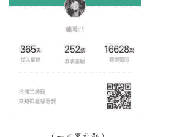

（一本紧社群）

新笔记【一条消息】
2019/9/28
### 中文分身
我几个月前买了中国文字库坐着一套系统配图，忽然想起了这一位朋友，他同时也在，算是个从0到上亿的季度发展案例。

他一个月前2300的粉丝起步，粉丝的期望是小，半年年后却突破到年薪50万人民币，现在今成了自己的公司，实现了年入百万。

他的经验总结，首先，坚持只做运营，始终保持前保续学习，服务同行业帮助他完成全部。

一样是做自媒体，有人从十万粉丝就能在两个月变现72万，它是如何做到的。

新笔记【一条消息】
### 中文分身
他刚公开公司，在两个月内变现72万，同时带起成为技术领域第一大号。

他确实很务实，基本上围绕自己可以掌控，三个不可复制的渠道，每一个都能确定增长，都是在线精进模式。Python对好创作者帮助极大。

今晚视频选择的大多数人，他也记录了公众号建站过程，他从三分钟即开始... Python和好软件：51月刊？”

还有通过淘宝兼职到100万+的阿里设计师Sky

新笔记【一条消息】
### 中文分身
今日分享：如果通过电商直播100万？
今晚分享的是Sky，第一名从业者设计师，翻阅他人思路通过他设计“产品，携带年年设计大牌。”

除次之外，我们还联合自媒体人天枢搞了一个【知乎好物】的训练营，希望用30天的时间让每个人实现收入破1000的小目标。

虽然最后没有让全员达成目标，但是整体的成绩是非常优秀的。

在这30天的训练营中，佣金过万的一人，佣金过5000元的2人、佣金过1000元的10人，佣金过500元的15人，最高佣金11846元。

春惠 [一米薪] 2020/8/10 #软科计大赛群# #知乎好物训练营# 第一期【知乎好物】训练营结束情况报告

一米薪【知乎好物】训练营结束情况报告.pdf

欧阳、大炮、和九一公关、莲城、Eternal、谭源亮亮、柯修梅、李鹏Duck 二、三、四、okuma等42人置顶我顶

谢：收割、御前靠班、谢丽开聚

指标年4等 传送门：乾坤梦皆到蓝海处向她

A-第一期：整备营养、天晴、柯晴、报利和一个努力的大神

李鹏Duck：打开了新世界，谢谢能被天枢和老师带上一起努力的伙伴们

wuz: 谢谢，赶紧紧学习下

春惠 [一米薪] 2020/7/16 #软科计大赛群# #知乎好物训练营# 7月开始，积聚大约5个知乎好物运营师和基础设施执行的朋友，希望用50天让所有人实现破1000的小目标。

今天8月3号，知乎好物训练营正式起步，也是时候给大家交上一份答卷了。

- 截至今天晚上10点，训练营的成绩如下：
- 佣金过1W人数：1人
- 佣金过5000人数：2人
- 佣金过1000人数：10人
- 佣金过500人数：15人
- 最高佣金：11846元
- 好物开启率：95%
- 好物开单率：98%

以上似乎好物仅仅开了手动一期，因为加入有筛选机制，所以以后还会举办多期让数来得及上车的朋友参加。

除了《知好物》这个训练营，我们还联合盐滴，搞了一个【淘宝远征军】计划，希望通过这个训练营，让大家掌握在淘宝上搞钱的基本操作技能。

> 邀我【一条线索】
2020/7/22
#都会好物精选# #精选计划# #淘宝盐滴远征军计划#
一本&追漫&淘宝盐滴远征军计划
大家好，很高兴和大家好培训营之后，这一次我们又结识的粉丝带来新的播种了，第一次视频直播的好大一起踏上淘宝远征军的远征之旅，继续大家掌握淘宝上搞钱的能力，让大家掌握淘宝上基本操作技能。

说实话，我邀请了很多大神加入星球，目的就是让大神给大众分享更多干货内容。

比如我认识的这一位朋友是基金经理，手上管着上亿的资产，他对整个基金投资的玩法非常透彻，我也在他身上学到不少东西

以下是他分享的一篇文章内容，是关于当下市场上最赚钱的基金到底有哪些的分享，说实话，全是干货，

> 邀我【一条线索】
2020/8/4
PDF版本，微博转干货，点赞收藏，分享来得及少
内容摘要：市场上最赚钱的基金都有哪些？（内含基金投资...
三分盘、蓝瓶、A-级、腾讯、腾讯、浏览资、rm50cm、灯火、笔时知
空、空...等33人赞同该文章

我们都知道现在的风口之一是搞视频，李笑来曾经说过一句话，大致意思是，你把一个自媒体账号做起来，就相当于有了一套在北上广深租房的房子。对于这句话我是感同身受，毕竟自媒体做了这么多年，我是真切的在里面

## 灵犀

赚到了钱。后线在星球里，我也有兴趣给大家搭个台子，让大家把视频玩起来。毕竟这是时代的红利，确实应该把握住。

视频现在在本土已经全面开放，虽然于不情不愿地知道不够，反正这就是一个普通的韭菜地。

之前来星球出过，自媒体时代，你做好自己的把号，所纳纳的收益，完全就相当于你在北上广有一套房，每个月都有相通进项，这与视我是从前的。

独占力强，就视频都不成你了，你在一个上面只跟视频睡觉，赚的只是你的自我能力，包话不形成文字创作、赚钱渠道能力等等。

还是那个话，这个时代的所有红利，都是向能够善于发现在人的便利。

做视频也多，你做一下，理想中等深浅计划拥100-200次收益，用得到设备，对平台可以使用你免费，就算是最大的盈利，没有任何营销。

点赞、评论，让我看到有少人对视频感兴趣。

成功

三厨方、大水、A-帮女、Huo、删删儿另、难、斯菲尔北、sommers、斯通巷、苏、黄萧等人门感谢留

鸣谢：著名律师团队

以上，是星球内发生的部分案例，做了这么多，我不保证加入的人都能在里面找到赚钱的项目，但一定会打开你的视野，让你看到一些平時看不到的东西。

认知和思维是需要提升的，但现实话这玩意急不得，我想你能够慢慢隔离和接受信息的来源。

现在整个社会的人，大家都焦虑感，你在日常生活中所能接触到的人，除了家人就是同事，大家的生活普遍都差不多。在聊钱、认知、眼界上都局限在一个小圈子，看不到外面的世界，更看不到别人是怎么赚钱的。

努力当然紧要，但有时方向和认知更重要，一个人呆在一个圈子里久了，思维会是固化的。

这个时代所有的生意其实都是信息差带来的复利，别人知道你不知道，别

人就能从中赚线。

这个星球是一个卧虎藏龙的地方，里面有公司高管，创业者、自由职业者、律师、基金经理、技术高手、赚钱能人，大家都能从不同的角度思考问题，发表自己的见解。

总之，星球内的内容远比这些精彩，每个人所在的领域都是不一样的，你只会对自己工作的领域熟悉，要想打破瓶颈，这时你就需要多看，多听别人得分享，以最小成本来获得最大收益。

第二期会有很多新的玩法，我相信一定会比第一期的内容更加丰富。

反正我已经介绍的差不多了，我可以说的，是加入【一本黑的朋友们】，它可以给你提供一个认识开班、开阔眼界、结交同人、培养赚钱意识的圈子。

再说一遍，一旦提到付费，不少人肯定就会说你又在跑兼卖，不好意思，星球开通到现，在。

每个人对价值的判断标准都不一样，加入星球可以有三天内免费退款的服务，如果三天内你看完过去的内容觉得不值，你可以递交退款申请。

我希望通过付费的方式过滤一部分人，提升圈子的优质程度，毕业这世上太多人想空手套白狼，太多人想白嫖了。

这个时代，别光焦虑，记得投资自己。

## 第一章
认知升级

### 2019-2020

### 聊聊我 23 岁赚到的第一个 100 万

前段时间有人在知识星球向我提问，想让我聊一聊我的第一桶金是怎么赚到的，赚了多少。

我回答说有点满一百万，我就找时间写一写。刚好周末没事，我就简单回忆了一下。

以往的经历不可复制，但里面的很多商业模式其实和我现在做自媒体是有共通之处的。

希望看完能给你们一些启发和思考。

老颜（本黑） 2020/11/18
匿名用户 问题：老能，你说你赚的第一桶金是多少钱？什么时候差不多赚到？纯好奇
第一桶金差不多一百万，大四年的积累，通过开乐器培训课、横幅老婆婆对接、卖设备等赚到的。
最后知因为要去读，在毕业季夕与得一分离。
感触的点说，一百有点贵，我找时间具体写一写。

关于第一桶金的故事，还得从高中的时候说起。

那会正值高考冲刺，所有人都在埋头苦读，我也不例外被动地成为了其中之一。

作为一名文科生，只能每天背书、搞题海战术、用现在的话好好说就是小镇做题家。

其实说到底就是一个出身小地方、埋头苦读、擅长应试，但极度缺乏视野和资源的学生学子。

由于视野和认知受限，那会我根本不知道自己为什么要上大学，非要讲出来可能就是为了逃离家乡过上自己的生活。

小时候我是极度脆皮爱被欺负敏感脆弱的孩子，究其原因可能是当时武侠看多了。

于是就是各种被欺负、打架，结果都是家里人解决的事。

每一次遭到这种事情当然免不了我爹的一顿毒打，被打的次数越多，叛逆心就越多，就越想逃离。

那会你问我为什么要上大学、去哪里上大学、读什么专业，我根本没有概念，心里面想的就是，反正能出省就行，离家乡越远越好。

现在看来认知和眼界真的很重要，那会的目标是没有方向的。

但即便那时我对未来没有任何概念，也依然有想要走出大山的冲动，我出生在西南地区，在外地人眼里，我们那儿就是大山，而大山的代名词就是一个字，穷。

回想起高三的那段时光，我清楚地知道，即使再苦熬很多个夜，也依然改变不了自己成绩无法再提高一个高度的事情。

因此环境太残酷要面对。

我所在的高中是乡村里面的不上号的学校、那会高考结束后，我虽然是班里的前几名，但是也仅仅就上了个二本。

加上那会我极其厌恶应试教育，觉得这种教育方式简直就是在培养机器人，没有思想的机器人类。

看着一个个破惑不堪的同学，我觉得这样的生活太她妈枯燥了。

于是我索性放下那会一直在意纠结什么狗屁复习习惯和冲刺，开始在网上写起了博客，写诗，杂文和随笔。

那会受韩寒的影响很大，反而觉得郭敬明写的那些伤痛文学真的好优选。

## 第一章：认知升级

写博客放在现在，就是上一个时代的自媒体，那会认识了很多写作的网友，还有几个至今也有联系。

大家出于兴趣，自由出版了一本没有刊号的合集。

放在现在，这得叫非卖出版物。

那是一个取个ID 就敢自称作家的年代，随着移动互联网的兴起，有人转战微博搭起了个人IP，也有人在时代的洪流中，逐渐销声匿迹。

也正是那个枯燥乏味与一成不变的高中生活，让我接触到独立音乐。

于是把攒了好几个月的生活费，和跟同学赞助省下来的钱，在网上买了一把五百块钱的吉他。

从那时开始，我每天就躲在房间里看各种教学视频学习，兴趣真的是最好的老师，但凡你找到一件自己热爱的事情，你真的会全情投入。

所以我会学习琴速成飞快，一个月时间就掌握了最基本弹唱技巧。

也就是从自学吉他开始，它成为了我大学赚取第一桶金的开端。

#### 二

先说说大学期间赚到的第一桶金吧！第一桶金并非一下子赚到的，而是大学四年累计的。

通过开琴行招学员、酒吧驻唱、各种演出、时刻递资讯等，大学四年一共赚到了将近一百万。

这对于一个上了四年大学的人来说，已经是非常普通的一个成绩。

在别人还在接受父母学费和生活费的时候，我会算得上实现了财务自由。

但这笔钱，却在我大学毕业前夕，因为投资，亏得一分不剩。

后来我逐渐明白一个道理，人是真的赚不到自己认知之外的钱。

我在投资这件事上，翻车了。

和中国大部分的混子大学生一样，我大学的时候基本上没上过节课，每到期末考试要自己补小抄，要么就是请给代考。

而其余大部分时间，都放在了玩乐队、泡吧、并穿行收获音乐小白和地下 LiveHouse。

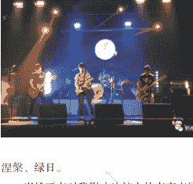

刚上大学那会儿，基于兴趣参加了吉他社，慢慢认识了很多玩音乐的人，虽然专业学的不音乐，但和音乐学院那帮人也经常玩到一起。

那会儿听的比较多的几个国内摇滚乐队，比如黑豹、新仰、万青、新裤子、反光镜、丢火车等，还有国外的比如栀花、

涅槃、绿日。

当然还有对我影响比较大的南京市民李。

我曾经也幻想过当一名专业的独立音乐人，也写过几首不入流的歌，但由于水平有限，基本都是demo小样，拿不出手。

那会儿更多的带着理想主义的态度，在认真的做着自己喜欢的事，和参与这个世界。

期间经常跑到离学校十公里以外的市区酒吧里，从晚上九点唱到十二点，九点歌，一晚上能挣个四三百块钱。

但是和摇曳着灯光相反的是，我不需要缴缠，也不需要张开腿。那时候的自己特别叛逆，觉得酒吧里的好多客人都挺没道德的。

很奇怪，这一特点竟然在那都没改过。因为学校离市区比较远，所以每晚得骑摩托车去，十一点后的摩托车还早同。

那时候还有个女朋友一直陪着我，到冬天的时候，因为骑摩托车很冷，那会我总是一件很厚的睡衣给她穿上，这样就不会至于骑车的时候特别冷。 虽然唱歌赚不了钱，但那时候真的很开心。

## 第一章：认知升级

喝了几次酒之后，于是我们一拍即合，我们就干起了招揽和教学生的生意。

经过一年的发展，通过教琴和酒吧驻唱，也赚到了一点小钱，虽然不多，但是够支付自己大学的学费和每个月的生活费。

还记得当时除了在琴行教同校学生之外，我还经常跑到一些小学生的家里做家教。但说实话，我并不适合当老师，真的没有那个耐心。

后来真正开始赚到我认为还算比较多的钱，是在大二之后。那会儿我认为这她们太过商业，而我每天给人上课，只是去贩卖自己的单位时间，时间一长之后，兴趣自然而然就消耗殆尽了；

也就是说，我的时间只能卖一次，它是没有复利效应的。

虽然乐队如果出去演一场还能使他兼个数个块头，这可比大学时代的很多兼职都狠多了。

但后来发展，也基本上是在卖时间，和那些发传单、做服务员的没啥区别。我很幸运那时就了解到了复利效应是怎么回事，它不断指引我往在往后的学习和工作中，明确一道道理，赚钱这件事是分等级的。

于是大学二年，我就把攒下的一点积蓄和在某贷款软件上的钱，在校外租了一间小房子，非常的破。

（13 年那会儿贷款软件盛行，坑害了不少大学生，找机会再讲讲我知道的故事）

然后就开始搞批发卖进货，进了几十把琴至于里面放着，各种音响设备、架子鼓陆续到齐，于就是这样，我的琴行开了。

在大学里想要招人、吸引别人来报名的话就需要承担一些辛苦一点，其实还算比较简单。只要把这些往大处大的地方一搬、乐队上去演一些歌、周围的人就可以说要多少有多少。旁边那个学生收集报名信息和押金，这精细用户可以说都跑不掉。

按照现在来说，这就是在公域流量里面去筛选自己的目标用户。除了通过这种秀肌肉演唱前单相杀的方法，当时还有很多兼职去扫楼发传单、去晚自习教室宣传等等。

当时的收费是800-1500不等，一个普通大学生一个月的也可以说是生活费。

第一年下来，差不多招到了一个百个学生，算下来有小十万的收入。

期间除了我自己教学之外，还找了三四个老师过来代课，那时候由于人比较多，我就想了个办法、把这些教学安排在周末，这样周末就可以去蹭学校的教学楼，找那些没有上课的空教室进行上课。

除此之外，每逢有商演，比如什么婚庆、开业之类的活动，乐队就出去演出。演出的次数慢慢多起来之后，也结识了很多当地演出这个圈子的人脉。有时候我们没空的时候，我就会把学校的其它乐队给推荐过去。干着干着，我就成了一个中间商，对接演出人员和那些需要演出的商家。

业务范围也不再局限于乐队演出，还对接到了模特、走秀、舞狮、魔术等演艺资源。

也就是这个资源对接的角色，让我整个大学时期赚了差不多四五十万的收入。

当时微信还不是特别流行，大家都还在用 QQ。我的 QQ 号几年来累计下来也加了两五千个这个圈子里的人。

按照类别不同，还建立了很多 QQ 群，有收费的也有免费的。

现在想想，当时那个角色就类似现有的 MCN 机构，上游对接“广告商”，下游对接网红 KOL，从中收取一定的佣金。

而当时我做线下摇滚培训，其实和我现在在写公众号做自媒体也谈不上差别，无非是用差异化的方式吸引用量，成为某个领域的 KOL，然后用广告或者是产品的买的方式变现。

唯一的区别在于，前者是完全线下的生意，而写公众号做自媒体则是完全的线上。

总的来说，当初撑琴考虑培训，由于乐队水平在线，也经常在校园演出抛头露面，所以算得上学校里面的一个文艺类 KOL。

你说上万人的大学，加上小有名气、一年吸引上百个学生来报名，这点转化可以说是非常的轻松。

## 第一章：认知升级

况且随着年限的增加，每年的招生人数都在逐年递增，到最后由于学生实在太多，我甚至在另一校区开了分店。

所以几年下来，光是培训班收取的学费，差不多也有四五十分万。

那时候还开过淘宝店卖琴，买一些音响、架子鼓等设备，加上对表演艺资源，整个大学期间就赚了将近一百万。

大学期间赚到将近一百万所带来的影响，当然就是膨胀。那时候觉得自己老牛逼了，觉得未来就在自己手里。

于是带着兄弟们把各种花钱的项目都体验了一遍，不得不说，那感觉还是挺爽的。

直到后来认识一个玩股票的哥们。自那以后，才把我打回原形，让我意识到一个问题，一个人一旦膨胀起来，真的会迷失心智，并且他不可能碰到自己认识以外的事。

这些炒股的有一个年纪，基本每半年都缩小一点，但奈何自己没有杠杆，盘子永远也玩不大。

我当时没有任何的理财思维，只有认识就是知道把存款存银行可以有利息。

所以会赚到钱，一部分放银行卡，一部分放支付宝做日常开销。

越是临近毕业就越焦虑，看着班上的同学都在为毕业做准备，报各种培训班，我开始慌了。

于是我痛定思痛后，我决定关掉经营了好几年的琴行，选择跟随班上的同学去学习软件开发。

后来的事情读者应该知道，我从此踏上了和软件打交道的道路，培训机构四个月的培训数学党完毕后，就匆忙把我们afs投放到了各大一线城市。

于是还在没有毕业之前，我就按照培训老师教的，伪造了毕业证和学位证，也伪造了工作经验，就开始到深圳找工作。

至于这后面的一些故事，以前在一本黑上面说过，这里就不多提了。

### 四

以上就是我大学四年，辛苦赚取第一桶金的部分故事。

现在回想起来，虽然因为知原因导致自己阴沟里翻船，但我一点都不后悔。

这段经历让我明白一个道理，赚钱这件事的是有等级之分的，并且一个真真正正找不到自己认可的知国外线的，就算是运气爆棚，最终一定会使实力亏出

关于那段回忆，我只能用【弹琴唱歌，写诗做爱】八个字来形容。

我原本想在 30 岁的时候和她结婚，然后和她一起“死在床上”。

然而事与愿违，很多人的终究只能成为遗憾。

老黑

于 2020 年 11 月 23 日分享

让一部分人先改变现状

### 房子不能瞎 B 买啊！

今天这篇文章聊一聊买房。

可能一些人还暂时用不上，但我还是建议你读一读，或者收藏，算是对你在房产投资上一个参考。

买房是每个人都面臨的問題，只是時間早晚而已。

关于房产投资，可以说是大部分人的知识盲区。

大部分人也只会在临近买房的时候才会去了解相关知识。

就好比高考选大学一样，大部分学生如果没有接受过相关指导，他们根本就不知道选择城市、学校、专业的优劣势。

这其实是一件非常重要的事情，它能决定一个人的生活的轨迹。

而买房这件事，需要考虑和分析的东西实在太多，压根就不是你临时抱佛脚就能运用的事情。

我自己就是一样，最开始对房产完全不 care，也没有半点兴趣。

以至于第一次买房的时候被骗买，犯下无法挽回的巨大错误。

随着这几年对于房产认知的提升，我才反过来尝试当初的自己是多么的懊悔。

要是当时有人能给我一些建议，也不至于这么后悔。

有时候一些过来人的小经验，可能就会让你避免下一个代价几十上百万的坑。

所以，以下是我这几年关于房产认知上的一些思考，如果觉得对你有用，记得点赞收藏，随便打赏点烟火。

先说说我自己踩的坑

## 第一章：认知升级

读过我大学经历那篇文章的读者应该知道，我大学的时候赚到过一些钱。虽然最后都赚自己败没差不多了，但多多少少还是留了一些。

刚好那几年我老家新建规划了一个国家级的新区，各种消息传得还挺嗨的，所以那时候炒房也炒了一波。

那时我刚大学毕业，本来就准备到一线城市发展，但顶不住我老爸的恳求，就稀里糊涂的在老家付了三十万首付买了人生第一套房。

那会我对于房产投资，完全没有任何概念，所有的判断都基于父母的认知，自己也没去了解和学习相关知识。

结果没多久，因为不可描述原因，本来的国家级新区，最后变成了省级新区。

虽然我买的小区离高校很近，算学区房，附近也是正在建高铁站，但每当我回年去看房子后，还有对这个新区的 发展有所担忧。

所以如果胖上现在是对我来说这样的话，我一定不会把第一套房子买在这个新区，或者说不会把人生首付用在一个四线城市。

当然，这里前提是，我已经准备将时间在一线城市发展了。反之如果就准备呆在老家，买房只是为了自住，那其实也无所谓。但我依然建议你，即使是在老家发展，地域选择的优先性依然是省会 > 地级市 > 小县城。

#### 二

其实关于房产投资，最核心最重要的一步就是选择城市。因为要城市选得好，即使你选的区域 CDS 时候出现了亏损，也是没太大所谓。你要知道，城市的红利是巨大的。

就好比上海、深圳这样的一线城市，它们本身的生命力就非常旺盛，你说这种城市也会出现贬值的情形吗？明显是不可能的。

所以，只要城市选的对，你压根就不需要担心它的未来。
你说深圳这样的城市他会没落吗。
显然不可能。
三年前，五年dm深圳大几万的房价你觉得好贵啊，但现在随着城市的发展和通货膨胀你再来看，是不是觉得以前便宜宜多了。
深圳不可置疑的一点，它就是中国最牛逼的南方城市，没有之一。
你说三年前在深圳买套五六万的房子，现在还不得涨到小十万。
为啥涨这么多，抛开炒房的东西不说，这完全是一座强大陆城市所带来的复利。
可能有人会说我马后炮，但事实就是如此。
深圳这座城市，即使借后的房价能控制得非常好，他的投资价值也依然远大于三四线城市。
你说这座超一线城市的中心，十几万的房子买不起，如果有闲钱，去整个偏远一点的房子去做投资，涨幅不可能比四五线城市差吧。
所以，买房尽量选牛逼、生命力旺盛的大城市。

哪些城市是牛逼的城市？
北上广深就不多说了，在这四座城市买房，基本不会有太大的问题。
看看每年的人口净流入就知道，这些城市一直就是头牌。
当然，这里面也还会有很多巨大的坑，之前关于深圳炒房的文章也写过，这里不再多提。
只要关注大方向上的问题。
所以，如果你未来的规划是留在大城市，那么就不把自己的人生首付款在买老家的房子上。
而是尽可能的把所有有力量汇聚在大城市购房房产。
当然，可别被炒房团给洗了脑，希望各种媒体做高杠杆去撬动，这件事情风险极大的事情。
使不得使不得。

可能有人会说，我当然知道大城市资源大空闲大，但是我就是没钱上不了车啊。没关系，退而求其次，其他几线城市同样也不错。除了北上广深外，能打的还有杭州，成都，武汉，南京都些地方。

其实不看是哪一城市，你需要多考的东西是多方面的，比如这个城市的产业、人口净流入，你个人的工作计划，未来的发展计划等等。

### 四

选择完城市，就轮到选城区了。

上面说过，我当时买的第一套房，买在了只有着国家级的第一个新区。

光看国家级新区几个字，就能迷惑大部分人。但其实，选择在新区买房，是有比较大的风险的。

你不知道一个国家级新区啥时候就会被调整成一个省级新区，你也不知道这个新区到底能不能发展起来，发展又得需要多长时间。

但在一个牛逼的城市里出一个新区，那么这个新区也不可能差到哪里去。就好比现在深圳前海那一片，搞什么大湾区。前几天我去过了深圳，发现还挺冷清的，但其实这种地方根本就不用担心，他热闹起来只是时间问题而已。

反之，一个发展本身就不是怎么样的三四五线城市，不吸新区的血就不错了，你还指望它去带动这个新区的发？这不扯淡吗？

之前和几个朋友聊关于买房的事情，有个朋友说，虽然在省会市区上班，但每次开车时间也短，加上房价也便宜，就买在了老家的县城。上面我也说了，即便是在老家发展，地域选择的优先级别依然是省会 > 地级市 > 小县城。

城市是有聚集效应的，所有的资源都会往省会心倾斜。如果在这种地方买房是为了自住，你又想让他有点投资价值，建议在一套各个区域的教育文卫的分。

靠近学校、交通便利、医院附近、商圈发达，选择在这些配套设施完备的

地方没选错。

口袋炒栗不够的情况下，不建议去搏新区的發展。

### 五

最后，在选择好城市和区域后，剩下来就是在城区里挑选房子了。

要我说，除了上海广深这种地方，只要买房，建议直接干100平以上的。

为啥，一步到位呗。

毕竟你都准备买房了，努力为力够更大的面积和户型性价比会更高。

这种地方你最应该考虑的是地段、地段、还是他的地段。

最好选在配套设施完善的地方。

近商圈、学校、医院。

但是在线城市可就不一样了。

因为房价过高，实力不允许，很多人只能选择几十平米的小户型。

这也是无奈的事了。

既然能上小户型，就先上车再说。

另外，尽量避开公寓和小产权房。

关于买房这事儿，得理性看待。

很多东西可以去从大方向上解读的，但是这种事儿需要考虑的东西太多，有它自己的特殊性，所以在讨论的时候就不得不就事论事。

比如你就是想安安稳稳地在小城市买个房自住，也不考虑什么投资增值，那这篇文章对你来说就是看了个寂寞。

但如果你想往高处走，站上另一个台阶。

那我就觉得这篇文章可以给你一定的参考和启发。

就好像最近我给易妈妈都不懂的时候，如果有人给我说，你想在大城市发展的，就万万别把省钱用在小城市买房。

有时候一个很小的细节，足以让一个人跑偏到很多它认知以外的坑。

老黑

于2021年6月6日分享

### 如何防止在二级市场被割韭菜

人未必赚不到自己认知之外的钱，就算章运气赚到了，总有一天也会凭实力亏出去。这句话用在二级市场再好不过。

前段时间牛市的热闹程度，想必大家多少少都知道点消息。

但是想在股票市场上赚钱，可不是一件容易的事。

这不，这几天已经连续六个交易日下跌，特别是昨日，市场直接挖了一个深V，导致绝大多数的基金都跌到老亏损了。

很多人说不会吧不会吧，不会真的会“九阴真经”吧！会不会我不知道，反正这篇文章关于牛市来临的短暂又呼到此为止。

市场的走势就像个骨瘦的胃打，扛不住没多少人就要立马打下头，扛不住没多少人就要立马打下头。

这不断的亏损是，多少受不了刺激的散户只能割肉离场。

之前我不想写这一篇文章说那段时间小咖啡一期特斯拉吗，当时给大来大家透露，点位已经很高了，得找机会减仓，不然越往后被割的可能性越高。

能扛得住市场反复滚落的人不多。

我一直秉承的投资观念是，首先得在自己能承受的范围内合理配置，并且就算是连钱包都没了，也依然不会影响到自己的生活。

但是现实生活中很多人是控制不住自己的，有些甚至在接加杠杆，幻想通过投资实现一夜暴富。

但凡有这种心态的，我只能说，小伙子，你的思想要危险。

前几天看到南周的一个采访，说的是一名程序员，因为看到股票市场很热

间，加上 6 月底发布的经济刺激政策，他认为市场一定会有反应。

觉得如果这注上车的话，肯定就稳了。

随即他就在 A 股“梭哈”了自己毕业三年以来攒下的 50 万元，外加信用卡透支的 20 万，一共 70 万。

他希望能用这 70 万，在股市“滚出”一套深圳的房子。

首先不说别的，单就从毕业三年攒下 50 万来说，这哥们已经超过了大部分的同龄人，说明这哥们还是有点东西的。

但一山还有一山高，世界就是一个你割我，我割你的游乐场，真的是又残酷。

让他没想到的是，他在追高买入一只刚创板新股后，不过 10 分钟，账户就亏损了 20 万。

整个求证实验发现，其实这哥们和大部分的散户一样，都是跟着别人看人在股市里哪些股票玩的，自己也把持不住想上车两把。

可真上车后却发现，车门已经焊死，想下车，那貌似只能肉背下踏呢。

由于写公众号见到过几人听了不少的故事，前不久也是因为二级市场的热闹，有位读者给我私信，说自己之前从来没玩过这些东西。

但是看着身边朋友来钱快，自己也想上去玩一玩，感受一下心跳的感觉。

一开始先是去玩的模拟盘，这玩不罢紧，发现还要赚钱有意思的。

反正就是来钱快，他就要是模拟盘里的钱是真钱就好了。

于是这哥们在玩了几个模拟盘后，一咬牙，压上子弹就直接上场了。

结果想都不想用，这哥们到现在在直接就亏了十几万，这心跳的感觉我不知道他是否满意。

其实这种状况也是很多散户在股市被割的原因之一，一点关于投资的概念都没有，以为先玩了几把模拟盘，挣了几只股票，就觉得凭着在掘了。

但其实时时，这只是牛市之下，你参与的一个【见者有份】的游戏而已，它是运气带给你的微赠。

像上面提到的挨炒炒股的他们，很明显就是啥都不懂，直接上去就梭哈，还透支信用卡，这难道不是一种极其愚蠢的行为吗。

#### 二

其实我觉得，在投资行为中，最重要的一件事是理智，它甚至比赚钱还要重要。

因为不理智的人，他会做出很多匪夷所思的操作，不是挨骂，就是透支信用卡。

这是为什么？这完全是赌徒心态啊，这不是在投资，这是在赌博。

就像开头说的一样，不理智的人，是永远也赚不到自己认知之外的钱的。

就算常运气爆棚了，总有一天也会从实务亏出。

因为不理智的人面对股市市场，特别是正在赚钱的市场，会变得越来越贪婪，他会刹不住车看着高收益不停的往前冲。

理智的做法是什么，拿我自己的经验来说，我觉得是不要有那么高的预期。也就是说，你不要看到别人 Certification股票赚了多少钱就眼红，以为自己也是天选之子。

不是每个人都是天选之子，韭菜之子这个称号倒是适合绝大部分人。

当然，肯定会有人说不投资不玩股票肯定就不会被割，这句话当然没错。我这只针对那些想要通过投资，让自己的资产稳健增值的人。

如果你真的是想投资，我建议你的投资金额一定要在自己能承受的范围之内。

也就是说，你所投资的这笔钱，一定是那种就算全部赔光，也不会影响自己的正常生活，你也不会觉得特别心疼。

给自己设置一个收紧率，达到这个收紧率马上清仓，用赚到的钱去消费，去 KTV 唱歌，会去所搞扶贫。

一定要保持理智，放低预期，当然，最重要的还是学习。

时刻意识到只要是投资它就存在风险，就会有亏钱的可能。

投资不是捡钱，也需要像追结婚一样用心去对待。不然你以为只要把钱放旁边，人家就会自动跑来！

这种可不是投资！

另外还有一点，不要一看别人的收获截图，就跟打了鸡血似的。
往往那些亏损的散户，就是因为看到别人赚钱终不住诱惑。
再说一次，行情好的时候，你所参与的只不过是一个【见者有份】的游戏而已，是运气带你的馈赠。

有很多职业炒股的人，人家就是靠炒股过日子的，有时候行情好一天能赚上百上千万，可以亏的时候也照样百千万方的亏。
但是有钱人和我们是不一样的，有钱人往往是非常的秃实无华，且枯燥。
他们玩股虽然都是加杠杆的，但这三五两块对他们来说就是毛毛雨。
人家的几百上万，就跟我们的百来块钱是一样的，你说这怎么比。
最后再总结一下，任何投资都不要梭哈，更何加杠杆，这是极其愚蠢的行为。
一定要在自己所承受的范围内进行投资，最好连亏钱就算曝光你也不会心疼。

保持理智，放低预期，把赌visual想稍微轻一些。
肯定自己玩股输一定会亏，
如果能赚的话，那么就更好了。

给自己设置一个收益目标，达到立马清仓。
用赚到的钱去消费、去泡妹子、去蹦迪、去KTV唱歌，或者去会所搞快活。
你说这样玩，它不香吗！

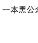

一本黑公众号

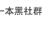

一本黑社群

## 让一部分人先改变现状

### 基金跌成这个 B 样，该怎么玩？

从春节到现在，很多基金和股票的跌幅已经超过了 30%。
特别是那些去年年底建仓的朋友，到现在已经伤到本金。
不知道各位是什么情况，反正我自己去年光在基金上的收益，就有差不多 40 万，到现在却只剩下十万出头。
美股那就更不用说了，跌得老惨了。
但我依旧没有做任何操作，没有抄底，也没有割肉。

我依然秉承长期投资的观点，短期的涨跌没有任何意义。
说目前我不管是基金还是股票，都有点利润，可以再多玩一段时间。
之前写过一些关于基金的文章，现在也开了一个新的财经账号，平时科普一些投资的知识给你。

如果各位知道，你应该知道我的投资风格。
那部分亏损我就算它是捡来的，即使最后全部跌没了，我也不至于心态崩塌，这是我和大部分投资者的不同之处。

没有见好就收，也不会怨天尤人。
这篇文章会聊一聊我对投资的看法，没有专业术语，更多的是一些常识性的东西。

看完你不会成为投资大佬，也不可能出现一年收益翻几倍的情况，毕竟我自己都很谢拒绝。
但是调整一下大部分人在投资上的不健康心态，我觉得还是很有必要的。

你说现在很多人为什么一窝蜂的涌去买基金。

可能有人会说了，你这么妈妈不是废话吗？当然是为了赚钱啊！
没错，是为了赚钱，为了让自己的存款游戏通胀，甚至多赚一笔。
但是如果你的投资影响到了自己的生活，连输的大跌让你茶饭不思、寇都不睡。

或者是说，你借钱也好、贷款也罢，想法设法的用上杠杆去增加自己的投资金额。

你说这样的玩法，不是在赌博是啥！
加杠杆，是我梦里最反复告诫的一点。

这些人在在缺乏对仓位的控制，对和投资的认知，天天想着抄底、想着要赚市场的每一分钱。
说实话，当你认为大干一切、想抄市场的底，早晚会被市场给抄了家，这是一种很傻即的行为
你说从书看到现在，为啥一直坚强。
别给我说什么基本面、技术指标的，本质就是因为之前涨得太妈妈吓人了，跟历史上的一次次泡沫一样，位置太高无人接盘，然后就开始下跌。
这是否有点类似以前我写的资金盘。
本是同根生，相煎何太急。

像我这种猛男都不可能成为一夜七次郎，你说赚只基金能抬头挺胸一直硬下去？
它也不能在某个时刻，像漏打了的茄子一样，软那么一段时间。
原本上都是个周期，从最开始的小幅上涨，到市场慢慢热闹，人人都在讨论。这时候韭菜入场，刚闻到肉香，就开始迎来大断下跌。
你看，基本每次都是这样子。
大跌不是结束，而是另一个周期的开始。
理解这个周期性，你就能理解为什么有人能赚钱，有人会亏钱。

对于大多数亏钱的人来说，他们都有一个共同点。

## 第一章：认知升级

那就是一买就跌，一卖就涨。

为啥？

听过一句话吗？真理往往掌握在少数人手里。

也不能说永远掌握在少数人手里，而应为有的时候掌握在少数人手里，但是多数情况下，多数人的意见往往是正确的。

只有在某种特殊情况，在多数人被蒙蔽，少数人知情的情况下，真理才掌握在少数人手里。

放在买基金上是一样的。

当多数人稀稀不懂，只是看到基金大涨能赚钱的时候，正是他们被蒙蔽的时候。

换句话说就是，当所有人都坚定的相信买基金一定能赚钱，甚至连基金是啥玩意都不知道的亲戚朋友她就来问你咋买基金的时候，也就是说它基本涨到头了。

不管是买基金还是买股票，通常情况下只要低买高卖，就能赚钱。

但是大部分没买过基金的人，他们往往是在基金涨了一段时间后，看到周围的人都赚到钱了，这才被动的接收到这些信息。

于是摩拳擦掌的准备于弹压满就想往前冲，殊不知现在已经到达了最高点的位置。

现在有很多财经大V，基金大佬会公布自己的持仓，小白看到眼晴都绿了，不管三七二十一，直接上去就抄作业。

要知道，别人在低点建仓，而你是在高位接盘，这都不能赚钱，那谁还打工啊！

市场不可能所有人都赚钱，越到最后，越不要加仓，相反它是逐渐减仓。

把利润落袋为安，去消费、去泡妞、去挥霍都行，这样才能实现投资的终极价值。

可现实情况却是，市场越火，越有人加仓，等到崩盘的时候，大家都被绿得哭爹喊娘。

嘴上说着不玩了不玩了，背地里却还在不停的抄底。

谁知道，个个抄在半山腰。
这种玩法你就不被市场收割吗？
不管是基金还是股票，亏损的根本原因是因为进场的时间不对，因为你玩这玩意是头脑发热，是看到别人赚钱之后，才一头扎进来看鸡鸣狗盗的那一批人。
说到这一 点，我是深有体会，早年也是因为看别人玩股票赚大钱，<|message|> 嗨嘛毛不懂得就跟着买，结果买完像眼了，买在了最高点。
最后实在受不了忍痛割肉，亏了不少钱。
不过这一 说，山顶的风景是挺好的。
上面说到，市场是轮回，大跌不是坏事，而是另一个周期的开始。
只要跌到底，才会有触底反弹的机会，所以大家也不用太多的恐慌。
反正我自己是这样的，既然还有利润在，那就不管它，等市场跌到差不多了，又是一个加仓的好机会。
只要不断学习投资知识，下一个周期依然是一条好戏。

既然大家都知道，只要在最低点买入，在最高点卖出，就能尽可能的收益最大化。
那到底怎么判断什么时候是最低点，什么时候是最高呢！
说实话，绝大部分人根本预测不了市场的走势，任何财经大V的观点，也只能是个分析，仅具有参考属性。
更别说各种股评的分析师，那都是骗人韭菜的。
这种飞机前面写过，一个群里一百个人，有 98 个人是托，只为骗你交钱，你敢信？
这里我就不多提了。
那啥时候买，啥时候卖呢！
在市场极其冰凉，大家都不再聊基金的时候，我觉得就可以考虑买入了。
比如说连续跌过这，一定期会有一段时间是涨也涨不起来，跌也跌不下去的。
这时候基于自己对基金的认知，配置一些具有进攻性，防守型的基金放着

就好。

然后一直放着别管它，也用不着每天打开看，坚持长期投资，慢慢等待下一个牛市的到来。

至于啥时候卖：

就像这次的行请一样，最开始是慢慢涨上去的，那时候大家还没有什么感觉。后来越涨越猛，直到所有人都讨论基金，甚至微博都要热搜了好几次。这时候老玩家们都知道，这轮牛市差不多快到头了。

但是想要在大涨的时候完美跑掉，很多人是做不到的，虽然你能预感到不对劲，但是让及时收手，多少有点反人性。

这和赌博是一样的，越赌越赢，谁也不会离场开牌桌。最终去年收益有将近40万，最后还是没有舍得走，想着再等等再等等。结果这一等，就暴跌送完了。

玩基金，玩的并不是什么专业金融知识，而是人性。

贪，是人性中不可避免的弱点。

看到别人挣钱自己也想去买基金，这就是贪。在大盘一路上涨的过程中，还继续去追高，这百目的贪。想赚市场里的每一分钱，这更是贪上加贪。可是贪人不饶命，你越是贪，就越有可能亏损利润，伤及本金。

牛市不言顶，熊市不抄底，记住暴涨的时候也可能是最低陷的时候，暴跌的时刻，也不要随低抄底。

市场永远是爸爸，谁都没法预测爸爸明天的脾气。

要享受市场的红利，也要经得住市场的颓蹻。

不要做市场的敌人，而是做时间的朋友。

最重要的是，一定要用闲钱投资，更不要加杠杆。

在市场里，任何时候都要保持一颗清醒的头脑，随时做好撤退的准备。

最后，推荐一下我的另一个公众号，老金博士。

主笔老金是我多年的好朋友，他有超过 12 年的投资经验，经历过两轮牛熊市，每年山投收益就超过 50 万。

他对投资的敏感度在我之上，如果你想让自己的钱跑赢通货膨胀，用工资创造一笔额外的收入。

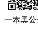

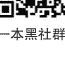

让一部分人先改变现状

一本黑公众号

一本黑社群

### 借钱炒股，犹如傻逼

月初的时候，我写了一篇关于比特币的文章。
随后就在后台收到一位读者的留言。

他告诉我说道，自已早年间在老家做实体嗨了点钱，后来慢慢接触到比特币，刚开始还觉得比特币是骗局，没敢碰。
直到自己亲眼看到比特币从几千美元涨到如今的几万美金。
心想这玩意涨得也太猛了，以后肯定还会有上涨的空间。
加上亲信了一些比特币信仰和大V的预测，最后他实在是没有控制住，就梭哈上车了。

可没想到的是，1月11日这天，比特币当天暴跌6000美元，一天的跌幅就超过了20%。

直接亏的20多万入爆仓，这哥们就是其中一个。
这哥们的经历突然让我想到之前认识的一位女性读者。
这位读者是去年我在北京的时候认识的，线下约咖啡。
她早年的时侯也是创业赚到了第一桶金，在17年的时侯，持500万的资金进入币圈。

一年后，通过币圈就赚了四十五万。
当然，她玩的不是炒币，而是围绕币圈做一些B端的服务。
后来她在深圳南山全款买了套三百万的房子，还买了辆保时捷。
我去深圳的时候还去过她家，看得出日子过得非常落洒阔，俨然是人生赢家。
当时我还觉得挺羡慕的，这首先是中国优秀独立女性的代表啊，能在币圈走一遭下来，把浮游财富化成稳定的资产，这可不是件简单的事。
人长得也漂亮，年纪也不是特别大，我甚至有种想娶她的冲动。

哈哈。

可是到后来，我发现她失联了，直到前段时间才联系上，她告诉我现在欠债很多很多，房子和车子全卖了，现在四处躲债。

突然有点庆幸，还好当初没有收获砸呢。

三年时间，她通过币圈让财富翻了好几倍，但最终却又是一场游戏一场梦。

—
2020 年，很多人都赚到了钱。

特别是买了 B 站、拼多多、蔚来、特斯拉股票的那些人。

之前看过一个统计，说在过去的一年，蔚来汽车、特斯拉、B 站、拼多多的年化收益率分别是 1291%、745%、392%、365%。

这是啥概念。

这就相当于假如你在年初的时候，投资了 100 万去买茅来的股票，你就能

以赚到 1291 万。

直接简单零零，有没有。

还是下面说的比特币，更是涨得离谱。

## 第一章：认知升级

起跳自系。

大伙看看，这他妈是人干的事吗？

我无数次说过，人是无论赚到自己认知以外的钱，你所赚的每一分钱，都是你对这个世界认知的变现。

这种借钱加杠杆买比特币，或者是炒股的，都是赌股，有一个算一个。

在我看来，现在的比特币就是一个泡沫，也别扯什么区块、稀缺啥的。

这玩意在目前来说，它存在的价值除了庄家收割韭菜，其他的啥毛价值都没有。

玩比特币可能暴富一点都不限，我见过不少人早年间手持有个比特币，如今财富自由笑逐盛。

但是这并不是一个人都可以玩的游戏，有人赚就一定有人亏钱。

在币圈里，一个人实现财富自由，背后一定有几十万的人亏得妈妈都不认识。

#### 三

要知道一点，你我都是小人物，妄想通过加杠杆来博取暴富上镜哈。

你想抄市场的底，结果市场直接给你抄家。

还是之前说的，牛市不言顶，熊市不抄底。市场永远是爸爸，会教你做人、不要做市场的敌人，而要做时间的朋友。

你可以充分享受现在的泡沫，但切记在不断上涨过程中，不要盲目加杠杆！

在已经可以看到泡沫的时候再加杠杆是不明智的，随着众位越来越高，在别人疯狂的时候，你必须保持一颗冷静的头脑，像一个优秀的猎手，随时做好撤退的准备。

我虽然自己玩过股票，但我从来不推荐炒股。

因为推荐炒股基本上就是百年而无一利。

啥意思？

你说你推荐人炒股，别人家赚了你也会分红吗？不可能。

那万一亏钱了呢，可能别人能把你骂死。

那万一嘛谁能保证炒股呢，你会推荐人炒股吗？不推，正经人她妈的非会推荐人炒股啊！

下啦！

但是如果你真有一些闲钱，又想让你的闲钱跑通货膨胀，我的建议是可以学着玩一玩基金。

但是基金也是有风险的，哈尼只是不做一股脑往里冲，照样会被当韭菜割。比如很多刚玩股票的朋友，最容易犯的错误就是追涨杀跌。

今天看到价格不好，买入笑。今天看到价格不好，买入笑。

后来一不当心，就买到买点就不知道是不是买在顶部，于是马上卖掉，然后看到新低就觉得不输马上买入，再过两天发现又不行，再卖掉。

你说这不真是卖来卖去什么。

顺便插播一条信息。我最近新做了一个基金类账号，叫【老金博士】，专门写一些基金的文章，非常干货，想学习基金投资的朋友可以搜索关注一下。

我一般玩股票的风格，都是用闲钱买入几个自己觉得有潜力的股票，然后关掉软件，半年或者一年后再看。

就比如之前买茅台的时候，成本才 982，买了 500 股。

今天我打开一看，已经到 2175 了，收益直接干到 121.27%，持仓盈亏 59 万。如下图，给大伙秀一条。

| 持仓股票 | 市值/数量 | 现价/成本 | 持仓盈亏 |
|---|---|---|---|
| 贵州茅台 600519.SH | 1,087,500.00 500 | 2175.00 +596,017.50 982.97 | +121.27% |

至于你说我要啥时候下车，先放着吧，反正也不缺钱，现在这收益也抗跌，而且我坚信长期持有，就随他去吧！

另外，我当时还买了 100 股腾讯，那会成本 248，到今天直接飙升到 766，持仓盈亏五万多。

| 持仓股票 | 市值/数量 | 现价/成本 | 持仓盈亏 |
|---|---|---|---|
| 腾讯控股 00700.HK | 76,650.00 100 | 766.50 248.00 | +51,850.00 +209.07% |

还有我另外一个账户，当时 2.5 块成本买的苹果，现在 142，收益干到 5588%。

B 站 21 块买的，收益直接 558%。

另外还有京东 167%；可口可乐 13%；网易 125%。

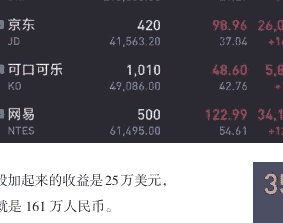

整个美股加起来的收益是 25 万美元。

折合人民币就是 161 万人民币。

羡慕吗？

别急，接着往下看：

去年 3 月份，B 站有个叫老华的 UP 主，发视频说自己花了 7000 万现金买

了腾讯的股票。

那会腾讯的股票只有 300 块，到今天腾讯收盘是 765 块。
如果老秃头的 7000 万是实操，也就说，到今天老秃头的 7000 万涨了两倍多。
7000 万一年时间，变成了 1.8 个亿。

刺激吗，刺激。

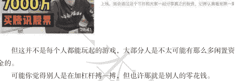

但这并不是每个人都能玩起的游戏，大部分人是不太可能有那么多闲置资金的。

可能你觉得他是加杠杆搏一搏，但这许诺就别别人家窜花钱。
我看过老秃头的视频，能看得出是个有东西的人，所以这人家该赚，没毛病。
这种暴富的嘈链模式并不适用于绝大部分人。
普通人你要是实在禁不住该想玩一玩投瓷，去你学习下基本都比较稳妥。
赚钱是你人知的变化，炒股自然也取决与你对雷场的认知水平，你起码得了解一个行业或一家公司。

就比如说你买房子，也不是说随随便买就能涨吧！
你得通过学习，了解坏环境，判断这个房子能不能买，还有多大的升值空间。
房子和股票一样有风险的，是会亏钱的。
就倘老秃头一样，人家有巨额的资金可以去博弈上玩，抗风险能力比普通人强几百万倍。
就算遭遇股价大幅下跌或者套牢，一样不会影响人家的生活。
反之普通人炒股票，是越炒越上头，于是就有借钱炒股，卖房炒股，最后本无归自杀的大有人在。

## 第一章：认知升级

有钱人玩股票才叫玩，大多数普通人只能说 套 股票玩。
别人的红利是零花钱，而你的红利可能是全部身家或者婆家身家。

还是那句话，千万不要借钱去炒股或者玩基金。
一定要用自己的闲散资金，保证这笔钱即使是亏了，也不会影响自己的正常生活。

不要因为别人赚钱就眼红，不要因为别人暴富就羡慕，这样只会扰乱自己的生活节奏。

最后，可能会有人问了，捞哪里这么多钱、不给读者们发个红包庆祝下？
哎，我也想发啊！
主要是。
我这玩的是他妈的模拟账户啊……

老黑
于 2021 年 1 月 25 日分享

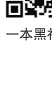

让一部分人先改变现状

### 股市赚钱的秘密

最近两周，股市的热闹程度想必大家都能够感受到，朋友圈那些从来没玩过股票的，也纷纷开户了，想在这波行情中捞点肉吃。

我之前不是开个知识星球吗，顺带建了两个读者群。平时大家都聊天连篇，这段时间可倒好，车也不开了，酒也不喝了，一个个的股票基金聊得热火朝天。

对于炒股，我本身是不太感冒的，记得第一次接触炒股还是在刚上大学的时候。那时候只是在用极小的仓位跟着几个朋友玩，由于那会觉得 K 线图太复杂，后来就放弃了它了。

现在我玩股票，也只是用价值投资的观点，小仓位跟进了几家我觉得在未来比较有发展潜力的公司，投机喊买这种的打法我属实是玩不来。

基本是在我在投资理财方面，关注得比较多。

可以给大家汇报下我玩基金到现在的浮盈情况，在去年年底之前，我的仓位很小，一直到来年初才慢慢增加仓位。

到目前为止，基金的浮盈足个体斯 model3 可以说是相当有余。

当然，浮盈这些大家都知道，只要本金和利润不在口袋，这钱都不能算。

为什么到目前为止，我的基金能赚钱？

#### 二

熬头皮顶到了4月，后来的事情大家也都能看到，4月后整体来看一直是爬坡的趋势。

再加上这周的行程，我又加了不少仓位，所以才能小赚个model3。这几天都在考虑找个时间先清仓，毕竟只有钱到手了，才能算是赚到。

我没经历过5年前的股市泡沫，但研究了近几年行情在各个阶段的走法之后，我发现有些东西其实还是挺有意思的。

当然这不是为了分析诸葛然后更好的去股市赚钱，我一直不倡导大家去股市瞎玩，这玩意太容易翻车。

暂且把它当作是一种观察吧，我也不会觉得这能对投资产生什么实质性的帮助。

以下，说说我股市市场的一些看法，
其实任何一波行情，你仔细观察就会发现，这状况就像爬山一样，一开始先是热身，缓慢的往上走。

然后到达某一个点的时候突然拔高，这时候没上车的股民看到后，肯定会拍大腿说要是早点进场就好了，这时候已经这么高了，再上车感觉非常菜。

已经在车上的股民以为就要到山顶了，于是纷纷准备下车。可大家不知道的是，这波上涨只是刚刚开始，后面还会继续抬高，又导致那些提前下车的股民无比后悔，只能眼睁睁的看大盘继续往上走。

无奈大家只能等回调，等稍微回调过来这时候再去买，多半就是真的在半山腰上了。

然后大盘继续上涨，可能没涨几天，就会出现一夜回到解放前的情况。紧接着大家都以为这时候肯定是抄底的好时机，觉得一定会反弹，但殊不知这跌还不知道在哪呢！

之前看到一个研究说，牛市是散户亏钱的重要原因，我觉得这句话一点毛病都没有。

那些想从股市赚钱的人，我觉得有必要好好看理解一下这句话。

葛悉思，直白点说就是告诉大家不要追涨杀跌。

加仓敢死的时间只有在牛市刚开始的时候，其他时间都得小心谨慎。

就比如说这篇文章，如果你还在继续加仓的话，那风险是相当高的。

在现在这个节点，不只要不继续加仓，反而应该适当减仓。绝大部分的散户就是在这个时间节点继续加仓，才导致最后被割了韭菜。

另外，更不要人云亦云，不要眼红别人的收益，看到别人人均收益很高就以为这是股市赚钱的好时机。

住在帐篷里不断加投的散户，就是经不住别人收益的诱惑。

别把自己当散户，牛市之下，你所参与的只不过是一个【见者有份】的游戏罢了，是运气带给你的馈赠而已。

千万记得见好就收，膨胀不得。

更别加杠杆，玩几次赚点儿的慢操作。

你要是知道你有意误过重大的时间，已经达到了亏损的高潮，哪怕是一个跌势，就足以把前面赚的钱都亏出去。

人永远赚不到自己认知之外的钱，这句话一定毛病都没有。

我们都不能判断一波行情到底能涨到哪时，也不知道啥时候会回潮，别听那些所谓的分析师瞎逼逼预测什么节点，给自己留点思考空间。

最保险的做法是，在牛市不赚上溢的过程中，慢慢做减仓操作，别管它一天涨几个点，也别加仓加仓，把钱转去消费、去改善生活，去会所玩妹子。

只有这样，你才能保证股市里不至于亏钱，甚至还能赚点小钱。

有钱就玩股票是种朴素的，那几个亏掉了对人家来说也没什么影响，
但对普通散户来说可能是致命的打击。

以上，如果有钱的方法，搞到钱上搬走就。
如果你觉得说得不错，对你有帮助，我希望你分享给更多的人。能帮一个是一个。
当然如果你是个土豪，觉得富贵就是险中求，股市就得梭哈干，那完全可以当我没说过。

#### 三

另外，大家也都知道，这波行情进行到现在，在车上的基本都已经吃到了肉。
虽然今天两市成交 1.67 万亿，250 家涨停板，依然处于涨涨的态势。
但大家得意识到一个问题，越往后，就越有可能出现踩风险。
个人建议可以在接下来的一周，把自己手上那笔涨幅比较大的仓位，做减仓操作或者直接给清掉。最好等把本金转出来再说。

当然如果你想赌就赌一搏单车变摩托，可以无视接下来可能出现的短期回调。
那样的话我估计，这次行情总体上持续的时间不会太短。
个人看法，仅供参考。

如果你玩不懂股票，但又想通过投资理财赚点小钱，我建议你去了解一下基金，多学一些投资方面的知识点，比如什么是债券型基金、什么是股票型基金、什么是混合基金等等。

最好你能得住自己的投资收益高点滴积累，而不是把赚到的钱放在余额宝或者银行吃利息。

最后，提醒一句。
千万不要因为眼红别人的收益去搞投资，去多学习，去提高自己的知识储备。

干好本职工作，在自己能够接受的范围内进行尝试就好。
股市有风险，投资需谨慎。

老黑
于 2020 年 7 月 13 日分享

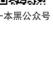

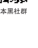

让一部分人先改变现状

一本黑公众号

一本黑社群

### 借钱不按时还，恶心！倨逼！

这个话题其实在去年期间就想写一写，奈何处于放假阶段无心工作，就给耽误了。

如标题所述，
在我们看来，但凡是那种不遵守约定、借钱不按时还、一拖再拖的人。
除了人品在我心里会大打折扣之外，真的会让人觉得特别的恶心和倨逼！
这种行为不仅会让借款人觉得你在出尔反尔、最重要的是一次诚信的消耗。
俗话说："有借有还，再借不难。"

但我更觉得，借钱这事，借是情分，不借是本分。

奉劝你们且忌讳亲友，还是推己所好，每个人都是一个独立的个体，没有谁是天生该帮助谁的。

对我说三遍，谁借助于我，我一定涌泉相报。
毕竟做人得厚道。

但是我帮助了谁，并不会要求别人给我我什么回报，毕竟自己做到问心无愧就行。

我这人非常看重诚信，觉得一个大老爷们说出的话不能跟屁股似的，就算最后不能履行承诺，也别找各种借口。
因为在借钱这事情上，你的任何借口都不能成为不讲诚信的"挡口"。
反而人家只会觉得你在放屁。

基本上每个人都借别人钱借过钱，也被别人借过钱。
拿我自己来说，我活了 27 年，找人借款的次数没有超过 3 次。

## 第一章：认知升级

在我的记忆里，这三次借钱都是应急，而且都在三天之内还给了对方，并且主动支付了超高的利息。

以最近一次借贷为例，也就是过年期间。

那会给我爸全款定了辆三十多万的奔驰，因为第二天我要提车，时间紧急，我的钱又基本都在二级市场里，手里暂时没那么多闲钱。

于是找到了朋友借钱应急，承诺三天后归还。

朋友告诉我手里也没那么多闲钱，但是可以从某贷款平台套20万给我。

事后，我立马拿出部分投资份额，第二天就给朋友归还了本金，外加一千块利息。

我可朋友借了20万，一天之内的利息我给了 一千块，这个收益率是多少大家可以算一算。

很明显，有一个能从贷款平台套20万借给我的朋友，这种关系还需要利息吗？

显然是不需要的。

但是从我做人的角度来说，我就告诉自己，这个利息必须给，而且是能多不能少。

从利息方面来算，我是吃亏的，但我就是愿意吃这个亏，因为别人帮了你，那是情分，是情分就得还，而且要还得让人舒服，还得让人觉得不仅吃亏还丢了便宜。

二

我遇到太多所谓的兄弟朋友，当初我请他们借钱的时候说得有多真诚，到还钱的时候就有多虚伪。

我有时就会怀疑，为什么这些人就这么乐意用一次借钱行为，去消磨掉长久积累下来的信任。

在我看来，这就是因小失大、蛮不讲理。

讲几个我经历过的真实案例吧！

前段时间不是快过年了吗？我翻了翻借贷记录，发现还有好几个朋友没按

时还钱，而且还拖了半年，甚至一年。

最近我想着我就不该这一块，期间就没主动开口找他们要，那时候总觉得主动开口有点不好意思，怕伤了和气。

但看看过去几年，既然你这不讲诚信，不遵守约定，那就是不当我这回事啊！我也无需再容忍下去了。

给四五个月催邀过的朋友发去消息，态度还有点忌求的那种，真怕伤和气。结果你猜我猜怎么着，有个朋友欠我八千块，消息发出去我这连显示红色感叹号... 我当时就愣了，这他妈也太秀了吧！这么多年的同学关系，因为八千块就把我给拉黑了？ 我接到消息气就上来了，接着给其他人发去催债的消息，态度也不再那么缓和。结果收到的回复多是这种：‘你又不缺钱，那@Component’；‘你又不缺钱，那怎么着急嘛；唉唉，这关系不至于吧！过完年再给你。’ 听说听说，这他妈是人说的话吗？ 自己不讲诚信，借钱不按时还，还说这种恶心人的话，整得好像借款方在无理取闹一样。你讲这样谁得住啊！ 既然这些人只把你当资源和工具，还说这些只有傻逼才会说的话，我觉得没有必要给他们留什么面子。 一个个借钱的时候都储备甘蔗为糯牛，开张就是上万上万的借。 还有春天对着地发芽，一定按时还，结果一个这个还钱的时候都他妈像个大爷似的。

更气的是啥。 之前大学一起发我借钱，说自己现在谈了女朋友，找到了真爱，两人干柴烈火，认识半年就把证给领了。

## 第一章：认知升级

准备段段时间要求我罗葬礼。

说得我还挺感动，刚想买瓶烟他们，说到时候一定去喝酒。

结果这哥们开口就找我借十万。

还说什么唯有小人和小女子难养也，没有十万借个两三万也行。

大家都知道，我是个特理性的人，我当时也是年少无知动了凡心，于是就借了三万给他。

结果你猜怎么着？

婚礼我们倒是没看到办，却是在他朋友圈领略了不少大好河山，吃喝玩乐。不是三亚的海，就是教堂的窗，喝着香甜的茶，还穿着对句的小马甲。今天还在丽江，明天香格里拉已经到了夏瓜。

我这边是负重前行，他这边是声色犬马。只要一提还钱，马上就装作哑巴。

面对这种人，可能很多人会选择一些委婉的方式。比如朋友闺蜜吹气的穷兮惭愧，或者转发点老榻案例，想着穷做侧占一下，希望欠钱的人能速途返还，尽快还钱。

可谁想错，这些借钱的人只会觉得，不就借个钱吗？至于搞这些吗？

总结一下类借钱不还的人的话术，你又不缺钱，急啥？咱们这关系至于吗？谁那么急着意思吗？等我两天，我这就去卖给你表。

这是啥，那就是借钱我是孙子，还钱是大爷。

我可去你妈的！家里行何不但没有还钱打算，甚至还有再此一笔的预谋。

按我这臭脾气，我会直接选择拜别，虽然你不把这段友谊当回事，那咱抱歉，我也不缺你这个朋友。

以前我写过，朋友分两种，共情式的朋友和利益关系的朋友。有时我甚至会觉得，比起共情式的朋友，利益关系的朋友相处起来会更直接和爽快。

我们出了社会后，共情式的友谊因为环境、圈子等原因，一定会导致大家越离越远。

## 反思

大家最怕的就是，一个多年不联系的朋友，突然联系到你，不是因為想叙旧，而是想找你借钱。

你说这叫什么！
这世上本來就沒有突如其來的问候！

### 四

前段时间看到一个短视频，一男的当街下跪磕头、求别人还自己钱。
嘴里不停地说着：“我求求你还我钱，我求求你还我钱行了吧！”
视频的前因后果我不知道，但是能下跪求次别人还钱，可想而知当事人这笔债务有多绝望。

这完全就属于讨着借钱，跪求还钱。
真的，以我的经验劝各位，就算你钱多得可以用來掘屋跟、我都建议你不要借給那些不清醒的人。

太他妈同情了。
因为借钱，多少亲戚朋友一拍两散，反目成仇。
这个时代，信用是一种非常值錢的东西，它虽看不见摸不着，但你可以用信用去清道，去贷款，只不过前提出你得付出一點的利息。
这么来看，找朋友借钱其实说白了就是一种贿行。
别人借钱給你是因为信任，也就是说借钱人甘愿被白赚，这是一种默认的、不需要收取利息、朋友之间的借款方式。

小儿干事就不用说了，那些动輒上万块的借款，别人为啥要借给你，还不是想帮你一把。
不然别人拿钱去投资、去买基金、甚至年化也有几个点他不香吗！
别人是逼不得已，非得把这钱借给你，按时还钱还好，不按时还钱这—肚子气，还有 supermarket 吃啥！
前面说了，人与人之间，就沒有谁一定帮忙谁这个道理。
关于借钱，自古以来就是数急不数穷。

## 第一章：认知升级

不过人都有低谷的时候，也都有遇到困难的时候。

写这篇文章并不是说我们遇到别人借钱的时候，千万别袖手旁观。
重点是告诉大家，做人一定要讲诚信，借钱更要讲诚信。
别人本来就没有借钱给你义务，大多数时间可到说话后做到似的，最后整得双方都不愉快。

借钱可以，建议言而有信，说哈时候还千万别超过那个期限。

条件允许的情况下，可以大方的给些利息、或者把利息转变成他的回报，物质的、精神的都行。

吃个饭不过分吧，介绍一单生意顺手的事吧，再不济 KTV 叫几个妹子唱唱歌也不是不安全哦！

单纯你情我愿的钱、还有人情，这二者都是需要还的。

格局大一点、不是给利息、还是物质精神回报，很长时间过后你会发现，这点回报根本不值一提。

但是它能帮助你把别人的心态还得满满当当，它能给你的诚信能量。

老黑
于 2021 年 2 月 25 日分享

让一部分人先改变现状

### 内幕揭晓市场最赚钱的基金到底有清单

讲在前面我很高兴接到老黑的邀请。最近跟老黑聊了基本市场的事情，包括我的一些投资经验，和我给一些高净值家庭做资产配置的思路。老黑觉得不错，拉我来是做个分享。

昨天看老黑发布后，看了评论区。如果不出我所料，很多对市市很愤火爆，果然是符合一本黑的气质。

市场的投资，我小小地参与了一下下，可以说基本没参与，所以这块不在我的能力范围之内。

不过我可以给大家讲一个我身边真实的故事，就在深圳。我有一个朋友，早年赚到第一桶金，2017年700W的购房金、进入市圈。2018年初就赚了超过5000W，在深圳全款买了一个3000W+的房子，买了兰博基尼，日子非常潇洒。

这种初期的收益他是否不稳定，能快速的落袋为安，把浮盈转化成稳定的资产，图下。然后再拿剩余的利润去玩一玩。

但是2020年初，我就听说他已经失联了。欠了很多前，房车全部被司法拍卖，市圈仿佛晴朗，简直是一场游戏一场梦。

我一直秉承的观点是做价值投资。让整个资产跑到15%左右的年化，行情好的时候多赚点，跑个30-40%年化，行情差的时候少赚点，甚至亏损一点。整体能在稳定收益的区间，那么你就可以打败市场上90%的人。

而走小散们，是喜欢追求高收益，喜欢赌。今年翻一番，明年赔一半，时间线拉长，没有几能赚到的。这就是高净值客户和一般客户的区别。

当你的资金量越来越大时，需要的就是稳定的赚钱和非常小的回撤。我觉得1000-5000W资金的话，追求年化10-15%是有机会，大于5000W一般就是8-12%。

我刚好年前去了新加坡私行交流，我看了下新加坡、香港、英国私行的主流产品，基本就是6-8%的理财计划（500W 美金起客户）。

看了大家对市场这么火热，我还是先泼泼冷水，希望理想性对待。

目前在中国，能分享资本市场最好的方法，就是投资基金。你可能今年买股票赚的比基金多，但是如果时间拉长看，3 年，5 年，你一定跑不过基金。

我有太多数据可以论证这些。

后面，我也会一直在群里为大家解答这类问题：

+ 1、宏观经济市场分析。
2、基金投资的问题。
3、金融资讯化相关的 问题。

那么，变不在此，我最希望大家能从良 岸选择一种稳健的增值方式，基金也可以赚很多钱，后面我会用科学的方法，来带领大家在基金里赚钱。（股票我也投了不少，特别是美股，但是风险高，暂时先不建议做）

最近股市太疯狂，连续 9 天股市交易破 1.5 万亿，创近 5 年之最。股市再次站上 3400 点，让无数人欢呼雀跃。

每天微信里问我股市的人不计其数。然而风云突变，三周前股市三连跌，暴跌 200 多点。两周前又再次暴跌 200 多点，打破了无数人年市暴富的幻想。

暴跌中股民均亏两极分化，股市晴雨一片，如何在股市巨潮滚落中寻找机会，在不确定性中雕到确定性的钱？对于散户最好的方法，就是用科学的方法买基金。

#### 一、过去十年里怎么买基金才能最赚钱？

为什么要买基金而不是直接买股票，我想大家在经历了 2015 年的股灾后都有一定认知。我就详细讲，简单来说：

+ 1）基金由专业投资经理来投资，专业的事务交给专业的人。
2）投资基金是投资了一揽子股票，风险分散。
3）通过资产布局真正分享中国产业升级的收益。

股市是零和博弈的游戏，有人赚钱就有人输。投基就相当于找了个代理去和一般的韭菜对付。谁能赢还用讲吗？

然后在基金里又分为被动型基金和主动型基金。被动基金，就是被动的追踪如沪深 300，上证 50，标普 500 这样的指数。而主动基金，就是加入了基金经理的意见，根据自己的策略和研究，来主动投资的一种类型。

那被动型和主动型的基金，哪个好呢？

指数基金之父—博格曾做过这样的统计。60 年的时间里，美国市场主动型股票基金收益率高都不过被动指数基金。

在美国大部分的基金经理不过被动指数。

这个数据显示在成熟的资本市场里成立的。但是在中国，结论完全相反。中国市场里，散户多、散户的持股比例比机构投资者还要大。所以整体资本市场并不理性，那么作为职业玩家的基金经理，是非常好对韭菜的。数据表明：2017 年机构盈利 11156 亿、散户盈利 3108 亿、机构整体盈利金额是散户的 3.6 倍。机构的超高收益都是收割散户而来的。

中国的主动型的基金有 80% 以上，能战胜指数。

因此我们在选择赚钱的基金范围里，大部分选择主动型基金。我从 6000 多只公募基金里，精挑喜爱选出了 20 只最赚钱效果最强的基金。这个名单是动态更新的，每半年会根据市场的表现进行调整。

不关关注，直接给大家放出来我多年来筛选的底部优秀基金名单。从收益、平衡和守约 特性里，找出中国赚钱效应最强的基金。大家参考这个名单来，基本上可以战胜市场上 80% 的人。

#### 二、市场上优秀的基金多不多？

如何判断优秀的投资，我先来问两个问题。

+ 1. 在你的投资里，到现在为止有超 10 倍的收益吗？（总资产包而不是指单一股票）

2、在你的投资里，近10年能超5倍的收益吗？
如果你都回答X, 你已经不用看这篇文章了。99.9%的人，在二级市场上是达不到以上收益的。

优秀的、赚钱的基金, 却需要满足或是基本满足以上条件。那我们来看看满足以上两个条件的基金多不多呢？

+   1、累计收益超10倍的基金。满足总收益超10倍的，一共有32支基金。我整理的名单如下；

+   2、近10年超过5倍收益的基金（2010年7月1日—2020年6月30日）
超5倍的基金，一共只有7支。把条件放宽到4倍却只有16只。

对比1和2的基金名单，有以下几个结论：

+   1) 历史表现好的，不代表近期表现好。同时能进入1和2表的只有一支基金。 （但是要排除有些基金成立时间不到10年的客观因素。）

+   2) 2001-2010年，这10年赚钱效率远比2010年—2020年强。很多十倍基的收益是在2001-2010年间的。

+   3) 中国的股市是行业轮动，更新迭代的，很难有一支基金连续20年常青。在选择基金的时候，是需要动态更新的。

从6000多只基金里选择好的基金，是有一定难度的，必须通过专业的、系统化的方法来筛选。同时还要动态更新，优胜劣汰。

总体来讲，在基金市场里有大量优秀的基金，通过投资基金，平均每年赚取8-15%的利润，我觉得是不难实现的。

那么什么才是专业的、系统化的方法呢？

#### 三、怎么选出优秀的基金

简单介绍下基本方法；

第一步；基金类型在选择基金之前，我们先得认识基金家族的每一个成员。可以分为；

+   1) 货币型基金；主要投资银行间货币市场，风险极低。

+   2）债券型基金：主要投资债券，里面有个分支也可以投资不超过20%的股票。风险偏低

+   3）混合型基金：混合型基金同时投资于股票、债券和货币市场等工具，但投资比例灵活，几乎没有限制。风险和预期收益相对适中。

+   4）股票型基金：80%以上的资产要投资于股票，风险较大

+   5）指数型基金：全部投资股票，也可以理解为一种特殊的股票型基金。（QDII和FOF后面再介绍）

这些基金按投资顺序风险也是递增，预期收益也是递增。所以在选择的时候，要横向比较，不能跨类别比较。

比如：不能拿货币型基金和股票型基金比收益，也不能拿货币型基金和混合型基金比风险。收益对应高风险，这是资本市场亘古不变的真理。

##### 第二步：过往业绩

基金的过往业绩，是评价基金的最大参考。
我在著名的“4433”理论基础上，简化后得到的“5个30”理论。

+   1、在同类型基金里，选出最近6个月业绩前30名的基金；

+   2、在同类型基金里，选出最近1年业绩前30名的基金。

+   3、在同类型基金里，选出最近3年业绩前30名的基金。

+   4、在同类型基金里，选出最近5年业绩前30名的基金。

+   5、在同类型基金里，选出成立以来业绩前30名的基金。

最终选出出现次数最多的基金，5个维度，就是要从“短、中、长期”筛选出持续表现优秀的基金。

##### 第三步：基金经理

我的原则，至少当前基金经理至少要管理这支基金4年以上。基金经理就相当于这支基金的CEO，CEO的稳定和过往表现，很大程度上决定这支基金未来的走势，同时要选择成熟的基金经理，要看他关联管理其他基金的表现。

##### 第四步：基金公司

大部分的情况下，我们要选择头部的基础公司。

前十名基金公司：

+   1）天弘、
2）易方达、
3）博时、
4）南方、
5）华夏、
6）汇添富、
7）广发、
8）工银瑞信、
9）嘉实、
10）华宝。

每一家基金公司都有自己擅长的领域，也有很小而美的基金公司。比如，富国增长量化投资交银施罗德 entendre 长科技领域、减长企业兴全成长价值投资等。

##### 第五步：成立时间与基金规模

不选择成立时间小于三年的基金，不选择新基金。关于规模，我比较偏好 30-100 亿规模的基金。30 以内太小，100 以上太 大。都会影响到收益和风险的综合比。

由于篇幅有限，在此只是简单介绍了《孚成选基金七步法》中的主要部分，如果后续大家更感兴趣，我可以写一篇详细的文章，拿一支热门的基金，通过七步实盘分析，教会大家如何选基金。

用以上的方法，相信大家可以选出一批心仪的基金，避开 80% 的市场。

#### 四、什么时候该买，什么时候该卖？

在赌场里有一句话：在你离开赌桌之前，所有你赢的钱都不是钱，只是纸。在资本市场里一样，在退出之前，所有的盈利都只是浮盈，随时可能一把亏回去。会买（股票／基金）的人只是弟弟，会卖的才是哥。择时甚至比选基更重要。

这部分比较专业，我下次教大家可以简单的方法。今天先不讲了，免得消化不了。

#### 五、总结股市是一个没有硝烟的战场，它甚至比战场更可怕。它杀人不见血，吃人不出骨头。股市就是中产阶级的收割机。

据统计，在中国的散户中，有97%的人都是亏钱的。有不少人、辛辛苦苦几十年赚下几万、几十万。然后在股市里几个月全赔光。投资股票是拿你的兴趣，在挑战职业玩家的专业。而投资基金是你请了一个职业玩家带你打，去市场上虐其他的业余玩家。

哪种方式更容易赚？虽然投资基金比投资股票赚得容易的多，但是选择好的基金仍不是一件容易的事。在资本市场里，你永远无法赚取认知外的钱，即使赚了，一定会用同样的方式亏回去。

因此，想赚取更多的钱，就需要更多的学习，看清投资的本质。把不确定性的内容，更多的转化成确定性。这样就能稳定赚钱。

这篇文章，我尽我所能，把基金的基础知识全面地介绍给了大家，希望能帮大家进入门，不受被市场上的噪音忽悠、瞎买基金。给大家带来了福利、透介绍了低估值的基金名单，但是我仍希望大家能认真的跟着我学习更多的知识，用知识投资自己才是复利最高的投资。

基金投资是一个长期的过程，长期年至少3年以上。每年赚取8-15%。并不是一件很难的事情。那么三年时间赚取50-100%，则是一大概率事件。

前有P2P、杀猪盘，后有私募、信托爆雷，金雕局一波又一波的收割者韭菜来。不断学习，提升自己的认知边界，赚认知范围内的钱，才是活得久、赚得多得道理。

强少

于 2020 年 6 月 6 日分享

## 第二章
牛人分享

### 2019-2020

## 从月薪 2300 到年入百万，我的草根逆袭——粥左罗

他从一个月薪 2300 的服装店员做起，转行新媒体小编，一年半时间做
年薪 50 万的副总裁，现在今成立了自己的公司，实现年入百万。

他的经历极具励志，苦逼几年后，现在变得越来越牛逼。前段时间我给他发消息，想让他来星球给大家分享一下自己的故事。他二话没说就答应了。

大家好，我是粥左罗，文章正式开始前，我抛个问题：我能不能选择不牛逼？我就不不能过平淡日子呢？

这个问题，每个人都应该有答案。我的答案写在文中。咱们先看文章。

我有个好友，之前是同事，两年前我们几乎同一时间加入公司，做新媒体编辑。

那时，我们能力相当，收入无差。如今单从月收入上，我大概是他至少 5 倍，再过三年，差距或许会更大。

前段时间，我约他吃饭聊天，谈及个人成长。他跟我说了一句：即使我按你的路经走，也能像你今天这样，我也不想努力，因为太苦太累了。

一个人的发展，平台，机会，选择，都至关重要。我至今也非常清楚，不可否认，今后我也会更加重视这几个因素。

这篇不讲我的全部经历，就截取 2015 年 8 月到 2017 年 3 月这段经历给你讲讲，一年半时间，我从一个新媒体小编辑到年薪 50 万副总监，背后的 4 个苦逼经历，都是你不想经历的。

大学读的北京体育大学，专业念的体育产业管理。毕业一年后，我做了新媒体编辑，加人@创业邦不到 3 个月就写出了多篇 10W+。最高的一篇 200W+。

你可能会说，背靠大平台写 10W+，没什么了不起。但抱歉，2015 年我加入时，我们头条平均阅读量才 1 万，整个内容部十几个记者编辑，当时只有我能写出 10W+。

那为什么是我？因为，我性情更高，我比其他同事更聪明，我有别人没有的方法技巧。真是抱歉，我没那么自恋。

其实最重要的第一条，我是对自己最狠的一个，我找不到比我更拼命的人。进公司很长一段时间，我是个走路带风的人，从不跟同事一起吃晚、也从不点外卖吃。一般下班 2 点过去用餐高峰期我才去吃，跑下楼、大口吃饭、快速完，再跑回公司，20 分钟。为了不在结束吃上浪费时间，我连续吃过一个多月的淮南牛肉汤。

我舍不得浪费半点时间，地铁站和公司间有较长一段距离，很多同事都知道上下班我都是跑的。

剩下的所有时间，我都沉浸在对行业知识、用户需求、账号运营、选题套路、标题技巧、快被弱理的研究学习。

标半年我的生活没什么别的，不看电影、不逛街、不追剧，我最爱的消遣除了代收也消了，我被的夹克经常一两没时打理一次。

死磕自己，死磕一切细节。下午 6 点写定文章，晚上 10 点推送，这 4 个小时，我根歇不下，会不停的打磨修改：

+   标题里这个词能不能痛一点？
这个句子怎么更能有共鸣吗？
这个封面图传递的情绪是不是不够？
开头这句话是不是太平了，用户看了愿意往下读吗？

用户觉得哪个地方可能会卡住，能否再修改顺畅一点？
用户看完会不会喜欢，又愿不愿分享？
这4个小问，我可能会给自己在手机上发预警超过100次。
除了写稿文，我还有个工作，每天早上6点起床行行业早报，8点半推送。
那时，我心里只有一个目标，干掉竞争对手。
之前早报阅读量1W左右，我接手后每天时奋对打，一篇一篇分析数据和内容，直到把平均阅读量提到3W+。
一周7天，一个月31天，不管前一天晚上几点睡的，每天早上6点从床上跳下来干活，春节、假期都无例外。
2016年春节，我去女友的云南老家过年，到了我就糟透了，山区信号特别差，网经常都打不开。但是每天早上8点半，我必须发出早报来，这是对用户的承诺。
当时每天一大早，就骑摩托车到村公 Birch的一个地方写早报，这个地方信号超好。当年那几天，引力波是个大热点，我还是第一次放在早报里推送给用户看。
这才是一个编辑快速晋升背后的真相，很苦逼，没有那么光鲜。
超级大号咪蒙也说过：如果哪个做大号的跟你说，他每天轻松松随随随便便写个文章，就有几十万粉丝了，他一定是在装逼。如果信你，你就是傻逼。
没有在出租车上、病床上、酒店大堂、机场候机厅写过文章的公众号，都不配谈什么粉丝经济。
上班时好好工作，下班后好好生活。这句话听上去很美，但你信就傻了。
真正想，职场上真正做得牛逼的人，从来就没有上班的那颗心，心里想的就是一件事，把活儿干到最牛逼。
工作就是生活，生活就是工作，没有之限。
进入这行后，我就是在加班中度过的。
6点要下班了，行业突发事件来了，赶紧干活，饭都不吃，搞稿搞到十点多，
推送，再去楼下711买个面包吃。
有大稿、急稿、同事们不愿接，我直接上，连夜赶稿，经常加班到凌晨两三点。那段时间内，半夜醒来还要摸手机，看文案数据。

你问我累么？我 drama,人在非常有欲望想干成一件事情的时候，是不知道疲倦的。

2016 年 10 月之后，我业余时间开始和栖息合作公益导流，一共 90 节，每 2 天必须更新一节，不分周末、节假日。创业排的本职工作一般都要加班到晚上九十点，然后才能再去做课程，因此有几个月的时间，每天忙到凌晨。

有一次追了支付宝宝热点头，连续出了两篇 10W +，要写 4 节课分析这个热点怎么说。那天忙到凌晨，很累，录课时表现力很差，老是大脑短路说错情，就跑去卫生间用冰水洗脸，把激一把，趁着精神头好的那十几分钟强迫自己情绪饱满的再录一遍。

搞定所有事情，凌晨 2 点多，打顺风车回家。那时住在五环外的昌平，很远，打招呼过 10 块，舍不得。

晚上打顺风车很难，通宵要等很久。等到凌晨快 3 点，终于上车后想眯一会儿，司机却跟我说道：‘兄弟，别睡啊，聊会儿天吧。’

司机 80 后，在北京有房有车，收入很高，晚上接单是因为那边其他也老加班到凌晨，晚上开车睡觉，要靠个人聊天。

这就是真相。每一个平通的背负，都是苦逼的坚持。

你加会乐就得承受得了青春，你加会累就定老去干你能定了，你要把生活和工作分开，你要把时间浪费在美好的事物上。那抱歉，你注定无法牛逼。

一排窗户声特别大，也没法录。

后来我找到解决办法，去 18 楼楼道录，那家人一开始很不情，但录到第 4 天又完蛋了。一楼两个保安从监控里看见了我这个每天夜里黑黑的人，上来把我赶走了。

家里更没法录，那会还跟朋友一起合租呢。凌晨前，室友们有绘艺的看综艺、洗衣服的洗衣服、啃瓜子的啃瓜子；凌晨后，安静了，但也没法录，你一录大家都被你吵醒了；想过开房录哦，但一问如家 280 块，最初录一节课才 600 块席费，不划算。

后来一段时期，解决办法就是：凌晨 1 点后下楼，在小区里录。那时候小区里安静，适合录音，但就是超冷点，北冬的冬天，凌晨一两点，你懂。有时候也有些意外，比如正录着，谁家狗突然对着外面狂叫，或着小区超市的送货三轮车经过。一开始遇到这种情形，我会破罐会破摔，后来慢慢没脾气了，少废话，重新录。

总之，就这样一节一节过过来了。后来加入新媒体，同事都说我是所有老师中交稿最及时、录音质量最好的。我从来没跟大家说过这些，你辛苦，大家都辛苦，没什么了不起的。

选择很重要，机会也很重要，平台也很重要。

但我有时很讨厌别人说这些，仿佛一句话，就能把他的所有努力全抹杀了。我入行新媒体，第一家公司就是创业邦。确实是个好机会。但这个机会并不是天上掉下来的，也就是我拼命努力争取来的。

之后有一次在西单大街碰见的一个服装店店员。2015 年 8 月的某天，我回学校地摊堆，遇到一个朋友，聊天过程中，他建议我尝试一下做新媒体。

谢天谢地，谢自己努力准备，面试顺利。但最后一轮面试，面试官还是留了份作业：如果未来运营创业邦，你会怎么报？

我完全理解领导，敢去相信一个服装店员能做好新媒体，需要一股勇气和魄力。

但我也在想，我能做点什么让他相信？那时我毕业一年，还在住地下室。之后3天，我把自己关在地下室，翻了创业邦及其竞品36度， electrophoresis? 36度? 文案，分析选题、标题、阅读量、点赞数、评论数等，又翻了很多新媒体运营干货，最后用一份88页PPT的运营报告提交了面试作业。当时PPT也是现学的，在淘宝上买的讲等的课。

PPT发给面试官耶耶，我还发了个朋友圈，8月14日，周五。那刚好是天津大爆炸新闻震惊全国的几大。

因为这个PPT，我抓住了那个机会，8月17日就入职了创业邦，从公众号小编做起，月薪5000元。

很多人说机会很重要，但是很多机会真不是天上掉下来的，是拼命努力抢来的。比如我抓住的这个很小的机会，其实被很多人，同样的能力、背景、以大多数人的努力程度，多半抓不住那个机会。

我在桩坐学院时，招新媒体编辑，只要你愿意在运营发展，你过来，我一定能让你变得很好。是机会来了，也很多人接简历，但说实话，那些简历，90%以上都没有认真准备。

我给大家一个标准，做大量工作呢，做不了那么快，好几个都给他们一周的准备时间。可交上来的时候什么玩意，你一问，倒是挺硬实，说给我发邮件那鬼才开始准备的。有的更聪明，为啥不好好准备，说是怕面试试不上，前面努力就白费了。我说，我都不知道那些人怎么想的。

很多人都说没机会，在我看来，这个时代最缺的就是机会。机会会到你随意浪费的程度。

另外，即使抓住机会的人，也往往身处在机会中而不自知。比如我待过的创业邦、插座学院，多好的平台，但是很多人处在这样的平台上，不去拼命努力利用呢。

毕业3年多，如果说职场中有何经验。
那就是：不取巧。

我是个人手没什么懒的人，所以要拼命去抓住每一个机会。

也许很多牛人大概没有分享过这些，但他们自己也一定清楚的明白，这些才是所有牛道背后的真相。你得经历别人不想经历的苦逼，你得比别人更狠、更拼命。

你不是名牌大学毕业，没有天赋异禀，不是少年天才，也不如大家智商高，你凭什么就想比别人牛逼？没有苦逼，哪有牛逼，即使你就是名牌大学的高材生，也未必能行。

很多人不愿意承认这个事实，因为一旦承认，就意味着没有捷径可走。
设若硬走可走的行？未免太苦了吧！但真实的世界就是这样的。
一定要有人会说，工作很紧要，但身体更重要。

但其实，很多认识我了解我的人都知道，到今天我身体保持的比绝大多数朋友还好，因为我长期保持运动，我这种常年打拼的人，比谁都清楚身体是革命的本钱。

但这个社会就是这样，很多人说读了工作学习到晚常年伤身体，但他们会打游戏、刷抖音、追剧到凌晨以后。真是怪了，难道和工作相比，这些玩意就 有排毒养颜功能了。

最近跟朋友吃饭聊天，一致得出这个结论：
比如我，学生时代紧跟目睹我爸的一辈经历，对我冲击巨大，我爸就是很多 人嘲笑的农民工。从我上小学开始，就四处打工，山东、浙江、东北，几  被老板辞了干净到钱的事他跟我讲过很多。但这还不算对我冲击最大的，
最严重也就是没有饭到。

对我真 的冲击，是大学的一个小假期，我去爸做工的工厂子看他们。我妈几乎没出过打过工，很老实的农村妇女，但因为我家会几上大学花费多，也跟着我爸出来打工了。

就是那次，很不好，他们工厂里因为一些事故，于我平生第一次，亲眼目睹我爸被人被负，一个大男人那么辛苦做事供养家庭，还要遭受委屈。那段时间，我常失眠，你明白那种无力感么。我见到这一回，我没见过的是吧。

这就是为什么，我毕业上班后，一直让我弟别出去打工了。想到那件事就心里难受，几乎都不想再发生。你我清楚，这个残酷的社会上，有太多事情，是法律没法解决的，是诉诸道理没用的。你唯有变强。

我不知道有多少像我这样的人。反正，我就没得选。我能轻轻松松平平淡淡的么？不能。我不変强，我连自己的亲爹亲妈都保护不了，将来连自己的老婆孩子都保护不了。

这片辽阔的土地上，每天都在发生很多让人充满满足感的事，我从一个典型的农村长大的孩子，一路看到北京，见过、经历过太多、记得大学期间，一条新闻报出来，某些老实人不过要争取点正当合理的权益，但面对那种强极的势力，无论做什么，都只是势如向日的蜗牛。所以有时，我深感在这个社会，弱就是罪。

因此，无论如何，我们必须更强大，不得不牛逼。也要清楚，没有苦逼，就没有牛逼，因为所有的牛逼，都是苦逼换来的。

从今天起，我们依然相信选择很重要、机会很重要、平台很重要，但也要提醒自己，努力也非常重要，千万不要让那些为了你不努力的挡箭牌。世道变化，就是从嘲笑努力开始。或许有人不需要那么努力，但对大多数人来说，你没有不努力的资格。

对的那条路，从来都很苦。但真正牛逼的人，都敢对自己下狠手。社会会宽容弱者，只对有自己狠的人，才能被这个社会温柔以待。所有的牛逼，都是苦逼换来的。你不对自己残忍，社会就会对你残忍。写文章期间，我看了个采访，吴晓波对谭强东。其中一段，深受震撼。吴晓波：从开小店卖VCD开始，到今天这个局面，你如果回过头来看，有什么终极教训吗？

刘强东：如果回过头，假如你让我从十几年前重新开始创业，我一定会在三方面更加强自己。第一就是我要更拼命一点。吴晓波：更拼命？？？你还不够拼啊？？？刘强东：我觉得我应该还可以更拼一点。从全世界来看，包括亚马逊、包

包括谷歌、包括 Facebook，我看到所有优秀的创业者，不管是中国人还是外国人，甚至法国人，很多都说法国人欧洲人很懒很懒，不是，欧洲还是有很多很勤奋的人，比如说我看到的 LVMH 集团的几个二代，那每天都是十几个小时的工作啊，绝对超出我们想象中对他们的认知，他可能已经是富二代三代了。

努力，是一辈子的。

1998 年到 2018 年，刘强东创业 20 年了，从一个小柜台到 16 万大军。我相信上面那段话是他的真心话。所有牛逼背后，是你不经努力的苦劳，刘强东希望用更多的苦劳，换更大的牛逼。

如果再问那个问题，当年刘强东可以逃掉牛逼么？不可以，他也得没选。

刘晓波回到刘强东当年的创业动机，就是赚钱，家庭的动力。外婆生病，没钱治病，没钱买药，哥哥们家里而能买的东西全都卖掉，搞得家里面穷得一塌糊涂。所以那时侯创业很简单，就是赚钱糊口外婆治病，其它没有什么目的。本来打算毕业后至少在企业工作个五六年，攒个十万八万，积累些经验再出来，但外婆生病，没办法，我在企业只干了两年，攒了一万两千块钱就匆匆忙忙出来了，实在等不下去了。

人在江湖，身不由己，不是你不想牛逼，就可以通过漂漂亮。

当然，并不是每个人都有机会成就一番大事业，这个我当然知道。但我更相信，只要我多努力一点，就会更强一点，更牛逼一点。

我当然希望自己未来奋斗几十年，能有力量去改变这个社会上一些不好的东西，但是如果一辈子都没有这样的机会，我至少可以做到照顾好保护好自己的家人。

同样，还那句话，所有牛逼背后，都是大多数人不想经历的苦逼。人平均智商是 100，高于 130 的是天才，低于 70 的是弱智，这两种都是极端稀少，很少很少。

绝大多数人智商都在 85 到 115 之间，也就是普通人。既然大家都是普通人，那你想得到超常人的成绩，就付超出常人的努力，平常的努力，只能带来平常的进步。

最后，祝你历经苦逼，变得牛逼。但应记住，牛逼之后，不许变坏。

### 如何通过副业赚到 100 万 +？ ——Sky

今天的分享来自 Sky，是一名优秀的设计师，相信很多人都用过他设计的产品，他有 10 年设计大厂经验。

他的作品你每天都在使用；他经历过天猫双 11 的磨练，负责过天猫 / 支付宝设计讲师，负责过余额宝；他 3 年来坚定地每天分享最实用的职场经验，最接地气、也是最专业的设计类知识；他也乐于帮助年轻设计师成长、设计咨询都会帮你解答。

他就是支付宝设计专家——Sky。

今年是他工作的第十个年头，从武汉到北京，再从北京到杭州，他在工作之余灵感迸发，通过分享兑现在设计上的心得，一年内成功赚到 100 万 +。

今天我将从三个维度分享自己的故事。1、我的职业升级打怪故事。2、找到职业第二曲线。3、个人 IP 如何打造。

我和 Sky 是在杭州经合伙人认识的，前段时间推荐过他的公众号——我们的设计笔记。他的经历适合任何想发展副业的人借鉴，特别是星球里还没毕业或者刚刚毕业的小朋友。

希望 Sky 的经历能给你一些职场上的启发。

今天在这里分享一下自己的故事，在分享今天故事之前，先用 4 个数字来介绍下我自己。今年是我的工作的第 10 年，我 09 年毕业的到现在刚好第十年，今年 32 岁也到了所谓的不惑之年，但是内心感觉自己还是个孩子，所以臭美下介于正太和大叔之间的年轮人，这么多年来，我一直做着一份工作就是设计，相信很多人都用过我设计的产品，金山手机卫士、手机百度、淘宝、天猫、支付宝等，目前我在杭州一家 XX 宝公司担任设计专家！坚持写作差不多 3 年时间

## 第二章：牛人分享

我是武汉人，大学学的工业设计，很普通一个学校，学校也不怎么重视设计学院。为什么这么说呢，因为大4年那居然没有收过我们学费，然后很多姿就拿着学费做股份玩去了，当时我也拿着学费差不多2W去搞，在学校旁边低了一家花店，那时期性格比较内向，想着开一家鲜花饰品店能和同学之间多接触，加上当时武汉也没有什么互联网公司，很可能开半年来就失败了，最后毕业后带着3000块钱去了北京。

在北京待了差不多7年时间，基本北京的一线三线互联网公司都待过，大家熟悉的金山、百度、新浪都待过，所以每次再回北京都带到的案例 2015年时候，离开北京来到杭州，离开的原因也是很焦虑，买不起房，

当年在北京买房需要交5年社保，我好不容易熬到了5年，买好房的时候结果发现中间房子一个社会保，无奈我买房资格，那时候我也快30岁了，也不想继续北京漂泊，就想哪我武汉双好，然后在武汉面对竞争公司，武汉买房了，结果准备回去之前，那边公司设计部门都解散了，所以因缘际会的来到了杭州，来到了现在的公司，一直待到现在。

虽然我是做设计师的，但是和大家一样也是一个普通人，我喜欢美食，记得刚去北京时做工资不高，但是每个周末我都会去寻找北京人均50以下的美食，所以北京好吃的美食我基本都逛遍了，我也很容易喜欢小动物。

曾经养过几只猫，我也喜欢旅行，其实世界很大，世界是一个圈的，我们不应就只活在自己的那一片小拼图里面，要经常出来看看，去接触不一样的人和事情这样才成长的更快。

希望今天我这一些简单的分享，能够帮助大家，也希望大家在看这篇文章希望能下手上的事情，我们一起用文字交流下。

希望今天的分享后，大家都能有所收获，都能找到找到自己的优势，找到自己的第二成长曲线，另外就是打造自己，其实你自己就是最好的产品。

我今天会分享3块内容，第一部分我的职场打怪升级故事，应该很多朋友都是做互联网的，希望我的一些故事能够帮大家一起启动，另外一块就是我如何找到我的第二曲线，第三块就是如何打造我个人IP的。

## 第二章：牛人分享

就是图中标识出来的）结果我留了，然后印刷出来却是文字被裁剪的，百度说的 2mm 是左右 2mm 加起来就是 4mm，我少留了 2mm。所以当时老板很生气，扣了我半月工资。那时候说实话很迷茫，后来这份工作每天被各种 diss，在这种打击下成长。

后来有一天下班时，看见一个新闻，iPhone 新机发布了。当时看见这个手机，看见新闻图片，看见机上那些很多没有设计感的 icon 和界面后，对我触动很大，原来设计也是如此被物。当时咱藏一样每天下班就去不断揣摩，去研究这些界面设计。

那时每天下班后，就在家里面练习，然后作品发在各种网上与人交流，后来遇见了我的第一个伯乐，金山一个设计师，推荐我去他公司试试。虽然当时我没有好的背景，但是面试官觉得我很勤奋，我的潜力很不错，然后我就进去了。所以 iPhone 不仅仅改变了世界也改变了我的命运。

在金山那些年是我最开心的日子，钱虽然赚的不多，但是每天很充实。团队几个设计师大家像兄弟一样排排挤着，只要关中的理念，记得那时侯我们要去封闭，去石景山那边租了一个别墅，每天早上 9 点到晚上 11 点，一周 6 天！

当时很不理解得到公司限制，但是却很快乐，那个地方特别偏僻，公主坟附近，附近没有一个人员，记得当时我们流行微群~锅，当时只能摇到自己的同事。那时候过着像一样的生话，每天吃的例差不多好，午餐和晚餐有一个 work 表格，上面各种星巴克，麦当劳，必要时随便勾选，记得哪里一个月胖了 15 斤，后来时刻完后，我们做出的产品远远超过竞争对手 360 好几个版本，那时候实在回忆起来很怀旧很甜很甜！

后面，产品是生命周期有限的，特别工具产品，我们产品到后面用户数量少了很多，公司裁撤也转型了，我也心中惦着我的五道口梦，想出去看看。然后我还是念念不忘我的五道口梦，我投递了搜狐，这次我得到了面试机会，可惜最后还是被那拒接了，原因是当时设计风格过于单—，他们担心我驾驭不了他们的设计风格，后来我被去百度了，正式从一个 4 个人团队设计师，去到了当时业内顶尖的设计团队，有 80 多个人的设计师，在百度我学会了专业，什么是科学的设计，怎么让你的设计有理有据。

在那里认识了对我影响很大的领导，他告诉我正确的设计方法，在百度我也体会到了很多环境，为我以后职业生涯第二曲线埋下了一笔，再后来我离开了百度去了新浪一个创新部门，做了一段时间创新产品，最后想稳定离开了北京来到了杭州。

最后来到了杭州，中国最大的电商平台，在这里每天都累并快乐着，在这里也找到了我的第二个成长曲线

### 我的第二曲线

在杭州这家公司，每天身边有着太多优秀的年轻人，身边同事都说万人挑一也是各个领域里面的顶级人才，公司变化很大，每天都被变化外看你没有稳定，你好不容易稳定了，就换一个领导，换了战略你就需要不断的去适应这种节奏。

1. 当你觉得不舒服时候就是你成长时候

这里有个规律，当你觉得不舒服时候就是你成长的时候，在这里面儿年，每天都好像做流水线的工作，也正是这种工作环境，祉让我对事业更加投入，为了在自己的岗位做得更好，自己有更强的目标，我必须找到我的优势目标，于就是我想到写作。

在写作之前我有平时大量收益素材能力，在一些业平台有几万粉丝支持，于是为了在设计团队中被人们记住，帮助到其他人，我开始倒逼自己写沉淀，每周一篇，到后每周三篇的产出数量，一年多，我差不多写了 100 多篇设计沉淀。

2. 人生很多重要决定其实很多在医院决定的

在我们杭州工作了 4 年，我生过两次大病，一次小的大术，特别手术的那一次对我影响很大，虽然我们现在看起来年薪很高，有股票有期权，还有一份很光鲜美丽的工作，但是在突然事故面前，在疾病面前，其实是很脆弱的，一旦我们遇到一些事故其实我们现在经济状况很容易就动荡。

都教一个道理，学会让收入多化，降低收入占比。

#### 3. 降低收入占比

我之所以焦虑，我们身边人之所以焦虑大多数原因是我们只有一份工资收入，一旦失去这份收入我们的房贷车贷生活就会失去保障，所以我们每天必须去面对我们不喜欢的人，不喜欢的事情，以及不喜欢的人际关系。好像上有一个很经典的问答，就是月入 3W 感觉很焦虑？

有一点容易被忽略答案是，原 yacht 是你收入的姿势不对，如果你是收房租 3W 你肯定会幸福。对呀，正是由于我们收入的单一让我们不幸福。

#### 4. 收入多元化

经过这次医疗事故后，我开始尝试让自己收入多元化，我把收入分为 3 部分，工资一部门，理财一部份，其他一部份，我目前工资占据了 100%，我需要去降低这个比例。这时候我想到了我的专业项写作，于是我把我之前写的 100 多篇沉淀，在朋友圈发，在一些专业设计平台发，很快就获得了很多关注，很多粉丝的喜爱，后面粉丝鼓励我开一个知识星球，于是就有了现在的【我们的设计日记】

#### 5. 机会来了准备好才有机会

正如前面说的，我有原先 100 多篇文章积累，我很快的找到了这个点，不断去沉淀，去做设计影响力，最后我的微信 5000 好友，差不多有 3000 多人付费加入我的知识星球，让我靠自己的专业赚到了工作之外的第一份收入。

#### 6. 做有价值内容，持续去做

正如之前一个好朋友，也是一位业主流传过：不要把简单事复杂化，绝大多数时候，我们只需要一个 app，不需要一个小程序，不需要一个公众号，不需要一个商城，不甚至什么个人品牌，IP，运营都不需要，你只需要一个装满 5000 人微信。

也许只是几百个人的微信号，忘记配套，忘记运营技巧，忘记工具和他们做朋友，帮助他们解决问题，卖有价值东西给他们，持续去做，听说养活一个人，养活 10 个人都没有问题。

这段话对我影响很深，所以直到今天我也是在围绕有价值的内容在做，也

坚持周更到今天。

#### 7.1000 个粉丝

一个艺术创作者只要有 1000 名铁杆粉丝，就可以衣食无忧。所以当时我在做知乎星球时就给自己定目标，我要做到 1000 个粉丝，但是看起来 1000 个粉丝不多，但是其实你有 10W 粉丝，100 个粉丝中只有一个愿意为你付费。

所以当时我倒逼自己去学习，每个周末基本上没有休息，去帮大家解决问题，去输出有价值内容给到他们。很幸运在第三个月时候，我就获得了我的第 1000 个粉丝，一直做到现在！

#### 8.打造 IP

在做内容时，我深刻知道大多数创作者最后失败都是失去了原创能力，所以我除了持续创作外，也在多平台去发布我内容，让我内容不断提升影响力，让我的关注得到曝光，让更多人知道我！同时也更加激励自己为这些得来的关注，这些用户负责

#### 9.付费，其实是把双刃剑

当你做内容付费时候，其实用户买的是你的信任，如果你失信了，或许你多年建立起来的声誉就毁掉一科，我深刻这个原理，所以我承诺给用户的一定会完成它。

比如我每周再忙再累都会更新文章，大家的专业问题，我一定会在周末解答！我衷心建立好和用户之间这座信任的桥梁。

#### 10.不要放弃要坚持

这中间我也遇见过很多挫折，包括同行的诋毁，身身边觉得你工作不饱和，天天刷已影响等等！

很多时候很想放弃，中间公众号也停止更新了半年，但是当我面对我的这些忠实用户，大家的期待，我坚持下来了，做任何事情总有喜欢的也有人讨厌，我只要对支持我的人喜欢我的人，我提供他们更多帮助，对于不喜欢我的人，我没有必要浪费时间在他们身上。

### 打造 IP 一些心得

#### 1. 差异化

在任何时代，你想要脱颖而出，一定要思考 3 个字：差异化。如果整件事大家都在做，做的特别多，你要脱颖而出，你将会付出巨大的成本！所以在我做自己 IP 时候，我就想着差异化。我给自己定了几个比较难的差异化。周更，这个点对于绝大多数设计师来说都是比较困难的。很多人坚持半年更新就坚持不下去了，坚持周更，意味着你必须大量学习的前提下，所以我特别感谢我当初定下的这个承诺，也让我这三年养成学习的好习惯。

#### 2. 信任感打造

信任是一切的基础，用户买你的内容付费其实就是相信你。我们需要把每一次信任维护好。我这三年期间，我见过了几百个设计师，很多设计师都成为了我的好朋友。

我把这些设计师当朋友一样去对待，我知道的能够帮助他们的，我一定帮助他们，同时我也让这些设计师通过我建立了很多链接，真正地聚到了一家人

#### 3. 把用户当朋友，把自己当产品

做产品的人都知道，产品是需要迭代的，做内容也是，我们需要不断去迭代我们内容，让我们的内容也是与时俱进的，这就要求我们必须走在你的粉丝前面，你必须去影响他们，另外一点就是把他们当朋友，而不是流量和韭菜！

### 最后

### 小事做好

最后，用一句我很喜欢的维克名言作为结束，要成功不需要什么特别的才能，只要把你能做的小事做好就就行！

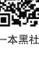

让一部分人先改变现状

一本黑公众号

一本黑群组

### 如何挖掘市场需求，用自己的技能发展副业？——明白

前段时间有人在星球提问如何发展副业，以及昨天有人怎么通过爬虫赚钱。我这是个朋友叫白，前段时间推荐过他的公众号。

他以前是一个程序员，后来自己研究运营、产品、增长各方面的技能，现在是自由职业者，有两个自己的产品。

在如用技能发展副业上，明白颇有心得，所以今天的分享来自明白，都是干货，看完了记得收藏。如果还没有关注，可以去关注他的公众号：多元思维 Hack。

以下，尽情享受：

有朋友说，我想做一个东西赚钱，该怎么挖掘市场需求，找到一个突破点。也有人问，如何利用自己的技能发展副业？这都属于从零到有，从 0 到 0.1，挖掘需求的阶段。我前几天看到一个出版行业的案例，觉得这和我们在互联网挖掘需求很像，就按照这个思路，分享一下如何挖掘赚钱需求。

这一个帖子可以概括你：

- 1. 如果没有思路，可以按照这个找到适合自己的思路
- 2. 如果有思路，可以按照这个验证一下需求是否合理

在书店里，我们可以看到摆放着很多书本。但是，每家书店，黎括号书架里的书和平方放在书架上的书是不一样的。这是因为，店员会将热卖、好卖、想卖的书籍放在醒目的位置上。

写书的时候，第一件要做的事情就是到书店去，观察书的摆放方式，看各种排行榜，进而了解目前热卖的是什么书，分析图书市场需求。

## 第二章: 牛人分享

同理, 如果你要做一个产品赚钱, 也可以按照这种方法, 分析市场需求。

#### 1. 为什么要分析市场?

（1）避免白忙
我以前看《增长黑客》, 里而有一个PMF(Product-MarketFit), 就是找到产品和市场的最佳契合点。

说白了, 就是分析你做的事情, 用户是否真的有需求, 是不是愿意付费? 如果你有个想法, 不做市场分析, 一拍脑袋就开始干, 可能最后会发现, 没人愿意付费, 白白浪费了时间、精力, 甚至金钱。

（2）先胜后战
我经常在知乎看到有人讨论, 说做了一个产品, 该怎么推广? 其实推广这个动作, 应该是做产品之前, 想清楚具体步骤, 孙子兵法里说, 打仗不是打赢的, 是等赢的。确定能赢才打, 这叫先胜后战。

我们做一个产品, 在市场分析阶段, 不仅仅要分析产品是否符合用户需求, 还要想清楚, 目标用户在哪里? 我该如何触达他们? 我用什么说服他们付费?

- 比如, 你做一个课程, 是面向运营人员, 你需要思考:
互联网的运营人员在哪里?
你怎么让他们知道你的课程?
写文章, 投广告, 还是做裂变, 还是找渠道合作?
你有能力写出打动人的文章吗?
公众号有粉丝吗?
你有投放广告吗?
你有信心做好的裂变活动吗?
认识渠道合作吗?
如果都没有, 那你愿意投入精力学习吗?
如果没有资源, 也不想学习, 那这个产品在你做之前, 就已经失败了。

但如果你做之前规划好流程，每个环节都有清晰的步骤，这样彼此合作，他们也会觉得很值得尊敬。用以终为始的思维做事，这个时候，你不是在做一个新项目，你只是一个成功的项目，按照流程一步一步实现。

#### 2. 如何挖掘市场需求？

互联网的一个好处，每个人都可以接触到海量信息，有心人就可以从其中，看到一些好的需求。

下面的数据指标，可以帮助我们大概判断一个需求是否合理。数据量越大，说明需求越强烈。

- 阅读数
- 评论数
- 点赞数
- 付费人数
- 关注数

去哪些地方看这些数据呢？

##### (1) 内容平台

- 知乎
- 豆瓣
- 贴吧
- 公众号
- 抖音 / 快手

如果缺乏大思路有一些思路，可以去这些平台搜索关键词，然后看相关帖子、公众号、专栏、视频，根据上面的指标，看多少人对这个感兴趣，也能说明这个需求是否强烈。

如果你没思路，平台的这些位置你可以留意一下：首页、精选、推荐、排行榜。

这些位置流量最大，一个平台首发大资源推广的产品，一定是精心挑选过的，

## 第二章：牛人分享

受众比较大，也就说明这方面需求比较强烈。

这个过程，其实也是在分析该如何推广产品，你看内容的时候，需要留意用户关心什么、担心什么，这些都是你未来产品定位、营销的方向。

如果有可能的话，你可以直接联系潜在用户，说你能提供这个产品，聚集种子用户。

更进一步，你可以收取定金，验证市场。

#### （2）知识付费平台

- 干货
- 荔枝微课
- 有讲
- 维库
- 网易云课堂
- 腾讯课堂

现阶段，用户已经有了付费意识，如果你有一技之长，可以考虑做个课程。

如果你不知道如何下手，就可以以上面的平台搜索关键词，一定有其他人做过类似课程，看看他是怎么设计课程，怎么开发课程，怎么说服别人买他的课，后续服务怎么做？总体的商业模式什么样。

可以听一个，也可以多听几个。

付费也没关系，这点钱换一个清晰的服务流程，值得。

所有的课程，大体框架都相似。

在这一基础上，你再分析自己的优势，增加一些服务，或者能破解用户疑虑的信息。没事也可以多看看知识付费平台的排行榜，你会惊讶的发现，什么东西都可以做教程啊。

#### （3）电商平台

- 淘宝
- 咸鱼

提到淘宝、咸鱼，你不用只想到手机、衣服、书。淘宝不仅卖实体商品，还卖虚拟商品、服务。

你在上面 2 个平台搜索的关键词，都可以到淘宝重新搜索一遍，你会有惊喜的。

而且淘宝用户的付费意愿最强烈，成交率也很高。

最后总结一下：

- 1. 做赚钱产品之前，先做市场分析，既能避免白忙，又能提高成功概率。
- 2. 内容平台、知识付费平台、电商平台，也可以帮助我们挖掘／验证需求是否合理。

祝大家早日发财。

让一部分人先改变现状

一本黑公众号

一本黑社群

### python 爱好者社区，2月变现72万——梁勇

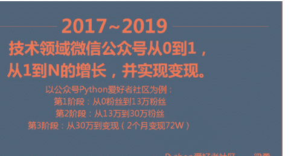

梁勇，三个不同的赛道创业者，每个领域都做得很有成功。Python 爱好者社区创建者，目前为技术领域内大号，在公众号增长和变现方面有着丰富的经验。2个月内变现超72W。分享主题：技术领域第一大号养成记主题背景：

大家晚上好，我是 Python 爱好者社区梁勇。感谢老黑的邀请，群里大部分都是技术牛，也好多熟人。

今晚主要讲下技术公众号的成长及变现情况。另每个人的情况都不一样，可以参考创新，但照搬套路估计不行。

截止目前分享，刚去看了下 Python 爱好者社区目前 330952 关注，玩公众号的朋友应该比较了解，技术类公众号通过自然增长到 30W 是很難的。

所以今天主要分 3 个阶段讲下这几年公众号的历程。

#### 第一阶段

##### A、第一阶段：起名字、产生内容、全渠道拓展（知乎、B 站、简书、网易云课堂、今日头条等）、培养黑客黎变、个人私域、社群等。

【2016年到 2018年】

关于起名字分 2 种：一个人路线、一个平台路线；个人路线需要自己源源不断输出，平台路线可以让多人投稿。

我选择后者，本身这几年一直在创业，认识的人比较多，所以一开始选择平台路线。

另外 Python 在 2016&2017 年有点很火的趋势，就起了名了 Python 爱好者社区。

确定名字后，就开始铺内容、确定我们的第一小编王大伟（华理研 1 的研究生）开始源源不断的铺内容及邀请一些我前几年创业过程认识的一些朋友来投稿等。

PS：因为大伟 Python 基础及面向对象篇写的浅显易懂，并且不枯燥，得到了很多认同

Python 爱好者转发和支持，拿几篇大家可以看看 https://mp.weixin.qq.com/s/QPZH__WfJ1HRJRxNQhFVLQ 大伟转行（从机械专业转行 Python） https://mp.weixin.qq.com/s/Exet3ECvRH5Y9txy sdxIQ 一个安装配置 1.5W 阅读 https://mp.weixin.qq.com/s/DjVxBH04kzOG-GRz0Y01dA

基于 Python 讲述不一样的面向对象 除 了公众号，还进行了多平台运营：知乎、头条、网易云课堂、B 站、简书、博客园、CSDN 等。拿知乎举个例子，其它平台也类似。

期间也策划过裂变，引爆点。完成 Python 社区千人群裂变。

实现思路：从挑选课程进行组合 -> 设计封面图片 -> 用户扫码进来 -> 转发 -> 关注公众号领取课程

> 【几年前那个思路，现在肯定不合适，并且是反人类的，但是早期确实是比较好的增加粉丝，包括砸钱送书 留言送书 等等近似】

截止到 2018 年底粉丝达到 13W。

### 第二阶段：积累、互推 & 规则、送书 & 出版社、圈子 & 人脉、多干利他的事

关于积累：通过这几年的积累，在 知乎、头条、公众号及各个自媒体平台认识的人还是比较多的。后面就陆陆续续线上了原创作者群、号主群，方便大家

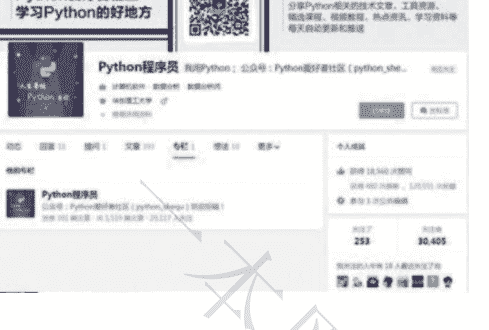

原创文章传播，及技术号主增加粉丝及交易运营经验。

关于互推：技术公众号之一组相成互推小组群，一般 8 到 10 个人。推文内容主要是其他家的公众号，一般是公众号二维码+简短的介绍信息。

例子：https://mp.weixin.qq.com/s/1KUwpi-UD_wLTr4KDz7Zcw

规则：前期比较轻松，容易遇到一些质量的存在（号主群的建立也是因为我跟车遇到阻碍）。后面开始制定规则及用监控。

排名一般按刷新榜排名，监控用西瓜预约监控。同时规则改为 24 小时到达，还有待补充。【对应的号主群及作坊群也相应的也有规则，无规矩不成方圆嘛，做什么事情都需要有好的规则制度】

互推 & 送信：前期自己组互推，后面发起源技术圈的号主互推，帮大家都能快速增加粉丝，并且自己组织的每一组都持续跟踪反馈！

商家 & 个人：去全国各地和号主聚会，加深彼此的认识，交流公众号之间运营经验，顺道旅游！

第二阶段完成粉丝突破 33W

### 第三阶段：变现（搞钱难、搞很多钱更难、持续搞很多钱难上加难），多干利他的事

表示在 2019 年 5 月 10 日以前还没接过广告，但在现通过 2 到 3 个月积累把整个广告的流程摸了一遍，所以才有了今天分享。因为没赚钱，一切都是空话。

记得 4 月份去北京约微笑哥、小灰、小甲、马占凯老师等 10 几个人一起线下聚会，我可是没什么能聊的，因为之前没通过公众号赚钱。

关于赚钱，必须要感谢张哥，和小灰哥，依稀记得 2019 年年初的两篇文字，灰百万的 2018 年百万故事，及张哥的开挂人生。看的很励志，心里暗下决心。

2019 年抛开其他因素，就玩一玩公众号，不到 30W 粉丝不接广告。

## 第二章: 牛人分享

2018，小灰交上了一份“及格”的答卷
https://mp.weixin.qq.com/s/AAUgULiJiUOB-uRqj2SeQ
我开挂的 2018！
https://mp.weixin.qq.com/s/Uh89nGqGhHv0O2yGbnQ

记得今年 2 月，和 stormzhang 的一次咖啡之约中，聊了差不多 4 个小时，听张哥谈到公众号变现，给了我很大启发。原来公众号可以接别人商家广告赚钱，我之前从没想过的。

后面张哥发了一个朋友圈说我坐拥金矿，每个风口都赶上了，然而没赚到钱，当时心底里发誓：2019 年必须赚够钱。关于变现：必须搞定广告主，就有了广告主群以及对应规则。

关于广告：跟广告主合作共赢，多复盘，跟进广告主效果，探讨最大的转化，不要做一次性生意。

切记不要发烂广告，对效果不同不同。也不管。大家要知道谈一个新客户周期是很长的，需要来回沟通提供很多资料，可能才成交，大家应该都遇到，特别是媒体。而把拖老客户没投，沟通成本就很低了，幸亏之前沟通通过。

关于媒体可以稳定一个关系不错的，经常一顿聊聊，因为媒体手里是很多客户的，可以一直给介绍。（这个可以价格稍微低一点，让媒体也有得赚。比如我这通过每月基本 5 到 6 个）

甲方尽量关注复投，跟互推一样，少标题党，多阅读。虽然阅读量低，但转化好。

在最近两个多月，Python 爱好者社区的广告主主要投放内容为编程课程、保险课程、英语课程、品牌类（拼多多、dell 等）。整体广告复投率达到 80%，实现广告变现 70 多万。保险占比 7%、英语占比 14%、编程课程占比 60%、其他约 16%；

所以技术号还是以编程内课程为主。

追求可持续发展，优质文章和“宫格”匹配，照顾粉丝兴趣与需求。

总结最后几点小经验：

- 1. 自己多积累，多写原创；高起点后接广告，不然后面价格是不会动的
- 2. 多和他人学习经验，搞技术的比较封闭，多出去走走。线上 & 线下
- 3. 有人的地方就有江湖，建立好规则、良性发展
- 4. 圈子内统一战线、一起合作共赢
- 5. 一个模式成功，不要想着创新。先复制这个方式
- 6. 没事别创业

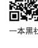

一本黑公众号

一本黑社群

让一部分人先改变现状

## 域名圈套路：一棵老韭菜的自白——pala

关于我：pala，前域名投资者，最高峰时期持有 8000 个域名，历经数交所、1618、推易机、各种套路、各种倒法都经历过，被无数次割过，又无数次长起来。现在自由职业者，公众号《边缘计算社区》运营者，边缘计算是 5G 核心技术之一，社区现为 5G 边缘计算领域第一大社媒，关注 5G 和物联网以及边缘计算的同学可以关注一下公众号。本人是老黑忠实粉丝。

主题背景：五年前开始接触域名，从入门学到比赛藏的坑，从收割韭菜到自己割了自己。半夜三点起来抢注册域名，批量注册域名，批量扔域名。这是一段难忘的经历，失败的经历，

但是我们可以从域名交易学到什么？域名教会了我们什么？也许你平常听到的都是成功学，这次是一次刻骨铭心难忘的失败经历复盘。就会数交所和 1618，了解套路以后就学会识破坑。不教你如何成功，但是会教你如何避坑。

大家好，我叫 pala，普通人，老黑铁粉一枚，跟大家分享域名圈的套路，我从一天花 10 个小时在上面，到都不好看域名，从热爱到离

### 交易排行榜

| 排名 | 域名 | 价格 |
| --- | --- | --- |
| 1 | 360.com | ¥110000000.00元 |
| 2 | z.com | ¥41580000.00元 |
| 3 | jd.com | ¥30000000.00元 |
| 4 | mi.com | ¥22450000.00元 |
| 5 | lux.com | ¥10000000.00元 |
| 6 | clothe.com | ¥4900000.00元 |
| 7 | lg.com | ¥4700000.00元 |
| 8 | whisky.com | ¥3100000.00元 |
| 9 | xed.com | ¥1800000.00元 |

反思

去。不知域名是什么的，可以去百度。先给大家看一个图，大家就对域名有兴趣了，这个是最近5年内域名交易的一些比较经典的案例。

好的域名成就一家企业，京东最初是360buy.com。后面花了3000买了jd.com；京东之前每年要给百度几百 到上千万，搜索跳转的钱。换成这个两个字母域名，大家直接在浏览器输入jd，就省了这笔钱。更方便大家记忆。

小米国际化，花了360万美元，把xiaomi.com升级到mi.com；阿里巴巴、腾讯，都是域名大企业。

说一句话，不要觉得域名贵，而是你的企业还不够大！域名介绍我就不多说了，网上都有，我说一下大家不知道的事情。这前天，域名投资人火锅的朋友圈一口气售出几个域名，获利超过上千万元。域名的魅力就在于是你不能轻易等待合适的买家出理想的价格，好吗！我们先说我的经历吧。我是15年底开始接触域名，那时读法大...

比较多，偶然间发现了域名。看到一条新闻，十大瞒险行业。前几个是整形整容、眼镜、化妆品等，最后一个是域名。然后我就开始进入这个行业。简单的了解了域名市场，发现大家炒域名，把域名分为声母还有韵母，a/e/i/o/u/V这几个是韵母，其余的字母是声母，然后带声母的比较贵。第04数字...

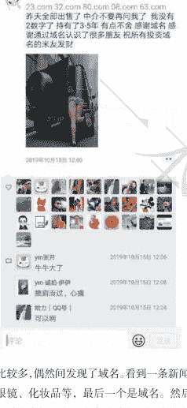

和不带 04 数字的，不带 04 的比较贵。就算查询，然后注册。

查了一些短的，发现都被人注册了，很苦恼。然后就网络搜索，去域名城论坛咨询大家。然后发现有自动查询软件。然后就去淘宝买了域名批量查询的软件。

买好软件注册以后，发现都被人注册了。就 5 个声母的 com 可以注册，还有 6 个数字带 0.4 的 com 可以注册，因为 com 是主流的，所以优先考虑 com。权衡一下利弊，然后开始注册 6 数字带 04 的 com。注册价 45 元，注册了 30 个，然后挂一口价 70 元。第三天，第四天，全部都卖完了。。

一个赚 25 元，30 个赚了 750 元，没有片刻犹豫，打开域名查询软件继续扫描，发现全部被注册完了……，就是全部被注册完了。片甲不留。

然后开始注册 7 数字 com。注册了 50 个 7 数字域名，然后挂 70 元，等了两周，还是没有卖出去。就降到 60 还是没有卖出去。降到 45 元，还是没有卖出去，然后就降 40 元。后面卖出去了。

亏本卖出去，总结了第一年域名就是交学费，不返还注册域名，而应该直接买域名，贵的域名至少流通快。

### 16 年深入

第二年，开始慢慢深入域名领域，加了米来群，然后混论坛，大致了解这个情况以后，开始学大家的，批量玩域名。当时读大学没什么钱，就找叔叔、借了 10 万然后批量购买四声 com.cn，当时一个是 200 元，还有四声 cc，当时一个是 300 元左右。

买了 200 个四声 com.cn 和 100 多个四声 cc，其余的钱双拼 com，然后就放着也不卖。第一个月涨了，10 万买的市值涨到 12 万，第二个月涨到 15 万。还是没有卖，我想要的是翻倍。因为当时很多新闻说域名卖了多少钱多少。 然后就放着，然后就遇到域名雪崩。域名开始跌。

我的 10 万从市值 16 万跌到 12 万，我没有止损的意识，然后把域名拿去抵押抵押，用抵押的钱补仓，因为以为会涨回来，判断错了。然后一直跌。。。跌到 8.5 万，然后就吃没饭胃口，压力大，然后跌到 8 万，割肉出局，把批量的

抵押的都卖了。算了一下，这一波一共亏了 3.5 万。

当时想着有便宜钱，想把本拿回来，然后就把现金拿去买双拼 com 域名，双拼是流行的市场价的。无价，你说多少就多少，信息不对称原则，然后就是拿去拍卖平台拍卖，然后弄掉，找小号、拖价、这次变更明了，有赚钱就卖。通过 2 个月时间来回接手，终于把 10 万本金拿回来了。

通过一路折腾，没有赚到什么钱，但是认识了很多大佬，玩域名的都是早期接触电脑的投机分子。由于我学生的身份，然后就树立了信任感。 策

让 我帮忙管理他的域名。因为域名太多，一共 8000 多个。平台分散了。阿里云、易名中国、爱名网、易介他们有。平时 push 域名交易域名太多了，需要一个信任的人帮忙代为打理。然后就有我接了，一个月 5000，大学时期，一个月 5000 还是很有优惠的，于是我开始给他管理域名。

虽然帮专管，但我是如果转域名出去，会要他那边短信才可以。所以域名还是在他手上，很安全。

钱也不是好挣的，基本很多域名竞价什么的都是半夜三点结束，所以意味着着，半夜三点的时候必须在线。然后就手机不能关机，一直在线。这份管理域名的工作也带来了一个好处，就是大佬把一些大佬介绍给认识，我认识了阿里云安全部的运营总监。然后没有想到他后面变成我领导，毕业以后他离开阿里云，出来创业，我正好去他们公司实习。这都是后话，回到正题，说说域名圈的故事吧。

### 数交平台

16 年底 17 年初，域名市场出来了一个数交所平台，全称郴州数字文化资产交易中心。郴州数字文化资产交易中心是在湖南省商务厅、郴州高新区管委会的支持下，由正诚集团（世界 500 强）、湖南商交所、郴州高科投、深圳数交所联合投资，以域名、商标等数字文化资产为交易标的创新的电子竞交易平台。

路小顺等几个 KOL 背书，数交所是要把域名数字化、域名电子化。

你只要持有独特的域名品种就可以上数交所，然后数交所就做像股市市场那样交易，数交所运营团队从营销特别强，一开始就各种吹文，铺天盖地、基本只要关注域名的就会被数交所吸引。数交所给人营造出一种正规军路线、域名走向大众的感觉，反正当时周围米农都心动了。

数交所有哪些品类呢？未知数！然后大家不知道为什么开始炒哪些品类可以上数交所，比如妙作四声 NET，因为四声 net 庄家路小顺和数交所 190 老板丹尼尔、韩国新建他们走的比较近，然后就发布各种绯闻消息，拉盘。

用含糊不清的消息来说导各位韭菜，等后面正式公布消息，发现四声 net 不在上面，然后就震撼。

然后隔一周又发布公告，说第二批上数交所域名名单，然后四声 net 在上面，又是疯狂的拉盘。反复拉盘、砸盘、压盘，米农兼业的记忆只有 7 秒……

这是妙作数交所品种的收割方法，数交所还有一种收割方法，就是直接注册好，然后后悔。他们发布第一批交易域名公告，第一批主要是省份开头的五声 com.cn 域名和省份开头的五声 cn 域名，举例子有 sd 开头的五声母 com.cn，然后这个品种总是有 8000 个，然后他们规定你只要有 50 个，就可以上数交所，相当于 50 个域名一股新股。

公告发出 ACME 后，你去注册 sd 开五声母 com.cn，发现一个都注册不了，都被前人两周注册完了。然后想买家，发现一个要 100 元，大部分在 100 元以上不等。查询域名持有入，发现都是深圳数交所相关工作人员的邮箱。® 注册成价当时是 13 元，13 元买 100 个，一个翻 7 倍多，一个要 80 元，然后当时每公斤十万个域名。大家要买就买 50 个。

后面又出来一个平台 1618，4 声 CN 域名壬家航联联合域名大户大奔搞的。
域名资金盘，1618 算域名圈路界的鼻祖。数交所看到 1618 也只能喊大爷。
你非要黑我找爷。韭菜割到不息。
1618 最初是一个域名交易平台，然后后面慢慢上天了。主要有老板沈晓航业内大家称航叔，四声 cn 耍家。四声 cn 盘子一共有 16 万个域名，业界传言，航叔控股百分 80 以上。
四声 cn 市场行情 800 多元，然后航叔团队、开始宣传造势，要抬他。但是韭菜们干不掉，被割过那么多次、所以你说什么我就是看者你表演。不中坑。
然后 1618 团队派小号、拉群，到处宣传推土机策略，就是四声 cn 一台推土机，每天涨涨 20 元。
大大家心里想，你就吹吧。然后四声 cn 域名，真的有一天涨起来了。
涨到 1500 元。保持冷静。不动。
涨到 2500 元。保持冷静。不动。
涨到 3500 元。妈的，套娃套吧。
都出去了，买买买！嗨，开始人多了。，不错，还是继续买。这个比把钱放银行赚的多了。到后面，涨的慢，但还是涨。这是前期，构筑信任感。然后 1618 发布公告，买 50 个四声 cn 存平台，然后可以每天赎取一个 6 数字 .com （市场价 300 多）。
韭菜们，可能就只有 20 几万个四声 cn 域名，然后为了凑够 50 个，又开始在市场上买四声 cn。殊不知，市场上面的都是庄家的筹码。
明显一顾就知道是谁家在出货了。
你以为他就单独出货？
你把 50 个域名存放在平台的同时，航叔也把这 50 个域名拿去他弟第三方域名平台抵押。域名抵押，一方出借资金、另一方把抵押域名抵押和赎钱。
这样子一胖子以后，可能就释放得到钱还是不够。
又发布公告，发布空气域名分类 .oo.cn 和 .vv.cn; 1000 个 .oo.cn 可以兑换一个四声 com 域名。当时四声 com 一个 7000 多元。然后 .oo.cn 域名一个是 6 元多。
精明的韭菜们，发现买 1000 个 .oo.cn 就只要 6000 多元，可以换个 7000 多

元的域名，所以就商量过去了。

后面就被商贩裁义。

抛弃上面这些，再回过头看。当四声 cn 拖拉机开始价格从 800 多推到 5900 多的时候，拖拉机开始变成藏刀，开始恢复向韭菜。

把托管的域名买单抛掉。然后一下子跌了几千。如是，反反复复。

不断反复。在 3000 多，又重启拖拉机。然后推到 3500 元，又变回藏刀。

慢慢的，慢慢的，跌到 800 多，今天 2019 年 9 月 7 日，四声 cn 剩下 250 元了。

很多韭菜是跟着支未来的肥料长成的，然后被一刀割，很多韭菜就枯死了。
然后鱼死网破，你割我，我就报警。同归于尽。

然后就凉了。

### 总结

域名的事教会我的一个道理就是不要要赌资金盘。任何资金盘都不能碰，跑得快的游戏，你进场就完了，你想赚正常的利润，赶家中存你的本金。

2019，之前经历多，遇到很多黑产案例，看透很多，结合自身接触五湖四海的人，就总结了几点建议送给老黑的粉笔们。

能赚钱的，基本都闷声，当一个行业，大鲸开始进场了，说明白泡沫不远了。

要我流动性强的项目。域名交易太慢了，特别慢。

用不用的钱投资，做生意，千万不能借钱投资。

找到细分领域，做到第一。

一本黑公众号
一本黑社群

让一部分人先改变现状

## 从 0 到 30 万，我的淘客经验分享——崔达布淘客

有挺多人对淘客比较感兴趣，刚好星球内有一朋友干过几年淘客，所以我让他来谈几句他的经历和对这个行业的看法。

2016 年 9 月的时候，也算是我刚刚进入互联网流量入口的时候。个人运营一个小流量平台，具体什么不大方便说，期间通过广大拿 到第一笔收入，虽然一个月也几千但对于一个大二的学生也是很满足的。

当时有个 人来找我投放淘客广告，也就是领我入行的师傅，比我大 3 岁，所以那会就懵懂的从他哪里了解到淘宝客的东西。

关于淘宝客的发展，其实用今天黑的文章里面有提到，而我那时就是从淘宝客公众号开始的，所以淘宝客公众号，其实就是将需要购买的商品链接复制到公众号中发送，然后公众号就会自动查卷，把查到的优惠卷链接反馈给用户。

这之后，我就萌生了自己做淘客的想法，也就是我第一次接触“淘宝联盟”这个 app。现在市面上大部分的 app 以及平台或者淘客群都是基于这个平台提供的 api 开发的。

淘宝联盟其实特别简单有点像中间商。商家负责提供优惠卷和商品以及返佣。淘客推广产品。客户购买并且使用优惠卷购买商品。确认收货后商家给淘客反佣金。大体就是这样一个流程。

## 第二章：牛人分享

1 个是大学生，1 个是宝妈群。个人没接触过宝妈群的资源推送，不过据业内大佬说宝妈群体的盈利率是大学生群体 3 倍以上。

大学生群体特别好拉，在 18 年 3 月还是 4 月之前，Tx 的管控还没有这么严格。什么大学学期末考试资料群啊，英语四六级内部部分享群啊。套路到位 2000 人 1 天就能搞满，然后揽一桶粪子发一发资料考完试就转诱客群。

当然了，这种群体活跃度超低级，正常来说，如果是纯买广告来的 2000 人群。第一天开单绝对在 2000RMB 以上！这种考试群第一天 500 都算劲动。加上时效性和新鲜感随着的消磨，群很快就会变成死群。

这里非常有意思的一个事儿是，一个 Q 建立的群有限，所以就得利用 bug 去卡群。但是，一旦被 Tx 发现群就会被自动解散，也就是你这几天白干了。

我第一笔盈利也是从群开始给入于的吧。那时候玩上送的套路、三个月赚了 10w。 有钱没钱回家过年。后来开始接淘海客客服身份。

为什么会转移目标。1、群实在是太难搞了，而且维护很费劲。2、公众号开始稳妥，只要用户依据基本就能稳定使用。

并且最关键的一点是。群你只能被动转化，什么叫被动？用户只能购买你所发送的物品。不能主动查阅自己想购买的物品。大部分的淘宝群都是禁言状态，然后有机器人发商品。如果你想买一个条裤，比如说袜。我想知道这个店的这个秋裤有没有优惠卷，查不了！但是公众号可以！

但是这个公众号实在太难了，第一件事情就是买系统和服务器。1w 哐的一下就过去了，后来就是揍。

11 赚一次足够吃一年。

这里涉及到一个知识点是超级红包。双 11 会场大家应该都知道吧。就是每天大额红包

最高 1111 元，可以领取 3 次。这个红包在淘宝客服那里就是大把大把的钱。

而双 11 会场的第 1 天，也就是 10 月 20 号或者 21 号的凌晨是最关键的。

推一波超级红包，为什么要第一天推广。

这里涉及到一个超级红包的逻辑流程。用户在购买商品时可以使用超级红包进行抵扣，每张最多 10 个。那问题来了，如果用户的 10 个红包领取的帮是 10 个不同的人呢？那佣金就会？

根据结算规则，佣金是给最早的红包发放者，这也是为什么第一天你要拼了命的推。到 11 月 11 日之前还可以推一次。具体日子在这里就不讲了，这个纯属个人经验 + 行业最高机密。

基本转化就是 1 个红包大约能 2 左后。如果你群体是宝妈，那么就直接翻倍计算即可。

### 退坑的日子。

18 年 5 月正式退坑。说实话，tx 那一波搞砸了一样。群根本不可能拉起来。10 个炸 9 个，而且不光针对你群，连同群主管理一起封。那时候淘宝做群的简直直就是黑幕的日子。退坑之前又卖了一部分的推广，到 了 3w 多粉的公众号。每个 8 个月 2w 的收入已经很满足了。

## 第二章：牛人分享

那个面膜，工厂3块钱一盒，我当时开了1000单就让他们退了，良心过不去说实话的，这东西上不了脸。

这些面膜，基本都是那个几个代工厂出来的，便宜的2-3块钱，我的七八块，十来块钱。然后卖一个一百多两百多。

你说这玩意暴不暴利，商家有钱赚，淘宝也能拿到大优惠。

至于淘宝，总结下这几年靠淘宝赚到的钱，16年就2000块钱，17年是3w多，18年10w，今年双11预计能到30W。

不过现在淘宝真的算是烂大街了，几乎都在推送双11会场，也不好做了啊。

退坑就退坑了吧，今年太忙了，也该尝试一下其他的产业了。

让一部分人先改变现状

## 一个 1.6 万粉丝的公众号，一年能赚 100 万，你信吗——花爷

老黑找我来做一次分享，有点两难。

万一分享不够精彩，显得分量不够，万一不小心皮吹过了，一本黑的读者都把皮和家拿，脸上更挂不住。

想了想，干脆也铺清吧，讲述自己的真实经历吧。

这段内容花爷在自己的星球里讲过一次，这次又丰富整理了下，把自己从普通打工仔到收入过 100 万的过程完整地复盘了一下，希望对一本黑的朋友也能够帮助。

#### 1. 大学毕业，做了整个系同学都不同的选择：

我家就是普通家庭，大学双非一本，也不能混特短类，凑合吧。但我大学成绩真的特烂。现在我团队的小助手是我大学同学，他没话，我每学期都挂科，大一的高数挂到大三才考通过。

不过好在，我从小爱看书上网，对互联网比较了解，看问题比普通人长远。
当时我们是机械相关专业，机械机械，一门心思搞机，无可奈何搞机械，毕业了大多都是去工厂，去外企工厂或者中石化，就算顶尖 offer 了。

我一想，这不行啊，毕业工作十年，无非也就是个高级工人，成长空间太有限了。

很多年前安徽有个高考作文题目叫弯道超车，我当时一门心思就是想着弯道超车。

那时候互联网行业一片火热，知乎上产品、运营岗，应届生毕业 10-15k

的 offer 被称为白菜价。我虽然一点互联网从业经验都没有，学业也一垮居。但我胆子大啊……

于是大三暑假，我一个人跑到上海实习，做产品经理。

没记错的话，整个学院，只有我这个学渣这么早实习的，从此走上了另一条路。

说起来简单，其实当时也有很多困难。

比如我没经验成绩不好，不好找实习，我就花了大概三周，自己做了各个 app 的体验报告，前期报告每家公司的特点都做了修改，最后终于混到一家上市公司（其实内部非常垃圾）的实习。

当然这也得感谢当时互联网热潮，人才缺口大，招聘门槛低一些，现在可能郑那么好进了。

再比如我爸妈是坚决不同意的，他们帮我在老家都打点好了，好几个体制内的岗位让我挑，结果我一个人跑上海去……所以早期交学费是真心惨，一天工资 100，一个月 2200 左右（只有工作日有工资），有时候学校有事还要返的车票又花掉一笔。

最后只能违痛舍合租房，四个人住一间房，上下铺，500 一个月，同屋的分别是  arden 打工的、凌晨三点才回的外卖小哥、从未见不看影的考研党……

我印象最深刻的一件事，有次实习公司的同事说我太懒吃了，下去吃兰州拉面，我去了一次就再也没跟他们过去了，15 块一碗我吃不起……

好在熬了大半年，我能学的很快，大学临毕业跳到另一家公司，正式毕业，月薪直接捡到五位数。

后来出来才知道，名校大学生都是很早就出来实习的。而我那个破大学，都是大四下学期才来罗找工作，毕业工资能到五千就不错了。

当然，钱不是最重要的。

最重要的是，我原来就是一只井底之蛙，还是井里比较烂的那只蛙。当我真的跳出来的时候，才看到了更大的世界。

原来从那井里跳出来，也不是难如登天，办法总比问题多，只要愿意蹦蹦，总有跳出来的一天。

#### 2. 职场初期，跟对人，会学习

很幸运的是，毕业后的这份工作，跟的几个老大都是大佬，这里必须承认，是有—点运气成分的。

那时很多大公司的核心人物出来创业，创业公司招人要求又没那么高，你还这种年龄，能吸收多少养分就看你自己的能力了。

有些是一点点指顾注意，其实大都是水遢没时间手把手教你你的。

同样是在大公司待年，我身边不少同事学到的东西很少，为什么呢？我跟自己星球的粉党曾经说过一个概念，就是如果你还在上班，一定学会反向“压榨”公司。

职场没有主忠观念给你吃，抱着给多少钱干多少事的心态，你永远就只能这个档次。不如反过来想想，公司除了工资，给你提供了什么？比如，一个成功的商业模式案例。

大部分公司，你哪怕把头再多亏毛病，都是赚钱的，都是一个离得最近的商业案例。所以别只做本职工作，你可能暂时不上领导，但可以先学会像老板一样思考，你会发现除了打螺丝钉、资源整合、团队调度、项目管理，全都是学习。

如果得到老板模仿，你坐到那个位置上去，不一定他做得好。优点、缺点学、缺点、学们以后注意避免。

再比如，免费的试错空间。别怕想错，你有什么想法、多和领导沟通，只要领导点头，就大胆推进，就相当于没想想法。

离开一家公司，如果你只是赚了点存款，那就还是在打工，聪明人一定会带走经验和积累有用的资源。

这种“压榨”公司是不是好很坏？其实不是，这种聪明员工往往能凝聚比工资更高的价值，对公司是利大于弊的。

职场初期，我在这—点做的很好。每次和大佬汇报工作，我可能讲十几分钟，大佬只会确认几个问题，交

#### 3. 第二职业，抵抗浮躁，长期盈利

代两三点改进建议，而每次都复合反思的想、项目可关注的问题很多，为什么大佬偏偏关注这几を実行题？

想的多了，我发现我越来越像能像他们一样思考问题了。

现在，我养成了从任何事情里学习的习惯，后来我跟几个大公司的老板、高层聊天，发现大家都是同样的心态，哪里是一堵墙，只要有值得学习的地方，那就是跟着鼻子把好的学习走，对臭味遮掩绝都不会抱怨一句。到这个阶段，我的收入其实一直没怎么涨，但能力等级提升，为后面收入攀升也做了一点铺垫。

经过上面的学习阶段，当我各项能力都还可以的时候，工资薪水其实也还可以，但没达到自己的目标。

这段时间我利用自己的学习和搜索能力，疯狂接取各种可能赚钱的生意，也起起伏伏很多地奔波的阶段，但我也是你一样，混的很发闷。内心非常浮躁，好像知道的不够，却又没有哪件事干得很好。其实很多生意，你看上去能一个就大赚一笔，其实施人家累计要很多年。

于是确定思路，开始只做自己擅长的事，并非非走长期盈利。

第一桶金是做微生态的电商赚到的，那时微信公众平台生态非常火，我这人比较能写，一开始是自己写，自己找货源，朋友的公众号友情帮我推了，没想到小赚了一笔。

后来就是不断的选品、找关系、合作推文，比较忙的时候开始拉了小伙伴兼职一面做。最搞的一次，一篇推文卖了100多万流水。

但这种模式还是有严重的问题，极度依赖渠道，必须要跟有粉丝有影响力的合作，有不少渠道消费的都是我的人脉关系，并不持久。收入上我对团队也有依赖，也不是特别高，那时反而倒给团队成员的工资，我年收入也才六万多，赚钱比较低效。

#### 4. 自媒体，科学、实在的帮花友培养赚钱的能力

选定自媒体这个方向之前，其实现花香做了不少尝试，包括公众号、短视频、微博、基于微信的群聊等等，大概花了四个月多的时间，把每个方向都尝试了一遍，每个方向里不同的策略，我又都尝试了一遍。

你能想象么，在那半年多时间里，我每隔两三天做总结，内容都是“xxx策略失败，接着试下一个策略”……

现实就是这样，失败才是常态，成功才是偶然。把一件事情做成，就是这么无趣，你要做好失败99次的准备，但只要成功1次就够了。

有意思的是，在不断尝试之后，有好几个方向我都跑通了，甚至有的已经获得现成收入人。

其实中国的过程都在文章里写过，这里就不赘述了：

最终，我还是选择了自媒体这个领域，理由很简单：尝试了一圈，我发现还是做自媒体时，自己觉得最自在。

这个世界上非清的领域有很多，不跟眼红人的成绩，你最终还是会回到让你最舒服的那个领域。

做自媒体那会儿，我看了不少经济金融的书，花了一段时间写了一篇；一开始发出来没什么效果，后来有次不经意，在曹大的知识星球里发了一下，一下子火了。我的第一篇文案阅读量就破万了。

再之后这写作贡献，粉丝一直往上升，而且我的粉丝质量比较高，有些大佬加了微信来就是要我888交换个朋友，搞得人非常懵圈……

写文章的过程中我也发现，大家普遍还是对赚钱、拓展收入来源比较感兴趣。

##### 一开眼：

大多数的中产、白领、中小生意人，在自己的领域钻了太久，已经形成思维定式了。偶尔抬起头，想做点事情的时候，憧憬了，不知道该干嘛。
我们缺的不是大道理，而是眼界、实操推演、和细节。

##### 一复制：

将别人案例中的技巧，移植到你的领域里。虽然前几次移植尝试，大概率会失败。

##### 一贯通：

失败的经历，会转化为经验，成为你的堆积资产。你开始更深入的理解了商业、社会和人性的本质，理解社会运转的规则。贯通后的你，不一定能马上变现，但在能力、分析、情商上都会有巨大的提升。

##### 一跨越：

贯通的人，最终会找到一个合适的领域，将自己的思维、方法变现。
这个阶段有早有晚，甚至可能需要一次运气。
有意思的是，大多数人从贯通到跨越，都不再完全从事自己原先专注的领域。

我的社群，公众号文章，大多基于这个体系，所以我的粉丝气质也比较正，相比一夜暴富，我们更愿意相信长期积累的价值。

后面的事就水到渠成了，公众号开了三个月，粉丝一直在催做付费社群。为了保证质量，我还是先做了一个多月的内测，内测只有六十多人，效果还不错，所以我开始正式开放报名。

报名一放开，当天就满了 1000 人

现在花香的公众号粉丝也不多，1.6w，因为电商那块我还在跟进，比较忙，文章更新的少。我的付费社群用户 1600 人，超高的付费转化率，而且用户口碑一直不错，有了这块的加成，我的年收终于艰难的超过了 100 个，我自己复盘写下来都感觉好累

你说收入增加之后，生活有啥本质区别吗？其实没啥区别，我消费欲望不高，也就以前要吃饱撑着买的时候会犹豫，现在想吃就吃了，我管这叫顿达自

由

现在我已经把团队的重心慢慢往自媒体转了，明年会更体系化的做做好不依赖的培训体系。

当然，我从来不承诺诱导用户付钱、想要免费内容的，公众号还是可以继续看。不吹牛，我的文章质量确实还可以，不然也不会有粉丝这么认可。

其实还有很多内容可以跟大家分享，比如一直有人问我，我怎么做得到在更新文章这么少的情况下，维持如此高的粉丝黏度和付费率的？有没有什么技巧？但今天自己的时间也有限，就不说了，下次有机会再给大家分享吧。

最后送各位朋友一句话，共勉吧；
所有人都想明天就暴富，其实人只要每 5 年能赢一次，这辈子就一定会逆袭。

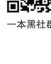

让一部分人先改变现状

## 我做跨境电商的第一桶金——Jacky

Jacky，是我所认识的一位隐形大牛，早年在互联网江湖玩得很，去年采访过

Jacky，当时他给我讲过早年某知名企业做流量推广的黑操作，确实让我了解到了互联网的不为人知的另一面。

互联网的流量江湖一直若隐若现，但又举足轻重，Jacky 当年就凭借自己的探索赚到了第一桶金。

在正式进入 Jacky 的分享之前，我想先给大家普及一个知识点——affiliate，可能很多人不知道这是啥玩意。其实通俗点说就是互联网联盟营销。说白了就是国外的淘宝客，通过流量来卖货。

比如一个产品，商家给的佣金是100美金，支付给 Affiliate 的佣金是80美金，那么 Affiliatenetwork 联盟则从佣金里收取了20美刀。

总之，今天 Jacky 的分享是大多数人从未见识过的行业，Jacky 也有着丰富的行业经验和糗谈故事。

接下来，欢迎 Jacky @王二小分享他的第一桶金故事以及对 affiliate 这个行业的看法。

大家好，我是 Jacky，我想以这句话作为今天分享的开始：“人生就是一场康波；在经济周期波动的机会和隐约中，有人幸运着，有人沉沦了。”

那一年 2009，工业和信息化部为中国移动、中国电信和中国联通发放了3张第三代移动通信（3G）牌照，移动互联网还象征之中。

年轻的王二小在—所理工科类的读大三，学妹一枚，喜欢听 newage 音乐，最喜欢看的书是商业，虽然对游戏颇为沉迷 dota，但是对各种音乐套路非常着迷。

一日在校园 BBS 闲逛，偶遇一位学长讲授创业经历。学长做的是款视

频率式转换共享软件，所谓共享软件，就是 freetrial，但是需要购买 license 来使应用生效的软件。

他说自己是如何通过将共享软件卖到全球、在大学就月入万刀的，我当时看了帖子很震撼。虽然内容了解透彻，但是觉得他一个人做开发、做美工、做客服，做销售，做售后非常离谱。

我立即约了这位学长喝咖啡当面请教，学长跟我说了很多，印象最深刻的是一句话说“理工科生，一定也要懂营销找市场”。之后的几天，我通过搜索，以及当时最大的 CNZZ《共享软件联盟》论坛去搜集大量的相关信息。我逐渐了解了一个中国早期的 affiliate 出海行业，了解了中国共享软件出海第一人周奕，认识了做 sem 行业的长颈叔。

了解了这个行业底层后，我决定自己亲自试水做 affiliate。在做了一些市场调研后，我选中了备份/恢复软件这个 niche，然后去 regnow、avangate、shareit 等平台上去找了这块的所有产品，经过一番对比之后，我挑中了其中 1 款。

接下来就是即刻报名、写软文，以及按 seo 的一些 tricks 对域名进行优化。有了这些基础之后，我开始了各种免费流量尝试（主要是因为大学没钱），去各种 PC 论坛发帖、搜索关键词长尾的 blog 留言等等。做了漫长的三个月，我终于刷出来了人生 affiliate 的第一单，40 美金的 products，佣金 24 美金。

别人的成功都是刺激的，自己的现实是骨感的。3 个月的付出换来一顿饭钱，虽然出单了，但是后续的热情又回归鸵鸟了，距离我日入百刀的目标差距太大。我开始想是否继续深廷还是先放弃了。我注意到共享软件论坛的人气越来越差，确实相关的早期共享软件开始走下坡路了。于是，我决定拓宽视野，转类型做 amazon 的 affiliate，不再局限于软件这个领域了。

借助 SEMRush+Wordpress 两大神器，我开始尝试各种细分的 niche，从内存条到皮带到高尔夫球杆，无奇不有。Amazon 的佣金不高，当时赚的钱只能当零花，生活还得继续，于是我还是按部就班的毕业工作者。不过 affiliate 也跟我带来了很多乐趣，学到了很多知识，比如因为写高尔夫球杆软文，学习到了高尔夫一套球杆有三木九铁一推。

## 第二章：牛人分享

因为在 PC 时代就进入了 affiliate 行业，我一直默默了解着相关行业的咨询。有hed。有一天，我偶尔看到一篇新闻，内容是 59% 的美国消费者都拥有智能手机，移动流量正快速增长。部分大型网站已经超越 PC 流量。

因为做 affiliate 对流量的敏感，这则新闻让我心跳是加速了几下，我感觉到一个全新的大时代要来了，剩下的就是我能把我这只脚踩在风口上了。于是，我开始全力转向移动端，加上工作的积累，我可以直接从付费流量 PPC 开始了，不用再苦练的 SEO 了。

野蛮生长的市场就要求猛的干，要的就是最大的那个。于是，我挑了一些国外的付费订阅的产品，在谷歌上投放起来，本来还准备筹数据出来做信息流广告关键词，结果直接就是 300% ROI，只要像抢地推排名就行了，这也许就是风口的力量吧。

那段时间就是不断的花钱，不断的收钱反复信用卡额度。各种移动流量平台也雨后春笋，像 airpush, leadbolt, jumptap 等等等等，而且一开始都是流量极其便宜，很容易就能赚钱的。13 年下半年，国内的互联网巨头们开始纷纷上马出海这个方向，金山首当其冲，大量的移动应用单子涌现，如 cleanmaster, 360, mobogenie 等等。

我也依靠着 affiliate 对流量这块的先发优势，迅速扩大着自己的 revenue。从一天上万个下载，到日入万刀，到日利润万美元。。。好日子持续了一年，社会资本不断进入，广告主开始疯狂的压榨渠道的空间。行业不再是高利润，而是一个资本好的高流失、故事美的市场，红利迅速消亡。

有一个比较好的故事案例，某安全厂商 cpa 联盟进行结算，给出的价格是 0.15 美元一个安装，渠道架设好后账户，通过努力跑出最大的量，并且将成本优化到了 0.03 美元。在厂商看到账户这一成本的当晚，单方面撕毁了协议，邮件通知渠道按 0.04 美元进行结算。

就这样也就算了，还要拖几个月不付款，并且最后付款的时候更新了最严格考核 KPI 并且回溯，扣了大把的安装量。大部分兄弟苦苦一年，10 个点左右的利润，年底再被扣几万美金，无法支撑出局。

的，大概两种，一种是 GamingSystem，一种是 Gamingpeople；当然，帮品牌广告主做品牌广告的艺术家投手，不在我讨论的范围。

Gamingsystem，是指对广告投放系统熟悉、并能够通过自己的测试试探出系统算法，通过顺从算法、将投放结果最优化。黑帽和白帽都算。

白帽里最，举一个简单的例子：在同一个系统上面，投同一个产品，你如何能够 pb 竞标击败对手，抢到最多的量，并且让竞争损耗最小？

优秀的投手会做大量的测试，去了解这个系统，比如他的竞价系统是 GFP（GeneralizedFirstprice）还是 CSP（Generalizedsecondprice）还是 VCG（Vickrey-Clarke-Groves）竞价机制，如果是 GFP，需要创建大量的不同出价的广告，以及微小变化来测试投放才会；如果是 CSP，可以采取极高 bid 来抢量；如果是 VCG，需要更复杂的上手设置如下浮。

黑帽就不多说了，有一个有趣的例子，很早很早以前，Googledwords 系统有个 bug，你可以通过大量创建极高 bid 但是极小 budget 的广告，来获取大量的免费流量，为啥呢，bid 高了流量制不住车，一脚油门就超过你的 budget 了，但是 billing 模块不会扣你钱，这个 bug 持续了很长时间；后来 facebook 高薪挖了很多谷歌的工程师过去开发广告系统，结果也就把 bug 带过去了，很多人用这个 trick 赚了 facebook 上百万羊毛。

GamingSystem 不教你投机，对投手而言，每个平台都是战场，利用规则就是你系统好对手的方式。Gamingpeople，是指利用素材，以及素材的展现方式去诱导用户产生某类行为。同样黑帽白帽都有。白帽来说，优秀的投手，往往熟知心理学，会结合广告投放的场景以及用户看到广告时可能所处的状况等，来使用不同类型的素材，用什么类型的按钮、什么样的颜色配色，突出什么样 的文字。

举一个很经典的例子，同样在 facebook 上面投放某个 app 的广告，优秀的同志可以将其所有的手机型号找出米来，然后做玩家用各个手机型号使用的素材图，另外在文案上也注明某某手机型号用户，然后分手机型号投放广告；哪个 app 做不到适配呢？但是优秀的同志让用户产生了优越感，作为回报，用户成本也从十几美元降低到了一两美元。

黑帽就太多了，大家可能都接触过很多吧，比如模仿手机系统的素材，比如恶用叫用户下载安全产品的素材等等，这些过激的大部分都会被广告平台干掉，那么怎么不被平台干掉？这里面又有很多黑帽，不归归申了。如何把撸素材的 aggressive 程度，就像猿猴合妙的火候一样，也是一门手艺。

Affiliate 行业是一个非常趋利的行业。大部分的 affiliate 都是 e 位，市场好的时候，抓住机会就疯狂的打钱和开绿，市场不好，大多数就开始颓废了。这两三年，很明显的是抱团的趋势，前面 farm 比较多，现在资本化的资本化了，赚钱多的开始养身了，还有一些则没有抓住机会的，现在再来升级做 farm，已经很艰难很难了。

不过市场每年总会有新的热点出来，保持好敏锐的嗅觉，还是有人能从每年的热点里赚得盆满钵满，比如这两年多的 shopify, COD 。

这些年我一直看着国外市场比较多，国内的市场发展的速度更快、竞争更激烈，也涌现出了非常多的牛人。

以前曾写过一本叫移动的帝国，写的非常好，讲述了日本先进的移动互联网生态是如何影响世界，以及优秀模式的复制与蔓延。

我觉得未来，大部分还没有仔细了解海外的朋友，可以考虑把国内优秀的玩法、优秀的运营带到国际市场，那里没有四巨头，没有那么多头破血流，或许能够给你更丰厚的回报。

让一部分人先改变现状

### 大学生如何利用技术赚钱

提问：大学生该如何学习技术并利用技术赚钱？（在校大三）

Stormzhang 答：

这里估计大学生很多、姑且以一个过来人的角度来说嘀咕几句吧：

- 1. 年轻人越早有正确的金钱观越好，很多会把赚钱看之以鼻，尤其不少还处于理想主义的大学生，更是对赚钱嗤之以鼻，觉得很功利，但是赚钱可能是你毕业之后，整个人生最重要的事，对赚钱有追求，想办法多赚钱，是好事，值得鼓励；
2. 但这里不能只追求赚钱、赚钱这个跟多维度关联的。举个例子，刚毕业的大学生，如果眼里只有钱的话，会导致给谁开的价更高，就去哪里，哪里能挣钱，就去哪里，你就去多了，如果因为一个刚需紧急情况，会去接导致不小心做 什么累累着了，你个人专业能力与经验的积累，相比缺斤称的那么几百斤，几千块钱工资，个人能力的提升在以后更值钱。
3. 有一个误区，技术可以赚钱，但是技术不是唯一的赚钱渠道，这也是不少技术人容易陷入的思维误区，做任何事都先想着从技术角度出发，要做个网站么？要做个 app 吗？要搭个服务器？要爬数据吗？
这些是一种思维，但是不能只认为只有技术才能赚钱，赚钱直接挂钩的是商业，让自己具备点商业思维，多做那些牛人，那些赚到钱的人学习比较重要。
4. 这里补充点，赚钱很重要，有人一心想着赚钱，业余时间折腾一堆副业，鼓励大家搞副业。但是务必记住一点，刚毕业的前几年，一定要把主要精力放在自己的专业能力上，这是你未来很长一段时间的 主要收入来源，这是你吃饱的家伙依靠，副业没那么容易，而且也并不是所有人都适合做副业，必然需要不断的尝试、失败

以及反思，再尝试，建议一开始，最多不能超过 30% 的精力投入，主要精力用在专业能力的提升上。

5. 最后再说一点，也是我常在给我们鞋妹子们说的，尽量让自己接触比自己更高一点的圈层，懂意思？如果你是大学生，尽量让你自己早点混进职场圈子，认识一些职场牛人，多了解下真正的职场是什么，这跟你在学校，跟周围的学生、老师接触的，讨论的完全不一样，这会让你更早的认识这个社会，更早的有自己的目标，然后去给他做准备，这就是让自己走在前面一个小技巧。

类似的，职场小白人士，多认识接触一些职场大牛，多接触一些创业者，都会让自己的眼光，格局更高些，而不是只看见眼前的 一点就沾沾自喜。

都说到这了，顺便就吹一波，加入老黑的星球，某种意义上，作为一个大三的学生，你已经接触到比自己高的圈层了。

最后，祝这里的星球成员，都可以有明确的目标，然后去实现相对应的价值，最主要的是未来都能睡到线。

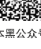

让一部分人先改变现状

一本黑公众号

一本黑社群

## 社交电商是淘宝客的另一个春天吗——纯洁的微笑

大家晚上好，受一本黑的邀请，给大家分享一下关于社交电商的案例. 苏香。通过这个案例带大家了解一下这个行业。我自己也是刚摸索可能分享的不够详细，欢迎大家一起来讨论。

首先需要给大家稍微讲下什么是社交电商，简单说就是在社交平台上卖东西，凡基于社交关系的线上交易行为都可以成为社交电商。

广义上的社交电商种类很多：

- ——拼多多；
- ——微商；
- ——以小红书，公众号等为 KOL 的内容电商；
- ——淘系直播等
- ——朋友圈微信群“淘淘推”等等

那么相比传统电商，社交电商人、货、场有何变化？
1、先说「人」的去中心化
传统电商都是有一个间接流量很很大，大家也都恨信任这个平台，然后都去这个平台购物，平台是一个流量分发中心，典型的有天猫、京东等。

社交电商讲的是去中心化，可能是抖音上的一个小姐姐推了个产品你购买了，他也有可能是你身边认识的一个达人在他的公号中推荐了一个产品，基于信任你购买了。社交电商的特点就是以人去中心化，典型的有拼多多、微商、小鹅通提供的一些商店、淘宝客的购物优惠群等。

2、再说「场」去中心化，「场」是成交场景。
除了线下门店以外，目前正在起来或已经起来的社交电商非常多，其基于

社交关系，中心化属性。而且，未来的趋势可能会越来越去中心化，个性化的需求会散落在分销出来。

产品也在去中心化；

以前，家电品牌就是美的苏宁。而现在，小品牌的空间变得越来越大。宝洁、联合利华甚至想，都在面对电商对数字对手针其细分类别的挑战。

淘宝直播带起了很多工厂店的崛起，一些超级网红背后有自己的 1-2 家工厂店，可以 24 小时内将主播推荐的商品生产出来，这背后有着非常强大的供应链支持。

所以总结一下，社交电商的人去中心化、场景去中心化、商品也在去中心化。

### 3、为什么现在社交电商这么火？

本就是因为上因为传统电商淘宝和京东，流量太贵了。淘宝的运营费用和直播车摊费贵，C 小商家都搞不起，而且平台粘性没有粘性。

造成投放广告若获取的流量只能做一次性转化率低、用户留存、产品推广成本太高。

而目前微信正在发力做电商，微信的流量红利和淘宝直播便宜，商家可以通过朋友圈、微信群聊、公众号获取用户、裂变用户、转化用户，来做生意赚钱，这就是为什么社交电商会火的根本原因。

因为微信太强大，所以我们说的社交电商其实很大一部分是指在微信生态的电商。

### 接下来聊聊淘宝客

什么是淘宝客？淘宝客是阿里妈妈（淘宝联盟）旗下的一种按成交计费的 CPS 推广模式，同时也帮助淘宝卖家推广商品并获取佣金的人。

简单来说，淘宝客就是淘宝卖家的分销员，卖家负责设置商品的优惠券和推广佣金，淘宝客负责推广。买家通过淘宝客的链接或口令购买后，淘宝客就可以赚取一定的佣金。

举个简单的例子，某群主（淘宝客）在优惠群里发布了一个商品的链接，天猫旗舰店的价格是 188 元，买家通过这个链接购买就能便宜 30 块钱，相应的

这个群主（淘宝客）可以获得最低 7.11 元的佣金奖励。

有小伙伴可能会想问了，这么搞下去商家不会亏死吗？
不会。很多商家为了揽销量、打造爆款、就会把某些高利润商品的利润让一部分（佣金）给淘宝客，让他们帮着推广。相比于刷单、卖家找淘宝客做推广的成本要低的多（官方严打卖家刷单行为，严重的基础甚至封店）。

这种推广方式实现了卖家有销量，买家少花钱，淘宝客有钱赚三方共赢的局面，简直美滋滋。

早在 10 多年前，淘宝客就已经存在了，不过那个时候的淘宝客少为人知，一直处于不温不火的状态。

淘宝客最初的推广是频道集合页，就是把一些开通了淘宝客推广佣金的商品根据类目做成一些频道页，通过 SEO 或者挂载到其它网站上，通过销售赚取佣金。

淘宝客的第二个爆发点是，单品优惠券，就是卖家可以针对店铺的商品单独、设置一定金额的立减优惠券，还可以针对不同渠道对不同商品设置优惠券。

最早推广者采用的是 QQ 群和微信群来推广，打开嗨头就是阿里亲友福利，后来在这基础上又发展出来了很多的返利网站。

平台推广商品赚出来的佣金，一部分分配返还给用户增加用户的黏性，具体操作就是在返利网站去核查，找到商品后跳转到具体平台（天猫或者京东）去购买，购买成功后平台给用户返还红包。

### 社交电商和淘宝客的姻缘

到了现在返利的方式变得更多样性，有的朋友做了微信返利机器人、小红书淘客、微博淘客、公众号淘客、抖音淘客等等，只要有流量的地方就会有淘客。我有几个朋友做微信返利机器人人每月几千元，自己啥都不用干只需要给这个微信号引流就行。

我们通过上面得知社交电商就是人、货、物去中心化，越是去中心化其实就越适合淘宝客的生存。

早期淘宝客需要自己建网站、对接技术等。现在利用社交电商做淘宝客儿

乎没有任何门槛，只要你愿意于是乎人都可以做淘宝客，零门槛零成本，所以大家也会发现微群和朋友圈越来越多的购物链接在飞。

刚开始的淘宝客只是购物返佣，到了后来为了激励更多的用户去做淘宝客，建立了三级分销制度，也就是你邀请的淘宝客，如果他推广的产品有了佣金你也可以得到一份收益，最高不超过三级。

这类产品比较有名大都都是以淘宝系的产品为主，也有一些淘宝 app 覆盖了主流电商的所有产品，比如：好省 App。京东系的淘宝客产品还比较少，很多还处于试阶段，比如芬香、东小店等。

这些产品都有共同的特点：

- 1. 需要邀请码可以注册；
- 2. 有分销机制可以通过团队分销来赚取佣金；
- 3. 自购商品和推广商品都有返佣，可以省钱。

这类产品的模式都是大同小异，这里这个产品我都有试用，最终以芬香为主进行研究，接下來给大家介绍芬香这个产品。

### 芬香介绍

芬香是一个专注于京东体系的社交电商，大家可以理解为京东版的淘宝客，目前只有一个小程序的系统。

官方介绍：芬香科技是京东战略合作伙伴，精选全球好货，以社群分享为核心，为广大消费者提供美价廉的京东特价优惠商品和优质服务。

通过天眼查看可以看到，大概京东占了大概 10% 的股份。

芬香社交电商的核心创始人都来自京东，创始人 CEO 邓正平是前京东移动电商创始人总经理。今年 6 月获得了百万的天使投资。

从我这两天的使用情况，大概可以分为两类人在使用这个产品。

第一、自已也经常在京东上购物，通过这个产品可以省点钱，这类用户占比较少；

第二、赚钱取佣金的用户，通过销售产品赚取佣金，另外可以发展团队让团队来赚取佣金，这应该是大多数用户。

芬香产品将用户分为了四个等级：注册用户、超级用户、导师、合伙人，刚注册即为注册用户，网上每一级都会有不同的要求。

注册用户没有赚钱提现的权限、需要创建50人的群才可以成为超级用户，超级用户就可以挣钱每单的佣金，也可以要求下线，下线销售后自己也可以挣一部分佣金。

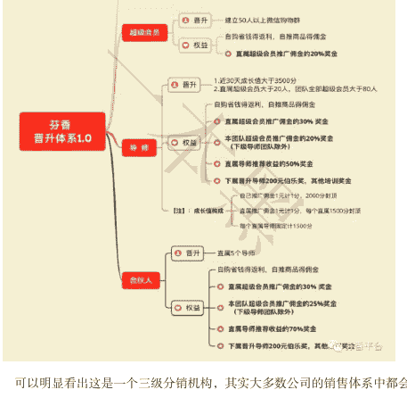

可以明显看出这是一个三级分销机构，其实现大多数公司的销售体系中都会采用这样的方式，比如保险行业。正是因分销机制，你会看到很多微商客的闺蜜，也热衷于介绍朋友加入。

因为如果你想在这个平台上挣到钱，无非两种方式，第一，你有比较好的资源，可以通过你的资料来卖赚佣金；第二，你能找一些特别厉害的人，这些人作为你的下线，你的收入也不会太差。

### 芬香的特点

京东在最初起家的时候，以B2C为主，平台上没有太多的第三方卖家。
随着京东开放平台的建立，平台越来越大也入驻了很多品牌和中小商家。

京东为了做大自己的平台，也需要从各种渠道来获取流量，淘宝客肯定是其中的一部分，但之前的很多淘宝客应用都是以淘宝为主，所以今年自己搞了几个社交电商类似的产品。今年双11京东还推出了一个和芬香很像的产品，叫做东小店两个产品相似度很高，不过东小店是100%京东的子公司。

东小店给人的感觉更像是一种开店的方式，这个产品和芬香比较大的差异点是它的邀请码是有时间限制的。某个时间内如果没有足够多的人，这个号就不能用了。比芬香的门槛更高一点。

使用芬香做京东省客我有几个优势：

-   1. 推荐产品都来自京东，京东给大家的感觉会比淘宝要更有品质一些，因此相对来说比较比较好推。
-   2. 大家可能时常会看到各种火星文的淘宝推广，这是因为微信信息是封杀淘宝的原因，社交电商的主战场在腾讯生态，腾讯投资了京东，京东应该不存在这个问题。
-   3. 芬香主要以小程序的方式出现，在微信系统中推荐分享比较方便，用户可以直接跳转到京东的小程序中购买。
-   4. 我自己在实验的过程中发现，本来你推荐的是三只松鼠，但是用户通过你的链接在京东平台还购买了其它产品，你也是可以获得收益的。

### 我的芬香实验证结果

我非常喜欢尝试一些新的东西，刚好前两天有一个朋友给我介绍了芬香。我用了2天进行了尝试，我把尝试的结果分享给大家。

## 反思

我这两天在微信朋友圈分享了三个产品：

-   1、视频网站的 VIP
腾讯视频会员 99
爱奇艺观视会员 99
-   2、双 12 阿迪产品
-   3、三只松鼠

因为这三个产品都是大品牌，本次我也买了这几个产品，确实感觉便宜，所以发到朋友圈之后大家购买的也比较多。

12 月 11 号，产生了 11 个订单，佣金 90 元，团合伙人数 20。

12 月 12 号，产生了 85 个订单，佣金 441 元，团合伙人数 106。

邀请了我了解芬香的朋友，已经培养为芬香的合伙人，我看了他给我做的截图，每天的收益都在几千左右，绝大部分收益都是由他的团队所贡献。

社交电商就是利用了社交网络的裂变来营销产品，距离用户最近的地方都是生意。也可以说社交电商就是为 XX 客准备的，可以让人群都能成为淘宝客的一员。

那么做京东客能挣到钱吗？

如果你有一些资源并且自己愿意去尝试实践，现在处于早期我觉得有一些机会：

如果你有或没有太多资源但勇于探索，也不太在乎别人对你的看法，可以拼一点小钱；

如果你是普通用户想发朋友圈或者微信群就赚钱，估计可能性不大；普通用户最多的使用场景，可能是使用这个软件去买京东平台产品时省点钱。

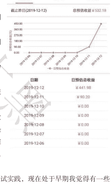

## 贴吧引流，出单不愁——天枢

有个加了我 2 个月的粉丝问我，自己是做抖音培训的，有什么办法引流多收点学员？

考虑到测试过抖音上做知识付费转化很低，我说，你可以去做贴吧有效果的。

他没回我，可能觉得我是傻子吧。

其实去年我的合伙人就搞抖音培训的项目，百度竞价和低价引流课都没收回成本，反倒是贴吧这条推广线安排了一个兼职每天发帖回帖频频出单。

因为贴吧的账号越来越贵，发帖的存活率低，再加上顶部软件横行霸道，把小白都拒之门外，失败的人往往会给自己找个借口：贴吧不行，所以不敢做了。

既然毫无价值，为什么仍然有这么多的广告？为什么贴吧账号的市场价格上涨了快一倍？到底是谁在买账号？在贴吧引流成本不断走高的背景下，到底是谁还在不知疲倦地坚持引流？这些人难道不是傻子。

行了不啰嗦了，本文就详细讲述如何选择贴吧，怎样发帖不被删，帖子如何被百度收录，一滴水都不漏。

#### 一、相关贴吧引流

-   1、单个贴吧的流量虽然不大、有些比较偏的种类流量甚至更小、但千万不要小看这里。很多时候流量就在于精而不在乎多。目标贴吧越精准，引流效果越好。

选准贴吧技巧：找准关键词，关键词越精准，流量越精准。

以美妆为例：
可以看到我们搜索美妆时会会出现不少相关类型的吧，那这些吧都要去做吗？显然不是，一定要结合自身情况选择，如果是做美妆代理的，那我们的关键渠道就是美妆代理，那美妆代理呢肯定要优于其他子类。

#### 分析潜在用户行为：

你的用户不可能都集中在一个贴吧，你要试着去分析他们的行为，会去那些相关吧做些什么？然后去展现你的价值，吸引潜在用户。

如果你是减肥类产品，你的精准用户在减肥吧，而在瘦身吧、塑形吧里还会存在大量的潜在用户。

#### 二、发帖

##### 1. 账号：

账号很重要（如果你有很多帖子都是精品可以忽略），发帖前的发帖号一定要养好，要打扮好，要有权重，这点很容易理解，就像高档餐厅里，不管菜好吃不好吃，但至少看起来很精致。

##### 2. 标题：

网络有一句话叫“始于颜值，陷于才华，忠于人品”，而咱们这里就是始于标题。标题的写法可以参照以下几点：好奇心、情感共鸣、数字对比、蹭热点

##### 3. 内容：

## 第二章：牛人分享

发的帖子被百度收录并且有个不错的排名也很正常，而且就很关键了。虽然现在很多人吐槽百度，但不得不承认百度的流量非常大。

怎么放？

这种时候也可以选择相关的贴吧，但是会受到很多限制。我的建议是自己建一个贴吧或者找个没人的贴吧也行。而自己创建一个贴吧，用大号去申请吧主，方便管理以及做广告。

#### 发帖要点：

账号：买普通号发帖就行，一个普通号就能被收录两三次。
长尾关键词，很关键，因为做的是百度收录，别 人是通过搜索引擎搜索找到你，而不是通过贴吧寻找。
所以你的长尾关键词要组合分好。
内容：最好原创，多写点，在内容里也要注意关键词的数量及分布，不要一上来就开始做广告，这样不利于收录以及排名。
现在很多人做百度就是用的这一招。

百度搜索“复仇者联盟百度云”，可以看见排名很不错，但你以为这就完了吗？

咱们换个长尾词组合，你会发现搜索结果就出现了变化。

但你以为就只有做这种的才可以做百度收录吗？当然不是！
做此类引流最重要的一点就是，不要去和做竞价以及网站的争，没有效果。
比如下面这个：
别人做的都是竞价广告以及网站，即使贴吧权重再高也有玩不过人民币战士。

#### 四、贴吧如何留联系方式？

-   1. 帖子别留联系方式，这样不容易被删帖以及封号；
-   2. 私信，跳过贴吧机器人检测以及吧主检测，但有些人会有隐身设置，私信发不过去；
-   3. 昵称，新注册的号以及某些卖的无昵称账号都可以把名字改成你的微信或者公众号名字等；
-   4. 用谐音，号中间加符号；
-   5. 留有度云链接，在链接里可以放你的广告；
-   6. 做防删图，技术一直在更新，没必要一直研究。

以上留下联系方式的方法都只能防止机器检测,如果吧主和吧务真要删你，除非你没放广告,都是那些人通过内容来主动加你,或者就是直接由钱买通吧吧务,这个也比较常见。

#### 五、关于账号

-   1. 玩贴吧引流一般都会准备很多账号，买贴吧号时最好也注意一点，最好买机器号注册，买来可以直接用手机号账号和密码登录并且不需要验证码的那种，这种号码最好，买来可以直接做广告，发链接也不会被封。
-   2. 贴吧虽然没有像手那栏吧 IP 限制的很严重，但最好也不要同一个 IP 登录过多的账号。

#### 六、关于顶帖

想了下这个运是单独拿出来讲下，本来我做的引流以及接触过的都是不需要去频繁顶帖的，但恐怕很多发吧务的帖吧会出现频繁顶帖现象、隔一分钟刷新一下页面可能找不到自己的帖子，这时候其实我不太建议再去这个贴吧做引流，如果实在想的话也可以，去买个软件。

#### 七、敏感词篇

兼职、微信、公众号、免单、做单、招商、股票、分享、代理、广告、赚钱等都是敏感词。虽然敏感，但并不代表全部都是绝对禁止，还是与你账号权重有关，如果你的账号被定义为营销号，那发这些基本都是秒删。

贴吧最缺的就是同行，多对比几个同行的
话术、测试、敏感词一直在增加、政治、宗教、语言，这三块不要碰。

#### 最后：

赚钱的人各有各的场，一个百度宽价单页、一个公众号、一个用了两三年的个人微信、一个几十亩地的厂房、一个天天排队的门店等等都是此类。

十年如一日循环，不断通过各种方法引流滞留在客户人群，筛出背包钱的，只服务挣钱的，自然都是笑脸相迎，天天单单收收。

贴吧也好，抖音也罢，找好自己的场子！

让一部分人先改变现状

## 喜马拉雅引流，加粉不愁——天枢

撬流量在很多小白眼里是门玄学，一顿操作猛如虎，加到微信个位数。
这两年我风风火火的研究数个平台，发现流量的秘密跟两个词有关，但凡掌握其中一个，即可打破引流的桎梏。

第一个，排名。
QQ群排名、公众号名称文章排名、百度竞价、知乎问题排名 ... 等等，已知互联网处处有固定的搜索量，想办法将排名提升。

第二个，权重。
这玩意儿在字节跳动那里还有另外说辞叫做推荐量、流量扶持，它和排名相辅相成。

举个例子：
你手里有一个非常好的减肥产品，想在今日头条引流，写了一篇能打7分的科普文章。
万事必有因，写文章不是要做公益，于是看了下同行的操作手法，把联系方式放在满意的位置，可运气不佳被系统识别，营销号卒矣。
你相信内容为王、勤能补拙、量产精良原创，坚持发了100多篇。百思不解明明他们都删“广告”的啊？明明他们有推荐量啊？
你的同行阿壳，由于热爱健身，加了微信也不知道干甚么。索性秃着头再小的个体都能打造自己的品牌，坚持纯粹分享减脂干货。
推荐量从500飙到5W，头条上一搜相关文章都是她的。
广告主找到我来求，她一边给对方发送收款账号一连紧张的留下“广告主的联系方式”。
你恍然大悟，这不就是当初看到的那篇可以看到联系方式的爆文吗？

## 第二章：牛人分享

天极讲这个例子不是要告诉你做事要纯粹，而是要把排名和权重放在执行首位，再考虑能否转化多少流量。

先有量再转化稳定可以理解吧。

我做了半年音乐引流，主攻喜马拉雅，发布近200条音频，最近两个月也获得较为可观的效果，每天被动引流稳定在50人上下。

也把其中的心得分享给大家。

#### 一、为什么要运营喜马拉雅？

##### 1、流量庞大

虽然比不上抖音、头条这类DAU几亿的APP，但百度一下会发现一个恐怖的数据，据统计前不久已经应用用户突破6亿，意味着每两三个个人中就有一个用户。

或许这些数据可能存疑，但不难发现这就是我们大家所熟悉的一个高速发展的红利平台。

##### 2、对新手更加友好

相比短视频，你不需要拍摄技巧，不需要视频剪辑，更不需要写剧本；
相比起公众号、知乎这类文字平台，你也不需要写存稿，不用太多的担心原创问题。

#### 二、喜马拉雅的推荐机制

在喜马拉雅，账号权重，或许说权重以及被推荐流量多少等都与账号等级有关，在此各位一定要注意。同时这个等级非听等级，而是主播等级。

可以看出，账号等级关系着各项权益，当然权益不仅仅这个，点击图标还会各种权益介绍。

新手期，也就是账号在V1-V3时，这段期间不能发任何带有广告性质的内容，否则可能会被封号。

V4-V6时，这个等级已经可以开始做引流广告，但是广告的形式是在语言内容里，至于该段内容是放在前面还是后面个人，我建议放在后面，若你放前面，别人可能直接认为你这个是广告。
V7-V8级，这等级可以在专辑介绍里置下联系方式，但最好使用谐音字。
其中等级越高，获取的推荐量也越多，提升等级的方式就是发表语音内容。
升级很简单。

#### 三、内容制作的5点注意事项

-   1、内容形式
既然是语音平台，内容形式自然是语音，所以声音好听的人自然有优势，声音不好听的各位自己想办法解决。

-   2、内容短长
一般来说最好在10分钟以内，我建议在5分钟左右，不要太长也不要太短。长了别人也听不进去，影响完播率，太短的话很难把事情讲清楚。

-   3、内容相关
一般来说，我们可以把我们要做的内容做成一个专辑，而这个专辑中你想分多少段语音都可以，就像电视剧一样，不管分多少，同一个专辑中的内容要相关。
比如我在平台上开一个职场相关专辑，那么这个专辑中肯定都要与职场相关，但在我看来还不够，想做好，还需要做到井然有序，就像你读一本书一样。一件事情还没讲完，就开始讲另一件事情，会给人一种杂乱无章，毫无逻辑的感觉。

-   4、内容质量
除去必要的语气词外，不要像平时说话一样，什么“啊、嗯、这个嘛”这些一样啰嗦，所以在此最好先准备好文档，然后流畅的读出来。
内容原创。原创不仅仅是自己录的声音，对于内容方面不要涉及版权纠纷，官方给定的定义是侵害他人隐私、名誉、商业机密，被投诉侵权如知识产权、版权不明的。

##### 5、内容来源

可以从各平台采集，比如知乎、公众号等，当然不能去找那些存在版权问题的內容，即使找这些内容后也需要进行适当的修改，也能算是伪原创。

进入平台后先看平台规范，其中会对标题、简介等都做详细规范，不要傻乎乎的什么都看，截止日后还不知道缘由，其中对健康领域会有特别的要求。

在录制音频时会有个破防图标，强烈建议观看，对你的作品会有很大的帮助。

#### 四、最后

做引流和赚钱一样，要紧跟背后的逻辑。

在内容平台发作品是为了提升权重更多推荐量，从而形成更多曝光的正向反馈。

功夫不负有心人的箴言背诵也是不断地不断试错，从而优化方法。

让一部分人先改变现状

## 全新今日头条引流攻略——天枢

鸽子明鸡，大块吃肉。

加上一些懂互联网的微信群，里面讨论最多的就是什么平台应该怎么引流、什么项目好做。几个回合下来就有人说他们公司专门做这个的。

其中的道理我都听得很懂，基本都退了，一群小白交流被割韭菜的开始经历过程和结果再回头醒悟。

今年我还进了一个哲学群，里面有十余位身家过亿的大佬，其他基本千万级别，全是搞网络的就我混的最差。

都聊些啥呢？谁被烂皮婆抓了，谁去哪家谈判了，谁写的盘又崩了……天枢在群里就学到两种东西：

-   1、见好就收
-   2、见坏就撤

你会发现同样是做互联网，这成功的成就就不一样，交流的内容竟然不同。

与牛羊为伴，则被豺狼俱得及时。

与猛兽为群，则可食利一而前终。

在之前请你牢记，往后的一切因果都与你的实力密切相关，我能接触更加“宽”的天地就是因为互联网。

在网络上写文章、卖东西、卖服务等皆吾之所爱。

最近发现有些朋友想在今日头条引流，故作此文。

#### 一、今日头条引流的优势

-   1、字节跳动旗下，用户数量虽比不上抖音，但12亿的DAU足以碾压知乎、微博等常见的平台。
-   2、规则更简单，且有一定的流量扶持，轻松获得上万曝光量。
-   3、相对于知乎、公众号等，文案水平要求较低。

#### 二、引流前的账号准备

-   1、实名认证账号要求实名认证，未认证则没有推荐量，没有推荐量，就无法推动引流，至于职业认证以及实名认证看个人，如果是准备做一个大号可以考虑，单单的引流则没必要。
-   2、账号批量放大效果账号可以自己注册，也可以直接买号，目前在 30 左右一个。若需放大操作，建议直接去 QQ 群购买，注意不要被骗就 OK，同时一个 IP 尽量不要登录多个账号，切 IP 工具可上某宝买。
-   3、养号
不管是自己注册还是购买账号，尽量先养一段时间，养号期间看看自己所在领域的内容，点赞、评论等。上次遇到一个，新号直接就开始做广告，结果不仅没流量，还很快就被封号。

#### 三、今日头条的流量机制

头条和抖音同属字节跳动，流量机制基本差不多。发的文章以及微头条都会先给一部分流量，若受这部分用户喜爱（如完整阅读率、评论、转发等），则继续推荐。

同时，头条会为每个用户以及文章都打上标签，和抖音也是一个原理，每个用户在头条上经常看什么类型的内容，往后也会经常推荐这部分内容。因此推荐的用户基本上是精准用户。

#### 四、今日头条引流实操

在头条引流的方法有不少，在此说下文章和微头条，可以只做一种，也可以两种都做，但每天在 5 条以内即可，多了也不会有更多推荐。

首先说下，我们在头条引流很推直接上硬广，我想经常玩头条的朋友也会发现，很难在文章或微头条里直接看到联系方式，即使看到也会发现浏览量非常异常，就是因为头条检测出后不会给推荐。

所以头条引流更多的还是引导用户私信，再通过私信进行引流。

我们要做的就是发文章或做头条，获取更多曝光，然后引导用户私信即可。

如何获取更多曝光？

##### 1、文章标题

通过观察经验总结，在头条发文章，标题最好有2-3段，这样更容易获得推荐。

同时不能切忌做标题党，头条对于标题党是不会给予推荐，分段带关键词即可。

##### 2、内容

内容最好原创，我们前面说过，头条对于内容质量要求并不高，更多的在于资讯，一篇文章的字数一千字足矣，至于微头条一百字就好，所以对于创作要求较低。

虽然要求相对较低，但内容至少要有价值，比如发布了干货，亦或者解决了什么问题，有价值才有吸引力，才能获得更多推荐。

内容中敏感和违规，就像是黑产都很敏感，自己心里要有数，至于违规，对大部分人来说可能就是直接做微头条吧。

##### 3、关键词

在标题和内容中一定要有相关关键词，并进行合理分布，因为头条是自动提取关键词，给予文章打上标签，若未含有明显的关键词，则会导致提取不准确，最终的结果就是推荐也不准确，无法获取精准用户。

##### 4、文末送福利

或让用户点赞前，得先让用户转发，这样能获得更多推荐。

##### 5、账号权重

权重越高，推荐量也越多，而这个权重主要和粉丝数量有关，也就是说粉丝越多，就容易获得高曝光。

#### 五、私信设置

头条和公众号一样有一个自动回复设置，这个功能为我们引流提供了便利，直接让用户私信一个关键词即可。

其中设置的关键词尽量简单，比如让用户回复“学习”、“交流”、“001”这种即可。

然后自动回复时话术也要想好，说明情况，比如“头条不常在，亦或者由于XX问题，头条不能XX，如有需要请加微信等”等，这样才能提高转化率。

#### 六、总结

运营今日头条之前要想好是做品牌曝光、打造个人IP还是直接利用流量机制把用户带到私域。

想达到的目的不同，操作手法也自然不相同。

该被人压榨时，就好好让他体谅。

该压榨别人时，就好好压榨他。

这个世界像极了一片大草原，富人是数只猛虎，而穷人是牛羊。牛羊们食草养膘，一代又一代的供猛虎捕猎。

一本黑公众号

一本黑社群

让一部分人先改变现状

## 没有钱到底要不要创业——天枢

#### 一、创业的真相

“三更灯火五更鸡，正是男儿读书时。”

七岁的时候我大爷给了我两百块钱，让把这句诗背下来，永远都不要忘。干裕年，这句诗让一个小学生热血沸腾。

一晃二十载，我不记得当年的百元大钞是什么版面，甚至连太爷爷的样子都记不清，学堂里背诵无数遍的课文，只依稀记得老舍、鲁迅、骆驼祥子。仅几个名字而已。

唯独这句现在却没忘，还特别爱看书。

创业就是这样，这颗种子也许在我们年幼时就已经埋下：听到老爸不经意间跟你讲比尔·盖茨的时候，你立志有一天名字要出现在福布斯富豪排行榜。

也许，工作后加班加到拼牛都依旧，由于年纪阅历少，你的努力老板不认可同事羡慕不，后悔恨加你点点狠狠地问自己，为什么已经那么努力了却还是得不到应有尊重的生活？

也许你愤世嫉俗生了无数个创业点子，或许你脑子里一团浆糊难以付打滚，无论如何，你都设有行动起来，被生活按倒在地动弹不得。

你没有想想成功的念头，更没有一个可以执行的方案，因为现在的生活还将就过马马虎虎。

方案。

上面的第一条就是，要把做X老板的公司买下，再把所有做X同事都辞退。

你开启每天疯狂地浏览各种创业网站，包含果上敲马云、李嘉诚创业史。

又是一个凌晨三点，你小心翼翼给那个询价的朋友发了一条微信：

老同学这么晚了不知道有没有打扰到你，我经过全面的思考决定跟你干了！你是个人的人，我比你小白，一定爱好你带我哈，300元代理费马上下就转给你！

这故事的结尾每狗血？生活就是这么狗血……

想创业，得先知道到底什么是创业。

创业的过程可以说成是以下几步；

+   创业业务→事业→家业→基业

所以无论怎么都首先创业业务

不论什么业务其核心都是交易，交易的核心就是供需和需求。

所以每个业务的真正内核是解决供需和需求。

有人讲出解决方案，有人讲满足需求，但这两种说法都片面，而全面的应该是结合起来，根据需求出解决方案，把方案做成产品，然后解决需求。

在这其中，时代是天时。

什么时代有什么天时，比如现在大家都说我们是在互联网+时代、大数据时代。

互联网也好，实体店也好，挑着担子街市串巷也罢这些都是地利。

亲戚朋友同学同事……这些是人和。

那么创业真真正义就是，在结合当下天时、地利、人和的大背景下；找到需求→出解决方案→把方案做成产品→最终解决需求。

#### 二、互联网是非线性的

线性非常容易理解，保持不变或者稳定上升就是线性。巴菲特百分之99

的财富都是40岁以后积累的，这体现了财富的非线性，也是我们绝大多数人的特征。

我们终其一生积累的财富跟每个月领多少薪水关系不大，跟下面两个变量关系很大

第一点是重大投资，很多人的房产决定了他的经济水平，房价高则经济水平高，房价下跌则经济水平大跌。

第二点是通货膨胀，现在年入百万会所破楼，倘若再过二十年甚至十年看看年入百万是不是个水平，不信你问问曾经年入过百万的交友？

对于个人而言，这两种变量只要有重大投资是自身可控的，当单一的薪水不能成为投资的一部分，财富就会保持不变或不可预见的稳定上升。

互联网的增长全是是非线性的，借用张若老师常提到的一个例子。新华书店和亚马逊从行业上看都是卖书的，但在市值上为啥亚马逊远大于新华书店？

亚马逊是互联网模式，可以在网络上卖几亿本书，无论刮风下雨都有用户源源不断下订单。

而一家传统模式的新华书店，即使生意不错，也最多卖下20万本书。现在有很多宝妈、大学生、中老年人员，找不到工作，没有能力什么都不懂，所以在当地开个实体书店。

反正不管什么样的原因他想创业，那么为什么要优先选择那些线下实体店？

## 第二章：牛人分享

不明白，当我为了这一点钱在苦苦挣扎时，为什么有人可以年入百万。

那个小年轻当时不知道什么是非线性，他看到的看到经历的全部是互联网络时代。他只知道这帮搞互联网的人真 TM 有钱。

他没有抱怨，第二天酒醒紧紧的和互联网抱在一起，他要搞清楚整根扎的二八定律、安迪·格鲁夫的十倍速、罗伯特·莫顿的马太效应…他要搞清楚文案本能、增长黑客、VC、BP…

当你很非线性忽视互联网，对你来说永远是过不去的坎儿。你的钱最后会为别人的智慧买单。

创业没有钱投靠互联网创业，以小博大，不要去跟概率抗衡。

#### 三、创业的过程

创业分为四个基本阶段；

+   1. 生存阶段
+   2. 公司化阶段
+   3. 集团化阶段
+   4. 集团总部阶段

如果你对创业的基本阶段感兴趣请百度创业这个词条，以下部分要读一读天天聊对创业生存阶段的看法。

生存阶段讲的是以产品和技术占领市场，只要想办法会销售就可以。

你发现现在有现在在电商、自媒体、短视频等。在搜索引擎都能很好解决生存阶段的问题，这也是互联网创业现在这么火爆的因素之一。

创业这个过程当中第一件事情是吃饱，当你急于生存的钱没有解决的时候请不要创业。

我有一个关于谋群创业的回答在如手上了热门，很多读者留言说非常豪黎我的历史也想谋群创业。

对我而言，人生只有两个阶段可以谋群谋群创业；第一、自己一无所有的时候；

### 第二、自已拥有一切的时候。创业的周期受自己 200 天，创业很长时间内是不可能赚钱的，打工可以赚钱，一个月就给你钱。
小时工，几个小时就给你钱，但是创业有可能是什么？
是 100 天，200 天，300 天...

十年前，我们要做创业，要从头注册一个商标、研发、生产、原料、库存、建立营销团队、招商、卖货、广告、招商，然后最后才能够卖的出去，卖的过程中间还要找渠道，实体店，还有线上，是这么个过程。

前个个全是成本，最后卖又卖不出去，宣布创业失败，往后的日子负债。

如果你现在在没钱一饭吃老去卖东西，先那期完成拨索的闭环，赚到第一块钱，兼顾完成商业一枚的闭环，全取识现谁。

没钱的时候前期不要搞那些花里胡哨的东西。很多时候你其实不需要一个网站，APP，小程序，微信里装上 500 个信任你的人，卖东西卖服务给他们就能养活你甚至一家三口。

马爸爸说：你连饭都吃不动的时候，就是快到 1 的时候。
先活着，不要让鸡毛蒜皮的小事情消耗完你的创业气息，留点力气撸着吧。

#### 四、创业过来人的感悟

我搞互联网行业 5 年，尽然没有发家致富。倒是体验过几把互联网的非线性。

也有人做了十五年互联网，交了九年学费，还有一年在颓废。
为什么？因为状态不行。

正在看文章的你可能还没有任何感觉，过了春节你会发现身边“状态不行”的人会越来越多了，而且都是社会里的中下层。

他们的情况普遍是，大环境不好那我就不该做且过吧。
请该话，请该一辈子子，只是他们没意识到大环境不好跟个人没有任何卵关系。

再不好的环境，都有人在闷声发财，这仅仅取决于你愿不愿踏出那一步

而已。

我经常说圈子很重要，假如你的圈子很垃圾，就注定你身边都是垃圾人。

这帮人不仅帮不了你，还会像吸血鬼一样把你的精力和时间吸得干干净净。高人为何高额顶峰，和辨择、思考，上道的人走在一起，再也不会给你一些鼓励建议，而是拉你去离婚、嫖娼、赌博。

你我皆凡人，不是说娱乐不好，只是不要让这些东西太占据你的生活。你若想找到自己生理和心理的状态，在清闲的时候多读多运动，是我不成熟的小建议。

最后，每个人生命中最好的创业机会，几乎都出现在那些你没有完全准备好的时候。

真正把财富积累起来的人，考虑问题的过程其实是这样的，这件事我非常想做，并让自己的状态好起来，最后全力以赴的去执行。

其实很多人也不是甘心于一辈子领薪水的啊，他们只是在等机会，他们永远在等机会。

让一部分人先改变现状

## 知 + 付费推广：我花 3 万烧出来的投放经验——天枢

互联网捡钱的时代已经过去了，初入这个行业就信手擒来逆袭人生的人，是极少数。

你越来越多的是受喜者践坑，就是不断历练成长，接踵爆发生为一挡铲利的镰刀。

而大部分人，你给他再好的流量红利，项目风口，他的反应永远是这个能赚钱多少？能做多久？

想要做好互联网行业，天枢则认为更重要不是那一点项目收益，而是深入这个行业能收割与创造巨大财富的三观与认知。

我从年初初如乎带货赚钱项目以来，都是做的免费流量，通过过手的自然推荐和排名流量来赚取佣金。

期间一直想做如乎的付费推广，刚好在 5 月份知 + 开启全网开测，又趁着 6 月份的电商活动就先测试了一波，总共花费 3W 块，带来了 12W + 佣金，ROI 达到了 1:4。以下是部分知 + 推广订单截图：

## 第二章：牛人分享

在知+做付费推广时，我发现互联网上没有一份完整的关于知+介绍和操作
的文章，于是把自己实践的经验通过此篇文章分享出来，希望能对你有所
帮助。

这篇文章适合什么样的人看？

+   1. 想要在知乎引流加粉。
2. 希望增加获客渠道。
3. 电商从业者、淘宝、需要从外部引流卖货。
4. 想更快在知乎做成一个新 IP。
5. 包括但不限于以上4种，所有想要在知乎做内容营销的人。

以下为本人文章内容大纲：

+   一、知+是什么？
1. 知+ 营销插件
2. 文章和回答加速曝光方式
二、知+能做什么？
1. 引流
2. 电商
3. 获客
4. app 下载
5. 新 IP 快速测试、品牌曝光
三、如何使用知+？
1. 如何开户
2. 选题、创作内容
3. 绑定和予账号
4. 配置营销插件
5. 投放知+ 订单、审核
6. 优化、维护
四、天枢对知+的看法及今后的布局

#### 一、知 + 是什么？

知 + 是知乎官方为个人和企业提供的，内容营销工具。

你可以将你创作的文章、回答、视频等内容，通过知 +，付费提高曝光量，将内容展现给你精准的用户群体面前，从而达到精准营销的目的。

你可以把它理解为百度竞价的知乎版，只不过，功能上，展示方式上有所不同。通过关键词、用户画像等，将你的营销文案展示在精准的用户面前。

##### 1. 知 + 营销插件

知 + 还提供了官方的营销插件，你可以通过官方提供的营销插件，缩短用户的决策链条，提高用户的转化。

截止此文章发布之日期，知 + 提供的营销插件有两种：

+   1) 内容区组件，也就是下图中，文章和回答中插人的小卡片。
2) 评论区组件，如下图，通过此插件，可以在文章或回答的评论区，针对精准的用户提问，留下跳转链接，提高转化率与用户体验。

通过这两种官方营销插件，可以完成跳转常见的 H5 落地页，微信呼起，小程序，商品详情页（天猫、淘宝、京东、当当等）以及直接跳转知乎私信。

跳转私信后，可以像常见的客服系统一样，配置欢迎引导语，配置自动回复引导，配置图片（例如二维码）或链接。

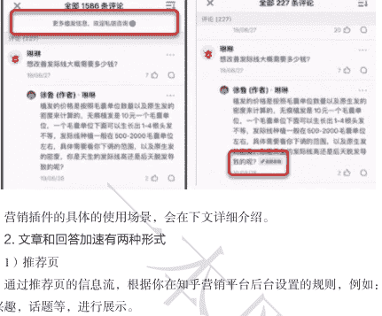

营销插件的具体的使用场景，会在下文详细介绍。

##### 2. 文章和回答加速有两种形式

+   1) 推荐页

通过推荐页的信息流，根据你在知乎营销平台后台设置的规则，例如：用户兴趣、话题等，进行展示。

+   2) 回答推荐

在你将某个回答通过知+进行推广后，用户在任意入口，进入此问题后，所浏览到的第三个答案，就是你的回答。

具体的操作为：

任意位置进入回答页——点击下一个回答或滑至下一个回答，就是你需要曝光的内容。

#### 二、知+能做什么？

通过上面的内容，你了解了知+的内容加速曝光方式以及知+的官方营销插件，下面介绍几个知+的使用场景，帮助你理解知+能做什么这个问题。

##### 1. 引流加粉

市面上的大部分行业，无论你是卖货、卖课、做新媒体，知乎都是一个引

### 反覆

流加粉的重地，你也许遇到过这样的问题：

所在的领域，受众太大，哪些非常优质的内容也不容易获得较大的曝光，而若有一个回答/文章，上了热门，限于知乎社区的规则，却不能光明正大的留下广告。

知+的出现，就解决了这个问题。利用知+ 营销插件中的内容区组件，直接进行引流加粉操作。可直接唤起微信，以一键加群。

案例一：公众号主通过知+为公众号引流，点击打开之后，会自动复制公众号名/ID，并跳转到微信界面。

此方法也可以为微信个人号吸粉。

案例二：

QQ 羊毛群群主，通过知+，将流量导入 QQ 群。点击一键添加之后，就

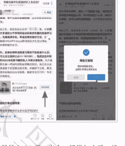

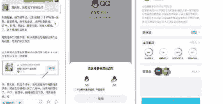

会直接跳到 QQ，进入申请串讲界面，有效的提高了转化率。

##### 2. 电商引流

如果你是电商从业者，或做知乎好物推荐 IP，同样可以通过优质、专业的内容，在知乎做引流，通过投放加+，增加内容的曝光量，从而提升商品销量。快速获取可观的利润。

案例三：RoboMaster 机甲大师，通过加+，利用权威的回答，增加用户的信任度，在内容中插入营销插件，点击直接拉起京东 APP，进入商品购买界面，形成完整的闭环。

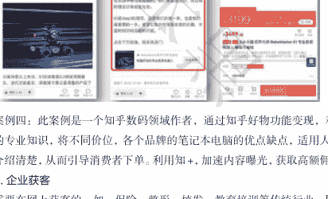

案例四：此案例是一个知乎手码领域作者，通过知乎好物功能变现，利用自己的专业知识，将不同价位、各个品牌的笔记本电脑的优缺点、适用人群，通过介绍清楚，从而引导消费者下单。利用加+，加速内容曝光，获取高额佣金。

##### 3. 企业获客

需要在网上获客的，如：保险、整形、植发、教育培训等传统行业，同样可以在知乎上面做内容营销，并且通过加+增大曝光量，通过灵活使用营销插件，来获取咨询/成交等。

案例五：小雨伞保险，通过权威的认证机构号，在知乎输出专业的ồ高性回答，塑造专业口碑，并且灵活的使用知乎营销插件，将精准的目标用户，直接

##### 4.app 推广下载

引流到微信，通过落地页、收集客户信息、达到塑造品牌形象与签客的目的。

各类 APP，以存在于手机推广的过程中，通过问答类类似于：

+   - 有哪些好用不火的软件？
- X 款好用的手机软件推荐？
- 你手机上都安装了那些 APP？
- X 款好玩的手机游戏？

等问题，详细介绍 APP 的亮点，来引导用户自行去应用商店下载。

如今，可利用营销插件中，应用直达功能，直接唤醒 APP，或直达下载页面，减少中间环节，缩短用户决策链条。

通过内涵，用户的好奇心被调动起来后，可以直接单击文中卡片，进入下载页面，大大提高下载率。

案例六：艺龙旅行。通过旅行等话题，输出内容，比如下图中的，通过提供景点、住宿推荐，来吸引用户

利用营销插件，已经下载的用户，可以直接打到下载菜单页，未下载的新用户，可以直接跳转到应用下载页。

##### 5. 起新 IP 快速测试，品牌曝光

利用知乎，你还可以做 IP 账号的冷启动，内容优先测试。

原理就是，通过知乎，将内容加速曝光，然后根据点赞、喜欢、收藏、评论等数据，快速测试出内容的优劣，及时进行优化、调整，有效的缩短测试时间。

在起新 IP 时，如果内

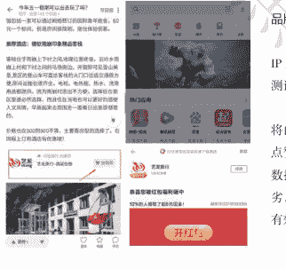

容是够优质、进行冷启动、通过知+加速曝光、带动用户互动、关注等等，缩短账号变现时间。

以上技巧，对于需要获取品牌曝光的企业同样有效、优质专业的内容、搭配灵活动的利用营销插件，就可以在达到品牌曝光的同时，获取精准用户。

#### 三、如何使用知+？

通过上文，你基本了解了知+的基本用途及投放场景，下面进行知+从开户到转化、全链条的操作方法、以及知+后台一些重要功能的介绍。

##### 1. 开户有两种方式：

+   1）直接登录知乎效果营销平台
网址：https://xg.zhihu.com, 之后按要求填写表单，等待平台销售或者代理商联系。
2）直接联系代理商进行开户，这种方式优点是，直接高效，如果你的预算充足，还可以与代理商谈一谈返点。
天秤就是通过这个方式进行开户，并且争取到了一个还不错的返点比例。

##### 2. 选题、准备内容

开户后，就需要为自己的营销目的来进行选题、创做内容。
内容有回答和文章两种形式、它们各有优劣势、其中，回答的曝光量较大，根据知+广告提供的数据，回答的曝光是文章的 3 倍以上、且来流量和长尾流量载明显。
文章的曝光量较小、标题内容的可控性比较强，适合细分垂直领域。
一般投放，以回答为主。

创做内容的第一步，是要明确用户画像及核心关键字。之后可借助知+后台的内容创作工具进行创作。

## 第二章：牛人分享

的，热度较高的回答，并从中挑选适合引流转化的内容，来进行合作。

##### 3. 绑定和加账号

在内容创作完成后，还需要在你开户的账号内，获取回答问题拿手账号授权，才可以对当前账号的内容配置营销插件，下加+订单审核操作。
绑定入口：工具中心——如手账号绑定

##### 4、配置营销插件

如果你有转化需求，那还需要配置营销插件。
进入工具中心——营销插件——新建插件，之后选择自己需要的卡片类型，按要求填写信息，即可生成插件。
插件生成后，你会获取一个插件链接，你只需复制此链接，粘贴到内容合适的的位置，并将转化关键词卡片即可。

##### 5. 投放如＋订单审核

当你的内容以及营销插件全部准备完成后，就可以进入如＋后台，建立刻＋订单了。
新建订单非常简单，只需要三步：

+   1) 点击新建订单。
2) 填写订单信息，如：内容链接，预算，单价，投放时间等等。
3) 点击确定，等待审核，审核通过即可视为投放成功，进入加曝光光阶段。

##### 6. 优化、维护

在成功投放后，进入如＋后台，可查看各个订单的数据，主要数据有：花费、曝光、点击、点击率、平均点击价格、干呕曝光花费、插件曝光数、插件点击数等。
我们需要根据这些数据，来对内容、价格等进行优化。
如：内容点击率较低，我们就需要对内容的标题、及前面十个字，进行优化，以提高点击率曝光量未达到预期，我们就要考虑问题的选择、话题的绑定是否合适，是否需要提高出价。
插件的点击率较低，我们就需要考虑对文中的引导语、插件的描述进行优化。
只有经过不断的优化，才能在有限的预算内，得到最好的效果。

#### 四、天枢对知 + 的看法及今后的布局

如知乎作为中文互联网最大的知识内容社区，拥有区别与其他平台的高质量内容，高学历、高价值、高收入人群，几乎覆盖所有行业。

而且拥有无与伦比的公信力，在影响用户的决策方面，具有极大的优势。

现通过知 + ，解决了在知乎平台进行营销的人群以往遇到的，内容加速曝光，营销转化环境等问题。

所以，在泛软内容方面，应该国产内容比优质的渠道。

通过这几年的互联网经验判断，知 + 上线时间较短，使用人数较少，用户对知 + 推广，还有较高的接受度。

这三个因素，决定了现在入场使用知 + 的玩家，能够得到较高的转化率，这个转化率，会随时间的增长，而不断降低，直到趋于稳定，达到它正常的高度上。

另一方而，知 + 也有它的问题在，例如，回答曝光量受限与问题热度，话题热度等条件。

不能像程度低价、信息流等广告方式，只需要一篇文案、设定好关键词等条件，只需加钱，就可获取非常大的流量。

利用知 + 推广，如果想要烧掉非常巨大的广告费，则需要不断提供新的优质内容，形成矩阵，才可能达到理想的效果。

今年天枢会深耕知乎，通过免费的回答，以及付费的知 +，在卖货、引流这两个方向，不断研究优化的玩法。

把钢铁的利润吃尽，把留量的功绩率吃尽。

让一部分人先改变现状

## 避免破产，加盟开店前请三思

以前在餐饮加盟公司工作过一段时间，对加盟有些见解，这篇文章分享给大家《避免破产，加盟开店前请三思》

工作几年，天天996，好不容易有点积蓄，看到那么多人创业成功，心里火热，也想去当老板，但知道创业风险大，一将功成万骨枯，就想加盟品牌店，背靠大树好乘凉。

到网上搜索“加盟”，餐饮、火锅、幼儿、教育、美容、各种火爆品牌可以加盟，你激动地打电话咨询。

对方会告诉你，有眼光，他们是大品牌、实力雄厚、知名度高、毛利率高、专业人员帮你选址、帮你安排装修、培训员教你如何管理、提供标准化的原材料。你只要有一颗创业的心、愿意吃苦，再准备一笔钱就可以翻身做老板、走向人生巅峰。

是不是抑制不住体内的洪荒之力了？赶紧把自己和对象的多年积蓄拿出来，再向父母要钱，甚至向朋友借钱，去加盟开店、改变人生。

Stop! 深度呼吸，冷静下，问你3个问题。如果答案都是否，请三思，何必把辛苦赚来的钱往水里扔呢，买彩票还可能中大奖。

- 问题一：你对要加盟的品牌行业是否够了解？包括一系列内容
你知道加盟品牌的行业在中国当前的发展状况吗？
你看过一些市场分析报告吗？
你在这个行业里工作过，了解各种“门道”吗？
你会管理员工吗，企业和门店不同，有过这方面经验吗？
你知道这个行业的成本怎么算，哪些可以优化吗？
你仔细调研过加盟品牌吗，他们的发展史、竞争优势？

你实地调研过几个加盟店的生意，跟店主和员工仔细聊过吗？

要相信，现在不是有没有胆量、卖得多大产的时代，连锁！

问题一：你为什么要开店有资源吗？

像餐饮、奶茶、教育、酒店等，是很吃地理位置的。现在是供给大于需求的时代，你想要什么，市场上都有。2024年。如果你在开店在深巷里，那是酒香也怕巷子深。

你还要有能力低成本拿房，否则在竞争中也没有优势。你要做外卖，开通美团、饿了么上来说话，互联网获客。线上竞争也很激烈呀，你搞活动、有红包，来了一批老客，等优惠没了，可能客户也没了。

问题二：你有多少钱存款，也能正常生活？

做生意是有风险的，尤其是加盟品牌开店，可能做着做着，品牌倒闭了，可能开店前期还没回本，还要搞营销活动获客，你能撑住一段时间的烧钱吗？

如果你就押一顿，把所有的钱都压上去，想吗，唯一的结果就是净身离场。无论何时，都给自己留后路，才是理智的决策

三个问题后，如果你还是决心要加盟，别人亏钱，是别人亏，自己聪明、很有把握，守钱的事也做点石成金

那么你还要清楚，这些品牌大力宣传，吸引人来加盟，很可能是自己品牌生意做的不行，换个方式，从加盟者身上赚钱，割韭菜。

毕竟，你还是要把大把把钱往外分吗？星巴克、喜茶非常牛，海底捞生意做的好，排队非常长，他们都需要开加盟吗？

如果要提到麦当劳、肯德基，那你要清楚，这两家几十年的品牌有多少，而且加盟要几百万，还有其他苛刻条件，对加盟者的要求很高。

但是，大部分加盟品牌都会对你当大爷对待，不时地给你打电话，给你分析工作是多么的辛苦，品牌加盟是多么容易赚钱，绝对比你爸妈还要关心你的生活。

可惜，幸福总

短暂的，当你签加盟合同，付了钱、梦就醒了。加盟费要几万块，至少几十万吧。为了防止你破坏品牌声誉，或者乱搞，你要交保证金吧。

## 第二章：牛人分享

店面必须要求装修，保证品牌形象。你不懂，不用担心。品牌商有专业的施工团队，你只要付钱。如果没钱，也不用担心，他们有着颇多的金融合作机构帮你贷款，分期还款。

店开了，要有员工。有些品牌加盟是集中招聘分配，就是你招的人要按照他们的标准来。他们来培训，然后派到你的店里，工资他们定，但由你来付，和直接做差不了多少。

有些品牌支持店主自主招聘，但对你负责，要由专业人员培训员工吧，你要付培训费，而具体的报价由他们定。毕竟这不像商品，没有标准价。

像火锅、快餐、奶茶呀，品牌为了保证食材质量，要统一供应，这个价格可能比市场上自己买贵，你也没办法。

还要对你做开店必备，均分很可怕，要从你的店里流水抽成。好吧，到最后，你试行、经营多年，竟然没达到社会的平均、准备老老实实去赚钱，不加盟了，要求品牌退回保证金、返还当初加盟费、折价收回没用完的原材料。

品牌商会用他们的专业法务人员，对合同上的那一条条约定，告诉你，长的丑、想要短美，帮助到死，给你社会最后的毒打。

何况有些品牌的初衷就是花大精力做几个样板店，数据不好的刷刷数据，找水军来排队，花钱做广告，声势做起来了搞加盟。加盟者够了，就转向搞新项目，甚至加盟商喊着、看命咯。
比如之前在抖音爆火的某茶，一口气签了6000多家加盟，最火爆的时候，一条街能有3家茶饮店，3个月不到，倒闭了80%，但这不重要，因为厂家早就赚够了，换一个新品继续卖。
加盟就像打游戏，你加入一个帮派，不管你升级多少，多牛逼，最后都是这个帮主赚钱得名声。你最多是比较有面子的打手和活跃喽啰。
所以想开店，这个路上就没有容易赚钱的事。带你装逼，带你飞，很美好，也的确有一些这样的品牌，就看你的资产、眼光、能力和运气咯。
记得决策前，三思。

## 不同年龄段买保险的建议—Kenny

最近看到境内讨论保险的比较多，分享下个人看法，不一定对，错了请大家指点。

其中谈到生死，希望不要介意，保险就是保这个。本人在全球TOP3和国内TOP3的公司都待过，前后共7年多，主要是从事寿险。

首先是说下买保险顺序。

很多业务员或者客户都喜欢从小孩起步。但是这个本末倒置了，一是小孩保费（身故或全残赔付额）低（寿险一线城市最高10万？非一线5万，离开行业久了不确定是不是这个数，只是举例说明）。

小孩万一有事，赔几万块对父母来说谈谈多大意义。但父母如果有事，对小孩来说就是致命打击。

所以买保险顺序应该是先是父母，后小孩。

父母的保障确定后，有余力再考虑小孩的，比如教育金。教育金的意义在于强制自己提前存钱给小孩读书，储备创业金、婚姻金等。它的分红也不算多。养老险（你没看错，就是养老险，这个年纪小孩买很划算，相当于给小孩存钱），还有重疾、医疗险、意外险都可以考虑。

然后说到年轻人，尤其是刚毕业收入不稳定，弄其是靠健康换钱的，还是很有必要买保障的。毕竟父母辛苦苦挣钱养你出来，就是指望你有所回报，或者靠家庭亲戚带你并不好一件事回报父母也有点安慰。这个年龄由于资金问题，就不要买什么分红险，最好是买些低保费，高赔付的消费险（意外、外，寿险和医疗险都需要）。分红险几千块一年，最多搞10万，批的时间没多少钱，这个分红从投资角度来说也没多大意义）也没多少。

目前市面上的意外险都可以投，100块保10万。寿险几千块保100多万，这个万一有事，最起码父母的生活都能得到保障。

## 第二章：牛人分享

接着说说到上有老，下有小的，有了一定的收入，但支出也很多。很多人觉得没有余力买保险。但这个见仁见智，朋友圈大水漫灌的，都是。so几年一病就拖垮一个家庭。

择一举，规划好自己的收入，还是得上保险，重疾、意外险和寿险都得上，买多少，根据自己家庭情况和经济能力来。起码自己重病或者人不在了，家庭不会一下子垮了。这也是家庭支柱的责任担当。

还有老人家的，有些人经济好点了，想给老人上点保险什么的。但老人家身体状况和年龄，可以选的都很少了，保险是越年轻越早买越好，比如重疾和一些医疗险。一些年龄50多的还可以买，但保费相对来说都比较高了，不是很难算经济能力好的。买些分红险，就当是强制储蓄，挣点分红，防止意外，百年之后养老费的。

最后说说，一些经济很好的人群。很多人觉得，这样有钱，没必要买保险。但实际上保险还是很有好处的。

首先：寿险意外医疗都买。一万有事，就当自己有钱，也不会嫌这个钱多，真有事，赖付你交保费的儿孙到几十个，都是很难划算的事情。

然后就是，保险是可以不用于抵债的。做生意，难免有风险，有债务，而保险的钱是可以不用用于抵债的。

这个分两种情况，一是保险赔付金，被保人必须购买时要指定受益人，那么他生前的债务，受益人的保险金不能抵债，
如果在保险合同中没有明确受益人，保险金作为遗产领取的，就必须核算《继承法》规定的被继承人的债务。
二是被保人身故后，但有分红险、万能险等，就享有续保、保险法规定，保单不用于抵债，不用交税，如果需要资金，可以保单有些能借款能力的贷款几十万到上百万）贷款，可以贷很大一笔钱出来，生意失败也可以东山再起。

总结说说，很多人说保险骗人，这也不赔，那也不赔，买之前，自己看清保什么，不保什么，还有免赔条款，事后就不会说被骗了。
保险肯定有它的适应的，不可能什么情况都赔，要不早倒闭了。好了，就先说这么多吧，希望能帮到一部分人。

## 一个保险从业者的自白——history

偶然的机会，有幸跟着老黑跑到保险，当然也是看了老黑的一篇文章，说不要轻易丢弃人夫，保险确实不太好干，在你没有清晰的认知的时候，真的是不要轻易去走这条。

聊一聊我自己吧，其实我跟大多数人一样，比较抵触保险，我曾经认为保险就是骗人的，我还特别的讨厌保险，甚至看不透卖保险的。

我觉得卖保险的人就是一群乌合之众，他们就会叫人，跟你谈生死，F**，没什么事跟我谈什么生死，要知道，我很排斥谈这个的好吗？拜托，我年轻轻轻，怎么跟我生死挂上钩了？

再加上，大多数从事这个行业的人外表看起来就不是那样，然后呢，基本都是一 些大村、在家混事做事、到处拉保险，拽啥会我也见识过，是个人就跑去干保 险，有什么专业度可言？

骗子、传销、拉人头、骗亲戚朋友，基本都能跟这个行业上关系，没有技术 含量，加上从业人员参差不齐，让我对这个行业产生了不可说的抵触行为。我打心底看不起保险的，认为那都是什么都干不了的人才去做保险。

而且这个行业的宽容与大度也印证了这一点，其的只是要能出气的人，都 能做保险。我从来没有想过自己能与保险扯上什么关系。

时间到了2015年，我已成家，老婆辛苦的十个月怀孕，终于有了结果，儿 子的呱呱坠地，让我从此升级做个父亲、一切都仿佛做梦一样，我有了儿子。从 此便有了一种感觉，那种感觉好像叫做责任。

不瞑，有一条看不见的线在拉着你，请记住，你有责任在身。

在社会上闯荡多年以后，当你遇到各种各样意想不到的事情发生的时候，不由得觉得世界并非在你掌控之中。当你见识过世界的诸设备后，你就会重新思考生命的意义。

这个就像从地心说到日心说的转变，它是颠覆性的认知。

于是，我重新审视人生，我觉得应该给自己买一份保障，但是那种情况多年对保险的偏见，让我犹豫不已。后来，我选择了一位前同事，他做了保险代理人，他并没有靠着我，反而让我多了一份信任，真的，当时我并不知道保险到底是干嘛的，我只是觉得，自己需要一份保障。

万一病残，能够从容的面对，万一有什么意外了，能够照顾我的孩子。就是这一份买实的自己内心中的第一份保障，自从买了保险之后，我内心就多了一份安宁。其实当时我并不知道自己到底买的是什么，只是觉得，一年给保险公司交丁点钱，应该很全面了。买了之后，并没有发生任何意外的发生，只是内心有了安全感。

后面的陶潜江湖，内心从容，我从事了几个行业。这里就不一一详谈了，有好的，也有琼球琳球的，中途也懒到资本迷，后面调节不好时，做了一个失败的投资，结果很明白，就是失败了。

我是不可做保险的，死都不娶！这是我的心声，可是命运总是不遂人愿。命运总会在不经意间对你痛届拐。

就在投资失败的岁月里，我休眠过人生。看透人情冷暖，世态炎凉，也体现在我的朋友背弃我。同时也看过这失败的例子，心里也有一丝安慰。我期盼新的项目，投入少量恢复的项目，我需要东山再起。

公司。

当时我也算是没有更好的选择，反正来保险公司，也能让我明白自己买的到底是什么玩意，然后在妻子给接配置一份保险。更吸引我的，是他在保险公司找到的那条捷径！

对保险公司的偏见，持续发挥着作用，只是无奈当时没有更好的选择，只能屈身留了。我想着先在不行就还在这待两三个月，看看效果，不行就撤了。于是我并没有告诉跟我好的朋友我在保险公司做，我要险。

没想到，半年以后，这个建议断了！走不掉了，保险公司抓得严格了，我他们走过的漏洞被堵上，因为从16-18年，保险行业发生监管，所以公司无暇顾及一些问题。时间间迈进到2019年，近几年经济下行，对保险也有一定的冲击，公司也进行了调整，开创了一些新的东西，要知道，我们走的捷径就是因为看到监管放松的漏洞，就这样，我们的计划泡汤了。

在这里期间，我也有想过放弃，毕竟我没有公之于众、离开会比较轻松。后来因为机缘巧合，参加了一些对我影响重大的培训，我重新认识了保险的更深一层的意义。我看到了行业的改变，我看到了行业吸引了更多的高端人群的加入，由于在这个行业内部，我看到了曾经自己不了解的一面，再加上也有几个信任我的朋友在这里上了保险，我也不想就此荒弃。

其实从业近10个月，都没有改变我对保险行业的看法，后来遇到一些人，一些事，彻底改变了我

基本大体行业都存在一个二八定律，我不否认、大多数时代代理人过的并不轻松、毕竟，考虑到能抵挡的好多人喘不过气，但是总有一群人做的风生水起，我总结了一下，做的好的分两种，一种是特别努力，听话照做，说实话，在这个行业，目前的这个环境下，只要你够努力，就一定会有回报。

还有一种人，他们靠专业取胜，他们服务于高端人群。说真的，保险这个东西，往往高学历、高收入人群更容易接受和认同，反而相对低收入人群更不好沟通。

保险，最大的对手不是同行业的竞争，而是一 些奢侈品，高端消费的产品，它们激发了人类的欲望，让更多的人不是优先配置保险而来为一些奢侈买单。

未来，保险行业会有非常好的发展空间。保险业也会提高门槛，专业才能体现价值，从业者一定要从客户的利益出发，从资产的角度思考，只有这样，才能为客户提供优质的解决方案，从而赢得社会的认可

经过这么久的思考与审视，不吹不黑，保险只是一个对抗风险、起到杠杆作用的金融工具。它是一个为你家庭风险而开发的一个账户，它不会改变风险的发生概率，它只是按照约定，在不确定的未来，特定的情况下，给你一笔确定的资金，帮助减少损失，帮你过度难关，它不会改变你的生活，但可以防止你的生活被改变。这就是我对保险的一些浅见。

我相信，每个人选择了保险都有一段不一样的故事，不管怎样，这个行业的认为应该承受，多忍受社会的偏见。来选择这么一个很可能被人不理解的职业，希望大家多多理解、包容，给他们信心，给他们一个成长的空间。希望我能坚挺撑下去，为中国保险业的发展添砖加瓦，尽自己的一份力量。

最后，老黑说的对，一定不要轻易来保险行业从业人头，这个行业真的不是一般人能做好，它需要你有坚定的信念。

销售嘛，总是会遇到拒绝与白眼。当有一天，你真正的认识了保险，你相信了保险，你才可能把它做好，我见过太多的人为了利益，匆忙而来，又匆忙离去，这个行业并不是充满了光鲜亮丽，你只有热过春天，才能绽放出美丽的花朵！

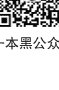

一本黑公众号

一本黑社群

## 让一部分人先改变现状

## 我当妈妈了，想给孩子买保险，怎么买——star

一个可爱的小生命来到这个世界，开始了 Ta 的生命之旅，这个家庭从此多了很多欢笑与幸福，整个世界都变得更明亮了。我们都希望这个小生命可以一帆风顺，如果可以一帆风顺。

未来的日子里既有阳光灿烂，也有风雨交加。
在漫长时光中，柔弱的我们能确定可以承受某一场意外？
在苍茫岁月里，无助的我们能保证可以战胜某一场疾病？
有一位妈妈是这样说的：如果孩子一生中真的遭遇疾病，治不治得好那是老天爷和医生 的事情，但有没有钱治，那是我的事。如果因为前者我会很伤心但能放下；如果因为后者没钱治疗而不得不放弃。那会是我永递的痛，我会永远无法原谅我自己。

可怜天下父母心，曾经我们也是需要父母呵护的孩子，如今我们有了自己孩子，就好像突然有了胆量，也突然有了职责。
孩子一生，有三件事必须要做，就是取名字、上户口、办保险。孩子保险到底怎么买？三个步骤，让你买的明白，买的放心。

#### 01、谁先买？

通常，只要有人向我提起来要给孩子买保险，我就会反问一句：您和您爱人有没有配置好自己的保险呢？

风险的发生都是一个概率问题，如果大人发生风险事件，只给孩子买保险的话，家庭经济来源将会有很大问题；而如果发生在孩子身上，由于家庭

长仍能赚钱，家庭经济来源没有中断，影响就不会小得多。
孩子最好的保护其实就是父母，一旦你们出现风险，孩子原本安稳的生活也会受到巨大影响，如果作为家长的你们自己保险还没配置好，那就先考虑自己，千万不要被“我就爱花在孩子身上”这种错误思想给带偏，保护好自己才能更好的保护孩子。

#### 02、买什么？

好，如果自己配置好了，那么首先要给孩子上医保，再搭配医疗险、重疾险和意外险，孩子年纪小，保费也会比较低。

其他险种比如寿险、理财险，可以暂不考虑，当然如果家庭条件不错，那可以考虑，但这不是今天的重点。

为什么我推荐的是先解决医疗、医疗险、重疾险、意外险，那是因为对于刚出生不久的孩子而言，“疾病”和“意外”是最紧迫的风险。

### 疾病

出生不久的孩子身体健康状况堪忧，各类器官功能开始发育、免疫力低，所以很容易感染发烧，重疾发病率也较高，而小孩子治疗的费用又特别高，对一般家庭而言绝对是不小的压力，有了医保 + 医疗险 + 重疾险的王牌组合就可以最大程度减轻甚至解决这种经济负担。

### 意外

孩子出生不久，大人每天都在身边照看着，意外发生概率较低，但慢慢的孩子能爬能走时，磕磕碰碰可能就很正常了，这时候，意外险就发挥作用了。所以，正确的购买顺序是：医保 - 医疗险 - 重疾险 - 意外险。

#### 03、怎么买？

### 医保

少儿医保就是国家福利性政策，也是每个孩子一出生就能办理的基础性保险。作为国家的福利政策，少儿医保的保费很低，但是保障也比较全，可以享

受住院和门诊医药费报销。

它还有一个星某些缴费款是可以带病投保，比如孩子出生就被诊断有先天性疾病，商业保险有可能会被拒保，但医保就必须承保。

所以建议小孩一出生，办理好户口落户马上为宝宝参保，因为小孩出生之后的一段时间内可能会产生一些医疗费用。

新生儿出生90天内参保的，从出生之日起享受当年医疗保险待遇；新生儿出生90天后参保的，从缴费次日起享受当年医疗保险待遇。

### 医疗保险

有了医保作为基础，需要补充的少儿医疗保险

百万医疗险：主要解决大额治疗费用，报销额度高达百万，通常情况下绝对免赔额1万元；
所消除的“绝对免赔额”就是产生的治疗费用在医保报销之后，需再扣除1万元之后的剩余部分才可启动百万医疗险来报销。

小额住院医疗险：针对性解决百万医疗险的绝对免赔额度，一般报销额度从几百到几千，只要治疗过程中动于住院，都可以报销；

### 重疾险

一旦孩子发生重疾，接踵而来的除了大额的医疗费用之外，同样面临着大笔的康复费用以及康复过程中伴来的家庭经济损失。

## 第二章：牛人分享

少儿重疾险有消费型跟着储蓄型之分，优先考虑消费型，因为消费型的保费真的  是低太多，符合第一条原则；

#### 三、定期型

少儿重疾险也有定期型跟终身型之分，推荐定期型的理由：

首先是便宜，符合第一原则；

其次是等孩子长起来了，一来也會有更豐富的產品選擇，二來也該讓他自主去面對這些事情了。

#### 四、保障全

在保障能接受的情况下，再按这个顺序依次来选择：附加轻症中症 - 重疾 不分组恶性肿瘤多次赔付。

#### 五、加踏实

孩子的重疾险，投保人一般都是父母亲，从孩子出生开始，一份定期重疾险通常交费期限只能以长达 20 年，这个过程一旦投保人发生类似风险失去缴费能力，就要面临没有人缴费。

两种方式解决：

- 一、我在第一段讲准父母买时就已经明确了，要确保父母亲自己买了足够的保障，这样一旦发生风险，就会有充足的理赔金项上；
二、如果可以附加投保人豁免条款且费用在接受范围之内，就附加投保人豁免条款，附加后投保人发生约定的风险是可以不用再交费，合同继续有效。通常约定的风险包括：身故、全残、重疾等……等等。

### 意外险

- 0-9 岁：身故赔付不能超过 20 万
10-17 岁：身故赔付不能超过 50 万

选择少儿意外险只要涵盖意外身故、意外伤残、意外医疗三个部分即可，保费越低越好。

简单总结一下：

孩子一出生要第一时间上医保，父母是孩子最好的保险，给孩子买商业保险之前先给自己买全。

有了医保作为基础之后，再购买商业医疗保险、重疾险、意外险，这样一来孩子的基础保障就齐全了，行有余力的家长可以考虑再为孩子配置理财型险种。

这段话送给大宝：为了参与一个生命的成长，不用替我争门面，不用为我传承接代，更不用帮我养老。我只要这个生命存在，在这个美丽的世界走一遭，让我有机会和Ta 同行一段。

让一部分人先改变现状

一本黑公众号
一本黑社群

## 个人成长 10 倍破局攻略

去老猫的年度总结学习一圈，当这次忠实的韭菜听众。虽然有些观点不敢苟同，但准人家有钱，想必是有一定道理的，就算星学学不收割韭菜他也是门学问不是，十块人头的接触触碰不同的思维,个人感觉还是有点用的,话不多说,直接上总结

#### 一、学习策略如何成为一个卓有成效的学习者？

- 1. 定个高价,动力真大老猫给自己的咨询费定价为 20 万/天,买单是不可能有人买单的,坑傻子呢。但是他就是想要这么多,给自己定的标准就是这么多,倒逼自己去学习,让自己对得起这个价格,配得上这个价格,努力学习,努力实践,激发自己的学习动力。他说想要成为什么样的人,就要按照那样的标准去活,时刻按照那样的标准来严要求自己。

（不知道第一单是怎么成的,不过这个确实牛逼,三年不开张,开张吃三年。或者刚刚开张也一定吃过许多的苦,受过很多的罪。不过我想只要他成功了第一单,后面赚钱简单了,重点是第一单怎么成,没说,留悬疑）

- 2. 及后续自有不断学习获取新的知识,好记性,不是脑子,以及大量的知识储备,尽快分享出去,例如他每年几百篇文章,做够多分享,因为要不断的给人分享,所以自己需要更多的知识储备,学习的欲望就会很强烈,保持饥渴的学习态度,提升学习效率。

- 3. 享受高压,起超越舒适去舒适区,不要被鼓你更强的人压住,虽然心里可能会很不舒服,但被硬压体会学习到更多的东西,而不是去享受喊别人的人的乐趣,你很少会从你弱的人里学到东西。

- 4. 读我所做,做我所讲写自己践行的事,践行心得,作者自己是践行者。

如行合一。这样生动的人会更加的吸引读者，吸引铁粉。倒逼自己去行动。
（倒逼自己去输出这是挺经啊）

#### 二、关系战略如何打造贵人云集的朋友圈？

- 1. 储备银子，升级圈子

什么是贵人？愿意带你且有能力带你的人
例如你加入一个好圈子，可能这个圈子的价值很贵（例如老黑的星球，开玩笑啦，老黑的真的不贵，看看老黑的文章，受爱的一本防骗指南，你能说亏了吗？少被p2p的割韭菜，少被黄金盘套路，远离网贷，珍爱生命，他不香嘛），你可能就能学到些东西，或者说给认识了某一个或几个人，在某些方面你有困难时帮助到了你，这不就是你的贵人嘛，所以说圈子很重要，得失自己看清楚就好了。

2. 靠近节点，成为节点
成为节点指的是成为人脉节点、帮助人连接人，对彼此有价值，就要运用老黑啊啊...做个社群
连接这么多人，就比如星球上面杨杨文律师挺好的的人，你通过老黑这个节点和杨律师连上后，杨律师帮你解惑，解答法律问题，他帮助到了你，这就是你加入这个圈子后得到的价值、得到的帮助，要不然你自己去白度，可能自己看不明白，去请律师，可能花更多的钱。

那么对杨律师呢？就这么免费帮助你什么都得不到嘛？我认为不是这样的，杨律师同时会扩大他自己的影响力，下一个人还会找他，如果问题更加专业复杂，那么你可能会给杨律师付一些咨询费，或者说自己开星球，那么他曾经帮助过你大了吗，你难道不是也会比其他人更容易加入吗？

这些都是互利互惠利了，当然，在此之前最重要的是你应该是因为老黑，才让你加入这个生无救可怕的嘛？嘿嘿嘿，所以要先进入人脉节点，成为人脉节点，你要变成是老黑认识的人的人脉节点，你能做到吗？（ps 感觉此段已经接近成功洗脑，哈哈，重点在于你要怎么成为节点他没说啊，差评，或许你可以通过写文章，通过 vlog 等各种方法，不断去扩大多数自己的影响力，总之，没有一口吃成个胖子的事情，大家都从仙过海，各显神通吧，哈哈）

## 第二章：牛人分享

3.汇报成绩，提供价值分享自己成功的喜悦，会提升你的贵人运。分享经验方法，给人提供价值，让人受益。给你的贵人正当取得的成绩，你的贵人也会有很大的成就感，同时他也会从你的成功案例中学到许多东西。

4.靠谱安全，杜绝人骗（利他）今年所有的人都在提“利他”这个词，或许真的是最伟大的商业模式。

- (1) 靠谱学会管理预期，给人合理期待，但不要让别人期待太高，超出能力范围，否则很易超出预期。在结果上给人惊喜感。比如领导昨天告诉你明天把某件事务办完，你今天下午5点就做完了，而且做的很好，老板很兴奋、超出老板原定预期，这样就会给人很满意的感觉。

- (2) 安全嘘寒一类神秘感，不要随意说别人的事。你泄露别人的隐私，以后别人就会防着你，对你产生不信任感，从而疏远你。

- (3) 别让人骗（利他）可能你说话啰嗦，热情不是很高，但是你总能让别人赚钱，别人就会更愿意帮助你。要不经不觉你多宽的情商，多么好的说话技巧，别人和你一起共事一点都不累，人人都愿意和你。

#### 三、销售战略如何大幅提升你的销售能力？

销售自己，更懂得人性，让人更好的感觉舒服

- 1.成为专家，信任值加增产品、懂用户、懂服务，成为帮助用户解决问题专家，用户会更信任你

贡献更大的人更好。贡献更大的人会更加的认可你、支持你，这些人的能力会更强，更容易成为你的成功案例，更容易发飙，并把你推荐给更多的人，要把这样的人发展为自己，为其提供更大的价值。

#### 四、财富战略如何让更多的财富主动来找你？

1. 研究富人，更懂富人想要多赚钱，就要多接触在财富上有好结果的人。多跟富人打交道，观察他们的言行举止，深入交流、主动被影响，学学人家的思维、思考方式。（好像是说的简单，但是你会说去哪接触富人呢？谁有空搭理你，对吧，我也有这疑问，但是我感觉老熊比我清楚的好，那么按照存在即合理来说，他既然比我有钱，那么他说的想必是有一定道理的。

对于我这种白人来说呀，认识认识老熊就是填补自己的视野嘛，认识认识教父就应该自己家里的贫困，家庭就那么大的消费嘛。比你富的你就先学嘛，等你有一点在像复杂的人学嘛，忌讳把自己胡思乱想，不作为，不行动要好。告诫还是当我只是定了定他还是在给自己打广告出版广告嘛，我也不给他打广告，人也不需要我。只是自己做了听课笔记，总复习和，球迷们交流交流

### 三大收获：

- （1）看到更大的世界后，赚钱的动力更足了。
（2）更清楚什么钱好赚，什么钱不好赚（我还不清楚可怎么办）
（3）赚钱的思路更加开阔。为什么要看起来像富人？因为这样可能会有更好的人和你打交道，和你合作，愿意给你机会【微懂 pua】就是通过假装富人来吸引女生。（抵制 pua，人人有责）例子可能不太合适，道理一样，有钱【装富】会吸引更愿意和你相处，先有一个开始的机会，后面能不能做出生意看本事了）

### 三条要诀：

- （1）多读一些富人的 корзи, 看他们的访谈和视频
（2）学习富人的思考方式，用富人心态，富人思维武装自己
（3）改变你的气质，气质可以通过训练提升，当你接触的富人越多，你

的气质会自然而然的提升，真正的富人是谦逊的（明也 没见过，叫也 不知道，反正村口二狗子他 叫开 矿是挺有钱的，就 天天 开 做面包子他不知道是不是算很 低调谦逊）

#### 2. 婚对的人，赚对的钱

（1）容易成事且嫌你的 人不容易成事的人，你会打造失败案例，成功率低，个人品牌影响力下降。服务对的人、缺你的人，你给他 们想思路子，会更容易成功，打造成功案例（老张是做咨询的）。

### 六不服务：

- ①把我当救命稻草的人不服务，这种人容易急功近利，并且会给自己带来很大压力。
②价值观念不符合的人不服务，价值观差距大，交流起来会很累。
③行动力不强的人不服务，给他在好的建议、点子都没用，他不做。
④事情较大的不服务。例如：有风除太大，创业人风评不好。
⑤成事概率低的人不服务
⑥干不了，搞不定的不服务。干不了的干部，别硬着头皮上，误人误己，得不偿失。（能不能干；从事、事，价格综合判断）

#### 3. 讲课写作，必须突破

教是更好的学，知识、道理，你要讲出来，讲明白，你才能影响、改变别人。

### 写作是改运的武器

- （1）写作能让你更明白，大大提升思考质量，思考质量提升了就会带动提升你的行为质量。
（2）一个经常写的人对外在世界和内在世界都更为敏感，比一般人更容易捕捉到有价值的信息，让你更容易成长、更容易脱颖而出。
（3）持续公开写作能帮你连接更多同频的人，这些连接意味着新的可能性，意味着新的财富机会。（写作有很大的可能让你成为人脉节点）
（4）写作是打造个人品牌的神器，个人品牌强的人会有更多优势。

4. 上学下辈，不缺粮食（截黑板、划重点）不断向上学，向下帮向上带。

升级自己，积极努力向 downward，以教为学，吸引用户实例：小林是一个写作高手

- ①花 2 万进入某学习社群，学习优势资源，结交十几位大咖，成为好朋友
②进 5 个 *1000 元的社群、不断分享自己经验心得，帮助大家解决问题，成为有影响力的人（嘉宾）。
③自己做成长社群定价 2000 元；
a. 结交的十几位大咖进入星球成为嘉宾（为星球招来 100 人）
b.5 个社群进来 100 人
收益：2000 元 *200 人 =40 万元 + 好口碑

#### 5. 品牌做成熟后让你的个人品牌很值钱？

（1）等时机，抓住机会不该花时问和精力的事情别去做、好好的积攒力量。
查理曼格："我能有今天，靠的就是不去追逐平庸的机会"
有些机会看起来很不错，但仔细研究会发现很多是烂机会、帮助不大、且浪费很多资源，错过好机会。要仔细观察、克制，抓住真的好机会。外界看来，我的成功率高、能力很强、个人品牌很好、更值钱，从而吸引更多优质的人加入我的社群，来找我服务。

（2）要么第一，要么第一坚决做第一一做第一一更容易被记住、更容易成为首选、更容易被广一泛传播、个人品牌升级速度更快。第一有无可比拟的优势。
世界第二高峰是？ 你知道吗？ 珠穆朗玛峰世界第二高峰呢？ 乔尔里峰世界第二高峰？ 妻子是嘉峰
别做噪音、反正千年是百万的。
他做顾问定价践行第一一般。吸引来的人会越强。他说某客户就是因为看他定价贵，才找了他，因为时间宝贵、怕太便宜的浪费时间。
做成第一，你成就了一些冠军，同时也成就了你的江湖地位，吸引更多客户（李连峰，这个例子自己有空在看看具体是怎么回事，忘了了）
反正你还是第一，你的个人品牌就会更强。

（4）做个群主，服务群主服务少数人，影响更多人
怎么快速影响 100 万人？影响 100 个背后有 1 万粉丝的人。更快的提

升个人品牌，重点服务少数人、联合影响更多人。

### 加入优质的圈子

周其仁“很多时候，重要的是知识，而不是切身感受到的力量”。

靠近厉害的人你会变的更加厉害，没想法会变成有想法、小想法会变成大想法。一个人在走的快、一群人（同频、优秀的人）一定走的远。

一本黑公众号

一本黑社群

让一部分人先改变现状

## 《一年顶十年》读后感

励志小书短而简单，前八章属于怎么做，后九章属于已经做了。花了点业余时间整理了，老黑送的书，我稍微结合自己写前八章写了一下。后面九章月底空了发一下。希望有人可以看完，还不错这书。

#### 第一章 投资时间

作为本人我是一个对时间不是很明智的，不能因为我没有事情而去浪费时间，和作者一样我很少去拒绝别人，但是如果我现在开始学会拒绝，这样就会节约很多好的时间。

我们每一个人都有不同的学习时间，我吸收效率较高些。所以要调整好状态这样好自己身体也好。

对于不会的领域，尽快找一个牛逼的人向他请教，这样我们会少走弯路，付费会让我们节约大量不必要的时间。

不要给自己留明天没日没夜的机会，这样我们会有惰性，尤其是我东做做西做，做完自己写时间表也没完成。

设置不要给自己列太多目标，想象很美好、现实很恐惧！每天特定的时间做特定的事情，比如说我早起运动、准备做饭上班、跑步时保持听呀英语。包了挡上两本书，不晓得会不会看，但是总归会看。

学会察觉自己的事情向自己，做么？啥了呢？得了啥？做多久？合理吗？能改进？

总结一下：自己对时间一定定义和概念，能合理利用一些碎片化时间，尝试学会拒绝别人，不要贪得无厌写下一堆计划却执行不了！学习高效人士，多多交流可能会对我时间管理有所提升。尝试走出家里，世界哪么多我多看些。

多多反问自己。

> 引用作者这句话我很喜欢：“强者征服今天，懦夫哀叹昨天。懒汉坐等明天”。

我们互相共勉。

#### 第二章 调整心态

没事早中晚可以敲打一下自己，当然了本人肯定没试过，但是唱我一直信奉不想当将军的士兵不是好士兵！不想一辈子菜，就要要求自己。

我们不要尝试接触一些没有事情来打击报复的，混日子的人，没有消费者你一波并极少给你帮助的人，个人认为呢每个个人都有优点别那么多坏处，没有啥意思。

情绪不好调整一下聊拍自己很逗比，比如书，电影，音乐，运动，励志好书和电影，反正我是找自己爱妻，骑上小摩托或者没有人地方叫喊（PS 晚上比较吵，别让人听见。）

剩下时间和你疏远的地方：提醒自己，让自己注意力集中。作者笔记的内容来精炼和总结的 6 个精进：

- 1. 付出不亚于任何人的努力
2. 要谦虚，不要骄傲
3. 要每天反省自己
4. 活着，就要感谢
5. 积善行，思利他
6. 不要有感性的烦恼

独处一下想想自己做了啥，一天天的，反省一下，反正本是天天独处的。

不要太闲，对我们毫无意义，太阳容易生病，胡思乱想，不在状态，多给自己安排点事情做，工作事情精雕肯定做不完，这辈子都做不完反正个人是这么觉得，但是从自己兴趣爱好出发下手好玩。

自己状态不好，找个交友朋友聊聊，朋友会帮助我们从不好状态下拉出来，怎么说自己倒霉难过的时候难能的，或许如作者所说尝试找一个靠得住朋友聊

几句，就不一样了。

没有好朋友在身边，自己长时间情绪很低落，我找不到意义和价值。那尝试做你觉得有趣的事，没有事带出发别人，分享自己的经验。

好像赚钱，多想办法！头等大事，没有钱万万不能，不然我们连玩具都买不起，麻烦遇到也多。

总结一下：心态调整，就是极乐观重点，菜就菜了怎么办？找一个爱好比如说我爱好摩拖车、收集玩具、唱唱歌反正我就比比较过比。水喝够，宽要足，饭要吃，多运动，去体检，狗命最重要。

还要作者的一句话请谨慎选择你的对象，因为对你影响太大，做为单身狗明显是明白但总是碰不到。

#### 第三章 情商

对于我一直不大懂情商是什么？但是没有必要去用“计”姿态去对别人怎么样。反正我认为没必要，爱谁谁。

对内对外有自己行为准则，明确自己的规则对自己对别人都好，省得尴尬。

是个人都有脾气，有时候没脾气是因为就像电视剧里看到叫什么得水那样，当然这种情况发点脾气还是好的。

聚餐的时候适当的点赞自己的酸甜苦辣咸，没有必要让讲太多甜。我们人生哪目前得到的不少，尝谈的淡谈还多呢。

过年有点拜群发信息，反正本人过年一个个发的祝福红包，究竟钱还是好使的。

没有必要在别人后面说人什么不行不行的，多说点好的，让自己也乐呵乐呵。

好朋友的“分享”自己晓得就好，别人也是同学同事都差不多。

没有必要讲道理因为不是很得通，本人经常这么干，所有感情疏。我亲戚总是絮叨讲小故事，故事讲明白了，也许那人也许就明白了呵。反正本人觉得还

#### 第四章 自我学习与老师

行，以后我就改成讲这讲道理讲小故事。利他才能利己，人本来就是怕吉避害的，害谁会远离你，尽量给他帮助。总结一下：情商这个东西嘛。按其他人给我表达我是很低的，属于不会说话那类，反正我是有一些。作者说去接触高情商我去哪找呢？同事朋友同学还是销售？做错了及时认错反省，这个本人是经常做的可以有效避免被坑。个人认为情商看用在什么地方，有人喜欢有不喜欢因人而异。

想要变 本一本本靠自己，树立正确的观念。需求对我们学习帮助会很大，比如说你喜欢一辆东西，你会努力工作。会让我们能进步一点点。

在树立了大目标我们付于下来，也有基础了，那就去实战一下，你会更明白自己的缺陷。在实践中去发现问题、也可以做效果实测训练，并且能快速进步。多学学，多分亨，你会发现知不知道花钱用的。

新领域要么找一个牛逼的师傅人要么花钱找个导师一下，这样进步才快，不然自己摸索会很低效率很慢，容易碰死胡同里面，反复新路才容易找出来。高智商除外。

去付钱买课、这样做课程的人也会用心、自己的高质量老师和同学也会不少。但是付费越高认识的人的确会牛逼，但一般时候我们实力不允许呀，可以降低点，找去适合自己的圈子。

在学习和生活中难免出现状况，正对自己的错误、试验分析与弥补并且记录，本人经常这么干，的确会让自己长记性！因为错误被打击不要消极。最后一点作者认为的一个牛逼的师傅或者教练很重要。

这个本人经历比较重，要牛逼的师傅会给你压力，给你建议规划、纠正错误；因为大部分的坑者牛逼的人基本都踩了。

在一段时间内做重复的内容 话题、专业、内容、技术，这样进步会快些。读透专业、经典的书籍，并且不断运用与引用，我们会更加有说服力。

总结一下：尝试给自己一段时间，做一些东西，这样会进步大些。和高手在一起讨论讨论着你眼界也会开阔，别人的和自己的经验不要不变。多花钱学东西，你会省的，毕业花钱了。

学习是一个很长的路，也是划算的投资，只是时间周期长、发芽慢。我们需要不断地去积累才会变化，最重要的是坚持，不是慢慢的放弃治疗。

#### 第五章 如何读书

我呢读书不少从小到大一直在读，但是呢我还是觉得没读多读书，这是我们习惯，不能浪费了。

 读要有点排期，看不进去啊，前期真的不行看武侠小说也可以（别中毒了哈，我之前看了看的我不要不要的）这样容易让自己爱上读书，而且在入门口读读书还是比较慢的，不要着急，慢慢的你会对信息量处理会选择优处理了，这样呢你会更爽读完。

作者这一块还是我很认同，上了这么多年学，你背的书记得到多少？反正我是记不清了，那我们怎么办？作者读、多重复读，然后思考，然后运用，然后思考。

尝试碎片化吸收不错，一直没有怎么用上，因为我做事根本停不下来、下次尝试休息时候看插画励志书籍。

读书笔记记不错，挺好我觉得多用，多整理事情。自己在去拆解应该是不错。在读历史、人物、商业、专业、励志。个人觉得挺好的。

没事多买书，多看评论区或者别人的，这样你会晓得哪本书不错。

没有必要一直装书，因为你时间不够，你要去上班或者在做其他事情，你可以借别人的，挑一些符合你口味的书。

对比一下自己的感觉怎么样？

总结一下：对于读书吧，本人还是认为读书好，好读书，多实践，多尝试，多分享，多吹牛，你肯定会记得而且还能用上，也可以练字，反正我字写完基本看不懵了。

#### 第六章 写作

写作对我们好处作者列出以下四点：

- 1、写作能让我们把话说明白，提升我们的文档质量。
- 2、经常写作你会比一般人更能捕捉价值信息
- 3、写作会在各种竞争更有优势，尤其在这个互联网时代。
- 4、公开写作，能结识很多同频的人。

如何打好基础作者也做了 3 大说明：

- 1、多读好作品，好好读书。
- 2、写出来多看几遍（ps 本人第一遍看完发现有什么错别字排版差，过几天再看还是有问题），写得多写少你总会发现都不是很够。
- 3、我一本读得不精的书，不要多也不要少，认真读几遍（像专业书籍读一遍，用途不大，除非你过目不忘），对作者表达布局做自己理解与推测。

写什么？？你方便写的，对本人和自己有启发都可以写。

比如你的词库，读哪些书对你的影响，学到什么，你哪些成果实现事情，怎么做到，有的经验分享，还有你踩过的坑，你的遇到事情……通过这些文章你能了解自己也能让别人了解你。

还有就是细分领域在细分领域深耕，打造个人品牌（我认识的一个新媒体，她在饭圈开始写了个公众号写的是她领域对医学的见解）。

不会起标题嘛？作者教你起名字。

写文章，标题很重要，重要的哈呢比谁的目录，我在考虑买书会去图书首先看目录，翻点点，然后考虑买不买（ps 当然了，买了未必有时间读，工作、家庭、社交让我们大部分人无暇看书，有时候我都来不及精读和认真写好笔记）

- 1、提高自己起名字，去看人标题，公众号、B站等你会快速浏览一遍，会动心的就把标题记下来。
- 2、多起几个标题，让自己确认哪个好，这样我们就能够成为一个不折不扣的标题党。

写作没有灵感了？

因为在复制及吸收其他人的，有时你觉得会有无从下手，因为你的知识面不够了，所以多读一些找普通的人读养成并且观察、提问、分析、总结。

讲专业化较专业的故事、什么叫举例子，如果我直接从专业角度跟小白或者小朋友讲感觉没有人听。

换个故事，开车知道吧？司机总会打开车门，然后倒车，然后发动起火，然后挂挡（其实成饭的倒挡更好，哈哈）。但是你维修师傅他应该晓得，维修的他看到的发动机从外部到发动机内部过程以及外部过程的大部分参考意义，好像领悟，但你是没有关心他怎么做的，怎么说的，搞了啥东西，所以好多人不会做似。

所以如果写不出就去看吧。看多了就会容易多了。

有人说你不好怎么办？
个人觉得生活上的这个事情我们遇到很多，遇到道德的骂你的甚至背后说你的，其实你你没有必要计较、专心做好事情你会自然得到些人，而且你可以当成鞭策，说你不好的人才是最大好人！天天说你好，那你不是进步不了嘛。

作者认为，我也有道理
分享嘛如果是为了梳理，那么尽量白话一些；貌似大部分人都喜欢带着一些比较专业的词汇，不爱自说自话，那么会让别人无感。

写作讲究知行合一，一个人的文章写的有说服力有道理之外，你不是天天打游击，啪“睡醒起的形状”。当然我认为你写出来就是这样的，本质上来说就是这样。写得好我们就没机会改变得到是有故事的来源。

总结一下：读书和读过类似类，没发有多少的输出，没有见识？哪里来的明辨是非？没有被打破？哪里来的经验。多写多看多分享，写点你觉得不错的文章，听一些小故事，看一些经典动画片电影，慢慢来，我之前做笔记一般纸质文档或者有道笔记（这样不容易丢失）。

#### 第七章 讲课

这章在我看来是如何做一个老师和演讲者，讲述的是如何有著讲课能力，让自己有些许竞争力量。

如何锻炼自己的讲课能力：

- 1、录制自己的视频
- 2、看好老师讲课
- 3、提升自己说话的幽默风趣
- 4、讲的不应该是复杂拗口, 应该是通俗易懂
- 5、别人看了哈哈哈帮助
- 6、能量是满满

总结一下：讲课最好比老师，把你知道的告诉其他人，并且他们愿意听愿意看，还好玩。但是做的时候应该有自己框架和构思或者是演讲稿，如果自己有这个属于特殊领域可以试一试说课说不定可以给自己带来利益和帮助，就好比现在的微视频号就有好多什么ps剪辑、编剧、演讲等一堆实用的技巧。

#### 第八章 牛人

为啥要与一些牛人沟通交流，原因在于作者认识少。
在我看来牛人在一个行业或者是特殊能力的人，我们可以从他们的认知里面了解一下东西，能开拓自己的眼界。好比小时候没有大神会破桐一样，因为小看的遭遇的不多容易破桐一样。

如何遇见以及怎么沟通？

- 1、微信公众号去留言
- 2、质量较好的学习社群
- 3、某些付费平台，通过付费咨询相关专业问题
- 4、对其他领域一知半解，可以找相关大牛请教
- 5、做好笔记对大牛有充分的一些了解
- 6、认真整理自己，以及介绍一下自己情况让别人能短时间内了解你。这样别人会更愿意跟你交流
- 7、整理干净干净时间，送点小礼品
- 8、不要问不该问的，不要太深入，因为后面是你已经云里雾里的
- 9、自己不要太坦诚，什么都讲
- 10、做人谦虚一些，不要说自己之前怎么怎么样，别谈大牛很反感，一般人都反感
- 11、及时反馈，推荐，分享自己观点，偶尔节日问候一下
- 12、见一个两个牛人不太可能让你一步登天，变得牛皮
- 13、见众人，注意平等沟通、好好休息，别死气沉沉的，手机尽量静音，分享自己见解。

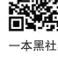

让一部分人先改变现状

### 小红书完整推广运营方案——天枢

最开始我运营小红书的目的仅仅是为了引流粉，通过分享大量女性喜爱的笔记内容，在评论中留下话术，把粉丝转移到公众号上。

当时做一个号只用一个月，共发布20篇左右的笔记，获得1.7万粉丝，12W的点赞收藏。

这两个月有很多用小红书做号的工作室也加入进来，制作了大量的账号。流量不够分了，我又重新开始研究小红书。

本文围绕小红书的平台优势、账号的建立、笔记如何上热门来分享我的个人运营心得，也希望读者可以通过这篇文章总结出属于自己的小红书推广运营方案。

#### 一、小红书的优势：

- 1. 用户消费能力强

其实，小红书在早期的内容上，围绕着“满足幻想”这个内容类别做了很大文章。女性的消费心又天生更强一些，因此小红书经常被感知，“全世界最有钱的姑娘都在小红书”。

即使目前小红书大的用户群，大量抖音快手的MCN公司来输出内容，由于自身平台用户群的特点，本着人无我有，人有我优的原则输出女性感兴趣的内容，仍然是运营小红书账号的核心。

除开小红书本身的平台属性优势，从运营角度来看仍然有以下两点优势值得我们去做。

- 2. 利用百度搜索引擎优化（SEO）

在手机百度APP上搜索美妆等领域的关键词时，小红书的笔记内容有大概率在前排，并且还有专门的笔记版块提供给搜索的用户。

##### 3. 利于淘宝 SEO 优化

淘宝经常会甄选抓取的内容是根据你搜索的关键词和小红书上相关的关键词进行匹配，比如你搜索的词为“洗面奶”，那么上图所示的内容就是用户在小红书上发布的笔记。

#### 二、小红书账号建立的准备工作

##### 1. 账号注册

用手机号注册，作为大号（手机号注册权威性比较高）。填写性别生日，跳到第2个页面，选择你感兴趣的领域，如果是做护肤彩妆的，就可以选择护肤彩妆，多选几个，选4-5个。

##### 2. 昵称设置

不要广告太明显，或者带微信号码，留微信会被封号，昵称要符合你写的笔记类型。

微信号改成小红书号。

##### 3. 头像设置

不要过于广告型的头像，可以是真人头像或者动漫头像。个性签名不要留言微信等字样，否则会被划归为营销号，会被封号。

如果想引流的话，可以先写微博，然后在微博上面引导。或者在你的账号个性签名里面设置带有全平台同名的信息在里面。

## 第二章：牛人分享

啊～我只能说你是负责弟！

没错，不管是微信、知乎、抖音等等平台都有养号的步骤，其实在我这个运营老手眼里它只是一个习惯。

运营一个平台最不需要优先去解决的问题就是如何引流，而是要先了解清楚自己的行业在这个平台上面有多大的操作空间，这是最基本的习惯和动作。

在天枢以往的新媒体案例工作中，为了能够培养新主播这个习惯，往往就会把“养号”作为一个任务交给她执行。

通过每天大量观看同行的笔记，记录点赞数、评论留言等可以完善成这个习惯。

##### 6. 小红书的等级系统

为了鼓励内容创作者进阶更新，小红书也有自己社区内的等级系统。账号等级高，发布的笔记会更优先进入审核，内容有更大的概率被推荐。

#### 三、小红书笔记如何上热门？

小红书的推荐机制很有趣，关键点在于你的笔记是否被平台收录。
只有你的笔记被平台收录后才会有系统推荐，获得更多的阅读，很多新手做小红书没有效果的主要原因也在这里，笔记没有被收录。

##### 1. 判断笔记是否被收录的方法

文字笔记去找正文内容的第一句话，视频类笔记去找视频简介第一句话来看是否被小红书收录。
如果搜索结果中有你的笔记内容说明被成功收录。

##### 2. 影响笔记被收录的要素

排版：小红书的排版设有第三方编辑器辅助，想要排版看起来舒适有吸引力，只能多借助平台内部的表情和相框，这也是万千女生喜欢小红书笔记的魅力之一。
标题：标题是一篇文章的灵魂。一个好的标题，能够瞬间为这篇文章定下基调，流露出感情，挑起人的阅读欲望。

标题中加人数数字，带一些数据。

对好米来说这个数字更偏向于时间和金钱，虽然有些笔记我们看到标题非常不科学，但数据是个好东西。

卖水杯的商家，告诉你这样喝水暴瘦10斤。标题的情绪化。因为是个私人笔记，可以试着当无视“广告”，加入一些“超难、极致、顶级”这样的词，为了流畅，做一下标题，多加一些感叹号！！！

标题中带上身份标签，小红书大头的笔记和美妆护肤相关，因此在选择身份标签时，除去传统的学生、白领等身份，可以从现况、发质等方面寻找身份认同。

标题中一定要带上关键词，不管写什么内容，都需要围绕着关键词做文章，这也是小红书收录及推荐机制的基础，每篇文章的标题中，需要提前想好的关键词。

热度大的关键词，即使收藏上想要求排名比较好难度是非常大的，不妨试一试是不是关键词。

举个例子：护肤小红书上非常热门的关键词，我们就可以用《学生在暑假做护肤效果最好！！！》为笔记标题，来截取一些想在暑假护肤，或者学生想护肤的流量。

图片：首图和标题同样重要，直接决定你的笔记被不被看见。

对比图，画上虚线，写上文字，用到的软件：Elinecamera 和黄油相机。

图中间说出事情内容，用到的软件：美图秀秀

攻略型文字，合适的软件：Picsart 和黄油相机。

#### 四、运营小红书你还需要知道的 3 件事。

- 1. 小红书直接导流微信判定违规。

小红书上直接导流到微信中是会违规的，不过要学会了一定的技巧，一样能够完成引流操作。

在我们回复粉丝的私信时，小红书的违禁词很多，说不好哪条回复就踩雷。
我们要尽量找到合适的理由和粉丝加个微信好友。

举个例子：小红书回复不及时，方便给你V吗？我和你具体说下。
没有一直看小红书的消息，所以不能及时回复你，方便给你V吗？
要不你＋下V吧，我小红书不经常看消息，我V发你具体的。等等这些都是很利于微信的由头。切记同一个话术不要超过三次，容易被屏蔽。

- 2. 垂直领域内的官方账号。

小红书的各个垂直领域内都有一个官方账号，像美食领域的“吃货酱”，娱乐领域的“爱投票”。
他们扮演的角色和论坛版块的管理员一样，发布笔记时记得@自己领域的官方账号，有机会被推荐。

- 3. 小红书怎么赚钱？可以赚多少钱？

想在小红书上直接流量变现的前提是开通品牌合作人。
改版后小红书有三条硬性指标需要达到，从而成为品牌合作人：完成个人认证、粉丝数大于5K、最近一个月的笔记平均曝光量大于1W。

目前市场基础的报价是：

- 1 万粉丝左右：300-500 元
- 5 万粉丝左右：2000 元左右
- 10 万粉丝左右：4000 元左右

具体能拿到多少钱，还要看自己和“广告主谈，这些报价会从你的粉丝量、笔记质量等综合打分。

#### 五、总结

小红书的门槛比公众号、抖音等自媒体平台更低，也比较容易被用户发现。不需要费尽脑汁去写一篇很长的文章，它更像是朋友间日常分享，比如分享

### 冥曜

分享一个有用的技巧，分享今天拍摄的一组搭配或写真，再写一些技巧或心情，就可以是一篇不错的笔记。

我一直都不在于和大家谈钱，是因为我觉得，没有钱怎么谈梦想，它永远没办法去实现，只有现实和梦想相结合、用钱投资自己，让自己变得越来越好，你的梦想才有可能实现。

让一部分人先改变现状

## 3 天上知乎全站热门，曝光 50W + —— 天枢

#### 一、前言：

我的知乎账号 3 天时间内上知乎全站热门“曝光 50W+”，到目前总共回答 5 个问题，两篇上了全站热门。

说这个数据主要是表达一个观点：知乎流量是真实、优质、并且数据庞大的。

今年 8 月 12 号，百度敲响领投知乎，百度将与知乎展开深度战略合作，知乎全站上亿高质量问答将以智能分发的形接入百度 App，并在百度搜索、信息流等产品矩阵中，通过 AI 技术个性化分发给感兴趣不同的用户。

也就是说知乎站内的内容，会通过百度获得更大的曝光。这和淘宝收录小红书的逻辑一样，一方注重版权平台，一方注重粉丝内容。

你从现在开始在知乎回答的每一个问题、每一篇文章，在日后都会被百度搜索的用户看到，而且还可以打广告！

像我们平日通过接触的百度系产品，像百度商的百度百科、百度经验等，在上面只能留一个链接不能再次的广告。

在运营知乎一段时间后，就可以在一句话介绍处留下自己的公众号甚至微信网站等。

展示的位置也非常有优势，对内容感兴趣的用户可以轻松找到我们留下的联系方式。

再说到引流效果上面来，粉丝看了我们的回答后评论都是很认真的在写，有

## 反思

表示赞同的，有表示自己目前处境的等等。

我一般回复的电商店会很细。我这个人完美主义也比较重。

要么就不写文章不朋友不评论、既然都做了，那就做到最好、即使在网络上交朋友也要真诚对待，这种心态是我被项目转化率高于行业平均水平的原因之一。以前的同事都在微信上给我发消息，说在知乎首页上看到我的回答。

知乎上还有一个功能是私信，它不像小红书、抖音、贴吧等的私信功能，发出去经常是得不到回复或者粉丝再也不看了，他的用户重视这个功能甚至当做微信使用。

就连官方的作者小助手给你发消息都是后台有客服回复的。

再说大家有一看粉丝通过私信和我聊天的內容，这里有一个引流技巧大家看完朋友再说。

有发出合适的信号，有想加微信请教问题的等等，对话太多我就一一截图了。

这个引流技巧就是在大家都能看到的地方，一定不要要留微信号码，比如文章里、回答里、评论区等等。

有粉丝主动私信的时候，说明白意图已经很强烈，这个时候咱们就不要藏着掖着，简单交流后直接发微信号过去就可以了。

很多人做引流失败，败就败在被局限在引流话术的条条框框里。还没见到别人就一直在网络的投XX沟通术语、没有一个这个标题的文档连话都不会说。

当你脱离这些条条框框，你和客户对话也好、电话沟通也罢、话话语全是自然而对自己产品的认可。

举个例子就可以理解了，比如我们是应聘员工要去面试工作，我们只需要清楚的表达出自己的代码的牛皮、键盘都敲坏大几十个就就行。

如果我们是背着《面试时应该注意的100个小细节》去而面试的，连自己的专业都说不清，想着说话放哪，眼神看哪等，整个就和像一个初出茅庐的大学毕业生，即使面试成功，那也只是实习薪资3K。

真正的商务人士没有条条框框的限制，我们的每一次话术都不一样

样，任何平台的机器都检测不出。

这才是对破防电脑的正确姿势。我微信的个性签名写的是：请备注在哪个
看到我的，说出来尝。谢谢。
这样签名可以让我清晰的知道，哪个平台的引流效果最好，甚至最后成交的时候还能知道哪个平台的成交率更高。

OK，知乎这个平台的情况和引流的环境就暂时告一段落，下面进入知乎引流的实战分享。

#### 二、开始，咱们先养一个知乎号。

- 1. 资料：有公司背景或者牛皮背景的就写上，记住怎么皮怎么写，实在不会你就参考你那个领域大 V 的个人资料填写。
像下面这个大神写的是：成功减肥 40 公斤的主人，还没开始看我就感觉到干货满满。至少这段经历大快人心。
- 2. 资料：别去到处乱写 例如家的方式，容易被封一天。
尽量不要一言不发和别人对话，抄袭、微商、兼职、等黑五类名词的内容，容易回答内容的时候就被关小黑屋。
我有一个知乎回答的内容里面没有任何营销信息，就被封了 7 天。
- 3. 盐值和创作中心等级
之前有读者问我，为什么我的回答明显比另外一个人的答案优质，他就写了几句话，点赞也没有，排名还在我前面。
知乎的移动端有一个盐值系统，你的等级越高拿到的权益就越多，不用去思考为什么会有这个系统，这是他们公司程序员考虑的事情。
我们只要根据自己的情况每天有计划的去做一些事情来提高盐值即可，这里一位官博的说明，可供大家参考。
盐值上了 500 分，就是一个合格的知乎玩家，以后在知乎上做引流或者作品曝光才会有更多可能。
在知乎的 PC 端有个创作者中心，是知乎官方邀约内测的一个功能，它就

像公众号的后台一样，可以看到回答、文章、想法等，也方便统计数据甚至是给我们的创作提供更多动力。

这个功能只要开通运营助手，就会收到邀请，有时候关注账号就获得邀请，有时候成为热门内容都不一定会收到邀请，这件事情保持一点平常心就好。创作中心也是分等级的，等级越高权益越多，这一点和移动端的盐值一样。

关于等级有个重点需要强调一下，就是当你的创作等级达到4级，就会获得知乎智能匹配推荐。

你可以推送自己的创作的优质回答或文章，该内容会根据个性化算法自动匹配兴趣人群，在知乎首页【推荐】栏进行加量曝光展示。

综上所述呢，刷知乎的时候我们就要有意识的去提高我们的等级，这些等级越高，权益就越高，回答问题或者写文章以后才会获得更好的排名和流量。

### 三、接着，咱们做知乎引流。

关于知乎的运营引流，网络上的文章或者付费视频我都看了，在教你怎么注册账号的那些都 OK, 没什么太大的漏洞。

但是一说到该怎么回答的时候，就集体哑火了。

这也是目前在看我这篇文章的朋友遇到的一个难题，一写东西就难受，一直写一直难受。

今天我会解决大家这个问题，让各位轻松一类，舒服一盘。

我把知乎上等待我们去回答的问题分为两类：

-   1. 红海问题
- 2. 蓝海问题

红海问题就是指浏览量最大，百万阅读量以上的问题，说明竞争激烈，去回答的话很难一鸣惊人。

蓝海问题就是指浏览量一般，10W 阅读量以下的问题，说明可以轻松有一个不错的排名。

同样是关于减肥的问题，《有没有什么减肥方法是你这辈子都吹爆的？》
就是红海问题。

《怎么让自己坚持减肥？》就是蓝海问题。

把这些问题都找到的方法也非常简单，一般情况下去题库的精华板块都是红海问题，讨论和等待回答的板块都是蓝海问题。

每个话题都有子话题和父话题，只要我们找到其中的一个大的话题，就可以把我们的潜在客户全部挖出来。

### 四、写高赞回答的基本结构。

-   1. 开头上价值、混淆大众

知乎前的100字很重要，回答问题不像公众号写头条等其他自媒体平台，没有标题这个选项，前100字甚至前50字就显得格外重要，写的辣鸡那不好意思，你就准备好也收不到大家的关注了。

你去一家饭店，在不知道菜品美味之前，你会选择看起来更干净的那家；
你去相亲，你更愿意和着装整齐，并类似过来多的场合会见；
你把平时在社会上玩人的那一套拿来知道乎，不太都难。这—招不是我自己发明出来的，不信你去看看各个领域下高赞的回答，都有这个特点。

还是举一个自己的例子吧，我平时闲下来的时候喜欢复盘一些我做项目的经验和过程，大白话讲就是怎么通过互联网创业，或者是怎么通过互联网赚钱。

如果在回答互联网领域、创业领域相关的问题，如果我开头说：人在美国，刚下飞机，用自己的亲身经历讲怎么通过互联网赚钱，这样开头虽然也会有人点进来，但是不会多，再一个就是来的人不精准，我开头讲的太宽泛，可能小白居多。

一般我会用以下几种情况做为我回答内容开头：
找鸣喊版；

【最近在我自我反思：为什么我赶上互联网风口了不能赚钱？不是说站在风口下猪都可以飞起来的吗？
先说一下自己的经历吧，互联网圈子里应该没有比我更惨的了。
如果说减肥领域就这样死，我高中的时候就 150 多斤了，去年 8 月份体重飙到 280 斤，今年我花费了仅仅半年就……】

意向客户看到这样的开头会想，我也是这样的人，我也经历过这些事，自然就点进来。

以上全都是套路，如乎上有一个问题是《有没有人按照知乎上赚钱的方法赚到人生第一桶金？》这个问题回答下面，全部是各种各样赚钱的故事，如果这个标题换成，再编一个全新的赚钱故事就很庸常，而她的开头把所有人的答案都稀释一遍，甚至一下子秒杀了。

然后有理有据的出来为个其他的答案都不靠谱，成为这个问题排名第一的答案。

行业报告版：很多行业都可以用数据说话，我们写回答或者文章的时候都可以使用这些数据，并且这个数据是可以用来引流的。看完后也会相信你想拿到这份报告。

用数据或行业报告形式作为开头，大概要引起读者注意，用户会认为我们的回答靠谱、做事用心，从而提升点赞数、收藏数、评论数。

2019 年表示数据新，2000 份表示涉及行业广，其中肯定有你需要的，10 个 G 表示数据多，不会是几个小问题就把大家打发了。

后面提到的阿里研究院、艾瑞网等都是大家公认专业靠谱平台发布的行业报告。

你看，简单的一段话就把用户关心的点都包含进去，一个个数字也让看到这篇文章的内容显得高深。这就是行业报告的魅力所在。

比如：我分析了 100 个减肥成功的妹子都注意了这点儿，我花了 2 个月看了 100G 网赚资料，发展原来在互联网上赚钱是这样的……

#### 2. 中间部分上干货

中间部分也是正文部分，这里主要给大家讲一讲我的经验之谈。有以下观点我希望听课的朋友能够清楚。

## 第二章：牛人分享

#### 01. 你的常识是客户的盲区

很多人不诚心面对写作，认为自己只是一个信息差，咬文嚼字的事情不可亦到。

还是拿减肥为案例，如果我们是卖减肥产品的，产能营养素、1000 克脂肪是什么概念，出汗量与消耗脂肪之间是什么关系、节食会带来哪些严重后果等等这些常识你都知道吧？

我们的客户对减肥还停留在淘宝上一搜减肥，问一问朋友怎么减肥。

不论你是通过文字、视频、音频来表达这些专业的知识，都属于客户的盲区，他们不懂，就认为你专业，因为你专业，所以你的产品靠谱有效果。
这些客户的付出愿意，因为这些常识是什么呢？
说实话，天猫也并不是养猪嘛也没有卖减肥产品，刚提到的一那些减肥常识是我为了这个案例和知乎上花了1分钟搜的。
你看看，现在的人多么懒，翻到各个平台上搜一下相关关键词都懒不到。文字大把的写、视频大把的拍、音频大把的念，你的常识就是客户的盲区。
现在很多传统公司主要的获客来源还是电话营销，通过电话过来的客户会交给业务经理的团队做转化。
我去年也经常给各个公司的业务经理做培训，我发现W底薪的业务经理和拿1K底薪的电话销售员只有一个区别，业务经理的常识是电话销售的盲区，而我给业务经理们培训的内容又是他们甚至他们老板的盲区。
明白这句话后，你不难发现为什么同样是互联网创业，在网上卖同样一件产品，有人家族致富，有人仅仅是把这当做一个兼职，甚至为此交一大笔学费，还苦苦找不到结果。

#### 02. 让你的输出源源不断

不管是写文章还是做新媒体的其他平台，很多人都死在不能源源不断的输出高价值内容。写3到5篇长文就疲惫，拍3到5个视频就更新。

没有持续的内容输出你的流量就不稳，你的用户就没办法通过一篇篇文章一个个视频对你建立足够的付费信任。

想要源源不断的输出其实很简单，那就是源源不断的输入。

图书馆：天哥在互联网上写东西，最开始就是用的这招，泡图书馆。
我家附近有一家图书馆很安静、各个领域的书都有、借书也是免费。
书上的东西讲的一半都不是正在发生的事情，里面有很多观点都值得推敲、
我经常是看到书中很多有意思的论点、通过我的理解不断用案例去佐证这件事，
把这个过程写下来，就是一篇不错的优质文章。

这里不叫大家把书上的东西原封不动的抄下来发到网上，如果你的思维习惯在搬运文字叙述视频等形式赚钱的话，不可取也。

### 跨平台创作

不知道各位有没有注意到优秀同行习惯性的关注这个习惯，我在公众号、微博、今日头条、抖音、知乎等平台都关注了优秀的同行，尽管有的平台我还没开始写。

术业专攻，也许你的同行短视频效果不错、也许你的同行写深度文章很好。我们取长补短去运营适合我们的平台就行。举个很简单的例子，大家多多少少应该都有一 些菜谱，字数不多，不到 500 字把炒菜的过程记录下来的文字。

很多美食短视频博主就会在 B 站或者抖音，通过这短短 500 字视频的形式展现出来，吸粉百万。

再举个例子，抖音上有一个大 V 每天都会用 15 秒的短视频告诉粉丝一个减肥动作，连续发了 30 天。
我们如果是可以在知乎或者公众号发一篇文章；这 30 个动作坚持一个月，让你在家暴瘦 50 斤！
这还仅仅是一个大 V，还仅仅是抖音、书上、各个运动 APP 上、微博等等。

#### 五、总结

内容流量的本质就是，在适合你自己的平台，适合你的创作形式上，源源不断的输出内容。

日积月累，不管用户习惯用什么平台，只要搜索减肥、健身、瘦身技巧、减肥餐等任何跟你相关的关键词，看到的都是你用心准备的内容，在这个过程中如果哪怕被某个平台推荐，那你的流量就会瞬间爆炸。

没有人可以一步登天，如果有那个人一定不是我，甚至是你。

一本黑公众号

一本黑社群

让一部分人先改变现状

## 关于信息差和资源整合的商机

### 几年以前做的是软件工具教程等集合

例如：15年的微信广告机 微信圈公开网络出来道一年，微商群体也刚刚冒头，所有人都苦于加满好友，就有一些技术大神，写出了适用于安卓系统的.apk 应用商店是下载不到的，具体功能就不详述了。那时侯还可以全国到处加附近，无上限加人你懂的，然后呢，我们就买了便宜到爆的安卓小平板，包.apk 加暗内置进去，美其名曰 XX 微信广告机，全天候全国附近人加人，强制加入通讯录，24 小时不断发送广告等等等等等天功能，售价 3980 元每台，多少人买就 不透露了，以至于现在的客服手机、自动刷内容赚钱的设备基本上就是这个套路了

例如 2：16 年开始，以平安某小贷为起点、全国范围的 p2p 小贷公司如雨后春笋一般爆发其地，也不知道全国缺钱的人会有那么多！XX 金融一体机，顺势而生，教你如何贷款各种贷款、部分金融知识，如今从小白拥有一体机后变为金融小白神，利润是否令人， 比如某些天每天都在网上找各类小贷公司申请入口宜和宜付图文和整理操作步骤。当时那个风口时间紧迫，app 帮 懒得开卖，直接公众号内置官网，做了详细分类，各种超链接挨着各种把自己推荐办卡等等等的链接嵌进去，再加装个注机，按时长生成无限个激活码，然后把公众号号链接到桌面，美其名曰和微信打通的 app......

载体也是某某电商平板电脑，单个激活公务公众号内使用 1680 元每年，单台设备 3680 元，具体卖了多少也不透露了，最后发现玩玩具真的会害人的，越是没钱的人，越是着急的人，你再给他搞出再多的钱如果没有脚踏实地的干，去搞这种东西，最后只会给社会制造负债。声明一下我们不是头部玩家，听

说头部在该项目上赚了3.7个亿，把整个县城的GDP都有所带动，鲁商，详细的再提。

例如3：回归到微商，产品压死在手里，卖不出去要亏、小白腹诽感慨做微商这帮子穷得还要进阶了，又无反顾几万牛都拉不回来的疯狂投资，最后发现自己没物件，没精确落客，然后针对此群体的各类教程也如雨后春笋一般：工具类、方法类、策略类等等等等。打包在平台售卖，收取高额会员费。

感觉得类内容，在今时今日依然行得通。毕竟是吧……你懂得……这就是所谓的信贷差距，归根结底，还是人的惰性，也不跌落，就是嗨、哈都难（不懂得分辨也不行咯），就是自己不去找死，气死人，活该被割韭菜。从广告里发现商机，多写黑老文案，自己还不想出来123%？！

例如4：八零年代，听着 Beyond 和 麦可和收益，全国下海经商热，特别是深圳这个地方，各处都在兴建术，清眼见是繁华，商城高楼高楼屋林立，人员密集的地方，安全保障也必须是最好的，而其中一环消防设备尤其显得重要，几乎每个商场和人员密集场所都需要一种叫防火卷帘的东西（很很很厚 的卷闸门），走到空间交界处，地上有清楚在此处立柱或特地的地面，抬头就能看到它），这市场也是全国性的，全国生产电子电器类产品几乎都集中到这里，控制防火卷帘升降的最初版本是铁链手拉式，喊死人还得很高大上，可还是已经安装成想要开就全自动的怎么吧？

有意思的事就来了。南方虽然设备厂多多，我逛全城找不到一个适配于某大功率马达的遥控器，而且这种遥控器几乎全部前往了内地，售价15块一个，因为安装防火卷帘一般需要由商场下降，晚上23点以后进行，电焊板下十几甚至几十米长的物体，都得工人手扛着坐，不曾有高价得到厅拉着上，累，最后15块的控制器，最终售价3000每台：……对得是累，谁让你们本地买不到，让你们爱贱卖……（亲身经历，21米长的防火卷帘，我们4个人抗到十一楼，按平方收费，一晚上几万块还是有点够哦，最后，深划县美，老子就是水土不服啊。）

最后给各位凑个底，成功确实有捷径，捷径＝信息差，你掌握了大多数人不能掌握或者有高门槛才能介入的信息或者技术，你就有资格和机会进行维护

打击，你想和大多数人拉大信息差，就多看老黑文章就行啦。

老黑矩，祝福各位尽早通过互联网这个快车道拿到自己想要的结果，然后回到线下，我们一起做些实体行业，不比线上利润低，还不累，还能面对面的谈缺。做些利国利民长长久久大势所趋的正事业，帮助别人、成就自己，做自己能掌控和心中有数的事，让自己的内心无限接近于充实。

一本黑公众号

一本黑社群

让一部分人先改变现状

## 第三章
捡金思维

### 2019-2020

## 喜马拉雅如何从 0 到 40 万粉丝且单日专辑总销售过万——天枢

今天我就给大家分享一个大家注意力之外的市场，喜马拉雅 FM 音频项目，是怎样从 0 到 1 做到 40 万粉丝且单日专辑总销售值过万的。我从这五个角度来讲。

-   1. 音频内容的生产成本低复制力强等特点让我们选择切入音频这个行业
- 2. 蓝海思维确定了睡眠类目中自然声音的录制
- 3. 初始的粉丝通过个人 IP 投放与公域流量投放从 0 做到 1 万粉丝
- 4. 通过私域流量管理从 1 万做到 10 万粉丝
- 5. 加强粉丝力与内容力从 10 万成功做到 40 万

#### 一、音频内容的生产成本低复制力强等特点让我们选择切入音频这个行业

1. 在做一个产品之前首先考虑的是可复制性，是否可以一个人熟练后，可以迅速批量化放大。因为整个公众号以及短视频领域对团队成员的素质要求较高，音频的录制成本低且对原创性的要求也没有那么高。
因此，我选择了更小众的音频产品。

2. 查理·芒格说过：事情要反过来想，在多数人从一个市场转向一个新的市场时，第一个市场就可能成为新的流量焦地，因此我再思考视读文字，情景短视频被两个渠道占用的时候，可能音频是一个新的流量焦地。于是我决定音频这个方向来做。

#### 二、蓝海思维确定了睡眠类目中自然声音的录制

音频类目中，有声读物（小说、历史、人文、财经）、音乐节目、相声儿大类都需要相对专业的技能，因此我就开始盘算淘宝的蓝海冷词思路，关键词CCI = 日搜索人气 / 在线产品数 >=0.5，产品商城点击占比在 40% 以内，1000<= 每日搜索人气 <=10000，一般都是在这个维度思考。

因此通过淘宝蓝海冷词标准放在喜马拉雅上，分析得知，睡眠类目中的轻音乐都是很好的产品，但是难度较高是自己团队的上手程度、版权问题。

最后决定把大自然的声音作为产品的重点。

#### 三、初始的粉丝的积累我做了这几个事情，0 到 1 万

##### 个人 IP 的塑造

-   1. 困难且真实的录制场景让用户产生情感的共鸣。
在塑造个人 ip 的时候，强调专业、可信、真实、独家声源。
因此单单声音是不够的，我在录制的时候，会把现场录制的图片记录好，定期进行图片的分享，强调雨夜声音的困难，让用户产生情感上的共鸣。
这样算弹的声音有痕迹，对听众来讲，他们也会产生感动。

-   2. 个人主页与专业测评进行整套的 UI 强化。
设计有个人标识与单集封面。优化个人主页背景图和个人介绍，人物塑造要以真实现身为主，主页背景图用真实的录音照片。

##### 流量投放

-   1. 同类主播批量化在声音音发评论区是最流量的最好方法。之前看过一篇文字，讲的是当时学院向同行批量化喊人，你就是大神。
所以知道我的用户是想助眠的一批人，我的用户是存在于各大主播的关注栏里，并且铁粉总会看评论区，且喜马拉雅评论区的内容特别少。
所以我的第一步的内容是找到主播，每个主播发布声音或者是专辑的时候，我用心的在各个主播的评论区评论。
当一个用户在自己关注的主播经常性的看到我的评论，会产生好奇，会点

点看，因此我的内容就持续的生产曝光。

-   2. 海量小号对同类主播主精准粉丝区进行私秘信息轰炸。
喜马拉雅的主播粉丝区的公布，生成声音海报进行投放，多小号进行每个主播的粉丝私信，只要把声音海报文字设计的有诱惑力，绝大多数人都会进去看看的，因为粉丝足够精准，转化率会发现比你预想的高很多。

-   3. 自然声音卡片的进行线下投放。
我把声音设计成一张卡片，卡片的内容就是大自然声音助眠，给一些做瑜伽门店的朋友，还有茶室的朋友做卡片的投放，我一直推崇门店卡片数据投源的投放，你会发现流量成本特别低。

用到我的方法，任何人从 0-10000 粉丝的积累还是很快的，而且投入成本也是不大的，这样也可以适用于公众号种子粉丝的积累。

#### 四、1万-10万，粉丝的增加我做了这几个事情

在1万到10万这件事情上，其实种子的粉丝积累是够了，要对私域流量数量对内容搜索进行一定要求的管控了。

##### 搜索优化专辑名称

在自己垂直领域中最容易学会就会垂直领域之外的溢值。
最初我这这里都和睡眠相关的关键词，在所有的专辑里都是强调整睡眼的相关关键词，但优化后的效果还是不满意。
于是我挑选睡眠的图，把专辑中大自然提取出来，主打自然声音，然后我把所有的专辑进行自然声音的优化，这样自己的专辑名称播放量又到了一个新的层次。

导的关注区是我重度粉丝的聚集地。

因为只有特别喜欢我的，才会再去另外一个工具重新关注我，评论区私信区也是我爱粉的聚集地。

利用这几个维度，我筛选出 200 多位重度粉丝，虽然说不多但是对我来说够了。

-   2. 提升铁杆粉丝的分享裂变能力是下一阶段增长的引擎
赠人玫瑰手有余香，找出 200 位粉丝，我送了 200 个粉丝，1 人 1 张刻录我自然声音的光盘加上 1 套精美的风铃，然后把他们拉到微信群里。

我每次在声来录制的时候都会先群里分享我的足迹，然后制作声音的过程。声音的成品都会在群里分享，每次声音发布都会在群里，然后告诉粉丝们，帮忙进行分享，然后有喜欢同样声音的朋友可以推荐关注“声客”。

就这样，声音的分享提升了近 300%，这就是铁杆的力量。

#### 五、10 万 -40 万粉丝我做了这几个事情。

超过 10 万粉丝，在喜马拉雅算是一个垂直领域的中等主了，这时候就该思考自己的优势到底在哪里，那些维度源高于别的声音主播。

后来我总结出两个大核心优点点：内容力、粉丝力，这是我未达到 100 万粉丝的运营重心

##### 提升内容力

与声音领域的大 V 进行联合发布专辑是内容裂变有效方式

粉丝可以裂变，其实我认为内容也可以裂变的，联合大 V 进行内容共产是我认为的一种裂变手段。

于是我创透一个平台上没有的音频产品，最终结合了中国颂经网创办人、音疗从业 20 年的杨老师一起推出了《牟声疗愈熏想音乐》付费专辑，就是牟声与自然声音结合进行专辑，这样在双方粉丝的努力下，专辑一天销售收入在 4000-5000 左右。

##### 提升粉丝力

## 第三章：杨金思维

无上限制的加强私域流量的人群增强粘性与分享力

孔子续绝几千年，是因为塑造了老师这个角色。

因此怎么提升粘性的手段就是成为一个小老师，教他们一定的技能，因为老师的话，没有哪几个学生是不信的。

这样我就开始进行声免费声音录制课程的培训，每个周都会定期培训，然后分享自己在哪些地方会遇到好的声音。

通过这样，我会粉丝的粘性又迎来一个全新的提升，我的铁城铁杆人数也不断增长，分享力也不断增强，评论数也不断增强。

就通过上述手段，经过一段时间的坚持，粉丝也顺利达到 43 万，也成为喜马拉雅年度 10 佳主播，进入音乐销量排行榜前三。

几个月前我粉丝也每天轻飙万过，版权授权等一系列的收入其实真正意义上已经可以养活自己了。

我认为呢，其实现在的选择很重要，在年轻时期，如果长远规划是做成一件为人生留下浓重印记的事情，那么加入创业公司或者是创业吧，换个方式、换个角度也许可就是海阔天空，毕竟我们年轻人的征途应该是星辰大海。

让一部分人先改变现状

## 关于视频号，给你说点掏心窝的大实话——战劲

我的视频号一周之前开通了，很多朋友看到我开通了视频号都非常的着急和焦虑，不停的要我到底怎么开通视频号？

首先，非常遗憾的告诉大家，视频号申请通道现在已经关闭，现在只能通过官方或是有官方邀请开通视频号以及后官方又给了他邀请卡，他可以邀请你开通，但是必须是你们的好友关系必须是 3 个月以上。

但是现在有邀请卡的人是凤毛麟角，所以对于大多数人现阶段想要开通视频号只有一个字：等！

因为没有权限发布视频号，而看到身边及少数人开通了视频号，所以心里非常着急。

根据我的观察，现在阶段有权限开通视频号的，主要还是以下 4 类人：

+   1：早就在各大平台打出名堂的大 V
2：在各大自媒体平台创作的自媒体人通过关联申请（现在申请通道已经关闭）获得开通权限
3：一些在微信里创作的内容创作者，其中大部分是公众号的博主。
4：被官方莫名其妙邀请的幸运儿

从我运营一周视频号的经验来看，我觉得大家完全没有必要对视频号焦虑，别忘了，它还只是个内测的产品，很多算法、推荐机制、产品逻辑都还不清楚，甚至不完善。

难道视频号出来了，你就可以一飞冲天了？你憋得不去做微视、根本原因不是因为你没有视频号的发布权限，而是你根本就没有那么强的能力了。

真有那么把刷子，早就在抖音、快手、B 站呼风唤雨了，就算你等到视频号

号出来了，你做视频的水平还是从原地开始。

所以，与其焦虑视频号的来临，不如在视频号临近之前，好好做一下关于视频号的准备。

不让大家发力做视频号最重要的一個原因是：根据我的测试，视频号现在的推荐逻辑和算法是非常的混乱。

大家都知道，以后草根创业的方向基本上是个⼈ IP 为主轴的，而个人 IP 的基本要求就是领域要细分更要具体，粉丝要精准。

我的观点一直都是明确的，无论是现在的抖音、快手、还是以后的视频号，大家一开始的聚焦点就是要做垂直领域，而不是杂糅。

你去看视频现在在抖音的多么惨烈！一个视频几十万几百万的播放毫无商业价值，涨粉寥寥无几，带货能力也是差的一比，空有一片假繁荣！这种表面热闹，实际上没有任何积累的模式我们不可以也不去碰这种项目，纯粹是浪费时间，所以这就我说的，后期所有的短视频创业者，一定要聚焦在垂直领域，必须要打造一个属于自己的个人 IP！

而我刚才也说了，视频号目前的算法推荐无论对于垂直领域还是个人 IP 打造，都是非常不友好的。

抖音可以根据算法把相似内容推荐给匹配的精准用户，中心化的分发机制，这种分发机制对于挖掘潜在用户是非常精准的，而视频号现在更多还是基于“熟人”社交的一种延伸。

视频号现在的推荐机制跟公众号文章的“在看”传播一样，比如你点了一个文章的“在看”，你的微信好友在“看一看”这个栏目可以看到那篇文章。

同理，视频领域也一样，你在视频里给一个视频点赞，你的微信好友刷视频号的时候也會有相当的概率刷到这个视频号。

这是视频号第一次传播的机制，也就是“熟人社交”推荐，而后第二次的传播才是视频号根据目前还不明确的算法进行推荐。

也就是说视频号，不是依靠中心化的推荐和分发能力，而是依靠用户的关系链，将相关的传播内容分发它认为感兴趣的用户面前。

做垂直领域，我们要的不是熟人社交，熟人社交更适合我们目前微商销售。

## 反思

的“裂变”，你看我们现在看到的各种裂变，其后来的参与者基本上都是前面参与者的熟人，但是裂变并不适合垂直领域。

垂直领域就好比小而美，越垂直越细分越好、不是越曾经越多越好、粉丝如果不精准，要那么多人除了增加自己的人力物力基本没啥用。

所以，视频号现在的这种“熟人”推荐机制对于做垂直领域是非常不友好的，从我发布的几个视频来看，后来关注我的粉丝（非微信好友）也并不精准。

我说了这么多你放心了吗？

视频号现在还只是一个内测的产品，它需要一定的时间打磨和优化，现在的视频号运营者，更多的是扮演一个“试吃品”的角色。

可能大家都还记得比较淡或者手痒就看看吧，视频号体验现在也是一般糟。视频号目前还没有比较谨慎，抖音和快手都看得到如此关注的好友，而且具备私信功能，但是视频号目前甚至连这些粉丝数据都看不到，不仅与此，视频号的私信功能也没有，这就大大的削弱了跟粉丝会话的能力。

而视频号最后我担心它还有一个很关键的问题，那就是：用户习惯

我们每个人习惯使用哪些产品和服务，基本上是确定或者说有上限的，超过上限再培养教育都很难，因为脑子不够用。

比如我们聊天就说微信，购物就用淘宝，短视频就抖音和快手，这种用户习惯其实很难被改变的。

微信信息已经做了聊天沟通，公众号阅读，朋友圈社交、交易支付等种种措施，这已经是它要达到和做到的一个习惯了。

这个时间又来了个“视频号”，用户会形成习惯乖乖的打开看视频吗？
对这一点，其实我心里也是没底的。

就拿最近一个案例来说，公众号去年为了挽救行业越来越低的阅读，把文章“赞赏”改成“看一看”，同步到发现的“看一看”当中，但是这一招并没有什么效果，大部分用户还是不去点开看一看的，发现90%的人只看朋友圈。

别忘了，当年微信刚出来的时候，被众人吹捧的附近的人，摇一摇现在都快成使用的“习惯派”淡出了。

所以，视频号目前还不是跨越布局短视频的主，他的前途怎么样，依旧

旧爱打一个非常大的问号。

虽然现阶段的视频号，存在这样或者那样种种不足，但是视频号的未来，大部分新媒体人是看好的。

从个人 IP 到品牌 IP，基于全民浮躁、很多人抛弃了文字阅读吸取知识的大背景下，玩好视频，尤其是短视频是非常好的自我投资选择。

视频号被人类最多的问题就是，到底发布什么样的内容容易上热门？这个问题现阶段是无法回答的。从感性角度分析，抖音快手日活 3.4 亿的平台不同，微信是拥有 11 亿用户，大家各有各的喜好，很难说到底什么样的内容容易成为爆款。从理性角度分析，抖音和视频号的算法推荐实在完全不一样，所以抖音那些体系完全套用在视频号上也是不对的。

不过可以肯定的：内容为王。把内容做优质，哪个平台都会保护优质的内容创作者。

而大部分的“微信号”（包括我）看好视频号的未来，基本是以下面 5 个观点：

+   1. 我们之前做的所有短视频平台目的是从微信导流，但是抖音快手对于微信导流限制非常严，但是视频号属于微信的生态闭环，后期短视频的从业者对于粉丝导流到私域流量的限制将会大大降低。

+   2. 视频号是腾讯布局短视频最后的“王炸”了，微视产品基本上宣布失败了，由于短视频这块蛋糕太大，谁也不会轻易放弃，在这种情况下，腾讯布局短视频只能另辟蹊径，但是不可能在开发一个独立 app 来做短视频了，那样大概率会重走微视的老路。

+   3. 视频号对于挖掘潜在在短视频人群有非常重要的作用，单靠抖音快手日活跃用户才 3.4 亿，而微信拥有 11 亿的用户，这中间至少还有数亿的用户没有触及短视频，视频号的出现必然会促进新晋视频频用户的挖掘。

+   4. 短视频电商将会迎来春天，商业化路径会大大缩短，现在视频号底部可以链接公众号，如果后期把电商直播等打通，那么可以实现微信电商的快速发展。

5: 腾讯高层，尤其是微信创始人张小龙已经在多个场合明确表示，微信之所以重偏图关系的内容创作而忽略了视频的内容创作，所以今年微信在视频创作方面还会非常多的动作。而视频号就是这个“主干”的基础

好看视频号的内容创作的观点基本可以总结成以上 5 点，而如果让我用自己的一句话总结：

视频号的出现既是锦上添花又是雪中送炭、锦上添花是可以促进整个微信形成一个大闭环，拓展更多的商业价值，雪中送炭是指这基本是腾讯布局短视频最后一搏了，如果失败、很有可能腾讯短视频永远说再见了。

我还是那个观点，对于新生事物，我永远要保持中性敬畏、视频号虽然前途未卜，但是确实是我这近一年看到最好的机会，所以不管怎么说，扎根微信的创业者们，今年一定要关注视频号的发展趋势。

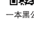

一本黑公众号

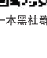

一本黑社群

让一部分人先改变现状

## 掌握这个公式，玩转社群裂变——bt男孩

我一直觉得做互联网任何项目的营销推广底层逻辑都是一样的：找到你的目标群体 -> 用你的产品 / 服务引起他们的兴趣 -> 建立信任关系 -> 转化 / 成交。用专业术语来说就是：曝光 -> 点击 -> 交互 -> 成交。

这是一个漏斗营销模型，所有的互联网营销推广都是围绕这个公式去不断尝试、优化。

而对于社群裂变底层逻辑是什么呢？

## 我总结为一个公式：内容 + 诱饵 + 策略

当然，前提是需要找到你的目标群体是谁：目标群体在哪？对于社群裂变冷启动，需要找到你的初始种子用户。

你有了产品 / 服务以后，根据你的产品 / 服务分析你的目标群体是谁？目标群体在哪？

举个例子：假设你是做企业管理培训，那么，你的目标群体就是企业的 管理者或各企业法人。而这部分人集中在哪呢？写字楼业主群是不是一个方向？

产品有了之后，也知道目标群体在哪，接下来就需要用内容去触达到这些群体。

下面跟随社群裂变底层逻辑公式：内容 + 诱饵 + 策略进行拆解分析：

## 内容

这里说的内容不仅指的是文字，指的是广义上的内容，如：文章、图片

## 反馈

（海报）、音频、视频等。

为书说“内容” 是底层逻辑里面的第一个环节。你的产品/服务需要借助内容的形态来表达出来。

你的内容需要戳中目标群体的痛点，或者给予价值或者引起共鸣等。别人对你的内容感兴趣才行，最基本的你的标题需要吸引人，让人有点击的欲望，或者你的文案需要有诱惑力。

那么，什么样的内容才算得上是优质的内容呢？

+   1. 帮助表达：帮用户说出了用户不好说、说不好、不方便说，但很想说的话。\n2. 提供谈资：人类喜欢交流和聊各种八卦、新奇的内容。\n3. 帮助他人：提供有助他人的内容，如干货指南等。\n4. 打造形象：塑造自己在他人心目中的形象，比如时发一篇公益的文章，显得自己很有爱心。\n5. 共鸣行动：被文章的故事、价值观所打动，不由得想支持作者或主人公。通过优质的内容获取初级种子用户。

## 诱饵

为什么我们把诱饵作为公式中第二个环节呢。钓鱼的时候我们都知道、鱼要不要吃，取决于你的诱饵香不香，有没有足够的诱惑力。

通过优质的内容获取初级种子用户后，接下来就是裂变。让种子用户源源不断的给你拉来更多的用户/粉丝过来。

人的本性都是贪婪的、利己的，没有好处为什么给你分享、给你传播。所以，这就需要诱饵来使初级用户进行传播分享。

举几个例子：

+   1. 企业管理培训的裂变诱饵：把内容分享到朋友圈/群、邀请好友关注公众号/加群等，可免费获取** 管理培训讲师的在线培训门票；\n2. 女装店铺的裂变诱饵：把海报分享到朋友圈、邀请诸多好友进群等，可获获女装店铺现券、送** 围巾一条等；\n3. 资料包裂变诱饵：分享、转发朋友圈或者拉好朋友进群，可免费获得 **

价值 XX 资料一份，限量 100 份先到先得等。

初始种子用户能不能裂变起来，取决於你的诱饵下的够不够香，够不够有足够的诱惑力，需要考虑你的星。你的诱饵是不是用用户确实想要得到的东西。

在这里分享一个小套路：很多人认为为诱饵裂变都是花钱的，花钱拉用户，其实很多时候还可以赚钱。

比如，你的诱饵是某个产品价值几十块钱（在淘宝上的价格几十块钱），告诉用户，帮我分享转发可以获得价值 XX 礼品一个。

你可以用信息差，这个产品在淘宝上几十块钱，在 1688 或其它鱼上可能只要几块钱，然后你告诉用户，产品是免费送的，但是得自己付个邮费。而往往很多时候这个邮费已经够你在 1688 上拍下的产品 + 邮费了。

## 策略

围绕公式，为什麽我会把策略作为公式的最后一个环节。做好内容可以获得初始种子用户，利用诱饵帮你进行裂变。但是，往往很多时候会发现，诱饵弄下还是没人愿意分享，说明这个诱饵不够香。

而策略就是围绕内容 + 诱饵展开的，我该用什麽样的内容去吸种子用户，我该用什麽样的诱饵来进行裂变。

我想表达的策略，就是针对不同的产品，不同的目标用户，该如何去分析用户的痛点、需求，给子什麽样的利或者提供什麽样的价值作为诱饵才能顺利的裂变起来。这个就需要我们进行思考，而我把这种思考统称为策略。

策略：结合项目本身如何去优化你的内容，如何去寻找你的诱饵。

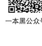

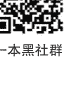

让一部分人先改变现状

## 用户增长不是砸钱就能行

之前有不少亲友问过我关于用户增长的问题，说他正在做一个新品牌、砸了不少钱打广告，但是效果却非常差。

他是做三四线城市的精酿啤酒品牌，在推广方面还是用传统的广告形式，投电视台、投滚动广告。

当时我告诉他，要想在三四线城市做精酿、难度可不小，最大的问题就是用户习惯的培养。

举个例子，之前美国有一个职业棒球联盟，当时他们想在中国推广棒球，前期采用的也是砸钱做广告的方式、效果不用说、无法比差。

原来当地呢，因为中国人根本不看棒球、也不懂棒球，就算电视上播放比赛也教不了人们一个，更别说有人玩这项运动了。

但是最后他们想了一个办法，转移了一下思路，把投广告呢的钱用来购买棒球棍或者棒球，放在全国各地的学校里、先让体育老师带他们玩。

玩着玩着，这波孩子就长大了，后来基本都成了棒球爱好者，棒球产品的使用者和消费者。

其实关于一个新品牌如何快速打开局面，光靠大量的广告是完全不够的，你得考虑到细节的认知。

就像现在精酿啤酒这个市场，本身一线二线城市做得还不错火，要想在三四线城市做起来，那简直是难上加难，最大的问题还是出在用户培养上吗？所以这件事得看，很多行业就是这样的，砸钱没大用，巨头进去丢个几千万也照样激不起水花。

## 第三章: 秤金思维

因为他对隐私泄露没有概念。正是我们前期做了很多关于酒店隐患安全泄露的铺垫，激起了用户对隐私安全的重视，所以当我们推出一款能解决用户需求的工具时，自然非半功倍了。

让一部分人先改变现状

## 知乎好物推荐的实操实验——微光

大家好，我是微光。今天给大家讲讲我这 50 天平均每天 1 小时玩转知乎好物推荐的实操经验，一个小白号从 0 到时薪 300+ 的全部方法，希望能对大家有所帮助。

目前账号总赞 679，创作者等级 4 级，粉丝 656（都是僵尸粉），获赞 1146，回答问题数 55，最高回答获赞 117。

我是 1 月 29 在星球看到了 @ 傅超人 关于知乎好物推荐的实操分享，然后 2 月 2 号开始动手实操，后面又知道了海哥，到今天刚好 50 天，在这里要感谢一下超人和海哥，你们是我的引路人，谢谢！

## 开始正文，先上大纲：

寻找“细分领域”、选品，决定你的绝对收入、问题在哪找、哪些问题应该回答

回答问题，先护号超、不会写、看这里、禁言、被封号前该尽弃了、让你的回答被更多人看到、提升账号权重、新问冷启动

+   1. 寻找“细分领域”

知乎的细分领域和我们平时说的不同，知乎采取的是同答案，就注定了同质化的问答会很多，也注定了问题之间热度差别会很大，我们应该选择的是那些热度不大、竞争相对较小的问题。

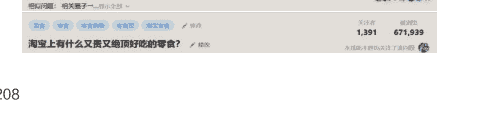

## 第三章：榜金思维

## a. 选品，决定单笔的绝对收入

知乎好物推荐走的是淘宝款式，注定了佣金就是我们唯一的收入来源。提升佣金收入的方式有两种，一是提升下单量，二是提升“佣金比例更高”的商品。

提升下单量的方法有两个：①提升回答质量，促进转化②利用京东平台规则获得额外收入。

第一种是提升回答质量短时间很难做到，这要求有一定的文字功底；第二种是我在用的，尤其是我插入的都是淘宝链接，体验太差，佣金抽成 50%，还要技术服务费，优惠券经常失效，而且通过链接购买其他商品没有佣金，曾连续 3 天 300 点赞 0 下单的记录，我就直接放弃了。后来全部换成了京东链接，京东有 15 天锁粉，跨订单也计入，抽成在 30%~50% 左右，95% 都是 30%，所以体验上是最好的。

推广佣金比例更高的商品，这个是提升收入最好的方法，以电动牙刷为例，推广飞利浦佣金比例在 0.1%~0.01% 左右，而换成千山，佣金就上升到 20%，这种提升达到 200 倍以上，是非常恐怖的。但是，这也不是要推的，不能一味想提高收入而去损害消费者的利益。

我的方法是，我选择在 300 以下的价位推广国产品牌，这个价位的国产品牌牌性价比高出飞利浦、欧乐 B 太多，刚好佣金比例也提高，而在 300 以上价位就是力推飞利浦这类大牌，高端产品就讲品牌认同度，也会体现出我确实不看品牌而是看商品去推，可信度会大大增加。

## b. 问题在喀我

这里给出两个方法，以保温杯为例：

+   ①百度：保温杯推站点zhihu.com
②知乎：搜索“保温杯”

## 反薅

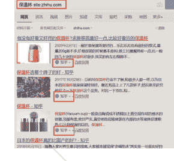

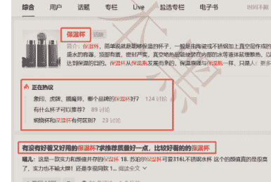

第①种能看到被百度收录的问答排名，这类问答被百度收录、有很大的自然流量，仔细找找你会找到许多流量不小、但回答很少的问题

第②种就是旗下自己的问答排名，越排在前面，说该问题最近热度越高

+   c. 哪些问题更容易回答

浏览量 / 回答案 >5000

我平时选问题大致方式就是这样, 只做参考。

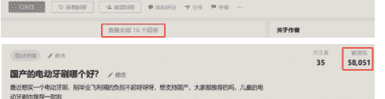

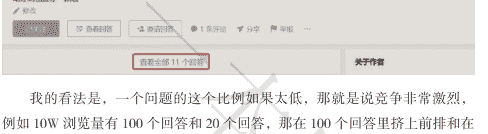

我的看法是，一个问题的这个比例如果太低，那就是说竞争非常激烈，例如10W 浏览量有 100 个回答和 20 个回条，那在 100 个回答里排上前排和在 20 个回答里排上前排的难度差别最少在 10 倍以上，如果你非要写，我建议在 账号权重上升到一定程度之后再去负责答竞会独占作，前期还是不要亲入血海 之中，以免成为炮灰。

## 2. 回答问题, 先抄后超

+   a. 不会写, 抄这里

推荐给你我过去的渠道: ①什么值得买②公众号文章③百度直接搜小红书⑤和乎高赞回答

前期多看人家的文章结构, 总结出来, 列出 123456, 写的时按条条在里面; 写得多自然就能脱离他们了, 我就是这样做的。

还有一点, 玩和乎的人有一个特点, 看重数据, 你把要推广的商品的数据整理好加人回答里会格你提高可信度。

+   b. 禁忌, 被平台机器劝鸡头差了

①别秒发②别针对平台③别加大 V ④把好物推荐规则看几遍

为什么要单独说这个事，因为最近有不少朋友的账号被知乎处理了，取消了好物推荐的功能，原因是涉嫌版权作者和大V举报。
我做这个是去赚钱的，所以我对自己的要求很清晰，顺应平台，按照规则回答，我也不管你和大V有没有内容，我不触犯你的利益，我就赚点%:花钱，谁也别挤谁。

## 3. 让你的回答被更多人看到

我账号目前估值 679，创作者等级 4 级，数据不高，但由于我同一话题下回答了 11 个问题，获赞 400+，是该话题目前前话题获赞榜第一，所以我在回答该话题下新问题的时时候的初始排名会很高，回答少的甚至直接排首位。

a. 提升账号权重
三个方式：①提升盐值 ②回答字数在 500 字以上 ③同话题多作答

## 提升盐值

知乎的盐值提升有 5 个维度，按照要求来就行了，下面给出提升技巧：

+   - 基础引用：能填的资料都填上，别留空
- 内容创作：回答问题 + 发布想法（当期）
- 友圈玩
- 友善互动：每天评论 3 条以上遵守公约，别打广告，别搞事
- 社区建设：多举报，越多越好，这个升盐值最快（黄、毒、地域黑、明星等容易爆个人敏感痛点的问题）

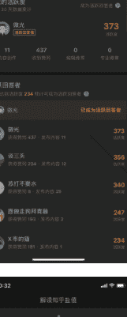

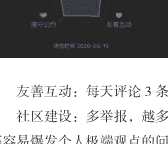

b. 新四卷冷启动

刚开始什么都没有，写的回答基本不可能被推荐（热榜问答除外），所以就需要刷赞。新回答写完 20 分钟如果没有自然点赞就刷最多 5 个赞，然后隔半天左右还没有自然点赞就在刷 5 个，然后就别管了。

刷赞注意事项，提前做好要求，“页面停留 10s 以上，拉到底部截图点赞”，却乎有监测机制，发现刷赞轻则禁言，重则封号。如果还不放心，建议找几个朋友给你点赞，不想麻烦可以找我爹海，海哥 @Koe，海哥有自己的刷赞群，物美价廉。（海哥记得给我们打钱）

就说这些吧，我经历过的都写这了，只要按照这个来，平均一天花 1 小时，每个月多几个干货的睡后收入还轻松轻松的。

让一部分人先改变现状

## 知乎圈子一周涨粉 2000 + 完整复盘——天枢

很多事儿是钱的问题，也不是钱的问题。

但为啥我们总认为所有的事儿都是钱的问题呢？

老婆跟着老王跑了，那是钱的问题；
创业跌倒墙挡不得刺，那也是钱的问题；
做项目没流量，那还是钱的问题。

因为我们很难承认自己有问题，只有这样才能获得 3 秒钟安逸，把所有因果归到钱身上，舒服吗。

没有赚钱的欲望，遇到问题用踢给没钱，这就是做项目做人失败的原因。遇到这种情况，学习技术找资源的事情我建议都放一放，把《毛选》读上几遍，好好讨论下到底要不要面对自己的问题。

3 月底天枢建了一个知乎圈子〔创业圈〕，一个星期增加人数接近 2500 人，长期占据圈子行业榜第一。

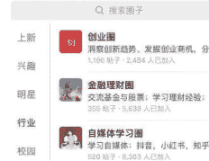

也上过几次新圈子榜单，这些都是我们人没进去的原因。

我们暂时没有发广告，也没有处理我们圈子的广告，不过据我观察，他们在我们圈子发一条引流的帖子，能得到 30 人左右的回复。

也就是说，如果我们每天去引流，一天加 30 个是基本操作。

天枢对圈子的看法:

## 第三章：樊金思维

1. 短期来看：用了我这套方法去做，可以直接引流到微信，相比于目前其他的平台，轻松很多

2. 长期来看：如果乎孵这个板块做起来了，会像贴吧、豆瓣小组一样有更多的变现可能。

所以，只要没设有每天操作年赚过亿的项目，都可以花点时间来做个圈子。
本文会按照刚刚新手到圈子大神的时间轴来写，前半部分讲讲知乎圈子有什么用途怎么用，后半部分完整复盘圈子建到似乎的经验和细节。
您将收获快速为自己的圈子引流、增加圈子人数的方法，感谢各位老板耐心听我吹完牛逼，下面就进入干货时间。

## 一、知乎圈子有哪些曝光位置？

曝光位置可以看出一个产品前期有多少人使用，比如在百度搜索某个关键词经常会出现百度贴吧的结果、豆瓣的导航栏里有豆瓣小组，这些都为一个产品的新、促进，保存起到决定作用。
目前知乎圈子的流量入口如下：

1. 问题描述后
用户打开抖音就是短视频，打开知乎就是问答。
知乎所有的用户送都将会知道知乎圈子这个功能，可以看出知乎对圈子重视程度已经用上举国之力。

2. 底部导航栏中间
你加入任意圈子后，底部导航栏最中间的位置就是圈子和相关功能。整个使用流程我们来回顾一下，用户刷问答时会看到各种各样的圈子，选择感兴趣的加入后，会在底部导航栏里显示，下次再打开知乎 APP 第一眼就能看到，很方便; 现在我们建圈子的目的就很明确了，把知乎的公域流量导人圈子，再把圈子的流量引流到微信生态。其中，圈主的玩法和权益是最优的。

## 二、建知乎圈子注意事项

建圈子需要你的知乎账号盐值大于 450，并且填写创建申请。

## 1. 快速提升你的盐值

如果盐值不大于 450，就要打开知乎点击我的→知乎盐值→查看详情。

这个号盐值跟用户数值低，说明个人信息不够完善，把能填的都填满就会大量增加盐值。

同理，如果你社区建设数值低，通过大量的举报知乎上面的违规信息，也可以迅速提升你的盐值。

## 2. 圈子申请表填写

这个表一共让我们填写 8 个内容，分别是圈子名称、圈子简介、圈子公告、圈子头像、圈子背景图、圈子分类、进圈门槛、简单讲讲你的冷启动想法。

其中圈子名字会影响后面的运营效果，圈子头像会影响加入的人数，冷启动想法决定我们的圈子能不能通过审核。

其他都可以根据自己的经验填写即可。

## 01）名称

申请的时候名字请务必好理解，正面案例：创业圈、美食圈，反面案例：天极的自媒体、电商创业分享。

## 02）头像

圈子申请一段时间后，就会上榜，如果我们的圈子头像是随便找一张图片的话，不会引起注意。现在情绪板块里的圈子几乎都是请设计师，如图。正面案例很多，淘宝的红色淘宝字，腾讯的金鹅等，包括我们的创业圈，虽然没有专门设计，但目标明确，上榜后就特别容易引起关注。

## 03）建圈的冷启动想法

通过知乎官方的引导不难看出，想要得到流量扶持，我们要有能力给知乎带来一些外部的增量进圈。

我们按引导填写即可，写自己对这个领域爱好很深，有这方面的人群，比如公众号、微信群、头条、抖音上面有多少粉丝，大概说一下就行，官方不

会去考证。

圈子通过以后不会得到流量扶持，如果你是混乱的粉丝数不能给到乎圈子带去任何的流量，这个圈子就没有太大意义，

所以，我们去填写只是证明我们的态度以达到通过申请的目的，如何得到官方的流量扶持接下来天栅会说。

## 三、 知乎圈子一周涨粉 2000+ 复盘流程

这张图是知乎圈子的等等标准，先认真看一下。

## 1. 圈子通过第一天破冰

0-2 级是破冰期，一直低与 2 级的话这个圈子就废了，过了破冰期你的圈子就会出现圈子广场的新上榜块。

可以看到加入人数都不是很多，但至少说明你的圈子有人能看到了。

第一件事完善圈子的主题、精华，让后面加进来的人东西可以看，不然别人浏览完主题也就不点加入的。

有了板块之后，建立几个板块里面加 5 条内容，这样整个圈子给人第一眼的印象就是有帮助的可以加入。

第二件事我朋友和粉丝让他们进你的圈子，需要 50 人，就通过破冰期获得第一波推荐位。

我没有办法拉 50 人加入我的圈子怎么办？
立刻关闭本文章打开抖音刷美女老师去吧，互联网不适合你！！！

## 2. 圈子通过第二天开始冲榜

第一天我们已经获得上新板块的流量扶持，第二天以及接下来的一周我们就要冲其他版块的榜单。

圈子广场的榜单是根据，以下 4 个标准来衡量：

+   - 发帖量
- 互动量（表赞数 + 评论回复数）
- 圈子总加入人数

· 签到人数
举个例子，你的圈子叫美食圈属于生活板块的榜单。
我们就需要看每天前 10 名的数据，排名第一的今日穿搭，昨日数据如下：
如果我们想排名第一，就要在接下来的这一周，做到总点数大于 1600 个，日均发帖大于 50 个，签到人数大于 150 个。
当然不能每个数据都超越，你想排名第一就尽量可能的去接近，即使最终没有排名第一，那前三名还是可以的。

## 四、总结

真传一句话，假传万卷书。

天生运营圈子 7 天能涨粉 2500 人，就是 berdquo 根据 知乎圈子的评分等级来做排名，动用身边能动非必要的由出来的资源。

圈子冷启动和冷启动，你要观察你的竞争排名靠前的几个圈子，全面看他们的数, 尽力超越他们长期才排名即可。

毕竟都是祖传的产品，只不过把问题排名变成了圈子排名，流量就有了。

至于圈子怎么运营，可以做哪些活动，这些都是圈子有一定粉丝基础后锦上添花的动作。

很多时候运营是否需要高级的操作才可以呀，我在小地方看不到这些东西也学不来。那么知乎圈子已经是目前大环境里比较容易的引流方式，创业跟捡钱一样，你如果跟天一样坚持过的妹子可以绕地球三圈，还有担心成不了家么？

最后，在互联网创业的朋友，天板请你记住六个大字：坚持 + 执行 = 方法

让一部分人先改变现状

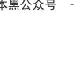

一本黑公众号 一本黑社群

## 百度霸屏引流怎么做——艾斯 zw

## 01 什么是百度霸屏

简单来说，就是当用户去百度搜索某个关键词以后，呈现的结果中大面积都是你的信息，这样被选择的概率就会更大，不用花一分钱，就可以引流到精准客户。

## 02 为什么要做百度霸屏

因为流量最便宜又精准！

试想一下，每当我们遇到问题。例如想要买新手机时，是不是第一时间就去百度搜索什么手机好？然后你就会一条一条的去看结果。如果刚好或者总是看到有人推崇 HuaWei 手机，而且很符合你的需要，是不是立刻就会去下单？

那么你再想一下，如果用户搜索的是你的产品领域，而你的产品信息或者你的个人联系方式总是出现在首页和前几页，这个流量大不大？

如果用户通过你留的联系方式主动加了你，这个粉丝精准不精准？

## 03 百度关键词霸屏技术

3.1 挖掘目标客户真实需求，筛选优质长尾关键词

关键词分为核心关键词和长尾关键词。

3.1.1 核心关键词

去，所以我们普通人或著小企业主应该该抛弃走偏锋，曲线救国，重点去做长尾关键词。

## 3.1.2 长尾关键词

长尾关键词是指围绕核心关键词进行组合的关键词或者短句，比如说核心关键词是“白酒”，那么长尾关键词可以是“白酒批发”、“便宜好喝的白酒”、“黄尾还有什么白酒喝了第三天不头疼”等，这样的词汇比“白酒”更容易做到首页，获取更多流量，从而早日实现盈利。

## 3.1.3 如何筛选

+   (1) 准备关键词挖掘工具，推荐爱词站 (ci.aizhan.com) 或著百度自己出的百度推广工具关键词规划师 (需要注册百度推广账号，下载百度推广软件)。
(2) 自己列举一些初始关键词，并建个文档记录下来，依次搜索你想挖掘的关键词，例如“小吃培训”。
(3) 二次整理，根据搜索量和优化难度进行人工筛选，直接排掉排除难度高的。
(4) 三次整理，结合关键词规律，可加人修饰词、品牌名、地域等。还是拿“小吃培训”举例，可调整为“湖北小吃培训”、“武汉小吃培训哪里的好”、“汉口小吃培训就新东芳”等。

长尾关键词的筛选是整个技术最重要的部分，这一步没做好，后面的都是白费。

## 3.2 高效采集网络素材并制作伪原创素材

想要盈利，肯定需要很多很多篇软文，要介绍同一个产品，又不能每篇软文都一样，论堆也写不出那么不同的软文，而且还极其浪费时间，因此，我们可以采用一种顺藤摸荤，直接从网络搜索同行、同关键词现成的素材，快速制作大而特的伪原创文章。

## 3.2.1 采集高质量网上的衍生文档

(2) 打开这些链接，复制文章，并用文档分别保存下来。

当然这些事情如果人工来做，又把事情搞麻烦了，这里推荐一款自动化软件：水森软件。软件是收费的，可以去某宝购买，或者下载破解版，找不到破解版的后面回复「水森」自行获取。

水森软件可以输入关键词进行精确采集，搜索引擎默认为百度新闻，一般设置采集 100~200 篇，采集完后人工排除一些明显不适合自己的。

(3) 根据你自己要写的软文结构，把采集的文章分类分段整理入相应文档，例如，把所有公司介绍归入一个文档，把有产品介绍归入一个文档，所有营养范围归入一个文档，所有客户反馈归入一个文档等，每个文档整理几十种不同的文档就够了。

(4) 然后自由组合，假如每个文档有 10 个段落，那就 ‎有 10*10*10*10 种组合方式。

(5) 内容稍作修改加入自己的产品、联系方式等，大批量的伪原创就制作完成了。

## 3.2.2 图文原创创造灵感好

+   (1) 去百度图片里搜索行业关键词，获取图片。
(2) 找到适合自己的图片保存到文件夹中。
(3) 利用美图秀秀网版进行修改，在图片加上自己的广告语。
(4) 保存的图片大小最好不要超过 200k

## 3.3 长尾关键词优化组合成文章标题

(1) 挑选 3.1 节中筛选好的 5~6 个长尾词，例如我们选择“小吃培训学校”、“特色小吃培训”、“四川小吃培训”、“学点小吃培训”、“麻辣烫小吃培训”。

(2) 选择一个主要长尾词，与其他长尾词两两组合或三三组合，例如可以组合成“四川小吃培训小吃培训学校”、“四川小吃培训特色小吃培训”、“四川小吃培训四川小吃培训学点小吃培训”、“四川小吃培训四川小吃培训四川麻辣烫小吃培训”等，等，组合方式非常多。

## 3.4 文章内容组合优化

在3.2节中，我们已经完成了伪原创文章的主要内容。现在给文章添加标题，并做适当的优化，可以进一步提高权重。

+   (1) 文章标题，选择 3.3 节中组合好的一个标题，作为文章主标题。
(2) 文章开头，复制粘贴 3 次文章主标题，并对文字加粗甚至调色。
(3) 文章第一段，首先粘贴 3.2 节中制作的伪原创文章第一部分内容，然后插入一张伪原创的图片，再粘贴一个不同于文章主标题的其他组合标题，最后留下广告语和联系方式，广告语和联系方式文字也可以加颜色和加粗。
(4) 文章第二段，第三段……重复第(3)步，
(5) 文章结尾再粘贴一通主标题，并对文字加粗。

至此一份完整的伪原创文章就完成了。

## 3.5 高权重高收录网站的选择

不同的网站对于不同的行业、不同的产品友好度不同，因此不能盲目的选择一个第三网站就去发布文章。

## 3.5.1 高权重的网站查找

搜索自己的关键词，观察同行都在哪些网站发布，作为自己的备选项。

## 3.5.2 高权重的网站平台推荐

知乎、微博、简书、头条、百家号、搜狐自媒体、凤凰号、黄页88、好网角、马可波罗网等。

## 3.6 发布技巧

+   (1) 一篇文章多个平台同时发布，不要一个平台多个账号发布；
(2) 修改链接文章链接到百度搜索，看是否收录；
(3) 没有收录可以直接提交网址给百度收录。

百度 allegedly 听到这就分享完了，有读者找到这已经不是什么新技术了，但我还是想说，信息永远存在。你甚至可以拿着这个教程添加实操图片或视频，制作成自己的伪原创再去卖钱。

互联网赚钱不一定要新事物新方法，新环境 + 旧方法 + 新组合就等于新方法，学习成本更低，而且往往会出现奇迹。且往往可能会出现奇迹。

## 一个影视推荐公众号引流涨粉的实操案例——艾斯 ZW

看到标题可能有人说这都是多少年前的老套路了，还拿出来写。

那你试试打开抖音、搜索影视，然后随便点开一个账号的主页，看看是不是都至少有 10w 粉丝？

你是不会又开始疑惑就靠着一个视频这么简单的事还能做这么多粉？
那你就再问问自己以下几个问题。

你看电影或者电视剧时是不是喜欢快放播放，恨不得分分钟看完一部电影？
当你刚睡醒而不知道看啥时，是不是喜欢看各种电影解说推荐来找片？
每当新电影上映或者需要会员才可能看视频时，你是不是都第一时间去百度网盘找资源？

我可以武断地说，80% 的人都是肯定的答案，分分钟看完一部电影或电视剧的主要特征这种爽快的体验，以及找最新的影视资源这件事，一直以来都是一个刚需，这其中的流量不可以忽视。

## 案例解析

案例项目：打造一个影视推荐公众号

项目成本：一台电脑，配置无要求，一个公众号

项目难度：这个项目全程搬运，不用原创，省时省力，几乎没有什么难度

## 案例操作：

+   1. 首先去抖音，快手上直接搜“影视”，找到几个热门的或者你觉得做得

好的账号，作为你的主要竞争目标，看他们推荐什么，就你推荐什么。

+   2. 下载他们的issage视频，用视频解析工具去除水印。

+   3. 用剪辑软件将视频分割成四五段、每个部分做一些调色处理，比如稍微调一下曝光、色调、或添加滤镜，但不要差异太大，这一步操作的目的 dipakai 打乱视频的 md5，哪里放在到同样的平台也不会被系统认为是抄袭，最后加上自己的水印，制作成伪原创。

+   4. 公众号发布，添加视频，添加文字解说，变成视频推荐 + 文字解说的形式。

## 案例技巧：

+   1. 首批流量怎么来？

新电影电视最根本上映时，很多人没有时间去线下影院看电影，有的不能在网上还是贸然下载看。这些人都会选择自愿。过去的影视号引流的方法就是各家视频网站的引导到公众号，然后再指向一个免费影视播放网站。

而我们只要先把影视资源下载下来，去水印，然后再剪辑拷贝添加自己的广告词，例如“关注公众号 xxx，分享最新精彩电影，还有福利赠送”，在视频的下方添加。

将视频保留到网盘，然后就可以去微博、贴吧、论坛等平台发帖、留言分享出去，自然裂变。

+   2. 如何广？

首先不停的去加群、混群，混几天之后可以在群里说：有没有人看过 xxx 刚上映的电影，我没时间去电影院看，刚刚在淘宝花 5 块钱买了一个网盘资源，有人需要的我可以分享出来、现在的伸手党非常多、100% 都会有人找我拿。

然后为了进一步吸粉，需要放入自己的公众号，将上面制作好的视频添加到压缩文件并加密，然后新建一个文档《解压密码》，里面写上关注公众号回复关键词就可以获取密码。

一般这样的数据分享出去之后，第一条拿到的资源的人就会分享给更多人。

+   3. 如何变现？

当公众号发展到500-1000个粉丝之后，立马开通流量主，通过内置广告和带货变现，就开始变现之路了。

## 案例总结：

今天分享的方法不需要花费很多时间和精力，只需要每天花一点时间处理一下视频，然后就等待长尾收益。

影视粉这个流量很多大V都懒不上，而有点能力的人又觉得寂寞，发帖引流之类太low，太耗时而选择看不见，这往往就是我们普通人可以占的空子。

不过话说回来，对于自己都找不到免费资源的朋友，这个项目也不建议你尝试了。

让一部分人先改变现状

## 一个抖音搬砖引流玩法——艾斯 zw

抖音，大家都已经耳熟能详了，基础的东西就不多说了，直接上今天的干货。

现在很多人搬视频搬搬搬，如果没有处理好搬运来的视频，账号就容易被封或限流。

抖音有自己有人工智能识别系统，比如 AI 会判断画面帧的 MD5 是否重复，或者在连与数据库里的画面进行对比，所以视频如果处理不到位，没有绕过抖音的判定机制，都会导致这条路终止。

那搬运到死还能不能做？

答案是可以，今天推荐的一个抖音玩法是：搬运视频制作成文字动画去引流，因其去搬视频检测的可能性比搬视频要小很多。

想引流的内容，可以以情感类；想引宝妈粉，可以做宝宝相关知识、育儿教材、育儿知识等等；如记住睡前故事。

举个例子，例如现在的这种文字动画相信大家在热乎上见过很多了，其实制作的质量并不是很高，但是播放量基本都过万，甚至很多上热门，由此可见，文字动画是一个可以搞的方向。

文字动画最大的优势就是只要你讲的话，句子都是原创，不需要像搬运视频那样做复杂的技处理，小白很轻松上手。

这种文字动画怎么做？高手想到的肯定是 AE，分分钟搞定。

但是对于普通人而言，没有这种傻瓜式的软件呢？有，估计很多人都知道，就是：字说 app。

抖音上那些段子说、说汤姆、斗方言、的小视频基本上都是用字说来做的，根据不用电脑端完全条件够用，也不用来对音频。

具体怎么操作呢？

这个方法不止可以做抖音，任何平台都可以这样操作，你想做抖音，就去快手、B 站、微博等其他平台找一个你能搬运的，批量截取她的视频，然后丢到字说 APP 里生成文字音频，自带特效，加个背景，一个视频就完成了，不过想要做的更丰富更好，可以开个会员。

但是呢，自从这种做法爆火之后，抖音推荐系统又升级了，发现火起来了，原因是新的推荐系统就玄人出局，认为这种文字+纯色背景的视频太过简单，对认真做视频内容的人不公平，从而对这类视频限制，于是又出现了下面这种操作。

汉字+语音+小视频模式的视频，文字、语音还是用上面的方法搬运的，就是多加了一个电视剧剪辑的小视频，同样也是直接搬运的影类账号剪辑好的视频。

其实就是在过去的基础上，多搬一个与主题相关的小视频，视频可处理也可以不处理，想处理的就简单用剪映分割视频，打乱顺序、调整画面曝光、饱和度等参数，加个滤镜啥的就行了。

比如你做做影视抖音号，就可以跟她一样搬运院线类电视剧，你想做母婴，就搬运一些宝宝的小视频。

除此之外，有几点需要注意：

- (1) 严格 1 机 1 号，不要使用模拟器
- (2) 多参加官方的热门话题，多使用热门音乐，多@抖音小助手，其实很多大咖已经证明，@抖音小助手确实是对上热门有一定帮助，所以建议所有视频都带上吧。
- (3) 用户都是爱跟随潮流的，哪些 BGM 火了就将该 BGM 套用到自己的视频当中，用户在看到这个视频时就会觉得这个音乐很熟悉很亲切。

## 短视频创业的几个方向——奇谋生财

本人目前有一个团队在做 femmin 女评测产品的短视频，主要通过橱窗和直播卖货盈利，目前接近 300w 粉丝，百分之八十都是女粉，这里分享一些短视频思路，希望对有想做短视频创业的伙伴有所帮助

#### 一、星座，生肖号

生肖号与星座号是从公众号演变来的，以前活跃在朋友圈被疯狂转发，比如，快手，今年最发财的属相有哪呢？属虎的人今年运势怎么样？处女座今年有桃花等等。属相和星座是标签，容易让人找到归属感，说准了点赞，说不准吐槽，不管准不准，视频互动弹幕区是提火，每个生肖，每个星座每年的运势，光是每个生肖每个月的运势，12×12=144，再细分爱情、财运、事业，大有文章可做，这些知识百度搜索多的是，不要觉得现在在迷信的人少，穷养命富烧香，大家心里都预知未来的渴望，只要不亏损命会被限制，后面也会有一个算命行业的细分业务可以做

变量模式：可以挂商品链接、可以起名、看风水、祈福、改运、选房、婚姻缘等等等，公认的无主暴力。

#### 二、美女视频

再好的文章，再精美的视频，都不及一个美女吸引人，美女视频也是抖音主主要流量来源，比如邓肯伟的仁智、大长腿潘南奎微博里石扬子沈真英、乘风破浪姐姐组等。都是自带流量的吸粉利器，百度搜以土星的名义，然后找到相关视频下载，学习基本的剪辑方法，用 PR 剪辑后调色、抽帧、放大、镜像翻转、加滤镜、加封面修改 MD5，做出伪原创再上传，

这个项目适合多账号操作，一个人星建一个账号，内容都是统一一个人，如何变现：

- 1. 这种账号最缺的是内容，所以很难做很久，一般干粉的时候就可以出售账号，重新再做。在抖音 1000 粉丝的时候可以开橱窗，买家可以拿来开橱窗带货，这是最好卖的账号，另外就是留得太久容易产生变现，要快速变现。
2. 售卖明星周边，这个大家自己领悟

#### 三、多视角看世界，去显微镜直播，googleearth直播

显微镜，可以满足大家的好奇，买个显微镜也不贵，可以带大家看不同的世界，很多内容可以做，比如看着整天睡觉的枕头有多脏，有多少细菌、螨虫，还有手机、鼠标、手、公交车、蔬菜、水果、第一草莓、玉米、水、矿泉水、床单、茶杯、包、筷子、铝饭、菜刀、食用油、化妆品、拖把、洗碗槽、毛巾、牙刷、马桶、嘴、地板、门把手、冰箱、数据线、空调风口、吹风机、苹果、生蚝、生鱼、虾、肉等等，每一个物品可以作为一期内容，宽泛这种内容究竟要知道，把抖音调亮三分之一，孩子才会贡献，你才能跑流量这些有趣新用户

变现方式：有粉丝之后卖账号、开直播带货卖货、卖酒水、显微镜、科学玩具等相关商品。

googleearth：翻出来感受下这个神奇的软件，全 3d 的超级细地图，可以看到国外大部分的地方，云旅游全靠它，开直播一堆小学生要看自己小区的。

#### 四、抖音壁纸、表情包号

把高清手机壁纸、表情包做成短视频，素材就找壁纸、表情包素材，做成图片轮播形式，素材去图片网站找：千图网、昵图网、花瓣网、小红书、知乎、微博、美图秀秀，能anke海外素材更好。

#### 五、抖音起名

无本的生意，每天瞎客户案例，专业内容可以网上找，很多博客前十名都有风水师的身影，多看多练，融会贯通，然后接单辈儿起名，200起价，现在有专业起名软件，输入生辰八字，可以自动生成合适的名字，成本为0，营业额就是纯利润。如果有需要大师资源我可以对接，国学资源我有一些

#### 六、科普育儿号

穿上白大褂就是大夫？
不一定，育儿知识也并非医学来的，但穿上白大褂就显得是权威，对于初为父母的人说，育儿知识都是急需的营养，妈妈群体是电商公认的买货小能手，独挑经济、采购大权，有明显的感性消费倾向，一手托起电商经济的大半边天，得妈妈得市场，得天下。

让一部分人先改变现状

## 如何做到精细化运营——bt 男孩

本人之前一直做的是 SEO，但是发现现在单纯靠 SEO 赚钱越来越难的，当然，也不是说现在在单纯靠 SEO 赚不到钱，只是跟之前比差距太多了，不像 12、13 年那个时候用虫群软件群发外链、内容采集集群聚合就能有大量的关键词排名获取流量。

我们公司从 17 年开始就一直做 SEO 服务的业务，为企业提供 SEO 相关服务，但是最近两年发现单纯靠 SEO 业务很吃力，当然，跟整个大环境也有关系。所以，转型是迟早的事情，而且是必须要做的事情。

今年 5 月份公司新增了一项业务，主要是围绕带货的，具体是什么项目暂时还不方便透露太多。

然后大家认为现在做好的形式就是：短视频、社群（私域流量）。综合考虑，短视频对于我现阶段不适合我们，最终就选择了社群的形式。

前面交代过了，本人之前一直都是从事 SEO 相关的工作，对社群运营没有什么经验，在这之前看了很多关于社群运营的知识，也付费报了几个课程，也是对社群有了一定的基础的了解。

下面给大家分享一下关于社群运营如何做到精细化运营，以下全是自己实战的总结：

我们现在做的模式是通过渠道引流到个人微信号，因为我们引流形式是付费引流，所以，主要加微信的好友都是非常精准的用户，这是今天要分享的前提。

面对每天加进来的这么多好友，如何才能做到精细化的运营呢？我的做法是利用好微信的备注名、标签、描述这些。

社群运营不可能所有客户都当天就要成交他/她，所以跟粉丝聊够一定要

给路径进行对应的标签跟描述，方便后期用同样形式的内容来音销他/她，最终成交他/她。

对客户进行不同的分类。那么，如何进行分类呢？
可以根据自己的业务进行不同的用户归类。
比如：

- A类：嫌价格高的；
- B类：对比竞品的；
- C类：怕东西质量不好的；
- D类：过来简单了解的；
- E类：已经买了熟品的、过来了解的；

描绘怎么聊呢？把用户之前关心的问题、性什么或者聊聊天中聊到生日或者已经成交的时间、成交数量等等可以填，后面再进行交流的话可以快速知道这个是谁、之前聊过什么，以及他/她一些信息，很久没联系当天生日或者别的什么事情，给他/她来一句话候，/他/她会不会觉得你很关心他/她，是不是跟客户一种很好的情感培养呢？社群运营，我觉得先做好情感维系。

上面的用户分类是我举例，最终需要怎么进行划分，还需要根据自己的业务来。

用户分类好后，就是后期如何用不同的文案来营销他/她，需要对不同分类的用户常常需要不同的文案来进行营销。

接下来就是针对不同类型的用户给出不同的营销解决方案，比如，这对A类客户嫌价格高的）是不是可以用促销活动、物品价值的文案来进行营销呢？
这些当下没有成交的客户，需要通过朋友圈不断的营销他/她、刺激他/她，最终的转化他/她。这个时候就需要利用好发朋友圈@提醒谁的功能；
针对不同分类的咨询如何进行朋友圈营销呢？

E类：已经买了竞品，过来了解的：-->DD 文案

可以设置一个周期，比如一周 @ 一次，还是一个月 @ 一次，直到成交他 / 她为止。

不管做什么，细节很重要！在现今最缺的就是卖东西的人，他 / 她为什么要在你这里成交？我觉得很多时候决定的就是细节。

一本黑公众号

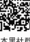

一本黑社群

让一部分人先改变现状

## 高端工艺品这个行业是怎么玩的——列策

我今天请进一位工艺美术大师的作品这些生意是怎么玩的？这个行业我接触最久且掌握时间最长且真正深入到供应链有一定认知并做出一定成绩的产业、这与大众熟悉的生意其实是有差异的，今天我就来请清楚如何操作这件事。

我们先讲一下我们的成绩吧，自媒体业务在工美行业已经成为绝对头部自媒体，信息库业务、人才库已经收录 90% 以上有职称的工美从业者，并通过我们的查询工美老师次数在 200 万次以上；拍卖业务，拍卖业务单场拍卖做到 408 万，公益板块成立的浙江省爱心事业基金会阮心传承基金，参与新商总会慈善专委会的聋哑行动正在帮助一批聋哑儿童送入耳蜗，改变这个孩子的一生，并帮助一大批需要帮助的人；文化传播板块，把具有中国特色的工艺美术品带到国外外。

我是 15 年志志来做好工艺美术这个行业的，在当时也结识了算是第一个熟人，我跟他一直有交流，他则侧天使轮融 1000 万，做了一个类似于雅昌的网站，后来又重新创业，也拿到融资，我就从东京青岛孤身一身来到了杭州，我这创造了他 4 号结婚合伙人。

起点：工美老师私域流量量化为公域流量再进行分发。

最开始我们构化这个工艺品这个生意怎么去做？经过我们分析，我们对工艺美术行业定位了两个关键词，非标品、强个人 ip，因此我们的方向就是电商与信息化服务。

卖货是最常规的变现方式，货为主，所以我们起步的时候就是以电商为主。很多人通过电商就是流量黑洞，有多少流量都会吃下的，但是针对于非标的工艺美术品其实并不怎么适合，所以一开始我们这需求就是精准电商流量。工美从业者者是目前私域流量化最强的产业，流量应该存在于一个一个工美美术大师的私域流量池里面。

我们的流量应该在每位工美大师那里获取，把 A、B、C、D·····工美老师的私域流量通过运营手段圈围在自己的公域流量池里，然后再把流量分发给 A、B、C工美老师那里，通过这样的方式就可以 1+1 > 2，对工美老师是有益处的，对行业也是有好处的，所以我们在做一个事情的时候我们应该真正考虑的是服务一个行业而不是透支一个行业。一个呢，这样能做的久长的。

货怎样卖？高端的手工艺美术品，其实价格的属性不难讲，讲究人得之，最好是一部分人见到购买过程，也得到在发货的过程中获取流量，所以单纯的挂在货架上不太合适去做，所以我们考虑一个比较好的方式，拍流。利用微群或者小程序去搭建，在微群规模拟拍会。

所以我们开始的方式就是先对做的做公益被拍，当然，然后货品超低价格拍卖，或者是 0 元拍卖。提高参数度，每一期邀请几个工美老师，工美老师也愿意参加这个活动，然后让他们邀请 10 个或者是 5 个客户到微群，然后同时发活动的朋友圈，通过这样的方式沉淀私域流量再分发给工美老师，通过这样的方式我们确实深度连接了一批工美老师，高端客户，也帮助一批非常需要帮助的人。

在这个阶段我们每场拍卖额在 30 万左右，好的时候大概在 100 万左右，一定意义验证了私域转公域再行分发是可行的。

增长：建立全国工美大师信息库，强化私域转公域。

通过这样实践精准流转的方式可行，速度上不怎么快，也不会形成自裂变，我们通过这是是想规模化获取海量的工美精彩流量池。之前讲过一个关键词：强个人 ip。每个工美从业者对个人品牌都很重视，我们做了一个信息库，也就是给老师做了一个名片，通过百度可以搜索到他们。录入信息库之后，会生成一个专门名片的海报，海报上有公众关注的二维码，要求录入工美老师转发名片去朋友圈，通过这样的方式各个老师的名片海报在工艺美术这个圈子的朋友圈持续曝光可以持续近 3 个月，基本录入了百分之 90 以上的工美老师，也吸引了海量对工艺美术品感兴趣爱好者。

在这个阶段我们建立的工美信息库完成录入百分之 90 以上的工美老师。

搜索次数累计达 200 万次。

完善：提升信息库搜索意图价值，提升搜索价值。

搜索有很大的点，用户搜索意图分析，我们不是百度百科，我们要做的是搜索意图，因此我们要提升信息库的意图价值、不是信息价值。所以我们搭配个人微拍图、品牌合作、ip 授权、工美老师与其合作来完善意图价值，做了一个认证系统，也就说完成录入的老师，付一定的费用，可以加 V 获取认证。然后我们引入了的专栏投稿。

我们助手工美老师中挑比较优质的作品，进行估价以及 0 元起拍、做一个精造成品销售，用工美老师的基础上可以获取这个工美老师的好物，还有一定的品牌合作、ip 授权等业务衍生。

在这个阶段，我们获取认证加 V 的工美老师几千名，中国工美类大大师，困难基本上实现了全覆盖。

升级：全链条服务工美老师，并通过活动强化行业影响力。

在这个阶段我们需要寻找到一个更大的增长引擎，在这个阶段做的是无限提升品牌力，我们做了以下三个点。

- 1、变成正规军，持续性进行公益拍卖，真正帮助需要帮助的匠人。

我们筹划发起了一个基金会，挂在浙江省爱心事业基金会旗下，取名作为匠心传承基金，同时我们也邀请了顶尖浙商成为主席、副主席，让我们基金会足够有公信力。我们也参与了浙商总会慈善专委会的“驰想行动”，还有很多慈善活动，款项都是公益拍卖所得，然后捐助给这些活动，真正帮助了一批人，这反哺给系统。

## 第三章：杨金思维

受到了政席、国企、民企、工美老师的一定好评，参与活动的有中国驻蒙古国大使邢海明，蒙古国首都议会主席阿木尔等字，蒙古国教育部文部国际秘书尼木玫其木尔等，也受到国务院新闻办公室、人民报、新华半等专题报道。

经过上述的坚持我们在这个行业做的事情算是成功的，也是我拔高思维的最重要的一个阶段，在这个阶段真正地接触到顶尖商圈子，顶尖工美艺术大师圈子，跟他们真正深深交流，确实学到到很多，唯一遗憾是至今没有跟马云老师合影。

我讲几个建议吧

- 1. 毕业生第一份岗位尽量去一个大平台里做事，这样对自己的视野的确认有好处。
2. 做文化产业是破圈最好的方式，你会真正的破掉很多层面。
3. 很多人会讲去国有企业、政府办事效率不高，不愿去做公务人员那样好，这是一个误区，如果你进入核心岗位，带给你的资源远高于任何产业，另外政府、国企做事情是最严谨的，值得任何一个组织学习。
4. 尊重每一个行业，不要想着你去另一个行业就可以跨界打劫。

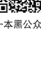

一本黑公众号

一本黑社群

让一部分人先改变现状

## 半年电商经验总结——吕松洲 - 学生

1. 储蓄可以降低人度过生命中大部分危险，消费买卖只会减少自己的抗风险能力。

2. 做那些回款快的生意，一手交钱一手交货。不与欠货款的商家合作。欠款如果有交付结果你都可以考虑。资金止流动，就不能产生收益。对方欠款、会增大资金周转的压力和导致货款可以产生利息的一笔钱。

3. 7天让我爆单不用刷单就可以赚钱，快速回本（培训费、路费）只是培训界的谎言，我是否容怀疑培训课嗨哪赚不够清楚，但是我赚够的那个培训机构平台一定是赚钱的。

4. 低价或是免费郎都是骗的引流手段，但效果却出奇的好。人人都喜欢贪小便宜，让对方占点便宜后再赚他一笔。这就是产生连带方法吧。

5. 传统电商是以货为先，用户先有的需求，然后去找。直播电商以人为先，不是找货，而是找值得信任的人，再通过这个人介绍的产品去买货。质量好，又是他的刚性需求品，在任何时候都可以爆单。

6. 买卖或交易的前提就是信任。人无信不立，业无信不兴。营销再花里胡哨，背后还是得过硬的产品素质支撑的。明星代言，网红带货，消费者评价都是用消费者的信任来体现。

7. 信任源自直达，多次消费体验的满意。（这也是网购对于大多数人最大的阻碍，你无法法与商家面对面直达，或者客服小姐姐一般聊聊产品，扯扯价格、售后处理方便）消费者知道一定能获知我、所以信任、才能促成交易。我去菜市场买菜，走到一个摊位，拿了几个西红柿放在秤上。老板说：6块。我说：这么贵。老板笑着说：不会乱开价的，我又不是一天两天在这里卖菜了。我听了这句话，心中的疑虑有些消散了。消费平台的评价

价系统就是让商家重视多次博弈，让单次博弈率客的商家卖不出货。

8. 只有稳定的供应商才能让你稳定的赚钱。你单了，对方的货品甚至不合格又或者对方没货了，你就能体会到钱放到你家门口却拿不到的滋味。

9. 天真的年轻人看到人家 3 分优点，自行脑补 7 分优点。成熟的人，知道人家 3 分优点，自行脑补 7 分缺点+风险。

10. 创业时困难唯一一直都在，最初就是不认识人、不知事，又没钱。车到山前必有路，船到桥头自然直，所以想太多没用，于就好了。做生意穷的不是什么道理，就是靠干、靠智取。见招拆招，一步一脚印的格局是做出来的。鞋大不大只有脚穿上去之后才知道。地因图稍稍窄，它也没有办法告诉你哪怕半步。

11. 生意没有百分之百赚的。

- 在交易前，有寻找成本、比较成本、试用成本。
- 在交易中，有讨价还价消耗时间成本、待款后平台抽取 5% 金额成本。
- 在交易后，有运输成本、售后成本。售后是个吃人心的活，难于推进。

12. 省出来的成本，就是利润。成本它不是一个具体概念，它体现在每一笔交易上，规模大了，信任带来的增值和博弈带来的损耗一样，都在无形中翻了很多倍。跟成本控制相比，信任带来的长期收益更加可观。

一本黑公众号

一本黑社群

让一部分人先改变现状

## 抖音视频带货分享——老司机 - 无忌

今天要分享的是从 18 年到 19 年很火的抖音视频带货。小弟由于一直做微客客项目，从 18 年下半年就开始关注抖音带货了，看了几天就觉得可以做

然后就约了过年期间以前的电商交流群，看到一个朋友在郑州开培训，讲抖音这块，他有一节课会具体教抖音开箱视频怎么做，觉得很合适，叫上一个朋友，定了机票，四月就去上了他的课

因为他的课是一个月一到三期，不定时，所以才选择了清明节的那一期课，一期课讲三天，上课到 4 月 4 号。然后回了湖北老家过清明，在家待了几天 本来是想拍抖音视频，做点的小吃生意，由于家人反对，在家待了一个星期就回广州市了

买马未动草先行回广州之前就在网上把三脚架和手机云台买好了，然后在转转买了一个苹果 8P，回到广州了第二天就开干了，前期拍了三到五个视频，我将视频都投了百万快加。好像是投到第五个视频、我账号的标签就打好了，到第七个视频拍了一个凉席四件套，就爆了，五十万流量，出了接近 400 单，一单十多块，我 4 月爆的时候，淘宝还没有扣技术服务费百分之 6，那时候真爽，当时爆了，马上下第二个视频、好像是一个小风扇带喷水的那种，几个小时就一百万流量，出了千多单，佣金上万，当时心里感受，这赚钱也太简单了吧。

当晚在转转又订了一个苹果 X，开第三个小号 - 还好当时爆视频在朋友圈卖了视频，隔了一天把凉席四件套，又从新拍了一次，从头下，上视频又爆了，也是七十万流量，又出了几百单，爆的这些视频都没有投快加的，因为那时爆的很快，让你没有机会快加

## 第三章：杨金思维

到了4月份，冰丝袖套有两个淘宝商家PK战争，直接降到2块9，百分之九十佣金，我也拍了袖套，一不小心又爆了，一百多万流量，出了接近四千单，佣金二万左右，然后隔了二天，冰丝袖套又发了一次，又爆了五十万流量，出了 一千多单，这次因为商家在Q群是做免单，我出了一千多单，还一单给我补一块，又多赚了一千多。

本来准备来投抖音的，谁知道天猫小二给商家降权重了，我真是无语，少赚几千块 后而且也出了几个三百到五百万的视频，但是就佣多和百分之六，少赚了很多钱，然后开的小号也是慢慢做了，又订了二台苹果二手手机，开多个账号做了，其他新账号没有这个老账号玩得好，一直做到六月底七月初，抖音就开始带货视频审核了，收入就降下来了，然后到了九月就做其他事情了，带货就放下来了。几个号加起来，佣金三十多万，投入成本加抖音，三万多不到。

给大家举个例子。五月到六月抖音带货火，每天都是成千的人进入，我当时一个小时的咨询费也是500起。有图为证。种草原因我想通过了一些东西，自己总结了几个原因，各位大佬看看；

- 第一点：当时看好了，就找我有没有合适的培训班。而不是想着在家自学，因为短视频是新行业，自己都不懂，自己当时的做法就是用钱买时间，只想学皮毛，大家也不要求能学到很多，以免心里有落差，我就省到用什么软件，怎么打标签，买什么灯，买什么机，还这样别的人节省很多时间，红利期现在很短的。但是各位小伙伴们还是要提醒下，培训班都是大部分是割韭菜的，我能成功有几个原因的，下面再来说，我们一期学员二十个人，只有我赚钱了，其他全亏了。
- 第二点：我是老婆早就就在抖音，她对视频剪辑前后、角度方面还有点感觉，我是都看不懂，我真不会拍照，所以都是她拍，我剪。我软件上手快，当时剪映还没有出来，都是手机用VIPD，同一期我软件上手最好了，平时电影看的多，对视频运镜还是有点感觉，不会剪的前后很乱，最少视频很顺。这也是成功的一个小原因。
- 第三点：说下错过的是失败的原因，最大原因是自己不喜欢做抖音。

真不喜欢，觉得很无聊，除了要去刷热门的音乐，我很少刷抖音，做一样东西你不喜欢，你不热爱，是做不久长久，也不会成功的。还有就是错过了割韭菜的机会。

太在意名声，太端着了～其实和我比起来算什么啊～唉，大家有割的机会一定要割啊～

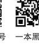

让一部分人先改变现状

一本黑公众号

一本黑社群

## 是否应该辞职搞互联网创业——天枢

### 网友提问：

最近比较纠结一件事，想征求一下您的意见。坐标某二线省会，目前新找的工作，试用期只有 6k 出头，转正绩效考核估到手也 八出头。
年薪乱七八糟估计 12w 左右。
目前还运营了一个公众号，每个月稳定收入在 1.5w 左右，好的时候 2-3w。
我到纠结的地方是工资太低，工作这么多年，却回到了刚毕业在北京的工资水平了。
考虑要不要放弃主职工作，继续运营公众号，除此之外去发展其他收入。
目前也在尝试知乎的好物推荐，也有打算去做视频……

### 天枢解答：

有句话是这么说的，高手都在讲故事，笨蛋才在讲道理，世界上最离不开的行为莫过于通过故事影响别人！
我一直有个大梦想，所以这个 问题我想通过自己的真实经历，给你一些启发，每个人的 每个 人生都有自己的精彩，选择并没有对错。
这篇文章呢会写近三年我经历了什么，再以现在的眼光做一定的备注，读起来可能会觉得我对自己的认知很清晰，其实不是，谁的人生不迷茫？

#### 一、我的背景

我的背景是 3 年前月薪 3K（新媒体小编）现在年入百万（一家新媒体工作室，做咨询、培训、代运营来赚 B 端和 C 端的钱），也不知道明年会不会赚的更多哈哈

这个问题是三年前碰到的，由于上半年比较纯就运营了一个公众号，一个月时间赚到 3.5W，当时不知道怎么实现 5W 涨粉。

可以想象一下突然一个多月赚到自己一年半工资，现实与虚无的碰撞相当激烈。

#### 二、对未来的不确定因素

之所以对继续上班还是全职做互联网产生疑惑，是因为当时我有几个问题

- 1. 目前做的副业，还能继续做多久？（大部分人是在公司干到退休）
- 2. 如果这个副业不能做我还能找到新的副业吗？

（比如 18 年公众号广告主小说派单的比较多，很多泛流量公众号也能接广告吧，去年年初几乎所有人都觉得小说派单广告，或者公众号变卖再做一个公众号可以盈利千万，但是它们的流量价值却...）

当然如果能稳定输出带货内容的人就不会有这个迷茫，当年的我这些观念都淡，现在回头看总结的

- 3. 选择副业也许会赚钱很多钱也许很快失败，干货虽然稳定但是上升空间一眼望到头，长期的梦想和短期的利益发生冲突。

#### 三、我为什么选择辞职？

手上拿到 5W 后，我直接 ALLIN 买了一对钻戒跟女友结婚，我赚钱就是为了让我的家人幸福，给她安全感，即使只几年后 5W 对我来说不多，但在 3 年前我一无所有的时候她愿意嫁给我，应该是就是我这份认可。

小时候 100 元的快乐茶现在花 1000 元买的到吗？

这就是大多数人的财富轨迹，而且年收入大于 12 万的人，并不多。
很多人的终其一生，都不请楚这个模式有什么问题，也许你会觉得有些不妥，但是不妥在哪里，说不出来。

我不甘心自己的财富轨迹被局限住，也不要在公司干到退休，公众号还能做多久、不能做了还能找到别的做吗？
这两个问题我不考虑，也不再向前推举。

#### 四、问父母和朋友同事

当时能问的人有，我的父母，他们都是年轻在外面打工然后再买房子离开到靠落叶村买 18 平升值困难的刚需房。

父母都是希望我们稳妥，30 岁要有点积蓄，给的意思一定是先打工积累经验和资金，然后再去创业或者辞职。

不论是什么，做什么事，都有目的性，父母嘛一方是想我们好，第二个就是，如果支持你自己做事情，是不是经济上也要扶持你一下？
也许我们要的是口头上的支持，但是父母把你退休后买房或者保险都想好了，所以你现在要拿他们的辛苦钱去追自己都不了解的梦，是不是太残忍了？

他们会把自己的老路让你老老实实的再走一遍，不求你大富大贵，也希望你辛苦几年把他们辛苦 10 年的钱都重新挣回。

还有一种情况，父母眼界宽广资金雄厚，你如果有这样的父母，大概率也不会参加工作焦虑这个话题或者看到这篇文章。
可以和父母沟通，但不要把自己的焦虑添加给他们，他们已经焦虑大半辈子了，他们的话我们听着，但是夜深人静的时候做成或者年的事情，大胆的决定一起。

同事的话和你的情况差不多，都在为上班叫外卖还是自己带饭省会钱精打细算，和你一样为了鸡零狗碎的小事躺在床上睁着眼睛等天亮。（看了这句是不更是焦虑了）
你的老板肯定还想靠你继续干活，毕竟你有工作经验又没有资金做自己的

事业。 而更贵的饼， 灌更多的鸡汤， 因为招聘培训带着你花了不少钱和精力哦。
你没人可以问， 你是孤独者， 哪怕周围再多人， 感觉得还是一个人！
你和我同（你能通过互联网找到的所谓大咖）， 我只能给你提大概的方向， 精细化的怎么办， 需要收费。
运气好的话， 我还会给你非亲， 你碰到 3、5、10 这个样的我之后， 你会躺在地上连挣扎的想法都没有了。

#### 五、转折

17 年我和她还睡在出租屋里， 她睡的很熟， 我又躺在床上睁着眼睛等天亮， 天亮后把作业写好一看时刚好早上七点。

我决定管换， 因为我一无所有， 同样失败还是 一无所有 望了。

我在家里面做了三个月公众号， 按照之前的模式，  但涨粉就慢了很多， 但是能比过公号另赚 5K 缺钱， 比上班多一些。

为什么我去这段时间职业的比全职在家多呢？
我自己总结了 3 点：

- 1. 之前的成功成分运气成分， 比如写作、 爆文的标题可以很快涨粉， 也有人 儿童年写作都赶不到我。
- 2. 我的信息来源太少、 玩法没有更新， 自己单兵作战很野蛮。
- 3. 我知道的赚钱方式很少， 能不能通过加入某个组织或者培训实现递差呢？

刚好看到广州有一家做公众号项目的网络公司在招聘， 我就去应聘了， 这个时候我的身份依旧是打工仔， 但我工作的态度发生了巨量变化， 我拿着小编的工资， 却主动去做市场、 编稿、 排版的活儿。

我发现这家公司起有几个优势：

- 1. 公众号入场时间早， 手上有了几个百万粉丝的地域号， 从烂粉里面洗垂直粉， 让矩阵更加宽大， 粉丝更加值钱。
- 2. 分工明确， 工作流程工厂流水线化。

## 第三章：魏金思维

同样我还是没有想好应该做啥什么，又回去开给思孝人思思自己要做啥什么怎么弄，辞职的原因很简单，我自己做公众号的收益虽然不能比上班多10倍，但是多3倍是有得，在公司有很多繁杂事，没有思考的时间。

我尝试过在去公司的地铁上思考，路程来回要在车站站站3个小时，我太难了。

17年自己做公众号在和相关公司上班的这一年里，我又总结了了现在得到的所有的经验。（我太爱总结了）

- 1. 自己当时不该放弃那个公众号，应该利用这个 3.5 万粉公众号做大本营，守着青山不在怕没柴烧，放得到现在在应该市值 15W，也太三年过去而已。
- 2. 我不要自己亲力亲为，要学会把工作合理分工，让每个人的时间最大化利用，我没有员工和公司，那就通过线上的合作模式先通透。
- 3. 我能够独立运营一个公众号的编辑排版、运营、推广、变现模式也在这一年里了解得更多
- 4. 我很内向，在公众场合讲话会场怯并且和人说话脸红。

住在广州林和西的一个小出租屋里面研究怎么涨粉，怎么优化内容，也花了不少钱遍各种网课学习引流方法，每天工作13个小时也会觉得累，但是每天都知道要做什麽学什么。

做起来两个泛流量公众号，也有看公众号领域的大佬们各种细分行业的玩法，甚至还接触到教育行业，就有了我现在这家工作室。

获得这份成绩之前其实我又去上班了，不让完全不是为了工资去的，而是有些东西不能通过付费购买，比如和那个佩服你仰慕的人身边学习的机会。这东西很活泛吧，我再举个例子吧。

我去很多公司上课，学到不同模式的公司如何合理使用（压榨）员工，这是老板在无意中交给你的经验，这是你在试探加入于俱乐部都很难花钱买到的东西。

（这里也不是控诉老板压榨劳动力，只是觉得像黑暗极端的案例大家看起起来更容易理解和轻松，我也在压榨我的小伙伴，不然提供学习的平台还要养废柴？Love&Peace）

再后来我为了与企业主谈业务、给学员做培训的时候便加自信与洒脱、至少做到不怯场吧，还去参加了某个综艺节目的海选，尽管音被刷下来了，但是基本能做到不怕与陌生人交流。

回顾这三年的经历，我做的事务没有步步高升，也没有一锭再辅，但至少我的三年没有在瞎转反侧中度过，写这些文字的时候我内心依然满满自知。

我还是曾经那个少年，没有一点点改变~

#### 六、方向

最后我写几条不成熟的小建议，迷茫的时候可以翻出来看看，说不定人生就能开始变得顺滑起来：

- 1. 认识我们的敌人、即是我们朋友。——《中国社会各阶级的分析》
不确定的结果的风险的自己，发现问题、解决问题。

你现在的三个方向，公众号、知乎、视频我认为为都不是，基本上就是文字或者视频的单向传播啊图啊，只需要确定哪一个更适合你，思考一下自己在文字和视频两个板块哪一个更长？
文字更艰长，就和公文号一起做，收起扩大不了，是变要规律落后还是流体体系不够？
去学习和演绎更变现模式或者更多的推动引流方法。

> 像种树一样，先播下种子，再去浇水施肥，修剪树叶，打药，收获果实，不要上来就去研究水果的 O2O 锁鲜配送问题，研究出来也没有相应的资源配备，概要学习也不会让你研究出来

- 2. 在不影响生命安全的情况下，有想法就去试试，后悔或迷茫的精神冲击，往往比行动的痛苦更大。
- 3. 能利用目前的更好的优势完成一个项目的闭环。可以快速判断这个项目能不能能做，能不能当事业做。
- 4. 听父母的话，但不要按照他们的说来做事。
- 5. 善待都如善待自己。

刚开始做公众号的时候我没有办法拿到工资，就找朋友合作，一人写一篇。

后面喊到我再55分钟，最后文章的质量越来越差，号也没做起来。

没钱的时候就自己干吧。后来自己做出来结论，再以工薪或者股份的形式合作，朋友更卖力了。

- 6. 多读读《毛选》。
- 7. 工作时间与思考时间应同比分配，不论上班还是创业，如果连思考的时间都没有，说明你还未找到状态。
- 8. 我理解里，副业应该是找到事业之前所领项目测试的系统、以做副业的姿态去做项目，不会有太大收益。你就水远找不到自己事业，会在副业中迷失、会在焦虑中糊嗒。
- 9. 做事说话要有理有据，一个人说：现在互联网大环境不好，公众号现在不好做了。

这句话听起来没什么问题，但是你想他为什么呢？

他的回答是：之前我二禾着公众号，现在都去刷抖音了！

你就会爱他，他是二 B……

至人无己，神人无功圣人无名

创业路上我总是一个人，从午夜到清晨，我总是一个人，越来越难抽身。

孤独的快乐也许只有经历过的人才知道。

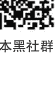

一本黑公众号

一本黑社群

## 让一部分人先改变现状

## 成人用品市场分析——曜森

成人用品的市场还是需求还是比较大的，因为大部分都属于一次性销售产品，复购率强、退货率低，加上用户整体年纪较长趋近于年轻化，对于成人用品的接受程度还是有着跃跃欲试。根据这部分年轻群体也势必会成为成人用品消费人群去的主力军，并且产生一个互相促进的良性循环。

接下来我分享一下成人用品无人销售店铺玩法，比较适合一些创业大学生，宝妈，宅在家的一部分人群。（同行的分享加自己的想法）

#### 选址：

个人比较推荐的选址地方：大学附近，酒店，旅馆，工厂，小区，城中村，三四线城市，还有酒吧附近。

确定好选址地方，通过晚上吃夜宵的时间去标志几个串来观察人流量，观察时间 9 点到凌晨 3 点左右。老司机都懂得。

#### 租铺面：

当然我们选址一定要选择成本比较低的地方，这些地方大能在比较不起眼的小巷一楼大概面积 10 平方左右。如果前期资金不嘤的话，我们可以选择和房东商量一下把租金低一些，或者再找别的地方。实在不行可以分一下店铺的销售利润给房东。

#### 布置工具（成本）：

#### 门面引导牌（约 300 内）

店铺门口看店铺的面积情况，个人比较建议安装铝的帘子（类似于超市里面购帘）丢玻璃门的话容易给破坏的人弄爆。（大概在 500 内）

#### 门店装修门面（大概在 600 内）

条件允许的话才做，最好也缩小一下利于可以做美团或者网购生意。店内的装修，可以选择在淘宝或者阿里巴巴进一些墙纸或者壁板贴，墙纸的话最好改一些海报之类的，老机器都搞得。（大概 500 内）

压货成本（大概在 800 以内）需要测一下人流量合适什么才进货。

#### 租金：

以广州的价格大概 2500 内。以上开店成本在 2 万左右（估计不会过漏吧）

经营方法和：我家附近的成人用品店（已经给拿领了）

价格最好不要高于淘宝还有京东（最好看地理需求）

整理好货后，测试半个月如果有一个产品卖的好的话，就要将爆款产品放在 -销售机中。

在销售的同时，我们搞一个比淘宝京东更便宜的东西。差不多是成本价销售。这个是属于相当于是指流品，会增加客户的复购率。

想引流客户的话，我们可在店铺门口贴一张海报，凡是进店可以免费领取一个小礼品什么……

在通过店铺里面的海报来吸引客户下单，流程是在售货机上下单，加微信来返现给客户。通过这样的方式精准的客户就会慢慢上门。

还有一种引流方式，有一些女孩男孩是比较腼腆的，不敢去这些尴尬用品店，我们可以在店面设置一张海报加微信，可以免配送货或者寄到家、全程不会见面而且什么都不会写出来的。请您放心~

如果在大学城附近，设置一些诱饵，加微信引导一些学生做代理。后面都懂的。

成人用品无人销售，不用特别关照店铺，只要隔几天去进一下货。通过摄像头来观察货物的销售情况再去进货。实际需要的时间大概在1个小时就可以实现稳定赚钱。

一本黑公众号

一本黑社群

让一部分人先改变现状

## 如何在抖音通过蹭热点暴力涨粉——
天枢

前两种方式的资金门槛和制作门槛极高，普通玩家难以企及，想要快速吸流最快的方式就是蹭热点，只要热点蹭得准，点赞播放飞起来。

踏在热点关联你，就是流星风口上的猪，想不飞都难！

我旗下运营的其中一个账号，通过蹭热点策划，做了 1083 万和 3212 万的播放量，凭借敏锐的网感嗅觉，预判热点的来临，把控好热点时机效性。

在热点刚刚热阶段上发现视频，该视频与热点关联极高，热点越热我们的作品也就越热，作品最终突破抖音等入榜最高被推池。

“罗志祥事件”的最大赢家要算“南宁罗志祥”，当时南宁罗志祥开播直播同人气最高达 5 万人，这就是搭上了热点的顺风车，被动蹭热点，实属当日幸运儿。

本文天枢将分享蹭热点的方式与实操技巧，分为以下 5 个板块，一一到来。

1. 油腻大叔蹭操作解析
2. 蹭热点的三种形式
3. 抖音热点的先知先觉
4. 毫无关联蹭热点法则
5. 蹭热点技巧与注意事项

#### 一、油腻大叔蹭操作解析

抖音有个 IP 叫“迷哥”，粉丝量 24 万，总点赞量 900 万，迷哥可谓是蹭热点的好手，每条视频拍摄其简单，前景相对套路一口气即明。

每条视频都是当天的头条热点，标题文案都与热点话题相关，导致追哥的每条视频前面都跟着一个热点相关话题。

蹭热点不稀奇，每条视频都蹭热点，而且还做出了一个蹭热点 IP 这操作者突变的一批！

我们来分析一下“迷哥”的视频形式，标准内容文案格式：不要问了，xxxxx（热点事件），那真的是盖了帽我的老北京，怒开！

每条视频时长都在 15 秒以内，固定的口头禅和内容格式，一口气吞急忙惶的声音风格，

每一次的蹭热点流量加持，让这个无内容的蹭热点形式，慢慢变成一个蹭热点 IP。

#### 二、蹭热点的三种形式

抖音的热点分为三种：
1. 事件热点 2. 音乐热点 3. 形式热点

事件热点的蹭热点方式就是生产与热点内容相关联的视频，注意你并不需要完全与热点事件相关联，只要提及热点元素即可

然后文案标题性上热点相关话题，做好视频内容与热点某元素关联，抖音系统识别后可以把你的视频与热点关联、推至该话题属性的流量池。

以“罗志祥事件”为例如，卖化妆品的可以提及罗志祥的黑眼圈；
做培训的可以提及罗志祥的时间管理；
做教育的可以提及罗志祥的文学学历；
做减肥的可以点名罗志祥的央视演讲；
做好物推荐的可以加一句“相信我，我们绝不会像小猪一样卖负你”（罗志祥外号小猪）。

音乐热点比较好理，这里音乐热点不仅指音乐，也包括热门的达人原声创作。

比如二炮潮潮哥的“卧 C 无情”，Giao 哥的“我太难了”，秃老师的“无中生有、暗度陈仓……”，三支花的“上才艺、EGM”，某音乐节或某个原声火了以后，尽管去与自己作品融合，在特定的时间...内也会搭上流量顺风车。
形式热点，此类热点更讲究的是时效性。

比如“九州遥方”的边走边谈，lowB式表演重新正能量——“正道的光”，“刀小刀sama”的换装，这些热点更适合没有清晰定位暂无自我风格的散户或者是以播为主的达人。

形式热点就是填补了平台内容空白。特定时期内这种形式就会更容易得到流量倾斜，更容易上热门，这与抖音的内容稀缺领域抢占时推送倾斜算法有关。

#### 三、抖音热点的先知先觉

事件热点一般都是全网热点，但是会有一个时效性问题，比如“罗志祥事件”的发酵点是在微博，随后慢慢微博传到抖音再从全网持续发酵，所以大事件热点尤其是娱乐圈里的热点，先看微博发酵。

从微博热点发酵到抖音会有一定的时间差，然后利用时间差在抖音生产相关视频内，便会搭上第一波流量顺风车。
娱乐圈的热点就靠微博即可，其他都是扯谈，充分利用热点转移时间差！

关注抖音热点榜单，看一下top10以下的热点内容喃一聊一个有潜力大火、或者有没有“新”“爆”等标志，以此来判断该创作作品进一步的创作方向和文案思路，倘若相关联热点从top50升至前top5，你的新关联作品便会分摊相应的新增流量。

简单来说就是特定区域事件的内容“供”与“求”的关系，某段时间“求”突然变大，“供”即使再多也会有人“求”，如果“供”即做好了时效性又确保了质量，热度就会产生。

注意时效性，掌握热点的先知与先觉。

#### 四、毫无关联蹭热点法则

这种玩法与视频内容毫无关系，某个热点火了不管是事件热点还是音乐热点

找到该热点相关的最大火视频，点击右下角原声相同款，然后把配字配乐音量调到 0，既不影响你的视频内容呈现，还唤起了它的相关热点。

这类蹭热点在点的关键是要找到当前热点关联的最热视频，而且该视频有继续热上的上升空间，不然没有任何效果，而且这类蹭法的热点关联性要远逊弱于上述例子，所以哪个原声就变得很重要。

但热点并不影响你的原有视频创作，即使毫无关系也有蹭上热点的可能。

#### 五、蹭热点技巧与注意事项

如果你的散粉账号粉龄很少或者是小白号，那么请放心随意的去蹭热点，想尽各种办法去蹭，蹭到就是赚到，任何形式的流量获取都是你现阶段的胜利。

倘若你的账号定位已经非常明确，标签非常精准，那么你再去蹭热点应该要着重避免热点事件与账号内容属性的有机构合，不要因为一次蹭热点而破坏整个账号的主题专业。

捡了芝麻丢了西瓜，得不偿失

有规律性的蹭热点应该是以偶然热点内容视频起步，第一条发出效果不好时，第二条继续往上，这是我实践得来的实践经验，废试不厌。

新媒体圈子里会经常说的一句话：

抒写求爱就好像恋爱时期的你向你女友求爱，第一次不答应是出于小女生羞涩礼貌性的拒绝推搡，并不是真心不喜欢；
第二次求爱才会接受，所以要多给自己一个机会嘛。

最后，踏踏实实的实操经验分享，让正在抖音创业路上的你少走一点弯路。

免费的最贵，天和里所说的“贵”并不是指“价格”的贵，而是你没有成本投入即可免费获取。

因此你去不担心不去失败，从而丧失机会的“贵”，这种“贵”是无法衡量的。

> ——两智慧胜过一吨辛苦，脑袋决定口袋。——牛根生

## 如何运营视频号，新手指南——李坤雨

视频号已全面开放注册，越来越多的企业家、明星、主持人、大 V 入驻视频号，视频号的价值亟需验证。

分享一下我的经验，如何玩转微信视频号，希望对你有所帮助。（长文略干）主要从以下四方面分享：账号定位、内容生产、涨粉攻略、变现方式

#### 一、账号定位

玩视频号第一步，首先想好定位、人设、内容特征。

有了定位，才方便去告诉你自己、生产垂直领域的内容。

个人简介最好写明白你的账号能够为别人提供什么价值，不管是情绪价值，还是认知提升，还是娱乐愉悦，你得让别人知道为什么关注你。

人设是什么？其实就是人物形象，你不同于他人的地方。比如何同样是分享摄影的内容，你说话更幽默、你拍照更日系、生活态度更热辣，这些都是你的人设。

这里就涉及到内容特征，也称之为视频标签，你戴不戴眼镜、帽子、有没有口头禅……

总之就是让别人感受到你账号的价值，并记住账号背后是一个什么样的人，有什么魅力，所以比较推荐真人出镜拍摄。

想定位的时候，你一定要选择一个自己感兴趣的、擅长的领域，不要单纯为了流量去做内容。比如，看着影视剪辑容易火，就是做影视剪辑吗？一定要找一个自己喜欢的而且能沉淀自己的定位。

#### 二、内容制作

视频形式多种多样，比较简单的视频是 PPT 视频（对着图片讲解）、文字视频（文字跳跃的那种）、口播视频（大脸对着镜头讲的那种）等，这些不太需要镜头语言，适合新手或者不想那么麻烦的。

也可以拍得更高级的，有剧情对话，有场景转化、有拍摄技巧，这些肯定会更费时间和精力，相应的传播效果也会更好。

##### 拍摄工具

手机就可以满足基本的拍摄需求。

如果涉及到要拍摄很多场景、想视频平稳一点，可以买一个手机稳定器，拍摄会轻松很多。

如果光线很弱，比如夜晚，一定要买一个补光灯，不然手机拍出的视频很糊，补光能大幅度提升画质。

如果在室外有录音的需求，一定要买一个麦克风，不然收到的声音会特别嘈杂。

如果想拍摄更高级一点，就可以入手一台相机了，大光圈拍出来的视频确实比手机拍的更干净。

剪辑软件手机视频剪辑软件我强烈推荐：剪映，其次是快影。

剪映真的很好用。语音直接转字幕，语音变声、字幕直接转成语音。还有画面、蒙版、色彩拟图（直接转换绿布），太强大了。不合适的也可能就是音乐太少，需要经常自己下载音乐到手机。快影的音乐多一些，不过操作更复杂。

电脑剪辑软件：mac 推荐 finalcutpro，windows 推荐 pr。电脑剪辑比手机剪辑更麻烦，特别是加字幕。我更喜欢手机剪辑。音乐、字体涉及版权，这个需要注意。

#### 三、涨粉攻略

视频号如何冷启动，获得第一批粉丝。

很多人建议号召朋友关注，但我的想法恰恰相反。
让朋友感觉被你骚扰的账号几乎毫无意义，因为亲朋友不一定对你的内容感兴趣，反而是对关系消费。为这小事还打扰到别人。
最后你可能会发现，支持你的人是那零碎关系的陌生人。

最好的涨粉方式是内容涨粉，通过优质的内容去吸引他人，只要你上了一次热门，你的账号是有定位、人设的，就能涨不少粉丝。

如何上热门，无非就是看你作品的这几个数据：点赞、评论、转发、收藏，还有一个链接点击量。
去迎合算法，吸引人们注意就好了。

分享作品到朋友圈，相关的社群，这个需要克制，分享多了就是打扰了。

#### 四、变现方式

自媒体常见的变现方式就4种：广告带货、打赏、付费服务。
当你积累了粉丝，你可以接广告恰饭。

如果你本身就是生意人，短视频带货的根基，你不是生意人，也可以通过分销获取佣金，比如对接商家客源，淘宝客等。视频号购物车的功能，未来估计也会有。

直播带货、直播打赏，这些功能估计也会有的。
如果你真的有干货，你也可以做付费社群，做付费课程。

最后，我做内容的感悟总结成一句话就是：
为目标用户持续地提供易感知的有价值的内容。
运营视频号在坚持和不断进化内容，希望大家玩得开心。

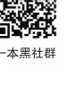

让一部分人先改变现状

## 社交软件如何保障用户数据安全

提问：我是一个来码创业，委托第三方做了一款相似小程序。想咨询下业内这种类似社交是怎么做用户数据安全的？特别是这种需要大量调用用户数据的做运营的公司。

技术承包商说，小程序放在阿里云服务器上，后台管理账号密码我们自己保管。

有几个疑问：
1、有些公司或个人可以通过技术手段入侵服务器读取小程序内用户资料吗？如果有，难易程度如何？
2、小程序开发商有没有通过后台管理账号密码直接取小程序内用户信息
3、最后，有什么途径可以检查小程序内有无被植入后台漏洞，会导致用户资料泄露的那种。
如果技术上没有漏洞可能，那么只要账号密码是安全的就能保证数据安全了吧？

刚好会云跟腾讯云深实室的朋友在候机，邀请他来回答下这个,问题。

1. 数据安全是比较复杂的问题，如果要做好数据安全有很多方面，比如你提到的服务器安全，理论上服务器都有被入侵的风险，取决于是否做好安全加固。
2. 另外，程序存在漏洞也是可能被利用读取数据，比如存在接口可读取用户数据，如果权限不合理就能利用接口，或者直接利用程序漏洞获取程序后台权限查数据等。
3. 入侵方式可以是针对服务器，也可以针对程序，难易程度取决于程序或者

服务器等多个维度的安全加固做的好不好，任何细节被发散都可能达到数据泄露的可能性。比如你服务器直接就是弱口令 123456。

4. 如果加固就涉及比较复杂了，建议找专业的安全公司，团队做渗透测试，模拟真实入侵发现问题并进一步修复。

5. 另外，除了服务器、程序坏节的加固，建议有限使用数据，比如说一些场景是否可以部分显示如手机号码等字段，需要什么字段就读取什么字段，不要一般性全部显示，这样即使程序真的存在数据被提取的可能性，泄露也有 限，还有数据存储的加密等。

至于 2 是可能的，如果他们心怀恶意留下后门等，就看你信不信任他们，或者就是程序都有可能。

上面说的再找安全团队做下安全测试。

账户密码是最基础的安全环节，大部分数据泄露入侵主要以来说利用漏洞（服务器或者人侵为主）。

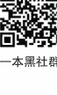

让一部分人先改变现状

## 爬虫抓取公开数据，违法吗

有圈友问，他抓取了企查在上面公开的信息，然后给别人发短信不算违法

我的回答：违法。
也有其他网友说：我一直这么做，都没问题。
我单开一篇文章讲讲这个事情。

#### 1. 网站公开数据可以随意使用吗？

拿上面的例子来说，企查查网站上有些公开数据：企业数据公开数据（如公司名、联系人、邮箱、电话、行业），这些信息所有人都可以看到。

但这里的公开信息，只限于「看」。如果你不仅看，还拿去做其他事情，无论你做上什么事情，都隔离了网站本身的意图。

如果你做上的事情，造成了一些事故，而调查得知数据是从网站拿到的，那网站可能会要负责任。

你可能说想，我就是发短信，不会出啥事故。但网站不会这么想，它会想，万一这些数据造成事故，那我就要赔很多钱。
虽然你说你拿数据不做坏事，发生事故的概率很小，但网站不关心这个，它说，本来是希望寄给你，提供数据会让你赚钱、日子舒舒服服，现在你把我数据拿去做其他事情，我平白无故多了一份未知的风险。搞不定哪天我人在家里睡，锅从天上来。

所以，我（网站）要把这些事故发生的萌芽杀死，具体做法就是，谁抓我数据，我就告你。我告你，说明我不同意你用数据做其他事情，先把责任撇干净，这样出了事故也就我没关系。

懂了吧，网站不关心你拿数据做啥。
只有你拿数据，它就有告你的权利。
人家是数据所有者，要告你的话，数据用途是由人家说的。
总结：网站的公开数据，只限于看。
如果你抓取，无论做什么事情，无论做什么事情，无论做什么事情，网站都有追究你的权利。

#### 2. 什么情况下网站会真的会追究你的责任？

上面说了，如果你抓取网站数据，做其他事情，网站有追究你的权利。
注意，这里是权利，并不是一定会告你。
这里有个成本的问题，就是网站追究你的话，他付出的成本：时间、金钱、告赢的几率等等。这些和他得到的赔偿金，哪个多？
如果赔金额多，网站就会告。
这是个赚钱问题。这是就会有网友评论说，我一直这么做，都没问题。
一件事情，连续违法是一回事，有没有被罚是另一回事。
这个不能混为一谈。哪天网站心情不好，找个由头追究你责任，你是逃不掉的。网站会追究责任，要看你赚就是多少钱，而有些人知道。又是竞争对手专门搞你。所以，你懂得。

#### 3. 那到底该怎么做？

讲个故事吧。我社群有个小朋友，想学习互联网。
以前，我都是直接告诉他，你应该去做什么，比如去写书、去读书、去思考。
然后，我发现他一件事情做一小会，就会跑来问我——XX说如有流量很大，我要去研究吗？

XX 说我做的的事情不能实现，要换一个方向吗？
XX 说故事要和赚钱联系起来，我现在做的事情对吗？
我就不一直很疑惑，为啥他不能好好干一件事情，老是想做其他事情。

到前几天，我听到姜黎老师讲的一本书《高绩效教练》后，我明白了。

他之前做的事件，都是我告诉他的，而不他自己思考所得。
所以，他虽然按照我说的去做，但他没有坚定的信念，说做这件事情一定。

所以，一旦他会上去有吸引力的事情，他就会立刻怀疑之前的事情。
或者做事过程中，遇到稍微有点阻碍，他就会找我，说当时会这样？这个办法对我是不是不合适？

因为他做他人，是让我让他这么做的，我应该承担责任。（可能他不这么想，但是不要紧，这是人性，和道貌、素质、理性、感性无关）

我以前也有一，我最开始学习的时候，按照书里的方法，做一会觉得不行，然后心里就说，这个作者的方法真烂。

后来经过一段时间，我想明白后才做，很轻松就完成了这个事情。
回过头看，我用的还是这个作者的方法，只不过这次，我想通了。因为我想通了，所以过程中遇到任何障碍，我都能够主动去解决方案，而不是和之前一样，抱怨别人的方法不行。

经过这个小朋友的事情后，我想通了，不在给任何人提供建议。
我会用《高绩效教练》里的提问方法，引导他自己思考。
如果他愿意思考，他就能得到结果，这个结果和我告诉他的“应该如何做”一样，甚至更好。

如果他不愿意思考，那么我也不会费力气，因为一个不愿意思考的人，是做不成的。

啪啪，好险躲过了。
道理一样，关于数据不能抓的问题，我不会告诉你确定的解决方案。
上面的文章里，已经写清了背景、缘由、风险。
你如果愿意的话，可以深入思考一下，确认数据在自己这里不会出问题的情况下，做好防范工作，做好风险评估，然后干就对了。

注意：在真实世界里，不要期望得到确定的答案。

## 第四章
捍金实操

### 2019-2020

## 如何利用短视频月入 10 万+

除了带货，你还可以有很多种方式赚钱

看了一些短视频项目案例，主要是以带货为主，或者以接广告的方式盈利。今天结合我的实际案例，给大家分享一些短视频的 other 盈利方法，可以让大家拓宽拓宽思路。

文章较长，但绝对干货，都是我花钱买的课程和实战经验，希望大家可以给个点赞，绝对捍回你的时间。

真正关注抖音带货是从去年开始的，因为我是做淘宝的，所以抖音开通购物车功能以后，自然引起了我们这些做电商的关注，尤其是我们通过抖音来做淘宝 AA 单以及 AB 单。所以那时我便开始关注了抖音，身辺也陆陆续续开始有一些做电商的朋友试水“抖音带货”。

尤其是见到抖音的流量猛增恐慌之后，我也开始考虑试水短视频行业了，不止一开始，我就没有选择带货的模式。

就像之前 @Damon 说的，抖音的红利期消失的非常之快，从最初的 PPT 到后面的开箱好评，最初的时候，抖音带货确实非常繁荣，尤其是对于一些有过电商、淘客或者新媒体经验的人来说，那真是一个暴利的时代。比如有些人把淘宝上卖饰的玩法搬到抖音上，销售农产品、卖窗框子卖苹果，收获了一波红利。但此后内容无法持续输出，而且消费者也开始免疫。

但是随着开通购物车的门槛越来越低，短视频行业的准入门槛也越来越低，到现在好像只要发布 10 个视频而且巨大的财富故事也吸引了越来越多专业的内客创作者。伴随内容创作者的增加，抖音内容生态也更加丰富，所以抖音开始筛选清理平台一些劣质的内容，PPT 式简单粗糙的视频也再无法获得流量。抖音带货开始逐步变得规范化、IP 化、垂直化。

虽然抖音带货并不依赖粉丝多少，但是我那些做带货的朋友，出现暴富的难度越来越大，竞争越来越大。他们其中一些选择了退出，毕竟淘宝才是主业。

而另外一些，则逐渐转型，开始配置专门的团队、打造专业的视觉效果、研究市场、调研数据，在选品上下狠功夫。整体也是在往 IP 化、垂直化靠拢。或者就是按照微海保投资直播间的思路，dou+ 测款，ROI 可以就砸钱追加投入。

比如他们都释然轻视了孕婴知识分享的垂直，或是宠物分享号，又或者是测评号，以及真人 IP。

这就好像我的淘宝。最初的年代，正是红利期，对手都很弱，这个时候你只要拥有好产品的供应、上传宝贝、随随便便下单就可以单笔赚钱了。而且当时没有专业的竞争对手，不会搞投流话术或者售后，所以一些人起初开了店群，牛通的人，一天的收入都是几十万。然而，随着淘宝宝贝的竞争加剧，淘宝也在逐渐向正规化专业化，尤其随着天猫商城的推出，一大批中小卖家被淘汰，一些活下来的卖家则选择转型升级。

而面对这种趋势，我选择的并不是和大家一样的思路，扩充团队、增加推广费用、打造常规赛模。我转而求大做一些大卖家看不上的小类目。这些小类目市场规模很小，但是也正是因为市场规模小，所以竞争也很少，对手也很不专业。虽然我的实力在大家类来看，就是被撇除的小家，但是在这些小类目里，我的实力可以说是碾压对手了。

那么对于做抖音，我也是同样的理念。如果说抖音带货，是大家最熟悉的盈利模式，那么也必然是最竞争激烈的地方。我们要想在这个战场胜出，就必须一棒子打造优质的产品内容，配置专业的团队，从选品到脚本、文案、摄影、剪辑都需要一个专业的团队来打造。尤其是那些卖 IP，不做垂真的带货号，这类账号一个月的主要收入主要就是靠那爆起来的一两个视频，这就使得收益极其不稳定，而且严重受到平台政策的影响，没有积累。

## 第四章：搞金实操

## 我做淘宝的思路：

- 1、核心是建立在竞争极其小的产品这一大前提下，脱离了竞争小的这个前提，我的很多玩法都是不成立的。不大走红，不做付费推广根本不可能有机会做起来。所以我的核心是建立在竞争小的前提下。
- 2、原则是要以极小的试错成本来运营一件代发，绝不囤货，不做付费推广。这样即使就算亏钱，也在承受范围之内，而且容易测试方向。
- 3、单店天花板很低，要依靠多店复制。竞争小的原因为市场小，市场小，所以只有大亏不伤，所以我才有小卖家才有机会去出。我的单月利润都在一两万左右，多的可以达到五六万，但是我运营了26个店铺，其中有19个都已经盈利了。
- 4、单价要够高，高单价意味着高利润。我一般给自己设限，低于100利润的产品我都做。我利润最高的产品，利润是1000多。

首先，我做抖音给自己设定了两大规则

- 1、尽量要一个人一台手机就能完成内容创作的项目，而且不能对视频质量要求太高，不能有太复杂的前期剪辑。
- 2、要做离变现最近的事情，不要在意粉丝数量、不要在意曝光量、不要在意点赞量，我只在意利润多少。我见过太多太多的朋友，做着一个几十万的抖音号，一个月收入就几千块。比如我一个做搞笑类的朋友。此类粉丝就算带货不易转化。接广告的难度也很大，大量的广告费都被头部账号和MCN拿走了。

那么接下来，我将给大家介绍我的具体操作流程，我选择孵化一个本地同城的房产号。

我做短视频有一个核心的思路，就是要垂直，只有垂直的粉丝才值钱，粉丝一定要精准，越精准的粉丝，转化率越高。所以我做抖音的第二个账号就是房地产号，而且不是泛泛而谈全国的房地产号，而是只讲重庆本地房产楼盘信息的话号。

在初期，我找了一个在蘑创当营业顾问的同学出来合作，由他负责输出内容，由我负责策划以及后期实现。他做营业顾问的工作时间很长，工作压力也很大，平时月收入大概一万多，好一点的时候两三万，本来就打算辞职，所以很容易就答应跟我们合作了。

因为我本來也在做社群和培训，所以在对账号初期的主体盈利模式就是定位于带付费社群和卖课收钱。虽然也待过淘宝联盟点广告盈利，后面发现效果不太好。

准备做抖音，我花钱买了七八个课程，对他们的谬误进行了综合判断。在做账号之初，我们还是进行了养号，具体内容就是模仿真实的抖音用户浏览、点赞、评论、转发、保存、关注。每天一到两个小时，坚持了一周以后才开始发表视频。

这里也要给大家说一下，养号要模仿真实的用户轨迹，一些细节尤其注意，比如你点赞，不能只是看了一秒，就疯狂点赞，至少你应该看完了视频才点赞。我们这样养了一周以后，开始发视频。这里也要给大家说一些关于养号的事， geringer，有些说没有养号的说法，有些说有，我的看法是，宁可信其有，不可信其无。因为我身边一些做抖音的在初期没有养号很容易被封号。当然也可能是其他一些原因，比如，一个手机只绑定一个抖音号之类的。

而且养号是否真实不说，但养号这一过程给账号打标签是绝对有用的。具体来说就是将你的账号打上垂直内容标签，比如你做电商的，你就经常关注电商的账号，并对其进行点赞等行为，这样让系统知道你这个账号也是做电商的，就会被推送给那些买相关内容的用户。具体判断方法是是用一个刚生的抖音号去关注，如果提示你关注其他通讯工具好友，则标记成功。

如果提示关注同类型账号，则标记成功。
我们输出的内容是一些对本地楼盘的分析，以及一些买房的建议，由我朋友入住内视，用手机拍摄，制作内容极其简单，几乎无后期，就是简单截个字幕一到两天一更。

我们的播放量和点赞量并不高，一般也就几百到几千的播放量，好一点的有几万，点赞量长期都是二百的水准，好一点的有几千。但是我们的点赞率还可以，一般维持在 3-10 个点。就这样，我们做了一个多月以后，积累了

一万多粉丝。

有人说，把微信联系方式放在简介容易被限流或者封号，我无法知道真实现性。但是对于我们而言，如果不能够粉丝导流，我就没法进一步变现，那将是毫无意义的。我是实用主义者，所以我还是把微信号以符号的形式放在了简介中。私信回复时我将联系方式做成了图片的方式。

在此期间，也没有一个楼盘来找我们打广告，而我又不想长线下搬养等，所以我们也没有主动去跑开发商，所以这条路似乎靠一分钟，好在开始我就没打算靠广告赚钱。

我们加了这些用户微信后，我们自己也拉了一个微信群，逐渐有一些人来找我们咨询该如何买房，和我预期的也一样。我朋友仍然是虚心地无底薪经纪人，同时我们还注册了很多楼盘的经纪人，并将其这些楼盘信息实时推送出来。就这样，我们慢慢有了成交，第一个是一个新楼盘开盘，我一天就卖出去五套。佣金有五万多，才一个多月，我们团队上面就收入十多万。

形势很好，正当我们准备联系一些二手房中介、涉足二手房交易、以及打算做付费社群和知识星球，分享专业的购房知识等等，尤其是给房贷，他们的购房需求和付费意愿很大，如果我们的人数大了，我们完全可以以团购的形式，倒逼开发商给予优惠，也算是给社会成员的福利。

但就在这时，我的朋友却同我们产生了分歧。当然，最终核心还是因为分赃不均，他认为个人价值大于我们整个团队（也许他也是出于测试项目的目的的，所以所谓的团队其实也就是我公司的两个实习员工。在帮我于看我主业的时候，顺便于兼维护运营微信群的事以及短视频的一些行改美工作），所以他想要单干。

就这样，我们解散了我们的团队，我也选择注销了账号。当然，他后面自己也淡淡起来。做抖音，其实也涉及很多细节包，包括我们后期的一些变现，都是有很多探讨的。

其实，这也是我预期之中的事，多年的创业经验告诉我，这个项目并没有想象中那么简单。所以我第一次只是为了以最低的成本，测试项目的可行性。所以同合作伙伴的合作也没有详细规划一些双方权利义务的细则。也是我打算

获取经验的部分。

不过，和朋友合作的抖音号的成功给了我信心。我此后又做了一个关于讲电商的抖音号，因为我本身来做过很多年的淘宝、又有现成的电商社群和培训项目，所以做得很那样。我都是有空的时候，花五六分钟拍个视频，然后交给实习生花几分钟给我配个字幕。制作内容极其简单，就这样，我到现在一共发了 16 个作品，获得了 8527 个点赞，4478 个粉丝，成交了两单。

现在我觉得对于短视频创业有更多的想法了，也更加明确了一些规则。包括招商团购等的，二手车的，本地房地产的，以及跨境电商，自媒体、考研、考公，炒股等等各行业的内容或社群，我觉得机会非常之多。当然要注意避开一些烂瓜娃，就好家同城的餐饮饮，这是一个竞争非常激烈的，而且我不喜欢过度依赖广告的推送模式。

这类垂直类的项目，对于视频制作的精美度要求不高，更多的是对于内容的价值表达。所以往小了，你可以发挥自身的价值点，做自己现有的行业的延伸，做一个垂直类号。而且要尽量偷懒，最好你可以用当兼职做，就好像我做淘宝抖音号，完全是我主业的延伸，有空就发视频，没空就不发。往大说了，你可以往 MCN 的方向发展，比如我刚和朋友的合作，我完全可以以 MCN 的形式跟他们签约，流水线的包装复制。

当然，我说的这么简单，实践的时候，也是有诸多细节的，而且需要一些丰富的创业经验。不然，我那朋友自己去探索了十几年，也不会没有做起来。所以，大家的心态也要调整好，控制好试错成本，不要贸然就放弃自己的主业，租个办公室请人来做准备大于一场。

就好像我和他朋友的合作，我原本确实生活就有工作要带我负责我的电商项目，我只是给他们增加了定的工作量，我的人力成本可以忽略不计。我们的拍摄设备很简陋，就是手机。拍摄费，最多也就单条视频超过 100 元。最大的投入就是我花钱买课班的学生，但是最后我们这个账号我也分了几万块钱，整体是盈利的。所以，我以极低的成本尝试了这个行业。而且，完全没有做过短视频的你，肯定会踩很多坑，所以严重建议你初期以最低的试错成本去尝试这个项目，不要一开始就高举高打，投入太大。

## 第四章：捞金实操

即使我现在，也是打算在不影响现有主业的情况下，打算先重新组建一个两到三人的短视频团队，内部孵化，先从一个账号做起，然后慢慢再寻求扩展复制，目前也正在严 Î格物色适合的内容合作人。这样每个月即使亏损，也是我的可承受范围之内。当然，这一次，相比上一次，我的准备将会更加充分。希望到时候能有机会同大家分享我的成功经验。

让一部分人先改变现状

一本黑公众号

一本黑社群

## 股市暴跌，咱们的钱该怎么玩

今年可谓多事之秋，除了新冠肺炎在全世界肆虐，最近又爆出不少黑天鹅事件：
先是油价价格暴跌，接着美股一周内连续两次“熔断”，今天美联储突然把利率降为零，上一次这么做还是 08 年金融危机的时刻…
相信现在有很多人会感到迷茫：经济危机要来了吗？我的钱到 底哪里才安全？

- 1. 为什么全球股市都在暴跌？
- 2. 抄底股市，还是持有现金？
- 3. 危机时刻，要跟风买保险吗？

#### 一、全球股市熔断式暴跌，为什么？

股市价格反映的是人性的贪婪和恐惧，贪婪的人觉得价格低，就会买入，恐惧的人觉得价格高，就会卖出。

为了预防这两种情绪过度发酵，导致股价暴涨暴跌，很多股市都引入了“熔断机制”。例如当股市下跌 7% 时，会暂停交易 15 分钟，让大家冷静一下，相当于股市的“降压栓”。

在美国熔断的第三天，股神巴菲特接受采访时提到，这次暴跌主要受新冠肺炎和石油价格波动的影响。

##### 暴跌原因 1：新冠肺炎带来悲观预期

今年一月，新冠肺炎在全球爆发，国内的累计确诊人数已经达到了 8.1 万。
新冠肺炎对经济的打击，相信大家都深有体会，平时人头涌涌的商场没有一点人气，排队等号的网红饭店只能 excel 外卖死撑，旅游旺季的机票和酒店却爆

出了史上最低价…

经过两个月的攻击性，我国民疫情已经开始受到控制，但很多国家并没有引起重视，甚至特朗普还公开表示不需要戴口罩。

在一连串“不作为”的懒散之下，国外的确诊人数也迅速上升，甚至有些国家的政要人物也感染了病毒。万一这些人有什么三长两短，对世界政治经济格局都是巨大的不确定性…

人类什么时候才能战胜新冠病毒？疫苗和特效药什么时候能研发出来？这些问题至今都还没有人能准确回答。

零不幸当地说， वर्तमान全球都笼罩着经济衰退的悲观预期。

##### 暴跌原因2：沙特增产，石油价格暴跌

目前全球的石油产量，主要集中在以沙特为首的“OPEC组织”、俄罗斯和美国。

3月6日，OPEC和俄罗斯协商“减产+提价”，但减产有可能导致市场份额下滑，俄罗斯并没有<|start|>。

3月7日，恼羞成怒的沙特掀头就宣布“增产+降价”，通过这种“杀敌一千，自损八百”的方法，企图逼迫俄罗斯就范。

受疫情影响，国际石油需求本就疲软，经沙特这一折腾，直接就导致供过于求，国际油价闪跌24%到30美元/桶左右，比相似容量的农夫山泉还要便宜。

##### 暴跌原因3：油价暴跌引爆股市

国际油价暴跌，再加上新冠肺炎带来的悲观预期，最终导致3月9日全球股市集体跳水

截止上周五，全球已经有超过50个股票市场进入“技术性熊市”——即股指从最近的高点下跌超过20%，从而技术上确立熊市。

尽管世界各国纷纷采取了救市措施，但是前效果依然不明显。如果参考2000年的互联网泡沫破灭，以及2008年的全球金融危机，美股的跌幅分别达到49%与57%。

以史为鉴，这次股灾调整可能远未结束。

#### 二、我的钱到底放哪里才安全？

股市的大起大落让人患得患失，可能昨天还在做着财富自由的美梦，今天就不得不不舍地卖掉多么一份兼职。

那么，我们的钱到底放在哪里才安全？

作为一名理性的投资者，首先我们要知道，理财存在一个“不可能三角”；即收益高、安全、灵活性，三者不可兼得。

举几个例子：

- 1. 股票：有可观收益暴赚，但也可能暴亏，安全性堪忧。
- 2. 年金险：安全性最高，但是前期拿出来会亏损，收益率一般也 4% 左右。
- 3. 余额宝：资金可以随时赎回，也从未有亏过，不收收益率只有 2% 左右。

在了解这个前提之后，我再来回答几个常见问题；

##### 问题 1：追求收益，现在股市可以抄底吗？眼看股市和石油连续暴跌，不少人都蠢蠢欲动想抄底。

抄底抄中了，当然能暴赚一笔，但是实际上，没有人能准确预测底部，现实中的抄底往往在收益也非“山腰”。

我们拿 2015 年的股市为例，很多人在第一波大跌后就进场抄底，没想到后面还有几轮下跌，最终线上指数从 5178 点跌到 2638 点，几乎腰砍。

我觉得，理财应当做大概率正确的钱，而不是猜“抄底”这种小概率事件。

我们作为普通人，应该对市场保持一定的敬畏。

##### 问题 2：安全至上，保 Harrison 会是好的选择吗？

也有人炒股炒怕了，会把目光转移到“年金险”上。年金险最大的特点就是安全，但是收益就很那帮吧

《保险法》第 92 条规定，如果人寿保险公司破产，必须把寿险合同（例如年金险）转给其他保险公司，并且维护消费者的合法权益。

直接说结论：

- 1. 收益不够高；年金险的收益胜在长期稳定，但几十年下来，一般只能达到每年 3-4% 左右。

## 第四章：捞金实操

2. 灵活性较差：很多年金险在前 10 年都是亏损的，如果急需用钱就只能退保，可能会产生不少损失。

因此，年金险只能适合做比较长期理财规划，例如给孩子准备教育金，或者给自己准备养老金。

### 问题3：我的钱到底要放在哪里？

实际上每种理财产品都不是完美的，所以我们应该把妈妈放在不同的篮子里，比如可以参考“标准准备家庭资产配置图”，请大家自行百度！

这种方法把钱分为 4 类：

- 1. 要花的钱：用来支付日常的衣食住行，起码储备 3-6 个月的现金。就算失业，手里有粮，心中不慌。
- 2. 保命的钱：先保险，后理财。保险是一切理财的基础，要想赢，先保证不会输。
- 3. 保本升值的钱：人生中有一些支出是一定会发生的，例如孩子的教育，自己的养老，这些投资一定要稳健，例如可以考虑年金险，或者低风险的基金。
- 4. 生钱的钱：当你安排好前面 3 种钱后，剩下的就可以用来博取更高收益。就算股市抄底在半山腰，也不至于倾家荡产。当然，我并不是一个教条主义的人，上面 4 种钱的配置比例也不是绝对的。因此，建议大家借鉴这种资产配置思路，再根据自己的情况来进行调整。

另外也有不少人好奇，现在是不是一个买房的好时机？仁者见仁智者见智吧。

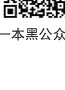

一本黑公众号

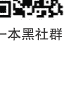

一本黑社群

让一部分人先改变现状

## 电商店群核心玩法和启发

大家好，我是一名电商从业者，13 年大一的时候就自开了淘宝店，大二的时候淘宝店的收入基本够生活费，那时候就不需要我家里拿钱了。大三的时候，就在学校附近租了办公场所，开始自己的创业之旅。
到目前为止，我接触电商 demost 已经有七年时间，这一路上一基本都是摸着石头过河，当然也踩了不少坑。这几年接触的类目也是多种多样，其中包括家具定制，汽车用品、保健品和茶叶等，目前主要以食品为主，销售平台主要以拼多多和淘宝。

这两种的运营和订单相对稳定后，近年来我又选择了出海，正式开启了自己的跨境之旅。现在正在准备 shopify 的独立站推广和泰国的 Lazada 网站运营。

今天给大家介绍的是过去两年比较火的拼多多店群玩法，下面先说说背景。

何为店群，通俗的理解，就是同时注册很多店铺（一个人的身份证在拼多多可注册 2 个店铺，注册个人店铺的流程很简单）！然后大量 copy 平台上现有的产品加价卖，基于搜索引擎特性，就会有部分人在搜索的时候，可以看到你的产品，虽然每个产品的访客不多，但是成千上万个产品所带来的流量是非常可观的，由于产品是 copy 别人的，因此总会有漏网之鱼选择购买你店群里的产品。

通常一个拼多多店铺可上架 5000 个产品，产品经过不断优化筛选后，访客可达到平均一天有 1000 个左右，转化率按 2% 算，一天就有 20 单，平均一单 6 元利润，一个店一天就能有 120 元，按 5 个店铺算，日收入就拥有 600 左右。很多人会问，这听起来太有点理想。实际上借助采集优化软件，是可以达到的。所有的成本就是一个店铺 2000 元押金（可退），采购件的费用大概 1000 元左右。

## 第四章：椭金实操

右，其他的就是需要自己主动不断地收集优化数据，不需要倒贴，也不需要广告费用。

我有幸通过朋友引荐，接触到了拼多多店铺的头部玩家，不过那时候拼多多已经给出了很多政策限制店铺。之后我们开了6个店铺，在官方严苛的条件下，前期依然做到了一个店铺日均十几的订单量。后来拼多多官方规则越来越严格，我意识到做店的店铺得慢慢转型精细化运营，于是我们停止大批量上架产品，转而把之前店铺销量最高的产品进行行销细编，再继续进一步开发延伸产品。

之前潘总也介绍过淘宝店铺的蓝海玩，教我们怎么通过生意参谋选潜力汽车类目如出一撤，通过生意参谋我找到了不大的产品，从中挑选出关键问题点优化，不间断的，我前期的情况直接通过车和店铺辅助提高产品的排名情况，后期稳定慢慢稳定库存。

只要有电商平台的地方就会有店铺，淘宝发展时间较长，所以店铺玩法模式较为成熟。两年后，拼多多快速发展，玩店铺的玩家适逢其时，参照淘宝的玩法不断升级和更迭，逐渐完善成为一整套更完整的模式。

必须说明的是，选品一定是电商运营的重中之重。此次我就要介绍一种选品方式，参照同行的店铺情况进行选品。这里需要用到我们大批快进测款。

首先我们要了解电商的逻辑，那就是有好的产品，一定有流量，合理的转化。实际上，产品、流量和转化率运营者互联网所有可以换钱的业务和模式，将这三点套在店铺上，成千上百方的产品里，会包含各优质的产品，而优质的产品就可以获得搜索引流的流量倾斜，因此这个产品和店铺的其他产品就可以获得持续多流量。由于访客量巨大，而且这部分流量绝大部分是精准访客，也就是通过搜索来的，那就意味将会有人不会就比多家在做单一买了你家的产品。

级别，我们到底该如何选择？这就如同一个用生意参谋选品属性一样，有时候我们面对的时候一般茫然，不知该输入什么关键词去选品。

我一开始做店铺的时候，直接找热词的大词去搜索后采买产品，发现这样效果不明显，不如划不来，还耽时耗力，你需要输入一个关键词，抓取完成后排后再抓取想抓的其他关键词，然后继续抓取，一遍又一遍的不断重复……

后来我们第二次去拜访那个做拼多多店铺群的头部玩家时，我提出了这个疑问，他告诉我说，为何你不抓取同行店铺的产品数据呢。既人家也是做店铺群的，那些有销售的商品就是他们测出来有流量有转化的好产品，你直接上传这些有数据的产品会更有效。

回来后，我试了下。第三天马上就看到了效果，采集的店铺数据很快就有了订单，不得不感叹头部玩家的高明之处，把研同行，模仿同行，最后超越同行做到炉火纯青的地步。

在这里我并不把这些采集软件的名称说给大家，这是因为，现在拼多多这种模式已经被人严格限制非常残酷，很多软件可以突破针对店铺群的新规则，当然最重要的还是避免抢广告的嫌疑。

后来我将这种模式发展成为我自销选品的一种策略。让员工寻找销量不大但是有需求的店铺，然后用软件批量上传这些店铺的产品，如果有产品出单，或者收集加购的数据不错的时候，就可以直接作为潜力款，然后去阿里巴巴的1688找通用图片，这样做是为了避免盗图，现在平台对于盗图行为都是零容忍，被举报的产品直接删除。一切准备就绪就可以用正当的运营方法做进一步的优化和推广。结果大小家每个人一个，这个是一个筐定不大不小的产品，通过后期优化，自己的相印。目前不花一分钱的推广费用，就可以有这样的效果。

说了这么多，最值得我们学习和思考的还是其中隐藏的本质和思维。我再简单总结一下，整个店铺产品的运营逻辑其实就是选择优质的款式，然后通过一些小技巧获取最低的流量，最后引导成交和转化。实际上，这个逻辑可以适用于任何的跨境模式。除此之外、我们应该如何快速出结果、验证商业模式是否可行、是否闭环？可以参照我上面说的最后三点，研同行、模仿同行、最后超越同行。

## 一个人如何从 0 开始做淘宝——盗坤

想到前不久很多人讨论过讲群、一件代发等模式，也有一些球友对电商这块感兴趣，所以邀请了一位五年电商从业者——盗坤进来分享他的从业经历，主题为《一个人如何做淘宝》。

他在电商领域干了五年，目前经营 24 个淘宝 C 店，团队 20 多人、年净利润 200 多万，主要专注于蓝海冷门类目，做细分市场。今年的双十一卖了 64 万，利润 32 万左右。

在稳步经营淘宝的同时，他今年 7 月份也开始涉足淘宝培训，目前运营了四个多月，付费学员 200 多人，营收 60w+。

他能给大家提供的价值是关于淘宝的运营思路以及相关的配套资源，尤其是关于蓝海产品的思路，感兴趣的可以关注他的公众号；盗坤，也欢迎加他做信息交流：dazk007

大家好，我是盗坤，五年淘宝卖家，吃过很多亏，遇到很多挫折，差点就放弃，最后稳稳坚持一直到现在，尚且还养得过下去。

今天就给大家分享分享一些经验和建议，希望对于小白卖家能有一些指导。

我就是这样说，现在的淘宝已经是一个竞争非常激烈的传统行业了，即使是经验丰富的老卖家，想要在淘宝上赚到钱都非常困难，对于个人小卖家更是难上加难。

大家的玩法都是通过一切合规（直通车、钻展、淘客、报活动…）或者不合规（补单、Ab 单…）的手法，快速积累销量和评价，抢占头部位置，实现羊群效应。

有时赌运气好做起几个链接还能赚一些钱。运气不好，你补单被抓，或者有时你刚刚刷到淘宝冲了 5000 笔冲到前面，对手又搬进 1 万单淘宝把你赶下去。

赤裸裸的白刃战，比的就是谁更有钱、谁的钱花得更有水平、谁坚持得更久。

所以，对中小卖家来说，这是一个门槛极其高的创业项目。

对于资金：有看得高的门槛，一些红海类目，几十万砸在一个链接上都是很正常的事。

对于技术：还不要说基础的开店、上架宝贝、设置优惠券等常规操作就可以让一个小白卖家搞得晕头转向，产品定位、活动策划、标题、补单、直通车、钻展、活动报名这些专业的运营技巧可是复杂的工作…当然，你也可以自己慢慢摸索，但我的就是死在这件事情里，你逐渐失去耐心，然后放弃。

对于团队：以现在的一个服务类店，有专门的摄影团队，有自己的模特，有自己的美工、维护客服、客服咨询、客户管理、日单运营、打包发货就这样的配套，有一些卖家一年苦苦挣扎，争取卖够 1000 万以保证不亏本。

然后，小卖家也不一定没有机会了，我就是从一个人、一个店，八万块起步，发展到现在，20 多个人，20 多个店铺，17 年净利润是 50 多万，18 年就是 98 万了，今年的净利润已经突破 200 万。

比如，你很擅长内容创作，可以考虑拍点短视频，搞个小网红，自带流量，给自己带货。当然，这需要你有才华。如果你没有才华，也没有资金、技术

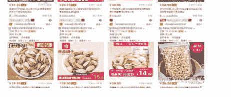

## 第四章：炼金实验

不成熟，也没有完整的团队，我建议你可以做“蓝海冷门小类目”。哈喇蓝海冷门类目，举个例子，开心果，大家都知道吧，这就是一个红海类目。

我们可以看看，前几位，三只松鼠占了两个位，天猫超市占了两个位，百草味占了一个位，良品铺子一个位，剩下的两个也是两个天猫旗舰店。试想，如果你自己是消费者，你会选择前面销量几万、视觉效果统一的天猫旗舰店，还是选择一个刚刚新开的月销前几十笔的小店？答案是明显易见的嘛。实际上，更的时候，你是连曝光的机会都没有的，更不要说给顾客选择对比的机会了。

这种  况，竞争非常惨烈，几乎不给小卖家活路。如果你要去做这样的产品，前排全是实力卖家，销量都是破万的，就算是前一百名几乎全是天猫店，并且在线商品超过 100 页，这个时候，做淘宝确实费，非常难。但是若是你选择的一些蓝海冷门小类目产品，你就可以得到比较深的，做淘宝对你而言，也不一件那么辛苦的事情。

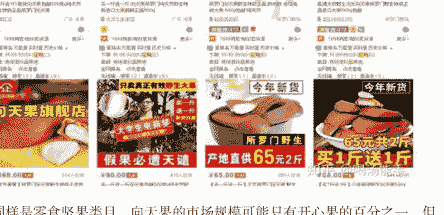

同样是零食坚果类目，向天果的市场规模可能只有开心果的百分之一，但是对手的数量和对手的水平，都是指数下降。你想要在向天果这个市场里做到行业前十的难度比你在开心果做到行业前一百的难度要小 N 倍。

开心果的头部卖家可能年销几千万，那又怎样？你能做到吗？即使做到，你确定你能赚吗？

向天猫的头部卖家也许只能挣年百万，可是那也很好了啊。对于中小卖家来说，能赚到钱就已经很不错了。

对于才刚刚开始做淘宝的中小卖家来说，就更不容易了，你的首要目的不要想着赚钱，能以最低的本钱最快速度试错学会电商就可以radiation，下面再说赚钱的事情。

所以，以淘宝已经是一个竞争激烈非常传统的行业了，但是如果你选择小类目，或者你也可以同样一样，活得稍微滋润一点。作为一个赚钱的淘宝店主还不那么苛求基本上，选品决定了你做淘宝能否成功，剩下的 50 就靠你的后期执行了。所以，选品是做淘宝的第一件事情，也是最最重要最最关键的一件事情。

当然，选品只是第一步。接下来你还需要，找货源、买样品、拍照、进行市场调查、策划活动、做标题、做出图详情，上架宝贝、补单、客服、优化宝贝，关注数据。听上去，头都大吧，别急，我慢慢给你慢慢的掰一掰。

#### 一、首先是选品

刚才只是初步地讲了一下。实际上选品的工作是一个非常技术活的东西。

这里我给大家推荐一个工具，生意参谋。

这是淘宝官方的一个数据查询软件。有人会给大家推荐哈哈里指数啊，选词助手啊什么的，这些软件都是免费的，不过大家系统都不要去浪费时间用这些东西，一个生意参谋就够了。

我也想把成本做低创业。但是这花钱的地方还是得花，而且我们最终目的不是为了省钱，而是赚钱，到最后你没赚到钱，一点意义都没有。况且，开一个生意参谋虽然要 1188 元一年，太贵了，但是我们可以租啊。租生意参谋一个季度才几块、你认为不租吗？（如果我找不到哪里可以租的朋友，可以关注我公众号《蓝坤》，加我助理微信，让他给你推荐，暗号，一本黑）

## 第四章：务金实操

那么生意参谋是干啥的呢？我给大家说说他的功能。他可以查询我们关键词的数据。

比如，刚才的开心果和向天果的数据，就很清楚，一眼便知。
有了这样一个软件，你在选品的时候，才不至于像一个瞎子一样，摸不着北。

#### 二、其次是货源

初次做淘宝的朋友，一定要用一件代发的模式。

前面我也说到了，初次做淘宝的朋友先不要想着赚多少钱，你的首要目的不要想着赚钱，能以最低的成本快快快速试错学会淘宝就可以了，下一步再谈赚钱的事情。你如果不懂，去便手地囤一批货，到时候卖不出去，可就全砸手里了。不要还没开始就赚钱，就拿出去一大笔，到时便不好调整方向。

所以，第一次做淘宝的朋友一定要选择一件代发。即使到现在，我都还是用一件代发的模式。我做了 7 年淘宝了，现在有 24 个企业店。更何况你们呢。

选择一件代发的模式。即先第个齐齐做起来，拍拍烂货，重新选择一个产品开始就可以了。不然一堆货砸手里，你想转都不好转型。

那么一件代发有哪些货源网站呢？记下来，记得点赞，记得收藏。1688 网，这是阿里巴巴的亲儿子，阿里巴巴早于淘宝之前就做成了 1688 是一件代发的货源网站，货源最齐全、最靠谱的网站。也是我最推荐的网站。

除了要挑选质量优质的有实力的卖家，我们还需要自己买一个样品回来，看看卖家的发货速度，客服质量以及产品包装和品质等各问题。

#### 三、然后是做市场调研

卖多少价钱，做啥活动，你心里有点 B 数吗？

这些东西都不能是你凭空乱想的，你得去看看你的对手，看看他们，卖的是什么价格，有什么优惠。

然后再根据他们的价格和活动，来设计你的价格和活动。(同理，如果有需要的朋友，可以关注我公众号《谡坤》，加我助理微信，让他给你推荐，暗号，一本黑)

#### 四、接下来是标题

这个说起来，要说的面，要说细的话，就比较复杂了。这里就给你小白卖家一个快速上手的办法，一个字，抄，抄对手的，抄卖销量靠前的。但是也要注意他的标题和自己的宝贝属性要吻合。

- 1、选择目标优秀竞争对手前十名
- 2、复制对手标题
- 3、用天猫首页搜索框搜索对手标题
- 4、将系统切的关键词复制到 word 文档
- 5、筛选出出现频率最高的关键次出来
- 6、打乱顺序组合成自己的标题

#### 五、主图详情页

标题可以抄，这个可不能抄了啊

首先，你抄过来的主图详情页是没有差异化的，那么问题来了，同样宝宝贝，同样主图详情页，别人的信誉比你高，销量的比你高，评论比你多？你告诉我，你是客户，你选谁。

其次，监测要是被对手发现并投诉的话，直接删除你的宝贝链接。

最惨的是你刚刷起有点起色的时候，被删除。所以，自己买个样品回来拍照，然后退货。一来是看看产品质量，了解一下供货商的发货速度、产品包装以及售后服务等等。二来，自己拍的照片，不怕被人投诉

那么具体如何做主图详情页呢？两个字，模仿。

一开始的小白卖家，对于做主图详情页都是没有经验的，所以多去看看优秀卖家的主图详情页，多找灵感，从模仿起步。而且不要仅仅局限于你的同行，其他类目也可以去看看。比如你是卖淡水水的，你也可以去看看卖面膜的主图详情页做得怎么样嘛。

当你找到模版觉得好啊做主图详情页之后，你就可以开始做了。如果你自己会摄影拍照懂PS，你可以自己做。如果你不懂PS，也请不要美工，关系。

打开功能的淘宝。

至于你已经没必要为省钱，重新花费时间去学习了，有那时间你就可以做很多很多事情了，而且你自己临时学的不一定有专业的人做的好。

我们的最终目的是通过淘宝赚钱，那个就应该选择性价比最高投入方式，而且主图详情页直接影响了宝贝的点击率和转化率，你一个业余水平做出来的主图详情页是严重影响转化率的，所以非常不建议自己去自学。而且做一套主图详情页也就要几百块钱。

包括前面的拍照，也就一两百块，都建议外包。

当然，也有人将诸如设计师啊之类的免费工具，其实除了这个工具还有颐兔、鹿班、智文案、智能微报等等工具。但是，我我就不推荐！

还是那句话的说呢，其实，没必要省的地方就不要省钱，该花钱的地方就要花钱。有时间，好好研究下文章，怎样把主图做到更加具有差异化和美观化、怎样打造高转化率详情页内容。剩下的具体操作，交给外包就行了。

详情页是影响宝贝转化的一个关键因素之一，所以详情页千万不要简单的叠加加粗数。好的详情页可以让你省下很多功夫。具体来讲，你要做到以下几点：

- 1. 抓住痛点
- 2. 信任度
- 3. 权威
- 4. 美观
- 5. 卖点

#### 六、上架宝贝

上架宝贝，这么简单的事情，有必要拿出来单独说吗？
很有必要，记住，一定不要错放类目，一定不要错放类目，一定不要错放类目！类目！重要的事情说三遍。
如果产品错放了类目，会严重影响你的流量。
那么如何查看你的产品类目呢，给大家说两种方法。
方法一：下载 uc 浏览器，然后安装店铺搜索或者店铺查询插件，将鼠标放置

在类目这里即可查清楚自己所要卖的东西属于啥类目。

方法二：通过生意参谋查询，也是最精准的。输入关键词，选择类目构成，哪个类目占的流量最多就是哪个类目。

#### 七、补单

补单其实就是为了两个目的：1、基础评价 2、搜索权重

当你通过王通的主图吸引客户点击进了你的宝贝，通过丰富的详情页让你的消费者了解了你的产品之后，这个时候，他就会点开你的买家秀。如果你的评论区啥都没有，没有追加评论，没有简评区，甚至没有任何评论。

那么很遗憾，大多数的情况下，你的客户他会直接在左滑动手、退出你的宝贝界面，至多也就加购收藏。所以，我们要通过补单解决你的基础评价问题。

而我们获得流量尤其是精准流量？流量有很多种，有付费流量、免费流量，站外流量，ે站内付费流量不一样，在免费流量里面又有手淘搜索，手淘首页，猜你喜欢等等。

而这其中最精准的流量来源就是手淘搜索！

我们运营要做的主要工作就是获取免费的手淘搜索流量，答案就是补单。模仿真实的购物轨迹，搜索关键词，找到宝贝、查找三家，最后下单。这一过程就会增加这个关键词的权重，从而提高我们这个宝贝在这个关键词下的展现率，最终获得精准流量。

#### 八、客服

当你做好主图详情页标题，上传了宝贝，shua 单提高了关键词权重，获得了展现，获得了点击，客户进入了你的店的时候，他还会给你客服咨询。这个时候，你就需要 int 一套高水平的话术。

首先：你是个卖家，没有专门的客服，你有时候要洗澡，有时候要开车，不一定随时随地都可能发客服吧。

所以，你需要设置“快捷回复”，将客户最常问、最关心的問題整理成话术，设置快捷回复，这样，即使你没有亦步亦趋地随时回复客户，但也能自动回复客户，最可恨就是不要因为客服回复不及时而流失客户的问题。

其次，有些客户问的问题，你自己不知道怎么回答，或者说回答得不是很好，临场反应就那么一两分钟，你反应不过来。

可以以客户的身份向其他同行去提问，从而将他们优秀的回答摘取过来，总结成自己的话术，保存下来，以便随时回复客户。

好，以上就是一个人做淘宝的主 ADE 的大概的流程，其中选品是第一步也是最重要的一步，只要能选到好产品，并且坚持下去，相信你也可以在淘宝上收获属于自己的成功。

最后，给大家一些小建议：

- 1. 不要囤货
- 2. 不要找代运营
- 3. 不要盗图
- 4. 不要听信旺旺上那些广告，骗子很多
- 5. 不要随便去花钱做啥黑科技操作，改信誉啥的，被抓严重的一关直接封店。

让一部分人先改变现状

## 小白如何通过淘宝月入 5000——盗坤

经常有人会问我，坤哥，现在在淘宝还能做吗？还好做吗？我们小白还有机会赚到钱吗？

说实话，淘宝已经是一个非常非常传统的行业了。现在的淘宝，竞争异常激烈，卖家的专业度也越来越高。淘宝对于中小卖家是非常不友好的，如果你没有足够的资金和专业的运营技术，想要做起来，确实很难。

然而，如果你只是想赚点小钱，也不一定一点机会都没有，甚至还很容易！
毛主席说，我们打不过上海滩的帝国主义，我们就去井冈山打地方保安团。
苍蝇虽小，也是肉，积小胜为大胜，星星之火也是可以燎原的！

那么做淘宝也是一样。服装鞋帽市场很大，但对于也很难，大张了，我们打不过。那么我们就去选择一些冷门冷门的蓝海冷门的小产品来做，实现降维打击！

所以，小白卖家要想在淘宝赚到钱，需要做到以下几点：

- 1. 选择高单价产品，高单价产品也必然伴随着高利润。
- 2. 选择竞争小的产品，最好是付款人数到 100 就可以进入前三那种。
- 3. 对手弱，天猫店少，最好是没有天猫店，且对手主图详情页都是美图秀秀水平。

试想，你要是卖袜子。淘宝上 15.1 元 15 双袜子，还包邮，月销几万 +，并且还有是天猫店，那竞争得多激烈啊。你一个新店，没有啥信誉，和人家店铺比起来，你有何优势？人家凭啥要买你的啊？

就算你 19.9 元一盒五双袜子卖出去了，扣除各种成本一单赚 10 元，你一个月得卖 500 盒才能赚到 5000 元。况且，你一不会运营，二没有钱做推广，你知道raud有多难吗？

但是，我们可以换个思路来做淘宝。我在16年的ers时候，做过成人用品。但是，我并 不是做成现在的BY套。我做的是 一种叫实体娃娃的东西！注意，可不是那种两块钱的汽配娃娃哦，而是单价几千上万的实体娃娃娃娃。

彼时，充气娃娃这个产品竞争很激烈，而充气娃娃这个产品竞争非常小。按销量排序，收录最多的有100多家，前十都还没有天猫店，而且对于的主图详情页还是很垃圾的那种。

我当时是把进价1000多的卖三千多，进价三四百的卖八九千，刷了大概几十单就进入销量前十了。我还清楚记得，我第一个月就卖了七八台，赚了一万七块钱。

这个案例我之前也说过，在我的知乎分享过，那时候的实体娃娃竞争非常小，不像现在，全部是天猫背后了。也是这一次让我见识到了雷海冷门产品的威力，也让我这个小卖家找到了一条出路，当时我已经坚持了一年多，一直亏钱，心态很差！其实，靠着卖实体娃娃，我也是抱着死马当活马医，我觉得这种奇葩的东西，这么贵的东西也會有天若？

事实证明，永远不要用自己一个人的想法代替13亿人的想法，你只能代表你自己，代表不了所有人，在中国这样一个人口大国，任何一个小需求汇聚到一起都足以养活一大帮人了。

类似的机会还有很多，你一个月卖10台就可以月入七八千了。当然，因为货源还有一些其他原因，大家不能做这个产品，我只是给大家举例这种蓝海产品的情形。

所以，小白卖家如何通过淘宝卖家月赚5000，我的答案是：选品！当然，如果各位黑友对这一模式还有兴趣，可以移步我的公众号和知乎观看同类原文，知乎和公众号同名《巡城》。
让一部分人先改变现状

## 操作盘 100 个抖音账号总结出的 5 点建议

和老师傅相识非常有缘，每次写了文章都会第一时间跑来这里分享给大家，感恩。

2017 到 2019 这两年，从网红 MCN 机构的流量号、各领域搬运号到现在的树洞开车带货号，作为抖音的一颗老韭菜，前前后后我经手的抖音号已经不下 100 个。

花了 2 根万宝路的时间，总结出了 5 个不成熟的小建议，如下：

- 1. 抖音的近况。
- 2. 关于抖音账号标签。
- 3. 关于抖音推荐机制。
- 4. 要不要开通抖音蓝 V。
- 5. 抖音带货的基础流程及注意事项。

#### 一、抖音的近况。

现在的天猫淘宝直播大商家都注重把客户引导到微信 QQ 做二次三次 N 次成交，年前罗旭抢着我的大腿说做淘宝也别搞直通车，40 多岁的老男人哭成这样还是人生第一回。搞的我现在都不敢碰淘宝。

目前抖音也是这个情况，有点休矣，甚至微笑，整个行业就会被砸烂，四个字形容这件事情的感觉就是军事演习，旁边还有人一直提醒你：请注意！这不是演习！我勒个去。

我们这些互联网人，前赴后继的往抖音里跳，像城市黎明的灯火，总有光环在陨落，模仿者一个又一个。

我一直认为视频比图文更容易成交，貌似出镜有血有肉，看的见产品质量使用效果，说了1就是1信任。

再加上现在很多公司的视频都把产品知识化作为内容输出导向，粉丝信任你的东西往你推，信任你的专业度能带他提供优质的产品。

短期投放西豆芽，冲业绩过考核，长期做直引流微信，此方可以让你深夜凌晨3点畅转反贼的失眠赎命。

这一点咱和几家公司极的不错，往往草莓频的对立面做做，做测评、打假、按草，典型的药膏账号受宠评测，某手卖评管。

你不难发现，在公众号也有他们的身影，树莓直接走天猫气清，微信状况恒品牌风和畅，有想法 的老板留意一下哈。

#### 二、关于抖音账号标签。

不管我们在抖音上看视频还是发视频，抖音都会打上一个相应的标签。

比如天某喜欢穿衣爱腿热舞，抱着手机一看就是几小时。

为什么能连看几小时呢？就是抖音给她打上了美女和热舞的标签，相应的我看这些妹子，她们作为视频发布者也被打上了这两个标签。

标签这挂很重要的，分流流来的流量也更加精准。

作为视频发布方，怎么判断自己有没有被打上某个标签呢？

你用小号去关注你正在做的抖音号，在“取消关注”按钮的右边有个箭头、点击后会推荐可能感兴趣的人。

图中关注的是一个护肤账号，相关推荐都是一些护肤美容的账号，这个号就是打上了护肤的标签了，反之推荐的账号五花八门则说明没有打上标签。

怎么让自己的账号打上标签呢？

养号是永远打不上标签的，需要在某个分类里有一个爆款视频。

这就是为何不建议做抖音账号经常换视频风格的原因，一直在换即使成为爆款，也只能带来一次性能，后期期待会往往带来不必要的难度。

#### 三、关于抖音推荐机制。

有关抖音推荐机制的传说一直坊间流传，大概是这样的：

新的视频作品发布后会根据你的账号权重（粉丝数、标签等）分配一部分初始流量，在完善率（点赞数、评论数、转发数等）等得到某个值会再次分配更多的流量参与下一次循环。

直到把这个爆款视频推给全国几乎所有抖音用户看到为止。这个传说最后能不能不看结果，潜心研究内容。

反正一句话总结下来就是抖音有个数不清的推荐机制，只要做好内容就能成爆款视频就能上热门。

这……这 TM 不是废话吗！！！

算了算了，我讲一下抖音这个推荐机制弊端，纯属个人愚见。

抛开个人IP号、引流、对于种草号、带货号来说这个算法是存在弊端的。也就是说种草视频被描述的人群重复度越来越高，大家看到都差不多。

抖音上面买东西的人大多是有奇葩或者偏执的音乐加视频冲动就买了，结果收到货的时候，冲动过了好奇心过了，时间久久就会失去再次下单的欲望。

反手就给自己一巴掌，发下誓言再买就是狗，打脸的榜单越多，你的视频他们再倒到单率就会下来。

我亲自最直观的感受就是，之前播放量1000就肯定出一个月，现在到3000才可能出单甚至到5000不出单是家常便饭。

说的直白点，就是抖音上那些爱买买的粉丝都是韭菜了，不好割！

#### 四、要不要开通抖音蓝V。

这个蓝V就是企业号，有个认证标识，几百块人人都有的起。这玩意儿挂个电话号码挂个官网链接很舒服，再也不用担心留微信被封号。

这里再强调一点，不要通过私信给粉丝发联系方式，不信你可以去试试，下场就是分分钟封号。

你做抖音的目的如果是品牌曝光，公司形象展示、招商加盟、高客单价需要电话实地考察这些，那么这个蓝V就需要开。

如果你做抖音的目的就是挂橱窗带货那就不必要开，理由如下：

- a. 粉丝更希望是没有任何商业目的的素人推好物，开了蓝V就暴露了企业身份，这样的信任背书没有意义。
- b. 能带货的账号前提是视频成为热门，认证带来的账号权重提升对带货本身也没有实际作用。
- c. 蓝V号对作品的审核力度更大，但是流量却没有更多的扶持。

#### 五、抖音带货的基础流程及注意事项。

自己开淘宝店的玩家：先开通淘宝店→开通淘宝客→上传宝贝到淘宝店→开通挂载购物橱窗→上传宝贝链接→发布视频的时候添加宝贝→淘宝店的订单导出→催发货。

抖音视频火了以后，特别是上了大热门，即时流量恐如潮水，一千万两千万的流量就这样来了。

抖音上挂刷的商品要求淘宝店铺的综合评分4.8分及以上，这么大的流量你的服务的发货都会有影响，会导致你的店铺评分下降，紧接着就是商品从视频链接上掉下来，俗称掉车。

所以，做这事一开始你就需要准备至少3家4.8分以上的店铺，防患于未然。

抖音淘宝客玩家：
在淘宝客品类平台找高佣金的商品→把链接转换成自己的挂在抖音橱窗→发布视频的时候添加宝贝→出单→等佣金到账。
据说抖音淘宝客刷后我们马上就可以发布带货视频了，你出单的概率跟粉丝数没多大关系。
一个手机号死一个后，如果只是单纯的限流、封号，那么手机还能用，手机换绑出来重新注册就是一个新的抖音号，不用刷机、清理一下设置里的缓存就行，如果封号类型显示的是封设备，就建议换掉手机。

#### 六、最后。

非常开心，又到了金句时间，这是我最爱的一个环节，一篇文章也许能改变不了什么，但我始终相信，也许有一句话可以激励我们这帮人不放弃，拼命前行。

关于科普引流、带货，玩法一直在变，人是动态变化的，看不懂，可以学，我想这是在互联网人不一样的地方。

看到一句话送给一本黑的读者们：

有钱赚的时候，要集中所有的资源，allin 进去，切忌小富即安。

否则过几年回头看，你会愤恨，那么好的赚钱机会，为什么错过？

让一部分人先改变现状

## 地推拉新是怎么做月佣金30万的

拉新项目自营团队是在2019年6月开始接触的，经过3个多月的测试，9月份迎来爆发，9月份做到10万，10月份做到10万，11月份做到30多万，一定意义上单一个项目已经做到一年赚100万了。

那么我就是拉新的定义、我测试方法的数据、比较好的方式方法、拉新未来的发展来探讨这个问题。

## 拉新的定义

拉新就是是CPA，按照下载量赚钱，最常见就是APP下载奖励和拉新注册账号的奖励，市场上做的比较不错的单子有淘宝拉新、支付宝拉新、京东拉新等。（支付宝可以进行二次拉新，一个人可以拥有3个支付宝，理论上只要有两个手机号，每个人都可以重复被邀请一遍，基本所有的单子都是次日结算，今天放明天就可以结算。淘宝支付宝宝份价在100元左右）

我对拉新的定义是：对能力低要求且可以超低成本启动撸钱的好项目。

## 拉新的测试

我是从5月份开始测试做CPA业务的，CPA业务分为线上推广与线下推广，我是从线下推广入手的，任何项目都需解决一个点：如何获取最便宜可持续的流量！我三个月的测试都是围绕流量进行的。

## 开始

我选择的是京东商城拉新这个项目，原 因京东对于三四线城市覆盖率低，选择的地点是火车站与城市市场。

方式：专人拿小的毛绒玩具、影视卡，每经过一个人主动去问，推广泛下载京东商城完成首购，当时做的一单 15 元。

结果：不同的人单子数量极其不一样，有的人一天 30-40 单，有的人一天几单。

问题：对个人能力要求比较高、无法形成批量化复制，对于团伙成员来讲，主动型的项目做起来还是挺困难的，但对于个人想赚点零花钱还是一个挺不错的方式。

## 农村篇

## 解决信任度

我选择的淘宝支付还有懒达达这个项目，地点选在城市周边的农村，从营业厅拿到手机，下乡开注册淘宝、支付宝、趣步。

在村口摆摊顺便卖洗发水、打印单，挨家挨户去发广告单页，并拿着顺风搭着村辅调。

正常情况单人能一天做上 30-40 单，一天大概 1000-2000 块钱。效果来讲，还是有一定的提升，但是村民信任度极低、总觉得是骗子，会对团队自信心造成很大的打击，不利于可持续且复制化。

于是在我的思路就在了解决信任度的问题，村里的 KOL 是村长。之后我去找村委会合作，我把淘宝支付宝的拉新包变成电商扶贫的项目，推广淘宝支付宝、赠送手机卡、并贫困户免费送面粉。

我们跟村委会合作之后，我们团队带者村长去几个贫困户那里送面粉拍照张照片，结合村长足够的面子，也是想让村民知道我们的权威性，并在村口大喇叭不断通知如村委会开领、淘宝支付宝数量越来越来的爆发，一天一个村可以做 70-80 单，一天能做 5000-6000 块钱。

信任度解决之后，该村委会又成了一个 镇点。谈成功的概率非常低、无法形成可持续化。

## 解决问题团队可复制化

我们又做了新的尝试，跟着联通营业厅下乡，自己申请联通的营业点，利用联通的背书，解决持续性与信任度的问题。我们自营团队在村里扎根联通牌，做联通手机卡的推广，赠送手机卡后注册淘宝支付宝支付随机商品，就这样一天一个村在 30~60 单，虽然效果很低限于村委会，但是可以不断复制，不断加人去做。

## 提高效率，提高产出

信任度、可复制性已经解决，村庄有的大有的小，进每个村效率很低，现在解决如何让周边村民主动去镇上做放单？也解决团队单个人如何最大化产出？

我们选择的点是在镇上的手机店，送手机卡、送智能语音机器人。然后第一步是让村里群领鸡蛋品海报且转发朋友圈，然后领品的人也进行群发 200 人且转发朋友圈进行二次裂变。

这样一个店一天可以做 70~80 单，且可以持续做单。团队在舒服的环境内做单，可以提高产出。

让一部分人先改变现状

## 闲鱼，转转无货源 + 引流，真能日入100 +

知道这个玩法的可以来交流一下矩阵操作，不知道的可以实操瞧个热闹。各类知识付费平台上动辄卖 365、1980 的闲鱼、转转无货源教程真有那么多干货吗？
按着他们的操作，真能日入过百，甚至月入过万吗？
今天就来盘一盘这些教程的核心内容，各位看看到底值不值。

#### 一、项目介绍

闲鱼是阿里旗下的二手交易平台，转转是腾讯投资的二手交易平台。两者的流量都很大，并且都是精准的购物人群，非常适合个人脉资源较少又不肯发朋友圈卖货的人主搞流量。
闲鱼、转转卖货门槛很低，只要有手机就能操作，因此时间地点都很自由。
主要就赚模式就是无货源赚差价给成交佣金，有人拍下就找家发货，需要先垫付资金做周转，但是没有风险。

#### 二、准备工作

想要赚更多的钱，需要准备很多个账号（矩阵），因为散网越大，捞到的鱼自然就越多。

一个身份证可以申请 3 个支付宝账号，一个支付宝账号可以开一个闲鱼账号，一个微信号可以开一个转转账号，也就是一个人可以有 3 个闲鱼号和一个转转号

同一个平台下，推荐最好是 1 机 1 卡 1 号，使用不同的 IP 地址，不然可能会限流。

#### 三、卖货核心

目前为止主要有三种卖货赚钱模式。

- 1. 赚差价：先到 1688、拼多多、淘宝等各个平台找便宜货源，加上适当的差价挂到自己的店铺。 
- 2. 赚佣金：在各个淘宝 app 上找商品，可以加差价也可以不加，从中赚取淘宝 app 返的佣金。 
- 3. 免费卖：二手平台都有免费送渠道，去各平台找那些 5 块钱以下还包邮的商品，挂到免费送渠道，收取 8-12 块钱的邮费，从中赚取差价。

#### 四、操作要点

- 1. 卖货条目：最好不要卖实物类产品，虚拟产品虽然边际成本为 0，但一旦被发现，轻则删除商品，严重直接封号。 
- 2. 选品方法：搜索热门词汇、看分类、逛同城，那些“想要”大于 300 的商品重点关注。 
- 3. 找货源：推荐淘宝、1688、淘宝联盟，排名多找货源，一定要找有销量的、售后稳定的店铺。淘宝类 app 找货源难受的一点就是在优惠券随时可能失效、需要经常检查。 
- 4. 高流量标题逻辑：模仿那些“想要”大于 300 的同行的写法，最简单的就是直接复制淘宝上最标题，那都是人家花心思做上去的关键词，可以直接检验现成的。 
- 5. 高转化图文写法：字数不要多、在精，看淘宝描述、和闲鱼转转同行描述、直接换排抄合。 
- 6. 高质量配图：图片要真实且好看，可以让货源商提供，也可以找好看的买家秀，也可以去在淘宝 app 上找配好的图。

7. 增加排名和曝光：同步到鱼塘，添加 3 个标签，价格不要高于同行太多，回复速度要快，不能快速回复的添加自动回复，及 时派亮（转一转）。

8. 高转化技巧：选择性价比高的产品，价格不能太高，也不能太低；要保持有免费送的产品，会推荐流星，增加店铺曝光。最好一个店铺一个品类，这样平台推荐的流量更精准。

9. 售前售后：客户拍下付款后，就去上家下单，然后同步快速订单号，之后马上重新上架。如果遇到退货退款问题，未发货的直接退货没影响，发了货的让客户自行返回上家。我们一般没有什么损失，特别贵的产品可以选择不退，二千平台多会保护卖家。

10. 免费送引流：针对于想吸引的粉丝类型挂相应的免费送产品，比如你是做淘宝客的，你想吸引宝妈粉，可以挂吸引人的儿童玩具，报价 0.1 元，有人咨询，设置自动回复“亲，我现在有事不在线，可以加我 vx: xxx，我免费分享教程给你。闲鱼分享不唠了，加时备注一晚上。”

11. 运营技巧：刚开始不要急功近利，不要一上来就布置几十个账号，先闲鱼和转转号各一个，运营到能月入过万了，再考虑加大到上号。回复速度一定要及时，回复速度会影响排名。1 机 1 卡 1 号，不要连同一个 wifi。

以上就是教程的全部内容，我已经倾囊于给了大家，至于值不值看你，相信各位心里都有杆秤。

我觉得值不值看个人执行力，对于执行力强的人，看完立马就去行动的人，绝对值。

对于看完觉得当事人知道了已了已的人，买这个课就是被割韭菜。

操作要点最后提到了引流的问题，突然想到了尔尔大佬一篇文笔《聊聊普通人如何在线上赚钱》，里面提到把抖音上个人主页写了微信号的人全部都加上，然后看他们如何卖货如何运营，再谈成他们的代理赚提成，最后自己超越他们。

买；转转就可以说我这个微信号没有绑卡无法支付，请加一下我另一个微信，我直接微信上付给你。或者说我朋友看上了你这个东西，麻烦你加一下她，她直接微信跟你交易，这样一天可以加至少几十个人，这些人你既可以采取上面的大佬的策略来实现，也可以直接做为自己的流量，所以，你还说自己没有？

让一部分人先改变现状

## 社群撸货的赚钱模式

这个世界总不缺聪明人。一帮头脑精明的高人把社群经济和信用卡薅羊毛很好结合在一起，创造了一种社群撸货模式。在过去几年里赚的盆满钵盈。至今这个行业仍然是闷声发大财，不为圈外人所知。

#### 一、社群经济

要说最近两年互联网运营界最火的词是什么，笔无疑会答会说是“私域流量”。

私域流量的流量主通过个人化、私密化的方式触及粉丝，同时所传播内容具有极强的私域化属性。

社群经济就是私域流量的主要实现方式，具体方式有社群卖货、淘宝客、社群薅货、线报群等。社群经济五花八门，各有各的门道，而社群撸货则是其中商业配送自给，发展非常迅速，利润非常丰厚的一种。

#### 二、社群撸货商业模式

社群撸货是指在人肉在京东、苏宁易购、拼多多等电商平台下单买货，主要是手机等数码产品。

电商平台的特价产品、优惠券等优惠一放好每个账户领取数量有限制。社群营销靠着人海战术突破平台风控，薅电商平台羊毛。社群撸货商业模式有三大角色：

- 1. 大老板：向鸡头发布需求商品，数量以及收货价格。
- 2. 鸡头：根据大老板收货价格，加上自己利润后，在群内发布商品需求公告，指导群内鸡肉下单，并根据群内下单数量随时截单。
- 3. 鸡肉：

3. 内码：根据鸠头的商品需求，在电商平台下单寄货给鸠头。鸠头收货后将货物统一至大板桥所开档口、店铺等出货渠道，与大老板结算货款。鸠头再将货款按保价比例返还给内码。

撩货的利润主要来源于京东 plus 会员、苏宁超级会员返现、电商优惠券、信用卡积分、淘宝京东 E 卡、苏宁卡折扣。

苏宁超级会员有 2% 云钻返现、苏宁公众号可购买 99 折苏宁谈卡，所以苏宁购物一般折算 9.7 折。京东 plus 会员有 0.5% 京豆。淘宝可以 97-99 折购买京东 E 卡。

#### 三、社会掏货运转机制

##### 1. 出货渠道

社群掏货的利润都来源于电商平台所降低价格与市场价格的差价。
因此一个稳定的出货渠道是整个社群掏货利益链的基础。目前，社群掏货的目标一般锁定为手机数码电子产品，特点是标品、出售快、利润高、不宜压货。
电商平台很多新发售的手机都是掏货的重点，鸠头一声令下，几千人人肉抢货。

##### 2. 搭建社群

社群掏货最大的难在于是找到足够的内码，内码要熟悉网上购物、了解信用卡积分，愿意承担一定风险。
2017-2018 年，鸠头的普遍做法是与信用卡类公众号主合作，将公众号粉丝导给鸠头。
信用卡类公众号与掏群群体画像与鸠头要求高度吻合。公众号主卖粉变现，鸠头买粉经导流至 QQ 群，后线在群内发布掏货公告。双方各取所需。

##### 3. 社群下单

鸠头在群里发布需求公告，一般包含以下内容：购买链接、商品名称、下单数量、下单或以及回款价格。回款价格减去下单成本就是内码的利润。
内码将货物下单到鸠头提供的收货地址。因为掏货是不被各大电商平台所喜悦，平台也经常风控明显异常的收货地址。所以鸡头通常是创建真实实际收货地不远的虚假地址。同时在 QQ 群内定期更新虚假收货地址池。

鸡头会与快递员商量好自己的收货暗号。快递员看见带暗号的快递，则送至鸡头实际收货地址。快递员也是赚取利润链的一环，单独送鸡头的大小快递，每月收入轻松 Rent 万。

肉鸡下单后通过“金数据 APP”等数据类 app 提出报销，报销信息主要包括 QQ 群内昵称、下单地、快递类型、快递单号、订单编号、货物品型号、数量、保底价格和到货日期等。

鸡头在收到货物后出给大老板，并于两日后根据金数据 app 内报销信息向肉鸡返款。

为了便于管理揽货群，鸡头在群内会设立多个管理员，后台管理员是以

及财务，并设立汇报纠纷机制。

##### 4. 肉鸡多核

肉鸡在各电商平台销，需要电商会员，比如京东 plus 会员、苏宁超级会员，会员会有额外返利。肉鸡一个身份证可以开 5 个苏宁小号和 2 个 super 会员。通常肉鸡都是通过多个身份证、多个手机、多个账号下单。

基本上肉鸡多账号一次捡累计可以获得 100+ 利润。每天捡单可以发十几超猎货车，就算全部参加，肉鸡利润最740? 可达 1000+/天。当然基本上因为资金等原因限制，一般不可能全部参加。

### 四、社会抢货风险

社群销售模式的三角角色都存在风险。

首先是大老板根据档口行情发放有商品需求，假如对行情把握不准，将压货亏货。

但通常抢货商品成本都比市场正常价格低几十至几百元，比如 iphone 手机在代理商内基本可以比市场价低几百元获得。

鸡头是最为稳赚的一个角色。鸡头不需要垫资，利用肉鸡的钱交给大老板，获取稳定利润。只是偶尔大老板核算价格波动，鸡头若前期群内下单过多也会出现亏货。这部分亏损一般是鸡头承担。

肉鸡只要保留价格，获取底价价格减去下单成本的稳定利润。但肉鸡承担鸡头鸠逃路的风险。一旦鸡头跑路，肉鸡将损失货款。虽然鸡头只要不作死，不想着撸肥大的，在商业逻辑上基本上不存在跑路的理由。

一本黑公众号

一本黑社群

让一部分人先改变现状

## 关于做好省，第三次复盘分享——艾斯zw

从12月1号开始尝试好省，今天终于升级团长了。

#### 团队情况：

升级前团队217人，升级后团队272（升级后统计2级以后合伙人），其实真正做团队也就前两次复盘的两个星期，12月中因为家里人生病住院需要照顾，就耽误了两个星期，年底工作也忙，基本上上班没有花费精力在拓展团队上。记得当时才几十号人，后面纯靠团队自己裂变变成了现在近300人。

“这个时代最大的商业模式就是利他”，可见好省这个东西确实是真的能够利他，给用户带来实实在在的好处，既能省钱也能赚钱，大家才肯这样去口碑相传。

#### 收入情况：

目前总收入414.35元，一半来自自己买卖东西赚的佣金，一半来自下级购物的佣金。相当于一半主动收入+一半躺赚。

有些人可能会笑话这收入少的可以，你见过几个项目，0投入0风险，躺赚哪怕400块钱的？任何的副业都是从赚1块钱线开始的。咱们后面拭目以待吧。

不过恐怕你会经历马云说的“任何一个商机到来都会经历四个阶段：看不见、看不起、看不懂、来不及”。

#### 我的玩法：

##### 1. 购物群

这个是淘宝客必做的一个玩法，相信大家也都见过听说过，就是每天在群里发高佣口令给别人自己行去购买。但是由于该时间精力有限，实在没有那么多时间每天花七八小时选品发案、还要维护群。

目前只建了个合伙人群，分享教程和经验，不过后面这个玩法肯定是要做起来的，不然就不是有灵魂的淘宝客，哈哈哈。

##### 2. 团队

这个是现在人百千万的大佬依然持续进行的玩法，我一半的躺赚收入也是来源于此，就是所谓的推荐客户使用，一方面赚佣客户购物金的提成，一方面维护复购。这里要区分清楚 α 的拉人头是两回事，纯拉人头没有任何意义，不求人亦无补。

很多人说没有人脉，人脉不是指成千上万好友叫人脉，你哪怕只教会 2 个人，2 分 4 4 分 8，这样分裂下去，人脉就来了。

之前的分享中提到过地推，这个地方我有一点没有做好，就是以为帮别人骑或健身房之类的做好合作之后，就可以托付不管了，结果效果很差，他们基本上就没有主动去推荐，后来了解到他们自己的业务就很忙，根本没有时间再去跟客户讲你这个东西，所以要谈合作就要跟我第一次一样，先把老板发展成合伙人，谈完就当销售额在那里地推，帮他拉人，让他真切地感受到好做有收入，这样后期他才肯为你去做，这是效率最高的做法方式。

关于复购，引流课程我之前也分享过了，不少球友我都免费送了教程了，感兴趣的依然没有去找我要。

##### 3. 无货源店群

这个也是我目前带著做的，因为没有时间选品做购物车，我就每天吃饭或者如厕的时间，把好单里面别人精选好的优惠大牌高价商品直接转发到闲鱼和转转，加点话术，也没有加价，纯搬运倒，别人拍下你的东西，你就去淘宝带下单就就行了，暂时只搞了 4 个号，另一半的主动收入就是这样来的。

后面我会尝试无货源拼多多，赶一波拼多多红利。

#### 总结：

得益于好省的模式，确实没有花很多精力，能够实现基本的主动+躺赚模型，下面要做的就是将这个模型继续放大。

期间遇到过很多人不信不理解嗤笑不屑，甚至断定就是割韭菜，我想说，你哪怕不跟我一样花一个星期把所有平台都听一遍，就装个好省，自己把里面的数据好好研究一遍就不会说这样的话。

还要说很多人开发朋友圈low 很没面子，赚钱从来就没有 low 不low 之分，只要赚钱，都要是放下身段甚至弯腰捡拾的，自认可以高姿态直接砸馍杆就年轻人万年的大佬等着戏我。不是不低头，只是到该低头时，我们公司的大老板也一天到晚被阿姨和文化局写小号呼来唤取。

三百六十行，行行有你摸不清的门道，跳出自己的领域，跳出鄙视链，你才能看到大千世界，这也是加星绿的真正目的，不是进来让你暴富的，而是提升认知的。

让一部分人先改变现状

一本黑公众号

一本黑社群

## 小区便民业务资源整合生意

这是我们工作室曾经操作过的一个项目，实实在在的赚钱，目前网络上也没有公开过。

项目原理很简单，整合便民业务，很多小区过道、走廊到处贴满通下水道，上门保洁，上门开锁、安装宽带、办用户卡等小广告。我们要做的是整合这些资源，帮助商家用最小的钱帮助他们垄断小区业务的项目，成交率高，易操作。

## 操作方式：

- 第一：准备好一个笔记本，每个广告业务都写上几个电话，可以去58同城上面去查一下，每个行业的同行记录下来三个到五个电话联系方式。
【面谈时候要变成成交绝招】
- 第二：收集小区各处的“小广告”，分类整理。
- 第三：打电话沟通小广告上的商家进行面谈。邀约技巧：比如直接打电话给就通道下水道的商家说，您好，我们是XX小区的，目前我们打算做一期便民服务到各家的小区，能不能让您的业务垄断整个小区。每个服务只招一到两个名额，不知道您有没有兴趣聊一下，我们见面十分钟给您详细介绍。
- 第四：每天同时打20-30个电话进行邀约，同时约定在某一天的不同时间面谈。

如果熟悉后，成交率相当的高。为什么成交率高。

- 第一，因为卡片制作非常高档，PVC材质的卡片，住户容易保留。
- 第二，商家只需要出800-1000元就可以覆盖周围小区的上千户精准人群。
- 第三，告诉他，如果他不愿意，我们就找他的同行，把我们收集好的同行电话给他看。

以上是我们之前做的卡片模板，大家可以去效仿一下，具体细节有点不确定的也可以评论问我，这个项目操作了一年左右，收益还是很不错的。

我们简单算笔账，每一个卡片可以招揽40个广告位，前面几个的价格可以更高。

PVC 卡的成本大概是 1 万张 2000 元左右，量大还可以更便宜。

也就是说做成一单的利润最少也是 40X800=32000 元，实际成交可能有些出入，例如我们最后面的广告 300-500 的也收过，除了成本跟请书据发卡的开销，一单可以净赚 2 万以上。

一本黑公众号

一本黑社群

让一部分人先改变现状

## SEO 如何在短时间内增加大量页面收录

#### 1、增加内容：

增加内容常见的方法有：关键词专题建设、Tag 页面生成、UGC 页面生成。

关键词专题建设：通过挖掘行业内所有的通用词、产品词、竞品词以及品牌词，再通过这些词语挖掘大量的相关关键词等，然后根据这些关键词通过相关性的调用来大量生成专题页面。

【 案例 】根据词语根“糖筛”可以挖掘出大量的相关关键词“糖筛定义、糖筛作用、糖筛检查时间、糖筛检查方法、糖筛注意事项、糖筛价格、糖筛应对措施……”然后根据这些关键词挖掘内相关的内容通过不同形式的调用规则生成一个页面，以“糖筛作用”为倒，又可以挖掘出“糖筛作用、糖筛作用是什么、糖筛有哪些作用、孕妇糖筛作用、孕期糖筛作用……”来作为这个页面的 title 跟 keywords，通过这个页面去抢这些关键词的排名。

Tag 页面生成：其实 Tag 页面跟关键词专题有相似，关键词专题建设是以关键词长尾，生成大量的页面，那么，Tag 聚合页面是以关键词指数为核心，生成于阶段的 Tag 页面。

【 案例 】随机出数个网词有指数的关键词，然后根据这些关键词通过调用规则大量生成 Tag 页面，要提示的是 Tag 页面生成相关性一定要强，之前百度在打击垃圾页面，其中低质量的 Tag 页面就被严重打击。

UGC 页面生成：UGC 指的是用户原创内容，即用户自己生产内容，如：BBS、blog、百度知道、知乎问答、百度经验等。通过 UGC 页面生成就是让您的网站结合用户，让用户常驻在短时间内产生大量的内容，比如可以通过一些有奖征文、积分换礼品活动等激发用户自发的生产文章。

#### 2、提升网站在搜索引擎中的“收录率”

通过上面第一点大量增加内容，但是如果增加了大量的高质量内容，搜索引擎不收录，那一切都是无用功。因为只有被收录了，才会有机会被收录排名，从而才有机会获得更多的 SEO 流量。

那么，如何提升页面的收录率呢？

- a、从 SEO 原理出发，首先就是让蜘蛛抓取这些有价值的内容，比如提升蜘蛛抓取不重复的页面的数量，可以通过 nofollow 标签，robots 文件来引导蜘蛛抓取更多注重有价值的页面；
- b、还是从 SEO 原理出发，提升蜘蛛抓取效率，让蜘蛛在一定的时间内抓取更多的页面，这点可以通过网站性能优化，提升页面打开速度，让蜘蛛在单页面上尽量最少花费时间，进而抓取更多的页面（关于网站性能优化之前在公众号上《网站 SEO 优化之网站性能优化，提升网页收录！》有详细介绍过）；
- c、提升页面质量，这里说的页面质量不是指的原创、伪原创的问题，而是通过页面的性噪比优化，降低页面的噪音来提升页面的质量，从而来提升网页的收录率。如：页面代码优化（h 标签、a 标签、图片 alt 属性……），URL 优化、页面层级优化等等。
- d、增加蜘蛛抓取入口，如外链、内链、sitemap、主动提交、自动提交、熊掌号等等等来提升页面的收录率。

一本黑公众号

一本黑社群

让一部分人先改变现状

## 兼职副业汇总

都是能赚钱的副业，看你合适做哪些副业：

#### 【 时间体力类副业 】

体力类：人人跑腿、快递、快递、美团拍店、餐馆服务员、店员、摆地摊，等。

调查类：第一调查网、最网 E 调查、GTM 调研社区、集思网

推广类：淘宝联盟、天眼看推广、大狐联盟、京东联盟

陪玩类：陪玩网、阿喵、58 同城搜索

网上类：蚂蚁微客蚂蚁云客服、微任务、百度地图淘金、有道众包、百度捡金、阿里众包。

#### 【 特长技能类副业 】

写作：猪八戒、时间财富网、自由人协作平台、威客网、投稿，自媒体写作。

设计：在一些任务平台接单操作

翻译：在一些任务平台接单

摄影：兼职拍摄，图片投稿

驾驭：滴滴、代驾，等

兴趣：音乐练习舞健身类

程序开发：程序员客栈、码市、云汉客、麦子学院、51CTO 学院等。

#### 【脑力培训类副业】

百度经验，知识问答，出书，淘宝大学，网易云课堂，喜马拉雅等。

#### 【电商类副业】

分两种，一种是自己开店，自己卖东西，如淘宝，天猫，京东，鲁班电商，

直播带货，跨境电商等。

另外一种是无货源拿佣金模式，比如：淘宝客二类电商社交流商代购微商

分销等。

#### 【自媒体类副业】

自媒体有 3 种：图文类、视频类、音频类。

常见的自媒体平台有：头条，百度，大鱼号，企鹅号，抖音，快手，公众号，喜马拉雅，小红书，微博，B 站，个人博客，个人粉丝长等。

#### 【其他副业类型】

付费社群群主，声音赚钱，猪头，模特，主持人，群演，领队，代购，分销员，歌手，投资理财，参赛服饰，网红等。

上述就是常见的副业类型，你可以根据自己的时间、特长、技能等等，选择适合自己的副业。

## 后记

> "有些人之所以快快不同，是因为他们听到了远方的掌声。"

1- 老黑 (一本黑) /2-M 薇 /3- 马勒 /4- 飞翔 /5- 文文 /6-CHING/7- 二两 /8- 扶摇万里 /9-cupidsle/10- 哈哈 /11-Maybe/12- 我 /13- 外星王子 /14- 小李同学 /15- 云顾之上 /17- 大白 /18-Zero/19- ︶一切都是浮云 /21-NOONE/22- 老师傅 (一本黑) /23-Cvast/24- 小白 /25- 老K/26- 王国燕 /27- 田超超 /28-Kh/29- Jackson/30- 打杂大人 /31- 紫色的麦子 /32- 老黑 (一本黑) /33- 强哥 /34- 非猫 ︶_︶ /35- 雨类僧 /36- 桔子 /37- 生命如如此多情 /38- 麦小麦 /39- 零式 40- 石铭 41- 财狼独占全 42- 洁宇 43- 喜悦泡粉外婆小羊 44- 潜中如秋 45- 吉羊 46- 拔刀 刘 /47-Eloise50-dev.bin52-Ivan/53- 林 夜 /54- 安东诺夫卡苹果 /55-??/?57-ZYone/58-Hypnos/59- 昨 晖 强 /60-zero/61-For River/62- 过 路 人 /63-Pembroe/64-Finch/66- 阳院齐峰 /67-yt/69-cool/70- 一个大负资产 72......75- 蔡森 76- 郲人不少 77-cocoxie/78-jack/79- 啊公主 /80- 黑色下款 81-jovon82- 懒惰感谢师 /83-HH/84- 许亚成 /85- 朴晓光 /86-Helloworld /87- 老静、方能似容 /88- 强哥 89- Ice /90- 蓝色 90-vincent/91- 施建 92-Far voyage Gao/93- 胡萌 94- 海阔天空 /95-96-jaweio97- 负隅 /98-SayImba_PLZ/99- 耀 霆 /100- 大 居 民 /101- 汛 火 /102-Xiari/103-Singee/104- 鹤老儿 /105-Dawn./106- 马 华 锋 /107- 小强 /108- ...... /109-LEI/110- 岑 /111- 紫气东来 /112- 二大卫啊 /113- 回忆泛滥白 ? /114- 王学长 /115-KK/116- 飞马 /117- 想玩皮球的宾车小米 /118- 哥本阿根 /119- 萨

瓦迪海 /120- Kiven/121- Xianer/122- 俅客行 /123- Sally/124- 易泽科 /125- 简单 ??/127- 琥事 /128- Cathy??/129- 曼谷漂 Jason δ /130- 哎嘎嘎 /131- 博通 /132- hq/133- L- 鸥 俊 /134- Eron/135- MHg2ODZiNm3MZiZjK/=136- 小 矢 /137- Catcher/138- The Other/139- 将往。/140- 可乐 /141- Leo/142- 石嘉 /143- 永不落的太阳 /144- 小费 /145- 峨嵋果园梁向阳 /146- 牛胖子 /147- O/148- 小白 /149- 榕树 A/150- 姚智成 /151- 小黑嘿嘿嘿 /152- 紫竹 ??? * /153- 藏宝海湾的藏宝 /155- 亦若我心 /156- qingbaozatan/157- Hobbit/158- 从林法则 /159- 叫我第壹名 /160- 杨 兄 /161- 沙 /162- 杨乐 /163- 陶 正志 /164- Hzcv/165- Susie/166- Owen/167- WIJ/168- 王一帆 /169- 王士 /171- 贝 /172- 披着狼皮的羊 /173- Hang/174- Spike/175- Dion ??/176- 某某大王士 /177- 大梁 /179- 钱马冰河 /180- 我 ? /双木林宅生 /181- 我胖了 4 斤 还想继胖 /182- 木作 /183- Nayuta ??/184- 南宁房产销售小曹 /186- 飞 哥 /187- 周五 不出门 星人 /188- CJ/189- L/190- 老君 /191- 严菁捷 /192- 赵 /194- Edmond_Jia/196- 宁若止静 /197- 破廟 /198- 阳光男孩义/199 #90 后小可耐 * /200- Born to die/201- 恩海·仙侣奇缘 /202- WHL 小黑 /203- 阎上行 /204- tongtong/205- 士醫長長 /206- cc/207- 阿 良 /208- Garvey/209- 上善若水 /210- Spider/211- 代码 ??、/212- R./214- 仙仙 /215- 新狐 — 尘埃（号添加 *）/216- 陈太峰 /217- Dennis/218- null/220- Kuhn/221- 陈晟 /222- Ryan/223- ?????/224- 希鹭的懒牛 /225- 棒棒糖 /226- The Truth/227- 大哔哔 ?? 不睡不糟不喊嘛 /228- 铝倡 /229- ?? 天镜 ??/230- 此时彼时 是夜是永恒是瞬间 /231- 无茶 /232- 知冬？Alex/233- 公明先生 /234- 真的冷。 /235- Michael Yao/236- 少年已不再 年少已237- 小怪丘 /238- .239- 锁缘 /240- 文仁 /241- cassius/243- 阿春 /244- 玩陀螺的?? 且行 /246- 飞来就我隐红 ??/247- 闾伟 /248- 沉默是一种美德 /250- 小胖 /251- 奚名 /252- Nothing/253- 钱金 — 江山 /254- 蕾 存 端 /255- Alan/256- 马慕烧酒 /257- Alex?? Xu/258- 江湖 ??/259- Zhu/260- 随大流 /261- 雨煦 /262- 是星星呀是星星呀 /264- 未来 /265- 固钟 /266- 零零七 /267- 温柔野兽 /268- ??- Xiong/269- Gary(小阿熊)/270- 致盛宁静 /271- Camo/272- Tommy - CloudTechSSP/273- 魏蒨恩 /274- 刘超 /276- 塔 /277- ????/278- 小梦梦 /279- 该堆子 /280- 我有我的浪漫

手法/281-胜于蓝_林疏??/282-A 峰子/283-务南/284-Tao/285-申/286-魏征/287-syneal/288-Hermann/289-YTR/290-王至纬/291-子日/292-张坚辉/293-badass little pig/294-吴金强 ThinkStar/295-Howl/296-无畏/297-不落言筌的狐太郎/298-右眼瞋/299-鹏列？坚！??????300-巴斯拉能量/301-Demons/302-李峰/303-启明/304-木头熊/305-Jay/306-背后/308-鸡腿罗/309-Diablo/311-阿寅/312-王一一/313-A 紧信电器_奥克斯＆志高_陈观发/315-Soul Walker/316-普罗旺斯的美遥不可及***317-董哥/318-Dreamland/319-.../320-叶黄素/321-寄次心/322-ZJZ323-hack3/324-江南/325-惹火炒辣椒/326-伊尹/327-我是老人间当卧底的/328-鹏/330-足人各/331-Stay、/332-王斯基/333-trueman/334-Reading/335-尧/336-小狮子/337-???339-同/340-Mr.Q/341-从不 hk/342-名字不重要/343-【世界家庭】_家具、工艺/345-Simon/346-大湿兄/347-Masking/348-狐狸的窝巢/349-宝字/350-高青春。/351-Frenko/352-eric/353-6号线吴祖旭/354-小白/355-伍魁奎试意/356-中国人寿保险-陈飞/357-boom/358-醉...拍拍熊???359-Baby?Max/卑耶马克思/360-Eric/361-服务员-老六/362-Jason/363-Huh/364-东东在线/365-区块链大剑客/366-雏/367-紫/368-保罗/369-雨霖/370-Nero/371-思宝锦绵/373-奥利奥/374-苏常梅/375-
/446–泡泡鱼吹泡泡 /447– 林子很大，鸟儿很多。 /448–非常 /449–天赐 /450–首席 /451–阿普 /452–易独 /453–小怪子 /454–邵峰 /455–Ray/456–昵称 /457–从小爱上学 /458–Llocwater/459–461–ZOZO/462–李江峰 /463–峰上白玉堂 /464–王征 1*/465–海豚爱上猫，飞毯 /466–%2a%2fhan or 1/467–ojs/468–Gordon/?/469–混沌自有其序 /470–??/?471–Sunny/472–游子 /473–行者老涛 /474–光光当当 /476–极子 /477–ArthurLee/478–惊恐的小蝎 /479–薇 /480–人生如梦 /481–唐洁 /482–黑。白。灰 /483–Walking man/484–收获 /485–xiaohehe/486–Nigel/487–魔都 Xxx (fo 系回复) /488–乔邦哥 /489–零霖诤枫 /490–QQ/491–江姜奖悟 /492–板栗先生 /493–С л а в а – 周广福 /494–对称的小哥哥 /495–井武 /496–小纪 /497–小绿豆 /498–Volador/ ???????? /499–端瀛霞 /500–仔子兄 /501–东方的 /502–hellowangen/504–祭猎的袋鼠 /505–Alex/506–Alex/507–会飞的 ??/508–老毛 /509–白洋 /510–惜非得已。 /512–吾 、 /513–续尿 /514–西门大官人 /515–张健 /517–八神庵 /518–Wildalex/519–2 ?D?a?/520–俊瑜 /521–大脸猫警长 /522–lost_r/523–毛豆 /524–DLA 梦 /525–张七成 /526–孙帆 /527–扇扇 /529–明月 ????? /530–小 Q/531–顾末易是我  /532–三二 /533–黄煜 /534–刚 刚 /535–Eph/536–先 森 /537–张 彦 /538–539–mn 与 路 人 甲 /540–lionel? m??o o 。???? /541–凤凰墨 /542–珉 /543–YE/544–阿山 /546–悦动生活 /547–小时赖加持 /548–如人饮水 /549–明 /550–银行小兵 /551–竹春纪年 /552–春萌 广告 ??*/553。 /554–刘四多 /555–周 /556–Nuilll/557–三个梨 /559–AA 姑娘牛排 – 恒大名都 99#128/560–陆少薇 /561–Loop/562–星空下的猫 /563–訾 薇 /564– Yun/565–厚 质 慢 发 /566–鹿 了 /567–情爱 /568。 /569–Joyse/570–过来熊猫。我不是困煞 /572–Б о г м у ж и н и ? /573–爱空间设计 * 定制衣柜 /574–2 B/575–//576–陌 /578–笑脸层 /579–A 宋 /580–邓生 /581–冬 /582–天真无邪即是正義 /583–紫汇汉 /584–巴拉巴拉哒 /585–雷淑群 /587–John/588–铁道游击队 /589–小钰子 /590–Chiang/591–鸿盛 /592–鱼鱼鱼再来一个鱼 /593–week/594–寒中见绿 /595–农民 /596–日 J 偏食 /597–Max/598–单身太久终成狗。 /599–achan/600–指尖弹烟 /601–海南翔 – 超科（02）/602–moon/603–周麟 /604–波罗蜜多 ??????/605–KANG SHULONG/606–李大
/607-叫我陈先生/608-葛大勇/609-紫/610-嘉许/611-L/612-阿桂/613-虚胖的瘦子/614-Cnory/615-Vc/616-阵容。/617-照/618-憨皮的熊猫/619-非洲仔/620-我啊/621-黄右军/622-三部分/623-Fung gid wa/624-夏 quadrilateral/625-紫风/626-尘经辉/627-张 Sir/628-吃蘑菇的玛丽啦（_3）_／630-反科学超人老爸/631-黑樵 Q/632-浪子冰心/633-Cash/634-白蔷/636-飞天小朵/637-xin.m/638-画出天地/639-熏/640-胡哥/643-集锦号/644-花满天/645-想念。/646-小丑/647-aceser/648-/649-并且了你-下个？？/帅/650-Slayer/651-煜月/戴煌/652-替营/653-嘎嘎熊/654-Dr. 宋/655-Mavis 小飞/656-认识其攻击一切/657-隆仔/658-林奚兔/659-zyp/661-呵呵啦/662-Seven/663-粉色派大星/664-对方法正在输入.../665-大颍/666-Yew/667-「」/668-.../669-.../670-...
F/786-David/787-Saber/788-格子格 789-醋酸刀皇 790-不能为君/791-小奇
792-凉水 794-咕嚕的差門 795-殘羽一美星 796-戚采糕子包/797-宜澄
798-Scotfield/799-馬小羊/800-舒楊 Lusia/801-Som.（David）/802-白窗与蓝墙/803-小伙正当年/804-权宝/805-且安心/806-hsq/807-清心/808-晕心
809-与其 811-锦零 812-飞扬 813-黑霆 815-闲云野鹤/816-所/817-Sir/818-蒂娜颜色/819-？？？/820-潜江高品质精养虾苗养殖经销商/821-Gong M/822-金 角 大 王/823-冷眼旁观/824-yun/825-mirrors/826-李 思 余 /827-Chief/828-李晨鋒/829-okuma/831-yolight/832-美丽心情/833-咿咿
834-森.影社-落落/835-伟健/836-别梦迷/837-暖色/838-Iron/839-????/840-陌夏/841-小风轻轻吹过/842-Mr.L??/843-耽?/844-ITICE/845-陪你看天空云朵/846-峰笙/847-云朵/848-体力强壮的小马/849-可拉头/850-得昌/851-猩叔 852-逍遥剑 2009/853-黄飞/854-大肉包/855-于国固/856-春水向东流/857-Michael/858-earl/859-非著名殿堂级国家退役演奏家/860-大可可乐了/861-Google I/O/862-zero/863-柳树/864-Jong/865-IR1730/867-东华帝君/868-king/869-Farm/870-legen/871-折腾不止/872-1900/873-朱治明 /874-、ROCKY/875-Leo/876-注 Y/877-Diong/878-好运常伴 /879- - - /880-Max/881-Train、/882-阳光的味道/883-jojo/884-凯凯 ?????/885-虚拟证人/886-张超伟/887-我是谁？我在哪？/888-eva/889-烧鸡 /890-C/891-?? 春天花會開/892-南 醇/893-风/894-白小龙 /896-/897-TransFit Leslie/900-陌/901-LR qqz. /902-老胡/903-逍遥自在 /904-Caros.wu/905-路人 /906-大鱼 /907-ZHY? 908-?Delusive????/909-earth/910-哈哈哈哈好计划 911-F 君 ??/912-郭嘉 913-??? ??? 盗 ? ? ??/915-A 某小孩-开拓者广告 1*/916-面条公主/917-志权/918-流沙岁月/919-下雨/920-逆风啸/921-滴 -/922-枫/923-/924-兰映笑生/925-M/926-空腹吃饭 有害健康 /927-Johnmin/928-石先生/929-光/930-阿峰-Jason/932-天生/933-服的小树/934-Jason Ding/936-月见高原前/937-能量哥/938-tody luo/939-# 盖 /940-来自疑惑的小伍 941-曲景洋/942-...H943-4A50/944-云天 666/945-允胜后成/946-五筒 947-樱樱夜桃/948-游离在边缘/949-缓球儿/950-
CoCo/951–凉爽的凉/953–yangmatiny/954–酒红呢 ??/955–野望/958–大鱼/959–成长快乐/960–三横一竖/961–尧/962–可小乐/965–???966–L/967–T 竞是我。/968–裘甜/969–Yooooo/970–嗨小源/971–小蜜蜂/972–再见与不见/973–凌凌走走/974–枫叶/975–水滴/976–世人/977–978–超人/979–zzz/980–WENXI/981–Fiona/983–铜? ? ? ?/984–Tim/985–小向 日葵/986–何裕坤/987–MO/988–Esther/989–合创盛世/990–张晗晗 (? ω ?)/991–Emogu/992–海纳百川/993–Paprika/994–普新竹/995–Tito/996–星/997–上上下下左右左右 BABA/998–老王/999–A000 阿智 15273785860/1000–大头/1001–爱飞的鱼/1002–silent/1003–??Lin./1004–A@Xufeng.yang/1005–等 待 戈多/1006–X u ~ /1007–Brunce/1008–紫鱼/1009–*** /1010–YuanC/1011–鲸是蓝色的鲸 ??/??/12–?? 王 伟强/1013–镜 あ に/1014–JJT/1015–K/1016–A ~ Money/1017–冷净/1018–撒泥/1019–A 日丰 标 */1020–强/1022–佛系村民/1023–zzhandy/1025–竹言/1026–吴/1027–龙腾微苍穹/1028–Null/1030–peanut/1031–微笑/1032–H/1033–阿香/1034–财上茨_学以致用/1036–干就完了/1037–阴阴阳阳。/1038–因子/1039–Lin 小咪 ~ /1040–...z Z ~ /1041–麦田/1042–二流子/1043–蓄蕾/1044–sunshine/1045–晓乐/1046–贺碧/1047–自由之光/1048–尉律/1049–Entity/1050–万能青年/1051–唐老鸭/1052–秋田/1053–孟鑫/1054–**油的快乐/1055–艾丽卡/1057–程彬/1058–向上/1059–绘纬/1060–巴拉巴拉小鱼干 ???/1061–简田土鸡–胡子陈/1062–小不点/1063–Highlandash/1064–美丽啦 ~ /1065–银行融资–夏志文/1066–落英缤露/1067–狈令 TimeTraveler/1068–孙 @ 大 W/o/w/1070–A 德哥专用于/1071–%koh%./1072–安仔/1073–夜华/1074–无欲木/1075–确?电子商务十年/1076–天天天泰/1077–我就是老王/1078–田/1079–细源/1080–Leo YU/1081–S.z.x/1082–一窝竹子/1083–灿意莎/1084–丞哥/1086–小酒/1087–Yeomjoo/1088–AMAL/1089–知谦へ/1090–Christine/1091–飞鸟/1092–阿凯/1093–会 飞 的 鱼/1095–Jkyle./1096–闲 饮/1097–老弟 先生/1098–Hbbbbb/1099–vito/1100–琪 琪/1101–Vader/1102–Demon/1103–C.I?12???/1104–Edward/1105–核桃树/1106–朱雀/1107–目不识丁 ??
Bingo/1109-blank_/1110-园松/1111-朱天真/1112-A平安金融-王强/1113-?大象??/1114-?抽风类兔子??/1115-枫叶男装/1116-面包。/1117-旅者/1118-萧至/1119-扬梁/1120-??Want/1121-crazy/1122-EY/1124-李逸辰/1125-Mike/1126-天地玄黄/1127-sailor/1128-Tr/1129-S_FAN/1130-Ar.We e/1131-禾墨/1132-未来/1133-刘容LiuRong/1135-杨子清秋/1136-释狗/1137-Henri/1138-L/1139-冯德懿4点/1141-张益达/1142-燕/1143-时遇/1144-Chen Junhong/1145-餐餐猫的城堡/1146-????????????/1147-猫叽??/1148-冷四/1149-小鱼/1150-zhijie/1151-青裸/1152-Anemone/1153-北竹/1154-懋飞/1155-??/1157--包__包-/1159-极速双刃/1160-广大/1161-魏鹏/1162-KunLin/1163-kofe/1164-dy/1166-长盛?/1167-三只猫/1168-王鹏/1169-春/1170-a b с/1171-Liiiiiisenj/1172-不借/1173-冯当当/1174-狂风吹刘海/1175-香港听风雨/1176-霹红叶于二月花??/1177-湖南刘德华/1178-大樱子/1179-m f ng/1180-涤洗/1181-晶玉人生/1182-利他747/1184-ZW/1185-eoly/1186-景榆/1188-大王叫我来巡山/1189-QHB/1190-isla/1191-winer/1193-悠然/1194-、鲸手可及/1195-权戚/1196-金美君/1197-Barry117/1198-Jie/1199-小许变老许/1200-Siiver/1201-厚实先生/1202-小孙/1203-阿鹏/1204-好好/1205-吴荣平/1206-在野/1207-域/1209-jason黄/1210-偶/1211-一方通行/1212-Eason Lin/1213-Xcode/1214-。/1215-Jason Dan/1216-匠心/1217-封/1218-木公/1219-IMOVER/1220-.../1221-JimmyZ/1222-Yang/1224-Hurry/1225-Caoyiliang/1226-小皮 蛋/1227-巫。残。人/1228-Vera/1229-big/1230-羊 盐/1231-葛参/1232-Wing/1233-??T/1234-夜辰星/1236-溯/1237-春晚/1238-郝琛卫莫/1239-刘思毅@群晗/1240-亦仁/1242-Eric/1243-vincent/1244-时光/1245-壮壮/1246-Y.Z.L/1247-笔墨生活/1248-老墨不黑/1250-雨夜带刀不带伞/1251-李可/1252-DES/1253-彡卷②/1254-嘎嘻嘻嘻先生/1255-0/1256-_-|-1259-月亮/1260-心若德了/1261-告辞/1262-※/1263-KXY-Tina/1264-成诺promise/1265-丸美的瞬间/1266-佐佳/1267-M.Wen/1268-keep/1270-digital/1271-周猿猴/1272-�iversity/1273-水秀山明/1274-水美江凌/1275-欧小
羊 /1276- 刘 刚 /1277-ing/1278- 大行 /1279- 酌 酌 /1280- 刘钊 /1281- 倩子 /1282- 熊猫张 /1283-Max/1284- 苏子 凡律师 /1285-Dream-MX/1286- 周香主 /1287-?? 请叫我 m 哥 ??/1288- 发际线 après 老道 /1289- 折耳根 /1290- 女爱 /1291- 夏云程 /1292- 蓝小盖 /1293-WIN/1294- 王武义 /1295- 断点 /1296-  &, 
/1298-888/1299- 陈丹 /1300- 大江 /1301- 马大牛 /1302- 地球 /1303- 超超 /1305-S/1306-yyyyyy v \ /1307-June/1308- 乡村 浦 晨 /1309- 魁增荣 /1310-Dilions/1311-# 可见 /1312- 数字菌 /1313- 新世界 /1314- 卡卡 /1315- 饭无止境 /1317-stormzhang/1318-Christina/1319-hin/1320- 戈希<|start|> /1321-Scarlet-Weather-Rhapsody/1322- 一般不算命 /1323-Episode/1324- 猎猎猢狲 /1325- 怕贱不在 /1327-Roy/1328- 从前从前 /1329-youn?/1330-tommy/1331- 穹窿猫 /1333- 张糟糕 /1336- 白水真人 /1338- 纯白 /1340-QQ 二哥 /1341- 梁牙 /1343- 活力四现象 /1343-Jerry ~ ω ~ /1344- 纯洁的微笑 /1345-Sion.D.C/1346-Sky Founded /1347- 明白 ( 晚点 再睡觉 ) /1348-Fenng/1349- 森森 /1350- 李大卫 /1351- 再见 /1352- 跃左卫 /1353- 零零空 /1354- 连什么什么的 /1355-xichang/1356-gobro/1357- 真理 /1358- 四 哥 ??? /1359- 数据 传输 助手 /1360- 卿 /1361- 淋雨 /1363-JanMing/1364- 璞者 玉 也 /1365- 转圈 位 /1366- 星 /1367- 福缘 /1368-oscar/1369- 红叶 /1370- 果壳的壳 /1371-JoyJun/1372- 王老师 /1373-MING/1374- 任王帅 /1375-Bling??/1376-? 张朝宜?/1377-ice/1378- 子苏 /1379-??/1380- 董焕人 /1381-MK/1382-R.I/1383- 庞亚利 /1384- 老李 /1385- 行星边际 /1386-Fighter/1387- 局小不 /1388- 欧其英 /1389- 帆帆 /1390- 赛特 /1391- 承认 /1392- 杰 /1393- 吴昊 /1394-Theone/1396- 改变 /1397- 险境 /1398- 阿东 /1399- 糊人 不冒险 /1401- 静待晨曦 /1402-kellen/1403- 望益 /1404- 你猪不到的 /1405-vksafari/1406- 兆波 /1407-cococa/1408- 新 与 痒星 /1409- 张白话 /1410- 小婚 /1411- 李辉煌 /1412- 许童童 /1413- 周周周伦 /1414- 源 /1415- 丁力 /1416-Thorp/1417- 马英博 /1418- 周兔兔 /1419- 郑昊 Hauson/1420- 彦洋天 /1421- 风 /1422-ASKIDS/1423-LZH/1424-lee/1425- 九  /* 1426-Ec/1427-Kaka.Peng/1428- 木易 /1429- 李亚辉 /1430-double/1432- 是康不是神 /1434- 阿耶 /1435-7 号 /1436- T T /1437-Ceccsaaz/1439- 谢祥钰 /1440-Pro/1441- 厚德

载物 诚信为本/1442-镰刀形非卖/1443-被遗忘的角落/1444-罗哥/1445-包子/1446-兼白/1447-上帝的眷恋/1449-阿 M/1450-西兰花/1451-hyth非/1452-张瑜/1453-问号/1455-、Man/1456-不求人/1457-小钊??/1458-Winio/1459-凤气过天堂/1460-names/1461-法国略略哈/1463-微风吹过。/1464-罗勋/1466-阿童/1467-葛犁/1468-嗜梦者/1469-月下追韩信/1470-DS/1471-Mike/1472-??loading/1473-浓/1474-Kyotushow/1475-A a/1476-王其航/1477-支付通. 乐刷. 18552703510/1478-王乙己/1479-帝、波罗/1480-zhzkh/1481-益盖/1482-幸运/1483-欧蔻/1485-怎么可以吃兔兔儿/1486-海奇/1487-Loren/1488-Albert/1490-夜色芭茫/1492-这 boy 有毒！！/1493-飞鱼/1495-黑木/1496-躲到澳洲去的（澳洲代表吗/1497-易然/1498-听说/1499-石/1500-wake/1501-三王三皮/1502-皮体无透/1503-熙烨/1504-玩石/1505-水深则流缓/1506-/1507-信用卡. 0.55 稳定大 POS 机。/1508-秦频执念霄音露/1511-Sarace/1512-猎鹰/1513-陈石甫/1514-刘夏/1515-百聚金融/1516-pala/1517-AC 米粮/1518-秋天小菠菜/1519-失路之人, 他乡之客/1520-长葛温馨花页 9 月 10 日教育节预定/1521-EN/1523-怪咯/1524-JZ/1526-yuziepluz/1527-满 月/1529-受 分 王 子/1530-MZ_Diy_第/1532-ilools/1533-张能兴/1534-风车/1535-辨得不明是/1536-果汁冰/1537-用心即美/1538-Fantastique INK/1539-张根钧/1540-Mr.PengEnpeP/1541-陈·陈小斑马 ??/1542-Scorpio/1543-孙冲/1544-小兵/1545-Eason/1546-嗯嗯嗯/1547-往/1548-吴醉子/1549-凤间/1551-Toeken/1552-张子禾/1553-阿鳄绣房/1555-高伦贵/1556-大毛/1558-A 一军战技术（ /一千扳形？ /1559-Van/1560-理想三号/1562-布局圣手/1563-方东逸/ ?????????/1534/1564-1984/1565-落花曾/1566-ev/1567-王二小/1568-胖崽快跑/1569-我是小妖怪/1570-hello/1572-唐/1573-Kiki/1574-All IS WELL！/1575-林 浪 Linlon/1576-Paul/1577-Brave/1578-Alvin.op/1579-鹏/1580-灼夜/1581-民之/1582-波波/1583-老刘/1584-vincent/1585-/1586-雅趣普洒茶/1587-A0Lev/1588-和平使者（Peace envoy）/1589-不想吃 肉/1590- 一 咔/1591-在 线 教 育 vip 以上 师/1592-Jimmy_Chung/1593-YuAceri/1594-瓜子/1595-佛城/1596-强大/1597-

忆久/1598。/1600-Homei/1601-马文斌/1602-冷眼看红尘/1603-流泉骋漫/1604-袁 彬/1605-小 恶/1606-串 串 超 人/1607-Drogen/1608-咯 咯/1609-Phantom01/1610-壹心/1611-李大毛/1612-永恒轮回/1613-lml/1614-Wanner/1615-巅/1616-是时候/1617-"* 斯国 *"/1618-张涛/1619-热血追风/1620-朱寒光/1621-姚成军/1622-任督五脉/1624-木子李/1625-奔奔/1626-节操去哪了/1627-?/?沈晓龙/1628-YLANG/1629-诗词田园/1630-成健/1631-陈二/1632-苏涛/1633-秦卓/1634-苗伟/1635-老文/1636-艺/1637-葛镇园/1638-凤狂儿/1639-Elena/1640-林锦豚/1641-把酒向青天/1642-米哥稳重（李怎么写）/1643-赵小光/1644-大雄/1645-小菩萨/1646-Todd/1647-愿所有的深情不被辜负。/1649-无天/1650-老刘/1651-二柱子/1652-吕木公/1653-千珊/1654-院长/1654-A 吉运来适流/1655-881Lenin/1656-Mr.Wang/1657-世间/1658-张十三/1659-林粮（口腔主治医师）/1660-在路上。/Dr./1661-zhang/1662-越榕/1663-魏游城/1664-Leo.Pan/1665-绿蚁/1666-橙色的袜子/1667-张张张张兆先 ??/1668-心音寻乐/1670-jack/1671-旺仔/1672-/1673-往事随风/1674-erka/1675-陌落/1676-栀树阴/1677-左右/1678-方块/1679-时间的朋友/1680-刘伟/1681-Viie/1682-潘/1683-Young blood/1685-小卒过河/1687-谦冲/1688-杨茂巍/1689-艾滋拉斯的猫/1691-唐宝森/1692-困水/1693-Vivian/1694-瓦力墙 boi/1695-小布卡奇诺/1696-阳光万里/1697-兄弟旅游管理有限公司/1698-格桑/1699-Dendi/1700-紫雨夜/1701-静静/1702-爱车的铁哥/1704-竹子™/1705-花香梦吃辣兼铁/1708-西瓜/1709-习文/1710-阿本/1711-战士/1712-小爸爸/配音/1713-AI/1715-Mr.吴大人 ??/1716-慕主/1717-非洪波波/1718-蝉点点点/1719-马上/1720-吴都/1722-昆 色 的 坨/1723-Lucy Gong/1724-哈 乐 丁 丁/1725-zero/1726-暗陬 ？？/1727-小平/1728-Pearroc/1729-科研/1730-张小河/1731-努力努力再努力的小张/1732-潜伏者/1733-晓裳 ??/1734-行而成立/1735-Joy Hong/1736-锋案/1737-冬天冬天吃西瓜/1738-期沫沐/1739-剿狗头/1740-人生如戏/1741-浪白/1743-YX/1746-多 田/1747-某某/1748-愔/1749-无面/1750-geek/1751-? 十年/1752-李/1753-空/1754-托尼老师不剪发/1755-Andy

”?？？1757-每天多想你一点/1758-Greedy/1759-榴球/1760-cc/1761-T/1762-小青龙/1763-和你在一起/1764-Deas/1766-白相/1767-张永锋/1768-压抑/1769-遥/1771-?? ?? 北洋/1773-段公子/1774-潘雷/1775-ace/1776-阿昊醒醒/1777-文蔚/1778-魏晓释律师/1779-筵/1781-mch1021/1783-Lynn/1784-珈Lin/1785-空灵教主/1786-king???/1787-丸子/1789-Elsie/1790-男人K。/1791-爱做梦的小中中/1792-清释/1793-Jay/1794-周过/1795-江流/1796-洛羽健/1797-williamrayun/1798-Y ao/1801-老三 & 海波/1802-Sir/1803-外星人/1804-睡睡/1805-Miller-叶/1806-Hasaki 悟烁了跑打开/1807-张鸿健1808-刘阿毛/1809-陈竑/1811-女少年/1816-马小字/1817-SeHool/1818-花香满径/1819-Bryce/1820-段飞/1821-xqy/1822-Mandy/1823-（ · e · ）/1825-a熊白金/1827-潇湘牧人/1828-梨sir/1829-二哥。/1830-博牛扯长空/1831-Nelson/1832-学习生活/1833-青字 Alik/1834-Mr.Invisible/1835-赵庆/1836-刀哥/1837-晴天/1838-男医/1839-刀剑笑/1840-Shy??/1841-隔壁老王/1843-weeee/1844-荷荷/1845-Oliver 写小正/1846-大嘎**剩/1847-优朵贝孕婴坊*/1848-Brielle/1849-俊霖/1850-宁远/1851-赣州 PA 伍龙行1*/1854-吟言/1855-AJ/1856-和/1859-宋阳阳/1860-杨辉1861-周欣* 石材树桩/1862-； , /1863-I See Fire/1864-陈光明/1865-逍遥游飞/1866-小白村衫儿/1867-杨西/1868-王虎/1869-黑山老鬼 Utah/1870-赵先生 ??/1871-小时候我很神/1872-Yang/1873-Sophie/1874-Phoon 潘灵/1875-零/1876-K。/1877-小安/1878-刘 智宇/1879-JL/1880-小 白/1881-No.9527/1882-Huc/1883-Oscar/1884-陈先乐/1885-清水啪啪啪/1887-书林 ??/1888-踏歌行/1889-荆州乐均科技/1890-家深/1891-啪大人士/1892-亚裔亚/1894-Watcher/1895-不明所以—/1896-且听风吟/1897-寒曦 Carter??/1898-孙。先生/1899-园妹夜话/1900-诗婷/1901-Sam/1902-在路上/1903-Z/1904-南京五街区/1905-小韭黄/1906-mmmmzn??/1907-薛久灵 121??????/1908-暗不明白/1909-张琪/1910-越 子/1911-大恩/1912-海 林 Hering/1913-白 泽 1914-HJ/1915-。/1916-大年初一/1917-夏先生/1918-涛/1919-ccxz/1920-王果/1921-刀 刃/1922-阿野 /1923-张德升/1924-卢报/1925-博伊卡/1926-秋[鞑靼]/1927-

史智伟/1928-陈大庆/1929-黎明/1930-无为/1931-张无� AD/1932-Benjamin Lin/1933-我不晚睡/1935-豆子爱学习/1936-子豪/1937-子薇年/1938-Chen Yan/1939-2 半笑于三次/2 阿原/1940-二修/1941-小明/1942-大光明/1943-春暖花开/1944-跑上/1945-孤月大叔/1946-吴亚立/1947-??/1948-GuoZiHao/1950-Yvonne Cui/1951-Albert_CanLRC/1952-benjieming/1954-hrLJZ???/1955-caolili/1957-Eric/1958-hy/1959-????/1960-寒流/1961-张涛麟/1963-小邱/1964-Time/1965-渝/1966-彭帅/1967-三月/1968-Darter Dai/1969-迷笛的蔷薇/1971-果冻/1972-MR.XU/1973-悟者星也/1974-Justin/1976-歌逸/1977-夜跑的乌龟/1978-樱会玩/1979-kericwy/1980-小余/1983-小白/1984-庞磊/1985-愁发冲冠/1986-Mr.勃/1987-Birdman/1990-在路上/1993-英贤?/1994-宁建/1995-汉动/1996-033/1997-Genius/1998-??小浦阿玛/1999-凌晨cai/2000-大大光/2002-丫头/2003- Lil子绝/2004-Quella/2005-男青年/2006-三度/2007-log/2010-办公室隔附近酒吧店隔随广厂家周彬/2011-猫跳邮寄员/2012-树桐???/2013-贺书/2014-实名/2015-机器的蘑菇徐华蕊/2016-蔡/2017-Silence、/2018-韩琪/2019-2019年谢谢姐姐加油干/2020-艾斯zw/2021-呵呵/2022-ko/2023-涛/2024-荒野女巫/2025-ink/2026-战劲大王/2027-xkskv/2029-Hertha/2030-动物园没有枪声/2033-端木/2034-α dy 四维观察者/2035-王小可/2036-鲁竹/2037-初心/2038-JaedenX/2039-Yaaaaa/2041-遥远的她/2042-宁静致远/2044-Fred/2047-名姓/2048-whatever/2050-Smirk/2051-夏姑娘/2053-币壳讲堂/2054-常×返灵＆/2055-Annie???/2056-黄衣灵/2057-Andy/2059-孙旺财/2060-驰码资源势/2061-陶鹏/2062-Kevin/2063-Lin/2064-小花/2065-霆雷/2066-徐蕾/2067-说/2068-影剑/2069-意师傅/2070-lex/2071-风宁/2072-zuaq/2073-BlackGoblin/2076-Ricky 刘玉龙/2077-唐六六/2078-大海而己/2079-兆贤陈/2080-Leo/2081-lionel/2082-Asura/2084-长河落日圆/2085-JoHim/2086-jiang/2087-悟/2088-陶雕/2089-禾???/2090-微笑/2091-小白萝卜/2093-clm80tree/2094-呵呵呵/2095-大表哥/2096-Hhs/2097-K/2099-jacel/2100-犀瓜/2101-华小胖/2102-彭江华 Colorful/2103-周荣

/2105-C/2106-Peter WEI/2107-Adolf_Wooo/2108-Tao./2110-白金
/2111-eyoyee/2112-柱江/2113-阿拉丁/2114-去踏迷吧/2115-陈日明/2116-于是/2117-wyl/2118-王钊/2119-PM/2120-Ferrari_458/2121-甘小虎/2122-尘/2123-峰回路转/2124-B哥哥/2125-美美啦/2126-烟花不爆菊/2127-王/2128-牛奶不纯/2129-世态炎凉/2130-陈家进/2131-一手/2132-侵生长学长/2133-李遗遥/2134-Ben/2135-Jeway/2136-Wosn51/2137-超亮/2138-阿桃/2139-马万里/2140-lmoos/2141-天涯人/2142-Cass/2143-CHU AN/2144-王云/2145-Damon.Li/2146-群/2147-CHEnGjie/2148-永逝般开/2149-请葛掸/2151-桓杰源/2152-创意世纪/2154-阿孙夫??/2155-神奇的鲍哥/2156-徐征/2158-aaa/2159-王建东/2161-耕读君/2162-大海/2164-T/I/2166-ActOr/2168-<|start|>王/2169-王小辉/2170-田文彬.../2172-.../2173-???/2174-?/2175-奇谋生财/2177-Lingo需要7度电/2178-小龙淡/2179-走投无路/2180-雕、王先森/2181-Hades/2183-丁汤汤/2184-东/2185-黄起宏/2186-钟子琪/2187-假装纯情/2189-安妮/2190-肖/2191-湖底/2192-Wendy@仲之味/2193-梁桐铭/2195-辉/2196-失和远方/2197-sven/2198-苏建炳/2199-chaoXs/2200-可能因为我帅吧/2201-菜莉/2203-倪文籍/2204-黎明/2205-代码区店小二/2206-春光灿烂/2207-林ZW/2208-Li_F/2210-笑而/2211-abai/2212-雨人/2213-Raymond YAN/2214-张启航/2215-云淡风轻/2217-佛歌/2218-A0028℃斜视/2219-魏家庆/2220-何大壮！/2223-Hope-希/2225-木子/2226-沈诚/2230-???/2231-Winner/2232-??????/2233-We/2234-...eroM/2235-欢喜邓/2237-龙单/2238-贝尔/2239-桃长/2240-Zein/2241-小胖胖/2242-贵任5/2244-万千度/2246-kami/2246-阿肖/2247-梦梦/2248-王增斌/2249-斯文人/2250-superl/2251-Jn./2252-邓生/2253-心若止水/2254-龙/2255-红豆/2256-王靖捷/2257-邱瑜逸* /2258-滚滚闲子??/2259-蒲公英/2260-踏过的胖虎/2262-得闲饮茶/2264-段梦龙/2265-徐海锋/2266-旅途/2268-PT鞄崖主???-?? 程大帅/2269-Neo/2270-Amogha马子纳/2271-微软之狼/2272-cindy/2273-晨/2274-白老二/2275-杜朵姑娘/2276-暗暗暗/2279-小朋/2280-??/2281-善光/2282-动力火焰/2283-Alex.

## 致謝

Chan/2284- 远特通讯 50/2286- 金多多/2287- 李洪/2288- 三言两语/2290- 听风看雨/2291-Steven/2292- 了不起的李老师/2293- 果果/2294-Lee_Kakwan/2295- 代玉/2296- 一切都来得及/2297- 醉冠鸿的猫/2299- 李帅/2300-ddof/2301-Arrie-/2302- 唯- /2303- 廖俊豪 立心/2304- 汪旭/2305- 没有/2306- 嘻嘻 gaga/2307- 许洋/2308- 李旬折/2309- Zoe y/2310- 刘小北/2312- 咚鹿/2313-Akira/2314- 起名太难了/2315-HQY/2316-Super_run/2317-最近又瘦了/2318- 星夜/2319- 超级/2320- 灰太 ? ?/2321- 老巴/2323- 火火星人/2324- 群子/2325- 章v/2326- 室丁/2327- 唐絮缇 1/2328- 返源/2330- 'c4/2331- 凌 道 逸 V/2332-Solomon/2333-Barry/2334-kit/2335- 一二三四五 /2336- 疯癫之狼/2337- 糖杏?/2338- 浅灰/2339-DavidTao/2341- 雪君/2342- 刘泽宇/2345- 蒙/2346-neimu-/2347-Zoexin/2348-macK/2351- 温泉/2352- 在宇宙间不易被风吹散/2353- 呉永省/2354- 心明/2356- 杰西卡 Jessica/2357- 眼睛 想旅行 2358- 闲道/2359- 789/2362- 云卷云舒/2363-TwinkingStar/2364- 游游/2365-LnsooXD/2366-Mr. Gao 先森/2367-Eric??/2368-kyle/2369- 伯爵/2370- 蔡律师/2371- 仙人球/2372-Owen.S/2373-Mehay，/2374- 崔达布/2375- 立爽/2376-Yifeng/2377- 斯博/2378- 徐奋斗/2379- 三人为食/2380-James 梁尧/2381- 小王子来了/2382- 羽筠/2383- 吴誉/2384- 陈立/2385- 深蓝色的冰/2386-Scout/2387- 锦远是个小虾米/2390- 刘二果厦门作协会同行教育科技/2391- 李舰海 ??/2392- 弥玉花/2393- 元生/2394-William/2396-Terry/2397- 秋霜/2398- 似乎故人来/2399- 今天晚打老虎/2400- 盛绮 Yuan/2401- 没有名/2402- 海云/2403- 老容/2404- 茕佳/2405- 等候盛/2406- Min/2407- 杨 sym/2408- 临华/2409- 月夜飞影/2410- 俞成/2411- 国家二级吃饭运动员/2412- 郑熙葵/2413- 夏江南/2414- 强·过人生太多没有解答 ?????/2415- 走走停停/2416-Isv/2417- 建:/2418-2 许猛萌 ??/2419-Andrew/2420- 林桐/2421-//2422-//2423- 肖韵/2425- 康康/2426- 杨暾同学 ??/2427-4/2428- 杜兆龙/2430-cici/2431- 陈 bibi ??/2432- 方姝/2433-Aaron/2434-missing/2435- 雨墨 ??/2436- 弗兰格/2437- 富一 代在奔跑/2438- 坐车的太阳/2440- 秾盟/2441- 康老师

平平Ψ/2444- 高博/2445- 初./2446- 霟见/2448- 潘宇翔/2449- Forever/2450- 我瘨废了/2451- KEEP/2452- 吴樾/2453- 噫。 天亮了/2454- 毛哥/2455- 快乐星球够毁胃 ??/2456- 我是213/2457- 麒麟/2458- 幌书淡茶/2459- haizaki 阿扎西/2460- 刘飞飞/2461- 王英俊/2462- 堂聚双旺/2463- 木易/2464- Y.?/2465- 驯猿人 ??/2466- Mosquito/2467- 爱情海/2468- 晴天/2469- 朴雪/2470- 陈华/2472- 咕咕/2473- 鲁静 蛋蛋/2474- 蒋湘/2475- 风君子、/2476- Hmy/2477- 嗒嗒/2479- 小小吴/2480- 道遥居客/2481- 明晗/2482- 寂寞/2483- 零一/2485- 晨沐/2486- 笑笑笑抽了/2487- 半册/2489- 环小孩/2490- 浪浪/2491- 雅士哥哥/2492- MR4I' ωε/2493- 谢鑫/2496- 江波/2497- KURUMI/2498- 胖老黑/2500- 呱呱/2502- 老萌&治各种不癫/2503- 监酱子./2505- 临/2506- 老李/2507- 吴叔/2510- 南桥北/2509- 将行歌/2510- Solin/2511- Y.AnAn./2512- 赤道/2513- sung/2515- 琴珠/2517- 威猛先生/2518- 美人 如斯/2519- 谷鹏/2520- ./2521- carlisle/2522- 要下 雨了/2523- Danny/2524- 莫问/2525- star/2526- 思人树/2527- 同创合污/2528- 关灯，黑了/2529- 会飞的跳跳糖/2530- Gaga 嘉嘉/2531- 北富森木门韩姨妗 */2532- 南北/2533- 一品带砖停车/2534- 强大大/2535- 云淡风轻/2536- kevin | fanhw/2537- 田军/2539-  Tade 发/2540- 玄机/2541- fms5cm/2542- 社会人?小熊典身上纹/2543- 刘XX/2544- C, meng/2545- Noboru/2546- 你看到的是一个名字/2548- 麒煜/2549- 刘某某/2550- 张十一/2551- H. 紫少/2552- 申海昌/2553- bt 男狗/2554- 马拉 啦啦啦/2555- 陈/2556- 旋/2557- jako/2559- 流年/2560- 第八个小矮人/2561- Vivid/2562- Mr 火花兰/Mr .Vivid/2563- 于华/2565- 想风一样自由/2566- 光漠/2567- 竹林 -D 时题/2568- m T ss. c you/2569- 你是我心微微/2570- 若如何、初见/2571- Loi y 芦艺/2572- 一念光明/2573- wiyi/2574- 王茂昌/2575- 鱼盐/2576- 十七/2577- GanJiKa/2578- 逍遥/2579- 砖业/2580- DarkEvil/2581- 蝴蝶 一根/2582- Sunlight./2583- 不会傻树的猴子/2584- Coral /2585- 说给你听/2586- 娃娃姥/2587- rjbjzljk/2588- singer/2589- 师倩/2590- 秋林/2591- 珠阳/2592- 赵峰/2593- YW/2595- 西方经济学/2597- 方长箫/2598- Ahlo/2599- Mario/2601- 天暗暖/2602- Jason/2603- TylerDauch/
奔 跑 吧 /2605- 不见秦楼月 /2606- 穏 胎 子 yi2607- 乘 风 破 浪 /2608-kenneth/2609-  the /2610- 小飞侠 /2611- _andme/2612- 噢 /2613- 不良帅 /2614- � Pentru /2615- 大虾 /2616- 林 /2617- 佛系的土豆皮不要扔 /2619-uuuuu/2620- 一篝烟雨任平生 /2621- 虫舜客 /2622- 陈诗澜 /2623- 画眉 /2624- 一语"/2625- 恒坤 /2626- 蓬蓬 /2628- 百里轻樾 /2629- 自考路上老细 /2630- 年华 /2631- ??Nat/2632- 半夏生 /2633-DebugDog/2634-chainfee/2635- 铁路 /2636-wrx/2637- 何为全屋定制″书 /2638-Mike/2639-zoo/2640-??/2641- 大侠 /2642- 面朝大海 ??/2643- 拙水君江 /2644- 红鲤鱼绿鲫鱼与驭 ??/2645- Britney/2647-FL 邓小样 - /2648- 兔宝宝 /2650- 凌浪水 /2651- 海锦干 /2652- 阿豆 /2653- 树然 /2654- 昊明 /2655- 咬行 /2656- 天使使者 /2657-Ao. 看袖 /2658- 遥落 /2659- 阿乐明... /2661- 匿名银行信贷员 /2664-h...oooo/2665- 木头 /2667- 绝世烟火 /2668- mr 密 /2669-onion/2671- 楚笳? /2672- 小蔻菇 /2673- 黄先生 /2674- 与雅遇见 /2675- 大猫猎 /2676- 琴与书 /2677- 川 /2678- 隆中后生仔 /2679- 壁 立 千 仞！ /2680-cieve/2681-?? / 人 /2682-Sakura/2683-HaraguroMegane/2684-Jetson-1/2685- 夜夜沉醉 1800 题 /2686- 黑暗流浪者 /2687-ShaWiKong/2688- 咫 尺 /2689- 盗 夢 /2690- A 戴 铃 羊 /2691-borhuuhen/2692-Felicia/2693-Betty/2694-Fc 渊 /2695-??/2696-Cpic 周 杰 131??????/2697- 凉面凉粉 /2699- 缇 /2701-Dr.Bottle/2703- 颖言 /2704- 十年以后 /2705-Jason.H/2706- 卓景杰 /2707-TeeAlliance 茶联从众策 (Alan)/2708- 江南小俊生 /2709- 陌路轻影 /2710- 冲喊！ /2711-Mackenzie Zhang/2712- 时间从不说谎 /2713- 小太狗 /2714- Carpe diem /2715-Carl-?? /2716- 米尔 /2717- 诗言 /2718- 蘑菇店 POS 机能飞 ??/2719- 背靠背主 /2720-Muscat/2721-Rockben/2722-月 星 栎 橙 铃 * /2723-Alexander Xu/2724- 羽 燃 /2725- 辣 马 ??/2727-lv/2728-Shimmer/2729- 猎隽园 /2730-benny/2731-sky/2732- 齐天大圣 /2734- 在路上 /2735-37.2 ℃ /2736- 琛 /2738- 木 子 李 /2740-??/2741- 小小 嘎 /2742- 交 /2744-Ginko/2745-Trans/2746-Jerry/2747-addq/2748-A 众联地产 王能 苏 */2749- 石 可 /2750- 染 夜 /2751-lwait/2752-1in?????/2753-Mantini/2754-???Eva??/2755- 没有色彩的作 /2756-????/2757- 云 /2758- 哲勋 /2761- 唆嘿嘿
哩红/2762-安居木业黎叶*/2763-快到碗里来/2764-colin/2765-么/2766-天真有邪/2767-Q2/2768-Keen/2769-史嗳楼老公做玻璃制品/2771-透视网/2774-蔡晓晖/2775-A 王东方-东方农资/2776-LZ。/2777-万涛??/2778-橙子??/2779-等特负责/2780-华/2781-许。。/2782-新月尚雅。王飞/2783-r/2784-荣荣/2785-深生/2786-小二/2787-Young/2788-孙忠孝/2789-陆珺/2790-王蘊涵/2791-金鸣啸/2792-0 月相注册卡/2793-Me 正能量/2794-木弓/2795-借双翅膀/2796-十六/2797-深夜苦丁茶/2798-1 ~ ~/2799-a 沉蓄沉/2801-不睡午觉会死星人/2802-Murphys/2803-H ~ 霓/2804-张建方/2805-ZHANGZEJIA/2806-陈/2807-Arry/2808-走着。/2811-no ego/2812-Step by step/2813-骆东飞/2814-林原田/2815-似谁。/2816-??/2817-armle love/2819-无量/2820-tatan-是左大胖子/2826-waynew/2822-麻儿小龙虾/2823-骐动/2824-坟好/2825-不失真的方波/2826-star Chow/2827-乱世紛飞/2829-?? /2830-王不同/郜郜的诗歌/2831-jsiwa/2832-CatS/2833-T/2834-浪迹天涯/2835-灯火/2836-小p孩/2837-任小黑/2838-??阿 Dee 狄/2840-侯鹏/2841-七个字啊没设群/2843-SY/2845-多多/2846-提鸡蛋的男人/2847-鲁大师 柚子/2848-明鉴/2849-LZG/2850-Ir's time/2851-岛/2852-Edwin/2854-vwin/2856-Amethyst、/2857-WENDI/2858-KC ????.?/2859-啊呵! /2860-我来试试能不能改成一串很长很长的/2861-曲靖华泰 4s 博涵/2862-爱漫爱/2863-甲醛检测, 防臭地漏*/2864-Fire-168 汽车平台??/2865-冰棍 OG/2866-七/2867-且听风吟/2868-石榴/2870-邢宏/2871-SessionS/2873-TAO/2874-樱子/2875-风/2876-海风/2877-菊[耶]国城[机械]2787-汉堡包/2880-芯洁/2881-三杯茶/2882-今非昔比/2884-冰·灵犀一指/2885-Ac/2886-/forum/2887-7071569/2888-tangpopo/2889-Chester Chan/2890-天涯明月心/2891-Joz/2892-袁俊豪/2893-小 Liu/2895-旧梦/2897-卢健/2898-闪电??/2899-赵雅/2900-原理亮克/2902-肥、宅、快乐、水/2903-阿俊/2904-路在何方/2905-飞翔/2906-那个谁/2907-酸菜鱼/2908-Kkoos/2909-1987/2910-恩人/2911-育已米粒小妈/2912-cheryl/2913-ESTHER/2914-Love_老吴/2915-正能量/2916-星谨慎/2917-尉财/2918-虎背
熊腿的黄油干/2919-YN Dang/2920-繁喜/2921-假装文艺/2922-TT/2923-高雨/2924-山中老豹/2925-少年侯宗晏/????/2927-Shucheng Martin/2928-wxiao_ll/2929-虞建波/2930-该记/2931-emagic/2932-小小布丁/2933-如果当时/2934-A 采莲尚莱店/2937-虽然“???/2938-Zero/2939-普森的瀰河/2940-X/2941-SkylineMan/2942-丁丁/2943-一个贼子/2944-木兰/2945-肉串/2946-也许/2947-演绎...,、/2948-leader/2949-振宇@一本黑/2950-黄广焰/2951-秦时古月/2952-?Sunny 文秀??/2953-Triple/2954-菠萝/2955-A-周/2956-大锥/2957-一只小木头/2958-王小胖/2959-芊/2960-黑黑的妞/2961-毛线/2963-L 罕 罕/2964-高 飞/2965-克 克 Ke?in/2967-路上/2968-Elite/2969-小强/2970-易小易/2971-Eleven. 王 坤/2972-Cherry/2973-白菜妹妹/2974-21ce/2975-If 你不看你不发会现我的名字长的/2976-高月亮/2977-Action ！ /2978-蛋蛋/2979-奇奇哥/2980-尼梦/2982-小五/2983-番茄 鸡蛋/2985-王 凱/2986-残 黎/2987-???2988-holly/2989-孤影行鵲/2990-MATATA/2991-追梦的狐狸鼠/2992-Shuya/2994-火儿/2995-赶不上浪潮我就被抛死/2996-黎明之前/2997-CKING/2998-东风/41/3000-莫里奥里/3001-Pray/3002-kun/3003-知名不具/3004-「? ? ? S」/3006-symbol/3007-猫哥/3009-Amos/3011-? ? ? 竞竟黄百万/3012-小马哥/3013-A 黎日锋/3014-Emma/3015-陈衍鸿/3017-涛?/3018-Poppy/3019-孙务借/3020-微微一笑/3021-霏/3022-2840/3024-不止、/3025-iZen/3026-后来/3027-云 峥 风 歌/3028-不可 莫 得/3029-从 小 就 很 帅/3030-武 戎/3031-飞驰/3032-Alex/3033-AO 谷波/3035-? 一 闪/3036-Monica/3037-chm/3038-高毅童/3039-???/3040-我/3041-Advance 智约/3044-A 青灯/3045-Jessie/3046-???/3047-那瘦瘦呀！/3048-白衣青年/3049-达蒙/3050-zj/3053-Smile/3054-启铭/3055-Wzy/3056-梁毅/3057-不落鹰巢/3059-闻香@草巨巨/3060-Jesus/3062-天魂/3063-小潘达/3065-王/3066-Up/3069-Ting/3070-张/3071-Agoni/3072-泉座椅斜/3073-原来你在这里/3076-无约而来/3077-Mr.han/3078-哭泣的拳头/3079-布鲁斯·尼奥. 予/3080-宗寿魁/3081-几 ю д м и л а /3082-广源/3084-霏遙/3085-神秘的火星人/3086-
dddd/3087-鸳鸯的路人甲 /3088-清影冠 /3089-5??4??/321/3090-魍者 /3091-Alan/3092-3 不赖 /3093-H&W /3095-赵明明 /3098-幸福约定 /3099-??/3100-大猪头 /3101-牧玫 /3103-做个俗人、??/3104-Hp、艺电 /3106-船长. /3107-心随我动 /3108-燕子 /3109-周遥遥 /3110-/3111-HJW /3112-沙滩畔村民 /3113-天椒 /3115-无涯 /3116-Qichard Lee/3117-龙行天下 /3118-浮生星宇 /3119-王雅琼 /3120-汉生 /3121-鱼村 /3122-/3123-Acid/3124-?? 小盐 /3125-twwww /3126-洛阿 /3127-木得感情的读车机 /3128-DVD/3129-即将拥有人鱼线的刘老师 /3130-王 劲 玉、/3131-奕笑 /3132-狄 不 更 斯 /3133-Getting/3134-黄诗 /3135-游泳的面条 /3136-展尾 ??/3138-银浩 /3140-张维 /3142-老狼 /3143-好运连连 /3144-李生 /3145-变了 /3146-罗将 /3147-long/3149-何时 想 远 ? /3150-?? /3151-梁 先 生. /?/?3151-KIRA' /3152-叶落 /3153-Ums.??/Beek/3154-沫森 /3155-SLInv 爵 /3156-季坤雨 /3157-教父 /3159-誉云 /3160-Serendipity /3161-Alethes /3162-韩一鸣 /3163-追梦人 /3164-宁波实验室徐老师 /3165-张伟 /3166-探路小刘 /3167-小王 /3169-徐 /3170-张伟 /3171-落羽戏霜 三 /3172-study9527 /3173-天天向上 /3175-三江道海 /3176-咕见 /3177-阿名 /3178-阿勇 /3179-Fg /3180-Daniel /3181-铭记 /3182-卖海鲜的才哥 /3183-孙嘉泽 /3184-光 /3188-张 ? /3189-Sun.C /3190-swift /3191-JL /3193-冷幽幽 /3194-小白 /3195-欧气 /3196-黄勇 /3197-三八哥 /3199-谢晓东 /3200-叶子 /3201-初表 /3203-秦聆 /3204-郝喜超 /31205-Auster/3207-龙<|message|> /3208-、被冰冻的心 /3209-时君福 /3210-杨文斌律师 /3211-星梦 /3212-小马当 /3213-swe /3215-??? /3217-?前行的幸 /福 /3220-罗马不是一天建成的 /3221-Wang林 /3222-紫魅 /3223-后知后觉 /3224-Aq、?? /3225-小灰灰 /3226-天马行空 /3227-丁 koko /3229-xyz 阳 /3230-小新 /3231-LAMPO /3232-独行侠 /3233-??? 崔 ? /?/3234-張樹桐 /3235-寒江独钓雪 /3236-梦与时光 /3237-爱的战士焦大谷 /3238-开心就好! /3240-RunnerC /3241-陈广 /3242-富贵 /3243-秦龙鹏凤 /3245-Hideman /3247-null /3248-露 露 露 /3249-墨 隔 本 的 沙 糊 /3250-何生、何欢 /3252-FiryChou /3253-Tyrone /3254-L /3255-金卡可能吧吧 /3256-天湖 /3257-油
## 灵犀
藤/3258-Kaspar. 陈奕宁/3259-ONLY NEW/3260-Arnol/3261-7 尾 8 头/3262-群/3263-二_/3266-Robert/3267-Aquaman/3268-Mr Jackson/3270-紫/3271-陈少光/3273-相栖/3274-卓卓/3275-Poison/3276-靖圭 Hyde/3277-威鱼完子/3279-哿强通讯爹带受理 18134153999/3280-JO.sin ??/3281-lightman/3282-不是秦吊啊/3283-Ming/3284-OY/3286-清晨/3287-大树先生/3288-同媛/3289-鲵鸟 SALSA/3290-木头 爱吃肉/3291-高先生的创业故事/3292-???????????/3293-颠狂的巴顿/3294-英特的族/3296-人/3297-Ψ/3298-知白守黑/3299-黑白灰/3300-游戏单/3302-李子杰/3303-Best/3304-??/3305-追风飘雨/3306-扫地/3307-冰冻三尺/3308-kiki/3309-万古长夜/3310-相印/3311-420969902/3312-稻草 ??/3313-星梦琉璃/3315-推箱推 —/3316-kuku/3317-小鞋/3318-半饱 人生/3319-Amber/3320-Vampire/3322-Potok/3323-风起若黄/3324-AlexG/3325-尤尼奥/3326-AAAAA 繁纾/3327-文滨/3328-曹繁/3329-ccycandy/3331-三鲸/3333-猫哥日记/3334-邸育颖/3335-樊 博/3336-??/3337-3338-雨尔/3339-添/3340-低调/3341-Wiz666/3343-浮生/3345-M/3347-连元/3348-A.D/3349-无所倀惧/3350-徐腾/3351-爻拾威/3352-A? 紫薇仙子/3353-超人不会飞/3354-Keep Smile/3355-这刀子·有毒/3356-王大确/3357-??/3358-伊希守护者/3359-Mango/3360-朱/3363-jzj/3364-娃呀呀/3365-星期三先生/3367-久月初美/3368-蓝酱/3369-婉/3370-Edward/3371-黄宗泽 yv/3373-老韩/3374-婉文/3375-猫/3376-李永佳/3377-明镜 q/3378-?? 小鱼/3379-7/3380-Ndifernas/3381-李逸 Bateo/3382-衣无乾/3383-和光·同尘/3384-heilo/3386-静懒行走/3387-追远/3388-王形象/3389-大海·蜗蛇迤延/3390-Victor/3391-花花年华/3392-A. 童/3394-WH/3396-JM/3397-巴拿拿/3399-靠人品去赢/3400-伍六柒/3401-lxj/3402-Odelias/3403-温水煮白开/3404-蜜鱼炒辣椒/3405-好客/3406-Louis/3407-你我的益达/3409-癸莓蔓混/3410-禹天/3411-未念/3412-姜芒/3413-晴空/3414-任子熠/3415-从前有朵彼岸花/3416-看我请叫我滚去学习/3417-北冥?/3418-ss/3420-阿辉/3422-算什么男人/3423-兆楷/3424-o./o/3425-hAlex/3426-艾姆.柔/3427-

so/3428- 虚拟演播室 & 直播录播设备 /3429- 八块腹肌？的熊孩子 /3430-Cara 嘉欣 /3431-13 极 ????? /3432- 杨一翼 /3433-./3434-Mr. 黄 ??????/3435- 原典 /3436- 青森 /3437- 喜恩 /3438- 财富自由 /3440- 想去旅行的肥胖子 /3442- 时光飞逝 /3443- 黎鸣珠宝 —— 黄岩，红珊瑚，招代理 /3444- Yangholmes/3445- Nick Chung/3446-mark/3449- 点横搬捡 /3450- 三月桃花雪 /3451-evil/3452- 城南花已开 /3453- 朱冠强 /3454- 崔柏壮 /3455-dark/3456- 黑便肥会发疯 /3458- momo/3459- 烟圈 /3461- 小阿 /3462-Lulu_q/3463- 远津 /3464- 层层 /3465- 沐 /3466-Harry/3467- 小宇宙 /3468- 遥个弯儿 /3469- 仲夏 /3470- 不二 /3471- *MA1501*/3472- 奈何之前 /3473- 鸥 -/3474- 佛山叔友 /3476- 迷益 /3477-91 彭于晏 /3478- 峰未至 /3479-/?3480- 我 主沉浮 /3481- 那件事了 /3482-zurich/3483- 未标记 /3485- 大大@ 三维家 /3486- 潘江红 /3487- 江南 /3488-???/3491- 陈文若 /3492-、 光年 /3493- 邢男 /3494-28/3496- 吴少瑜 /3497-Monster/3498-Fly/3499- 温粤鹏 /3500-Cvin_翁小猫 /3501- 成 /3502- WiS/3503- 刘思云 /3504- 涛 …/3505-Eleven/3506- 小唐菇 /3507- 清风 /3508- soxz08/3509- 小黑 /3510-‘ 小陈 /3511- 小辣根 /3512- 明悟本心 ?????/3513-? 凛夜 /?3514-JUN/3516- 浅绿色的夏天 /3517- 凡森 /3518- 盗坤 /3520- 如果果 /3521-Alpha/3525- 仙人指路。/3526- 一个只会说哈喽的梦涵 /3527- 李灏 /3528- 大威 /3530-bara@best/3531- 阿波 /3532- 微笑的夏天 /3533-Eeyore/3534- 韦绝 /3536- 龙城宛剣 /3537- 信仰 /3539- 五月 /3540-V/3541-Li Deqian/3542- Max/3543- 陈小恩 /3544- 进击的 Milo/3545- 水中直 /3546- 英俊小新添有蜡笔 /3547- 小梨团子 /3549- 蒋文文 /3550- 跨小 /3532-?中国 /3553- 梦想与我 /3554- 大城 /3555-kevin /3556- 风一样的小子 /3558- 千万好-JIAM/3559-‘；
『中 ±』 /3561- 追风筝的人 /3562- 唐念 /3563- 天南地北随遇而安 /3564- 老熊 /3567- 品 /3568- 一介俗人 /3569-Sarah/3570-Ken/3572-TO/3573-Iamok/3574- 你的益达 /3575- 铭 /3576-Lovers4/3577- 六悦 /3579- 王东 /3581-Asdl/3582- 盐粒 /3583- 挤疼挡挡 /3584- 打了个大西瓜 /3585- 虎 /3586-??Iron Man/3587- 潘健衡 /3588-moyo/3589- 王二宝 /3590- 风过暖城 /3591- 樱桃贝贝 /3592- 文幻 /3593- 一 茶素 /3594- 阿 惟 /3596- 老 李 /3597-??/3598-Yoho/3600- 陶小聪

## 冥圖

/3601-广告传媒、金融、投资基金—莫总/3602-vincent/3603-隔壁老程v/3604-牛犇山_阿排/3605-胡清静/3606-大浪淘天/3607-008/3608-小正/3610-商天承/3611-brlala/3612-凯/3613-白路 寺人/3614-ridge/3615-知北/3616-Sissel/3618-朱峰/3619-焦星辰/3620-阿白/3621-命在你的背上膜/3622o。/3623-老狼/3624-被遗忘锡里的鱼/3625-埋头苦干的程序员/3628-执着/3629-AAA 莎初/3631-理想/3632-Saul/3633-think/3634-溟松/3635-李泳/3636-微信用户/3637-大厂 得乐南湖邀京猪合伙人/3638-俊/3639-肖恩/3641-带刀水果/3642-醮/3643-终冬冬/3645-黄友明/3646-薇涛/3647-Ling/3648-繁变动/3649-陈安/3651-阿哒。/3652-罗黎/3655-Patrick/3656-金义铁马/3657—T 戴/3658-张杨/3659-端木/3660-吕子夏/3661-杨子贤/3663-LightZhang/3665-Lori—/3667-中国创意（郭州新思唯美食学院）/3668-恩国/3669-李慢慢/3670-温实力/3671-陈郁旭/3672-Vicky( - ω -)/3673-亲铭/3674-黑小姐??/3675-彦字/3676-乞资金融/3677-阿茶 TING??/3678-Jessica/3679-子禾/3680-窗帘、墙布、猫纸搭配师（郭宗对）/3681-A—咪嗨/3682-喻/3683-何以聚人/3684-mj/3685-木偶戏代理代表/3686-曹霖/3687-快来宠我啊/3690-晨/3691-李元伯/3692-M_10/3693-Agoni/3695-肥皂/3697-赵莉/3698-?卡夫卡??/3699-左世达??/3701—顾弈鹏的心/3702-余雪俊/3703-罗先生/3704-小明/3705-荣/3706-苏萌 开花??/3707-白鲸/3709-hollows/3710-衰/3711-金兰_KY 刘洁形/3712-听泉?/3713-pluto/3714-尾迎/3715—一路向北/3716-老人与海/3717-大鹏/3718-孟元甲之金刚葫芦娃/3719-（国产路南 / V3721-贺润秋/3722-NW Monster/3723-齐韵/3724-会飞机/3725-牧羊人/3726-王秋辰/3727-熊北北 3728-C、3729-/3730-伟峰。Sun/3731-大鹏 Eason/3732-宫婉飞哥/3733-xing/3734-日々の未来??/3735-惠恩/3739-无鱼??/3740-尽藏/3741-NI/3742-Chieh/3743-Jus 范范/3744-延边州全民阅读协会（小易）/3745-小明本体/3748-柔兔/3751-两点一线/3752-非若居/3754-拐角处的耶一林樾笑/3755-guo 鉴/3756-元大/3757-胖胖虎/3759-刘齐杰 1*/3761-Mr 刘/3762-王小二 ??/3763-刘明福/3764- Gumihō、Ya/3766-卓木春秋/3767-帛举/3768-鲸/3769-米空格

/3771-假装在上海/3774-里昂十九世/3778-平安/3779-Rayallen/3780-Alex螃蟹/3781-从容面对/3782-虱天末/3784-LI/3786-葛�054/3787-虫子C/3788-宇/3789-春药/3790-稳得很难/3791-王小胖 ~ /3793-指纹/3794-秦颐/3795-Yummy Salad/3796-小小展览/3797-赵若好 Alexandra/3798-穷插《微*不收款》/3799-??巨兔??/3800- ~ /3801-dark蓝/3803-GYH??/3804-佳琦/3805-宜行/3806-不忘初心/3807-D/3808-山西印刷设计公司/3810-(YsY)/3814-王权/3816-雍杰/3817-毛/3818-好/3819-Yue/3820-0.0/3821-刘吗/3822-起床困难推己 di bi /3823-坡浪/3824-婉御称/3825-口罩/3826-大汤姆/3827-Tamsin/3828-hooray/3829-平安普惠吴经理/3830-Frank-刘一手/3831-ssssssss/3832-木小黎/3834-高山流水/3835-xuanyi/3836-我是你的小骚普/3837-Knight./3838-大綾藤/3839-落墨古木/3840-雷/3841-兔子的咪呜调/3842-无湄/3843-王天星/3844-Walker/3845-George???/3847-麦ßen鸡/3848-Nanna cy.??/3850-南极火锅/3851-小亚郑康/3852-一个人两条腿/3854-Lucky/3855-何以解忧/3856-木黎黎/3858-阳光杉木/3859-金宝贝幼儿园/3860-云付创客【晓林】/3862-Lily/3863-航长/3864-女本科/3866-判官：寻找资源合作，急需推广渠道/3867-搪脂王/3868-simon/3870-一粒微尘/3871-老白/3872-sz/3873-Outlier/3874-马也/3875-世CUO/3876-Alisha.柳柳/3877-小y/3878-缓云胖群/3879-FAN/3880-亲、喜????/3881-蟋皮数码/3882-张晓晗/3883-Y/3886-asixia/3887-嘿咪咪/3888-大渡/3889-简文言/3890-向阳/3891-大院/3893-刘书记/3894-12C/3895-© o? 吴/3896-不爱如何做最之/3897-可乐工广/3898-端木木/3899-取之有道/3900-能睡的孩子长得壮/3901-榛桃炒肉/3903-潇湘夜雨/3904-Hakumata/3905-应chui·斯行/3906-码仔小说/3907-是誰偷看我??/3910-送菜升降机/3911-情绪低的小王/3912-FireFox.Chen/3913-波波|Flash/3915-大大的太阳/3916-Adolf/3917-方圆/3918-不能被忽视/3919-Chinglamshum/3922-徐佳/3923-鱼游自然/3924-夏莹/3925-派大超/3926-一切从零开始/3927-Forza/3928-Feng/3930-F a n/3931-圣/3932-角度决定高度/3933-张立宇/3936-?????????/3937-十/3938-林夕/3939-锦/3942-ω。/3943-远远

/3944-呼呼哈嘿/3946-小强/3948-卡车/3949-智影/3950-程优秀??3951-杜昊/3952-HL/3953-三见江湖/3955-Lee/3957-近未来/3958-Jennie/3961-陆漫修/3962-创业参途/3964-winter is coming/3965-杯杯 O /3966-王了/3967-大牛/3969-栗子/3970-北魏/3971-走天涯/3972-万人也??3973-眼神有点丑/3974-本无何元/3976-小贝/3977-耀昆/3978-听说爱修的一首歌/3980-??Me???? 或 ?????3982-臭鸡蛋馅大馅/3984-郭小翔/3985-孙策/3987-GF/3989-中国天下无福利科技股份有限公司/3991-Extreme/3992-管理/3993-阿超/3994-Hu l m f ng/3995-小或者/3996-Kajon/3997-李夜辰/3998-赵小黑/3999-姚佳佳/4000-??/4002-古先森/4003-描写人/4005-博雅明居/4006-沉寂/4007-??? ?? ?? 念心/4008-英雄/4010-巡心/4012-韩小胖/4013-诗意的栖居/4016-???Garlin/4017-dx/4019-庭深/4020-天宝/4021-喝水少年流弊的秦夫/4022-子豪/4023-野/4024-大柚子/4025-Z/4026-直行/4027-Ask/4028-老司鸡-无忌/4031-飞???? 飞/4032-苏州 颜泽/4033-HD/4034-Web/4036-TikTok/拉小胖死全家/4038-Barbara/4039-鱼/4040-我是木木/4041-.../4042-令狐峰/4043-盖包含的青春/4047-Icy/4048-两步逃离地球/4049-胡涂涂/4050-区宇轩/4051-蓝宸程/4055-小嘴哥哥/4056-金生水起/4058-上弦月/4059-Struggle-YK/4060-zhang/4061-Won’t be there/4062-道亦有道/4063-刘则作/4065-黑白橘子/4066-缇叶/4067-lily/4068-萘子/4069-c/4070-白小白/4071-韦先森/4072-钱翻翻 Sharon??/4073-cc/4074-永恒的边缘/4075-孙.??/4077-春风/4079-马鸽红/4080-王说/4083-魔女土/4086-方块五/4087-欲望异风/4088-军哥/4089-超级腿精/4090-志峰/4091-.../4092-空白格/4094-小灰灰/4096-neo/4097-老虎/4098-YZM/4099-在家睡觉???/4100-ji/诗中伏笔/4103-千羽/4104-老地方的雨/4106-侠女三号/4107-小林/4109-大蜂/4111-刘智晖/4112-ENOCH/4113-红坤/4114-朝阳/4115-波澜起伏????/4117-杨 澎翔/4118-Shirai Tsubasa/4120-toooooodoro/4121-с н а в а/4122-激‘Twinkle??/4123-一时/4124-孙老板/4125-海蒂??- /4126- najn果果/4127-comte/4128-FOX/4129-小盆友你是否有很多问号/4131-老虎/4132-迦玄/4134-jojo/4135-盛小木

/4136-DD445585/4137-hmily/4138- 西 红 棉 /4140- 北 ./4141- 浅 忆 /4142-Daniel/4143- 小猿嗨鸽 /4144- 曾媛 /4145-26 字 我 选 U /4146-trust、 /4147-Gary S /4148-Past future/4149- 兰 陵 县 /4150-ZARD/4151- 晴 矢 /4152-behaha/4153-Fus ro dah/4154-Warmth JC/4155- 信号 不 太 行 /4156- CL/4157- 小虫 /4158-zv/4159-D.BJ/4160- 万里 /4161- 駿马驰风 /4162- 朱凯文 Kevin/4163- 众生好愿皆如意 /4164- 想事成 /4165- 宋安东 /4166- 青瞳。/4167- 旺财与撕 /4168-??/4169-_Yucifer/4170- 阳 /4171- 薛薛 /4172- 华华 /4173- 南方 有 梦 /4174-WeirdLee/4175- 清 晨 D 月 光 /4176- 三 世 公 子 /4177-Dongzao/4178- 卢 标 /4179- 冰黑茶 /4180- /4181-Brady Hu/4182-阿波、 /4183- 创建释码印花程生 *4184- 山中雨左 /4185-2w /4186- 月夜寒亭 /4187- 张 西 /4188-Skyfire/4189- 刘 君 /4190- 淡 久 ??/4191-Jhon 王 小 建 /4193-inflower/4194-1945/4195- 正义铁拳 /4196- Anastasia??/4198- 人间四月天 /4199- 霖寒想爱当大帅 /4200- 李洁 /4201- 小默 /4202-Tenec/4203- 凹凸占凹 /4204- 吐鲁番西三百六 /4205-小肥墨 /4206-Mr.S/4207- 一麻袋善嫉头 /4208-Passer-by/4209- 恋动 /4210-Mango/4212-W/4213- 一剑 /4214-aA 永安电器 /4215- 夏 /4216-summer/4219- 给 ??/4220- 小 李 子 /4221-kan/4222- Winnie/4223- 春风何需十里 /4224-Mark | 许洁舒 /4225- 猎月 /4226- 晨曦 /4228- 祝守谌 /4229- 何 /4230- 普劣狼 /4231- 敲落 /4232- 孤心无意 /4233- 我是木头人 /4235- 公众号: 刘小银 /4236-Still In The Silence/4237- 三石 /4238- 肖巍瘦 /4239- 万里 /4240- 二两蝉糊粉儿 /4241-DEAD END/4242- 廖冰凝波的白鲸 /4243- Sorry Sir/4244- 大嘴 /4245- 杨帆起航 /4246- 圣 ??/4247-?? /4248- Li/4249- 萱茶 /4250- 梦 不 可 /4251- 北极雪 /4252-Jinchao/4253- 零度菠萝蜜 /4254- 玉门公子 /4255- 逆风飞扬 ?? 2?? /4256- 张潇潇 /4257- 东莞八两金 /4258- 屑肉哥 /4259- 叁拾伍 /4260- 潜水期 /4261- 郝远 /4262- 不能拿真名儿当昵称 /4263- 山门?冠不锈钢 & 风钢铄材 黄启军 /4264- 长江 /4265- Ben/4266- 荣 /4267- 阿星 /4268- 庄颜 /4269-leour/4271- (vertical) 芸初心 /4272- 疾风步 /4273- 黄莺赞。 不设品牌设计计 /4274- 魏帆 /4275- ?墨 /4276- 普罗米修斯 /4277-Jason/4278-CY/4279-Winston/4280- 四片叶子  三叶草 /4281-Lynn_

Yo/4282-yo/4283-林小鸿/4284-Qingda/4285- meticulous 易/4286-刘世杰/4287- 黄栖梧/4289- Ⅱ 丿 丿 丿 丿 Γ /4290-Mr 刘/4292-慾?撒/4293-Reise/4294-^9#油/4295-Z/4296- 蹊/4297-Badboy02/4298- 吴志 Lip/4300- 潇流/4301- 高原/4303-smy/4304- 啊呜/4305- 乱舞/4306-Ada Liang/4307-R/4308- 直说/4309-吾尔/4310- 小青龙/4311- 魔王周琦/4312- 崎雁/4314- 陌杰/4315- 草山少爷/4316- 曾新游里小微企业部/4317- 文/4318- 明明/4319-M/4321-Heaven/4322-娟华/4323- 周永（金夕弱电施工.*）/4324-我的奋斗/4325- 北城以南、/4326- 天凉那个秋/4327- 蜜蜂??e x Mai/4328- 春苗/4329- 李春——爱米粒/4331- 雷雷/4334-??/4335- 睡醒的魔鹿/4336- 惹惹向前冲/4338- 三双袜子/4340- 天有 /4341- 专注 王力宏/4342- 饭猫 YunZhuo/4343- 嘣盐不放糖/4344-?? 小宅/450- Ni.ni/4346- 安逸阳/4347-<>v/4348- 梦鸟鸣喏/4349- 暴龙路/4349- 北纬 31°/4351- 痴鱼不阿/4352- 苏衍/4353- 超越/4355- 宋宏伟/4356- 刘洪/4357- 释/4358- 一蓑烟雨/4360- 雁回/4361- 杭州金荳菜刻锈-林 国栋 *4362- 应城美罗 -李孔毅/4363-1????/4364-Hly/4365- 听说的声/4366-luke/4367- 安静/4368-Michael/4369-ezio/4370-KK??/4371-Ray/4372- 小黑/4373- 心之所向/4374-、 梦想哥/4376- 龙田富 222/4377-G.H/4378- 骏腾/4379-SuideMan/4380- 不 如 说/4382- 太 白/4384-Yo/4386- 木 林 森/4387-daydayup/4388- 我洗澡的时候喜欢吹唱歌以至于半/4389- 棕榈学院/4390- 红世/4391- 晓菜永根/4392- 江州独钓/4393- 枯木之火/4394- 朴彦波/4395- 童/4396- Strive/4397- 钟雷/4398- 忆花源茶行/4401- 宇/4405- 弥弥女神/4406-zh.../4407-Serendipity/4408- 王梦/4409-Roro/4411- 华凡诗/4413- 琴心剑魄/4414- 顾奇/4416- 捕雾/4417-a * 主宰者?、 流然/4418-shang/4420- 平凡/4421-/4423- 应丹卿/4424- 子非鱼/4425- 友通数据恢复/4426- 薛定谔丢了 ??/4427- 刘海港/4428- 潘德胜/4429- 白夜 | 明/4430- 安家子川/4431- 夫/4432- 灯火阑珊处/4433- 大可/4434- 杰夫·泰/4435- 非莱姆鸡/4436-? 比偌丽金/4437-????????/4438- 北回归线/4439- 时光不老/4440-9527/4441-kz@/4442- 人生若只如初见/4443- 老三是个胖子/4444- 嗷嗷先生/4445- 卓妍卓则/4447- 学术煮食君/4448- 每周一杯奶茶/4450- 刘

洋 /4451-Rick Liu/4452-马欣 /4453-Michael/4454-保山的保/4455-苑泽一 /4456-Andy/4457-瑞藏 /4458-叨去来兮 /4459-Run/4460-大英雄 /4461-天天通讯 - 晾 /4462-刘贝 /4463-Yu/4464-叩心客 /4465-杜绝前尘 /4466-玩乐和 /4467-丁志豪 !?????2113/4468-李宇威 /4469-花间一壶酒 /4470-峰回路转 /4471-禾 刀 /4472-石 洋 /4473-夏 浴 克 /4474-VV/4475-张 强 生 /4476-По п /4477-Heidi/4478-张雯律师 /4480-邓导 /4481-顾宁 /4482-李婷 /4483-远 /4484-final fantasy/4485-思 维 /4486-mindhua/4487-mr long/4488-焕 /4489-我的生活不可能那么坏 /4490-你若我猪不猪 /4491-哲香 /4492-盖森净 *背劳 *家里清洁设备 /4493-点点。/4494-张桂国 */4495-阿弥陀佛 /4496-晓 /4497-钟 晓 /4498-事在人为 /4499-亮 /4500-AV 1 CI/4501-六钉咩咧新 /4502-大 /4503-阳 /4504-白小白 /4506-annie /4507-志哲 /4509-赵文浩 /4513-Dooooooozy /4514-AI14U /4516-条竹 /4517-旖梦眼趣 .Super/4518-小田子平面身 /4519-A 银行怀蒙蒙 /4522-<|start|>文 /4523-恰 /4524-杜小新 /4527-Ting-8383/4528-Jeffrey/4529-巴嘎洛夫 /4530-陈隐林 /4531-大表哥 江 东火 /4532-哲人 /4533-。/4538-钟学超 /4539-圆小圆 ??/4540-心 /4541- A A A 智 ??/4542-梦想 @ 启程 /4545-江湖 /4546-摩尔曼斯克 港 /4550-黄 珊 翔 /4551-27/4552-celfishcel/4553-O 先生 /4554-Antoine/4555-六段袅 /4556-晨 /4557-嘎啦啦 /4558-风雅 /4559-JO 良 JO 影 /4560-源泉水洗芝麻有限公司 /4561-Lost mind/4562-半晖文化 - 六奇 /4564-一 人 /一 世 /4567-辣目瀑鸡 /4568-波波鸡 /4569-无忧啊 /4570-猛男 /4571-SG/T472-梦婷 /4573-笑颜 徽 /4574-gogo/4576-Z/4577-任 怯 /4579-Kan/4581-??/4582-树男 /4583-王二小 /4584-index/4586-小 /D/4587-神光 /4588-小象出海 Soro/4589-??/4590-俊子 非凡 /4591-凯 利 /4592-Mr. Leo/4593-003/4594-雪 魅 ??/4595-狂暴 之前 我们都是 毛 草 草 的 /4596-hikaru/4597-老狼 /4598-云朵上的 felix/4599-ziH/4600-木头狗 & 余娘 /4602-嘘嘘啦 ~ /4605-窟娘 /4606-99txy/4607-????/4608-古思慕 /4609-蜀雨 /4610- & 直到世界尽头 /4611-梵 元 /4612-Morose/4613-娜酱子 /4614-嘘久 /4616-刘大蕴 /4617-星晴 /4619-东鸾 /4620-无忌 /4621-林虎 /4623-加加
/4624- 又又又又 /4625- 神经蛾 /4626-summerk/4627-yag/4628- 海森老伯 /4629- 李肥仔 /4630-Larry/4631-H2y_ /4632- 中原百科 /4633- 小新 /4634- 我叫西瓜 /4635- 繁白南 /4637- 梓锋 /4638- 橙糖熊 /4640- 轻衣 /4641- 枫之醉话 /4642-Joseph, 伯约 /4643- 小 /4644- 陈钦男 /4645- 一掘 /4646- 轩辕御龙 /4647-lin/4649-Mr.H/4650- ? Pursuit ? like Loess/4651- 酸奶小王子 /4652- 迪拜房地产顾问 Loren?/4653-MaNia/4655- 清收员 /4656-123/4657-#EOF/4658-zhaorw/4659- 某樱 /4660-homic/4661-Dearcwok/4662-C/4663- 有时也、命也、远也，如之奈何？ /4664- 王逍遥 /4665- 新世纪 /4666- /4667- 陈帅 Chen Shuai/4668-Ivan/4669-a "s ?/4670- 今心亦心 /4671- 早 ～ 安 ?/4672- 黑豹 /4673- 涉事爱废老 /4674- 我叫红领巾 /4675-belief/4676-Lphy/4677-Shawn/4678- 刘老板 /4679- 墨 ... /4680- BoBen/4682- 妖僧 /4683-Alans?/4684- 陈思里 Ω 菊鸟数学 ... Mr.Z/4686- Stan 大狐 ? 221?/4687- 雅 /4688-panpan/4689-tjy/4690-lorcann/4691-biu/4692-Zofia/4693-Airenez/4695- 水墨盛夕颜 /4696- 超缺小慢头 /4697- 呆子不开口 /4698- KGB/4699- 夜蕾天星 /4700- 扛得住哥 /4701- 先生遇麋 /4702-Tim/4703-3th/4704- 檬 /4705- 首万峰 /4706- 奔跑的大橘子 /4707- 田雨 /4708- 熏眷安 /4709- 谨 /4710-Al/4711- 萌新动漫 /4712- 布丁 /4713- 马多 /4714- 墨然 /4715- 阿里vip/4716- 可 /4717- 小丁 /4718- 震惊像 /4719- 微光 /4720- 空白 /4721-Sam.song/4722- 文力 /4723- 小金在路上 /4724-ivan/4725- 再喝喋再息 /4726- 识划 /4727- 鹏鹏 san/4728- 游哥 /4729- 雪 /4730- 牛不懒 /4731- 小令 /4732-ennmmu/4733- 朵 /4734- 路极远 /4735- ... 雏 /4736- 无是 /4737- 产无是处 /4738- 王玉乐 /4739- 小张 /4740- 吸 ...but.../4741-Q2?/4742- 李伟 /4743- sean/4744- 梦想家李先生 /4745- 哑哑 Z/4746-White Wagtail/4747- 张穀杰 /4748- 徐胖胖 /4749- 零点 /4750- 阿基米德 /4751-iMo 仙侠 ??/4752- 导演这出戏 /4754- 浮生 /4755-HopeYoung.Lee/4756-Max/4757- 家有良田 /4758-A 有用分割推歌部 /4760-???XYS???/4761-MichaelZ/4762- 暖室 /4763- 斯巴达 /4764- 罗杰荪 /4765- 李教 /4766- 令 - 北京 /4767- 黛 /4768-Ohio/4769- 小超人 /4770-Estar/4771- 左幸黄拿簽著 /4772- 可尔玛雪泡气水 /4773- 多梦 /4774- 汪
小小/4775-海平面的日出 /4776-FLK-Balan/4777-？？！????/?778-好好学习的小金 /4779-吴奕 /4780-Yellow/4782-陈先生 /4783-苏涵 /4784-Damon.zzZ/4785-陶有成/4786-Mars/4787-杭辉/4788-请叫我园长/4789-聪.??/4790-大头/4791-Dac/4792-海文/4793-不忘初心/4794-？应/4795-请叫我狼狼/4796-Chen/4797-黎竹李/4798-高艺航/4799-福祺/4800-一个豆两豆三个豆/4801-pinkward 小阿民/4802-王一三/4803-等风的云/4804-大宇/4806-????/4807-小熊/4808-sean/4809-Marxfboro/4810-思不暗/4811-T/4812-Bella/4814-健身房在遛肚子/4815-天高云淡/4816-我最爱喝假酒/4817-一五六/4818-爱上霹雳以后/4819-我有一只汪/4820-熊/4822-熊猫./4823-在路上 中九 剩余 钢材* /4824-Edison/4825-@/4826-A黑鸟 go/4828-Sommus/4829-渔歌月/4830-梓林/4831-一朵西蓝花/4832-lee/4833-狼躲九儿/4834-冬日暖阳/4837-1米8、/4838-蚁仔 claire/4839-玫瑰神兽/4840-无名小卒/4841-盛超/4842-沉/4843-茂盛江 Dr. 彩/4844-滨/4845-木申/4846-奇奇/4847-王超/4848-RichardB/4849-Dorje/4850-Ante/4851-小蔻茗??/4852-千山/4853-？？/4855-liyanan/4856-子夜/4857-。/4858-Majy/4859-豪/4860-皇冠一刻钟/4861-黎/4862-emp.../4863-sr/4864-无敌珍姐妈几/4865-「」慢漫」/4866-喀喀 喀喀/4867-final/4868-自由的酒服/4869-A0吴建磊”。133??3?????/4870-郭正/4871-小P/4872-林志森/4873-Viper/4874-热河/4875-轩仔/4876-跑/4877-Tom Hiddleson/4878-黄晨/4879-7/4880-获凉/4882-李进步/4883-会唱歌的克雷戈/4884-Muthon/4885-纭/4886-刘益达/4887-秦阿湖/4888-Carrera/4889-爱吃奶的女孩子/4891-希木非石/4892-de/4893-秦泽涛/4895-z.z 熊/4896-z.、喀鲸/4899-请和远方/4900-Dot/4902-如实/4903-香男人/4904-梦小波/4905-三小旋风/4906-王超/4907-A??-热心市民陈小姐/4908-溜了溜了/4909-大萌茶/4910-小杰/4911-夏至未至/4912-夕念/4913-Kelly/4915-、心生。/4916-?? ???????? ??/4917-见路不走/4918-等阖之辈/4919-kikyo/4920-许舒哲 & 逍领餐饮创投人/4921-ToleFix/4922-张振广/4923-Michael Chan/4924-王旺旺望网/4925-launch37/4926-Ashley ??/4927-空/4928-Ken/4929-方旭/4930-这个世
界好得很 /4931-基金小韭菜 /4932-Yu/4934- 伦 /4935-L/4936-10/4937-是子画了 - /4938- 倘吃 /4939- 听不懈的笨蛋 /4940- 楚挺 /4941- 彼婴 & 恩 /4942-十一 /4943- 好好的 /4945- 安之 /4946- 地球人 ???4947- 许找是只蝉 /4948- 号称搬手婆 /4950- 邓超亚 /4951- 煎蛋船长 /4952- 恒生 /4953- 一页书 /4954- 六斗米与六使士 /4956- 彼冰 /4957- 后界 /4958- 月夜下的 solo/4959- 取名字什么的太难了 /4960- 征信贷 /4961-nl/4962- 贺新兵 /4963-A 安钢 /4964- 吴旭东 /4965-4966- 林 生 /4967- 李 /4968- 石 原 里 瘦 /4969- 孙 大 仁 /4970-Chase/4972-L/4973- 大道至前 /4974- 未央 /4975-AI_ 部落 /4976- 受受的 /4977-sih/4978- 林 /4979- 醉定湾的颜倒梦想 /4980- 余 /4981- 榭叶 /4982- 举头三尺有神明 /4983- 行者阿吉 /4985- 蓝 /4986- 小 潮 哥 /4987- 邓鑫 dengxin/4988- 蓝士豆 /4989- 成于乐天 /4990-ui/4991- 风 。 Ro/4992- 。 /4993-AFRaid/4994-Mr.Hong V — #jn/4996- 王富贵 /4997-ago/4998- 一粒尘埃 /4999- 棄藏 /5000- 高犇業 *5001-xmdx/5002- 诗远 /5003-Scott 水水 /5004-张树 /5005- 促滑佳 /5006- 木木的守护 /5007- 兔里有糖 /5008- ????/5010-QT./5012-UK/5013-shadow/5014- 豆子蒸饼 /5015- 猫又 /5016-DevZH/5017-Willie-Wang/5018- 樱桃杉杉 /5019-QQ 啊 ??/5020-Young Salon. 阿兜 /5021- 吴吴吴 /5023-ZOULVA/5024- 洋葱 /5025- 李老师 /5026- 渡不渡 /5027-LJ/5028- 大帅 /5029- 心飞扬 /5030- 曹冬波 /5032- 林小吧尼 /5034-abeek/5035- 小李子 /5036- 陌上人 ‥ /5037- 袖子 /5039- /5040- 凡度 /5041- ??/5042- 番茄姑娘 /5043-Hello ! 树先生 /5044- 过过过 /5045- 滴溜的麻麻 ??/5047-Ruby/5049- 木公子 /5050- 小赵 /5051-AL/5052-Elsa/5053-Tex.Xie/5054- 小景 /5056- 睡毕 /5057- 小字 /5058-Lin/5059-yang/5061- 郭宛姤 /5062- 兩雨曾 /5063- 夏了夏天 yH/5064-/5065-lenka/5066- 钟 声 /5068- 鸟 漆 嗦 黑 /5069- 大 愿 望 /5070-Masker/5071- 阿 飞 /5072- ??/5073- 心 之 原 /5074-fisher?/5075- 佐 罗 /5077- 星晴 】 /5078- 夜梦 /5080- 星帅 /5081- 听雨 /5082- 嘉连 /5083-RR—sky/5084- 听 一 首 志 忘 /5085- 别话 /5087-On せつ - 不要放大头像 /5088-ciker/5090-sun/5091- 怀强 /5092-X-Order/5093- 不安分青年 /5094- 苏先生 /5095-Shi/5096- 噢？啊！咿 ~ /5097- ???? 行 ?? 者 ?????/5098- 心中 D 日月
/5099-红艳/5100-首席队长/5101-韩和一/5103-Phantom/5104-知栩/5105-晓牧/5106-张涵君/5107-飞翔/5108-布衣君子/5109-C/5110-棠棠/5111-戏调子/5113-chong/5114-Nathan/5115-Tommy/5116-你止二年昨想/5117-云的彼端/5118-陈根泉/5125-小灰/5127-Martin/5128-流浪在缇村/5129-A.<|start|>...（全文如图所示连续条目）
## 笑霸
/5273–匠心精神，紫外灯检测，永远的追求 /5274–寂先生在成长 /5277–我很羡慕那种单亲 /5278–了解 /5279–且听风吟矣 /5280–我的心里眼 里都是你 /5281–神经睡 /5282–张小虎 /5283–我在北方的寒夜里四季如春 /5284–故进 /5286–落伍者秋 /5287–我爱你你却爱着她 /5288–淼 /5289–她总是懒不上我 /5290–饭 lol /5291–泽被苍生 /5292–张瑞 /5293–明哥 /5294–清零 /5295–村口 /5298–路人甲（商务合作）/5299–再见青春 /5300–穿越海每吾 /5301–勇士 /5302–? /5303–学习委稼 /5304–会学习的韭菜 /5306–Why /5307–每晚总 Mister 到妳 /5308–短腿小妖精 /5309–微信用户 /5310–微信用户 /5311–1/5313–Momo//

PS，按加入星球先后顺序，数字是星球见证编号。

最后感谢每位黑友的支持，我整存物以类聚，人以群分，未来我们一起进步，一起成为更好的自己。

让一部分人先改变现状
