# 万维钢精英日课201608-201610

## 1

马斯洛的理论说，人的需求像个金字塔，是有不同层次的。底层是生理和安全，往上是爱、尊重和自我实现。满足了底层的，就会高层的需求，就好像罗胖说的“等钱多到没意义了，别的意思就出来了”。

马斯洛的理论一直有争议，但是你得承认，它很好地描写了人与人之间的差距。有人认为最微小的物质也比什么都重要，有的人却在追求自我实现。他们之间的差别，当然不仅仅是钱多钱少，更重要的是认知上的。

这个认知不是智商。人的智商和身高一样，是正态分布，再高也高不到哪去；可是人的成就却是幂律分布的是一系列苦结和正反馈积累的结果一差异如同云泥。

成就到了一定程度，你就算把他所有的资源都拿走，他想还总是能够象越小说里的人物一样干一番大事，因为他已经积累了大量的知识。

智慧和见识。大人物应该有什么样的见识呢？

## 2

美苏冷战期间，双方曾经有过一些表示友好的举动，比如在对方国家办展览。1959年苏联搞了个美国展，其中展示了美式的大房子，里面有各种家用电器。苏联宣传说这种生活是一般美国人享受不到的，但其实那就是美国普通中产阶级的生活水准没错，电冰箱早在1920年就已经在美国家庭普及了。

当时尼克松作为美国副总统访问苏联，跟赫鲁晓夫一起参观了这个美国展。二人走进美式样板房，尼克松看里面有个洗衣机，他找到一个话题灵感。

尼克松说，咱俩两国为什么非得搞火箭竞争呢，咱竞争制造洗衣机不是更好？

可是赫鲁晓夫有完全不同的思路。赫鲁晓夫说，你们美国人不要以为苏联人没见过洗衣机，其实我们苏联每个新房都有洗衣机一而且我们的洗衣机都是|A样的，不像你们资本主义美国搞各种不同型号的洗衣机，这不纯属浪费吗？

这就是史上著名的“厨房辩论”，尼克松因为这个辩论拿到了很高的形象分。现在我们可以判定，赫鲁晓夫在这场辩论中完败。中间有个小花絮是尼克松说美国将会让每个家庭都拥有一辆汽车，赫鲁晓夫可能太过于找回场子，竟说那苏联就能让每个家庭都有一架飞机！尼克松马上反问，你想把这些飞机停在哪？

1959年的世界，各国正在从传统向现代演变。赫鲁晓夫在别的地方可能才智过人，在一个更传统的场合肯定游刃有余一但是面对“现代世界”，竟然没有一个最基本的见识。

这是因为现代化的见识不是常识。

## 3

就算生活在发达国家，也不是所有人都有现代化思维。

美国社会学家Herbert Gans曾经有个研究，比较了波士顿新阶层和精英阶层的文化差异。他发现工薪阶层的一个特点是只相信自己的亲友，而非常不信任外部世界，甚至可能对陌生人有一种自发的敌意。他把这些人称为“都市村民”住在都市里，却仍然是村民思维。

对比之下，中产和精英阶层的人没有那么强烈的亲缘意识，他们很容易跟陌生人合作，而且非常信任办事规则。

对比今日的中国这个现象不是很明显吗？小城镇里人们特别讲亲属和熟人关系，没有关系寸步难行，这也是为什么有理想的年轻人非得去大城市！什么叫发达？什么叫精英？真正的差异是思维模式。

像这样的差异我们还可以列举很多一请允许我用“精英”和“普通人”来标这两种思维。

- 精英能够理解复杂的抽象概念，而普通人处处使用简单形象思维
- 精英探索未知，而普通人恐惧未知
- 精英能从长远打算，而普通人缺乏自控
- 精英注重个人选择和自由—尼克松正是用这一点说明为什么美国需要不同型号的洗衣机，而普通人认为别人应该跟自己一样
- 精英拥抱改变，而普通人拒绝改变
- 精英跟各个阶层的人都有交往，而普通人只跟本阶层的人交往
- 精英爱讨论想法，而普通人爱讨论人和东西
- 精英把自由时间花在学习上，而普通人把自由时间花在娱乐上......

等等等等。还有一个区别值得特别提一下，那就是精英注重效率，而普通人注重公平。这个结论来自2015年的一项新研究，让受试者玩个游戏，在两个选择中决断：选第一种，二人的总收益会大幅增加，但是分配很不均匀；选第二种，新增收入在二人之间分配更均匀，但是总收入增加得没有第一种快。结果越是精英人物一一比如耶鲁法学院的学生一越倾向于选择第一种，而普通人则更愿意选第二种。

现在世界的一个趋势是贫富差距越来越大，而这个研究说明精英对此根本不在乎。这也是为什么“精英”，所谓“1%”，在美国已经几乎是个贬义词。

问题在于，如果精英比普通人仅仅强在他是个富二代或者官二代，我们完全有权鄙视他们一一可如果精英的成功是基于努力程度和见识水平，那我们的道德优越感还有多大意义呢？

## 4

好在在中国，“精英”目前可能还是个好词。

中国不但跟美国搞了洗衣机竞争，而且正在取胜。在美国中产阶级日益萎缩的这个时代，中国中产阶级正在高速崛起。有人说非得有房有车或者年薪百万才叫中产，在我看来纯属夸张只要往马斯洛金字塔的顶层攀登，有自我实现的需求，就是中产。

我们从来没给冰箱加过锁，经常在网上分享家里宠物猫的照片，无论在工作还是消费上都有多种选择（更不用说洗衣机型号了），而且正在追求更大的作为。

所以我们想向精英学习。既然现代世界跟我们的直觉，跟心灵鸡汤，跟寓言故事和成语典故都非常不同，我们就想用精英的眼光和思维方式去理解、玩转、和改变这个世界。

最好的办法当然是亲身参与，而最快的办法则是读书。

然而也不知是幸运还是不幸，我们正好赶上了互联网时怳。

## 5

在这个本来是最需要读书的时代，因为有了互联网
联网，人们不爱读书了。

所谓“互联网上知识丰富”，其实是个假象。大多数人在网上接触到的内容极其有限。如果有关现代化的见识是一片汪洋大海，我们每天在新闻、论坛、微博和朋友圈看到的东西，大约相当于海滩上几个漂亮的贝壳。

最新奇的东西在哪里？最刺激的东西在哪里？最野性的东西在哪里？它们和最有用，最深刻，最高妙的东西一起，在书里，在小众刊物里，在论文里。想要得到这些东西，通常你得下海。

这些更好的东西没有流行，一是因为下海需要大量的知识积累和时间成本，二是因为是它们的生产者不知道怎么跟读者说话。

海滩上绝大多数贝壳是帮人杀时间，而“得到”是帮人省时间。现在我跟“得到”搞这个专栏，就是要干这么一件事--我下海去把那些更好的东西捞回来，摆在海滩上给你看。

专栏的主题是帮你和全球精英大脑同步，我想把有关现代化的最新道理介绍给读者，我希望这些道理能像寓言故事和成语典故一样流传。我将主要从英文世界取材，可能来自一本书、一篇文章或者一篇论文，但不管原始材料有多少内容，我每次只讲一个道理。

有时候我会去离岸边很近的地方（畅销书，报刊杂志），有时候我会去很远很深的地方（不畅销的书，直接看论文），但我确保把它捞上来。而且是捞到中国这边来。这意味着三点：

+ 1. 像那些杀时间贝壳一样有趣
2. 用中国人的方式解读和评论
3. 我支持你跟我一起下海，更欢迎有人独自下海找到好东西告诉我，但这个专栏的本质不是知识挑战，而是知识服务：我要把道理讲到你根本不必下海的程度，直接在手机上阅读。

专栏叫《万维钢·精英日课》，每天都更新，每年收费199元。

我以前是物理学家，以科研为生，无奈兴趣太广读书太多，分了心没有怎么了不起的科学成就。当时我在业余时间写作，出了两本畅销书《万万没想到》和《知识分子》，倒是取得了相当的影响力，还得了好几个奖。所以我决心专职写作，全力干好这一件事儿——

我知道很多很多好东西，现在我想告诉你。

## 精选留言

星海湾 5
赞万老师，争取做一个精英！
08-10 00:06:44

黄婉婧 2
看到老师名字的第一眼就知道，之前对其它未订但想订，仍然一直犹豫不决就是在等这个毫不犹豫，因为每天的优质注意力非常有限，付费订阅已经有两个。虽然对于老师及作品算不上很了解，只是久闻大名，但是，有时感觉对了，就没有多余的说法，行动会自证，根本上说是理性消费，要做到阅读，思考和反馈，记录，非常荣幸在刚上新就跟上脚步！
08-10 00:41:43

洛基浊熊 1
猜到了万维刚老师会在得到上出专栏，果然来了
08-10 00:33:03

JasonLee 1
一直仰慕万老师的批判性思维，希望在每一篇文章中磨砺自己的头脑！感谢！
08-10 00:20:05

以上留言由 作者 筛选显示

## 失败不是成功之母，成功是成功之母

假设现在我们有两个创业者。第一个人曾经创业过，但是失败了，现在是再次创业；第二个人从来没有创业过，现在是初次下海。那么这一次创业，谁成功的可能性更大呢？

如果你相信“失败是成功之母”，那么第一个人拥有宝贵的失败经验，这一次成功的可能性应该更大。

但“失败是成功之母”只是一句格言，是“传统的智慧”，它背后到底有没有什么科学证据的支持呢？

根据哈佛大学的研究者对1975年到2003年所有美国创业者的统计发现，第一个人对第二个人没有任何优势。

今天我们要说的这本书是 Smartcuts: How Hackers, Innovators, and Icons Accelerate Success（《捷径：黑客、创新者和偶像如何加速成功》），作者 Shane Snow。这本书相当新，作者之前曾经出过一本讲习惯形成的新研究的书，也不错，我们将来会讲到。

过去的失败经历，对你未来的成功，一点帮助都没有。一个一直失败的人，将来最大的可能性也许是习惯性地再次失败，还不如新人。

- 如果一个医生手术失败，他后续的手术会更容易失败，他成功率将会一直下降。
- 如果一个医生手术成功，他接下来的手术会更容易成功，他的成功率将会上升。
- 如果一个医生手术失败，他同事的手术成功率会提高，因为他们从他的失败上吸取了教训！
- 如果一个医生手术成功，则对他同事没有任何影响。

## 我的评论

## 得到什么

精选留言

## 哪怕你兢兢业业地干活，大部分工作也浪费了

我们都知道，坐在办公室里一天的实际工作时间并没有那么多。上上网、聊天吃个饭走动走动，这些都是完全合理的。除此之外我们还有各部门扯皮的时间，办公室政治的时间等等。

而我今天要说的这个道理是，哪怕你把所有这些表面上的浪费全都铲掉，只计算兢兢业业的实际工作时间，其中还是包含大量的浪费。

Scrum 这个词的字面意思是美式足球中的争球，在项目管理界，这种管理方法叫做“敏捷项目管理”。此书作者是父子俩，第一作者 Jeff，是敏捷项目管理方法的两个创始人之一，他有很多深入到各大公司（已经政府部门，包括FBI）一线帮着建立敏捷项目管理体系的经验。

此书作者说，人们干的所有这些活，最后真正能给公司带来价值的，只有六分之一。绝大多数活其实都白干了！

这些工作时间都去哪了？怎么才能让公司少点浪费呢？

## 第一、不要搞多任务、同时干几件事，要每次只干一件事情。

对个人工作的多任务的批判已经很多了。你去看所有的励志类书籍，都是强调专注，鄙视多任务。

## 第二、做什么是都要追求做完，完成一半没价值。

## 第三、一次就把事情做对

## 我的评论

我读书读到这里，马上有一个疑问：欧洲人为什么不赶紧学日本人的做法？这很可能是不好转型的问题。我在别的书曾经看到，早在1970年代，汽车生产线停1分钟都有超过5000美元的损失。如果一开始就允许工人随意拉停生产线，他们慢慢磨合之下拉停的次数就会越来越少，你就能承受得起。如果宝马公司现在说从明天开始咱们也学日本人随意拉停，有问题现场解决，估计改革初期生产效率会大大降低！这还不算人员和部门调整的成本。所以什么局面在于...

往都是历史路径依赖的。

这三个道理都非常简单，一说人人都不明
白，可是一到企业，一到很多人一起工
作的情况，就很难做到了。一群人做事
和一个人做事是完全不同的情况，一群
人在最理想的情况下会产生1+1>2的化
学反应，但是在绝大多数情况下，表现
都比一个人愚蠢得多。

怎么让一群人能够互相配合，把一件
事给做好，这里面的学问非常大，以后我
们还要继续说。

## 得到什么

每次只做一件事，追求把事做完，最好第一次
就做对。对个人来说这三个道理非常简单，但
是让一个团队做到这三点，却很不容易。

精选留言

仰望星空 2
“每次只做一件事，追求把事情做完，最
好第一次就把事情最好”和李笑来在《通
往财务自由之路》中的围绕成长注意力是
最宝贵的财富说法是异曲同工。 08-11 00:17:56

高龙 1
1. 集中优势兵力 2. 伤其十指不如断其一
指 3. 不可沾名学霸王，把事情做足，永
绝后患。--不知道这样的理解是不是有
些庸俗化了。 08-11 00:37:28

作者 回复
哈哈
08-11 02:59:30

以上留言由 作者 筛选显示

## 要怎么说，别人才能听懂你的数据？

直接把数据甩在别人面前往往没有多大效果，要想让数据发挥震撼的力量，你得学会把它给形象化。

《纽约时报》最近有一篇文章（<Compare These Gun Death Rates: The U.S. is in a Different World> By KEVIN QUEALY and MARGOT SANGER-KATZ, JUNE 19, 2016），用统计数据说明美国枪支泛滥程度之严重，我看它解释这个数据的方法，非常值得学习。

## 2014年，美国有8124人死于枪杀。

这句话到底什么意思？

一般人对超过150的数字是没有多少感性认识的，三亿人口中死了八千多人，这个数字到底是大是小，根本没概念。我们来看看这篇文章是怎么解释这个数字的。

美国平均每百万人有31人死于枪杀，相当于每天27人。可是国家这么大，27人又有什么特别的呢？

于是文章把美国的数字跟其他国家做横向对比：

假设其他国家人口跟美国一样多的话，他们死于枪杀的人数是个什么情况：

Being killed with a gun here: Is about as likely as Dying of ______ in the U.S. Deaths per mi
El Salvador Heart attack
Mexico Pancreatic cancer
United States Car accident*
Chile Motorcycle accident
Israel Building fire
Canada Alcohol poisoning
Ireland Drowning in a lake, river or ocean
Netherlands Accidental gas poisoning
Germany Contact with a thrown or falling object
France Hypothermia
Austria Drowning in a swimming pool
Australia Falling from a building or structure
China Plane crash
Spain Exposure to excessive natural heat
New Zealand Falling from a ladder
Poland Bicycle-car crash
England Contact with agricultural machinery
Norway Accidental hanging or strangulation
Iceland Electrocution
Scotland Cataclysmic storms
South Korea Being crushed or pinched between objects
Japan Lightning strike

美国在这张图上鹤立鸡群。

但这仅仅是开胃菜。文章的正餐在这里——这是我第一次见到这种类比方式：在这个国家死于枪杀，相当于在美国的什么死法？

如上表所示，在美国死于枪杀的概率，基本上跟死于车祸差不多。而在中国死于枪杀，相当于在美国死于飞机失事！

在英国死于枪杀，相当于在美国被农用机械搞死。
在奥地利死于枪杀，相当于在美国淹死在游泳池里。
在冰岛死于枪杀，相当于在美国死于触电。
在日本死于枪杀，相当于在美国死于被闪电击中。

……

这样读者就明白了在美国死于枪杀有多容易，而在别的国家死于枪杀有多么不容易。

所以光算出来一个数并不足以说服听众，你得非常有想象力，才能把这个数说明白。

## 精选留言

提交留言可与专栏作者互动

## 周末小议 | “因为个文化还跟我急了”

我最近经常发些有关美国大选的微博。我说的内容并没有什么技术含量，也根本谈不上是认真的讨论，主题基本上只有一个 —— 黑希拉里。

其实我也不见得多喜欢特朗普，而且民主党很多理念在我看来更靠谱一些……但我就 是无法遏制地讨厌希拉里。这大概就是政治话题的可怕之处，很容易让人上火动感情，以至于丧失理性 —— 而且第一，我知道我的情绪是非理性的；第二，我还是要抒发这个情绪。

这也是为什么我们在生活中都尽可能避免跟不熟的人聊政治。事实上我的做法是在生活中任何有争议的话题都不过谈。中午吃饭碰到点头之交的同事赞美希拉里，我肯定不跟他翻脸；我孩子老师不管说什么，我都会表示赞同；遇到老一辈谈各种不靠谱的养生之道，我说多谢指教我要好好向您学习。

## 我未必是个了不起的职业拳手，但我的确从来不在比赛之外打架。

把一个具体的人给驳倒，既没有多大价值，也没有什么乐趣。更何况大家抬头不见低头见，就算是跟谁都想合作，也没必要因为这些遥远的话题树敌。写《黑天鹅》的特勒布说 有的人想赢得争论，有的人想赢，他 们不是同一拨人。八零后九零后的同学群里也许还有人因为政治/中医/转基因之类的议题争吵，七零后的群里全是一片祥和的点赞之声。

最适合谈论遥远的公共话题的地方，就是遥远的公共场合。想严肃讨论可以写经文章，想抒发情绪可以发恶搞微博。公共场合的争论就不单单是哪两个人之间的事了，这个声音是可以扩大、可以影响很多人、甚至是左右公共事务的，这是在为公共知识做贡献。

据说马克思心目中的理想公民就是白天该打猎打猎该上上班上班，晚上研究一下哲学，写写文章批判社会。话虽如此，我还是对争论公共事务这种行为的效益持怀疑态度。对“观人风者”来说自然是每个人的观点都是值得搜集的数据，可是对个人而言，真的应该把研究升职加薪的时间用来研究美国政治吗？也许这种活动跟收看体育比赛和谈论明星婚礼没有本质区别。

不管你认为普通人的政治辩论到底是义务、是权利还是娱乐，有一点我们大概可以达成共识：针对公共议题的纯观点之争，我们应该做到不“急眼”。

“急(ì)眼”是东北话，意思是愤怒如此强烈，以至于情绪失控，到了不讲道理、不顾形象、不惜代价也要出气的程度。我们东北人劝架最常用的词就是“别急眼”。我们在网上看，两个人明明只是探讨一些不涉及二人任何自身利益的遥远公共话题，说着说着就到了人身攻击的地步，这就是急眼了，简称“急(ì)了”。

你很少有机会看到一个有文化的成年人生活中心绪失控，可是在网上人们很容易就急眼。

这就是为什么我觉得这件事情值得写篇文章 —— 我黑希拉里这么长时间以来，没有一个人为此跟我急眼！

这难道不值得炫耀一番吗？其实不仅仅是我。现在微博上有很多=»

## 这就是一个非常高级的要求了，进入了“精英”的领域。

比如说奥巴马，你说他到底是喜欢希拉里呢，还是讨厌希拉里？八年前，奥巴马跟希拉里争夺民主党总统候选人提名的时候明确说，希拉里是个说什么时候当总统就什么时候的人，她什么话都能说但是什么都不会改变。而现在奥巴马即将离任想要让希拉里当总统了，又说希拉里是最适合当美国总统的人 —— 比他自己和比尔·克林顿都适合。

那如果… 你会跟他急眼吗？

Don’t Take It Personal.
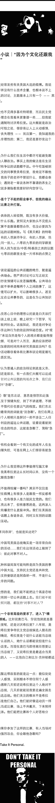

帮她当选总统。他们关注的根本不是希拉里，而是他们自己。他们就好像运动员一样把竞选当成比赛，场上不共戴天，下来照样称兄道弟。他们能把比赛和个人好恶给分开。

那么如果你参加了这样的比赛，有人当场对你发动强烈攻击，你会跟他急眼吗？

## Don't Take It Personal.
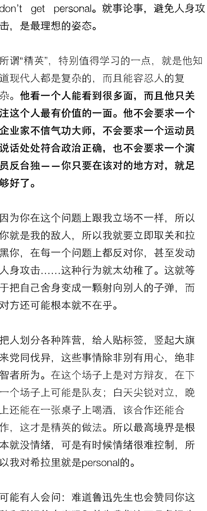

之所以上一句英文是因为中文里没找到很好的对应的话。有人把这句话翻译成“不要太个人感情用事”，我觉得不太到位。Don't take it personal，这句话的意思是说对方针对的并不是你这个个人，他只不过是就事论事在商言商不得不这么做而已——所以你也没必要在个人高度跟他结仇，见招拆招就好，最好还能有点体育精神。

别人对付你，你要做到 don't take it personal，你出手对付别人的时候，也要做到 don't get personal。就事论事，避免人身攻击，是最理想的姿态。

所谓“精英”，特别值得学习的一点，就是他知道现代人都是复杂的，而且能容忍人的复杂。他看一个人能看到很多面，而且他只关注这个人最有价值的一面。他不会要求一个企业家不信气功大师，不会要求一个运动员说话处处符合政治正确，也不会要求一个演员反台独——你只要在该对的地方对，就足够好了。

因为你在这个问题上跟我立场不一样，所以你就是我的敌人，所以我就要立即取关和拉黑你，在每一个问题上都反对你，甚至发动人身攻击……这种行为就太幼稚了。这就等于把自己舍身变成一颗射向别人的子弹，而对方还可能根本就不在乎。

把人划分为各种阵营，给人贴标签，竖起大旗来党同伐异，这些事情除非别有用心，绝非智者所为。在这个场子上市对方辩友，在下一个场子上市可能就是队友；白天尖锐对立，晚上还能在一张桌子上喝酒，该合作还能合作，这才是精英的做法。所以最高境界是根本就没情绪，可是有时候情绪很难控制，所以我对希拉里就是personal的。

可能有人会问：难道鲁迅先生也会赞同你这种和稀泥的态度吗？首先我们这不是鲁迅生活的那個战乱年代，其次这也不是和稀泥。求同，还得存异。这里说的不让人们放弃自己的观点或者不顾别人的错误，而仅仅是呼吁不要因言废人，也不要因人废言。

本文说来説去，也仅仅是让我们学习奥巴马——我可从来没说要学习希拉里。

——因为希拉里的确是说什么能当总统她就说什么。

一位叫Cathy838330的朋友在评论里说：
“对事不对人，不太能理解，还留老师解惑。朋友经常说我这人脾气不好，无法情绪控制，我想让自己变得脾气好，善于与人交流，如果是对事不对人，如何解释呢？”
希望这篇文章能帮到你。

精选声明

## 第二周发奖名单

一周很快又过去了，相信大家也已经开始慢慢适应我们的节奏了。

这周我们的主题主要围绕着自身资源的合理排序，每篇文章也都收到了读者们上千条回复，有表示庆幸的，也有表示惋惜的。

记得有个朋友提到了如何培养婴儿的注意力，我当时回复的是不要着急，要有耐心。

其实对于刚刚刷新了财富观念的读者来说，这就是一次重生，大家在观念方面就是新生儿，所以对自己有点耐心，我们还有很长的一段路要走。

这周按照惯例选出一些朋友，送出《把时间当作朋友》的签名版。

以下是本周的获奖名单，请名单中的各位在本文下方留言，
「得到」的工作人员将尽快把礼物发送给你们。

获奖名单：

- 颜德安
- 帅帅果果
- 鱼行长
- 老颜260840
- A金志成
- 函希
- blackout
- 张恒达Will
- 苗竞予
- 悦行天下

祝大家周末愉快。

## 道德和道德

我想在专栏中搞一个不定期的小栏目，辨析一些现代世界中常会用到，而又容易混淆的概念。我可能会用英文单词来标记这些概念，但这个栏目跟学英语没有半点关系，纯粹是因为中文在特定情况下不够精确。

今天要说的是 ethic 和 moral。

两个词都有“道德”的意思，说的也都是什么是对的，什么是错的，但用英文容易看出，这其实是两个很不一样的词。

所谓ethic，严格的译法应该是“伦理”，或者“职业道德”——它说的是外部社会对你的行为规范。很多职业都有自己的ethic要求，往往非常细致。Ethic，往往能形成一套有明确条纹的规章制度，就好像法规一样。一个没认真学过的人参加有关职业道德的科目考试，很可能是通不过的。

所谓moral，是一个人自己对自己的要求。换句话说，就是我想在多大程度上做个好人？我认为怎么做才是正义的？

在我看来，moral是个比ethic高级得多的词。遵守ethic，可能完全是出于害怕被惩罚，是被动的；而一个有moral的人则是真诚的、主动的选择，体现了自由意志，更值得尊重。

- ethic:
  1. 守序：遵纪守法，重视传统，服从权威
  2. 中立： 如果我觉得这个规则有道理，或者对我有好处，我就遵守
  3. 混乱：崇尚个人自由，以破坏规则为乐

- moral:
  1. 善良：乐于帮助他人
  2. 中立：自己顾自己
  3. 邪恶：为了自己可以伤害他人

《龙与地下城》这个游戏很有意思，它用ethic做横坐标，用moral做纵坐标，给玩家划分了九大阵营：

## 最后，如果你觉得还有哪个概念应该在这个栏目里说，请告诉我！

## 精选留言

## 大人物坏毛病

我儿子学空手道的学校，把武术教育和品德教育结合在了一起，上课之前要背诵学生守则，下课之前要背诵“黑带精神”，就好像前一阶段中国各地背诵社会主义核心价值观一样。家长们对这种做法非常认可：毕竟没有多少人指望孩子真用空手道打架，而良好的品质则是很必要的。

我听这个“黑带精神”中有一条，叫做“谦逊”。据我儿子理解，所謂謙遜，就是永远都不要吹嘘自己，但是可以夸奖别人。

比如说，如果你这次考试成绩好，而你的同学没考好，你绝对不要在他面前炫耀自己考得好，最好连提都不提。再比如说，如果你是一个武术高手，而别人问你武术练得如何，说假话当然也不好，所以你应该回答“我喜欢练武”。

这种谦逊态度，非常符合我们心目中牛人的形象。据有一种分类方法，说人分四等：没本事有脾气、没本事没脾气、有本事有脾气、有本事没脾气。最高境界，就是有本事没脾气。

但是这里面有个问题。谦逊也好，有本事没脾气也好，都是我们对大人物的期待——我们希望他如此，我们喜欢这样的人。可大人物本身未必真的是如此——更重要的是，做个谦逊和没脾气的人，是否有利于成为大人物呢？

像这样的问题我们不能光听体育老师的，还得听学者的调查研究结果。

## 权力：为什么有的人有一而别人没有

据斯坦福大学管理学教授Jeffrey Pfeffer在Power: Why Some People Have It—and Others Don’t《权力：为什么有的人有一而别人没有》一书说，如果你想从平凡的同事中脱颖而出，去做个大人物，你应该设法突出自己。

我们一般认为应该让能力和成绩自动说明一切，你要真是个厉害的人物根本没必要自我吹嘘。可是Pfeffer说，是啊，你要真的很厉害了、已经上去了，你的确不用吹了——吹的目的就是为了上去！

当中国人民的老朋友亨利·基辛格，还在读书的时候，他就非常能自我吹嘘，甚至可以说做傲无礼。明明是个学生，却在同学中摆教授一样的谱。他每次跟别人约时间都故意表现自己时间表很紧，而且一定要迟到十五分钟。

## 我的评论

这些规律。他说的这些情况肯定是对的，大人物在成长过程中的确有这些让人不喜欢的毛病，但是我认为Pfeffer对这些事实的解释有点问题。

Pfeffer似乎是说，你要想获得权势，就刻意去做这些不受欢迎的事情。而在我看来，那些大人物做这些事情并不是“刻意”的。完全有可能，他们只是根本不在乎做这些事情——有些人根本不是想透过这些手段上位，他们只不过心更大而已。

## 得到什么

为了脱颖而出，想要获得权势的人常常会使用一些不受同辈人欢迎的手段：

- 表现自己，甚至自吹
- 奉承上级
- 提出破格的要求
- 搞特例，违反一般规定

而不被人喜欢，就是这么做的代价。

## 奥运会应该是什么的？

每到奥运会的时候，我们就会在中文世界听到两种特别常见的反思意见。

一种意见认为奥运会就是个体育运动大会，它的最根本精神应该是强身健体，现在我们一帮从未能身人抛着脖子关注金牌实在太荒唐了，应该减少竞技体育投入，把钱剩下来搞全民健身。

一种意见认为奥运会本质上就是欧美贵族的项目，属于大爷找乐性，最早特强调业余性，甚至禁止职业运动员参加，我们中国籍不是贵族的人，跟人家什么热情？更何况还是花国家钱热情。

这两种意见都是错的。

七月后，因为罗斯柴尔德事件，《纽约客》杂志发了一篇非常不错的长文文章Doping and an Olympic Crisis of Idealism（兴奋剂与奥林匹克理想主义危机）By Louisa Thomas，July 29, 2016。

## 我的评论

## 精选留言

- 运动训练越来越专业化，政府就将奥运会运动员奖金作为补贴，这时候再说“业余”已经意义不大；
- 观众想要最精彩的比赛，所以最终允许职业运动员参赛；
- 奖随越来越严格，但是防不胜防，因为在商业化时代赢得比赛的诱惑实在太大了。

## 表现出来热情，别人才相信你是真干

今天我要说的道理取材于一本演讲技巧的书，但是我认为这个道理的用处并不仅仅限于演讲，甚至可以说比演讲重要得多。

这本书是Talk Like TED: The 9 Public-Speaking Secrets of the World's Top Minds《像TED一样讲话：来自世界顶级大脑的九个演讲秘密》，作者 Carmine Gallo。

TED演讲，我们都知道，可以说是现在最受欢迎的演讲节目，全世界各领域最有思想的人来做一场不超过18分钟的演讲。似乎每个人的演讲都是独一无二的，但事实上听多了以后你就会感觉其中也是有套路的，而且就连内容都大同小异，价值观念几乎完全一致，有点鸡汤的味道，甚至有人说TED就是新时代的一个宗教。

## 我的评论

## 得到什么

> Wei Jun 40 人们做的事情大概可以分为有责任去做的事情和有热情去做的事情。两者重复越多幸福感越高。社会越文明，人们在两者重复的空

## 权威的合法性从哪里来？

## DAVID AND GOLIATH
UNDERDOGS, MISFITS, AND THE ART OF BATTLING GIANTS
MALCOLM GLADWELL

David and Goliath, Underdogs, Misfits, and the Art of Battling Giants《大卫与歌利亚》一书，作者 Malcolm Gladwell。

马尔科姆·格拉德威尔的畅销书《大卫与歌利亚》可能很多人都已经读过了，我也曾写过书评。这本书说的道理论有点像中国人爱说的“辩证法”：强的东西可能是弱的，弱的东西也可能有强大的面，最后也就是就此逆袭。

今天我想说的是这本书中可能有点被忽视了一个内容，它说的是权威的“合法性”。这个“合法性”，并非特指政论的人爱说的“政权合法性”，它跟民主葬举之类可能没什么关系，却是在我们普通人的生活中有用处。

小孩不服从家长教导，学生蔑视老师，社区懈视警察，下级违抗上级，所有这些事情，都可能是权威的合法性出了问题。

## 我的评论

## 得到什么

- 你管理的每一个下属，他的声音都必须能够被你听到。
- 你指定的法规必须稳定，得有可预测性，明天的规矩得跟今天差不多，不能朝令夕改。
- 执行法必须公平——这意味着两点：首先是视同仁，对这个人怎么要求，对那个人也得这么要求；其次是前后一致，不能随心惩罚，今天这么干了没事，明天这么干了就受罚。

《大卫与歌利亚》这本书还讲一个道理：什么东西都不是越强越好，有可能就过头及。你说你武力越来越强，给警察配备高科装备，出任务状况都能在五分钟内赶到现场……你还是未必能解决安定问题

## 信仰值多少钱

今天我想说一个宗教问题。有人宣称自己是虔诚的教徒，有的人虽然不信教，但也号称在某一方面有牢不可破的信仰——他们说这些话到底是什么意思？是真的相信呢，还是故意思说给别人听的？

拷问一个人的内心已经很难，大规模测量一群人的信仰真诚度就更加困难，但是经济学家想出了一个办法。

我想说的是—篇经济学论文：
The Economics of Faith: Using an Apocalyptic Prophecy to Elicit Religious Beliefs in the Field Ned Augenblick, Jesse M. Cunha, Ernesto Dal Bo, Justin M. Rao

基督教有一个“末日”，或者说“审判日”传统，就是总觉得未来哪一天将是地球的一个大节点，很多 leveraging would be etc.

- 我可以给你一张现在就能兑现的5美元支票，或者
- 我给你一张数额大于5美元，比如说是10美元的支票，但是要等到四个星期以后那时候5月21日已经过去了才能兑现。

## 我的评论

这项研究有很多可惜之处：

- 说来说去就5美元到500美元的尺度，却有没有必要为了这点钱而且还不一定能拿到跟自己的信仰过不去？
- 招募来的受试者，每个教派总就来了二三十人，还要各自分成60%和50%的两小组。
- 实验设计非常复杂，连这个物理学博士都看了半天才看懂，我怀疑那些信仰到底有没有功夫做研究计算。

## 得到什么

具体结论未必靠得住，但是我们至少见识了经济学家观察世界的一个路径——

## 文章分类有奖征名

今天周末，我们说一个轻松的事儿。专栏上线接近两周，订阅数已经接近两万，多谢各位捧场！

我们这个专栏的使命是介绍和讲解当今世界最先进、最有用和最有趣的思想，具体做法是给读者提供一个每日陪伴的知识服务。用罗胖的话说，你就是皇帝，我就是大学士，每天上来讲一段，让你能够轻松得到一点收获。

我们设想，把文章分为ABC三类，从周一到周日按ABABACC的顺序发布。

## A类文章，取材于一本书。我不打算全面介绍这本书都讲了什么，而是只选择其中一点。一般的书我们只用它最精华的一点，特别好的书可能会被用到不止一次。我会确保每篇文章独立成文，这样读者得到的是思想，而不是一本书的学习大纲。

## B类文章，取材于英文世界的一篇普通文章，一篇论文，或者一个演讲。如果别人已经写了一篇文章，我为什么还要写一篇“关于文章的文章”？这可能有很多原因，也许是原文很难读，也许是原文不够贴近中国读者，也许是我拿原文当个素材去说别的事儿——总而言之，我提供主观的视角和解读。

AB两类文章的共同点是材料来源过硬，其背后必须有研究支持，或者是专业学者的论述。这样我们才能确保让你得到“干货”，我说的時候也更有底气。

作为在周末发布的C类文章，就要轻松一点了。它可能是读者评论精选，可能是集中的答读者问，可能是像今天这样跟读者商量事情，也可能是我自由发挥的一篇随笔。我们上周搞的概念辨析小栏目，也将不定期地作为C类文章发布。

专栏上线以来，一直有读者说短文章看得不过瘾，希望能再写我以前爱写的、发表在传统媒体上的那种长文——这种也会有，而且也是独家发布在这个专栏里。我的草稿箱里有不少立项，但只能慢慢写，不定期发布。

现在我们打算给ABC三类文章起个更好的分类名，这样每次发布时用分类名+文章标题的方式，特向读者征名。您能想到三个也可以，想到一个也可以，可以用“A - 精英领读”这种方式提交留言。每个分类名限制在四字以内。一旦选中，会有奖品，“罗辑思维死磕侠”一套，就是下面图里的样子。

喜欢这两个小家伙的读者，您可以在罗辑思维微信公众号回复“死磕侠”三个字购买。

还有，读者评论是本专栏非常重要的组成部分，我爱看，读者也爱看。希望您能多留言，咱们多互动。精彩留言会被集中整理发布。如果您想了解哪方面的内容，想听我说哪本书，或者有什么其他方面的建议，也都欢迎留言。

多谢！

## 精选留言

狗蛋 55
A-万万书海 B-维维视角 C-周末钢钢滴！老师你不会打我吧……
08-20 00:29:32

Ranky兰小奇 25
A从书 B从文 C从心
08-20 01:42:35

阿来407359 18
a-见贤，b-思齐，c-评天下
08-20 00:39:41

高龙 15
A - 不尽信书 B - 听他人言 C - 自说自话
08-20 00:48:53

## 周末小议 | “小小年纪去留学”很可能是悲剧

当年我上学的时候，“数学竞赛”是一个相当专业的运动，并不像后来成了推残学生和敛财的工具。我上的小学并非重点，我们校的领导居然通过关系，把我给送到全区最好的小学去借读，就为跟着他们参加竞赛训练。

虽然被寄予很大期望，我并非是超一流选手。在那所学校里，我认识了一位明星，Z同学。

我好像就没见过有哪道题是Z不会做的。而且他性格相当沉稳，今天想来颇是个干大事的人。我跟他处得很不错。还记得有一道很难的题我不会做，他主动给我讲了两遍，我甚至没听懂。

后来我们参加“华罗庚金杯”数学邀请赛，Z同学作为全市第一名参加了全国总决赛，并且获得银牌。

作为奖励，他被选送到人大附中的数学奥林匹克班，直接去北京上初。

## 那是在数学竞赛中取得的最后一次成绩。

一直到很久以后，我才听人提到Z同学后来的经历。他似乎是不太适应北京的生活，主动回来了，而且不再参加数学竞赛，去了一所排名一般大学读书。写这篇文章之前我在网上搜索Z同学名字，唯一跟他有关的結果就是那次华罗庚金杯赛。跟我说这件事的人说，这就是“伤仲永”。

我想起这件事来，是因为不久前看到中国小球员在海外留学状况的消息。这些小球员在国内被视为天才，但是现在的训练状况似乎并EMR不怎么好。

最近李章洙接受采访时说：“我执教长春亚泰前曾去了西班牙学习，在那里我看到了一帮中国孩子，也观察了他们的训练生活，发现训练的质量并不高，管理也上不去。所以，中国足球的青训应先选派教练去国外深造，回国后传授先进的足球理念，而非让孩子出国训练。”

我就想到，Z同学的经历，根本就不是什么“伤仲永”。他是教育部门和家长一次错误决策的牺牲品！

一个小学刚刚毕业的孩子，你把他孤身一人送去陌生的城市读书？

教育是个系统工程，所有研究都指出家庭的影响至关重要！贫穷家庭不如中产家庭，单亲家庭不如双亲家庭，更何况没有家庭？！当小留学生可以，家长必须陪读。我们看小张玉宁踢出来了，但是别忘了他有个无私奉献的父亲。

让一个十三岁的孩子离开父母的关爱、监督和管教，对他是个非常大的打击。除非他天生就非凡的自控能力，哪怕要去的地方是人大附中、西班牙的足球俱乐部、或者哪个国家的私立贵族中学，也不应该去。

amazing281162
教育是一个系统性的工程，其中家教是第一位的，父母的生活态度、交友准则、价值观、方式方法都会影响孩子的成长。但中国农村中很多家长到外面打工，将孩子们送到了私立学校，他们寄希望于管理严格甚至蔑视人性的环境可以培养出一个个考高分考清华北大的高材生，可惜很多孩子被急功近利的老师粗鲁对待，也失去了读书兴趣，有的精神抑郁等等。“小小年纪离开父母，去私立学校读书”很可能是悲剧。08-20 16:13:01

板牙老爹
对的！家庭至关重要！作为家长，首要任务是陪伴，在此基础之上，与孩子们共同成长，共同进步。08-20 16:11:32

曾龙
我没离开过的经历，不过对教育的吐槽总是相似的，数理化的竞赛我都参加过了，没有拿到过成绩，在班里还是拔尖的哈，和我同样背景的一个同学因为网瘾被退学了。在学校我也曾被称天才过，什么鬼天才，就是偏科而已，进了社会受到打击才知道我真正的等级。教育的畸形我不敢下定论，因为我不是教育专家，什么原因造成的就不分析了，但信息缺失是肯定的，因为迷茫不知道前路，然后被牵着往前走，牵你的人是谁表示了命运的不同，确实可惜。08-20 16:11:59

蓝莓77221283
非常赞同，孩子最好的培养就是陪伴。希望老师多讲一些幼教方面的思想和国外的经验趋势给我们这些初为人父的年轻人学习。08-20 16:09:17

肖老三
万老师说的很对，教育是个系统工程。只改变一个方面，可能会破坏原来系统的稳定，必须相应的配套设施也一块跟进。这样才能做到从一个稳态平 稳过渡到另一个稳态，并且相应的调整时间，超调量都会达到最好的效果。08-20 16:12:58

石锐
一句话，要“留”就全家“留”08-21 00:56:15

赵员外
很多家长高估了文化课或某些特长对孩子成长及未来生活帮助是由于没有分清一个优秀的人和一个好人的区别 单纯的学习也许可以造就一个科学家 一个艺术家 但对于孩子成为一个更好的人却没有任何帮助 其实教育的本质和重点应该就是白鹿原里那句话 学做好人 所以在成长过程中家长的陪伴 与沟通是非常重要的 生活中的言传身教才能让孩子变成更好的人 才有能力面对未来的生活 这才是最好的教育 08-21 00:40:15

又一年、又三年
很多家长喜欢送小孩子去课余钢琴班，毛笔班，绘画班等等。有耐心的家长有可能是再旁边陪同的，有些家长甚至是把小孩子送过去交给培训中心去带。这不就是变相的托儿所么？不过他们倒是有很可好的理由，我送小孩子去培养兴趣啊。周杰伦的歌有一句歌词：他要的是陪伴，而不是六百块，比你给的还要简单。08-21 00:49:54

## 今朝有酒今朝醉，也是一种理性

中国文化一向推崇勤俭持家，非常看不起那些有点钱就全花完及时行乐的人——而科学家完全赞同这一点：所有研究都表明，能够从长远打算和推迟享乐，是通往长久幸福生活的必备素质。

可是为什么有些人做不到呢？

大概很多人都听说过“斯坦福棉花糖实验”。实验者给小孩一个棉花糖，说我现在要出去一下，如果你能等到我回来再吃这个棉花糖，我就会再给你一个。所有小孩都喜欢棉花糖。有的小孩能克制暂时的欲望等一会儿得到更多，有的孩子忍不住就把棉花糖吃了。结果过上多少年再看，那些当初忍住没吃棉花糖的小孩，不论学习成绩还是生活质量都比那些忍不住的小孩好很多。

据此，美国有的学校甚至专门给学生印发T恤衫，上面写着：“别吃那个棉花糖！”

连个棉花糖的诱惑都抗拒不了，那些小孩有毛病吗？有的NBA球星赚了很多钱，居然能在退役几年之内把万贯家财全部败光，这些人天生就懒吗？

很多心理学家只告诉我们别吃那个棉花糖，而下面这本书，则告诉了我们一个更有意思的道理：为什么有人会吃那个棉花糖。

The Rational Animal: How Evolution Made Us Smarter Than We Think《理性动物：进化让我们比我们想象的更聪明》作者 Douglas T. Kenrick and Vladas Griskevicius

这本书从进化心理学角度分析，人的很多行为看似非理性，其实是理性的，自有一番道理。

进化心理学有个“生命史”理论，研究个体怎么分配有限的资源。简单地说，每个动物一辈子其实就干两件事：积累和花费。所谓积累，就是补充营养，锻炼身体，充实自己——相当于人类攒钱；所谓花费，就是通过性关系把自己的基因传播出去，争取有多少个后代——相当于人类花钱。

生命史理论说，动物们的积累和花费有两种不同的策略。

像大象这样的动物，食物充足而且没有天敌，可以无忧无虑地生活好几十年，所以它的策略就是“慢策略”：花很多时间积累，生育很少。

而绝大多数动物没有这么幸运，一般都是很早成熟，然后马上就大量生育，然后可能很快就被捕杀，寿命很短也就死了。这就是“快策略”。

这两种策略都是对的。环境好当然可以慢慢享受生活，少生还能保证后代质量；如果环境险恶寿命短，不早生多生行吗？不用快策略基因根本传不下去。

更进一步，生命史理论认为，在同一种族之内，也有快策略和慢策略的区别。人就是这样。

在稳定的家庭环境里长大的孩子，青春期来的晚，结婚生子也晚，寿命更长。而如果家庭环境不好，家里经常有人来了又走，比如妈妈经常给他换“后爸”的话，这种家庭出生的女孩青春期就来得早，会很早生育。

而那些采取快策略的人又会吸引同样采取快策略的人，他们很随便就生孩子，生了孩子也未必结婚，就算结婚了也很容易离婚。现在让美国黑人无法脱贫的最重要一个因素就是单亲妈妈太多！

如果生活在一个这样的家庭，有个单亲妈妈和若干个不同父亲的兄弟姐妹，生活很不稳定，今天运气好得到一块糖，你会把它留在明天吗？

对这样的人来说，现在不享受以后就没有机会享受了。他的糖可能会被抢走，他甚至可能活不到明天。拳王泰森十三岁之前就已经入狱好多次！

所以后来有人重新做了一遍“斯坦福棉花糖实验”。这一次实验人员还是跟孩子说如果你不吃等我回来就再给你一块糖——而不同的是，这次有的分组里实验人员回来就说哎呀对不起，我搞错了，没有第二块糖了。经历了这种失望的孩子，再给他做一遍棉花糖实验，通常三分钟就不等了。

——换句话说，孩子能不能推迟享乐，不仅仅跟孩子有关，也跟你这个环境有关，而且他能够迅速适应新环境。

后来又有人拿猴子做类似的实验发现，如果小时候妈妈总能从固定的地方得到食物，猴子长大之后就能推迟享乐，做决定做得很好。如果小时候食物来源不确定，即使仍然能获得食物，长大以后他的自控能力也不行。既然吃了这顿还不知道下一顿在哪里，这一顿肯定是任性猛吃。

我们通常认为细水长流才是安身立命之本，而有人追求的就是那短暂的灿烂。而且他们是有道理的。

## 我的评论

身处全民追求稳定的中国社会，对这个理论的体会可能没有那么深。如果你生活在美国，同学中某个黑人女孩16岁就怀孕，高中没毕业就退学回家带孩子了，你可能会对这个“生命史”理论有更深的体会。

这本书重点讲了环境的影响，而我知道一些别的研究表明，基因的作用大概跟环境各占一半。也就是说如果这个孩子的家长是“快策略”类型，他可能天生就有快策略的倾向。不过前面我们看到环境也有用，甚至可能自由意志也有用，所以绝对不能说采取哪个策略是固定的。至于像某些NBA球星环境很好还是退役几年就破产，我们只能说他未能战胜自己的基因。

这个理论可以解释很多现象。比如以前我看过文章说二战时期中国的飞行员都很花心，胡乱搞女人。这就是因为当时飞行员的死亡率非常高的缘故。

我看这个理论最大的价值就是它能很好地解释为什么现代人自动晚婚晚育了——因为所有人的环境都变好了！

## 得到什么

- 1. 教育小孩一定要给他一个稳定的环境。偶然有什么特别好吃的不寻常的东西也不要一次吃完，要分几次慢慢吃。高兴了不要连着几天光玩不学习，不高兴了也不要连着好几天不让玩。
- 2. 看似荒唐的行为，背后可能有不得已的苦衷。表面上人人有自由意志，其实身上都不知道背着什么基因和环境的枷锁——有的人能够胜这些枷锁，他们就是英雄。

## 总统、CEO、好学区：到底是你们厉害，还是天气好？

今年是美国大选年，你肯定已经听过太多有关总统的事情了。现在我们从这番热闹中后退一步，听听学者们关于美国总统的一个说法。

这个说法是，人人都说选总统第一位的考虑就是看他有没有能力振兴经济，可是总统，对振兴经济真的有用吗？

2014年，普林斯顿大学的两个经济学家Alan S. Blinder 和 Mark W. Watson 发表一篇文章，《总统与美国经济：一个计量经济学考察》，比较了历任美国总统治下美国的经济增长情况，结果如下图所示：

这张图说的是每个总统任期之内的年均经济增长率。图中蓝色的是民主党总统，红色的是共和党总统。最后两个数据则是民主党和共和党的平均成绩。

从这张图上看的话结论很明显：民主党人当总统的时候美国经济增长得更快。这个结论跟一般选民的印象也非常符合，民主党更善于抓经济，比尔-克林顿任期内不就是美国经济高速增长吗？

可是如果你经常看数据分析文章的话，读到这里就会多个心眼儿。单看这张图，我们至少可以提出这么两个问题：

- 总统四年才一换，数据量毕竟太少，规律并不明显——有没有可能民主党仅仅是运气好呢？
- 就算民主党任期内经济的确更好，那有没有可能是恰好因为经济好，选民才选民主党人当总统呢？毕竟民主党主张增加社会福利。

而这篇经济学论文，高就高在它不是单纯给一个成绩单，它恰恰定量分析了为什么民主党的成绩看上去更好。经济学家结论是——因为民主党运气好。

经济学家分析，税收政策、财务政策、给谁多点少点福利，对总体经济增长的影响其实都很少，真正影响力最大的是国际经济环境——也就是说全球经济在衰退呢还是在增长——而这个环境谁也左右不了。

民主党之所以运气好，最主要的原因是它的任期中石油价格都比较平稳，而共和党在台上的时候经常会出现油价波动。油价对经济的影响比谁当总统重要得多！当然两个布什任期内专门打仗让油价波动，就属于自己找死了。

那美国总统到底有啥经济作用呢？

现在最受关注的数据预测网站 FiveThirtyEight，在七月底有一篇非常漂亮的分析文章，《总统的经济决策还是……有用的》，作者是 Ben Casselman。

这篇文章调研了大量的专家意见和分析，最后结论是这样的：

- 1. 美国总统对他任期内的经济增长，几乎不起作用。
- 2. 总统可以跟外国签署各种贸易协定，这总能影响经济吧？的确有影响，但是这个影响很不容易测量，而且是长期的，往往在总统任期结束之后才能显现出来。
- 3. 总统的真正作用是在金融危机之类的危机时刻。这时候要求你必须快速反应，而且要大力度反应——现在经济学家普遍认为奥巴马刚上任时面对金融危机的反应力度不够大。
- 4. 总统虽然不能左右经济增长，但是可以左右财富怎么分配：要不要搞高福利？把钱分给谁？
- 5. 好总统不能让经济更好，但是一个不行的总统有可能出昏招，让经济突然变坏！比如尼克松在1971年为了应对通货膨胀搞了个价格控制，现在公认是恶政。

如此说来，我们大概可以这么说，什么叫好总统？平时无为而治，有机会可以搞搞长远布局，危机时刻能快速反应应对得当，不拆腾别犯愚蠢错误，然后可以帮自己所代表的利益集团捞点好处，这就是一个好总统所能做的一切。

至于说有些总统的任期之内经济高速增长——那多半不是他真厉害，而是他运气好。

从经济学家的分析来看，经济增长，说白了，就好像天气一样。遇到极端天气你能快速救灾，这就可以了。至于说能不能想个办法让明天天气变好，谁也没有那个能力。

## 我的评论

前段时间因为兴奋剂的事，俄罗斯被奥委会整治，我跟我爸开玩笑说俄罗斯这是药丸啊。我爸也觉得很奇怪，说普京以前当总统当得挺好的，现在不知道怎么也不行了。我就说，俄罗斯行不行可能跟普京关系不大——石油价格比普京重要得多！油价高，俄罗斯就兴盛，油价低，俄罗斯就药丸。

以前我们一个很常见的思维模式，是把一个国家也好，一个企业也好，把它的成绩归功或者归咎于它的领导人，总觉得什么东西背后都应该有一个“人”来负责。然而事实可能是大多数情况下人能做的非常有限。现在有很多研究都认为中国历史上的朝代兴亡跟皇帝本人的能力其实关系不大，但是跟气候变化关系很大。明朝灭亡也许最主要的原因是赶上小冰河期北方干旱缺水，否则李自成不乱，建奴能有多大机会？

最近我看另外一个研究，说CEO的报酬跟其公司的业绩有可能是个相反的关系——用Solidot上《研究称高薪CEO的表现不如低薪CEO》，2016年7月27日的 一句话总结，“向一家高薪CEO的企业每投资100美元，10年内的回报是265美元，而低薪CEO的企业给予股东的回报是每100美元367美元。”

这也许是因为业绩不行的公司更愿意花大价钱请个好CEO，也许是CEO的报酬由他搞政治的能力决定，而不是由他的业绩决定。不管怎么看，CEO的个人能力对公司业绩的影响很可能是非常有限的。

像这样的问题在生活中到处都有。比说好学区的学校成绩肯定比差学区要好，那么这个成绩在多大程度上应该归功于学校本身呢？好学区房价贵，家长既然能买学区房，肯定是既有能力又重视教育，他们的子女可能在哪上学都能取得好成绩！

我想，一个系统如果是比较稳定的，那么领导人能起的作用就很小。美国早就是个成熟的市场经济，上市公司的业务模式早就定型了，这时候总统和CEO就没有多少大事可干。只有一个百废待兴的国家，或者是一个创业公司，这种急剧变化的系统，才是英明领导的用武之地。如此说来在国家太平无事的时候最能干的人不愿意出来搞政治，也就完全可以理解了。

最后我们玩个类比游戏。我们把前面说的那五条中的“总统”换成“家长”，把“经济”换成“孩子”：

- 1. 有什么样的国家就有什么样的总统，有什么样的家长就有什么样的孩子。至于说家长管孩子选择什么具体操作方法，对孩子能不能有出息，几乎不起作用。
- 2. 家长可以拼命给孩子选一个超出自身经济能力的好学区好学校——这种做法也许有影响，但是影响不容易显现出来。
- 3. 家长的真正作用是在孩子面临人生重大选择的关穿时刻给一个好的建议，而很多家长没有做好这一点。
- 4. 家长的管教方法未必能左右孩子将来的社会经济地位，但也许能在从事什么职业之类的小方向上起到作用。
- 5. 好家长就算熟读各种育儿书也未必能让孩子更有出息，但是一个坏家长如果虐待孩子，则可能毁了孩子一生。

纯类比，没有研究支持。可是你说有没有道理。

## 由此得到

有志于成就一番领袖霸业的人，应该去混乱的地方。

精选留言

## 目标很丰满，不确定性很骨感

有很多励志书籍号召我们给人生设定明确的奋斗目标。前几年非常流行的一套时间管理方法，GTD，也就是 Getting Things Done，就要求设定长期、中期和短期的目标，每周回顾和评估这些目标的执行情况，时刻提醒自己要在正确的方向上努力奋斗。在房产投资课之类的致富班上，老师甚至会让学生把目标包装成口号，每天早上起来喊几遍。

## 强化目标，有用吗？

今天我要说的这本书是《解药：专供受不了正能量思维的人了解的幸福研究》，作者是英国记者 Oliver Burkeman。标题的意思是对“正能量”和鸡汤的解毒药。

这本书基本上说，并没有任何科学证据说有强烈目标对人的成功有好处——而且可能还有坏处。

所以此书作者提出，人生当然可以有一个大的努力方向，但是不应该给自己设定特别具体的硬性目标。你的人生哲学必须考虑不确定性，随时应对机会和风险：

- 1. 不要只问自己想要什么，还要看看自己手里有什么工具和条件。不顾条件凭空设定目标，就是妄想。
- 2. 决定做一件事情的时候，先别想成功了是多大的成就，先想想如果失败，这个损失你能不能承受。

## 我的评论

对学习好的人来说，高考之前那段时光可能是人生最愉快的时期之一。别的什么都不用管，你的唯一任务就是考试！可是等这些人长大成人以后就会发现，那其实是一种极为特殊的状态。

人生的常态是什么呢？第一，根本不知道自己到底应该干什么。第二，就算是知道自己该干什么，也不知道怎么干才是对的。那些找到自己的使命，明确知道自己该干什么，而且还知道该怎么干的人，其实是特别幸福的少数人。

所以有些人一天到晚只不过是混日子而已。有些人把孩子、爱情或者赚钱当做目标，每天有个奔头。跟这两类人相比，那些制定了明确工作目标的人，似乎更值得尊敬。

但是哪怕是从纯工作角度看，这些野心勃勃的少数人，也不应制定特别明确的目标，因为计划没有变化快。

事实上，过去搞“项目管理”，就是一种尽在掌握的俯视姿态：高层从大局出发制定一个总体目标，下级一层一层把这个目标细化，然后组织实施。而现在人们慢慢意识到，这种管理方法非常不切实际，不但不能迅速适应市场变化，而且连最起码的组织生产都做不好，因为你根本不可能预期在执行过程中会遇到什么意外状况。

更高级的管理方法，是充分听取第一线的声音，随时调整目标，追求灵活多变。

什么目标都没有当然不行，有些强人恰恰是因为自己执着的目标改变了世界，但是执着不等于固执。

什么叫好的目标呢？我想了这么一个判断标准：
你到底是为了把事情做好，还是为了满足自己的心理需求？

## 由此得到

有目标，固然幸福；能容纳乃至拥抱不确定性，才是大智慧。

## 自恋者的内“心”

我们都很烦这种人：跟人聊天的时候总爱谈自己，有点什么小成就就不吹嘘一番就难受，一发朋友圈就是各种晒生活。明知别人会厌烦，还是忍不住这么做，所以这其实是一种症状，得治。这种症状，叫做自恋。

那么这些自恋者是一种什么心理状态？是因为自信心实在太强呢，还是因为从小缺爱呢？心理学家、心理医生、心灵导师和仁波切可能各有各的说法，但我今天想说的这个，是来自脑神经科学的，最新的，硬证据。

这是一篇研究综述，说的是2016年七月的最新发现，题目是，作者 Christian Jarrett。

在心理学家那里，自恋其实有两种。一种是浮夸式的，抓住一切机会吹嘘自己；一种是易受伤害式的，自己有很多敏感词，别人一个不经意提到他就很受侮。这篇文章说的是第一种——也就是我们一般称之为“自恋狂”的这种。

自恋狂给人一种非常自信的印象，他们真的自信吗？

传统上的心理学，都是把人脑当成一个黑箱，科学家只能通过观察一个人的外部表现去推测他的内心活动，所有证据都是间接的。现在有了“功能性核磁共振”这个技术，科学家就可以不用解剖，直接观测一个活人的大脑内部，而且可以实时地观测大脑的动态活动。这一招就非常厉害了，人的语言可以说谎，但是核磁共振图像中的大脑活动骗不过科学家的眼睛。这门学科，就是比心理学更加高大上的神经科学。

不过也别对神经科学期待太高。人脑实在太过复杂，你说哪根神经动了一下代表他在想什么，科学家根本没掌握这种解读能力。科学家所依赖的也是一些经验式的，相当粗糙的知识。

而且最近神经科学也在经历一场重大危机：人们一直使用的功能性核磁共振信号分析软件，被发现使用了 一个错误的统计方法，导致把很多噪声给当成了信号。这可能意味着大部分相关研究结果都得重新检验，很悲惨。不过这个消息与我们今天要说的（可能）无关——不论如何，这是我们目前所知最好的答案。

具体到今天这个研究来说，科学家知道，大脑前部的“内侧前额叶皮质”内，有一个小区域，这个区域的活动代表人正在想自己。而在一个更深入的地方，有个叫做“腹侧纹状体”的小区域，这个区域的活动代表喜悦的回报，说明人感觉良好。而此前已经有人研究明白了，这两个小区域如果发生信号连接活动，就代表“我一想到自己就高兴”——这就是神经科学家眼中的自尊、自爱和自信。

好了，现在科学家招募50个大学生，先用标准化问卷去评估他们的自恋程度，然后让他们上核磁共振扫描大脑。

结果发现，那些自恋程度越高的人，他们大脑中那两个区域的连接度反而越低。换句话说，自恋不是出于自信，而恰恰是出于不自信。

这就从硬件角度证实了之前心理学的一个猜想，自恋狂症状其实是因为自信程度太低，想要获得别人的关注，希望别人的肯定能给自己带自信。

自恋狂 = Look at me! Please~~

## 我的评论

这个研究说完，对自恋者再说什么就都是多余的了。我反而想说，难道不是每个人都有点“look at me”的需求吗？只要不太过分，就都互相理解吧。

......忍不住还想说一句。圣人告诉我们要多谈事儿少谈人，多夸别人少谈自己，因为谈自己是不礼貌的。知道了这个研究，我们就知道为什么谈自己是不礼貌的——因为从神经科学角度，谈自己是出于生理冲动。在人前暴露生理冲动，总是 creepy 的。

但我更想说的是这个研究方法本身值得好好欣赏，哪怕将来被证明不对也值得。人们议论已久的话题，我用更高级的工具，一个实验直接解决了。逻辑清楚，证据过硬，简直是漂亮研究的典范！

#从今天起，最后加个小预告版块，告诉大家未来几天，我打算给各位讲什么。对下面这些话题感兴趣，也欢迎留言给我哈。

## 未来预告

有些事我们不想让机器干：有什么事是机器能做，但我们还是希望找个真实的人来做的？

企业家思维vs雇员思维：一个企业里，10%的人有企业家思维 70%的人是雇员思维 还有20%很难被影响。

点记是为了更好地记住：我以前说过超强记忆 Aa 字号 写留言 收藏 99+ 请朋友读

# 从今天起，最后加个小预告版块，告诉大家未来几天，我打算给各位讲什么。对下面这些话题感兴趣，也欢迎留言给我哈。

## 未来预告

有些事我们不想让机器干：有什么事是机器能做，但我们还是希望找个真实的人来做的？

企业家思维vs雇员思维：一个企业里，10%的人有企业家思维，70%的人是雇员思维，还有20%很难被影响。

忘记是为了更好地记住：我以前说过超强记忆力是邪道，那正道的记忆力该怎么用？

新巨富的新文化：面对赢了起跑线还要一路赢下去的新巨富，我们的机会在哪？

团结一致的集体感，也是一种生理作用：我们说的很多精神反应，背后可能都是生理反应。

中年的大脑更厉害：记忆减退、中年危机、空巢综合征……其实根本不值得担心！

学术问题和……真问题：绝大多数科学家，未必有真正的“智识”。你都可以比他们强！

委婉语就如同内衣：阳痿—性无能—勃起障碍—ED。委婉语的迭代不是故作矫情。

美国人说的改革红利：我想帮你在“美国现在发展到了什么程度”这个方向上增加一点了解。

为什么发达国家的青年也会投奔恐怖分子：有家有业某天突然抛家舍业，自愿前往ISIS，他们图的是啥？

## 有些事儿我们不想让机器干

在人工智能时代人会不会面临大规模失业，怎么做才能不把工作输给机器人，现在已经成了一个热门话题。通常我们谈论这个话题都是看人工智能有多厉害，在多大程度上能取代人，但事实证明这个想问题的角度有点危险。

我以前在《万万没想到》书里说到，计算机下国际象棋厉害，但是面对复杂度高的围棋就不行了，所以人应该如何如何……结果书出来还不到两年，AlphaGo就赢了李世石。我后来收到好多次读者来信说你的书得改了。

所以现在我们换一个角度。我们不问人工智能到底有什么是不能干的——干脆假定将来人工智能什么都能干。我们改问这个问题——

有没有什么事情，哪怕机器也能做，甚至能做得比人还好，但我们还是希望找个真实的人来做的？

换句话说，有没有什么服务，是真正意义上的“人性化”服务？

……你别想多了，今天我要说的不是sex。

## HUMANS ARE UNDERRATED

WHAT HIGH ACHIEVERS KNOW
THAT BRILLIANT MACHINES NEVER WILL

## GEOFF COLVIN

Bestselling author of TALENT IS OVERRATED

《人类被低估了：高手知道哪些再强的机器也不行事儿》作者 Geoff Colvin

值得一提的是这个作者调研水平和写作水平都相当不错，他的上一本书叫《哪来的天才》，直译就是“天才被高估了”，我印象中好像比拉斯德威尔的《异类》更早介绍了“刻意练习”，或者说“练习一万小时”的理论，而且说得很 好。

这本书说，如果说将来人工智能技术无比发达，能制造出跟人模一样，有人类全部功能的机器人，已经到了你无法区别谁是人谁是机器的程度，那万事皆休，这个问题就不必谈了。但是就目前人工智能的研发水平而言，机器虽然在某些方面比人强得多，但毕竟跟人是有区别的，我们总能看出谁是人，谁是机器。这就给人留下了机会。

亚利桑那州有个两次暴力性侵儿童的罪犯，即将刑满。而该州法律规定，像这样的罪犯，即使刑期满了，如果他未来再次犯罪的可能性比较大，可以把他转到精神病院继续关起来。到底是放是关，陪审团说了算。研究者利用这个案例搞了个实验。

研究者找来一百多位可能当陪审员的人，把他们分成两组，让他们观看整个庭审过程 ——律师、检察官、精神病专家，都是真的 ——唯一区别是在两组陪审员看到的录像里的专家证词不同。

在第一组中，专家说自己跟罪犯有两个小时的面谈，然后根据自己的专业知识判断，他仍有强烈暴力犯罪倾向，应该继续关起来。

第二组中，同一个专家，说自己并未见到罪犯本人，他只是把罪犯的所有相关数据输入一个心理学模型——这个工作任何人都可以做——而这个模型判断罪犯仍有强烈暴力犯罪倾向，应该继续关起来。

如果你是陪审员，你认为哪个专家的意见更有说服力呢？这里我先插叙一个背景知识：目前在我听说过的所有领域——从红酒到政治事件到犯罪预测，专家的个人判断都远远比不上统计模型（现在流行叫“大数据”）的预测。所以你应该听模型的。

但是实验结果是第一组的专家对陪审团的影响力远远超过第二组。

人们更相信面对面的“人性化”判断。

我没有身临其境，看到这个结论感觉有点诡异。但作者又举了第二个例子：如果是病人，你是更愿意相信那些一直在第一线接触病人的临床医生的判断呢，还是更相信一个专门搞科研的医学家的判断？临床医生也得听论文的对吧？

但结果是病人更相信临床医生。

也就是说，人有这么一种偏见，喜欢过高评价“人与人面对面交往”这个行为，而对抽象数据不怎么买账。这是可以理解的，人类有史以来都是面对面交往的，而抽象数据这种东西可能根本就没有进入文化基因。人本质上是个社交动物。

这个偏见，在人工智能时代给人类留下了一个工作机会。人工智能再怎么发达，我们还是要求：

- 1. **最重要的决定是由人做出的。** 如果中国要对哪国宣战，我们要要求这个命令是人下达的，在这个问题上我们不可能听从人工智能的指挥，我们不可能把核按钮交给人工智能。人说了算，不能让机器说了算。
- 2. 我们喜欢什么想要什么，这个想法随时都在变，我们无法给人工智能一个清晰的目标，所以有些事儿还是让 人自己解决比较好——因为我们有时候自己都不知道要“解决”的是什么。
- 3. 也是最重要的一点，**我们更愿意跟人打交道。**

“决”的是什么。

- 3. 也是最重要的一点，我们更愿意跟人打交道。

所以想让别人放着机器不用用你，最好的办法就是表现出“人味儿”。

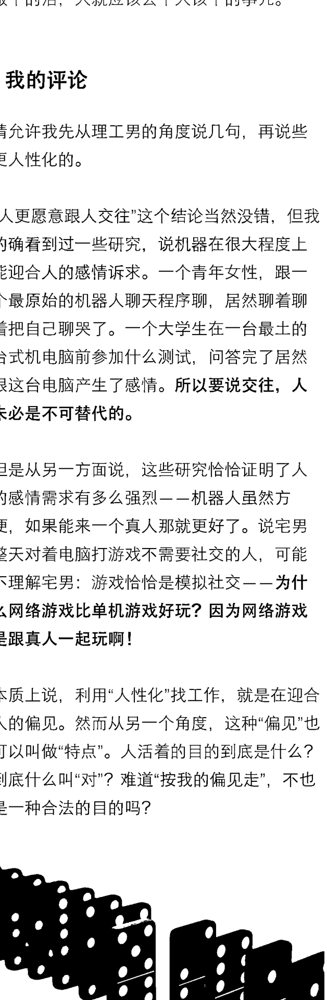

从这个角度想，“理工男”可就有危机了，未来也许是“文科生”的天下。这本书引用一些调研——我也不知道是否可信——说从2000年开始，工程师们在日常工作中所需要消耗的实际脑力，就已经开始下降了。可能自动化程度越来越高，那么工程师的活就越来越简单——也就是说越来越不值钱。

书中有个相当极端的例子。说美国西南航空公司花重金，从众多申请者中聘请了一位技术特别过硬的IT工程师。这人来到了以后就把自己关在办公室里干活也不出来跟人聊天。结果主管就问他你怎么不聊天啊？这人说我爱钻研技术不爱聊天。主管说我们西南航空的企业文化就是聊天，然后把他解雇了。

## 不爱社交的IT男不是好同事。

作者说，从工业革命时代开始，人就一直在模仿机器，好像人的价值就是机器化一样。亨利福特有句名言：“我只想要一双手，为啥每次总有个大脑跟着这双手？”但是现在时代变了。现在机器已经能做大部分应该让机器做干的活，人就应该去干人该干的事儿。

## 我的评论

请允许我先从理工男的角度说几句，再说些更人性化的。

“人更愿意跟人交往”这个结论当然没错，但我的确看到过一些研究，说机器在很大程度上能迎合人的感情诉求。一个青年女性，跟一个最原始的机器人聊天程序聊，居然聊着聊着把自己聊哭了。一个大学生在一台最土的台式机电脑前参加什么测试，问答完了居然跟这台电脑产生了感情。所以要说交往，人未必是不可替代的。

但是从另一方面说，这些研究恰恰证明了人的感情需求有多么强烈——机器人虽然方便，如果能来一个真人那就更好了。说宅男整天对着电脑打游戏不需要社交的人，可能不理解宅男：游戏恰恰是模拟社交——为什么网络游戏比单机游戏好玩？因为网络游戏是跟真人一起玩啊！

本质上说，利用“人性化”找工作，就是在迎合人的偏见。然而从另一个角度，这种“偏见”也可以叫做“特点”。人活着的目的到底是什么？到底什么叫“对”？难道“按我的偏见走”，不也是一种合法的目的吗？

怎么才能让自己更“人性化”呢？

- 跟客户建立个人关系，不要只谈利益
- 衣着打扮、说话语言彰显个性
- 一个团队要有私下的个人互动，要有“化学反应”
- 作报告不要把数字直接摆在别人面前，得发挥想象力把这些数字形象化（参见本专栏前面的文章《要怎么说，别人才能听懂你的数字？》）
- 逢年过节给群众送温暖
- 关键时刻站出来调动周围人的情绪
- 出了事主动承担责任
- 表态支持你支持的人
- 发现别人身上的亮点，互相吹捧
- 面对敌人同仇敌忾
- ……

欢迎在留言区补充。

万维钢

写到这里篇幅有点长了，可我还想再说一段。你知道我是非常反感希拉里的，我希望特朗普当总统。一方面，美国几乎所有主流媒体都在黑特朗普挺希拉里；另一方面，网上的留言评论几乎一边倒地反对希拉里。

有一次我看电视，CNN记者采访一个特朗普的支持者。他大概四五十岁，是个黑人，胡子拉碴，看上去经济状况不是很好。他对记者说，你们整天说特朗普是个种族主义者，可我从来没听他说过歧视黑人的话，我说他根本就不是种族主义者！他说的非常激动，把记者搞得手足无措。他周围几个群众，也纷纷质疑记者。

这个场面对我的打动远远超过网上那些评论。我坐在那里盯着屏幕，只觉得那个黑人是我的兄弟。我真想冲进去跟他站在一起！

这就是一个具体的人的力量。

## 未来预告

企业家思维vs雇员思维：

是个种族主义者，可我从来没听他说过歧视黑人的话，我说他根本就不是种族主义者！他说的非常激动，把记者搞得手足无措。他周围几个群众，也纷纷质疑记者。

这个场面对我的打动远远超过网上那些评论。我坐在那里盯着屏幕，只觉得那个黑人是我的兄弟。我真想冲进去跟他们站在一起！

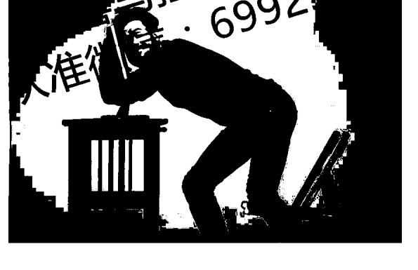

这就是一个具体的“人”的力量。

## 未来预告

企业家思维vs雇员思维：

忘记是为了更好地记住：

新巨富的新文化：

团结一致的集体感，也是一种生理作用：

中年的大脑更厉害：

学术问题和……真问题：

委婉语就如同内衣：

美国人说的改革红利：

为什么发达国家的青年也会投奔恐怖分子：

#new#只要有一小撮人执意玩真的：我最佩服的作家特勒布，他写过《反脆弱》和《黑天鹅》。跟你分享一篇他的文章。

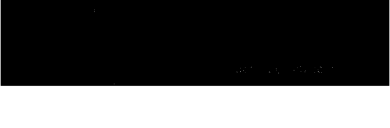

## 周末小议 | 答读者问，以及什么是好的读书笔记？

各位，周末好！

专栏开通两周多，大家留言提了不少问题，很多是关于读书、做笔记、写作，今天就把问得多的几类问题集中回复，希望周末也能让你有点小收获。最后应读者要求，加了一篇如何写读书笔记的旧文，如果你看过就无需视吧。

周末还点名这个专栏做功课的人，你辛苦了。

开始吧——

璞至天成_豪哥：可否推荐一两本教写短文的好书籍？我也喜欢短频干练的写作手法，重点突出还方便记忆？

smiling：可否分享下你看的能提高写作类的书？

万维钢

我正在看的这本书叫 How to Write Short，作者是 Roy Peter Clark。

此书提到，写短文有三大原则：focus, wit 和 polish。所谓 focus，就是主题明确；wit，就是这篇文章得有智慧；polish，是说要打磨文章，对用词精挑细选，反复修改。

按这个标准，短文比长文章更难写，也更经得起读，就好像诗歌一样。如果都这么写的话写短文可能比写长文要花费更多时间。但是我们现在日更，我把重点还是放在了前两条，focus 和 wit，每次只讲一个道理，让读者能有所收获。

真正的好文章都是修改出来的。有句话说 natural doesn't come naturally，意思就是说那些看起来越是“自然”的东西，越是需要人工反复打磨。真正让一个人出口成章很难。

不过要说写作类的书，我重点想推荐两本。

一本是：The Art of Column Writing: Insider Secrets from Art Buchwald, Dave Barry, Arianna Huffington, Pete Hamill and Other Great Column, 作者 Suzette Martinez Standring。

一本是 The Book on Writing，作者是 Paula LaRocque

这两本书说的可不是一般意义上的“写好”，而是怎么能写到职业选手的水准，让人愿意花钱读你的文字。

肥羊kevinyu：一个年轻人该如何去寻找能让自己释放激情的事业呢？在工作和生活中是否能有一些方法论指导我们呢？

高俨飞：能不能找一天给年轻人讲一下如何知道自己的passion在哪里，太迷茫了。学了好多年法律，工作很累且无趣，不知道自己的兴趣到底在哪。

夏复得：对于如何找到干某事的热情，有没有一定的方法（或套路）可寻呢。

万维钢

我特别赞同 David Brooks 在 The Road to Character 一书中的说法。在更高级的层面上，往往不是人去选择事业，而是人被事业所选择。你可能很长时间无所事事，有一天突然遇到个什么事情，就好像有个使命在召唤你，你觉得这个事儿非干不可，你就算找到了。

常理来想，我们应该先看看自己手里有什么技能，再看看世界上有什么位置，然后匹配一下选择个什么职业。但实际上，考察那些有所成就的人，他们更多的是被事业所召唤。为了干成这件事，需要什么技能就去学什么技能，需要改善性格就改善自己的性格，需要克服弱点就克服自己的弱点，千方百计非得做这件事不可。

不要问“我想干什么”，要问“哪里需要我”。

我猜，这可能是因为每个人都是高度可塑的——世界发展到什么地步，需要什么事业，这我们左右不了，但是我们可以改变自己。愿意克服弱点改善自己，有这么一个修行的态度，才配得上干大事。

jie静水流深：关于读书和写作有很多困惑。我去年刚博士毕业，专业是有机化学，现在从事药物研发的工作，越来越感受到可能自己更愿意成为一名科普作者。想请教您是怎么在做好科研的同时，做好读书和写作的？

万维钢

我的科研工作是等离子体物理的计算机模拟。这个工作有个好处是不用动手做实验，否则我就得整天在实验室加班加点。但即使如此，科研是没有下班概念的工作，我们通常晚上回到家里也要调试程序，看结果，读论文等等，有时候可以说是每时每刻都在想物理。所以我辞职以前的写作，产量非常低，一篇文章大约要写两周到一个月。去年《智识分子》要交稿给出版社，正好有一天赶上了飞机，给安排到了第二天，我索性没回家在机场修改书稿，几乎没睡。

其实写作倒在其次，并不一定每个人都应该写作，但是读书实在太有意思了。一个节省时间的好办法是所有书。我上下班路上，锻炼身体，或者中午如果一个人吃饭，都在听书。英文世界几乎所有稍微畅销一点的书都有声版。

科研和写文章很难兼顾，我知道有几个物理同行也爱写文章，但是科研工作大概没有下功夫。当然我现在索性辞职了。

但的确有人——有的美国人——可以做到兼顾这一切。科研，教学，行政管理，写专栏，写书，社会活动，然后还有自己的公司。要做到这些需要完全不一样的操作方法和严格的纪律，还有得得助手——我没达到这个水平，但我得承认有人能达到这个水平。这是好消息，意味着你我的效率可能还有大幅度提高的余地！

鼠目寸光：希望您能教我怎么写读书笔记，能把您的读书笔记拿出一篇做个例子吗？

漂亮过海：每日看到的都不过瘾，总感觉还有 hạ 文，然后就熊然而止……今后的更新中可不可以把一些您之前写了一些东西，如果和今天的内容有联系，发个链接或者直接贴过来作为引进阅读。

万维钢

我以前写过一篇《用强力研读书》，后来在收入《万万没想到》一书的时候做了改写，今天就把这篇文章里“什么是好的读书笔记？”部分重新贴在最后，读过的请无视，第一次看到的希望可以帮到你。

我还想说的是这套读书方法最适合入门级的读书人——如果你已经读过很多很多书，就可追求一下阅读速度了！而明天我们的周末小说文章就是《速读》。

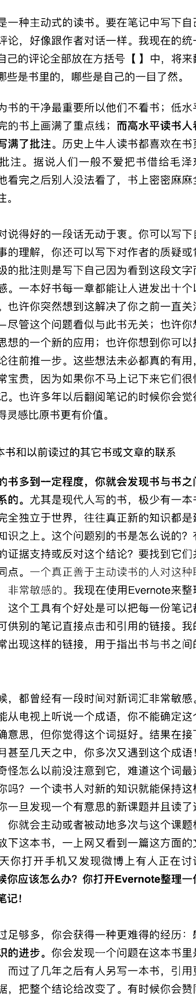

## 什么是好的读书笔记？

读书笔记的一个重大作用是给自己日后以最快速度重温这本书提供方便，直接看笔记就可以。还有别的好书等着我们去读呢，所以笔记最好写到可以取代原书的程度。

强力研读要求读书笔记必须包括四方面的内容：

- 清楚表现每一章的逻辑脉络
- 带着书中所有的亮点
- 大量自己的看法和心得
- 发现这本书和以前读过的其它书或文章的联系

## 1. 清楚表现每一章的逻辑脉络

## 2. 带着书中所有的亮点

## 3. 大量自己的看法和心得

## 4. 发现这本书和以前读过的其它书或文章的联系

## 5. 笔记是对一本好书最大的敬意

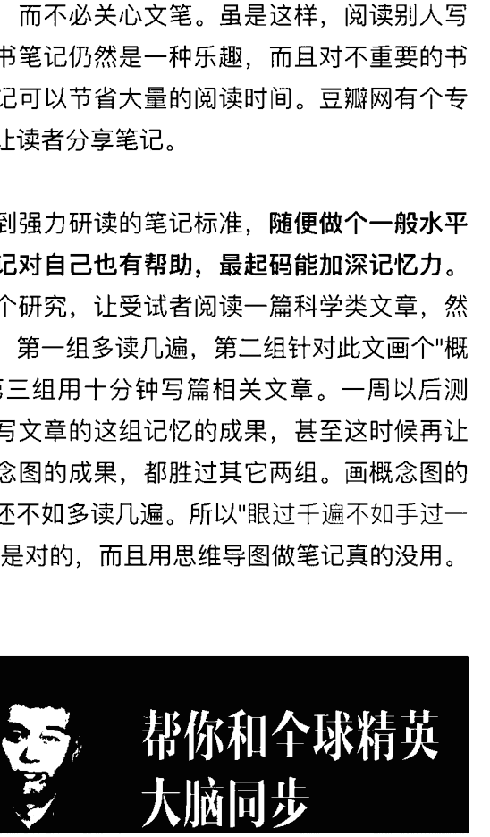

## 周末小议 | 速读

如果可以拥有一个超能力，我肯定选速读。把一本书的内容下载到人的大脑里，这件事情到底“应该”用多长时间？

我虽然爱读书，但并不善于速读，事实上我的阅读速度可能比一般人更慢。跟人一起看一本书，往往是别人已经看完要翻页了，我还在读。这对这一把读书当成大事的人来说当然不行，所以过去这些年里我尝试了各种速读的方法。

有一个理论说阅读速度的瓶颈其实不是大脑，而是眼睛。目光沿着一行字从左到右扫描，尤其是换行，是个非常吃力的动作，你把大部分时间给浪费在移动眼球上，而不是接收信息上了。那么现在把阅读从纸面换到屏幕，这个问题就解决：spritz。

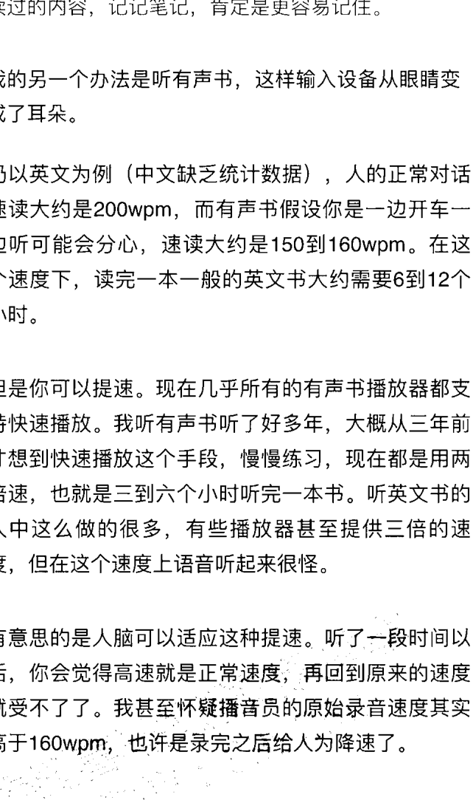

你可以在电脑网页或者手机上使用spritz，它的做法是一个单词一个单词的 *播放* 一本书，使用非常高的速度，比如每分钟播放500个单词（500 wpm）。这个好处是眼球只要盯着屏幕上那一点就可以了，完全不需要移动。spritz 还用了一个方法是把每个单词中的一个关键字母变成红色，据说这样可以提升识别速度。

我尝试过好几个基于spritz技术的读书app，其中最好的一个大概是Litz。它不但显示当前的一个单词，而且同步在下方显示附近的内容，这样我们可以随时停下来查看一下前后文。

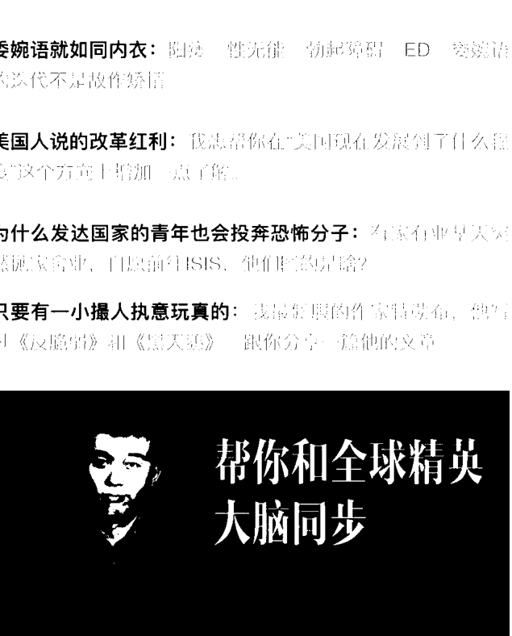

使用这种工具能快到什么程度？据我调研，正常人（以英语为母语的成年人）的速度至少能达到500 wpm。正如前面所说我反应慢，我的极限速度是400wpm，再快就跟不上了。要想充分领会书的意思，我需要把速度调低到300wpm以下。

## 未来预告

最后说明：以上这些速读手段都是适合老手读那些不太重要的书。新手读重要的书别乱速读了，得“强力研读”，可参考本人《万万没想到：用理工科思路理解世界》一书中的《用强力研读书》一文。

# 企业家思维VS雇员思维

在中文里“企业家”的意思有点含糊不清。如果你拥有并且亲自经营一个餐馆，你是不是一个企业家呢？如果你搞了一个只有三个人的创业公司，你是企业家吗？

在英文世界，“企业家”(entrepreneur)和“企业主”(business owner)其实是两个含义很不一样的词。只要你家里有个什么买卖，哪怕是个纯粹为了养家糊口的小买卖，你就是一个“企业主”，但你未必是“企业家”。二者之间的区别并不在于公司的大小。哪怕你由于什么特权，垄断了某种稀缺资源，根本不需要搞任何创新就能获得很好的利润，那你还是一个成功的企业主，但却不是企业家。

“企业家”，必须有点精神追求，所以才有“entrepreneurship”这么一个高大上的词。什么叫企业家精神？

## A MANIFESTO for ENTREPRENEURS

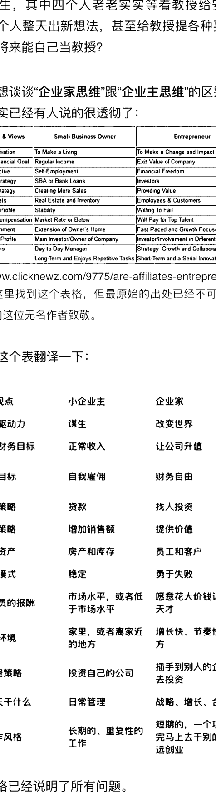

Mad Genius: A Manifesto for Entrepreneurs

标题的意思是“疯狂的天才：企业家宣言”。作者 Randy Gage 既不是学者，也不是一个严格意义上的“企业家”，他的主要工作是到各地演讲和写书，蛊惑别人创业，告诉别人怎么做好企业家。这个工作听起来不靠谱，但发达商业社会需要很多这样的人，而且人们对他们是买账的。

此书中没有使用任何严肃的研究结果，没有什么新的“干货思想”。但我觉得，他对“企业家的思维方式”的论述，很值得拿出来说。

作者说，世界上大多数人浑浑噩噩，对身边不合理的事物安之若素，其思维方式可以称之为“畜群思维”——他这个词太难听，我们还是用一个好听点的，叫“雇员思维”。与之相对的，则是“企业家思维”。

比如我们平时在机场和银行之类的地方办事，感到效率非常低，办事员明明可以提高效率，但是他职权所在就得这么办，一般人也就无非抱几句“官僚主义”。每个人都是照章办事 逃避责任，大家都指责某个神秘的“上头”，这种思维就是雇员思维。

而企业家思维，则是对现状不但不满，而且不服！我不管别人怎么想，我就认为这事不应该这么办，我非得改变。

换句话说，这两种思维的区别就在于前者被动，后者主动。

真正的企业家就好像艺术家一样，永远都不会退休。他们永远都有想法！有了想法，什么招募员工、找投资人、品牌营销这些都是细节，想法才是企业家创业的核心。他们不断产生新想法，不断尝试，失败了就再尝试别的想法，就这么一直干下去。他们要冒很大的风险，但是他们往往低估风险，过度自信，非干不可。

企业家想法的关键，是想象一种不同的可能性。在别人还没想到有这个需求的时候，你已经安排人把这个东西给造出来了。比如说乔布斯iPad。之前世界上没有几个人认为自己需要一个iPad，等苹果公司把iPad做出来了，人人都想要一个。

如此说来，现代社会的新发明其实都是被发明了两次。第一次是企业家想出来，第二次是工程师做出来。企业家的任务不是问消费者想要什么，而是替消费者决定他们应该要什么！

作者说，每个公司都有20%的雇员非常懒惰，你就算把股份分给他们，他们也不会好好干活。他们彻底被动，你永远也影响不了他们。

但是有10%的人是即使你不给他们钱，他们也能把事情办好，这些人就是天生的企业家。他们哪怕在麦当劳打工，都能主动把店里打扫得窗明几净，还要时不时地给你提各种合理化建议。对这样的人你也无法改变，你跟他们其实不是雇佣，而是合作关系，等他们有了足够经验就会自己出去创业。

你真正能影响的，也就是所谓“企业文化”有用的，是剩下那70%的人。

——他们，当然是最典型的，“雇员”。

## 我的评论

读到这里你可能会有一种感觉，“雇员(employee)”，几乎成了一个略带贬义的词。事实上 有雇员才有企业家，世界上大多数人都是雇员。“雇员”，是光荣的劳动者。但是我敢打赌，随着年龄增长，你会越来越反感“雇员”这个词。

说某人是个雇员，简直就等于说他是个听别人指挥、没有自由意志、必须依赖于某个大组织才能生存下去的人。所以对于那些40岁以外的人，你可以称他为领导、老师、工程师，哪怕是“同志”（因为共同的志向走到一起 显然是合作关系），甚至“师傅”（对 他专业技术的敬意），但是千万别强调他是个“雇员”。

不过现在是互联网时代，雇员和企业家其实已经没有那么明显的分界线。一个具有现代化管理思维的企业，可以充分调动员工的自主能力，雇员完全可以根据自己的想法改变企业。如果公司制度得当，这种合作关系也许可一直持续下去，未必非得都出去自己创业。

并不一定是你非得自己拥有一个企业才需要“企业家思维”，每个人都应该有点企业家思维。一个教授带五个博士生，其中四个老老实实等着教授给安排任务，一个人整天出新想法，甚至给教授提各种要求，你猜谁将来能自己当教授？

最后我想谈谈“企业家思维”跟“企业主思维”的区别，但这个其实已经有人说的很透彻了：

| Objectives & Views | Small Business Owner | Entrepreneur |
| 1. Primary Motivation | To Make a Living | To Make a Change and Impact |
| 2. Personal Financial Goal | Regular Income | Exit Value of Company |
| ... | ... | ... |

http://www.clicknewz.com/9775/are-affiliates-entrepreneurs/ 我是从这里找到这个表格，但最原始的出处已经不可考，在此只能向这位无名作者致敬。

我来把这个表翻译一下：

| 目标和观点 | 小企业主 | 企业家 |
| 1. 首要驱动力 | 谋生 | 改变世界 |
| 2. 个人财务目标 | 正常收入 | 让公司升值 |
| 3. 职业目标 | 自我雇佣 | 财务自由 |
| 4. 资金策略 | 贷款 | 找人投资 |
| 5. 业务策略 | 增加销售额 | 提供价值 |
| 6. 核心资产 | 房产和库存 | 员工和客户 |
| 7. 风险模式 | 稳定 | 勇于失败 |
| 8. 给雇员的报酬 | 市场水平，或略低于市场水平 | 隐含花大价钱请一流天才 |
| 9. 工作环境 | 家里，或者靠近家的地方 | 增长快、节奏快的地方 |
| 10. 投资策略 | 投资自己的公司 | 插手到别人的企业里去投资 |
| 11. 每天干什么 | 日常管理 | 战略、增长、合作 |
| 12. 工作风格 | 长期的、重复性的工作 | 短期的、一个项目干完马上换去别的、永远创业 |

这个表格已经说明了所有问题。

## 由此得到

雇员适应世界，企业主占世界的便宜，企业家改变世界。

## 未来预告

忘记是为了更好地记住 | 我可以证明记忆增强记忆并且遗忘，重要的话只说三遍？

新巨富的新文化 | 相对富裕却踏上一路向下的新巨富，我们该如何学习？

团结一致的集体感，也是一种生理作用 | 我们总是很多都... 之后还得像往常一样？

中年的大魔更历害 | 结婚、失业、中年危机、甚至阴阳两界.... 其实根本不是个啥问题！

学术问题和.... 真实问题 | 绝大多数科学家，你也许有自己的... 你可以试试他吧！

委婉话就如同内衣 | 隐晦、性无能、抑郁症、ED... 这种说法不是作弊吗？

美国人说的改善红利 | 我猜你在美国现场发现到了什么程度？这个方面在亚洲加一层解释。

为什么发达国家的青年也会投靠恐怖分子 | 有钱有事业天... 然而... ISIS，他们到底想什么？

只要有一小撮人好玩就好 | 我是段程作者特别苦，他写过《反脆弱》《天才...》跟你分享一段他的文章。

## new # 怎样快速跟人建立亲密关系 | 两个人能一见如故甚至一见钟情，其中有技术可学。

## 委婉语如同内衣

如果对西方政治新闻感兴趣，你可能会注意到一个语言学现象，那就是人们大量地使用委婉语。比如我们在中文世界说的“非法移民”(illegal immigrants)，现在在英文世界中有个更委婉的说法：“没办手续的移民”(undocumented immigrants)。

合法就是合法，非法就是非法，把非法的叫没办手续，这讨好的意味是不是太强了？

## 这是到底是发达国家的富贵病呢，还是文明社会应有的美德？

今天我要说的是哥伦比亚大学语言学教授 John McWhorter 的一篇 CARTICLES：

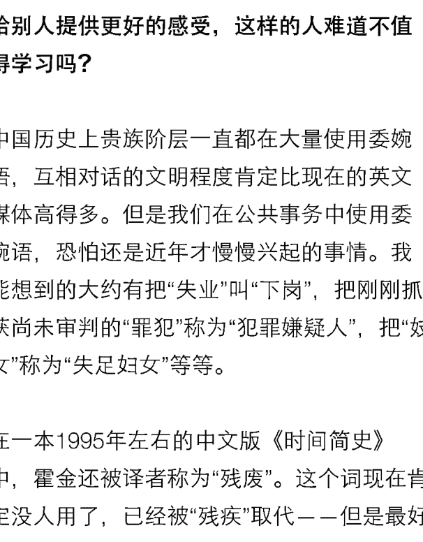

Essay Cultures & Languages

## Euphemise this

Euphemisms are like underwear: best changed frequently. What work are they doing in our language and why do they expire?

John McWhorter Audio

（委婉这个：委婉语就如同内衣：最好常换。它们在我们的语言中起什么作用？它们为什么会过期？）

这篇文章用大量例子来说明英文世界中各种委婉语的使用变迁。

比如“残疾人”这个意思，最早的说法就是 cripple，意思是身体上有缺陷（这个词的最初意思，尤其指跛脚）。

后来人们可能觉得cripple太过形象，不太好，改称残疾人为“disabled”，意为“被动失能者”。我个人理解这个词的好处是它很抽象，“失能”，是脚有问题还是眼睛有问题，是身体上的还是精神上的，是永久的还是暂时的，都有可能，没有那么多画面上的联想。

当然还有一个平行使用的词，叫“handicapped”，大约相当于“残障”。不过据说残疾人更乐意被称为“disabled”，并不怎么喜欢“handicapped”这个词，大概是因为后者涉及到对“手”的描写，可能会使人联想到乞丐。

而这篇文章说，现在人们又发明了一个绝对是更好的词来称呼残疾人，叫“differently abled”——“有不同方式的能力的人”。我看这个词简直完美，不但抹掉了一切负面含义，而且发扬了正能量。

但此文的重点是说，哪怕这么好的词，也有过时的 一天。委婉语之所以有用，是因为人脑的反应速度慢，看到一个词总是先想到字面含义——一种清新的感觉先扑面而来，然后才明白实际意思。可 是时间长了以后，人们会慢慢适应这个委婉语，看到这个词就能立即想到背后那个令人不快的含义，于是你就必须再发明一个新 的委婉语。

也就是说，用委婉语来代替一个可能令人不适的词当然好，但这还不是一劳永逸的行动——委婉语就好像内衣一样，必须得经常换。

其实这种现象早就有 人说过了，大名鼎鼎的史迪芬·平克2003年就在一本书里把这个现象叫做“委婉语跑步机”(euphemism treadmill)。不过McWhorter这篇文章特别强调的是其实这是一个好现象 —— 文明社会就得像文明人经常换内衣一样经常换委婉语。

如此一来，我们也给语言增加了活力。

## 我的评论

关于委婉语还有一个更有意思的例子。“阳痿”，最早对应的英文可能是“sexual impotence（性无能）”，不过现在肯定没人这么用了。人们用一个更有医学味道、就事论事、强调机械属性而不是评价一个人的能力的词: "erectile dysfunction"（勃起障碍）。我们可以想见这个词能够保全患者的面子，哪怕面对医生，也没人愿意说自己是“性无能”。

不过对发明了伟哥，并且在市场上大获成功的辉瑞公司来说，“勃起障碍”这个词还是不够好。伟哥是处方药，这意味着人们必须先跟医生说出“勃起障碍”这个难以启齿的词才能拿到药，那么这个词本身就是障碍。于是辉瑞公司发明了一个新说法：ED。

ED，其实就是“勃起障碍”的英文缩写，但是它的妙处在于把这个不方便说的概念彻底抽象化了。两个英文字母，就好像一种代币，一个编码，听起来甚至还有一点理工男的阳刚之气。所以我们看杂志上伟哥的广告就是用ED。

我猜，对患者来说，ED是个好词。委婉语不是故作矜情，它代表的是文明和进步。一个说委婉语的人在说话之前就能体察对方听到这番话之后的心情，他愿意精心挑选词汇来给别人提供更好的感受，这样的人难道不值得学习吗？

中国历史上贵族阶层一直都在大量使用委婉语，互相对话的文明程度肯定比现在的英文媒体高得多。但是我们在公共事务中使用委婉语，恐怕还是近年才慢慢兴起的事情。我能想到的大约有把“失业”叫“下岗”，把刚刚抓获尚未审判的“罪犯”称为“犯罪嫌疑人”，把“妓女”称为“失足妇女”等等。

在一本1995年左右的中文版《时间简史》中，霍金还被译者称为“残疾”。这个词现在肯定没人用了，已经被“残疾人”取代——可是最好谁能发明一个新词，把这个“残”字也给去掉。

中国历史上贵族阶层一直都在大量使用委婉语，互相对话的文明程度肯定比现在的英文媒体高得多。但是我们在公共事务中使用委婉语，恐怕还是近年才慢慢兴起的事情。我能想到的大约有把“失业”叫“下岗”，把刚刚抓获尚未审判的“罪犯”称为“犯罪嫌疑人”，把“妓女”称为“失足妇女”等等。

在一本1995年左右的中文版《时间简史》中，霍金还被译者称为“残废”。这个词现在肯定没人用了，已经被“残疾”取代——但是最好谁能发明一个新词，把这个“残”字也给去掉。

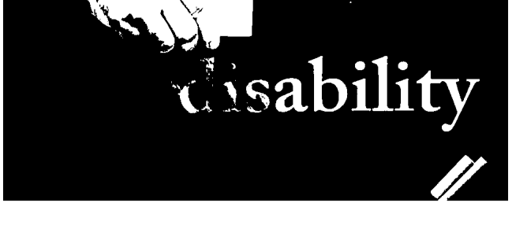

最近看报道说为了激励国足在十二强赛上努力拼搏，中国足协和平安保险公司推出一个全新险种——“失能险”。如果连国足都能“失能”，“失能”这个词就变得进一步中性化，可以预期将来会更容易被社会接受。

我2000年刚到美国的时候，大学里负责接待我们这些外国学生的机构，叫“外国学生服务中心”。过了大概仅仅一年，它就改名叫“国际学生服务中心”了。作为一个外国学生，被称为“国际学生”，我的感觉的确更好了一点——有点像从一个外来打工者变成了奥运会参赛运动员。

你还能想起哪些经常更换的“委婉语”？欢迎在留言区留言。

## 日课017 | 团结一致的集体感：也是一种生理作用

日课017 | 集体感也是一种生理作用

每次陪我儿子去学空手道，看着他们在一起高喊着口号练武，我的情绪都很复杂。首先作为一个男人觉得这个场面很刺激，也想加入他们。但是有时候看其中有的人喊口号特别投入，又有一种奇怪的感觉——有个小男孩，一头金发，每次教练给予指令他都无比振奋地大喊一声，让我不由自主地联想到了，纳粹。

人们一般认为一个集体的团结一致，是一种精神状态，可以用社交乃至教育的方法加强，但是在科学家看来，集体精神也可能是一种生理反应。

比如我们知道，众人在音乐中同步跳舞，有利于加强集体认同感。其实中国古代说的这个“礼乐”中的“乐”，就有让不同阶层的人在一致的音乐中获得和谐和集体感的作用。

另一方面，如果你在集体行为中付出了很大努力，你也不会自觉地更加认同这个集体。

而今年的一期《科学美国人·心灵》杂志有篇文章：

（《跳舞带来凝聚力》，作者 Jason G. Goldman, Scientific American Mind, May/June 2016.）

文章中介绍，一项研究证实，这两个行为，同步和努力，都有利于加强集体认同感。

研究者让高中生三人一组在快节奏音乐中跳舞，结果发现：
- 那些跟同组的人步调一致的人，不论他们跳得是否用力，都提升了集体认同感。
- 那些跳得特别努力的人，不论他们是否做到了步调一致，也都提升了集体认同感。

而研究者认为这其实是同一种荷尔蒙——内啡肽——的作用。剧烈的体力活动可以让我们分泌内啡肽，而内啡肽能带来愉悦感，这就是为什么健身之后人们会感到很爽。有研究者认为协调一致的动作也能促进内啡肽分泌，但这一点还没有被完全证实。

总而言之，如果你想加强一群人的集体认同感，最好的办法也许不是让领导在大会上做动员讲话，而是让这帮人去跳广场舞！军训大概也有类似的效果。

## 我的评论

类似的研究我看到过很多。其实把人随机地分成两个组，让每个组集体行动去做一件事情，比如说搬运重物，甚至一起做个智力题，都能迅速提升人们对自己组的集体认同感。如果你让两个组搞比赛或者对抗，这种认同感还能被大大加强。

由此我们还可以举一反三。比如为什么新兵训练要走正步？齐步走这个动作对打仗一点用都没有。也许这个目的就是一方面培养服从命令的习惯，另一方面也是能通过协调一致的步伐加强集体认同感。那么现在很多公司喜欢把员工带到野外军训，大家在一起摸爬滚打几天，可能也有增加组织凝聚力的作用。

但这些研究背后还有一个意义，那就是人，至少在很大程度上，其实就是一台机器。我们说的很多精神反应，背后可能都是生理反应，归根结底都是化学。那么既然如此，人的所谓“自由意志”又在哪里？这个问题就绝非是今天这篇小文所能探讨的了。

最后再说个离奇的。我在 Jonathan Haidt 的 The Righteous Mind: Why Good People Are Divided by Politics and Religion（正义之心：为什么好人会因为政治和宗教互相敌视）这本书里看到，有一种药物，具体名字我也不知，吃上能让人产生一种宗教般的神圣情绪。你会感觉自己渺小，愿意为集体献身。而且在宗教仪式中使用这个药物还有中长期影响——一直到几十年以后，你可能仍然记得当年的神圣时刻，好像人生都在那一刻被改变了。

这个事情我没在别处看到过，所以未必可信。

## 由此得到

不管是一个人还是一群人的情绪，都是可以用手段，或者说用套路，来调动的。

## 日课018 | 新巨富的新文化

## 日课018 | 新巨富的新文化

|音频转述师：怀沙|

物理学家尼尔斯·玻尔有句话，说“如果你不量子理论感到震惊，你就是没理解量子理论。”我把这句话想做印证一下，那就是说世界上有些事实，有些现象，对我们认识和理解本身是一种冲击力。你一旦听说了这个事情，你的思维就会发生一种不可逆的变化，你可能会坐立不安，你就会忍不住赶紧去告诉别人。

而今天我要说的这个现象，就让我产生了一种不安的感觉，这个感觉既不是恐惧也不是兴奋，有点难以名状，总之是不吐不快。

我要说的是当今这个时代的超级富豪——不是普通的“富人”，而是那些年收入超过两千万美元的超级富豪。我不认识超级富豪，今天要说的事故都来自于：

Plutocrats: The Rise of the New Global Super Rich and the Fall of Everyone Else（作者 Chrystia Freeland）

但是我觉得这些事情似乎跟每个人都有关系。

这本书有中文版，叫做《巨富》。但是Plutocrats的字面意义其实是“富豪统治”—一世界正在被这些巨富所左右！

## 在技术进步、全球化和自由市场这三个力量的作用下，财富正在加速向这些超级富豪手里集中。过去美国1%的富人曾经只拥有10%的财富，现在超过30%。

## 我的评论

## 由此得到

## 周末小议 | 经济学是老司机的游戏

今天周末，我们继续概念辨析栏目。上次留言中有读者让我谈谈“囚徒困境”，这方面的确实有很多值得说的，但在此之前我们先说一个更基本的概念——“纳什均衡”。

这个概念听着学术味道太强，所以我得用一句话“人话”来转述它——

如果参与游戏的各方都是“老司机”——也就是说每个人都非常聪明进而猜不中准，那么游戏就会达到一个各方都满意，或者说各方都无奈的局面——任何一方想要采取一个什么行动让自己比这个局面更好都不可能了——这个局面，就叫“纳什均衡”。

我们先举一个不是纳什均衡的例子：田忌赛马。田忌与齐威王赛马，本来田忌的上、中、下三等马都不如齐威王的，孙膑献计让田忌以下马对上马，上马对中马，最后二比一取胜。

这个游戏对齐威王其实是不公平的，等于是田忌把齐威王给蒙了——我还以为是一场正常的赛马，你出筋急转弯得按“3”啊！所以田忌取胜的这个结果就不是纳什均衡。齐威王如果是老司机，他就不应该首先公布自己队伍的出场顺序。

当一个数学家或者经济学家，说“博弈论”的时候，他说的可不是孙膑搞的这种欺负老实人的骗术。作为一门高大上的理论，博弈论的最基本假设就是参赛各方全是老司机。

那么老司机遇到老司机，高手过招是一个什么境界呢？我们说一个有点极端的纳什均衡例子，“旅行者困境”。

这是印度经济学家考希克·巴苏1994年提出来的。一趟航班有两个旅行者丢失了行李，其中包括价值相同的两件古董，而两人却声称古董的价值是100元。航空公司认为这两人故意高估了价值骗赔偿，于是把两人分开，要求他们写下古董的真正价值，且必须是2到100元之间的一个数字。航空公司规定，如果二人写下的数字相同，就认为那是一个真实数字，照价赔偿；如果二人写下的数字不同，那就认为较小的那个数字是真实价格，按这个价格赔偿，并且对写下较大数字的人收2元罚款，对写下较小的数字的人给2元奖。

规则看起来简明合理，可是老司机一看，可就要了命了。你的第一反应是写100。但你随即想到，对手也会写100，而这样一来你的最优策略其实是写99，因为如此你就会得到99+2=101元，还能多拿一元。但对手难道就想不到这一点吗？他肯定也写99。而在这种情况下你写98比99更好，因为这样你可以得到100而不是99元。同理对手也会得出写98比写99好的结论……这样一步步地推理下去，你会发现最后的结果——也就是纳什均衡——是两个人
都写2元。

看到这里你可能会说这个纳什均衡也太不亲民了，日常生活里谁会算得这么精？这个例子确实极端了一点，但日常生活中很多局面，其实就是纳什均衡。

- 大多数情况下，传统经济学最好用，人是理性的，市场是大体均衡的。
- 在少数情况下，人可能会表现出非理性，市场可能偏离均衡。
- 非理性和偏离均衡，可以给世界带来活力。

所以我认为，对经济学应该这么认识：

纳什均衡，以约翰·纳什命名，他正是电影《美丽心灵》的主人公。

“纳什均衡”理论就是他在普林斯顿的博士论文，只有28页，这个理论后来给他带来了诺贝尔经济学奖。在此之后的几年里他连续做出重要的工作，然而在1959年因为被诊断出精神分裂症而住院。

纳什均衡，闪烁着理性的光辉！……不过说回来，特别有理性也不见得有多大意思，纳什本人病好以后就说了这么一段话：“……回到成为一个理性人的快乐，跟身体有病然后康复获得的快乐，还是不能比的。”

> "I seem to be thinking rationally again in the style that is characteristic of scientists. However, this is not entirely a matter of joy as if someone returned from physical disability to good physical health."
John Forbes Nash, Jr.

纳什和他的妻子，去年，死于车祸。86岁。

万维钢

对这个理论有什么疑问、收获，或者还有相关知识想和大家分享，欢迎在留言区留下你的。

## 周末小议 | 说好的读书笔记来了

读书笔记是给自己看的，本来不应该贴出来，但本专栏现在倡导强力读书，我们干脆搞个活动：晒读书笔记。

所以我先把自己的读书笔记晒出来，供你参考。

下面这段，摘自我对 The Master Switch: The Rise and Fall of Information Empires（主开关：信息帝国的兴亡，作者Tim Wu）一书的笔记，写于2013年。这本书我读得很认真，整理笔记花了很多功夫。这次改，有些说的比较幼稚的话也都保留了。

那时候我只是偶尔在报刊和网络写点文章，没出书，写作收入可以忽略不计。我根本没遇到需要这门手艺谋生——我这么认真地读书纯粹是因为我喜欢读读书，我想拥有这些知识！

注意我这份笔记里做到了如下几点：

- 有对原文的直接引用，特别是一些有意思的句子和亮点
- 用不同字体和颜色标记了重点，方便以后再读
- 原文是一段一段的句子，我把要点用清晰的清单方法总结出来
- 最重要的是，我用【】标记了我对这些内容的个人理解和评论。

## 读书笔记：电影行业怎样规避风险

电影，包括媒体事业，是一个非常高风险的东西，一个电影能不能成功完全不可预测。投入大未必大卖，投入少也可能大卖，不知道怎么才能够得到一个“hit”（超级流行的），而hit一旦出来，你的盈利是其他片的很多很多倍——第一名和第二名差距蛮远。

归根结底，电影的不确定性是因为人们并不迫切“需要”文化，你只能让人“想要”文化——they don't NEED the culture, 你只能让人 WANT the culture。不是生活必需品，没有稳定利润。

那么怎么面对高风险？四个策略：

1.傍上一个传统工业巨头。Ross本身有很多传统工业项目，租车等行业，用这些行业补贴电影。GE有几千个billion的业务，而universal studio才一两个billion，无所谓的事情。一个电影失败，对巨头来说无所谓。

这个策略确保了电影公司可以随便玩，确保了创新。

而巨头愿意投资电影，并不是为了赚钱，他们想要的是社会认同感和名望。Ross以前只有钱和权力，而没有名望，现在可以给女儿当工具了。

【许家印云马云搞足球也有点这个意思吧？打着赚钱的旗号去玩。其实二人合作投资足球的决策过程很不严肃。Socernoimcs一书也提到，足球的经营者都很愚蠢。其实是根本不在乎。】

【本质上，因为娱乐业不是必需品，也许永远只能依附于其他行业。那么一个办法也许就是纳粹亲自直接出钱养着？】

## “读书人”应该怎么读书

从读书的角度看，世界上大有两种人。一种人读书是为了掌握什么技能，通过什么考试，或者纯粹是为了娱乐。另一种人读书却是为了提升自己的内力。

这两种人最初的“智力”水平未必有多大差别，但是假以时日之后他们的“智慧”水平将会有天壤之别。只有后一种人，才配被称为“读书人”。

这里我想谈谈“读书人”应该怎么读书。

我国最畅销的图书类型是各种教辅参考书和英语考试辅导书，这些东西不算书。什么金庸琼瑶之类的的小说当然算书，但看这种书不值得讲究什么技术。我们专门研究怎么读那些看完之后能够加深自己对某一领域的理解，能够获得一种智慧上升的感觉（暗怕是错觉）的非小说类的书。

关于这种书有三个基本事实。

## 第一，大多数人不看这种书。他们不是读书人。

## 第二，如果真看了的，其中大多数人没有看完。

## 第三，即使看完了的，其中大多数人没有看懂。

## 强力速读”刻意练习”有三个共同点：

## 第一，不好玩。世界冠军训练基地没有“寓教于乐”这个概念。“强力研读”不是为了娱乐和休闲，而是用非常严肃认真的态度，非得把一本书给融会贯通以至于长在自己的大脑里不可。这种做法相当累。我认为写读书笔记是一个非常正经的工作。

帮你和全球精英大脑同步

## 日课019 | 中年的大脑更厉害

| 音频转述师：怀沙 |

今年我正好40岁，按照传统上对中年的定义是从40岁到65岁，我属于是步入了中年。所以我最近就一直思考“中年”，到底意味着什么。当然不管你现在没到中年，早晚也会得到。

“中年”，在这一年轻人当道的时代好像并不是一个受欢迎的称号，有时候可能被视为是“老年”的委婉语，在硅谷之类的地方找工作还容易受到年龄歧视。

难道人到中年就不行了吗？我看到有研究说老年人的大脑都可以继续学习，更何况中年！事实上，中年的大脑比年轻人大脑更厉害。

今天咱俩说这本书：

## The NEW YORK TIMES Bestseller
The Secret Life of the
GROWN-UP BRAIN
The Surprising Talents of the Middle-Aged Mind

BARBARA STRAUCH
The Secret Life of the Grown-up Brain: The Surprising Talents of the Middle-Aged Mind （成年大脑的秘密生活：令人惊讶的中年大脑天赋）

作者 Barbara Strauch 是纽约时报科学版编辑。写此文时我才知道，她去年已经因为乳腺癌去世，63岁，永远停留在了中年。

各人发育节奏不一样，年龄数字不能说明问题。什么时候你意识到自己可能到了中年呢？感觉反应速度不行了；见到熟人想起名字；在楼上想下楼拿个东西，下了楼来又忘了要拿什么。出现这些症状……别紧张。

你的脑细胞并没有减少。大脑重要的地方都在继续长，新东西可以继续学，不是没有风险，但搞好了维持到一百岁都没问题。

跟年轻的大脑相比，中年大脑在两个方面的性能是下降的：计算速度和注意力。其他方面，比如模式识别、空间想象能力、逻辑推理能力等等，性能不但没有下降，而且还提高了。

## 我的评论

书中说中年人情绪好可能是因为意识到自己时日不多，我不赞同这个猜测。我觉得中年大脑的最主要变化就是——变聪明了。难道年轻人就应该控制自己的情绪吗？只不过中年人足够聪明显能做到而已。

## 由此得到

你很年轻……也可能过于年轻了。

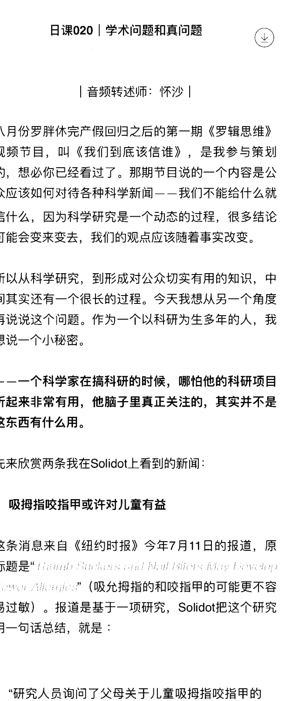

## 日课020｜学术问题和……真问题

## 日课020｜学术问题和真问题

|音频转述师：怀沙|

八月份罗胖休完产假回归之后的第一期《罗辑思维》视频节目，叫《我们到底该信谁》，是我参与策划的，想必你已经看过了。那期节目说的一个内容是公众应该如何对待各种科学新闻——我们不能给什么就信什么，因为科学研究是一个动态的过程，很多结论可能会变更来去，我们的观点应该随着事实改变。

所以从科学研究，到形成对公众切实有用的知识，中间其实还有一个很长的过程。今天我想从另一个角度再说说这个问题。作为一个以科研为生多年的人，我想说一个小秘密。

——一个科学家在搞科研的时候，哪怕他的科研项目听起来非常有用，他脑子里真正关注的，其实并不是这东西有什么用。

先来欣赏两条我在Solidot上看到的新闻：

- 吸拇指咬指甲或许对儿童有益

这条消息来自《纽约时报》今年7月11日的报道，原标题是“Thumb Suckers and Nail Biters May Develop Fewer Allergies”（吸吮拇指和咬指甲的可能更不易过敏）。报道是基于一项研究，Solidot把这个研究用一句话总结，就是：

> “研究人员询问了父母关于儿童吸拇指咬指甲的习惯，然后在他们13到32岁时进行皮肤过敏测试。结果显示，38%有吸拇指或咬指甲习惯的儿童有皮肤过敏反应，无此类习惯的儿童是49%。”

- 哈佛研究发现丈夫的雇佣状况是离婚的最主要因素

这条消息来自彭博今年7月27日的报道，原标题是“Why Divorce on Money Asks: Did He Have a Job? （不是钱的事儿，丈夫有没有工作才是关键）。报道基于的——当然是来自哈佛的——研究，一句话总结，就是：

> “她发现，在任意一年，如果丈夫没有全职，那么离婚的可能性将达到3.3%，相比之下有全职工作的丈夫离婚的可能性是2.5%。”

我并没有刻意挑选，像这样的“科技”新闻我们每天都能看到，今天我想说的也不是这两条新闻本身。我想说的是，这种新闻到底有多大意义？

作为有科学精神的读者，我们是不是应该赶紧让孩子吸手指咬指甲，然后千方百计保住丈夫的工作？当然不是！

其实你仔细看，这两项研究说的都是非常微小的效应。吸手指的人更不容易皮肤过敏，是因为他们从小接触不干净的东西免疫力更强，还是因为手指有什么特别健康的成分？这个研究根本没说。更重要的是，哪怕你吸手指，你还是有可能皮肤过敏，而且高达38%！不但如此，连38%和49%这两个数值也未必有多大指导意义，因为国外研究调查的是国外受试者，他们跟中国受试者的表现能一样吗？如果效果来自污染，那么中国的污染已经很严重了，是不是就不用吸手指了？

再看离婚率这个打着哈佛旗号的研究。好吧，丈夫没全职，离婚率“高达”3.3%——这是个多大的效应？我光看彭博标题还以为只要丈夫没全职就肯定离婚呢！再仔细一看，原来即使丈夫有全职，离婚率也有2.5%——“欲练神功，挥刀自宫……即使自宫 未必成功……若不自宫，也能成功……”

像这样的研究，第一它没有基本原理方面的探索，纯粹是最简单的统计数据分析；第二他分析出来的这个效应，是非常微小的。换句话说，这些研究结果根本没有强烈到足以指导我们行动的地步。

那么为什么这样的东西能写成论文发表，这些“科学家”为什么要研究这些？

——因为四个字：学术兴趣。

这个词其实并没有多么高不可攀，我来举个例子就说明白了。比如咱俩在酒吧侃大山，你说“贫贱夫妻百事哀”，收入太少的家庭更容易离婚。我说你说的不对，我认为离婚的关键不在于钱多钱少，可能还有别的原因，比如说“丈夫有没有全职工作”，就可能比钱多钱少更重要。

其实咱俩说的效应可能都很小，对婚姻生活都没有什么指导意义，但这个争论的确是合法的，构成了一个智力上的挑战。

如果这个问题以前没有任何人解答过，而且的确能吸引同行的兴趣，那咱俩就可以合法地弄一笔政府科研经费，搞个调查研究。

其实也许“性格不合”才是婚姻的最大杀手，咱俩怎么不去研究呢呢？也许是因为“性格不合”这个因素太明显，别人早就研究过了；也许是因为“性格不合”这个因素不好量化，没有办法搞实证研究。

总而言之，现在我们找到了一个
1) 看似值得研究，
2) 别人没研究过，而且
3) 的确可研究的课题，这个课题能填补人们的智力空白，所以政府就会资助我们搞这个研究这就叫学术兴趣。

至于说它对实际生活有多大指导意义，当然我们在写经费申请和论文引用的时候都会吹上一番——但实际上我们都明白：本质上那是别人的事儿。如果将来有人综合了一系列这种类似的研究，也许他就能得出一个真对生活有指导价值的结论，也许他可以就此写本书去告诉世人——那时候你能说咱俩的研究没意义吗？

科学和应用技术是两码事。科学家的首要目标，是填补人类智力空白，贡献一个新知识——简单点说就是要发表一篇论文宣布我发现一个什么东西。至于说这个东西到底有什么用，那是副产品。真正实干以用户为核心讲性能讲成本讲可靠性追求可行的性，那就是技术研发。

绝大多数科学家——或者叫“科研工作者”更合适一些——就追求这么点学术兴趣。你让他们给公众做个报告当一回“人生导师”，他其实根本没有那个能力。大部分科学工作者的技能仅限于发现学术兴趣和开展技术性调研。他们能确保争取到科研经费，他们能确保自己使用的数学模型是严谨的，除此之外，他们未必有什么真正的“智识”。

谁有智识呢？如果你经常阅读科学新闻，有时同参详他们的论文，更重要的是多读书，能把所有这些知识综合起来融会贯通——也许你的科研水平没有那么专业，但是你的“智识”却可能比他们更强。

## 日课021 | 美国人说的改革红利

日课021 | 美国人说的改革红利

| 音频转述师：怀沙 |

今天是说书的日子，但是我要说的不是一本正式的书，而是"白皮书", 美国智库"卡托研究所"的一份报告。这份报告说的是对美国政府改革的建议。

我们这个专栏虽然有"精英"二字，但并非智库，我的任务也不是给大家出谋划策。之所以要说这个报告，是因为我觉得它让读者可以在"美国现在发展到了什么程度"这个方向上增加一点了解。更重要的是，我们也许还能从中学习到一点思路方法。

这份报告是：

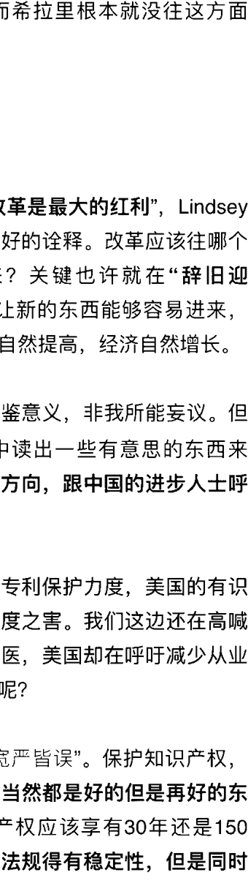

Low Hanging Fruit Guarded by Dragons: Reforming Regressive Regulation to Boost U.S. Economic Growth 《恶龙看守的低垂果实：改革劫贫济富的法规，刺激美国经济增长》

作者 Brink Lindsey 是卡托研究所的副所长，我读过他的几本书，非常佩服，以后会说到。

所谓"低垂的果实"（low-hanging fruit），是个英文成语，意思是说现在有一颗果树，它的很多果子在很高的位置不容易够着，也有一些果子挂在比较低的位置，伸手就能够到，相当于中文的"唾手可得"。

对应到经济增长上来，这就是说有低垂果实的时候，你不用怎么费劲就能增长；没有低垂果实的时候，你可能不管怎么刺激都不增长——所以美国人说"低垂果实"，就有点类似于我们爱说的"红利"，只不过美国人说的更直白一点。

比如在一本现在影响很大的书：

Tyler Cowen的 The Great Stagnation: How America Ate All the Low-Hanging Fruit of Modern History......（《大停滞：美国如何已经吃完近代的低垂果实......》）一书里，作者就提出美国过去这么多年的经济增长，依赖于三个红利：

+ 1. 免费而且富饶的土地。只要你愿意出气力，就能获得收获。这带来了大量勤劳勇敢的欧洲移民。 2. 技术进步。有很多技术进步是在美国发生的：电力、电灯、汽车......。把这些技术普及到全民，就是极大的经济增长。 3. 教育。一百年前，美国很多高中年岁的年轻人是没有受过教育的，仅只要让标等人上学念到高中毕业，他们马上就能够成为高素质的工人和消费者。

《大停滞》那本书就说，现在这三个容易摘的果子都摘完了，所以美国的好日子到头了。当然针对他这种说法有很多争议，这里我们都不谈。

## 我的评论

我们经常听说一句话，"改革是最大的红利", Lindsey这份报告就是对这句话最好的诠释。改革应该往哪个方向改？红利从哪里来？关键也许就在"辞旧迎新"——打破竞争壁垒，让新的东西能够容易进来，去淘汰旧的东西，生产率自然提高，经济自然增长。

## 日课022 | 为什么发达国家的青年也会投奔恐怖分子？

日课022 | 为什么发达国家的青年也会投奔恐怖分子

专栏编辑：小沙

今天我们说个有关恐怖分子的事儿。恐怖分子跟精英读者有什么关系？其实跟每个人都有关系，因为恐怖分子也是，或者你可能更愿意说“也曾经是”，人。好人也可能变成恐怖分子——甚至，就连精英都有可能变成恐怖分子。

《北京共识》一书的作者乔舒亚·库珀·雷默，曾经跟一个基地组织的恐怖分子头子聊过天。那人告诉他，基地组织每年都收到有全球五百强工作经验的各类精英人士的求职信！就好像找普通工作一样，这些求职信里都附有简历——其实比简历（resume）还高级一点，叫 Curriculum Vitae。

一个中产家庭的法国青年——他的家族已经在法国生活了好几代，他有妻子和女儿，他平时并不参与伊斯兰教活动；甚至可能原本是个基督徒——为什么会突然有一天抛弃自己的全部生活，前往叙利亚参加圣战？

他不太可能是为了什么天堂里的七十二个处女。事实上，有很多欧洲的女青年，自愿前往ISIS，哪里充当营妓却乐意，这帮人图的是什么？

我今天要说的这篇文章，来自今年五-六月份的《科学美国人·心灵》，题目是 Radicalism: Memories and emotions—not reason—hold the key to reclaiming young fanatics, according to an expert team in France（《极端主义：法国专家团队说，是记忆和感情——而不是理性——才能把疯狂的年轻人拉回来》），作者是人类学家，欧盟和法国反恐专家 Dounia Bouzar。

恐怖组织的构造是松散的，但是他们的确有一个招募系统。这个系统不是靠利诱，而是靠精神宣传。这篇文章说，恐怖组织在发达国家拉拢新人入伙，大约分四步：

+   1. 社会隔离。招募对象被各种阴谋论吸引，认为世界充满谎言：食品是有害的，疫苗和药物都是有毒的，神秘邪恶势力，比如“共济会”，已经控制了世界。他学会了质疑身边的一切，认为自己是《黑客帝国》里的Neo，看谁都不顺眼……最终，他不再跟亲朋交往了。

+   2. 告诉招募对象，“真正的伊斯兰教”才是这个世界的真理，而你，是被选中的人！到这一步他将会放弃自己的身份认同，跟以前的生活告别，放弃独立思考，让“组织”替自己思考。

+   3. 全盘接受组织的意识形态。他认为组织的纯洁性至关重要，跟任何组织以外的人交往都会污染自己。

+   4. 去人性化。到了这一步，他会认为那些没有接受“真理”的人根本就不是真正的人，杀死他们不但不是罪过，而且还是责任。

这个过程主要在互联网上进行。那些经历过生活不幸的人是重点的招募对象，比如曾经被强奸过的女性。

如果身边有亲友变成这样了，你应该怎么办？千万别试图跟他讲理。

一般人的第一反应是讲理：你被人蒙蔽了！世界不是你想的那样！别去！但是他已经被洗脑了，你说的那些道理，他早在第一阶段就已经想“明白”了。

根据来自反恐第一线的经验，唯一的办法是诉诸感情。你要慢慢帮他回忆之前生活的美好瞬间——这些记忆没有那么容易抹掉——让他产生感情的共鸣。孩子多可爱，咱们以前在一起的时光多美好！这么一点一点的回忆，也许能让他重新获得人性。开启了人性的闸门，才有可能慢慢把他拉回来。

## 我的评论

现在网上广泛流传一句名言，“生活不只是眼前的苟且，还有诗和远方。”——其实恐怖主义也是一种诗和远方。

但凡有点学识，有谁会只顾眼前的苟且呢？谁还能没有一点精神追求？尤其是现代社会，各种现象、各种说法层出不穷，一般年轻人对世界是非常迷惑的。这时候如果他只关注眼前的苟且，他至少还是个正常人；如果他开始研究诗和远方，他就很有可能成为各种阴谋论，甚至激进意识形态的信徒。他可能出家遁入空门，也可能上山当隐士。变成恐怖分子，只是其中最激进的形式。

这篇文章告诉我们，“眼前的苟且”，恰恰是人的安身立命之本。人一旦激进了，唯一能把他拉回来做个正常人的，恰恰是这眼前的苟且。

## 由此得到

先把眼前的苟且搞好了，再去探索诗和远方。

## 日课023 | 怎样快速跟人建立亲密关系

## 日课023 | 怎么快速跟人建立亲密关系

| 音频转述师：怀沙 |

有时候两个人能一见如故甚至一见钟情，有时候两个人在一起多年也只是泛泛之交——这其中并非没有规律可寻，其实还有技术可以学。

今天我们要说的这本书：

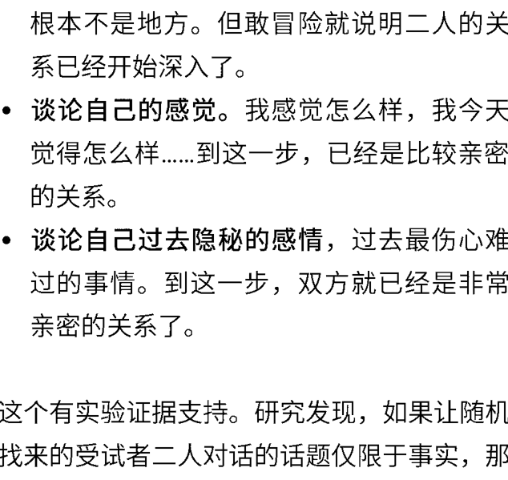

《咔嚓：让我们跟人、工作和任何事情凝聚在一起的力量》作者 Ori Brafman and Rom Brafman)

此书第一作者多年从事企业管理方面的咨询工作，他的另外几本书也都很好，以后我们可能会讲到。

## 跟人增加亲近感，有几个小技术。

比如说随意的触碰一下对方，造成身体接触，或者多有一些眼神交流，就很有效。有研究表明工作面试时双方的眼神交流跟成功率很有关係。

像这样的规律当然很有用，一般可以用在找工作和找对象上。但如果你是一个专门在跳楼现场劝说别人不要自杀的谈判专家，你就需要一些更高级的技术——专业的、能让你刚刚见面就与对方迅速建立亲密关系的技术。

谈判专家最有效的一个技术，是故意跟对方说一个自己的弱点。把自己内心的隐秘暴露出来，让对方觉得你也有弱点，你是可能被伤害的，你才算是把自己真实感情的一面展现给了对方。这样对方就能立即获得安全感，感受到信任。

斯坦福大学MBA班有一个学习建立亲密关系的课程。一开始老师让学生们自由聊天，大家泛泛而谈一些不重要的话题。后来人们开始谈论自己的感情经历，虽然不一定是爱情。最后人们谈论自己内心的隐秘，结果都要哭了，这时候全班同学都建立了非常亲密的关系。

谈判专家的策略就是在几句话之内就找引出情感话题 – 其实我最近心情也很差，我奶奶刚刚去世！对方就会问：“啊，你奶奶去世了吗？”这样二人的关系马上就上道了。

## 让谈话深入的几个阶段：

+   - 讨论事实。我住在纽约，你住在哪里？
- 评价。我觉得你的头发很好看。注意这是一种冒险！其实表达自己对对方的观点，哪怕是称赞，也要冒险，因为你可能夸的根本不是地方。但敢冒险就说明二人的关系已经开始深入了。
- 谈论自己的感觉。我感觉怎么样，我今天觉得怎么样……到这一步，已经是比较亲密的关系。
- 谈论自己过去隐秘的感情，过去最伤心难过的事情。到这一步，双方就已经是非常亲密的关系了。

这个有实验证据支持。研究发现，如果让随机找来的受试者二人对话的话题仅限于事实，那么谈完之后就完了，没有亲密关系。如果话题中包括感情问题，有自我感情揭露，最高兴和最难过的经历是什么，那么两个陌生人就会迅速建立亲密的关系，而且实验结束之后二人仍

最难过的经历是什么，那么两个陌生人就会迅速建立亲密的关系，而且实验结束之后二人仍然在交流，甚至有的还建立了长期的关系。

另有实验发现，人哪怕是跟计算机分享自己感情，那么明明知道对方是个计算机，也会对其实产生感情！

克林顿1992年竞选的时候一度非常落后，几乎不行了，他自我揭露了一下缺点：我弟弟吸毒、我爸爸酗酒，结果支持率立即上涨。

暴露自己的弱点，其实对别人是一种邀请你可以进入我的生活。大多数人不愿意暴露弱点，一个原因是害怕别人利用你的弱点攻击你。也可能是不愿意被人可怜。不过我们不暴露弱点更重要的原因，也许是我们不知道暴露弱点有这么明显的好作用。

## 我的评论

这不就是“搭讪学”吗？说如果一个女人开始跟你分享她的感觉了，你就有效。看来这一招显然适合所有人，不一定是男女之间。我看 Power: Why Some People Have It—and Others Don’t（《权力：为什么有人有一一而别人没有》）一书也提到，大人物应该主动暴露一些弱点给公众，能够提高好感度，让人对你放心。

另外我想，这个理论是不是“赌场失意，情场得意”的原理？一个事业刚刚失败的男人把自己的弱点暴露在女人面前，女人平时看他远在天边甚至可能还高不可攀，现在发现他突然平易近人了，于是火花出来了。当然把男女反过来也适用。

## 由此得到

让两个人关系更进一步，最迅速有效的做法就是主动暴露自己的弱点。

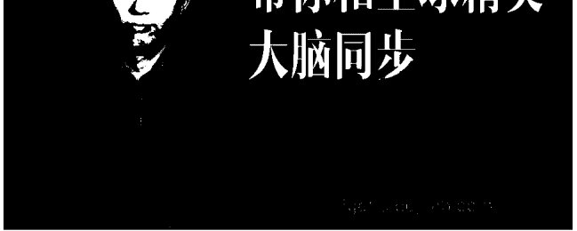

## 周末小议 | 跟着孤悬海外的人学中文

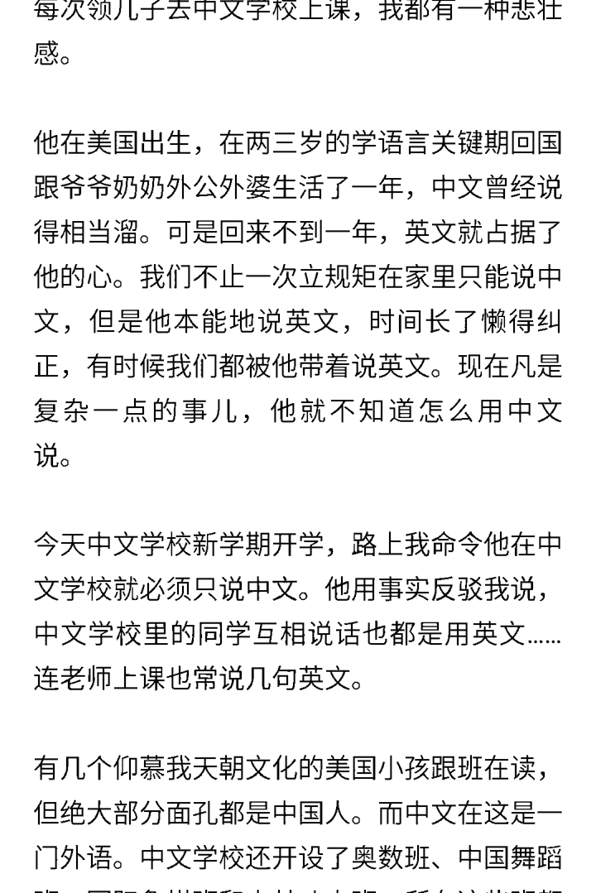

每次领儿子去中文学校上课，我都 有一种悲壮感。

他在美国出生，在两三岁的学语言关键期回国跟爷爷奶奶外公外婆生活了一年，中文曾经说得相当溜。可是回来不到一年，英文就占据了他的心。我们不止一次立规矩在家 里只能说中文，但是他本能地说英文，时间长了懒得纠正，有时候我们都被他带着说英文。现在凡是复杂一点的事儿，他就不知道怎么用中文说。

今天中文学校新学期开学，路上我命令他在中文学校就必须只说中文。他用事实反驳我说，中文学校里的同学互相说话也都是用英文......连老师上课也常说几句英文。

有几个仰慕我天朝文化的美国小孩跟班在读，但绝大部分面孔都是中国人。而中文在这是 一门外语。中文学校还开设了奥数班、中国舞蹈班、国际象棋班和少林功夫班，所有这些班都用英文授课。老婆听儿子念课文，说你说话怎么像个韩国人？

中文，对这些孩子几乎没有什么直接的好处。没错，连美国人都在学中文——但这恰恰说明中文在美国是一个一点都不稀缺的技能。我听常青藤大学申请顾问讲过课，说你到时候可千万别让孩子把中文作为外语技能列在申请书里——名校已经被太多中国学生占据，哪怕你填墨西哥移民说的西班牙语都比提中文强。

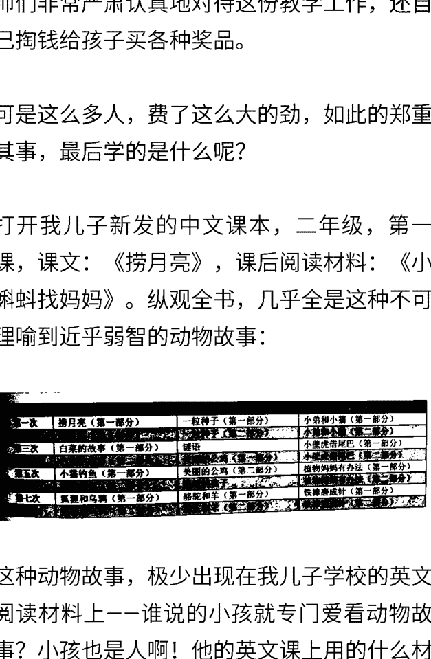

小孩理解不了什么博大精深的中华文化。对他们来说，中文动画片打不过英文动画片，中文电影打不过英文电影，游戏、明星、音乐、故事，所有好玩的东西都是英文的。

## 这是一场打不赢的战争。

但是家长们前赴后继。跟孩子做对，每天都要花很多时间自己教，也要让孩子学中文。每个星期天，我们就好像信教的人去教堂一样雷打不动地领孩子去中文学校。我们像在国内计较期末考试一样计较中文课的考试成绩。

我们去的这个中文学校，也算够意思了。我不知道校方——其实就是几个志愿者——找了什么关系，居然免费借到了本地最好也是最大的高中做教学场地。我儿子上学期的老师是思科公司的一位经理，这学期的老师是一位在中国、新加坡和美国都有工作经验的程序员。学费很低，整个中文学校一年的收入才九万 美元，几乎全都给了老师，而由于每个班只有十几个学生，讲一年的工资也就一两千块钱。老师们非常严肃认真地对待这份教学工作，还自己掏钱给孩子买各种奖品。

可是这么多人，费了这么大的劲，如此的郑重其事，最后学的是什么呢？

打开我儿子新发的中文课本，二年级，第一课，课文：《捣月亮》，课后阅读材料：《小蚂蚁找妈妈》。纵观全书，几乎全是这种不可理喻到近乎弱智的动物故事：

这种动物故事，极少出现在我儿子学校的英文阅读材料上——谁说的小孩就专门爱看动物故事？小孩也是人啊！他的英文课上用的什么材料呢？有运动员，有海盗，有外星人，有怪物，有国王和王后，有民权运动的领袖，有探险者和科学家。我儿子看奥运 会最敌视英国队，因为他刚学过美国独立战争。他很崇拜华盛顿，做 了个华盛顿的帽子玩打仗。

这是一个典型的英文训练课本，也是二年级。图中四个阅读材料，有横穿英吉利海峡，有美国历史上的定段气候往事，有怎么织毛线，有一个棒球运动员的八卦——然后学生要自己判断每个材料取材的那本书是虚构类，还是非虚构类。

如果你是一个二年级小学生，你更愿意上哪门课呢？这其中知识的差距难道不是触目惊心吗？！

是中国人不就行吗？我还特意找到一套中国国内用的二年级语文教材。其中也有很多动物故事，但是也有《西游记》，有怎样读书做笔记，有足球，有茅以升、童第周、牛顿和达尔文，还有华盛顿和樱桃树。

两国主流的语文教育都行，只有美国的中文教育不行。

我儿子用的中文教材，是号称“斯坦福中文学校”的马立平博士所著。我在网上找到这位马立平博士的简历，她1951年出生，1989年就到了美国，从此一直在海外从事教育研究。

1989年就出国了。八十年代，中国才刚刚普及电视机吧？可能有的地方还没通电！没有电脑，没有手机，没有多少小孩能整天玩电子游戏，……没有信用卡也没有车，没有二十四小时热水的家。

那时候小孩的主要娱乐可不就是捏泥鳅玩蛐蛐吗？

可是对现在的小孩来说，蜗牛、狐狸、公鸡、蛇这些小动物都是非常陌生的东西，可能很多小孩都没见过一只活的公鸡！中文对这些孩子来说已经够陌生了，为什么还要用这些陌生的东西来教呢？再者，这些特别老旧的动物故事所表现的道理也非常不符合现代人的观念——我记得有一篇课文是两只大雁捉弄一只乌龟，我儿子老师认为那个故事不尊重人，干脆给跳过不讲！

马立平博士对中国，乃至对中国文化的印象，也许永远地停留在了八十年代。也许在她看来，我这教材里没有任何政治宣传，就已经是个巨大的进步了。

我翻开马立平博士简历一查，每行上都写着“教育专家”几个字。我横竖睡不着，仔细看了半夜，才从字缝里看出字来，满篇都写着一句话是——“马老师远离中国二三十年，现在我们要跟她学中文。”

别跟孤悬海外的人学中文。真要学什么知识，一定要到知识的中心去学。有句阿拉伯谚语说“知识即使远在中国，亦当求之”——去中国求之。

我把希望寄托在等女儿长大一点领着两个孩子多回国。

救救孩子……

## 答读者问 | 书单和晒读书笔记

各位周末好！
上周晒读书笔记活动开始，收到的留言、邮件太多，不能一一答复，所以整理了一下，今天的更新分3部分内容：

+   - 回复问得最多的问题；
- 近期书单；
- 晒两篇精彩的读书笔记。
开始吧！

## 留言回复

Q：做读书笔记，手写好还是用电脑打字更利于研读？
A：都可以。打字的坏处是形成的文本很容易写完再修改和补充内容。比如过几年你看到另外一本书将类似的内容，但是观点跟这本书不同，就应该在这本书的笔记中补充一条记录。推荐使用Evernote（或者中文的"印象笔记"）管理所有读书笔记。这个系统的好处是允许把一条笔记作为连接，插入到别的笔记之中，形成互相关联，自己编织一个网络。

Q：边读书边做笔记比较好，还是看完再做比较好？
A：看完再做比较好，了解前后脉络，把握整体思路。

Q：听书是读书的好方法吗？
A：是方便的方法，比较适合故事多而理论少的书。

Q：同时读两三本，会不会影响到强力研读的效果？
A：不影响，同时读几本有助于加深记忆。

Q：推荐几本提高逻辑思维能力的书？
A：我从来没看过任何一本专门讲"逻辑思维"或者"批判性思维"的书。我知道有很多这样的书，但我认为根本没必要，所有讲科学、讲哲学的书都要用到逻辑思维和批判性思维。
如果你想提高思维水平，我推荐一本《上帝与新物理学》，作者保罗·戴维斯。非常漂亮的说理，通俗易懂。强力研读这本书，然后你的水平就能达到远胜普通人的档次。

Q：做完读书笔记，会经常去看吗？
A：经常会看，而原书则基本不看了。这就是读书笔记最基本的功能，也是钱钟书（以及我）从来不藏书的原因。

Q：小说要读吗？怎么分配时间给小说这样的书籍？
A：我每天吃早饭的时候读一两部穿越小说的更新，除此之外的确没有多少时间读小说。没有"要不要读"的问题，还是看自己阅读喜好和习惯吧。

Q：如何快速精准找到自己想要的信息？甚至看似不关联的信息中找到想要的素材？
A：我可能的确是Google玩得好。你首先得找到你想搜索的这个内容对应的"主流英文关键词"是什么。这一 步并不容易，有时候你猜的几个词不是主流，但也能搜索到一点边缘的内容，但这些内容可能会提到主流关键词。下一步是判断每个材料的价值和可靠性，而这要求你对英文世界的版图有个基本认识。我写过一篇《信息极客的三个功夫》，在《知识分子》这本书里，可供参考。
不过很多材料并非搜索得来。最好的办法还是大量阅读，发现好的东西就保存起来（再次推荐Evernote），然后时不时想起来以前看到过的就整理到一起，就好像人的大脑一样形成一个知识网络。

## 书单推荐

书单，推荐几本有中文版的，特别适合入门的书：

《魔鬼经济学》四本，史蒂芬·列维特
英文版第一本大概出版于2005或者2006年，我当时读了之后几乎是见谁跟谁说，耳目一新的思维方式。我认为这本书让我变聪明了一点。

《公正》，迈克尔·桑德尔
非常漂亮的思辨。怎么做"对"，怎么做"不对"，不能光凭爱心，你得有点逻辑，甚至用到一点推理。注意这本书说的并不是桑德尔本人的什么看法，而是他作为一个教授对各个学说的总结和介绍，但他讲得实在是很好。

《习惯的力量》，查尔斯·杜希格

《习惯的力量》，查尔斯·杜希格

标题像是一本励志书，但内容其实说的是人和社会的规律。作者调研能力强，故事和理论穿插的很好。

《反脆弱》，尼古拉斯·特勒布

大师之作！这本书我们以后要提好几次。

《人类简史》，尤瓦尔·赫拉利

这本书我们很快就要讲到。此书作者博学强识，对各个学科有一个“通识”，了解当前最新研究进展，所以这本书可以代表目前我们对人类历史的理解，可以正三观。

## 晒读书笔记

选摘2位朋友的读书笔记跟大家分享。

## 第一篇

《自控力》读书笔记

作者：杨欢

故事主线：我要做，我不要，我想要的神经原理——意志力的本能：三思而后行——意志力的局限性——为何善行之后会有恶行——误把渴望当幸福——那又如何的副作用——遇见未来的自己——意志力会传染——别读这章

## 透析成果：

+   1. 前额皮质分三个区域，掌管三种力量，一个大脑有两个自我：控制自己和冲动自己。\n2. 三思而后行与应激反应，通过锻炼、呼吸等方法方可调节自己\n3. 去发现自己意志力强弱规律\n4. 记住行好事的因，而非奖励\n5. 只是渴望，而非真正的奖励\n6. 学会原谅自己\n7. 未来的自己既是现在的你\n8. 知道意志力是可以传染的\n9. 接受不愉快的想法，而非与之对抗

## 透析感悟：

第一章总结核心思想：意志力实际上是“我要做”、“我不要”和“我想要”这三种力量。它们协同努力，让我们变成更好的自己。

## 深入剖析：

+   ○ 更难的事是什么？想象你正面临一个意志力的挑战。更难的事是什么？为什么它如此困难？\n○ 认清两个自我。你的意志力挑战是，如何描述相抗衡的两个自我？冲动的你想要什么？明智的你又想要什么？

## 意志力实验：

+   ○ 记录你的意志力选择。至少选一天，注意观察你做的关于意志力的决定。\n○ 5分钟大脑训练冥想。在脑海中默念“呼”和“吸”，把注意力集中在呼吸上。当你开始走神的时候，重新集中注意力。

第二章总结核心思想：意志力是种生理本能，它和压力一样，通过不断进化来保护我们不受自身伤害。

## 深入剖析：

+   ○ 什么是威胁？对你的意志力挑战来说，什么是需要克制的内在冲动？\n○ 压力和自控。试着找出持续一整天或一整周的压力，看看它对你的自控力产生怎样的影响。你有过强烈的欲望吗？你发脾气了吗？你把要做的事拖到了明天吗？

## 意志力实验：

+   ○ 呼吸出你的自控力。把你的呼吸降到每分钟4—6次，将身体调整到适合自控的生理状态。\n○ 5分钟给意志力加油。出门活动，哪怕只是在周围转转，也能减少压力、改善心情、提供动力。\n○ 睡眠。打吨或补觉可以消除睡眠不足的影响。\n○ 放松能让你恢复意志力储备。躺下，深呼吸，让“放松的生理反应”帮你从自控和压力造成的疲愈中恢复过来。

第三章总结核心思想：自控力就像肌肉一样有极限。自控力用得太多会疲愈，但坚持训练能增强自控力。

## 深入剖析：

+   ○ 意志力的上下波动。本周，记录你的自控力，特别注意什么时候你的意志力最强，什么时候你最容易放弃。\n○ 你的疲愈感是真的吗？下次你觉得自己太“疲愈”而无法自控的时候，看看自己能否挺过第一波疲愈的感觉，向前迈出一步。

## 意志力实验：

+   ○ 意志力饮食。确保你的身体摄入了足够的食物，能为你提供足够多的能量。\n○ 意志力锻炼。本周，选择一件事情来做（“我想要”的力量）或不做（“我不想”的力量）

量），或者记录一件你不曾关注的事情，以此锻炼你的“自控力肌肉”。

○ 发现你的“想要要”的力量。发现自己最重要的“想要要”的力量，也就是你脆弱的时候给你动力的东西。每当你面对诱惑、想要放弃的时候，都想一想这个东西。

## 透析实录：

- 每周开启对应的训练
- 已养成记账的习惯

## 三个触动点：

1. 这同样证实了一个重要的意志力规则：如果觉得自己没有时间和精力去处理“想要”做的事，那就把它安排在你意志力最强的时候做。
2. 你不应该想着“我做到了，好了，现在我可以做点我真正想做的事了！”应该想着“我做这件事是因为我想要…”
3. 如果焦虑仍然存在，他就鼓励他们去想象那些想法和焦虑随着呼吸消散了。他告诉患者，如果不和焦虑对抗，焦虑就会自然离去。

万维钢

《自控力》这类书的意义在于从改变认知落实到改变行为。这篇笔记的亮点在于简洁却记录了“意志力实验”的行动部分，读书笔记最终作用于自身，如果读后通过翻阅可以进行自我管理的提醒，就是有价值的读书笔记。如果可以更明确标识［书里的］和［我的］，过一段时间再看的时候你会感谢自己。

## 第二篇

《卓有成效的管理者》读书笔记
作者：鹏举

## 第六章 决策的要素

卓有成效的管理者，做的是有效的决策。
他们重视的是，分辨什么事情是例行性的，什么问题为策略性的，而不重视“解决问题”。

## 决策的五个要素：

1、了解问题的性质，如果问题是“经常性的”，那就只能通过一项建立规则或原则的决策才能解决。【例如，我们每天都要穿衣，每天造成穿衣都要决策好久，这就是“经常性”的问题，事实上我们每次选择要面临这很高的决策成本；面对这样的情况，扎克伯格和乔布斯就省心了，打开扎克伯格的衣柜，清一色的灰色T恤和牛仔裤，乔布斯的是黑色长T和牛仔裤，决策要耗费很多心力，他们这样做就是为自己订立了一项穿衣规则，将这里的决策成本省下来完成更有价值的事情。再举个例子，《欢乐颂》中安迪就是将自己的衣服提前搭配好，穿衣的时候只要拿出套装来穿，而樊胜美每次穿衣都要挑选和纠结好久，他们的收入水平也有目共睹了。】
2、要确实找出解决问题时必须满足的界限，换言之，映照出问题的“边界条件”。【“边界条件”我们可以理解为“根本原则”，或者底线。】
3、仔细思考解决问题的正确方案是什么，以及这些方案必须满足哪些条件，然后再考虑必要的妥协、适应及让步事项，以期该决策能被接受。【折中，例子：所罗门王审判两位妇人争夺婴儿：“与其要回半个死孩子，不如保全还是性命，将婴儿送予对方”，这和分半片面包不一样。所罗门例子中，边界条件是：孩子活着（这是根本原则），在这个原则下，孩子归谁是可以商量和折中的】
4、决策方案要同时兼顾执行措施，让决策变成可以被贯彻的行动。【1、谁应该了解这项决策，2、应该采取什么行动，3、谁采取行动，4、这些行动如何进行，才能使执行人有所遵循？】
5、在执行的过程中重视反馈，以印证决策的正确性及有效性。

## 区分四类问题：

1、真正经常性问题。发生的个别问题，只是一种表面现象。【能从内外部分找到或制定规则】【经常发生】
2、虽然是在某一特殊情况下偶然发生，但在实质上仍然是一项经常性问题。【能从外部找到规则】【内部不经常发生】
3、真正偶然的特殊事件。【没有规则，也没有必要制定规则】【不经常发生】
4、首次出现的“经常性事件”。【有必要制定规则】【第一次发生，但之后很可能重复发生】

【遇到问题，先界定属于哪类问题，在考虑解决方法，该找规则的找规则，该定规则的定规则，只有第三类问题才需要个别对待，才有制定决策的必要】

万维钢

《卓有成效的管理者》经典之作，值得研读。这篇笔记做得也非常优秀，每章提炼要点便于日后查阅，最亮点在于大量自己的看法和心得。这次收到的读书笔记大多类似“全书提纲”，每一章清单体做得很漂亮，但是在统观全书脉络和记录自己思考方面还可以再下点功夫。摘录亮点和用自己的话表达出来一样重要，从这个角度讲，读书笔记有点像“写给未来自己的信”，你会看到通过读书，大脑的知识结构是如何连接和生长的。这是一件有趣的事。

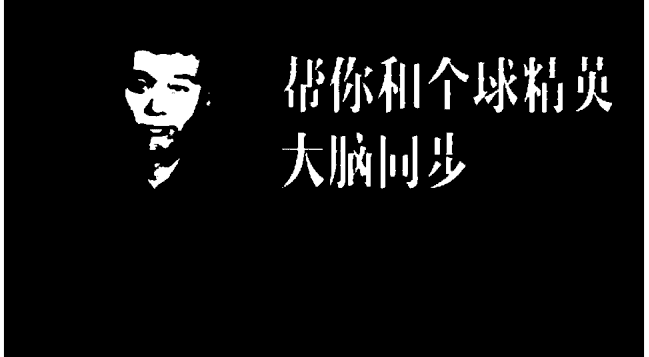

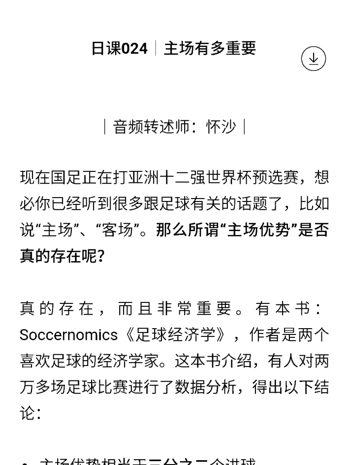

## 日课024 | 主场有多重要

## 日课024 | 主场有多重要

| 音频转述师：怀沙 |

现在国足正在打亚洲十二强世界杯预选赛，想必你已经听到很多跟足球有关的话题了，比如说“主场”、“客场”。那么所谓“主场优势”是否真的存在呢？

真的存在，而且非常重要。有本书：Soccernomics《足球经济学》，作者是两个喜欢足球的经济学家。这本书介绍，有人对两万多场足球比赛进行了数据分析，得出以下结论：

- 主场优势相当于三分之二个进球。
- 如果你的球队的国际比赛经验比对手高一倍，你的优势相当于半个进球。
- 如果你们国家人口是对手的两倍，这个所谓“人口优势”只相当于十分之一个进球。
- 两倍的GDP也只相当于十分之一个进球。

所以人多和有钱对足球来说意义不大，国际比赛经验很重要，而最重要的，则是这个主场优势。

有时候裁判会偏向于主队，但是这个主场优势还不能完全用裁判因素解释。这可是三分之二个进球啊！

科学家判断，主场优势的最大作用可能是球员心理上的。
今天我要说的这本书不是讲足球的，它研究的是所有竞争的局面。

这本书谈到主场优势的时候，重点说了谈判。对谈判来说主场优势非常大，这就是为什么两个国家谈判都要在中立地点——拿破仑甚至曾经跟沙皇在一条河中心的木筏子上谈判。美苏冷战谈判，也都爱选在第三国，比较偏远的地方。

而老司机们为了让自己在谈判中获得一点“主场感”，可是下了很大的功夫。

有一次，克林顿去东京谈判美国是否应该在日本继续驻军，要跟天皇见个面。

日本人很讲究谈判的主场优势，比如他们会把跟美国人的谈判安排在一个封闭的小空间里，然后在其中抽烟，让不习惯的美国人希望自己早点出去。而美国也不含糊，要求总统在外面的一举一动，都要有媒体在场——媒体在场，会让习惯了跟媒体打交道的美国总统有主场感觉。

那么这次见面，日本人就以天皇从来不见媒体为由，要求不能有媒体在场。

克林顿一下飞机就要去见天皇，日本方面突然宣布不让美国的媒体车随行。这时候克林顿几乎没时间做出反应，因为天皇非常反感迟到。

克林顿有一个专门帮助他谈判的助手，在空军一号随行。结果这个助手立了一功。助手立即打电话让克林顿的车停下，他跑到车窗那里，让总统给他一点时间，并且要了一张纸。然后他找到日本方面，说这张纸是总统给我的，他要求你们用日文写下来是谁决定不让美国媒体车跟着的，然后他将亲自将这张纸交给天皇，

告诉天皇是谁让他迟到的。

结果是日本方面对美国媒体车放行。克林顿获得了一定的主场感，天皇反而成客场了。

那么这个“主场感”到底是什么呢？体育中对主场优势有很多解释：长途劳累，裁判因素，观众因素，这些因素可解释不了谈判的主场优势。

有人做了一个实验，让两个受试者谈判分东西。第一个受试者首先到达谈判地点，也就是一个办公室。研究人员说你就把这里当成自己的办公室吧，可以随意用电脑，甚至可以在墙上贴自己喜欢的海报。

后到的人到的时候，先到的人已经获得了主场感。结果后到的输的很惨，先到者在谈判中得到的东西比后来的要多160%以上。

心理学家认为，主场优势其实就是进化心理学上的领土意识！我先来了，这个地方就是我的了，不是你的，你来是对我的侵略。不但先到者理直气壮，后到者也天生气短。

比如在公共停车场里，你正要离开的时候，发现后面有辆车在等着用你的车位，你会不会赶紧走给别人让出位置呢？统计显示你离开停车场的时间反而还增加了一倍——因为你觉得这个车位是你的，不想给别人。你在一条小路上行走，后面的人想要超过你，他得先说一句“对不起请让一下”——因为连他都认为前面这段路是你的。

据此，这本书给了我们几个获得主场感的建议。

比如你要跟老板谈个什么关键的事情，升职加薪之类，最好的办法是在你自己的办公室谈。当然有些老板什么事都把下属叫到他的办公室谈，也是老司机。

参加任何活动都要尽量早到，早到可以获得主场感。

如果两个团队在一个公共空间合作一项什么工作，你的团队一定要先到，而且最好还能准备一些咖啡啊面包圈啊之类的东西跟对方分享。对方吃人嘴软，就会给你们更大的主动权。

## 我的评论

你知道我性格比较内向，刚到美国的时候参加学术会议都不好意思提问。但我发现如果是一位外来学者到我们物理系来做报告，我就比较能提问，现在想来这就是主场感。

有一次我外出开会，看错了下午会议的时间，早到了一个小时。当时会场中只有一个报告者和一个主持人在调试设备，我就跟他们聊了几句，然后就回酒店房间了。一小时后回到会场，已经是满满一屋子人，而我的主场感还很强烈，感觉自己是个主持人，几乎对每个人的报告都问了问题。

## 由此得到

有活动最好安排在自己的主场，如果在第三方场地就尽量早到，最好还能买单，就算是"一定是在对方主场，也要像克林顿那样尽量给自己找点主场感。

## 日课025 | 只要有一小撮人执意玩真的

日课025 | 只要有一小撮人执意玩真的

| 音频转述师：怀沙 |

最近有人问我，你看的这些书里面，最喜欢的是哪一本？我仔细想来，的确有一本书给我带来了可能是最大的阅读快乐，那就是纳西姆·尼古拉斯·塔勒布的《反脆弱》。我们过段时间要讲到这本书，而它的作者特勒布（Nassim Nicholas Taleb），可能是现在活着的作家中我最佩服的一个。

特勒布的知识和写作水平都绝对是出类拔萃，观察世界的眼光更是无人能出其右，而我最佩服的，是他的“智力勇气”——intellectual courage。 不管你是大政府、企业巨头、一本正经的学术机构还是道貌岸然思想家，特勒布总能一针见血地指出你的可笑之处。

今天我想说的是今年八月份特勒布在 Medium.com 上发表的一篇长文，《The Most Intolerant Wins: The Dictatorship of the Small Minority》（最不宽容者获胜：少数派的专制）

我希望你能从这篇文章中得到一个哲学家的眼光，一个道理，和一种人生态度。

咱们先来说一个特勒布爱说的概念，叫做“have a skin in the game”。这句话直译过来是“在这个游戏里有一点皮肤”，有人说这句话是巴菲特发明的，也有人考证说巴菲特之前早就有 人这么说了。

这句话的意思是，比如你忽悠别人说某公司股票前景特别好，那我想问的是，你自己是不是花钱买了这支股票。如果你放了自己的真金白银在里面，用中国话说就是自己也出了点血——也就是 have a skin in the game——那我们就认为你是玩真的；如果你自己根本不下注，站在那里空口说白话，那我们根本没必要认真对待你说的。

信息时代空口说白话的人实在太多，have a skin in the game 就成了一个特别珍贵的品质。比如现在中国女排拿了奥运金牌，有很多人就跳出来说男足成绩那么差凭什么拿那么多钱？应该把给男足的待遇给女排！——像这样的人，就是没有 a skin in the game。男足钱多不是国家拨款多，是来自联赛火爆的收入和赞助商的巨额赞助。你说支持女排，你花钱看过一场国内的女排联赛吗？

一旦 have a skin in the game，你就没法“客观中立”了。你鼓吹这个东西纯粹是为了让自己的利益最大化，但是跟“吃瓜群众”相比我们更尊重你，因为你玩真的。

现代社会是个复杂系统，也就是说它作为一个整体，并不是其各个个体简单相加的结果。你把一只蚂蚁研究得再明白，也未必能理解蚁群怎么工作。在复杂系统中，个体之间的关系，它们怎么互相影响，比单个个体的性质更重要。

特勒布这篇文章说，推动历史前进的，从来都不是什么“主流学者的共识”，什么“民主的选择”，更不是什么“沉默的大多数”——而是一小撮特别执着地 have a skin in the game 的，“玩真的”的人。

比如你在美国买个什么饮料，仔细看的话很可能会发现上面有个圆圈中的字母“U”，或者“K”的标志，这种标志表示这是符合犹太教认证的食品——类似于国内的“清真食品”，当然严格的说跟穆斯林的清真并不一样。

大多数饮料上都有。但仔细想想的话这其实很奇怪，因为非犹太教认证食品不吃的人，只占

大多数饮料上都有。但仔细想想的话这其实很奇怪，因为非犹太教认证食品不吃的人，只占美国总人口的0.3%！我们这些大多数人为什么要按照你们这一小撮人的习惯喝饮料？这里面有犹太阴谋吗？

根本没有阴谋。特勒布说，出现这种局面，只需要三个条件：

- 这一小撮人只吃犹太教认证食品，对其他食品坚决不吃，他们 *have a skin in the game*。
- 这一小撮人在全国各地都有分布，他们并不是集中住在一个地方。
- 索性按他们的方法制造饮料，也不麻烦，饮料的价格也提高不了多少，一般人不会在意，他们没有 *a skin in the game*。

商家无所谓，消费者无所谓，但是 *have a skin in the game* 的少数人很在意，所以干脆就都按照他们的来吧。

不需要任何阴谋，不需要什么暴力胁迫，只要这一小撮人能够坚决地固执己见，最后别人就都得服从他们。特勒布借用了一个物理学名词——“重整化”——来描述这个过程：

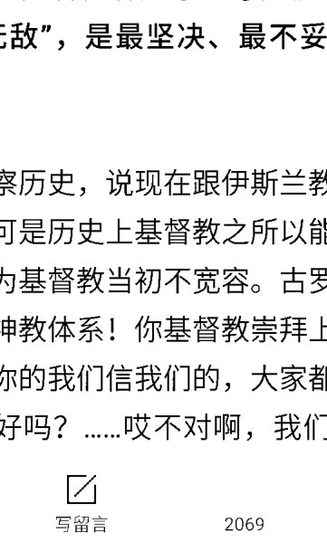

上图中黄色代表无所谓的“吃瓜群众”，粉色代表一小撮能坚持的人，三个图形代表时间上的演变。假设我们说的是有机食品的事儿：

- 最初有个四口之家，其中的大女儿宣布自己此后只吃有机食品。家里其他人本来都是无所谓的，根本不在乎转基因。但是有机食品比转基因也贵不了多少，既然大女儿这么坚决，那就全家都吃有机的吧。
- 这家人只吃有机食品，街头小卖部一看还得做他家生意啊，于是也开始卖有机食品。
- 最终全国都是有机食品。

可能有人说我看商店里也不全是有机食品啊？没错。但现在假设你要请很多朋友来家里吃饭，你会事先问问每个人是不是只吃有机食品吗？如果你这顿饭花费不菲，根本不在乎有机和转基因的一点差价，你最好的办法就是干脆全搞成有机的。

类似的例子，在生活中比比皆是：

- 有少数人对花生过敏，所以飞机餐和学校午餐中绝对不可能有花生。
- 有少量残疾人要出门，所以每个公共场所都有残疾人坡道和残疾人卫生间。
- 欧洲某社区只要有3%到4%的居民是穆斯林，清真食品就会大行其道。
- 一个德国公司开会，其中如果只有一个不会说德语，就必须全体说英语。
- 最初，只有少数人只会开自动挡汽车，多数人都会开手动挡，慢慢地绝大多数新车都是自动挡了。
- 某本书被禁，往往不是因为大多数人反对它，而是因为极少数人非常不喜欢。
- 市场价格的波动，往往不是因为大多数人的看法变化，而是极少数卖家或者买家意志的体现。

我非得按我说说的办，而你怎么都行，那最后肯定是按我说的办。

把这个原理用在政治上，那就是如果有一小撮人坚决不宽容，而大多数人是宽容的，那最后结果就是大多数人听这一小撮人的。

这跟我们的传统观点就非常不一样了。我们不是总爱说“仁者无敌”吗？可是历史上往往是“勇者无敌”，是最坚决、最不安协的人无敌。

特勒布考察历史，说现在跟伊斯兰教比基督教很宽容，可是历史上基督教之所以能成大事，恰恰是因为基督教当初不宽容。古罗马是非常宽容的多神教体系！你基督教崇拜上帝，可以啊，你信你的我们信我们的，大家都有各自的神不是挺好吗？......哎不对啊，我们尊重你们

的上帝，你们怎么不尊重我们罗马人的神呢？——结果基督教胜出。

据此，特勒布对欧洲的命运感到很悲观。以“哥德尔不完备性定理”定理而闻名天下的哥德尔，当初加入美国国籍宣誓的时候，曾经顺便指出了美国宪法的一个逻辑错误，差点没过关——如果有个政党禁止言论自由，那么美国宪法是否也要保护这个政党的言论自由？

## 一个宽容社会，是否也应该宽容那些不宽容的人？

用在军事上，那就是为什么亚历山大大帝说由狮子率领的羊，远胜由羊率领的狮子；为什么汉尼拔用少量的部队就能把罗马人折磨成那样。

这就是 have a skin in the game 的，不宽容不妥协的，一小撮人的力量。

## 我的评论

跟我们以前说过的“奥运精神的堕落”一样，特勒布这篇文章只说了这么一个道理，用这个道理解释了很多现象，但是他几乎没说怎么“解决”这个道理带来的问题。难道大多数人就只能这么眼睁睁地看着吗？

如果涉及宗教之争，多数人中可能会有人站出来抵制少数人的极权扩张，不过他们的坚决程度肯定不如那少数人。如果不涉及宗教，只是潜移默化地吃点什么食品，吃瓜群众可不就是眼睁睁看着吗。

但是话说回来，物理定律都是中性的，坏事能用上，好事也能用上。

为什么所谓“海外华人”，在美国没有什么有力的政治声音，在公司里只能当好员工而当不上领导人？因为大多数华人都是吃瓜群众。我们在美国独善其身，很多人心里想的还是挣点钱将来回中国去，对美国的公共事务没有 a skin in the game。

当初搞这个“得到”付费专栏的时候，罗胖曾经跟我谈过一次话，他就说付费用户的价值远远高于免费用户。现在专栏一开果然如此！人们都很震惊为什么这个专栏里的评论质量如此之高。

——因为我辞职写作，你花钱阅读，咱们都 have a skin in the game。

## 由此得到

真想要办成什么事，别当吃瓜群众空谈误国，必须得 have a skin in the game。

还有哪些事被“一小撮人改变了？你在哪里 have a skin in the game？欢迎给我留言。

## 日课026 | 信息传播之难

日课026 | 信息传播之难

|音频转述师：怀沙|

李笑来有句话，说现在这个时代，影响力是比金钱和权力更重要的东西。这句话可能每个人都赞同。有了影响力就意味着你能够左右别人的行为，那么想要推广什么东西或者集合众人的力量做一件事情就很容易，这不就是金钱和权力吗？

怎么才叫有影响力呢？第一，你得把信息传递到位。第二，你得让别人接受这个信息。

互联网时代，这两件事情的门槛都降低了，任何人都有可能发条微博就引发舆论巨浪——但那只是一种理论上的可能。事实是在这个时代，不但默默无闻的普通人想要向大众传播信息很难，就连最有名的人传播信息都很ojis。

每天只有24个小时，每个人只能接受这么多信息，接收量非常有限——而我们每天制造出来的信息一直在迅猛增加，几乎是无限的。用有限除以无限，这就意味着一条信息的“平均命运”应该是……根本传不出去。

关于怎样才能让一条信息有效传递，要有“粘性”，能被“传染”，现在的书和各种经验都很多了。不过我觉得“影响力”虽然有很多学问，但主要还是一个长期积累的结果，没有什么立竿见影疗效显著的捷径——一夜爆红是极小概率的事件。

今天我想说的是，关于信息传递之难，我们的认识可能还远远不够。

## DON'T BE SUCH A SCIENTIST

RANDY OLSON

(别做这样的科学家：怎样在风格时代谈内容)

作者 Randy Olson 本来是个海洋生物学家，后来辞职去好莱坞当了科学纪录片导演。

Olson 用自己的亲身经历告诉我们，科学家把信息传播给想的太简单了。

2003年，一群海洋科学家历时三年，花费了三百万美元研究经费，完成了一份关于美国海岸环境状况的报告。这份报告反映了巨大的环境问题，可以说是触目惊心，所以参与研究的科学家都认为此报告一出必然石破天惊，成为每晚电视新闻的主题、《时代周刊》和《新闻周刊》的封面……总之是就等着被记者采访轰炸了。

在说结果之前我们先来思考这么一个问题：如果你们花三百万美小说了一份报告，那么你应该花多少钱去宣传这份报告？——不管你现在心里想的那个数字是多少，我都敢说你想低了。

科研预算里没给安排多少宣传费用，连新闻发布会上的咖啡钱都没准备。最后结果是除了纽约时报在二十二版给牡个报道，报告几乎没有引起任何反响。这件事情就这么结束了……结束了。

科学家想的是我这有事实你公众就得听，而真正的事实是公众根本懒得听。

就连9/11恐怖袭击这样的大事，人人关心，调查委员会最后搞出来的报告，都得花巨大力量宣传。报告出了硬皮书，出了有声书，让委员会成员到全国各地宣讲，再加上国会作证，

这么做了两年之后，9/11报告的信息才算在一定程度上传达出来。

如果从这个角度讲，在现代民主国家专门搞学术的人很难左右国家政策。你说你做了研究，写了报告，把事实列举在政客面前，政客就能听你的吗？你的对手——那些利益集团——可是花真金白银雇了专业的游说者去国会游说！别人一天到晚研究的施肥影响力和说服力。只要政治是人在搞，科学家就打不过利益集团。

在商界，人们早就知道产品的客观部分（产品本身）和主观部分（让公众了解你的产品，也就是广告）需要投入同样多的资源和努力。现在看《星球大战》电影那么成功，其实其第一集刚出来的时候评论家并不喜欢，没有达到多少观众。等到后来加大力度做广告，观众人数一多，各种好评才出来了。

有个低成本电影，《大人物拿破仑》：

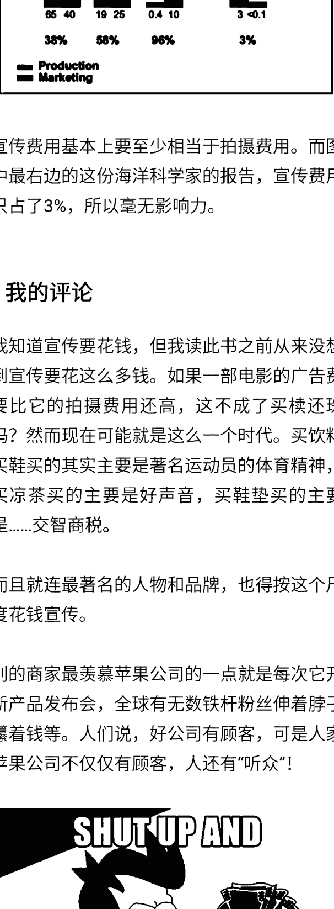

总共拍摄费用才不过40万美元，可是其票房超过了5000万美元。这个奇迹是怎么炼成的呢？

答案是广告费花了一千万美元。

拍电影花40万，做广告花1000万。什么叫宣传，这就叫宣传。

当然这是一个极端例子，作者在书中列举了几部好莱坞电影的拍摄成本和宣传费用的对比。

宣传费用基本上要至少相当于拍摄费用。而图中最右边的这份海洋科学家的报告，宣传费用只占了3%，所以毫无影响力。

## 我的评论

我知道宣传要花钱，但我读此书之前从来没想到宣传要花这么多钱。如果一部电影的广告费要比它的拍摄费用还高，这不成了买椟还珠吗？然而现在可能就是这么一个时代。买饮料买鞋买的其实主要是著名运动员的体育精神，买凉茶买的主要是好声音，买鞋垫买的主要是……交智商税。

而且就连最著名的人物和品牌，也得按这个尺度花钱宣传。

别的商家最羡慕苹果公司的一点就是每次它开新产品发布会，全球有无数铁杆粉丝伸着脖子"It's about..." 人们说，好公司有顾客，可是人家苹果公司不仅仅有顾客，人还有“听众”！

可是苹果公司每年还是要花很多很多钱在各种媒体上做广告。街上已经人手一个 iPhone 了，苹果还是担心有人不知道新 iPhone 有什么功能——而且这个担心非常正确，最近有记者拿个 4S 上美国街头随机采访，有超过一半的人相信这就是最新机型。

每个人都认识希拉里，可是希拉里还是要弄很多很多钱去做竞选广告。

花钱未必管用，但是不花钱则是绝对不行。既

然如此，谁有钱谁的声音就大，谁声音大谁就会更有钱，影响力和金钱权力成了一个正反馈系统，那么普通人的声音怎么办？老老实实搞科研的科学家的声音怎么办？有能力治国但又不愿与金钱为伍的政治家的声音怎么办？再进一步，如果我们每天听到的相当一部分声音是别人通过金钱的运作送到我们耳边的，那我们的自由独立又在哪里？

……这些问题，就不是今天这篇小文章所能讨论的了。

去年出《知识分子》，出版社说咱俩能不能搞个促销——你不是有读书笔记吗？干脆选几段印个小册子，叫《万维钢读书笔记》，随两本书的套装赠送。我就选了十几本书的笔记，每本书挑出一两段有意思的内容，其中就包括今天说的这本 Don't Be Such a Scientist。

我认为这本书写得很好，作者有很多真知灼见，语言也非常生动。然而具有讽刺意味的是这么一本专门讲怎么传播的书，本身销量并不怎么样。

我当时还希望，看了我的笔记，此书想必会引起中国读者重视！

而写此文的时候我上豆瓣看了一眼。目前这本书只有四人读过，一人在读。

所以我也不敢指望这篇小文章的再次推荐能产生任何影响。

## 由此得到

站在信息的接收端是非常愉快的状态，有这么多人千方百计想让你听他说一句。当你一旦站到信息的发射端，工作可就难了！

## 中秋活动

从明天开始的三天假期，我想搞个活动，就叫“每逢佳节倍读书”。

首先你可以从下列书单中选一本书：

- 《魔鬼经济学》史蒂芬·列维特
- 《公正》迈克尔·桑德尔
- 《习惯的力量》查尔斯·杜希格
- 《反脆弱》尼古拉斯·特勒布
- 《人类简史》尤瓦尔·赫拉利

用这三天假期，争取读完。

在读的时候，如果你发现了什么有趣的观点，或者让你脑洞大开的知识，请打开日课，写下留言，分享给我们，最好能在500字以内。

这样咱们日课里的3万用户，都能交换分享新的知识，一起学习提升。假期结束后，我会选出特别精彩的留言，在罗辑思维公众号发布，让800万罗辑思维的会员都能见证到我们的读书成果。

这个“交换新知”我打算像晒读书笔记一样，一直、持续做下去。这样我相信一年后无论你还是我，都会有非凡的收获。

如果你有志同道合的朋友，也可以邀请他加入到这个活动中来。一个对自己有要求的人舍不得虚度时光，每时每刻都会努力精进。

这个中秋，就让优秀的人都在书里团圆吧。

## 日课027 | 两种技能增长曲线

| 音频转述师：怀沙 |

经常有人想把青春献给物理学，或者别的学问，让我给点建议。我今天不想说什么是具体的战术，想介绍一个战略角度的思维。

我要分享两篇比较并不新的文章。

一篇是纽约时报上 David Brooks 2014 年的专栏文章，（增长的结构：学习可不是简单任务），JUNE 16, 2014.

David Brooks 是我最喜欢的作家之一，也是纽约时报上最值得看的专栏作家，我们以后还要多次提他。

一篇是 Scott Young 2013 年的博客文章，（两种增长类型）

这位 Scott H. Young 并非无名之辈，他曾经用一年时间完成了麻省理工学院计算机系的四年本科课程，还出了一本书，而且这本书还有中文版，《如何高效学习：1年完成MIT4年33门课程的整体性学习法》。

事实上 Brooks 的专栏是受 Young 的启发而写的，两篇文章说的是同一件事儿：技能水平的成长，其实有两种不同的类型。

### 1. 对数增长

这个技能初期的进步速度非常快，到后面则越来越慢，最后几乎是一个平台期，哪怕你付出极大的努力，也只能获得一点小小的突破。

体育运动就是这样的情况。四年前我有一次心血来潮，决定每天跑楼梯（我的办公室在物理系九楼）健身，而且每天记录成绩，现在还存在我的 Evernote 里。最初需要 1 分 20 秒，两三天之后就达到 1 分 15 秒以内，两周不到就达到了 1 分钟之内，后来的最好成绩是 55 秒。

所以健身也好，减肥也好，最初一段时间的那种感觉真是特别愉快，进步神速！当然我比较懒后来不跑了。过了半年又跑了一次，成绩是 1 分 12 秒。也就是说人的身体似乎能迅速适应一个新项目，但是如果你不坚持就会回退。

而对顶级运动员来说，进步将会越来越难，到了职业水平，明星跟普通队员的差异就只有那么一点点。

学外语也是类似的情况。初期花不了多少时间，掌握几百个最基本的单词，就能获得一定的交流能力，但是要想达到各种场合下运用自如的本地人水平却是难上加难。

### 2. 指数增长

从你开始做这件事情，一直到很长很长时间内，几乎没有任何能让外人看出来的进步。一直到某个时候，你就好像突破了一个什么障碍一样，水平一下子就显现出来了，然后还越增长越快。

很多技术进步就是这样。在研发的最初阶段有很多困难要克服，要么就是性能不佳，要么就是成本太高，要么就是市场不认，甚至根本看不到什么希望。慢慢摸索迭代，性能越来越

好，成本越来越低，直到有一天被市场广泛接受，然后就是爆发式的增长。摩尔定律就是典型的指数增长。

企业的成长，个人财富的增长，乃至你写个博客点击量的增加，大体也都符合指数增长。这背后的原理当然是正反馈：你的钱越多声望越高，进一步增长的机会也越大。

Brooks 在文章中还补充了几种其他的增长模式，比如阶梯式的增长——增长期、平台期、突破平台期、在一个更高的水平上继续增长……

但是对数增长和指数增长这两种最基本的模式，已经能帮助我们想明白很多事情。

学术研究，比如说搞物理学研究的技能，是指数增长的。你需要经过很多年艰苦的训练，在这期间内你也许学会一大堆数学和物理知识，但是距离搞科研仍然很遥远。我还记得上大三的时候面对一篇物理论文根本看不懂那种心情。你学了很多年物理，但是没有任何可见的痕迹。

一直到了研究生阶段，也不知道怎么回事，就好像突然之间，发现自己几乎什么论文都能看懂了。然后就是你突然自由了，可以自己搞研究写论文，而且觉得这些也不是什么难事儿。这时候江湖上就多了你这么一个人。而没有经过前面那么多年不可见的努力的人，永远也到不了这个水平。

为什么有些人小时候走到哪都被夸聪明，长大就不行了呢？因为他引以为傲的经历其实是对数增长。一个两岁小孩会背诵唐诗，一个三岁小孩能把圆周率背到 100 位，这种技能在家庭聚会上都是绝对的高光节目，但是这些是没有什么上升空间的技能。各种棋类、武术这些经常被人当做业余爱好的项目也都是对数增长——打败身边朋友赢得称赞很容易，成为职业选手非常难。这种项目的回报太容易，所以有些人一辈子都在回忆中学时代的成就。想要从对数增长的诅咒里突破出来，你必须学会主动脱离自己的舒适区。

指数增长最大的风险则是中途退出。有个笑话说我现在有个鸡蛋，可以等它孵出小鸡，然后鸡生蛋蛋生鸡，最后我就有一个养鸡场，打开通往财富之路——结果话还没说完鸡蛋打碎了。绝大多数人都退出了，而且在绝大多数情况下退出是正确的选择。如果你非得选择这个指数增长的项目不可，你一定要有耐心和恒心，做好最困难的准备。

所以在选择任何技能之前，应该先考虑好它的增长模式，以及你能不能承受这个模式。

## 我的评论

这个增长曲线的规律未必精确，但是非常有科学精神。最重要的一点，曲线是客观的！当你进展慢或者进展快的时候，你应该知道这跟你个人其实没有太大关系，跟外部环境也没有太大关系，纯粹是这个事业的自身规律所决定的！

如果不理会这些规律，像我国传统文人那样面对暂时成败，就很容易犯两种错误。

一种错误是一旦遇到进展迅速或者进展缓慢，总想从个人或者环境上找原因，希望能找到功臣和替罪羊。你前段很辉煌怎么现在没有新进步啊，是不是骄傲自满不努力了？为什么中国足球投入这么多钱还是不见起色？是不是中国人种不适合踢足球？

其实也许前者恰好是个对数曲线巅峰已经不可避免地过去了，后者恰好是个指数曲线希望就在眼前。

一种错误是个对成功过分情绪化。遇到对数曲线初期的成功就忘乎所以，遇到指数曲线初期的寂寞就心生悲壮，要么就自恋，要么就自怜。什么“人情冷暖”，什么“十年寒窗无人问一举成名天下闻”，其实都是胡扯！你既然选择了这一行，就得按照这个技能增长曲线的规律走，所有情绪根本没意义。

## 由此得到

哪种增长模式好呢？如果让我选的话，特别是对于家里条件还可以的人来说，我认为指数增长是最好的。初期不计回报地投入，坚持坚持再坚持，掌握一个门槛高的技能，坚持下来突破以后就自由了。其实搞学问，试炼高级技能，就算是早期无人喝彩又有什么苦的呢？胡适有句话说得好——

怕什么真理无穷，进一寸有一寸的欢喜。

- 你认为还有什么技能是对数增长或者指数增长？留言给我。
- 假期第一天，开始读书了吗？记得在留言区分享你得到的新知。

## 日课028 | 推理的力量

| 音频转述师：怀沙 |

今天我想介绍一种特别高级的思维方法，叫做“思想实验”。

我们知道科学家理解世界最主要的方法是观察和实验，哪怕你的理论再漂亮，跟实验不符合也没用。所以把这个道理引申出来，那就是人千万不要闭门造车，必须从实际出发，应该重视调研，正所谓实践出真知。

但我今天要说的这个思维方法，却恰恰是无需观察和实验的。我就坐在这里，自己跟自己玩一个“思想实验”，不需要任何外部数据，就能得出一个有关这个世界的结论，然后你去随便观察实验，最后结果必然符合我说的这个结论。

这可不是什么玄学，物理学家就经常使用思想实验的方法得出有用的结论。而今天我要说的这本书，是哲学家写的。

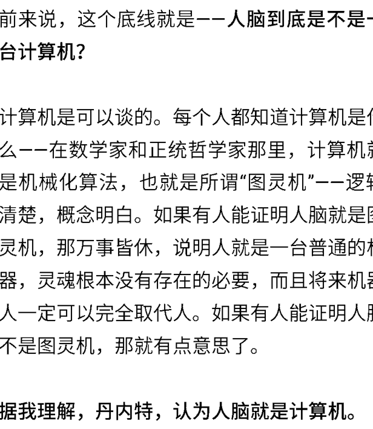

Intuition Pumps And Other Tools for Thinking（直觉泵和其他思维工具） 作者 丹尼尔·丹内特（Daniel C. Dennett）

这位作者是当今鼎鼎大名的人物，你一定要记住他。丹内特，可能是现在活着的最厉害的哲学家，也可以说是最聪明的人之一——不是能快速解答数学题那种聪明，而是说他对世界到底是怎么回事想得非常深入。

这种深入可不是宗教人士那种突然间就认为自己大放光明的深入，而是建立在严格数理逻辑上的、科学式的深入。丹内特这帮人传承的是罗素、图灵、维特根斯坦这些人的衣钵。他们既不会故弄玄虚，也不会说一些模棱两可的话故作高深，他们说的每一句话都明明白白让你随便推敲，而且他们把哲学跟自然科学的最新进展密切结合起来——我斗胆用一句话总结，那就是这些人的思想，代表我们这个时代对世界认知的底线。

以我之见，包括被很多西方人奉为心灵导师达赖喇嘛在内、什么活佛仁波切，各种心灵导师、野生哲学家，在丹内特他们面前全都是跳大神的，根本不值一提。

什么叫“底线”呢？就是不能谈的东西都别谈，只谈你能谈的东西。

比如说所有人最关心的哲学问题大概就是“人到底有没有灵魂？”这个问题就是不能谈的。什么叫灵魂？有人实验见过吗？灵魂有什么性质？这些统统都没有科学答案，所以谈论灵魂的就是玄学，正统哲学家绝对不会谈。

那么哲学家对这个终极问题能谈什么呢？这就要求我们首先得后退到当前认知的“底线”。目前来说，这个底线就是——人脑到底是不是一台计算机？

计算机是可以谈的。每个人都知道计算机是什么——在数学家和正统哲学家那里，计算机就是机械化算法，也就是所谓“图灵机”——逻辑清楚，概念明白。如果有人能证明人脑就是图灵机，那万事皆休，说明人就是一台普通的机器，灵魂根本没有存在的必要，而且将来机器 人一定可以完全取代人。如果有人能证明人脑不是图灵机，那就有意思了。

据我理解，丹内特，认为人脑就是计算机。

那么有人就要问了——人脑到底是怎么回事儿，连脑神经科学家都没搞清楚，你丹内特一个哲学家，你懂什么人脑？

这就是思想实验的作用了。

比如说有这么一个问题：我们的大脑在刚出生的时候是一片空白吗？所有认知能力都要后天学习呢，还是说事先已经“预装”了一些生而知之的内容？

丹内特在这本书里，描述了一个思想实验。

我们想象，把你关在一个机器人的控制室中。机器人没有智力，一切动作全靠你操作。

而这个控制室没有窗户，只有一排排的按钮和指示灯。你只知道机器人有感知外界的能力，而且你知道这些指示灯的闪来闪去就代表机器人对外界的感知，但是你完全不会解读这些灯！

你的任务是引导这个机器人在一天之内找到食物进食，否则机器人就会饿死。

可是你连哪个灯亮代表饿了，哪个灯亮代表发现食物都不知道。

那么你怎么操作这个机器人呢？答案只能是这是不可能的，你怎么摸索都没用。

对人来说，外界刺激，不管是视觉听觉触觉，到达大脑的只是一些神经的信号，而且这些信号非常复杂，那么人是怎么解读这些信号的呢？人是怎么形成“理解”的呢？

像植物和细菌这些低等生物，“身体”是直接对外界刺激做被动反应。比如说，植物“喝水”，其实是根茎细胞直接跟水发生关系的结果。细胞内部水分不足，而外界有水的话，这个细胞本身就会自动吸水。实验室里拿一个单独的细胞放水里，它也是这么吸水。整个过程不需要任何智能。

可是人不一样，人不只是被动反应，还有主动的意识和理解。

负责处理食物的肠胃，并不能直接跟食物接触，它们必须先向大脑发出一个“饿了”的信号——这相当于你在机器人的控制室里注意到有几个指示灯亮了。眼睛看到食物，本来只是处理光信号，并不知道这是食物，它们所做的只不过是把光信号传递给大脑——这相当于你在机器人的控制室里注意到又有几个指示灯亮了。

你必须知道这些信号代表饿了，那些信号代表发现了食物，你还必须向嘴传递信号，告诉它开吃。可你是怎么知道的呢？要知道那些信号非常杂乱无章，比真正控制室里的指示灯更乱！

能从这些杂乱的指示灯里看出“意义”来，这就是人的意识。那么人的意识到底是从哪里来的呢？

据此，我们仅凭推理，就能得出这个结论：小孩一出生，大脑不可能是一块白板。

漫长的演化史必须已经给人脑预装了一些功能，否则我们根本不知道怎么对世界反应。人脑中必须已经先有一个什么东西，这个东西已经会对外界信号进行解码了。人脑一出厂，就是一台已经预装了操作系统的计算机。

那么这个“操作系统”是灵魂吗？不是。到底为什么不是，为什么人可以是一台天生自带操作系统的计算机，这就不是今天这篇小文章可以说清楚的了。

## 我的评论

哲学家专门研究大问题，我今天想说的是一个小问题——仅仅凭借推理，我们也可以对世界多点了解。

其实最著名的思想实验就是我们都学过的，伽利略论证“两个小球同时落地”。他仅仅提出一个问题：如果把重的小球和轻的小球粘在一起，其落地速度将会怎样？完全靠思辨，结论就出来了。

当然我们必须说明，思想实验得到的结论并不能直接作为科学结论，必须还得经过实践检验。也许你的思想有漏洞，也许世界根本不讲理，总之不做个真的实验肯定是不放心。

但是这种思维方法非常非常重要的。很多情况下不是不做实验，是根本没法做实验，那么思想实验就更加可贵了。

不过我看思想实验最值得赞赏的还不是实用性，而是它能给思维带来很大的乐趣！像丹内特这本哲学书，有时间的话一路看下来，智力

上的愉悦感比什么智力竞赛脑筋急转弯可是强太多了。

## 由此得到

说哲学就是“爱智慧”，此言不虚。

万维钢

假期第二天，期待你分享书里的新知。

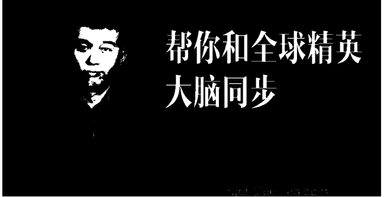

## 周末小议 | 我不judge你

前两天的文章，大家都说太烧脑了。今天假期最后一天，又是周末，我们还是来讲一个英文世界里特有的观念：judge。

这里它是一个动词，翻译成中文大概是“评判”或者“审判”。我要说的这个意思，可不是法官去审判罪犯，而是一个人去评判另一个人。

比如说你有个同事，收入很高，可是不爱花钱，每次一帮人出去吃饭他都不买单，每次跟朋友坐出租车他都坐后排，于是你心说，这个人太小气。

这就叫 judge。

你可能根本都没把这句话说出来过，只是心里有这么一个结论。但你这个结论是对别人人品的一个论断。你从他的行为模式，推广到了人品，并且给这个人下了一个结论。

而西方文化认为，你这就是不好的行为。

如果你跟一个有文化的老美说这个同事太小气，老美多半就会说："Don't judge people." 然后他就显得特别高大上，而你就特别不好意思。

不要 judge 别人。这个观念可能最早来自《圣经》，说只有上帝能 judge 世人，而人和人之间不能互相 judge。而现在，不 judge 别人，已经成为一条基本道德，深入人心。

Judge 为什么不好呢？首先你的信息非常有限，根本不知道别人有什么特殊情况。其次每个人都不一样，谁都有各自的毛病。再者就算他真的不好，你为什么就不能宽容大度一点？而且归根结底，我们应该尊重每一个人。

每个人都是复杂的，表现出来各种行为都只是他的一个侧面，而且你看到的还可能只是一个偶然事件。如果我们根据这一个侧面就给人贴个标签，把他等同于这个标签，那就太简单粗暴了。

有一次我在微博看到有人转发那种“转发抽奖送 iPhone”的广告，心想这种人居然为了 一点虚无缥缈的小利不惜浪费朋友的时间，真是应该取关。但是往下一翻，有一个我很喜欢的人也转发了那条广告，内心也就释然了。

Judge 无处不在。在中文世界，我们随时都能根据别人身上一个微小的槽点去 judge 他，习以为常，非常自然，以至于我们根本就没有一个对应的中文词去标记这种行为。

但中国文化并非没有相应的观念。老百姓的话有一句是“静坐常思己过，闲谈莫论人非”，这说的其实就是不要 judge 别人。高级中文里有个词叫“诛心”——从一个人的 一言一行，来论证他内心就是个坏人，来彻底否定他，这也是 judge。不“诛心”，是高层不撕破脸的斗争的一个起码的道德规范。

前次买车，车行给专门安排了一位女士，给我们讲解车里的电子设备用法。我老婆就问她怎么把自己常听的电台加到快捷方式里。这其实是有一定风险的，就好像在人前暴露自己的网络收藏夹，别人可能会因为你的政治立场或者音乐品味而鄙视你！

车行的女士说，干脆我把你喜欢的电台都设好吧——"I won't judge."

能说这句话的人，真是文明人。

万维钢

“共读中秋”还在继续，记得把你读到的新知，留言分享给我们。不必是长篇的笔记心得，一个让你有所收获的小知识即可。举个例子：

#来自《反脆弱》#：轻易获得的东西会降低人的反脆弱性，比如自动化飞机的出现大大降低了飞行难度，让飞行员的工作变得更舒服。所以美国联邦航空管理局曾经敦促航空业提高对自动飞行的依赖，当然他们认为自动飞行比人工操作要安全。但结果呢？飞行员长期缺乏挑战性，注意力和技能都退化了，事故发生率增加。最终美国联邦航空管理局取消了这个规定。类似的，作家和艺

局取消了这个规定。类似的，作家和艺术家会在有一点背景噪声的地方创作，比如咖啡馆，机场，反倒能更好地集中精力。

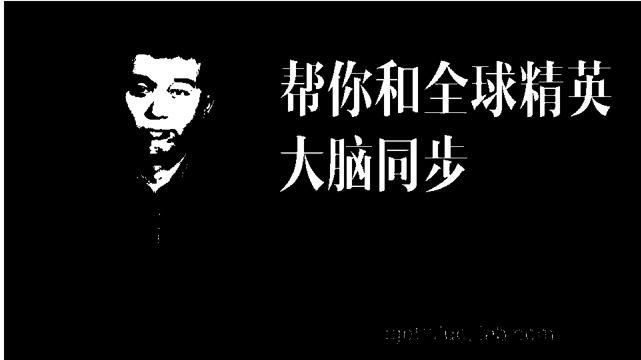

## 未来预告

杀时间内容的工业化大生产 |

## 周末小议 | “共读中秋”收获的十个新知

精英日课发起的“每逢佳节倍读书”活动，收到了几百条读者发来的新知留言。今天精选十个和你分享。

## 01 道德的最高原则就是使幸福最大化

by 李苏 来自《公正》

本书讨论的核心内容——三个思考公正方向的第一个：道德。作者提出道德在思考公正中的两种角度：第一种角度来看，一种行为之道德与否仅仅取决于它所带来后果；第二种角度来看，在道德方面，结果并不是我们应当关注的全部。

道德的最高原则就是使幸福最大化，使快乐总体上超过痛苦。这是边沁功利主义的主要观点。

桑德尔使用大量有说服力的场景和案例面对乞丐，将基督徒扔给狮子，严刑逼供，快乐之城，肺癌的益处，福特爆炸的油箱，老年人的折扣，有偿受苦，圣安尼的女生，以及自称为边沁的拥护者的密尔的观点，阐明道德并不是能计算出来的。

欲求事实上不再是判断何谓高尚何谓卑劣的唯一基础。更高级的快乐并不是因为我们更喜欢它们而更加高级，我们之所以更喜欢它们是因为我们认识到它们更加高级，因为它运用了我们的最高级的能力，并使我们成为一个更加完善的人。

分析鞭辟入里，令人信服！

## 02 农业革命是史上最大的骗局

by 南舟 来自《人类简史》

作者说农业革命是史上最大的骗局，其真正本质是：让更多的人却以更糟的状况活下去。农业发展——人类定居——人口增长——食物需求增加——要求人类在农业上加大投入——农业继续发展——人口继续增加……形成循环，并且这种循环一旦形成就无法回头。

现代文明中科技迅速发展，大幅度改变了人类生活环境和生存方式，同时把科技本身高度嵌入人类世界，人类对科技的依赖越发紧密（从智能手机到仿生手臂），科技革命似乎正在走上和农业革命高度相似的道路。

## 03 我们的归因能力惨不忍睹

by SD水 来自《魔鬼经济学》

曾以为，业绩做的不怎么样，自己找不到原因，问问潜在或浮出来的顾客不就好了？比如为什么选择环保的生活方式？是为了：

- 1. 保护环境
- 2. 造福后代
- 3. 节省费用
- 4. 大家都这么做？

当然是1啦，大家那么有觉悟，怎么可能会是随大流呢？

不信你试，把《请为了环境，节约用电》、《请为了子孙后代，节约用电》、《请为了节省费用，节约用电》、《请和86%的邻居一起，节约用电》这四种标语分别贴在四个差不多社区，过仨月再来看看他们的电表。

有谁给《为了环境》那一条的效果押注？一那么他/她就得赔钱了。

电表告诉我们，随大溜那条所在的社区成果最明显，用电量比其它三种有明显的降低。

怎么回事，怎么跟说好的不一样？

我们并没有上当。大家在给出答案的时候，心里真是这么想的。但怎么想和怎么才会受影响，真的只是一件事的不同表达方式吗？

> “魔鬼藏在细节里”，这句西方谚语是在说细节的重要性，还是指我们认为的细枝末节根本不是细枝末节？甚至可能是：我们认为的细节才是重点，而在我们眼里的重点不过是细枝末节？

上一次的文案、上一次的广告活动一塌糊涂，

我们认为的重点、我们要抓的痛点、我们用户反馈回来的信息，真的是客观的重点、痛点、对用户来说重要的吗？

还好，两位史蒂芬提供一大堆识别真相的想法和工具可以借鉴。

## 04 文艺鸡汤背后是有科学依据的

by 北燕 来自《习惯的力量》

2008年北京奥运会，菲尔普斯一人狂揽8金，惊天地泣鬼神。但其实他在200米蝶泳中，一跳入水中泳镜就进了水，到第三、四次折返时，已经几乎什么都看不清。而菲尔普斯不但没受到影响，还再次打破了世界纪录。他就是这么摸黑在水中来回，精准计算出每次折返划臂的次数，直至最后触壁上岸，摘下泳镜，才知道原来欢呼声是冲他来的。这般武艺，我等只能跪拜。但菲尔普斯在赛后采访中谈及此事，只是云淡风轻的一句：完全没觉得有什么意外。

这不是炫耀，也不是事后诸葛亮，而是他真的专门训练过在黑暗中游泳。当在比赛中遇到类似情况时，他只是把脑袋中储存的“录像带”调出来，按照过去练习过无数次的动作划臂、蹬腿罢了。仅此而已。

当你常年累月的积累已经形成习惯，遇到特定场景就会习惯性地做出标准动作而无需思考，比如菲尔普斯、梅西之类的天才运动员，他们在关键时刻的惊人扑救、抢断、超越，仅仅是完成了习惯性动作而已。这让人想到一句著名鸡汤：“你必须非常努力，才能看起来毫不费力。”所以别再看不上鸡汤了，人家长得文艺了点儿，但背后其实是有科学依据的。这个依据就是习惯。

## 05 如何变成屋子里最有意思的人

by Emily 来自《魔鬼经济学》

如何能提出一个好问题？这个问题得是跟人们息息相关的问题，且得出出乎意料的推翻了传统观念的答案。传统观念平白浅显，便于理解，说辞悦耳，抚慰人心却不一定合乎事实。但找出传统观念的错误之处、抑或草率或狭隘自私的思维所留下的痕迹，是提问题的良好出发点。

例如万老师对传统观念中“失败是成功之母”的驳论，李笑来老师对传统观念“活在当下”思想的纠正，提出的都是与人们息息相关，且答案都出乎意料地推翻了传统观念。好文章都是从提出好的问题开始的。《魔鬼经济学》就是一本从提出好问题出发，然后用一种新的观察方式探究万事万物的隐秘一面。用了三天时间阅读此书，就变成了屋子里最有意思的人。

## 06 为何妓女比建筑师挣得多？

by Emily 来自《魔鬼经济学》

一条永恒不变的劳动规律：决定工资多少的四个因素：

- 1. 某项工作是否有太多的人愿意做且能够胜任；
- 2. 工作所需的专业技能；
- 3. 该工作的不适程度；
- 4. 该工作所提供服务的需求量。

这四大因素的微妙平衡解释了为何妓女比建筑师挣得更多等问题。但某些光鲜职业（如电影、音乐）的驱动机制却并非如此，有前赴后继的年青人愿意投身薪酬卑微需要任劳任怨的下等工作。因为他们必需经历一场锦标赛竞争，从低级别开始打拼，才有希望晋升到最高级别。

## 07 “不知道”也许是最好的答案

by 你先走 来自《人类简史》

所谓神作，除了读起来痛快，还得给人点真启迪。比如解决几个众人皆关注的话题：

- 1. 知识能不能成就成功？不知道，从智人历史看，终点早已不是最初计划的终点，所以，我只能说知识必将改变你对成功的看法。
- 2. 努力到底有没有用？不知道，成为科尔特斯还是蒙提祖玛二世，成为皮萨罗还是阿塔瓦尔帕，自己做主，我只能说努力只会保证你不成为最差的那一个或那一群。
- 3. 碎片化是不是让人更弱智？不知道，按照双刃剑原理，碎片化既给了你快速接触通识成为通才的机会，又容易让你被若干破碎信息填满而忽略了深入思考的极端重要性。

所以，以上三个问题，全在于你。

## 08 决定孩子将来的事是父母的特质

by tree 来自《魔鬼经济学》

看完这本书最大的感受是不可思议。原来犯罪

率低是与法律允许堕胎有关；专家一直呼呼儿童要坐安全座椅，原来安全座椅只是一个假设；父母最关心的教育问题，父母为了不让孩子输在起跑线上，报早教益智班，艺术班，逛博物馆等等，殊不知这已经晚了。因为决定孩子将来取得成就大的概率不是父母的行为，而是父母的特质。也就是说不是父母为了孩子做了什么，而是父母是自己是什么样的人。如果父母自己就取得了很大的成就，物质条件丰富，乐观开朗，体贴温柔，那他们的孩子取得成就的几率就大。

真想对自己身边的朋友说，以后不要为孩子投资，报这班那班的了，你们还是投资自己吧。我也要努力投资自己，为未来的孩子做好榜样。

## 09 罚款让迟到更严重？

by 王增利 来自《魔鬼经济学》

经济学从根本而言，是一门研究“动机”的学科：人如何得偿所愿或者满足需求，尤其是在其他人欲求相同的情况下。动机分为三类：

- 1. 经济动机
- 2. 社会动机
- 3. 道德动机

有一个以色列幼儿园实验：家长接学生总是迟到，于是学校决定采用罚款的方法，每次家长迟到罚款 ¥ 3（学校的托费 ¥ 380），结果是，迟到现象更严重。

原因：用经济手段取代了道德手段，减少了人们的负罪感。

## 10 新大陆是被天花病毒征服的

by 进步生 来自《反脆弱》

人类群体的反脆弱性如何影响人类全球化的趋势。

地理大发现时期，西班牙征服者对美洲大陆的侵略大获全胜，宣告了新大陆和旧大陆的统一。发动侵略战争的是隶属于西班牙的几百名探险家，而他们征服的，却是两个幅员辽阔、拥有千万级人口的帝国——阿兹特克帝国和印加帝国。两次征服战争最大的功臣，竟然是探险队员身上携带的天花病毒。

旧大陆的病菌征服了新大陆，为什么不是相反的结果呢？

因为旧大陆的人们免疫力更强。旧大陆商业、文化、物种交流频繁的同时也促进了病菌的交流，形成了天然的病菌培养皿，使人类患病的风险大大增加。

从长远看，这种具有波动性、不确定性的风险反而让人受益。当人们染病时，免疫力低下的人死亡，适应危害的人存活，人类群体正是通过个体的优胜劣汰实现了群体进化。

病毒本身也具有反脆弱性，它们也在人类免疫力日渐提高的情况下不断进化自己。最终，经过不断磨练的人类带着顽强的病菌，一同征服了新大陆。

万维钢

以上就是“每逢佳节倍读书”活动我精选的10条精彩新知，这只是我们的一小部分成果！更多的新知会在周末继续跟大家分享。

“交换新知”这个活动会长期在留言区继续，我希望“读书和分享”可以成为这个专栏读者每日的功课，除了我会把来自西方现代社会的新知观念更新在这里，也期待你把得到的新知告诉我，并和我们的3万（还会更多）读者共享。一年后，无论你我都会收获非凡。

这次书单中的《人类简史》是读者选读最多一本，关于这本书正好我明天会更新一篇文章。读过的朋友不妨先来思考：在下面这五个论断中，你认为有几个说对了？

- 1. 人类作为一个整体，总在进步
- 2. 重大历史关头，常有一个理性的正确选择，胜利者就是那些选对了的人
- 3. 人类每一次大的进步都给自己和世界带来好处
- 4. 宗教是阻碍进步的力量
- 5. 人类进步的关键，在于生产方式的转变

明天见。

## 日课029 | 历史学的教训

日课029 | 历史学的教训

音频转述师：怀沙

请原谅我使用了一个特别高大上的标题。专业历史学家也未必敢用这样的标题，好在我不是专业历史学家。

像我们普通人读历史书，除了想听个帝王将相的故事之外，大概至少还有两个目的。第一是为了满足好奇心，想知道我们的今天到底是怎么来的。第二个，大概也是大多数专栏读者更重视的目的，是想从历史中吸取一些经验教训，以利于我们今天把事情办好。

但本文的标题可不是“历史的教训”，而是“历史学的教训”。这个意思是说，如果你抛开名人掌故，像个学者一样去探寻人类历史发展的规律，你可能会有一些虽然不一定对做具体的事有帮助，但是对个人认知很有帮助的道理。

这种道理历史小说里没有，人物传记里没有，二十二史里没有，而我们都学过的历史课里面可能有，但是大都说错了。

进入正题之前我想先问你，在下面这五个论断中，你认为有几个说对了？

- 1. 人类作为一个整体，总在进步
- 2. 重大历史关头，常有一个理性的正确选择，胜利者就是那些选对了的人
- 3. 人类每一次大的进步都给自己和世界带来好处
- 4. 宗教是阻碍进步的力量
- 5. 人类进步的关键，在于生产方式的转变

说我的答案之前先来说一下今天要说的这本书：

想必你已经读过这本书，或者至少看过很多个书评了，但今天我说的内容可能不太一样。这本书在中国销量巨大，好评如潮，但也有一些国产历史学家表示不满。我就看到过某个专业历史学家写的书评，说书中有若干说法错误，但我细读之下，结论只能是其根本就没看懂这本书。

《人类简史》这本书，代表的是一个拥有当前各相关学科“通识”的这么一位青年学者，对人类历史的认识。换句话说，这大概就是此时此刻我们对人类历史能说的最简单的一个说法。如果一个搞了半辈子中国古代史的历史学家对此书有异议，我猜最大的可能性是他本人的知识需要更新了。

那么我们读了《人类简史》，对上述那五个论断会怎么判断呢？

## 答案是它们全错了。

- 1. 人类整体总在进步吗？

进化这个词，现在有很多进步人士号召翻译成“演化”，因为进化的“进”字似乎暗示它有一个从低级到高级的方向。长时间大尺度来看，的确有这样的趋势，但具体到演化的每一步，其实都是没有方向的。

几十万年前地球上至少有六种不同的人种，之前还有更多，我们这一支最后统治地球，纯属偶然。

现在回过头来说直立行走和脑容量大是我们的进步优势，但在之前那两百万年内，这两个特点没有任何优势，人类在大型动物界的地位不高。研究者甚至认为就好像啄木鸟的专长是从树干里啄出昆虫一样，最早的人类专长就是“从骨头里取出骨髓”——猛兽捕获猎物，它先吃最好的，它吃完食腐动物上去吃…..等别的动物把肉都吃干净了，我们默默走上前去，把剩下的骨头敲开吸点骨髓。

而且直立行走和脑容量大还可能是个劣势。直立行走意味着臀部变窄，产道宽度受限，再加上婴儿脑容量大，妇女不好生产，必须在孩子尚未长成就生下来，继续抚育很久才能学会自立。

科学家搞不清楚人类“为什么”要在直立行走和越来越大的大脑这个方向上演化，也许根本就没有为什么。反正肯定不是说200万年前的祖先召开一个会议，说为了200万年后统治世界，我们暂时委屈点，先吃120万年骨髓。

## 我们的优势是直到几十万年前才慢慢体现出来的，那么之前的“努力”能叫进步吗？

这个模式在人类发展史，在其他物种的演化史，甚至在科技史和经济史上，比比皆是。一开始你根本不知道有什么意义的一个特性，时机到了就突然带来巨大的好处。

## 2.胜出者往往是运气好

我们现在讲创业，特别强调运气很重要，不是说你有才能有钱就一定能成功，其实跟外部环境变化关系很大。这个规律在大尺度下也是如此！生物进化的本质就是在各个方向上试错，赌对了就是进步。

传统看来，居住在欧亚的人比较聪明，文明也发达，而澳大利亚和美洲的原住民的文明程度就要低很多，这难道是因为他们“人种”不行吗？

最主要的原因其实是地理环境。你中国人又是种植又是养殖生活过得红红火火，美洲印第安人怎么没有这么好的日子？因为北美洲根本就没有什么是能被驯化的动植物！

所有现代人都是从非洲走出来的，走到哪里，有时候就定居下来。祖先的偶然选择，后辈就有如此之大的差异。十万年后再次相见，一群人就成了另一群人的奴隶和杀戮对象——当初谁能想到？

## 3.人类的进步往往是世界的灾难

三万年前，我们这支人类开始在地球上独大。我们掌握娴熟的打猎和战斗技巧，善于团队合作，对别的动物战无不胜，特别善于捕杀大型动物——结果就是我们走到哪里，哪里的大小型动物就被灭绝。

澳大利亚原本有24种体重在50公斤以上的动物。人类到达澳大利亚以后，其中23种被杀戮殆尽，惨遭灭绝。类似的悲剧随着人类的脚步在世界各地上演。长毛象、剑齿虎、猛犸象…..这些动物，农业革命以后的人根本都没见过，因为之前就全被灭绝了。

所以古人其实一点都不环保。人天生就是环境的破坏者。

## 不但如此，人类进步甚至有时候是自己的灾难。

农业革命使得我们可以养育更多人口，固定住所，城市能得以出现，是现代文明的基石没错吧？但是如果不计后世的长远结果，只论当时，农业革命其实是人的灾难。

种地比采集狩猎辛苦得多！人的劳动时间和强度都大大增加了，而且因为从此食物来源单一，营养不良，整个发育水平，甚至智力水平都是下降的。唯一的好处是婴儿存活率提高了——可是采集狩猎时代的人到处游走，本来也不想要那么多孩子。

所以这本书才调侃说，这哪是“人类驯化小麦”，根本就是“小麦驯化人类”——农业革命的最大受益者不是人类，而是小麦！

那么以此类比，我们现在的科技进步，对地球，对自己，到底是好是坏，不也是一个问题吗？

## 4.宗教是非常有效的组织力量

有些特别推崇理性的人认为宗教用虚构的东西迷惑人，是阻碍进步的势力。我们应该追求“真相”，反对“虚构”，这总没问题吧？

《人类简史》恰恰告诉我们，正因为我们能相信虚构的东西，我们才能实现大规模的合作。

人脑能容纳的熟人关系不超过150个。如果我们只信熟人，必须充分了解一个人的各种八卦才能跟他合作，那我们没法干特别大的事——黑猩猩也能做到这种低水平的合作。

大约7万年前，人类发生一次认知革命——人开始能相信一些根本不存在的东西了。有人居然能说出“狮子是我们部落的守护神！”——而且别人居然相信他！

人们开始一起想象，能编造虚构的故事，神话传说，而且还都把自己说感动了！

## 这时候我们就可以大规模合作了。

为了部落的守护神而战，你可能觉得很愚蠢，那么为了银子而战是否愚蠢？银子的价值，难道不也是“想象的共同体”吗？

国家、公司、法律、金钱，这些都是原本不存在，因为你也相信我也相信才存在的东西，这些都是我们的想象。正因为有了这像宗教一样、共同的想象，无数的人才能被组织起来。

## 5.人类进步的关键，是认知方式的转变

以前的学者谈论人类进步比较关注技术进步，比如说发明了什么新的工具。而在这本书，大尺度视角来看，真正的进步来自认知的升级。

书中说了四大革命。

前面说的多人组织方式的升级，就是来自认知革命——人可以想象一个不存在的东西，并且相信它。

农业革命以后众多的人可以聚集在一起生活，想要达到城市规模的管理，口口相传的东西就不行了。这时候是因为我们发明了书写系统，这么一种高级的信息存储方式，一种新的认知技术，才有了后来高级的社会形式。

科学革命的关键是人类学会了发现自己的无知，这同样是一次认知升级。

那么我们现在正在经历的另一次认知升级人类通过生物技术来主动改造自己，会把未来变成什么样子？

## 我的评论

我觉得了解了这些“大”道理，有点全球通史的眼光，乃至于提出自己的看法，这才真正算得上是“究天人之际，通古今之变，成一家之言”。

否则我看有些专业历史学者，搞些寻章摘句的功夫，对某一特定时期的“史实”特别熟悉，但是对世界是怎么回事儿没有一个基本的看法，可能就有点愧对当初太史公司马迁的志向。

读那些传统的史学著作，可能就不如现在流行的一些自然科学和技术学者写的“历史”著作，比如《枪炮、细菌与钢铁》、《西方将主宰多久》、《科技想要什么》等等，包括这本《人类简史》。

续集评论，即将推出。

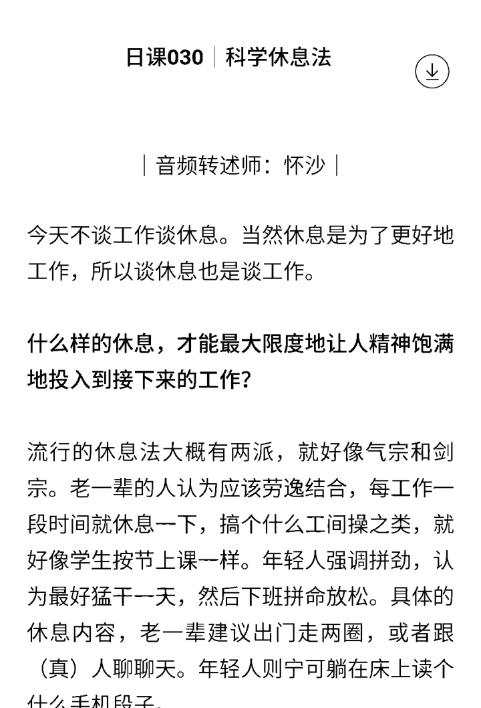

## 日课030 | 科学休息法

## 日课030 | 科学休息法

|音频转述师：怀沙|

今天不谈工作谈休息。当然休息是为了更好地工作，所以谈休息也是谈工作。

## 什么样的休息，才能最大限度地让人精神饱满地投入到接下来的工作？

流行的休息法大概有两派，就好像气宗和剑宗。老一辈的人认为应该劳逸结合，每工作一段时间就休息一下，搞个什么工间操之类，就好像学生按节上课一样。年轻人强调拼劲，认为最好猛干一天，然后下班拼命放松。具体的休息内容，老一辈建议出门走两圈，或者跟真人聊聊天。年轻人则宁可躺在床上读个什么手机段子。

现在我们有强有力的科学证据，老一辈的做法是对的。

研究表明，哪怕出去散步五分钟，效果都要好得多。

## 我的评论

我看这些研究中价值最大的还是有关上网的一项。对高强度脑力劳动者来说，“上网休息一下”，拿手机找两个猫的可爱图片看看，简直是再正常不过的事情了。可是现在我们知道凡是调动了注意力和意志力的行为就是消耗而不是休息。

说白了，就是我们常常把“娱乐”和“休息”给混为一谈。

## 由此得到

娱乐不是休息。

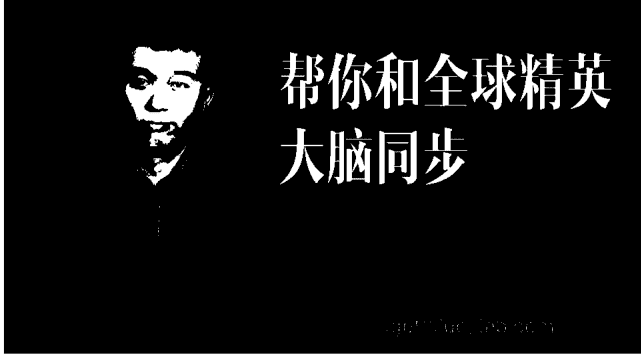

## 日课031 | 杀时间内容的工业化大生产

## 日课031 | 杀时间内容的工业化大生产

| 音频转述师：怀沙 |

在今天的正式内容开始之前，我想请你先打开“美国在线”网站（aol.com）首页看一眼。如果你翻墙不方便，可以看看我写此文的时候在这个网站看到的几个新闻标题：

- 把柠檬加热20秒可以挤出更多汁来：微波炉的几个天才用法
- 让嘴唇显得丰满的六种自然方法
- 为什么不睡觉会对你的身体造成巨大伤害
- 别理会食品标签上的过期时间
- 菲尔普斯刚花250万美元买了个新家，进来看看到里什么样

我对这些标题没有进行什么挑选，完全按顺序一条一条抄在这里。我想问你两个问题：

1. 你想不想点击进去看看全文？
2. 你认为一个专业作者写一篇那样的文章，需要多长时间？

***

我大概在两年前看过一个纪录片，Food, Inc，从此就几乎不想吃鸡肉了。

这个片告诉我们现代化的农业是怎么回事。一个身材健美的农妇，头戴围巾，在夕阳下往地上撒些豆料喂鸡，一群小鸡在她身边欢快地叫着……那种场景，现在叫行为艺术。一个现代化的养鸡场要让一只鸡在最短的时间内经历从出生到长满肉被杀死的全过程，终其一生跟别的鸡挤在一起，从来没见过阳光，甚至从来没走过一步！

事实上，它的肉太多长得太快，腿没有劲儿，根本就没站起来过。

鸡，已经不再是“养”大的，而是“种”大的。

这种种植鸡肉的方法对人的健康有没有什么直接害处，科学家可能还在争论（一般认为没有害处），我们暂且不提。你可能跟我一样觉得这种方法太恶心，对鸡太残忍，而不想再吃这种鸡肉了，但这其实是文科生思维。我想说的其实是更重要的两点。

- ——这种方法生产出来的肉，特别、特别廉价。
- ——而且跟传统方法养殖出来的肉几乎一样好吃。

这说明什么呢？说明一个现代人可以非常容易地获得美味的肉类——说明美国为什么遍地都是大胖子。

如果食物是如此，那么信息是否也是如此？

今天要说的这本书：

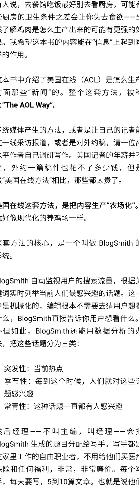

（《信息食谱》（信息食谱），作者 Clay A. Johnson）

有人说，去餐馆吃饭最好别去看厨房，可能有些厨房的卫生条件之差会让你失去食欲——当然了解鸡肉是怎么生产出来的可能有更强的效果。我希望这本书的内容能在“信息”上起到同样的作用。

这本书中介绍了美国在线（AOL）是怎么生产前面那些“新闻”的。整个这套方法，被称为“The AOL Way”。

传统媒体产生的方法，或者是让自己的记者前往一线采访报道，或者是对外约稿，请一位高水平作者自己调研写作。美国记者的年薪并不高，外约一篇稿件也花不了多少钱，但是跟“美国在线方法”相比，那些都太贵了。

## 美国在线这套方法，是把内容生产“农场化”。

就好像现代化的养鸡场一样。

这套方法的核心，是一个叫做 BlogSmith 的系统。

BlogSmith 自动监视用户的搜索流量，根据关键词实时列举当前人们最感兴趣的话题。这一步是机械化的，编辑根本不需要去猜用户想看什么，BlogSmith直接告诉你用户想看什么。不但如此，BlogSmith还能用数据分析的办法，把这些话题分为三类：

- 突发性：当前热点
- 季节性：每到这个时候，人们就对这些话题感兴趣
- 常青性：这种话题一直都有人感兴趣

然后经理——不叫主编，叫经理——会把 BlogSmith 生成的题目分配给写手。写手都是在家工作的自由职业者，不用给他们买医疗保险和任何福利，非常，非常廉价。每个写手，每天要写，5到10篇文章。也就是说他们必须一小时写一篇。最好的老手可以25分钟写一篇——调研，写作，配图，编辑排版到上线，总共25分钟。

写手写文章时，要从四个方面考虑：

- 能带来多少流量
- 能带来多少广告收入
- 需要用多长时间写完
- 写作质量——这是最不重要的一点，出点错也没人在意

然后美国在线通过加标签和使用A/B测试选择标题的办法推广这篇文章，以期获得最大的流量。

从选题，写作到编辑上线，2012年美国在线一篇文章的平均花费是84美元，而其能带来的广告收入超过120美元，也就是大约50%的利润。

整个过程实时地在屏幕上显示：我们花了15美元写这篇文章，现在它已经带来了82.95美元的广告收入，我们赚了67.95美元！

## 一句话，这是内容生产的工业化。

我不知道有多少网站使用类似的技术，但像著名新闻评论网站赫芬顿邮报，就是美国在线旗下的媒体，就在使用这套技术提高效率。如果你经常使用搜索引擎找个什么生活常识，你可能会被引导到eHow之类的网站，这些网站背后有个大公司，Demand Media，使用完全类似的技术。这些技术已经存在多年。很多人不知道有这种做法，使用这种做法的媒体不会主动告诉你，但这些不是秘密。

这些技术的核心，就是你想看什么，我就给你写什么，而且必须又快又好。

又快又好，就跟肯德基卖的鸡肉一样。

## 我的评论

中文网站经常搞些比较low的标题去吸引流量，可是我们看看美国在线，简直是标题文明，内容正派。这些选题中根本没有什么色情暗示，甚至没有多少娱乐八卦因素，大多数就是一些生活窍门健康指南分享——而且不是标题党，也没造谣传谣，你点进去得到的信息也许真的就有用。就算在办公室明目张胆地阅读美国在线，同事也不至于笑话你。

这就是我们每天在朋友圈看到的那种文章。所以你点不点？

我点了。我平时尽量不去这种网站，但如果看到了这样的标题，肯定会忍不住点一下。我几乎不想吃鸡肉，但偶尔吃顿炸鸡。

前次我们还在说《信息传播之难》，可是看看美国在线的工业化信息生产线，信息传播哪里难了？但这里的根本区别是美国在线是为你量身定制的信息，而科学家想要传播的是“他们想让你知道”的信息。

用食物对比，美国在线给的就是没什么营养——或者说营养过剩——的快餐。便宜，好吃，但是可能不那么健康。所以不看这种“杀时间”的快餐信息的人，跟不吃垃圾食品的人一样值得尊敬。

可我总觉得这个食物的对比似乎并不太准确。食物界，快餐虽然受欢迎，但如果你请人去吃顿大餐，人们还是乐意去的，有的还以此为荣——可我很少见到有以读书为荣的人。

## 由此得到

了解了网上那些廉价信息是怎么生产出来的，我们还会甘之如饴吗？

万维钢

今天读书了吗？记得把从书里得到的新知，以#来自《xxx》#的形式，留言给我们一起分享。

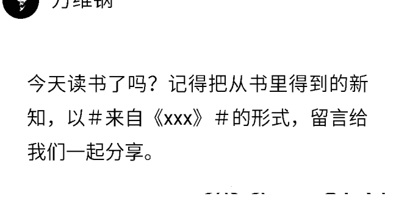

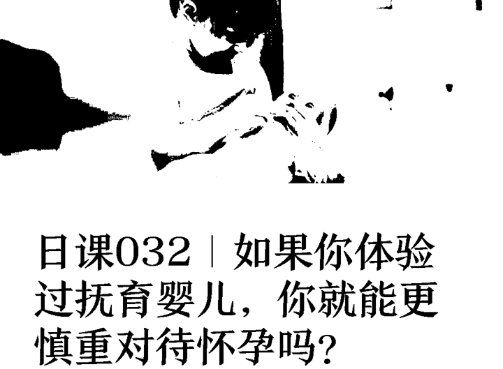

## 日课032 | 如果你体验过抚育婴儿，你就能更慎重对待怀孕吗？

日课032 | 抚育婴儿和慎…

九月初这期《罗辑思维》，“即将到来的阶层社会”，想必各位已经看过了，这期节目也是我参与策划的。其中提到，在美国，任何人只要能做到三件事，就基本上不会陷入贫困，也就是年收入两万美元以下。这三件事是：

1. 先结婚后生孩子
2. 从高中毕业
3. 有个工作

可是就有大量的人做不到。尤其第一点，可能对中国人来说有点不可思议，难道美国有很多不是先结婚后生孩子的吗？文化传统不同，还真是如此。没结婚就生了孩子，可能是美国女性和她的子女陷入贫困的最重要原因。

未婚先孕，在中国可能是时尚青年的大胆行为，也许有人还认为代表先进文化——而在美国，这是穷人的典型特征。

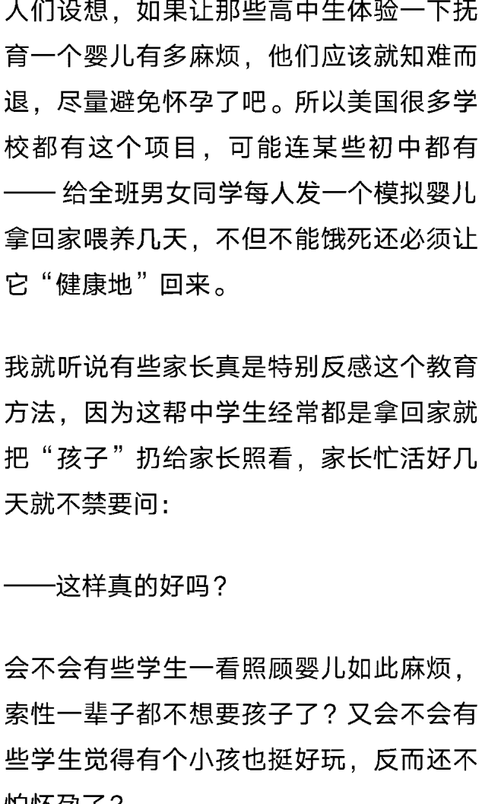

比如图中这款，产品名就叫“孩子，好好想想吧！”

这项研究是今年八月刚刚发表的一篇论文，我贴图在这里，感兴趣的读者可以深入了解：

Efficacy of infant simulator programmes to prevent teenage pregnancy: a school-based cluster randomised controlled trial in Western Australia

Dr Sally A Brinkman, PhD等, Sarah E Johnson, PhD, Prof James P Codde, PhD, Michael B Hart, FAFPHM, Judith A Straton, MD, Murthy N Mittinty, PhD, Prof Sven R Silburn, MSc

DOI:http://dx.doi.org/10.1016/S0140-6736(16)30384-

简而言之，这是 有史以来第一次有人对模拟婴儿教学法的效果做了跟踪研究，这项研究针对的是澳大利亚的女生，她们中的有人13岁到15岁之间被要求照顾机器人宝宝。结果发现：

没体验过照顾婴儿之麻烦的女生，20岁以前的怀孕率是4%；

而那些被学校发了孩子，体验过这种麻烦的女生，20岁以前的怀孕率则是8%。

用中文形容的话这叫“适得其反”或者“事与愿违”，不过我想还是用一个英文词更有力量：backfire（逆火）——你为了达到什么效果而搞了个什么政策，实行 的结果正好跟你的预期相反！

## 我的评论

我在网上搜索，这种模拟婴儿，在美国最便宜的版本大概是300美元一个，而上述报道说在澳大利亚相当于1000美元一个。如果学校要买50个，这是一笔庞大的投资。

大到足以让家长和社会信服：我们学校为了减少少年怀孕率可是下了大功夫的！

对商家来说，这是一个产业。对机器人研发者来说，这是一个特别有意义的攻关项目。你可以不断推出功能更全面的新版，让学校隔几年就来一次升级换代。

职责尽到了，GDP产生了，仪式感很强，第一手的真实体验，美式的敢想敢干，别人一看，美国人真先进。

这么好的办法，怎么可能不好使呢？结果是反而有负作用。

其实很多事情都是这样。这个动作本身实在太好，结果就不重要了。我敢打赌“模拟婴儿”教育会继续在各国开展下去。

也许还会被中国的乐于与发达国家接轨的中学采纳——不过毕竟文化差异太大，校方可能向家长解释说这是为了让学生体验家长当年的哺育之恩——一千美元一个，绝对不能是十美元就能演示的哺育之恩。

## 由此得到

今天说的既不是怀孕也不是教育，而是生意。但我们更应该体会到，这背后的社会规律。

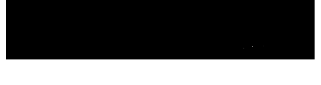

## 日课033｜反脆弱式学习养生法

日课033｜反脆弱式学习…

古龙小说《天涯·明月·刀》里面有个人叫杜雷。他每天都一定在同样的时候起居饮食，比如说中午同样的时间到会宾楼，然后点同样的四样菜和两碗饭，一壶酒，吃完在同样的时间离开。

没人喜欢这么吃饭。杜雷自己早就吃得要发疯，却还是不肯改变。因为他希望别人都认为他是个准确而有效率的人，人们会敬畏这样的人。事实上别人对此的确买账，连傅红雪第一次听说杜雷的吃饭风格，都意识到自己遇见了一个极可怕的对手！

那你觉得杜雷厉害吗？我看他就是个笑话。我们凭直觉就知道像这样以循规蹈矩为荣的角色不太可能是英雄小说的主人公——所谓英雄，就应该专门打破常规，做一些一般人连想都不敢想的事。

换句话说，杜雷刻意避免不确定性，而英雄人物应该主动拥抱不确定性。

注意我说的可不是“不怕不确定性”，而是要“主动拥抱”不确定性。因为一定程度上的不确定性，即使对普通人来说，都是特别有好处的。

今天我们先继续说上次说过的一本书：

这本书里说了一个有意思的实验。受试者被要求学习打网球，特别是要学A、B、C三种不同的发球方法。

实验人员把全体受试者分成三组：

- 第一组是先练二十遍A方法，再练二十遍B方法，再练二十遍C方法。
- 第二组是按照ABCABC这样固定的轮换次序练，也是练习二十遍。
- 第三组是随机的，没有规律，不知道练完一个之后要练哪一个，但是连续练一个发球方法不超过两次，最后总数也是每种总共练习了二十次。

然后考试。但考试被故意设计成跟练习不一样——练习发球的时候都是在场地的左侧，而考试发球的时候却是在场地的右侧——研究者想看看哪组的人更善于应变这个新情况。

结果，“享受”了随机性的第三组平均成绩是18分，轮换着练习的第二组14分，而连续按同一个动作猛练的第一组只得了12分。

如果你还记得上次我们那篇文章，《忘记是为了更好的记住》，你肯定能理解为什么第一组的训练方法不好。人脑的记忆原理，是“提取记忆”这个动作能够加强原有的记忆。所以有点间隔，暂时“忘记”一下，过不久再“回忆”一下，是效

率最高的学习方式。

书中还讲了另一个类似的实验，让学生学习识别不同画家的绘画风格。实验人员选定几位并不被人熟悉的画家，具体每位画家到底是个什么风格，可能连实验人员自己也说不清。

实验还是先练习。选定每个作家的六幅画作，在计算机屏幕上滚动播放，画作下面就是画家的名字。受试学生被分为两组：

第一组学生分块看不同画家的画——先看六张这位画家的，再换六张另一位画家的，以此类推。

第二组学生随机混合着看——这一张是这位画家的，下一张就是别人的，不断地换。

你可能会设想，绘画风格是个缺乏有效定义的东西，最好把一个画家的画放在一起连续欣赏才更有助于抓住本质，不是吗？

练习之后，拿这些画家其他的画作出来，都是学生们练习的时候没看到过的，让学生判断哪副画是谁画的——

结果第一组的判断准确率只有50%，而第二组是65%。

## 随机排序再次战胜有规律训练。

由此我们可以把这个道理推广到很多地方。比如说让小孩学写字不要一个字写十遍，最好几个字穿插着写。再比如做数学题不要同一个题型反复练，最好混合起来练习每次都不一样的解题策略。等等等等。

但我还想把随机性的好处往前再推一步。

How We Learn 这本书提到，不但学习内容应该随机安排，学习地点，学习时候的环境，最好也能随机化。也就是说这堂课你在课桌上坐着学，下堂课最好在游泳池里泡着学，然后再下堂课可以考虑在床上躺着学……这种多样性的环境能对大脑产生各种刺激，特别有助于加深记忆。

这就不能用“忘记是为了更好的记忆”这个原理来解释了。我觉得倒是可以使用一个更广泛的原理：

## ——人体喜欢折腾。

这就不能不提我特别喜欢的作家和我特别喜欢的一本书，纳西姆·尼古拉斯·塔勒布的《反脆弱》。

所谓“脆弱”，是怕折腾。所谓“鲁棒”（robust），是不怕折腾。所谓“反脆弱”，是怕不折腾——越折腾我就越强大，我喜欢折腾。

在一定的范围内，人体就是反脆弱的。这其实是一种进化带来的本能。我们周围环境随时可能变化，所以人的身体中其实有一些冗余度，也可以说ehr人的潜能，平时不用，一旦遇到险恶环境就能发挥作用。

平时养尊处优，偶尔饥寒交迫一次，体内的冗余就会发生作用，比如说储备了多时的脂肪这时候就能燃烧掉一些。人体作为一个有机体，对某一部分你给它一点小刺激，小压力，只要有足够的缓冲时间，它都能够恢复过来并且变得更强。

这正是健身的意义所在。故意搞些高强度的活动挑战身体极限，就能让身体慢慢升高极限，越练越强。

那么根据这个反脆弱的原理，日复一日采用同样的健身套路就是不好的。因为人体能快速适应新局面，一旦身体已经适应了这个套路和强度，就没有什么新的潜力可挖了。这也是为什么健身减肥都是初期效果最好，可是很就快能达到一个不再进步的平台区。

所以应该不断变换花样。这个项目进入平台期，那就赶紧换个项目让身体继续进步。这跟学习的道理也是一样的：学个什么东西最好时刻让自己保持在“学习区”，而不要停留在“舒适区”。

## 所以不论你是学习知识还是健身养生，主动拥抱不确定性，时刻挑战自我去应对新局面，才是符合“天道”——也就是进化论——的做法。

从学习和创新的角度，主动增加一些不确定性——读几本自己领域之外的书、了解一个和自己业务无关的业务，还容易带来惊喜。从做事的角度，不确定性可以帮助我们发现自己的问题，比如随机的输入可能会暴露一个软件意想不到的bug，使我们找到平常想不到的解决方案。

## | 我的评论

所以当初我看电视剧《走向共和》，慈禧跟李鸿章说她每天散步，要走正好九百九十九步，李莲英在旁边给数着，简直笑掉大牙！这哪是健身，纯属装……。塔勒布也有一套健身方法：

搬举特别重的重物，给骨头压力。

如果去健身房，那就不断变换花样，各种项目都搞搞。不过最简单的办法就是在散步过程中穿插拼命的短跑 — 就好像你要追杀什么人或者被人追杀一样。

隔三差五饿上一顿，甚至专门追求在饥饿状态下练习。

塔勒布现在的年龄跟当初的慈禧也差不多，你猜哪种健身方式效果好。

最后我们再来说说杜雷。像杜雷这样每天固定时间出现在固定地点的，历史上有一位名人，那就是哲学家康德。据说康德每天都是在同一时间步行前往大学，路边村妇都能拿他当表用。如果杜雷不值一提，那么康德可是特别了不起的人物啊，这又怎么解释呢？

答案是你不可能在生活的所有方面追求不确定性。你越是要在某一方面冒险，就越是应该确保其他方面稳定。具体来说，企业家可以冒险，而政府政策和法规应该力求稳定，否则什么都混乱也不行。你要出去冒险，至少先把自己家里安排好。

我推测，康德每天固定时间出行，跟扎克伯格只穿同一款式的T恤衫一样——我要想的大事儿太多，就没时间决定这些小事儿了，干脆就每天都一样吧。

万维钢

首先特别建议你去回看一下昨天文章的留言，让我惊叹于大家的所思所得。其次细心的读者发现了，原来的“写留言”被我改成了“写下我的日课”，你的日课可以写成对当天内容的评论感受，也可以是与文章无关的一个新知，你的每日所得，也会对这里每一位要求自我精进的读者都有启发！

本期推荐阅读↓
日课016 | 忘记是为了更好的记住
日课015 | 委婉语如同内衣

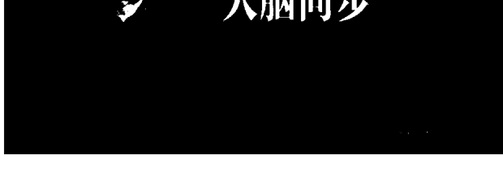

## 周末小议 | 成熟度 = 对小概率事件的接受程度

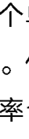

今日监督儿子复习中文课，偶有所得：所谓成熟，就是能接受小概率事件。

他课文里有一句“冬天到，雪花飘”，但是他念错了，念成了“春天到，雪花飘”。我言下顿悟。

冬天下雪是标准模式，“冬天到，雪花飘”这一句不需要任何解释，放在小学一年级课文里非常合适。

可是如果来一句“春天到，雪花飘”，如果不是念错了，就可以肯定不是小学生课文，很可能是某个给大人看的小说里的一句——因为春天虽然也可能下雪，但是这个事情在文学套路中有点不寻常。只有比较成熟的人才能接受不怎么寻常的事情而不需要特别说明。

一个单个的小概率事件发生的概率……很小。但是“任何小概率事件都不发生”的概率也很小。从数学上讲，就是尽管p是个小数，可是(1-p)^N 在N足够大的情况下也是一个小数。也就是说，如果你活得足够长，经历足够多，就难免会遇到一些怪事。

所谓“见多识广”、“见怪不怪”，其实就是说这个人因为阅历丰富，不至于因为一些事情而大惊小怪，能够泰然处之。他看到那些事情在他眼前发生过，而天并没有塌下来——所以当他再次遇到类似的事情，就不会觉得特别不可接受。

他听说有人决定终生不婚，听说有人是同性恋，听说有人好好的工作辞职了，等等等等，都不会怀疑自己听错了，你不需要再给他解释一遍。

反过来说，如果有人遇到一点点不寻常的事情就大惊小怪，那他显然就是不成熟。

所以，成熟度 = 对小概率事件的接受程度。

从这个意义上讲，（严肃）文学作品总爱写些不同寻常的人物和事情，这其实是帮着读者成熟。

我听说过一个研究，可以从另一个侧面定义人的“成熟”——因为经历得多，所以学会了从不同人的角度看问题。直接引用到这里：

## #研究发现阅读小说改善了移情能力

美国的一项研究发现，阅读小说能改善阅读者理解他人所思所感的能力。论文发表在上周出版的《科学》期刊上。研究人员将被试者分成几组，分别阅读不同的内容，分属小说、文学小说（Literary Fiction，指更趋向于严肃性的小说）和非虚构文学等类别。完成阅读之后，被试者参加了测试衡量判断理解他人思想和情感的能力。研究人员发现，严肃小说和通俗小说对读者的影响存在显著差异。研究人员认为，阅读严肃小说或能扩展我们对他人生活的了解、迫使我们从不同的角度同时感知世界，并帮助我们认识到我们与小说人物的相似性；所有这些特征都模仿了心理理论。

这个研究说，阅读严肃小说可以让人学会从不同的角度感知世界——换句话说就是你等于是通过小说里的人物过了好几辈子，经历了你自己不可能经历的事情，现在你能设身处地的从别人的角度考虑问题了，你的认知能力当然提高了！

当然这种成熟只是认知上的，不包括做事的手法熟练——但认知成熟是做事成熟的第一步。

## | 由此得到

1. “经历让人成熟”，到底是个什么原理：有数学上的，也有心理学上的；

当然这种成熟只是认知上的，不包括做事的手法熟练 —— 但认知成熟是做事成熟的第一步。

## 由此得到

- 1. “经历让人成熟”，到底是个什么原理：有数学上的，也有心理学上的；
2. 经历不够可以看小说，最好是既能反应真实世界又不按套路出牌的严肃小说。

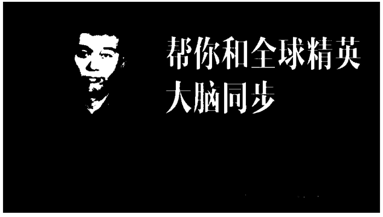

## 答读者问｜知道很多跟吃饭穿衣无关的事有啥用？

各位周末好！

咱们日课的留言越来越多，质量也越来越高，可惜平时读书查资料写文章，不能做到每个都回复，说句抱歉！现在利用周末小议时间，把本周每篇日课中的好问题集中回复一下吧。继续期待你“写下我的日课”！

## 来自周末小议:成熟度＝对小概率事件的接受程度

张廷慧：不是很明白文中的严肃小说和通俗小说是如何界定的？

大笨钟：如何定义严肃小说？能否推荐一本有代表性的？

陈东达：可不可以推荐几本严肃小说。《北京折叠》算吗？

万维钢
我听一般作家的说法是严肃小说侧重于塑造人物，追求描写人性的复杂，最好能写出一个此前没有人写过的人物形象。比如“阿Q”，这个形象深入人心，将来谁说到类似的人都能想起他，作者就是非常成功的。

而通俗小说侧重于故事情节，要有跌宕起伏，最好比较离奇，层层设置悬念。通俗小说的主人公通常都是英雄，而且是有点理想化的，满足读者幻象的英雄，配角则都脸谱化，这样的人物在严肃小说作家眼里就可能有点拿不出手了——就好像庙里摆的关公像，根本算不上艺术雕塑。

我理解中国“正统”的国产作家都没学过怎么写通俗小说，所以常常会用写严肃小说的写法去写通俗小说，结果必然失败。你想赚钱写个通俗的剧本，可是里面居然没英雄！美国几乎所有商业片，所有电视剧里都得有英雄——各种各样的，在某一方面有超出常人的本事，战胜困难赢得胜利的英雄——没英雄谁看啊？反倒是网络作家非常理解这一点，主人公必须是英雄。

我实在没什么时间看严肃小说，也就是吃早饭的时候看看通俗小说……但我非常确信，《北京折叠》和《三体》，没有拿得出手的人物，都不是严肃小说——作者只是用小说的形式说他们想说的话而已。

简单粗暴地分类：主人公是个艺术形象的，严肃小说；主人公是个英雄的，通俗小说；主人公既不是艺术形象也不是英雄的，失败的小说。

## 来自日课033:反脆弱式学习养生法

大金牛：这篇文章好像在说阴阳之道一张一弛，不过我好想知道，确定与不确定各占百分比多少才是個和谐的一体？

万维钢
塔勒布有个“杠铃法则”：一小部分（比如10%）安排高不确定性，一大部分（比如90%）安排零风险，而避免那些中等风险的东西。

比如你可以用少量的钱买高风险投资，用大量的钱买低风险投资。如果你想做一件有意义的大事，那就不应该只在这个事情上冒险，而避免任何其他没有必要的风险，比如开摩托车和吸烟。阅读，要么读好书，要么读完全不用动脑的网络小说，避免中间。

一支iffs：随机比有规律更好，这个和刻意练习成为高手这个观点有没有冲突呢？有规律地练习一个动作之后再去刻意

意练习另一个动作不是更好的吗？

并不是海燕：我好像被“随机练习”与“刻意练习”弄糊涂了？学习到底是该侧重于“随机练习”还是“刻意练习”？

万维钢

刻意练习要求我们把一个复杂动作分块，然后对每一块重复训练，直到掌握为之。随机训练法其实也是练习每一块（比如网球例子中三种发球方法），只不过不是一直重复一个动作，而是穿插着不同动作，最后还是每个动作总共要练很多遍。这并不矛盾吧？

## 来自日课032:体验抚育婴儿和对待怀孕

江上峰：“全局目标和局部目标不统一、乃至截然相反”，这是一对骨子里里的矛盾。站在最高决策者角度，我们能否想出一个“全局目标和局部目标相统一”的方法呢？

万维钢

一个大的系统，比如说公司，只要内部某个部门成立了，这个部门就会有自己的生存需求，最终就是跟系统的总目标相违背。我倒是知道一个新的管理方法，最大目的就是为了解决这个问题，叫做“合弄制”（我有一篇文章《Holacracy：一种新的管理方法》）——所有机构都是临时机结构，就好像专案组一样有任务就成立起来，任务结束就解散，人员自由流动。

雎翮思远：现在的奥数产业链，看着都让人害怕。万老师作为个体怎么解？

万维钢

在美国的几乎所有华人、乃至所有亚裔家庭都让孩子学钢琴小提琴之类，这纯属随波逐流，因为既然你们这个种族人人都会，现在大学名校录取早就不在乎你会不会弹钢琴——当然你是郎朗的话另算，可有几人能是郎朗呢？我家小孩就根本不学什么钢琴小提琴。

不过说到数学的话……那能学还是要好好学的。数学的好处实在太大，我们下周有篇专门的文章说这个事儿。

## 来自日课031:杀时间内容的工业化生产

朱晓峰：美国总统大选，拉选票的方式，是这种工业化的生产模式吗？努力将自己裁剪的跟公众想象的一模一样？马特达蒙有个电影讲的就是这个：如何把皮鞋既擦的不是很亮，讨工人阶级喜欢，又擦的有点亮，让知识分子喜欢，为了研究皮鞋到底有多少灰度比较合适，花费百万美金。

万维钢

简单地回答就是的确是，使用大量套路。复杂的回答是套路有时候不好使。选民也不好糊弄！假设有一套明确好使的套路，那么每个政客都用这些套路的话，他们就看起来都一样，选民就会很反感。马特达蒙那个电影里说的套路有点夸张了，但即便在那个电影里，最后他不按套路出牌，反而赢得选民欢心。今年川普的成功就有点这个意思。

凡是基于心理学的套路都是这个命运：别人不熟悉的时候最好使，一旦别人熟悉了马上就不好使。所以你就必须得不断发明新套路。AOL网站文章暂时没有这个问题，因为毕竟每篇文章本身都有新的内容，不像政客竞选套路感太强。

冉公子：我坚持写非虚构性的文章，内容上，我认为比80%的人写的都好，但是，很少的阅读量，我觉得是标题的问题。那么，如果我有好的内容，起标题的原则是什么呢？另外，如此工业化生产，对人类的语言明明是一种伤害，除了商业价值，还有其它好处吗？

## 万维钢

您可以在网上搜索一些讲标题穷门的文章，比如 “The 22 Best Blog Title Generators on the Internet” ……不过工业化的方法是使用随机测试：先让一小部分读者分组看到不同的标题，哪个标题获得的点击率高，再让所有读者都看这个标题。

这种工业化方法对读者也可能是有好处的。有个网站叫Upworthy，它的业务模式就是专门寻找那些因为标题不好之类的原因而没有流行的优质内容，使用吸引读者的手段给重新包装之后向大众推出，很成功。

## 来自日课030:科学休息法

杨建波：想请教老师，注意力和意志力能否通过一定的训练或高强度使用得到增强？

## 万维钢

是！就好像肌肉一样，今天用完很累，但是长期看，每天都用的话，整体越用越强。

## 来自日课029:历史学的教训

不妥：我觉得人类进化可能是有方向的，可能会是维度进化，比如现在科技扩大我们的视觉、知识范围、行动速度，如果我们知识容量以机械形态成指数增长，是不是可以理解为跨越了一个维度？

## 万维钢

如您所说，也许从现在开始人类进化就有方向了，因为已经掌握基因技术，可以主动进化……

但是人类历史上那么多年，进化仍然是没有方向的。比如农业时代开启以后，人整个是“退化”了，总体营养状况、智力状况、身高之类，都不如采集狩猎时代。

再公子：我不明白，知道这些，又有什么启示呢？或者，我们可以改变什么？
哓扎Q22980872：理是这个理，但是我不能跟吃饭穿衣联系起来。
王子珲：不管是今天讲的历史，还是之前听的《极简物理课》，都让我产生了渺小感和无力感，希望老师有机会能对个人的意义和价值做个讲解。

## 万维钢

吃饭穿衣有啥用呢？活着的一个主要目的难道不就是为了了解世界是怎么回事儿吗？求知不一定是为了求职，求知本身就是目的。

不过话说回来，我们知道这些与日常生活毫无关系的事情，对日常生活其实也是有用的。我们知道了宇宙之大，历史之漫长，一方面我们会意识到自己很渺小，平时做事就更加谦虚谨慎。另一方面我们见识过这许多大事，对身边别人认为不得了的“大事”反而会视为小事。不骄不躁，举重若轻，这样的气质难道你不想拥有吗？

## 日课034 | 天真的干预

日课034 | 天真的干预

前段时间，我儿子连续几天咳嗽，后来发展到有一天在学校剧烈咳嗽而且伴有发烧症状。校医给我打来电话，我就直接把他接上领到了医院。我希望医生能用个什么手段赶紧把孩子治好。

医生做了些检查，认为没什么大问题，给写了个处方，可能是什么抗生素。但是把处方交到我手里之前，她跟我说了一番值得写出来的话。

她说，其实对付这种小咳嗽，最好的办法就是给他弄点蜂蜜水喝，然后吃饭的时候多喝汤。如果咳嗽是细菌引起的，这个药会有帮助；但如果病毒引起的，这个药就没用。所以处方你拿着，想给他吃药就去买药，不吃也没问题。

她把她知道的都告诉了我，然后把决定权也交给了我。

我就没去买药，结果蜂蜜水加喝汤疗法挺有效，孩子很快就好了。我又想起来，当时她听我说症状是“咳嗽”，马上跟我说的一句话：“咳嗽很正常，这个时候学校里很多孩子都在咳嗽。”

纳西姆·尼古拉斯·塔勒布，肯定会赞赏这位医生。

今天还是说塔勒布的《反脆弱》这本书。

书中有个概念，叫做“天真的干预（naive intervention）”。这个意思是说，有些系统——尤其是那些“反脆弱”的系统——出个什么小问题是可以自我修复的，没有必要大惊小怪地出手干预，干预反而可能会带来大问题。

比如人体就是这样。很多病不治就能自愈，就算是不能自愈的大病，强行治疗也不见得一定是最好的选择。比如说手术，古往今来大手术都是充满凶险的，就算手术可能有效，在决定是否手术之前你至少还是应该算算取舍：做手术的危险大，还是不做的危险更大——而在现代医院，有时候医生并不帮你分析风险，直接就让你做手术。

现在回头看，乔治·华盛顿1799年本来是不必死的——医生对他采用了放血疗法，整整放掉了超过五磅，甚至有昆明九磅的血！

像这种因为医生的错误而导致病人病情加重，有个专门的名字，叫“iatrogenics（医源病）”。有统计说，在当今美国，按照医生们承认的标准，每年死于医源病——也就是明明不用死而被医生给治死了——的人数高达交通事故死亡人数的三倍到十倍。一个病人，死于医生之手的可能性大于任何一种单独的癌症！

其实这件事我们想想也容易理解。不用说病人，你把一个好人送进医院，又是开刀又是打针又吃药，这么折腾的风险小得

了吗？中间只要有一点点错误，把人弄死了简直很正常。我也听到过一些说法。比如有的医生就说，如果是他自己得了晚期癌症，他干脆不要治疗。什么放疗化疗使劲往病人身上使，病人身体根本受不了，不治还能好好活一段时间。

塔勒布说，政府对社会和经济生活的干预，在很多情况下就等价于医源病。比如说经济周期，原本就是一个正常的规律，有时候就是需要一场衰退去淘汰落后产能，才能带来后面的产业升级和经济增长。可如果是政府一遇到衰退的迹象就强行干预，最后只会破坏经济。

塔勒布列举了多个领域，都存在天真的干预：

- 医疗中的过度治疗，滥用药物；保健中的强行维持“好”环境，比如说搞个恒温环境，不能让身体体验不确定性
- 想要优化森林防止火灾，结果导致更大的火灾
- 政治上的中央计划、过分追求稳定
- 经济上想要去除经济周期，人为地搞什么优化
- 商业上忽悠别人创业，只讲回报不讲风险
- 城市规划
- 在可能出现黑天鹅事件的领域，用普通方法做“预报”
- 家长对孩子面面俱到的管理，不让孩子接触任何不确定的东西
- 技术上一味求新
- 新闻审查

并不是所有“问题”，都需要你出手“解决”。很多时候你什么都不做就是最好的反应。

## 我的评论

现代社会为什么要讲“隐私权”，要给别人“私人空间”，其实也有点避免“天真的干预”的意思。比如你有个朋友夫妻间吵架了，你有没有必要立即冲过去劝解？当然没必要！别人的问题自己解决就好，有些人去劝架根本就是抱着八卦的目的。

有个员工犯了个非常偶然的错误，导致公司蒙受损失，你作为老板有没有必要召开全体员工大会，宣布针对这个错误的新规章制度？很多情况下也没必要。告诉他这个事错了，也就可以了，大张旗鼓地过度干预，只会把公司上下搞得越来越紧张。

有时候过度干预是人的本能反应，有时候过度干预也是因为利益。我们假设现在社会上出现一个什么不好的事情，比如说某公共电视台深夜播出了一个色情节目。这件事你要处理一下，给电视台一个小处罚，都是可以理解的，没什么问题。但是如果你觉得这个事故事关重大，为了防止类似事件再次发生，干脆成立一个“有关部门”专门负责此类事件，你可能就犯了“天真的干预”的错误。

这个“有关部门”，从成立之日起，就有了自身的利益，有生存和发展的需求。它会慢慢要求对所有电视台的所有节目进行审查，甚至要求所有节目上映之前必须让它先看一遍……为此它会要求越来越多的运行经费和人员编制，最终不但浪费纳税人的巨额财富，还把国家的文化搞得嚣若寒蝉。

整个过程根本不需要什么政治阴谋。纯粹的利益就可能让事情演化到这一步。所有国家的政府都是越变越大，不管有多少经费都肯定能给你花光，成立一个部门容易，撤销一个部门难，背后也许就是这个机制。

这么做值得吗？如果没有这个部门，是，电视台有时候会放一些不该放的节目 — 可是就算偶尔让观众看个不该看的节目又有什么大不了的呢？什么事情都有个花费收益比问题。为了避免小孩看到色情，到底国家应该花多少钱？

面对一个问题，医院也好，学校也好，“有关部门”也好，肯定是想要干预的，干预才能体现他们存在的价值。而作为个人，是否应该允许这种干预，这就体

现智慧了。

这个度很难把握。听医生的做这个手术，你可能是在鼓动过度干预。不听医生的，你是不是医疗阴谋论的受害者？你怎么就断定医院是为了多收钱？也许医生就是出于职业的判断。

难把握也得把握。现代社会要求我们有这个敢做决定，敢为自己的决定承担责任的精神。不过我倒是听罗胖说过一个好办法：他私下问医生这个问题：如果 … 亲人，你会怎么做？有时候医生就会给一个不同的答案。

## | 由此得到

面对问题，能干预的肯定会想要干预一下。可是有时候不干预不是无能，恰恰是智慧。

万维钢

你还能想到哪些地方是天真的干预？自己曾经对什么事过度干预过？或者在面对别人过度干预的时候，有哪些成功化解的经验可以分享？欢迎留下你的日课。

刚刚看到一位骨科医生读者的留言很有启发，特意摘录一段更新在这里，也建议大家到日课精选区看这位朋友的留言全文——

> gregary：就普通百姓而言，涉及到治疗严重问题决定是否干预时，可以适当借鉴罗斯判断选择原则：
1、 当专家意见一致时，相反的观点就不可能是确实的。
2、当专家们的意见相左时，没有一个观点是可以被非专家看作是确实的。
3、当全部专家认为一个肯定的观点缺乏充分的理由时，普通人应以悬置判断为妥。

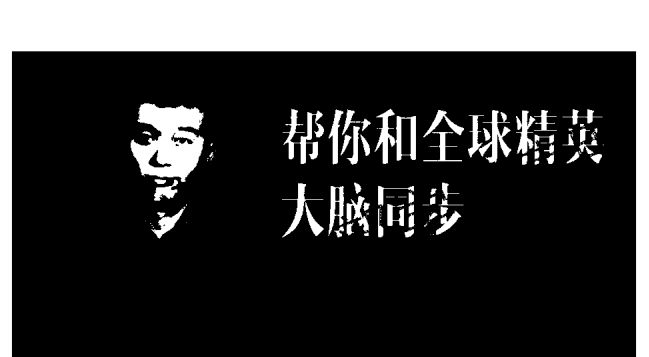

## 日课035 | 天才少年还是靠谱的

日课035 | 天才少年还是… ↓

今天谈一个老话题：天才。关于这个话题你肯定已经听过无数种说法了，连我都说过好几次。不过今天我们要说的是一项新近报道的研究，这个研究很有新意，而且对家里有聪明孩子的家长们可能有用。

我们要分享的是《自然》杂志九月份的一篇长文，How to raise a genius: lessons from a 45-year study of super-smart children（怎样养育天才：一项针对超级聪明孩子的四十五年跟踪研究能告诉我们什么），作者Tom Clynes

在说这个研究之前，我先来梳理一下目前，据我所知，学术界对天才的看法。

一个人到底行不行，基本上就是两方面：天生素质怎么样，以及后天你练得怎么样。四平八稳的答案当然是两个因素都重要——但科学家可不爱和稀泥。

有很多研究强调先天素质的重要性。一般来说，这个“先天素质”就是智商。这是一个非常容易引起误解的概念，有人说智商高的人可能情商低，有人说智力测验不可靠，考察的只不过是考试能力……这些老百姓的说法都是错的。学界共识：

- 1. 智商是一个“通用”的能力。这意味着如果你做大规模统计，那么人的其他各项素质，包括情商在内，甚至包括体育成绩在内，都跟智商是“正相关”的也就是说智商高的人情商也高，身体素质也高。这方面的研究实在太多了，从统计角度，智商高的人不但成绩好，而且工作水平高，而且收入高，而且更能跟配偶搞好关系，而且生的孩子智商也高……

- 2. 智商的确是天生的，可以遗传。一个人的智商在一生之中是比较稳定的，并不容易通过刷题的办法提高。

但是注意，以上说的都是“从统计学角度而言”。大趋势如此，不排除有各种特例。如果你说“我知道一个人智商特别高情商就特别低”，你反驳不了我——我知道五百个人智商高情商也高。

我听到过关于智商最恰当的比方，就是——智商之于个人成就，就如同身高之于篮球。高个子不一定都能打好篮球，但是一个少年篮球教练选材的时候问的第一个问题肯定是这孩子身高多少。

我再强调一遍，上面这个理论说的是大趋势。从智商55到智商145有各式各样的人，他们的“总体情况”，基本上可以用这个智商理论来“粗略地”描写。

现在我们不看所有人，专门关注那些取得了“一定的”成就的人——比如说拿到了一个博士学位——上述这个粗略的大理论在这个小区域内，就要进行微调了。

这个微调就是后天努力的作用，在这群人之中，显现出来了。

这群人的智商都是比较高的，应该都在110以上。那么在这群人中，是否也是智商越高，成就越大呢？一个智商145的人，是不是在很大概率上比一个智商是125的人厉害？

这就引出了历史上一个非常著名研究——几乎每本讲智商的书都要引用它——心理学家Lewis Terman，在上世纪20年代，从美国加州精挑细选了一批高智商儿童，对他们的一生（！）进行长时间的跟踪研究，而且还想方设法给这些儿童各种鼓励和成长建议，试图用这些人的成才，来证明“牛人都是天生的”。

结果实验失败了。Terman这批人里面后来几乎没出什么名人，而当初被他剔除出去的两个学生，后来却得了诺贝尔奖。这两个学生的智商是129，没达到Terman定的入选标准。

所以无数的书拿这个研究说事儿，说如果你关注的是那种扬名立万的大成就的话，那真不是智商说了算的。所谓高智商天才儿童，大未必佳。

这就引出了后面的一系列理论，比如说“刻意练习”理论，强调后天训练方法的重要性。还有所谓“mindset（心态模式）”理论——说你如果是“固定心态模式”，迷信智商，那你就不会有什么大成就；如果你是“成长心态模式”，不信邪信苦练，你就有可能取得智商比你高的人也取得不了的成就。

以上这些，就是在看今天这个研究报告之前，我对“智商与成就”这个问题的了解——我相信这基本上就是学界共识。

而今天要说的这个报道，把上面那个图景又推进了一步。

这也是一项针对聪明的儿童的长期跟踪研究，主持的科学家是Julian Stanley等人。跟Terman那个研究不同的是，Stanley这个研究不看智商，而是专看“数学成绩”。

具体来说，他们从全国范围内选拔那些在12到14岁就能在SAT（美国大学入学考试，相当于中国高考）数学考试中取得一般高中生的top 1%的成绩的孩子，然后通过约翰霍普金斯大学的“天才少年中心”，给这些人提供各种成长上的帮助。

跟踪研究进行了45年，结果是，这回的确把天才给选出来了。

满足项目入选标准，后来又成了名人的都有谁呢？有数学家陶哲轩和Lenhard Ng，有Facebook的创始人马克·扎克伯格，有Google联合创始人Sergey Brin，还有音乐人 Stefani Germanotta —— 也就是Lady Gaga。

不像上述这几位那么有名的话就更多了，其中包括著名科学家和学者、财富500强的CEO、联邦法官、参议员和亿万富翁。

一个人的数学成绩当然跟智商也是正相关的，但这个研究说明，数学成绩似乎是一个比智商更精确的“成才预测指标”。

这项研究还告诉我们几个有意思的事实：

- 数学能力绝对是最重要的，比智商重要。

空间思维能力，也就是能记住空间中不同物体的关系，能估算一瓶水倒在不同容器里的水位，这种能力也很重要，仅次于SAT数学考试成绩。

你用前面那两个标准去寻找天才儿童，但光找到还不行，你得想法培养他。

最好的办法就是鼓励他跳级，能上大学就赶紧上大学。

有家长认为跳级对孩子社交不利，但那是普通孩子的问题——对这些天才儿童来说，高中的复杂社交局面反而是个累赘，还不如直接到大学跟书呆子们在一起混。

现在总结一下，有了这个研究结果，我们的天才观大约是这样的：

- 1. 就全体人类而言，智商越高，成就越高。

- 2. 如果你只关注其中智商“比较高”的人群，那些取得了“一定成就”的人，后天努力的因素很重要。

- 3. 如果你再只关注“2”中更小范围的人群，那些取得了“非凡成就”的人，还是先天的因素厉害。
群，那些取得了“非凡成就”的人，还是先天的因素厉害。

## | 由此得到

- 1. “以一般人努力程度之低，根本轮不到拼天赋”——没错，但是对“不一般”的人来说，真得拼天赋。

- 2. “数学就是用来把这7成人筛出去的”——对到处要用数学和逻辑的现代世界来说，这句话有可能说对了。连Lady Gaga都是从小数学好。

- 3. 但是！这项研究只研究了数学好的人，没有研究那些数学不好但是也取得了不起成就的人。从逻辑上讲，“数学好的...”

2. “数学就是用来把这7成人筛出去的”——对到处要用数学和逻辑的现代世界来说，这句话有可能说对了。连Lady Gaga都是从小数学好。

3. 但是！这项研究只研究了数学好的人，没有研究那些数学不好但是也取得了不起成就的人。从逻辑上讲，“数学好的人很厉害”，“不等于”，“数学不好的人不厉害”——就算是数学不好的人，也应该能理解这个逻辑 :)

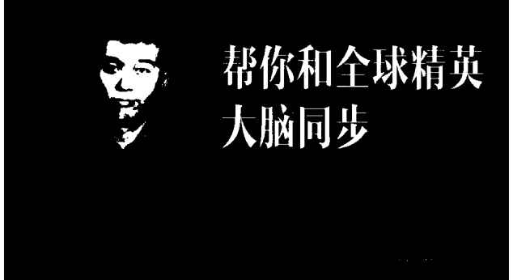

## 日课036 | 专家，给我一句准话

日课036 | 专家给我一句准话

我们先来想象一个场景。在一个假想的中国，你去参加一场假想的“中国经济形势报告会”，主办者请来两位假想的专家作报告。

A专家先用一个精彩绝伦的笑话开头，然后论述了当前中国经济的五个特点和三大危机，紧接着，他对近期中国经济走向给出了四个明确的预测：房价将在2017年上半年迎来拐点，人民币将在今年年底一次性贬值10%……最后他给听众提供了五个建议：购买美元和黄金，谨慎对待中国股市，等等等。

B专家一上来先向听众道歉，说我好几年前就判断中国房价过高，但是房价仍在上涨，所以我也不知道什么时候才能走低……过去四年我的预测准确度只有50%……实在抱歉，今天我也不知道是多买点黄金好，还是买股票好。

请问你给哪个专家打分更高呢？你会相信哪个专家呢？

答案当然是A专家。事实上B专家根本就不会在报告会上出场，像这种连起码的自信都没有的“专家”，主办方不可能给他露脸的机会。

不过，根据两人过往的记录，B专家的准确度的确“只有”50%——但A专家的准确度其实低得多，他过去二十年一直在唱衰中国经济，但是几乎一次都没准过。

可是A专家的书出了一本又一本，本本畅销；电视节目做了一期又一期，期期高收视。

这是为什么呢？为什么有些专家的预测准确度很低，我们还是爱听他们说？

今天我们要说的这本书是：

这本书里提到有一种特别厉害的专家，叫做“世界末日贩子”。他们的核心观点就是未来很恐怖，国家马上要崩溃了，世界将会一塌糊涂，而这些人非常受欢迎。他们一本接一本地出书，而且被非常著名的大学请去演讲，而且爆满。

预测错了怎么办？什么都不用办——他们根本不必为自己的错误买单，因为人们根本不介意！他们的下一本书还是那么畅销。在预测这门生意里，预测错了没人会记得。预测对了，你就一夜成名——不但你自己可以吹，媒体还会帮你吹。

2008年金融危机，中国媒体上铺天盖地都是宋鸿兵，人人称赞他准确地预测了这次金融危机！——可是他后来预测的更大的危机根本没发生，现在又有几人在意呢？如果你去问他，他肯定会说快了快

了，很快我的预测就会再次成真。

像这种特别自信，认准一个死理不放的专家，我们称之为“刺猬”。另一种不怎么自信，说话都是推测性的，对各种结局都给一种可能性的专家，我们称之为“狐狸”。

论预测成绩，狐狸比刺猬强得多。论受欢迎程度，人们绝对是更喜欢刺猬。

书中提到有个大学教授拿自己做了个实验。在有的学期里他讲课的时候故意表现出自信满满，用演讲家的标准要求自己；在有的学期里他做回真正的自己，用学者的方式老老实实给学生传授知识。结果在他刻意自信的那些学期，学生对他的各项评分都更高，而且认为他的学术水平也更高——尽管讲的内容都是一样的。

所以劝说别人的关键，不是知识水平，而是自信。比如你提供金融咨询服务，最好的办法就是直接告诉客户现在要做什么，越明确越好！

你必须讲一个简单的故事。这个故事里可以有意外惊喜，可以搞个威胁来引起别人重视，而最关键的则是一定要有结局！困难必须被解决，坏人必须被抓住，千万别搞什么开放式结局。

下面这张图，是奥巴马上任之初提出的经济刺激计划对降低失业率的许诺：

奥巴马说，如果用了我的这个复苏计划，失业率下降就会按照图中的深色实线走；如果没有这个计划，失业率就会按照图中浅色实线走。

至于说这两个曲线有多大的不确定性，什么误差大小，奥巴马给你来个统统不显示。故事简单，预测明确，老百姓一看，真心佩服！

那么计划执行了，实际结果呢？是图中红色圆点代表的那条曲线，失业率远远高于奥巴马的预测！可是这时候你说别的已经没用了，绝大多数老百姓根本就想不起来对比一下奥巴马的预测和结果。

奥巴马提供的，是一个确定的故事，而身处金融危机中的美国“各界群众”，恰恰需要这么一个故事。

### 确定性，是一种极大的心理安慰。

书中描写了一个对受试者进行电击的实验。第一组受试者被明确告知，你会被电击20次，每次的力度都是如此，很强。第二组受试者不知道自己会被电击多少次，也不知道每次的力度会有什么变化。结果尽管实际上第二组遭受的大多数电击都比第一组弱很多，他们的感受却比第一组差很多。

这种不知道会发生什么坏事的感觉，真是非常非常难受。

所以人们想尽了办法去追求一点“确定感”。

一个办法就是搞迷信活动。有研究者调查了一个处在原始社会的海岛，岛上居民时不时会搞些迷信的祭祀活动——但不是什么时候都搞，只在出海捕鱼，或者要防止虫害的时候才搞！也就是说，当你感觉一切尽在掌控的时候你不会有什么迷信思想，只有当你面对不确定性的时-候，你才会选择信点什么，希望能有个神灵来帮你掌控命运。

一个办法就是给自己强加一些严格的纪律。有研究发现，1920年代美国经济比较好的时候，人们更愿意去那些比较自由的教堂。等到1930年代美国经济危机，去教堂的人数不但增加了，而且他们去得更多的是充满教条主义的教堂。

一个办法就是寻求阴谋论。越是经济不行，社会动荡的时期，人们越热衷于各种谣言和阴谋论。日子越是充满不确定性，我们越要抓住一点确定感。

哪怕是确定的坏消息都是好消息，这就是刺猬专家的生财之道。

### ｜我的评论

你读完上面内容，可能会觉得现在我知道这些道理了，那么我就对刺猬专家有免疫力了。别人说的越好听，表现得越自信，我肯定越不听他的！

我觉得你可能高估自己了。至少我高估了我自己。

你知道美国有一种退休金是私营的，你自己选择每月存多少钱，然后一个私人公司帮着你投资和管理，比如说401(k)，403(b)之类。我的退休金曾经交给一个叫Fidelity的公司管理，这个公司服务很好，有时候主动派人到你的工作地点，提供一对一的咨询服务。

有一次在这种咨询中，Fidelity公司的人问了我几个问题，我一一如实回答，然后他马上说，根据你的情况，你现在买的这个投资组合太保守了，而且你选的这个“中国概念”基金我不看好——我建议你把那些都卖掉，全部买这个xxx基金。

Fidelity的网站上有好几十种不同的基金选择，我自己看的眼花缭乱根本没认真想过买哪个好。而他并没有给我三个选择，也没有告诉我他对自己的判断有多大信心，他就是这么明确地告诉我应该买这个基金。

我心说金融的事儿哪有那么大把握？可是他的自信感染了我，我当即决定按他说的办。这就是一个面对面的，充满自信的，刺猬专家的力量。

如果你生病了看医生，你希望你的医生是刺猬还是狐狸？可能美国医生受的训练之一，就是务必要在病人面前表现出自信。

### ｜由此得到

他们说这叫自信，我们说这叫刺猬。

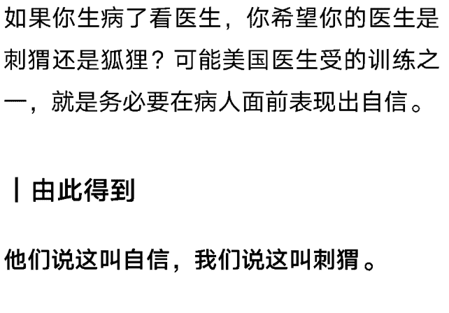

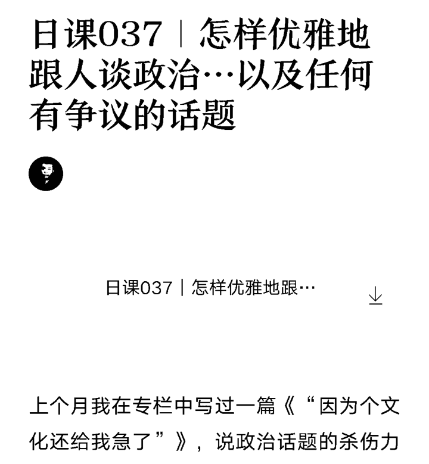

## 日课037｜怎样优雅地跟人谈政治…以及任何有争议的话题

日课037｜怎样优雅地跟…

上个月我在专栏中写过一篇《“因为个文化还给我急了”》，说政治话题的杀伤力实在太大，跟亲朋好友最好干脆不谈。结果最近我在《哈佛商业评论》上看到一篇新文章，专门教人怎么谈政治。

这篇文章叫 *How to Talk Politics at Work Without Alienating People*（怎样在不疏远别人的情况下谈论政治）作者 Joseph Grenny，David Maxfield，Candace Bertotti，Chase McMillan

未必所有读者都对政治感兴趣，但这篇文章说的其实是谈话技巧，这些技巧可以用于任何容易引起争议的话题。而且这篇文章是学者写的，说的内容都有研究支持。

今年正好是美国大选年，支持希拉里和支持特朗普的两派选民针尖对麦芒，分歧之大前所未有，不惜以最狠毒的语言攻击对方阵营，简直是不可调和的矛盾。在这种情况下，一个美国人是不敢轻易跟人谈论政治的，一言不合，友谊的小船可真是说翻就翻。

这几位研究者专门还做了调查统计，有三分之一的美国人曾经因为暴露自己的政治观点而遭到直接点名的人身攻击；有四分之一的美国人曾经因为讨论政治而永久性地损害了跟亲友和同事的关系。

对此我很有体会。跟不太熟的人不谈政治。关系比较近的，到今年也得重新试探，一旦发现是一个阵营的，才敢眉飞色舞地大谈特谈。以前一到大选年，美国街上就会有很多汽车贴上车贴，自豪地宣布自己属于哪个阵营——可是今年这种车贴就很少见，舆论压力实在太大。

那么这就形成了一个所谓“回音室”效应，就是人们只跟自己阵营的人谈政治，双方阵营根本听不进去对方的声音。这个现象实在不好，做人得兼听则明啊？所以研究者就号召我们去跟对方阵营的人搞搞双边的政治对话。

研究者搞了一套谈论政治的对话技巧。然后他们拍了一段用这些技巧谈政治的短片，再用一段用普通方式谈政治的短片作对比。然后他们在网上找了3688人观看不同的短片来做评测实验，结果非常明显：如果使用这些技巧谈政治，那么听众不管是不是你同一阵营的，都会认为你这个人处事圆滑老练，受人喜欢，很有见识，有说服力，愿意跟你对话和交往。

聊政治居然能聊到这样的境界，这套技巧肯定是值得学习的了。一共分四步：

第一，一上来要摆一个向对方学习的姿态。原来你支持特朗普啊，其实我也有自己的看法，但我对你的看法很感兴趣，请问您能不能跟我分享一下你的观点呢？

第二，在说自己的观点之前，还要先征得对方的允许！我对移民问题的看法跟您不太一样，不过我不是来跟您争论的……您看，我能说说我的看法吗？

第三，全程要充分尊重对方。作者说，尊重就如同空气，如果你突然把尊重拿走，那对方满脑子想的就只是尊重！我非常珍视你的视角！我想听到你的观点，而且我也不敢假设我的观点是对的。

第四，寻找双方的共同点。先得找到共识，才能从这个共识出发去谈具体的问题——中国有个政论网站就叫“共识网”，口号是“在大变革时代寻找共识”。可能是保守派你是自由派，但最起码咱们都是爱国者吧？——好吧就算你连“爱

国”都反对，那最起码咱们都希望全国人民过上好日子吧？

### | 我的评论

我不论在生活中还是在网上，几乎没见过用这种方法谈政治的，一般能做到各抒己见而不翻脸就算好的。如果有人这么跟你说话，明明不是一个阵营还能让你如沐春风，还跟你找共识，你最好重视他，这不是一般老百姓说话的方式。

不过这套方法并不算新鲜，有本很有名的书叫 *Crucial Conversations: Tools for Talking When Stakes Are High*（有中文版，《关键对话》），早就总结过类似的对话技巧。事实上，这篇文章的第一作者 Joseph Grenny，正是《关键对话》一书的作者之一。

《关键对话》这本书提出的一个对话关键，就是一定要让双方都有心理安全感。哪怕你觉得这个人差到不行，你也得在他身上找到一个值得尊重的地方，否则这个话就没法谈。一旦有一方失去安全感，进入防守反击的状态，肯定谈崩。

我们谈话的目的从来都不应该是为了赢得什么争论，我们的目的是为了让这个人按我们的想法去把事儿办了，是为了赢得这个人！**把一个希拉里的支持者给气哭了不算本事，你能说服她去给特朗普投票，这才算本事！**

就算说服不了她，能了解她的想法，能让她心平气和地了解你的想法，也算一得。你了解了对方阵营的视角，而且也许你就在她心中埋下了一颗将来可能会发芽的种子。这样的对话才有意义。

### | 由此得到

对话技巧都在其次，**明确目的和态度，才是关键。**

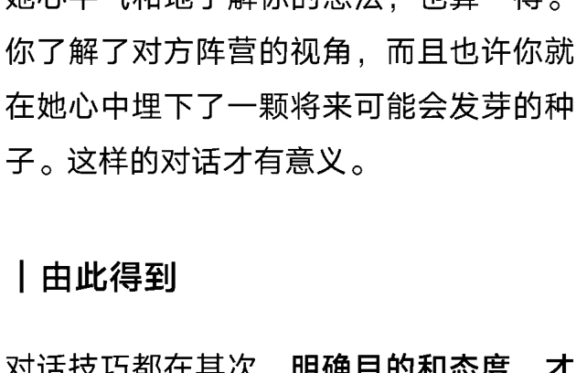

## 日课038｜花小钱的学问

日课038｜花小钱的学问

《魔鬼经济学》这本书中有个“以色列幼儿园”的故事，想必你已经听过了，没听过的话我先来再讲一遍。

对幼儿园来说，家长接孩子迟到是非常头疼的事情，老师到了下班时间还得陪着孩子等。有几个经济学家就从以色列选了六个幼儿园，搞了一项“迟到罚款”实验——具体来说，如果你接孩子迟到十分钟，幼儿园就给你相当于三美元的罚款。

结果适得其反，这六个幼儿园的迟到率全都显著增加。即使后来取消了罚款规定，这六个幼儿园的迟到率仍然高于其他幼儿园。

原因非常简单。本来，家长知道自己迟到就会让老师下不了班，这是欠老师一个人情！可是现在实行罚款制度，这就等同于花钱购买服务了——那我就没必要紧赶慢赶，实在来不及就花点钱呗。

今天说这个故事，是因为我觉得这个实验设计得不太好，其实我们并不能从实验中得出“迟到罚款不好使”这个结论。事实上我家小孩去的幼儿园也实行迟到罚款制度，但是几乎没人迟到！

因为我们那个幼儿园的规定是每迟到一分钟，罚款五美元。你要迟到十分钟，就等于多交一天的学费。所以罚款不是不好使，关键在于你罚多少钱。一个设计良好的实验应该在不同幼儿园实行不同的罚款额度。

我想说的这个道理是，小钱不如人情重。以色列幼儿园家长们本来以为老师的情义无价，罚款制度一公布才发现原来价格是十分钟三美元。

今天要说的这本书是： The Why Axis: Hidden Motives and the Undiscovered Economics of Everyday Life（“为什么”轴线：日常生活中的隐藏动机和经济学）作者 Uri Gneezy and John List

这本书已有中文版：

这两位作者可不一般，他们等于是一手开创了“实验经济学”这个学科。江湖传闻John List将来可能会得诺贝尔经济学奖。而这位Uri Gneezy，恰恰就是主导了前面说的那个以色列幼儿园实验的经济学家。

经济学家的通常做法是事后分析，很少主动实验，毕竟没有哪个国家会让你来实验个什么宏观经济政策。不过如果经费充足的话，微观经济学还是可以实验一下的。这本书中的内容，就是经济学家们拿着真金白银去主动实验得出的结果。我看书中好几个实验都是花一点小钱看人怎么反应，实验结果对我们——如果你是个商人或者创业者，想要花钱给顾客一个激励的话——“怎么花小钱”，很有启发。

书中一个实验是让高中生当志愿者，挨家挨户敲门搞募捐。研究者把高中生分为三组：

对第一组学生，研究者主要给他们精神鼓励：这个捐款很重要，能帮助很多人！

对第二组，研究者给他们一个金钱奖励：你募集来多少捐款，我们给你相当于1%捐款的奖金。而且这个奖金是我们给，不从捐款里出。

对第三组也是给奖金，但力度更大，是10%。

结果是第一组，那些没有任何奖金，纯粹为了帮助别人而去募捐的人，走家串户最卖力气，拿到的捐款也是最多的。10%奖金组的成绩排第二，而1%奖金组募来的捐款最少。

所以钱给少了还不如不给。人并非做什么事情都是为了钱，有时候精神上的鼓励就比给钱有效得多——至少比给小钱有效得多。

一个类似的例子是让志愿者回收易拉罐。如果告诉志愿者，我们这么做是为了保护地球环境，他们就会很有干劲。如果你告诉志愿者每回收一个易拉罐给五分钱，可能根本没人理你。

那么如果你想让人干一件比较乏味的事情，不涉及慈善和环保这些高大上的理念，精神鼓励就用不上了，也许就只能给钱。那么这个钱应该怎么给呢？书中还有一个有意思的例子。

某公司想对客户搞个调查，希望用户能够花点时间，上网填写一份问卷表格。像这样的事儿如果你不给钱恐怕就没人会做。但给钱有两种给法。一个办法是让用户先填表，表格填好了给一笔钱作为奖励。另一个办法是直接给用户寄现金，然后请求他填表——也许用户平白无故收了钱觉得过意不去，就会帮你填个表作为回报。哪种方法好呢？

经济学家就把用户搞了随机分组，有些用户得到的信息是先填表再给钱，有些用户则收到了带有现金的信封。结果是这样的：

如果给的钱比较少，每人15美元以下，那么最好的办法是先给钱，争取赢得用户的回报心。

如果给的钱比较多，比如你可以给每个人30美元，那么如果先给钱的话显然你发不出去多少个信封，最好的办法就是要求客户填了表之后才给他钱。

小钱要先给，大钱要后给。你让我去花时间挣一笔小钱，我懒得理你；但是如果你钱已经给我了，我不愿意欠你这个人情，所以我帮你。换句话说，当钱少的时候，人比较讲感情，并非是经济思维；当涉及到的钱多的时候，人就是经济思维了。

### 丨我的评论

其实这个道理，中国读者肯定是一听就明白。我们在生活中不就是这么做的吗？公司逢年过节要给员工发个什么小福利，就是主动给——根本不看业绩，全公司上下人人有份，图个大家都高兴。如果是大钱，年终奖之类，那就必须看你对公司的实际贡献怎么样，得先有业绩才能给。

所以如果你打算给别人一点小恩小惠，那就牢记一点：一定要不计回报地主动给。公司对员工，领导对手下是这种给法，下级对上级也是同样的原理。我们看在官场上，小人物想要巴结大人物，又给不了对方真正需要的东西，最好的办法就是找机会帮他一个小忙——对方出于不好意思占便宜的心理，将来就有可能给一个实际分量更大的回报。

经济学的一条最基本的原理，就是“人会对激励做出反应”。但是注意，“激励”不等于金钱。钱只是激励的一种，而有时候精神上的满足感就比金钱更有激励作用。那些不在乎幼儿园罚款的家长，不愿意为了1%的奖金而拼命募捐的学生，你能说他们是非理性的吗？其实他们恰恰是理性的，他们知道金钱的合理价值。

有些家长，可能是为了从小培养孩子的经济意识，也可能是自己学经济学学得走火入魔了，在家庭内部给孩子实施奖金制度。倒一次垃圾，奖励多少钱；洗一次碗给多少钱；陪弟弟妹妹玩给多少钱……这种状况真正的经济学家也研究过，结果是灾难性的。

本来，孩子做这些事情是在帮助家里，是亲情和爱的表现，你现在把什么都变成挣钱，那我去麦当劳打工不是更好？

## 由此得到

经济学研究激励，而小钱恰恰不适合作为激励。如果你用罚款罚小钱，别人就会认为违规很值得。如果你用小钱作奖励，别人就会认为干事儿不值得。小钱最好的用法就是主动、立即、免费送给对方，以期换一个人情。

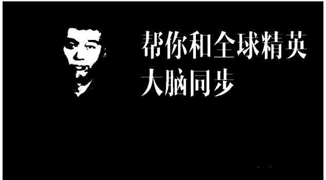

## 周末小议 | 观众的热闹和选手的门道

上周末，附近某小镇搞了个热气球节，我们一家过去看了个热闹。热气球运动在美国民间挺流行，时不时就能看到天上飘着几个，而走近观看，对我却是第一次。

提起热气球，你想到的是什么呢？在天上俯视大地的愉悦感，还是潜在生命危险的刺激？本来我想的是这两个感觉，但在现场感受到的却不是这些。

整个场地大概也就是两个足球场大小，周围还有山。热气球从这里起飞容易，降落时再想回到这个场地就有点困难。有好几个热气球后来降落在了场地之外，需要靠人甚至靠车给拉回来。有几个甚至降落在了山腰上。

我跟一个热气球团队的“地面人员”聊天，他们告诉我，上去以后控制方向非常困难。热气球本身没有任何水平方向的动力，你所能做的只是让它上下运动。风吹向哪里，你就往哪里走。好在不同高度气流的风向（可能）不一样，你可以通过选择高度来选择风，用这个方法让热气球运动。问题是，如果你想要北风，那么北风到底在哪里？应该往上走还是往下走？这里面没有什么高科技，你只能凭运气赌一把。

后来大部分热气球都下来了，但有两三个还在天上上上下下地找风。其中一个还越吹越远了。

我们以为选手们上去以后是俯视众生的心情，其实他们想的都是风。

这些热气球看上去很大，下面装人的筐很小，每个热气球上只能有一两个人。可是提供地面支持的“团队”，至少还需要三个人——他们自己不上天，帮着收发气球，工作必不可少但是没有高光。热气球降落以后，要用中间的一跟缆索把它拉倒，需要几人配合，我还帮了把手，异常沉重。

所以这就好像文艺演出一样，观众看到的是充满激情的表演，实际上从演员到工作人员，做得都是特别具体、没有那么多激情的工作。任何工作都是如此。高光时都很少，体育新闻里的射门集锦根本代表不了足球运动员大部分时间做的事情。

如果我们不满足于当个观众，想要真的参与乃至从事某个工作，我们就必须从看着热闹的观众视角，切换到选手的视角。那么你就会看到很多很多琐碎的、麻烦的、重复的、不如意意的、反复拆腾反复失败就好像有人故意跟你作对一样的东西。

这时候再看所谓从天上俯视大地的优越感，打进关键球的荣耀，做出科学发现的快乐，这些东西的作用也许仅仅是吸引你入门。如果没有高光的刺激你就不会入行，入行之后你才发现原来工作中不总是高光。

热气球团队需要不是上天以后赞叹地面景色写诗的人，他们需要的是能不厌其烦地，甚至乐在其中地找到风的人。

那么怎么对待这些工作中绝大部分时间干的“小事儿”，这就引出了几种不同的工作态度。

有的人工作纯粹是为了升职加薪。他们心目中钱是第一位的；比同事强，让别人听自己指挥是第二位的——而工作本身对他们没有什么乐趣可言。对这些人来说工作本身就是吃苦，而升职加薪，就是对自己吃苦的回报。这些人工作的动力，就是所谓“外部驱动”。我曾经看过好几个实验，外部驱动，比如直接给一个金钱的刺激，的确能在短期内让人的工作水平迅速上升——可是长期看，他们就不如那些有“内部驱动”的人干得好。

有的人在工作中追求高光时刻。他们可以不厌其烦地做好各种小事儿，台下练十年功，不仅仅是为了什么升职加薪，更是为了台上那一分钟。这些人是“内部驱动”，他们为了心中的大事，根本不在乎，甚至可以主动去做一些不起眼的小事。

第一种人从事的一般是比较低端的工作，工作本身没什么意义，意义都在金钱和职位上。第二种人从事的很可能是高端工作，运动员、科学家、政客，他们想要的远不止奖金和职称。给第一种人放几天带薪假他们会很高兴，而第二种人认为任何假期都是浪费时间。

但是还存在第三种人。这些人并不认为“小事”是为了金钱或者“大事”而做的牺牲，反而做小事也乐在其中，追求每一件事情都做得漂亮。

在热气球现场，我看那些地面工作人员，做小事儿做得很好。热气球节没有什么金钱奖励，观众免费入场，也没有什么赞助商。可是从帮着管制交通的人，到帮着收发热气球的人，每个人都很arj有干劲，仿佛能参与一项“上天”的事业，各人引以为荣。我看他们收气球的方法还是标准化的，把筐拉到哪里，什么时候可以放倒气球，放倒后怎么把空气挤出去，包括绳子怎么卷，似乎都有一套固定做法。

这些人愿意在工作中找小门道，而且不是为了回报。

同样是写程序，我见过完全不追求代码美感，对付着把功能实现了就算的人，也见过特别受不了笨拙的代码，看你写的不漂亮非得告诉你怎么写漂亮不可的人。

像这样的人如果帮你组装一台电脑，肯定会把内部走线都弄得特别整齐。他们如果作盘菜，肯定连肉的切法都特别讲究。

你可能觉得这第三种人有“工匠精神”，是最厉害的，但据我个人观察，其实不然。如果论个人成就的话，第二种人才是最厉害的——他们做事的目标非常明确，知道怎么用最快的手段达到目的。而第三种人，可能过分注重做小事的姿态，而耽误了大事。

不过如果你说谁最“幸福”，那肯定是第三种人。活在当下，像享受生活和享受高光一样享受日常的普通工作，还有什么比这种日子更幸福？

享受过程和追求结果，其实是两码事。不存在哪个对哪个错，在我看来都值得尊敬。可是如果一个 人停留在观众看热闹的视角，眼高手低，只关心高光不好好做小事，真给你一个活上 手就完蛋，那就什么驱动，什么门道都谈不上来了。

### | 未来预告

万维钢

从明天开始到7号假期结束，我都会为你解读《人类简史》作者尤瓦尔·赫拉利的新书：《未来简史》。
这本书的英文版九月份刚刚在英国出版，美国版要等到明年一月。而中文版要等更久。

读《人类简史》作者尤瓦尔·赫拉利的新书：《未来简史》。

这本书的英文版九月份刚刚在英国出版，美国版要等到明年二月，而中文版更要等到一年以后，我直接从英国邮购了一本。这么着急看，是因为赫拉利看问题的眼光实在特别，我必须让咱们日课的读者在第一时间知道！

明天见！

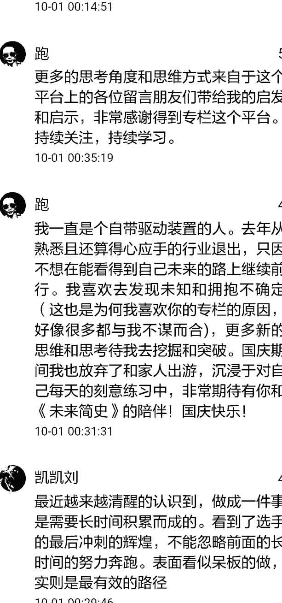

## 日课精选

罗小建 35
台上一分钟，台下十年功。我喜欢成功有为之后赞赏的感觉。于是我在苦练着，并花了199为自己做了个投资，要知道我平时买矿泉水都舍不得买2元的农夫山泉，而是选1.5的冰露。
10-01 00:14:54

稍等 18
纸上得来终觉浅、绝知此事要躬行。
10-01 00:08:43

颜桥 13
总结就是：目标驱动和过程驱动。太强目标感的人有时也会患得患失，反而不如笨拙死磕的人来得有乐趣。我个人觉得，享受过程和目标明确像一个跷跷板，你总是在平衡里找到一个事情的最优感觉。并没有一个固化的类型像程序里的循环。
10-01 00:14:51

跑 5
更多的思考角度和思维方式来自于这个平台上的各位留言朋友们带给我的启发和启示，非常感谢得到专栏这个平台。持续关注，持续学习。
10-01 00:35:19

跑 4
我一直是个自带驱动装置的人。去年从熟悉且还算得心应手 Fetcher 行业退出，只因不想在能看得到自己未来的路上继续前行。我喜欢去发现未知和拥抱不确定（这也是为何我喜欢你的专栏的原因，好像很多都与我不谋而合），更多新的思维和思考待我去挖掘和突破。国庆期间我也放弃了和家人出游，沉浸于对自己每天的刻意练习中，然后期待有你和《未来简史》的陪伴！国庆快乐！
10-01 00:31:31

凯凯刘 4
最近越来越清醒的认识到，做成一件事是需要长时间积累而成的。看到了选手的最后冲刺的辉煌，不能忽略前面的长时间的努力奔跑。表面看似呆板的做，实则是最有效的路径
10-01 00:29:46

Teresa 3
老师节日快乐，我就属于你说的第三种人，很在意自己的主观感受，对小事都一样认真，有时可以不求回报只在于当时的感受，后来也发觉自己的问题：正如你所分析的目标性不强，对小事也特别认真没有抓大放小，导致很多大事没做好，看到这篇分析真有感触，目前正在有意提高自己的做事的目的性
10-01 00:29:14

刘强 2
冰露1块钱 哈哈哈
10-01 00:32:34

寒汐林 2
得到那位老师说来着，如果你要成为某个行业的人，你就要以那个行业的标准要求自己。比如，你想做个vc，你就必须以vc的专业性来要求自己，你得让自己成为选手，而不仅仅是观众。异曲同工之妙~
10-01 00:30:34

老哥新唱 2
看到前面的内容，觉得今天只是来占沙发的，到后面才发现错了。今天又上了一课：不要抱着看热闹的心态，这样容易三分钟热度。而应该是第二种人：目标就是为了跟着牛人（万）变牛逼！从小事中看到别人看不到的深度，做到别人做不到的细腻……
10-01 00:13:40

## 《未来简史》解读1: 学历史的作用是让我们更自由

未来简史解读1：学历史的...

现在正好是十一假期，我们来干一件在这个假期最值得干的事情：一起阅读《人类简史》作者尤瓦尔·赫拉利的新书，《未来简史》。

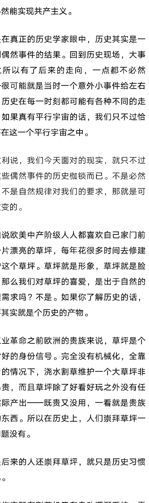

这本书的英文版九月份刚刚在英国出版，美国版要等到明年二月，而中文版更要等到一年以后，我直接从英国邮购了一本。这么着急看，并不是为了书里的流行话题害怕读晚了跟不上套路，而是因为赫拉利看问题的眼光实在特别。

超越人类智慧的人工智能、主动的基因改造技术，更高级的经济增长，会把人类变成什么样？同样是人人关心的大问题，经他一分析，就连老司机的三观——世界观人生观价值观——都能被刷新一遍。

有多少历史学家对当前生物学的进展信手拈来？有多少宗教哲学家了解截止到2016年，现代科学对人的“意识”的理解？有多少经济学家能同时用历史、心理和动物学的理论解释明白，让大规模人群合作，和小团队互动，有什么本质的区别？非得有一位像赫拉利这样通才式的学者，才能把这一切整合起来，让我们对现代世界有点深入的见识。

谈到未来，有乐观和悲观两派看法。乐观的看法包括《理性乐观派》、《富足》这样的书，说毫无疑问科技进步会让我们的生活更好；悲观的说法有的说人工智能将会统治世界，贫富差距将会增大，或者环境将会恶化云云。

这两派意见，放到赫拉利这本书里，连给前言部分做个背景都不配。

赫拉利要说的内容，我可以用几句话做个简单的预告：

- 1. 推动社会变革的不是我们对真实现实的认识，而是我们头脑中虚构的现实，也就是宗教的力量。
- 2. 人文主义就是现代世界的宗教。
- 3. 科学和人文主义有一个交易，使得我们现在对人文主义的信念越来越强，而且要根据这个信念去改造世界和自己。
- 4. 但是人文主义有个致命缺陷，会让这个故事在未来讲不下去——必须换一个新故事。

别着急。到底什么是“人文主义”，乃至什么是“宗教”，我们会在接下来的几天仔细解读这些意思。一旦你了解了这套思想，就...

我读书这几天正好赶上美国两党总统候选人第一次电视辩论，我放下书看希拉里和特朗普，就好像看两个小孩一样。

这可不是说读这种“X万年来谁著史”（如果你认为忠于李鸿章原文更重要，X=1；如果你认为忠于智人历史更重要，X=7）的大书特别容易让人自大。实际上赫拉利就在这本书里说，历史学家的作用绝不不仅只是让你有个更大的视角，而是让你更自由。

### 学历史到底有啥用？

我们从小受到的教育是，学历史是为了相信历史是必然的。中国人民必然战胜日寇的侵略，解放思想和改革开放必然发生，和平和发展必然是世界的主题，中国经济必然是高速增长……这样我们就会充满干劲，相信将来必然能实现共产主义。

但是在真正的历史学家眼中，历史其实是一系列偶然事件的结果。回到历史现场，大事件之所以有了后来的走向，一点都不必然——很可能就是当时一个意外小事件给左右的。历史在每一时刻都可能有各种不同的走向，如果真有平行宇宙的话，我们只不过恰好落在这一条。

赫拉利说，我们今天面对的现实，就只不过是这些偶然事件的历史枷锁而已。不是必然的，不是自然规律对我们的要求，那就是可以改变的。

比如说欧美中产阶级人人都喜欢自己家门前有一片漂亮的草坪，每年花很多时间去修建维护这个草坪。草坪就是形象，草坪就是脸面。那么我们对草坪的喜爱，是出于自然的生理需求吗？不是。如果了解历史的话，草坪其实就是个历史的产物。

对工业革命之前欧洲的贵族来说，草坪是个非常好的身份信号。完全没有机械化，全靠人力的情况下，浇水割草维护一个大草坪非常昂贵，而且草坪除了好看好玩之外没有任何实际产出——既贵又没用，一看就是贵族家的东西。所以在历史上，人们崇拜草坪一点问题没有。

可是后来的人还崇拜草坪，就只是历史习惯而已。

现在你家既有割草机又有自动灌溉系统，弄个草坪的成本跟当年的贵族不可同日而语，你每周末割草又想做给谁看，想发个什么信号呢？

了解了草坪崇拜的历史，我们知道这件事只不过是历史习惯，不是自然的和必然的，我们就多了一个选择——也许你就没必要跟着邻居人云亦云，背负这个历史枷锁！比如我看学中国园林，在门口两棵树，一棵是枣树，另一棵也是枣树，不也很好吗？

学历史的最大作用，是让我们更自由。

作为中国人我再补充一个例子。最近几年人们爱说“凤凰男”，本来这说明阶层在流动，是个好现象，但是一个凤凰男自己可能会觉得很痛苦，什么“我苦斗了十八年才和你坐在一起喝咖啡”之类，有的人甚至憎恨父母。但是如果他好好想想家族的历史，知道自己身上这点孤僻气质只不过是历史的产物，现在经济条件好了根本没必要继续如此！理解了父母，他反而可能冲出身分的牢笼，从此不那么孤僻。

我们学习历史的最重要目的就是要摆脱历史的枷锁。

历史学家的作用不是在紧要关头告诉我们下一步的历史一定会往哪个方向走，反而恰恰是告诉我们你可以想象多种不同的可能性，让历史往一个不一样的方向走。

所以欲知未来如何，我们得先了解历史。事实上这本书大部分篇幅说的不 是未来，而是历史。

### 智人的问题已经基本解决了

历史上一直困扰人类的三大问题是饥荒、瘟疫和战争，这些都是一旦爆发就让一个国家的人口死亡百分之几甚至百分之几十的灾难。

人类长时间生活在生物贫困线的边缘。如果突然来场干旱或者洪水——1694年，法国15%的人口就死亡；1696年，芬兰1/3的人口死亡。

1330年黑死病爆发期间，欧亚大陆上超过1/4的人口死亡，英国死了40%，佛罗伦萨死了一半的人。1520年3月，当西班牙殖民者到达墨西哥的时候，墨西哥总共有2200万人口，但到12月份时，墨西哥就只剩下1400万人——其他人 都死于西班牙人带来的病毒——到1580年，墨西哥的人口就只剩下220万，90%的墨西哥人死了。直到20世纪初，仍然有大规模的人死于传染病。

战争就更不用说了，农业社会15%的人死于战争。

而现在因为科技、经济和政治进步，这三个问题我们都控制住了。这倒不是说没有人因为这三个原因而死，而是说世界上一旦再有人死于饥荒、传染病和战乱，我们会认为肯定是哪个国家的政府，或者哪个国际组织办事不力，而不再认为这些灾难是不可避免的。

整个20世纪只有5%的人死于战争。到了现在的21世纪，过去十几年间，只有1%的人是死于战争。核武器带来了恐怖平衡，更重要的是，在这个知识经济时代，为了什么资源而争夺领土已经过时了。

当年SARS病毒闹得全球风声鹤唳，可是总共的死亡人数也才一千人。

传说18世纪法国“断头王后”玛丽·安托瓦内特有句名言，她说那些穷人吃不起面包可以去吃蛋糕嘛，就像中国晋惠帝说的“何不食肉糜”——现在的穷人听从了这些建议，开始吃蛋糕和肉糜了。2014年，全球过度肥胖的人口就有21亿，而全球营养不良的人只有8500万。在2010年，死于饥荒和营养不良的人数一共才100万，可是死于过度肥胖的人数共计300万。

在这个饥荒不是问题，蛋糕和肉糜泛滥才是问题 的时代，现代人还有什么追求呢？

是过好现在的好日子，顺手加强保护环境，然后老老实实繁衍子孙后代吗？当然不是。赫拉利以历史学家的眼光告诉我们，智人永不满足，现在正爱上三件大事。

### 现在我们想当神人

《未来简史》的英文书名，正标题叫Homo Deus，副标题才是“未来简史”。Homo的意思是人，比如直立人叫 homo erectus，智人叫 homo sapiens。而Deus，在拉丁文中是“神”的意思。

赫拉利的意思是说我们现在要从智人，向“神人”演化了。为此我们正在干三件事。

第一是追求获得永生。历史上所有哲学家都认为死亡是不可避免的，从来没拿死亡当个问题。可是现在我们认为死亡是一个技术问题。

一个人死了，我们总要问一句他是怎么死的——是心脏病吗？是癌症吗？都是身体上出了某些故障。既然是故障就可以解决啊？所以现在很多科技大佬都投入巨资用于疾病方面的研发，其中有的人就明确告诉我们：我就是打算永生不死。

第二是追求幸福。历史上人们从来都认为幸福是一个人的事儿，美国宪法规定的人权也仅仅说“追求幸福的权利”——可没说“获得幸福的权利”。可是现在进步了，人们认为政府应该给国民提供幸福。

第三就是直接成神。首先是对人的基因改造，其次是让人和机器结合，最后也许就是纯机器——直接上人工智能。

赫拉利说，“学历史最好的理由，不是为了去预测未来，而是把你自己从过去解放出来，去想象不同的命运！”

## 帮你和全球精英大脑同步

## | 未来预告

明日内容 《未来简史》解读2：我有意识，它有吗？

## 日课精选

朱晓峰 22
将军总会有种纠结，他希望士兵冲锋陷阵，不怕牺牲，为国捐躯，嘲笑怕死的胆小鬼。但再次打仗时却又喜欢打过几场仗的老兵，老兵就是还没死的士兵。战死是种荣耀，活下来是种智慧。士兵是需要荣耀还是智慧呢？其实不要命的搏杀，却没死掉，只是一种运气而已。结果就是将军喜欢随机。小时候学的那些战胜侵略是必然、什么经济增长是必然，全国人民都想考公务员是不是必然呢？好事儿都是必然，不好的事儿就没人说必然了？仔细推敲，目的论就站不住脚了。我喜欢随机，不干涉才是大自然
10-02 00:23:37

洗启华 15
把自己解放出来，去想像不同的命运。历史是充满偶然的，想想平行世界里的自己在做什么，会怎么做，从而把自己从各种枷锁中解放，做出一些小的改变，就可以收获完全不同的人生。
10-02 00:53:33

张少天 9
将概率论的思想融入到自己看待历史的角度当中去，可能我们看待问题的角度会变得完全不一样。至少我们现在知道，我们现在一切的一切，都是偶然事件叠加出来的产物。
10-02 00:26:33

徐彦超@企业级应用 5
1.不仅仅是学历史的作用，人类所做的一切几乎都是为了尽可能拥有选择权，挣扎着从“不得不”走向“我可以”，要么为了自己，要么为了他人或后世。自由是一种终极选择权。2.牛顿破除人们对神的崇拜，科学却逐渐成为新的宗教，这是对某种事物或信念笃信后的一种必然。若如此，人文主义也不会例外。3.文中所提人文主义的本质缺陷，是不是指人类以人文主义信念加强和改造的结果变成了“造神运动”，从而就陷入了悖论？
10-02 00:35:24

作者 回复
后面会讲。
10-02 00:51:37

肖必材 4
今天的文章观点很劲爆。视角的确是很冲击的。以往的历史都是偶然的，那么现代社会是否可以主动选择了？我觉得我们正在朝这个方向走。只是程度上可能还没那么大。从人类发展的历史来

## 《未来简史》解读2：我有意识，它有吗？

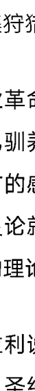

未来简史解读2：我有意识...

我以前工作的大学的图书馆，正门上方刻有一句气势恢宏的话，是古罗马哲学家西塞罗的名言：“只了解自己这一代的人永远是个孩子。”

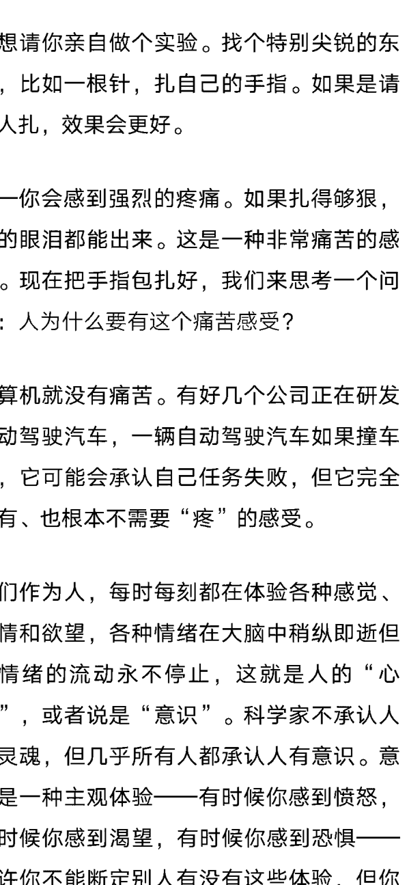

有些事情，有些观念，在一代乃至几代人看来天经地义。但是如果你有点历史眼光，能够从更大的尺度去看，就会发现它以前并不是这样——那么将来也未必还是这样。

我有个小学老师特别爱引用毛泽东的话，我总听她说也就记住一些，其中有一句是“世间一切事物中，人是第一个可宝贵的”。毛泽东的很多话放在今天就容易引起争论，但是这一句，可能不管哪派人物都没有质疑过。事实上，工业革命至今，所有现代国家的一切政治学说，从自由民主到纳粹党，都包含了这个基本假设，这就是人文主义的基础：

> ——人是第一个可宝贵的。

人是第一个可宝贵的吗？

赫拉利在《未来简史》中告诉我们，至少过去不是这样。

### 与神的交易

采集狩猎时代的人并不是无神论者，但他们也不是有神论者，而是“泛灵论”者（animists）——他们就如同《阿凡达》里潘多拉星球上的人，相信万物有灵。他们认为各种动物和人类一样，都是平等的生命。

人和其它动物的关系不是我统治你的关系，而是协商关系——狮子你好，我到这里是为了采集一些食物，我不想伤害你，你也别伤害我。他们必须学会推测动物在想什么，才能追踪到猎物，才躲过猛兽的攻击。

采集狩猎者并不认为人是第一个可宝贵的。

农业革命以后，人把很多动物给驯养了，对自己驯养的动物可以为所欲为根本不用考虑对方的感受了，平等关系也就没有了。那么泛灵论就不能再满足时代的需要，人类需要新的理论，这才产生了有神论。

赫拉利说，基督教就是农业革命的产物。整个《圣经》里唯一一次人直接跟动物对话，是亚当跟蛇——这不就是泛灵论的终结吗？人被上帝逐出伊甸园，说明此你们不能过摘果子直接吃的好日子了，必须靠自己的汗水弄吃——这不就是从采集狩猎到农业吗？当地语言中“夏娃”跟“蛇”的发音其实很相似——这不就是意味着之前的人其实认为自己就是动物界的一员吗？

### 没人理解意识

我想请你亲自做个实验。找个特别尖锐的东西，比如一根针，扎自己的手指。如果是请别人扎，效果会更好。

> ——你会感到强烈的疼痛。如果扎得很狠，你的眼泪都能出来。这是一种非常痛苦的感受。现在把手包扎好，我们来思考一个问题：人为什么要有这个痛苦感受？

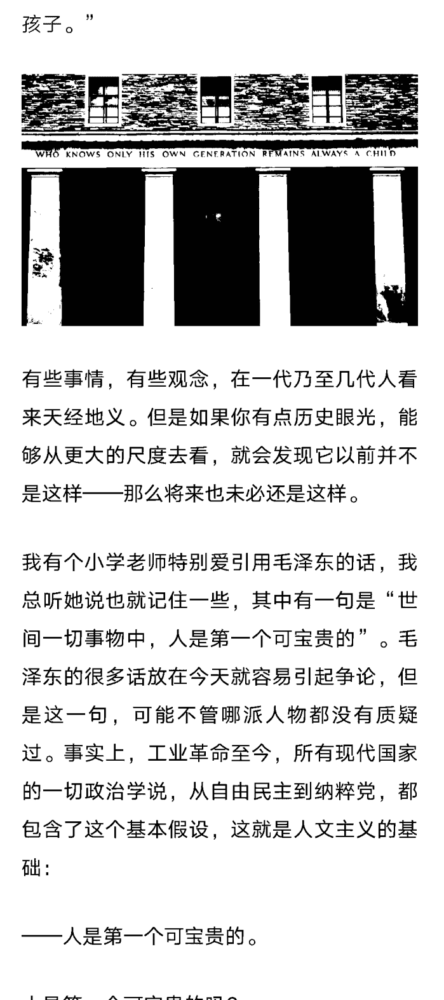

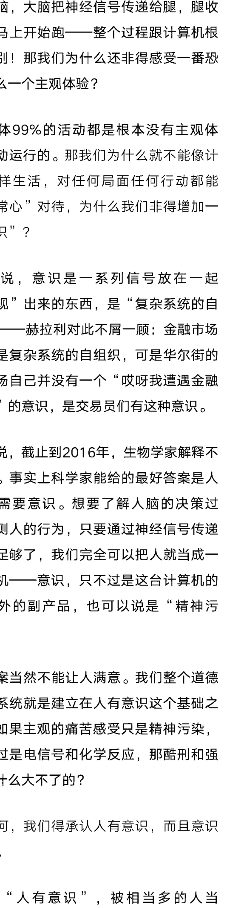

你可能会说，这些感觉其实是进化赋予我们的信号传递和决策系统！如果这次别人用针扎你你感觉不到疼痛，下次就不知道主动避免被扎，那岂不是死得很快？

没错，之前生物学家们就是这么解释意识。但现在的局面是生物学家对人脑的信号传递和决策系统了解得越多，就越认为我们根本不需要意识。不论是过去的记忆还是新的外部刺激，对大脑来说无非就是一些电信号和化学反应。我们看到危险靠近，视觉信号传递给大脑，大脑把神经信号传递给腿，腿收到命令马上开始跑——整个过程跟计算机根本没区别！那我们为什么还非得感受一番恐惧，这么一个主观体验？

其实人体99%的活动都是根本没有主观体验，自动运行的。那我们为什么就不能像计算机一样生活，对任何局面任何行动都可以“平常心”对待，为什么我们非得增加一个“意识”？

也有人说，意识是一系列信号放在一起而“涌现”出来的东西，是“复杂系统的自组织”——赫拉利对此不屑一顾：金融市场崩溃才是复杂系统的自组织，可是华尔街的交易市场自己并没有一个“哎呀我遭遇金融危机了”的意识，是交易员们有这种意识。

赫拉利说，截止到2016年，生物学家解释不了意识。事实上科学家能给的最好答案是人根本不需要意识。想要了解人脑的决策过程，预测人的行为，只要通过神经信号传递解释就足够了，我们完全可以把人就当成一台计算机——意识，只不过是这台计算机的一个额外的副产品，也可以说是“精神污染”。

这个答案当然不能让人满意。我们整个道德和政治系统就是建立在人有意识这个基础之上——如果主观的痛苦感只精神污染，一切不过是电信号和化学反应，那酷刑和强奸能有什么大不了的？

不论如何，我们得承认人有意识，而且意识很重要。

事实上“人有意识”，被相当多的人当成“人是最可宝贵的”理论依据。他们认为动物没有意识。比如17世纪哲学家笛卡尔就认为动物没有痛觉——你把小狗一脚踢飞，它肯定会叫几声，但那只不过是机械反应，小狗感受到不到痛苦——而且当时的人都赞同这个观点。

爱狗人士肯定反对这个观点。事实上现在科学家现在有足够多的证据，表明所有的哺乳动物和鸟类，包括一部分爬行动物和鱼类，都是有感情的。你要非得说动物没感情，一切行为都是机械化或者它们“装”出来的，那我也可以说你没感情，你也只不过是个通过图灵测试的电脑人。

所以讨论意识不能证明人的高贵。那人到底比动物强在哪呢？

### 虚构的力量

如果说单个的人比其他哺乳动物有什么特异之处，那就是大约七万年前的一次基因突变，使得智人能想象一些根本不存在的东西。

猫在捉到老鼠之前也许就能想象到老鼠的美味，但是它想象不出“神”的存在——因为神根本就不存在！而人可以。所以猫脑子里只有客观现实，而人脑子里却可以有主观现实。

赫拉利说，但是单个人的这个功能还不算厉害，真正厉害的，能让人群实现大规模的灵活动作的，不是个幻想出来的主观现实，而是所谓“互联主观（Intersubjectivity）”——人幻想出来的虚构的东西，而且还能让人人都相信。

上帝、国家、金钱、公司、价值观，这些都是我们想象出来的互联主观。比如说，去教堂结婚有什么意义？如果你配偶、父母、牧师以及围观群众都相信教堂有意义，婚姻有意义，那你这么做就很有意义。这个意义就是一种联合想象。

人比动物强就强在人能通过某种假想出来的意义，把众多的人给高效地组织起来。单个人的力量很有限，集体合作才是关键。一支训练有素的军队，只要配合得当，就能轻易打败没有组织的哪怕数量庞大的队伍。你要想发动个什么革命，不要问有多少人赞同你的观点，要问有多少人能进行有效的合作。

而让多人合作，和跟少数人合作，是两码事。少数人讲公平讲人品（也许还讲颜值），但是为什么古埃及那么多人能够心甘情愿地奉献自己，去为法老的大计划工作？为什么我们能接受根本就不公平的社会秩序？

是因为我们都相信“神的安排”，相信“国家利益”，相信“伦理道德”——而这些东西，都只不过是人们的联合想象而已。

联合想象会不停地发生改变。过去很多人相信上帝，后来就都不信了；有时候很多人相信社会主义，过段时间也许都不相信了；今天我们相信自由和民主，可能再过一段时 间，这两者都变成了可笑的东西。

我们看南北朝鲜人种一样，环境相似，韩国人和朝鲜人的巨大差异就是因为他们生活在完全不同的想象之中。这些联合的想象，至少在此此刻还不能完全用生物学方法研究，这恰恰是历史学家的任务。

赫拉利说，历史学家最关心的，就是在每一个时期，人们共同想象、虚构出来的故事是什么。而在此此时刻，我们不但有更强的联合想象，而且还要用这个虚构的意义去改造世界甚至改造自己，历史学就更重要了。

## | 未来预告

明日内容 | 《未来简史》解读3：活在虚构之中

日课精选

黄鸿鸣

## 日课精选

黄鸿鸿 25
有谁在看的时候真的扒了一下手指头吗？
10-03 00:20:11

刘朝晖 16
昨天讲了历史并非是某种必然，学习历史是为了解放自己，接受各种可能性，今天讲了其实我们应该去建构一个意义。我觉得这有点像佛家说的幻相与因果。
10-03 00:27:34

二胡悠扬 4
什么主义与神（耶稣、佛、真主）本质上都是虚构的东西。各种货币也是虚构的东西，人们愿意相信虚构的东西，在这个基础上，建立家庭，构建组织。否则的话谁拿国家展示给我看看？至少现在我还没有看到给灵魂或者意识一个科学上可证伪的说法，那么先别急着下结论否定吧。
10-03 09:06:36

狼 4
昨天晚上刚看完《人类简史》，感觉很多地方大有感触，准备再次阅读时整理自己的读书笔记。智人的认知革命可以说是人类历史上的关键，从此人们会因共同的信仰而以前所未有的大规模脑进行合作。科学发现人的大脑里是存在“宗教中枢”的，对那部分脑区加以电流刺激会引起实验对象强烈的宗教情感。而各种信念或者说三观其实都是主观想象，都是别人植入你头脑的：从泛灵信仰到宗教到各种主义乃至德赛二先生，凡此种种，本质上都是虚构出来的。某个虚构真的比别的虚构高明吗？成天向您宣扬某个虚构的人真的相信自己的话吗？你自己做何选择，为什么？多问自己几个问题，你会看到自己的进步的。
10-03 08:44:56

海明 3
意识，我们对于他的认知也是基于我们复杂的大脑给出的论证，那么我们我们人类的产出，是否也是听命或者说服从于大脑给出的判断呢？到底是我们驾驭意识还是意识驱使我们人类身体？可否讨论？
10-03 08:35:12

一已之修明 2
每一期都精彩。每天都在期待你的更新。我最大的愿望就是想知道为什么只有人类有意识，为什么科技从近100年开始发展起来，我们为何而生，是什么在主导我们的行为，以及有关宗教的信息。
10-03 00:37:18

林兴 1
马克思韦伯说：人类是悬挂在自己编织的意义之网上的动物。精辟。连货币都是虚构出来的想象，如果没有我们虚构出来的这一切意义，人和动物并没区别。长远的计划目标也是通过想象的。
10-03 09:07:23

tree 1
有了意识形态，人类就开始编故事，然后其他人相信了，这个社会就有序进行了。其实这个编故事也就是给人信念，信念的力量太强大了，所以就有了为君为国家“抛头颅，洒热血”。孔子曾说，对一个个国家来说，信念比食物更重要。
10-03 09:06:12

张廷慧 1
联合想象的好处，除了可以联结很多人，促进协作，还有就是它可以在很短的时间内发生改变。比如一场革命让国家的政治制度一夜之间改变，而人们不...

## 《未来简史》解读3：活在虚构之中

这几天放假是因为国庆节。如果是十几、二十年前，我们在这个时候各种活动的主题肯定是“爱国”，不过现在中国民智渐开，可能你的朋友圈里议论的主题是“要不要爱国”。

要不要爱国呢？前次中国女排拿了奥运金牌，我兴奋不已，发了一条赞美女排选手的“爱国微博”。结果就有人给我评论，建议我向一个人学习，还特意给了链接。我点过去一看，那人的意思是，中国女排夺冠跟你们有什么关系？所谓国家荣誉根本就是个幻觉。

他说的没错。“国家”，本质上是个虚构出来的概念，也就是“想象的共同体”，几百年前的中国人根本就没有国家这个概念，黑龙江人跟福建人相距那么远没可能心连心，日子也过下来了。国家里的每个人才是真实的东西。所谓“荣辱与共”，也只不过是说我们被这个虚构的概念影响而已。

是虚构的，就不重要吗？

赫拉利告诉我们，现在情况是虚构的比真实的重要得多。

### 虚构胜于真实

我们先来思考这么一个问题：苹果公司是真实的吗？

你可能会说当然是真实的。每台iPhone背面不都写着吗？加州苹果设计，中国组装——苹果公司就在美国加州。

错了。苹果公司的总部在加州。但人们谈论苹果公司的时候，心里想的既不是它的总部，也不是它的人员和机器设备。乔布斯死了，苹果还在；哪怕所有人员离职，所有办公室和设备都没有了，苹果公司还可以继续存在。

跟国家一样，公司也是我们的一个联合想象。公司不是它的创立者、经营管理者和股东，但公司有自己的财产、银行账户、纳税义务和法律责任。让“公司”独立于人，是一个非常好的制度，但我们不要忘了，“公司”其实也是个想象的共同体。如果爱国很愚蠢，那大谈“企业文化和凝聚力”，鼓励员工好好为“公司”工作，也不对吗？

经赫拉利一说，我们发现原来很多重要的东西都是虚构的。赫拉利说，真正有权势的人类组织根本不在乎真相如何，他们在乎的是把虚构出来的信仰强加给每个人，并且利用这个信仰去改变真实的世界。

比如金钱，就是政府虚构出来，并且把价值强加给我们。一张百元钞票的实际制造成本肯定比100元低很多很多，如果你非得说它只是一张纸——你说的对，但是我们不能把“揭穿皇帝新衣奖”颁发给你，因为世界上每个人都承认这张纸的价值，连你都不得不承认。

学位证书也是虚构的。凭什么因为几分的差距有的人就能进大学，有的人就进不了？你非得说自己虽然没有这张纸但是“真实”能力更强——也可能你是对的，但是现代社会就好像认准了金钱一样认准了学历这个虚构的东西，你没有那张纸就很不好办。

宗教更是这样。现在有很多人考证，说《圣经》中有很多内容是后人虚构的，基督教等于是所有时间欺骗了所有的人——但是这又能怎么样呢？

### 什么是宗教

人们一般认为只有相信超自然现象或者神，才算宗教。而赫拉利在书中给了一个更好的“宗教”定义。满足下面这三个特点的，就是宗教：
- 1. 它有一套号称不是人发明的，而且不能被人改变的道德法规（moral laws），要求人们必须遵守；
- 2. 它给人们一个许诺：只要你遵从这套法规，就会有啥啥啥好处；
- 3. 它的目的是为了巩固自己设想的社会秩序。

其中第一条是关键，宗教就是一套约束人的规则。比如纳粹思想就是一个宗教。一个德国小孩子问他爸爸，为什么我们要杀犹太人？他爸爸会回答说，杀犹太人不是我的主意，也不是希特勒元首的主意——元首只不过发现了这么一个自然法则，就是犹太人的存在会把整个个人类变坏，所以没有办法，这个法则要求我们去杀掉犹太人，我们只能遵从。

赫拉利说，西方自由主义者讲的人权，其实也是宗教。一个德国小孩问他爸爸，为什么我们我们要接纳难民？他爸爸会回答说，这不是我的主意，也不是默克尔总理的主意——每个人都有平等人权，这是一个自然法则，总理也没有办法，所以我们必须尽可能帮助难民。

按这个定义的话，有些追求“心灵之旅”的人——我觉得按中国话应该把这种人称为“修行者”——反而不是个宗教徒。宗教是个交易，要求教徒别问那么多为什么，接受社会秩序——你只要按我说的规则办，我给你许诺一个好处。可是修行者是天生的革命者，拒绝交易，非得问个为什么不可！

赫拉利甚至引用了一句禅宗的话，说对真正的修行者来说，应该“佛挡杀佛”——如果你是真正的修行者，遇到有人把佛学也变成一个宗教，并且规定了一系列严格的纪律给你这么一个交易，那么你应该把这个佛也给打倒掉。

马丁·路德就是个修行者。他看到当时的天主教直接贩卖天堂的通行证，宣称只要付出一定的金额，即使你犯了很严重的罪行，也可以死后进入天堂，如果你给的金钱够多，那么你们全家都能够进入天堂。马丁·路德就质疑说，上帝不可能这样的态度。他就要用自己的方式解读圣经。佛陀也是个修行者，从古代印度教脱离出来，自己悟出一番道理。

但心灵之旅本质上是孤独的。马丁·路德和佛陀自己修行没问题，可是等到他们有了追随者，需要联合更多的人一起做事的话，就必须得写下一些什么东西，比如说戒律和规章制度，以及自己对这个事业的理解——因为人总是喜欢确定性的答案。可是这样一来，他们写下的东西就是新的宗教规则，他们实际上就是创立了新的宗教。

宗教，其实很无奈。

那么现在是科学的时代，我们干什么事儿都讲个实验和证据，宗教是不是就应该没用了呢？

### 科学和宗教是一对夫妻

现实是我们不可能光靠科学生活。

比如说中国要修建三峡大坝，科学可以解决大坝所要承受的流量这样的工程技术问题。但决策者除了工程问题，还面临一些道德选择——比如很多很多人们必须迁走，淹没了名胜古迹，以及可能会导致中华鲟这个珍稀物种灭绝，这些牺牲都值得吗？领导人不可能只问科学家和工程师的意见。

科学技术可以告诉我们做事的方法，可以让我们拥有强大的力量，但是一个事情做与不做，要面临道德选择的话，我们就非得借助宗教——别忘了刚才说的，不仅仅基督教是宗教，自由民主人权也是宗教。

有人提出一种观点，认为干脆不要谈宗教，直接谈论道德。道德无非就是一个原则——离苦得乐，就是人们总是希望最大化幸福，最小化苦难，如果从这个道德原则出发，剩下的事情就都可以交给科学了。怎么选择能让人的幸福最大，苦难最小，你就计算呗？

赫拉利说这个根本行不通。什么叫幸福？根本就没有科学定义。当你选择什么叫幸福的时候，你就是在选择一套道德体系，你就是在选择宗教。所以你想要维持大尺度的社会秩序，离开宗教、光靠科学是不可能的。

宗教关注的是秩序，而科学技术关注的是力量。那么科学跟宗教能不能互不干涉呢？也不行。

宗教给人提供的道德指引，通常分三步。赫拉利举了个例子，应该允许堕胎吗？天主教反对任何形式的堕胎：
- 1. 道德判断：人的生命是神圣的！——对此科学无话可说，你说是神圣的就是神圣的吧。
- 2. 事实陈述：生命在受孕那一刻就已经产生，提升了，所以哪怕只是一个受精卵，也不能被堕胎。——这里，科学很有发言权。
- 3. 道德指引：基于前面的道德判断和事实陈述，天主教要求不能堕胎。

如果科学家判断受精卵没有生命，你这个指引就说不过去。所以如果你懂科学，虽然你也得信点什么，但你可以用科学打宗教。

说到宗教，当前最大的宗教不是别的，正是人文主义。我们这个现代世界，恰恰是科学和人文主义交易的结果。科学一直在帮助人文主义扩大力量，但是从此刻开始，科学开始要敲打人文主义了。

到底什么是人文主义？这里面有个史诗般的故事……那就是我们明天的內容。

### ｜未来预告

明日内容｜《未来简史》解读4：欧美自由主义的史诗

日课精选

璞至天成_憨哥 38 如此说来，公司虚构出来最大的信仰，即为“景愿”！ 10-04 00:44:07

一杯白开水 15 我对老师这一篇解读的思考如下。宗教并不等同真理，而科学也不等同真理。然而，宗教的戒律和假想的未来救赎，科学的结论和揭露的事实，都可以通过意识产生一个或具体或抽象的想象。所以，一旦涉及宗教和科学，真理便消失。人们意识里能够追近真理的科学，包括意识里的真理本身，我想这也是

识产生一个或具体或抽象的想象。所以，一旦涉及宗教和科学，真理便消失。人们意识里能够趋近真理的科学，包括意识里的真理本身，我想应该也是一种宗教。但是我从文中的字里行间推测，加上我自己的认知水平下认为，现实里确有真理存在，大致描述的话，也许就是自然而然地完整地包含了所有信息的那样一种存在。最后多说一句，这样的真理好像就没法从中得到什么意义（一不小心发现意义也是宗教。。。）。这该如何是好，理论上人类可以脱离假设出来的宗教以及提供力量的科学而生存吗？
10-04 00:46:07

张少天 13

虚构的故事与真实世界是一个反馈系统，以真实世界为基础，人类才会慢慢建立出虚构的故事。人类因为要去找仙女而去丛林探险，那你得先知道仙女大概是什么样子吧，仙女的基础模型一定是建立在人类的现有认知之上，而现有认知多数都是基于真实世界说得出 的。而后，我们建立了虚构的故事后发现真实世界与虚构的故事之间存在差异，而后由于虚构的故事强大的势能从而反馈与真实世界，使真实世界进一步发生改变，而后到达一定程度，人类基于真实世界产生的新的认知进一步产生新的虚构的故事，之后循环往复。
10-04 00:40:41

菜农 11

宗教被郝拉利发掘出三个基本特征，就世俗化了，变成了套路。商业领域做项目、创业，就是创立一个新的“宗教”，信众多了也就成功了。
10-04 01:47:18

串公子 10

思考：第一，如果说基督教只是一种交易，那么与祂并列的另外两个宗教，产生的原因又是什么？是否，也只是一桩交易？第二，如果最原始的人类是泛灵论者，他们是不是就一定对？当代人，是不是也要做回最初的自己——泛灵论者？当代人又该如何与世间万物相处？第三，学历史其中一个好处是，可以清晰的认识自己感受的根源。我为什么对残害动物的行为感到恶心和愤怒？现在，我才意识到自己就是泛灵论者——相信众生平等，万物有灵。。。。。思考：1.事实上，“时间”这个概念也是人类的想象而已。因为，如果没有这个概念，人类就很难生存。2.如果说，“婚姻”本身是一场万众期许的联合想象，那么它确实是无法等同于非联合想象的“爱情”。3.学历史另一个好处是，让我们变得更加宽容。为什么这么说呢？当你知道了婚姻和爱情有着本质上的区别时，为什么还要强调一纸合约呢？如果说是为了得到“法律”的保护，但是“法律”本身也仅仅是联合想象的产物而已。认清楚根本性的东西，就 会更加宽容看待生活中不平常的事情。所谓 的“见识”，不过是见多识广，见怪不怪罢了。
10-04 00:01:08

逆流而上 9

科学告诉我们现实世界是什么样子的，而宗教告诉我们世界应该是 什么样子的。我们身处多难的现实而无时无刻都想活在想象中的天堂。所以宗教引领我们去往虚构的美好世界。
10-04 00:28:14

yufree 6

科学求真，宗教求存，真的 一定存在且帮助人类生存，而人类存在所需要的东西不一定真实但却向往真实，从而接受科学的拷打。不过这个广义的宗教听起来有点像波普的世界3理论，在这个框架下，科学与宗教理论都算 是人精神世界的产物，只不过是寿命不一样长的知识。
10-04 01:40:33

永禄啊 5

我见过很多平庸的无神论者，也见过很多优秀的有宗教信仰的人。辩证唯物主义不是世界上最厉害，最正确的哲学思想吗？怎么被这种先进思想武装的大脑，创造力平平无奇？
10-04 00:39:05

Hauson 4

很深刻的思考和洞见。对于「圣经」很多内容是后人虚构的，没有任何论据和论证，作者直接这样说，个人认为不是很合适。当看到「死海古卷」和「铁证待判」之后，我改变了对这个问题的认识。
10-04 00:16:18

## 《未来简史》解读4：欧美自由主义的史诗

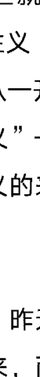

未来简史解读4：欧美自由...

《未来简史》这本书书名说的是未来，可我们前面三天都在讲历史，今天终于要说到现代了。

以地球人视角而论，所谓现代，就是欧美发达国家的现代。而以中国人视角而言，即使现在很多国人的生活水准不输欧美，但毕竟有历史文化的差异，我们看现代欧美发达国家，总觉得有些不太理解的地方——

为什么如此强调个人，而很少突出集体？

为什么自己明明有最先进的文化，却允许和鼓励一些明显落后的外国文化在本国发展？

为什么战争电影里用一个小兵做主人公，而且居然因为这个小兵个人的苦难，就否定整个战争？

为什么从官方到民间对“政治正确”的要求如此之严格，以至于稍微流露一点（种族、性别、年龄……）歧视的态度就有大麻烦？

为什么对某些“弱势群体”宽容到纵容的地步，还让大麻合法化？

如果一个中国人在国内媒体和网络上流露出上面这样的思想倾向，几乎肯定会被斥为“公主病”甚至“圣母婊”。可是西方国家，这些就是主流思想。这套思想，就是“自由主义（liberalism）”。自由主义，正是我们从一开始反复预告的整本书主题——“人文主义”——的一个最大的分支。理解了自由主义的来龙去脉，你才能真正理解西方国家。

### 听从你的内心

人文主义，倡导我们崇拜人性，用人性取代过去宗教里神的位置，用人的体验，给外部世界制造意义。

说白了，就是你应该听从自己内心的声音。什么是好的，什么是坏的？过去是上帝说了算，现在是你的内心说了算：你感觉好，就是好的；你感觉坏，就是坏的。

赫拉利举了个例子。比如说现在有个有夫之妇，跟人发生了婚外的性关系，她不知道这么做对不对，就去求助一位心理医生——现代的心理医生跟中世纪的牧师的作用差不多。

知识 = 体验 X 敏感度

前文我们说过，“意识”就是我们的主观体验。这里说的体验也是这个意思，也就是你所经历的各种感觉、感情和想法。

碗盛的熊猫粢茶，他也无法分辨出其中感觉，跟用纸杯装的普通茶叶有什么不同。但现在他能体会到其中有巨大的区别。

换句话说，一个文明人，要善于体察各种细微的感觉，否则你就是个粗人。

> 赫拉利说：“我们的一生之中，有时候我们伤害别人，或者被伤害；有时候我们同情别人，或者被同情。如果去注意体会这些伤害、同情的感觉，你就会越来越敏感，那么这种体验对你来说就是一种很好的道德知识。逐渐你就会分辨对错，成为更有智慧的人，这就是人生的旅程。”

所以有人就说，人为什么活着？活着就是要追求尽可能广的体验，以期从中获得智慧。

在人文主义的影响下，我们干什么事情都是在追求体验。旅游公司不是卖给你机票，而是卖给你一系列的体验。去高档饭店不是为了吃饱饭，而是为了体验环境、音乐、烛光……以及食物。

中世纪英雄小说里主人公今天杀一个仇人明天救一个美女，但是他的内心没有什么变化。而现代的文艺作品就专注于主人公的情感变化，特别还爱描写一些普通人的情感。我们看个什么选秀节目，从选手到评委老师动不动就表一番心路历程，汪峰动不动就“你的梦想是什么？”——一个中世纪武士看这种节目肯定特别不耐烦，而我们不会说他“豪爽”，只会说他是个大老粗。

我们看西方电影，尤其是公路片，其中大量使用《Oz国历险记》的套路，就是表现人物心路历程。在童话开头，铁皮人没有心，稻草人没有头脑，狮子没有勇气—可是等到童话结束的时候，每个角色都获得了自己想要的品质，他们的人格更完善了。

反过来我们看国产电影，也拍公路片，也模仿西方用小人物做主人公，可是整个故事下来“通过体验获得智慧”这个主题没有突出出来，所以你就上不了大雅之堂。

按照人文主义的套路，西方以普通士兵视角拍成战争片，不但要描写这个士兵的心路历程——对战争的幻想一到战场很快就破灭，然后思想慢慢变化，最后变成一个更加成熟的人——而且还要以这个士兵对战事的观感，来判定这场战争的意义！

你想要“获得主流社会的发言权”，不理解人文主义行吗？

### 人文主义的三大派别

所有人文主义者都认为“人的内心体验”是第一位的，一切道德应该从这里出发。但是世界上有很多的人，不同人的内心肯定会不一样，互相之间就会有矛盾产生，那么你怎么处理这个矛盾？这就把人文主义分成了三个派别。

“正统”的人文主义，也就是我们今天说的自由主义——也就是现在欧美发达国家的主要意识形态。自由主义者认为不管是谁，每个人的内心体验都是重要的，都会让世界变得更丰富多彩，所以你应该赋予所有人自由表达的权利。

这话说着漂亮，但是做起来有困难。比如德国到底应该接收多少难民？要不要给难民和公民一样的福利？你怎么才能既不伤害难民的感情，也不伤害公民的感情？

社会主义的人文主义者，认为自由主义者太过度强调个人的感情，尤其是太过强调了每个人自己的感情。

而进化人文主义者，则认为“所有人的情感都重要”根本就不对，有些人就是比另一些人强，我们应该让那些优秀的脱颖而出！如果你所说的“优秀”是不是按人种分类的，那你就是纳粹。

不过赫拉利特别提醒我们，你可千万别以为进化人文主义者都是纳粹党，也许你还会认为进化人文主义是有道理的。搞不好进化人文主义还是未来世界的指导思想。

你是哪一派的呢？赫拉利给我们出了一道判断题。请你给以下这四种音乐排序。你认为哪个音乐带给人的体验，价值最高？
- 1. 贝多芬第五交响曲
- 2. 查克·贝里的一首摇滚乐
- 3. 刚果热带雨林里原始部落的女声合唱
- 4. 狼的叫声

所有人文主义者都会首先排除掉 4，毕竞我们都认为现在人是第一个可宝贵的。剩下这三首音乐，其实现都收录了旅行者1号带给外星人的唱片中，可以说都是经典……

……如果你是一个自由主义者的话。自由主义者认为应该给所有人自由表达的权利，每个人的体验都是平等的。什么是好音乐？只要你喜欢听，那就是好音乐。

但社会主义者认为，你不能为了艺术而艺术。

进化人文主义者给的答案就非常明确了——最好的当然是贝多芬第五交响曲。唯要是非说摇滚乐能跟贝多芬相提并论，那就是在对人类犯罪，如果我们听摇滚乐而放弃贝多芬，将来人类就会堕落，甚至会灭绝。好东西就是好东西，米开朗基罗的作品肯定比五岁小孩的涂鸦要好，认为两者平等的都是胡扯。

这三派的交战历经两次世界大战和一次冷战，最后结果是自由主义者胜出。

### 自由主义完胜

现在的世界，是自由主义的天下。

在政治上，自由主义者认为应该听从选民的意见，选民们则要发掘自己内心的声音，你喜欢谁就选谁！

在经济上，搞自由市场，把决定权交给消费者，消费者永远是对的。

在道德上，你觉得你感觉好，而且不伤害其他人的感情，你就可以做。

在教育上，老师不再强调教科书的标准答案，而要启发学生：你自己怎么想？

在艺术上，我们应该相信每个人自己的眼睛，你认为它美，它就是美的……

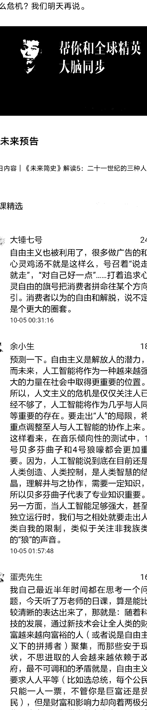

上面这张图中的是个……公共卫生间里的男用小便器，艺术家把它从建材市场买过来直接给放进展馆了。从1917年开始，它就是现代艺术的一个经典之作。所有美术史老师都要给学生介绍这个作品——甭管它是个什么东西，只要你认为它是艺术，它就是艺术。

我们现在看，自由主义其实很有道理。给所有人自由表达的权利，资本主义国家的确生产了最丰富产品，创造了最丰富的艺术作品，每个人都活得很满意，天下所有人都羡慕这样的国家！

而在赫拉利看来，自由主义阵营能最后胜出 的一个重要因素，是技术进步。马克思不知道后世还会出现生物技术和信息技术，如果他活在今天，第一个要重点研究的东西，必是互联网。

但马克思毕竟还知道向前看。他明白技术进步对人类认知方式和组织方式改变的重要性。可是时至今日，有很多人，包括一些知识分子，却想要用古代的智慧去解决我们今天的问题，什么“新儒家”之类——就在我写此文的今天早上，还听说国内有人为了复兴国学，居然重新给自己女儿裹小脚了！

你对基因工程、脑神经科学、计算机算法和人工智能一无所知，居然还想要指导未来人的生活，你不是胡扯吗？

赫拉利说，那么我们此时此刻向前看的话，自由主义可就遇到了危机。

什么危机？我们明天再说。

## ｜未来预告

明日内容｜《未来简史》解读5：二十一世纪的三种人

## 日课精选

大锤七号 24
自由主义也被利用了，很多做广告的和心灵鸡汤不就是这样么，号召着“说走就走”，“对自己好一点”……打着追求心灵自由的旗号把消费者拽命往某个方向引。消费者以为的自由和解脱，说不定是个更大的囚套。 10-05 00:31:16

余小生 18
预测一下。自由主义是解放人的潜力，而未来，人工智能将作为一种越来越强大的力量在社会中取得更重要的位置。所以，人文主义的危机是仅仅关注人已经不够了，人工智能将作为几乎与人同等重要的存在。要走出“人”的局限，将重点调整至人与人工智能的协作上来。这样看来，在音乐倾向性的测试中，1号贝多芬曲子和4号狼嗥都会更加重要。因为，人工智能说到底在目前还是人类创造、人类控制，是人类智慧的结晶，理解并与之协作，需要一定知识，所以贝多芬曲子代表了专业知识重要。另一方面，当人工智能足够强大，甚至独立运行时，我们与之相处就要走出人类自我的限制，类似于关注非我族类的“狼”的声音。 10-05 01:57:48

蛋壳先生 16
我自己最近半年时间都在思考一个问题，今天听了万老师的日课，算是能比较清晰的表达出来了，那就是：随着科技的发展，通过新技术会让全人类的财富越来越向富裕的人（或者说是自由主义下的拼搏者）聚集，而那些安于现状，不思进取的人会越来越依赖于政府，最不可调和的矛盾就是，自由主义要求人人平等（比如总统，每一个公民只能一人一票，不管你是富还是贫民），但是财富和影响力却向着两极分化，这个矛盾凭人的自由意识是无法调解的，最近两件事很能说明问题，一个是英国脱欧公投，精英希望留在欧盟，平民希望脱离欧盟；一个是美国大选，华尔街希望希拉里当选，而平民却更喜欢特朗普！这个是科学发展和自由主义下人性的自由发展不可调和的，至少以我的浅薄，看不到任何的解决方案！期待万老师的下一集 10-05 02:18:17

｜十三｜ 10
终于揭开底牌了。人文更关注人，关注人的情感，很精解的总结。以前我受的教育是：人自私不对。现在，我却认为如果每个人都对自己负责，这世界会更美好。还有那段关于心理医生的描述，很贴切。我们总需要给自己的行为找点意义，以前诉诸宗教，现在诉诸科学。以前我们提供把一切交给上帝听天由命，现在呢，我们用概率释一切，用科学理解世界。无论是宗教还是科学，都是我们理解世界的意象。或许都谈不上先进与否，随着时代的发展，人工智能的崛起，或许我们会对生命、自由、宇宙有着不一样的解 10-05 00:46:57

五蛛 5
看完此文，发现自己就是进化人文主义队列中的一员。人生来平等吗？这只是个笑话，过去不是、现在不是、未来也不可能，想到前段时间轰动一时获得雨果奖的《折叠北京》（虽然还没有看到原著，只是反复了解了故事梗概），就是人类社会现实的真实写照（作为进化人文主义者，我是这么认为的）前段时间罗辑思维的一期关于美国阶层固化的节目刚好就是万老师筹划的。对于自由主义者的理论我是很难认同。另外，前段时间刚刚结束的里约奥运会，人们对于比赛的关注度看各国媒体的头条就知道了，可是紧跟开始的残奥会，已经召开几天了，看到人民日报这样写：我们欠他们一个“头条”！这个标题绝对是一个人文主义的体现，可是个刻意的“表白”不正说明了人们的关注度还是在“强者”身上，这里的“平等”何等刻意。 10-05 01:02:50

Leo丁亮36687515 4
自由主义是信仰共识以建立秩序基础，否则无法促成自愿积极的协作，进化人文主义是现实规则，否则无法做资源分配与激励，社会主义做润滑剂，调解两者间的矛盾。他们三个都还在，并未消亡。实话说，我观察周围的人，他们看上去是在追寻自己的内心所向，但都只是表象，他们只是被传统或从心理驱动而已，都谈不上主义。看别人旅行，自己就要去，大家都说得这个好，我也要追求。差好大一场启蒙啊。 10-05 01:57:53

颜桥 4
记得大学读黑格尔的哲学著作，有一句 话印象深刻：自由是对必然的认知。如果 你不能把自由看成是必然性，自然成了 主体的体验，那么我的自由势会妨碍 你的自由。自由会不会妨碍公益？自由主义是否…

## 《未来简史》解读5：我到底是谁？

未来简史解读5：我到底是...

昨天我们说到人文主义有三大派别，其中占主流地位的，是欧美自由主义。我们作为中国人对欧美自由主义这一套各种具体做法并不能说完全认同，但是如果你仔细想想自由主义的出发点，你觉得它还是有道理的。

这个出发点就是每个人的体验可能不同，但是每个人的体验都有同样的价值。

比如你是个亿万富翁，我是个上班族。你坐个私人飞机今天在迪拜谈生意，明天带着女明星去土耳其度假，我对你的经历很感兴趣。可我有一天因为路过洗头房走路速度有点快，让警察带走还差点挨打，你可能也对我的经历感兴趣。你可以上知乎写一篇《湾流G200是一种什么样的体验》，我也可以写一篇《被审讯是一种什么样的体验》。

你的体验未必能让湾流公司多卖一架飞机，我的体验却有可能让中国更好。

从这个意义上讲，咱俩是平等的。选举的时候我手里有一票，你也只有有一票。赫拉利说，自由主义重视每个人的体验，这是基于三个假设：

第一，我有一个不可分割的“自我”——所以英文才叫 in-dividual。只要用心审视，我就能发现自己内心深处真实的自我，我要倾听这个自我的声音。

## 自由意志是一个幻觉

我们先来说说什么是自由意志。比如一个人说我想要什么就可以去追求什么，那我就是自由的——错了，这不叫有自由意志。大猩猩、狗和鹦鹉也可以想要什么就去追求什么，这没有什么高级的，只不过是被欲望驱使。

动物保护主义者可能说这对老鼠是不是太残忍了？不是。科学家控制的其实是老鼠的“意愿”！遥控器指向哪里，老鼠并不是被迫走向那里——老鼠是“想要”走向那里。你看到的是老鼠被遥控了，而老鼠自己的感觉是想去哪去哪，非常快乐。

## 你说的是哪个自我？

自由主义假设我们大脑中有一个“真正的自我”，发出“一个”，代表自我的真正的声音。可 是现在科学家非常确定，我们大脑中并不是只有一个声音，我们的每种情绪都是一个声音，这些声音在大脑里不断争论。几年前有个动画片 Inside Out，说的就是这个意思。

而赫拉利介绍了几个惊心动魄的实验。

我们知道人脑有两个半球。左半球负责右边身体，包括眼睛和手，右半球负责左边。两个半球的分工并不像有些教育家说的那么夸张，但的确是有区别的。左半球有语言功能，侧重于逻辑；右半球侧重于形象思维。本来，这两个半球之间通过一个很厚的神经管连接，可以直接交流。

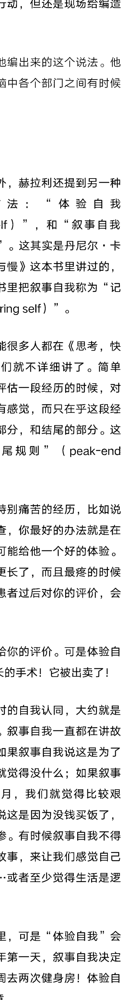

但有些医生为了治疗严重的癫痫病患者，会把他们的这根神经管给切开，让左右脑不能直接对话。这就给了科学家研究大脑的绝佳机会。

有个小男孩就是这样的患者。研究者先问他一个问题：你长大想干什么？小男孩回答说，我想当个制图员。——注意，说这句话的肯定是他的左脑，因为右脑没有说话的能力。

然后研究者把一张纸条，给这个小男孩的左眼看——把右眼挡住，这样他的左脑不知道这张纸条上写了什么，而右脑看到了。

纸条上写的是：“你长大想干什么？”

右脑不能说话，但研究者给小男孩提供了写有各种字母的拼图块。只见这个小男孩的左手立即开动，很快就在桌面上拼出了一个单词——

赛车手。

男孩至少有两个自我。他的左脑想当制图员，右脑想当赛车手。哪个才是他真正的自我？还有，据说有个二战老兵，因为负伤而中断了左右脑的直接联系。结果有一次，他的右手试图打开一扇门，而左手却要关上这扇门！他应该听谁的呢？

还有一个类似的患者。研究者给患者的左眼看到的图片上是一幅雪景，给右眼看的是一个鸡爪，而左右眼不知道对方看到了什么。研究者问他，你看到了什么？他当然回答说是鸡爪，因为右脑没有说话能力。

然后研究者又找来一大堆图片，让患者从中选取一张跟刚才看到的图片相关的图片。

右手选的图片上是一只鸡。但左手也选了一张图片，上面是一个铲雪的铲子。

现在关键的来了——研究者问这个患者，你为什么还选了这个铲子，它跟鸡爪有关系吗？

患者回答说——注意说话的是左脑——嗯……因为鸡可能会拉屎，这个铲子可以给它铲屎！

也就是说，左脑没看到雪景图，根本不明白为什么左手会选这个铲子，但是它为了让自己逻辑自洽，居然现场编造了一个理由。赫拉利说，这就好比中情局在海外搞了个颠覆行动，记者们到白宫提问，而白宫新闻官不知道中情局有这个行动，但还是现场给编造了一个说法。

也许患者真心相信他编出来的这个说法。他根本不知道自己大脑中各部门之间有时候是各自为政的。

## 体验和叙事

左右脑这种分法之外，赫拉利还提到另一种分割自我的方法：“体验自我（experiencing self）”，和“叙事自我（narrating self）”。这其实是丹尼尔·卡尼曼在《思考，快与慢》这本书里讲过的，只不过卡尼曼那本书里把叙事自我称为“记忆自我（remembering self）”。

具体的实验过程可能很多人都在《思考，快与慢》里看过，我们就不详细讲了。简单说，就是体验自我评估一段经历的时候，对这段经历的长短没有感觉，而只在于这段经历中感受最强烈的部分，和结尾的部分。这叫做“峰值—结尾规则”（peak-end rule）。

如果你要给人一段特别痛苦的经历，比如说给患者做直肠镜检查，你最好的办法就是在临近结尾的时候尽可能给他一个好的体验。这样虽然过程可能更长了，而且最疼的时候还是那么疼，但是患者过后对你的评价，会好得多。

是患者的叙事自我给你的评价。可体验自我显然并不喜欢更长的手术！它被出卖了！

赫拉利说，我们平时的自我认同，大约就是这个“叙事自我”。叙事自我一直都在讲故事。同样是挨饿，如果叙事自我说这是为了下午的体检，我们就觉得没什么；如果叙事自我说这是为了减肥，我们就觉得比较廋苦；如果叙事自我说这是因为没钱买饭了，我们就会觉得很悲惨。有时候叙事自我不得不讲一个不真实的故事，来让我们感觉自己生活得很有意义……或者至少觉得生活是逻辑自洽的。

我们活在这个故事里，可是“体验自我”会有不同的感受。新年第一天，叙事自我决定立个志，说此后每周去两次健身房！体验自我到时候会很不乐意。

另一个例子是我们都熟知的“沉没成本”。一个项目失败，叙事自我不愿意承认错误直接退出，逼着我继续加大投入，结果损失只会越来越大，最后受罪的是体验自我。

生物学对人脑了解的越多，就越发认定，人只不过就是一台计算机。所有过程无非就是物理和化学，人和人和其他动物一样，无非就是各种算法的集合，哪有什么特别的？有时候外界给你什么刺激，我们就会做出什么反应。有时候我们也会做出一些真正随机的决定——保不准大脑里有量子力学过程——但这种随机决定也不是我们所能控制得了的。

自由意志在哪里？自我又在哪里？都是幻觉。

如果我根本没有单一的自我，那投票的是谁？购物的是谁？承担后果的又是谁？我怎么能保证它做的决定符合我的利益？

如果我根本没有自由意志，外界可以直接控制我想想要什么，我投出的这一票又有什么可神圣的？我的“体验”又有多大价值，我作为一个“个人”，又有什么资格向社会要求…？

为一个“个人”，又有 what 资格向社会要求重视个人胜过集体的自由主义价值观呢？

过去，科学因为证明了上帝不靠谱，给了以人为本的自由主义发展的机会。现在，科学又给了自由主义“会心一击”。而且这个打击不仅仅是实验室里和理论上的，在实践中，自由主义也是岌岌可危。

明天我们将会看到，有时候人就是心甘情愿地接受控制。控制我们的不是其他人，而是号称要全心全意为我们服务的……计算机算法。

## ｜未来预告

明日内容｜《未来简史》解读6：二十一世纪的三种人

## 日课精选

堵车ing 195
想问下国庆凌晨等更新有多少朋友
10-06 00:21:09

作者 回复
哈哈我也想知道！凌晨等更新的朋友来点个赞吧？
10-06 00:25:23

阿里巴巴 19
简直让我脑洞大开，每天晚上来这里看文章都是一种享受。
10-06 00:27:23

魔法之翼 16
自由意志是否存在目前科学是不能给出答案的，文中的证实没有统一的明确的自我，但尚不能否定意识，我觉得很多东西下断言时机尚早，但作者确实提供自己的想法，我们应该学习和思考，如果只是被动地全盘接受却是有违万老师日课的本意了
10-06 00:51:52

作者 回复
说得对！
10-06 01:26:44

张少天 10
其实我不怎么相信我们人类拥有完整的自由意志，商业上的营销，宗教中的教义，迷信中的鬼神，演讲中的鸡汤，但你自己身处这些场景时，你还认为自己有自由意志吗？我看到一个虚构类故事，虽是人为想象，但我认为用到这里很有意思。两个高手在对决，其中高手甲有一个绝招让高手乙无可奈何，那就是能在零点几秒的时间内发出自己的招式，高手乙根本没有这个反应时间，从理论上讲每个人招式的变换可以是无穷无尽的，那么长此以往，高手乙必败。但高手乙发现，每个人因为自身的喜好和厌恶，会偏向和舍弃某些特定的招式。当时他就给高手甲说：你的招式本可以像插在大地上数之不请的针，但现在我发现你的针是可以被线串起来的。最后通过观察和试错高手甲大量的招式发现了高手甲的偏好和局限，最终赢得了对决。想想看吧，我们每个人从理论上讲，思想行为可以有无限可能，但因为我们自身的成长会形成我们自身的喜恶，如同橡皮泥中的模具那样，限制我们自身。当我们自身足够的数据被拥有可靠算法的计算机分析时，我们套在针孔中的线就会被发现出来。之后的场景会怎样，我就不知道了。
10-06 00:37:38

郭哥 7
今天在看自私的基因，猛然间脑洞大开。整个自然界是不是更高维的存在为了解密某个密码？而基因的排列组合就是对密码的遍历，从简单的微生物到复杂的动物。不过是遍历的位数在增加。
10-06 00:26:12

Alex 6
脑洞开始被越扯越大，让我想起电影Matrix里，你以为你过着幸福美满的生活，其实被养在罐子里的生物燃料；你以为你有自主意识，选择跳出Matrix到真实世界，其实也不过是为了修正Matrix而设计出来的中间层Zion。真的有The One存在嘛？自由主义难道是人类认知历史上的另一个地心说？
10-06 01:14:22

Leo丁亮36687515 6
今天查Dennett，查到一个组织叫Bright Movement，他们的自然主义世界观算不算也是个新信仰，和数据主义还不

算不算也是个新信仰，和数据主义还不太一样的样子。个人和国家一样都是虚构出来的信息，一切语言和意识中的概念都不不过是通过物质存储起来的信息，源于物质的自然演化
10-06 00:48:37

无为有处 5
赫拉利是一个对各种学科都有所涉及的思想者，但是在这些学科中对他提到的问题从来没有一个确定答案，至少我知道的是这样，他说出了自己所想，为了帮助大家有一个思考可以和这些想法对立建议有几个东西可以看看，一是自律与他律的争论，康德和黑格尔之争，丹尼尔丹尼特的意识的解释，斯坦佛教授 Robert Sapolsky的课。
10-06 00:24:54

。。。 4
人克制眼前的欲望是因为心中有 一个更大的欲望，人认为只有一个自我是因为对自己还不够了解。自由意志的樊篱打开之后会是一片更广阔的天空。
10-06 01:13:44

wu 4
今天刚看了赫胥黎的美丽新世界，本来还怀疑书中的新巴普洛夫实验，在睡眠中给人灌输观念等，现在看来，这一切都是有可能的。前不久看了自由在高处，还感慨万千，现在我想问，万老师，我们文科生该怎么看待这个认识？如果事实如此，以前我们对自由的看法是不是都该改改了。
10-06 00:25:47

wu 4
今天刚看了赫胥黎的美丽新世界，本来还怀疑书中的新巴普洛夫实验，在睡眠中给人灌输观念等，现在看来，这一切都是有可能的。前不久看了自由在高处，还感慨万千，现在我想问，万老师，我们文科生该怎么看待这个认识？如果事实如此，以前我们对自由的看法是不是都该改改了。
10-06 00:25:47

## 《未来简史》解读6：二十一世纪的三种人

未来简史解读6：二十一世...

昨天我们讲到，科学家从实验室里已经证明，人既没有自由意志，也没有单一的自我。这样一来自由主义的基本前提就被否定了。

可是自由主义作为一个宗教，在过去这一两百年内，一直运行的不错啊。欧美国国家在政治上实行一人一票的民主选举制度，在经济上搞自由市场经济以消费者为上帝，的确就实现了经济增长和文化繁荣——不管科学家怎么说，我们干脆“假装”自己有自由意志和自我，不也过得挺好吗？

到目前为止，是过得挺好。

那是因为到目前为止，有一点，自由主义者说的是对的：没有别人比我更了解我自己。也许我在投票和消费的时候经常犯错误，导致反过来损害了自己的利益，但是让别人替我做决定的话肯定只会更差！计划经济时代政府犯的错误还少吗？

但是赫拉利说，从现在开始——实际上是已经开始了——自由主义者说的这一条也错了。计算机算法比你更了解你自己，为了“你自己的利益”，你应该让算法替你做决定。

你、我、我们大家，也许都应该把决策权交给算法。如果这样的话，自由主义就真没意义了。

真正的未来比这个更复杂。赫拉利说，从现在看来，世界有三个趋势，对应着人的三种不同的命运：

- 1. 人工智能如此强大，人作为一个工作者的经济价值和军事价值都没有了，那么政治经济系统就会认为人没有价值。
- 2. 也许人类整体还是有价值的，但是每个人作为个体，是没有价值的。
- 3. 也许有些个体还是有价值的，但他们是经过了生物学升级改造的“超人”。

这三个趋势中哪一个的效果最快最明显，赫拉利没有给出判断。我们姑且假定在未来相当长的时间内，三个趋势同时进行。

那么就在二十一世纪，全体人类将会被技术进步的趋势给划分成三种人。这三种人不可能是不平等的，有可能像现在印度“种姓”划分，也有可能像十九世纪欧洲白人跟非洲黑人那样的划分。那时候我们回头再看现在这个强调每个人的体验有同样价值的自由主义时代，简直就是做了一场好梦！

## 1.无用的人

为什么自由主义是欧美发达国家的主要意识形态，而不是在发展中国家，比如说中国兴盛的呢？并不是因为欧美人有什么特别高大上的理念，其中还有些特别实际的原因。

其实是，在工业化国家，人力，是非常宝贵的资源。

大工厂时代每一个工人都是特别有用的，战场上每多一个士兵就能让你方多一分胜算。为什么要给妇女投票权？因为当时的经济生产很需要妇女，“妇女能顶半边天”！1917年，哈佛校长就有一个讲话，说民主国家的士兵打仗打得更好。我们看罗辑思维卖过一本书，叫《杀戮与文化：西方军队胜利的秘密》，说的是同样的意思。

重视每一个人，不仅仅是一种高大上的理念，而且也是因为那时候的经济和军事需要每一个人。

如果不需要呢？

现代战争越来越依赖高科技。将来你只需要少数士兵加上后方几个专家就能开战，大部分武装力量是无人机和机器人。在这种战争中人类反而可能是个累赘。网络战可能就是几分钟的事——如果战斗机器还要请示总统怎么办，总统那边电话还没接起来，这边已经结束了。两伙无人机对峙，其中一伙必须请示人类指挥官才能开火，另一伙可以自动开火，你猜谁的胜算更大？人类士兵可能滥杀无辜、强奸和抢劫，只要给机器人士兵加上一个道德算法，他们就比人类更可靠。

我们曾经多次问过这个问题：到底有什么东西，是只有人能做，而机器做不了的？我们之前给的答案都是阶段性的——机器暂 TResult

现在赫拉利给了一个答案：意识。过去这么多年，科学家在计算机智能方面的进展非常大，但是在计算机意识方面的进展，等于0。没人知道怎么让计算机有意识。

可我们前面也说了，意识也许只是一种精神污染。至少在生产和战争这些应用上而言，意识是可有可无的，智能才是必须的。现代生物学告诉我们一切生物都只不过是算法的集合，除去意识不算，人无非就是一台计算机，那就没有任何理由认为计算机在某一方面的智能取代不了人类。

过去机器取代一些人的工作，而人总能发明新的工作，但赫拉利说这可不是自然定律。现在的趋势就是机器的智能就是越来越比人更适合工作。赫拉利列举了以下这些白领工作，人越来越不如机器。

- 股市的高频交易。人类交易员做不到那么快的反应速度，而且现在已经广泛使用了。
- 普通律师。人工智能阅读文件发现问题的能力比人类律师不但更快，而且更准。
- 医疗诊断。IBM华生系统对肺癌判断的准确率是90%，而人类医生只有50%。
- 药剂师。美国人类药剂师犯错的概率是1.7%，这意味着每年五千个处方处理错误。而旧金山市已经用上了一个机器药剂师，处理了两百starting

你可能认为艺术创作总是人的领域吧？加州一个音乐学教授搞了一个叫做EMI的算法，能够拍巴赫的风格作曲。没听过计算机创作的曲子的人常常会猜测计算机写的东西要么就太精致没人性，要么就没有深度——而事实是观众认为EMI创作的曲子比真的巴赫更像巴赫。

赫拉利介绍，最近有人做了一项大规模的研究，判断各个行业的职位在未来被人工智能取代的概率。其中一个有意思的结果是考古学家这个职业是比较安全的，在近期被取代的可能性很低。

但这并不是因为考古学太难了。考古学的确很难，需要高超的模式识别技巧——但更重要的原因是考古学是个没什么利润的行业

要的原因是考古学是个没什么利润的行业——人工智能公司不值得为这个行业专门研发一套系统……

工业革命带来了无产阶级，现在人工智能革命也会带来一个新阶层——一个对经济和军事来说都没有用的阶层。

这些人会怎么对待呢？他们的体验还有多大价值呢？他们应该去干什么呢？每天在家里面戴个3D眼镜玩虚拟现实游戏吗？

## 2.没有自主的人

就算无用，我们总不能说人活着就一点价值都没有。别忘了我们搞人工智能的初衷不是为了取代人，而是为了为人服务！又或者说，就算很多人无用了，至少还会有些人，嗯也许在人工智能的眼中，他们也是有价值的。

但赫拉利说，这些可能比较高级的人，作为一个整体，也许有价值。但是他们作为个体可能还是没有价值，因为他们也许会放弃决策权。

现在已经有一个处在临床实验阶段的疗法，给糖尿病患者的胃里放一个芯片，时刻监测他摄入的糖分。芯片跟iPhone手机无线连接，控制一个胰岛素注射系统。一旦系统判断患者摄入的糖分过高，就会自动给他添加胰岛素。

这个做法的意义是你什么都不用管，直接把注射胰岛素的决定权交给了机器。

赫拉利说，计算机算法跟我们的关系，大概分三步走：

- 第一步，算法相当于是我们身边的先知（oracle），也就是一个算命的，你有什么问题问它一下，但是决策权在你手里。
- 第二步，算法相当于是我们的代理人（agent），你告诉它一个大的方向和原则，它去执行，至于执行过程中一些小的决策，它自己就说了算了。
- 第三步，算法就成了我们的君主（sovereign），你索性就什么都听它的了。

## 3.神人

也许世界上总有些精英是一直都有用，一直都很重要的。算法不能理解这些精英，也不知道他们有什么需求。这些人才是世界的主人，是站在算法系统背后，做最重要决策的人。

普通人听算法的，算法听他们的。

赫拉利说，目前能看到的新宗教有两个。一个叫“技术人文主义”，一个叫“数据教”。那就是我们明天，也是连载最后一天的内容。

# ｜未来预告

明日内容｜《未来简史》大结局：万物联网

# 日课精选

王煜全 76
拉赫利是聪明的，但从“意识无用”导出的后面的推理都会失效，就像当年马克思不懂心理学所以导出共产主义社会一样。其实有些机器人已经有意识了（在认知科学家眼里，意识不过是对自身信号的监控和反馈而已），而机器人仍然缺乏的其实是创造力。未来机器人干了重复性劳动，正好把人的创造性充分释放出来。由于创造性是无法预期的，是不分等级的，所以人只会更平等不会分等级，比如JK罗琳在写出《哈利波特》之前只是个找不到工作的单亲妈妈，按拉赫利的分析，她属于第一类无用的人……
10-07 00:12:00

作者 回复
我非常赞同“机器人缺乏的是创造力”这个观点，对此赫拉利完全没有提及 - 算法可以模仿巴赫的风格作曲，但是能不能自创一种风格，这就很难说了。不过我很难相信未来世界会更平等。罗琳是个特例，大规模看肯定是经济条件越好的家庭越容易出人才，教育水平越高的人越可能有创造力。当然不管什么世界，算法不能把穷人锁死，必须给人出罗琳的机会。归根结底就是，创造力作为一种天赋，基因分布也许是比较随机的，谁家都可能出一个；可是创造力的表达，变成实际有用的技能，这种可能性并非均匀的分布在所有人群中。赫拉利说的神人，就可能占大头。
10-07 00:34:56

天在下雨 16
我今天突然有了一个想法，如果人类真的一天一切都由算法主宰，一切都有助手告诉我该怎么做，那么人类还会不...

# 日课精选

说的行！犯错也是一种权利，一种享受，一种存在感。我错，我才是个人真是的人 哈哈
10-07 00:39:52

yufree
8
如果算法说了算，还是挺有意思的。用高速公路的例子，如果个体助手之间不通讯保持个体独立，那么今后算法博弈就是重要的研究方向，因为个人助手只对个体负责且足够自私；但只要通讯，就会出现更高级的算法会对个体助手的行为进行统筹，让一部分分流到B，一部分继续在A来保证整体最优，而这在个体独立且自私下无法达到。极端讲就是经济系统可能被更高层次的最优化算法全局替代，财富与价值重新定义，在资源充足可配置条件下为整体福利服务，个体也不差，但可能丧失部分重要的创新活力。当前伦理会选个体独立，但随之出现的贫富不均会最终导致全局算法系统的出现。
10-07 00:46:56

肖必材
6
以前看过一本书，有个人预言，将来绝大多数人都是无用的，被称为垃圾人口，世界的发展只需要少数精英人物就足够了，然后，这些精英会用一些食物将这些垃圾人口圈养起来。这个预言跟这篇文章的预见很像。而且我自己也曾设想过，以后的战争可能就是机器人对战，然后机器打完了，人就投降了，战争没有人员伤亡。而且，以后可能会是机器生产机器，可以生产出各种机器，这时候人还有什么作用，真的很难想到。一想到这些，真是让人沮丧。而这篇文章中说，只有少数人才有可能从基因层面去升级，大多数人就真的是一无是处了，成为真正的垃圾人口。不过，我想，在我有生之年，应该不会实现，那得再等一百年吧。
10-07 00:48:29

加
4
三观全改！如果未来是这样，那当下我们该做点什么呢，还是不该做点什么呢？科技的发展趋于服务人类还是取代人类？存在的价值又是什么呢？
10-07 00:47:50

作者 回复
明天！
10-07 00:51:26

何大大
4
感觉好可怕，如果只有富人能够通过生物科技进行升级成“神”，然后“神”又可以有足够智力写算法，然后被注入算法的智能人又成为我们这些穷人的管家，这个管家又可以决定我们在新世界的一切事物，那真的是...要被奴役了。
10-07 00:47:02

张少天
4
这是我订阅精英日课这么长时间以来第二次出现沮丧的情绪。赫拉利的推测有可能是错的，毕竟未来那么多不确定性。但是我们不妨继续沿着他的思路去推演下去:神人统治着这个世界，并且绝大多数智人在被自己算法支配的同时根本不了解可能也没兴趣了解神人的一切，而神人最终的结局有可能是永恒。永恒当统治者的神人与永恒的被统治的智人。可能神人们会拉那些有资质有能力成为神人的智人今日自己的阶级，但神人永远都不会想要去进入智人这个阶层以及漠视这个阶层，毕竟在神人们看来这些智人都没什么实际，看待他们甚至不如中世纪贵族看待平民那样，至少平民还会种田纳税什么的。之后会发生什么，我就不知道了。当然这些只是沿着赫拉利的假设推倒出来的结果，之前的日课不也讲过，有些预测说出来可能就已经开始在改变最终的结果了，再者也只是一个可能得假设而已。不过，不管未来如何，我现在知道的只有一点，那就是不管在何时何地，不断地自我成长才是可以更好生存的硬道理
10-07 00:32:48

作者 回复
关键就是智人跟神人之间有没有可能互相理解.....不过别着急，明天我们将会看到，神人有神人的难处..... 
10-07 00:41:37

侯宝保
3
人工智能在意识上没有进步过，我感觉一个人工算法永远都不会有意识产生。但我设想过给人类升级硬件，既然人类是台计算机，那么有朝一日人类必然可

# 《未来简史》解读7：万物之网（大结局）

未来简史解读7：万物之网…

国庆假期结束了，我们的《未来简史》抢先读的连载也到了最后部分。

这本书的正标题是“神人”。全书最开始的时候，赫拉利说，现在人类中的精英分子，正在试图用生物技术和计算机技术，对自己的生命进行升级，想要变成神人。

其实这个升级已经开始了。比如我们前面提到，美军研发了一种头盔，戴上之后能让人集中注意力，排除干扰，更好地战斗和学习。如果我有一篇文章必须在三个小时内写好，而你明天要参加一个重要的考试，此时此刻的咱俩，就特别需要这种头盔。如果我们有这个头盔而别人没有，咱俩不就相当于升级了吗？

我还不知道到哪里买到这个注意力头盔。但是我知道，美国现在已有很多大学生，在考试前夜通过服用某种精神药物来提升记忆力和认知能力。我还知道美国有些诗人通过服用兴奋剂来刺激大脑，而且在这种状态下的确写出了漂亮的诗句。

## 1.神人的副作用

升级成神人，是一种什么样的体验？

七万年前智人一次偶然的基因突变，很可能只是一个非常小的变化，就获得了一个全新的认知能力：联合想象一个不存在的事物。而这个能力一出来，没有这种基因突变的人种，就再也无法理解智人的体验了。

赫拉利比较看好的，是数据教。

## 2.一切都是数据处理

我们先来说说一个可能听起来比较新的理论。世间一切学科，不管是科学、文学、音乐还是经济学，其背后都是数学模式。从数学角度，我们可以把一个人、一个动物、一个公司或者一个国家，都想象成一个数据处理系统。

比如说生物体无非就是各种算法的集合。经济学无非就是把参与各方的欲望和能力数据搜集在一起，然后做个决策。所有这些无非就是处理数据。

传统上，人试图理解这些数据，也就是从数据中获得知识，再从知识中获得智慧。但现代数据主义者们（dataists）认为，有些东西的数据太过复杂，你理解不了也无需理解数据。你只要让算法去直接处理这些数据，从这些数据中发现规律拿来就用就行了。

这其实就是现在我们常说的“大数据”的思想。

比如自由市场经济，其实就是个分布式的数据处理系统。中央计划经济，其实就是个集中式的数据处理系统。分布式系统的容错率高，而且特别能迅速适应新局面，这就是为什么自由市场经济能比中央计划经济更有效。

## 3.数据主义

假设将来我们真的有了这么一个“万物之网”。

- 1. 生物真的只是一堆算法吗？生命真的只是数据处理吗？
- 2. 智能和意识，到底哪个更有价值？
- 3. 如果那些没有意识但是有高度智能的算法比我们自己更了解我们，社会、政治和日常生活将是什么样的？

# | 结束语：万维钢的叙事自我

最后我（万维钢的叙事自我）再说几句读后感。

得知自己就是一台计算机，是一个什么样的体验？现在我们都体验到了。我们没有真实的自我，也没有自由意志。我们比计算机多一个主观体验，也就是意识，但意识可能不过是个精神污染，计算机完全可以假装自己有意识，并且通过图灵测试。如果意识和智能是完全独立的，现在我们引以为豪的任何技能，在原则上，将来算法都可以做到。而且算法会比我们做得更好，甚至比我们自己更了解我们，到时候我们最好的选择就是听算法的。

如果赫拉利说的这些都是对的，那么结论就是，人生，根本，没有，真实的，意义。一切意义都是幻想出来的。

但这有什么不好呢？别忘了幻想可是智人在动物界中特有的超能力。我的建议是继续生活在虚构之中。

我会继续维护各种我认为有价值的想象的共同体。

我会继续增加我的体验，提高我的敏感度。

我会继续询问我的内心到底想要什么。

但是！因为我知道这些是虚构的，所以——

如果有某个想象的共同体要求我牺牲自己或者别人的生命去维护它，我不干。

在我经历事情，增加体验的时候，我知道我对这件事的解读，只是一个主观看法，只是我的叙事自我讲了一个方便的故事，我不应该执着于这个看法。

当面临重大选择的时候，我会告诫自己，现在内心深处最强大的那个声音，可能它选的是错的！

# 万维钢

我想知道你的“叙事自我”会怎么说？邀请你在留言区以 #xxx的叙事自我# 的形式，写下你的读后感。

然后，感谢你在这个假期的支持和陪伴，如此的求知精神，让我特别感动！

# 日课精选

# ｜未来预告

明日内容｜有惊喜。

# 日课精选

你先走 292 今晚一定比昨晚等的多，不信万先生置顶我们比一比点赞数！ 10-08 00:11:28

作者 回复 真的吗？ 10-08 00:14:40

# 《未来简史》精华集锦

各位好！好多读者留言说，《未来简史》连续七天太烧脑，今天我就暂时休息一下，我为大家整理了七集解读中的精华金句，并按文章顺序排列，方便你回顾理解这本书的内容；点击图片可以保存下载，你可以分享到朋友圈、或者转发给你同样求知好学朋友。毕竟，现在全中国也只有不到0.003%的读者了解了这本未来畅销书，而你是其中之一。

也欢迎你把对于这本书的疑问写到留言区，下周“周末小议”的时间，我们一起交流。

> （注：如果替发现不能保存图片，更新到最新版的“得到App”即可。）

## 1.学历史的作用是让我们更自由

《未来简史》解读

历史其实是一系列偶然事件的结果，历史在每一时刻都可能有各种不同的走向，如果真有平行宇宙的话，我们只不过恰好落在这个平行宇宙之中。我们今天面对的现实，就不过是这些偶然事件的历史枷锁而已。不是必然的，不是自然规律对我们的要求，那就是可以改变的。

《未来简史》解读

历史学家的作用绝不仅仅是让你有个更大的视角，而是让你更自由。学历史最好的理由，不是为了去预测未来，而是把你自己从过去解放出来，去想象不同的命运！

## 2.我有意识，它有吗？

《未来简史》解读

截止到2016年，生物学家解释不了意识。事实上科学家能给的最好答案是人根本不需要意识。想要了解脑的决策过程，预测人的行为，只要通过神经信号传递解释就足够了，我们完全可以把人就当成一台计算机——意识，只不过是这台计算机的一个额外的副产品，也可以说是“精神污染”。

《未来简史》解读

真能让人群实现大规模的灵活性合作的，不是个人想象出来的主观现实，而是所谓“互联主观（Intersubjectivity）”——人幻想出来的虚拟的东西，而且还能够让人们都相信。上帝、国家、金钱、公司、价值观，这些都是我们想象出来的互联主观。

## 3.活在虚构之中

《未来简史》解读

虚构的比真实的重要得多。真正有权势的人类组织根本不在乎真相如何，他们在乎的是把虚构出来的信仰强加给每个人，并且利用这个信仰去改变真实的世界。

《未来简史》解读

有些追求“心灵之旅”的人——应该被称为“修行者”——反而不是个宗教徒。宗教是个交易，要求教徒别问为什么，接受社会秩序——你要按我说的规则办，我给你许诺一个好处。可修行者是天生的革命者，拒绝交易，非得问为什么不可！对真正的修行者来说，应该“佛挑杀佛”——遇到有人把佛学也变成一个宗教，并且规定了一系列严格的纪律跟你交易，那么你应该把这个佛也给打破掉。

## 4.欧美自由主义的史诗

《未来简史》解读

知识 = 体验 × 敏感度。所谓敏感度，有两层意思。第一，你不能光有经历而不重视体验你的体验。第二，你必须允许这些体验来影响你甚至改造你。

《未来简史》解读

我们的一生之中，有时候我们伤害别人，或者被伤害；有时候我们同情别人，或者被同情。如果你去注意体会这些伤害、同情的感觉，你就会越来越敏感，那么这种体验对你来说就是一种很苦的道德知识。逐渐你就会分辨对错，成为更有智慧的人，这就是人生的旅程。

## 5.我到底是谁？

《未来简史》解读

人的意识就是各种想法、感觉和欲望的集合，每时每刻都有各种欲望在我们的大脑中升起又消失。你的决策可能是各种不同欲望谈判的结果，但是到底有哪些欲望会出席这个谈判，你根本控制不了。 但是科学家可以控制。

## 6.二十一世纪的三种人

《未来简史》解读

从现在看来，世界有三个趋势，对应着人的三种不同的命运：第一种，人工智能如此强大，人作为一个工作者的经济价值和军事价值都没有了。第二种，也许人类整体还是有价值的，但是每人作为个体，是没有价值的。第三种，也许有些个体还是有价值的，但他们是经过了生物学升级改造的“超人”。

《未来简史》解读

最近有人做了一项大规模的研究，判断各个行业的职位在未来被人工智能取代的概率。其中一个有意思的结果是考古学家这个职业是比较

# 《未来简史》解读

最近有人做了一项大规模的研究，判断各个行业的职位在未来被人工智能取代的概率。其中一个有意思的结果是考古学家这个职业是比较安全的，在近期被取代的可能性很低。但这并不是因为考古学家难了一一更重要的是考古学是个没什么利润的行业一一人工智能公司不值得为这个行业专门研发一套系统……

# 《未来简史》解读

计算机算法跟我们的关系，大概分三步走：
第一步，算法相当于是我们身边的先知(oracle)，也就是说一个算命的，你有什么问题问它一下，但是决策权在你手里。
第二步，算法相当于是我们的代理人(agent)，你告诉它一个大的方向和原则，它去执行，执行过程中一些小的决策，它自己就决定了。
第三步，算法就成了我们的君主(sovereign)，你索性就什么都听它的了。

# 《未来简史》解读

从现在开始——实际上是已经开始了——计算机器算法就比你更了解你自己，为了“你自己的利益”，你应该让算法替你做决定。你、我、我们大家，也许都应该把决定权交给算法。

## 7.万物之网

# 《未来简史》解读

如果你把每个人都想象成一个处理器，人与人之间的交流就是信息交流，那么整个人类社会就是一个数据处理系统。整个人类历史，就是给这个系统增加效率的历史。

# 《未来简史》解读

到那个时候，万物之网就成了世界上第一个可宝贵的东西，比人更宝贵。完善这个万物之网，想办法让万物之网更好地为人类服务，就成了一份神圣的工作。万物之网是上帝，科学家、程序员、医生、教师……所有这些为万物之网工作的人，都是牧师。也许这个万物之网的存在，就给人类存在找到了一个新的意义。——这不就是新的宗教吗？这就叫数据教，也可以叫数据主义（dataism）。

# 《未来简史》解读

赫拉利邀请我们继续关注三个大问题。也许将来科学进步，这三个问题会有不同的答案：
1.生物真的只是一堆算法吗？生命真的只是数据处理吗？
2.智能和意识，到底哪个更有价值？
3.如果那些没有意识但是有高度智能的算法比我们自己更了解我们，社会、政治和日常生活将是什么样的？

# 《未来简史》解读

如果赫拉利说的这些都是对的，那么结论就是，人生，根本，没有，真实的，意义。一切意义都是幻想出来的。但这有什么不好呢？别忘了幻想可是智人在动物界中特有的超能力。我的建议是继续生活在虚构之中——

- 我会继续维护各种我认为有价值的想象的共同体。
- 我会继续增加我的体验，提高我的敏感度。
- 我会继续追问我的内心到底想要什么。

但是！因为我知道这些是虚构的，所以——

- 如果有某个想象的共同体要求我牺牲自己或者别人的生命去维护它，我不干。
- 在我经历事情，增加体验的时候，我知道我对这件事的解读，只是一个主观看法，只是我的叙事自我讲了一个方便的故事，我不应该执着于这个看法。
- 当面临重大选择的时候，我会告诫自己，现在内心深刻最强大的那个声音，可能它选的是错的！

# 日课精选

十七 51
从头到尾概要地了解了几遍这本书之后，就开始突然生出了一种想要借鉴这一大套思想体系编排一部漫画的冲动，几乎不太能抑制。
10-09 00:12:52

黎俊蘅5310590 31
自从看了《万万没想到》以后，我就决定要持续关注 万维钢 这位科普作家。
他所写的内容真正让爱思考的人受益。
10-09 00:19:50

## 日课精选

不看笔记，《未来简史》在我大脑里留下三个最深的观点：1、未来分三种人：被淘汰的人+被镶嵌进系统的人+指定系统的神人。2、站在神的角度，一切皆数据，历史是数据，现在是数据，未来也是数据。3、人之所以有今天，也许究其根源是进化出了虚构的能力……….不过我也有三个疑问：1、这个未来大数据世界的bug点将会是什么？2、既然人类的幸福来自于电信号，那当今的毒品和未来有针对性的电信号是不是一码事？3、xxxxxxxxxxxxxxx的，而是以讹传讹演化来的？

10-09 01:06:58

Unchained Django 程勇 14

万先生辛苦了~

10-09 00:14:25

作者 回复
应该的！

10-09 00:18:17

宇杰850136 11

国庆期间，每天坚持听读「得到」来成长。几位大师级的智者，极大的开拓了我们的视野：刻意练习，科技产业思维，坐享，数据新宗教，布兰诗歌。相信有不少订户和我一样，感受到了 一种高潮澎湃的“认知升级愉悦感”。感谢王煜全，万维刚，李笑来，李翔，刘雪峰的慷慨，还有“鸡贼”的罗胖搭了平台。多年以后的此情此刻，或将被铭记为「知识经济发展史」上的奇迹。

10-09 00:50:47

白会敏 8

这一期太棒了，万先生，当我看到第四期的时候，就萌生了对赫拉利未来简史万维纲解读版再做一个精读版的想法，说干就干，我在有那个想法的当天一口气做了两期的阅读笔记，在吃饭的时候跟一个朋友郑重其事的聊这本书讲的新观念，我感受到了她对我传递观念的新奇眼神，我自己认为，对于新知识掌握效果最好的状态就是给人讲出来，由于读书笔记和讲述，使我一下子感受到了学习带来的思想，行动力，知识消化的改变，感谢这个烧脑的国庆特辑。现在，我做了三期的笔记了，今天看到老师的整合，一方面偷学老师是怎么做文章概要的，另一方面，对知识内容进行回顾，加深理解。

10-09 00:33:15

作者 回复
加油。

## 日课039｜那时候和这时候的亚当·斯密（上）

日课039｜那时候和这时候...

今天我们来说一个大人物和一番大道理——亚当·斯密的《道德情操论》。我们这个专栏专门追踪当代世界的新思想，为什么突然说起亚当·斯密来了呢？今天我要说的，恰恰是从一个现代人的视角，去理解亚当·斯密的这番理论。也许温故而知新，我们就能从中得到一点有关现代生活的启发。

当然，很惭愧，我并没有读过《道德情操论》的原文——两百多年前英文我下不了那么大的功夫——我就做了一点微小的工作，读的是一本新书：

RUSS ROBERTS

# How
ADAM SMITH
Can Change Your Life
AN UNEXPECTED GUIDE TO
HUMAN NATURE AND HAPPINESS

这本书作者 Russ Roberts，是斯坦福大学胡佛研究所的研究员。

亚当·斯密的《国富论》人人都知道，一个关键思想是“看不见的手”，奠定了现代市场经济理论的基础。而《道德情操论》这本书虽然听说过的人很多，但真了解其思想的人很少。有些反对市场经济的人还说，你们不要以为有个“看不见的手”，人就都应该自私，别忘了亚当·斯密还写过《道德情操论》，强调人要有道德呢！

这番话并非完全没有道理。经济学家熊彼特还特意将之称为“亚当·斯密问题”——人到底是应该响应看不见的手的号召，一心一意谋私利呢，还是应该响应《道德情操论》的号召，追求道德呢？

Roberts 这本书就把这个问题给解决了。Roberts 说，亚当·斯密那个年代，人的接触范围小，主要都是跟熟人交往，《道德情操论》其实就是一本讲怎么跟熟人相处的书。而市场和看不见的手，那是陌生人之间的事情。面对具体的熟人就多谈谈道德，面对抽象的陌生人就多谈谈利益，这哪里矛盾了？

其实以我之见，《道德情操论》说的也是个人利益——只不过不是金钱利益。中国文化中的道德，孟子说要“舍生取义”，孔子说要“仁者爱人”，亚当·斯密的要求可比他们低得多！斯密绝对是个接地气的实在人，他没有追求超凡入圣，就是你我这些普通人之中的一个智者。

斯密承认人都是 self-interested，也就是自利的。注意这跟 selfish（自私）可是两个概念。自私是根本不考虑别人的利益。自利是优先考虑自己的利益，但是在力所能及的情况下愿意帮助别人。比如说，如果我做出一点小牺牲就能对别人有很大的帮助，那么尽管我是个自利的人，我仍然愿意做这样的牺牲。

事实上，“做个好人”，本来就是我的个人利益的一部分。

有人认为做好事是出于同情心。所谓“恻隐之心人皆有之”，我们都有同情心，有时候同情心战胜了自利心，为了满足自己的情感诉求，我们就去做些好事。但亚当·斯密并不这么看。斯密认为同情心根本战胜不了自利心，自利永远都是第一位的。那么我为什么还要做个好人呢？

> Man naturally desires, not only to be loved, but to be lovely.

由，说我这么做其实是在做好事。

"被爱"的一个方法是财富和名望。每个都喜欢名人和富人，如果是那些既有钱又有名的人，我们更喜欢！哪怕这人品行不怎么样，只要他有名有钱，我们还是喜欢他，哪天他死了我们还能感到难过。谁收获的爱最多？当然是明星啊。

亚当·斯密当然认为追逐名利是不对的，但他的理由仍然是“自利”。

对明星们来说，获得名望、粉丝的爱戴，是他们的唯一乐趣。这就是为什么有些。据说明星已经很老了，粉丝也越来越少了，自己也没什么新作品，但是仍然在各地不停地演出，因为他们忘不了过去成名的生活。我们看国内有些老艺术家，年年春晚都出来，平 时还要去选秀节目当评委，也不怕别人烦 他，这样真的好吗？

而且名利就像毒品一样，每次的剂量必须比上一次更大，你的野心才能获得新的满足。追逐名利其实是个恶性循环，并不快乐。

斯密的建议是因为名利的追求永无止境，干脆就不要加入这个游戏。

关键在于，亚当·斯密那个年代，工作都是非常辛苦的。一个充满名利野心的人如果拼命工作，其实很痛苦，没有多大乐趣。所以斯密对工作的态度的确有点矛盾——如果一个人有野心，加入名利的竞争，那对他自己其实没啥好处；可是根据“看不见的手”，财富积累又确实是因为每个人的野心才能得到。

而 Roberts 则说，这个矛盾在今天就不存 在了。因为今天我们有大量自动化工具，工作 本身并不痛苦，甚至充满乐趣！那么你为了 名利而努力工作就没啥不好。所以 Roberts 的建议是只要你不把名利作为唯一目的去追 求，也是可以的。亚当·斯密本人就有名 望，名望作为一个副产品是避免不了的，但 我们不能专门追求名望。

但亚当·斯密说，热闹的富贵之外，还有另外一条路可以获得“被爱”。

这就是去追求智慧和美德。选择这条路，只 有少数人能欣赏你，而且这种欣赏也不像明 星粉丝那么狂热，但是这样难道不是更好 吗？拥有智慧和美德，这才是真正的 lovely。

这第二条路应该怎么走呢？咱们下次再说。

## 我的评论

注意，亚当·斯密这套道德说法，有个相当严密的逻辑结构：

+   1. 人要追求自利
2. 自利，就要被爱
3. 被爱，还得值得爱
4. 获得被爱，名利不是个好方法
5. 好方法是智慧和美德。

一步一步是推导出来的！就像数学理论一样，从一个最简单的公理出发，推出各个结论。

他不对你说教，他不跟你玩什么“动之以情”，他跟你讲理。

这就是一个理性人的道德，它自成体系！我们 不应该拿两百年前的东西跟两千年前的东西比，但是亚当·斯密这套理论，比东一下 西一下语录体的《论语》和《孟子》，是不是高级一些呢？这个特点难道不值得我们好好思考和学习吗？

## 由此得到

道德不是圣人强加给我们的教条。道德不是满足自己情感诉求的方法。道德，可以是一个理性人的自利选择。

## 未来预告

那时候和这时候的亚当·斯密（下）
行为设计学 |
现代世界快速上升的管道 |
# new # 科学家对诗人的有失恭敬 |
其它 |

## 日课精选

朱晓峰 64 真是太巧了，这几天研究孩子教育问题，跟这篇文章有联系。姑娘小，有点倔，犯错不认错，还推卸责任让我头疼，就是以“自利”为出发点动手动想了想，豁然开朗了。一般来说：孩子辩解，大人会提出更确凿的证据，要她懂得认错，勇于承担，可往往事与愿违。如果认错叫承担责任，推卸是不是有利可图呢？显然责利不统一。为了“自利”，孩子会把辩解当成智力竞赛，如果输了，下次的办法更高明。万一成功，就有胜利的愉悦，完成责利统一。不如暂时搁置这件事，别在孩子心里扎根，尽快转移注意力。两害相权取其轻，事后处理，总比演化成智力竞赛要好。想通了以后发现：教育孩子就是教育自己，认错是自己的事，补偿才是外部规范和要求。要请别人认错，“自利”逻辑就发挥作用了，就是鼓励他跟你智力竞赛 10-10 00:12:46

张少天 23 我倒是认为大家讲道德是因为这样比较省成本。在一个大家公认要讲道德或者说崇拜某些道德的社会中，你如果用相对的观点或者行为去抵制，那么主流社会就会不自觉的排斥你，而且一旦主流社会对你做了定性的评价，那么今后即使你在坚持自己的观点和行为的过程中做了些别的与此无关的正常事，主流社会依旧会因为对你的定性而对人不对事的否定你（比如：你这种人干这个也是XX X）。历史上太多太多的例子了：当年王阳明恪守自己的致良知，与程朱理学这样的主流价值观相抵背时，社会上批判他的人比支持他的人不知道多了多少。当年图因因为坚持自己的同性恋观点，与主流反对同性恋的价值观相冲突时，社会给予他的压力是我们现代人根本无法想象的。所以说，我们有些时候的所谓顺应大势，所以谨守道德，不过是因为如果逆势而行，冒天下之大不韪所遇到的阻碍，所以承担的成本太大了。当然，我以前也讲过我自己的观点，真正的强者会改变现有规则甚至是价值观，而强者是那些认为自己付得起这些成本的人。比如当年支持商鞅变法的墨季公，罢黜百家独尊儒术的汉武帝等等。当然，这也是我个人观点，省成本也只是一方面。 10-10 00:48:20

王艳 10 所以与其让子女背道德经，不如引导他体会帮助别人带来的认同感和满足感更能让他产生荣誉感。但是这种虚幻的满足感是很脆弱的，甚至在得不到正面反馈的

## 日课040 | 行为设计学

日课040 | 行为设计学

几年前有本非常流行的书，Nudge，中文版叫《助推》，说如果你能使用一些心理学的 小技巧去设计一个什么东西，就能往好的方向引导用户的行为。不管你读没读过这本 书，你肯定听说过它的思想——我们举几个 耳熟能详的例子：

在男性小便池上雕刻一只苍蝇，就能大大减少尿液外溅——因为人们会朝着苍蝇瞄准；

美国人存退休金的比例很低，但如果发工资时把默认选项设定为存一定比例的退休金，谁想存得单独提出来，存钱的比例就会大大上升；

学生在食堂里把苹果之类的健康食品放在容易拿到地方，把薯条之类不健康食品放在不容易拿到的地方，人们就会更多地吃健康食品。

这些做法的妙处是它既不是强迫，也不是花钱收买你做什么事，它只是利用人的心理弱点，或者说心理特点，去引导你按照它设计的方向做事。你没有压力，我没有成本，然后你高高兴兴地按我historically想把事儿办了，心理学就这么好使。

实验装置如上图所示，老鼠被关在盒子里，其中有个控制杆，老鼠只要一推这个控制杆，下面就会有食物出来。实验结果是把老鼠关进去以后，它一旦发现这个控制杆的作用，很快就能学会去推这个控制杆。

Skinner说，人的行为也是这样——设计好激励和奖励措施，他就会听你摆弄。这个洞见可不得了，Skinner等于开创了心理学的一个新门派！别的心理学家都是被动地观察人类行为，最多看人有心理疾病给治疗一下，而这一派却是要主动左右人类的行为！

时至今日，这一门派有了个正式的名字，叫做“行为设计学（Behaviour Design）”。现在它的掌门人，是斯坦福大学的B.J. Fogg。

Fogg的最大贡献在于，他把行为设计学跟计算软件和互联网应用联系在了一起，这就造就了一个巨大的商机：

-   教育软件怎么才能让学生愿意花更多时间学习？
- 财务软件怎么引导人存更多钱？
- 发个电子邮件，怎么能让人看完立即购买你的产品？
- 游戏和手机App怎么能最大限度吸引你的注意力？

Fogg带过的几个博士生出去以后都创业成了百万富翁，所以江湖人称Fogg是“百万富翁制造者”。如果我们专栏的年轻读者中有对心理学和赚钱都感兴趣的，赶紧报考他的研究生。不过现年53岁的Fogg老师作为一代宗师，自己对赚钱没什么兴趣，专注于学术，并不怎么搞商业合作。

怎么设计，才能让人听你的，去做一件事儿？Fogg说了三点。
第一，这个人必须自己想做这件事——得有意愿。
第二，这个人必须能做到这件事——这件事越简单越好。
第三，你得提醒他做这件事——这就是一般软件、应用和广告做的事情。

只有满足了前两点，你的提醒才有意义。如果他根本没有意愿，你发的广告就会被视为骚扰。如果他有意愿买你的东西但是你的购买流程非常复杂，他就会感到困扰性也不买了。

那么好，现在我们问一个问题：作为一个商家，你应该把主要精力放在提升消费者的意愿上呢，还是放在简化流程，让用户体验变得容易上呢？
我觉得这个答案很值钱——Fogg作为一位老司机，告诉我们：简化流程才是你应该做的。

一般商家的直觉反应都是设法提升消费者意愿，吹吹自己的东西有多好。可是改变别人意愿，非常困难，如果他本来不感兴趣你花费很多口舌也难以让他感兴趣，最大的可能性是根本不理你。另一方面，如果你这个东西有很多潜在的用户，他们本来就是感兴趣的，但是懒得动手，你如果能想个什么办法让他们很容易就能购买，效果将会事半功倍。

美国总统选举的投票率其实很低，很多人有政治立场，但是懒得花时间去投票。那么一个政客为了竞选到各地演讲，花很多钱做电视广告，就不如在选举日这天直接派公共汽车把选民接出来投票！银行与其花很多钱做广告说在我这开户有多大好处，还不如把网站流程好好设计一下，让用户点击几次就能开个户。

如果一个用户的意愿很强，他做这件事又特别简单，你的提醒又恰到好处，那么就会有一个特别好的效果——他会养成做这件事的习惯。所以什么叫品牌？品牌就是你培养了用户的习惯。

户的使用习惯。

以培养用户习惯为目标 —— 说白了就是以让用户上瘾为目标，Fogg又给了两个经验。

第一是让用户第一次接触你的东西就留下一个好印象。这就是为什么你在头等舱刚坐下，空姐就给上一杯香槟；这也是为什么苹果公司特别注重开机、甚至开箱体验。

第二是让用户能经常获得成就感。比如微博、微信这些社交网络为什么让人上瘾，因为你每发一个什么状态都可能收获回复和点赞，都可能带来新的粉丝。哪怕是轻轻一个点赞，也能给人带来一次愉悦的小情绪波动！

这第二条经验，给用户时不时一点奖励让他获得成就感，听着很平常 —— 但只要加入一个小关窍，它就是一个大规模杀伤性武器。

这个关窍就是把奖励随机化。

我们再回到开山祖师B.F. Skinner的老鼠实验。Skinner发现如果每次奖励的食物是一样多的，老鼠慢慢弄明白了，对游戏的激情就会褪去，只在饿了的时候才会去推那个那个控制杆。Skinner改变了设计，把老鼠每次推控制杆得到的奖励变成随机的 —— 有时候给一份食物，有时候给几份，有时候什么都不给。结果老鼠疯迷了，推控制杆到了上瘾的程度，根本停不下来！

我们之前在《反脆弱式学习养生法》这篇文章就说过随机性的好处，能时刻给大脑新的刺激 —— 现在说的这个刺激还要更大。你不知道会出现什么奖励，每一次新的奖励出来你的大脑就会再分泌一次多巴胺，你就再兴奋一次！这不就是我们平时打游戏，杀个怪物之后他身上每次掉落的东西都不一样吗？

这不就是在赌场里玩老虎机吗？

心理学家对此有个专有名词，叫“变换奖励原则（principle of variable rewards）”。

在微信发个状态，有时候有人点赞，有时候没人点赞，现在过了十分钟了有没有新的点赞？赶紧打开手机看一眼 —— 接收变换奖励。这就是为什么平均每天要看150次手机。

老虎机已经过时了。拉斯维加斯正在使用一种新的赌博机器，数学家帮着设计的，专门按照行为设计学给你安排各种结果的概率，重点就是要给你提供加强版的变换奖励。比如一个办法是，如果这把你不中奖，你看到的结果很可能是“差一点就中” —— 其发生的概率远远高于正常机器的理论值，这样你就会以为你不是输了，而是差一点就赢了 —— 你就会更有动力地玩下去。

现在从拉斯维加斯到Facebook，从老虎机到手机，正邪两道都在使用行为设计学，因为他们有一个共同的追求：

—— 最大化你在这个设备上花的时间。

让人上瘾，是行为设计学的最核心目标。

手机就是老虎机。

我们不禁要问，这种操法是不是太狠了？Fogg出生于一个摩门教家庭，他一直追求把自己的学说用在正途上。他的学生们也在研究怎么用行为设计学去帮助人，比如用于教育。其中一个学生创业成功赚了钱，把公司卖了，现在专门研究技术的道德问题。

技术可能没有正邪之分……或者，就算有，至少我们现在知道了它是什么。

所以现在你看完了文章，不论是评论还是点赞，都算是给我“变换奖励”……当然你也有，你的评论也可能会被点赞，也可能不会，咱们的一切行为都被设计好了……在这条亲密无间的路，让我想你，你想我，怎么会孤独。

## 未来预告

那时候和这时候的亚当·斯密（下）

现代世界快速上升的管道

科学家对诗人的有失恭敬

# new # 不可重复的心理学套路

## 日课精选

你先走 147 日课笔记：1、得到什么：行为设计学。让人听你的三条意见：有意愿、很简单、提醒他（关键：简化流程比吸引意愿有用得多）。让人上瘾的两个经验：第一次留下好印象，经常让他获得成就感（关键是奖励随机化——变换奖励原则）。2、个人体会：科技的进步一方面促进了对人类心理认知谬误的研究，一方面在如何利用这种谬误上更智能化精细化，科技的道德伦理问题形势很严峻啊！3、实际运用：朋友圈点赞的为什么比回复文字的多？为什么发图片比发文字得到的点赞和回复更多？都是因为人家操作方便嘛……为什么坏男人更受女人喜欢？除了生物学的浪子型雄性基因因为更擅长传播基因之外，或许是因为坏男人相对于好男人的奖励更随机化一些……今后如果我的回复没有被万先生抢到“精选”，是不是应该晌呼？因为他在刻意制造奖励随机化嘛！哈哈！ 10-11 00:22:55

作者 回复 我看出来了你就是个套路王！ 10-11 00:31:38

周建锋 139 不确定的失去让人恐惧，不确定的得到让人兴奋。 10-11 00:58:42

作者 回复 金句，收藏了！ 10-11 01:54:47

戏已为乐68173017 48 这首乐加得，给一百 分： 10-11 00:19:02

## 日课精选

静 21
知道这些之后，会主动采取措施，避免自己的行为被设计，如卸载手机端网购app，一旦想买什么东西，想起要开电脑，登录等一系列动作，热情便消去大半；出门不带信用卡；不办会员卡；不买零食放家里。为了坚持健身，会提前把衣物收拾整齐，方便自己出发时一下就能走，不用犹豫。 10-11 00:51:58

Livia潇潇 14
作为两个宝宝的妈妈，行为设计学对我很重要 ✿ 目标：加强意愿（让用户上瘾，第一次时留下好印象，经常获得成就感），简化流程（重要事件），辅助提醒。 ✿ 方法：奖励随机化，变换奖励原则。 ✿ 这条条密无间共同成长的道路，你想我，我想你，怎么会孤独。 ~~ 10-11 00:20:29

张少天 12
行为设计学从成本和收益的维度来看，其实就是让我们感受到我们在做设计者们希望我们做的某件事所得到的收益 > 成本。收益是我们所认为的收益，也包括着心理上认为的收益以及现实收益。而成本也是我们所感受到的沉没成本以及心理成本。当我们认为收益 > 成本时，我们就产生自己的意愿，当收益相对成本越大时，我们的意愿也会越强（这与收益到底有多大其实并没有太大关系，是一个相对值而非绝对值）。为什么我们要简化流程，因为让用户减少他的成本。为什么我们要不断优化我们的产品或者说拟设计者让我们做的事 情一些特殊的意义，是让我们这些套路者感受到收益增大了。减肥也是这个道理。为什么我们一直说自己要减肥但就 是没有我们所说的意志力？其实和意 志力关系不大，你可以想象一下我们现在获取食物的方式越来越快捷，一个外卖软件，一个天猫零食店足以让我们足 不出户，成本非常低，而获得的收益相 对于成本而言就非常的高了。而减肥呢，我们需要少点吃，少吃点的成本很大的，你要不是不要玩手机，要不就删除那些APP直到你知道你需要出去吃并且认为这是件很麻烦的事，你才有可能去考虑是不是吃东西的成本很大，而吃少点的收益就相对于成本就有点挂不住了。 这仅仅是摄入食物这一环，我们可以自己想一下提高我们的能量输出所需要 的成本和收益我们是否能接受。 当然，这只是从成本收益这个维度来看。 10-11 01:01:12

陈昊 12
一个人如何才会去做一件事？有意愿，有能力，有触动。第二点给我最大启发，让别人有能力可以从不别人入手，而是把事情变简单！别人的能力就相对提升了。 10-11 00:23:16

极限公社 12
最后加点音乐，吃惊了一下，真的很不错！！ 10-11 00:20:29

余小生 9
简单带来愉悦，复杂显得有趣，对应的，掌控带来愉悦，失控显得有趣。那么，在简单与复杂之间，掌控与失控之间，会有那么一个平衡点，让我们既觉得有趣又可以获得愉悦，这就是随机性奖励的魅力吧。让你相信，可以成功，但不确信哪一次成功。 10-11 00:29:16

A+裘凯 6
愿意做能做，然后就是降低做的成本，及时给奖励激励，但不能一成不变，而应具有随机性，让人投入 10-11 00:20:28

渣健其实不算渣 5
之前我阿姨开早餐店的时候，我也想过可以给顾客不时的奖励，比如额外奖励一碟粉丝，粥，点心之类的，奖励方式是说你是我们第几位客人，但是其实都是设定好的，我们觉得哪个是熟客就去给她，然后因为我们山东人喜欢早餐喝粥，但是夏天天气比较热，所以很多人不愿意点，怕时间不够，我就觉得应该拿一些冰水，然后可以帮助客人降温后可以让客人早点吃完去上班这样增加客人喝粥欲望，而且可以增加翻台率。然后今天有位读者的話对我也有好感触。不确定的失去让人恐惧，不确定的得到让人兴奋，以后的世界都是心理学的套路了。 10-11 08:51:00

宛央 5
助推没看过，最近看的细节也是一些类似的套路。所谓外行看热闹，内行看门道，了解了一些行为背后的机理，才能更好的理解自己的行为，选择自己的生活，这也是学习带来的另一种自由吧。 10-11 00:11:15

王煜全 4
对行为和心理的研究就像是一场军备竞赛，政客和商家用“助推”思想来影响社会公众；个人利用自我认知的提升来抵御诱惑，结果变成道和魔的同步增长，简单粗暴的方法不奏效了（比如传统广告），新的“助推”方法被发明出来，而公众也在抵御新的行为影响中变得更加有智慧……对企业来说，掌握了先进的助推工具就是掌握了核武器，而对个人而言，了解行为设计学就是更好地趋利避害、更好地进化，其关键，都不是战胳对抗，而是787. 10-11 06:48:24

知诺 4
假如像谈恋爱这样复杂的活动，也能设计出行为套路来，让对方心甘情愿入迷吗？在这亘古不变的行为上行之有效，那在哪个都无往不利了吧！ 10-11 00:58:04

丁慧 4
审视一下自己的行为还真是，每天发出的文章点击量上升，不断查看不断查看，就是上瘾。看着那个数字的变化，真的很兴奋，会不断查询点击量、留言量。想想得到和精英日课再用什麼行为设计学流程，让我们上瘾，以至于我们每天睡前阅读、留言，留言没被选中展示不仅不泄气，还会更加努力写留言。哈哈！今天能被选中吗？ 10-11 00:28:35

作者 回复
能！ 10-11 00:33:23

张廷慧 3
人的心理是有很多弱点的，比如懒惰，厌恶失去，难以长时间集中注意力。商家可以根据这些弱点，去设计销售流程、广告文案和产品的使用，让你在他们的操作下把越来越多的时间和注意力放在他们产品上，以此提高高收益。我们知道了这样的知识，当然还是免不了会陷入这些陷阱。但是我们可以及时地意识到这个问题，让自己及早抽身，不至于完全陷入。另外，我们是不是把这些方法对自己使用呢？既然我们生性懒惰，就把我们要看的书籍放在手边，想看的时候伸手就能拿到；把早起的闹钟放在房间里最远的角落，让我们不得不爬起来才能关掉。既然我们渴望激励，就可以在工作中不时给自己一些小奖励。这些套路，任由别人用在你身上，是被人操纵；但用在自己身上，是重获自由。 10-11 06:39:57

少有人看见的美 3
想让别人做一件事，就降低它的交易成本，不想让别人做，就增加它的交易成本。 10-11 03:04:43

宜兴紫砂_豪哥 3
得到平台就是在做行为设计，尽可能地占据我的时间，还找来十四位身价绝技 的大神前来站台，每天都提供大量开阔眼界的内容让我们成瘾。不过按照万老师的观点和我切身的体会，得到在“获得成就感和PoVR上面值得再改进”，比如说搞个复习小测试，随机得到虚拟消费券，或者在平台滚动播放一下得分最高的十个人等等~ 10-11 00:53:57

富贵猪 3
我们对人的了解程度每增加一分，都会带来福利，以及相应的副作用

## 日课041｜那时候和这时候的亚当·斯密（下）

今天我们借助Russ Roberts的书，继续说亚当·斯密的《道德情操论》。

亚当·斯密这套理论，并非是像传统上的道学家那样“劝善”，或者占据一个什么道德制高点对人说教。斯密首先承认人是自利的，然后从个人利益出发，去推导这么一套道德选择，帮助我们找到一个处世之道。

上次说到，我们的目标是既要“被爱”，又要做一个“值得爱”的人，用他那时候的英语，也就是lovely。

要让自己值得爱，一个最基本的功效是你做事得符合一般的社交规范——用亚当·斯密的话说是propriety，用现代英语说是appropriate，翻译成中文就是“得体”。

### 1.得体

这个“得体”，值得好好说说，这其实就是一个绅士跟身边熟人融洽相处的方法。尤其在今天，很多宅男一天到晚待在自己的小天地里不爱社交，一旦非跟人接触不可，种种言行又不得体，既得罪人，又把自己搞得很被动。

什么叫得体呢？就是你做事最好能符合别人的社交预期。比如身边发生一个什么事情，一般人反应是大笑，你最好也是大笑；一般人如果是微笑，你最好也是微笑。如果身边人都微微笑而你却在大笑，这就叫不得体。当时社会没有那么多元化，人也没有那么宽容，人们希望大家反应一致。其实现代人也有这样的心理需求，只不过有时候我们心知别人不得体，但是懒得理他罢了。

所以绅士社交的基本要求是大家同步，同步了才能和谐。亚当·斯密说，我们对不同的东西，有不同的同步要求。比如说艺术欣赏方面的同步要求就没那么强——我喜欢赵本山你喜欢周立波，没问题，咱俩不至于因为个文化急眼。我们对同步要求比较高的，是感情方面：发生在我身上的悲剧，我希望你同情我；发生在我身上的好事儿，我希望你也跟我一起高兴。

但人的特点是跟别人一起高兴很容易，一起悲伤就比较困难。朋友参加比赛赢球了，我们就像好自己赢了球一样高兴。但朋友如果失业了或者考试没过，我们肯定不像他一样难受，否则一听说坏消息就特别难受日子没法过了。

据此，亚当·斯密提出，合理的社交方式，是跟人分享发生在自己身上大的坏事，和小的事儿。你失业了自己很难受，跟朋友分享，朋友肯定不会像你一样难受，那么你为了跟他的感情同步，就会表现的得体一些，把自己的难受也降低一点——这对我们改进情绪就很有好处。自己有个什么小喜事分享一下，让别人也高兴一下，很得体。

但是如果是得到一大笔奖金之类的大喜事，最好就别发朋友圈显摆了，因为这可能会引起别人嫉妒。另一方面，小的坏事儿，比如修车花了几百块钱之类，也不适合发朋友圈，因为你这点事儿别人根本不在乎！

做事得体，是我们值得爱和被人爱的第一步。

### 2.美德

更高的要求是“美德”。亚当·斯密说，美德有三个方面。

第一是谨慎（prudent）。这意味着我们应该诚恳、老实、少说多做，千万不能高调张扬夸夸其谈，这样才能赢得别人的信任。不过亚当·斯密说的这是熟人社会。在现代社会要跟很多陌生人打交道，你不搞点自我推销也不行，所以Roberts说偶尔自夸几句也未尝不可——但是你不能言过其实，而且也不要抓住一切机会吹自己，那样只会引起别人反感，偶尔说几句，甚至有时候明明有机会自夸也不说，是最好的。

第二是正义（justice）。这是一个非黑即白的严格要求，非常简单，就是你不能伤害别人。

第三是仁慈（beneficence）。仁慈要求我们主动做些好事去帮助别人。跟正义相比，仁慈不是非黑即白的，什么事该做什么事不该做，没有严格的理论，其实是一种艺术。比如我们是否应该给穷人捐款？捐，当然是好事儿。不捐，也有道理——首先你已经交过税了，穷人的福利就是来自税收；其次直接给钱未必是解决他的问题的最好办法。

在这三个美德之外，如果你对自己还有更高的要求，那么你可以追求改变世界。

这就涉及到一个智慧。

### 3.改变世界

并不是非得变成乔布斯才能改变世界。说到这里我实在是太佩服亚当·斯密了，他两百年前，就提出了一个特别有现代味道的概念：emergence——中文叫“涌现”现象。

如果你对这个概念不熟悉，没必要自责，这可是非线性科学的范畴，说的是复杂系统的自组织。我来举个例子你就明白了。比如说Google这个词，我们都知道是个搜索引擎的名字——是个名词，对吧？但是现在有一种约定俗成的用法，就是把Google当动词用——比如说“知之为知之，不知Google之”。那么请问，是谁第一个把Google当动词用的？是哪个英语国家的委员会宣布这种用法在语法上是合法的？

答案是没有人有这个权力单方面改变一个词的用法。是你也用我也用，大家一起，慢慢地就把这个新用法给习惯化了——这就叫“涌现”。是我们一起改变了世界！

再比如说，一两百年前男人出门都会戴个帽子，尤其正式场合必须戴帽子，可是现在几乎没戴帽子了——这个社会习惯的改变，是谁决定的？这也是一个涌现象。

这就引出了一场天大的争论。

亚当·斯密，和后来的哈耶克，认为，真正的社会进步，必须是这种民间自组织出来的，涌现的结果。

但后世有很多学者，以及政治强人，就认为改变世界不能靠涌现，也需要“看得见的手”去强力干预。这场争论实在太大，并非本文所能说清楚，今天暂且放下不提。

再把话说回来，亚当·斯密认为我们应该...

再把话说回来，亚当·斯密认为我们应该怎样改变世界呢？你不用干什么大事，只要从一言一行做起，见到别人做好事就给他鼓掌，见到坏事敢于站出来说话，这样无数个你一起，通过涌现的办法，就能改变世界。

亚当·斯密特别反感的，叫做“系统人”——用他自己发明的说法，就是man of system。这个“系统人”，跟我们今天说的“体制内的人”有点关系，但斯密主要说的是那种把社会视为一个系统，自己有个宏大计划，想要对这个系统进行单方面改造的人。斯密认为这种人犯了两个错误。

第一个错误是他会被自己的大主意所迷惑，凡是不符合他的理论模型的信息他一律忽略！他根本不知道自己的模型可能是错的，而且任何政策都可能产生意想不到的结果。

第二个错误是他把所有人都视为执行自己计划的棋子。他以为自己只要是为了一个美好的目标，就可以随意摆布别人。但人都是有自由意志的！每个人都有自己的欲望和梦想，你让别人老老实实当棋子按你的计划走，这本质上就是不可能的。

所以我们要说的这个改变世界的智慧，不是什么“做大事”的智慧，而恰恰是“不做大事”的智慧。

我们仔细想想，其实“涌现”这个理念，跟“自由市场”、“看不见的手”是一致的——市场上商品的价格就是所有人共同决定，根本不需要什么强人来指挥或者计划。

所以我们甚至可以说，“涌现”、《道德情操论》、“看不见的手”、“理性人”，这些概念一脉相承，其实就是资本主义市场经济的核心理念！

### | 我的评论

说到涌现，我马上就能想到一个好例子。有个2009年拍摄的国产电影，《嫁给大山的女人》，说有个女青年被拐卖到山区，她“多次自杀未遂后，被公婆的善良感动，决心以善报善，支撑起这个风雨飘摇的家”，最后还当上了代课老师。这个片的本意是赞美这种行为，当年在电影频道也没有引起什么反响。

可是到了2015年，微博上突然掀起一番巨浪，无数的人痛批这个电影！你们拐卖妇女还“善良”了？逆来顺受还值得赞美了？这是赤裸裸的野蛮行为明白吗？！

这就是中国的进步。每一个参与批评那部电影的人，都在潜移默化地改变中国，他们共同完成了一次涌现。从此之后，恐怕再也没人敢要求被拐卖妇女“以善报善”了，整个社会都会用更严厉的反应去对待拐卖。

亚当·斯密，肯定会赞赏这些网民。

本文最开始我说说讲一番大道理，其实亚当·斯密说的都是做人做事的小道理。

我们在中国受到的教育，总是指望强人来救中国，要么就干脆希望自己去当个强人——可是强人又太容易犯大错，所以我们只好要求强人都是圣贤。

亚当·斯密说你没必要当什么圣贤。圣贤是靠不住的！他提出了一套对自己、对别人都有“好处。”——完全是利益推演出来的道德选择。

### | 由此得到

你只要从自身利益出发，做好自己的小事儿，潜移默化之功，就能让社会真正地进步。

### | 未来预告

现代世界快速上升的管道 |
科学家对诗人的有失恭敬 |
不可重复的心理学套路 |
# new # 为什么美国大学学费越来越贵 |

## 日课精选

在没有原因的情况下反对一件事情，然后再去找反对的理由和解决方案，这种违背大脑思考逻辑的事痛苦又艰辛。麦肯锡公司也推崇这种精神：Mr.Disagree（唱反调的先生），认为这是一种创新者的特质。按“得体”来讲，乔布斯传说是个坏脾气，不好与人相处，他咋就改变世界了呢？我翻翻8月14日的文章，ethic和moral的区别，是不是说：得体是个人之事，自己对自己的要求，而不是要求“别人得体”？这也还是有点犯糊涂。因为《反脆弱》“尼古拉斯·戈恩在临终对儿子说：”我对你很失望，我从未听到外界对你的指责。你已经证明了自己根本无法激發别人对你的嫉妒“。按这么看，个人还是得有个选择：熟人社会或陌生人社会？

10-12 00:25:13

### 作者 回复

并不是只有乔布斯才能改变世界。这篇文章恰恰讲的每个普通人改变世界的途径。另外，道德也应该是 SAS 对自我的要求。

10-12 00:43:17

### 问天 4

特勒布也说说：推动历史前进的，从来都不是什么“主流学者的共识”，什么“民主的选择”，更不是什么“沉默的大多数”，而是一小撮特别执着的地have a skin in the game的，玩真的人。

10-12 00:15:59

### 凶猛的小白兔 3

窃以为：不管是滴滴还是淘宝，都是顺应并支撑了一个时代的“涌现”。对于创业者来说，一个事情能不能成看两个方面，一是看内部，即：这个人本身具备的素质；二是看外部，即：这个事情本身是否顺应并支撑了这个时代的“涌现”。

10-12 08:43:07

### 紫帆 2

很多人抨击社会丑恶现象时，都把自己置身事外，希望有强大的外力解决问题，自己却不愿意用行动去做微小的改变。这也是一种系统人理论吧。改变社会，从我做起。

10-12 08:21:39

### 水中鱼 1

## 日课042｜不可重复的心理学套路

你可能早就注意到了，心理学是现代社会中人们津津乐道的一个热门学科。不论你感兴趣的是商业营销、人力资源管理、日常经济行为、媒体宣传，甚至是政治，你都会看到大量有关心理学研究结果的报道。

我们这个专栏就经常引用心理学的知识，而我对此并不感到赧愧。就连查理·芒格这样的 прор， 到哪儿去做个演讲，他几乎很少谈论经济学或者投资，但是特别爱谈心理学。

这是因为心理学是关于“人”的科学。我们想了解别人，也想了解自己。如果你认为人和人的区别不大，有同样的弱点，面对外部的隐示或者刺激会做出大体相同的反应，那么你就应该听听心理学家在实验室里对“人”有什么新认识。

你很难写一本关于“人”的书而不谈心理学实验。有很多心理学实验我们在不同的书上反复看到，都已经快变成成语典故了——我一提“棉花糖”，你就能想到“自控力”。

然后你肯定也听说过这个坏消息：有很多心理学实验，后来被证明是不可重复的。换句话说就是那些实验结果根本不可信。

心理学正在面临一场危机。可能你之前听说过的那些著名心理学实验，都是不可重复的。目前已知， 我们中国读者耳熟能详的三本书都出了问题：麻省理工著名行为经济学家丹·艾瑞里的《怪诞行为学》、罗伊·鲍迈斯特/约翰·蒂尔尼的《意志力》，以及，诺贝尔奖得主丹尼尔·卡尼曼的《思考，快与慢》。

2013年，有人组织了一次系统性的可重复研究，选了心理学三本最主流的期刊在2008年全年发表过的100项实验研究，找人一个一个地重复其中的实验，看能不能得到同样的结果。到2015年结果公布，重复出来的只有39%。

本来我听到类似的消息已经有点见怪不怪了，但最近看到《英国心理学学会研究文摘》（The British Psychological Society Research Digest）上的一篇综述文章，还是惊掉了下巴。

文章题目是 Ten Famous Psychology Findings That It’s Been Difficult To Replicate（十个难以重复的著名心理学发现），作者Christian Jarrett。

文章引用的研究都非常新，有一些就是今年夏天刚出来的结果。在这十个“著名心理学发现中”，有八个，是我以前就熟知的，我跟人聊天的时候拿它们当段子，而且还专门写过文章。我敢打赌，这里面也有你熟悉的实验。

- 1.做出笑脸，可以让人感到高兴

我们高兴的时候会笑，而1988年有个德国心理学家做实验证明，如果我们刻意做出笑脸，也会感到高兴。

具体来说，如下图所示，受试者要把一支笔放在嘴里。与此同时，给受试者看一张漫画。然后让他们给这张漫画的好笑程度打分。

有些受试者被要求用嘴唇固定住笔——这意味着你要做出一个嘟嘴的动作；有些受试者被要求用牙齿咬住笔，这就是一个微笑的动作。结果，嘟嘴组对漫画的评价不高，而微笑组则认为漫画更好笑。

这个实验非常、非常经典，人们据此专门引申出了一个理论。那就是说，不但我们的情绪会影响表情，我们的表情也能影响情绪——也许大脑不可靠，注意到我们做这个表情，就“以为”我们有那样的情绪。然后从这个理论出发，心理学家又做了很多类似的实验，来证明这个理论。

可是到了2016年，这个经典实验没有通过大规模的重复验证。17个实验室、2000人参加实验，其中九个实验室的结果是微笑组对漫画的评价只是稍微偏高，根本不显著；剩下八个组的结果是微笑组对漫画的评价反而还更低！

- 2.意志力是一种有限的资源

连我都拿这条写过文章：意志力是一种有限的资源，就好像人的身体力量一样，用多了就会累，上午用在这里，下午就不想用在那里了……

23个实验室参与了验证，结果是未能重复。

- 3.如果在考试之前，你决心考试之后要去修改一下自己的答案，那么你这次考试就能考得更好

我理解这个实验的意思是这样的。假设你明天要考试。我问你，考完，公布成绩，发下试卷之后，你会不会把当时自己做错的题全部重做一遍呢？你可能回答说不会，已经考完了，重做没意义。我就说，还是重做一下吧！你就说，那好吧。

结果你还是原来的你，仅仅是因为答应我事后重做的这个要求，你明天的考试发挥将会提高！

这个实验听着就不靠谱，结果果然是不可重复的。

- 4.刻意做出一些表现自信的肢体语言，你就会真的感到自信。

- 5.看到一些跟年老者有关的词汇，你走路速度会变慢一些。

- 6.洗手可以减轻你的负罪感。

- 7.婴儿具有模仿能力——给婴儿看一张照片，照片里的人在吐舌头，婴儿就会学着吐舌头。

8.在咖啡间挂一张人眼睛的照片，让人感觉有人正在注视自己，他就会更诚实一点，比如说不会拿了面包圈不给钱。

9.催产素可以增加人与人之间的信任——让人间一间催产素，他们就会更加信任别人。

10.谈论钱，可以让人更自私。

写到这里我的脑子一片空白。我甚至想不起来，我到底知不知道有哪些心理学实验，是一定可以重复的？

丹·艾瑞里的《怪诞行为学》一书，肯定是个重灾区！这十个实验中有好几个是他那本书中说过的，有些就是他也参与了研究的。不知此时此刻的艾瑞里有何感想。

不过上述经典实验的最初始研究者，很多都是成名已久的大人物，这次也出来说话了。他们无一例外表示不服。我看到Slate上最近有一篇长文，记者Daniel Engber专门采访了最早做微笑实验的研究者，他的答复就是后来的这些研究者没有严格遵从他当初的实验设定。

## 我的评论

我觉得那些原始实验的研究者是有道理的。这些实验如此著名，不可能是一个孤立的结果，后来都有大量的相关研究，很多研究者就宣称重复了他们的结果，而且用不同的实验设计，还能得出类似的结果。这才有了各种理论模型。

那么为什么，这一轮大规模的可重复研究，就没有把实验结果给重复出来呢？

最关键的原因很可能是这些效应都非常微小。我们看看这些实验，大多数都是自己的一个什么动作，或者外界的一个什么小小的暗示，对你的心理状态产生一个什么影响。这种影响即便存在，又能有多大？被人用语言或者什么图片暗示一下，跟被人打了一拳完全是两码事！如果你根本就不是个敏感的人，暗示对你无效。

人，是个非常复杂的系统，想要测试微小扰动的效应非常困难。也许这个环境好使，换个环境就不好使。也许对这个国家的这群人好使，对另一个国家的另一群人就不好使。

不但如此，哪怕是非常明显的效应，也不見得就一直好使——因为人是可以适应和改变的！正如我们以前说过，“经济学是老司机的游戏”，有些商家的促销手段一开始好使，时间长了人们适应了你的套路，这个套路也就不好使了。

## 由此得到

- 1. 我们不能因为没重复出来，就说那些效应不存在。当然，更不能一听说什么心理学效应，就信以为真。
- 2. 知道了心理学的危机，我们反而应该再多了解一些心理学家们在实验室里发现的套路，这样万一哪个不好使了我们还可以再用别的。
- 3. 我们应该把这些心理学知识当做武器。
- 4. 最理想的情况，就是我总能找到一些心理学套路对别人好使，而一切套路对我都通通不好使！

最后我们来看看前天《行为设计学》一文中，王煜全老师给的评论，这是一个老司机的真知灼见：

王煜全
对行为和心理的研究就像是一场军备竞赛，政客和商家用“助推”思想来影响社会公众，个人利用自我认知的提升来抵御诱惑，结果变成道德和魔的同步增长，简单粗暴的方法不奏效了（比如传统的广告），新的“助推”方法被发明出来，而公众也在抵御新的行为影响中变得更加有智慧……对企业来说，掌握了先进的助推工具就是掌握了核武器，而对个人而言，了解行为设计学就是更好地趋利避害、更好地进化，其关键，都不是战胜对方，而是在自己的阵营里出类拔萃。

## 未来预告

现代世界快速上升的管道 | ...

科学家对诗人的有失恭敬 | ...

为什么美国大学学费越来越贵 |

## 中产阶级和百万富翁的思想差异（上） |

日课精选

颜称
前几天，看到一本畅销书《自控力》，写的疑问，正好与这个主题相关。在机场书店买了一本所谓心理学畅销书，此书在亚马逊电子版亦卖的很好。发现畅销书都是一种固定叙述模式。1.把你知道的道理用阴阳化语言重新告诉你一次，并找到一些科学实验的例子加深你的信心。2.比如75%的美国人都相信压力对一个人有...（后续长文）

## 日课精选

自身的自我肯定，我们希望成功被看成是一种有明确力量控制，有清晰方法抵达励志之路，但很遗憾，一只黑天鹅就会驳斥所有天鹅是白色的论证。我观察周围接受高压工作的人群，一部分会倾向保守策略，他们比压力小的人群创造性会小很多，思维开放性也小很多，同时，过高压力也会让人采用规避型人生策略。这是不是说低压力（适度压力，不是无压力）就好呢？实际上，我倾向认为，压力就像温度表，从室外走到室内，感觉温度变化就敏感，长期高压或者低压都是不好的。压力大小不是像你想象那么要紧，要紧只是你的行为和观念是否与你的竞争环境匹配，最优化才要紧。但如果道理这样的，就不是畅销书的叙述模式，不够鲜明和纯粹，读完了就忘记了。#畅销书都有点忽悠你的成分#
10-13 00:25:44

小狮子乐乐
45

套路这个东西.....因为使用对象是人，就千变万化，不可能一刀切，人人都在变成老司机，套路抗体越来越多，套路级别也越来越高~面对这个一日千里的世界，我感觉到了无比巨大的认知焦虑和竞争焦虑。每时每刻都在接受不确定的信息，离开了百度一定会让我陷入恐慌。身边的人都不明白我每天在忙什么，都会问我为什么要买这么多不能快速致富的书，大家都在讨论车子房子票子，都很焦虑，然而，我和他们的焦虑却完全不一样，我焦虑落后于世界先进的脚步，他们焦虑找不到对象，赚不到钱，不能和其他人一样买得起房子......
导致我越来越没时间也没兴趣和朋友们聊天，每天沉浸在阅读的时间越来越多，可怎么都觉得不够用，知道的越多，不知道的也越多，渐渐地我觉得自己有点脱离身边的群体，他们说我不食人间烟火，不懂人情世故，长得这么好看居然不想结婚，脑子有问题.....是我的圈子出问题了，还是我自己出问题了？
10-13 01:50:31

黎笑卿Serious
30

我是名理科老师，但我现在很多时间是给学生讲「心理学」和「认知科学」，因为我发现很多学生并不是知识点不会，是不知道如何思考，理解能力太差，而且不喜欢读书。那我就会改编一些「心理学」的小例子讲给他们，然后引发思考，一步步慢慢推进。记忆力不是很好的同学我就会讲一下大脑的记忆模式。不过我一定都会在之前把前提条件说明“所有实验结论都是统计规律，你是个独一无二的个体。这些现象可能会适用于你，也可能不适用。不要轻易相信任何结论，要相信逻辑。结论都是别人给你的，思考力才是自己的”有些时候一些没那么错的知识也是可以接受的，就像讲原子的结构。在分不清一件事情是不是对自己有好处时，只要确定对自己没有坏处，不妨试试。错了就错了，也不要抱怨愤怒，学会运用心理学知识分析问题，建立起新型观察世界的思维模式就可以了。一点见解，各位晚安~
10-13 00:47:15

没改备注名就惨了96
21

## 日课精选

我觉得单纯的套路就像是武功的招式，看多了就都会了。真正的上乘武功应该像张三丰的太极剑法一样，把招式都忘掉，用你强大的元认知理解他的本质。最后随心所欲，把别人杀死。
10-13 02:19:49

## 雷德权 4

思考：1、最大认知震撼是两点，一是简化流程、二是奖励随机。2、简化流程，让别人更容易地获得，这在本質上其实是降低了人们获得方面的路径认知复杂性、筛选鉴别成本和时间及经济成本。相当于给别人的意愿架了一座桥，装了一部电梯。3、奖励随机，实质上是让人们体验“不确定收获”带来的快感。因为人们本质上是厌恶不确定、避免不确定的，因为其中蕴藏着未知的风险。但“不确定”+“收获”的时候，整体上对人是一种极为刺激美妙的体验，是一种有趣而无法停止的游戏。4、在说服别人的时候，把博弈逻辑简化为一两个方案的选择题，实际上也是简化搭桥行为，应该有用。
行动：1、极致的用户体验本质上就是在用户和他们的意愿之间搭一座桥，让他们舒服方便愉好地满足意愿，这样的“舒服方便愉好”在维度上就是对他们满足意愿的认知路径复杂、筛选鉴别成本和获得时间及经济成本的最有效的认知简化降低。而这三个维度里，“认知路径复杂”是至最最重要的，这是真需求的核心因素。不满足这个因素，不能大幅度简化“认知路径复杂”的都是假需求，靠不住的。而“筛选鉴别成本”和“获得时间及经济成本”会让用户爱上这样的意愿满足途径，忠诚于你的品牌产品。2、随机奖励的快感真是妙不可言。它强大到可以用在生活的任何地方。新阅读、新段练、新朋友、新领域、新人生都是这样滴！要把这个强大的快感用在人生的大游戏中，才好玩。
10-13 00:23:05

## 宜兴紫砂_豪哥 3

从小我就心理学爱好者和信徒，陆陆陆续接触了好多有趣有料有种的心理学结论，如今看到这个不可重复的报道，心里先是一惊：完了子了，可能有好多结论是不严谨的；然后冷静想了想。为什么我看到这个标题的第一眼有种不安和动摇呢？是不是也是一种心理机制的反应？是不是那种宁可信其有（这篇不可重复报道），不可信其无的世俗心理？
10-13 01:37:53

## 莫晓 3

得到越来越像一所大学，各学院的、隔离班的老师也会旁齐和互动，我们选修的课程之间总有互联的一刻，这种感觉特别好
10-13 00:24:06

## 日课043｜科学家对诗人的有失恭敬

今天我们要说一本讲西方古代科学史的书……先别急！我知道有一半读者一听说是这个话题可能就没兴趣了——西方古代科学史，这里既没有近现代物理学明星们的龙争虎斗，也不能给我们中国人带来半点民族自豪感，无非是柏拉图有多厉害亚里士多德在哪里又说错了之类，谁想听这样的企题？

所以我不得不用了一个有点耸人听闻的标题。

但是请给我几分钟时间。我今天要说的不是什么科学知识，而是思维方式。我们要对比一下古人——哪怕是古代那些名垂青史的伟人——跟现代科学家在思维方式上有什么不同。而且我们将会看到，可能绝大多数现代人仍然是古人那一套思维方式。

这本书是现在活着的物理学家中泰山北斗级的人物，斯蒂芬·温伯格（Steven Weinberg），这几年刚写的，叫做 To Explain the World: The Discovery of Modern Science。几个月前刚刚出来中文版，叫《给世界的答案：发现现代科学》。

温伯格是个物理学家，科学史只是他的一个业余爱好。别人写科学史，谈到古人搞出来的这些科学理论，一般都是用一个赞叹的态度，或者至少也是一个尊敬的态度，把古人当成科学的祖师爷——其实就有有点像哄小孩一样。可是温伯格这本书，一上来就把我看乐了。

温伯格说，“我要用现代的标准评判过去。这是一部有失恭敬的历史……我会披露科学英雄从未被历史学家提及的一些错误，甚至以此为乐。”

温伯格说，古希腊这些“科学”伟人，跟今人相比，他们差的不仅仅是科学知识。他们是根本不具备今天科学家的推理方式。

比如古希腊有一位比柏拉图早两百年的著名学者，泰勒斯。他认为所有物质都由一个“单一物质本源”构成，这种物质本源，就是水。

泰勒斯有个学生叫阿那克西曼德，他也同意存在一个单一物质本源，不过他认为这个本源不是水，而是一种跟任何普通材料都无关的东西，叫做“无限定”。

后来又有一个人，叫阿那克西米尼，认为物质的本源其实是空气。

——可你有什么理由呢？

答案是没有理由。这些古代科学家的作风是想到什么东西就写什么东西，根本不在乎写得对不对，根本就不属于跟你解释。

还有一个例子我们现在熟知的“芝诺悖论”。芝诺说，一切运动都是不可能的。你想啊，一支箭在到达靶心之前必须先通过全程的一半距离，然后它还必须通过剩下这段路程的一半，以此类推，既然后任何距离都能被再分成一半，这个过程就可以无限继续下去，所以箭怎么可能到达靶心呢？

其实今天我们学过极限知识的大学生都知道，芝诺说的其实就是无限级数求和，只不过他不知道，

1/2 + 1/4 + 1/8 + … 并不等于无限大，而是等于1！

所以温伯格说，这些希腊先贤其实不是物理学家，不是科学家，甚至也不是哲学家——他们是诗人。他们那根本就不是在思考客观真理，而是在写诗呢。

从泰勒斯写关于物质本源的诗句，到毕达哥拉斯学派崇拜整数，他们关心的根本不是我们生活的这个物质世界如何，而是精神世界如何。

他们想要证明的，是精神世界的美！即使到了后来的柏拉图和亚里士多德，他们对美的追求远远胜过追求“真实”。往往想到一个什么漂亮理论信口就说，根本就没有观测验证一下。

这就是古希腊学者，跟今天的科学家最本质的区别。

## 我的评论

读这样的历史，有时候我们不免会对古人有一种巨大的心理优越感。重实验，讲证据，这是今天任何一个稍微受过一点科学训练的人必备的思维，可是古人没有！

但是我们可别盲目自大。我们今天的人也在犯两个类似的错误。第一，是有些人，跟毕达哥拉斯学派一样，对精神世界完美的追求，胜过重视事实。这个不必细说。第二，是我们自己写个什么东西，也爱犯写诗的毛病。

中国语文教育就是在潜移默化地告诉我们“美比真实重要”。哪怕是教你写说明文和议论文，老师告诉你的也是怎么使用各种套路让你的文章“好看”，但是很少涉及怎么让文章“站得住脚”。

- 举三个例子
来句名人名言
大量使用比喻和类比
用排比句加强气势
动之以情
结尾来个“正反合”，和和稀泥不要让文章观点太偏激

这些技巧，跟批判性思维一点关系都没有。学生根本不懂逻辑，老师不研究怎么让理论严谨，评卷者也不在乎你说的结论对不对。你有“文采”就行。

## 由此得到

学写诗可以。你能打动别人，说服别人，的确是个本事。但是我们周围人写的文章里诗歌实在太多，看的时候必须得多个心眼儿：别被套路迷惑，至少得知道那是诗。

## 未来预告

## 日课精选

俊 9
理性感性并没有高低之分, 过于求真和过于虚无都不是生活的态度。当然, 科学必须讲究逻辑思维, 这也是现代科学“不近人情”的地方。
10-14 01:38:17

陈成鹏 8
平日工作一样, 发现身边优秀的销售都是目标导向, 逻辑思维清晰可见, 同时把过程做踏实, 追求实际, 事实。而优秀以外的销售永远都不知道自己在做什么, 也会很努力, 却努力着把过程做的更有美感, 虽然还记着目的, 但是会丢了关键。
10-14 00:18:30

2bright 5
诗是科学之母!
10-14 00:18:06

爱上泸儿 4
今天的日课我得出的收获是: 教育孩子要多培养科学思维, 什么事情要多看看因果。平时生活中看到鸡汤文, 多想想, 中间的道理。今天我看到一个同学发的, 适当吸烟有益健康, 然后罗列一堆中医, 编造什么198x年, 1991年的研究, 反正罗列出来也不会有人考证, 我钻牛角尖的百度了下尼古丁, 发现这玩意危害挺大的, 根据我搜集资料, 就算所谓的适量吸烟, 早晚会对尼古丁上瘾, 转而大量吸, 然后, 所谓的适量, 你就能规避一氧化碳和焦油了么? 该文章丝毫不提, 尼古丁危害也不提, 中间论据还有烟草公司提供的, 一个有利利益参杂在其中的公司提供的信息, 总是存疑的吧。还通过个别现象提出适量吸烟是长寿必要条件...刚好, 今天出了这个观点, 让我明白, 原来, 他们只是写诗而已。
10-14 00:29:06

闪电狼 3
人0都生活在自己的幻觉中, 也许他们写诗时候的逻辑是对的!
10-14 00:49:13

程雪洁 3
我们都生活在对客观世界的主观理解之中。区别在于, 有人通过过滤信息等等以让这个客观世界符合自己的理解, 还有人是想让自己的主观理解不断接近客观世界的真实~幸哉, 受过高等教育的我发现自己的很多元能力是残缺的, 如何阅读, 如何批判性思考, 如何认知自我...我差点都错过认知到这些是那样的重要的~ 吓好, 还好...幸哉。
10-14 00:15:22

不大不小段 2
认为世界是由“水火土气”构成的时代, 之前我在另一本其他书上也看过。但情况好象并不是温伯格所说的那样。当时的科学家认为土是固态物质中最 Zeus 的状态, 而黄金是固态物质中最高级的状态, 所以他们一直在想办法把土炼成黄金。虽然这种方式现在看起来很可笑, 但起码当时的科学家是在验证理论, 而不是胡说的吧。
10-14 00:40:11

甲青君 2
似乎古老文明都有这个特点, 会不会是缺乏科学认知和条件导致无法追求真, 转而开始追求美的来作代替
10-14 00:14:03

张希音 2
写诗的意义在于建立虚构共识, 科学的意义在于追求真理, 议论文是作文, 是“摆事实讲道理”; 科学是严谨的推理, “摆有条理, 有目的的事实; 讲有逻辑的道理”!
10-14 00:13:14

宜兴紫砂_豪哥 1
别说瞧不起了, 身边有些朋友特别崇尚古人的思维、风骨、才华、智慧和生活方式, 言必称唐宋祖先古盛世, 反正神马都是过去好, 现在什么地方都浮躁污秽。一直以来我都无法调整自己面对他们时的心态, 今天看清楚明白了, 他们也挺好, 只是活在诗里面!
10-14 01:49:17

加 1
过往还一直为文采欠佳而自愧! 但真正要惭愧的应该是自己的逻辑思考能力, 一直缺乏刻意练习! 生活还需要有对“诗”的分辨认知, 避免被套路
10-14 01:18:30

冰咖啡 1
其实这也算人之常情, 毕竟曲高和寡。大部分人都是听凭自己被感情带着走, 只有很少的人会去思考背后逻辑是否站得住一这一部分人往往还会被周围的人嘲笑: 你个书呆子, 管这些干嘛!
10-14 00:25:02

少有人看见的美 0
对于古代人文历史, 都说不要用现代的眼光去评价当时的人物。但是对于古代科学, 我们必须用批判性的思维, 站在最高的层次去看待。去挖掘那些不为人知的秘密。
10-14 00:49:38

以上留言由作者 筛选显示

## 周末小议｜为什么美国大学学费越来越贵

最近中央人民广播电台打电话采访我，让我说说为什么美国大学的学费越来越贵。这是一个很重要，而且特别有意思的问题，值得专门写篇文章。

现在美国大学学费是什么水平呢？有一定的排名和声望，类似于国内“二本院校”的大学中，公立大学学费大概是三四万美元，私立大学大概是四五万美元一年。这仅仅是学费。生活费和书本费之类，每年可能还要再加上两万美元左右。

公立大学对本州的学生有一个优惠，学费可能是外州和外国学生的三分之一左右。注意这是对本州，而不是对“本国”的学生——这是因为公立大学一般都是用州里纳税人的钱办的，而不是联邦政府出钱办的——外州和外国人都得交同样的高价。事实上现在很多美国大学特别愿意接收中国留学生，其中就有多收学费的考虑。

而且特别好的大学，比如哈佛耶鲁，几乎都是私立的。也就是说，如果一个美国人想去外州，或者想去一所私立大学，他每年至少要花费六万美元。

这是一个什么概念呢？要知道，美国家庭年收入的中位数，也就是六万多美元。也就是说，一个典型的美国家庭，一年下来不吃不喝，也未必供得起一个大学生！

而且你很难指望奖学金。没错，哈佛的政策是家庭年收入在八万美元以下的一律免学费，但实际上用到这个优惠政策的学生并不多——哈佛家长大都是有钱人，一般家庭的孩子很难上哈佛。而且这样力度的助学金政策也只有哈佛这种级别的名校才有。

学校里会有一些勤工俭学，或者暑假实习的机会，但都解决不了大问题。真正的办法是申请助学贷款。我看一个最新的统计说，2016年的毕业生中，有71%的学生身上背着贷款。本科生平均贷款是三四万美元，研究生要多很多——MBA，四万多美元；法学院，14万美元；医学院，16万美元。

这些贷款，本来约定的分十年还清，但很少有人能做到，很多人要用20年才能还清。如果我是个土生土长的典型美国人的话，我现在可能还在还贷款。

学费还在涨。事实上，过去这二十三十年里，大学学费可能是美国所有消费项目中涨价最快的，远远高于GDP和居民收入的增长速度。

那么问题来了，美国大学为什么这么贵呢？

第一，上大学越来越贵，是因为大学文凭的确是越来越值钱。这些年来美国产业升级的结果，大部分制造业工作都外包到了国外，挣钱多的工作都在高科技和服务业，这些好工作不需要高中生。高中毕业生和大学毕业生的收入差距越来越大。

我以前听说哈佛校长说过一句话：你要觉得大学贵，那你试试无知的代价。其实我们仔细想想，他这句话不是比喻。

所以我们看六七十年代的美国大学生还要搞个什么嬉皮文化运动，还要上街干预政治，现在已经没人做那些事了——他们明白，花这么多钱上大学不是为了参加政治活动。

第二，因为金融业发达，有助学贷款的存在，使得即便是穷人家庭的孩子，也在一定程度上能“上得起”大学。

贷款上大学，已经快要跟贷款买房一样，成了默认做法了。不过中国人还是不太习惯，一般都是提前好多年就给孩子准备大学学费，千方百计也得供下来。这导致一个有意思的现象是，华人孩子如果跟美国人结婚，他的父母心里就会有点小唠叨——我家孩子身上没有贷款，你家孩子还背着好几万的贷款，这也不公平啊！就像国内家长计较谁出钱买房子一样。

第三，大学没有降价的意愿。注意，大学学费不是根据教学成本而定的，而是根据市场而定的。如果文凭越来越值钱，而且你还出得起这个钱，我为什么不多收点？有了更多学费，我可以建更大的大楼，更豪华的学生宿舍，请更牛的教授，获得更高的排名，何乐不为呢？

美国没有发改委也没有教育部，各个大学本质上是去中心化的权力结构，大学的目的并不是，或者说不完全是，“为国家培养人才”。

我们甚至可以把大学视为一个生意——一个越来越好的生意！

最好的生意不是靠成本低，而是它卖的这个东西具有不可替代性，它掌握了稀缺的资源。好大学，就是最稀缺的资源之一。

我不知道这样到底好不好，所以完全不知道中国是不是应该学这一套——但如果中国要搞教育产业化，美国的今天就是中国的一种可能的未来。

万维钢

上线两个月零2天，今天咱们的《精英日课》迎来了第40000个读者。对于知识如此渴求，真是大大出乎我的意料。我也会给大家提供更不可替代的、稀缺的好东西，咱们一起享受每天“进一寸的欢喜”。所以想对每一个你说：
欢迎归队！

## 专栏简介

## 日课精选

# 日课精选

颜桥
50
在中国，教育类似赌场。你必须是通晓考试规则的人，这意味着你人生获得通行证机会更高。否则，即使你在其他方面很聪明，也无法获得跨越阶层的阶梯，最后被扼杀在一种模式里，教育是一种筛选游戏。1.一切教育本质是自我教育，假如你可以拥有不断自我更新的能力，同时拥有精准认知自我优势劣势的能力，教育对你的目标就达成了。2.大学的目标不是传授知识，大部分大学只是一个圈层，很多行业，尤其以传媒，娱乐，金融等，你的导师或者师兄师姐，决定你今后获得资源和财富的几率，好的学校就是一个好的稀缺的圈层。3.好的社会不是只是标榜精英教育或者大学教育的效果，而应该是提供更多人才模式的机会，被一种模式拒绝的人可以通过其他模式突围，模式越多，公平反而越好。（我只有初中毕业同学很多混的很好，看来教育是必须的，学历只是一个加权项目，你其他分够好，可以不需要。）机会过度集中于头部的教育必定是以竞争和财富血拼，最后像一场军备赛。4.中国人太多工具化教育，缺乏价值观教育，你需要什么？你擅长什么？本质上，你一切的一切都是一种自我认知的抵达。你追求快乐还是成功？你是希望自己做一个平庸的快乐的人还是别人眼中成功者但内心焦虑痛苦毫无幸福感？我们有一种外在的教育也有一种内在于自己的教育。后者也很重要。10-15 00:41:29

朱晓峰
42
真喜欢那句话：哈佛学费确实很“贵”，那就试试无知的代价。谈个身边的小事：消费“贵”的，更划算。跟老婆算过一个帐，300元的水货包和10000元的LV包，哪个贵？实际情况是：LV用了四年没坏，约6.8元/天。300元的水货包拎了1个月就不喜欢了，10元/天。结论：300元的包更贵。MK的包3000元，3个月后有磨损，老婆说：太旧了，再买一个吧。LV的包，3个月后有磨损，说：用段时间再补一补。结论：LV的包更便宜。如果把使用周期、和将来要付出的代价算进去，昂贵真的就是划算
10-15 00:24:33

余小生
17
大学是受教育的一种非常重要途径，但并不是唯一途径，很多学生甚至只是为了一个文凭而非能力。信息时代背景下，自学可能性在扩展。市场条件下，无法承担高价的群体也是可以开发的群体，关键怎么开发。10-15 00:28:43

shaoli
16
我希望我是第一个留言的，很想和您互动，您给我开启了一个不一样的世界！见识了很多，我是一名警察。您的那篇主场优势的文章被我用到了我的现场教学工作中，受益匪浅，还在不断进化自己的理工科思维！
10-15 00:19:29

王奇禾火夏Becky17950...
10
人的认知升级成本越来越大。中国教育还没有分层，美国已经很彻底。不贵不可能，中国现行教育体制下的知识获取成本是相对公平的。把握时代教育窗口还没有关闭，否则公平教育之门不是随时为你敞开的。10-15 00:45:07

guess
8
罗胖不是说过不让他的孩子将来参加高考，他预测未来的高考越来越不重要，是因为权衡一个人的能力水平会变化，结合本篇内容，可以得到，以后进入大学的考核机制会多样化，考进名校更需要经济能力，因为它可以培养你的思维方式和决策能力，而这个培养能力一般大学没有，因此不可替代性使得某些大学学费会贵。10-15 00:34:04

老哥新唱
7
售价不是按成本价来计算的（因为商业逻辑中有一个品牌溢价），也不是按需求来计算的（空气同是刚需但是免费），而且按自由市场中的稀缺性来定价的（北上广深的土地稀缺）
10-15 00:36:40

米米
6
最后一句话很经典，只有高学费才能请牛老师，才能建好宿舍，看来大学也是一家公司，校长就是老板，还得上好公司排行榜，一切都是竞争的产物。10-15 00:41:28

贝贝
6
稀缺资源是一门很好的生意
10-15 00:17:16

凌云珠宝李凌
6
无知的代价太大，我不想试。我还是在能力范围内，最大限度为自己投资吧！站的高才能看的远。10-15 00:14:21

# 周末小议｜答读者问：有焦虑感的人生更有意义

## 1.来自《未来简史》

蛋壳先生：算法和算法能博弈吗？对于股市，这种短期来看近似零和博弈的情况，算法是永远无法突破它的自身逻辑的，也永远给不了最优解！人工智能能战胜李世石只因为围棋还是可以有最优解的，不管围棋格数多大，计算机总能算出来！我佩服赫拉利的勇气，敢写这种让无数人能吐槽的书。

万维钢

任何游戏，只要是你一步我一步这么交替着走，而且可以在有限步内走完的话，那么先走或者后走一方，一定有一个能够确保不败的策略。这是一个可以从数学上证明的定理，叫做策梅洛定理。也就是说对围棋这样的游戏，只要有一个足够强大的计算机，给它足够长的时间，而你的算法设计得足够好，那么在理论上它一定能找到这个不败策略，从此终结一切围棋比赛。

但股市就不是这样了，多方参与，可以同时行动，而且没有开始和结束，也就谈不上最优解。据我所知现在的股市交易算法，跟我们前几天说的心理学套路一样，基本是个军备竞赛的局面——一个算法刚出来的时候可能好使，但很快会有人跟风应对，逐渐就不好使了，你就还要开发新的算法。关键在于股市是个复杂系统，有点像个有机体，你“战胜”它的同时，也改变了它，那么你之前的策略就会过时。

Will（卢东旭）：还是不能理解作者是怎么推到出来意识是副产品的。从各种例证来看，似乎只能说明我们理解不了意识是否有用。作者给出一些例子。这些事例确实不需要意识。算法或者逻辑就可以达到需求。接着作者基于这些例子得出一个自洽的结论，既所有人的行为都可以通过逻辑或者算法达到，进而说意识是副产品没有用。可是我总觉得这不能让人信服。极端地说，有没有可能作者或多或少的落入了“所见即全部”的陷阱？历史用这种局限的自洽性解释产生的偏见不少吧。意识为副产品的论点似乎是后面论述的一个支柱，也就导致了我不能接受后面的大部分观点。不知道万维钢老师怎么看这段论述？非常希望老师能指点迷津。

万维钢

这个意思是说，现在生物学家认为他们已经能够用物理和化学信号，神经过程完美解释人的一切行为——而且这些过程都是机械化的——那么据此，我们在理论上就可以制造一台没有意识的计算机来完美模拟一个人。这台计算机甚至可以假装自己有意识，让你完全看不出来。既然如此，意识不就是个没有用的副产品吗？

当然，你说的也有道理——这一切都是建立在生物学家“以为”他们已经完全了解了人。要想真正证明这一点，他们最好的办法就是真的制造出来这么一台计算机，而这还遥遥无期。像《西部世界》里那样动不动机器人就有意识了，属于特别科幻的情节。既然如此，我们大概可以说，“意识”到底有没有用，这个问题还没有定论。

萨拉热窝的棒小伙儿：人工智能崛起，导致越来越走在没用的道路上，万老师有焦虑感吗？你有什么应对方法吗？比如现在还在学习法律的人要不要放弃改行了。

万维钢

赫拉利说的是大时间尺度的事情，目前来说人工智能还没有那么厉害，而且即使人工智能做得更好，我们有些事也还不太习惯交给“它”。我们前面有篇文章叫《有些事儿我们不想让机器干》，说的就是这个意思，其中就有应对方法。比如现在有些媒体在金融和体育报道中已经开始使用机器人写稿，但都是以客观数据为主的文章。我就不信，有哪个写稿机器人能上“得到”开专栏……至少现在不能：P……几十年以后怎么办呢？答案是有焦虑感的人生更有意义。

肥羊kevinyu：“虚构的比真实的重要得多，真正有权势的人类组织根本不在乎真相如何，他们在乎的是把虚构出来的信仰强加给每个人，并且利用这个信仰也改变真实的世界。”这段话给我触动很大，所有成大事者无一不遵循这段话，赫拉利这里指的是人类组织，如果操作个人的话，我们该如何利用虚拟的东西来实现自己的目标呢？

万维钢

“公司高层考察你很久了。”
“为了今年完成kpi, 干！”
“哎呀我也是这个大学毕业的，师兄能不能帮我一个忙？”
“是中国人就顶！”

## 2.来自日课：行为设计学

shaoli：我记得您说过要想获得权威上层的政策必须稳定可预测，这次又说奖励要随机，是不是随机了奖励很难获得权威？这个是否存在矛盾！如何解？

万维钢

大的奖励要稳定可预测，小的奖励要包装成惊喜。这就好比玩游戏，你经验值够了系统必须给你升级，杀死大boss必须掉落好东西，但杀小怪掉蓝装就是随机惊喜了。

## 3.来自日课:那时候和这时候的亚当·斯密

guess：强人政治的新加坡模式如何理解？是小概率事件吗？

万维钢

这就取决于你是哪個政治派别的了。我个人是这么想的：亚当·斯密和哈耶克他们，设想的是一个封闭系统。其中包括领导人在内，没有人知道哪个方向是肯定对的，所以最好的办法就是让人在各个方向随便尝试。可如果你是一个落后国家的领导人，你知道发达国家什么样，你就大概知道现代化在哪个方向。那你就下午往这个方向干呗？说的不不好听一点就是牺牲几个棋子换来现代化可能也是值得的。新加坡...新加坡之前是个落后国家，...在它出头之前...

新加坡以前就是个落后国家。现在它已经是发达国家，那么以后这招还好不好使，就不一定了。

顺风顺行：儿子有几次在收到老师的奖状或是表扬后，表现的有些困惑，甚至撕坏奖状。我对他说你得到100分，是因为你的认真细心得到了老师的认可，你的表现配的上这样的表扬，爸爸帮你摘起来好不好？慢慢的儿子开始收集自己的100分作业，并将它们钉在一起给我看，从这个角度看被爱确实是个理性人的选项。值得爱既然是个选项，那么一方面可以观察自己的所做所为是否配的上被爱，因此变得谦卑；一方面不会觉得自己付出了这么多，却没有被爱，没有回报，而产生怨恨呢？

万维钢

这个就和亚当·斯密说的不要直接追求名利，要追求be lovely，是一样的道理。追求回报的话，付出不一定有回报，就算有回报我们也不一定满足。我私下想，能够不计较别人给什么回报，至少是不计较这些小的回报，也是一个值得练的功夫，练成了就说明这人非常大气，适合做大事。

Prince易：我有一个疑问，如果你处在一个恶劣的环境里，大家约定的俗成了形成了混日子的态度，你的批判又能招来攻击和敌对而非大家支持的时候怎么能认定，你只要从自身利益出发，做好自己的小事儿，潜移默化之功，就能让社会真正地进步？

万维钢

某教练回忆他第一次看乔丹打球：当时场上的九个球员只是例行公事，有一个孩子却在全力以赴。看他打得那么拼命，我以为现在他的球队正以1分落后，而比赛还有两分钟结束。然后我看了一眼记分牌，现在他的球队落后20分，而比赛还剩一分钟！

## 4.来自其它

下学君0221：隔壁来了新人吴军博士。订阅了好几个专栏有点看不过来啦！想问问万老师，吴军老师的专栏你怎么看？会给我们带来什么？

万维钢

吴军老师的《浪潮之巅》、《数学之美》这两本书，我自己读过不止一遍，是他的粉丝。我甚至敢说，如果他当初没有写那两本书，可能中国一代好青年的见识水平就要落后好几年。《硅谷来信》专栏是一个惊喜！我认为必读。最宝贵的是其中有很多内容是来自吴军的亲身经历，第一手的经验之谈。在中美两国的高科技界和教育界，有吴军这样经历、见识和写作水平的人，能有几人呢？

# 日课精选

番茄炒蛋 64
感慨一下，真是igli好时代，没有把我们和你们隔绝
10-16 00:29:36

作者 回复
：）
10-16 00:34:07

朱晓峰 29
读万先生的日课，忽然得出了一个结论，令人困扰：学习知识不能获得财富。教育是把过去获得财富的方法浓缩为知识，传授给别人。所以，教育本身不能带来财富，只是财富的结果。那为什么还要学习？学习知识，就知道以前别人创造财富的方法，就不必再去重复这些过程，从过去的知识范畴中解脱出来，去想象不同的可能性，创造新的财富。如果不学习，就只能重复别人的老路。可以说一个人做了什么事，也可以说：只是这件事发生了，与这个人无关。这个结论非常特别，也就是说：越学习，越发现不必按以前的方法过，完全可以换种活法。所以学知识，不是为了按以前的方法做，而是为了不按以前的活法去活。天！这个推论让我比较难受：我要从零开始么？
10-16 01:02:51

代有福 24
看完老师如此高的评价，果断订阅了硅谷来信！😊
10-16 00:29:25

秒速九 11
三观这个东西一定要有，要表面自恰。但最重要的是，这个三观要蕴含在自己手里不断摧毁重塑的潜力，可以不断完善丰富。如果我可以有更高的追求，那就是有一天有能力分享自己一点永不成熟的思路，给后进者一块踏脚砖，让他们借我的力更进一步。用科学的方法把这个复杂的世界纳入到我们脑中，让眼中的世界重回简单。
10-16 01:05:20

风-沙 11
经过近期学习，不断地毁三观后，一下子想要脑补的知识太多，从而产生焦虑感，但这种焦虑是怕落伍的焦虑，而不是以前盲目的焦虑。所以说，这是最好的时代，也是最坏的时代！
10-16 00:21:22

passion培 9
从816到1016我坚持阅读并写下了60条日课，14条被万万入选。到今天已经不用坚持了，养成了习惯，感觉如果明年订阅费到1999也只能买了。😉
10-16 00:52:29
作者 回复
厉害了！
10-16 01:08:33

延君晨 6
特别认可对吴军老师的评价，可以说大学几年的成长源自吴军老师的浪潮之巅数学之美等书。工作之后万老师的万万没想到智识分子对我帮助也很大。说起来王晗全老师李笑来老师的书我也都看过。最近一段时间感觉自己进步很明显，再次表达一下对得到这么多位老师的感谢！
10-16 00:47:32
作者 回复
加油。
10-16 00:49:38

肖必材 4
任何事都得讲究一个程度，适当的焦虑能让你保持上进的心态。过度或者完全没有焦虑都不可取。数学之美这本书去年就买了，还没来得及看，那时候还不认识吴军老师，但能从数学中体验到美的人，绝对不是一般人。看了书的作者介绍，果然是牛人。虽然已经订阅了好几个，但是这个还是必须要订的。读了万老师的文章这么久，能体会到万老师的睿智、逻辑严谨、真诚的态度，感谢老师。
10-16 01:22:11

# 日课精选

宛央 4
问答时间最见万老师功力，其实我这是 一个评论啊，冒犯了。刚刚看完《细节》，作者在最后的人 funnel 是特别强调了以负责的心态去使用这些套路，也许就是作者对于读者一个担心吧。不知道万老师会不会有这个担心，只是从问答里反映的都是万老师对读者的信心。偷看了吴军老师的信息，勾起了对鸠摩罗什时代的回忆，有种甜蜜的感觉，有焦虑感的人生更有意义，有期待的生活更有动力。就像期待明天的日课和今天的来信。 10-16 00:47:07

华章一梦 1
得到订阅了几个专栏，每天都有花费大量的时间在上面。坦白讲读完后是有焦虑感的，感觉有些看问题的见识、认知、方法论和老师们的差距有N个等级；但是，怎么来减轻（不可能马上完全消除）这个焦虑感呢？只有不断地提高自己的见识、认知和习得正确的方法论罢。那又如何提高呢？只有不断地消化吸收老师们的这些技能，为我所用，一旦习得这些本领，我们看待问题的思维、格局就可以超越自我局限，好多看起来让我们应该感到焦虑的事物，被我们用这种习得的能力化解了。(感觉有点禅论思维)总而言之，不断学习、升级自己是最重要的！ 10-16 09:23:21

Beckall李昌 1
之前一直恶补万老师之前的文章（特别是博客上的经典文章）。看完收获颇丰。今天健身过了点，手臂受伤了，被疼醒了，起来看了万老师的日课和大家的评论觉得是一种幸福。罗胖最近的一期节目，说“知识运营商”这个词儿，觉得挺有意思的。万老师，李笑来老师，吴军博士等牛人的辛勤付出，正是为了塑造新一代年轻人的价值观，对于嗷嗷待哺的我们来说无疑是一个福音。所以对比罗胖之前的卖月饼等商业变现，我觉得现在的这条路才是罗胖的最好选择。罗胖说的再好也还是带有自己的主观意识，总会引来一部分的抵触。但是如果更多的牛人的观点呈现就可以满足更多的人，从而反过来也帮助了罗胖，大家有提高了，都觉得罗胖贡献很大，即使有些观点不认同，也会从心里感谢。罗胖顺手赚了点钱，我们花了时间获得了非常大的进步。两全其美，特别好。所以感谢万老师等各位老师，特别感谢罗胖。加油，我们大家一起。 10-16 03:09:20

韦琪忠 1
学到一个新概念策梅洛定理，关于吴军老师的书我只看过智能时代，的确震撼。为什么看，因为我要成为那百分之二的人，虽然是几十年后的事但我还是很焦虑，得为我的后代考虑考虑。 10-16 01:28:36

ZERO 0
从小数学不好的我，看到老师的推荐，准备去买一本吴军老师的《数学之美》了。谢谢几位老师，更要感谢罗胖和脱不花还有整个得到的团队！ 10-16 09:23:56

韩雪 0
已经订阅了精英日课和卓老板聊科技。听你的又订阅了硅谷来信。一个工人做到这个我觉得不容易啦！还有一个感受就是，每天早上要在得到花近一小时看文字听音频。不仅仅使我完成了多年没有实现 的早起目标，还让我把所有的手机和电脑游戏都删掉了，同时还感到人生很有意义，嗯，很有意思！ 10-16 09:09:24

以上留言由 作者 筛选显示

# 日课044 | 别指望强人领导

日课044 | 别指望强人领导

现在美国大选已经到了白热化的阶段，希拉里和特朗普的支持者剑拔弩张势不两立，我已经听到有人说一旦对方阵营选他就要移民去加拿大了。比较双方阵营的选民，你可能会发现有一个特点挺有意思。

准备投票给希拉里的人，有些是出于认同民主党的执政理念，有些是在受不了特朗普的出格言论，但是并没有多少人对希拉里本人抱有强烈好感或者期望。大家心知肚明，希拉里从政三十多年并没有取得什么成就，不是一个能带来变革的人物。

但是特朗普的支持者就不同了。的确有些人（比如我）是因为强烈反感希拉里而想让特朗普上年来试试，但是也有很多人对特朗普期望极大，想让他作为一个强人，上台后横扫建制派，大刀阔斧改革一番。

这个可能性非常小。

不论公司还是国家，如果对现状不满，我们总是希望有个充满个性和魅力的强人出来当领导。可是如果你考察历史，就会发现人们心目中那种纯粹的强硬领导者可能根本就不存在。如果一个领导者非要争当强人，他很可能干不好。

今天要说的这本书是牛津大学政治学教授 Archie Brown 的 The Myth of the Strong Leader: Political Leadership in the Modern Age（强力领导人的神话：现代政治领导袖分析）

这本2014年出版的书写得偏学术化，影响力不算太大。但是作者作为一个政治史专家，对二战以来各国政治人物的领导风格非常熟悉，结论很严谨，思路相当清楚。

这位布朗教授说，有些领导人给外界的印象特别强硬，比如“铁娘子”撒切尔夫人，其实在他们执政比较成功的时候，背后决策都很能够听取别人的意见，并不是真正的独断专行。治理国家，你要面对各种复杂问题，而你作为领导人最重要的素质并不是自己当个专家，而是要让专家为你服务。每个人意见可能都不一样，你不能没有主见，但是更不能固执己见。

不过布朗说，即便在欧美民主国家，领导人也还是有一个当强人的机会——那就是对外政策，特别是战争。对内，权力有很多制衡；但是对外，美国总统和英国首相的权力很大，毕竟国际关系瞬息万变，总统必须能快速反应。所以布什也好，布莱尔也好，特别沉醉于在国际舞台上行使权力，第二次伊拉克战争就发动得非常草率。

## 我的评论

我们之前在《专家，给我一句准话》这篇文章里说过，局面越是充满不确定性，社会越动荡，人们就会越倾向于三件事：

- 1. 迷信，总希望有个神灵庇佑
- 2. 愿意给自己强加各种严格的纪律
- 3. 相信阴谋论，认为有人正在暗处左右世界

跟今天这本书的内容联系起来，这不是同一个规律吗？这三件事产生的条件，恰好也是一个政治家做成大事需要的外部条件。不确定性越高，老百姓就越能接受一个强人去左右自己的命运，就能给领导层更大的授权。

而这本书告诉我们，即便在那样“有利”的局面下，这位领导者其实也不能真正当个“强人”。他要想做好，还是得充分听取别人的意见，对同僚和手下也只能以劝说为主，搞一点软的影响力。

那么如果国家没有什么动荡，老百姓日子都过得很 好，想干“大事”的领导人可能就一点机会也没有了。

## 由此得到

如果你想过一把领导瘾，最好去一个动荡不安岌岌可危的……公司。

万维钢

你可能发现今天“得到”首页的“每天听本书”是《未来简史（上）》，（明天是下集）大家国庆时都在专栏里听过了，我并不建议再重复购买；不过"得到"给了日课的读者一个福利：你可以花一分钱买来兑换码，把这个音频送给朋友。具体这样：

- 1，搜索微信公众号“得到”并关注；
- 2，17号及以后在公众号回复“未来1”，18号及以后回复“未来2”，然后按照提示操作即可。

## 未来预告

到底什么叫智慧 | ...

最简单哈耶克 | ...

怎样用不时髦的方法学好初等数学 |

庄子“无为”的一种现代（科学）解释 |

日课精选

你先走 23
044笔记：1.收获啥？强人的三种类型，“强人”并没有想象中那么强！2.想到啥？即使放到历史长河中看，真正很强的领导人极其罕见，朱元璋可以算是一个，但牛逼如李世民都不能算。因为

## 日课精选

你先走 23
044笔记：1.收获啥？强人的三种类型，“强人”并没有想象中那么强！2.想到啥？即使放到历史长河中看，真正很强的领导人极其罕见，朱元璋可以算是一个，但牛逼如李世民都不能算。因为强人要强势就得找一帮强人组成利益集团，这些人有助于强人推行自身政策的同时又会对强人本身形成制约，因为集团内部的利益诉求不可能和强人完全一致。可见，个人的力量确实有限，有的人看上去强势有可能是众星拱月，有可能是借了大势，故，迷信个人都不足取。3.用到哪？知道强人不强好励志，说明强人要成就是一番事业他自己一个人是干不了的，那还等什么，努力学习持续精进，等强人来找你吧！
10-17 00:24:09

李春媚May75312887 11
昨天您说“新加坡以前是落后国家，领导人知道发达国家什么样，当然知道应该往哪里领导；而坡国现在已经是发达国家了，再往哪里走，过去的老办法就不一定行了……可能就得选哈耶克们那套，允许更多人去四处试一试了”——特别有感触，国内大城市中越来越多的这样的情况，家长、领导们已经完成了［发展中］阶段的努力，下面，给年轻人自由和尝试的空间吧……
10-17 00:14:17

张振鹏 10
一个人想独裁，也需要别人的配合。让我想起李松蔚老师说的【授权】，一个人不能影响别人，要影响别人，也要别人授权给他，让他影响自己。
10-17 00:37:32

朱晓峰 7
大家都讨厌封闭系统，可封闭形态的缔造者是谁？其实还是自己。再推演一下这项逻辑：1、员工会因为工作上的种种矛盾结成心结，因互相厌恶而不愿主动交流，非常注重谁先找谁的微妙感觉。即使主动，也以找别人问题为手段进行自我保护（只要先找到你的问题，那就能证明我的问题是你造成的，你承担主要责任），产生一种封闭信号。2、久而久之，一个大组织内形成若干个小团体，不许外人介入，自动形成壁垒，圈内意见也不与外界交流，圈外成员无所适从。3、个体心结与团体排外两者互相作用，逐渐积累，形成封闭状态。4、为了推进事情，上层不得不重新安排一个人进行协调，长此以往，协调人成了管理者，层级结构形成。恭喜：封闭形态诞生~！
10-17 00:20:16

朱晓峰 7
独裁是怎么产生的？其实是民众自己把它召唤出来的，希特勒在独裁之前，民众就铺设好了独裁的土壤，最终召唤恶魔。简单推演一下这项逻辑：1、有项美好的计划，须交给各部门执行到位。2、部门在职责范围内制订各自的小计划，但相互之间为确保各自利益，缺乏沟通。同时上层还要避免“共振”，不能让底下人联合，免得造反。3、各部门提交计划，上层在进行整合时，发现相互之间充满矛盾。4、矛盾引发问题，上层批评各部门没有大局观，令美好计划难以实施。5、问题持续不断，人们开始想：原计划就有问题嘛，应该推出更全面计划！以上5步不断循环：最终渴望“能够实施计划的强人”出现，独裁者诞生~！
10-17 00:19:56

不大不小段 4
记得马云曾经说过，领导一家公司依靠的 一定不能是控股，而是：激情、智慧、胸怀、境界
10-17 00:12:46

成x y???? 3
去一个已经需要改革的公司，更容易按你的方法来。在一个需要改革的国家，领袖阶层拥有更大的权力，通常是民众赋予他们的。民众期待改变，更容易对倾举国之力去做某件事有认同感。想起了罗胖的一个观点，至下而上的改革往往才能成功。
10-17 07:37:35

何俊标 3
权力来源于授权。想要成强人，就要获得别人的授权，环境的授权。授权不是容易的事，有妥协在其中。
10-17 07:32:03

奔跑的薯条 3
最后一句话，万老师说的想过一把领导瘾就去苟苟可危的公司，这就是之前说的乱世出英雄吧。
10-17 00:16:43

李文彪 3
理想主义存在很多方面，包括对强力领导的向往。好多人对事态的认识存在偏激，是因为没有把所掌握的知识信息铺平来看。比如在国际关系中，中国是没那么容易争强的，而好些人对手撕鬼子存在一种盲目憧憬。越是复杂的关系事态，其中环环相制衡的因素越多，越难形成干脆的强力。越是简单的个人性格，越容易冲动蛮横动怒失态。
10-17 00:14:29

## 日课045 | 到底什么叫“智慧”？

日课045 | 到底什么叫智慧

今天我要说一个我们非常熟悉，但实际上又特别陌生的概念：“智慧”。

“智慧”这个词我们经常用，一般认为是个比“智商”和“知识”都高级的词。比如有人说《论语》、《道德经》、佛经这些古代经典里面，有智慧。有人说多读书能够获得智慧。我去年看一个电视剧，《马向阳下乡记》，其中有个村秘书非常有意思——有时候领导说一句话，他就说“哎呀这句话大智慧啊”，有时候他老婆说一句话，他就说“你这话说的就不智慧”。

如果“智慧”只是一个笼统的赞美词，那它就不具备可操作性——你就谈不上怎么想办法刻意增长智慧，那么这个概念就没有意义。

想要获得“智慧”，我们首先得给它找一个可操作的含义。

“知识”，我们都知道是什么意思，不用解释。

“智商”，很多人知道，它的意思是一个人的认知能力。比如说逻辑推理、模式识别、短期记忆力这些与积累了多少知识关系不大的，但是能反映大脑运算水平的能力。

“情商”这个词经常被滥用，但心理学家有比较明确的定义，是指一个人控制自己情绪的能力，比如说意志力大小，遇到挫折能不能不崩溃，保持乐观。

那么“智慧”是什么呢？我最近看到一篇论文才知道，现在心理学家对这个词也有比较明确的定义了。

这是一篇今年六月刚刚发表的论文，题目是《面对日常挑战的明智推理》，作者是加拿大、德国和荷兰的四位研究者。我把论文标题截图在下面，感兴趣的读者可以自己找来仔细研读：

这篇论文在引言部分介绍，目前心理学家们的确是开始关注“智慧”了，而且对老百姓说的“智慧”这个词在心理学里应该代表什么意思，有了一个共识：所谓“智慧（wisdom）”，就是“明智的推理（wise reasoning）”。

这里我把 reasoning 给翻译成“推理”，实属无奈，我找不到一个更好的中文词来对应。这里说的推理跟“逻辑推理”还不太一样，不是说做个什么数学题或者福尔摩斯分析案情——它的意思更广泛一些，是指通过你的理性，来对生活中遇到的挑战，做出正确的选择和判断。

比如说现在有个质量很好，可以用很长时间的名牌包包，价格很贵，和一个质量一般，但是价格便宜的普通包包，你买哪个？国家放开让生二胎了，你生不生？教师节，你儿子同学的家长给班主任送了厚礼，你跟不跟？

能不能做好这些选择，跟你的数学成绩关系不算太太（当然也有相关性），这不是逻辑推理也不是脑筋急转弯问题。知识多，也未必对这些问题有“直接的”帮助——科普知识可以明确告诉你不要花冤枉钱买高价保健品，但名牌包包不是保健品，也的确有更多的效用啊？——这些问题没有标准答案。

你必须考虑到自身的情况，还要考虑到当时你所处环境的情况，综合判断，才能做出明智的选择。

这种选择能力，不是知识，不是智商，也不是情商。心理学家干脆就把这种能力，叫做“智慧”。

智慧，都需要什么能力呢？你得对周围环境非常敏感，能从一个更大的视野中看待这个问题；你得有灵活性，能同时考虑不同的观点；你得善于自我反省，承认自己的认识是有限的。此前就有研究表明，这种能够具体问题具体分析的能力，对个人生活好坏来说，比智商更有用。

在这篇论文中，研究者特别从三个方面考察一个人的智慧水平：

- 1. 知识上的谦逊 —— 我知道我需要更多的信息，才能合理评估这件事，我知道未来可能还没有确定性；
- 2. 超越自我 —— 我知道我身在这个问题之中可能会当局者迷，如果能从旁观者的视角看问题，也许更好；
- 3. 考虑他人观点，达成妥协 —— 我知道不同观点的利弊，能理解这个事件的参与各方的想法和立场，我不仅仅考虑自己的利益，也考虑跟别人的关系。

研究者想知道智慧是怎么在人群之中分布的。是一些人就是比另一些人更有智慧呢，还是每个人面对不同局面会表现出不同水平的智慧？

所以研究者就找来176个受试者，这些人男女各占一半，年龄和受教育程度都不一样。而且其中有一点，读过我们上周文章《不可重复的心理学套路》的读者可能会非常理解——这次特意选的是一些没有什么心理学知识的受试者！

好了，先让这些人做一个问卷调查，然后每人发50欧元作为感谢。之后，研究者要求他们在未来的9天之中，每天记一个详细的日志——记录自己在遇到生活中各种情况的时候，是否使用了上面说的三个智慧能力。每天早上研究者给他们发电子邮件提醒，而且完成日志就给25欧元。

结果，论文的主要结论是，智慧在不同人中的差异，比平均每个人，在不同场合之间的差异，要小。

这个结论非常有学术味道，说白了，就是说智慧可能并不是一个个人特点。也就是说，大概不是这个人比那个人有智慧，而是每个人有时候面对这种情形就很有智慧，面对别的情形就没有智慧。

这其实是个好消息，说明智慧跟智商不一样。智商主要是人与人之间的差异！一个智商高的人不但考试成绩好，其他方面也好，很难通过训练提高。那么现在既然智慧是一个面对不同情况的差异，那它也许就是可以学的！如果我们多熟悉一些不同的局面，也许我们就学会更多地使用智慧！

这个研究还发现两个小结论，也很有意思。
一个是当你跟别人在一起的时候，你就更有可能使用智慧。这个可以理解，有别人在场，我们就更容易从其他的视角去考虑问题。

另一个结论是智慧跟这些受试者的性别和受教育程度关系不大，唯一有关系的是年龄——年龄越大的，越有智慧。所以智慧跟智齿差不多，到了一定年龄它就长出来了。

## 我的评论

我看这篇论文最大的收获是，在智商、情商、性格等等维度之外，心理学家研究人，还有这么一个叫做“智慧”的维度。这个“智慧”的定义未必跟我们心目中的“智慧”一致——比如你可能说“进化是大自然的智慧”。在这里，心理学家把“智慧”的定义给缩小了，但是也给了它可操作性。

如果你不喜欢缩小智慧的定义，我也可以把今天说的这个概念，就按论文标题的说法，称为“明智推理”。

论文里说的这三条明智推理能力，值得好好体会！我以前听一个理论，说有什么好东西，你得先给它起个名字，将来遇到了你才能想起来，才能使用它。这三条能力我们现在一说，都知道是好东西，但是如果没听说过，遇事未必会往这方面想。

现在我们知道了，这叫“明智推理”！那么以后再遇到个什么事情，就能多个心眼儿，想想我能不能先别冲动决定，能不能用点智慧。

不过我不太相信“人与人的智慧差别不大”这个结论。统计实验研究的都是“普通人”，真有个高人在里面的话，他的数据恐怕会被研究者视为“异类”，他就是格拉德威尔说的“outlier”。我相信，如果一个人好好提高自己，他就有可能获得比一般人高得多的智慧。

## 由此得到

谦逊谨慎，旁观者清，达成妥协，这些都是能让我们的生活更好的品质。能在日常生活中经常做到这三点，就是有智慧的人。

万维钢

今天“得到”首页的“每天听本书”是《未来简史（下集）》，还是重复一下给咱们日课读者的福利：你可以花一分钱买来兑换码，把这个音频送给朋友。操作方法是这样：

- 1, 搜索微信公众号“得到”并关注；
- 2, 购买上集在公号回复“未来1”，下集回复“未来2”，然后按照提示操作就可以 了。

## 未来预告

怎样用不时髦的方法学好初等数学 |

庄子“无为”的一种现代（科学）解释 |

现代世界快速上升的管道 |

## 日课精选

葛洪雷 81
今天的日课体会最深的不是如何才能有智慧，体会最深的是科学家看待世界和问题的角度。他们理解世界就是通过一个个概念，然后概念的内涵和外延都研究清楚，从而建立了一个体系，既方便自己用，也方便交流和证伪。而我们一般人理解世界是通过一个故事，一个事例，一句名言，一句结论，一段解释，我们看得懂脉络，却未理解研究方法，看得懂逻辑，却记不住概念，看的明白概念的含义，却无法应用到实际当中，我正是缺少那点“智慧”啊。
10-18 00:18:20

陈成鹏 72
我以为别人尊重我，是因为我很优秀。慢慢的我明白了，别 人尊重我，是因为别人很优秀；优秀的人更懂得尊重别 人。对人恭敬其实是在庄严你自己。——仓央嘉措
10-18 00:16:36

颜桥 56
记得有年，刚从传统媒体转到互联网公司上班。开会时大家都低头看手机（刚开始以为是开小差）。CEO告诉大家互联网公司最要紧一个习惯，绝对不要单纯凭感觉判断一件事情或者项目，最好的武器是大脑+google，边接受信息，边搜索边纠错，边判断判断数据……这是一个让你变得有智慧的习惯，大脑联网。对应文中三个原则:1.从信息不对称的聪明到智慧:即使你的阅读量和信息视野再大，也大不过搜索引擎。保持对信息泛滥的谦逊。以往的智慧:利用信息的紊断和不对称，而互联网让信息存量不再要紧，如何搜索和寻找信息才是智慧。2.超越自我。智慧类似一个高兼容性操作系统，很多人认知必须高度匹配以及在特定环境才可以起作用。如何理解与自己差异的认知模式才是智慧体现，很多人只能理解和自己相近的想法，智慧的人在于可以的多点透视，超越自我视角，高度兼容理解不同思维模式。算法越多的人，不容易出现死角。3.斯蒂芬柯维新作《第三种合作》有类似想法，也许你持有A，对方持有B，但最后结果是A+B=C，这不是妥协，是一种演化性思维，假如你一开始目标是j致对方或者掌控，你就无法容纳对方的优点，创新不是和稀泥，创新是一种接纳对方优势的合作。智慧是一种交流型的对话。
10-18 00:34:04

刘朝晖 12
我认为智慧是一种依据实际情况迅速解决问题的能力。就拿两个心理学家来说吧，弗洛伊德大家都不陌生，他根据治疗几个有眼病人的经验，提出了一套叫做“精神分析”的理论，我觉得这叫明明，他 的这套理论在实战中并不如我们今天以为的那么有效，当时他有个朋友，叫宾斯万格的存在主义治疗先驱，用弗洛伊德的法子，治疗他疗养院的80多位病人，只治好了四例（还是轻度患者）。另一位心理治疗大师，弥尔顿·艾瑞克森，就是有大智慧的人，他生前没有提出自己的理论，举个例子：有个把自己幻想成耶稣的病人来看艾瑞克森，他跟他谈到自己会木工（耶稣的父亲是个木工），艾瑞克森就让他去盖间木房，一年后那人盖好了房子，病也好了；还有两个都自称是耶稣的病人来找艾瑞克森，他问他们这世上有几个耶稣？他们回答说只有一个，艾瑞克森就请他们一起把那个假的找出来，一段时间后，他们来向艾瑞克森辞行，可以出院了。我认为这才叫智慧。
10-18 00:25:57

小亭子 9
这个“智慧”的概念更像是一种表现形式，我对某些场景的熟悉程度，我见过更多场景于是更懂得如何选择（这是年龄的优势）。但对于个人来说，是不是除了年龄的增长外，还是和一个人的智商和知识水平相关，智商越高，习得的知识越多，就越能做到“智慧”的要求，谦逊谨慎，旁观者清和达成妥协。所以虽说得到的结论是“智慧”是可以习得的，但我们更应该去拓展自己的知识，提升整体个人的素质来的更划算呢

更多场景于是更懂得如何选择（这是年龄的优势）。但对于个人来说，是不是除了年龄的增长外，还是和一个人的智商和知识水平相关，智商越高，习得的知识越多，就越能做到“智慧”的要求，谨遵谦虚，旁观者清和达成妥协。所以虽说得到的结论是“智慧”是可以习得的，但我们更应该去拓展自己的知识，提升整个人的素质来的更划算吧
10-18 00:15:26

余小生 6
基于环境，追求实效，这是我一直认为的简单却重要的智慧。今天了解到智慧更明确缩小版的定义“明智推理”，那么“明智推理”便是个体运用各种能力达到从环境到实效的递接。一，认知环境需要智商、情商和阅历，然而这三项能力对于想要持续成长的人来说总是不够的。那么，谦虚、包容、与环境适度妥协，这些便是正视局限、突破局限的有效方法。二，基于对环境的认知，自我分析判断，然后试错，检验效果，总结优化。阅历丰富正是尝试得多、总结得多，可以迅速简化情况，运用检测过的有效模式。三，明智推理，是追求最优解，其动力在于自我成长的需求。停止成长，停止对动态环境的认知更新，原本的“明智推理”也会逐渐失效。由此看来，作为智慧的明智推理，不更新也是会过期的。
10-18 00:28:58

老哥新唱 6
我首先想到的是：大数据加算法
10-18 00:25:16

爱上水儿 5
智慧看起来就是第一条时刻保持进步，第二条旁观者清感觉有点元认知的 Ainsi。元认知就是了解自己思考的过程，也是现在另一个角度去看自己的思索，而且感觉是比旁观者清这个角度更高一个层次。也许，锻炼元认知的能力能让我们的智慧更加容易的长出来。第三条，达成妥协某种意义上来说就是用商人思维来思考。通过这期，个人对智慧增长的理解就是：时刻保持进步，锻炼自己元认知能力，学会用商人的思维去思考问题
10-18 00:26:35

陈成鹏 4
上次和朋友聊天也提到，很多国内国企的那些老人家，一般都是身居高位，拿着高额薪酬。但是很多都开着小破车，过着平淡的生活，待人接物和善自然，温润细腻。以前总有听见有人说“家有一老，如有一宝。”但是现在很少听见，倒是经常看到一些新闻讲70岁老头为老不尊，真的很讨厌某些媒体，为博眼球，总 capped给大众一些负能量。看过老师的内容，结合自己的理解，智慧=广阔的眼界+厚实的经历+深远的思考。
10-18 00:25:34

宜兴紫砂_豪哥 2
对待今天日课的三点思考： a. 谦逊谨慎 i. 面对“智慧就是wise reasoning”这个定义我需要更多信心来协助判断，未来也许会有更完整更准确的定义，善未知可知。 b. 旁观者清 i. 我知道自己在接受了万老师的观点之后可能被引导到了特定方向，也许有更多视角来看待这个定义，我要多看看其他读者留言。 c. 达成妥协 i. 这种传统观念的新定义一定会在不同个体之间引起争议，我能理解彼此的立场，能够求同存异应该也算是一种wise reasoning吧；）
10-18 00:28:58

激情澎湃啦 2
我猜的果然对啊！昨天刚订阅的，就看到评论说等你更，我就猜到你肯定有固定的时间，所以就看看昨天的已经存在了多长时间，减去当天存在的小小时！我就等你现在更了，我看电影大空头，虽然晚了点，不过不算晚！我也想问问现在有多少人等更啊，哈哈！
10-18 00:13:00

王天 1
这个定义其实就是认识学里“理性”的定义吧，清晰的了解现状，明智的做出选择以最高效达成目标，这里能做出明智选择有三要素，一是从具体问题抽象出来并在脑海中推演的能力，这个除了智慧还需智商的参与，称为“认知去耦能力”；二是有正确的思维方式，比如有收集足够信息来澄清事实的思维方式，称为“思维倾向”；三是在目标，信念，常识，方法上有正确的理论依据，称为“心智程序”。哈哈，最近正好在看一本相关的书《超越智商》，在这里结合老师的表述说下对应的理解！
10-18 09:29:34

老晶儿 1
我知识掌握不深，智商不高，情商一般，但一直觉得自己有一种独立选择的 later，能让生活各方面都很好的平衡与提升。这是无法解释的能力，以至于以为自己有点天赋异禀。现在明白了原来是谦虚谨慎、不断提升自我、考虑各方利益的综合作用力。说“智慧”也不为过，哈哈~~能对这个能力加以科学的分析与解释，高！
10-18 09:02:25

郭哥 1
以前对乌合之众所描述的，群体愚蠢还不是太了解。只是知道结论：一群智商很高的人形成群体，其智慧就会下降。具体原因不太清楚，只是理解为：群体容易狂热，遇到事情很容易就不经思索的意见达成一致，所以表现为愚蠢。通过今天的日课，我了解了原来智慧和智商没有关系，和对应场景有关系。那就更好了解乌合之众了。一个群体，里面是有KOL的，这个KOL通常是通过光环效应选出来的。当他面对一件事情表现出智商低下时，群体的羊群效应应导致大家一窝蜂的跟随，想不愚蠢都难。同理，群体智慧也能理解了，当一个群体能充分交流意见时。面对场景总表现出最高的智慧。
10-18 08:43:15

卡布大叔43458672 1
每天听本书的未来简史和日课里的内容一样吗
10-18 00:20:10

作者 回复
90%，是精简浓缩版
10-18 00:23:45

qcc dcc 1
越来越觉得这个课买得值得~早安~知道了这些更容易做到不随意标签别人，也知道每个人有提升空间，不安自菲薄，不胡乱标签自己。
10-18 00:18:52

丁慧 1
感谢我的名字里面有个“慧”字，希望我有慧根。从我的理解，能利人也利己，将利己或利益最大化，就是智慧的。毫不利己，专门利人，这是不智慧的，损人利己，也是不智慧的，损人不利己也是不智慧的。圆融，共赢，朝着最大福祉去实践，是智慧的方向！
10-18 00:14:05

Leo丁亮36687515 1
特别想说下慧，字体分解是“事事扣心”，就是什么事情都不落下不疏漏，都过心，体察周到。无论一个孤立的人有多牛逼的大脑，不慧就还是盲人摸象，运筹出错。无知假设和优先选择是真慧的常态。
10-18 00:13:56

Mr.何峰 0
我反思自己是否 Services? 1.看问题的角度是不是更宽更深，答：对每一个订阅所提到的概念都不知如何思考更别提深度，2.对于未知和已知的事情有没有敬畏的心，并主动了解相关信息，答：大部分都不会去想去获取信息加以理解，就算查，对信息的解读也过于潦草泛泛，3.有没有认真思考自己的想法，并把自己剥离出去看问题，答：往往陷得太深，被大脑所截形成死循环，4，与人公事，是讨论、共赢还是争论、独大？答：只带脑子不带情绪，只有共同的合作才能赢，5，有没有加强学识的积累以增强智慧，答：时刻保持学习之心，但有效学习甚微，6.所学所得所想有没有举一反三实际应用，答：大多数概念和知识点无法相互关联，融会贯通。由此可见，我并无智慧，但既然智慧可以操作习得，那么当然重整旗鼓，虚心学习。今日日课所得：谦卑之心，超...

## 日课046 | 最简单哈耶克

日课046 | 最简单哈耶克

今天我要斗胆用一篇短文来说一个特别大的话题：哈耶克。

两个美国人一提起朗普就有可能会吵起来，两个中国人一提起哈耶克就有可能会吵起来……这么说有点夸张。严格的说是有两个中国知识分子一提起哈耶克就有可能会吵起来。哈耶克在中国知识分子心中的分量，可能比国外还要高。就算是对政治经济学家不感兴趣的读者，也肯定经常能听到这个名字，以及他的那本书，《通往奴役之路》。

那么哈耶克的思想到底是什么呢？围绕他的争论，又是在争什么？让我们暂时抛开一切情怀，不预设任何立场，心平气和用最简单的语言，把其中的逻辑捋一捋。

我们先来想象一个故事。有这么一个假想的小国。这个小国地处边远，但是人们世世代代生活在一起，日子过得还不错。有个国际性的服装公司，最近开拓市场到了这个小国，他们的衣服卖的更便宜而且质量更好，小国的服装业面临困难。

就在这时候，小国选了个新总统。新总统立即宣布了三项改革措施：

- 1. 我国世代实行的一个多妻制实在太落后了，大家族枝繁叶茂，穷人单身汉没有工作动力，不利于经济增长。现在颁布新法律，立即执行一夫一妻的官方登记制度，没有登记的一律视为非法。
- 2. 各地百姓信什么教的都有，没有凝聚力——现在规定，国家以目前看来国际上最先进的宗教，也就是基督教，为国教。全国人民要以荣耀上帝为目标去做事。
- 3. 为了保护本国的服装工人，对外国服装实行高额关税。

哈耶克对这三条措施会有什么评价呢？也许你说，既然哈耶克是崇尚自由市场的经济学家，他肯定最反对第三条，前面两条听起来很西化，他想必不会特别反对。

其实不然。哈耶克首先是个政治哲学家。对他来说，这三条全都错误有害。

在经济上，哈耶克认为任何形式的政府直接干预经济都是不好的，而凯恩斯就认为在特别危急的时刻，比如全国上下陷入了经济危机的恐慌，政府就应该果断出手带动经济增长。

我总感觉，哈耶克最大的思想武器其实是时间。他的意思是哪怕出了再坏的情况，你只要等着早晚也会好转。哪怕政府干预经济暂时看上去效果不错，你只要等着早晚也会出毛病。可是在凯恩斯和很多经济学家看来，你这种等法其实没有什么意义：经济形势瞬息万变，可能你期待的那个结果还没等到，国家经济早就又出了很多别的事情了。

两人的争论持续好几十年。在思想上，可能还有很多人拥护哈耶克；而在实际操作上，恐怕没有哪个政府能坐视经济危机而不管。

我私下以为，哈耶克过于理想化了，谁如果完全按照他说的这一套治理国家，肯定完蛋。哈耶克设想的似乎是一个孤立系统，全国上下没人知道往哪个方向走肯定对，所以国家最好不要规定什么大方向，或者强制搞个什么立法。可是在历史上由政府主动出手，通过立法和行政的手段移风易俗，促进社会进步的例子比比皆是！

但是哈耶克的理念的确特别有价值。允许政府插手，政府可能会干七件好事三件坏事，也可能是一件好事九件坏事——所以保守派的想法就是干脆就什么也别让政府干。我认为这个思想其实不是一个科学定律，而是一件武器，时不时的可以拿出来给公众提个醒。

那么政府到底应该扮演一个什么角色呢？我最近读一本新书：

这本书的立场就非常灵活了。它认为整个社会是个复杂系统，哈耶克说得对，政府想要彻底“控制”这个系统是不可能的，也是不应该的。但是哈耶克说政府干脆也不要去“影响”这个系统，那也不对。解决问题不一定非得二选一：要么政府要么市场，而完全可以让政府和市场一起起作用。

这本书说，对复杂系统你不能控制，但是可以影响。政府完全可以适用类似于我们以前说过的“助推”之类的方法引导人民，移风易俗，而且还不破坏市场经济，这有什么不好呢？

### | 由此得到

漂亮的理念都是有价值的，但真正做事不能一根筋地遵从自己心中的理念。考察一下历史上“实际”发生了什么，比专注于你认为“应该会”发生什么，要有用得多。

### | 未来预告

- 怎样用不时髦的方法学好初等数学 |
庄子“无为”的一种现代（科学）解释 |
现代世界快速上升的管道 |

## 日课精选

晏军 35
与任非的灰度理论异曲同工，这个世界不是0也不是1，不是非黑即白，而是灰色的。不理解灰度，往往会从一个极端走向另一个极端，处处碰壁。 10-19 00:11:52

Kae 18
“对复杂系统你不能控制，但是可以影响”，突然想到曾经和同仁讨论一些学生的学习方法很顽固，动机也有问题，我说了句“我们改变不了他们，但我们可以慢慢影响他们。”——一个英文基础薄弱的成年中国人，是个相对单纯的个体，而这个个体在这个时代里想要学英文也是正常，但就这样增加了复杂性，一是中文的惯性太大，而时战线长，三是与利益强关联，英文好可能连薪酬高的充分不必要条件都算不上。手里那么多形形色色的复杂个体，还是有些棘手。但是这些棘手和复杂性，某种程度上也给了我们这些从业者动去modeling的动力。切忌“二选一”，提醒自己。 10-19 00:18:40

朱路 13
这让我想起了当下的网约车新政，政府到底应该扮演什么角色，新政让我们看到的是政府想去控制这套系统，而不是去引导和助推！ 10-19 00:54:11

油迪~ 9
哈耶克有点老子无为而治的感觉，顺其自然发展，就是最好的 10-19 00:18:12

朱晓峰 7
46篇文章了，今天终于说到哈耶克。《通往奴役之路》极大的影响了我，这么多年来，大部分留置之观念，都源自这本书，今天反而不知道说什么了，有点小激动 10-19 00:10:36

云中行 6
政府想控制其实根本也控制不了，而且大都数都会变得越糟。但不是就马上就拥护无政府主义。政府不能控制，但能影响，它也是自由市场的一员，所以，政府可以对此有作为，关键是那个度了。 10-19 00:17:48

蓝鸟 6
自发有点儿像隔壁的鸡蛋理论，自己付出的才懂得珍惜，我付出越大，你要来越无理牵取，我抵触情绪就越大 10-19 00:09:05

## 日课精选

开心宝贝 0
经济学理论枝繁叶茂，相互之间关系非常复杂。每一个理论听起来都有一定道理。因为经济学研究的东西是复杂多变的，并没有一种统一的理论。个人认为，即使宇宙最终构建了统一的万有理论，那么经济学也很难有一个统一的万有理论。所以，辨析理论，学会用批判性思维看待应用理论比固守理论更重要，更明智。
10-19 10:07:30

焦791406 0
马上联想到网约车新政、网络订餐、P2P......哈哈，目前政府都是采取试图图控制的方式，直接确定微观经济生活，哈耶克的观点是对此有力的理论反击。反过来想想，政府如何不直接插手，改为影响和助推？哈耶克其实也给了部分思路，可以从保护消费者的角度入手，放弃产业保护，促进更多的公平竞争。
10-19 10:07:18

王津 0
感谢万师高效分享！收获1.个人愚见，万师此篇文章最核心的结论是要告知我们“灰色认知”的重要性，没有绝对认知，只有相对认识才是符合社会发展的，不要随时想着改变环境，先适应才是王道。收获2.哈耶克的“通往奴役之路”，柏拉图的理想国也好，他们的思想世界总是精彩的，丰满的，值得我们去学习和思考，万师从一个大包围的维度给了我们全新的认知！感谢
10-19 10:06:34

super. 0
社会这个系统太过复杂，不要试图去控制它，也不要不去不影响它。开放的问题保守对待，保守的问题开放对待，不是不是很好？
10-19 10:06:13

苏建林 0
是说得简单了些。所谓引导、助推之类的做法，也应该是在发现大趋势大需求的情形下的谨慎选择。凯恩斯与哈耶克不是一个层面的，不能直接作类比，名为不偏不倚，实为机械中庸，放弃了观点。
10-19 10:03:49

## 日课047｜怎样用不时髦的方法学好初等数学

日课047｜怎样用不时髦的...

上个月我们有一期文章，《天才少年还是靠谱的》，说如果你想判断一个小孩是不是真正的天才，将来能不能取得了不起的成就，那么他的数学成绩，是比智商更靠谱的一个预测指标。那篇文章引用的研究结果告诉我们，像陶哲轩这样超一流的人物，的确是天生的。

天才没有可操作性，我们只能是望尘莫及。其实我们更关心的问题是，一般人如果想学好数学，应该怎么办呢？我们把“好”的标准降低一点，不是职业数学家那种水平，而是学到能在应用学科中对数学运用自如的程度——比如说达到一个工程师教授的水平。这总不需要天纵奇才吧？

我最近看到《鹦鹉螺季刊》（Nautilus Quarterly）上的一篇长文，How I Rewired My Brain to Become Fluent in Math（我怎样通过重组大脑来熟练掌握数学），正好说的就是这个问题。

此文作者叫芭芭拉·奥克利（Barbara Oakley），是个女的。奥克利从小数学很差，可以说是畏惧数学和一切理工科，高中毕业后上了个专科学学校学俄语。后来她凭借俄语能力在美军服役。退伍后人生没有目标，觉得当个俄语翻译没意思。

奥克利的人生至此非常正常。然，26岁的奥克利，产生了一个不正常e想法。

她偶然想起在军中见到的那些来自西点军校的高材生，用理工科思维解决问题的方式真是漂亮，她想到，干这样的e工作才有意义。于是这位学俄语出身、数学基础几乎为零的退伍女兵，决心从头开始，改学理工科。

结果真到了大学，奥克利又跟不上课程，不得不先和一帮比自己小得多的大学新生坐在，一起，补习高中水平的数学。

那一刻，是奇迹开始的时刻。从此之后二十五年，奥克利几乎没有再说过俄语，而她的数学水平突飞猛进。现在奥克利是奥克兰大学工程学教授，出了一本专门告诉别人怎么学数学的书，A Mind for Numbers: How to Excel at Math and Science (Even If You Flunked Algebra)（《数字之心：怎样在数学和科学出色》），还跟人合作创办了一个网络课程，Learning How to Learn（学习怎样学习）。

她是用自己以前学俄语的方法学数学。

学外语，我们都知道，你能理解一个单词是什么意思，和能把这个单词运用自如，是两个完全不同的水平。真正想要学好外语的人，不能光追求理解，还得追求流利。这意味着学个新单词，你必须在各种场合下重复使用这个词，你不但要知道在什么情况下可以用这个词，还要知道在什么情况不能用这个词。反复练习，不断试错，达到流利的境界以后，你才算真正理解了这个词。

如果没有达到流利，你所谓的理解其实就是个幻觉。别人快速说一句话，可能你认识其中每一个单词，但你就是不明白这句话是什么意思。

奥克利说，学数学也是这个道理。现在美国的数学老师过分评价“理解”，以为学生理解了就好，而没有重视“流利”。所以我们看美国学生在课堂上表现都挺好，讨论个什么问题侃侃而谈，老师一看他肯定是真的理解了——结果一到考试就不行。

一个中国教育家可能会说，这说明美国不搞应试教育，考试能力差没什么，关键在于理解和创造力。而奥克利认为，如果你没有做到流利，你怎么可能有真正的理解？

奥克利如果学到一个新的数学公式，比如牛顿力学里的 f = ma，她会像学到一个新的俄语单词一样，反复演练这个公式在各种不同情况下的用法。这其实就跟中国学生刷练习题一样，只不过奥克利可能接触不到那么多练习题，她有时候会自己在脑子里想象这个公式新用法。比如说，如果如果 f 很大，m 很小，那么这对 a 意味着什么？

奥克利这个办法，其实研究人脑学习机制的科学家早就明白，这就是“分块（chunks）”。说白了就是学习套路。你把知识拆解成各种不同的“块”，通过各种重复训练，这些“块”就会以脑神经元连接的方式“长”在你的大脑之中。——这里我们说的“长”可不是比喻，而是切切实实地，你的大脑里出现了这么一个硬件组织。

脑子里长了这个“块”，就好像一台计算机里安装了一个子程序一样。将来要用 到这个套路的时候你就根本不用有意识地现场琢磨怎么办，系统直接调用子程序，你可能完全无意识的就把这招给使出来了。这才叫流利。

我们看一个勤学苦练多年的高三学生做数学题，就是这样的境界：出题人的套路他都明白根本不用多想，见招拆招，中规中矩，一板一眼，到最后行云流水。如果有艺术家能把他的解题思路用武打动作表现出来，肯定打得像李连杰一样漂亮。

这时候你再问他是否理解了那个数学公式，他肯定会说：经历了大小几百次战斗，我才真正明白当初师傅传授给我的这一招到底是什么意思——真是一身伤痕，换一分体会。

奥克利说，“理解” 并不能带来“流利”，恰恰相反，其实是“流利”，才能带来真正的理解。

最后还有个小花絮。奥克利改换门庭，二十五年不说俄语之后，终于有一次前往俄罗斯旅游。她很担心自己把俄语已经全忘了，刚到俄罗斯一说话也就的确是磕磕巴巴基本上是个小孩的水平。可是短短几天之后，她说俄语越来越流利，最后有一次因为跟出租车司机争执，居然脱口而出了一句自己根本就不知道自己还记得的，级的俄语！

这就叫，把一个技能，“长”在了大脑之中。

### ｜我的评论

奥克利说的，其实就是刻意练习。我自己在《万万没想到》这本书里仔细讲过刻意练习，罗胖有一期节目叫《怎样成为一个高手》，说的也是刻意练习。那么本着笨尚重复的精神，我再来回顾一下刻意练习的几个特点：

- 1. 只在“学习区”练习
- 2. 把训练内容分为有针对性的小块，对每一个小块进行重复练习，直到把这个套路“长”在大脑之中
- 3. 练习中要随时获得有效的反馈 —— 考试就是很好的反馈
- 4. 练习时注意力必须高度集中 —— 所以刻意练习不好玩

我说过，当然更重要的是很多高手都说过，所谓 “寓教于乐” 纯属胡扯。如果寓教于乐就能把人变成高手，高手的工作也太好拿了。

而奥克利则用亲身经历告诉我们，夸夸其谈的所谓 “理解”，其实也是个幻觉。

我觉得那些妖魔化勤学苦练，刻意拔高 “理解” 的教育家，其实不是在培养专业人才，而是在培养体育评论员。像金庸那样能用各种创造性的语言描写武功的的确是个本事，可能你都想跟他学两招，但是 一动手你就会发现他仅仅是个解说员。

### | 由此得到

- 1. 科学家说成年人的大脑仍然有高度的可塑性，奥克利就是个绝佳的例子。二十六岁，从头学数学都不算晚。
- 2. 你到底是想学真功夫，还是想当解说员？

万维钢

今天我们提到，一个技能 “块” 只要长在了人的大脑之中，我们就可以无意识地把它给使出来。但真正的职业选手在比赛中往往并不是完全无意识的，他们需要时刻监测自己的一举一动，不让自己进入自动化。那么这个度又该怎么把握呢？

“流利”，只要练得多人人都能做到。可是顶尖高手必须超越 “流利”，他们能做到 “游刃有余”、“如入无人之境”，那到底是一种什么样的境界？

这是我们明天的话题。我们要说一本特别有新意的书。

## 日课精选

问天 24
想起当年我学五笔的时候，简直痴迷了，每天除了背字根，然后就是在上学和回家的路上看马路两旁各种广告牌上的字，马上在心里打出来，不会就记下来，到家了立即查字根。坚持了好长时间，后来我的打字速度比女生还快。10-20 00:17:20

Kimiko·云 23
真功夫与解说员这样的比喻犀利，以为自己很努力，脑袋里尽管装着一个解说员的目标。因此就是各种惰性，还有各种取巧。目标偏差，起跑线就已经输了一截了
10-20 00:15:11

黎俊蔻5310590 20
就像写作一样，专业的作家从来不会只在有灵感的时候才动笔。10-20 00:06:37

## 日课精选

宽宽
16
反复的刻意练习，大脑就会长出与之对应的硬件，从而达到真正的理解。感觉这个和人工智能有些相似之处，大数据喂养人工智能而人类是通过刻意练习！
10-20 00:21:50

朱晓峰
6
我在刻意练习自由主义者思考方式、行动准则和生活态度，进展很慢，因为身边确实没这样的氛围，跟在中文环境里学英文差不多。但这个“慢”并不影响我坚持练习，相反，订阅了万先生的日课以后，明显感觉思维、谈吐、某些行为，更加“自由主义”了
10-20 00:15:55

richie
6
陶哲轩，佩服。我们学数学如果不够好一定是自己首先害怕数学的原因吧。流利的数学，刻意练习，把技能长在大脑里。前事不忘，后事之师。
10-20 00:12:38

项若飞
0
这让我想到了我打篮球时投篮的“手感”。其实并不存在所谓“手感”，全凭的是投篮训练后形成的肌肉记忆，当然是投进球的记忆。进球后，会形成正反馈，然后努力去重复相同的动作要领。
同时也回忆起当初学高数的情景，刚上大一的时候拼命玩，临时熬通宵看高数书，第二天勉强考试过关。大学毕业时，高数更好了，是因为物理学专业的学习每天都要用到高数，每天都在练习的缘故。
10-20 00:25:11

性感的带鱼
0
突然发现对女儿太心慈手软了，明天给我做题吧哈哈哈
10-20 00:24:17

以上留言由 作者 筛选显示

## 日课 048 ｜ 庄子“无为”的一种科学解释

我们这个专栏一般都是讲西方有什么新思想，但今天我要说一个特别中国的东西：庄子的“无为”。这是一个古老话题，国内学者的研究早就汗牛充栋了。但是我敢打赌，哪怕你是一位国学大师，下面的内容，也会让你耳目一新。

一位西方学者，用脑科学的最新研究结果，给庄子的“无为”，提出了一个解释。

这句话听着有点不靠谱，但我仔细研读了他这个理论，我现在觉得这是我所听说过的关于“无为”的解释中，最靠谱的一个。

我要说的这本书是 Trying not to Try: The Art and Science of Spontaneity（无为：自发性的艺术和科学）

作者 Edward Slingerland 是加拿大不列颠哥伦比亚大学的教授，一位著名汉学家，他还有一个中文名叫森荫濑。

什么是无为？按照森荫濑的观点，你看看NBA球星打球打出了状态来了那种怎么拽怎么有、如入无人之境的表现，你看看爵士乐手轻松自在的即兴表演，他们跟庄子说的“庖丁解牛”不就是一样的吗？这就是无为。

无为首先是一个个人状态。森荫濑说，无为就是“not trying”，不刻意追求，不用意识控制，好像特别放松的去做一件事情，结果做得非常自然。

注意，有些人误以为“无为”就是什么都不做，所以得出结论说老庄的思想特别消极，那就错了。森荫濑理解的无为不是不做事，而是做得特别自然，让人感觉他毫不费力。

做事达到无为的水位，反而需要艰苦的练习！森荫濑甚至说儒家培养人的最高目标也是无为——古代中国人从小要背诵许多经典、学习礼仪，得知道鞠躬时腰要弯到什么角度，进入房间怎么迈步，而且要坐得笔直——这些基础训练的目的，就是为了让你达到文质彬彬的状态。一方面你肯定是受过训练有教养才会这么做，另一方面你又做得特别真诚自然。

这种“自然”，是庖丁解牛式的自然，它和一个没有受过训练的人傻乎乎地在哪一站的“自然”完全是两码事。用一句我们以前说过的话就是 natural doesn’t come naturally。这样的自然，就是无为。

其实我们在日常生活中有时候也能进入无为的状态。比如你有能力有自信会跟人相处，去参加一个工作面试，聊得特别融洽，说话特别真诚，双方都很自然，那可能时间很快就过去了，你都注意不到自己是怎么表现的，结果就是最好的表现。这个状态，就比那些一进房间都不知道该先迈哪条腿，生怕自己握手的姿势不对，每说一句话都字斟句酌想半天的人，不知高到哪里去了。

注意，“无为”跟“熟练”还不一样。我有时候看一些小孩钢琴，弹的非常熟练，但我总觉得他只是把这个曲子给弹“对”，而没有做到弹“好”。我们看爵士乐表演，乐手无疑是非常熟练的，但是他们熟练之外还有一种灵气，能带一些即兴的东西，就好像有灵魂，或者用中国话就是有“神”，这才是真正的高明之处。

不生硬不刻意，还要有灵气，这才是无为。

森荫濑高明之处，还在于他从现代脑科学中给无为找到了一个理论解释。

很多人都知道，人的思维大致可以分为两个系统——一个快速的、自动的、不需要主观努力就能运行的“系统1”，森荫濑称之为“热认知”；和一个缓慢的、刻意的、需要费力的“系统2”，森荫濑称之为“冷认知”。热认知系统大体是无意识的，比如我们日常的动作，走路、开车，并不需要先想好动作要领就能自动完成。冷认知系统需要随时做判断，费时费力，但它的好处是面对新的信息能够随时调整，给不同任务设定新的优先级。

在解释“无为”之前，我们先来把“自动”和“刻意”做一个对比。为此，我们先来做个小实验。首先，请你按顺序读出下面这五个词：

- 红色
绿色
绿色
红色
绿色

作为一个以中文为母语的人，你肯定读得非常流利。这就叫“熟练”。

现在请你读出下面这五个词，但是注意，你要读的是每个词“自身的颜色”，而不是这个词的读音是什么颜色：

- 红色
绿色
绿色
红色
绿色

如果你以前没玩过这个游戏，我猜你读前三个词的时候还是比较顺畅的，因为它们的颜色跟读音一致；但是读到第四、第五个词，你可能会稍微停滞一下，因为它们的颜色跟读音相反。这就叫“刻意”。

这个实验在心理学上非常有名，已经有了七八十年的历史，叫做“斯特鲁普任务（Stroop Test）”。刚才你那个小停滞，叫做“认知控制”。也就是说，靠热认知自动运行已经无法完成任务，冷认知出手控制了一下你的动作。

人脑中有两个区域负责认知控制。第一个区域叫“前扣带皮层（ACC）”，功能相当于一个烟雾报警器，一直开着监控局面。ACC一旦发现异常情况，就会给第二个区域，叫

做“侧前叶皮层（Lateral PFC）”报警。而这个lateral PFC的作用相当于救火队，它更重要的功能是大脑中的决策系统，它会给大脑中各个部分下命令处理这个情况。

所以，当你看到第一个绿色的“红色”时，ACC 向 lateral PFC报警，lateral PFC 对照游戏规则，就会命令视觉系统忽略这个词的“意思”，而关注这个词的“颜色”，并且命令你的文字处理系统闭嘴，不要按照字面意思去发音。

一个不熟练的人做斯特鲁普任务，需要不断地启动这两个认知控制系统。等你熟练了，能够自动只看颜色忽略字面意义，那么整个任务就被交给熟认知在潜意识状态下完成，而把冷认知省下来做别的事。

“刻意”，就是 ACC 和 lateral PFC 同时打开。任务主要由缓慢的冷认知系统完成，整个动作是有意识的。

“熟练”，就是 ACC 和 lateral PFC 同时关闭。任务主要由快速的熟认知系统完成，整个动作是无意识的。

那么什么叫“无为”呢？

森胤澜介绍了一个特别厉害的实验：科学家在爵士乐钢琴家演奏的时候，用功能性核磁共振扫描他的大脑。这个钢琴家表演的是他非常熟悉的曲子，并且加入即兴发挥，也就是进入了“无为”的状态。

> ——扫描发现，这时候他脑子中的“救火队”，也就是 lateral PFC 关闭，但是他的“报警器”，也就是 ACC，反而增强了！

钢琴家没有刻意控制自己的身体，也不在意手指怎么运动，但与此同时，他对周围环境有非常机警的感知。

“无为”，是意识和潜意识，冷认知和热认知的完美合作。意识放开了身体，让身体自发地、非常自然地去做一件事，而与此同时，意识又保持了高度的敏锐。

我举个足球的例子，你就更明白了。以前江苏舜天队的主教练德拉甘，对中国球员有个批评。他说中国球员基本功都还行，下底传中的动作做得有板有眼，但是意识不行——球员经常跑到那个位置就来一脚标准的传中，可是你根本不顾现在禁区里是什么情况啊！

这就是光有熟练而没有达到无为。大牌球星的传球动作，也是那么熟练那么自然，可是人家 ACC 系统开着，能随时根据场上不同情况，调整传球路线。但是他这个调整又特别自然，还不就是一停二看三传那种刻意动作！

无为和熟练，无为和刻意之间，就差那么一点点。这一点点，值得一个高手用一生去追求。

森胤澜在全书开头引用了两个NBA球星的话来描述进入无为的状态打球是一种什么样的体验——他们管这个叫 “being in the zone”——值得直接翻译在这里：

- 帕特·加里蒂：感觉球特别轻，投篮毫不费力。你甚至根本不用瞄准。你放开一投，你就知道它肯定进……就好像一场美梦，真是也不想醒过来。
- 乔·杜马斯：就好像一个灵魂离体体验，你自己能看见自己一样。你几乎感觉不到对方的防守球员，如入无人之境，那哥们太慢了！你甚至听不到场上的噪声……第二天训练的时候你就想，天啊，我为什么不能每天晚上都那么打？

在这个中国足球跌入历史最低谷，国字号青年球员连“熟练”都没做到的时刻，我们奢谈“无为”，简直有点讽刺。不过在我看来更有讽刺意味的是，也许现在全世界最懂“无为”的人，是个加拿大大人。

其实《庄子》中讲庖丁解牛的深意还不是研究NBA球员或中超球员怎么打球，其最后一句话是——文惠君曰：“善哉！吾闻庖丁之言，得养生焉。”

森胤澜在书中讲了怎么练成无为，还讲了怎么把无为用到日常处事上去。下周我们继续讲。

日课精选

李春媚May 38 好玩，好玩，太有意思了！万老师对“刻意训练”真是苛求甚解啊~~ ~~昨天的“流利”（类似花样滑冰运动员的“流畅”及“刻演俱佳”），今天的“无为”，又回复到我第一给您留言的“第一层见山是山，第二层见山不是山”，那“第三层见山仍是山”，就是“无为”的境界了……之前告诉别人，做presentation、做讲师，你要像排演一出话剧那样来逐句准备，熟练到所有人都认为你是现场实感（而不是背），质量又高到是事先充分准备……真是技艺到顶层实则相通……很高兴06结识了万老师，愿继续跟着您天天烧脑（虽因工作无法保证总及时深夜跟帖） 10-21 00:18:06

小亭子 36 就像那句鸡汤说的你必须非常努力才能看起来毫不费力。 10-21 00:11:46

不大不小段 25 如果“无为”是这种解释，那有些事情可以做到无为，有些事几乎不可能做到。比如：拉小提琴可以通过刻意练习做到无为。但“我想要做一个好爸爸”怎么办？如何把父亲的角色做到“无为”的境界？我是第一次做父亲，并且也不可能为了达到“无为”的父亲境界去多要孩子做刻意练习。 10-21 00:55:33

作者 回复 哈哈哈，你这个问题太有趣 10-21 01:01:02

## 日课精选

苏东坡写寒食贴，和老司机开车应该都是无为，所说文中的“无为”我理解应该是最近流行起来的刻意画小圈重复练习，然后大脑形成新的沟回链接，变成的大脑深层的记忆进入了潜意识。但我认为庄子的无为应该内涵会更广，比如说在经济学角度讲，庄子是提倡自由市场，执政者不过度干预。在生产建设方面顺应自然规律，比如不能揠苗助长，应该也“无为”。应帝王里也讲过混沌被其友日开一窍，七日而卒。这里的无为应该是要认清客观现实，要用昨天万老师说的智慧去发现那些可以可以改变和不能改变的。

10-21 00:33:35

Nerd?

7

Trying not to try. 我也试一下不为留言而留言。

10-21 00:09:23

丁恁

6

心理学用到一个词：神如，就是不用意识去控制，完全是下意识的，与自己，与环境，与他人。

10-21 00:17:56

丁磊

4

与友人的真诚对话，完美的身体动作控制，完成自己极致的智力挑战，之前看过一篇variants文章，把这种超越“热练”的“无

## 周末小议 | 美国两党政治为什么越来越极化？

隔壁订阅专栏的王煜全老师点题，让我说说现在美国两党政治是否和为什么越来越极化，以及是不是民主政治的问题。这个题目很重要，所以我想用一期文章专门说说。当然我不是美国政治专家，说的不一定对，特别欢迎读者也参与讨论。

王煜全：前几天在美国和一位七十岁的老先生聊天，他说过去（三四十年前）民主党共和党还是基本合作的，现在变成了意气之争：你支持的我就反对。所以会有关闭白宫，竞选也越来越互相揭短。请问是这样吗？如果是的话，为什么会变成这样？这是民主政治的问题吗？顺便说说，他也是觉得希拉里太政治，准备选川普试一试:-)

不论从两党的互动合作趋势来看，还是从选民意见来看，所有统计数据都表明现在的美国政治的确是越来越极化，也就是说双方阵营越来越尖锐对立，从“君子和而不同”往“势不两立”的方向走。

为什么会出现这样的局面，现在说法也很多。我听到最有趣的一个说法是过去的国会议员一般都是把家搬到华盛顿住，那么两党议员的家属都互相来往，议员私下里也更容易有交流。可能你是民主党我是共和党，但是咱俩的小孩在一个学校上学，所以一见面就不至于太对立。而现在的议员通常把家还安在本州，自己每周末飞回去跟家人团聚，就好像运动员一样到华盛顿见面就是打比赛，这就很难跟对方交朋友。

更靠谱一点的说法是互联网加剧了观点对立。极端的观点更容易在网上传播，而且互联网有个回音室效应，也就是人们只能听得进去自己阵营的声音，这样选民的分裂就容易更严重。

我倒是觉得有一种可能，这个局面是游戏规则本身带来的，有没有互联网都会如此。九十年代以前因为有苏联，强敌在侧，两党不会搞太多内斗。现在苏联没有了，方面的分歧和恩怨可能就变得更重要了，这时候就会出现以下趋势：

- 党内越来越强调纪律和忠诚
- 越极端，越能团结自己人
- 选民越来越重视自己的政治身份认同，政客不敢伤害自己选民的感情，也只好更极端

这就好像同城的两支球队，联赛历史越长，恩怨积累得越多，双方的死忠球迷已经一家几代人都是你的支持者，那么德比战就肯定会越来越激烈。到了这个程度，就算有个民主党议员认为共和党的一个提案很有道理，他也不能投赞成票，否则怎么对得起党内同志和自己那些铁杆支持者呢？

如果是这个原因的话，那关键就在于近年来美国在世界上没有强敌了。只有外来威胁，或者出现一个什么重大危机，才能打破这个恶性循环，促进团结，9/11事件就给小布什带来很大的支持度。

这些技术性的原因之外，也许还有一个更深层的原因——美国社会的硬条件可能变了。之前的美国社会是中产阶级占主流，人们日子过得不错，价值观相同，自由派和保守派观点之争完全可以用体育比赛的精神对待。可是在现在一方面因为全球化，一方面因为自动化，美国中产阶级人口比例在下降，财富越来越集中在少数人手里，与此同时还多了很多“低端”的外来移民，分化就更明显了。

现在的焦点就是要不要给穷人增加福利，要不要给少数族裔更多的照顾和保护，乃至于不要容忍更多非法移民，要不要接收难民。

这不仅仅是理念之争。答案跟国家的实际情况很有关系。

如果中产阶级人数众多，穷人和需要特别照顾的少数族裔都很少，这些问题就不算事儿。但现在中产阶级减少，移民和需要福利的穷人越来越多，这些就成了大问题。

我以为，民主制度作为一个制衡机制无疑是非常好的，这等于给了人民四五年一次合法推翻政府的机会。而且民主给人充分自由，有利于创新，还给了局外人进入政坛搞改革的机会。

但民主得有一个前提——国家里的人有起码的共识，对国家都有一个认同感。可如果人民是撕裂的，不管是按阶级还是按种族分成各个集团，甚至势不两立，那么这时候哪伙人数多就让哪伙人说了算就不合理，等于是多数人欺压少数人。

不过话说回来，我个人感觉美国社会分裂的趋势只能算是一点小苗头，现在并不严重。中产阶级仍然占主体，大多数人——比如女人和年轻人——投票给民主党还是出于同情心，认为国家就应该帮助弱势群体，而不是为了自己吃福利，或者为了像桑德斯许诺的那样免费上大学。

万维钢

顺便说一句，“提问小王子”王煜全老师，会在11月5日，上海，举行他的第二场“前哨创新课”，主题是“创新生态中的未来布局”，汇报最近一段时间内在投资过程中的新观察和新收获。想跟他多聊聊还可以参加晚上的私享会，听说只有20个席位。在“得到”微信公众号回复关键词“前哨”就能看到报名链接。替我给王老师问好。

日课精选

爱上·l尧儿 22 留言，为了自我提高，不是为了进入精选。先自我催眠一下。总感觉，想有一个合适的体制是很难得。民主，专制各有各的好，专制在困难时期会更加团结，面对内外患会更容易成为专制国家，比如德国。民主看上去很好，但是就仿佛老师说的，会不会成为多数欺压少数人，谁也说不好。我这两天看海都诗话，没看完，但是是感觉威尼斯的政治有独到之处，保证了谁也不能独裁，严厉惩治腐败，不断轮换降职腐败几率。奇葩的元首选举制度让人无法暗箱操作，不搞个人崇拜防止专制。威尼斯这些想法，我还没想好在今天能有什么应用，过几天写笔记再好好想想。我有一个奇葩想法，在人工智能高速发展之后，会不会出现计算机执政的情况呢？10-22 00:11:36

## 日课精选

冉公子 17
最近看了文章，说德国、日本快要被老年人的福利拖垮了，从这篇文章里，有种美国也要走向德日之路的感觉。不过，我又觉得，美国之所以是美国，是因为改变世界的永远是少数人，而少数人中的多数，都在美国。在这个时代，改变一个国家的的，永远不会是政党或者政客。
10-22 00:27:44

黄鸿鸣 10
把自己窝在中国的 一个小家里，也能知道一些国外不一样的事物，也能学习到最前沿的科学知识，对于自己估计一辈子都很难会出国，更不要提在国外学习与工作，真的是莫大的幸运，感谢！
10-22 00:17:53

铁妹 9
我就想不明白，诺大一个国家，怎么就选不出两个正常人。
10-22 00:27:13

东成西就 7
看了第二次、第三次总统辩论。感觉川普个人修养很差，个人形象也比较别扭，但本人并非外貌协会成员。令人不安的更在其政策主张。对少数族裔的歧视显而易见；减税政策只能令美国更加债台高筑；最令人不安的是其视俄罗斯为榜样.....天知道如果他当选将把美国甚至整个西方带往哪里。而希拉里虽是职业政客，但坚守精英治国和西方价值观，国内政治主张也比较中庸，看上去更会汲取所有前任的经验。美国作为国际政治的定海神针，在此多事之秋，“保守”“中庸”可能更好一些。没错，在我眼里，民主党候选人反而是相对保守的一方。而川普实际上是一个不太靠谱的富二代：逃税、歧视女性、不懂国际政治、无视规则.....您真认为川普能给美国乃至西方带来变化？
10-22 00:29:05

作者 回复
不会。
10-22 00:32:59

倚属牛32026865 6
两口子生活理念不同能导致离婚，民主国家看似两党，其实包容的价值观何止万千，极端的不极端的都是让我们看热闹，不会像婚姻那样能说离就离了，权当看戏吧！
10-22 00:26:34

恒远鑫达周长科 6
唉..... 万老师，怀沙老师呢？今天咋没音频了..... 
10-22 00:17:09

作者 回复
周末文章都不长看起来不算累，咱让怀沙老师休息休息，工作日照常出音频。
10-22 00:35:36

袁建立（13707655290） 5
没有外患，必有内忧。
10-22 00:19:43

韦琪忠 4
从比较轻松的两党议员私下有交往，到互联网的回音室效应，再到游戏规则本身带来的变化，最后到美国的社会结构。一步一步深入解释原因，由此我想 到一句话，社会结构决定政治游戏规则，土壤本身决定了上面的植物结构。
10-22 00:13:44

朱晓峰 3
这种隔空问话真是特别，感觉像决战紫禁之巅里的刘德华和西门吹雪。有了刘德华，我就想去紫禁城凑热闹。学术里有个工具主义和实在主义，现象已经摆在面前了，看拿什么工具来解释。我提个解释工具：两党越来越极化，是人性的发展规律。以前我自个搞不定一件事，因此要找人合作，两党在一起和谐占的比重高。现在我发现自个就能创造出自个需要的价值，那就没必要合作呀，我独立行不？两党就矛盾多了，谁也不服谁，和谐的比重少了，现象就是两极化严重。这个工具纯属大胆想象，欢迎实用主义来质疑这个人性规律的工具：）
10-22 00:21:14

## 周末小议 | 答读者问：我们为什么要成为高手？

## 来自日课:别指望强人领导

6岁8: 由此得到1. 乱世出英雄是真的2. 从来就没有什么是救世主，不要盲目迷信3. 塔勒布说过历史的前进是由一小撮真的人推动的，因为吃瓜群众无所谓，是不是和本文有矛盾？

万维钢

人的命运呢啊，当然要靠自我奋斗，但是也要考虑到历史的行程。这本书说的不是“强人”不存在，而是“强人”表现得越强，他的成就实际上就越依赖当时当地的具体条件，往往是抓住机会改变历史。“玩真’s”的人任何时候都有，历史的前进就是这一小撮人推动的，但是这一小撮人也不能任何时候都想怎么推动就怎么推动。

那本书另一个值得思考的教训是强人做事也不能一意孤行，得有点灵活性，软的影响力往往更有效。当然这书中说的都是单个领导人如何采取行动。如果是一小撮人就没办法这么灵活，他们把事办成就得更依赖外界条件——比如说大多数人不在乎适应他们。

## 来自日课:怎样用不时髦的方法学好初等数学

passion培: 寓教于乐纯属胡扯，主要是教不出高手，那么万老师能否谈谈为什么要成为高手？

万维钢

问得好。从追求幸福的角度来说，的确没必要成为高手。刻意练习不好玩。尤其是像竞技体育这种行业，一将功成万骨枯，拼命苦练的最可能结果，是仍默默无闻。反过来说明做一个开心普通人，跟家人一起在观众席给别人喝彩，不承担风险和责任，岁月静好，难道也不理想人生？

因为付出太多成功率太低，成为高手这条路的风险很大，如果仅仅是为了财富和名望的确不值得。

所以真正驱动高手的都不是这些外在的东西，而是内在的东西。我们看别人打球打得好也就鼓鼓掌，但有的人，第一次看明星打球，他就受不了——他就想，为什么我不能那么打？看别人搞出个科学发现，你既不是像普通观众一样致敬，也不是嫉妒，而是一种坐立不安，就好像板凳球员看别人进球了——这事儿为什么不是我做的？

这就是我们以前说过的，使命召唤。假设现在是抗战时代，村里武工队昨天去把鬼子炮楼端了，没带你。请问你是一种什么情绪。你想不想去？

如果你坐在观众席鼓掌感觉很难受，想要参与世界上的大事事儿，你就得成为高手，你就不能幸福地接受包着糖衣的教育。找到自己的使命，选择做个高手，哪里最后给局是个炮灰，最起码你参与了。

FCperson: 这是不是说培养一个某领域的高手和做一个全面发展的孩子是矛盾的？因为一个人不可能有足够的时间在各方面进行刻意练习。结合《知识分子》里对教育问题的探讨，上层人重视“素质教育”，各种规定动作都得参与。而成为专才是否应该是我们大部中层人的合理目标？请问万老师会往哪个方向培养自己的孩子？

万维钢

博雅教育的本质不是谋生手段，而是养生、处事，特别是决策的学问。这要求一个人见多识广，对各种观念、各种理论，甚至是一些互相矛盾的理念，都了解，这样掌握的思维套路越多，遇到具体的事情才能随时使用不同武器具体分析。如果根本就没有做决策的机会，那学这套就没有什么大用处。

刻意练习，往常了说，首先是学个谋生的技艺；往高了说，是为了获得参与大事的机会。

怎么取舍呢？我认为基本功必须从小练，长大就算是大脑可塑性高能练也更费力。所以要把最好的时间放在……比如说数学……上。有余力，则学文。

培养高手得用80/20法则，有所侧重，否则每天两小时中文两小时英文两小时钢琴两小时冰球最后什么也不精。我认为中国小孩在乐器上浪费了太多时间——现在在简历里写我从小弹钢琴，就等于告诉名校招生委员会：我是一个典型的亚洲孩子，你们多我一个不多我一个不少。

## 来自日课:最简单哈耶克

loop: 最早的空想社会主义者圣西门曾经设想过，找十二个牛顿式的科学家+智者统治国家，以为理性和科学可以解决一切问题。那时候的人们未曾料到，社会的复杂程度根本不是计划能够掌控的。追求理性设计社会的思潮最后竟然走到了斯大林和希特勒。所以现在所有人都转为推崇自由市场。但我的问题是：人力无法设计社会，合理配置资源，那么由未来的人工智能，大数据+算法呢？某天我们有了今天无法想象的数据收集能力和计算能力，有了心理学、经济学真正突破，会不会有可能会再次出现真正有效的“科学计划经济”？

万维钢

计划经济的问题并不仅仅是信息不够多和计算速度不够快。市场经济实际上是一个分布式的信息处理系统，而中央控制经济是一个集中式的信息处理系统。分布式系统至少有两个好处：

第一，分布式系统更稳定。如果一个人犯了错误，没关系，你只是一个局部的错误，很快这个错误就会被改正过来，坏不了大局。可是如果image在中央计划经济，指挥者犯一个错误，整个系统就是一个大灾难。

第二，分布式系统更容易适应新局而。有新技术，新东西出来，往往没人知道它的前景到底怎么样，分布式系统可以让人随便尝试，根本就不必事先的判断。AI和大数据，据目前来看，似乎是比较擅长经验主义，就是根据以往的数据分析，来判断这个东西好不好——但如果如果是真正的创新，以往根本没有这样的东西，那就很难判断了。

## 来自日课:庄子"无为"的一种科学解释

万维钢

《无为》这篇文章我们收获了非常多的讨论。问题都很好，但大都涉及到我们下周要说的内容，所以这里先不剧透了。不过有一位父亲的提问，引发了好几位读者的回答，非常精彩，我们精选在这里。

不大不小段：如果“无为”是这种解释，那么有些事情可以做到无为，有些事几乎不可能做到。比如：拉小提琴可以通过刻意练习做到无为。但“我想做一个好爸爸”怎么办？如何把父亲的角色做到“无为”的境界？我是第一次做父亲，并且也不可能为了达到“无为”的父亲境界去多要孩子做刻意练习吧？

豆马马：我觉得为人父母的无为是你自己本来的样子就是你想让孩子成为的样子，无意中身教了，自然就不需要再多用言语，正是“身教重于言教”。

saturday：如何做一个好父亲，有一个孩子也可以刻意练习，不是数量问题吧！

跑不停：同学关于小提琴和好爸爸的留言，哈哈大笑，太有想法，不得不来瞎掺和一下。我认为“做个好爸爸”也可以练习到无为的。首先，列出做个好爸爸需要的几个做得到的关键技能。如：面对选择，做到尊重孩子。遇到矛盾，做到坚定而平和。生活习惯上能做到身教大于言传。教育方向上能体会教育的目的培养心智健全人格独立的个体，方法上是讲爱，而不是讲道理。这些很多在平时生活中都有可操作和大量的机会练习（三岁孩子要买玩具哭闹这种类似事件就常常出现，你会常常被烦躁的情绪影响，就会不断练习你做到坚定而平和，练习多了就不需要刻意控制自己的情绪做到无为）哈哈哈，谢谢你打开我的思维，让我一早上开心。

邱文缮：对于所谓做父亲的无为，我想是不是仍然注重于提升自己，在陪伴孩子成长的过程中，孩子遇到的困惑或提出的问题，父亲能像早就准备好答案一样，给予孩子一个有意义的解释。就是自己不太懂或者孩子目前还听不懂，都会有一个暂时性的回复。或许，就是让孩子体验到父亲拥有不刻意的人生经验，随时等待着孩子把问题抛出来。

guess：“我想做一个好爸爸”也可以达到无为，那就是需要学习各种教育方法，然后融会贯通，面对孩子的各种问题，自然的在武器库找到方法应对，达到无为。

水中鱼：留言中有位朋友提到“做个好爸爸”不能无为。我反而觉得应该无为。做好不断成长的自己，教育子女也是自己的成长，那么好爸爸也只是副产品。望子成龙啥的都不是褒义词，如果自己不是龙，那望子成龙还有啥义。

万维钢

请上面这些读者朋友：6度8，passion培，汪祖登，FCperson，loop，不大不小段，豆马马，saturday，跑不停，邱文缮，guess，水中鱼，把你们的邮寄地址留言给我，我会拜托“得到”的工作人员寄送签名书表示感谢。好答案来自好问题，好问题来自深度思考。继续期待各位的精彩留言，周末愉快！

## 日课精选

燕子 36

第一次深夜看更新，挺高兴的，更多的得到是鼓励。我在准备某个考试，周围好多人都觉得年纪不小了还考什么呢，赶紧找人嫁了吧，不过，因为很羡慕我的同学学历工作都很好，我也想和他们至少可以有机会站在一起。万老师说，找到自己的使命，选择做个高手，哪怕最后还是炮灰，至少自己参与了。我要好好学习，好好努力，不给自己留下遗憾。
10-23 00:34:14

嘟嘟嘟嘟都 18

成为高手的意义？如果认同自私的基因里的观点，那么人活着除了繁殖以外就没什么意义了，我们都是被基因编码的。每个人，都要在通向死亡的过程中找点事儿做，因为繁殖过后等着死太无聊了。

## 日课精选

聊了。成为高手，就是一部分人找的事儿罢了。这个"事儿"，就是所谓的繁殖以外的意义。

10-23 00:40:55

风尘一彦
10
关于成为高手，还有两层意义：通过刻意练习成为高手，你会离轻松的无为更近一步；成为高手后，技能会载入你的基因记忆，你的基因会得到优化。

10-23 00:17:38

马文晓
9
想当时初为人父的我，对"怎么才能成为一个好爸爸"也很困惑，孩子的妈妈鼓励我说：你想要孩子成为一个怎么样的人，爸爸就是一个很好的榜样，你做好了孩子也会模仿你，向你学习现在孩子一天天长大，对周围世界的一切都很好奇，觉得好玩的事情都会模仿，例如说话，他会跟着你说一模一样的话，简直是人肉复读机，越来越体会到当时孩子妈妈说的那句话的意义。

10-23 00:25:40

朱晓峰
8
为什么要成为高手？我想说说：我们身份证写的都是居民，这比农耕时代已经迈出了一大步了，那只算家庭成员，但还有局限。比如说房子、车子、圈子、工作全都固定在一座城市。居民是种心态：有限范围内，会衍生出敌对关系，要么争取支持，要么战胜对手。会为了追求稳定而逃避风险，会认为别人勤劳显得自己懒惰，会认为先有关系才有信任。而向往自由迁徙，把飞机火车当公交，把城市当站台，是国家公民。公民认为：合作对象都联系不完，哪有空战胜对手？天天都在冒险，哪还有逃避？与陌生人交往根本不讲关系，信任的方式是遵守通用规则。从家庭成员，到城市居民，再到国家公民，甚至到世界公民，一步一步走向自由，这都要高手才能做到

10-23 00:21:15

芊小璇
1
因为不甘落后自己给别人提供优越感当炮灰！为了实现自我价值！为了死了自己的短板，不相信人生真的有限制！（看完数学篇激动好久！）

10-23 00:04:18

李章东68484662
0
好爸爸好机智回答

10-23 00:17:38

以上留言由作者筛选显示

## 日课049｜科学版"无为"2:心理学家的心流和中国的道

日课049｜心理学家的心...

今天继续讲森侃澜的《无为》这本书。

首先我想再次对这位在加拿大任教的美国人表示钦佩。从此书看来，森侃澜对中国先秦诸子的思想都有非常独到的见解，而且他使用现代的学术方法，把这些思想重新整理成了一个逻辑自洽的体系。不但如此，他还使用现代科学的最新研究结果对这套体系进行评判。而且像他这么做的海外汉学家还有很多。

这就给了我们提供了一个完全不同的视角来重新认识中国文化。感觉豁然开朗！如果我们总停留在用传统“国学”的方法——在故纸堆里“考据”、归档整理汉代以来名家的“解读”、再来点自己的“感悟”、“心得”——这些二流、三流的方法研究中国文化，中国文化就只能被打扮成二流三流文化。只有你抛开门户之见睁眼看世界，跨界使用自然和社会科学相关成果，这种现代科学的方法，也是真正的一流的方法研究中国文化，中国文化才可能被发掘为一流文化。

好了，言归正传。上期日课中我们提到，“无为”这个状态特别有利于高手发挥水平，结果马上就有读者留言说，这和现代心理学家爱说的“心流（flow）”是不是一种类似的状态呢？

的确如此！不过森侃澜用很大的篇幅解释，无为跟心流这两个概念，有一个重要区别。我们先来看看什么叫“心流”。

如果有什么体验的魔力，能引诱脑力工作者恨不得服用兴奋剂都想达到，那就是心流。

所谓心流，是说你在工作的时候进入了这么一种沉浸的状态：

- 无需使用什么自控力，你自动就高度地集中了注意力，外界根本干扰不了你；
- 感觉毫不费力，但是有特别高的工作效率；
- 完全被所做的事情吸引，以至于忘了自我；
- 而且忽略了时间的流逝；
- 还有强烈的愉悦感

程序员都知道我在说什么。不过心流并不神秘，我敢说所有从事脑力工作的人都有过这样的忘我体验。

可是，我们在生活中的忘我体验其实有很多，比如说看电视剧沉浸在剧情之中、跟朋友聊天、打牌、玩简单的小游戏、玩手机和上网，这些体验算不算心流呢？为此心理学家特别给心流增加了两个条件：第一，你从事的这个活动必须对你是一个挑战；第二这个活动必须涉及到复杂的技能。

森侃澜对这两个标准不以为然。他说，如果你考察一下那些心理学家搜集的原始数据，很多网友反映自己进入心流状态，当时从事的根本不是什么复杂工作，但是同样很有意义。

森侃澜提出，区分好的忘我体验和不好的忘我体验，应该用另外一个标准：你做完这件事之后是感到很满足，还是很空虚。

如果用这个标准划分，那么好的忘我体验就不是心流，而是无为！

上期我们谈无为是从“庖丁解牛”和爵士乐，这些技能的角度去解释的，的确特别像心流。但是森侃澜特别强调，中国先贤说的无为，首先是一种精神上的追求——这就是“天”和“道”。

中国人不对上帝也没有一神论，但从周代开始，中国人很讲“天”。比如我们至今说话还爱说“苍天有眼”之类。天有精神，可能还有人格，它滋养万物，并且充满善意。如果你做事符合天的规律，天就会回报你。而天的规律，就是“道”。

无为，就是做事符合道。更准确地说，是你放松自己，把自己交给“天道”——这么一个你认为确实存在，而且比你自己更伟大的东西。

达到了无为的状态，天会给你一个回报，这就是“德”。用今天的话来说，“德”好像是一种能量，也可能是一种辐射，或者一种光环。总而言之，一个人如果有“德”，那么他身边的人就会自动被他吸引——他不用搞什么奖励和惩罚别人就爱听他的，人们在他身边就感到特别自在，特别信任他，愿意亲近他，就连鸟兽都对他好。

如此说来，古人说的“德”，跟我们今天理解的“道德”可太不一样了——“德”不是好人的一个品质，而是一种力量加持！古人修道，不是为了反省自己去做个好人，而是为了获得“德”的法力！

那根据这个精神，也许我们应该把“得到”APP改名为“得道”，甚至“德道”。当然我们专栏的读者看过《未来简史》的解读都明白，宗教其实就是一套价值观系统，没有必要较真。

现在森侃澜说，既然古人说的无为有一种宗教精神，那么现代人不信“天”这个宗教了，应该怎么追求无为呢？答案是你可以使用任何一套价值观系统去代替“天道”。

自由主义就是一套价值观系统，也可以说是现代人的宗教。你还可以往里面加上别的东东，比如说知识、家人、真正的好友、大自然等等。关键在于，你得相信，这套系统是比你自己更大的东西。

如果你做的这件事，符合你的价值观系统，而进入了忘我的状态，这才是无为。

我听过一个特别流行的理论，说什么叫幸福？幸福就是“be part of something

幸福就是 “be part of something bigger than yourself” —— 成为一个比你大得多的东西的一部分。我们看企业家爱说一个好的企业必须要有 “目标”、“使命”、“价值观”，都是这个意思。

再回到科学视角。如果 “德” 是来自一种信仰，那么现代人的无为，还有社交作用吗？我们为什么非得往心流里加一个价值观系统呢？

答案是无为的确就有那么厉害的社交作用。
无为，是特别自然，自发式的发挥，这种自然无法伪装。当你呈现无为的状态，你的确就充满魅力，人们就是会信任你和靠近你。
像希拉里那样的政客哪怕把演讲词背得再流利，我们一看就觉得她特别假，举手投足充满做作，无非是个精致的利己主义者。没有价值观系统的支持，使用意志力刻意地去做这件事，是完全不一样的效果。所以哪怕你认为 “德” 是一个真实存在的能量，也没问题。

从做事来说，无为可以让我们最好地发挥。
从社交来说，无为可以让我们跟别人良好相处，影响他人，甚至治国。

古代圣贤追求无为，一个最终目的就是要以 “德” 治国。森侃澜解释，获得了 “德”，你应该怎么办呢？孔子的说法就是既然有了德，你走到哪里都是中心人物，别人都自发地围着你转，那么你就应该勇于站出来，突出自己，利用自己的影响力去引导人民，改造世界。而老子则认为有德也没必要那么高调，圣人应该在幕后做点潜移默化的事情，最好是别人看不见，你就把国家治理好了。

但所有人都知道，无为，常常很难达到。

一个演员越是想要表现得自然，告诉自己这句台词怎么说那个动作怎么做，他就离自然越远。一个运动员越是告诉自己这场比赛太重要我一定要好好发挥，他就越发挥不出来。这就好像我们失眠的时候越是告诉自己一定要放松，明天有个重要会议，放松了才能睡觉……就越睡不着。

无为有个悖论：越是追求无为，就越无法达到无为。这就是为什么有时候一个名演员在台上突然不会演了。有的运动员在场上突然就不会做动作了。

森侃澜说，中国古代这些先贤，道家也好儒家也好，其实都在追求无为，他们的分歧是在于怎样达到无为。孔子和荀子这一派认为必须经过艰苦训练才能达到无为的境界。而老子这一派认为无为是人的天性，人只要发掘自己的天性，跟大自然和谐，就能达到无为。

而这种分歧是有道理的。对有些人这个方法好，对有些人那个方法好。

至于具体是哪些什么方法，我们后面再讲。

## 日课精选

老哥新唱 55
有多少人跟我一样，看到有关哲学类的话题只能默默的点赞
10-24 00:18:57

你先走 32
除了事后是空虚还是满足这个道德层面的维度，还有一个情绪上的维度，“心流”是心有狂喜式的情绪激动，“无为”是荣辱不惊般的情绪平和。
10-24 00:16:00

肚兜 10
就警醒我这几天越是想上精选，越是不能够，其实不是不能够，而是我的心思不在思考问题本身了，越是在乎，就刻意去追求，越是不能深度思考，最后就只能抠凑，根本没懂得文章的本意，往往就是偏离主题！无为太难啊！可欲求不得的悖论情况下，我们如何思考这样的问题才是正道！
10-24 00:24:27
作者 回复
是的！
10-24 00:35:06

界无痕 6
我们会很喜欢小孩，要是大人抠鼻子然后嘴里塞我们会觉得很恶心，但是如果是 一个2岁的小朋友这么做可能会觉得很可爱，就是一个成年人再怎么练习扣鼻子，扣的再可爱估计大家还是会觉得很恶心，这就意味着这个度以及我们的思维模式已经在基因层面上可能对某些行为已经形成固定的认识，说到无为，同理肯定是我们对某些事物的认知和思维相对一致且高于这个标准就能吸引我们，而且本能的倾向这些情况，而如何做到无为根据同理，在符合某个我们思维习惯的基础上于个人能做到精进，于他人能高於普通标准。
10-24 00:22:04

凌云珠宝李凌 6
从生意上来说，我坚守并坚信因为我的存在是让这个行业变得更美好，更完善，拥有使命感，所有的践行都有这个愿景。离道近一点，再近一点。不刻意追求成功，反倒吸引来众多资源。一个 人有多大力 量，不是能举起多重石头，而是有多少人愿意成就你。也就是得道多助吧！
10-24 00:19:39

跑来跑去 5
脑中跳出“井中月”三个字，武侠小说大唐苦龙传主角的武功心法，面对强大敌人，是，自己犹如井中之水，保持平静，无时无刻不反映着月亮的动静，功夫至此可称“无为”。老顽童周伯通的“双手左右互搏术”和圣斗士锲小宇宙第七感也应该说的是一个道理吧。
10-24 00:29:12

俊彦1024 4
无为的悖论：为而无为，无为而为！矛盾综合体的结合处才是精彩所在！
10-24 00:36:14

刘静 4
今天好像突然理解了，好演员与一般演员的区别，对“境界”这个词有了不一样的理解~有人说无为就是无所不为，我觉得在某个特定的环境中，无为是无所不能~
10-24 00:24:04

何俊标 3

## 日课精选

何俊标
3
如果你忘记了时间和空间，那就进入心流了。无为可以进入心流状态，但无为不是心流，无为就是自然，是道。
10-24 00:23:35

小明要成长
2
中毒状态了，每晚等着更新出来要听完才能安心睡觉，感感觉没听过瘾，想快点快点更新，好期待啊
10-24 00:28:06

作者 回复
哈哈。学会延迟享受
10-24 00:37:09

SUN
2
哈哈，第一次在这个时间看日课。无为，是一种状态，一种通过不自然的过程达到自然，这种自然又能感染别人，又人性。到天，道，可不见得有“人性”。这是我的理解，万老师您怎么看。有一缺点，您太过倾向科学版的“无为”，或许，庄子的“无为”并非“庖丁解牛”，而科学版本无为不能来解释庄子的“无为”，科学版的“无为”只是科学的“无为”。
10-24 00:24:07

作者 回复
科学不是结论，是探究事物的方法，自然可以解释无为。
10-24 00:34:26

Fun74715810
1
儒家道家对于达到无为的方法的分歧，和佛教不同宗派对于什么人可以成佛、怎么成佛、顿悟还是渐悟，好相似啊！慧能禅法就主张人人都有佛性，顿悟成佛，因为反对坐禅，但是别的宗派就不同认同。
10-24 00:26:45

跑来跑去
1
我三年前加入“自由主义”的宗教，而且知道自由主义微观经济学的思考问题角度是绕不过去的，所以这三年 extraordinarily 都是在用经济学的思维方式看待自己和这个世界，每次可以条件反射般的找到问题的本质答案的时候，就是无为，但总是灵光一闪，修炼到一定境界了，无为的状态就成型了吧，我要向这个方向努力。
10-24 00:23:28

王大竹
1
可不可以说在进入“无为”的状态时，就是和大自然融为一体的时候？那时候的我才是真正的我，那时我们觉察不到任何东西，忘乎所以，可以说处于一种无意识状态。“无为”可不可以说是一些人的幻想，幻想做任何一件事情都可以达到那种忘乎所以的状态，某种意义上说它是一个人的信仰也不为过，因为它可以促使大脑多分泌多巴胺，使我们高兴快乐。高兴快乐不就是我们每个人的追求么？
10-24 00:18:51

Kimiko·云
0
今天蹲点了…价值观系统的概念我很赞同，人法天，天法道，道法自然……将无为和道联系起来，类似尽人事听天命的道理吗？
10-24 00:20:26

黎俊藴5310590
0
万老师，按照《习惯的力量》的习惯回路，来按自己的价值观培养自己的习惯，做到对各种事情形成一种符合自己价值观的反应，算不算是一种无为呢？这也很自然。
10-24 00:07:52

作者 回复
要看“自己的价值观”是否够“大”。
10-24 00:35:53

以上留言由 作者 筛选显示

## 日课050 | 精英水平的道歉

日课050 | 精英水平的道歉

最近我们专栏经常谈论有关道德的话题，这其实不是我的刻意选择或者故作姿态。我的任务是告诉读者西方精英在想什么，我发现他们很关注道德。

这里说的道德，不是别人要求我们或者我们要求别人的“社会伦理”，也就是 ethic —— 而是 moral，是你自己的道德选择。一个人做的事只要对外界有任何影响，他就一定面临道德选择。越是精英人物就必须越重视这个问题，因为你随意的一个小错误就可能给别人带来很坏的结果！正所谓“能力越大，责任也越大”。

整天在拿 ethic 对别人进行道德绑架，那是软弱的表现，是绵羊干的事儿。 不管别人怎么想，专注于自己的 moral，这就绝非是绵羊的事情了，这是狮子老虎的事情。

上周《哈佛商业评论》发了一篇文章，说的是道歉的事儿。我细读之下，心中暗暗吃惊。

这些商界人物，对自己内心的挖掘，竟然到了这样的程度！

这篇文章题目是 What a Real Apology Requires（真正的道歉需要什么）作者是 Joseph Grenny —— 你可能记得他，我们之前有篇文章叫《怎样优雅地跟人谈政治》，就说过他的文章和书。

Grenny是一位非常有成就的作家和商业学者，有四本书上了纽约时报畅销书排行榜，经常给各大公司做咨询。这篇文章说，他最近到某公司作报告，结果搞砸了。他使用的一些材料是这个公司的人早就知道的，而且他穿插的几个笑话还伤害了听众中的某些人。对高手来说，这样的错误犯不起。

于是回程的飞机上，Grenny就想写一封道歉信。在写信之前他想了很多很多，这就引起了一个有关道歉的理论！

当你道歉的时候，你到底想干什么呢？

## 我的评论

我们能从这篇文章里学到的东西绝不仅仅是道歉，但我们首先要学的，还真是怎么道歉。

我们中国人从小写检讨书都是写惯了的，可能工作以后，岁数挺大了，也要时不时来一段自我批评。可是我们的道歉，有没有这样水平的呢？

我写这篇文章的时候还特意在中文网络中搜索了一番，怎么写一份好的检讨。主流的意见是检讨主要是给领导一个面子。我做错了，领导要出气，我做个检讨让他消消气。一般都是走个过场，让领导收获面子也就算了。还有人的做法是干脆深挖自己的内心，触及灵魂，把自己贬低得一无是处，乃至痛哭流涕……

这些道歉法，哈哈就是如前面所说的，把道歉这个动作当成了一个社交行为，一个影响力工具。

为什么是这么一个局面呢？古人说要“三省吾身”，今天的人为什么在最需要自我反省的时刻，把反省当成社交工具呢？以我之见，这是因为古代说那句话的是君子，今天上网发帖问怎么写检讨的是小人物。

大人物关注自己的内心，小人物研究怎么应付和取悦别人。

但是这个局面正在往好的方向转变。中国现在的大局是新兴中产阶级崛起，消费升级，人的观念和意识也在升级。可能新一代的国人就在一方面学习怎么像个绅士一样生活，也在学习怎么像个绅士一样自省。

## ｜由此得到

一个好的道歉要有三步：

- 1. 明确动机：不是为了赢回别人的信任，而是为了完善自己的人格。
- 2. 学到东西：态度有问题就解决态度问题，能力有问题就解决能力问题。
- 3. 提出道歉：说明你的错误，也说明你的改变，但是把是否原谅的决定权留给对方。

不过我猜，这篇文章更大的教训是，一个真正的精英人物得有点中国古代君子，或者西方绅士的作风，学点反思自己的功夫。

万维钢

本周，可以练习写一封精英水平的道歉信。

日课精选

丁慧 135
读到这篇日课，让我想起二十年前我还在一线医院临床工作时，全科室十几个同事被同时牵扯进一个一件差错，都要写检讨。好多人写的都被领导打回重写。我其实跟差错无关，她们向我求助，她们包办工作上的事务，我包办了科里一半以上的同事的检讨书。写完以后每篇都不一样，她们都很惊讶于我为什么能写出，我只想说，这样的差错，给病人导致的确伤害，难道没有让自己有切肤之痛吗？如果没有感同身受，就是在敷衍，如果有，写一遍就收获一遍。我写了五六个人的检讨书，我从五六个人的角度剖析了自己，收获最大的是我这个跟差错没关系的人！
10-25 00:20:43

fHope 58
两种人的思维方式不同，普通人是静态思维，精英们是成长思维，一切都着眼于成长与未来
10-25 00:24:28

过河卒子 29
订阅已经1个月了，从来没有写过评论，也没坚持持续阅读过，感觉和大家很大差距，别人在思维碰撞，自己却安慰自己看看就好。道个歉不为别的，为自己不够重视时间，不够重视这个智慧的交流平台，对不起，我会改变自己。
10-25 00:23:28

净彻 22
用道歉来完善自己的人格，而不是去操纵对方对你的态度。很多时候，我们本末倒置，为了赢得他人的谅解，为了卸下自己的思想包袱，不是真诚的「利他」，你的目标决定了你行为的结果。由向外走转回向内走，这是一个成熟的人应该具备的，向内走，意味着能自省，活在觉察中。目前我看到最好的道歉，是影片「疯狂动物城」里小兔兔对狐狸的道歉。她的道歉，完全具备了精英道歉的这三点。学起来！
10-25 00:14:26

二胡悠扬繁 12
要写的，写给我的自己的致歉信。
10-25 00:18:20

边靖 AUX 11
道歉就是写一份失败总结，与对方分享得失。把自己的经验教训归化下来，以后借鉴。同时感恩给你这个犯错机会的人。以前感觉写检讨是丢人的事情，现在看来，是成长的机会啊
10-25 00:26:05

赤兔在云端 4
最后一点体会好深刻，要把是否接受道歉的权力交给对方，也就是说不要觉得自己很真诚了，就觉得别人应该接受自己的道歉。如果道歉就能换来原谅，就成走过场了，很多人错就错在以为自己都道歉了，还想怎么样的心态，反而让人感觉不真诚。
10-25 00:25:59

余小生 4
原来阅读《实用主义》和《人本主义研究》时，印象最深的两个观点是：①严格依据当时当地的环境去检测实效；②以我为主，一切从自身出发去思考行动。今天阅读《精英水平的道歉》，发现道歉原来也是从自身出发，以完善自身人格为主，社交关系是副产品。或者是不是可以这么说，社交关系是自我延伸出去的一部分，毕竟我们从小就被灌输“人是社会关系的总和”嗄。社交关系是自我的延伸，那么它应该是自我的补充？
10-25 00:16:05

不死小强 3
我为自己没有每天坚持留言感到抱歉。这是自己放松了对自己的要求。按照我订阅的初心，我是想通过这个专栏获得…

## 日课精选

不死小强 3
我为自己没有每天坚持留言感到抱歉。这是自己放松了对自己的要求。按照我订阅的初心，我是想通过这个专栏获得认知上的升级，这个过程不是只看看文章就能达到的，更需要思考，并把这些想法写下来。所以，我今后会不断改进自己，做好自己的日课。
10-25 00:25:50

默 3
这般水平的道歉，只是真正大人物、牛人们行为的一个侧面体现。很多时候他们将这种习惯和行为方式贯彻于他们生活的各个时段和层面。他们从来都是从内出发、不附和、不自欺。我想这也是那些真牛人们为什么能始终保持谦逊和不断精进的原因吧。
10-25 00:23:37

小明要成长 1
有纠正了一个错误的观念，在此写检讨
正是为了获得别人的原谅，检讨也是要晓之以理，动之以情，贬低自己来获得他人原谅，其本质就是没有理解道歉真正含义，做错了，道歉目的就是要改正错误纠正不足之处，使自身有所收获，这才是道歉正真意义啊，本末倒置了
10-25 00:20:54

TRYaLiFE 1
让我想起处理客户投诉，许多公司处理的态度和手段，缺少诚意 水准 行动。
10-25 00:20:52

曾龙 1
今天这篇又点醒了我，开始听之前还想着别人该怎么和我道歉，其实还是在在乎社交属性，我一直也在说提高自己，在自己向别人道歉的时候也过多的考虑名声面子等问题了，不够虔诚。提高修炼应该在每个场景，为什么社交冲突的时候就忘记了呢？
10-25 00:20:09

爱上 pools 1
自我感觉良好吧。只要不是违背自己内心的道歉，真心实意的，一般都会有自己的反思。比如，哪里我做错了，我发现确实是我的错误，我会尽量道歉并改正(对方不在意或者我无法改正的除外)。不过反思确实没做到，只是单纯的改正错误，然后内心觉得对不起别人，说声对不起。看来以后要多学习反思了
10-25 00:09:21

以上留言由 作者 筛选显示

## 日课051 | 科学版"无为"3:伪君子和嬉皮士

日课051 | 伪君子与嬉皮士

今天继续讲森胍澜版本 无为 的中国“无为”。

前面我们说到，无为，是意识放开了身体，以自动化热认知为主导的状态，行为都是自发，动作特别自然，感觉无比自在——而在这样的状态之下，不但做事毫不费力，而且还能获得“德”的社交加持，能影响他人，甚至可以治国。

我们看武侠小说里这个武功那个武功，练到最高境界其实就是无为——特别自由，而又特别强大。再进一步，无为有这么大的好处，等于超越了一切武功甚至一切个人技艺。归根结底，不管你练的是什么，都是在追求无为。

所以中国人的真正精神世界，比武侠世界要强大和有意思得多！孔子荀子老子孟子庄子，这些中国文化中的圣贤，他们的套路不同而且互相争执，但是最高目标都是无为。这就像武侠世界里各门派武功可能看起来很不一样，但是练武的目的都是为了成为天下第一能打的人。

更有意思的是，这些武功练到最后，总会发现有一个……漏洞。

我们先说儒家。

见过孔子的人，都会被他的风度迷住。《论语》记载，有一次孔子在家里开party，请了一位盲人乐师。古代中国，乐师的地位很低，但孔子亲自出来迎接了这位乐师。快要上台阶的时候，孔子对他说：“这里有台阶”。走到座位前，孔子对他说：“这里是你的座位”。入席了，孔子向乐师介绍在座的都有谁：“这边是某某，那边是某某某。”

孔子既不冷淡，也没有过分热情，既不死板，也没有过分随意。真是如沐春风。

孔子做得如此真诚和自然，你如果在座，肯定会以为他天生就是一位绅士！可是孔子反复向身边所有人强调的恰恰却是：—— 我这都是学来的。

但是这套武功有个漏洞。用森胍澜的话说，就是它每培养出来一个君子，就可能同时培养了十个伪君子。

因为这套武功对人的动机要求非常严格。孔子说你必须一开始就发自内心地爱我这个道，我才能向你传授我这个道。可如果是有人内心根本不在乎这个道，但是因为这套武功能给人带来“德”，他潜伏进来，一招一式都会学，到处假装好人，这不就是伪君子吗？

这就是孔子说的“乡愿”。注意我看国内学者对“乡愿”的通常解释是村里的老好人，为人处世搞得很圆滑其实很自私。而这里森胍澜的观点是，所谓乡愿，是泛指从外表看完全符合孔子的道，但是内心是个伪君子的人。

孔子认为他同时代的那些学者和政客，大都是乡愿，而且孔子对此没有任何办法。孔子说“乡愿，德之贼也”，说这些人的“德”都是偷来的。因为憎恨乡愿，孔子连容易混淆的颜色都憎恨了——但是一点办法没有。

这也是老子这一派人物，对孔子之最大批评之一。

我们再来说说老子。现代专家考证，老子这个人未必存在，《道德经》这本书很可能是一群人共同创作的。这些人是什么人呢？森胍澜说，他们就相当于上世纪六十年代美国那些嬉皮士。

比如《论语》里就记载过这些人。他们文化水平很高，很可能出身于贵族。他们跟孔子一样，认为人心正在堕落，世道正在走向乱世，但是他们选择了避世隐居。当时普遍的耕种技术是用牛耕地，而这些嬉皮士不喜欢技术进步，故意自己去耕地，跟美国的“反文化主义者”是一样的作风。

老子学派的人认为人的最基本本性是好的，他们形象地说这些本性就是“腹”，也就是肚子里的本性——所求无非是吃饱喝足而已。真正出问题，带来不好欲望的，不是腹部，而是眼睛——“五色使人目盲……”就是说眼睛看到了距离自己本分生活很远的东西，才产生了不良的欲望。

所以老子学派就认为你孔子搞什么文化建设，大谈不同等级的享受，这不是正好刺激人的欲望吗？

再者，老子学派认为孔子把人的行为贴标签，这些是好的，这些是美的，那些是坏的等等，其实损害了这些行为的体验。

后世心理学研究也支持这个观点。比如让人品尝不同的果酱，如果简单地告诉他你觉得那种好吃就买哪种，一点问题没有。可如果实验人员要求受试者“说明”这种果酱好在哪里，他反而就不会选了！还有，在游戏之前如果特别提醒受试者说你们一定要公平啊，结果他们的表现反而更不公平；提醒人们慈善的重大意义，他们捐的钱反而更少。

或者说，如果做好事之前先想，啊我这么做是做好事啊，我符合了道肯定能获得“德”——那你还是真的做好事吗？你这种方法训练出来的怎么可能不是伪君子呢？

所以老子学派——虽然参与者都是最有文化的嬉皮士——就主张把这些后天的所谓文化全都忘记，直接回归婴儿状态，这样才是最自然的，才是真正的无为！

老子学派的武功有两个。一个是用机智的文字来说明孔子那一套区分好坏的理论不靠谱，比如“道可道非常道，名可名非常名”——后世“禅宗”的“公案”教学法，也是这个意思。另一个办法可能是创立了一些具体的行动指南，比如“专气致柔，能婴儿乎？”，有人怀疑这可能就是说的一种呼吸心法。

而且这套通过生理动作达到无为的做法，也有现代科学的支持！森胍澜说这可能就有点类似我们今天说的“runner’s high”——就是通过大运动量的体能消耗，暂时关闭冷认知，达到一个无意识主导的愉悦状态。不过这种状态也可以通过饮酒、吸毒和性行为达到。

总而言之，孔子的做法是一直练到不需要动用冷认知的程度，而老子的做法是用个什么手段关闭冷认知。

而老子也有漏洞。

森胍澜说，《道德经》对过去几十年西方文化影响巨大，很可能就直接影响了美国六十年代的嬉皮运动。可是那场运动并没有持续很长时间，嬉皮士们都回归世俗生活了。事实上，老子学派向往的那个没有文化污染的原始社会，生活并不怎么样，照样有争斗和战乱。老子说不要追求高级文化享受，可高级文化享受也是人的基本需求啊？把需求分成“肚子的”和“眼睛的”，可能根本就不科学。

更重要的是，老子的无为，看似是什么都不干，恰恰却是想头大的。比如老子说“圣人后其身而身先，外其身而身存。非以其无私耶！故能成其私”——像这样的话，听着好像是一种神秘而高雅的哲学智慧，可是你仔细想想，这不就是以退为进的政治手段吗？就好像太极拳，表面上看崇尚柔弱和缓慢，实际想的是比强壮和快速更厉害！

那么如果你隐居的时候心里想的是当更大的官，打太极拳的时候心里想的是赢更强的对手，你这是真无为呢，还是假装无为呢？

如此说来，孔子和老子这两个办法最后遇到了同样的矛盾：动机。这正是我们前面说过的，无为的一个悖论：你如果特别想要无为，你就达不到无为，你要真想达到无为，你首先不要想要无为……

后来孟子和庄子，又提出了不同的解决方案。但是我们将会看到，所有方案都解决不了这个矛盾。也许我们本来就应该生活在矛盾之中。

日课精选

## 带你和全球精英大脑同步

日课精选

### 净彻 23

万老师看到了他们的矛盾之处，我倒是体会到了他们对人心的堪破。在欲界的人，大部分都是追逐功利的。他告诉你，你要尽可能地无私地去付出，最后你反而可以得到巨大的利益。事实证明，这套方法至今适用，互联网时代，多少人前带着纯粹的心去分享自己的见识与收获，到了这个为知识付费的时代，一下子就火得不要不要的。菜头、罗胖、nightmare 无一不是如此。他们开始收费了，名利双收，关键是，我们服啊！有做成事的欲望还是好的，有生命力的，有感染力。一些不经意的文字能启发一个个不甘平庸的灵魂，这是多么美好的事情！欲望通三性，有善的，不善的，中性的。孔子最后能随心所欲不逾矩，的确是花了很大的力气去学习，去除了不善的欲望，中性的少欲知足，善的欲望最大发挥，乃至于最后尽是善的欲望，自然怎么用都不为过了。至于伪君子也好，嬉皮士也罢，他们因为私欲走了捷径，只是学习外在的「范」，没有领会其内在的精髓，这实在不应该归咎于孔老二位。
10-26 00:34:55

### 半支烟 8

有位比我年略年长人跟我说过一句 话： “得意的时候看孔子，失意的时候看老子”， 看完今天的日课我有点明白了他说的话的意思了，但是也仅仅是懂得点，我觉得这句话也就是用这两个理论反过来控制“动机”来达到一个平衡的状态。
10-26 00:24:29

### 吕国凯 6

所以真正聪明的人，会脑中同时有互相矛盾的想法而不影响其行动，是吗？
10-26 00:30:12

### 余小生 4

接受自己认可的幻想，认识自己幻想的局限，在矛盾中打破原有的幻想，不断创造新的幻想，这也许就是人类原本存在的模式？ 在这些过程里，每一环节都举步维艰。一，接受自己认可的幻想，意味着选择，要坚持一种幻想，就要放弃其他也比较认可的幻想；二，认识自己幻想的局限，环境变化，原有幻想失效，认知原有幻想的局限，这需要很强的环境认知能力和反思能力；三，打破原有幻想，这需要极大的勇气；四，创造新的幻想，这是极少数人能够抵达的境界吧。选择时的纠结，环境中的痛苦不适应，幻想破灭的虚无感，这些大概我们每个人都会经历。如果一开始我们就能接受矛盾的事实，接受新生死亡的规律，淡漠地看待高潮和尾声，一切或许可以过度得平滑一些。 精英日课读到这里，越发感觉对自我的理解层次上升了，感谢万老师。
10-26 00:42:33

### 凌云珠宝李凌 4

今天这个话题有点难，试着写下。孔子是成功者的哲学，老子是失意者的哲学。孔子离政治太近，入世怎能无为？孔子说过，有些道理有人天生明白，有人后天习得，一旦掌握，都一样。老子离生活很近，出世追求无为。老子对礼数很不屑，曾说一个人给别人行礼，然后拉着对方给自己回礼，是小人。当年读到这里的时候，对照了下自己，我就是个小人🐾
10-26 00:33:10

## 日课052｜听大脑说话
和给大脑编程

日课052｜听大脑说话和…

有关计算机和人脑的话题永远热门，我们专栏已经说过好几次，而且以后还要继续关注。对人类来说，当前局势似乎比较严峻，好像每个新的消息都在说人工智能又取得了什么新的进步。不过今天我要说的，却是个人脑的好消息。

一般感觉，计算机相对于人脑的一个最重要优势，就是它的计算速度快。比如算个8365的平方根，人脑算半天还可能算错，计算机一瞬间就出结果，而且想精确到小数点后面多少位都可以。

但这只是一个假象。真实情况是生物大脑比当前的普通计算机快得多。如果不是生活在现代社会，没有哪个生物需要日常做这种生硬的数字计算。我们日常做的动作，比如拿杯子喝水——出手的角度，用几根手指放在杯子的什么位置上，拿握的力度，端起来以后怎么保持水平，恰到好处地送到嘴边……这种任务人脑处理得非常好，而计算机算起来可就难了。

那么为什么人脑在做某些事的时候比计算机慢呢？

这不是因为人脑笨，而是因为人脑想得多。

这是一篇Discover（《发现》）网站上的研究报道，Why Our ‘Procrastinating’ Brains Still Outperform Computers（为什么我们爱拖延的大脑仍然比计算机强），作者Parashkev Nachev是一位英国的脑科学家，这篇文章说的就是他本人领导的一个新研究，论文刚刚在上周发表。

我们知道，现在哲学家的看法是人脑并无稀奇之处，本质上就是一台计算机。但是请注意，哲学家说的是宏观的大道理。具体到技术细节，人脑跟当前的我们使用的计算机，就很不一样了。现在好的计算机一般都有多个CPU内核，能同时处理几项任务。而人脑，根本就谈不上它有几个“内核”，因为其内部的脑神经元们都在各自计算，如果把人脑比作并行计算机的话，人脑每时每刻都在同时处理几百万个进程。

大概也正因为如此，我们其实并没有一个单一的“自我”，大脑中实际上上有多个不同的声音在同时进行，我们的每一个决策都是这些声音竞争的结果。

比如看到桌上有个蛋糕，也许你没意识到，但你大脑中有多个声音在就此事发表看法：

- 我爱吃蛋糕，吃它。
- 最近要减肥，不能吃。
- 蛋糕是谁的？能让我吃吗？
- 蛋糕干净吗？怎么感觉不太新鲜。
- 在这场合吃蛋糕是否会影响我的形象？
- ……

这些声音你未必都能意识到，但你的大脑真的考虑了很多很多。科学家早就知道这一 点，而且科学家猜测，人脑中有一个区域，叫做“额叶内区（medial frontal cortex）”，负责把所有这些声音协调汇总在一起，好做出一个最终决定。

也就是说，人脑的决策过程就如同是一个民主大会，额叶内区就是会议的主持人。他负责控制会议的时间，安排多少代表发言和什么时候拍板决定。最后拍板其实很简单，就是谁的声音最大就听谁的。本质上，大脑中各种声音就是一个竞争的关系。

关键是，这个听取意见的时间，根据不同的局面，会有长有短。有时候我们几毫秒就能做出反应，有时候要等几百毫秒。这恰恰是因为如果局面复杂，额叶内区就想要多听取一些代表的发言，他会故意等一等，让更多的声音把话说完再提议投票。

而我们今天说的这个新研究结果，就是第一次从实验上证明了这一点。研究者往癫痫病患者的额叶内区中插入电极，干扰额叶内区这个主持人的活动……结果是患者的反应时间缩短了。

所以想让大脑反应快很容易，别想那么多就是了。但是研究者告诉我们，想得多才能想得好。

每个计算机程序，都是用来做某一类特定工作的，比如Word就是文字处理，Photoshop就是图像处理。这些程序对它们要处理的局面有非常明确的预期，所有功能都必须事先设计好。

计算机程序工作的逻辑，是现在面对一个什么局面，比如说获得一个什么样的输入指令，那我就按照事先设计好的步骤，采取相应的行动。整个过程基本上就是if……then……（如果……就……）。环境给它输入的信息非常有限，它不用考虑太多。

而人脑，则是一个通用的设备，它必须能在各种复杂的，甚至是以前根本没有遇到过的环境中做出判断和决定。真实世界中的环境里可能有无数个参数，你根本不知道哪个信息重要哪个信息可以忽略，那么简单的if……then……就行不通，因为你根本不知道这个if……后面应该跟什么变量。

人脑的办法就是同时启动很多个程序，有的负责判断蛋糕好不好吃，有的负责判断自己身体是否适合摄入更多脂肪……有的还要监视环境中没有不寻常的东西，时不时提醒个醒。也就是说，人脑要同时考虑多个可能性，并且评估每个可能性的重要程度。

这难道不是非常厉害的能力吗？更何况，整个过程就在几百毫秒甚至几毫秒就结束了！这种水平的计算机，现在市场上根本没有卖的——我以前好像听说过欧洲正在搞一个试图模拟整个大脑的计算机项目，涉及到海量的计算能力，现在距离成功还很遥远。

而且请注意，这里说的决策和判断，可不仅仅是面对“看见一个蛋糕”这种“大事”

仅仅是面对“看见一个蛋糕”这种“大事件”，我们的一举一动都可能涉及到决策和判断。事实上这个研究中用来实验的动作就是日常的说话和挥弄手指。跟计算机相比我们反应慢动作慢，这恰恰是因为我们时刻都在做各种临时的决定。

文章作者举了个例子，现在股市中有了越来越多的计算机自动主导的高频交易，这些程序的判断和操作速度，人脑绝对比不了。可可是高频交易程序可能会出错，比如纯粹偶然的技术原因，在各个高频交易程序互动之下，就导致一个突然的大规模股价波动。出现这种问题，恰恰是因为所有交易程序都没法跟人脑比。

人脑想得多，能不拘一格地考虑各种输入信息，所以人脑能在一定程度上应付从来没见过的新局面。而现有的计算机程序没有这样的能力，跟真实世界相比，它们太简单也太严格了。

## 我的评论

最近这段时间我们一直在说意识和潜意识、冷认知和热认知，其实也可以这么理解：所谓冷认知，就是要有意识地考虑新的情况，临时做判断；所谓热认知，就是用大脑中已经安装好的程序自动运行。

那么这样说来，当我们根据习惯自动运行的时候，我们其实有点像简单的计算机程序。

## 由此得到

遇到事情多几个心眼，尤其是遇到不熟悉的局面三思而行，从各个方面考虑，具体问题具体分析，才是人脑特有的大智慧。

万维钢

## 施瓦兹先生

最近学习生活涉及了遗传算法，一般一个简单的最优解问题，需要个体数量为几百的种群，进行几百次迭代，往往就能得到很接近最优解的值了。如果把自然选择看作是一个遗传算法，它的目的就是为了寻找一组生存最优解。那么人类就是世界上所有的生命，进行上百亿年不可估量的次数的迭代，得到的一组接近最优解的解。从此可以看出，人脑是多么的复杂，多么的神奇。而人脑带来的副作用之一恐怕就是精神分裂了:( 1:18

## 宜兴紫砂_豪哥

以前看到过一个比喻：爬行脑就像一个冲动无知的老板，边缘系统则像多愁善感的老板娘，而新皮层是聪明的分析师。爬行脑管本能欲望比如说食欲和性欲，边缘系统管情绪，新皮层负责理性分析。结果可想而知，绝大多数情况之下，总的老板说了算，分析师只能不堪地给老板提供合理化的借口。也许越成熟越理智才能做一个更有决策能力的分析师吧！ 1:01

## 韦琪忠

以前看过有关大脑为什么在计算方面比不上电脑而人脑判断一张图片很容易，对电脑来说很难的文章。观点是在计算，逻辑方面人脑运用到的是刚进化出来不久的大脑皮层，而很多动作，用到爬行脑，动物脑功能的时候电脑比人差很多，这些功能已经演化了好多年，相当于一台电脑的算法优化上千万年，现在的电脑当然比不上。我们并没有单一的自我，让我想到了动画片大脑特工队，想到有些人在吃蛋糕时，大脑里有个胖胖爱吃蛋糕的我，一个瘦小要减肥不吃_routes. 我，两个自我争没几下，胖胖的自我一屁股把瘦小自我给坐死了，哈哈！关于具体问题具体分析，在教育方面的例子就是孔子的因材施教了。怎么做到具体问题具体分析？我现在的方法是看有关批判性思维的书，比如学会提问，学习逻辑学，数学，懂一些人类的认知偏见，尽量避免吧。 0:56

## 王文彬

确实感受到了。每次有一个想法的时候，大脑其实就已经决定完怎么做了。根本没有给自控留时间。就是想到的一刻，决定已经做好。 0:09

## 白晶

万老师，你的精英日课，我期期都看，但是从来没有写过我的日课。最近通过你的日课和罗辑思维等，我逐步了解到了人的意识的复杂性。今天听您一讲，顿时豁然开朗。由此得到，热认知和冷认知对我们同样重要，在不断养成习惯的同时，也不要忽视对我们有用的冷认知。之前，反复看了《未来简史》，产生了许多茫然感，反复问自己人生的意义在哪里？看了你这篇文章，至少让我觉得在一定的时间内，人生还是有很多意义是可以去追寻的。从这篇文章，我联系到孩子（孩子现在4岁半）教育的问题。我发现孩子通常同时存在着理性和非理性行为。这里我想我认为所谓的理性在本篇里就是指的“计算机程序”，也就是习惯吧。非理性，是孩子任性的行为，或者冷认知。那么，看完这篇文章，我想作为父亲，我要正确的看待“计算机程序”下的他，更要看待“冷认知”时的他。不能因为他偶尔程序错误，就苛责他。应该认为他的行为在一定程度上都是合理的，唯一要做的事情，就是把他的好的“计算机程序”固化，把他非理性的行为进行区分。区分为任性和创造。把其任性的部分尽量引导，使之减少；把其创造的部分发扬，引导其升级自己的程序，逐步成长。 10:00

部也外界//她。圣贤的比喻人类待货颠覆了我们以往的认识，他们不只是if...then...他们甚至具备情感和思维能力，面对编程人员的非常规提问，她问，我错了吗？他说不是。她继续问，那是你错了吗？吓到了编程人员。有句话挺嚣人的：未来社会，要么编程，要么被编程。看了这篇文章，觉得不要不重视编程，但也别神话编程。昨天，在编程课后玩了swift playgrounds，把编程融入了游戏，游戏本身很有意思，但别忘了这套逻辑背后是有意思的设计人员。而且每一次的科技创新都是人思维领域的突破。思维决定行为，行为决定结果，想要改变成果，就要改变思维。思维在我们传统文化，叫念头，念头的运转速度飞快。一念即为一刹那，仅为0.018秒。我们大脑每秒要处理4000亿比特信息，我们只能意识到其中2000比特信息，而我们意识到的2000比特对宇宙对于我们身体，生存环境，时间，量子物理等等仅仅是冰山一角。是否吃蛋糕，我们就能有这么多内部不和谐声音了，更不用说遇到大事件，我们得有多纠结了。有多少声音，就代表有多少心理力量，哪个心理平时用得多，最后往往哪个获胜。

「百法明门论」把人的心理分为51种，就如动物园一样，各类出演，没有守园人万万不行，动物咬伤人事件可不少。而禅修能起到守园人的作用，或者称打坐，内观，冥想，坐享等等，以此来提高专注力，培养觉察力。把我们粗重的心，变得细腻，把复杂的心，变得单纯，这是开智慧的前提。有了智慧，兵来将挡，水来土掩，好不快哉！
0:55

## 亮亮 37赞

高效率和通用性看来不可兼得。以前总困惑，大学大学教育和技校教育培养出的学生在收入上没有明显区分，为何人们总是向往大学。现在来看，大学的通识教育是在培养一个人处理各种事物的不同能力以及看待同一事物的多角度思考。单一技能培训的高效性，不得不付出的代价是让人更像是一个工具，限制了他的眼界，阻断了一个人的人生更多可能性！
0:27

## 重阳②朋友圈创业直播中 11赞

热认知负责做已经熟悉或熟练了的事情，容易让人进入舒适区，所以会很舒服，一旦到达某个点就很难有所突破；冷认知负责做不熟悉或从未接触过的事情，所以强迫你必须进入学习区，应该会相对痛苦；二者就如太阳阴阳，你中有我，我中有你，缺一不可；二者也不是静态的，而是时刻在变化之中，处于此消彼长的关系。
0:58

## 晏军 7赞

冷认知上不知道什么时候人就给机器超越了，现在的热点深度学习神经网络什么的，或者说人工智能结合大数据让机器有了学习能力，虽然这种学习能力目前还无法与人类的学习能力相比，但飞速发展的技术让一切皆有可能，这也是霍金警告的原因之一。
0:55

## 五味 5赞

## 日课053 | 科学版 “无为” 4:运用之妙(完)

今天周五，我们把从上周五开始连载的森纾涧版《无为》讲完。

表面上看，我作为专栏作者，应该是个有学问的人，还经常被称为“老师”——而实际上，几乎每一篇文章对我自己都是一个学习的过程。我从森纾涧这本书中就学到了很多，甚至可以说是重新认识了这些中国先贤。读罢此书，我真想找出大段的时间，用这次学到的眼光，把《论语》、《道德经》、《孟子》和《庄子》这四本书仔细研读几遍！

言归正传。上次说到，孔子和老子的这两派武功影响力巨大，但其中都有漏洞。今天我们说两门从孔子和老子的功夫起源，但是升级了的武功，那就是孟子和庄子。

孔子令人崇敬，而孟子……惹人喜爱。

孔子的做法是用冷认知做主导，勤学苦练，把周王朝先王设定的礼仪和文化融入到热认知系统之中去，过程艰难，很多人望而生畏。而孟子则说，其实没有必要费劲重建一套“好的”热认知，每个人心中天生就有好的热认知的种子，你只要略加培养就可以发扬了！

孟子打了个比方。比如现在有个花园，其中有些好苗，代表人天生就有的，“好”的，热认知。但花园里也有野草，代表人的不好的天性。

孟子说，面对这个花园你可能会犯两种错误。一种是放任不管，那这人就可能学坏了。另一种是拔苗助长，也就是试图用冷认知强制取代热认知。

拔苗助长的极端例子是墨子学派。墨子的思想相当于今天西方的“效用主义（utilitarianism）”这个派别，认为判断一件事情对错的标准不应该是这件事情本身有什么道德不道德，而是它带来的结果怎么样。墨子给的标准是“三個有利於”：

- 是否有利于增加社会财富
- 是否有利于增加人口
- 是否有利于加强国家的秩序

满足三个有利于的就是对的，不满足的就是错的。比如墨子门下有个弟子的父亲去世了，按当时习俗，以及古往今来的人之常情，这个弟子应该好好悼念父亲。但墨子给的标准指示，是早上找个地方把父亲草草埋了，然后赶紧回到工作岗位上去。

在孟子看来，这是违背人性的做法。你不可能一天到晚活在理性计算之中！孟子说，想让人做善事，必须从他的善良本性出发，去培养和引导。

比如“恻隐之心，人皆有之”，就是说孟子认为移情作用（empathy）是天生的。如果看到一个小孩快要掉到井里去了，假如你是个再怎么自私的人，你也不可能坐视不理！你救这个孩子不是为了什么回报，也不是为了害怕有人找你麻烦，纯粹就是出自内心的恻隐之心。

而现在科学家知道，移情作用来自人脑中的“镜像神经元”。因为有镜像神经元的存在，我们看别人受苦，感觉就好像自己受苦一样，这就是我们为什么看电视剧都有可能流泪，这是天生的。而孟子不需要功能性核磁共振扫描仪就发现了这个道理。

中的齐王不算是无为，因为他身上还有些高贵的先性并没有被挖掘出来，他不是真正的自己！

这就比孔子灵活太多了。孟子甚至认为先王的文化礼仪也不是不能变的，所谓“尽信书不如无书”。这不就是一个现代学者吗？

不过森鹤澜认为，孟子的武功也有漏洞。齐王身上有高贵的天性，那为什么最后胜出的是他享乐的天性呢？为什么苗没有长大，野草先长了呢？这难道不是说野草比苗更“自然”吗？

这就引出了全书最后一位大神，庄子。

我们前面说过，老子学派主张关闭冷认知，让热认知主导。但老子学派又把热认知系统分成了“腹部”和“眼睛”两类，说腹部的欲望就是好的，眼睛的欲望就是不好的。为了回归好的本性，老子学派必须采用避世的方法，过隐居的生活。

而庄子则认为，根本没有必要区分什么“腹部”、“眼睛”热认知！你选择隐居避世，这就等于事先已经做了一个价值判断，这和孔子给各种行为贴标签有什么区别呢？

1. 正常状态，能听到外界的声音，考虑外界对自己的评价
2. 不听外界的声音了，只关注自己的内心冷认知对对错的判断
3. 忘记自己，不听冷认知的判断了，让热认知接手

（全书完）

## 万维钢

看到这里，我希望你不要那么快留言写日课，而是给自己几个小时的时间思考：孔子、孟子、老子和庄子的这些思想，你分别曾经在哪些地方使用过？或者准备在哪些领域实践？期待你的日课，周末小议的时候我会精选出一部分跟大家分享，被精选的日课读者，仍然会寄送出签名书作为鼓励，和感谢。

## 日课精选

刘静 7
拿厨师做个例子：第一步：练习切墩、拄勺......第二步：升级刀工，逐渐学会掌握火候......第三步：可以把前面学到的，结合可以照着菜谱或者师傅教的做法菜了......第四步：再也不用看菜谱啦，随便一个食材，随便一个主题，随便一个场景，都可以做出一桌子让你称赞的好菜。
10-28 00:41:35

陈灵玲 4
我们追求效率，追求无为，追求行云流水般完美。但是，我觉得适当的冗余，偶尔的生硬，让人生更具有多样性。无为应该是种流动且波动的状态吧，随着时间阅历的累积，对于无为的定义也在不断更新，然后为之做持续的努力、调整和升级。
10-28 00:25:23

清月爸 2
一个外国人，竟然把中国的四位大师解释的如此简单，但也许森酌澜也有漏洞，人一定就有冷认知和热认知呢！说来惭愧，孔子的论语只拿部分名句做ppt了，今天才领悟到孟子的智慧与幽默，老子的道德经除了记住道可道非常道，名可名非常名以外，没有参悟透精髓，倒是喜欢流沙河注的庄子，秉承随意而为，为此不在乎38岁北漂，42全家上漂，不拘于地域的束缚，遵循内心的需求！也许这就是领悟的一点皮毛吧！
10-28 06:43:03

karim 2
在工作中的为人处事和技能的刻意练习用孔子的。在与朋友的交往中用孟子的。如果你要修佛可以用老子的，因为归隐了。在追女孩子这方面，庄子的那一套非常有效果。因为not trying所以非常的自然，看起来就像命中注定
10-28 06:42:58

周强 1
之前听过网易公开课上的一个课程，是中国人民大学的关于中国文化通识的哲学课，授课老师是老博导，讲课声音洪亮，貌似也很有威望，很牛。他认为，

## 周末小议 | 答读者问：要留着那些看似拖累效率的程序

来自日课049:心理学家的心流和中国的道

奇迹.Munger. 坨坨：找到比自己大的东西，是指那个东西要比自己更重要么？就好像我一般跟人相处，要是我的价值观是考虑别人感受第一，那我按照这样做，人家是不是就会觉得，嗯这是个好人，跟她相处真舒心。要是我的价值观是考虑自己的利益，那么我对别人好其实就是刻意的，这样别人也会察觉得出来，并觉得别扭。按照您对无为的定义，请问上述的两种价值观对于特定的人来说都是比自己大的东西吗？

万维钢

“考虑别人的感受第一”和“考虑自己的利益”，都不是价值观！这些其实是理性计算，由冷认知负责。这就和我们周五说的墨家学派是一样的，属于效用主义。只不过墨家的效用是针对“有利于国家和社会”，你说的这两种情况是“有利于他人”和“有利于自己”。具体做事的时候，每个动作都要先计算一番是否符合这个“有利于”，完全是理性主导，不可能自然无为。

“价值观”是融入到热认知的自动倾向，虽然未必是天生的倾向。所谓找到比自己更大的东西，是说我们活在一个故事，一个自我叙事之中。比如很多人有了孩子那一刻，价值观就发生了巨变，给自己讲的故事是我现在是个母亲/父亲了，我要不惜一切代价保护孩子——这就找到了比自己更大的东西。她跟孩子对视的时候，真情流露，有时候就感觉不到时间的流逝，瞬间进入了无为的状态。

我无法想象一个人怎么会对身边所有人实行“考虑别人的感受第一”的政策，除非他认为自己是上帝，视身边所有人为孩子。有些特别不愿意伤害别人感情的人，很可能是出于胆小怕事的计算，那么就也是刻意之为，不是无为，别人也不会觉得跟她相处很舒心。

那么什么人才能够做到每个人跟她相处都很舒心呢？当然是进入了无为状态。就好像前面说的那个对她自己的孩子真情流露的母亲，也许我跟她非亲非故，但我站在旁边看着，也感到特别舒心。

这就是“德”的意义。一个无为的人根本没必要考虑别人的感受，别人自动就乐意亲近他。

冰河刺客：通过看专栏文章，我了解到了人类的价值体系多种多样，并且还在不断变化。价值体系的改变，道也就跟着不同。此文中无为讲究符合天道，那么价值体系的演进又靠什么呢？

万维钢

我们前面说过《未来简史》。这里说的“价值观体系”，就是《未来简史》里说的“宗教”，也就是人们想象中的“故事”。故事的改变可能跟经济发展、人口结构变化、自然环境变化这些硬条件有关，但也可能是少数几个想象出来一个新的故事，并且能让别人相信这个故事，那么价值观体系就可以突然变化。赫拉利在《人类简史》中举了个例子：法国大革命。几乎是一夜之间，法国人就从相信“天赋君权”变成相信“人民做主”。

每个人都是生活在自我叙事之中，也就是活在自己给自己编的故事里。而这些故事也是随时可变的，也许经历一个事件，甚至看了一本书就能发生价值观的巨变，正所谓“三观俱毁”。

# 来自日课051:伪君子和嬉皮士

果条熬：既然无为像宗教信仰，是一个人类共识，那么不同信仰的人应该会认为无为的概念会不一样。这个概念一定要区别出它本来的意思吗？还是它本来针对不同人就是不同的意思呢？对于运动来讲无为是一种廋了解牛股的状态，但是相对于静止来讲呢？是不是不动就是无为呢？

万维钢

我理解不同信仰的人达到无为的方法不一样，但是一旦处于无为状态，不论在外人还是在自己看来的感受应该是一样的——你自己觉得特别自在，外人觉得你特别真诚。

静止不动不见得是无为。人的天性是想要时不时动一下的，强迫自己不动，显然不是无为。但一个在公园里假装塑像的演员，如果能找到一个什么心法，或者经过长期的训练，能做到保持一动不动的姿势还特别自在，天天表演也没得什么颈椎病，那么他就达到了无为——跟庖丁解牛完全一样。

# 来自日课052:听大脑说话和给大脑编程

芦苇：人类有对自己提问的能力，计算机有吗？

万维钢

如果你说的是对自身状况有一个“认识”，从而产生了一个“真诚的疑问”，那就等于是有了“意识”，这个，目前计算机没有。

如果你说的是根据事先设定好的程序，自检的时候遇到问题，并且自动着手解决、或者汇报问题——就好像很多程序崩溃以后会弹出个对话框问你是否把这次崩溃报告给开发者——这种是机械化过程，不涉及自我意识，也不是“真诚的”疑问。

问题在于！你在理论上，如果只从外面观测的话，可能无法区分这两种情况。一台计算机完全可以因为程序设定假装自己有意识，而你在原则上没有办法判断它是不是一台没有意识但是通过了图灵测试的计算机。

……就像你在原则上无法判断写下这条回答的到底是人还是计算机一样。

学而时习之：既然人满每时每刻都有数不清的程序在运行，那么我的问题是——会不会像我们的手机上那样，有一些预装软件总在后台占用空间，可对于我来说根本没什么用处，删掉之后系统运行更快，更省电？也就是说，人脑里是否也有很多不但没用而且拖累效率的程序？

## 万维钢

我们重点要说的，就是你应该留着那些看似拖累效率的程序！人脑是个通用设备，不是专门为某一类特殊环境，也不是专门为我们熟悉的日常环境而设计的，它必须尽可能地适应各种不一样的、甚至是非常不常见的环境，所以它才会天生带有许多看似多余的程序。留下这些程序，说不定什么时候就能用到了。

苏伟：看今日专栏，对人脑恢复一点信心。尤其在面对新情况，倘无声息调出经验，方法论，作出判断，目前人脑还不会被替代。有例证，Google无人驾驶。走的路必须是扫描过的，数据化的，路中间出现个沙袋，它就不知道怎么办了，选择绕过去，结果出了点事故。如果是人，直接压过去就行，这个判断我们看着简单，计算机却还没演进到“冷认知”的地步。这个冷认知处理的是不是“不确定性”，越是不确定，模糊的状况，精准的计算机越是做不到即时判断？而这正是人脑目前的优势所在？

## 万维钢

无人驾驶汽车遭遇路上沙袋这个例子说的非常精确！但这里“冷认知”和“不确定性”的说法是值得商榷的。“冷认知、热认知”是说人脑的不同思维方式，对应于计算机就不能这么说了。但是我明白你的意思，你是说计算机有没有这个处理沙袋这个“新”信息的能力。

但关键在于，这个“新”信息，是相对于汽车自动驾驶程序已经预先设定和学习过的各种路况而言。凡是程序实现没有设定过的信息——可能根本就没有这个变量作为输入项——都是它处理不好的“新”信息。对程序而言这是一个“意外”，但未必是“不确定性”。

比如明天是否下雨，这是“不确定性”，但对自动驾驶程序来说，不论是否下雨它都知道怎么应对，所以不算“意外”。

## 万维钢

请上面的读者朋友：奇迹.Munger. 坨坨、冰河刺客、果条憩、芦苇、学而时习之、苏伟，留言给我你的快递地址，我会请得到的工作人员寄送签名书作为感谢。

最后想说的一个好消息是，得到APP今天又上线了一个更新版本，很多读者想要的“笔记”和“分享”功能实现了，更方便你把喜欢的句子保存、收藏或者转发——

些取得了“一定成就”的人，后天努力的因素很重要。

- 3. 如果你再只关注“2”中更小范围的人群，那些取得了“非凡成就”的人，还是先天的因素厉害。

## 由此得到

- “以一般人努力程度之低，根本轮不到拼天赋”——没错，但是是对“不一般”的人来说，真的得拼天赋。
- “纹学就足够用来把7成人类挤出去了”——对到处要用数学和逻辑的现代世界来说，这句话有可能说对了。连Lady Gaga都是从小数学好。
- 但只！这项研究只研究了数学好的人，没有研究那些数学不好但是也取得了不起成就的人。从逻辑上讲，“数学好的人很厉害”，“不等于”，“数学不好的人不厉害”——就算是数学不好的人，也应该理解这个错误 :)

“以一般人努力程度之低，根本轮不到拼天赋”——没错，但是对“不一般”的人来说，真的得拼天赋。

精选日课也可以保存：

## 日课精选

浅濑 Walter 443 仅仅成熟是不够的吧，人还要成长呢。一个智识分子，应该是在成熟的基础上，不断追求自己的成长空间。一方面，别对“小概率事件”大惊小怪，这是成熟；另一方面，却要对“大概率事件”保持好奇，这才能不断成长。

作者 同见 赞！

风声·凌 61 1. 阅读其实就是拓展人类生命的边疆。2. 发生的... 3. 成熟度过高不见得是好事，会降低人的好奇心。

张少天 50 其实小说尤其是虚构类小说里，所有主角

仅仅成熟是不够的吧，人还要成长呢。一个智识分子，应该是在成熟的基础上，不断追求自己的成长空间。一方面，别对“小概率事件”大惊小怪，这是成熟；另一方面，却要对“大概率事件”保持好奇，这才能不断成长。

现在就去更新吧。周末愉快！

## 日课精选

# 提交留言可与专栏作者互动

# 日课精选 | 当我们谈论庄子的时候我们在谈论什么

各位周末好！周五的时候给大 家留了一道思考题，“孔子、孟子、老子、庄子的这些思想，你分别曾经在哪些地方使用过？或者准备在哪些领域实践？”

在学习任何技能的初期，我们应该用孔子的办法，勤学苦练，搞沉浸式的教育体验，争取习惯成自然。

具体做事的时候，尤其是要做那些能够影响别人的大事，我们应该参考老子的思想，不轻易干扰复杂系统。

培养艺术品位，提升道德水准，我们可以用孟子的办法，找到身上的闪光点作为种子，慢慢发展壮大。

如果面对一项压力巨大而又特别重要的工作，我们就应该学习庄子，忘记自我，让热认知引导我们发挥水平。

然后，一天时间里收到了400多位读者的日课留言，每一个都写得极其认真和精彩……篇幅有限，我挑选了几个打动我的，和大家分享。

> “不要因为一些概念限制了自己人生的可能” by 肚兜

当我们在谈无为的时候，我们是否知道我们在谈什么？我们大谈特谈的那么多东西，是否就是我们真正需要的东西（且不谈能不能做到），无论孔孟还是老庄，他们都知道自己要什么！他们知道啊，无为不靠一个个生僻奇怪的概念，天花乱坠的说辞支撑，他没有一个定式，说怎样怎样然后就能达到怎样怎样，那样不就是机器人吗，毕竟每个人的体验还是有差异的！当你在某方面达到你需要的状态时，即使不是无为，也是无为了，不要因为所谓的某些概念去限制了自己人生的可能，那样才更无为吧！

> “不同家长的武功” by 保sir

中国文化果然影响深远啊！我觉得不同家长就承载着不同的武功！看到熊孩子，有些孔子式的家长先会觉得这孩子一辈子没救了，之后严加管教；孟子式的家长用孩子表现出的兴趣进行启发引导；老子式的家长放任其发展；庄子式的家长则在其自由发展过程中观察孩子适合的方向。

> “跟着孩子的感觉走” by tony

我在家庭教育方面用到过部分并且会持续运用下去：

+ 1、在培养孩子习惯上采用孔子的观点，通过勤学苦练形成好的学习及生活习惯。
2、在孩子兴趣的选择上采用庄子的观点，跟着孩子的感觉而不是我们认为好的选择走。不过要跟孩子商量好，一旦目标定下来，那么又要回到孔子的观点中，勤学苦练，持之以恒。
3、在孩子日常陪伴过程中采用孟子的办法，看到孩子本身的优点，并及时的给予表扬，通过持续不断的正向引导来壮大热认知系统。这种引导也分两个方面：
一、表扬要针对细节，不能空泛。比如你不能说：“你真漂亮”“你真聪明”之类，而应该说：“今天独立刷牙，你真棒！”“今天自己穿的衣服，你长大了！”
二、对于所犯的错误，要利用他本身好的热认知去引导。比如：孩子不好好吃饭，你不要先发脾气，而是试着说：“不错，你又有一个把缺点变...的机会了，真棒！”这样会起到意想不到的效果。
4、在家庭教育的理念上，采用老子的观点，通过自身的行为创造出好的学习及生活环境，从而达到无为而为。

> “作为一名码农…” by spiritTalk

作为一名码农，结合技术人的职业生涯想了想。

在职业的初期，勤勤恳恳，在每个夜晚与代码窃窃私语，在清晨的微光中调试程序，不断把冷认知转化为热认知，才能快速应对需求的变化和业务的增长。

度过了迷茫的初期，却陷入了热认知的沼泽，在技术的焦虑中挣扎，然后打破热认知的舒适，重新开启冷认知模式，去领教其他语言的招式。这个时期主要是交替运用冷、热认知，使技术和业务相辅相成。

> “从前有一座荒山” by 阿波罗

> “好身材只是一个顺带的产物” by 阿里巴巴

记得刚开始健身的时候，在健身房里，每个动作都具体到怎么做，手脚抬高多少度，每组多少个动作，选择什么器械都是被规定好的，然后去刻意地练习它，健身一年后这些动作做得行云流水，根本不用刻意去想他们。这岂不就是孔子的冷热知到热认知的转化？

以前喝酒，暴饮暴食，健身中合理安排一日三餐，身体得到强健、精力充沛后自己竟不愿意像以前那样乱吃东西，而是习惯科学饮食，这岂不是老子的关闭不好的冷认知保留好的热认知？

之后不用去健身房在哪里都可以练，效果和健身房一样好，这难道不是像孟子说有热爱的东西将它发散出来使他做得更好吗？

两年后再去健身房，已经不在执着于动作而是跟着自己的感觉走，仿佛健身房就我一个人，我的意识在于肌肉的收缩，呼吸之间，在于自己与自己的契合度，每天的健身在不经意间就过去了，哪里是健身，完全是一场身与心的修行，好身材和旺盛的精力只是一个顺带的产物，这难道不是庄子的完美状态吗？

> "孟子就是积极心理学" by 你先走

我的观点是：孔子治事，老子治国，孟子治人，庄子治术。

孔子治事，即干每件具体的事入世心态，由浅入深，勤学苦练，历练本性，养成习惯，遂成无为；

老子治国，即政府不要当大政府什么都管，要像老子一样尽量少管，以退为进，只需要当好守夜人，纠正那些不守规矩的人那些“坏的热认知”，自然就为“好的热认知”提供了空间，无为也就水到渠成；

孟子治人，实际就是现在积极心理学，通过不断的正反馈来给人“好的热认知”提供养分，养成浩然之气，无为自来；

庄子治术，比如文学、音乐、电影等艺术，比如创新性的探索宇宙之术、量子物理之术等等，反正没多大损失，不妨尽情挥洒，是为无为！

> “重复眼睛看到的美是否有意义？” by 腹白的腹黑

我从事艺术设计快十年了，工作以来每天都坚持练习手绘，以下我想分享关于我学画中的体验，并聊聊我对于绘画中“无为”的理解。

拿画速写举例，分三个阶段。

起初画画就像儿童画非常简单，渐渐的画多了就对结构有了细致的理解，比如立体感和骨骼结构。第二阶段也是最痛苦的阶段，虽然对结构和空间都有了较科学的理解，但是比例和透视总是画不准，每次看着自己画完的画都非常痛苦。

我唯一的解决办法就是每天不断的画，年复一年，突然有一天发现自己对所画对象的记忆力加强了，具体的表现为看到的事物能够完全且具体的记在脑子里，再去看画纸，人物就映射在画纸上，只要顺着记忆描绘就可以，就像在描照片一样。

自此以后，每次画画是又快又准，到如今，无需参考，只要你脑子里去想，一副立体的画面就呈现在脑子里，还可以随意变形。不知这是否就是冷认知转化为热认知的一种呢？

还有一个体会就是，我同意人脑就是一台计算机的说法。以前大脑就像一台只装了系统的电脑，要想画画只有打开附件里的绘画工具用鼠标一点点的去点像素，颜色单一形又不准。现在画画的时候，脑子更像一台装了Photoshop的电脑，各种透视变形效果自动在大脑里快速生成。

什么是绘画的“无为”呢？现在的我虽然经常听到朋友说你画的真好，但是我知道技术问题解决了，接下来才是真正的开始。我开始主动了解这个世界上的变化，去读更多的书，认真聆听每一个故事，观察周围人的一举一动，体会他人的所思所想，最后把这些知识与情感装入自己的大脑，再通过概括夸张等手法带入到画中。

以上就是我目前对绘画“无为”目标的追求。重复眼睛所看到的美是否有意义呢？我所感受到的这份情感就一定真实吗？... 在此，我那个只装了PS软件的大脑还无法处理这么复杂的画面。感谢今天的日课！

## 万维钢

还是请以上朋友留言给我你的寄送地址，我会请得到的工作人员寄送签名书作为感谢。在这个优秀的社群中，我每天都有收获！

## 日课精选

赵文杰 10 百分之一的人写了日课，千分之一的人上精选。即使写了日课，也只有十分之一概率上精选。所以不是我们写的不/好，是400的总量太大。关键是每一篇都长，都要思考。不知道算得对不对。加入的都是精英，写了日课就是精英中的精英，再要评上精选就是精英的3次方了。运气、能力、努力，缺一不可啊！ 10-30 00:21:02 作者回复 总结得特别到位 10-30 00:29:58

一杯白开水 6 原来职业高手是这样画画的！感谢分享新的世界，表示叹为观止。 10-30 00:24:27

五味 5 都是高手，突然感到窃喜，这么早就加入到了万老师的精英日课队伍中。虽然这次的留言没被选入，但是我相信，只要坚持学习、习惯思考、用心留言，万老师的签名书总会得到的。只是不知道会不会等到我修炼到“无为”的境界。
10-30 00:21:08

余小生 2
说实话，还蛮期待自己的留言能够入选这次选集的。不过看过今天的内容，又觉得不入选也挺好的，因为可以看到大家更多的精彩回答。尽自己努力跟上精英日课的节奏，就算不能入选，这个参与的过程本身就是自我提高啦。这种共同进步，共同练习的氛围才是最重要的。
10-30 01:08:18

宜兴紫砂_豪哥 2
上的了精选固然好，默默无闻留下日课更重要。
10-30 01:07:58

倪轶群 2
对腹白的腹黑同学心得触动到了！之前也从参与过设计类工作，发现真正的高手原来是这样的心路历程！不禁心生敬仰！
10-30 00:45:24

风尘一彦 1
无为的四套武功，融合之后会更加无为。
10-30 01:09:51

§ 1
按老师这节奏，一天一个新概念，我有些赶不及的样子。老师的讲的知识范围很广，而我的底子很薄，所以不得不去查一些知识点和资料，等到晚上才会系统的做一下功课，虽然是比较苦逼，想想自己做这个事是为了更好的自己，那我就信心百倍！
10-30 01:08:58

以上留言由 作者 筛选显示

## 日课054｜大人演讲法

最近谈演讲技巧的书非常流行，我自己也读过好几本。哪怕你不需要经常演讲，读一读这样的书也有用，比如其中一些技巧可以用在写作、报告和一般的沟通交流上。归根结底，大部分演讲技巧关注的是同一个问题：怎么把一个想法有效传递出去。

但我今天要说的这套演讲法，跟我们平常看到的那些TED演讲技巧之类可能非常不一样。

一般的演讲，是以想法为核心，以为听众服务为目的。而我要说的这套演讲法，是以演讲者自己为核心，以征服听众，让听众支持我，甚至听我的号令去采取行动为目的！

这是一套大人专用的演讲法。

今天说的这本书是 Speak Like Churchill, Stand Like Lincoln: 21 Powerful Secrets of History's Greatest Speakers（像丘吉尔一样讲话，像林肯一样站立：历史上伟大演说家的21个强力秘密）。

此书作者James C. Humes，本身是历史学家，但是特别善于演讲，给包括五位美国总统在内的政客和企业家写过演讲稿。

这本书讲的是有权力的人应该怎么演讲——不是科学家，不是销售员，不是老师，是有权力的人。

演讲，对普通人来说是汇报一项工作，推广一个想法，最多是展现自己的机会。而对政客和企业主管来说，这是稳固权力，甚至是赢得权力的机会。克林顿、里根演讲都很厉害，老布什就不行。英国前首相布莱尔的支持率曾经超过撒切尔夫人，他其实没啥真能耐，就是能说！

对企业来说，现在CEO的形象越来越重要。过去看CEO主要是看工作能力，而现在人们普遍期待CEO有人格魅力，形象必须非常正面非常自信非常有力量，最理想的就是像当初乔布斯之于苹果公司那样，简直就是CEO代表企业形象。

那么这些人的演讲，恐怕就不能跟TED Talks里那些各行业的“劳动模范”、“先进生产者”学，而必须跟历史上的领袖人物学。

这本书讲了21个强力演讲的技术，我们一篇短文不可能一一细说，我这里挑选其中几个最重要的说说。

### 1.沉默

上得台来应该先干什么呢？谦卑地点头致意，然后向主持人和听众表示感谢吗？那就没气场了。

你要做的是沉默。不说话，慢慢审视全场，跟每个听众的眼睛对视。沉默可以提高观众的注意力和对你的尊敬程度。

拿破仑是个矮个子，墨西哥第一任民选总统也是个矮个子，他们演讲的开场都是这种沉默——强力的沉默。慢慢审视，也许还伴有走动，跟每个听众对视，就好像检阅士兵一样，整整一分钟。

全场听众就这么等着他说话。在这一分钟内，仿佛时间每过一秒，他们的身高都增加了一厘米。

终于要说话了，也不要说什么“今天我很荣幸……”之类的套话，很无聊。你需要的是一个爆炸效果，立即把听众抓住。

比如美国南北战争期间，某次七月四日庆祝美国独立日大会，一个黑人奴隶被请来演讲。他开场的的第一句话是：“我不知道你们为什么请我来，因为我们黑人没有任何理由庆祝这个节日！”

如果你控制不住自己非得感谢一下听众，可以在讲话的中间表示感谢，那样至少显得更真诚。

### 2.有力

此书作者给艾森豪威尔写过演讲稿，他注意到艾森豪威尔最爱问的一个问题是，你的“QED”是什么？这里QED是拉丁文 quod erat demonstrandum 的缩写，意思是底线信息——也就是说，听众听完你的演讲如果只记住一句话，他应该记住什么？

就围绕这一点说。最可怕的结果就是你说完一大堆话，别人根本不知道你到底想说什么。

更关键的是，这个QED应该是一个行动。也就是说，你演讲的效果应该是让听众听了以后，去采取一个什么行动。比如你跟一群投资人共进早餐，其中大家让你讲几句，你想让他们记住什么？当然是掏钱投资。

### 3.简洁

通常情况下，讲话能短则短。丘吉尔曾经有一分钟的演讲。别人给你十五分钟，如果你只用了五分钟或者三分钟，听众的印象会非常深刻。听一个太长的演讲，就如同看一本没有标点符号的书一样乏味。讲个小故事调动情绪，把QED传达出去，达到动员听众的目的，这就行了！

我们经常听说，中国队大赛之前，足协领导要给队员讲话，有时候一讲就是两个小时！只有对自己的地位特别不自信的领导才会这样。

简洁，还要求你不要过分使用PPT之类的辅助工具。弄好多张布满图表的PPT，一边讲一边播放，把自己的讲话变成图片说明，这不是领导，这是技术员。

领导人，必须让听众把注意力放在自己身上，而不能放在PPT上。如果一定要用PPT，那就不尽可能简单，最好只用几页，每页上只有一句话或者一个图。

### 4.引用

引用一句别人的话，和引用一两个具体的数字，都能起到提升演讲力量的作用。但是注意，第一，引用千万不要随意和泛滥；第二，最好搞得正式一点，甚至有点仪式感。

作者的建议是把你要引用的这句话，或者这个数字，写在卡片上。把卡片放在口袋里，同时口袋里再放一副眼镜。讲话讲到这里的时候，从容不迫地拿出眼镜戴上，再拿出卡片来，直接照着念。

让人觉得这里说的内容非常非常重要。这样引用，才有力量。

### 5.自然

当领导要牢记一点：永远不要低着头说话。说话的时候眼睛一定要看着听众！那么如果非得照着稿子念，怎么办呢？作者提出了一个办法，据说是丘吉尔、罗斯福和里根都用过的。这个办法的动作要领可以用三个S总结：See, Stop, Say。具体来说，

+ 1. 拿着演讲稿，不要一个字一个字的念；要先往下看两行，记住；
2. 抬头，看听众；
3. 用正常对话的语气，把这两行的内容说出来。

然后再看再说。有人可能会问，我这样讲话的中间会有停顿，听众会不会不喜欢？恰恰相反。真正的对话中间本来就是有停顿的，你的停顿会让演讲更自然，而且可以吸引注意力。

如果你看一遍自己用这个方法演讲的录像，你会发现这个技术能让你看上去自信了很多。

### 6.大胆

不要讲那些陈词滥调，不要按部就班，尽可能做到与众不同。丘吉尔说，如果在地上爬能让听众更好地接受他的看法，他就可以在地上爬！

一个办法是故意选择一个不常用的词。比如珍珠港事件之后，罗斯福本来可以说这是一个“disgrace（耻辱）”，但他没有用这个词，他用的词是 infernal（地狱般的）！这个词第二天马上上了报纸标题。

## 我的评论

我看这些演讲技巧，与其说是技术问题，不如说是气魄问题。你敢不敢让全体听众等你一分钟，默默地看着你装……，你敢不敢每句话都盯着别人眼睛说，你敢不敢大胆使用一些戏剧性的做法？

你的气魄是否足以 hold 住全场？……其实真正的问题是，你是否“敢于”领导别人？

## 万维钢

我写到这居然特别期待罗胖今年的跨年演讲，不仅仅想知道他讲什么，更想看看这些技巧他会用多少、效果怎样。不如我们先开开脑洞给他支个招——你觉得他该用什么大胆的方法“hold住全场”？欢迎留言给我，越具体越好，好想法我会告诉罗胖，你还会收到他的小礼物。

当然，如果你愿意去现场，罗辑思维也给我们日课的读者提供了50人的专区，原价2080的票，专栏读者专享1880，搜索“得到”微信号，回复“大脑”两个字就可以看到了。组团去现场看罗胖“装……”，是一种怎样的体验？

## 日课精选

狐狸炼丹54940251 156
啸叨下自己的经历和感想。这个话题让我想起我以前的一个偏见，这个偏见一直贯穿了我的学生生涯，那就是：演讲就是表演，装的成份太多。因此我对此还有那么点鄙视。这可能这跟我们接受的初高中教育对演讲不够重视有关，印象里顶多就是每学期几个演讲比赛，另外就是对演讲的定义太狭隘，以为就是当众抒抒情表表态什么的。当然这也可能跟我那会儿的见识短有关。直到我工作（公务员）才会到自己的口才表达能力亟需提高，所以我订阅了《演讲与口才》研读，网上看很多提高口才表达力的资料和视频，而且凡单位举行演讲比赛我一定会参加。我要抓住一切机会学习和锻炼。从最开始的站到黑压压的人群面前两腿打颤，到后来的三等奖、二等奖，终于在三年之后拿到了***等奖。可以说通过锻炼演讲技巧让我提高了口才。故事还没完。几年***
10-31 01:19:15

yuyuyu 32
上边讲想让罗胖跳麦克杰克逊舞蹈开场的我想加一点，穿上小脚裤，穿上小脚裤，一定要穿上小脚裤！❤。。。～～此处转严肃脸～～引领大家任何时候都敢于死磕自己，愉悦大家！
10-31 01:01:15

作者 回复
这个梗和菜头的读者一定会懂
10-31 01:26:43

张少天 16
万sir，今天这篇日课给我最大的收获其***
10-31 01:40:33

神仙的日子 10
一路走来，罗胖已经太过熟悉，虽然他不认识我，我想，不管他做什么，刚开始都能hold住全场，我想说的是跨年演讲4小时结束后，他全场是不是还是那么真诚，是他自己和团队的真实总结，有深度，少套路，多干货，那就是真正hold住全场。
10-31 01:06:28

橙子汁 10
大人物***
10-31 01:00:16

Joshua 8
我想看罗胖来一段迈克杰克逊的舞蹈作为开场，阿弥陀佛。
10-31 00:27:25
