# 万维钢精英日课201702-04


## 春节特刊 | 什么到底是什么？

春节精选 | 什么到底是什么？

今天是春节精选特刊的第三集，咱们来回顾一下日课提到的那些熟悉又陌生的名词。

我们经常会说这样的话：

+   要做一个无为的人……
你这样不智慧啊……
以他这个性格……
什么美、什么不美……
道德水准应该有多高……
那人是个天才……
我对什么什么心生敬畏……

这些耳熟能详的词：无为，智慧，性格，道德，美，天才，敬畏……它们都是什么意思呢？

如果对这些词一知半解，或者只是用来笼统地赞美，这些概念就不具备“可操作性”，就不能为我们所用。作为一个有精英思维的现代人，我们就来跟随学者、科学家们的实验和推导，好好研究一下，它们到底是什么？

现在开始：第一个词：无为到底是什么？

### 日课048 | 科学版“无为”1：庄子“无为”的一种科学解释

什么是无为？按照森胥澜的观点，你看看NBA球星打球打出状态来了那种怎么投怎么有、如入无人之境的表现，你看看爵士乐手轻松自在的即兴表演，他们跟庄子说的“庖丁解牛”不就是一样的吗？这就是无为。

无为首先是一个个人状态。森胥澜说，无为就是“not trying”，不刻意追求，不用意识控制，好像特别放松地去做一件事情，结果做得非常自然。

### 日课045 | 到底什么叫“智慧”？

+   1. 知识上的谦逊 —— 我知道我需要更多的信息，才能合理评估这件事，我知道未来可能还有不确定性；
2. 超越自我 —— 我知道我身在E.这个事情之中可能会当局者迷，如果能从旁观者的视角看问题，也许更好；
3. 考虑他人观点，达成妥协 —— 我知道不同观点的利弊，能理解这个事件的参与各方的想法和立场，我不仅考虑自己的利益，也考虑跟别人的关系。

### 日课039 | 那时候和这时候的亚当·斯密（上）

+   1. 人要追求自利
2. 自利，就要被爱
3. 被爱，还得值得爱
+   4. 获得被爱，名利不是个好方法
5. 好方法是有智慧和美德。

一步一步是推导出来的！就好像数学理论一样，从一个最简单的公理出发，推出各个结论。

他不对你说教，他不跟你玩什么“动之以情”，他跟你讲理。

这就是一个理性人的道德，它自成体系！我们不应该拿两百年前的东西跟两千年前的东西比，但是当·斯密这套理论，比东一下西一下语录体的《论语》和《孟子》，是不是高级一些呢？这个特点难道不值得我们好好思考和学习吗？

道德不是圣人强加给我们的教条。道德不是满足自己情感诉求的方法。道德，可以是一个理性人的自利选择。

你可能经常夸谁是个“天才”。那天才，又是什么？对于天才曾经有一个学界共识，而最新一个研究，又把这个结论，推进了一步。

### 日课035 | 天才少年还是靠谱的

学界共识：

智商是一个“通用”的能力。这意味着如果你做大规模统计，那么人的其他各项素质，包括情商在内，甚至包括体质成绩在内，都跟智商是“正相关”的——也就是说智商高的人情商也高，身体素质也高。

这方面的研究实在太多了，从统计角度，智商高的人不但成绩好，而且工作水平高，而且收入高，而且更能跟配偶搞好关系，而且生的孩子智商也高……

智商的确是天生的，可以遗传。一个人的智商在一生之中是比较稳定的，并不容易通过刷题的办法提高。

而今天要说的这个报道，把上面那个图景又推进了一步。

这也是一项针对聪明的儿童的长期跟踪研究，主持的科学家是Julian Stanley等 人。跟Terman那个研究不同的是， Stanley这个研究不看智商，而是专看“数学成绩”。

跟踪研究进行了45年，结果是，这回的确把天才给选出来了。

一个人的数学成绩当然跟智商也是正相关的，但是这个研究说明，数学成绩似乎是一个比智商更精确的“成才预测指标”。

这项研究还告诉我们几个有意思的事实：

+   1. 数学能力绝对是最重要的，比智商重要。
2. 空间思维能力，也就是能记住空间中不同物体的关系，能估算一瓶水倒在不同容器里的水位，这种能力也很重要，仅次于SAT数学考试成绩。
3. 你用前面那两个标准去寻找天才儿童，但光找到还不行，你得想法培养他。
4. 最好的办法就是鼓励他跳级，能上大学就赶紧上大学。

有家长认为跳级对孩子社交不利，但那是普通孩子的问题——对这些天才儿童来说，高中的复杂社交局面反而是一个累赘，还不如直接到大学跟书呆子们在一起混。

现在总结一下，有了这个研究结果，我们的天才观大约是这样的：

+   1. 就全体人类而言，智商越高，成就越高。
2. 如果你只关注其中智商“比较高”的人群，那么取得了“一定成就”的人，后天努力的因素很重要。
3. 如果你再只关注“2”中更小范围的人群，那么取得了“非凡成就”的人，还是先天的因素厉害。

看来还是要好好学数学！至于怎么学好数学，咱们日课也有不少文章，感兴趣可以去读一读。接下来的这个词就更常用了：性格。难道性格也和我们平时理解的不一样吗？是的。

### 日课096 | 《平均的终结》解读4：性格…到底是什么意思？

正田裕一据此提出，人其实没有什么“本性性格”。他在这个情境下是一个性格，在另一个情境下完全可以是一个相反的性格。就算是你把不同的情境都考虑到，给他算个性格平均值，又有什么意义呢？

那么，我们应该如何科学地讨论性格呢？

最科学的方法，是考虑一个人的“如果…就…特征”（If-then signatures）。每个人的性格不再是一组标签，而是一系列的列表，也可以说是一份有点复杂的使用说明书——如果这个人在陌生人面前，他就表现得内向；如果这个人在熟人面前，就表现得外向；如果这个人面对压力的时候，就表现得有点内向；如果这个人在办公室里，就表现得特别外向……

你要问我这个人是内向还是外向，我得先问你关心的是什么情境，然后我查他的“如果…就…特征”表才能告诉你。

更进一步，现在心理学家认为，不但我们常说的内向/外向这样的一般性格是情境相关，就连诚实、忠诚、善良这些的品德，也是情境相关的。一个人在某些情境下表现得非常善良，却在另一种情境下表现得非常无情；一个人可能在同事面前表现得友好，却在家表现得冷酷；一个人也许会在超市里偷东西，但在考场上并不作弊；一个小孩在家长面前非常温顺，但在学校里却有霸凌行为……

如此说来，说谁谁是有怎样的“性格”，这种做法恐怕已经过时了。

所以说，不要随意给人贴性格内向、外向这样的标签——如果你非要这么做，那就做得科学一点，列一个If-then表格。

知道性格到底是什么，有啥用呢？

你在招聘、寻找合作者或者和人打交道的时候，你就要注意了。对方在某种情境下的性格表现符合你的要求，并不意味着他在实际工作的那个情境中依然那样。要真正了解他的表现，没有比让他着手去做一做更好的办法了。

同样道理，想了解一个概念到底是什么意思，没有比科学实验更好的办法了。接下来了解一下，“美”到底是什么？

### 日课102 | 喜欢 = 熟悉 + 意外

这是一个非常非常坚实的结论，有几百项研究支持——你之所以觉得这个东西东西美，

是因为你比较熟悉这个东西。这个效应叫做“多看效应（Mere Exposure Effect）”。

我们这里说的美未必是高大上的那种美，简单说就是你喜欢，你觉得好看。心理学家在无数次的实验中让受试者选他喜欢的东西，最后选出来的都是他熟悉的东西。所以多看效应的意思就是“看得次数多了就喜欢了”——也可以说是“嘀嘀就习惯了”。

但熟悉和重复还不一样。重复会导致审美疲劳。最理想的情况，是在一个意外的场合，看到了自己熟悉的事物，你才会特别喜欢它。用中国话来说，就是“他乡遇故知”。反过来也对——如果你整天面对一个熟悉的事物，哪天它突然给你来点意外小惊喜，你也会感到它特别美。

所以你要在新奇和熟悉之间寻求一个平衡。我们并不喜欢完全陌生的东西，我们总希望从中发现点熟悉的元素。

如果你对“刻意练习”这个概念比较熟悉的话，你会马上意识到，所谓的“熟悉和新奇之间的平衡”，不就是我们常说的“学习区”吗？

心理学家把人对外界的感知分为三个区域，最里面第一层是“舒适区”，是我们熟悉的事物；最外面一层是“恐慌区”，是我们完全陌生的事物。“学习区”，实在舒适区和恐慌区之间，既有熟悉，又有新意。刻意练习一定要在学习区进行练习。

今天这个理论就相当于把学习区的原理推广到了其他领域。我们不但应该在学习区练习，而且应该在学习区研究、工作和娱乐。

关键的一点，就是你要敢于从舒适区往外走一步，但是还不能走得太远。面对这个世界你不能一味迎合，你要敢于任性地加入一点新东西，但是为了你自己的安全起见，也不要太新！

喜欢 = 熟悉 + 意外。原来让你觉得美的东西，都是熟悉而有新意，在你的舒适区和恐慌区之间——那个地方叫学习区。

我们来看最后一个词：敬畏。常说的“心生敬畏”，到底又是什么？

### 日课105 | 敬畏，是一种什么样的情绪

首先，现在心理学家有明确的定义，“敬畏”，就是看到一种比自身伟大得多的事物，你所产生的情绪。这个东西可能说特别大、特别美、特别高水平，或者特别重要，而你的体验就是感觉自己的整个世界观都需要改变才能理解它。

比如说，人生第一次面对一片空旷的大平原，很高的山，一望无际的海洋这些壮丽的景色，人会感到敬畏。再比如说，目睹自己孩子出生，这是生命的奇迹，你也会感到敬畏。

心理学家之所以研究敬畏，是因为感到敬畏，会让人的思想和行为有某些变化。

敬畏能让人更逊信。你会认为所有事情的发生都不是偶然的，也许世界有一个更大的主宰，你可能更容易相信上帝存在。

敬畏能加强人的集体认同感。你感到自身的小，就越发愿意成为某个集体的一员、

敬畏能让人更愿意与人合作。有实验表明产生敬畏感之后，人会更愿意捐款和帮助他人。

敬畏还能让人更热爱和平。有调查研究发现，凡是上过太空的宇航员，都会表示在太空看地球的时候，那种敬畏会让他强烈地感到整个人类是一个整体，人与人之间都是有联系的！搞什么争斗呢？

而且我们喜欢体验敬畏。有研究发现《纽约时报》刊登的那些壮观的宇宙照片特别容易被转发，人们是在分享敬畏感。

以我之见，所谓敬畏，就是当一个人面对一个他的认知范围之外的“恐慌区”的事物产生的情绪。这其实是一个非常难得的美好体验！没有敬畏之心并不代表一个人很厉害，只能说明这个人的格局太小，只关心自己身边的一点事情。

但是，敬畏，应该是指探索未知的开始，而不应该仅仅是一段旅游式体验的结束。

特别高的科技，特别漂亮的明星，特别牛的学者，都可能让人敬畏。我们面对这些东西很可能迷失自我，就好像五十年代目睹口呆地看着电视看的观众一样。一旦进入这个状态，你就成了“行为设计学”的操纵对象。

可是如果你敬畏够了以后，能跳出来一步，你才能把这次敬畏体验变成认知升级的机会。

以上就是今天的精选内容，对于感觉有启发的文章，还是建议你按照索引目录，回读一下原文。

现代世界复杂、熟悉又陌生，探究它不仅是为了得到它，探究本身就是一种乐趣，有句话说：

> “用游标卡尺测量美感，才是通往星辰大海的终极方法”。

进一寸有一寸的欢喜，祝你每天都有收获。


## —— 本期文章及书目来源 ——

日课048 | 科学版“无为” 1 -庄子“无为”的一种科学解释

日课045 | 到底什么叫智慧

日课039 | 那时候和这时候的亚当斯密（上）

日课035 | 天才少年还是靠谱的

日课096 | 性格，到底是什么意思？

日课102 | 喜欢 = 熟悉 + 意外

日课105 | “敬畏”，是一种什么样的情绪

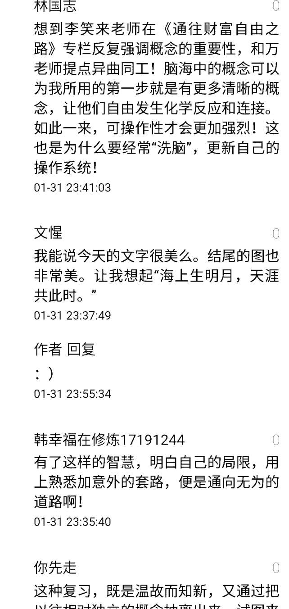

1043任意门
66911成员 2400人今日打卡

## 日课精选

九把叉
0
本来就想趁过年假期，回顾总结一下通过专栏之前学到的知识，但是感觉日课的内容都是比较独立的，一时找不到脉络进行归纳，没想到万老师及时的帮我解决了这个难题，实在是太棒了，而且这种归纳的思路本身也是一次脑洞大开的升级。多谢多谢！
01-31 23:48:25

绿洲散人
0
看过吴军博士的-《智能时代》里有一个关于国家整体智商与经济发展相关坐标图，随着国家整体智商的增高其经济发展水平也越高，图表中可看到欧洲，北美洲，亚洲日本和韩国的智商最高，其经济发展也是最好的，而非洲国家的智商普遍较低，其发展也较低。其 实也间接证明了智商对于个人发展的重要性。

喜欢来源于熟悉加上一些意外是对我们固有认知的一种颠覆，多看效应在这里起到了关键性的作用。拿创新来说吧，如果一种创新是完全颠覆的，那可能就不被理解和接受，人们也就不喜欢，就可能导致最后的失败，比如在一个有名的中餐馆你为了创新完全改变了做法和口味，那你就可能导致失败，如果进行渐进式的创新，保留传统菜品的特色和口味，只部分的进行突破式创新，增加一些特殊做法，口味上作出一些小的改变，再根据顾客的反馈及时调整，就可能被大众接受和喜爱，这就符合人们熟悉再加上意外的喜爱模式。
01-31 23:46:30

## 春节特刊｜值得记住的概念和名词

春节精选｜值得记住的概念…

上期日课我们回顾了一些熟悉的概念，今天我来帮你回忆一下，日课讲过一些不那么经常提到，甚至还比较陌生的概念。知道这些陌生概念，会对你认知世界的真相、认知自己和他人，有那么一些帮助。

今天要帮你回忆的概念包括以下几个：

+   - 快策路和慢策路
- 对数增长和指数增长
- 冷认知和热认知
- 简单认知信念和复杂认知信念
- 过度拟合

现在开始。快策路和慢策路在我们比较早的日课里提到过，你还记得吗？——
日课009｜今朝有酒今朝醉，也是一种理性

钱越多声望越高，进一步成长的机会也越大。

所以在选择任何技能之前，应该先考虑好它的增长模式，还有你能不能承受这个模式。

当你进展慢或者进展快的时候，你应该知道这跟你个人其实没有太大关系，跟外部环境也没有太大关系，纯粹是 Kezhe

认清这两个概念，当进步神速的时候你也许就不会得意忘形，遭遇瓶颈的时候也不至于怨天尤人。

能帮你认清学习真相的还有这样一对概念：冷认知和热认知。

### 日课048 | 庄子“无为”的一种科学解释

很多人都知道，人的思维大致可以分为两个系统——一个快速的、自动的、不需要主观努力就能运行的“系统1”，森纳潮称之为“热认知”；和一个缓慢的、刻意的、需要费力的“系统2”，森柯潮称之为“冷认知”。热认知系统大体是无意识的，比如我们日常的動作，走路、开车，并不需要先想好動作要领就能自动完成。

冷认知系统需要随时做判断，费时费力，但它的好处是面对新的信息能够随时调整，给不同任务设定新的优先级。

在解释“无为”之前，我们先来把“自动”和“刻意”做一个对比。为此，我们先来做个小实验。首先，请你按顺序读出下面这五个词：

红色
绿色
绿色
红色
绿色

作为一个以中文为母语的人，你肯定读得非常流利。这就叫*熟练*。

现在请你读出下面这五个词，但是注意，你要读的是每个词*自身的颜色*，而不是这个词的读音是什么颜色：

红色
绿色
绿色
红色
绿色

如果你以前没玩过这个游戏，我猜你读前三个词的时候还是比较顺畅的，因为它们的颜色跟读音一致；但是读到第四、第五个词，你可能就会稍微停滞一下，因为它们的颜色跟读音相反。这就叫*刻意*。

这个实验在心理学上非常有名，已经有了七八十年的历史，叫做“斯特鲁普任务（Stroop Test）”。刚才你那个小停滞，叫做*认知控制*。也就是说，靠热认知自动运行已经无法完成任务，冷认知出手控制了一下你的动作。

人脑中有两个区域负责认知控制。第一个区域叫“前扣带皮层（ACC）”，功能相当于一个烟雾报警器，一直开着监控局面。ACC一旦发现异常情况，就会给第二个区域，叫做“侧前叶皮层（Lateral PFC）”报警。而这个lateral PFC的作用相当于救火队，它更重要的功能是大脑中的决策系统，它会给大脑中各个部分下命令处理这个情况。

所以，当你看到第一个绿色的“红色”时，ACC向 lateral PFC报警，lateral PFC对照游戏规则，就会命令视觉系统忽略这个词的“意思”，而关注这个词的“颜色”，并且命令你的文字处理系统闭嘴，不要按照字面意思去发音。

一个不熟练的人做斯特鲁普任务，需要不断地启动这两个认知控制系统。等你熟练了，能够自动只看颜色忽略字面意义，那么整个任务就被交给热认知在潜意识状态下完成，而把冷认知省下来做别的事。

“刻意”，就是ACC和 lateral PFC同时打开。任务主要由缓慢的冷认知系统完成，整个动作是有意识的。
“熟练”，就是ACC和 lateral PFC同时关闭。任务主要由快速的热认知系统完成，整个动作是无意识的。

所以“无为”，就是意识和潜意识，冷认知和热认知的完美合作。你的学习能力，其实是你的认知信念决定的。关于认知信念，也有这么一对概念——

### 日课085 | 谁是复杂的现代人

昨天咱们专栏提到美国作家菲茨杰拉德的一句名言：“检验一流智力的标准，就是看你能不能在头脑中同时存在两种相反的想法，还维持正常行事的能力。”我想就这个话题再深入讨论一下。

现在心理学家有一个概念，叫做“认知信念”（epistemic belief），意思是 一个人对知识和获取知识的看法。

论文描述了两种认知信念，我们姑且称之为“简单认知信念”和“复杂认知信念”。

简单认知信念认为知识都是一个个孤立的事实，一旦被发现就不会再改变，获取知识的过程是一个被动的过程，权威说什么就是什么，没有个人观点一说。

复杂认知信念则认为知识是一个互相连接在一起的复杂体系，每个知识都和别的知识有所联系，而不是孤立的。知识可以随着时间慢慢演化，将来的证据和新的论证方法可能会改变现有的知识，所以也可以说很多知识是不确定的。所以我们不能盲目地听从专家的意见，而应该亲自去验证知识的来源是否可靠，最好自己能进行推理。

在现代生活中，我们经常可能会面对一些互相冲突的信息。心理学家说，一个人的认知信念，就决定了他能不能从冲突信息里学到东西。

认知信念决定学习能力。具备复杂认知信念的人可以在冲突信息中随时获得新知，不断进步。而具有简单认知信念的人一遇到冲突信息就感到困惑、抵触感、焦虑，甚至厌烦，他们或许能够一技之长安身立命，但是在见识水平上，最后恐怕难以跟上时代潮流。

不过，对于学习、做决策，也并不完全是越复杂越好，这里面也有学问。来重新认识一下这个词：过度拟合。

### 日课074 | 数学家告诉你为什么难得糊涂

咱们先来设想一个场景。一个会议室里坐满了人，正在做报告的年轻...

头发梳得一丝不苟，PPT上列满了数据和图表，他正在论证一个什么东西。

年轻人讲了很多很多，可是台下听报告的一个穿着随意的大佬，有点不耐烦了：“你不用说那么多，我就问你几个问题。”

大佬问了几个问题，年轻人马上被难住，于是大佬否定了年轻人的整个提案。

我们对这个场景并不陌生。可能这是一次公司例会，也可能这是一次论文答辩。在一线做事儿的人用了很多很多精力专注于各种细节，可是大佬们提问却往往是写意的——他们三言两语就能发现问题的关键，并以此作出决策。然后事实证明大佬说得对。

这就引出了一个问题。有些人做过大量功课，掌握了丰富数据和资料，为什么他们的决策水平，反而不如大佬短短时间内的快速判断？难道说，对一个问题思考得多，反而可能没好处吗？

这个问题，数学家也早就想明白了。如果你 的模型涉及到决策判断和预测未来，那么精确写实往往不如粗略写意。事实上，你的模型越写实，你的最终效果反而可能越差！数学家，管这个叫做“过度拟合”。

诸葛一生唯谨慎，吕端大事不糊涂。想要避免过度拟合，你必须学会抓住重点，学会忽略掉一部分信息。

## 书中给了三个建议。

第一，限定思考时间。比如一天之内必须完成报告，或者一小时之内必须结束会议。其实开会也好，写报告也罢，考虑的时间越长越无法保证效果，反而是在有时限限制的情况下，你才会逼着自己去考虑最重要的因素。

第二，限定内容长度。比如你可以要求属下写报告不能超过一页纸。如果一个方案无法用一页纸阐释清楚，你就应该干脆放弃这个方案。另一个办法是所谓“电梯谈话”——你想跟我谈一个商业计划，你最好能在电梯里面这点时间内说清楚你的方案。

第三，在白板上讨论商业计划，要使用粗的马克笔。最初的计划必须抓住重点！笔画越粗，对你的思维越有利，越能逼着你去考虑大局。如果你用圆珠笔，无形之中就会陷入关注细节的思维模式。

所以下次再有人不顾重点，在细节问题上纠缠不清，请你跟他说一句成语！——“你过度拟合了。”

这就是今天的全部精选内容，希望对你有所帮助。明天我们的主题是“你以为你以为的就是你以为的吗？”，来挑战一下常识，带你远离鸡汤，深入战场，期待你来听。祝你每天都有收获！


## ——本期文章及书目来源——

日课009 | 今朝有酒今朝醉，也是一种理性

日课027 | 两种技能增长曲线

日课048 | 庄子“无为”的一种科学解释

日课074 | 数学家告诉你为什么难得糊涂

日课085 | 谁是复杂的现代人


## 日课精选


## 春节特刊｜你以为你以为的就是你以为的吗

春节精选 | 你以为你以为...

生活中的一些道理观念、俗语典故，有时候会被我们当成“传统的智慧”，去信奉或者遵守，或者用来指导自己的工作、学习、决策。

这些道理放到现代社会，真的还有道理吗？

今天我们就来回顾一下，这些道理，背后到底有没有什么科学证据、或者调研数据的支持呢？比如说——

- 失败是成功之母
- 奢侈品越贵越好
- 有钱人的追求很low
- 中年的大脑不行了
- 什么年龄就该干什么年龄的事

这些说法都是对的吗？

先来看我们常说的一句话：失败是成功之母。是吗？

不一定。

### 日课001｜失败不是成功之母，成功是成功之母

我们先来想象一下，人 models 在什么情况下，能从失败中吸取教训。比如说你学开车，一开始上路的时候会犯很多错误，教练在旁边立即指出你的错误，纠正你的动作，你马上改过来，慢慢就会学会了。你在路上犯的每一个错误都是一次“失败”，教练甚至可以骂你，但是你的确能从这些错误中吸取教训。这其实就是所谓“刻意练习”中的“反馈”。

但那都是训练中的“小失败”。你是一个新手，本来就应该犯错，而且你犯的这些错误不会带来什么严重后果！

生活真正意义上的失败根本就不是这样的。我们举一个例子，外科医生做手术。

“冠状动脉旁路移植术”，是一个非常复杂难做的手术，一旦失败就意味着病人死亡。有人研究了6516例这个手术，看手术成功跟医生生人有什么关系，得出非常有意思的几个结果：

- 1. 如果一个医生手术失败，他后续的手术会更容易失败，他的成功率将一直下降。
- 2. 如果一个医生手术成功，他接下来的手术会更容易成功，他的成功率将上升。
- 3. 如果一个医生手术失败，他同事的手术成功率会提高，因为他们从他的失败上吸取了教训！
- 4. 如果一个医生手术成功，则对他同事没有任何影响。

也就是说，我的失败不是我的成功之母，但是别人的失败则可能是我的成功之母。

有效的反馈，“好的失败”，应该满足三个条件：
1. 及时。一旦不对马上就有人给你指出 calculations 来。
2. 对事不对人。你错了，下次改正过来就是，没有必要上升到“你这个人不行”的层面。
3. 错误的代价很小。

产品正式推向市场之前，先搞个小范围的内部测试，不行马上改，甚至直接砍了也没有多大损失。上正式舞台表演之前，每个星期在艺校内部给同学们表演几次，演的再差也没人笑话你，因为大家都挺差。

最好的失败，就是“在没有人看见的时候偷偷跌倒”。

失败有时可以成为成功之母，但那必须是是有条件的。从失败中吸取教训，也不是一件容易的事；该怎么“失败”对个人来说，还真是一件值得研究和学习的事，也别去迷信“失败”或者“苦难”的力量。

第二个反常观念，关于奢侈品。我们通常以为，奢侈品越贵越好，越舍得花钱买奢侈品也越能彰显尊贵。是这样吗？

也不是。

### 日课110｜奢侈品的逻辑

如果你要炫富，你就应该要求别人一眼就能看出来这个包是名牌——比如LV的某些包包，身上印满了“LV”这两个字母；古驰（Gucci）的包上，会有大的大字母G。可是爱马仕的柏金包上几乎就看不到商标，一般人不认识，只有内行才能看得出来这个包的价格。这怎么炫富呢？

这个现象，经济学家可是一直到2010年才有一个理论解释。这个理论说富人其实分两种，一种可以称为“爆发户”，一种姑且就称“贵族”。爆发户追求的是把自己和普通人区分开来，证明自己是有钱人。而贵族则根本不在乎普通人怎么看他，只要本阶层的人知道他属于这个阶层就行了。爆发户是在向普通人炫耀，贵族是在向内行证明。

这也解释了奢侈品的一个非常有趣的设计理念：同一品牌内，越是低端的类别，商标就越显眼。越便宜的LV包，LV两个字母就越显眼。奔驰越是低端的系列，车标就越大。

这个道理大概就是“低调的奢华”。奢侈品的逻辑是不但要讲高价，而且要维持高品位。

所谓高品位，关键就在于，只让该拿这个包的人拿这个包。为此爱马仕采取了两个措施。

一个是限量。爱马仕每年只生产7万个柏金包，要买得先排队定制。你到专卖店必须显示出足够的购买诚意，售货员才能认真对待你，让你选择皮质外饰，再等上至少两个月的制作时间，商店再通知你去取包。爱马仕对此的解释是优秀匠人 кус 和珍贵皮子都太少，柏金包其实不是“生产”出来的，而是像比特币一样“挖掘”出来的。不过经济学家怀疑，限量主要是品牌管理需要。

另一个是限价。如果不是为了品牌管理，既然柏金包供不应求，为什么爱马仕不把价格定得再贵一点呢？要知道二級市场上的柏金包可是都比专卖店贵。

也许根本原因是如果价格太贵，代表时尚的法国女人就买不起了。高定价可以让爱马仕在短期内大赚一笔，但从长期来看，如果有文化有品位的巴黎贵妇都放弃了这个品牌，只剩下没见识的发展中国家新贵买柏金包，柏金包的品牌形象就完蛋了。

背柏金包绝不仅仅是为了炫富，而是为了当贵妇。

爱马仕必须在高价和品味之间，寻求一个非常微妙的平衡。

这个平衡，其实非常难以把握。

所以，表面上看奢侈品是越贵越好，但背后其实有微妙的平衡。爱马仕搞的平衡是要高价，但是也不能太高价；要知名度，但是知名度最好不要太高。购买奢侈品也是一样，并不是越舍得花钱越好。

世间事物，大多过犹不及。

说到奢侈品，大概你会想到成功人士、富人阶层；有人可能还会不服气——你虽然有钱，但是你儿子不成器啊，但是你私生活不检点啊，但是你故步自封工作不努力啊，但是你思想已经落伍了啊，但是你的钱都是腐败得来的啊，但是你唯利是图迷失了人生的方向啊……

富人是这样的吗？有钱人的追求都 low 吗？

新时代的巨富并不是这样。

### 日课018｜新巨富的新文化

跟上一代富豪相比，新一代的富豪都是自己赚的钱，而不是继承的。哪怕是排在前0.01% 的这些人，他们的大部分收入也是来自工资和商业所得，而不是来自资本收入，事实上资本收入在巨富收入中所占的比例正在缩小。也就是说他们不是靠直接投资，以钱生钱，而是通过工作去赚钱。他们之所以这么有钱不是因为他们的爸爸，而是因为他们占据了这个胜者吃通吃唯一的“胜者”位置。

他们是怎么取胜的呢？从外部条件来说，最关键的是抓住了“革命”。有...

说，最关键的是抓住了“革命”。有一种是技术革命，新技术出来带来新的商业机会，比如互联网。另一种是中国改革开放和苏联解体这样的机遇，一下子来到了一个巨大的新兴市场。这并不是说苏联解体了，你依靠侵吞国有资产就成巨富了。家庭特权可能带来资金和信息，但是要最大做强，你必须得学会冒险，在正确的时间做正确的事。

新一代巨富同时也是个人奋斗的结果——他们往往从出生就开始竞争，赢了起跑线，然后一直赢，赢到今天。

首先是教育。你父母得先能把你送进top1%的幼儿园，从此一路名校，一直到争取进入哈佛大学，这一 切努力都直接增加你成为巨富的可能性。

他们从很小的时候就取得了可见的成就。

### 日课019 | 中年的大脑更厉害

你的脑细胞并没有减少。大脑重要的地方都在继续长，新东西可以继续学，不是没有风险，但搞好了维持到一百岁都没问题。

跟年轻的大脑相比，中年大脑在两个方面的性能是下降的：计算速度和注意力。其他方面，比如模式识别、空间想象能力、逻辑推理能力等等，性能不但没有下降，而且还提高 了。

### 日课067 | 心态年轻，你就真的年轻吗？

那么今天的科学家，对“心态影响衰老”的问题有什么说法呢？

有个令人惊奇的初步研究结果，说让 人做些冥想之类的思维练习，呢怕只练习一天，也能显著地影响这个人的基因表达水平！既然基因表达水平跟表老程度有关，这个结果似乎暗示心态可以影响衰老。

强迫退休，从表面上看这些行为是尊重老人，可是从今天这些研究来看，这实际上是在加速老人的衰老。我们的文化应该更平等地对待老人，这也是更平等地对待将来的自己。

不要用年龄给自己贴标签。不要问“社会环境认为我这个年龄的人该干什么”，你只需知道“我想干什么”！

这就是今天的精选内容。对你有启发的内容，仍然建议你回看原文。

这是一个“不换思想就换人”的时代，对于很多传统智慧、常识观念，需要你具备独立思考的能力，和探寻发觉真相的眼睛，才能像个清醒的斗士一样，远离鸡汤，深入战场。

祝你每天都有收获。

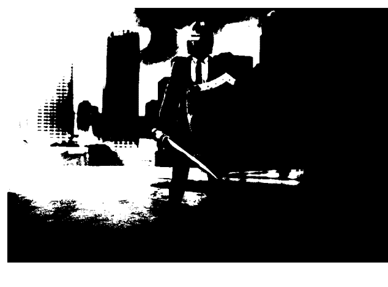

## ——本期文章及书目来源——

日课001 | 失败不是成功之母，成功是成功之母

日课110 | 奢侈品的逻辑

日课018 | 新巨富的新文化

日课019 | 中年的大脑更厉害

日课067 | 心态年轻，你就真的年轻吗


## 春节特刊 | 现代好家长必备

春节精选 | 现代好家长必备

今天的精选内容做给我们读者中的各位家长，我们来回顾一下日课中说过的，教育小孩子的学问。

家长们总是担心自己的一举一动都有可能对孩子前程造成重大影响，可是有些专家分析统计数据，结论往往是家长行为对孩子的影响可能没有那么大。

比如我们看《魔鬼经济学》这本书，其中就说“你自己是个什么人”，是决定“你的孩子会是什么人”的最大因素。可是站在家长的角度，我们总觉得放任自流肯定不对，你总得做点什么才放心。再者说来，好家长和坏家长对待孩子的方式的确有很大不同——那就算基因不行，我想模仿一下那些好家长，这总可以吧？

所以，现代好家长，都该知道什么，怎么做到呢？

大概很多家长在孩子还小的时候，都面对过这样的难题：如何衡量我的小孩的发育水平是不是达标呢？

### 日课097 | 每条路都是少有人走的路

那么问题来了，是否存在一个对所有孩子都适用的成长节奏，规定孩子就应该在几个月大的时候，掌握特定的几项技能？又该如何衡量一个孩子是否达标呢？

我们今天继讲《平均的终结：我们如何在一個崇尚相同性的世界中成功》（The End of Average: How We Succeed in a World That Values Sameness）这本书，作者是哈佛大学教育学教授柯德·罗斯（Todd Rose）。

罗斯说，过去的医学界，的确相信在孩子的成长过程中，存在各种阶段性的里程碑。比如一个孩子从最开始学会爬，到最后学会走路，中间要经历一个固定的过程。从出生到直立行走，专家们还给制订了一个进度表，中间包括在不同时期要掌握的不同肌行动作。

但在1998年，有一个不信邪的女科学家，克伦·阿道夫（Karen Adolph），为研究孩子到底是如何学会走路的，实地观察了28个孩子。这一次她没有采用平均值或者把所有孩子看作一个整体的做法。她把每个孩子都当做独立的个体，全程观察每个孩子的成长过程。

结果，通过这28个孩子，她竟然总结出了25种从爬行到走路的成长模式。可以说每个小孩的过程都不相同！有些小孩可能直接跳过爬行这一步，学会了走路；还有小孩在中途还出现过退步的现象。但不管如何，最终所有的孩子都学会了走路，都走得一样好。阿道夫得出结论，所谓成长阶段，是没有科学根据的说法。

我有一个七岁的儿子和一个将近两岁的女儿，他们两个学会走路的方式非常不同。中国有句话叫做“三翻六坐七滚八爬十二走”，我的两个孩子都没有遵从这个“定律”，这不妨碍他们最后都学会了。

作为一个父亲，我可以非常负责任地告诉即将为人父母的各位，每个孩子学会走路的方式都不同，根本没有什么固定路径。如果有医生告诉你，你家的孩子成长“不正常”，那只能说明这个医生的知识还停留在1998年之前，你应该提醒他去更新一下自己的知识。

每个孩子都是不同的，并不存在固定的成长路径，所以如果小孩不正常，大可不必焦虑。

可能你还面对过这样一个难题：怎么让小孩学会一些生活技能，同时还能培养他的经济学思维，比如，用花钱奖励的方式让小孩做家务可取吗？

这里面也有学问。

### 日课038 | 花小钱的学问

小钱要先给，大钱要后给。你让我去花时间挣一笔小钱，我懒得理你；但是如果我钱已经给你了，我不愿意欠你这个人情，所以我帮你。换句话说，当钱少的时候，人比较讲感情，并非是经济思维；当涉及到钱多的时候，人就是经济思维了。

其实这个道理，中国读者肯定是一听就明白。我们在生活中不就是这么做的吗？公司逢年过节给员工发个什么小福利，就是主动给——根本不看业绩，全公司上下人人有份，图个大家都高兴。如果是大钱，年终奖之类，那么必须看你对公司的实际贡献怎么样，得先有业绩才能给。

所以如果你打算给别人一点小恩小惠，那就是记一点：一定要不计回报地主动给。公司对员工，领导对下手是这种给法，下级对上级也是同样的原理。我们看在官场上，小人物想要巴结大人物，又给了不对对方真正需要什么东西，最好的办法就是找机会帮他一个小忙——对方出于不好意思占便宜的心理，将来就有可能给你一个实际分量更大的回报。

经济学的一条最基本的原理，就是“人会对应激励做反应”。但是注意，“激励”不等于钱。钱只是激励的一种，而有时候精神上的满足感比金钱更有激励作用。那些不在乎幼儿园罚站的家长，不愿意为了1%的奖金而拼命募捐的学生，你能说他们是非理性的吗？其实他们恰恰是理性的，他们知道金钱的合理价值。

有些家长，可能是为了从小培养孩子的经济意识，也可能是自己学经济学学得走火入魔了，在家庭内部给孩子实施奖金制度。倒一次垃圾，奖励多少钱；洗一次碗给多少钱；陪弟弟妹妹玩给多少钱……这种情况真正的经济学家也研究过，结果是灾难性的。

本来，孩子做这些事情是在帮助家里，是亲情和爱的表现，你现在把什么都变成计较，那我去麦当劳打工不是更好？

用知识武装自己的家长必是好家长。不过，在教育小孩这个问题上，有的家长也会有个误区，就是会羡慕美式教育，甚至认为应该事事向美国家长学习。其实并非如此。中美好家长都该向对方学习什么？

### 日课071 | 中美好家长都该为孩子做些什么

PISA还发现，以下几件事对孩子的教育很有帮助：

- 1. 在孩子还很小的时候帮助他们阅读。
  比如对上幼儿园的孩子，如果家长每天在固定时间陪着孩子阅读或者读书给他听，他的阅读理解能力会比同龄人高出1年的水平。
- 2. 等孩子15岁之后，家长最好和孩子多讨论一些文化、艺术、电影、社会新闻方面的话题——总之就是那些并不是发生在我们身边的事情，也就是我们常说的 “something bigger than yourself”，这将对孩子的思维能力有很积极的影响。
- 3. 如果家长本人就爱阅读，那么孩子也会受其影响，学习成绩会更好。

针对美式的泛滥表扬，家长应该怎么表扬孩子呢？这本书说，正确的表扬得满足三个要求：

- • 具体。你不能空洞地夸孩子聪明。如果他并没有付出努力，这种夸奖反而有害。正确的夸奖方式应该具体指出孩子哪件事情做得好。
- • 稀少。不要轻易表扬。美国数学老师在课堂上对孩子的表扬是最多的，而美国学生的数学成绩是最差的。
- • 真诚。你必须表现出对孩子所做事情的真实兴趣。

所以表扬也不容易！要这么说的话当家长还真不是一个特别随意的工作。这本书提出，家长和孩子之间的关系，可以分为四种类型。

第一种是纵容。家长像是孩子的朋友，允许孩子做任何事情，几乎不强制。一般是比较富裕的家庭如此。

第二种是忽略。比较贫困的家庭就是这样，除了满足孩子基本的生活需求以外，其他事情一概不管。

外，其他事情一概不管。

第三种是集权。孩子必须按照家长说的去做，没有道理可讲。美国的墨西哥裔家庭和黑人家庭多采取这种做法。

而最好的家庭其实是第四种，权威。它既保证了家长的威信，孩子做什么家长说了算，又比较宽松，孩子把家长视为可靠的依赖。既严格又温暖，就好像中国人说的既有严父又有慈母的感觉。在美国，亚裔家庭在这点上做的最好，在白人中只有中产阶级以上的家庭能做到这点。

首先应该自我肯定，我们的方法是正确的。美国是发达国家，并不一定是因为美国家长厉害，现在美国家长正在学习中国家长。

但另一方面，我们也不能盲目认为中式教育就完美无缺。至少有一点，我认为值得中国家长向美国家长学习的，那就是去学校做志愿者。

志愿者活动，不仅仅反映了家长对孩子的重视，更反映了家长对学校和社区的重视，说明你是个有参与精神的社区成员！前面的研究也提到了，如果经常跟孩子讨论艺术、文学和一些与自身无关的公共事务，对孩子的认知能力和将来的成就都是有帮助的。

中国家长在这方面做的很不够，中国式教育有点个人顾个人的意思。这大概也是为什么美国大部份亚裔学生在学校的成绩非常好，但在工作中就很难获得高位。他们是规则的适应者而不是改变者，有强烈的打工者心态，缺少主人翁精神和改变世界的愿望，这很可能和从小的家庭教育并不关注公共事务有关。

### 日课095｜优等生、奇人和猛人：斯坦福商学院都招什么人？

基本上，斯坦福商学院录取四种人。

第一类是优等生，占招生总数的50%-60%。这类学生需要优秀到什么程度呢？首先得是名校本科毕业，比如哈佛大学、达特茅斯学院之类。他们可以先学习自由技艺（liberal arts），毕业后还得有两到四年的知名企业工作经验——比如高盛那样的投资银行或者像麦肯锡那样的咨询公司。他们的大学成绩单和GMAT成绩必须出类拔萃。他们还得有强大的推荐信，证明他们不但成绩好，而且具有优良品质……用句单田芳的话说，这些就是“挑了又挑选了又选，按了又按捻了又捻”出来的人。

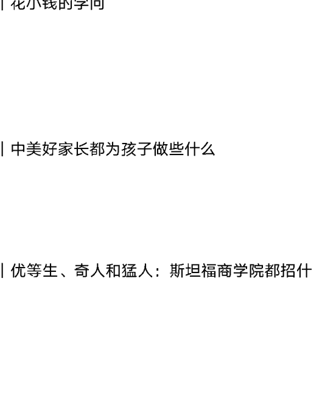

## ——本期文章及书目来源——

日课097｜每条路都是少有人走的路

日课038｜穷小钱的学问

日课071｜中美好家长都为孩子做些什么

日课095｜优等生、奇人和猛人：斯坦福商学院都招什么人

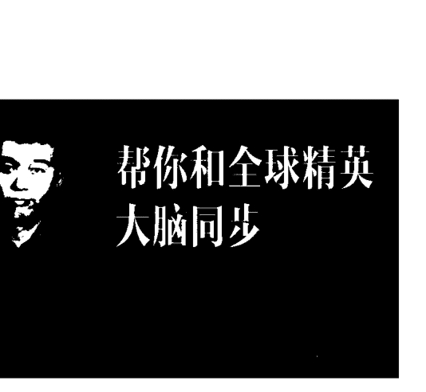

## 答读者问 | 到底什么叫 “智商”？

特别节目 | 到底什么是 “…”

万维钢

今天的内容来自初一串门拜年时，在罗辑思维专栏制作的一期节目，并且收集了罗友们提出的问题，在这里做出回复，希望也能解答你的疑问，全文也附在问答后面，供你参考。

万老师，这篇文章里关于延迟兑现支票的实验，我比较好奇，半年的时间最低给2.5的利息，年化率就是5%。这个比例确实算高，但是按现实世界的复杂程度来说，只考虑和银行利率对比的收益来决定是否延迟兑现，感觉还是有点太简化。举个例子，这笔钱早点拿到手上，可以投资收益更高的事情，比如订阅读知服务，这些收益比简单的存钱来的要大啊，所以这个实验结论就不一定了吧？还是我哪里没有想明白？

语音说智商高的士兵选择分期缴散费，智商低的人选择一次性的拿，可是我有个问题，那万一人家那个钱去投资了，收益可以更大？或者人家也担心政府政策什么变动等客观因素呢？

万维钢

当我们谈论统计结论的时候，必须主动忽略各种 “不一定” 和 “万一”。我们要看的是一个*大体的趋势*，也就是从统计上大多数人是怎么回事。极个别的聪明人做某件具体的事情，可能会和大多数不聪明的人一样，但是他们在统计上，*不显著*。

不过具体到士兵遣散费这个事情……已经交代过，即使考虑到利息和通货膨胀的因素，分期的收入也远高于一次性拿走2.5万美元——那么如果这个士兵想投资，他的正确做法是以遣散费这个固定的现金流（以及美国政府的信用）做抵押，申请银行的贷款……


## 特别放送 | 2016日课目录及Evernote福利


万维钢

各位好！今天精英日课的订阅人数达到七万。在此特别加更发放两份福利：

+   一是2016年精英日课目录索引，包括每期的标题、简介、标签和知识点，供你保存和查询；
二是Evernote为咱们读者提供的一个月的高级账户免费兑换码，一共5000个，先到先得；还有40个半年高级账户免费兑换码，获取方法见文章结尾。

感谢大家！

### 2016/8

《万维钢精英日课》8月概要
标签 编号 标题/简介 概念/知识点
屋缘 001 失败不是成功之母，成功才是成功之母
职场 002 ...

### 2016/9

《万维钢精英日课》9月概要
标签 编号 标题/简介 概念/知识点

### 2016/10

《万维钢精英日课》10月概要
标签 编号 标题/简介 概念/知识点

### 2016/11

《万维钢精英日课》11月概要
标签 编号 标题/简介 概念/知识点

### 2016/12

《万维钢精英日课》12月概要
标签 编号 标题/简介 概念/知识点

### Evernote福利


### 领取步骤：

+   1. 扫取上方二维码，关注“我的印象笔记”微信公众号，收取并打开微信文章
2. 登陆或注册印象笔记账户，领取10印象分，使用10印象分兑换1个月高级账户

半年高级账户获取办法：请在留言区分享你2016年在阅读、学习、管理信息等任意一个方面的心得体会、方法技能或最新认知，300字以内，截止到2月8日晚上10:43，获得点赞最多的前40名读者，工作人员将跟您联系寄送兑换码。祝你好运！


## 周末小议 | 二十层床垫级别的敏感度

最近听我儿子读了个童话故事，挺有意思，我想给你讲一遍。

从前有个王子，立志要娶一位真正的公主，可他又不知道怎么样才算是真正的公主，就向一个女巫请教。女巫说判断真正的公主有三个标准。第一，她对所有人都有礼貌；第二，她对穷人和富人都有关爱之心；第三，她必须有非常敏感的皮肤——怎么样才算敏感的皮肤呢？你在二十层床垫下面放一粒豌豆，真正的公主睡在床上能感觉到豌豆的存在！

王子见了很多人公主，都没通过三个测试，特别是没通过豌豆测试。最后是一名女仆通过了三个测试——女仆机缘巧合之下在床上睡了一晚，但是没睡好，被二十层床垫之下的豌豆硌着了。最后王子就娶了女仆，两人从此幸福地生活在了一起。

为写这篇文章我特意考证了一下，这个故事是改编自安徒生童话里的《豌豆公主》。原文是一个真的公主通过了测试，我儿子看的版本让女仆当公主，显然是为了迎合现代人的自由主义思想。


这个故事的有意思之处在于，为什么非得要公主有如此敏感的皮肤呢？我是这么想的，女巫提出的两个标准，凡是“好人”就能做到；而只有这第三个标准，却非得是从小富养、对生活享有敏锐感觉的女孩才有可能做到。所以女仆版不太真实——这第三条就是为了把女仆淘汰掉的好吗？

我觉得安徒生这个故事的背后有个道理。他想说的是，敏感度，可以区分人的高低贵贱。

当然不一定是皮肤敏感，也不一定是享受方面的敏感，还包括各种感觉的敏感。有些人能体察到细微的东西，而有的人不能。

比如我最近在微博看到一个描写阿兹海默症的公益广告。一個人的父亲得了阿兹海默症，连儿子都认不出来。但有一次，他领父亲出去吃饭，父亲看到餐桌上有饺子就直接把饺子拿起来装到口袋里，说要留给儿子吃。这个广告说尽管老人得了病，忘记了所有事情，但他却始终没有忘记对儿子的爱。这是一个非常令人感动的故事，许多人都被触动了。

可是我看微博评论，有人就说，他在电视里看到这个广告，身边一个人就非常无感，而且还嘲笑老人竟然闹出了直接把饺子装进口袋里的笑话！

所以哪怕特别简单的点，有的人就是get不到。这就是敏感度不行。一个人如果在人际交往中缺乏敏感度，他做事就没有分寸，说话就不知道轻重，他就无法理解别人的暗示，甚至你讲个高级点的笑话他都听不懂。他可以是个好人，也可以拥有很厉害的专业技能，但是他本质还是个粗人，不能通过豌豆测试。那他有可能就做不好一些高级的事情，比如说支配人——这种公主该干的事情。

现在早就不是公主和女仆的时代了，身份越来越不重要，我们看有些“女仆”就是比某些“公主”高级。但是敏感度仍然事关重大。我们看《未来简史》中，赫拉利提出一个公式：知识 = 体验 × 敏感度。

赫拉利说在这个没有宗教信仰的现代，想要寻找人生的意义，就得有体验和敏感度。赫拉利说敏感度的意思就是你要从经历中获得体验，在用体验改造自己。你通过不断的体验能对世界产生更深的理解，最终变成一个更好的人。

敏感度，就是人文主义者的自我修养。45A笔笔记

敏感度是可以学的。比如我看春晚，感觉舞台非常奢华，但总觉得有点土气，可是又说不清是怎么个土法。最近看到一篇文章《为什么大牌时装在春晚就失去了高级感？》，其中提到一个概念叫“颜色饱和度”。作者的理论是颜色饱和度越高，高级感就越弱，春晚舞台土就在大量使用了大红大绿这种高饱和度的颜色！

> Great minds discuss ideas.
Average minds discuss events.
Small minds discuss people.
- ELEANOR ROOSEVELT

那到底什么重要，什么不重要？

琐屑人就不要紧。有些人一辈子就把敏感度发泄在琐屑人上去了。察言观色，看家本领是任何时候都能迅速识别周围人的身份等级，专门研究眉眼高低。可是我们看那些真正厉害的人物，不管是商人还是科学家，学者还是官员，有时候就是直来直去，从来不“适应”别人，都是别人适应他们。他们把敏感度用在了更高级的地方。

类几乎天生就会。天气预报系统已经如此精密的今天，还是需要人类对结果进行微调。模式识别，见微知著，绝对是值得努力提升的真功夫。

想要获得这样的功夫就得多积累实践经验、多读书、多了解这个世界。听说一两条负面信息就对世界绝望了，那是无知。认为什么信息都没意义，那是麻木。知道什么重要什么不重要，该信什么不该信什么，才能对世界有个 “educated guess”。

《精英日课》读者数昨天突破七万。咱們这个专栏，专门谈论想法。让我们一起提升 —— 关于想法的 —— 敏感度。

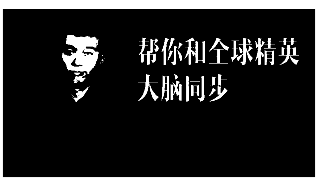

### 日课119｜到底什么是发散思维（上）

日课119｜到底什么是发...

今天咱们说个有点神秘的东西，“发散思维”。

你肯定听说过这个词。很多教育家呼呼培养小孩子的发散思维。比如说一个小孩数学题做得中规中矩，可是性格不活泼特别老实，教育家就可能认为他缺乏发散思维。

另一个小孩说话天马行空、思路离奇，教育家就可能认为他很有发散思维。能在两分钟内写下绕头的50种不同用法的“发散思维”，是不是就比老老实实把数学题做对的“普通思维”高级呢？

从常识判断，我们总觉得能把题做对的人更有用。可是你考察各种发明创造的传说，最后关键的那一步，似乎又的确是发散思维的作用。咱们之前讲过蒂姆·哈福德的《混乱》那本书记，其中有个概念叫“任意的震动”，说的就是偶尔的分心有利于发挥创造力。

那么发散思维，和把题做对的这种思维——不妨称之为“集中思维”——到底是什么关系，这就是今天我想说的 QByte。我要说的这本书是《算数之心：如何在数学和工程出色》（A Mind For Numbers: How to Excel at Math and Science (Even If You Flunked Algebra)），作者是芭芭拉·奥克利（Barbara Oakley）。

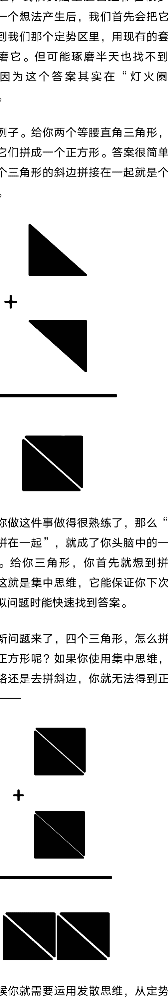

这些内容还没有变成人人皆知的常识，但又能代表科学家的共识，所以特别值得讲。

咱们先说“集中思维”。这就是老老实实做数学题的思维。一个外部信息进来，你立即在大脑中给这个信息定位，专注思考，快速处理，这就是集中思维。比如让你算一个两位数乘两位数的乘法，你根本就不会分心，拿过来就算。你头脑里已经有现成的乘法口诀——也就是套路，你把这些套路自动使上，很快就能得到答案。

再比如你读书看到一个从未听说过的新名词，为了理解这个名词的意思，你就不得不一字一句地读书中的内容。这时候你的思想集中在这个概念上，根本没有什么余地分心，这也是集中思维。

集中思维需要专注。在处理抽象的问题，或者按照一定的规则做事，或者对什么东西进行解码，探究事物背后的本质的时候，我们的大脑就是一台单进程计算机，任何分心都会降低效率。

“专注”，可以说是大脑的基本功。不能专注思考就不能掌握操作规则和理解抽象概念。想要在任何脑力领域有所成就就非得从小训练专注的功夫，在理工科上更是如此，就好像古代大儒们“养气”一样。人长时间专注做一件事情会感到劳累，除非你特别厉害，能进入“心流的状态”——但即使如此，大脑集中思考时总是更消耗能量，就好像一台发热到让风扇嗡嗡作响的电脑。功夫浅的人需要意志力来强迫自己专注。

但是集中思维有个很大的局限性，需要用发散思维来弥补。奥克利画了两张图来说明这个问题。


我们把人脑处理新想法的过程想象成一个弹球游戏。上面两张图中的大脑边上有一个弹簧，新想法就好比是一个球，弹簧把球弹入大脑。

左边这个大脑进行的就是集中思维。球进来以后迂到了大脑前方的区域，那里有些路线是加亮的，表示是高速公路，相当于大脑中现成的套路，比如乘法口诀。集中思维是把新想法集中在大脑中的一个特定区域处理。小球就在那里打转，如果问题的解决方案也在那里，那大脑很快就能解决它。

专业水平越高的人，越容易发生这样的集中思维。这是因为你的大脑中有很多现成的高 速公路，什么新想法进来马上就能被这些高速 公路传递到特定的区域里去，这就是“套路深”的好处。

而集中思维的弊端就在于，如果问题的答案不在小球一开始进入的区域，你就很难找到答案了。比如还是这张图，左下方黑色线条围起来一个区域，答案其实在那里。如果我们头脑中的高速公路一上来就把小球送入正前方的红色区域打转，那么就怎么也找不到正确答案。

发散思维就如同右边那个大脑。没有那么多高速公路，大脑对新想法的限制是很松散的，小球进来以后到处乱窜，哪个区域都可能去到，那么有时候就有可能路过正确答案所在的区域。所以发散思维是一种全局思维，的确有点天马行空甚至是胡思乱想的意思。

集中思维的这个弊端，有个专门的名字，叫“Einstellung Effect”，也就是“定势效应”。说白了这 个定势效应就是当局者迷，我们头脑里边已经存在很多定势，一个想法产生后，我们首先会把它直接放到我们那个定势区里，用现有的套路去琢磨它。 但可能琢磨半天也找不到答案，因为这个答案其实在“灯火阑珊处”。

举个例子。给你两个等腰直角三角形，让你把它们拼成一个正方形。答案很简单，把两个三角形的斜边拼接在一起就是个正方形。


如果你做这件事情做得很熟练了，那么“把斜边拼在一起”，就成了你头脑中的一个套路。给你三角形，你首先就想到拼斜边。这就是集中思维，它能保证你下次遇到类似问题时能快速找到答案。

现在新问题来了，四个三角形，怎么拼成一个正方形呢？如果你使用集中思维，根据套路还是去拼斜边，你就无法得到正确答案——


这时候你就需要运用发散思维，从定势里面释放出来，让小球去别的区域找答案……换个角度，这时候应该把直角边拼在一起。


在一起。

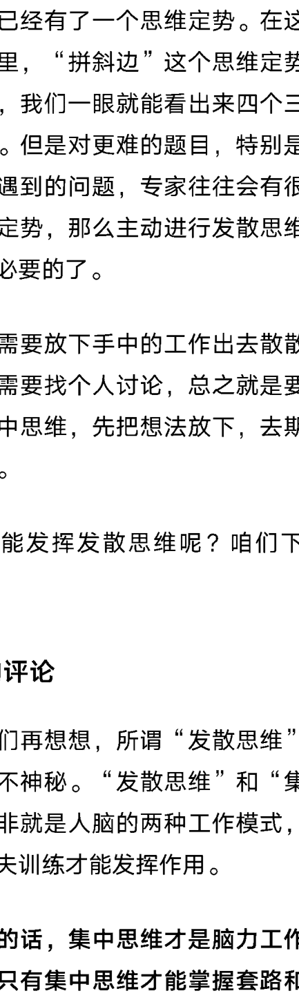

这就是“跳出思维定势解决问题”。当然这个所谓“发散”，所谓“跳出”，前提是你已经有一个思维定势。在这个简单例子里，“拼斜边”这个思维定势其实并不强，我们一眼就能看出四个三角形的解法。但是对更难的题目，特别是实际工作中遇到的问题，专家往往会有很强烈的思维定势，那么主动进行发散思维就是非常有必要的了。

你可能需要放下手中的工作出去散散步，你可能需要找个人讨论，总之就是要主动停止集中思维，先把想法放下，去期待发散思维。

怎样才能发挥发散思维呢？咱们下次再说。

## | 我的评论

现在我们再想想，所谓“发散思维”其实一点都不神秘。“发散思维”和“集中思维”无非就是人脑的两种工作模式，都需要下功夫训练才能发挥作用。

让我说的话，集中思维才是脑力工作者的本钱。只有集中思维才能掌握套路和抽象概念，才能让你的脑子里事先有一个“答案区”。如果根本就没有这个答案区，小球就算走遍全脑也没用。

我们平时的学校教育，或者自己读书自学，的确都是专注于集中思维，可以说练的都是基本功。教育系统这么做也有道理，因为基本功特别容易考核！只要有大略有套路，老师就容易出题，学生就容易备考，大家都方便。

学校教育的缺陷在于如果只有这一身基本功而不会灵活运用，到了实际工作的时候可能就发挥不出来。这就好像一个人的身体特别好，各种武术套路都会，但是没打过仗！一旦真跟人交手就可能缺少想象力，不会应对突发情况和不熟悉的局面。

可是话说回来，到底有多少人需要在工作中随时面对突发情况和不熟悉的局面？大多数工作无非就是循规蹈矩而已。也许只有从事创造性工作的人，才需要发散思维。而且只要有了集中思维的基本功，想要发散一下其实并不难。

发散思维，不应该指望在学校学，而应该自己主动实践。

## 由此得到

+   1. 集中思维，是掌握抽象概念套路，以及使用这些概念和套路的思维，特点是每次专注于一点，是局部的思维。\n2. 集中思维有个缺陷——容易陷入思维定势。\n3. 发散思维是个全局性的思维，往往能把新想法和一个意想不到的知识联系起来，绕过思维定势。

而我们今天最重要的一个教训，其实是每个人都应该学会合理使用自己的大脑。不要把大脑当成黑箱，不要以为大脑有多神秘，要把大脑当成工具！根据不同情况主动切换集中思维和发散思维——

关键词：主动。

## —— 纯属娱乐的练习题 ——

奥克利在书中给了一道练习题，她认为这道题有助于我们体验发散思维。


桌上有一个用十个硬币摆放的等边三角形，现在这个三角形的头冲上。请问你能不能只移动三个硬币，把三角形变成头冲下？

据说很多小孩很快就能解决这个问题，而很多大学教授花了很长时间也解决不了。如果你一时之间没看出来答案，不要轻易放弃，体验一下！实在想不出来也没关系，我并不认为这个问题能说明任何事，它只是一个娱乐。


### 日课120 | 到底什么是发散思维（下）

日课120 | 到底什么是发...

先来看张照片——

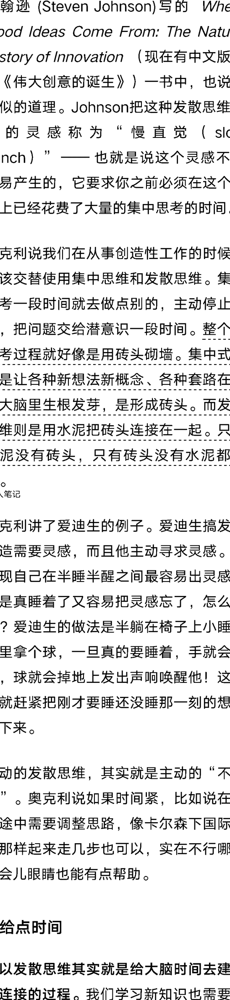

这是2004年的一场国际象棋快棋赛。坐在右边这位大人就是最著名的大师卡斯帕罗夫。左边这位小孩是个神童，叫马格努斯·卡尔森（Magnus Carlsen），当时只有十三岁。后来卡斯帕罗夫成了卡尔森的教练，今天的卡尔森已经是2013、2014和2016年的国际象棋世界冠军得主，等级分排名第一。

图中考斯帕罗夫正在非常专注地盯着棋盘思考，而卡尔森起来离开了座位，他似乎想走两步散散心。这场比赛的最后结果是平局——而且是卡斯帕罗夫求和。

卡尔森在场上散步不是因为他坐累了需要休息，也不是在搞什么心理战。他是在主动使用发散思维。

#### 1.什么都不想

今天咱们继续说发散思维。昨天我们知道，集中思维有个定势效应，容易陷在一处当局者迷。而这时候如果主动使用发散思维，跳出圈外来换个思路，最后往往能创造性地解决问题。

#### 2.给点时间

#### 3.两种工作记忆

## ｜我的评论

## ｜由此得到

+   1. 不论你是想消化吸收新知识还是想从旧知识里获得灵感，你都需要发散思维。
2. 高手会主动交替使用集中思维和发散思维。

[PAGE 19]

2. 高手会主动交替使用集中思维和发散思维。

3. 发散思维需要时间……一个好办法是睡觉。

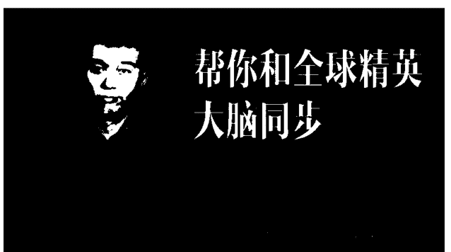

## 日课精选

秦凯 15

我有个习惯，看书的时候，为了不影响看书速度，会把遇到的小问题全部拿一个小本记到一起。没事的时候就翻来看看看，时间长了，这些问题的交织在一起，产生了惊人的联系，为自己的跨学科思考提供了很好的素材。这不就是发散思维的妙用嘛！

02-07 23:11:25

### 日课121｜两个字：稀缺

日课121｜两个字：稀缺

今天咱们说个大问题——怎么赚钱。公司都是怎么赢利的，富人都是怎么富的呢？这是最热门的话题，早就有过各种答案，比如说努力工作、敢于冒险、存钱投资、多了解最新信息、学习先进技术等等——我看这些说法都还没说到点子上。想要在市场经济条件下赚钱，关键在于两个字——稀缺。

我要说的这本书是蒂姆·哈福德（Tim Haford）的《卧底经济学》（The Undercover Economist）。这本书十多年以前就已经出版了，是哈福德的成名作。这是当初哈福德从经济学家转型成为经济学作家后写的第一本书，他用畅销书的写法，一次性总结了自己平生所学的主要经济学知识，视角独特，选材新颖，可以说是一本非常重要的书。

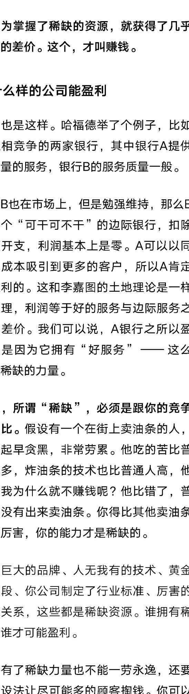

可惜的是，虽然此书很受欢迎，但是大部分读者基本上都没看懂。人们从书中找了几个故事读，主要思想都没学会，读完第二章就上网微博写书评去了。后来我看哈福德再写别的书索性故事性增强了。

其实想要读懂这本《卧底经济学》，专注于故事是不行的。最好的办法是带着一个问题读。可以说抓住这个关键问题，你就抓住了现代经济学的核心思想。

这个问题就是，钱是怎么赚的？

#### 1.什么叫赚钱

我先来分析一下什么才叫赚钱。

在现实生活中，有的人收入高，有的人收入低，但收入高不等于赚钱。你从小学习就比别的同学都努力，别人上了普通大学，而你上了名校；工作以后别人下班就回家，你经常加班加点努力拼搏，然后你获得更高的职位，拿到了更高的工资——这种状态，不叫赚钱。

如果你努力程度是一般人的两倍，你的收入也是一半人的两倍，那么你的“利润”，就是零。

从经济学角度，你在学习和工作上花费的时间都是成本。你高学历不是凭空得来的，是你自己的努力换来的。你付出多少成本就收获多少回报，哪有利可言呢？

经济学家形容这种状态，叫做“边际”。
你提供的是市场上的“边际服务”，你的劳动力是一个“边际商品”。

“边际”的意思就是可干可不干。你愿意付出多一倍的努力，换取多一倍的工资，那是你的事。有的人认为享受生活更重要，他干一半活，拿一半钱，相对于你而言他并没有失去什么。这纯粹是个个人价值观的选择，谁也不会羡慕谁。

那么什么叫赚钱呢？赚钱，意味着你的收获大于你的付出。

那么怎样才能让收获大于付出？读懂哈福德这本书的关键点就在这里。

#### 2.李嘉图的见识

大卫·李嘉图在1817年提出一个理论模型，理解了这个模型你就理解了有钱人。

假设现在有一个边远的小镇，小镇上有一大片优质的土地，而你是其中一块土地的地主。最初这些土地都处于闲置状态，无人耕种。你和小镇上的众多地主们都不打算干活——要不还怎么叫地主——你们都希望把自家的土地租出去，拿点租金。小镇外边，还有些长满灌木的贫瘠的无主之地。

终于有一天，来了一个农民要在那里种田。当然所有地主都想把土地租给他，可是土地供给大于求，所以租金肯定很低——对地主来说，有点收入总比没有强吧？

等越来越多农民到来，把镇上所有优质土地都租完了，这时候再有农民想要租地的话，他只有两个选择——或者去耕种小镇外边那些不用租金的贫瘠土地；或者付出更高的租金去租地主手里的优质土地。

李嘉图的理论说，现在那些贫瘠的无主土地，就是所谓的“边际土地”。

付出同样的劳动，在贫瘠土地上能产一吨粮食，在优质土地上能产五吨。假设现在粮食按值钱，那么贫瘠土地就是“可耕种也可以不耕种”——“可干可不干”的，优质土地却是只有傻子才不去耕种的。

这时候你拥有的优质土地，就是一种“稀缺”资源。

那么农民要租你这个稀缺资源，他应该给你多少钱呢？李嘉图说，基本上：
优质土地的租金 = （优质土地的产量 - 边际土地的产量）×粮食价格。
换句话说，基本上这个农民应该把因种你家的地所出来的收入，全给你。当然不至于完全的全给，你总要分给他一点利润——但是肯定不用给很多，因为一个理性的农民明白，只要能稍微多一点收入，就比去耕种边际土地强。

一开始稀缺的是农民，后来稀缺的是土地。一开始是农民随便给地主点钱就行，后来是地主随便给农民留下点钱就行。

你因为掌握了稀缺的资源，就获得了几乎全部的差价。这个，才叫赚钱。

#### 3.什么样的公司能盈利

公司也是这样。哈福德举了个例子，比如有互相竞争的两家银行，其中银行A提供高质量的服务，银行B的服务质量一般。

如果B也在市场上，但是勉强维持，那么B就是个“可干可不干”的边际银行，扣除各项开支，利润基本上是零。A可以以同样的成本吸引到更多的客户，所以A肯定是盈利的。这和李嘉图的土地理论是一样的道理，利润等于好的服务与边际服务之间的差价。我们可以说，A银行之所以盈利，是因为它拥有“好服务”——这么一个稀缺的力量。

注意所谓“稀缺”，必须是跟你的竞争对手比。假设有一个在街上卖油条的人，每天起早贪黑，异常劳累。他吃的苦比普通人多，炸油条的技术也比普通人高，他说，我为什么就不赚钱呢？他比错了，普通人并没有出来卖油条。你得比其他卖油条的人厉害，你的能力才是稀缺的。

声望巨大的品牌、人无我有的技术、黄金的地段、你公司制定了行业标准、厉害的人脉关系，这些都是稀缺资源。谁拥有稀缺，谁才可能盈利。

当然有了稀缺力量也不能一劳永逸，还要想方设法让尽可能多的顾客掏钱。你可以使用“区别定价”的方法，把咖啡分成中杯、大杯和特大杯，把软件分成企业版、家庭版和学生版，其实生产成本都几乎一样，纯粹为了让付钱多钱少的人都能买得起……这些都是小技巧，书中都有介绍。

关键还在于稀缺。而最厉害的赚钱方法，是想办法阻止竞争者入场，人为制造稀缺！例如荷敦市政府强行规定在市郊建一个绿化带，绿化带里禁止建房，导致荷敦市不能扩张，那么市内现有土地的稀缺程度就大大增加了。这种赚钱方法，叫“垄断”。

#### 4.市场的力量

说完个人和公司赚钱，咱们再说说政府和市场。有一个有责任感的政府，其实是不希望你赚钱的。

有人赚钱，就说明现在有好吃的东西是稀缺的——可既然是好吃的东西，我们总希望人人都能拥有。想要减少稀缺，最好的办法就是市场~

人都能拥有。想要减少稀缺，最好的办法就是市场。

比如你有一个比别人都好的技术，那你就可以把自己的产品卖得非常贵，这对你来说当然是好事，但对全体国民来说，好产品太贵了。那么在市场经济条件下，别人就会研发类似的技术，赶上你，然后以更低的价格提供同样的产品。政府从全体国民的角度考虑，应该认为这是好事儿。

哈福德书中有个概念叫“完美市场”——也就是让所有力量都自由竞争，那么最后的结果就是市场效率最大化。这时候，每个商品的价格，就等于它的边际成本！

在完美市场里，没有稀缺力量。所有人都不赚钱，所有人干的都是“可干可不干”的事。炒股票和把钱存银行没区别，每个人的回报都等于他的付出。谁也别想暴富，同时所有人又都很有富裕。你说这样的世界有多好呢？

可是市场总是不完美的。稀缺、信息缺失和外部效应都会导致市场失灵。一个有责任感的政府应该致力于消除这些障碍，让市场更加完美，可是真实世界中的政府总会人为设置各种障碍。这些问题书里都有，咱们不必细说。

总而言之，个人总是希望拥有稀缺的力量，而市场总是希望减少稀缺的力量。当每个人都在创造稀缺的时候，稀缺就减少了。我看这个，可以说是另一个版本的“看不见的手”。

## ｜我的评论

我们得学会用稀缺眼光看现在市场上这些公司，才能抓住要害。

现在Facebook为什么这么赚钱？它自己开发了什么了不起的技术？Facebook的稀缺资源是它的忠诚用户。如果你的亲朋好友都在Facebook上，你很难不用Facebook。Facebook最担心的恐怕不是什么新技术，而是未来年轻一代如果不愿意跟自己的父母共用一个社交网站，它怎么办。

比特币为什么值钱？什么技术好、p2p思想先进、跨境支付这些功能，现在别的虚拟货币也都能做到，比如说“莱特币”、“以太坊”、“狗币”等等，有的还做得更好。那些后来出现的虚拟货币都不值钱，比特币值钱，根本原因在于比特币是第一个虚拟货币，它真正的稀缺资源是声望。

反过来说，我们看现在很多互联网创业公司，什么打车、叫外卖、在线视频网站，他们的技术和理念都是别人想学就可以学的，有钱就能开一家，又有什么稀缺力量呢？唯一的指望就是在竞争中击垮所有同行，自己一家独大，能够拥有一大批忠实用户。而用户的忠诚度还特别值得怀疑。

## ｜由此得到

赚钱的关键并不在于你自己如何如何，而是在于你比别人强在哪。如果你成功可以复制，你那就不叫成功。掌握不可复制的稀缺力量，才是赚钱之道。

“稀缺”资源总是……稀有而缺少的，所以富翁从来都不是批量生产出来的，你总得有自己的东西。就好像风险投资公司爱问的问题——相比竞争对手，你有什么“不公平”的竞争优势吗？


不过话说回来，真正的经济学家都不怎么感兴趣赚钱，他们对“效率”和“公平”更感兴趣。

你的所得还那样少吗？你的付出还那样多吗？面对生活的路上这么多不平事，与其唱《祝你平安》，还不如找两本经济学的书仔仔细研读。

万维钢

书已在此！咱们专栏不仅可以比罗辑思维提前拿到；而且还是老规矩，日课读者专享九五折折扣↓↓↓↓


### 日课122 | 反叛才是科学家

咱们先看一张画。这些画是在法国的史前岩洞里发现的，是最少一万四千年，也有说法是更早的人的作品。你可以看出这些画的手法非常高超，一看就是专业画家的作品，不可能是信手涂鸦。人们在法国和西班牙发现了不少这样的岩画，毕加索看过之后曾经有感叹，他说跟这些史前岩画相比，后来的艺术都是堕落。

画这些岩画的人生活在新石器时代。我们不知道他们是谁，我们也不能肯定他们是否有后代活到今天。

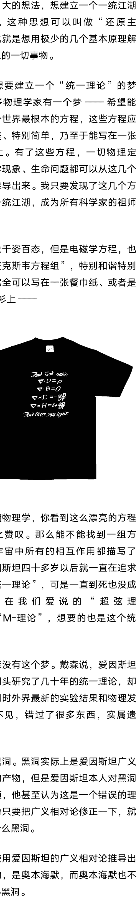


上世纪90年代，纽约办过一次法国史前岩画展，有一位物理学家看过这些画之后也有个感叹。他说，岩画虽然是在法国发现的，但画风根本不是“欧洲风格”，实际上看起来似乎有点亚洲风，有点像日本画家的作品。那么由此可见，在一万年的尺度上说什么是“西方文化”、“东方文化”，完全没意义。

这位物理学家就是今天我要说的这本书的作者，弗里曼·戴森（Freeman Dyson）。这本书叫《反叛的科学家》（The Scientist as Rebel，有中文版）。


戴森今年九十多岁了，仍然健在，而且仍然非常活跃。他跟爱因斯坦做同事，在量子电动力学和量子场论中有过决定性的发现，研究过核反应堆，指导过国家宇航局的航天项目，他甚至在数学上也有重要贡献，他在2012年还发了一篇非常新的讨论囚徒困境的博弈论文……可以说凡是物理学家想干的事儿，他全干过。

同时戴森还是一个特别博学的人。物理学之外，他对很多领域有深入了解，天文地理、历史政治，无所不知。他在《纽约书评》上写了很多文章，这本书就是他的一个文章合集。


戴森是我最佩服的人之一，是我的智力榜样。今天咱们就说说这本书里收录的第一篇文章，题目就是《反叛的科学家》。

科学，原本是反叛的产物。现在有人认为科学是西方文化的产物，还有人说是基督教的产物，戴森根本不承认什么“西方科学”。

科学家在世界各地都专门反对当地文化。阿拉伯人搞科学，反叛了阿拉伯文化；日本人搞科学，反叛了日本文化；欧洲人搞科学，也在反抗“欧洲传统文化”。科学家从从来都是反叛者。爱因斯坦从小在学校就不得老师待见，作为德国人也不热爱“德国文化”。科学家们唯一敬畏的，只有大自然。

所以戴森建议，如果你想培养小孩当科学家，不要对他宣传什么西方文化，你应该首先培养他的反叛精神！当然这个反叛不是说非得去反政府反社会，而是让他对现状持有一种不满情绪。现实世界有太多的虚假、丑陋、贫困和不平等！从这个心态出发，才是最正宗的搞科学的态度。

好了，那我们可不可以这么说，你科学家在世界各地都是谁也不服，那你们总“服”科学吧？各国的科学家联合起来组成一个“科学共同体”，就好像天主教会一样一家独大，是不是这么一个情况呢？

不是！事实上，如果真的存在什么“科学共同体”，真正的科学家就应该反叛这个共同体。

戴森这篇文章就说，有些特别厉害的科学家老了以后容易犯一个错误，他们产生一个非常自大的想法，想建立一个统一江湖的理论。这种思想可以叫做“还原主义”，也就是想用极少的几个基本原理解释世界上的一切事物。

这就是想要建立一个“统一理论”的梦想。很多物理学家有一个梦——希望能发现这个世界最根本的方程，这些方程应该特别美、特别简单，乃至于能写在一张餐巾纸上。有了这些方程，一切物理定律、化学现象、生命问题都可以从这几个方程中推导出来。我只要发现了这几个方程，就一统江湖，成为所有科学家的祖师爷。

电磁现象千姿百态，但是电磁学方程，也就是“麦克斯韦方程组”，特别和谐特别简单。完全可以写在一张餐巾纸上、或者是一件T恤衫上——


就算不懂物理学，你看到这么漂亮的方程也会为之赞叹。那么能不能找到一组合程，把宇宙中所所有的相互作用都描写了呢？爱因斯坦四十多岁以后就一直在追求这个“统一理论”，可是直到死也没成功。现在我们爱说的“超弦理论”、“M-理论”，想要的也是这个统一理论。

可是戴森没有这个梦。戴森说，爱因斯坦在美国闲头研究了几十年的统一理论，却对其它同时外界最新的实验结果和物理发现视而不见，错过了很多东西，实属遗憾。

比如说黑洞。黑洞实际上是爱因斯坦广义相对论的产物，但是爱因斯坦本人对黑洞不屑一顾，他甚至认为这是一个错误的理论，认为只要把广义相对论修正一下，就不会有什么黑洞。

第一个使用爱因斯坦的广义相对论推导出了黑洞的，是奥本海默，而奥本海默也不怎么关心黑洞。

但“黑洞”可不是什么一般的物理概念。黑洞是整个宇宙里最重要的一种结构，是一个特别精妙的思想，至今围绕黑洞的重要结果仍然是出不穷，黑洞是广义相对论最拿得出手的产物——可以说你只有理解了黑洞，才能对广义相对论有更深刻的理解……可是广义相对论的发现者爱因斯坦和黑洞的发现者奥本海默，竟然都不在乎黑洞。

戴森曾经面对面问过奥本海默。奥本海默说黑洞不值得研究——物理学家就应该去发现终极理论，黑洞这种推导出来的东西只能算是二流的发现，也可以说是一种浪费时间的行为。应该让那些能力不行的人去做。

西只能算二流的发现，也可以说是一种浪费时间的行为，应该让那些能力不行的人去做！

其傲慢如此。

数学家希尔伯特，也做了一个类似的梦。希尔伯特想要找到一个终极方法，自动地、系统性地、机械化地去证明任何数学定理！希尔伯特已经不属于证明什么数学猜想了，他想要的是一个从任意数学公理体系出发，自动判断每个猜想是否成立的统一方法。他要一劳永逸地解决所有数学问题。

这个梦想实在厉害！希尔伯特搞了很多年，到死也没成功。后来还是哥德尔出来证明了不完备性定理，人们才明白这个梦想本质上就是不可能实现的。

这种想要凭借一己之力建立终极解决方案的想法，可以说就是成神的野心！而戴森认为这样的梦想终将落空。

戴森说科学家作为反叛者，应该定位为一个艺术家，或者说是个手艺人。你只要找到一个漂亮的证明或者数学方程，描写一个物理现象，那就是一个很好的成就。至于方程最后与“统一理论”有什么关系，与哲学思想有什么关系，这都不是科学家应该考虑的问题。

哥德尔证明不完备性定理的时候，并没有说什么有哲学味道的话。他就好像一个工程师一样，把数学理论拿过来，搭建了一个非常漂亮的大厦。最后大厦封顶的时候，他用了一个精妙的想法，这就是科学家该干的事。

戴森回顾自己的物理学研究生涯也是如此。他说我搞物理学研究总是想象自己在搭一座桥——现在河的两岸都有精妙的物理理论，我要用一座桥把二者联系在一起——我用的不是什么哲学、什么情怀。造桥，我用的其实是一些工程上的技巧！

归根结底，戴森的告诫是不要妄想统治科学。你能从自然界里发现一点新思想，这就已经是很大的成就。

戴森认为科学的进步往往由新工具的推动，比如有个什么以前没有的实验仪器出来，常常马上能把科学往前推动一大步。科学进步，从来都不是哲学和情怀的产品。

## ｜我的评论

我第一次读戴森这本书是几年以前，那时候我还在搞物理，觉得说的都是自己人的事，心想这些话也是说给我听的啊！现在我已经不是物理学家了，为了写专栏而重读此书，感慨很多。

对于大多数不是科学家的读者来说，这篇文章有什么意义呢？

我以为，用咱们中国人熟悉的一句话说就是，“多研究些问题，少谈些主义”。真正的科学家都是技巧性的，是手艺人，不需要以什么思想为指导，也不用为什么思想而奋斗，尤其不要追求什么“根本的解决”——爱因斯坦和希尔伯特做不到，你能做到吗？也许这个世界就是一个问题接着一个问题，哪有什么根本的解决？

具体来说，就是不要有太强烈的门户之见。我们做很多事都有一个身份认同感，职业自豪感，这都可以，但是上升到门户之见就过分了。我是一个“科学人”，那我做事的出发点就是要维护“科学共同体”吗？遇到什么问题，我都先问科学家的共识是什么，主流科学家对这个问题怎么看，谁的说法跟主流科学家的不一样，我就批判谁，这对吗？

事实是哪有什么“主流科学家”。每个科学家都是反叛者，不是什么统治者。

> 真实世界，才是我们唯一应该敬畏的东西。
13人笔记

## ｜由此得到

面对真实世界最好保持谦虚的态度。谦虚的意思就是，既不要当教徒，更不要去当教主。你能做的是就是做一个手艺人，做出一点有意思的贡献，就是不可忽视的成就。
25人笔记

当你对真实世界表示谦虚的时候，回头再看各种想象的共同体，你就会有一个更愉快的心态。

## ——◆ Evernote获奖名单 ◆——

| 昵称 | 大巴巴巴巴 | whywhywhy | 看一 | 尧松得日 |
| 余炳 | 阿尔法城 | 曙光 | 今河中 | 神呼伪丝底 |
| 徐博 | 伪先走 | 一溪白衣-叶舟 | 吴小科 | 李七米 |
| RoFF | 似一 | 欣然 | MeganLing | 三毛 |
| 小字子 | IT海 | 不知了 | 冉冉 | 重新思考 |
| 一棵樹 | 林国志 | 卢克 | Virgo | 郁欣 |
| 乔向阳37129973 | JIM WANG | 秦东东 | 巨啸松 | 懒心蚊 |
| 初生 | 陶漉 | 洪一 | honeysuckle | 阿豪 |

请以上读者在日课留言区留下您的常用邮箱，工作人员会回复给您获取方式及高级账户的激活码。恭喜您！


### 日课123 | 伽利略的反应速度

昨天我们讲戴森的文章提到，科学进步其实都是由新工具的出现推动的。今天我想用伽利略的故事来说明这一点 —— 咱们看看新技术一旦出来，聪明人的反应速度能有多快。

今天的内容来自两本书，都有中文版。一本是咱们之前的一篇文章《科学家对诗人的有失恭敬》中讲到的温伯格的《给世界的答案》，一本是咱们以前也说过的一位女物理学家丽莎·兰道尔，她写的一本畅销书，叫《叩响天堂之门》。温伯格的书技术性和理论性更强一些，兰道尔的书故事性和背景介绍更多一些。

伽利略在科学史上的地位非常高。你甚至可以说是伽利略，而不是牛顿，开创了现代科学。这是因为伽利略是第一个真正向大自然寻求答案的科学家，他反对学者整天在书房里写论文，认为应该去直接观测大自然，用实验结果说话。


前面《科学家对诗人的有失恭敬》那篇文章里咱们讲过，用温伯格的话说，古代那些思考过科学问题的学者其实不算“科学家”，应该叫“诗人”——他们总是从美学角度思考问题，喜欢提出漂亮的理论，但是根本不属于在真实世界里检验理论。

伽利略所处的是个什么时代呢？哥白尼已经提出了日心说，但是受到了教会的强烈打压。当时主流思想仍然认为地球是宇宙的中心，所有星球都在围绕地球做完美的圆周运动。人们的观念中，天上的东西都是完美的，太阳、月亮、星星，这些星体都是表面光滑的完美球体。而地球上有山，有河流，表面很不平整，教会的哲学就是只有地球不完美，其他星球都完美。

所以人就得敬畏上天啊！这个世界观非常……完美，但罗马教会也很有意思，他允许你跟他较真。伽利略开创通过仪器测量实验的办法以后，教会还专门开了一个会，认定仪器测量的——而不是肉眼直接看到的——结果，也有效。教会很有理论自信，如果你想独自观测星体，教会表示允许！

哪里想到，伽利略得到了一个关键工具，一个大杀器——望远镜。

兰道尔的书里说望远镜是1608年荷兰人发明的。而温伯格的说法是，在1608年荷兰已经有好几家制造望远镜的公司了。那一年曾有人想申请望远镜的专利，还被驳回了，因为荷兰政府认为当时望远镜都已经流行了……不过那时候还没人拿望远镜当科学仪器，放大倍数很低，被称为“偷窥镜”——主要用于偷窥邻居隐私。

在这个条件下，如果是你有了望远镜，你会怎么做呢？

我以前看过一个穿越小说，叫《宰执天下》，主人公叫韩冈，非常了解现代科学知识，穿越到了宋朝，就给宋朝人发明了望远镜。在小说里望远镜主要被用于军事，也有些宋朝士大夫拿望远镜观测天空，观测了月球的环形山，还观测到了木星的卫星，对当时的观念产生了小范围的影响。韩冈本人甚至当着皇帝的面做了两个铁球同时落地的实验，给他推崇的儒家“气学”学派做了一个广告。

一个穿越者能做到这些，我们作为读者认为已经够了。如果韩冈再多做一点，读者就会抱怨“金手指开得太大了”！

那么在真实历史中，伽利略做到了什么程度呢？

不管望远镜是不是荷兰人1608年发明的，伽利略拿到望远镜，是在1609年。他马上就做了改进，把放大倍数从三四倍提高到了八九倍。

1609年8月，伽利略向威尼斯总督演示了改进后的望远镜——这个望远镜能看到肉眼两个小时以后才能看到的海上船只！总督马上意识到望远镜的军事意义，伽利略因此获得终身教职，工资涨为原来的3倍。

1609年11月，伽利略把望远镜的放大倍数提高到了20倍。紧接着他用望远镜去观测星空，在短短一年多的时间，他做出了六项有重大历史意义的天文发现。如果单论对人的观念的冲击程度，这六个发现全都能够秒杀今天的诺贝尔物理奖。

如果你有这么好的望远镜，你首先看的是星体肯定是月球。伽利略就是这么干的。

第一个发现，1609年11月，伽利略判断月亮表面不是光滑的。注意，光盯着环形山看没用，你有望远镜也无法判断那是光滑图案还是山。伽利略观测的是新月时候，月亮上明暗交界的地方——他注意到边界上有亮点！亮点应该是太阳光透过月球地平线的时候照亮了山顶……伽利略甚至推算出月亮上有些山的山脉至少有四英里高。


这就证明了天上的东西也不都是完美的，月亮跟地球一样表面凹凸不平。

第二个发现，伽利略观测到了昴星团除了有6颗可见的恒星之外，还有超过40颗其他的恒星，他在天上看到了不计其数的之前肉眼看不见的恒星。他发现银河系是由大量的恒星构成的。

第三个发现，伽利略注意到行星在望远镜的视角中明显地变大，而且它们都是圆形的球体。但是恒星在望远镜的视角中并没有变大，看不出来恒星的细节。伽利略据此推测，恒星距离地球的距离要比行星远很多。

第四个发现，伽利略发现了木星有4颗卫星。这是一个非常有戏剧性的发现。


他在1610年1月7号晚上看见木星周围有三颗小星，是之前肉眼看不见的。这三颗小星很亮，伽利略还以为它们是恒星。结果到第二天晚上他发现这三颗小星的位置都变了！再过两天，他发现3颗小星就剩2颗，再过三天之后，他发现3颗小星又变成4颗星，而且都是沿着黄道排列。


据此，伽利略得出结论，他看到的其实是木星的四颗卫星！

这个发现不得了。要知道教会的观点是所有星体都绕着地球转，可是现在他发现居然有星体绕着木星转！那木星和地球能有多大区别呢？

第五个发现，到了9月份，伽利略发现金星是有相位的，只有你承认金星也绕着太阳转，才能解释这个相位的变化。


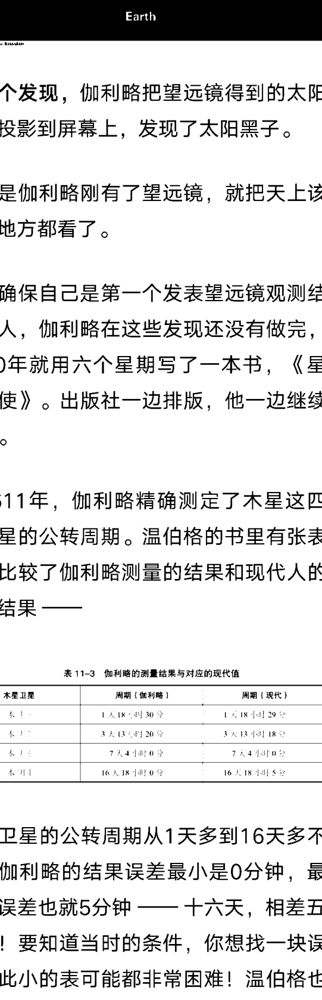

第六个发现，伽利略把望远镜得到的太阳影像投影到屏幕上，发现了太阳黑子。

等于伽利略刚有了望远镜，就把天上该看的地方都看了。

为了确保自己是第一个发表望远镜观测结果的人，伽利略在这些发现还没有做完，1610年就用六个星期写了一本书，《星空信使》。出版社一边排版，他一边继续研究。

到1611年，伽利略精确测定了木星这四颗卫星的公转周期。温伯格的书里有张表格，比较了伽利略测量的结果和现代人的测量结果——

表 11-3 伽利略的测量结果与对应的现代值
| 木星卫星 | 周期（伽利略） | 周期（现代） |
| 木卫I | 1天18时30分 | 1天18时27分 |
| 木卫II | 3天13时20分 | 3天13时18分 |
| 木卫III | 7天4时12分 | 7天4时02分 |
| 木卫IV | 16天18时0分 | 16天18时5分 |

四颗卫星的公转周期从1天多到16天多不等，伽利略的结果误差最小是0分钟，最大的误差也就5分钟——十六天，相差五分钟！要知道当时的条件，你想找一块误差如此小的表可能都非常困难！温伯格也没细说，我实在想不通伽利略到底是怎么测的。

这些成就，只是伽利略的丰功伟绩的一部分。伽利略还发明了显微镜，还用斜面测量过运动物体的加速度，等等等等。

伽利略精确测定木星卫星公转周期的1611年，在中国是明神宗万历三十九年，历史大事是崇祯皇帝朱由检出生。


## 我的评论

伽利略做到了穿越者也未必能做到的事，咱们羡慕也没用。我羡慕的是那些在1610年，拿到《星空信使》的读书人。

在那个年代，突然读到这么一本书，是一种怎样的体验。当你知道木星也有自己的卫星，当你知道月球的表面并不是光滑的，当你知道金星有那样相位的时候，当你意识到这一切意味着什么的时候，这种思想冲击，简直太刺激了！

罗马教廷后来禁了书伽利略的书，那只能让伽利略的思想变得更刺激。

现在我们的技术日新月异，可能昨天赞叹智能手机明天赞叹虚拟现实，但要说思想上的冲击，真的不如过去。现在我们对大自然的认识和10年前、50年前并没有那么巨大的差异。我就没看过一本像《星空信使》那样如此的异端、又如此的有说服力的书。

紧接着就是“启蒙时代”，从此新思想层出不穷，简直是动不动就来场知识革命。

伽利略在1611年送给开普勒一台望远镜，开普勒拿到望远镜之后也是马上进行改进，然后就发明了开普勒式天文望远镜。

所以，千万不要低估古人，千万不要低估牛人能达到的水平。

这使我想起一个费曼的典故。费曼是四五十年代以后才活跃的“年轻一代”物理学家，有一次他跑到图书馆去浏览几十年前的物理论文。那时候的物理学还是一个相当新的学科，费曼想看当时那些物理学家的笑话——结果他一看就服了。

每个时代都有自己的局限性，这个局限性可能仅仅是工具上的。每个时代都有自己的牛人，那些牛人都是只要给他什么工具，他很快就能把这个工具运用到极致，把能得到的结果全都研究出来。

只有工具做不到，没有人想不到的。

之所以都是工具推动科学革命，并不是因为人的思想不够聪明，而恰恰是因为人太聪明了。

## 由此得到

+   1. 为什么搞科研的人都有点竞争心理？因为新东西一出来马上就会有人做，赶不上这波就只能等下一波。好想法传播实在是太快。
2. 商业和技术也是如此。一旦有个新平台、新突破，各公司很快就能找到对应的商业模式。
3. 聪明人实在太多，聪明人能做到的事儿实在太厉害。


### 周末小议｜厚道的人应该怎么使用思维导图

“思维导图”，是个越来越流行的工具，你肯定经常在网上看到人们贴出的各种思维导图。有些导图画得非常漂亮，说明作者十分用心 ——

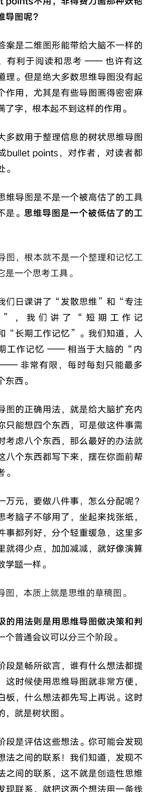

可是每次看到这种漂亮用心的导图，我心里都忍不住叹气。我看这些人根本没抓住“思维导图”这个工具的要点，生生地把一把杀伤性武器用成了鸡肋。

我先问一个最简单的问题。

现在人们在网上贴出的绝大多数思维导图，都是上面那种“树状图”——从一个大主题出发，分成若干个小主题，每个小主题再分为若干枝叶，这样一步步分下去，就好像一棵树一样。某网站提供的思维导图工具，提供的就是专门是这种树状图——


你可以选择不同的风格，但本质上都是树状图——


我的问题就是，如果你只是想用这种树状结构列举提纲，整理要点，你又何必非得画什么思维导图呢？

任何一个简单但是够意思的文本编辑器，都有所谓“bullet points”功能，效果是这样的——

+   - 主题
  - 小主题1
    1. 还可以用数字编号
    2. 全是自动的
  - 小主题2
    - 要点1
    - 要点2
- 主题2

树状图的拓扑结构完全等价于这种bullet points。你根本不需要用鼠标拖来拖去，直接用键盘写，tab键往右缩进，shift-tab键往左缩进，快速准确。想在哪里插入一段便插入，想调整顺序随意调整，想长就长想短就短，根本不需要关心画面的美观。逻辑明白，条理清晰。文本文档，有利于编辑，有利于保存、有利于共享、有利于搜索。

我看大多数人用思维导图都是做读书笔记或者会议摘要，这种bullet points是最好的办法。你要真给我一段什么重要信息是思维导图形式的，我做的第一件事就是先转换成bullet points。

为什么放着这么厚道、简洁、实用的bullet points不用，非得费力画那种花哨艳俗的思维导图呢？

也许答案是二维图形能带给大脑不一样的刺激，有利于阅读和思考——也许有这样的道理。但是绝大多数思维导图没有起到这个作用，尤其是有些导图画得密密麻麻写满了字，根本起不到这样的作用。

把绝大多数用于整理信息的树状思维导图替换成bullet points，对作者，对读者都有好处。

那么思维导图是不是一个被高估了的工具呢？不是。思维导图是一个被低估了的工具。

思维导图，根本就不是一个整理和记忆工具。它是一个思考工具。

本周我们日课讲了“发散思维”和“专注思维”，我们讲了“短期工作记忆”和“长期工作记忆”。我们知道，人的短期工作记忆——相当于大脑的“内存”——非常有限，每时每刻只能最多想四五件东西。

思维导图的正确用法，就是给大脑扩充内存。你只能想四个东西，可是做这件事需要同时考虑八个东西，那么最好的办法就是把这八个东西都写下来，摆在你面前辅助思考。

预算一万元，要做八件事，怎么做分配呢？躺着思考脑子不够用了，坐起来找张纸，把八件事都列好，分个轻重缓急，这里多点那里就得少点，加加减减，就好像演算什么数学题一样。

思维导图，本质上就是思维的草稿图。

更高级的用法则是用思维导图做决策和判断。一个普通会议可以分三个阶段。

第一阶段是畅所欲言，谁有什么想法都提出出来，这时候使用思维导图非常方便，甩你白板，什么想法都先写上再说。这时候画的，就是树状图。

第二阶段是评估这些想法。你可能会发现几个想法之间的联系！我们知道，发现不同想法之间的联系，这不就是创造性思维吗？发现联系，就把这两个想法用一条线连接起来——这个动作可不得了，你从根本上改变了这张图的拓扑结构！它不再是树状图了！

不是树状图，就不能用bullet points取代，就必须得用思维导图。然而非常遗憾，这个最基本的功能，居然有的“思维导图”软件都不提供。

评估的结果，是要对这些想法做出取舍。

第三阶段是形成决议。把讨论中淘汰掉的想法都划掉，剩下的分出主次和执行顺序，然后整理一下就可以照着做了。

这三个阶段，其实就是从众人的发散思维，到最后具体的集中思维的过程。先发扬民主，最后形成集中。这个思维过程，这种决策方式，比白板上画的图好不好看重要得多。

个人思考也是这样，一个人的头脑中可能有不同的声音，同时考虑这些声音内存不够用了，就干脆都先写出来，然后思考整理，自己跟自己开会。

这个，才叫思维导图——为了引导思维而画一张图。

所以一张实用主义的思维导图必定是非常潦草凌乱的，上面满了各种连线、重点符号、划掉符号——就像演算纸一样。

我写文章经常要画这种草图。一开始想法很多都先写下来，用连线表示逻辑结构，慢慢理清思路，再划掉一些，最后形成提纲。这种图都是用完就扔并不具备任何美学价值，但这次还是贴出一张我在实战中画的一张图——


这是上次写《我怎样管理信息》那篇文章时画的图。我画图的时候并没想到要把它贴出来，随便找了张纸，写得很潦草，有些字还写错了，贴出来等于是献丑。但我想拿它说的就是，思维导图是自己用的！

花哨的装饰和美观的外形未必实用，真正的武器身上应该有创伤、有错误、有硝烟的味道。

6A笔记

万维钢

如果这篇文章对你有用，就拜托你把它厚道地转发分享给身边那个酷爱思维导图的朋友吧。


### 答读者问 | 鸟不需要鸟类学家的指导

### 来自日课：两个字：稀缺

现在的稀缺资源都差不多已经被占完了，那么我们这些个体怎么才能利用稀缺赚钱呢？

万维钢
你这个问题的本就就是市场到底是不是有效的。简单的答案就是如果所有人都认为市场是有效的，那就没人进入市场赚钱，市场就是无效的；如果所有人都认为市场不是有效的，人没法赚钱，市场就会变得更有效。

真实的市场是比较有效但是又充满机会。从远处看大局容易以为没机会，深入过去看还是很容易发现机会——无非是发挥自身优势，考虑当前潮流。当然最大问题在于，你总要实战一下才知道这个机会到底是不是一个真的能赚钱的机会，所以谨慎投入也是必须的。

所以赚钱难啊！要不怎么叫稀缺呢……“怎么赚钱”，这个问题只可能有一般原理上的讨论，不可能有包教包会行动指南。

如果稀缺资源是我所拥有学到的，是别人不拥有的，那我分享出去，让更多人知道了，不就拿不到钱了吗？是不是现实生活中也存在不传出去的，只藏着技术和经验的人？我想要了解一下像得到上各位老师订阅号推送的知识技术，出售这些讯息算是一种稀缺资源吗？一旦传播出去了让大家知道了，不就不是稀缺资源了吗？难道说已经传播的讯息已经被散播早已掌握，老师们早已站在了更高的高度，所以不担心这些稀缺资源？

万维钢
过去的确有很多把自家的看家本领秘不示人，保持稀缺性，避免教会徒弟饿死师傅，可是现在这种现象就很少了，为什么呢？可能最大的原因就是现代社会越来越复杂，每一行的高手都经过了多年的训练，门槛非常高。这就是说高手的“看家本领”实在太多，就算公开都写在书上，手把手教都未必有少数人能坚持学下来，再保密就成了笑话了。

更重要的是，充分竞争的行业里，“绝招”、“秘诀”根本不好使。就好像踢足球，你说现在有哪些运动员会什么“绝招”，以至于别人偷看一次他的训练就能学会的？都是天赋加上长期苦练的结果——天赋和长期苦练，都是难以模仿的。这不是说技战术没用——一个资深教练员必须掌握很多很多技战术，但高手是综合的高，不是一两招的问题。

所以你看现在各领域的牛人，都很乐意多写几本书记把自己的一套传播出去，能被人类模仿真真是深感荣幸！

作为一个会会计经济打交道多年的业内人士，我今天第一次看到了边际成本的通俗解释。领教了！什么叫赚钱的概念也同样颠覆传统。不过我就想了，比如一个学生，他付出了100%的精力考取了95分，但是他付出80%精力却可以考90分，那么他要不要牺牲那20%的精力赢取高的那五分呢？还是利用剩余的20%的精力来发展另一个IP？再比如我在工作中50%的努力程度足以应付日常工作，而且干得不错，我要不要考虑用剩余的精力来发展另一个IP呢？

万维钢
取决于这是否一个竞争性的领域。95分和95块钱完全是两码事，高考差1分都不行，百米比赛差0.1秒就差太多了。如果是一个竞争性的领域，那么考虑赢者通吃的效果，应该全力以赴比别人多5分。如果竞争性不强，多出来5分也没啥用，那当然……

结合人工智能要到来的时代，做得了机器做不了的就是稀缺的资源，万老师，这个想法对吗？

老师，我是石油行业。石油是稀缺的，但是现在亏得都要黄了(/ω\)

万维钢
稀缺不稀缺，是跟同行业的竞争对手比，不是跟其他行业的比。人要跟人比，石油行业要跟石油行业比。

### 来自日课：反叛才是科学家

这次的日课讲到物理学家的研究不需要考虑与哲学有什么关联，跟之前的一次日课说的现在的量子力学的瓶颈是要解决哲学上的问题，这个应该怎么理解？

万维钢
上次是世界观，这次是方法论。世界观：哲学需要物理学。方法论：物理学研究中不需要考虑哲学。

还记得在听罗胖的跨年演讲上提出的一个思想，他说，我们要积极地去寻找共同体，当时对我影响很大，包括让我对我们部门的组员有了更多的包容心态，因为我觉得我们是一个小圈子，是一种共同体，大家应该有共同进步的想法，但是今天听到万老师所讲的有没有跟这个共同体相悖呢，还是说我的眼光太狭小了，只关注了眼前的圈子，而没有真正关系到行业的大圈子呢？

万维钢
讲讲同乡、同年之情一起进步当然好。一定的身份认同感可以激励人。反叛要反对的是封闭性的东西。如果有人说国家应该由物理学家掌控，各行各业领军人人都应该换上物理学家，那我就想跟他作对。

很抱歉，这一篇文章让我对万老师选的这本书的严谨性产生了质疑。我的科学进步或者科学革命的认识来自于托马斯库恩的《科学革命的结构》。在书中他同时在宏观意义上引出了“范式与科学共同体”。科学共同体是整体依据单一或者几种理论来研究科学问题，事实上这个科学共同体就是因为研究的范式而存在。如果说个人层面没有主流科学家可以理解，但是一定会有遵循同一范式的群体层面的科学共同体存在。科学进步依据的是新的现象无法被固有范式中的理论所容纳而产生的范式革命。因为该理论在我所学的专业方向上有很多可以验证的地方，所以我坚持这一观点。至于本文所说的普通研究可以归为常规科学研究，反叛应该有些夸张，每个科研工作者都会在自己研究科学的过程中拓展并且尝试发生联系，这恰才是产生科研转折的创造性研究，在此过程中出现的变更不能说是反叛。科学家没有主流，但是科学家们的研究范式有主流。科学家不是孤军奋战，我觉得此文容易有误导。

万维钢
托马斯库恩所说的“范式”，并不是一套指导科学家怎么工作的指南，更不是规则，只能说是一套取得了认可的观点。对每个时代的“常规科学家”而言，在这个时代的“范式”内工作是快速上手多发论文的好方法，在这里“范式”只起到提示的作用，而不是限制的作用。大尺度看，“范式”都是用来打破的。

更重要的是，科学家之间的互相评价是明显倾向于越出乎意料的结果越受欢迎，想发好论文结果就必须是出乎意料的。当然这个出乎意料必须是建立在正确的法则之上——但不是建立在“符合主流科学家的观点”基础之上。我甚至觉得所谓“范式”是研究“科学史”的人强行发明的概念，不是科学家的概念。

费曼还说，有句名言，“科学史学家跟科学家的关系，就好像鸟类学家跟鸟的关系一样”——鸟不需要鸟类学家的指导。

### 来自日课：伽利略的反应速度

我想问个问题，就是很多学者都在说人工智能在降低人类的智商，推出来的结果是绝大部分的人可能会变的没有意义。就人类的智商来说，那是不是越是受到现代科技影响越少的国家智商就越高呢？好像也不是这样的。还有科学家也会使用智能设备，那么科学家相对以前的科学家是否有智商下降呢？

也会使用智能设备，那么科学家相对以前的科学家是否有智商下降呢？

## 万维钢

大前研一有本书叫《低智商社会》，说了这个问题。我觉得他滥用了“智商”这个概念。科学结果是发达国家的国民平均智商每十年增加三分。现代世界讲究抽象和量化思维，这都是涨智商的。

我没有听过任何证据说智能设备会让智商下降。有些小孩会用手机不会系鞋带，这不能说明他比过去的孩子笨——现在需要的技能点不一样了。

现在的科学家比过去的科学家聪明，而且可能还不是一点半点。之所以感觉上现在的牛人没有过去那么牛了，可能完全是结构性的——单人容易发现的大东西都已经被发现完了。

每次看到牛人的故事，就相信这其实是一个精英主导的世界。然而如果没有能够成为“精英”，泯然众人，那么生存的意义何在？令人纠结。

这些牛人能在有工具出现后充分利用自己的知识来把工具作用到极致，但是，我们这些普通人，应该怎么样去跟上这些牛人的脚步，不至于落下太多呢？

## 万维钢

我刚开始学物理的时候就感慨这一行里聪明人实在太多，也感受到了生存危机和人生意义危机。等你深入进去，就会发现很多问题还没有被解决，有很多明显可以搞的研究没人搞，你要愿意搞还是有事儿可干的。

新工具一出来，马上就会被用到极致，这是一个宏观的说法，类似于说“市场大致上是有效的”——但市场任何时候都不是绝对有效的，机会总是有的。

几百上千年以前古人的作品及科学理论到现在仍然是当代人的指路明灯，这个能用智商解释得清楚吗？

通过这篇文章让我想到在当今信息这么爆炸的时代，很多书讲的很多道理真的就那么有用吗？我们古人已经把当今做人做事的道理全部写进了古书里，我们只要耐心去精读也能够拥有大智慧。现在每年出那么多书无非都是新瓶装旧酒吧，这也就是知识贵在精而不是多？

## 万维钢

不是的。我主张读新书。古人远远没有穷尽所有做人做事的道理，他们没有今天的工具！就连古人自己的事儿，也还是今天的人站在历史的高度上看得明白。

您是我最喜欢的作家，因此我想模仿您的写作方式，但在学习过程中有几个疑问：第一个问题是，您每天坚持写作，在读第一遍就开始写读书笔记吗？这样会不会导致没有完全理解书中的精髓？第二个问题是，如果是第一遍快读，第二遍慢读再写读书笔记的话，那么第一遍要读到什么程度呢？大概用多久？纸质书也许问题少一点，如果是KINDLE等电子书，您有什么诀窍吗？第三个问题是，写作这些文章需要消耗太长时间，通常读完一本书后，需要七八个小时，甚至10个小时以上，这在初期是正常的吗？另外，写这样的文章有什么注意事项吗？第四个问题不是关于写作，而是关于自己留存的读书笔记，您会怎样建立自己的笔记和检索体系？

## 万维钢

读书和笔记的事情，我在《万万没想到》书里都写过，检索体系无非Evernote。你现在关心的是速度和理解问题，这两个东西，并不存在取舍的关系。

读书必须读到完全理解的程度，保理解，别管速度快慢。第一遍就要完全理解，比较被动，第二遍是总结和挖掘自己的灵感，更主动一些。阅读速度取决于你在多大程度上能预判作者接下来要说什么，而这一点取决于你之前读了多少书，是个积累的功夫，强行快是快不了的。笔记是写给自己的，也是只记自己从这本书里获得的新东西——这还是取决于这本书在多大程度上对你而言是新的，归根结底还是你以前读过多少书。

所以初期要花很多时间，后面才能越来越快。一本书花十个小时记笔记完全可以接受，好书再长点都可以，大学教材可都是一本书学一个学期啊。

我主张初期一定要精读。你看豆瓣那些读后感就知道，很多人根本没领会作者的意思就胡乱写。不下硬功夫，知识都是错觉。


### 日课124｜有一种情怀叫“有限”

日课124｜有一种情怀叫有限

今天咱们还是说弗里曼·戴森（Freeman Dyson）的《反叛的科学家》（The Scientist as Rebel）这本书里的一篇文章。戴森是个物理学家，但是他的关注点非常广泛，我们这篇文章就和物理学、和科学都没有什么关系，说的是军事和历史。

这篇文章题目是《将军》（Generals），说的是两个纳粹德国将军的故事。故事都是老故事，可是戴森从故事中总结了一个道理，这个道理对很多人来说，可能非常新鲜。

#### 1.两个职业军人

第一个将军是阿尔弗雷德·约德尔（Alfred Jodl），德国国防军最高统帅部作战部部长，直接参与计划了历次侵略战争。德国战败以后，约德尔在1946年被国际军事法庭判处死刑，最后被处死。

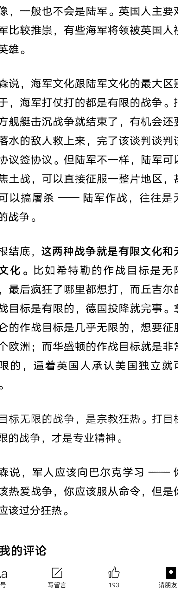

可是约德尔，可不是一个一般的战犯。他身上充满了职业军人的荣誉感，面对审判不卑不亢，至死不悔。戴森直接引用了约德尔的最后陈词和他在行刑前一天写给妻子的信，他说他感到非常自豪，为德国做了军人该做的事，死而无憾。

约德尔不怎么关心政治，但是非常忠于希特勒。希特勒说要打他就研究怎么打，至于说为什么要打，那是政客的事。约德尔曾多次向希特勒请求，希望自己能带兵去前线作战，希特勒总是拒绝。约德尔去不了前线就老老实实地留在指挥中心做战略规划，尽职尽责。

约德尔从不过问希特勒为什么要打仗，并不是因为他不懂政治，而是他的军人荣誉感要求他不能质疑上级。

戴森分析，德国有崇尚军人的传统，而且德国士兵的职业荣誉感非常强，可以说达到了一种宗教般的状态，你甚至可以说军人在德国是一个半宗教的职业。德国士兵并不把打仗作为谋生手段，而是视为自己的神圣使命。约德尔，绝对是一个合格的德国军人。

但是德国军人也有不同的类型。戴森说的第二位将军的风格就和约德尔非常不一样。戴森认为此人是整个二战中最伟大的战地指挥官，他就是德国陆军二级上将赫尔曼·巴尔克（Hermann Balck）。


巴尔克和约德尔的区别在于，约德尔是巴伐利亚地区的人，特别坚持原则，比较死板，而巴尔克是个普鲁士人。普鲁士在历史上一直都是四战之地，经常跟周围国家打仗，普鲁士士兵传统上就采用灵活战术，以少胜多。巴尔克，是个典型的普鲁士军人。

巴尔克总是在第一线带队作战。戴森介绍巴尔克的指挥风格，有点像竞技体育，就好像教练员领着运动员去参加比赛一样。比如说他特别强调有针对性的战前训练。进攻法国之前特意训练手下士兵使用烟药，结果果然用上了。

巴尔克打仗崇尚进攻。他的哲学是进攻比防守容易——防守的时候每个人都要全神贯注参与不能有薄弱环节，而进攻的时候，实际作战的是排在前面的那几个人，后面的人只要跟上就行——进攻，是积极主动的。但是进攻战术对体能要求非常高，必须快速行动，对此巴尔克的办法就是他总是亲自带队，身先士卒。

巴尔克的战术非常有创造力。他的哲学是从不重复使用同一个战术。他说再好的战术用一次敌人也就适应了。巴尔克，可以说是个非常喜欢打仗的人。

巴尔克的结局很不错。1945年德国已经面临要投降的情况下，巴尔克还是在东线，但是他不想向苏联人投降。于是他先给挡不及防的苏军来了个主动进攻，然后从容带领士兵往西撤退，一直撤到奥地利，向美军投降。这个选择可以说无论是给士兵还是自己都找了一个更好的出路。战争法庭宣判巴尔克无罪，他后来一直在美国生活，还挺长寿，活到89岁。美军曾经想让巴尔克讲解作战经验，他一直都拒绝，一直到85岁的时候才接受专访，分享了自己的作战心得。

戴森说，约德尔和巴尔克都是非常敬业的职业军人，但他们的职业精神不太一样。约德尔比较“重”，而巴尔克比较“轻”。约德尔是悲剧的，而巴尔克是喜剧的。

#### 2.两种职业精神

约德尔的职业精神可以用“庄严”来形容，而巴尔克则只是“严肃”。巴尔克打仗打得好，同时他打得很人性化，把士兵照顾得很周到。更关键的是，巴尔克自始至终都保持了一定的幽默感。

约德尔把希特勒视为神明。有一次约德尔发现自己的观点与希特勒不一致，他认为希特勒错了，可是他几乎没有办法接受这一点，他的精神受到了很大的煎熬！而巴尔克一直认为希特勒就是个政客，而且还是个不怎么称职的政客。巴尔克眼中的希特勒根本不会打仗，他早就习惯了跟上级观点不一致。

约德尔，是一个理念型的军人。而巴尔克，是一个技术型的军人。国际法庭认为约德尔在战略上主动做决策，是个战争贩子和刽子手，而巴尔克作为一个前线的指挥官，打仗只是他的职业，他只是在战术上去打，他没有把打仗上升到道德和荣誉的高度，只是在完成一个普通的工作而已，所以最后约德尔必须死，而巴尔克没事。

历史上一直都有这两种军人。美国内战时，南方军人的精神状态就和约德尔所代表的那种德国荣誉感一样。南方军的罗伯特·李将军就把打仗视为一个非常神圣的事业，结果他打得越好，给南方人民带来的苦难就越多。

#### 3.有限和无限的战争文化

戴森从中分析出了一种文化原因。如果某地有一种文化特别崇拜军人，军人职业被视为宗教般的荣誉，比如德国，就容易产生像约德尔一样的军人。

可是像英国就非常不一样。英国人始终对军人不是怎么崇拜，就算有军人成为人们的偶像，一般也不会是陆军。英国人主要对海军比较推崇，有些海军将领被英国人视为英雄。

戴森说，海军文化跟陆军文化的最大区别在于，海军打仗打的都是有限的战争。把对岸舰艇击沉战争就结束了，有机会还要把落水的敌人救上来，完了该谈判谈判该签协议签协议。但陆军不一样，陆军可以打焦土战，可以直接征服一整片地区，甚至可以搞屠杀——陆军作战，往往是无限的战争。

归根结底，这两种战争就是有限文化和无限文化。比如希特勒的作战目标是无限的，最后疯狂到哪里都想打，而丘吉尔的作战目标是有限的，德国投降就完事。拿破仑的作战目标是几乎无限的，想要征服整个欧洲；而华盛顿的作战目标是非常有限的，让英国人承认美国独立就可以。

打目标无限的战争，是宗教狂热。打目标有限的战争，才是专业精神。

戴森说，军人应该向巴尔克学习——你应该热爱战争，你应该服从命令，但是你不应该过度狂热。

## 我的评论

这篇文章的关键词就是有限。巴尔克、丘吉尔和华盛顿，他们作战是有限的，杀伤是有限的，而且在我看来更本质的一点，他们对自己职业付出的情感是有限的。他们远远比贩夫走卒敬业，但是他们的敬业程度没有达到宗教情怀那样的高度。

这种敬业精神，很像现代的运动员。比赛肯定是有输有赢，得了冠军有重奖——可是第二名、第三名也有奖金啊！更重要的是，输了比赛不但不用死，而且还有机会重头再来。在拳击比赛里打赢了也不会把对方真正置于死地，都是点到为止。

当然真实的战争总是要死人的，敌人不死你就得死。可是这个“有限”的精神在于，你到底想得到什么。有一個明确的实际目标，总比目标无限的行为艺术强。

这种有限精神，是现代人应该有的智慧。

过去文人喜欢赞美“无限”——“真爱无价”、“不惜一切代价”、“把毕生心血投入到某某事业”等等等等。

如果你真的把全部身心投入给公司，那么当公司作出你不赞成的决策的时候，当你跟老板发生矛盾的时候，你就可能产生一种幻灭感，你的世界观都有可能在一夜之间崩塌！

## 由此得到

不敬业的人不值得尊敬，可是敬业也分两种。敬业，但是只投入有限的感情，保留一点幽默感，没准你的工作水平更高。

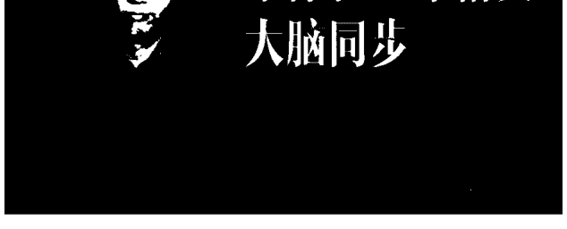

### 日课125｜悦耳如音乐，精准如数学

日课125｜悦耳如音乐,精准如数学

今天文章，强烈建议听音频。

咱们日课之前有篇文章叫《喜欢=熟悉+意外》，很受欢迎，其中提到二月7号会有 一本新书出版，德里克·汤普森（Derek Thompson）的《流行制造者》（Hit Makers: How Things Become Popular）。这本书我上周到了，的确有料，非常值得讲。

HIT MAKERS DEREK THOMPSON

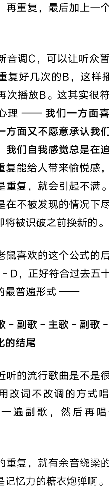

HOW THINGS BECOME POPULAR

汤普森的主要论点是，想要一个东西流行 必须在两方面下功夫。第一是它自身的素质，第二是传播渠道。而这个自身素质， 一个最重要的大原则就是“熟悉+意外”。你要做到的就是让这个东西能够常曝光 —— 曝光带来熟悉，熟悉带来流畅， 流畅带来喜欢。但是曝光次数太多观众也会反感，这时候就要加入“意外”。

今天咱们就来说一个具体的操作技术。这个技术，是音乐家和演说家的看家本领 —— 你不知道的话，可能会视而不见；一旦你知道了，你就会发现它到处都是。

在讲这个技术之前，咱们先来听一段刚刚发生不久的实战例子。

#### 1.梅姨的气势

英国新首相特雷莎·梅，被中国网友亲切地称为“梅姨”。英国政府最近邀请特朗普到英国国事访问，引起部分群众抗议，工党领袖科尔宾在下议院就此对梅姨提出质询，梅姨也回应。微博上的@英国普罗大众卫视发布了一段当时双方辩论的视频。咱们中国观众看了这段视频都大呼精彩。


这段辩论好听在哪里？恐怕不仅仅是英式发音好听。咱们来摘录一段。注意，按规则双方都是在和议长说话，避免直接对话，否则太容易打起来了。科尔宾列举了特朗普上台以来的种种“恶行” ——

科尔宾连用了五个“he’s” —— 他如何如何，他如何如何，他如何如何……，他到还得再做怎么样的坏事，你才能取消这个访问邀请？

然后梅姨反击 ——

梅姨说我是为国家办事，他科尔宾又在干什么呢？她连用三个“would he”设问句，他能干这个吗？他能干那个吗？他能干这个那个吗？答案是三个“No”。紧接着又是三个“less”：工党给这个国家只能带来更差的这个、更差的那个和更差的这个那个。最后梅姨的一句话总结陈词掷地有声：

> —— “他可以领导一次抗议，我在领导一个国家！”

排比句、排比句、排比句，最后同一句重话还重复使用了一个词，“领导”。

这可不是文笔技术，这是信息传播技术。他们没有追求用什么特别有文化的大词吓唬听众，但是他们的确追求了语言的节奏感。

这个，就是打动听众的关键。

#### 2.流行歌曲的公式

汤普森采访了几位当红的流行歌曲制作者，他想知道流行歌曲的秘密是什么。答案，是数学。

流行歌曲看起来灵活自由，其实有非常严苛的节奏要求，要有数学般的精确。这个节奏，来自于重复。汤普森特别用了一个数学概念来解释流行歌曲的重复 —— “分形（fractal）”，也就是说从小处到大处不同层级上都在重复。咱们还是举个中文歌曲的例子，比如说《在水一方》吧 ——

第一遍主歌，总共四句：“绿草苍苍，白雾茫茫，有位佳人，在水一方。”前面两句的旋律就有点相似，歌词对仗工整。

紧接着是第二遍主歌，还是四句，歌词变了但是旋律跟第一遍主歌完全相同：“绿草芊芊，白雾迷离，有位佳人，靠水而居。”

然后进入副歌，总共八句话，前四句和后四句几乎是重复的。唱完副歌，再重复一遍主歌，然后再唱一遍副歌。

乐句重复，主歌重复，副歌重复，主歌副歌编排重复，你要喜欢还会整首歌重复播放很多遍 —— 这就叫“分形式重复”。有个美国音乐人甚至跟汤普森说，这种重复要严格到什么程度呢？前副歌的第一个音阶，要跟主歌的第一个音阶一样才好 —— 这就叫“数学般的精确”。

这么重复，用中国成语形容就是能产生一个“余音绕梁”的效果，旋律会一直蛰伏在你的脑海里。余音绕梁用英文形容就是“ear worm” —— 仿佛耳朵里有个虫子一样，想停都停不下来。重复的乐句就好像一个钩子一样把人的脑子钩住了。

重复能带来期待感。我们听这一句就会自然期待下一句，然后下一句的唱法如果跟我们期待的一样，我们就很满意。就好像你问一个问题，对方回答之后又问了问题，问题又带来答案和问题，这么一唱一和地呼应。重复带来满足，满足带来喜欢。

可是你不能一直不停地重复，重复太多听众就厌烦了。那么重复到什么程度是恰到好处呢？

书中提到一个实验。科学家用一个单一的音调，比如说B，刺激老鼠，老鼠第一次听到感觉很害怕，听了几次之后就习惯了，科学家就再换一个音调，比如说C，继续刺激。多次实验以后，科学家竟然总结了一个用最少的音调刺激老鼠的公式。如果你只有B、C、D三个音调，想要最长时间地刺激老鼠，这个公式就是

```
BBBCC - BBB C - BBC - BC - D
```

首先尽可能地重复，重复到一定程度加入新的东西，再重复，最后加上一个更新的东西。

加入一个新的音调C，可以让听众暂时忘记前面已经重复好几次的B，这样播过了C 你又可以再次播放B。这其实很符合人的一种矛盾心理 —— 我们一方面喜欢熟悉的东西，一方面又不愿意承认我们喜欢熟悉的东西，我们自我感觉总是在追求新东西。所以重复能给人带来愉悦感，但一旦被人识破是重复，就会引起不满。最好的办法，就是在不被发现的情况下尽可能地重复，在即将被识破之前换新的。

事实上，老鼠喜欢的这个公式的后半段，BBC - BC - D，正好符合过去五十年美国流行歌曲的最普遍形式 ——

主歌 - 主歌 - 副歌 - 主歌 - 副歌 - 最后是个有所变化的结尾

你想想最近听的流行歌曲是不是很像这个结构，先用改词不改调的方式唱两遍主歌，然后一遍副歌，然后再唱一遍主歌……

恰到好处的重复，就有余音绕梁的效果。音乐，真是记忆力的糖衣炮弹啊。

其实你都不需要旋律，简单重复就有这样的效果，节奏感用在演讲中就能让思想深入人心……这就是为什么政客喜欢排比句。

#### 3.奥巴马的撰稿人

很多人喜欢奥巴马是因为喜欢听他演讲。...

#### 3.奥巴马的撰稿人

很多人喜欢奥巴马是因为喜欢听他演讲。尤其有些知识分子，听奥巴马演讲比听流行歌曲还过瘾，简直如醉如痴。但是如果你喜欢一个政客的演讲，就给他投票，这种行为我有点不以为然——首先，演讲水平高执政水平就高吗？再者，政客的演讲稿都是别人写的！每个政客都有自己的演讲撰稿人（speech writer），这是公开的秘密。

不过想想流行歌手的话，这个现象也容易理解——我们喜欢歌手纯粹是因为她唱的好听，根本不在乎歌词是谁写的。

奥巴马说的，比唱的还好听。

奥巴马的御用演讲撰稿人叫乔恩·法夫罗（Jon Favreau），居然是个八零后。法夫罗正式给奥巴马当撰稿人是在2005年，那时候他才24岁，奥巴马还是个年轻的参议员。

不是奥巴马选择了法夫罗，而是法夫罗选择了奥巴马。

法夫罗找到奥巴马，说以后我给你写演讲稿。奥巴马说你的演讲稿理念是什么？法夫罗说我之所以选你，是因为你在演讲中表现得最真诚——我的理念是移情作用（empathy），我的理想是通过演讲打动听众，和听众建立直接的联系，迎合听众的呼声——而你，就是实现我理想的最佳人选。两人一拍即合。

我猜奥巴马除了演讲能力之外，肯定还是有执政能力的。但如果有人说评书，想夸张一点的话，他也许可以说是乔恩·法夫罗造就了一位美国总统。

奥巴马的演讲之所以好听，一个关键秘诀就在于重复。比如2008年奥巴马参加民主党总统初选的最初演讲，主题就是"Yes, We Can"，他在整篇演讲中就时不时地重复这句话。在2008年的民主党代表大会，奥巴马接受党内提名的那场演讲中，法夫罗和奥巴马设计的主体词是"American Promise"，然后"promise"这个词在整场演讲中被重复了32次。

有人分析，法夫罗和奥巴马借鉴了马丁·路德·金的😎那套演讲风格，而马丁·路德·金的风格则是黑人牧师的传统。黑人的节奏感强，黑人牧师布道特别喜欢说节奏感强的话，就像诗句一样。奥巴马的演讲是把这套做法现代化了，更加贴近选民。

但节奏感不是奥巴马的专利，所有政客都得有这样的本事。从林肯的"民有、民治、民享"，到丘吉尔的"我们要战斗在海滩，我们要战斗在登陆地带，我们要战斗在田野……"，到罗斯福的"我们唯一应该恐惧的就是恐惧本身"，恰到好处的重复能大大加强讲话的力量。

汤普森还附送一个秘诀。几十年来政客们最爱用、效果也最好的重复句式，是"ABBA"句式。举几个例子——

希拉里："人权是妇女权利，妇女权利是人权。"

小布什："我们或者把敌人带给正义，或者把正义带给敌人。"

肯尼迪："人类必须终结战争，否则战争就会终结人类。"

当然还有最著名的那句："不要问你的国家能为你做些什么，要问你能为你的国家做些什么。"

……当然，以上这些话，其实都是演讲撰稿人写的。

这是最简单也是最重要的信息技术。重复，能让人听起来特别"顺"，有一种愉悦感，然后我们会把这种愉悦感投射到这句话的内容上去，我们会因此觉得这句话更有道理。

## 我的评论

不要以为先进信息技术是西方领导人的专利，其实咱们中国简直是节奏感写作的故乡。我们古人写文章一贯训练的格律、八股、对仗，这些都是追求节奏感。

由此我就想，"文笔"到底是个什么东西？你弄一堆文绉绉的大词，有些字可能读者都不认识，这在过去可以炫耀自己文化水平高，现在这种写法已经被淘汰了。你要做的不是用大词威慑读者，你要做的是争取读者对你观点的认同。

有节奏感的话更好听，但节奏感不是为了好听，而是为了好用。语言，其实是一个武器。想要让这个武器发挥作用，节奏优美比用词优美重要得多。

为什么过去一百年以来美国总统说话的用词越来越简单？以前的总统都是用大学生和研究生水平的词汇，现在的总统都爱用初中生水平的词汇。这可不是政客越来越没文化，越来越随意——恰恰相反，政客演讲现在是越来越不敢随意，他们的用词和节奏都是经过精心计算的——只有这样，他们才能更好地争取选民。

## 由此得到

- 1. 重复、重复、再重复，一直重复到听众快要发现为止。
- 2. 要想悦耳如音乐，就得精准如数学。
- 3. 你以为是因为真诚才显得优美，其实是因为优美你才感到真诚。

## —— 练习题 ——

想法引发评论，评论促进想法。那就请尝试用ABBA句式写下你的评论吧。


### 日课126｜选择越多，越是胜者通吃

日课126｜选择越多越是...

这周的《经济学人》（2月11日出版）有个关于大众娱乐的特别报道，讲了推荐算法、虚拟现实、中国的网红直播等等，它有一个主题跟咱们日课之前说的《成功与运气》这本书的一个论点完全一致，“胜者通吃”。《经济学人》的分析使用了最新的数据，讲了一些比较新的道理。

咱们先来猜一个小问题——现在我们能随便买到的、已经数字化放在网上的歌曲，一共有多少首？

我不知道你有什么印象，反正我今天看到这个数字之后非常吃惊。在线音乐服务Spotify，一共提供了超过两千万首不同的歌曲。不是20万首，不是200万首，2000万首。

我有点不敢相信，还特意调研了一番，结果得知，苹果公司的iTunes上，一共有2600万首音乐。

而Spotify的这2000万首歌曲中，有400万首，从来都没有被用户播放过。上传一首歌的成本几乎是零，所以Spotify根本不在乎多上传几首。有20%的歌曲完全没人听过，对此Spotify表示相当满意，他们得意地说我们80%的歌曲都被播放过……被播放过。

### 这是一个音乐家太多，听众不够用了的时代。

克里斯·安德森说选择多就会出现“长尾”效应，也就是不管多么小众的东西都会有人买；罗伯特·弗兰克在《成功与运气》书里却说，选择越多，反而更容易胜者通吃。这期《经济学人》给的数据，可以说长尾也的确有，但是胜者通吃的确大大加强了。

2007年，美国消费者一共购买了500万首不同的歌曲，而在2016年，这个数字是870万首：这是长尾效应——的确是有更多种不同的商品都有人买了。但是，其中有大量的歌曲，只卖出了一两次而已。如果你只统计至少卖出过100次的歌曲，那么不论是2007还是2016年，都是35万首。

2015年，排在前1000名的最流行歌曲占据了歌曲总流量的18.8%，而在2016年，这个数字变成了23%：这是急剧增长的胜者通吃。

下面这张图是过去20年美国电影票房的分布数据——


排在前面1%的电影，过去大约能拿走10%的总票房收入，现在能拿走超过25%。排在后面90%的电影，过去能拿走一半的票房，现在能拿走10%多点。

而且最成功的电影还都集中在少数几个公司手里。2016年美国电影票房前五名，全是迪斯尼一家的。漫威、皮克斯、卢卡斯影业，这些“小”电影公司不都是很有特点也很有成功吗？是很成功，现在他们都属于迪斯尼。

这是一个强强联手，没给弱者剩下多少空间的时代。

《经济学人》分析，对内容生产者来说，现在有三个赢家：

- 1. 特别有钱，像迪斯尼那样花大价钱收购好公司、搞大制作；
- 2. 用户特别多，能互相推荐和接受你的推荐的，像Facebook和Youtube；
- 3. 自己制作内容的付费渠道，像Netflix和亚马逊。

### 而传统上那些纯粹靠“频道”多来吸引用户的有线电视服务商，则是大输家。

为什么可选择的内容越多，排在最前面的内容反而收入越多了？难道不是更多的选择应该分走它们的流量吗？《经济学人》分析，这可能是因为消费者面临太多选择的时候就感到无所适从，索性选择自己听说过的、熟悉的、推荐引擎推荐的——而推荐引擎的推荐也是基于众人的熟悉度。我理解这就好比你走进一家书店，如果店里只有10本书，2本你听说过，8本你没听说过，你大概会去翻一翻那8本书，它们多少能够获得一点点流量。可如果书店里有一万本书，你要在同样的时间内做出选择，大概干脆就拿本听说过的书——也许还随手拿一本、随便哪本没听说过的书——走人，原本那8本书现在连被认真翻阅的机会都没有了。

《经济学人》说，现在消费者普遍只相信大品牌的大制作，认为小投入生产出来的东西质量都不行，而这一点很可能是对的。消费者认为无名的作品内容水平都差不多，而这也很可能对的。消费者认为没有品牌的内容都应该免费，而这也可能是对的。

对消费者来说，这真是一个黄金时代——要么看最好的，要么看免费的。

《经济学人》也提到了我们昨天说过的那本《流行制造者》——还是熟悉的东西，最容易流行。

## 我的评论

从另一方面看，对大多数作品来说，尽管生产出来很可能不会畅销，但是毕竟也生产出来了。这个现象也值得思考——这说明现在另一个重要的趋势是，生产一个文化产品是越来越容易了。

过去我们习惯了大部分人是消费者，而“生产者”仿佛距离每个人都很遥远。现在的局面则是每个人都可能是生产者。人人生产内容未必是为了赚钱，更重要的是可能是出于兴趣爱好。拍个视频，亲朋好友分享一下，这不也很好了吗？没卖出去不等于是不应该存在。

用今天这个数据，那么按音乐界的标准，能卖出去1份，就已经打败了56%的作品；能卖出去100份，就已经打败了98%的作品。

其实我们发个朋友圈、发个微博，并不是为了获得什么收入。我们就是有话要说，不吐不快。现在微博已经有付费推广服务，也许将来生产者越来越多，我们不但不收钱，还要花钱请别人阅读。

### 所以“小众”市场将继续存在。

可是另一方面，如果你真的想要严肃对待一个工作，那么面对这个胜者通吃的世界，就千万别自欺欺人，拿“平庸”当“小众”。正如今天《经济学人》所说，大部分无名的作品内容水平其实真的是差不多——你要真厉害，这个时代比任何时代都容易出头。很多时候所谓“小众”其实是对“平庸”的自我安慰。

大多数人并不感兴趣，但是有少数人对你的东西特别特别感兴趣，这个才是真正的“小众”。大家都不怎么感兴趣，那叫“平庸”。

## 由此得到

我们知道现在是胜者通吃=X的时代，但经济学人这篇文章用数据告诉我们现在胜者通吃到了什么程度。这个时代，内容的“多”越来越不是竞争力的——“多”，太容易做到了。


### 日课127｜经历的幸福和回忆的幸福

有个广为流传的典故，不知你听说过没有。具体出处我无法考证了，但大概意思是这样的。说有人去采访一些老人，问他们，你这辈子最后悔的事情是什么。老人就说了一些后悔的事，然后这个人就做了一个统计，他有一个重大发现。

他发现，人们回首一生，最后悔的都不是自己“做过”什么，而是自己“没做”什么。

你可能做过一些错事，但是时间长了你不会后悔那些错事。你后悔的是当初明明可以选考某个工作，你没有选；当初明明可以向那个女孩表白，你没有说；明明可以多跟家人相处，你没有下班就回家。

我前段时间看一个节目，日本电视台采访一位老人，让他对四十年前的自己说几句话。老人就对想象中的那个青年自已说，你要考的两个著名大学都没考上，别费劲了——但是你有个女同事，你特别喜欢她，赶紧向她求婚！因为她三年以后就会身患绝症去世了。老人最后痛哭流涕，观众深受感动。

我相信这个关于后悔的研究是真的，数据可能都没问题。我相信，当人回首往事的时候，的确是最后悔自己没做过什么。

那是不是说，人就应该更大胆一点，想做的事情就去做，避免到老后悔呢？

不一定。那个研究，研究的是人的回忆，而回忆是不可靠的。

有本十年前出版的书叫《被幸福绊倒》（Stumbling on Happiness），作者是哈佛大学心理学教授丹尼尔·吉尔伯特（Daniel Gilbert）。这本书的中文版长这样：


我读这本书学到的一个最重要的知识，就是人有一个“心理免疫系统”。这个系统总能给我们经历过不好的事情找个解释，让我们能自我感觉更良好一点。

比如说，你参加一个面试，同时有好几个人看你的表现，面试结束之后，你被告知没有通过。这时候如果有人告诉你，之所以你没通过，完全是其中一个人的决定，那么你的自我感觉就会好一些，你可以对自己解释，这个人眼光有问题。但是如果有人告诉你，是面试你的几个人一致决定不要你，你的感觉就会更差，因为你很难找到借口。

咱们去年有篇日课叫《失败不是成功之母，成功是成功之母》，其中提到人失败了以后往往会找到各种借口，认为是客观原因导致了失败——这种情绪，其实就是心理免疫系统的作作用。也正因为这样，我们很难从自己的失败中获得教训。

那么心理免疫系统的一个作用，就是让我们对做过的事情不后悔。做错了，受到惩罚了，吃亏了，然后过段时间，你的心理免疫系统就会给这段经历找到正面的因素——也不至于就是白干吧，我毕竟从这次经历中学到东西了，也算是人生的磨练啊！

所以很多年轻时经历过苦难的人，几十年后回首往事，往往不会对那段苦难有特别难过的情绪，他总能对自己说苦难没有白白经历，帮助我成长了！——其实如果没有那段苦难，也许他能成长得更快。

但是，如果是你当初“没做”的事，你错过了一个机会，心理免疫系统就没办法找正面因素了。做了，就算是错了也可以说是勇气可嘉——没做，这又算什么呢？胆小可不是美德。心理免疫系统不好使，我们就只能面对后悔。

如此说来，那些只对没做过的事后悔的老人，的确说的是自己的真情实感，但是他们的真情实感可能是被自己的心理免疫系统修正过的。

咱们以前说过《未来简史》，我们知道，每个人其实都有多个不同的“自我”，比如说有“体验自我”和“叙事自我”。“体验自我”经历的是每时每刻的即时感受，而“叙事自我”则是专门回忆、讲故事和发掘人生意义的。老人他们说的，是他们后来的“叙事自我”的感受——他们当初的“体验自我”可未必是那么想的。

上周英国心理学学会研究文摘（BPS Research Digest）报道了一项新研究，我们用这个理论去考察就很有意思了。

这个报道的标题是《我们知道什么能让我们快乐，为什么还看电视呢？》（We know what will make us happy, why do we watch TV instead?），作者是Christian Jarrett。报道说的这个研究非常简单，找一些三十多岁的美国人做网上问卷调查：做什么事让你更快乐？

结果人们都说，做那些“主动的”事情最快乐，比如说体育运动、演奏音乐、画画、做饭等等。而那些“被动的”事情，比如说躺在沙发上看电视，就没有那么快乐。那既然如此，我们为什么不多做些主动的活动，非得看电视呢？

这个研究调查的结果是，主动的活动都比较麻烦，比较累，一想起来就有点畏缩，就有点不想干。

所以最后心理学家给的建议就是尽量让主动的活动容易一点，比如提前一天把运动装备准备好，第二天也许你就更容易出去运动了。

研究就这么简单，我看它的建议也不一定有用。但是这个结论很值得思考——主动的活动，比被动的活动更能让我们快乐吗？研究者并没有让人在看电视的时候给自己的快乐程度打个分，打球的时候给自己的快乐程度打个分，他们测量的是人的叙事自我，而不是体验自我。

事实上，想要测量体验自我非常麻烦，不但要现场打分，而且必须时刻打分。电视剧剧情好看，我们感觉快乐，剧情无聊，我们不快乐。自己带球突破的时候我们可能很快乐，到场外捡球的时候我们未必快乐。而且，看电视的快乐跟打球的快乐到底是不是同一类型的快乐，我们也不太确定。

主动的事做完以后更有成就感，叙事自我当然喜欢。可看电视的时候未必就不快乐啊。

## ｜由此得到

- 1. 如果你想取悦将来的叙事自我，那么就要大胆尝试新事物、多做主动的事情——你会觉得人生很_full_有意义。
- 2. 如果你想要的是此时此刻的幸福，那么另当别论。
- 3. 考虑到人至少有两个自我，那么人到底应该追求长远的意义，还是应该活在当下，这个问题似乎并不简单。


### 日课128｜商业片的剧情公式

最近有个新的星球大战电影，《侠盗一号》（Rogue One）。不知道你看了这个片之后，有没有一种似曾相识的感觉。世界面临毁灭性重大危机，官方大人物束手无策，结集一群乌合之众组队，最后牺牲了自己，拯救了世界……这个剧情其实和以前的大片《世界末日》（Armageddon）、《天地大冲撞》（Deep Impact）非常相似。

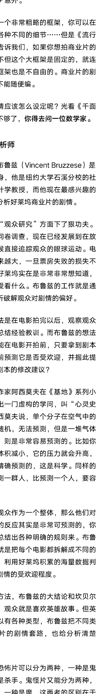

好莱坞电影看多了以后，你就会有一个印象，剧情大同小异。都是个人英雄主义，都是小人物做主人公，而英雄做这些惊天动地的大事，都是为了自己的家人。

这不是好莱坞刻意拍俗套，而是观众就爱看这样的故事。不是编剧没有想象力，而是

#### 1.只有一种故事

- 1. 要有缺陷舞人，这意味着主人公一开始是个有缺陷的小人物，到剧情结束的时候他不但取得了胜利，而且克服缺点完善了自我；
- 2. 要可信，这意味着英雄不能是无敌的，也不能是一上来说我要担负重大使命，他必须经历一番挣扎才接受这个使命；
- 3. 要有悬念，英雄的征途上必须遭遇各种小失败。

#### 2.剧情分析师

### 周末小议 | 有限责任社会

现在中国社会不断进步，我们的很多思维方式都在慢慢发生转变，这其中一个最重要主题，就是要适应“现代社会”。现代社会的很多做法跟传统社会不一样，如果你仔细想想，其中有些还是违反应直觉的。

比如说，某人发现一个赚钱的好办法，想开家公司，可是自己又没有多少钱，于是他借了一些钱，说等公司赚钱了再还。他拿这些钱买了原材料，请了工人，搞了生产……结果市场不买账，最后公司失败了。那么请问，他为了开公司而欠下的这些债，怎么办呢？

如果是传统社会，这个人对这笔债务就有限的责任。公司倒闭了，那就用自己家的存款还，存款不够就卖房子，实在不行就以后自己出去打工慢慢还，甚至在古代社会可能还要父债子偿。可是在现代社会，至少是在某些国家，如果这个人开公司、借钱、还钱都走的是正規的法律程序的话，这笔钱他可能就不用还了。

这当然就是“有限责任公司”的好处——你的公司欠的钱，不用你动用个人资产偿还。当然各国具体的做法可能有细节上的差异，但基本来说，公司破产了，债务也就没有了。所以把钱借给、或者投资给公司都是有风险的，搞不好血本无归。

正因为这一点，人们才更敢开公司。你不用拿自己家的钱冒险！有的人有想法有能力，但是没钱承担不了失败的风险；有的人有钱，损失一点他不怕，但是没有那么多想法和时间去赚钱——“有限责任公司”，能让这两种人合作。而且第二种人都不需要是有钱人，任何人只要有闲钱存在银行，银行就可以拿去贷款给第一种人。

缺点是一旦破产钱说没就没了，优点是创造了很多很多机会。优点远远大于缺点。

而在美国，金融业已经发展到了如此的程度，不但公司可以破产，个人也可以破产。美国的个人破产制度可能是全世界最宽松的。各州的具体法律不一样，但是至少在某些州，基本上你只要直接到法院去宣布自己破产，就算破产了，你欠的债就不用还了。

注意，这里说的个人“欠债”可不是公司那样用于生产投资的债务。你信用卡刷多了也行，你借钱炒股赔了也行，吃喝玩乐不管是什么原因欠的钱，只要你宣布破产，就不用还了。也许恶意挥霍再申请破产是不行的，具体规定我也不了解。不过我知道，有的州会要求你先把房子卖了还钱，有的州甚至还保护你的房产——你照样住在自己的房子里，能还多少就还多少，还不上的就一笔勾销。

#### 一个人做错了事，他到底应该承担多大的责任？

员工工作失误给公司带来了重大损失，应该让他花自己的钱赔偿呢，还是仅仅开除、甚至批评教育了事？医生治死了人，他应该受到多大惩罚？要是学生在体育课上摔断了腿呢？某市发生重大安全事故，市长长应该被免职吗？

塔勒布在《反脆弱》这本书里是非常反感“拿别人的钱冒险”这种行为的。他说现代代理人制度，公司盈利了你可以收获巨额的奖金，公司破产了你不用掏自己的钱，实在不行还让政府救市——出了事儿别人担着，立了功算你的，你这不等于就是自己不坐在驾驶舱里，远程遥控驾驶客机吗？你没有一个skin in the game！

可我还是觉得这个道理也不尽然。这不仅仅仅是个价值观问题，也是个效率问题。责任越有限，相关人员就越敢胆大，世界就越有活力；责任越无限，相关人员必然就会越保守，世界就越没意思。

现在的局面是中国正在评 允许个人破产的利弊，估计很快也会推出相关法律。

但我更想说的还不是“破产”，而是这种“有限责任”的精神。


日课精选

### 答读者问｜不一定遵守，但是要尊重

#### 来自日课：有一种情怀叫“有限”

我想起了《极端式成功者》那篇日课，不是说只有投入极端的情怀，才可以成功，这个“极端”我可不可以理解为无限，还是也只是有限？

看完本文，一个是想到马尔科姆·格拉德威尔的《异类》中有一部分专门讲文化传承，地区文化因素事实在无形中决定了你的行为和态度；另一个则是想到社会推崇的匠人精神，就接触到的主流媒体的宣传来说，匠人是以有限的生命投入到相应领域，直至忘我境界的技术大师，这是不是就是无限的职业精神？那从今天的内容来看，这样是不是没那么正确呢？

万维钢
马克思耶样的极端，是使用极端手段追求一个极端的结果，他在这个过程中做出了很多牺牲，可以说是牺牲了一部分自己和家人的幸福。这是一个个人选择，也是一个非常不同寻常的选择。戴森不会这么做，而且未必做成这样。

#### 来自日课：选择越多，越是胜者通吃

今日得到：这是一个胜者通吃的时代，小众是对平庸的自我安慰。但同时我也有一个问题：平庸的人怎么改变自己，因为我发现一个现象就是，有些人说自己“平庸”的作品比较“小众”，靠这一句话赢得了很大程度的同情心和关注度，我考虑是有一个原因导致的，那就是小范围内个性化的追求。我是一个学工业设计的学生。请老师证明。

#### 来自日课：经历的幸福和回忆的幸福

#### 来自日课：商业片的剧情公式

既然明知道商业电影的套路，为什么我们还是在每次大片上映时，会不可自拔地自捆腰包呢？

比如说，咱们前面提到过的泰勒·科文的《发现你内心的经济学家》这本书里，就说过绘画艺术的一些套路——

里，就说过绘画艺术的一些套路——

人们更喜欢能让自己快乐，而不是悲伤的作品；

风景画的前景中如果有一匹马，或者有人，价格能更高，如果有任何工业品，价格降低；

花的价值比水果高，玫瑰最高，菊花最低；

画中动物也有等级，比如纯种狗比杂种狗加分，如果画鸟，鸟越贵，画就越贵；

平静的水面加分，激流的水面减分；

圆形和椭圆形的物体减分；

裸体女性远远比裸体男性受欢迎……

非得画个《扬帆远航图》的确是太俗了根本不叫艺术，但就算你搞严肃艺术，也不能完全不顾上面说的这些规律。

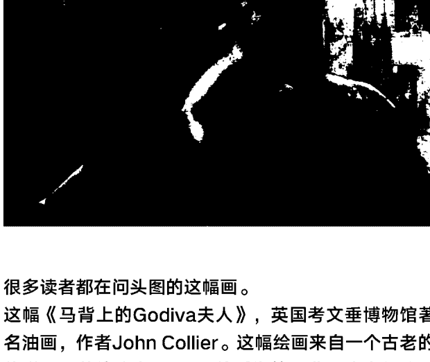

很多读者都在问头图的这幅画。这幅《马背上的Godiva夫人》，英国考文垂博物馆著名油画，作者John Collier。这幅绘画来自一个古老的传说——英统治者Leofric伯爵为筹军费，决定征收重税。善良的伯爵夫人Godiva向丈夫请求减税，伯爵说，若她裸体围城走一圈，就同意减税。第二天夫人真一丝不挂，骑马上街。居民为尊重夫人，当天全关门闭户，街上空无一人。事后，Leofric伯爵信守诺言，宣布全城减税。高贵的民众配得上善良的牺牲。


### 日课129 | 为什么电影里的女强人必须有脆弱的一面？

今天咱们继续说《流行制造者》（Hit Makers: How Things Become Popular）这本书，作者是德里克·汤普森（Derek Thompson）。

HIT MAKERS DEREK THOMPSON

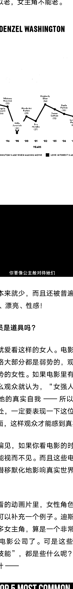

HOW THINGS BECOME POPULAR

上次我们提到商业片电影剧情都是有规律的，有位叫文森特·布鲁兹（Vincent Bruzzese）的统计学教授，现在就是好莱坞电影的剧情分析师。布鲁兹知道哪些剧情受欢迎哪些剧情不受欢迎。那电影人是不是就应该一味地迎合观众呢？

观众是有偏见的。有些偏见容易看出，有些偏见就是潜移默化，我们还以为是正常的。

比如说爱情喜剧。一般爱情喜剧都是分三段。第一段，男女主角相识，互相试探在一起的可能性。第二段，两人正式确立恋爱关系。但是电影需要张力，剧情得有冲突，所以男女主角必须爆发一次感情危机。感情危机之后两人分手，各自独立生活一段时间。到第三段，男女主角复合，从此过上幸福的生活。

好，现在有一个关键问题。在男女主角分手之后、复合之前的这段时间内，如果男主角和别的女性发生了性关系，只要他在最后和女主角复合，观众都能原谅他，这个剧情可以出现。可成年女主角在在这一时间内和别的男性发生性关系，这样的剧情就不能出现——布鲁兹说，就连女观众都不能容忍这种行为。

好莱坞非常标榜政治正确，明星们经常向公众强调男女平等。可是像这样的剧情，男女哪里平等了？

#### 1.好莱坞的性别歧视

咱们先来思考这么一个问题：你认为女性角色在当前电影中的重要程度有多高？

你可能觉得女性角色和男性角色同等重要。观众看电影的一大看点不就是看美女吗？各种奖项，有最佳男主角也有最佳女主角；有最佳男配角也有最佳女配角。八卦新闻对女演员的曝光程度也高，电影杂志的封面也爱用女演员。女性很重要，对吧？

但是我们不能光凭印象，还要看统计结果。有人研究了2010年-2013年期间，以美国为主，也包括巴西、英国、中国在内几个国家的120部流行电影。这些电影里有名有姓有台词的角色共有5799个——然而其中的女性角色，只占不到三分之一。如果只统计美国电影，女性角色仅仅占到29%。

这个结果有点出乎意料。生活中的男女是各占一半的，怎么到了电影里，女性就不到三分之一了呢？

而且所有这些电影中，只有23%的主角是女性。电影中的高管角色中，只有14%是女性。最高行政长官——比如市长或者总统——这类角色中，有115位是男性，只有12位是女性。其实严格的说只有10位女性，因为有三个电影的最高长官是撒切尔夫人。当然，科学家和工程师的角色中，男性更是占到了88%。

这还仅仅是人数。女性角色在影片中的作用也和男性角色不同。电影里的女性大多是漂亮性感的形象。穿着暴露、展现性感的角色中，女性占到的比例是男性的两倍。在影片中被强调漂亮的角色中，女性是男性的五倍。而在年龄方面，40岁到65岁的女性只占到所有女性角色中的20%。

这些数据都是汤普森给的，我还可以再补充一点。丹泽尔·华盛顿（Denzel Washington）从三十多岁演到六十岁，每部电影里他都有Arrays一位不同的女朋友，而他这些女朋友的年龄永远都在二三十岁。男主角可以老，女主角不能老。

DENZEL WASHINGTON


女性角色本来就少，而且还普遍物化了——年轻、漂亮、性感！

#### 雄道女演员是道具吗？

因为观众就爱看这样的女人。电影中的女性角色性格大部分都是弱势的，观众不喜欢特别强势的女性。如果电影里有一位女强人，那么观众就认为，“女强人”这一面并不是她的真实自我——所以在电影中的某一处，一定要表现一下这位女强人脆弱的一面，这样观众才能感到真实。

像这样的偏见，如果你看电影的时候不注意，就可能视而不见。而且这些电影里的偏见也在潜移默化地影响真实世界里的女性。

就连小孩看的动画片里，女性角色也都偏弱。我还可以补充一个例子。迪斯尼动画片里有很多女主角，算是一个非常重视女孩子的良心电影公司了。可是这些女主角的“专业技能”，都是些什么呢？有人做过如下统计——


排在第一位的是缝衣服，而战斗技能和做饭、打扫卫生同样重要，还有一个重要技能是唱歌。

小女孩看了太多的这样的电影，会从小就认为女人就应该弱一些。如果一个小女孩的性格很强硬，她大概还要深表歉意。你以为给孩子看的都是积极向上的“正常”电影，其实已经埋下偏见了。

#### 2.确立品位的窗口期

西兰花是超市里最常见的蔬菜之一，但是它在美国文化中有个非常重要的地位——它是儿童教育的标志性物品。美国人公认西兰花是最难吃的蔬菜，但同时又一致认为西兰花是健康蔬菜。所以成功的子女教育的标志，就是你能让自己的孩子吃西兰花。小孩吃西兰花这一个动作，就足以赢得大人的表扬。


其实我自己并不觉得西兰花难吃，也不知道是不是跟基因有关，但美国人，的确天生不爱吃西兰花，是人之本性。但是，1990年，有科学家研究发现，这个本性可以在儿童期被改造过来。你只要把西兰花和什么好好吃的东西做成一道菜，经常给孩子吃——只要吃15次，孩子就能接受西兰花。这背后当然就是“简单曝光原...

孩子吃 —— 只要吃15次，孩子就能接受西兰花。这背后当然就是“简单曝光原理”：熟悉导致流畅，流畅导致喜欢。

但是请注意，你只能在一个人还处于儿童期的时候，改变ta对食物的喜好。过了这个窗口期想要改变就非常困难了。这可能也解释了为什么中国人永远非得吃中餐。

### 我们对音乐的喜好也有窗口期。这个窗口期是在十几岁到二十几岁之间。更小的小孩更喜欢去尝试各种各样的风格，无所谓喜欢不喜欢；过了窗口期，一个人的音乐喜好就定下来了。在线音乐服务Spotify，2015年有个研究发现，大多数人从此不再听新歌手的歌曲的精确年龄，是33岁。

过了33岁，我们基本上只听自己年轻时候听的那些歌。

### 决定一个人的政治取向的窗口期也是二三十岁。艾森豪威尔是共和党的，他当总统的时候表现不错，让人对共和党有很好的印象，那么如果一个人在年轻的时候正好赶上艾森豪威尔当总统，他的一生都将是一个右派，支持共和党。如果一个人年轻的时候是罗斯福当总统，那么他一生都将是左派。

我听说过一句名言 —— 很多人三十岁就死了，只不过到八十岁才埋葬。

可我觉得有些人没死。看电影，也不一定非得让人看死。

#### 3.艺术家应该移风易俗

观众喜欢什么，你就拍什么 —— 可是观众的喜好是可以变的。事实上，社会观念一直在改变。几十年以前的社会习俗，我们今天可能认为非常野蛮。我们今天视为正常的观念，几十年后可能被视为愚蠢。

汤普森举了个最近的例子。1996年的时候，美国只有27%的人可以接受同性结婚合法化，但到了2015年，短短20年之内，美国大部分人都认可了同性婚姻。最高法院已经认定同性婚姻是合法的，在今天的美国，同性恋已经不再是什么异类了。

下面这张图，表现了人们对同性婚姻关系的变化过程 ——


而你如果把不同人群细分，可以发现对这个新观念接受度最高的，恰恰就是二三十岁的年轻人 ——


所以汤普森呼吁艺术家应该设法影响年轻人的观念。商业片固然要按照套路来，但套路是可以改变的。前一篇文章我们说到25个因素中你改变1个因素就是一部全新的电影 —— 那你可以选择把这1个因素往移风易俗的方向改。

现在美国电影中女性高管的比例是14%，这个比例和现实生活中女性高管的比例是一致的，电影在这一点上没有“打压”女性 —— 但是也没有刻意提升女性地位。汤普森说，这是艺术家没有尽到责任！为移风易俗计，我们应该故意多搞几个女性高管角色。

## ｜我的评论

中国社会在过去几十年间的观念变化，比美国过去100年的变化还要剧烈，我们生活在一个风俗不断变动的时代。这就导致了中国人隔代之间几乎无法交流，很多问题你不可能和爷爷奶奶谈，你和父母之间的观念差异也非常巨大。咱们今天说的这个“窗口期”理论显然能解释这个现象 —— 大多数人的思想停留在了他们年轻时代。

可是我仔细看了上面那张不同人群对同性婚姻的观点变化图，还有一点别的发现。现在五六十岁的这些人，他们对同性婚姻的认同比例，比过去三四十岁的人要高了不少。而2015年五六十岁的人，不就是1996年三四十岁的人吗？显然他们中的很多人的观念发生了改变。

中国也有这样的人。有些人不管多老都能接受新鲜事物。他们能听得去新歌，能喜欢年轻人喜欢的明星，能接受女英雄当电影主角。如果时代变了，他们可以否定自己年轻时候的偏见。我看像这样的人，才算代表了“先进文化”。 8笔笔记

## ｜由此得到

有很多观念其实是偏见，但是我们视而不见。

人的观念是可以改变的，但是有一个窗口期。

合格的艺术家了解流行，伟大的艺术家引导流行 —— 艺术家的重大使命，就是要移风易俗。


### 日课130｜好目标 = 难度 × 具体

日课130 | 好目标=难度x...

有关 “怎样设定目标” 这个话题我们已经说过两次了，今天要说的是一个 “统一理论”。

在《大目标，和任务勾选框》这期日课中，我们介绍了 “SMART” 目标系统，这是一个企业常用的系统。咱们还是来回顾一下，所谓SMART，就是要具体（Specific）、可测（Measurable）、可实现（Achievable）、有现实意义（Realistic）、有明确期限（Timeline）。

但是我们也提到，这个系统是有问题的，有些员工会故意给自己设定容易的目标，纯粹应付考核，然后还自我感觉良好。SMART系统是通用电气最先发明的，但是后来通用电气总裁韦尔奇又提出一个 “拓展性目标（Stretch Goals）” 的思想，认为制定目标应该往高、往远看，不必拘泥于具体。

不管是SMART目标还是拓展性目标，都主要是企业级的目标系统，制定目标是为了真正把事情办成，都要有考核机制，都是非常严肃的工作。可是对个人来说，特别是在生活中，人人往往根本就没有 “目标” 这个意识，经常制定不可实现的目标，所以我们在今年新年这天，还专门有一期日课，《新年，你立志了没有？》，说可以先从一个小目标开始，但是要符合SMART规范。

好了。SMART和Stretch，大目标和小目标，这些方法各有利弊，这些概念都有点矛盾。那么我们到底应该怎么理解 “目标”，好目标到底应该是什么样的呢？

今天要说的，就是一个 “终极解决方案”。

#### 1.企业家的错误

最近《哈佛商业评论》有篇文章，“管理层应该避免的三个常用目标技术（3 Popular Goal-Setting Techniques Managers Should Avoid）”，作者是管理顾问迪克·格罗特（Dick Grote）。

我看格罗特这篇文章才知道，心理学家对目标系统的作用效用已经有过好几十年的研究，并且在2002年，就有一篇论文总结了此前的研究结果，发表在《美国心理学家》杂志上。我把这篇论文的标题截图在下面——


换句话说，过去几十年发生的情况基本上是这样的——一方面是企业家在自行尝试各种目标系统，他们把经验分享给更多的企业家，大家互相学习模仿；一方面是心理学已经有了非常严格的各种研究，也形成了定论。

可是这两边的人没有对话。企业家声音大但是没有使用科学方法，心理学家的结论更准确但是人微言轻。所以企业家得多读书，科学家得多写科普啊……

那么格罗特这篇文章说，对照心理学家的论文，现在管理者普遍使用的三个目标方法，都是有问题的——

第一，很多企业使用SMART方法，这个方法太容易让人故意制定低目标。

第二，有些企业使用严格的自上而下的目标系统。总裁必须是全公司第一个制定目标的人，副总裁根据总裁的目标制定自己的目标，然后一級一級往下……这么做，底层员工就太被动了。每个人都应该有一定的自主性，把上级的目标作为一个重要参考就行了。

第三，有些企业给各种不同目标下列量化的重要性程度，格罗特说，这纯属胡闹。哪个目标重要，哪个目标没那么重要，你作为管理者心里有个大概的谱就行了，你很难量化！我们粗略地把目标按优先级排列，最多定个高中低三档，也就可以了。

那心理学家到底说了什么呢？

#### 2.到底什么是好目标

企业家关心的是什么 “对的”，自己认准一个对的就先大力推广，万一将来发现问题再改；心理学家就算看见 “对的” 了也要关心什么是 “错的”，要把各种不同的方法作对比，才能知道到底哪个是对的。

我们制定目标的目的是为了增加绩效，那么心理学家的做法就是试验各种目标方法，考察它们对绩效的影响。

这篇2002年的论文，就是把此前一系列研究结果综合起来，得出一个总的结论。

这个结论其实特别简单，好目标的要求就两条：第一，要有难度；第二，要具体。

首先是难度。有多少研究发现，目标的难度越大，员工的努力程度和最终绩效就越高。当然如果难度太大，到了员工的能力范围之外，那他明知完不成了可能索性就不干了。但只要是在力所能及的范围之内，目标难度基本上和绩效成正比。

其次是具体。很多人激励自己和激励别人的话是 “你要尽最大努力”、“一定要做到最好” ——这些其实都是空话。多好才是最好？如果目标不具体，人们根本不会做到自己所能做的最好，更可能是做到一个说得过去的程度就算了。

但是只有具体也不行。像SMART目标那样，人们可以制定非常具体，但是很容易就能达到的目标应付了事。

有难度，又具体，这就把SMART和Stretch结合起来，这就是最好的目标。有难度，这就符合 “拓展性” 的精神，而SMART系统，可以视为是一个 “书写” 目标的标准方法。 一个目标只有符合SMART的要求，它才是最具体的。

其实也只有符合了 “难度” 和 “具体” 这两个要求，制定目标这个动作才有意义。最后目标的效用，大概是一个乘法关系，就好像体操和跳水比赛的得分等于难度系数乘以完成度一样，我们大概可以说：

目标效用 = 难度 × 具体

#### 3.目标的作用

为什么我们不好好地 “活在当下”，有事就做事，非得去指定什么目标呢？心理学家认为，目标有四个作用。

第一是集中注意力。咱们上周回答的时候有一位读者提问，说做事心不在焉怎么亦，今天这篇论文正好解释了这个问题，就是目标可以让你集中注意力和力量。具体的目标要有明确的反馈系统，做到没做到一目了然，那么你就得想设法做到。

第二是激励。高目标使人兴奋！其实很多情况下我们有活不愿意干，是因为这个活就算干出来了也没有多大意思。如果目标是出类拔萃的，干好了能证明自己，我们就会全力投入。

第三是能让我们长期坚持下去。心中...

第四是目标一旦确定了，我们自动就会寻找各种解决方案。产品经理如果今天一个主意明天一个主意不知道他想要什么，程序员就会无所适从。产品经理如果提出特别明确的要求，程序员就好做数学题的小学生一样，看到问题自动想办法解决。

论文还讨论了人在完成目标过程中的各种调节机制，比如说如果我们知道这个目标很重要，我们的努力程度也会增加……其实这些机制的本质还是 “难度” × “具体”。

## ｜我的评论

其实这个难度×具体，说白了就是做事要有意义、有反馈。在企业跟人合作，和自己平时做事，都是这个道理。

有难度，我们才觉得这个事情有挑战，才值得做，才能形成自我激励。可是光有一时的激情还不行，你得时刻检验自己做到没做到，做得对不对，如果有个外界的反馈信息那就更好了。

我想大概可以这么说——我们平时做任何事情，无非就是生活状态和工作状态。如果是生活状态，那么怎么都行，无所事事或者尽情享受都可以。如果是工作状态，那最好干一件有意义的事，而且最好这…

那就最好干一件有意义的事，而且最好这件事有个可见的结果。如果现在你有两个小时的时间，你决定把这个时间用在工作上，那就应该有个目标，要求这件事值得做，做出个结果来——否则你这两个小时就是搞行为艺术。
6人笔记

所以哪有那么多特殊技术，其实就是最简单实用的心法。

## | 由此得到

- 1. 好目标的大原则是有难度、有具体要求。
- 2. SMART系统可以把任何目标具体化，但是不能确保难度。
- 3. 从另一个角度看今天的内容，企业家爱轰轰烈烈，科学家爱严谨，这两种探究事物的方法对比，也值得体会。

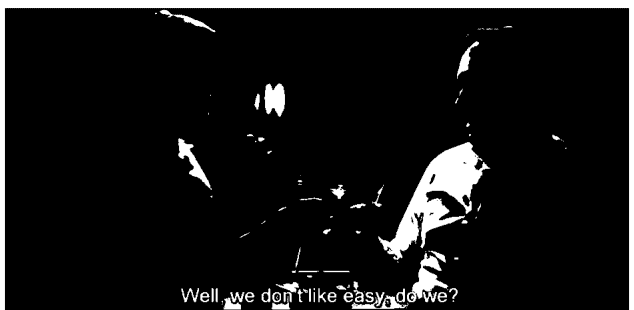

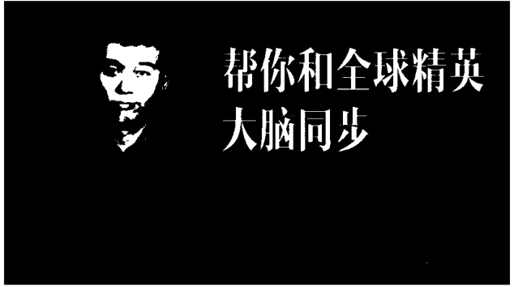

### 日课131｜怎么理解特别大和特别小的数

我最近听说这么一个笑话。从前有一个老太太，领着自己的小孙子在海边玩。突然一个巨浪把小孙子卷入了海里。老太太不会游泳非常无助，她大喊——上帝啊！救救我的孙子！也许是上帝听见了她的祈祷，又一个浪过来把小孙子毫发无伤地送回了老太太身边。老太太抱着孙子，非常感动，她接着对上帝说：“我孙子还有一顶帽子呢！”

这个笑话的精神是“重要和不重要”。我们考虑重要事情的时候，得善于忽略不重要的东西。最起码的判断标准，就是数字大小。这个道理似乎特别简单，但是“判断大小”其实没那么容易。

十亿到底有多大？0.0001%到底有多小？理解这些数字，需要下点功夫。

今天咱们就用两本书来切磋一下这个功夫。这两本书都是数学家写的。第一本是经典著作，叫《数盲：数学无知者眼中的迷惘》（ Innumeracy ），作者是约翰·艾伦·保罗士（John Allen Paulos）；第二本是新书，中文版出版社会起了个媚俗的书名，叫《魔鬼数学：大数据时代，数学思维的力量》（ How Not to Be Wrong: The Power of Mathematical Thinking ），作者是乔丹·艾伦伯格（Jordan Ellenberg）。


#### 1.大数有多大

我们在日常生活中经常接触的数字都比较小，比如几十、几百，我们头脑中能非常形象地知道它是什么意思。但是特别大的数就很难有直观的印象了。《数盲》的作者保罗士建议我们在头脑中训练自己对大数的印象。

谈论大数，我们得有“数量级”的观念——也就是10的多少次方，一个数量级的差距就是差10倍。对大数来说，几倍的差异你甚至都可以当他们是相等的（物理学的说法是它们在“同一个数量级”），数量级的差异才值得考虑。

我们最好能对不同的数量级有个形象的理解。一千，相当于一所中学的学生总数。一万，相当于一座体育场里的观众人数。十万相当于一本书的字数。100万是什么概念？如果你每秒数一个数，数到100万需要11天半。以此类推，10亿相当于中国的人口。

再大的数字就不好想象了。10亿元和1000亿元相差了100倍，可是我们头脑中的形象，这两个都是“很大一笔钱”。
很大一笔，到底是多少钱呢？

2014年我看《彭博商业周刊》上有篇文章，呼吁大家不要在开车的时候给手机充电。文章说车上的电都是燃烧汽油而来的，这种发电商模式太浪费了——有多浪费呢？每年因为美国人在车上给手机充电，总共多消耗了价值两亿美金的石油！

这大概是我所看过最愚蠢的正经文章之一。两亿美元？这个数字很大吗？美国开车的人差不多都有两亿，相当于每人每年多花1美元！而这1美元可以让人给手机充电——不知道省去多少麻烦，你因为一次忘记在家充电的损失就可能超过1美元——这可能是你所花过的最值的1美元。

所以理解大数的一个好办法是除以全国人口。

不过上亿元的事儿一般都不叫事儿，叫新闻。跟我们日常生活关系更大的不是这些大数，而是小数。

#### 2.我们应该害怕什么？

风险都是小数。描写风险的科学办法是给一个概率，可是我们很难形象理解特别小的概率。比如说，你担心因为被蜜蜂蛰而死吗？你担心吃东西噎死吗？最好先看看概率再担心。

《经济学人》杂志曾发表过一张很长的图，图中列举了每年美国人死于各种事件的概率——


每年死于吃东西噎死的概率是十万分之一，死于被蜜蜂或者黄蜂蛰的概率是2500万分之一……但是你都不应该担心。最值得担心的其实是心脏病，467分之一；各种意外事故加在一起的死亡率也才1656分之一；排在第三位的是自杀，8000分之一。剩下的死亡危险都有数量级上的差异，与前三项相比根本不足为虑。

我看《经济学人》这张图的一个优点就在于它把特别小概率事件——比如死于流星撞击，7500万分之一——都给画出来了，而且还是按比例画的，能让我们特别直观地感受到需要有多么多的人，才能找到一个这种死法的方法。为了提供这个直观感受，《经济学人》不得不把图画得特别长。

可是一般的“风险知识”就没这么厚道了。比如说，吃某种食物能把得某种疾病的风险增大一倍——这应该怎么理解呢？

《魔鬼数学》中就有一個例子。英国有一种口服避孕药，效果很好很受欢迎，但是政府研究发现，这种避孕药会使妇女得血栓的风险增加一倍，就向全国医生发布了一份报告，说开这个药的时候要谨慎一点。结果报告上了报纸，很多女性听说了以后就干脆什么避孕药也不吃了，结果英国一年内多了好几万妇女怀孕，还增加了13000起人工流产。

根本问题在于，人得血栓的风险到底有多大呢？事实上，一个育龄妇女得血栓的概率只有1/7000，这本来就是一个极小的数字——你把一个小数乘以2，变成2/7000，还是一个小数！而且血栓不是绝症，得了也不一定死。有人专门做了计算，如果英国妇女正常吃这种避孕药，那么英国每年会有多少人因为这个药而得血栓而死呢？差不多是一个。

那你可能说，生命无价，多死一个也不行！有道理，可是因为不吃这个药，多死的一万多婴儿又怎么算呢？

《魔鬼数学》书里还有个例子。美国的托儿所有两种。一种是在老师自己家办的，一个老师带四五个孩子，学费比较便宜。另一种是正规托儿所，人手多，设施齐全。好，现在数据显示，家庭托儿所中小孩因为事故死亡的概率是正规托儿所的7倍 —— 那请问，如果你特别注重安全，是不是应该把孩子送到正规托儿所去呢？

像这种问题千万不要只看倍数，一定要看看概率的绝对值。事实是全美国每年死于家庭托儿所的孩子只有10几个 —— 而与此同时，同样年龄的孩子死于交通事故的数量是每年79个。那么如果正规托儿所离家比较远，家庭托儿所离家比较近的话，哪怕距离只相差20%，你如果只考虑安全，就应该把孩子送到家庭托儿所去。

所以哪怕只考虑安全，也不能一听说有风险就变色，得把各种风险放在一起比较才行。

不过在我看来更好的思维方式是接受这个世界是有风险的。交通有风险，我们也不能不上街。与其担心各种极小概率的危险，还不如把心思用在别的事情上 —— 那些更重要的事情。

#### 3.重要和不重要

美国给退休人员发放的社保基金有个漏洞。有些人已经去世了，但是可能家属故意不报，也可能系统有问题，他的银行账号还能收到社保福利款。根据社会保险局估计，每年因为这个漏洞，有3100万美元的损失。那么面对这么大一笔钱，是不是应该赶紧想办法修补漏洞呢？

有人做了这么一个计算 —— 这3100万美元，相当于美国每年发放社保基金总数的0.004%。也就是说，社保基金发放的准确度高达99.996%，这简直是非常完美的系统！到了这个程度如果还想再做得更加完美一点，你往往需要付出很高的代价，花费巨大的行政成本 —— 这个代价可能远远高于3100万美元。

不看数量级，3100万美元是一笔巨款；一看数量级，这点损失不算什么。

什么东西都有弊端，但不是所有弊端都必须纠正。做任何事情都有利有弊，很多情况下如果你做个计算，利弊还是很容易看出来的，其中经常是数量级的差异。3人笔记

一件不值钱、不知道什么时候会用到的旧东西，值不值得保留在价值千万的房子里以备不时之需？为了把孩子考上重点大学的概率增大一点 —— 这样他将来也许能获得更高的工资，住更大一点的房子，但一切都还是概率 —— 值不值得全家在一个窄小的学区房里挤上十几年？

## ｜我的评论

我们日常做判断，都是用系统1，主要是模式识别 —— 东西有毒，第一反应就是不吃；事情有危险，第一反应就是不做。可是什么叫有毒？多大的危险？0.01%和0.0001%的差别巨大，但是给我们的心理冲击是一样的。

生活中拣芝麻丢西瓜的事情在太多了。有的人买生活必需品的时候非常节省，买奢侈品的时候特别大方。有的人能为几十块钱货比三家，面对人生重大选择却异常草率。

忽略小事不是因为大胆，不是“个性”，而是理性。重视小事就等于忽略大事。你必须判断轻重缓急，把精力和资源放在最重要的事情上。

所以能够不顾心理冲击，坚决使用这种“数量级思维”，是一种“大人物的思维”。别人看三千万美元很多，他看三千万美元很少。别人认为这个事儿实在受不了，他对这个事儿根本不在乎。这种“大人有大量”，不是装出来的，也不是“养吾浩然正气”养出来的，是算出来的。3人笔记

见识过、计算过、能做出理性决定，这才叫有胆有识。

## ｜由此得到

- 1. 特别大和特别小的数字，其实不容易理解，需要想办法把它们形象化。
- 2. 不要谈风险色变，得比较风险的“大”、“小”。
- 3. 数量级思维可以帮助我们忽略不重要的东西。

### ｜最后再说个笑话

来自《数盲》这本书，大概需要有点大小尺度的观念才能体会到 —— 有一对90多岁的老夫妻闹离婚，请律师办手续。律师问他们，在一起都生活一辈子了，怎么这时候离婚？老夫妻说，很早就决定离婚了，怕给孩子们造成伤害，所以等到孩子都去世以后再离。


### 日课132｜一个大尺度的话题

日课132｜一个大尺度话题

对不起今天这个标题可能有点误导……我们说的不是审美上的大尺度，而是数学和物理上的大尺度。这个知识可以算是一个基本知识，很多书都讲过，但是还没有成为常识。

其实我们一般的观念中，对“尺度”也是有点概念的。比如有个众所周知的笑话是这么说的——古代有个 人想象皇帝过什么样的生活，他想到他自己每天用铁锯头种地干活，而皇帝的条件肯定好很多，那皇帝大概是用金锯头来干活的。这个人不知道当财富增加的时候，人的生活方式就会发生变化，不能单纯按比例放大。大 了，就不一样。

然而在很多问题上，我们恰恰就是在使用这个错误的“按比例放大”思维。

咱们设想这么一个问题——把一个普通人的身体按比例放大5倍，会发生什么事情？答案是他将会被自己的体重压垮。

如果按比例放大，那么每个尺度放大5倍的结果，是这个人的重量将是原来的5^3倍，也就是125倍。这个人的身体仍然依靠肌肉和骨骼支撑，这些物质能承担的压强不变，腿的支撑力就和腿的横截面积成正比，那么支撑力就是原来的5^2倍，也就是25倍。

支撑力只放大了25倍，重量却放大了125倍，这就肯定撑不住了。所以如果真的有什么巨人国，那些巨人的身体比例就不可能跟我们一样，他们的腿必须非常非常粗才行。

大 了，就不一样。这就是为什么自然界中大型动物和小动物的生活方式完全不同。一只老鼠从悬崖上掉下去，可能没什么大事儿；同样的悬崖如果是一只猫掉下去，可能规受伤；但如果是一匹马掉下去，它很可能就会摔死。根本原因就在于不同大小的动物在摔向地面的时候，它们承受的冲击力是和自身的重量成正比，而它们承受冲击的能力，是和自身的表面积成正比——一个是尺度的立方，一个是尺度的平方。动物的尺度越大，它所承受的压强也就越大，所以小动物不怕摔，大动物很怕摔。它们的着陆速度一样，但承受的冲击很不一样。

我再举个例子你就更明白了。你可以用塑料搭建一个玩具桥，然后用钢铁制作一个玩具有小汽车，那么这个玩具小汽车可以很好地在塑料桥上行驶。可 如果你按相同比例放大，用同样的塑料材质搭建一个真实的大桥，用同样的钢铁去造一辆真正的汽车，你再想让这辆车通过塑料桥就肯定不行，桥一定会被压垮。事实上，如果尺寸足够小，一辆钢铁玩具车甚至可以通过一座用纸做的桥。

好了，物理学就说这么多，现在还是说人的事儿。人多了，也很不一样。

比如你有一个创业公司，全公司上下几十个人，有人管人事，有人管前端，绝大部分人具体干活，一切都挺好。可是如果你们公司的规模扩大一百倍，变成几千甚至上万人，各个部门的人员比例结构，就一定会和小公司完全不同！这是因为当一群人聚集在一起的时候，人与人之间的交流复杂程度并不是和人数成正比，而是和人数的平方成正比。最简单的分析，如果人?和人之间都互相写信，那么需要的邮递员人数就必须和总人数的平方成正比。公司人数越多，负责协调管理的?员将会不成比例地增加。这就是为什么机构越大，就越臃肿。

以此类推，当一个国家的人口总数越多，这个国家需要的公务员人数也会不成比例地增加。我们经常听到类似“中国的公务员人数太多了”这样的抱怨——公务员都是纳税人的钱供养的，自身并不生产财富，这样的人岂不是越少越好？

有人就说，汉朝的时候，是8000个人养一个公务员；唐朝，3000个人养一个公务员；明朝2000人养一个；到了清朝是1000人养一个公务员——而今天的中国，则是18个人养一个公务员！这不国将不国吗？

如果你明白“不能按比例计算”这个道理，拿古代公务员人数跟今天对比就毫无意义。而且现代社会的生产方式和生活方式都和古代完全不同。也许中国公务员人数的确多了，但也绝不应该降低到清朝的比例。

用小尺度的事儿推测大尺度的情况，就特别容易犯“皇帝拿个金锄头”的错误。有人说过，宏观经济学如果只留下一句话，那就是“国家不是家庭”。可是我们总喜欢用家庭的事儿去类比国家——其实家庭内部都是熟人关系，而国家中主要是陌生人关系，这两种规律完全不同。治大国，怎么能如烹小鲜呢？

大了，就不一样。这个规律并不仅仅是个认识问题，而且有非常紧迫的现实意义。如果一个系统已经变得很大了，可它还在使用过去小尺度的游戏规则，那就会出大问题。比如说美国的政治制度。

为什么现在美国的政客不干实事儿整天忙竞选，像个娱乐明星一样搞煽情演说，靠演技争取民意支持？这个现象背后，其实也是个尺度问题。

美国的政治制度是200多年前设计的。1789年成立第一届国会的时候，众议院中总共只有65位议员，是按人口比例从全国各个州中选拔而来，而当时美国的总人口只有400万人。65个议员代表400万人人口，平均每个议员只需要代表6万人。

6万人是个什么规模呢？在今天的中国，也许一个公安分局、甚至派出所的辖区就有6万人。从这6万人中选拔一个人，让他代表父老乡亲们去首都开个全国性的大会，一点问题没有。议员能听得到选民的呼声，选民也容易了解到议员，没准都跟自己的议员握过手说过话。

后来美国人口越来越多，众议院人数也逐渐增加。可到了……

总而言之，今天的“得到”就是“大了，就不一样”。

最后再讲个笑话。这回是真事儿，来自昨天说过的《数盲》这本书的作者保罗士。保罗士自己做了个小实验。他给福布斯排名前400的超级大富豪们都写了一封信，信中说他要搞一项重要研究，缺乏经费，希望每位富豪赞助2万5千美元。超级富豪的个人资产都在4亿美元以上，这2万5千美元元仅仅相当于其中1/16000。

保罗士说，如果谁有个好的研究项目让我赞助25美元，我肯定乐意，而25美元已经超过了我所有财富的1/16000。既然我可以接受这个赞助比例，富豪们能不能也按相同比例出钱呢？

有的富豪真给他回信了，说的都很客气。当然最后的结局是保罗士一分钱也没有收到。

万维钢

你还能想到哪些“大了，就不一样”的事物？请留言。


### 日课133｜时尚动力学

日课133 | 时尚动力学

今天咱们继续说《流行制造者》（Hit Makers: How Things Become Popular）这本书，作者是德里克·汤普森（Derek Thompson）。

HIT MAKERS DEREK THOMPSON

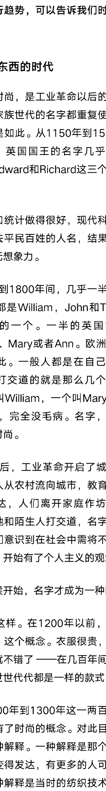

HOW THINGS BECOME POPULAR

整个这本书说的都是怎么制造一个能引爆流行的东西，可是有一些东西并不是“制造”出来的——有时候你这个东西很好，你也投入了营销力量，但它就是未必能流行，它还有一些不可控的因素。比如说，时尚。

时尚，是流行的变化。

有些明星红着红着就过气了，有的品牌几年之内就从身份的象征变成了尴尬的象征。东西还是原来的东西，但是我们对这个东西的评价却能发生很大的改变。无可奈何，似曾相识。

那到底是什么力量在引领时尚呢？汤普森在这本书里引用了非常新的研究结果，可以说是总结了一个非常简单的时尚动力学。

#### 1. 不受干扰的时尚实验

想要把“时尚”单独拿出来研究很难，因为左右时尚的因素太多。

要说一个什么东西成了时尚，首先消费者必须有选择权。1918年福特推出的T型车只有黑色这一种颜色可选，一时之间满大街都是黑色的车，那你就绝对不能说“黑色是当时的时尚”——因为消费者别无选择。

第二，消费者还得具备一定的经济实力。比如在2008年金融危机以后，美国时尚品牌的日子就很难过，因为失业率上升，年轻人的消费能力下降了。

再者，市场营销可以影响时尚。如果某公司用做广告的方式力推某一款产品，也许就能把它推成时尚。

可是我们真正关心的是，在排除这些因素之后，“时尚”，有没有什么*内在*的规律。

社会学家非常幸运，有一种东西，就完全不受上面那三个条件的干扰。这个东西有几乎无数种款式可供选择，以完全相同的价格出售，完全不受经济形势的影响，也没有任何人给它打广告。而且这个东西，还具备了时尚的全部特征。

这个，就是人的名字。

我在网上看到，上世纪七十年代出生的中国人男女各五大俗名如下——

| 上世纪七十年代俗名 |
|---|---|---|---|---|---|
| 男性 | 伟 | 勇 | 涛 | 强 | 磊 |
| 女性 | 颖 | 静 | 芳 | 莉 | 红梅 |

而2000年以后出生的中国人男女各十大俗名则是这些——

| 2000年至今俗名 |
|---|---|---|---|---|---|
| 男性 | 砾 | 子豪 | 宇轩 | 浩然 | 帅 |
|  | 响 | 想 | 子涵 | 晨 |  |
| 女性 | 婧 | 想 | 佳怡 | 子涵 | 雨清 |
|  | 思佳 | 霖 | 子怡 | 研 | 馨月 |

这两份名单非常不一样。七十年代的流行名字中已经没有任何政治烙印了，但是那时候排在前五名的名字，没有一个在今天能排进前十。我就是七十年代的人，我的同学里有很多“伟”、“涛”、“颖”、“静”，怎么现在的孩子都成了“子豪”和“子涵”了呢？这就是时尚。

英美世界也是如此。1990年代美国最流行的三个女孩名字是Jessica，Ashley和Emily。这三个名字在很久之前就存在了，并不是什么新发明的单词，但在1900年代的时候，这三个名字甚至都没有进入最流行名字的前100名。

名字的流行趋势，可以告诉我们时尚动力学。

#### 2. 崇尚新东西的时代

名字成为时尚，是工业革命以后的事情。过去的人家族世代的名字都重复使用，就连王室也是如此。从1150年到1550年的400年间，英国国王的名字几乎都是从Henry，Edward和Richard这三个名字中选。

英国的人口统计做得很好，现代科学家可以研究过去平民百姓的人名，结果发现人们取名毫无想象力。

从1550年到1800年间，几乎一半英国男子的名字都是William，John和Thomas这三个中的一个。一半的英国女子叫Elizabeth、Mary或者Ann。欧洲其他国家也是如此。一般人都是在自己家里千万，每天打交道的就是那么几个兄姐妹，一个叫William，一个叫Mary，再来一个John，完全没毛病。名字，只是传统，不是时尚。

1800年以后，工业革命开启了城镇化进程，许多人从农村流向城市，教育水平也越来越发达，人们离开家庭作坊投入社会，大量地和陌生人打交道，名字就不够用了。人们意识到在社会中需将不同的人区分开来，开始有了个人主义的观念。

从那个时候开始，名字才成为一种时尚。

服装也是这样。在1200年以前，欧洲没有“时装”这个概念。衣服很贵，普通人有衣服穿就不错了——在几百年间，欧洲人的衣服世世代代都是同样的款式。

但是从1200年到1300年这一两百年间，服装竟然有了时尚的概念。对此目前历史学家有两种解释。一种解释是那个时期欧洲的贸易变得发达，有更多的人可以旅行了。另一种解释是当时的织妓技术有了比较大的进步，服装变得宜了。如果老百姓能穿得起和贵族差不多的衣服，贵族势必得变着花样换新款式的衣服。

到1600年，名字还不是时尚的时候，时尚就已经开始主导欧洲的文化和经济。

所以想要让时尚存在，还需要一点经济基础的。而且我们看到，这点经济基础并不需要很高，可以说只要有点条件，人们就非常愿意追逐时尚。

从那个时候开始，时尚就有一个特别明显的特点，不管什么领域——

新的就是好的，旧的就是坏的。（与此同时，特别旧的又是好的。）

有人把时尚的这个特点总结成一个定律，叫做 “Laver's law” ——

Laver's Law
Indecent 10 years before its time
Shameless 5 years before its time
Outré (Daring) 1 year before its time
'Current Fashion'
Dowdy 1 year after its time
Hideous 10 years after its time
Ridiculous 20 years after its time
Amusing 30 years after its time
Quaint 50 years after its time
Charming 70 years after its time
Romantic 100 years after its time
Beautiful 150 years after its time

当前“时髦”的一个东西，在一年以前往往被人们视为是“大胆”的，五年以前被视为是“无耻”的，而十年以前则是“不得体”的；往后看，一年后人们就会认为它是“过时”的，十年后就会被认为是“丑陋”的，二十年后会被视为“荒谬”的，然而再往后它又成了好东西了。

关键在于，所谓“时尚品位”，必须有一个时间变量。现在的好品位，几年后和几年后都不是好品位。

那么这个品位的时间点，是由什么东西决定的呢？

#### 3.因为你们都喜欢，所以我不喜欢

社会学家研究人名趋势，发现有一个特点——每家几个孩子名字的*流行度*是相似的。

如果这家家长给老大取了个常见的名字，那你就可以预测他家老二老三的名字，也是很常见的。如果老大的名字很怪异，那老二老三的名字就也是很怪异的。

所以家长取名的时候，考虑的不是名字本身好不好听，而是这个名字目前有多流行——他们考虑的是“流行度”。

时尚的动力学，就来自于人们对“流行度”的反应。

咱們举个例子，比如说女歌手泰勒·斯威夫特（Taylor Swift）。

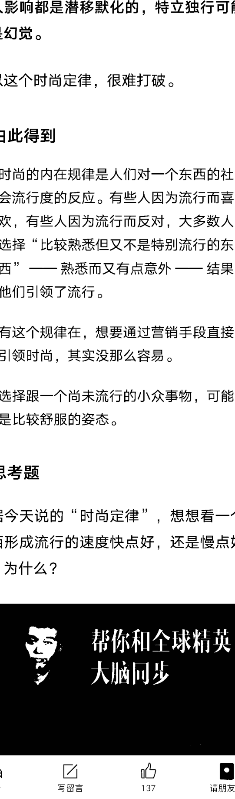

我们都认为自己喜欢哪个歌手都是因为她唱的歌好听，但事实上我们也受到流行度的影响。有的人喜欢斯威夫特，是因为知道她的歌曲特别流行，是想跟大多数人一样。而有的人恰恰因为有太多人喜欢斯威夫特，自己不想跟大多数人一样，于是决定不喜欢斯威夫特。

比如最近和菜头有篇专栏文章，《要警惕民谣爱好者》，说的就是这第二种人。这些人以“小众”为荣，特别鄙视大众流行 的东西 ——“对他们来说，自己喜欢的歌手变得流行起来，这是一件不可原谅的事情。”他们本来喜欢赵雷，可是赵雷真火了，他们很难受。

你们都喜欢？那我就不喜欢。

斯威夫特和赵雷的歌唱得怎样，对这两种人来说并不怎么重要——好歌手太多了，喜欢和不喜欢一个歌手都很容易找到理由。斯威夫特和赵雷的“流行度”，对他们很重要。

## 我的评论

因为别人喜欢或者不喜欢什么东西，就决定自己喜欢或者不喜欢它，不管是追逐流行还是反流行，似乎都落了下乘。你的独立思考呢？
1人笔记

最纯粹的喜欢，当然是完全因为这个东西本身而喜欢。可我们毕竟是社会动物，受别人影响都是潜移默化的，特立独行可能都是幻觉。

所以这个时尚定律，很难打破。

## 由此得到

- 1. 时尚的内在规律是人们对一个东西的社会流行度的反应。有些人因为流行而喜欢，有些人因为流行而反对，大多数人选择“比较熟悉但又不是特别流行的东西”——熟悉而又有点意外——结果他们引领了流行。
- 2. 有这个规律在，想要通过营销手段直接引领时尚，其实没那么容易。
- 3. 选择跟一个尚未流行的⼩众事物，可能是比较舒服的姿态。

### 思考题

根据今天说的“时尚定律”，想想看一个东西形成流行的速度快点好，还是慢点好呢？为什么？


### 周末小议 | 怎样识别 “hype”？

昨天讲“时尚动力学”，我们思考了一个问题——一个东西流行的速度是快好，还是慢好？包括我在内，很多人的看法都是慢一点好。很多东西流行得快消亡得也快，根本经不起时间的考验。

在很短的时间内成为关注热点的东西，英文里有个专用的词，叫“hype”。Hype 对应的中文词差不多是“炒作”，但“炒作”主要是动词，就算是当名词用，也是这个东西是“被炒作”才曝得大名。而 hype 对应的意思更广泛一点，不一定有人故意炒作，可能完全是自发的，突然就成了热点。

一个明星、一个节目、一个新技术、一个商业模式、一个文化概念、甚至是一个学术思想，都有可能是 hype。Hype 的标准，就是 *过度了* 的“可见度”。

可是什么是“过度”？这其实只能事后才能确定。去年特朗普斩了大半年获得极高的关注度，如果最后没有当选美国总统，我们现在绝对会说他是个 hype——可是人家当选了，那就不能叫 hype 了。反过来说，“3D打印”这个概念前几年非常热，现在几乎没人谈论了，看来就是个 hype。

那当一个东西的声音如日中天的时候，你怎么知道它到底是不是 hype 呢？

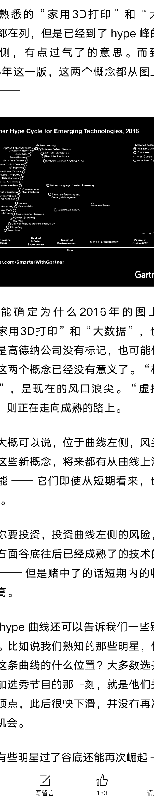

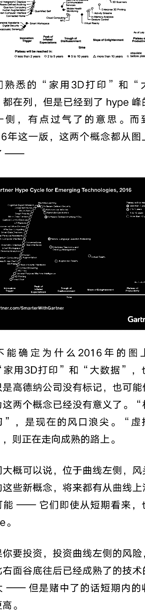

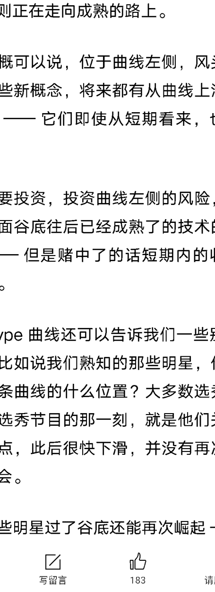

横坐标是时间，纵坐标是人们对这项技术的期望值，也可以说是这个技术在媒体上的曝光度。一开始无人问津，有了点苗头之后媒体兴高采烈大肆宣传，很快声望达到顶点，关注者极多，然后很多人失望而去，到达谷底——可是这个技术仍在不断迭代，后来终于实用化，稳步攀升。

但也有一些明星过了谷底还能再次崛起 —— 这一
次崛起的速度慢了很多，但是很坚定。这样的明星就能成为观众的老朋友，也许在塔勒布的有生之年都能长盛不衰。

那咱这些普通人有没有 hype 曲线？可能也有。学习好的人的巅峰时刻就是高考那一刻，被亲朋好友众人关注，认为世界也是你们的但是归根结底是我的。等到了大学一看高手众多，心态就比较低调，毕业以后如果干得好，才是实在的上升。

我觉得最关键的教训是，人的认知总是偏爱新东西 —— 我们总是给新概念和年轻人更多关注 —— 所以hype 曲线的左侧一定是非常陡峭的剧烈上升，而这个上升速度和高度其实都是偏见导致的假象！你一定很快失去这么高的关注度，忍受一段谷底的考验。如果你能挺过去，后面才是真功夫。

1人笔记

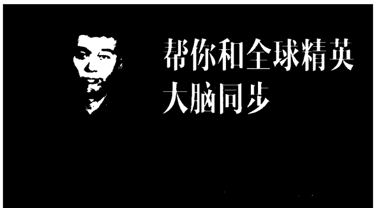

### 答读者问｜怎样才能成为一个有趣的人？

来自日课：为什么电影里的女强人必须有脆弱的一面

关于窗口期的问题，我相信口味、音乐偏好等是有窗口期的，并且过了窗口期后，确实很难改，但不认为学习语言、行为模式方面有窗口期，因为年少的时候见识少，没发现更好的，等长大了，见到更好的东西以后，依然会喜欢、会掌握，成为自己的。不知对否？求指教！

万维钢

关于语言学习是否有一个“窗口期”——也就是说，是不是小时候学语言更快，长大以后再学外语就不好学了，这个问题很有争议。很多人认为存在窗口期，比如一个证据是成年以后学外语，即使学得很好，说话也带口音，不像小孩子那么溜。也有人认为口音是历史原因，比如说文化的烙印，学外语的人受到母语影响，自己也不愿意改，并不是脑子真不行了。

到底如何，我也不知。不过可以肯定的 是，学语言的“窗口期”即使有，从大脑硬件条件来说，肯定不像是一般人想像的那样严重。

关于对食物喜好的窗口期我其实不大相信，我在湖南读的大学，很多同学到了湖南之后，从不敢吃辣到无辣不欢，我还喜欢上一道神奇的菜：茄子豆角，我在上大学之前从来没想过这东西能放在一起吃。所谓的“窗口期”是不是真的靠谱？当时研究西兰花的科学家做过什么对比实验呢？

万维钢

这个问题跟上面那个学语言的窗口期问题原理可能差不了多少。现实是我们观察到*大多数*的饮食习惯形成于童年时代，成年以后改变口味的很少。这个趋势并不是绝对的，肯定有人成年以后就是改变了口味——就如同文中有人改变了政治倾向、改变了音 乐喜好一样。

可我觉得“吃辣”倒不能说明问题。辣是一个强烈的刺激，“初学者”有所反映也是必然的，小孩恐怕更是不能吃。“辣味”和其 他口味似乎不能等而论之？

### 来自日课：好目标＝难度 x 具体

定 立目标时，群体目标和个体目标原则是否相同？都是难度和具体吗？

在工作环境下，目标的难度有没有什么更具体的衡量标准呢？难度是不是就意味着对于实施主体来说影响目标实现的因素的可控程度？影响目标实现的因素的可控程度是不是都与目标主体可支配资源有关？而目标主体的能力因素是否应该受岗位目标限制不应该通过工作目标来定义？换句话说就是制定个人或者团队工作目标时难度设定的起点应该是假设他们的能力都已经符合岗位要求？

万维钢

这个问题熊原始论文里也提到了。 上级和下级经过友好协商，给下级制定一个目标，也可以。 上级直接下达目标，下级自己研究怎么具体执行，也可以。 基本都不影响完成度。原则都是难度和具体。当然，上级对下级的能力得心中有数，不能给一个完全超出能力的难度——而在 现实中，一般领导不太可能犯这样的错误，人 们更可能犯的错误是给了过低的难度。

那 有一个问题想请教万老师：总有人是面对难度而畏惧的，即使定立了一个不太难的目标也不容易坚持下去，定立较高难度可能还会引致放弃。这个怎么破？可能对方不是精英材料，但作为管理者是不是更应该思考的是如何激发他的精英潜力？困惑。

万维钢

管理者把目标具体化的目的就是为了将来要考核。考核通不过，就得有人负责任，否则目标毫无意义。增加考核的频率，中间设定多个deadline，让反馈更加及时，是个好办法。有实验证说，老师如果让学生一学期写三篇论文，最好的办法是设定三个deadline，规定到时候必须交一篇。如果允许学生到期末一起交，学生就完成不好。

对于个人目标而言，我的目标制定一般是大纲，行动，反馈，调整，然后形成真正 的目标，逐步实现。我觉得在整个过程中行动中的反馈决定了我对目标的设定，而不是一开始就具体目标的内容和难度，因为没有行动反馈的目标永远都是理论家，会浪费时间在一些纸上谈兵的事情上。对我来说，行动中确定具体目标和难度才是现实的，当然这里面各有得失。这种情况，万老师您看是我误 还是应该坚持呢？

万维钢

有些工作，特别是 不确定性强的工作，比如说搞科研，就是得随时根据情况调整目标。也许实验结果不符合预期，也许突然想到一个更好的课题主意，那就必须得变。

可问题在于，制定目标的目的就是为了约束。 这个约束可以激励、可以考核、可以鞭策。没有这个约束，有时候自己都不知道到底有没有尽全力。

所以人在多 大程度上需要目标，跟这个人的自主性非常有关系。一个在研究工作上投入了极大热情和心血的科学家，你说给他来个目标考核，那我觉得大荒唐了。可是 在一般的公司里，目标就是一个很 好的管理手段。如果一个人始终都知道自己想要得到什么结果，他就不 需要什么目标管理技术。

身边的人都觉得我是个很有趣的人，请问怎样才能让自己变得有趣呢？

万维钢

我不知道你具体是什么情况，也许你仅仅是比较害羞不太擅长交流。

但一般来说，真正有趣和真正有趣的区别，大概是无趣的人做甚么事情都是有目的的，功利性强，或者都是按照别人给他规定好的套路去做，像个机器人。有趣的人经常做一些没有实用价值、纯粹是为了爱好和好玩的事情，而且做出了 一定的水平，投入了相当多的功夫。

如果你只知道你学习和工作中的事儿，我只知道我的事儿，那咱们要是没什么交集的话坐在一起就没什么可聊的。可 是如果咱们都关心一些跟自己没什么关系的事儿，那就 有话可说。所以“有趣”有社交功能。

可是如果纯粹为了这个社交功能而追求有趣，那就还是功利的目的，还是无趣。只有真的爱好这个东西，浪费了时间在上面，才能真诚地谈论。

所以有趣是对生活诸多有余秕为过剩的表现，也是确是值得骄傲的素质。

### 来自日课：一个大尺度的話题

看到这篇文章想到的是“治大国如烹小鲜”，这个和老师说的“大了，就不一样”的意思还一样吗？

对“治大国若烹小鲜”发表一点看法，老子提倡无为而治，劝告人们不要舍本逐末，自作聪明，其对“道”的看法是我们没发直 接的观察“道”，但“道”又无处不在，强调“道”的不可知性。我在这里就浅显地把“道”理解为不以人的意志为转移的自然规律、物理法则，我等渺小的人类是不可能真正掌握的。治大国和烹小鲜确实有着指数级的差距，治国的道理随着尺度的变化也跟着变化，但有一点没有变，要国泰民安统治者就不能瞎折腾，不要总觉得自己的新想法和新设计也能为民谋利了，毕竟治国之道就同我们常说的市场中那个无形的手一样，只能顺遂不能控制。强行控制造成的后果还少吗？所以我还是觉得老子这件“治大国若烹小鲜”还是有道理的。

老师，虽然我 想要您应该是知道的，但是那句治大国怎么能像烹小鲜还是会感觉很不舒服呢，还是请 说下吧：治大国若烹小鲜，是在提醒当政者，不要朝令夕改。

若烹小鲜，是在提醒当政者，不要朝令夕改，随意扰动百姓，就像烹鱼的时候，不能老翻动，否则鱼会碎。那么治大国，岂不就像烹小鲜吗？这个跟 impression 大了会不同，好像没太大关系呢。

## 万维钢

三位说的都对。其实我也知道“治大国若烹小鲜”不是我说的那个意思，但是写到那里还是忍不住用了这句话。是我的问题。

老师，你曾说过你很会玩Google，我最近也在学习如何高效使用互联网搜索引擎寻找有效信息，不知道您是否能将玩转Google作为一个周末议题，与我们好好分享一下，谢谢老师：）

## 万维钢

我并没有特别值得一提的东西。关键是主动——比如你现在搜索“搜索引擎使用技巧”，就能得到很多结果：）

### 来自日课：时尚动力学

这个问题很主观，根据文章所述，客观来说，普通个人无法左右时尚，影响因素很多，比如技术、消费能力等，我比较感兴趣是经典与时尚的关系是什么？

## 万维钢

有些经典，在它所处的那个时代就是一个流行作品，当时的人喜欢但并不觉得是经典，时间长了以后我们看成了经典，这其实符合时尚定律里说的“特别老的就是好的”。

可能有些经典自身就是厉害，一出世就注定了经久不衰。

但是的确有很多经典是后来一系列偶然原因导致了的。比如说《蒙娜丽莎》，现在公认是最经典的画作，可是当初、甚至一百年前的 人都不这么认为，达芬奇自己也不会认为那是他最好的作品。蒙娜丽莎有名是因为后来被盗又找回等传奇经历。有人甚至说，《蒙娜丽莎》到底好在哪里？也许好就好在它最像《蒙娜丽莎》。

小众的东西那么多，是什么决定了哪个能成为流行呢？

是什么原因造就了这些流行呢？唐朝以胖为美，清朝以脚小为美，现代人的审美观点都是人造美女？什么让社会的审美观念发生变化呢？就是说什么产生了新的流行呢？

## 万维钢

流行有很大的偶然因素，有时候就是人们互相模仿的结果。以审美为例，固然有唐朝开放清朝保守的原因，但具体细节还是有偶然的。

比如现在的人为什么喜欢大胸的美女？有人用进化心理学解释，说大胸有利于哺乳，或者有利于储存脂肪。可是1951年有人考察了不同国家的191个不同文化群体，发现其中只有13个认为女性胸部很重要，而这13个文化中，只有9个喜欢大的，有两个喜欢上翘但不一定大的，还有两个喜欢下垂的。

现代化的社会的主流文化崇尚大胸，可能是商业化广告宣传的结果，大胸更有商业价值。而且说到流行文化，现在模特界似乎又流行微孔了。


### 日课134 | 什么是幽默，什么是酷？

日课134 | 什么是幽默，什…

我们都喜欢有幽默感的人和表现得很酷的人，可是怎么做才算幽默，怎么做才算酷呢？

1960年代，美国有人认为某个电影是淫秽非法作品，要求把它禁映。官司打到最高法院，问题最后变成了到底怎么定义“淫秽”。最高法院一个大法官判那部电影不是淫秽作品，而他给的理由很有意思——他说我也不知道怎么定义淫秽，但“要是我看到了我能看出采”——英文原话是 “I know it when I see it”——这句话现在已经成了成语。

“幽默”和“酷”，似乎也是这样。我们看到了能识别出来，可是很难总结一个一般的定义。

所幸的是，现在有人给出了至少在我看来是比较好的定义，而且这两个定义还可能帮助我们变得更幽默、和更酷一点。

这两个定义，我都是在汤普森的《流行制造者》这本书里看到的，跟本书主题关系不大，但是是非常值得专门说说。

#### 1.什么是幽默

到底什么样的情形，能让人笑呢？

柏拉图曾经有个理论，说“笑”，是我们表达自己的优越感。比如你看到别人跌倒了，你可能会笑起来，这是因为你在那一时刻感到自己比跌倒的那个个人优越。

这种笑，其实就是嘲笑。但嘲笑只是笑的一种，而且我感觉这种笑也讲只在古代是主流，现代社会讲平等，嘲笑很不礼貌。

有人讲话带一点幽默感，我们听了就会笑起来，比如美国总统杰拉尔德·福特有一次接受记者采访，讲了一个双关笑话——

> “我是个福特，不是林肯。”

这个笑话的巧妙之处在于你当他是在说他自己和林肯这两位总统也行，当他是在说平民化的福特汽车和高端品牌林肯汽车也行。我们听到这句话笑起来，肯定不是因为体验到了自己的什么优越感。也许柏拉图时代的大人物没有这么高级的幽默吧。

所以想要定义什么是幽默还真不容易。美国甚至有一个专门的“幽默研究实验室”。2010年，这个实验室的主任，Peter McGraw，和亚利桑那大学市场学助理教授 Caleb Warren，提出了一个“通用的幽默理论”。

这个理论说，所谓幽默，就是“温和的违反（benign violation）”。

可以是违反一个社会习俗，可以是违反身份，也可以是违反逻辑，违反什么都行，但是不能过头，必须是*温和的*违反——看到这样的情形，我们就会笑。

一个人跌倒了，他违反了站立或者走路的正常方式，所以好笑。

福特的双关语，本来大家是在说总统，他*违反话题*突然提到汽车，所以好笑。

用中国话说，就是在一个本来是一本正经的语境之下，突然来点“不正经”——这个对一本正经的违反，就是幽默。

比如牛群、冯巩的经典相声《小偷公鸡》——

冯巩：你是小偷吗？
牛群：您这都是有文化的人，说话这么难听，什么叫“小偷”啊？
冯巩：那应该叫您？
牛群：“捆包的”。

——这里牛群先故意说“有文化的人”，营造一个特别正经的气氛，然后再说“捆包的”，来个不正经的转折，喜剧效果就出來了。

而且这个技术还可以反着用，比如这段——

牛群：真正坚守在第一线工作的就我们俩人……
冯巩：那其他人呢？
牛群：都是领导干部。
冯巩：你们小偷公司还有领导干部？
牛群：你这话说的，火车跑得快，全凭车头带，干部带了头，小偷有劲头，小偷没领导，肯定偷不好，不是偷的少，就是跑不了……
冯巩：对！

这一段是从“小偷”这个“不正经”的语境之中，加入一本正经的内容，也就是“领导干部”，而且还使用了可能是当时流行的一种有节奏的“官腔”风格——用“正经”违反“不正经”，是更高明的幽默。

所以中国曾经拥有过这样的相声！密集的、恰到好处的包袱，而且还敢讽刺现实。

现在说相声的都知道“不正经”能让观众笑，但是这个“温和”的尺度有时候不好把握，违反过头了也不行。比如最近有一次，相声演员郭德纲和影视演员沙溢同台，郭德纲居然一连五次开玩笑说沙溢的儿子是他生的，结果引发网上舆论一致谴责。

怎么不正经，由你决定。什么尺度是温和的，由听众决定。

#### 2.什么是酷

“酷”，是个中文里原本没有的词，直接从英文“cool”音译而来，我第一次听说这个词的时候好像都已经上高中了。

长得帅就是酷吗？装备好就是酷吗？还是武艺高强才酷？酷，为什么中国传统文化里没有这个概念呢？

也许不同文化对“酷”的定义有些许不同。今天吴伯凡老师的专栏文章里，就提到了在美学上，我们对“酷”的一种理解——《“酷”与“美感”有什么关系？》

在美国社会学家看来，人的行为的“酷”的意思，是“积极正面的反叛”——是“对不合理的 mainstream 的一次正当的打破”。

梅长苏：殿下可知，就算查清了来龙去脉，对殿下目前所谋之事也并无丝毫izer？
靖王：我知道。
梅长苏：殿下可知，只要陛下在位一日，便不会自承锒铛，为祁王和林家平反？
靖王：我知道。
梅长苏：既然殿下都知道，还一定要查？
靖王：要查。

这些酷场面的共同特征就是大多数人再这个情况下可能不会这么反应——大多数人会认怂——而我非得按我想的干。

### 非常独立自主，而且还是正当合理的。

前面我们讲“喜欢 = 熟悉 + 意外”，提到“工业设计之父”雷蒙德·洛威的设计原则是“尽可能地前卫，只要能被人接受”，也就是 MAYA（most advanced yet acceptable）。那么这里所谓的“酷”，汤普森说，也可以用 MAYA 概括—— Most Autonomous Yet Appropriate——尽可能地独立自主，只要是适当的。

## 我的评论

“幽默”和“酷”这两种行为，似乎有相通之处。它们都是对当前局面的一次违反。本来都是一本正经，他突然来个不正经。本来千人诺诺，他偏要来个一士谤谤。

这都是积极主动的表现。有幽默感的人和酷的人，首先都是特别自信的人，他敢于改变当前的局面，让形势受自己的影响。幽默，是 一切尽在我的掌握，我稍微不正经一下也没关系。酷，是我不愿意被你们掌握，你们错了我 要反抗一下。4人笔记

有实力，还任性。

但是这两种行为，如果把握得好，通常又不是短缺时代那种苦大仇深你死我活的斗争，都比较温和。幽默，但不会给人一种谁比谁优越的感觉，更多的是会心一笑而不是嘲笑。酷，但又不是歇斯底里地拼命，更多是一种姿态。

现代社会里我们感受到的酷的行为，通常都是对不合理的主流意见的违反，不是对抗整个社会，不是造反。这种温和的对抗，就如同青少年反抗父母，过去短缺时代似乎是没有的。这大概就是为什么“酷”在传统文化里没有，是近代年轻人发明的情绪。

是对社会习俗的“违反”，但又不是对原则的“违背”。是“逆反”，但又不是“悖逆”。

以我之见，这两种行为之所以特别值得赞赏，是因为它们都是*建设性的*创新。

几个人讨论一个什么严肃的问题，也许还涉及到各方利益分配，这种时候很容易当局者迷。如果有人在这个时候开个玩笑，像福特总统那样发现一个遥远的连接，等于是加入一点发散思维，提醒人们世界很大我们还有别的想法可以探索，而且事情也没那么严重。

众人明知主流意见不对，都选择了顺从，有人首先出来把局面扭转一下，不论成与不成，都是好的努力。

## 由此得到

- 1. 幽默，是“温和的违反”；酷，是“正面的反抗”。
- 2. 这两种行为都要把握“度”，是艺术，过犹不及。最好的创新就是在比较熟悉的局面 上稍微违反一点。
- 3. 一个积极主动的人要敢于掌控局面，开个玩笑，些许反抗，提供一点建设性的创新。不正经能调节正经，反抗能纠正错误。

你做过什么幽默或者酷的事儿吗？欢迎在留言区吹一把。


### 日课135 | 中产家长焦虑症

日课135 | 中产家长焦虑症

如果你一个同事家的小孩就读于美国名校，你一个亲戚家的小孩从小就是一口流利的英语，你大学同学家的小孩钢琴水平达到了专业级，你都邻家的小孩数学竞赛得了奖，你还能气定神闲地放任你家小孩打电子游戏吗？

我能。 koj而且我建议你也这么做。

今天要说的是《经济学人》旗下的《1843》杂志这个月的一篇新文章，“高压力教育”（High-pressure parenting），作者是《经济学人》的高级编辑瑞恩·埃文特（Ryan Avent）。

埃文特是美国人，1990年代高中毕业，上了一所州立大学，现在在《经济学人》伦敦总部工作，有一个六岁的女儿和一个三岁的儿子。工作和家庭都不错，但是他时不时会感到一点焦虑。

这个焦虑就是要不要使用虎妈式的培养方式，对两个孩子严格训练，让他们将来能去私立名校上大学。

埃文特自己考大学的1990年代，美国常春藤名校还是比较容易去的，只要你申请，录取率高达四分之一。当时上大学的人也少，美国25到29岁的年轻人有大学学位的也只占四分之一。人们并不认为大学非上不可，常春藤有多么不起。埃文特成绩不错，他父母都很重视教育，但即使如此还是选择了家乡的一所公立大学。一部分原因是常春藤的学费太贵，但主要的原因是埃文特当时缺少“一定要上常春藤”这个意识。

结果他一到大学就有点后悔了。他跟去了常春藤的高中同学通信，就感到自己的进步速度比别人慢。他甚至觉得自己错过了常春藤这个快速上升通道，搞不好这辈子只能做个默默无闻的平庸者了。

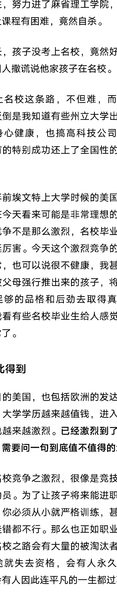

好。现在问题是，你打算让你的孩子，也这么爬吗？

而且现在的竞争局面跟20年前非常不一样。上过大学和没上过大学，收入差距越来越大。上了名校和没上名校，机会差距越来越大。学生和家长迅速做出了反应，所以现在常春藤的录取率从20年前的四分之一变成了个位数的百分点。

## ｜我的评论

埃文特说到最后有点情怀和鸡汤了，没给什么具体的科研结果支持，但我认为他说的很有道理。我以前写过一些有关教育的文章，收在《智识分子》这本书里，其中提到有些研究，就支持埃文特的说法。从小高强度竞争未必好，名校未必有用，这不是哪个学者突发奇想的说法，这是学界的共识。

## ｜由此得到

在今日的美国，也包括欧洲的发达国家和中国，大学学习越来越值钱，进入名校的竞争也越来越激烈。已经激烈到了有点不正常、需要问一句到底值不值得的地步。

伤，会有人因此连平凡的一生都过不好。

## 我建议的策略是——

- 1. 如果你家小孩有天赋有热情，本身就想上名校，愿意完成竞技体育级别的训练，那你就好好培养；
- 2. 如果你家小孩的天赋和热情在别的地方，那就别忘了还有很多别的路可以出人头地；
- 3. 不管走哪条路，让孩子和家长付出太多牺牲，甚至牺牲到扭曲人格的程度，都是不值得的。

还有一点，我坚决不信，将来的世界会被一帮从小就知道听话学习的“好孩子”主导——所以你要真对孩子有巨大期望，那就别往那个方向训练。

万维钢

如果这篇文章对你有启发，可以点击右下角的“请朋友读”，把它转发分享给你焦虑的家长朋友吧。

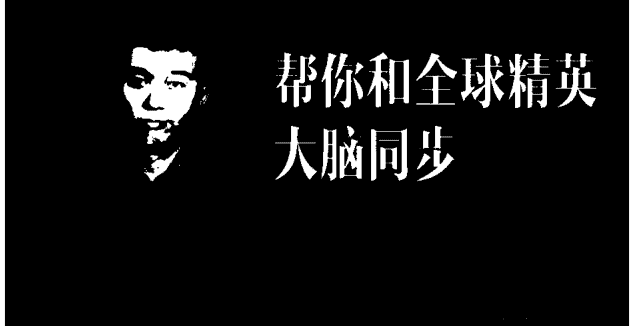

### 日课136 | 《倹省》解读1：追逐者的绝境

日课136 | 《倹省》解读1:...

今天咱们说一本二月份刚刚出版的新书，《倹省：释放“少”的潜能，取得“多”的成就》（Stretch: Unlock the Power of Less -and Achieve More Than You Ever Imagined），作者是莱斯大学管理学教授斯科特·索南史恩 Scott Sonenshein。

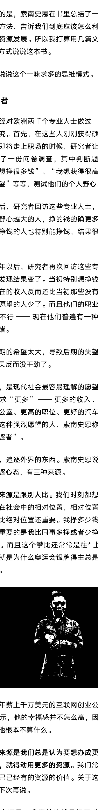

现代社会有一个大家默认，但是一般不会明确说出来的主流价值观，那就是要追求更多——一个人要更多的财富，公司想要更多的资源，多就代表成功。这个价值观一旦说出来，我们就觉得不太合理，所以现在对它有一些批评的意见。在此之前，主流的意见，我看大慨有两派。

一派是传统的消极避世思想。有的说人类一味追求发展，地球环境根本承受不了，所以我们应该节制发展，追求人与自然的和谐。还有的说那些追逐财富的个人都已经迷失了自我，还不如回归家庭，应该多谈“爱”，少谈“钱”。甚至有极端的观点认为，人类工业文明就是地球的癌症，再不停止发展就会导致巨大的灾难，等等等等。

还有一派是近几年才开始流行的一种“极简主义”生活方式。这一派要求我们把所有不常用的东西都扔了，排除一切干扰，聚精会神修身养性，这样才能获得幸福的生活。

这两派思想我都不以为然。现代社会组织的整个前提就是要发展，发展已经是现代人的本能追求，你想停止发展可能吗？发展中出现的问题，只能用发展解决。极端环保主义者、宗教人士，鼓吹不发展，其实是一种撒娇式的情愫。而所谓“极简主义”，最多只能算是作为一个小众的生活态度，这个态度甚至有点违反人性，非常做作——当你处处想着怎么“极简”的时候，你已经把太多精力浪费在了这件小事上。5人笔记

所以尽管有很多人呼吁限制发展，有很多书鼓吹极简生活，我从来没见哪一个国家真的限制发展，也没遇到过哪个个人真的在过极简的生活。

过度追求“多”，好像是不对的。可到底哪里不对呢？到底怎么做才是对的呢？

#### 1.简单道理

其实答案并不复杂，但还是非得动用一个商学院教授才能把它说明白。这就是索南史恩这本《倹省》要做的事情。

Stretch 这个词对应的中文意思，除了“倹省”之外，还有“拉伸”。我觉得对这个词最形象的解释就是你要做一件衣服，可是感觉手里的布不太够用，要买新布吧可能有点浪费，结果把手里的布拉一拉伸一拽，正好够用。

极端环保派和极简主义者各自说对了一半。一味求多，的确是不可持续的——但是这个不可持续只是你自己的不可持续，一旦不持续最多就是你自己的公司倒闭，对大环境不会有什么大危害，市场机制很善于惩罚不可持续的东西。少拥有一些东西，也的确能让东西发挥最大的效用——但是“少”不是目的，幸福生活也不能一味求“少”，发展才是目的。

索南史恩的观点，就是——避免陷入一味求多的思维模式，尽可能利用手里现有的资源发展。道理就这么简单。

那既然是发条微博都能说清楚的道理，为什么还非得让一个商学院教授写本书呢？一个原因可能是商学院教授擅长“案例”——这本书里有非常多的案例可以当故事听。

更重要的是，索南史恩在书里总结了一些实用的方法，告诉我们到底应该怎么利用现有的资源发展。所以我打算用几篇文章连载的方式说说这本书。

今天先说说这个一味求多的思维模式。

#### 2.追逐者

有人曾经对欧洲两千个专业人士做过一次跟踪研究。首先，在这些人刚刚获得硕士学位、即将走上职场的时候，研究者让他们填写了一份问卷调查，其中判断题包括“我想挣很多钱”、“我想获得很高的职业声望”等等，测试他们的个人野心。

三年以后，研究者回访这些专业人士，发现当初野心越大的人，挣的钱的确更多。特别想挣钱的人也特别能挣钱，结果很不错。

但是七年以后，研究者再次回访这些专业人士，发现结果变了。当初特别想挣钱的人，现在的收入反而还比当初那些没有强烈挣钱愿望的人少了。而且他们的职业满意度也不行——现在他们普遍有一种失望的情绪。

可能早期的希望太大，导致后期的失望也大，结果反而没干劲了。

想挣钱，是现代社会最容易理解的愿望，人们追求“更多”——更多的收入、更大的办公室、更高的职位、更好的汽车等等，有这种强烈愿望的人，索南史恩称之为“追逐者”。

追逐者，追逐外界的东西。索南史恩说，这个追逐心态，有三种来源。

### 第一个来源是跟别人比。我们时刻都想知道自己在社会中的相对位置，相对位置很多时候比绝对位置还要重要。我挣多少钱不重要，重要的是我比同事多挣或者少挣了多少钱。而且这个攀比还是常常在*上*比，这就是为什么奥运会银牌得主总是很不高兴。


所以有年薪上千万美元的互联网创业公司CEO表示，他的幸福感并不怎么高，因为在硅谷他根本不算什么。

### 第二个来源是我们总是认为要想办成更多的事，就得动用更多的资源。我们常常忽略自己已经拥有的资源的价值。关于这一点咱们下次再说。

### 第三个来源是，我们单纯就是想要“更多”。实验室里让受试者听音乐，你可以好好享受音乐，也可以打断音乐，听一段噪音——每听若干次噪音，你就可以赢取一块巧克力。研究者事先声明，所有巧克力必须在游戏结束后当场吃掉，不能带走——结果还是每个受试者都赢取了远超过自己胃口的巧克力。

想要更多，这大概是短缺时代的一个思维烙印。那么企业家在做公司决策的时候，是不是能更理性一点呢？

#### 3.买买买

今年的一个大新闻是纵横互联网二十多年的雅虎公司，分拆了。女CEO梅耶尔成了众矢之的，而人们对她的一个重大指责，就是花钱太大手大脚。咱们摘录一段《华尔街日报》的报道——

> ……2015年前三季度雅虎运营费用比2014年同期大涨20%，原因在于梅耶尔与Mozilla、甲骨文签署了昂贵的协议，但结果却没有为雅虎搜索引擎带来预期的流量，导致公司营收不但没有上升反而下降4%。另外，梅耶尔本人也承认自己在2013年初豪掷10亿美元买下轻博客平台Tumblr是一个失败决定。……梅耶尔三年前抛出去的10亿美元如今已经缩水四分之一。

“买买买”是梅耶尔经营公司的一贯风格

“买买买”是梅耶尔经营公司的一贯风格，她担任雅虎CEO以来收购的大小公司简直不计其数。

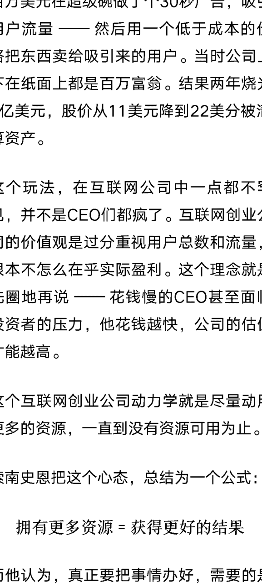

这可不是梅耶尔的女性购物欲起了什么作用，这是互联网公司的一个共同心态的作用——烧钱。

索南史恩在书里说，早在梅耶尔去雅虎之前，她在Google的办公室的门上，就贴了一句话：“收入能解决所有问题”。鉴于很多互联网公司的实际收入比花费少很多，这句话的真实意思其实是“钱能解决所有问题”。

索南史恩给的一个案例是 Pets.com。运营第一年，这个公司花费了1200万美元做广告，而这些广告带来的销售收入只有62万美元。运营第二年，公司花费超过一百万美元在超级碗做了个30秒广告，吸引用户流量——然后用一个低于成本的价格把东西卖给吸引来的用户。当时公司上下在纸面上都是百万富翁。结果两年烧光3亿美，股价从11美元降到22美分被清算资产。

这个玩法，在互联网公司中一点都不罕见，并不是CEO们都疯了。互联网创业公司的价值观是过分重视用户总数和流量，根本不怎么在乎实际盈利。这个理念就是先圈地再说——花钱慢的CEO甚至面临投资者的压力，他花钱越快，公司的估值才能越高。

这个互联网创业公司动力学就是尽量动用更多的资源，一直到底没有资源可用为止。

索南史恩把这个心态，总结为一个公式：

拥有更多资源 = 获得更好的结果

而他认为，真正要把事情办好，需要的是另一个公式：

更好地利用资源 = 获得更好的结果

咱们下次再说。

## 我的评论

我读这段书的时候，有一种“宿命感”。其实每个人都知道这个拼命追求更多资源的做法是不可持续的，但是为什么还是有这么多追逐者呢？

因为这是一个正反馈游戏。在短期内，你追逐的越多，拥有的就越多，然后你获得的评价就越高，你向上攀比的对象也越高，你越想追逐更多的东西。正反馈的游戏一旦陷进去，想要主动停手那就太难了。

但是这个游戏是不可持续的，最后要么把能从外界获取的资源耗光，要么把自己的精力和希望耗光。

还有一个问题。咱们日课之前解读蒂姆·哈福德的《混乱》一书的时候曾经说过，亚马逊早期的扩张策略就是不顾一切先把位置占上再说，也是近乎疯狂地扩张，怎么贝佐斯就成功了呢？事实上，早期烧钱的互联网公司，最后活下来的也有啊？索南史恩写书，只给了支持他的论点的正面案例，没有给这个反面案例。

对此我们大概可以说两句话——

第一，贝佐斯是看到机会了才上，为了抓住机会而不得不冒险。他并不是为了烧钱而烧钱，不是盲目地扩张。

第二，即便如此，贝佐斯的策略也是充满风险的。也许当初有十个亚马逊，只有一个活了下来。

## 由此得到

一旦发现到自己是处在一个正反馈游戏之中，就要意识到，这样的游戏都是不可持续的，就应该想想未来怎么软着陆。疯狂扩张的公司往往会被自己压垮，作为追逐者的个人可能会后劲不足。

那面对一个具体的局面，到底是应该悠着点，还是全力以赴争取呢？我大概有两个判断标准：

- 1. 游戏是不是可持续的；
- 2. 你的追逐到底是真正实力的需要，还是为了满足自己的心理需求。


### 日课137 | 哪有那么容易颠覆

以前乔布斯活着的时候，有时候我们也爱讽刺他几句。比如乔布斯一开什么新产品发布会，特别爱说一句话 —— “这个改变了一切”，有时候还加一个 “again” —— “这个，再次改变了一切”！

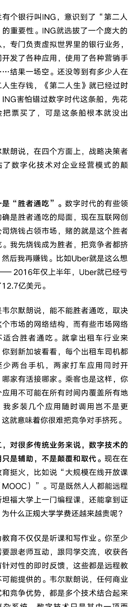

行。我们知道你生下来就是为了改变世界的，你每发布一个新产品就改变一次世界，你每一次创新都是颠覆式的创新……这世界变化快，都是我们不明白，我们特别害怕过了一夜就被世界遗忘……

可是为什么，我病了还得亲自去医院，见个客户还得跟真人吃饭，我家门口的小卖部还继续存在呢？事实上，除了多了一个手机之外，我们的主要生活方式跟十五年前并没有太大变化。

“数字革命”、“颠覆式创新”、“未来之路”，这些名词整天充斥着我们的耳朵，我们感觉简直马上就要天翻地覆，其实没有那么快。如果把企业战略真的建立在这个“数字化正在高速改变世界”的心境上，搞不好还会犯错误。

今天咱们说《哈佛商业评论》上个月的一篇文章，“战略家搞错了的数字颠覆”（What So Many Strategists Get Wrong About Digital Disruption），作者是伦敦商学院企业战略副教授韦尔默朗（Freek Vermeulen）

## 我的评论

用严肃的态度看新闻，有时候就跟那些号称“价值投资”的炒股的人差不了多——如果你真是在搞什么“价值投资”，就不要一惊一乍地聆听短期的股价波动。我看有人做过实验，对业余股民来说，那些不经常查看股价的人，炒股成绩反而更好。

## 由此得到

- 1. 数字技术对商业的影响并没有那么大那么快。也许有些东西是不能被数字技术取代的。
- 2. 听说热点消息的时候，自己心里要“冷”一点，现在有太多东西都是 hype。反应太快也不好，有时候慢一点，等一等，才能抓住本质的变化。太慢了固然是麻木不仁，可是听风就是雨也不对——总而言之，一切都是“度”。


### 日课138 | 《俭省》解读2： “有差别的人类劳动”

先来看两句名人名言——

> "价值是凝结在商品中的无差别的人类劳动。" ——马克思
> 
> "人生的价值，并不是用时间，而是用深度去衡量的。" ——托尔斯泰

如果你仔细想想，这两句名言说的道理，其实是矛盾的。

想象你是一个开服装店的老板。你在全国各地开了若干家分店，每家店面的规模都不算大，生意也一般。你这个人比较放权——其实也是公司没有那么大的控制力量——你给了各个分店很大的自主权。时间长了，分店经理都在心理上把店当成了自己的。

总店进了一批正装连衣裙，发到各个分店销售。很快销售结果反馈回来，说这个裙子的质量一般，看上去特别廉价，没达到你们商店的档次要求，根本卖不出去。

你正在抱怨总店采购经理的进货决定，就听说有一家分店把这个裙子全卖光了。那家店的经理自作主张，拿起剪刀把裙子改了，当沙滩裙往外卖，结果大受欢迎！

正装裙子，本来不是沙滩裙。分店经理，本来没有设计和改装服装的职责。这件事儿本来不应该发生，它怎么就发生了呢？

这个故事是真实的，来自斯科特·索南史恩的《俭省：释放“少”的潜能，取得“多”的成就》（Stretch: Unlock the Power of Less -and Achieve More Than You Ever Imagined），今天咱们继续说这本书。

#### 1.价值和价值

索南史恩说，我们一般的思维模式，是想要获得更好的结果，就动用更多的资源。说白了就是花多少钱，办多少事。你想获得更多的销售额，你就进更多的商品。你想让员工多出活儿，你就多招几个员工。

这个思想的问题在于，我们只注意到了资源的“面值”。

一件衣服采购进来，店员把衣服贴好标签，按尺寸排列上架，准备好包装，再做一些广告宣传，这就是常规的卖法。进货多少钱、店员的劳动多少钱，这些就是资源的面值。

按咱们中国人从小学到的政治经济学，你赚取的差价来自店员的劳动，也就是“凝结在商品中的无差别的人类劳动”。

“无差别”这个词，在马克思那个时代特别科学。按理说不同水平工人的劳动肯定是有差别的，但马克思这里的意思是你可以换算——高水平工人，比如说经理的劳动效果肯定比普通工人高，可是他为了达到这个水平，之前付出的学习劳动成本也高，你把这个成本计算进去就得给他更高的工资，那归根结底一切都能换算成“社会平均劳动时间”——高和低没有本质差别。

可是咱们前面说的那个分店经理，他未必上过什么别的经理没上过的服装学校，未必比别人多花了“劳动时间”，未必比别人多忍受了劳动的痛苦，可能也未必拿了工资，他怎么就能够个点石成金，让卖不出去的衣服获得了价值呢？这个价值，应该怎么算呢？

包括索南史恩在内，现在有些研究者，就很关心这个凭空多出来的价值。

他们认为，资源的“内在价值”是一回事，而人怎么利用这个资源，是另一回事——如果人能够善加利用，就可以给任何资源创造新的价值。

那么以我之见，既然这种创造新价值的活动是事先没设想、没有固定套路、本质上不可预测的，所以不能算“无差别”的人类劳动。

马克思生活在工业革命早期。那是一个大机器、大工厂时代，普通工人无非是吃苦干活，谈不上什么创造性，劳动都是“无差别”的。可是今天这个时代早就变了，按固定套路干活、无差别劳动的工作，早晚都应该被机器人取代。

现代人，应该尽量干那种“有差别”的劳动——也就是要创造。那怎么创造呢？

#### 2.俭省者思维

其实我们每个人都干过给资源增加创造性的新价值的事儿。比如家里要钉个钉子，可是一时之间没有锤子，你一想也用不上街买锤子了，随便找块砖头把钉子钉上了——那你就给这块砖头找到了新的价值。

超市里卖的水果其实都是精挑细选出来的，有很多卖相不好的水果在上架之前就被淘汰了。尤其是现代社会，什么农产品一旦快要过期马上就得扔——美国甚至还发生过有人去超市的垃圾桶里捡过期食品，还被警察当盗窃犯抓起来了——总之是浪费非常严重。那如果你有什么办法能把那些被淘汰的水果变成能长期保存的果酱，变废为宝，你也创造了新的价值。

经常使用这种思路做事的人，生活风格有可能比较俭省。

美国有很多浪费的人，但也有不少像老一辈中国人一样俭省的人。比如索南史恩在书里介绍了一个公司，从CEO到普通员工出差一律住最差的旅馆，不给报销餐费，而且自己开车八小时能到的地方一律不许坐飞机——但是员工还都很满意，因为公司把省下来的钱都用于扩大规模、员工培训和直接加工资了。

索南史恩并不是号召所有公司都这么俭省。俭省不等于吝啬，俭省是一种思维模式。索南史恩说，俭省思维有三个好处——

第一，俭省者关注长远目标。

第二，俭省者的攀比心理比较弱，不会陷入追逐者绝境。

第三，最重要的是，俭省者总是尽可能利用现有的资源。

几年前流行过一本书，叫《稀缺》，英文就是Scarcity，不过那本书说得不是经济学上的稀缺，而是人心理上的稀缺，严格地说应叫“短缺思维”。那本书说，短缺思维会把我们的脑袋封闭起来，有机会也看不到，所以穷人会更穷。这个思想我非常赞同，但《稀缺》里说的这个思维模式，是被迫的，而且是人已经面临生活绝境了，一种非常难受的状态。

我看现在索南史恩这本《俭省》，跟《稀缺》不太一样，这里更多的是主动的俭省——不是买不起，是我不想买。

这种俭省，能激发人的创造性。

#### 3.受限制条件下的创造

提起创新，我们一般比较强调自由，总想打破一个什么规则或者禁忌去创新。但有很多情况下，人为设定一些限制，没有那么多自由，反而有利于激发创新。索南史恩举了好几个例子。

有人做实验让小老鼠拨打一个杠杆。有的小老鼠可以随便怎么拨打，有的小老鼠被限制为只能用右爪拨打——结果一段时间后，受限制组的小老鼠学会了各种不同的拨打方法，而自由组老鼠学会的方法反而更少。

有人做实验让学生探索通常用来做防护包装的那种带小气泡的塑料布都能干什么。学生们探索之前，实验人员先把他们随机分成两组。第一组被要求写篇文章，设想自己在一个短缺的环境中长大，第二组则写文章设想自己在一个富足的环境长大——当然这篇文章的作用是给学生一种心理暗示。结果发现短缺组的学生找到了更多的使用气泡塑料布的方法。

还有很多研究发现，给一个预算限制，再让人设计一件产品，比没有预算限制情况下结果反而更好。

这其中的原理就在于在限制条件下，你不得不对现有资源开发新的用法——这个新用法往往有一个很好的创造性。反过来说如果要什么有什么，你可以用新资源来实现新功能，那就根本没必要研究什么新用法，也就没有创造性了。

事实上，艺术家都是自己给自己设定限制。索南史恩引用一个艺术评论家的话说莫奈 —— 莫奈本来就是个很好的画家，但是真正让他出类拔萃的，是他主动放弃了传统绘画中写实的明暗对比，给自己加这么一个技术限制，结果成了印象派创始人之一。

索南史恩说的俭省，就是这么一种思维模式 —— 主动给自己设定一些限制，专注于给已有的资源开发新用途，而避免陷入一味求多的追逐者绝境。

## 我的评论

我初读此书，印象最深的是这个俭省的做法，感觉有点小气，担心这个思想不符合中国经济快速增长的国情。现在感觉，这本书说的其实不是节省和小气，也不是什么变废为宝，而是一个什么东西到你手里，你能不能给它增加一点创造性的附加值。

就比如说咱们现在这个“得到”专栏。一般做专栏，都是提供一个平台，找作者来写，在作者和读者之间提供一个基本的支持，那么平台所提供的是“无差别的人类劳动。平台很容易做，可以任意放大，作者多多益善。

而“得到”专栏，罗胖从一开始就强调这不是一个平台，得到团队在作者和读者之间又增加了大量的服务，给作者提各种要求，每个“产品”都磨合很长时间 —— 这就是“有差别的”人类劳动，所以产生了创造性的的附加值。

无差别和有差别，根本区别不在于劳动强度大小，而在于你有没有创造性。如果“得到”的套路固定下来了，以至于别的公司也可以轻易复制，那这个劳动的附加值就降低了。

其实我们做任何工作，都是这样。

## 由此得到

- 1. 最有价值的人类劳动是“有差别的”劳动，是你能不能给手里的资源增加一个创造性的附加值。
- 2. 获得创造性的一个好办法，是人为设定一个限制，逼着自己在一个框架之内寻找发挥。


### 周末小议 | 薛定谔的猫

今天周末，咱们说一个“经常听说但是又不怎么了解”的东西，薛定谔的猫。这个概念跟日常生活没什么关系，但我建议你用欣赏什么传统文化艺术的精神了解一下，纯粹是为了陶冶情操。

咱们日课之前有篇文章叫《量子力学的“人性”》，讲了温伯格总结的一个现在物理学家对量子力学世界观的理解，比较难懂，今天要说的比上次简单。我们先回顾一下上次说过的一个关键内容。

你只需要知道一个事实：微观世界里的东西，在被观测之前，可以没有一个固定的状态，是几种状态的叠加态 —— 也就是“既……，又……” 。

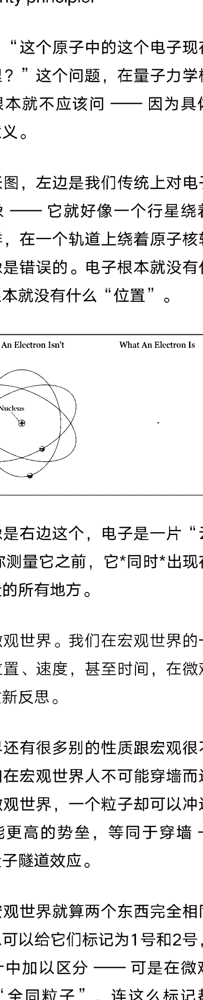


如此上图，对水波来说，之所以会有明暗相间的干涉条纹出现，是因为两个波叠加，有时候加强了，有时候抵消了。—— 你需要“两个”波，才行。

好了，现在物理学家有办法，每次只发射一个光子到屏幕上，发射很多很多次以后，看屏幕后面是什么样的条纹。—— 结果还是干涉条纹！

这就不对了。我们发射的是一个不可分割的光子，它跟谁干涉产生的条纹呢？答案只能是它自己跟自己干涉 —— 它同时通过了两个缝！


没错。是测不准。但这个道理在宏观世界也成立。比如你问一个人，“你爱我吗？”—— 你这个测量动作本身就可能改变ta，也许ta之前并不爱你，你这一问，ta以为你爱ta，结果ta当场爱上你了。


正确图像是右边这个，电子是一片“云”—— 在你测量它之前，它同时出现在原子核附近的所有地方。

所以玻尔说，“谁如果不为量子力学感到困惑，谁就是根本没理解量子力学。” 现在你至少对量子力学感到困惑了。


然后薛定谔就提出一个思想实验。在一个封闭的大箱子里面，放一只猫。箱子里面有个放射性装置，里面的放射性物质在一小时之内，可能衰变，也可能不衰变。如果衰变，那它就会触发一个装置，装置打破硒瓶子，瓶子里面有杀猫毒气。

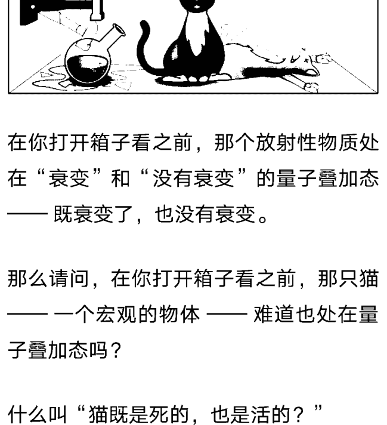

在你打开箱子看之前，那个放射性物质处于“衰变”和“没有衰变”的量子叠加态——既衰变了，也没有衰变。

那么请问，在你打开箱子看之前，那只猫——一个宏观的物体——难道也处在量子叠加态吗？

什么叫“猫既是死的，也是活的？”

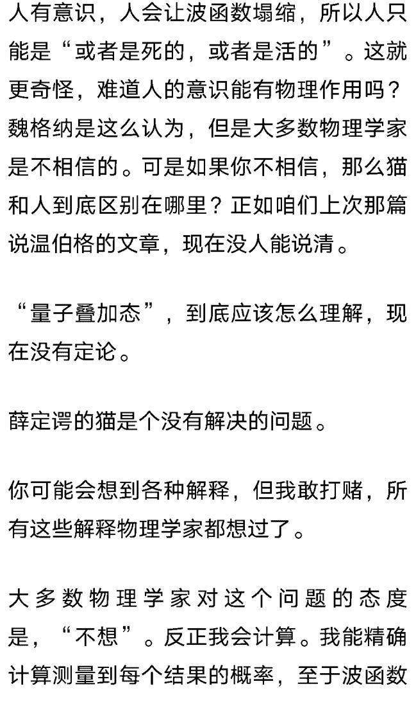

这个思想实验把微观的量子不确定性和宏观世界直接联系在了一起。这你就没有办法回避对量子世界的理解，可是你怎么面对这个问题呢？所以霍金有句名言——“当我听说薛定谔的猫，我就去拿我的枪。”

有人说霍金这句话的意思是他想拿枪把猫打死，我觉得更可能是霍金想拿枪把提问的人打死，甚至把自己打死。薛定谔的猫，让物理学家感到无法面对这个世界。

有人马上会问，如果把猫换成人，那会怎样？答案是那就没有量子叠加态了，因为人有意识，人会让波函数塌缩，所以人只能是“或者是死的，或者是活的”。这就更奇怪，难道人的意识能有物理作用吗？魏格纳是这么认为，但是大多数物理学家是不相信的。可是如果你不相信，那么猫和人到底区别在哪里？正如咱们上次那篇说温伯格的文章，现在没人能说清。

“量子叠加态”，到底应该怎么理解，现在没有定论。

薛定谔的猫是个没有解决的问题。

你可能会想到各种解释，但我敢打赌，所有这些解释物理学家都想过了。

大多数物理学家对这个问题的态度是，“不想”。反正我会计算。我能精确计算测量到每个结果的概率，至于波函数塌缩之前到底发生什么，我不理解，你也不必问。也许“波函数”这个概念都应该改写，但目前为止，这是一个非常精确的有效理论。

其实生活中很多事情都是这样：会用，但是不知道是怎么回事。我们今天在这个世界上生活得不错，可是这个世界到底怎么回事，我们还是不知道。

不过有一点，我们知道——这个世界非常，非常有意思。


### 答读者问｜美式脱口秀 VS中国相声

#### 来自日课：什么是幽默，什么是酷

关于前面说到的相声里抠包袱，看美国脱口秀节目，有时感觉他们的笑点和我们不一样，还有搞笑方式也不太一样，期望万老师如果有时是否可以谈一谈？

## 万维钢

我并没有什么理论知识，说点个人感受——美式脱口秀在笑点密集度、内容新鲜度和广度、笑话形式的灵活度方面，完胜中国相声。

一个脱口秀节目可以做到每句话都是一个笑点，而且语速很快，达到观众都笑不过来的程度。内容紧扣当前热点，甚至就是当天刚刚发生的新闻晚上节目里就用上了，而且禁忌少，什么都能谈。笑话的形式从高端到低端都有，各种小技术。

#### 来自日课：追逐者的绝境

怎么区别真实需求？和心理需求？体验自我和叙事自我的界定？

#### 来自日课：哪有那么容易颠覆

#### 来自日课：“有差别的”人类劳动


### 日课139 | 《俭省》解读3：从 “刻意练习” 到 “功夫在诗外”

今天咱们继续说斯科特·索南史恩（Scott Sonenshein）的《俭省》（Stretch: Unlock the Power of Less - and Achieve More Than You Ever Imagined）。

俭省思维模式的关键，是从已有的资源中发掘出创造性的价值。我们从另一个角度再说说这个创造性。

一个最普通 CREATE 方法，就是“想法的连接”。上次说“发散思维”，咱们说最好能把一个遥远的想法跟你手里的东西连接在一起，提供一个新思路。索南史恩在这本书里列举了大量案例和研究结果，我看完感觉，想法的连接式的创新模式比我们想象的还要重要得多。

可能遥远的想法比你手里的东西还有用。
可能外行比专家还厉害。可能这是一个多面手当道的时代。

#### 1.外行的洞见

丹尼尔·卡尼曼的《思考，快与慢》那本书咱们已经说过多次我都不好意思再说了。现在有很多声说，卡尼曼这本书里提到的有些实验，是不可重复的。可能现在你看那本书的感觉——让我们大胆夸张一下——就如同读过《三国志》以后回头再读《三国演义》——原来“真实”情况没有那么有意思啊！

但我想说的是，《三国演义》可比《三国志》有用多了。

看《三国志》的人可以获得学术声望，看《三国演义》的人却能解决大问题。

索南史恩讲了这么一个案例。视频网站Netflix曾经搞过一个竞赛，悬赏100万美元，给第一个能把它的电影推荐引擎的准确度提高10%的团队。

两万多个队伍参赛。最后排名第十七的这个队伍，只有父女两人，女儿只提供数学支持，父亲也没有太多专业背景。这个人叫加文·波特（Gavin Potter），他是卡尼曼的粉丝。

当年在大学的时候，波特听过卡尼曼的一个思想。卡尼曼说如果在一个做预测或者判断一个数值的时候，给他事先看一个比较大或者比较小的数字，那么他的判断也会是一个比较大或者比较小的数字。这个人明知道给他看的数字跟他要判断的项目没有任何关系，还是会受到那个数字的影响。

这个现象，在心理学上叫“锚定效应”。我可以补充一点，有人做实验，让受试者先写下自己的生日，然后判断一瓶红酒的价格——结果生日数字比较大的人，给红酒的估价也比较高。这个实验是意料之外但又是情理之中——可惜后来有人发现，实验结果无法重现。

所以波特先生听说的那个心理学结论未必靠谱。但是波特先生有一个洞见。

波特设想，如果一个人连续在Netflix上看两部电影，如果第一部电影他很不喜欢，那么这种心情就可能会影响他，让他给第二部电影一个过低的评分。反过来，如果他非常喜欢第一部电影，那就可以给第二部电影一个过高的评分。在那一刻，他自己并不是他真实的自己！那么当你使用他的评分数据的时候，就应该考虑到这一点，调整他给第二个电影的打分。

凭这一点，波特最后把推荐引擎的准确度提高了9.06%。

卡尼曼说的不一定对，可是波特说对了。波特在之前Netflix搞的一次交流会上，把这个思想分享给了其他的队伍，最后获得第一的队伍实际上也使用了这个思想。

这件事非常有意思。波特是个外行，他真正的优势既不是编程技术，也不是自己以前的专业，而居然是他早年从卡尼曼那里学来的一个不靠谱的心理学知识。

这就叫神来之笔——非常遥远的两个东西，通过一个非常规的渠道，连接在一起，把问题解决了。

事实上，外行解决问题是一个非常普遍的现象。有个众包网站叫InnoCentive，我建议咱们读者之中如果有某个领域的高手的话，不妨去注册一个账号。InnoCentive是一个平台，哪个公司有什么解决不了的技术问题，可以在这个网站上悬赏，谁第一个解决了就给谁奖金，有时候高达几万美元。

有人拿InnoCentive的数据做了一个研究，结果发现“外行”解决的问题，比“内行”解决的问题多——生物学家解决的化学问题，比化学家解决的化学问题多。

为什么会这样？一方面，本专业专家能解决的问题肯定早就解决了，也不至于悬赏。另一方面，复杂问题的确需要用到多个专业的知识，比如有个研究水泥、从来没研究过石油的化学家，就在InnoCentive上解决了一个海洋石油污染的问题。

那么技能和眼界单一的专家们，就得有点紧迫感了。

#### 2.什么时候 “练习” 最有用

成为专家的办法，是“刻意练习”。本来刻意练习强调的是练习的方法，可是格拉德威尔一本畅销书《异类》的影响力实在太大了，现在人们都认为练习的关键是时间长短——你要练习一万个小时，才能成为专家。

可是练习时间长短，和实际工作表现之间，到底有多大联系呢？索南史恩列举了一些综合性的研究，也就是所谓“荟萃分析（meta analysis）”，把几十个研究放在一起分析结论。结论有两个。

第一，有严格固定规则的领域，练习的作用最大；没有严格规则的领域，练习的作用非常有限。

比如国际象棋就有非常严格的规则，在国际象棋的领域内，一个人的总练习时间能够解释他26%的表现。在音乐领域，练习时间长短能解释21%的表现；在体育中，练习时间能解释18%的表现。剩下的可能是天赋和临场发挥水平之类，也许还包含偶然因素。

而教育、编程、航空飞行这些更常见的职业，往往不像体育比赛那样有什么固定规则，发挥更加复杂，一个人的练习时间，居然只能解释不到10%的表现。

第二，环境局面越是可控和可预测的，练习的作用越大；局面如果是复杂多变、不可预测的，练习的作用就很小。综合统计，在那些最可预测的环境里，练习能解释24%的表现。在最不可预测的环境中，练习能够解释的因素只有4%。

练习其实就是练习套路。真实世界里的工作套路并不固定，高水平工作要求你临场发挥，要求你借鉴不同领域的见识，那只靠年轻时候的刻意练习，当一个方面的专家就远远不够了。

#### 3.二十一世纪什么人才最贵？

答案当然是天才最贵。天赋无法复制，可遇不可求，是最稀缺的资源。

那么什么人才是第二贵的？答案是多面手。

索南史恩举了个例子。现在咱们中国有个流行词汇叫“斜杠青年”——那我们下面要说的这个人，就是“特级斜杠青年”。

斯多里·马斯格雷夫（Story Musgrave），是NASA的宇航员，他还担任过——

- 数学家
- 程序员
- 飞行员
- 军人
- 研究人体的人科学家
- 外科医生

事实上，就在他……马斯格雷夫每个月还有三天时间去医院给人做手术。马斯格雷夫没有高中毕业证书，念到一半就退学了，在机场担任过一段时间的电气工程师。他看着人开飞机自己也想开，就重返校园读大学，结果就一发不可收地学习了很多专业——

发不可收地学习了很多专业 ——

- 数学学士
化学学士
工商管理硕士
医学博士
生理学和生物物理学硕士
文学硕士

像这样的什么都懂的人应该去干什么呢？学这么多有什么用呢？

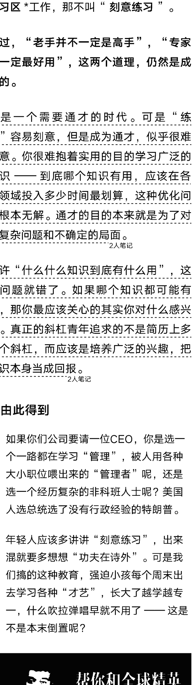

马斯格雷夫在NASA，以“能修理所有东西”著称，特别擅长临场解决问题。所以当哈勃太空望远镜出了问题，整个NASA的声音系于一线的时候，NASA发现只有马斯格雷夫最适合执行这个修复任务。马斯格雷夫自己也跟人说，“我之前学习的所有技能，可能都是为这一天准备的。”

马斯格雷夫通过三次太空行走，总共历时22个小时，修好了哈勃望远镜。

今天社会的分工越来越细，需要很多专才，教育系统培养的也是专才，可是真正值钱的却是通才。尤其是领导职位，比如一个公司的CEO，就应该在各个领域都有所涉猎才行。

有人调查了4500名CEO的履历表，发现他们总共从事过超过三万五千个不同的职位。研究者就考察这些CEO之前从事过职业的多样化程度，来判断这个人是“专才”还是“通才”。结果是“通才”更受欢迎。

“通才式CEO”的平均工资，比“专才式CEO”高出19% —— 相当于每年多100万美元。

如果是特别复杂的业务，比如涉及到公司合并、收购之类的技能的话，通才的工资甚至比专才高出了44%。

## 我的评论

首先我想澄清一下“练习时间”和人所能达到水平之间的关系。我多次说过，“刻意练习”的关键不是时间，而是方法。但问题在于“方法”很难观测，“时间”容易统计 —— 这就是为什么大部分对练习的研究都在考察练习时间，其实总时间根本不能说明问题。

比如我看过有研究说，一个医生在刚工作的头几年，是经验越丰富水平就越高，可是几年以后水平常常就停滞不前了。这是因為他们只是在花时间工作，而不是*在学习区*工作，那不叫“刻意练习”。

不过，“老手并不一定是高手”，“专家不一定最好用”，这两个道理，仍然是成立的。

> 这是一个需要通才的时代。可是“练习”容易刻意，但是成为通才，似乎很难刻意。你很难抱着实用的目的学习广泛的知识 —— 到底哪个知识有用，应该在各个领域投入多少时间最划算，这种优化问题根本无解。通才的目的本来就是为了对付复杂问题和不确定的局面。
> 人笔记

> 也许“什么什么知识到底有什么用”，这个问题就错了。如果哪个知识都可能有用，那你最应该关心的其实你对什么感兴趣。真正的斜杠青年追求的不是简历上多几个斜杠，而应该是培养广泛的兴趣，把知识本身当成回报。
> 人笔记

## 由此得到

- 1. 如果你们公司要请一位CEO，你是选一个一路都在学习“管理”，被别人用各种大小职位喂出来的“管理者”呢，还是选一个经历复杂的非科班人士呢？美国人选总统选了没有行政经验的特朗普。
- 2. 年轻人应该多讲讲“刻意练习”，出来混就要多想想“功夫在诗外”。可是我们搞的这种教育，强迫小孩每个周末出去学习各种“才艺”，长大了越学越专一，什么吹拉弹唱早就用不了一一这不是本末倒置呢？


### 日课140 | 爱心和理性

今天咱们说点哲学。我们平时读书学习，总是希望自己能变得更理性一点，可是有某些事情，如果你真的用理性思考，可能会越想越不对，到最后自己都无法面对现实。

比如说，慈善。可能绝大多数慈善行为，都是非理性的。可能世界上就staggering没有真正理性的慈善行为——如果有，你也很难以接受。

#### 1.衣服和孩子

咱们来分析一个最经典的慈善情境。孟子说，“恻隐之心人皆有之”——如果你走在路上，看到一个小婴儿快要掉到水井里去了，你肯定会马上跑过去救他。这个选择没有什么可说的，不管你是好人坏人、理性还是非理性、自由派还是保守派，你都会这么做，没有任何争议。

好。那么澳大利亚哲学家彼得·辛格，把这个情境稍微改变一点儿，你看看怎么样办——

假设你穿着一身比较贵的衣服，而小孩掉进了一个臭水沟里。你要救他，你身上这套比较贵的衣服就算是废了，那你还会救这个小孩吗？

我敢打赌你还会救他。我也会救他。就算这个小孩咱们根本不认识，就算他是个非洲黑孩子，咱们也要救他！人命大于天，衣服算什么？

好。那辛格说，现在在非洲每时每刻都有婴儿因为疾病和贫困而死，而且救助一个非洲小孩要花的钱并不多，也许你身上这套衣服就能救几个——那你为什么不少买几套衣服，多救几个孩子？

#### 2.一命和一命

最新一期《新科学家》杂志有篇文章，“利他主义需要科学吗？”（Does altruism need science?）作者是Niall Firth。这篇文章介绍了一派慈善哲学思想，也可以说是一场新的社会运动，叫“有效利他主义（Effective altruism）”。彼得·辛格，就是有效利他主义的倡导者之一。

我理解这个有效利他主义的意思是，如果你想做好事，那你就应该理性一点，在同样代价的情况下，让自己做的好事最大化。

比如说这篇文章讲了一位英国医生。这个医生事业有成，收入不错。医生的神圣职责是救死扶伤，每个医生都有这样的理想——而这位医生，就想知道，自己辛苦行医一辈子，到底能救几个人的命？

如果你理性一点，“救命”，可没那么简单。一个癌症晚期患者，本来还有三周生命，你作为医生给他用了很多猛药，能把他的生命多延长两个月——而这两个月是充满痛苦的两个月——这能算你救了他一命吗？

据此，有效利他主义，提出一个概念，叫做“质量调整寿命年（Quality Adjusted Life Years, QALY）”。一个人在健康状态下生活一年，就是一个质量调整寿命年。有效利他主义用质量调整寿命年来衡量慈善项目的“有效”程度。他们约定，36.5个有效调整寿命年，算“一命”。

根据这个标准，前面提到的那位英国医生一算，他在英国一辈子的行医生涯，大概能救4条命。

这是因为英国人的命太值钱了，医疗花费巨大，而且英国人都挺健康，需要医生做的事情不多。

可是非洲人就不一样了。非洲缺医少药，很多不该死的人早早就死了。同样是这位英国医生，如果他去埃塞俄比亚行医，他总共可以救助300条命。

但他更好的选择是继续留在英国当医生，因为英国医生的收入高。他可以把自己在英国做医生的收入中的一部分捐给非洲。他计算了一下，只要他每年给一个国际慈善组织捐款600英镑，就等于他在英国当医生的所有治病救人成就。

这位英国医生的名字，值得专门提一下——他叫格雷格·路易斯（Greg Lewis）。他现在离开了第一线的医疗工作，在英国一个公共卫生部门服务——这样他就可以直接左右公共卫生政策，还能保留一份高收入——他把自己收入的30%，捐给慈善机构。

这个计算充满了理性的精神。

#### 3.我们和他们

你可能已经看出来了，有效利他主义的一个核心思想，就是——“非洲人的一命，等于英国人的一命”。有效利他主义者计算的质量调整寿命年，就是任何人的质量、任何人的寿命，完全平等。

有效利他主义有个网站，GiveWell.org，使用质量调整寿命年这样的标准，给各个慈善组织的有效性做评级。

目前排名第一的是“反疟疾基金会”——


每年有大量非洲儿童死于因为蚊虫叮咬而导致的疟疾等疾病。只要你捐款五美元，这个基金会就能给一个非洲儿童弄一个经过防虫处理的蚊帐。

五美元，也许就能救一个非洲孩子的命。

注意，这是一个*非洲的*，孩子的命。那你可能会问，中国孩子的命值多少钱，我能不能先把中国孩子的事情解决了再考虑非洲的事情？

——你这个问题，也是包括《新科学家》杂志社论编辑在内，很多人想问有效利他主义者的问题。人和人的生命真的应该平等对待吗？我们真的应该放着中国人不救，先救非洲人，就因为这么做更“有效”吗？

## 我的评论

首先声明一点，我写这篇文章的过程中，找到了GiveWell网站，给它捐了550美元——其中500美元它可以根据自己的计算判断随便是给任何一个慈善机构，50美元用于网站维护。钱不多，主要是我想写评论的时候可以稍微理直气壮一点。

我想说的是，你得先有价值观，才能谈得上理性计算。所谓价值观，就是你认为谁重要，谁不重要。

咱们中国传统，用费孝通的说法，讲一个“差序格局”，就是谁离我越近，或者谁跟我血缘关系越亲，谁就对我越重要，我就对谁越好。按这个原则，楚国人当然比外国人重要，非洲孩子的命就不能跟中国孩子平等。

“差序格局”是乡土中国熟人社会的理念，是否还适用于现代陌生人社会呢？也不能说完全不适用。我们看很多美国白人为难民争取人权，可是他们并没有给全世界所有受苦的人提供美国国籍，让他们跟自己过一样的生活。所以我赞同《新科学家》编辑部的意见，有效利他主义是有点超前了。

但是有效利他主义走出了非常好的一步！那就是理性的一步。我们一般认为慈善是一种艺术，不应该讲理。比如咱们日课以前讲过《这时候和那时候的亚当·斯密》，亚当斯密列举了人应该有的三个美德，其中“慈善”排名第三，而且特别指出慈善没有一定之规，做不做、怎么做都主要看个人发挥。

我不知在那里看到，曾国藩也有类似的说法——天下贫苦的人太多，都救助，我没有那个力量，但是如果我正好遇到了，力所能及，我可以帮一下。

为什么帮这个不帮那个？就因为这个的运气好吗？很多时候，我们搞不清楚，搞慈善到底是为了让世界更好，还是为了让自己的感觉更好一点。所以我们搞慈善应该学习一点有效利他主义者的理性精神。

## 由此得到

- 1. 有效利他主义最值得学习的一个精神，就是慈善不是随意的：在同样的付出下，你应该设法让效果最大化，而这需要科学知识。
- 2. 对我们大部分人来说，差序格局和有效利他主义都应该考虑。可以优先关注自己人，但同时尽可能理性行事。

有些爱狗人士，放着人不救，专门救狗，我对此表示一定程度的理解——小狗很可爱，能激发我们的爱心，而且狗毕竟跟我们一样都是哺乳动物。

有些人出于信仰，想要通过慈善事业获得“福报”，我也能理解。

可是要说福报的话，救人一命胜造七级浮屠！那有的人放着人不救，弄一些毒蛇之类的动物“放生”，这我就理解不能——这些放生动物的花费，在非洲在中国都能救助不少孩子了——难道他们跟孩子的关系，还不如跟爬行类和鱼类近吗？

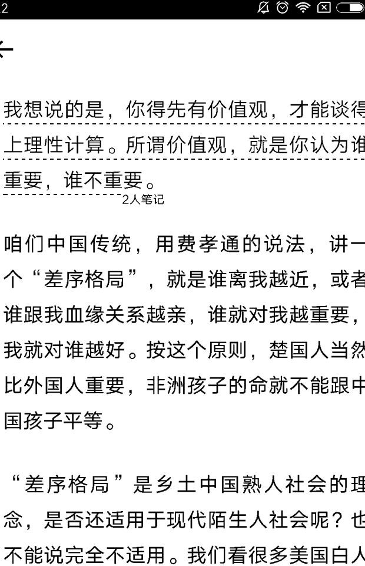

### 日课141 | 《俭省》解读4:穷宠淑女效应

上周末咱俩讲“薛定谔的猫”，有位读者在留言区讲了个笑话，叫“薛定谔的淑”——如果女朋友让你“淑”，她其实是处于真的让你淑、和让你过去抱她，这两种心理状态的一个“叠加态”。

你的下一步行动——用物理学的话叫“观测”——将会使这个叠加态坍缩到一个固定的状态。你要真淑了，她可能就是真的想让你淑；你要是过去抱她，她可能就认为自己原本就是想让你抱她。

作为一个前物理学家，我必须说明，“薛定谔的淑”和“薛定谔的猫”是两码事。一个关键区别是，量子叠加态的坍缩结果是完全不可控的，物理学家就算满怀良好的祝愿，也不能让猫坍缩成“活”的可能性增加一分。

而你，却可以左右你女朋友的波函数。

今天咱俩继续说斯科特·索南史恩（Scott Sonenshein）的《俭省》（Stretch: Unlock the Power of Less - and Achieve More Than You Ever Imagined）。

俭省思维模式的关键在于怎么开发手里现有的资源。资源还是这个资源，女朋友还是这个女朋友。你有什么办法，能让她变得更好一点呢？

#### 1.你当她是什么人？

1970年代，有人拿男女大学生做了一个相亲实验。实验中的相亲对象从未见过面，而且在相亲过程中也不见面，只是通过电话交流。实验人员通过“偷听”这些电话里的对话，来评估每一对男女的进展程度。

实验有个有点儿残忍的设定。某些男生会在电话相亲之前，收到了他的相亲对象的照片——但是他不知道，这个照片其实不是那个女生的，而是研究者专门找来的一位特别出众的美女的照片。

男生以为自己是在跟“女神”相亲，我们可以想象他肯定会表现得更好一点——但是研究者关心不是这个男生的表现，而是电话那头这位女生的表现。

结果是被男生误以为是女神的这位女生，表现得也和女神一样。她说话非常友好，给人感觉很善良交际，聪明伶俐讨人喜欢。

这当然就是我们以前常说的“正反馈”。你以为她很好，你就对她很好；你对她很好，她就真的表现很好；她表现得很好，你就更加相信她很好。

关键在于，你们俩之间这个反馈过程往往是非常微妙的，各种无法言传的表情和声调变化，都能被对方捕捉到，还能产生不经意的效果。

萧伯纳有个戏剧叫《卖花女》，后来被改编成好莱坞电影，也被翻译成《穷宠淑女》。这个故事说有个语言学家跟人打赌，说他能把一个粗俗的街头卖花女，名叫伊莉莎，给训练好，让她学会上流社会的口音，变成一位淑女。


语言学家的口音训练很顺利，可是别人还是一眼就看出来伊莉莎不是淑女，举止仪态都不对。后来有人提出一个洞见——你要想让她成为淑女，就必须像对待淑女那样好好对待她。伊莉莎就享有了淑女的待遇，处处受到尊重，最后居然成了一个真正的淑女。

你当她是什么人，她最后就真的个什么人。科学家早就知道这个效应，干脆就叫“穷宠淑女效应（Pygmalion effect）”吧。

这个效应的适用范围，非常之大。

#### 2.自证预言

我们现在说心理学实验不靠谱，其最早在1960年代，哈佛大学心理学家罗伯特·罗森塔尔（Robert Rosenthal），就有过一个更深的担心。当时人们已经知道，有些动物能体察到人给它的最微小的暗示，比如一匹马居然能根据主人的暗示用前蹄在地上敲击数字，还骗了科学家好几年。罗森塔尔说，如果你做实验用的那些小白鼠，能够感受到你想要什么结果，并且按照你想要的结果去行动，那你的实验结果还有意义吗？

罗森塔尔据此写了一篇质疑整个学界的文章，但是没有受到广泛重视，这个问题可能到今天也没解决。但是有一位小学长，叫雅各布森（Jacobson），看了罗森塔尔的论文，说那咱俩干脆拿小学生做个实验验证一下你这个思想吧。

这就引出了一个无比经典的教育实验。

美国小学的老师都是只教一个固定的年级，并不跟班走，所以学生每年遇到的老师都是新的。在这个小学的新学年开学的时候，雅各布森和罗森塔尔把每个班级的学生都分成了三组：天赋组、中等组、低于平均水平组。学生和家长都蒙在鼓里，他们只把分组情况告诉了老师，说这是上学期测验的结果。

真相是，分组完全是随机的。但是老师不知道。结果老师们对“天赋组”的学生寄予了很大的期望，在接下来的八个月里，他们在教学中更关注这些学生，给这些学生更有挑战性的问题，就算是学生一时之间做不好，他们也认为这个学生肯定是有潜力的，只不过还没有发挥出来。

这些被随机分配到天赋组的学生，非常非常幸运。实验结束后的一个测验，一年级的班级平均成绩提高了12分，而“天赋组”的平均成绩提高了27.4分。二年级的效果没那么明显，班级平均提高7分，“天赋组”提高了16.5分。

你当这些学生是什么水平，他们最后就真的表现出这种水平。后来人们发现这个现象实在是太普遍了，美国社会学家罗伯特·墨顿（Robert K. Merton）给起了个名字，叫“自证预言（Self-fulfilling prophecy）”——你“预言”局面如何如何，因为你按照这个想法去做了，局面真的就会如何如何。

类似的研究做过很多。如果经理一开始“误以为”手下这个雇员水平很高，经常给他安排比较难的任务，还跟他讨论公司战略问题，结果这个雇员就会真的水平越来越高。

反过来说，如果你认定一个学生调皮捣蛋，甚至公开羞辱他，他就会按照你的预言行事，故意捣乱。某公司要转型，如果高层从一开始就认定员工会抵制这次转型，搞各种防范措施和强制行动，员工真的就会抵制转型。

索南史恩以一个商学院教授的经验说，是，所有商学院教科书上都写着公司转型难——可是实际上，员工一开始，本来对转型都是“中性”的态度。

所以很多情况下，人心本来是个“叠加态”。你想把它观测到什么状态，它就会往什么状态坍缩。

这就是“预期”的力量。那我们自己对自己的预期，也有这样的效果吗？

#### 3.你和你对你的预期

索南史恩曾经参与调研过一些环保主义者，发现他们中很多人都是“自我拆台型（self-defeating）”的人格。

比如说，普通人都开汽油驱动的汽车，而一位环保主义者开混合动力汽车。即使考虑到油价，混合动力的车也比同档次汽油车要贵一些，所以环保主义者已经是为保护环境做出了牺牲。但是你采访他，他说我做的还很不够，我根本就不应该开车，应该去坐公共汽车才对。

然后你去采访一个故意不开车每天坐公共汽车

然后你去采访一个故意不开车每天坐公共汽车的环保主义者，他说我做的还很不够，我根本就不应该坐车，应该走路才对。

然后你去采访一个每天走路的环保主义者，他说我做的还很不够，我根本就不应该买肉吃，应该吃素才对。

他们是不是只要还活着，就永远感到很愧疚。

索南史恩说，这些环保主义者的心中，有一颗消极负面的种子。他们预期的局面很负面，局面就是越来越负面，他们就觉得自己做什么都不够。反过来说，如果你心中有颗积极正面的种子，对局面有个正面的预期，那你的命运就可能非常不同。

这段书里我最喜欢的一个故事，不是什么经典的研究实验，而是一百多年前一位黑人女企业家的事迹，她就是沃克夫人（Madam C. J. Walker）。

沃克夫人创业的那个年代，美国黑人地位非常低，她深陷贫困，是个单亲妈妈，而且身体还有病。她做生意处处碰壁，到外地出差连旅馆都不让她入住。但是她居然就慢慢做大了。

以前我听说一句俏皮话，说“巴菲特等待机会，索罗斯寻找机会，本拉登制造机会”。沃克夫人，就是个能自己制造机会的人。


沃克夫人是史上第一个成为百万富翁的黑人女性。她的创业故事咱就不细说了，我只想说一点。沃克夫人专门雇佣黑人女性在各地当推销员，当时一般无技能工人的平均工资是每周11美元，而沃克夫人给这些推销员的工资，是每天5到15美元。

她想用高工资改变黑人女性的形象。沃克夫人要求手下这些女推销员攒钱买房，好好教育孩子，而且还都要给慈善机构捐款！她可以说是以一己之力提升了黑人女性的社会形象。她把挑战都当成机会。

她有很好的期望，结果就有很好的收获。

## 我的评论

你把别人当成什么样的人，别人慢慢就会变成什么样的人。你认为自己是个什么人，你自己就会变成什么人……这套说法，要是十年以前的我，肯定会认为是鸡汤。

我记得有一次在论坛跟人争吵，有人就给我讲苏东坡和佛印的典故，说你如果是佛，看别人就也是佛——你要看别人是牛粪，那你自己也是牛粪。我说是吗？我就找了一张牛粪的照片给他看：你说这是牛粪还是佛？

我想说的是，心理学的规律并不一定在哪里都有用，需要环境、人、和时间的配合。给足够的互动时间，今天说的内容也许就能发挥作用。

索南史恩说的这个“预期”，放在自己的身上，其实就是“叙事自我”。我们时刻都在给自己讲一个故事，说我这么做，是因为我是个这样的人。而我们今天看到，人都是高度可塑的。

## 由此得到

云对雨，雪对风，佛陀对苍生。我对你，嘴对心，九夏对三冬。我们都想想，应该怎么对家人、同事和自己吧。


### 日课142｜三种浪漫体制

日课142｜三种浪漫体制

咱们日课去年有一篇文章叫《你会跟谁结婚？》，提到经济学家的数据显示，现在美国的婚姻中“强强联合”的现象越来越严重，高收入者和高收入者结婚，高学历者和高学历者结婚。

经济学家很有奈，我们也无语了。在那篇文章的留言区，我们搞了个行为艺术，只放出了一位读者的留言——

> 我只是想跟我喜欢的人结婚。
2016-12-15 23:21:50

我们表达了态度，但是问题还没有解决。婚姻大事，到底应该遵循什么样的原则？

今天咱们来更深入地讨论一下这个问题。我要说的是纽约时报的专栏作家戴维·布鲁克斯（David Brooks）昨天的专栏，标题是《你属于哪个浪漫体制？》（What Romantic Regime Are You In？）。

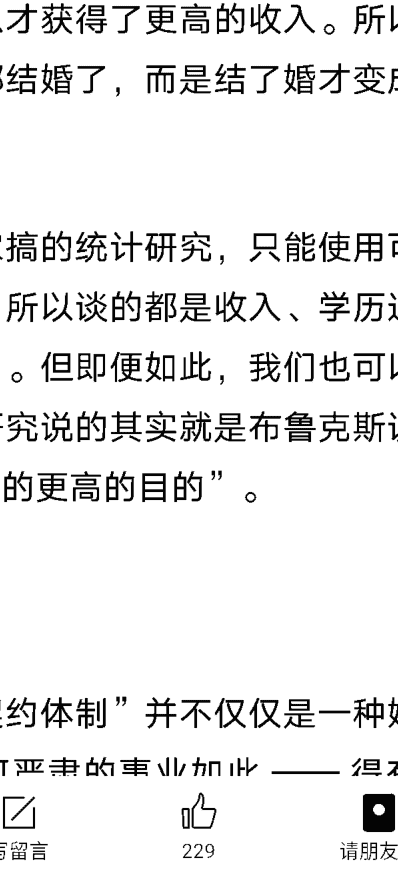

布鲁克斯是我最喜欢的作家之一，咱们读者可能也比较熟悉，《社群动物》、《品格之路》这些书就是他写的。可是自从特朗普当选总统以后，他就好像疯了一样，几乎写的所有文章都是骂特朗普的，简直没法看。


昨天，也就是3月7号，我看他终于写了一篇正经文章，也就是这篇谈婚姻的，而且写得很不错。

首先是有个从小在俄罗斯长大、16岁移民到美国的女作家，叫波利娜·阿伦森（Polina Aronson），对美国人的爱情婚姻观发表了自己的看法。

阿伦森说，俄罗斯人认为爱情是个上天注定的东西，爱情来了你就无法抗拒，人们为了爱情愿意做出牺牲，甚至可以承担痛苦，总之是所有事情都应该为爱让路。

但美国人可不是这样。阿伦森发现美国人特别讲究“选择”。美国人寻找恋爱和结婚对象，会特别理性地权衡比较——对方能不能满足我的各种需要？我在这段关系中能不能舒服地行使自己的权利？就好像自己是在挑选一件适合自己的商品一样。

阿伦森就对美国人这个婚姻观持批评的态度。她还说，美国人过分强调自我了，有很强的边界意识，特别不愿意依赖对方。阿伦森说美国人这种“自立自强”，是不是太夸张了，人生态系统婚姻中难道不就应该互相信赖吗？

那么布鲁克斯对此有感而发，他把俄罗斯人的婚姻理念称为“命运体制”，把美国人的婚姻理念称为“选择体制”。

说到这里我真是很想补充一句。其实除了这两种体制之外，某些中国家长们的婚姻理念也是一种体制，也许应该叫“指标体制”——这些家长给子女挑选对象，都是按照一系列量化的硬指标来的：工资多少、学历多高、身高多少、年龄多大。美国人虽然讲理性，但至少没有那么直白，而中国家长则直接把人指标化了。

当然，大多数中国人也不是这个态度，咱们还是少谈中国体制。那么俄罗斯体制和美国体制，哪个体制好呢？

### 布鲁克斯说，都不好。“命运体制”太过草率了，但是“选择体制”也太现实。美国人真的把婚姻市场当成了“市场”，挑选适合自己的，同时也被别人挑选——如此理性，可是结果并不理想。很多人挑花了眼干脆不结婚了，在30岁以下生了孩子的女性中，超过一半都是未婚妈妈。

布鲁克斯说，你去考察那些携手走过大半辈子、婚姻幸福的老夫妇，你会发现他们的婚姻既不属于“命运体制”，也不属于“选择体制”，而是属于“契约体制”。

在契约体制下，婚姻是一个承诺。为了实现这个承诺，双方都需要改变自己。

你不需要在婚姻市场里翻来覆去精挑细选另一半。契约体制认为婚姻有一定偶然性，你可能偶然遇到一个特别心动的人，说结婚就结婚了。但是请注意，相爱和婚姻这一步，并不是最重要的。

更重要的是第二步，也就是双方如何把这个婚姻关系维持下去。

布鲁克斯说，你们两个人得建立“我们”这个概念。从此之后，在生活中的优先级，你们两个人的关系是排在第一位的，排第二位的是对方的需求，而你自己的需求只能排第三位。

契约体制认为双方结婚以后，不应该过分强调个人独立性，而应该互相依靠。

那么这个“契约”的意思，最关键的一点，就是一旦当婚姻出现危机的时候，双方要知道不能轻易退出。解决危机的办法是再深入一步去拓展双方的关系。

可是为什么要这样呢？我生活得自由自在何必非得结婚，受这个契约的束缚呢？就比如说我，结婚以后在家里的地位越来越低，有了两个孩子，目前排名单第四。我图什么呢？

布鲁克斯说，婚姻并不仅仅是两个人一起，还有更高的目的，就像我们经常提到的那个“something bigger than yourself”。最显然的更高目的是孩子，照顾孩子需要两个人的努力。

但是还有一个比孩子更重要的目标，那就是我们要通过婚姻关系，去增加自己的“可爱度”，也就是 loveliness. “Lovely”这个词咱们以前讲亚当·斯密的时候说过，在这里并不是小孩那种萌可爱，而是“值得被爱”的意思。

说白了，就是一个结了婚的人，会慢慢变得不那么自私了。他学着去爱别人，自己也就变得更加值得被爱，他就变成了一个更好的人。

归根结底，契约体制的出发点，就是爱比自私更有价值。做事永远都是为了满足自己的需求，那种生活其实没什么意思，搞不好还是个自我放纵的过程。学会爱别人，才能获得真正的幸福。

## ｜我的评论

我上周正好看到一个研究，华南师范大学的王智波和李长洪，去年发表的一篇经济学论文，叫《好男人都结婚了吗？——我国男性工资婚姻溢价形成机制》。这篇文章使用统计方法，把各种可能的相关因素——比如说年龄之类——都排除在外，发现处在婚姻状态的男性，比没有处在婚姻状态的男性，工资高了6.8%。

那你可能会说，肯定是挣钱多的人才能找到老婆——而这个研究恰恰就是说不是这样。事实上，结婚三年以内的男性并没有这个工资溢价，是三年以后，处于婚姻状态的时间越长，男性的工资越高。研究者甚至发现，这个溢价不能用“结婚以后有人照顾自己”解释，也不能用“男人结婚以后责任感更强”解释。

真正左右这个溢价的，是他妻子的素质。研究者的结论是一位高收入和高学历的妻子，对丈夫有个“相夫效应”——说白了就是男人跟她结婚以后，变成一个更好的人了，所以才获得了更高的收入。所以不是好男人都结婚了，而是结了婚才变成好男人。

这是经济学家搞的统计研究，只能使用可观测的变量，所以谈的都是收入、学业这些“硬指标”。但即便如此，我们也可以认为，这个研究说的其实就是布鲁克斯说的那个“婚姻的更高的目的”。

## ｜由此得到

我看这个“契约体制”并不仅仅是一种婚姻观，对任何严肃的事业如此——得有点“commitment”，也就是讲讲承诺和献身。整天问自己喜欢什么，永远都在做选择，没有长性，这种生活其实并不愉快。自己亲手创造一个更好的关系，一个更好的事业，乃至一个更好的自己，这种成就才最值得追求。

2人笔记

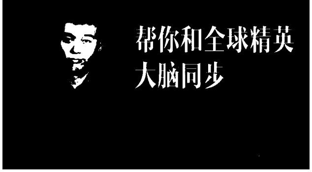

## 日课精选

### 日课143｜有关糖的犯罪推理

日课143｜有关糖的犯罪推理

中国人到美国旅游，肯定都会对美国街头的肥胖者数量之多产生深刻印象。高肥胖率已经是美国社会的一个特别严重问题。所以美国科学家在减肥、营养学、健身这些课题目上可以说是下了很多功夫研究。可是这些研究的结果，非常令人困惑。

要想减肥，无非就是要么节食，要么锻炼。可是到底应该怎么节食，怎么锻炼？各种理论众说纷纭，很多都互相矛盾，那你听谁的呢？

今天我们还是说一本新书，《对糖的指控》（The Case Against Sugar），作者是加里·陶布斯（Gary Taubes）。这本书刚刚出版三个月，现在影响很大。这是一本非常不一般的书。


陶布斯是个非常厉害的调查记者，他于的事却不是报道一个什么单一的新闻事件，而是在几年内对一个领域进行深入的调查研究，然后写成一份报告或者一本书。陶布斯此前已经在减肥和营养方面出了两本书，而这本则可能是最让人听闻的一本。

为什么我说“让人听闻”呢？因为陶布斯这本书说，糖不是营养品，也不是普通食物，而是毒药——吃糖，等同于吸烟。

陶布斯认为，糖，是过去几十年美国肥胖率增加的最根本原因。现在生产糖的成本非常低，导致糖的使用过于泛滥，糖被添加 到各种食品里。肥胖症、糖尿病、癌症、阿兹海默症、儿童多动症（ADHD）等等，这些疾病都和糖有关。甚至连烟草里都有糖——如果香烟里不加糖，味道就会很冲，所以糖也是人们吸烟的一个罪魁祸首。在战争期间，糖的供应量短缺的时候，人们的身体反而更好。

那你说根据这些说法，我们是不是应该像禁烟一样禁糖呢？先别急。我今天说这本书，并不是为了搞科普，宣传糖的危害——我不懂营养学，我根本不知道他这些说法对不对。我想说的是陶布斯这本书使用的分析方法。这位调查记者使用了一种非常特殊的方法，讲述了一个本该由科学家讲述的道理。

糖是否有害，有害到什么程度，这是一个科学问题，按理说应该由科学家们撰写研究报告，列举出研究结果、研究方法，得出一个共识的结论，然后说服公众。可是现在的情况是，科学家没有达成共识，甚至是众说不一。几十年前就有科学家认为糖有害，而时至今日仍有许多科学家认为糖无害。科学方法对这个问题暂时没有结论。

所以陶布斯就没有使用科学方法，他使用的是犯罪推理的方法。犯罪推理要的证据，就不仅只是科学证据了。

## 我的评论

上周我刚看了一部BBC的纪录片，它打破了我们对健身的认知。过去我们总认为健身非常有益，但这个纪录片却说，有些人的基因决定了健身对他是无用的。

个说法毫无根据。

还有，很多医学权威组织说盐分摄入过量对心血管系统有坏处，几乎已经成了营养学的常识了。可是几年前我看《纽约时报》上的报道，说最新的大量研究发现盐对身体并没有多大坏处，多吃少吃的区别不大。当时的局面似乎是美国国家医学院的疾病控制和预防中心认为没有证据证明盐的害处，而美国心脏学会坚持认为吃盐超过一个比较低的定量就有害。

可难道不是吃什么东西过量了都有害吗？为什么现在美国有这么多肥胖者？可能根本不是哪一种东西的问题，而是所有食品的问题——根本问题就是现代农业太发达，食物太便宜了。

所以营养学的池很深。我感觉营养学这个局面就是越低端的说法越信誓旦旦，越高端的说法越是不确定。晚报和朋友圈理直气壮地告诉你该吃什么不该吃什么，一流调查记者就只敢小心翼翼地指控，而科学家可能什么都不知道。

但这可不是说科学家什么都没做。我看很多新理论听着都很有意思，他们只是还没有达成共识，形成一套切实可行的行动指南，也许将来会有。

## 由此得到

在如何行动方面我没有得到什么——我也不知道该吃什么不该吃什么，但少吃一点似乎总是对的。如果可能的话，谨慎起见，糖还是能不吃就不吃吧。

也许我们可以得到一个认知：在真实世界中获取确定的知识，非常非常困难。


### 答读者问｜有梦想不算

#### 来自日课：从“刻意练习”到“功夫在诗外”

原来，通才比专才更有价值吗？但是通才也要求本身具有一项比较尖的能力吧？如果样样都会，样样都不精，感觉也是不行的。

通才就是具备隔壁季骡来老师说多维竞争优势，但季老师说多维竞争优势是建立在某一两个维度足够突出的基础上，这样才能打通底层知识的链接点，对此万老师是怎么看的呢？

## 万维钢

我赞成这些说法。这篇文章里提到的所有“通才”，都是在几个领域有硬功夫的人，达到“精通”的状态。但是这些人并不满足于只精通一个专业，他们非常乐意学习其他专业的知识，所以他们才能跨专业解决问题。

但是，一个“样样都会，样样都不精”的人，也很有用啊——比如说可以当领导啊：）

其实“样样都会”是非常难达到的状态，比只会一两门难多了，只有特别爱学习，特别主动的人才能做到。我记得很早很早以前有个电视剧叫《九一八大案纪实》，里面一个犯罪团伙的头目，自以为懂得挺多，观众也觉得他是个人才。结果电视剧播出以后，立了功的公安局长接受记者采访，就对他的知识非常不屑一顾——“我问他什么是概率论他一无所知，我问他政治经济学他更是懵然无知！”

那个公安局长，才有点通才的意思。很多自诩的通才都是错觉。

#### 来自日课：爱心与理性

今日日课，救人捐钱就可以救很多人，亲力亲为效率太低了，但是难道亲力亲为就不应该存在吗？让所有人都去捐钱吗？这样的社会岂不是更好？

## 万维钢

不是亲力亲为效率低，而是“赚钱多的人”亲力亲为效率低——“有钱的捧个钱场，没钱的捧个人场”：）“有效利他主义”的原则是把个人对慈善的贡献最大化，如果你的本职工作收入很高，那么就说明你非常适合做那个工作，那最好的办法就是你继续做这个工作，然后捐点钱，让更专业的人员替你做慈善工作。

前段时间，有一句话：我们每个人都有许多爱，许多同情，自己用不完，把它分散一部份给别人，这便是生命开花！这算慈善吗？求万老师解！

## 万维钢

这是肤浅的慈善。这只是想表达爱心，让自己感觉更好一点，而不是在真正解决问题。看别人受苦，捐点钱很容易，可是真正想要帮这个人解决问题，授人以鱼要授人以渔，那可就太难了。爱心冲动型的往往有一种心理优越感，如果受捐助对象不领情，或者遇到别的事情困难，就很难坚持，最后甚至好心办坏事。

现在甚至有人认为，“同情心”根本就不是好东西，爱心式的慈善还不如没有，我们过段时间可能会专门讲这个问题。

#### 来自日课：窃窃淑女效应

想到《巨人的陨落》里面，一战前英国和德国都以为两国之间必有一战，然后为了这次“必将到来的战争”都在进行疯狂的军备竞赛和军事扩张，是这种民众和政府的预期绑架了英德，从而导致的一战爆发？那是否有一…不会爆发战争的可能？答案也许是否定的，群体是缺乏理性的。就算是这种群体的力量很可能是不理智的，而且是毁灭性的，又如何避免呢？

## 万维钢

人们预期要打仗，最后就真的打仗了，的确有这个道理，跟银行挤兑的原理、咱们文章里说的“窃窃淑女效应”差不多，都是正反馈。

但正反馈其实也有一个问题，就是中间只要有一个环节脱落，这把火就点不起来。比如我看有人从博弈论角度论证当时局面，认为一战本是可以避免的。战前两大阵营都在虚张声势，而只要英国的应对稍微灵活一点，就不至于真打。

“乌合之众”式的群体力量的确厉害，历史上也的确有很大的破坏性，但是它也的确是一个不经常出现的现象。比如现在各国对付这种运动都比较有经验了，控制舆情，避免过激，乃至转移热点，我看这些手段各国政府玩的挺好。

#### 来自日课：有关糖的犯罪推理

生理学课本里明明白白写着：盐分摄入过量会提升冠状动脉堵塞的概率。今天的日课只让我产生一个疑问，知识获取到底是靠谱的？或者说谁比较靠谱？

万老师，我们应该如何获得确定的知识呢？生活中很难获得，除此之外还有脱离生活的前途吗？

## 万维钢

以前我写过一篇文字叫《哪种知识最可靠》说过这个问题。不同学科的知识的可靠性差别极大，物理学不如数学可靠，化学不如物理学，医学不如化学，营养学不如医学。

面对这些不可靠的知识，最好的态度，当然是使用贝叶斯定理的精神——观点随事实发生改变。我在《智识分子》书里详细说过这个问题，罗辑思维一期节目《我们到底该信谁？》（第182期），说的也是这个问题。

万老师，我是一个刚要毕业的日语专科生，虽然我学历很低，但是我仍然很向往美好的生活。我坚持阅读，写作，也很喜欢看你的精英日课。因为学历太低，我对未来很失望和迷茫，我特别希望有一天，你能有一篇文章，不是鸡汤文，而是告诉我们，难道精英，或者优秀的人就一定要是高学历吗？有没有一些西方精英，他们学历不高，还是做出了了不起的事情。谢谢。

## 万维钢

这个问题简单的答案当然是“有”，但你问了一个错误的问题。你想取得了不起的成就，那你应该问的是“我需要有什么”，而不是“我没有XX行不行”。你现在问我的，是你是不是还有资格——你当然有资格。几乎每个人都有资格，很多可以“做厉害的事情”的领域都不需要什么入场券，不需要什么学历证书。你没有被禁止，你有资格。

可是有哪些资格的人这么多，有成就的为什么很少呢？这才是你应该关心的问题。你想要厉害，就应该关注那些厉害的人，而不是那些仅仅取得了参赛资格的人。

那么想要取得了不起的成就，你需要有什么呢？你至少需要有一个出类拔萃之处。天生的也可以，后天的也可以，是一种技能也可以，是一种品格，没准也可以，甚至“运气”都可以。反正你总得有点什么，“有梦想”不算。

我可以列举一些没有高学历但是做出了厉害的事情的人，但是那并不能证明“你也可以”——他们没有高学历，但是他们都有出类拔萃之处，那个比高学历稀有多了。

出类拔萃之处，你有，还是没有。没有，你可以自己想想怎么才能够有——你具体问题具体分析，我不知道。另外，大多数人没做什么厉害的事情，生活怎么就不美好了？

## 万维钢

上周的小议《薛定谔的猫》，本担心是个枯燥的话题，没想到受到你们的欢迎，谢谢！今天把回答提前，就是在准备明天再讲一个比“薛定谔的猫”更时髦、也更神奇的量子力学话题：量子纠缠。并且应很多读者的要求，也配上了音频。


缠。并且应很多读者的要求，也配上了音频。

明晚10:43见！


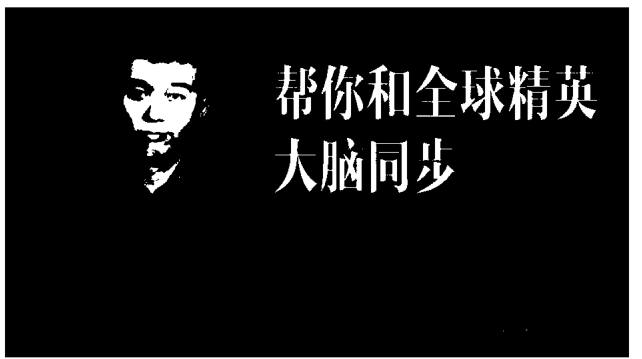

### 周末小议 | 量子纠缠

周末小议 | 量子纠缠

上周末我们讲了“薛定谔的猫”，都感觉脑洞大开，今天我们就再讲一个比“薛定谔的猫”更时髦、也更神奇的量子力学的话题，“量子纠缠”。

前面咱们反复说过，量子世界的一个最基本原理就是“叠加态”——也就是说一个东西可以“既是这样，又是那样”。有了这个观念，量子纠缠的现象可能几句话就能说清楚——可是为了让你体会到物理学的妙处，咱们还是说一个稍微复杂一点的故事。

现在在中国有个流行词汇叫“IP”，我要说的这个故事就是物理学里最精彩的大IP之一。这个故事最早的缘起是爱因斯坦提出的一个思想实验，故事的主框架是爱尔兰物理学家约翰·贝尔（John Stewart Bell）想出来的，最后定型的著作大概应该属于美国物理学家戴维·默明（David Mermin），而我要说的，则是一个进一步改良了的最通俗版本。

这是一个有点烧脑的故事，但是不需要任何专业知识，你只需要一点小学生的算数。

#### 1.一个故事

故事是这样的。你和我，咱俩做个实验。

假设现在有那么一台机器，每隔10秒钟就同时往两个相反的方向发射乒乓球，一个乒乓球往东，另一个乒乓球往西。乒乓球的颜色可以是红色也可以是蓝色，但是具体是红色还是蓝色，每次发出来都不一定。假设乒乓球可以平稳但是高速地飞行很远。

我在东边，你在西边，各自接收飞过来的乒乓球，咱们的任务就是观察和记录自己收到的乒乓球的颜色。咱们的距离很远，互相并不直接通信。每隔十秒钟，我们就记下一个乒乓球的颜色。

我们想知道这台机器发射乒乓球的规律。为此，我要做三个实验。

实验一

第一个实验非常简单，我们约定一个比较长的时间段，在这个时间段里各自按顺序做一份收到的乒乓球颜色的记录，然后把两份纪录进行比较。

比如我收到的纪录是“红色-红色-蓝色-红色-蓝色-蓝色……”，我和你比较之后发现，你的纪录也是“红色-红色-蓝色-红色-蓝色-蓝色……”，和我的纪录完全相同。

由此我们得出一个结论：这台机器每次向两个方向发射的乒乓球颜色都是相同的。

你看，简单吧？这似乎就是一台忠厚老实的机器，虽然每次发射球的颜色可以变化，但是同时发出的两个球的颜色总是一样的，就好像业重冥无欺。

好。

实验二

现在我戴了一个墨镜再观察我接收到的乒乓球，而你还是和以前一样不戴墨镜观测。

观测一段时间再比较咱们的颜色纪录，就发现咱们的纪录在大部分时间内还是相同的，可是会有1%的纪录中，我们接收到的球颜色不同。

那是不是我粗心大意记错了呢？那咱们把这个实验再做一遍，这回按戴墨镜，我不戴。结果发现，还是有1%的颜色记录对不上。

那么我们得出结论，肯定是这个墨镜有毛病。墨镜，有正好是1%的机会，会“看错”一个乒乓球的颜色。

注意，墨镜这个出错率是固定的。你做一万次实验，它出错100次。你做十万次实验，它出错1000次——什么时候出错可能不一定，但是长期来看它的输出很稳定，总是1%。墨镜，也不会“提高自我”的一台机器而已。

没问题。

实验三

在第三个实验中，咱们都戴着墨镜观测。

在说实验结果之前，我想先问你一道小学数学题——请问如果咱们都带着一个出错率是1%的墨镜，那么咱们的观测纪录中，*最多*会有百分之几的颜色是对不上的？

看到这里，你可以放下手机，思考两分钟。


欢迎回来。小学生数学题的答案，当然是2%。

我的墨镜犯1%的错误，你的墨镜犯1%的错误，如果咱们不同时犯错，那总的错误数就正好是2%；如果咱们在某些时候正好都错了，那负负得正，咱们那一次的结果还是一样，总的错误数就会少于2%。总而言之，两个人戴墨镜，两个人颜色纪录的差异应该是*最多*2%。

但实验结果不是2%，而是4%！

#### 2.唯一可能的解释

我第一次听说这个实验的时候，做梦都在想。现在我再帮你捋一遍——发球的机器只是一台机器，它每次发两个颜色一样的乒乓球；墨镜也只是一台机器，它有个1%的固定出错率。那怎么两个墨镜都戴上，出错率就变成4%了呢？到底是哪里出的问题？

一种可能性，是发球机器有问题。也许这个机器“意识到了”咱们都戴着墨镜，它就故意给我们发射颜色不同的乒乓球。这个想法非常奇怪，但是可以验证——我们可以等到机器发出乒乓球之后再戴上墨镜——实验结果是出错率依然是4%。看来发球机器没问题，它只是，一台机器。

墨镜只是个简单的测量仪器，我们已经各自单独戴墨镜验证过，非常稳定没有问题。

那就只剩下一个可能——福尔摩斯说过，排除其他所有可能性，最后剩下的这个可能，岂怕再怪，也是唯一可能的。

这个唯一可能就是，乒乓球刚离开发球机的时候，是没有固定颜色的。是我们看到乒乓球的一瞬间，它才有了个颜色。

之所以出错率不是2%而是4%，是因为在被我们看到之前的某一瞬间，两个乒乓球之间有过一次“协调”。

我这边的乒乓球对你那边的乒乓球说：

> “万维钢戴墨镜了！小师弟戴墨镜了没有？……戴了是吧，那咱们这次不能按以前的规则着色了，得按4%的规则着色！”

这个诡异的、超远距离的协调，就是量子纠缠。

#### 3.爱因斯坦的噩梦

所谓乒乓球，在真实的物理实验里可以是电子、光子或者别的东西粒子。拿电子来说，所谓乒乓球的颜色，其实现就是电子的自旋。物理学家很容易在实验室里制备这样的电子对，并且让他们的“总自旋”是0，那么根据角动量守恒，一个自旋是正的，另一个自旋就必须是负的。这就等于说每次发出的两个乒乓球颜色必须是不一样的——我们前文说必须一样，是为了行文方便，道理还是这个道理。


所谓戴墨镜就观测发生1%的出错率，在真实实验里，其实是如果你测量两个电子自旋的时候不在同一个空间角度，那么测量结果就不是正好相关的。这个原理可以用下面这两张图说明，但都是技术细节，不了解也没关系——

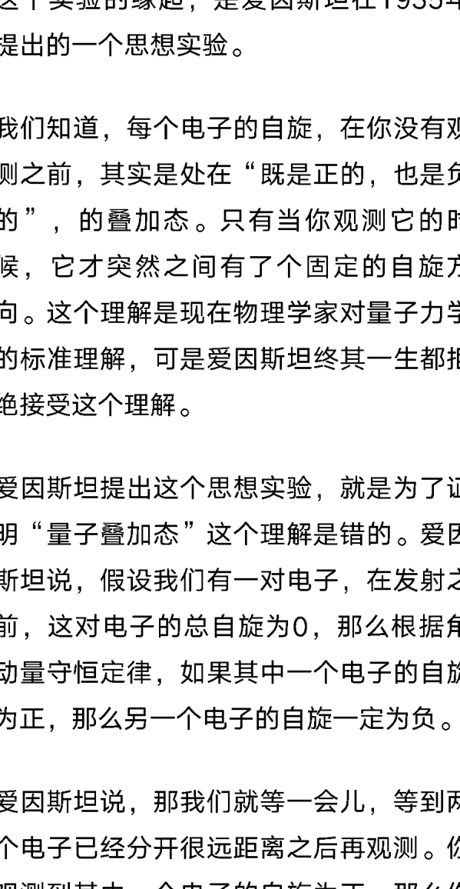

SETTING #1: Both SPOTS mutually aligned.
OUTPUT #1: At 0° both messages identical.
ERROR RATE = 0%

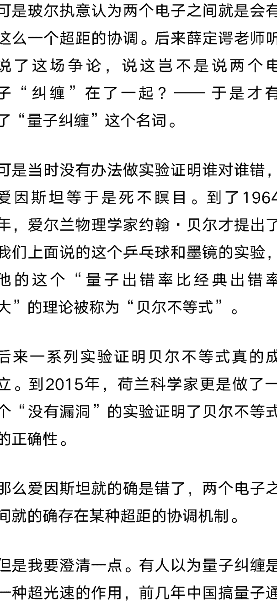

SETTING #2: Alice's SPOT rotated 30°.
OUTPUT #2: At 30° messages 75% match;
ERROR RATE = 25%

我们说的这个实验的关键，就是它证明了已经分开的这两个电子之间，存在一个远距离的协调。

这个实验的缘起，是爱因斯坦在1935年提出的一个思想实验。

我们知道，每个电子的自旋，在你没有观测之前，其实是处在“既是正的，也是负的”，的叠加态。只有当你观测它的时候，它才突然之间有了个固定的自旋方向。这个理解是现在物理学家对量子力学的标准理解，可是爱因斯坦终其一生都拒绝接受这个理解。

爱因斯坦提出这个思想实验，就是为了证明“量子叠加态”这个理解是错误的。爱因斯坦说，假设我们有一对电子，在发射之前，这对电子的总自旋为0，那么根据角动量守恒定律，如果其中一个电子的自旋为正，那么另一个电子的自旋一定为负。

爱因斯坦说，那我们就等一会儿，等到两个电子已经分开很远距离之后再观测。你观测到其中一个电子的自旋为正，那么你马上就知道，另一个电子的自旋为负。在你观测到之前，这两个电子都处于正负叠加态，但当你观测到一个电子之后，导致了它的波函数坍缩，与此同时，另一个电子的波函数也必定坍缩。

这个坍缩了，那个就马上跟着坍缩——这不成了超距作用了吗？

我们日常生活中想要传递一个信息，最快的速度就是光速，不可能这里变了，那里马上跟着变——信息来不及传递。如果真有超距作用，那空间还有什么意义？是什么东西把信息传递过去的？

可是玻尔执意认为两个电子之间就是会有这么一个超距的协调。后来薛定谔老师听说此场争论，说这岂不是说两个电子“纠缠”在了一起？——于是才有了“量子纠缠”这个名词。

可是当时没有办法做实验证明谁对谁错，爱因斯坦等于死不瞑目。到了1964年，爱尔兰物理学家约翰·贝尔才提出了我们上面说的这个乒乓球和墨镜的实验，他的这个“量子出错率比经典出错率大”的理论被称为“贝尔不等式”。

后来一系列实验证明贝尔不等式真的成立。到2015年，荷兰科学家更是做了一个“没有漏洞”的实验证明了贝尔不等式的正确性。

那么爱因斯坦就的确是错了，两个电子之间就的确存在某种超距的协调机制。

但是我要澄清一点。有人以为量子纠缠是一种超光速的作用，前几年中国搞量子通讯，还有人写科普文章说量子通讯是超光速的即时通讯——这完全错误。事实上，我们并不能通过量子纠缠超光速通讯。这是因为我没有办法*控制*我观测到的电子自旋。当我观测到一个电子是正自旋的时候，我知道你观测到的电子一定是负自旋，但是仅此而已——我的观测也是被动的，我还是没办法跟你说一句我事先想说的话。

所以我们——我和你——并没有超光速信息传递。但是两个电子之间，的确有一个不受空间限制的协调。这个协调到底是怎么进行的呢？现在没人知道。

最近几年，人们对量子纠缠的思考非常深入，有的一些非物理学家说量子纠缠可以解释意识，有的物理学家认为量子纠缠可以解释时间箭头，有人还认为量子纠缠是一个“比时空更基本”的物理过程，这些内容都太过深奥，今天就不解释了。以后有机会，我们再探讨。

——◈ 孤单光量子 ◈——

### 日课144｜老大美国说

日课144｜老大美国说

> 日本人之称我中国也，一则曰老大帝国，再则曰老大帝国。是语也，盖袭译欧西人之言也。呜呼！我中国其果老大矣乎？梁启超曰：恶！是何言！是何言！吾心目中有一少年中国在！

— 梁启超，《少年中国说》

《少年中国说》是梁启超1900年写的。我们今天读他这篇雄文，感觉热血沸腾，非常乐观积极的精神，而实际上当时的中国，的确是个老大帝国。1900年的中国，有谁能看到任何希望么？可能全国上下都是无比悲观的情结，梁启超作为文人，通过漂亮的文字激励人们想象一个少年中国……可是无论是经济指标、政治制度还是人口受教育程度，他全文没有列举哪怕一个事实能证明中国还有希望，等于是给中国人强行制造了一个希望，“先天下之乐而乐”。

而今天，有位美国学者，先天下之忧而忧，说现在的美国，其实是个老大帝国。

这本书是上个月刚刚出版的《自满阶级》（The Complacent Class: The Self-Defeating Quest for the American Dream），作者不是文人，是一位经济学家，泰勒·科文（Tyler Cowen）。


科文，咱们已经非常熟悉了，他是乔治梅森大学的教授，他可能是全世界阅读新书最多、速度最快的人。我们以前讲过他的经济学专栏，还有一篇文章《怎样成为文化亿万富翁》，讲过他在艺术鉴赏方面的建议。

科文几年前有本书叫《大停滞》（The Great Stagnation），影响很大。那本书用了一系列经济指标分析得出，现在美国的经济和技术发展处在一个停滞状态，没有什么实质性的技术突破，也没有什么真正的经济驱动力。

我以前以为，这个所谓“大停滞”的根本原因还是在于技术发展有自己的周期，科技树成长到那一步着急也没用。而今天读这本《自满阶级》来看，问题还不是技术周期的事，而可能跟美国社会的发展有关。

具体来说，当今美国有相当多的人的心态是处在一个“自满”的状态，本身就不想进步，所以美国就不进步了。

这本书非常重要，对我们的思想会有一些冲击，咱们分几次讲，今天先说说总体印象。

#### 1.不能在我家后院

咱们先设想一个场景。如果有一天，阿里巴巴决定在哈尔滨搞一个研发中心，雇佣1500名员工，以此吸引东北三省当地的人才，你猜哈尔滨市政府会是一种什么反应？我猜市长做梦都能笑出来。实际上这也只是一个梦，有这样的好事儿也轮不到我的家乡哈尔滨，早**就被一线二线城市抢走了。

但美国可不是这样。我以前工作的大学所在的城市是科罗拉多州的博尔德市（Boulder），这是一个风景非常漂亮的小城。Google公司一直想在这搞个研发中心，可是博尔德市政府一直不让，双方谈了很久，Google公司做出很大让步才谈下来。

这可不是因为博尔德市面积小。美国大部分地区都是地广人稀，发展空间比中国大很多，博尔德市内部和周围都有大量空地，但是从政府到市民，人**都不愿意开发。现在博尔德几乎都是老房子，而且价格很贵，你想住新房，或者比较大的房子，对不起没有。

如果城市扩容，房价就要下降，这对现有的业主不利。但业主利益集团之外更重要的是人们觉得现在日子过得就很好，而外来大公司进入会导致交通更加拥挤！

有开发商曾经打算在距离博尔德市十几分钟车程的地方搞个商业区，吸引博尔德市民前去购物。可是开发商的保密工作没做好，博尔德市政当局听到风声，居然抢先一步把那片地给买下来——不是为了开发，而是为了确保这块地不被开发。

博尔德是富裕的小城，但是这个拒绝开发的劲头是美国各个城市共同的心态。疑似有污染的企业那是想都不用想，可是开发单纯办公用地和居民区也都无比困难，哪怕你想在街头新建一家超市都会受到当地很多人反对……整个这个精神，就是NIMBY——Not In My Backyard，不能在我家后院。

有经济学家测算，如果没有那些限制性的政府法规，让美国大城市能够扩容的话，那么仅仅是新带来的工作、人员的优化配置，美国的GDP就应该比现在高9.5%，但是美国人对此完全没兴趣。

中国一线城市限制人的办法是户口——没有户口你来了也不给你福利，但是至少还让你来，还有工作给你。美国没有户口，只要你是美国人，来**了就是平等的，但美国城市限制人的办法是直接限制城市开发——根本没有地方给你，想来也来不了。

如果哪里都不开发，穷人怎么办？

#### 2.社会隔离

穷人住在穷人住的地方。

以前讲种族隔离，现在的情况是另一种社会隔离——收入隔离。富人跟富人结婚，穷人跟穷人结婚；富人跟富人住，穷人跟穷人住。

你甚至可以用邮政编码判断出一个人的家庭处于哪个阶层。前两天我看到一个广告，说不要让邮政编码限制了一个孩子的未来，但现在美国的邮政编码已经限制了人的未来。好学校都在富人区，穷人孩子只能去比较差的学校上学，同班同学都是……穷人孩子。

我之前在别的地方还看到一个材料，70%的美国白人，一个黑人朋友都没有——因为他们从小就住在白人区，根本没有机会接触到黑人。所以表面看美国是个多民族国家，自由派整天高喊“黑人的命也是命”，但事实上黑人跟黑人在一起，白人跟白人在一起，大家各玩各的。

这个现象也会形成正反馈。如果这个邮政编码不行了，经济条件允许的人就会想搬离这里，收入隔离只能越来越严重。

不过大多数美国人现在已经不想怎么搬家了。

#### 3.三个自满阶级

泰勒·科文在书中列举了一些有意思的经济数据。

现在我们中国的很多人并不在家乡工作，跨省、甚至跨南北安家的大有人在，可以说哪里有机会就去哪里。而在美国，现在跨州搬迁率跟70年代之前的平均水平相比，下降了51%。

这个被世界各国尊称为“车轮上的民族”，现在已经不愿意流动了。1983年的**时候，美国十七岁的少年有驾照的比率是69%，而在今天有驾照的十七岁青年的比率仅仅只有1983年的一半。现在青年人对开车、汽车文化、自驾游等这些东西没兴趣。以前美国青年争论的焦点是福特汽车好还是雪佛兰汽车好，而现在是苹果手机好还是安卓手机好。

那么敢想敢干，说就走走的美国人去哪**了？情况是越来越不行，跟1990年代相比，现在美国的创业公司占所有公司总数的比例也在下降。

这是不是因为美国人太富了，有钱人的思想特别保守呢？“自满阶级”就是有钱阶级吗？其实不然。科文说，有三种阶级都属于自满阶级。

现在美国的上层阶级，很多都是……好

现在美国的上层阶级，很多都是……好人。这个阶层的人安安稳稳挣钱，很多已经获得了财富自由，对生活别无所求。他们积极参与公共事业，大方捐款，生活和心态都很好。甚至他们对其他阶层都抱有良好的祝愿，由衷地希望有更多的美国人成为富人。而事实上，也的确有很多中产阶级的上层最后变成了上层阶级，美国的富人总数现在越来越多。富人，当然没有多少“改变”的愿望。

美国的中层阶级是忙人。一天到晚忙着挣钱养家，就算是专业人士，毕竞财富有限，也担心哪天失业，同时还忙着孩子的教育。他们对现有的社会秩序很满意，虽然忙碌，但有个奔头，也不想改变。

美国的底层，是老实人。穷，生活没什么希望，但早就不想抗争了。在六七十年代，美国人很多信仰共产主义，热衷于社会运动，甚至有知识分子领导穷人去抗争，时不时搞些暴动，这种状况现在都不存在了。现在的穷人非常老实。

上层是好人，中层是忙人，底层是老实人，这种社会构成岂不是非常理想吗？那你还有什么不满意的？

是，正因为这些人都太满意了——要不怎么叫“自满阶级”——泰勒·科文才特别不满意。

经济学家喜欢增长，而这样的美国没有活力。科文想要的美国是应该继续进步，搞新型城市，搞特大规模的建筑，建设更快的交通，乃至于积极探索太空。创建了特斯拉和 SpaceX 的伊隆·马斯克对这些东西感兴趣——可是别忘了马斯克是个出生于南非的移民。大多数美国人对这些已经没兴趣了。

人们都关注硅谷，而硅谷研发的都是信息技术——安全绿色无害、在家里就能玩的技术——宅男的东西。

科文在书里引用了人类学家大卫·格雷伯（David Graeber）的一段话。

格雷伯去电影院看了最新的星球大战，发现这电影特技效果非常厉害，他就有感而发。

格雷伯说，50年代科幻片的特效那么差，如果那时候的人看到今天我们看的科幻电影，岂不是会非常羡慕我们？

可是他马上就想到，五十年的人根本就不会羡慕我们——他们以为到我们这个時候早就应该已经实现了科幻电影里那些技术，早就开始星际旅行了！他们万万没想到，我们现在的进步只是把星际旅行的科幻电影拍得比以前好。


美国人何以至此，中国人又能从中获得什么教训呢？咱们下次再说。


### 日课145｜谁想要意外发现

日课145｜谁想要意外发现

最新一期《经济学人》杂志（2017年3月11日）非常值得读。这期封面报道就是说量子力学在技术上的一些马上要推向市场的应用，包括配合广义相对论效应的原子钟，能探测到精细的引力变化、甚至能识别地下管道和隐形飞机的原子干涉仪，和使用了咱们前面天讲过的量子纠缠效应的生物扫描技术等等，有些是我第一次听说。不过这些都是纯技术，咱们就不在这里讨论了。

这期杂志还有一篇咱们昨天讲的泰勒·科文的《自满阶级》的书评，不过这篇书评没什么新意。另外，这期《经济学人》，以及上一期《纽约书评》，都有专门文章介绍咱们以前说过的哲学家，丹尼尔·丹内特的新书《从细菌到巴赫再回来：心智的进化》（From Bacteria to Bach and Back: the Evolution of Minds），这本书值得重视。

我想说的是这期杂志里有一篇有思想的文章，也是一本书的书评，文章题目是《对意外发现的赞美》（In Praise of Serendipity）。

“Serendipity”，被认为是英语中最美的词汇之一，意为“幸运的意外发现”。比如你逛街的时候在某个卖旧货的小摊上得到一本已经绝版了的好书，这就是serendipity。再比如你在科研工作中从某个看似无关的领域获得一个想法，解决了困扰自己领域的大问题，这也是serendipity。它不是有目的的搜索，而是一种没有目的、偶然发现的宝藏，真乃是人生乐事。

这篇书评评论的书叫做《#共和：在社交媒体时代分裂的民主》（#Republic: Divided Democracy in the Age of Social Media），作者是哈佛大学法学院教授凯斯·桑斯坦（Cass Sunstein）。

经济学人的作者调侃说，这本书等于是写给Facebook的扎克伯格的。我们知道，扎克伯格是哈佛的退学生，而哈佛大学已经正式邀请他到今年夏天的毕业典礼上演讲，还要授予他一个名誉的学位。作为一个退学生，这次终于拿到哈佛的学位，也不知道到底是扎克伯格应该感到荣幸，还是以往重视校友捐款的哈佛大学早就算到荣幸了。

那既然要拿学位了，能不能再读一本哈佛教授写的书呢？

这本书的基本观点其实我们都很熟悉。当前美国，人们由于政治观点不同处在一个分裂的状态，共和党和民主党的选民势同水火。比如这几天亚马逊图书销售排行榜第一的书，叫《投票给民主党的理由》——这其实是一本恶搞的书，除了目录有文字之外，其他页面都是空白。


作者是想说，没有任何理由应该投票给民主党。这本书好评如潮，亚马逊读者评论区有各种精彩的“解读”。当然，也有一本恶搞共和党的书，内容也是空白，不过销量的远远不如这本恶搞民主党的。

有这样的书很正常，不正常的是它竟然排到了销售榜的第一。你可以想象美国现在的政治分化有多深。

哈佛教授这本书给了一个数据。在1960年代的时候问一个美国人，说如果你的子女将来的结婚对象是一个对对方党派的人，你是否会很恼火。共和党的恼火率只有5%，民主党的恼火率只有4%，也就是说当时的人觉得党派归属无所谓，婚姻大事优先，不会因为政治的事而干涉子女的婚姻。但是现在的情况大不相同，在2010的调查中发现，49%的共和党支持者不能容忍自己的子女跟民主党支持者结婚，在民主党中这个比例是33%，敌对态度大大加剧了。

而社交媒体加剧了这一点。我们知道，社交网络存在一个“回音室效应”，也就是说每个人只能听到自己“想听”的声音。这是因为我们在社交媒体上接收的信息是高度可定制的，你肯定会关注那些跟你立场差不多的人，谁也不愿意听对方阵营的人说话。可是如果你看的消息都是你“想看”的消息，你原来的立场就会进一步增强，那么社交媒体就加强了人们观点的对立。

我们知道，Facebook这种媒体的目的是想让你上瘾，你“想”看什么，它就给你看看什么。

而哈佛教授则希望我们能有点社会责任感，“该”看什么，就看什么——了解一点对方阵营的思想。

所以这位哈佛教授建议扎克伯格，能不能在 Facebook 设置 一个 叫做 “serendipity” 的按钮。用户点击 “serendipity”，Facebook就给他推送一些与他的喜好相对立的信息。

当然教授也知道扎克伯格是生意人，所以他进一步呼吁 “广大用户” 主动去要这个功能。

我看这篇书评最有意思的一句话，是说教授为了能给扎克伯格这样的人一点正面的影响，明明自己非常反感社交媒体，还是表现得很克制，没有猛烈批评——简直是“大师级的克制”。

## ｜我的评论

我这几天读书的一个感觉，自由市场对某些事情来说，是无效的。

昨天咱们讲到美国的社会隔离的现象，我还说过另外的研究。在1960年代的时候，贫富隔离还没有这么严重，人们关注的还是种族隔离，就是为什么黑人跟黑人住在一起，白人跟白人住在一起。当时就有 一个耶鲁大学法学院的教授，做了一个简单的计算机模拟。在一个棋盘上，一个黑格代表1个黑人家 庭，一个白格代表1个白人家 庭，最初这个棋盘上黑人和白人完全随机地居住。

好，现在耶鲁教授说，假设人们根本就没有“黑人低人一等”这个概念，只是单纯地不希望自己家周围有太多其他种族的人 —— 这个要求不算过分 —— 你猜会发生什么？

只要在这个模拟游戏里加入一条规则：如果我周围的四户人家都是对方种族的，我就搬家。那么游戏模拟若干轮过后，黑人和白人就会自动分开居住。

所以如果不加干涉，让市场的参与者自己决定怎么做，人们自动就会分层隔离。那么现在哈佛教授呼吁人民主动接触对方阵营，又有多大可行性呢？能看他这本书的“人民”都是极少数。

那就只能指望扎克伯格有点社会责任感，主动给人民提供一个serendipity按钮。不过我并不认为扎克伯格是一个非常有社会责任感的人，Facebook本来就是一个以赚钱为目的、以让人上瘾为手段的东西。

当然，我们千万不能低估扎克伯格。传闻现在的扎克伯格从生意中分身出来，在美国各州演讲，宣传自己思想和理念，也许有政治野心，说不定将来会去竞选总统。那么如果扎克伯格想从政，他会不会在Facebook上促进两党支持者的友好交流？恐怕也不一定，他更可能的做法是用Facebook引导选民支持民主党。

那么到底在什么情况下，人们才能去拥抱serendipity，主动了解对方的声音呢？这是一个大问题，我不知道特别好的答案。也许只有在出现某种危机，人们担忧国家和自己的前途、认为必须做出改变的情况下，才会主动跳出自己的舒适区，去了解外面的东西。但是正如泰勒·科文所说，美国人目前处于非常自满的精神状态，那就很指望serendipity了。

### ｜由此思考

你希望扎克伯格在哈佛毕业典礼上讲什么呢？是他的创业史、他的赚钱之道，还是他的社会责任感、他对世界的看法？

在哈佛讲赚钱似乎有点low。但是我猜，现在在哈佛这样的地方，最喜欢的就是请一个赚了很多钱、特别懂创业之道的人，去讲社会责任感和对世界的看法。


## 特别放送 | 放诸古今皆准的权力规则

万维钢

今天的《罗辑思维》推荐了我这篇文章，所以特别加更在咱们专栏里。文章比较长，但希望能让你对“权力运行的规则”，得到一些启发。

特别放送 | 放诸古今皆准的...

十九世纪末的比利时国王利奥波德二世完全有理由成为一些人心中的偶像。他大力推动民主自由，在四十多年的任期内，把比利时从一个专制独裁国家成功变成了一个现代民主国家。他赋予每个成年男子选举权，甚至比美国提前半个世纪允许工人罢工。他对妇女儿童的保护领先于整个欧洲。比利时1881年就普及了基础教育，确保每个女孩都能上到初中，并在1889年通过法律禁止十二岁以下儿童工作。在利奥波德二世治下，国家的经济和政治一样获得了大发展，他比如罗斯福更早采取建设公路和铁路基础设施的手段减少失业和刺激经济。

然而在非洲刚果这个比利时殖民地，确切地说是利奥波德二世本人的殖民地，他完全是另外一个形象。刚果人，包括妇女儿童，在利奥波德二世的统治下没有任何人权，完全是奴隶。他们在警察部队的强制下劳动，动辄被施以断手之类的酷刑，有超过一千万人被迫害致死，而这一切都是为了保证利奥波德二世在橡胶贸易中获得巨额利润。

为什么同样一个人可以在一个国家推行民主却在另一个国家施行最残暴的独裁？有人可能立即会说这是制度问题。但“制度”在这里与其说是答案还不如说是问题本身。为什么比利时的制度越来越民主，而同一时期，同一领导人的刚果，却越来越独裁？难道是因为利奥波德二世只爱本国人或者有种族歧视？但后来刚果自己“选”出来的领导人并没有做得更好，仍然是一个糟糕的独裁者。

在 The Predictioneer’s Game（《预测师的博弈论》）这本书里，斯坦福大学胡佛研究所和纽约大学的政治学教授 Bruce Bueno de Mesquita指出，真正原因是刚果，利奥波德二世只需要少数人高兴就足以维持自己的统治；而在比利时，他必须让很多人满意才行。我认为这个答案跟“制度论”的区别在于必须让多少人满意，这个人数不是制度“规定”出来的，而是实力的体现。

Bueno de Mesquita和合作者研究多年，得出了一个能够相当完美地解释很多政治现象的理论。这个理论认为不管是国家、公司还是国际组织，其政治格局不能简单地以“民主”和“独裁”来划分，而必须用三个数字来描写。以国家为例，这个“三围”就是层层嵌套的三种人的人数：

### 名义选民：在名义上有选举权和被选举权的全体公民。然而他们中的很多人，可能对当选领导人根本没有任何影响力。

### 实际选民：那些真正对当选领导人有影响力的人。对美国来说这相当于选举这天出来投票的选民，对沙特这样的君主国来说这相当于皇室成员。

### 胜利联盟：必须依赖他们，领导人才能维持自己权力的的人。对美国总统来说这相当于是在关键选区投出关键一票让你当选的人，对独裁者来说这是你在军队和贵族内部的核心支持者。

看一个国家是不是真民主，关键并不在于是否举行选举，而在于胜利联盟（以下简称“联盟”）的人数。领导人工作的本质是为联盟服务，因为联盟对领导人有推翻权——如果你不能保证我们的利益，我们有能力随时换一个。如果联盟的人数很多，那么这个国家就是我们通常所说的民主国家。反过来如果联盟的人数非常少，那么不管这个国家有没有选举，它都是事实上的独裁国家。这个理论看似简单，其背后必须要有大量的数学模型、统计数据和案例支持，它们首先出现在政治学期刊上，然后被总结成一本学术著作 The Logic of Political Survival（《政治生存的逻辑》），并在2011年形成一本通俗著作 The Dictator’s Handbook（《独裁者手册》）。


在通俗史书和影视剧中人们经常研究权术，惊异于为什么像慈禧和魏忠贤这种文化水平相当低的人能够把那些饱读诗书的知识分子玩弄于股掌之间。难道政治斗争是一门需要特殊天赋的非常学问么？现在 Bueno de Mesquita的“三围”理论，可以说是抓住了政治的根本。

所有领导人，不论什么体制，其做事的终极目的只有两个：第一是获得权力，第二是保住权力。

要知道即使最厉害的独裁者也不可能按自己的意志为所欲为，他们必须依靠联盟才能统治。为此领导人取悦的对象不应该是全体人民，而必须是联盟。这就是为什么那些一心为民或者能从长远筹划国家发展的领导人即使在民主国家也常常干不长，而那些腐败透顶的独裁者却常常可以稳定在位几十年。

从这个根出发，“三围”理论可以回答我们对政治斗争的种种不解之处。朱元璋为什么要杀功臣？变法为什么困难？为什么民主党欢迎非法移民却反对给高技术移民提供特别渠道？民主的美国为什么会推翻别人的民选政府？为什么一个国家的自然资源越丰富，它就越不可能民主化？为什么经济发展并不一定能带来民主？所有这些问题都可以用领导人和联盟的互动来解释。三围理论能把种种帝王之术解释得明明白白，可以说是学术版的“厚黑学”和现代版的《韩非子》。

政客搞什么政策，常常从意识形态出发来给自己找理由。比如共和党经常谈论家庭价值，什么反对同性恋和堕胎之类。这些所谓的自由或保守思想都是说给老百姓听的。真正重要的是不同政党各自代表一部分选民的利益，并都争取中间派。政客，是一种老百姓理智得多的动物，他们并不从个人好恶出发做事，背后完全是利益计算。

《独裁者手册》提出了五个通用的权力规则。不管你是独裁者还是民主国家领导人，还是公司的CEO，哪怕你对如何治理国家和管理公司一无所知，只要能够不折不扣地执行以下规则，你的权力就可保无虞。

- 1. 要让联盟越小越好。联盟人数越少，收买他们要花的钱就越少。
- 2. 要让名义选民越来越多好。名义选民多，一旦联盟中有人对你不满，你就可以轻易替换掉他。
- 3. 控制收入。领导人必须知道钱在哪，而且必须能控制钱的流动。萨达姆上台七年前就已掌控了伊拉克的石油。
- 4. 好好回报联盟对你的支持。一定要给够，但是也不要太多。
- 5. 绝对不要从联盟口袋里往外拿钱给人民。这意味着任何改革如果伤害到联盟的利益就很难进行。凯撒大帝曾经想这么做，结果暴刺身亡。历史上变法者常常以失败告终。

也就是说领导人要做的事情其实非常简单：通过税收、卖资源或者外国援助拿到钱，用一部分钱把联盟喂饱，剩下的大可自己享受——或者，如果是好的领导人的话，也可以用拿来为人民谋点福利。

联盟是领导人的真正支持者，但由于其掌握推翻领导人的手段，他们也是领导人的最大敌人。领导人对付联盟，除了必须收买之外，还有一个用外人替换的手段。路易十四继位初期联盟里的贵族都不是自己人，他的做法就是扩大名义选民，给外人进入政治和军事核心圈子的机会，用新贵族替代旧贵族，甚至把旧贵族关进凡尔赛宫，使这边富贵员能依靠他。对领导人来说，联盟成员的能力不重要甚至反而有害，忠诚才是最重要的。朱元璋为什么要屠戮功臣？就是要削弱联盟的能力，同时证明联盟成员是可替换的。我们完全可以想象中国皇帝的统治之所以稳定，一个

以想象中国皇帝的统治之所以稳定，一个很大原因就是通过科举制度扩大了名义选民，让功臣和贵族始终保持一定的不安全感。

联盟和名义选民的相对大小关系，是政治格局的关键。有没有投票选举，有没有自由媒体，有没有三权分立，有没有监督机制，都是细节而已。只有当联盟人数足够多，成功的民主政治才有可能实现。如果联盟人数少，哪怕在民主国家也会发生独裁式腐败。

此书中有个好例子。美国加州贝尔市人口不足四万，经济很差，然而其市长却给自己定了个78万美元的高年薪，其市政委员会成员年薪也有10万——要知道洛杉矶市长年薪才20万，美国总统才40万，其它地方的市政委员会工资不过每年几千而已。贝尔市长能做到这些，恰恰是其成功设计了一场参加人数很少的投票，把贝尔市从普通城市变成“宪章城市”。这意味着很多事情可以关起门通过少数几个联盟成员自己做。

国际奥委会和国际足联都是小联盟组织，这就是为什么它们都很腐败，而且它们的主席都能在任很长时间。国际奥委会总共只有115个委员席位，重大决定只需要赢58票。这意味着只要收买少数委员就能在很大程度上左右投票结果，而众所周知奥委会委员在决定奥运会举办城市时会接受贿赂。据BBC估计现在贿赂奥委会委员的总价码大约不过才一千万美元。国际足联更腐败，你只需要13票！所以贿赂他们一个个人需要的钱就更多，据报道有一个委员的亲口价是单人八百万美元。也只有腐败，才能解释把世界杯主办权交给卡塔尔这样的荒谬决定。其实消除腐败的办法很简单：扩大联盟人数。比如可以给全体奥运会运动员投票权，不过奥委会主席是不会赞成这个建议的。

上市公司虽然有广大浩的小股东（名义选民），但是董事会往往只有几十个人。联盟人数极少，对CEO来说是一个容易形成独裁的局面。一般人可能想象CEO的工资应该跟他的业绩密切相关，而据《经济学家》2012年报道的最新统计，CEO工资跟业绩根本没关系！

事实上，CEO的最佳策略不是搞业绩而是搞政治。他们必须在董事会安插自己的人马，研究表明越是在董事会养亲信的CEO，他们的在位时间就越长。比如惠普女CEO Carly Fiorina因为行事高调和错误收购康柏，现在已成了IT史上的笑话，但是她在任内做的每个动作都符合权力规则。Fiorina一上台就不断在董事会排除异己，减少联盟人数。而她不顾市场反应坚决收购康柏，正是为了扩大名义选民，进一步冲淡董事会中对自己的反对势力。随后她给新的董事会加薪，正是收买联盟。当然最后因为惠普的业绩实在太差，股价一跌再跌，Fiorina任职六年后被迫在2005年下台。就是这样她仍然得到一笔巨额遣散费。其实Fiorina被赶下台的关键还是董事们都有股票，他们对股价的关心最终胜过了对Fiorina“喜爱”。我们完全可以设想倘若惠普不是一个公司而是一个国家，也许Fiorina就会在领导人的位置上一直干下去。

那么在人民享有广泛的投票权，联盟人数理论上可以达到全选民的一半的民主国家，权力规则是否还起作用呢？答案是民主国家领导人与独裁国家领导人并无本质区别：他们都必须优先保证自己铁杆支持者的利益。

Bueno de Mesquita提出，当我们谈论民主政治的时候必须了解一点：所谓“国家利益”，其实是个幻觉。国家作为一个抽象概念并没有自己的利益——是国家中的不同人群有各自不同的利益。政客们无非是代表一定的利益集团进行博弈而已。因为联盟人数太多，民主国家领导人没有办法直接用钱收买联盟，但是可以给政策。以美国大选为例，奥巴马的铁杆支持者就是穷人，以西裔和黑人为代表的少数民族，年轻人、工人和女人。那么他当选后就一定要把大量税收用在社会福利，加强医保和社区服务。罗姆尼败选后就此大大抱怨，但是罗姆尼当选也得回报自己的支持者。美国政界常见的“专项拨款（earmark）”和“猪肉桶（pork barrel）”现象，就是政客回报自己选区的特定选民的手段。

《独裁者手册》列举了权力规则在民主国家美国的种种体现：搞集团投票（block voting），国会选举要划分选区，就是为了减少联盟人数；民主党倾向于增加移民并给予非法移民大赦，就是要扩大名义选民；两党都特别重视税法，就是要控制钱；民主党搞福利，共和党支持把大量研究经费投入到疑难杂症等往往只对富人有利的研究，就是为了回报各自的联盟；共和党反对给富人加税和医保改革，就是因为绝对不能动自己联盟的利益。美国以外，种种选举中的政治手段也是屡见不鲜。在新加坡不给李光耀的党投票的选区的住房计划会被削减；有些国家存在直接买票的情况，而更高级的做法则是哪个村子投给我票最多，我当选之后就给哪个村修条路。

有这么一帮人，他们相信民主国家的领导人真心热爱民主，希望能借助外国力量推动国内的民主。这帮人太天真了。民主国家领导人的确要取悦人民，但仅限于其本国的人民。事实上，民主国家领导人在国内处处受限，但在对外政策上却可以像独裁者一样行事。美国总统说美国要在世界范围内推广民主，而此书指出，这全是胡扯。美国对外政治的唯一原则是确保美国人的利益。为此美国要迫使外国政府施行有利于美国的政策。这有两个办法，不常见的办法是战争，常见的办法就是对外“援助”。

2010年，女经济学家Dambisa Moyo出了一本书，Dead Aid（《援助已死》），列举大量事实证明发达国家对非洲的种种所谓援助，根本没有起到任何正面作用。实际情况是绝大多数援助金额和物资被当地独裁者占有，他们正好可以用这笔收入回报联盟。你想给独裁国家公民提供直接援助，该国政府会首先要求你交税。然而明知援助无效的情况下，为什么发达国家和国际组织仍然要继续提供援助呢？因为援助的目的本来就是收买独裁政府。援助其实就是一个幌子，就好像以对方小孩上大学为名义的行贿一样，你要当真去考察这钱是不是交了学费就荒唐了。美国曾经通过对埃及援助来促进埃及和以色列和平，埃及政府拿了钱办了事却并未在本国宣传美国的好，埃及百姓反而更恨美国了。

Bueno de Mesquita使用一个简单的数学模型证明，越是联盟人数少的国家，它的政府就越容易被收买，因为收买少数人花不了多少钱。同样一笔钱投给民主国家可能什么问题都解决不了，投给独裁国家却可以立即让该国政策发生一个改变——所以越是独裁国家，越容易出内奸。给一个独裁国家援助，等于是帮着独裁者收买联盟来巩固自己的地位。此书介绍了有一个很有意思的研究，统计发现那些当选联合国安理会成员国的国家，在其任期内，经济发展和政治自由都变得更落后了！为什么？因为更大的发言权可以换来更多援助！很明显，这个安理会效应在独裁国家更强。

从容易收买的角度看，美国领导人更喜欢独裁的外国政府。一系列非洲国家民主化以后给美国带来了很大麻烦。在历史上如果一个民选的外国政府对美国人不利，美国甚至可能直接出兵干掉这个民主政府，然后换上一个独裁傀儡，比如智利的皮诺切特。有人可能会质疑美国人民不喜欢推行民主吗？没错，但这种喜欢仅限于口头说说，如果你要让他们拿自己的利益换别人的民主，那就不要干了。《独裁者手册》生动地说，什么叫民主？民主就是government of, by, and for the people at home。

尽管此书对美式民主的弊端多有揭露，有人对此书的一个批评仍然是大大美化了美国的民主，而且高估了美国胜利联盟的人数。有研究表明很多美国选民的意志并没有在获胜后得到体现。但无论如何，这本书的基础论述是可取的。在我看来此书并没有把民主神圣化，它只是用一个有点愤世嫉俗的态度告诫读者，独裁体制收买少数人，民主体制收买多数人，本质都是收买。

我读此书的一个突出感受是民主的本质就是让老百姓过好当前的小日子，而不要谈什么长远目标和伟大理想。有人认为民主是一个手段，其实民主本身就是目的。书中列举好几个研究数据，说明在相似经济发展条件下，民主国家的教育与医疗水平，地震等自然灾害死亡人数，都明显优于独裁国家。

我们甚至可以说民主制度就是一种以满足人民短期利益为目标的福利制度。一个最能说明问题的现象就是所有政府都喜欢借钱，因为借钱可以自己花，还钱则是下届政府的事。而且就算你不借钱，你的竞争者也会借钱，还不如你借了钱，给政府负债，反而让竞争者不好接手。政府借钱不必生利，直接分给联盟收买人心就行。

不必生利，直接分给联盟收买人心就行。
唯一能限制独裁政府借钱的是别人愿意借给他多少钱。唯一能限制民主政府借钱的是他万一还不上债会被降低信用等级。本来经济增长的时候正好还债，但西方政府没有这么做，他们有钱了也不还。当一个政客批评别的政客不顾国家长远利益借钱花，他的实际意思是说怎么这钱不是我借的！

尽管民主也有很多弊端，它仍然比独裁强得多，绝大多数人恐怕还是宁可生活在一个自由民主的国家里。那么到底怎样才能成为真正的民主国家？民主的一个先决条件是政府必须是人民纳税养活的。如果这个国家拥有石油之类的自然资源，独裁者只需把这个资源控制在手里就能确保足够的收入去喂饱联盟，那么他就任何时候都不需要什么民主。

实行民主的另一个条件是最好在这个国家的建政之初，联盟的人数就比较大。有人把华盛顿施行民主而不称帝归结于他的个人美德，这是大错特错，其实华盛顿哪有称帝的资本！美国建国靠的军事力量本身就是各州组成的一个联盟，根本不是谁一家独大的局面。

那么现在世界上这些独裁国家，怎样才能过渡到民主呢？一个常见的论点是认为经济发展会带来民主。这个论点的逻辑是说经济发展必然会让人民变得更加自由，而富裕和自由的人民必然会要求更多的民主权利。此书对这个论点不屑一顾。问题是当一个国家的经济增长，其政府的收入也会上升，领导人手里有足够多的钱可以很好地安抚联盟，他日子过得好好的为什么要搞民主？历史的经验表明反而是一个国家经济出现严重问题，乃至于领导人没钱了按不住联盟的时候，这个国家更有可能突然实行民主。从这个角度说经济危机的时候借给独裁者钱，等于帮他维持统治。

归根结底，民主的本质不是选举，而是联盟人数多。所以民主化的根本办法就是扩大联盟人数。但是这一点不能指望领导人，因为根据权力规则，领导人在任何情况下希望的都是减少联盟人数。而另一方面名义选民则在任何情况下都希望扩大联盟人数。真正能让联盟扩大的，其实是联盟本身。独裁国家的联盟成员本来是不希望联盟扩大的，因为联盟人数越少，每个人能得到的利益就越大。然而人数少也意味着存在不安全感，领导人可以随时替换他们，这还不算在政权更迭的时刻联盟本身能不能继续存在都成问题。这样联盟可能会乐意增加人数来换取安全感。

《独裁者手册》进一步使用了一个相当简陋的数学模型来说明如果联盟人数继续增加，他们反而会因为这个增加而获得经济上的好处。这个模型是这么算的：联盟人数增加意味着国家更民主，于是税率会降低，于是人民会更加乐意工作，于是经济增长，于是每个人的收入都增加。在我看来这个模型相当不可靠，单说“民主国家税率低”这个论点，就让欧洲那些高福利国家情何以堪。

我想，经济发展带来民主这个论点还是有道理的。正如 The Rational Optimist（《理性乐观派》）这本大肆鼓吹商品交换带来人类一切好处的书所论证的，所谓民主和法治这些东西，并非是哪个强人自上而下赐予人民的，而是人民在市场交换过程中互相磨合和演化出来的。随着经济发展，国家中会涌现出越来越多的敢于要求更多权利的人来。这些人如果足够多，他们将是所有政党都必须争取的对象。

他们想加入胜利联盟！


### 日课146｜美国失去创造力了吗？

日课146｜美国失去创造...

今天咱俩继续说泰勒·科文（Tyler Cowen）的《自满阶级》（The Complacent Class: The Self-Defeating Quest for the American Dream）。

我们传统观念之中，一说创新，首先想到的就是美国。美国人应该发明新东西，美国应该引领世界创新潮流。而泰勒·科文在这本书里，对美国的创新现状有一个悲观的态度。美国的创新能力，已经是非昔日了。

#### 1.两个五十年

科文特别比较了从1900年到1950年，和从1965年到今天，这两个50年的美国——简直是天壤之别。

在1900年到1950年间，科技进步对美国的影响是天翻地覆的水平。短短五十年之内，美国在基础设施方面普及了自来水和电力，在电气化方面家家都有电冰箱、洗衣机，在医药卫生方面普及了抗生素和疫苗。更重要的是美国普及了汽车，几乎家家都有车，整个出行方式乃至社会结构都为之改变。高科技方面，美国五十年代就已经有计算机——很贵很笨重，但是，已经有了。美国全国建设了许多核电站。

那么1965年到现在又发生了什么呢？最简单的办法就是你去看一部1965年拍的电视剧，你会发现，1965年的人的生活方式跟今天几乎是一样的。当然，也就是今天的互联网和手机那时候没有。

不但如此，今天美国的交通状况可能还退步了，因为堵车，现在美国人的出行速度比过去慢。今天美国人出门坐的主力飞机，是波音747——波音747是恰恰是上世纪六十年代设计定型的。上世纪六十年代的美国天空中还飞行着超音速的协和飞机……而今天已经没有超音速民航飞机了。

一个解释，当然是之所以前一个50年技术进步那么快，是因为那都是“低垂的果实”——容易研发的东西那时候都研发完了，现在科技树不好攀了。

但是“低垂的果实”这个说法解释不了美国为什么没有高铁——世界上最先进的铁路系统在中国。不用说高铁，现在的美国连在哈德逊河的河底修一个能让火车——不是高铁，就普通的火车就行——通行的隧道，把纽约和新泽西连接起来，都做不到。

你不是有风险投资吗？你不是有创业公司吗？都哪去了？

#### 2.大企业之国

当初我刚到美国的时候有个印象特别深，几乎所有商店都是连锁的。你到任何一个美国城市，商业区的街景好像都差不多，从便利店、超市到服装店，翻来覆去总是那几家。事实上，美国的好位置已经被大公司占满了。科文举例说，美国最主要的手机运营商只有两家，最主要的航空公司只有四家，最主要的医疗保险的公司以前是五家，现在正在谈合并，马上要变成三家。

企业做大做强，对消费者来说不见得是坏事，你买东西可以对质量和价格有合理的预期，想买什么档次的商品就能一定能在对应档次的商店买到，而且各地都一样。

但大企业太强会阻碍创新，因为小公司没有发展的机会。其实大公司的最主要优势，并不是机器、厂房、人员，而是无形资产。而最重要的无形资产还不是研发能力，而是商标声望。

科文引用了一个统计。1975年的時候，标准普尔500家公司的总资本中只有18%是无形资产。而在今天，无形资产占这些公司总资产的比例已经超过了80%。现在大公司最值钱的东西就是品牌声望，而品牌声望不是一朝一夕能建立起来的——你成立一个小公司，哪怕技术出众，可是想要从头积累声望去和大公司竞争，那就太难了。

1980年，美国公司里面有12%-13%是成立5年之内的创业公司，现在这个比例下降到了7%-8%。

这跟我们的直接印象正好相反，我们总觉得美国应该有很多新的创业公司啊？科文说，这是因为受普通人关注的创业公司往往都是一些面向消费者的公司，比如Uber。但你的眼睛不能只盯着互联网公司，在其他领域，那些普通公司，曝光度没有那么高，创业公司是越来越少了。

新创业公司少，大公司的寿命也越来越长，越来越不容易破产，可以把生意一直做下去。这些大公司没有很强的创新欲望，增长非常缓慢。如果你已经进入了这么一家大公司，那你的职业就是非常安全的，基本不用担心公司倒闭——可是那些刚从大学毕业、没有进入这家公司的年轻人怎么办呢？

我读书读到这里，心想这不就是中国的国有企业、甚至就是央企吗？中国私营企业惧怕国家权力断得太厉害不给别人机会，美国没有“国有企业”，但美国的垄断局面似乎也差不多啊。

可是重活力的经济体不能没有创业公司。提供最大创新、带来最新工作机会的，恰恰都是创业公司。那美国经济增长靠什么驱动呢？

#### 3.增长的停滞

如果你只看GDP，美国经济是一直都在增长，但是这个增长的含金量不高。一个重要指标是看“生产率”——也就是单个人在单位时间内创造的价值。因为创新不足，美国从1990年到2007年，生产率每年只提高2%；而从2007年到现在，生产率每年只提高了1.3%。

更重要的是，从1969年到现在几乎50年间，美国男性收入的中位数，按照可比价格计算，实际上是一直处于停滞状态！美国家庭收入中位数是增长了，但这个增长实际上都是由女性收入的增长带来的。好消息是现在男女更加平等了，坏消息是这是因为男性在站着等女性。

如果是五十年以前，这是根本不可想象的事情。1969年以前，美国人的收入增长速度可是每一代人增长一倍。科文说，假设在1969年的时候，有经济学家展望未来50年美国人收入的增长，他们一定会给出非常乐观的预测。他们做梦都想不到从此美国男性收入就不再涨了。

如果美国人收入的增长率能保持在哪个是1973年的水平，现在每个家庭的年收入应该增加三万美元。

那么当年高速增长的好日子，是怎么结束的呢？

#### 4.两场打击

为什么美国创新和增长停滞了？科文分析了两个原因。

一个他认为是不重要但是是直接的原因是经济方面的。导火索是1973年的石油危机。

石油危机之前，美国人想的都是星辰大海，跟现在中国一样什么都喜欢玩大的，有很多超级工程，比如说登月。

可是石油危机一来，全美国上下心态马上就变了，人们意识到资源可能不会够用，以前的玩法可能玩不下去。虽然实际上石油危机持续的时间不长，但是国家的思维方式已经完全不同，也不搞超级工程，也不宠爱新的交易方式了，人们都想把现有的日子舒舒服服过好就行。

到了1980年代，里根当政，经济复苏，人们的情绪又恢复乐观。但是里根的政策大大加剧了贫富差距，从而出现了三个阶级，就像我们之前提到的，这三个阶级演变成自满阶级。直到今天，美国的状态都没有恢复过来。

但是科文认为经济上的原因并不是最重要的，最主要的原因是社会心理方面。

他说关键点是1960年代和1970年代的美国社会非常动荡。嬉皮士运动、反战运动、暴动事件层出不穷，年轻人经常和警察冲突，犯罪率很高，吸毒的人也很多。那段时间混乱让老百姓身心俱疲，人们实在不想折腾了。

那么过了1970年代，当年反叛的青年都成了中年和老年，整个社会就过度地追求安全感。


安全感。

有安全感当然好，但安全感文化可不是创新文化。咱们下次再说。

## 我的评论

正好像何帆老师常说的，宏观经济学是个不怎么靠谱的学问。今天泰勒·科文说的过去几十年美国人收入增长缓慢这个现象，我就至少听说过两种不一样的解释。有人说这是因为资本过剩，有人说这是因为信息技术带来的自动化，两个意思都是说现在人越来越没用了，而不是说创新停止了。

关于美国的创新是否有停滞的迹象，据我理解，这个结论也远远不是学界共识。有些人，包括比尔·盖茨这样的名人在内，都认为现在美国创新一片火热 —— 但是比尔·盖茨不是经济学家。泰勒·科文这本书不是一本科普读物，而是一个学者提出一个新学说。我认为他的立论是比较扎实的，但我们必须知道，这个说法目前还是一家之言。

当然，考虑到经济学家们至今仍然在争论罗斯福新政到底是结束了经济危机还是加剧了经济危机，我们不管听经济学家说什么，都不能太激动。

### 由此思考

那你认为美国失去创造性了吗？我想，对中国人来说，美国怎样并不重要，这本书更重要的东西是科文考察的那些左右创造性的因素 —— 技术进步的节奏、大公司的垄断、资源的限制、利益集团的力量、乃至于人的心态 —— 这给了我们很好的思维工具。


### 日课147｜天才和疯子的一线之隔

前几年中国流行一本书叫《天才在左，疯子在右》，应该是一个经常跟精神病人接触的人写的。他笔下的精神病人都有非常丰富的想象力，有各种离奇的事迹。我不知道那些故事是真的是假，但是是绝对符合我们平常的印象，精神病患者的思路非常广，简直就是天才。

也的确有些天才人物存在类似疯子的特征。比如因为电影《美丽心灵》被我们熟悉的数学家约翰·纳什，曾经历在很多年里受精神病的困扰，无法区分幻想和现实，但是他拿了诺贝尔经济学奖。中国人受宣传和报告文学影响，对科学家的印象一般是人畜无害的“默默奉献”；而美国人受漫画和英雄电影影响，心目中有一个“mad scientist”的形象，感觉搞科学的人都比较疯狂。艺术家就更是如此，像梵高、海明威，包括中国诗人海子、顾城，各国人民一致认为搞艺术的都有点各个程度的疯子特征。

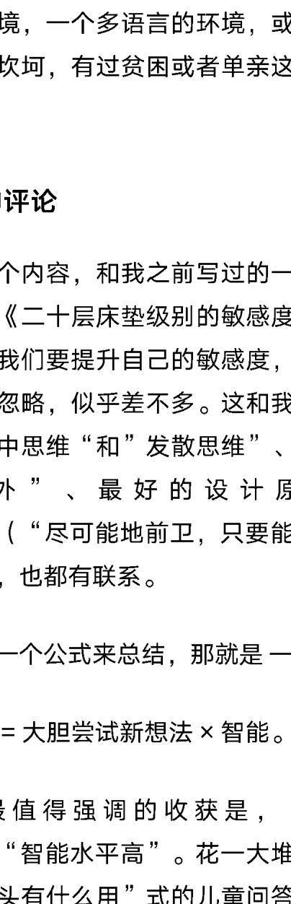

那天才和疯子之间到底有没有必然的联系？想要有“创造性”，是不是就必须得“任性”呢？

今天我们要说的是《鹦鹉螺》杂志3月份的一篇新文章，叫“如果你认为你是天才，那你就是疯子”（If You Think You’re a Genius, You’re Crazy），作者是加州大学戴维斯分校的心理学教授迪恩·西蒙顿（Dean Keith Simonton）。

西蒙顿这篇文章，属于我最赞赏的一种新型科学写作——他直接引用一些最新的科研结果，讲一个以前从来没有被说明白过的道理，并且提供一个新思想。这不是“科普”，这是来自科研前线的分析报告。

老百姓觉得天才和疯子关系很近，而有些善于理性思考的人，认为天才和疯子是两码事。第一，天才人物这么多，其中有几个疯了，并不能说明两者之间有什么联系。第二，我们几乎没听说过有什么伟大思想或者艺术品是精神病院生产出来的。

那么心理学家怎么说呢？根据西蒙顿的研究，近年来心理学家的研究结果是，天才和疯子之间确实有一个共同点。这个共同点叫做“认知抑制解除（cognitive disinhibition）”。

我先说说什么叫“认知抑制”。生活中我们每时每刻会接触到大量信息，按高清电影计算的话大概每秒钟几百个比特，而大脑的注意力能够处理的信息，我听到过一个说法，也就是每秒50个比特。这就意味着你必须大量地忽略信息。

比如你跟一个陌生人见面，可能只看他脸，不会注意他的衣服上几颗钮扣。再比如你每天上班都见到的同事，你就会注意他的变化，而忽略他不变的东西。这个时刻忽略和过滤信息的本能，就叫“认知抑制”——这是一种本能，不用学，每个人都自动进行。

而“认知抑制解除”，则是说有的人，能解除这个认知抑制的本能，专门注意到一般人忽略掉的信息，从中发现一些东西。

## 我的评论

情节，当然我不知道这个情节是真实发生过的还是编剧编的。纳什得精神病期间，他经常幻想有两个男人领着一个小女孩来找他，可是他无法区分幻想和现实。

他最后是怎么战胜这个幻觉的呢？突然有一天，纳什说，我知道他们是假的了——这几年来那个小女孩从来都没有长大过！

纳什是用理智战胜了幻觉。

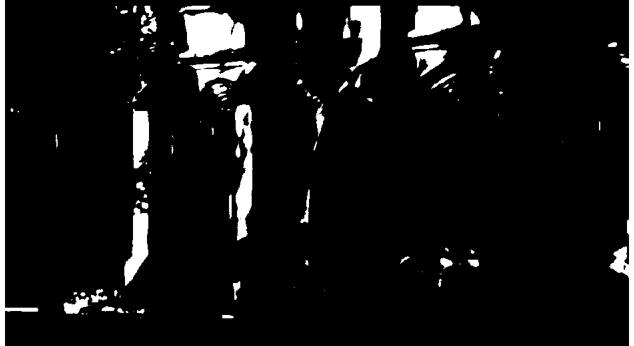

## 由此得到

创造力 = 大胆尝试新想法 × 智能。既要任性，还得理性。

天才和疯子的关系，我们大概可以用一个表格总结——

| | 认知抑制解除高 | 认知抑制解除低 |
|---|---|---|
| 智能高 | 天才 | 缺乏创造性但是能干可靠的人才 |
| 智能低 | 疯子 | “正常” 人 |

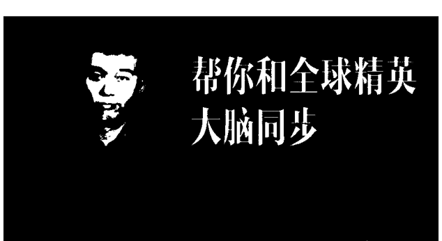

### 日课148 | 匹配者和奋斗者

咱俩先说说现代社会中常见的两种人生观，也可以说是代表了两种人，你看你是哪一种。

第一种人叫“奋斗者”。他永远想要更好的东西，比如更多的金钱、更高的职位、更大的房子，永不满足。其实他并不在乎自己得到的这个东西的绝对好坏，他追求的是一个相对的位置，也就是必须比别人好——他有强烈的竞争意识，总是想“赢”。“赢”，比生活得幸福更重要。

第二种人，我们称之为“匹配者”。匹配者的人生哲学，用一句话概括就是，“只选对的，不选贵的”。匹配者不要求自己比别人都强，也并不一定要达到什么位置，认为万事只要适合自己就可以。就好像很多女生找男朋友，不一定非得找最聪明最有钱帅的，找一个对自己好的就行。匹配者从事什么职业，一定是从兴趣出发；匹配者买什么东西，一定不会跟人攀比。匹配者注重个人品味，不论钱多钱少，总能在世界上找到一个独特的定位。匹配者的生活非常幸福。

当然，这两种人生观不是绝对的，可能一个人在某些领域是奋斗者，在某些领域又是匹配者。

那么你是奋斗者还是匹配者？你喜欢奋斗者还是匹配者？你猜，经济学家又会喜欢哪一种人？

今天我们继续讲泰勒·科文的《自满阶级》这本书。科文显然认为，美国现在有太多的匹配者，而缺乏奋斗者。

#### 1.匹配带来幸福

上期我们说到，美国人的收入现在处在一个停滞状态，几十年里没有实质的增长。但这几十年也不是白过了——有意思的是，虽然收入的经济指标不行，美国人的实际生活水平其实是提高了的。

比如说听音乐。今天的人可以只花很少的钱、甚至根本不花钱，就能随时随地、随心所欲地听到任何自己喜欢的音乐。Spotify的订阅服务一个月才10美元，比过去买张CD都便宜，而摆在你面前的，是两千万首歌曲。

再比如说旧书。新书可能还是比较贵，但美国旧书市场现在非常发达。亚马逊上买旧书，有很多书的定价是1美分加3.99美元运费，四块钱就能让一本书送到家里。

这一切当然得归功于信息技术。很多人看完一本书就捐献给图书馆，而图书馆还不一定想要。从事旧书业务的公司是按重量收购这些书，一磅10美分。如果是以前，一本旧书会在旧书店的书架上等上好几年，才能以8美元的价格卖出——库存占用书架，这都是成本啊。

而今天一切都是自动化的。旧书公司机械化扫描每一本书，自动根据磨损程度判断品相好坏，自动在网站上架。最关键的还是互联网，一本旧书不必等待很久，就能被自动分发到读者手里，所以它才能这么便宜。

这个运行模式的精神，就是匹配。

我们能随时听到自己喜欢的音乐、看到自己喜欢的电影、轻易找到符合自己口味质量好价格便宜的餐馆、乃至于在相关网站找到配偶，这些功能的背后有推荐引擎、有口碑评价系统，这些本质上都是匹配。

匹配，就是通过技术手段，让每个人找到最适合他的东西。东西还是这些东西，人还是这些人，整个过程谁也没花很多钱，谁也没挣很多钱，但是大家的生活都变得更好了。

所以，有时候经济指标并不能说明所有问题。人的收入没有增加多少，但是幸福度就这么提高了。因此科文说，他是经济增长的悲观主义者，但是是幸福度提高的乐观主义者。

看来匹配是个大好事。但是匹配有个重要特点——匹配是在对现有资源进行调配，它可没有创造新的资源。

如果你经常听罗辑思维，罗胖特别爱说两个词，一个叫“存量”，一个叫“增量”。罗胖的价值观是说，我们应该去追求“增量”。

匹配，匹配的是存量。

#### 2.还不能把不喜欢的歌曲听五遍

即使作为经济学家，科文也并不反感匹配，不过他列举了匹配的种种弊端。

首先，匹配并没有解决生活的所有问题，甚至根本就没有解决任何大问题。美国典型中产阶级家庭花费的大头，是房子、医疗保险、子女的大学教育、养车费用、和日常食品。互联网匹配技术对这些大项目的贡献非常有限。也许你可以在网上搜索房子和比较各个大学的指标，但是互联网并没有降低房价和大学学费，这些费用都在高涨。

而且匹配只帮助了那些受教育程度比较高、有一定的经济能力的人。如果穷人根本就不会使用互联网，匹配就帮不了他们。

#### 3.安全第一


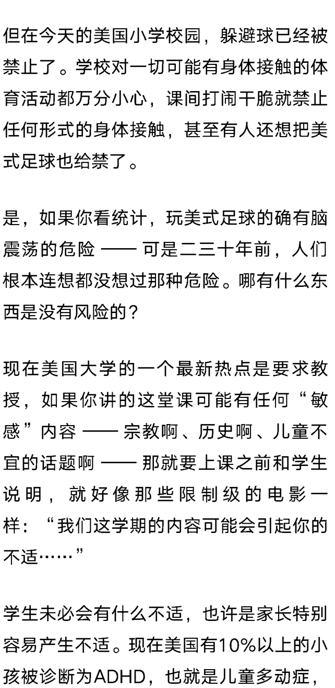

但在今天的美国小学校园，躲避球已经被禁止了。学校对一切可能有身体接触的体育活动都万分小心，课间打闹干脆就禁止任何形式的身体接触，甚至有人还想把美式足球也给禁了。

是，如果你看统计，玩美式足球的确有脑震荡的危险 —— 可是二三十年前，人们根本连想都没想过那种危险。哪有什么东西是没有风险的？

现在美国大学的一个最新热点是要求教授，如果你讲的这堂课可能有任何 “敏感” 内容 —— 宗教啊、历史啊、儿童不宜的话题啊 —— 那就要上课之前和学生说明，就好像那些限制级的电影一样： “我们这学期内容可能会引起你的不适……”

学生未必会有什么不适，也许是家长特别容易产生不适。现在美国有10%以上的小孩被诊断为ADHD，也就是儿童多动症，甚至十五六岁的青年还被认为有ADHD。如果10%的人都有这个病，这还是个病吗？现在基本上哪个小孩只要活泼好动，他就是疑似ADHD。

那你可能说，科文说这些是不是有点小题大做了。现代社会越来越文明，家长和学校在意孩子的安全有什么不对？也许你是的。但科文说这些的意思可不是因为他愤世嫉俗。作为经济学家，他关心的是经济增长和企业家精神。

从安全第一的环境里长大的孩子，没有企业家精神。

现在就有人评价，2000年以后出生的人将是美国历史上最没有企业家精神的人。这个效果其实早就有了，现在30岁以下拥有自己公司的人比例，比1980年代下降了65%。

这是一个匹配者的时代，互联网技术天生奖励匹配者。互联网是一个匹配器，把人和人，人和公司，人和兴趣，人和产品都匹配到了一起。人们轻易就获得了自己喜欢的东西，当然非常满足，那还出去冒什么险。

而如果你是一个奋斗者，互联网会惩罚你。比如你有钱就可以追求美女，在过去如果你娶了整个镇上最漂亮的女孩，你就是非常成功的人士。可是在今天，信息时代，你追到镇上最漂亮的女孩之后马上就发现，在全国、全世界还有更好的女孩！互联网永远都能给你找到一个更高的目标和更高的攀比对象，你永远也别想满足，而一直追求的状态其实非常痛苦。

越来越多的人意识到，“奋斗”是个非常无趣的游戏。过去的人一山望着一山高，现在美国青少年一上网就看到了最高的山，那身边这些不怎么高的山还有什么可值得为之奋斗的？与其奋斗，还不如赶紧找个适合自己的定位安顿下来。

这样的美国一片祥和。泰勒·科文对此很不满，他很想告诉美国人，真正有活力的国家应该是怎么样。为此他举了一个例子，那当然就是，中国。

咱们下次再说。


### 由此思考

美国的今天，会不会是中国的明天，又或者说是否中国的今天也有类似的特征呢？我们知道现在中国的体育课也都大大降低难度，不让上有些危险的项目了。

现在有些家长，对孩子什么都管，什么都给安排好，不让孩子承担一点点风险，然后他们说他们要培养孩子的“企业家精神”。我们对此很无语。


### 答读者问 | 给自己建立一个“知识图像”

#### 来自日课：老大美国说

万老师您好！我们知道中国的贫富差距主要是由改革开放的阶段和地理位置差别造成的，俄罗斯的贫富差距是在苏联解体时形成的寡头经济造成的，那么美国的贫富差距是如何形成的呢？制度使然，还是有怎样的历史原因？

万维钢
美国现在的贫富差距，并不是制度的原因。事实上从罗斯福新政开始一直到卡特时期美国的贫富差距都不大，用税收调节收入，经济也不错。卡特时期遭遇石油危机，经济没有活力。里根上台跟撒切尔夫人搞了个“华盛顿共识”，最重要政策就是对企业和富人减税——的确换来经济高速增长，但是贫富差距拉大的种子也埋下了。

不过里根的政策也不是现在贫富差距越来越大的唯一原因，甚至可能都不是主要原因。经济全球化和技术进步都是对富人有利的变化，公司把工作外包到印度，中产员工没有任何应对办法。

请问万sir，改革和既得利益就一定是矛盾的吗？这个逻辑给我没法理解，但是怎么哪都表现得两者水火不容。

万维钢
既得利益集团是当前局面的受益者，也就没有改变局面的强烈愿望。当然，你可以跟他讲道理，说从长期看来这个局面是不行的，你得做点短期的牺牲啊……那他就会反问，这么多人凭什么非得我牺牲？

但改革之难还不仅仅是因为既得利益集团。哪怕根本就不伤害任何人的实际利益，只是想改变一下做事的方法，都非常难。有本书叫 Switch: How to Change Things When Change Is Hard就非常有意思——这本书里说的change，全都是不涉及任何利益集团的change，完全是心理学上的change，都非常非常难。

今天日课收获很大：美国是一个徜徉分裂、阶层固化的社会，上层是好人，中层是忙人，下层是老实人。但对这句话颇感疑惑：“拒绝开发的劲头是美国各个城市共同的心态。”美国经济停滞已久，失业人众，贫富差距悬殊，对于不那么富裕城市来说，开发无论是对解决失业和拉动当地经济都有巨大作用，那么他们为何也会放弃开发的机会？

万维钢
主要原因还是为了维持现有房价和房租水平，而且人们心理上也习惯了一成不变的周围环境。城市已经是社会隔离的局面，富人区的居民自然不愿意开发；穷人区没有多大开发价值，搞商业穷人购买力不行，搞住宅也没人去住。

#### 来自日课：谁想要意外发现

不知道万老师有没有把所有的书分类？然后再总结你分析讨论的文章大多数是哪类？这类书是自己倾向的还是不管你是否内心不认同，但是只要认为好你都会拿出来分享讨论呢？我只是想说如果Facebook在刻意给用户推荐他们喜欢的，那你会不会无意识倾向于某些类别的信息呢？

万维钢
我没有能力追踪所有的新书，也没有一个把书分类的系统。读一本书、做笔记、再解读、再把文章修改成型，要花费大量的时间，那么这本书就必然是我自己感兴趣的，否则根本坚持不下来。我知道有些营销书读者会感兴趣，但我不感兴趣，就没有读。

我们专栏的宗旨是提供知识服务，那就必须考虑读者喜欢什么。有时候一本书已经读了一大半，越读越明显感觉读者不会喜欢（比如一本比较美国和新加坡政治制度的新书，全是生硬理论没有故事），我就放弃了。

所以，的确有倾向。好在现在有足够多的书是咱俩都感兴趣的。

但是我们跟Facebook有本质区别。Facebook是免费的，商业模式是卖广告，那它就必须用各种（可能是隐藏的）方式向用户推送一些无关的信息。Facebook必须傍依用户，因为广告商才是它的真正客户。而我们的唯一服务对象就是订阅读者。

Facebook迎合用户，然后牺牲用户；我们服务用户，甚至还希望改变用户。

#### 来自日课：美国失去创造力了吗？

美国的垄断和中国不一样吧？中国有谁进入进去坟视，而美国没有，至少对美国人没有。还有企业做大做强做久是消费者的选择，是消费者选择了它。反正今天的日课有点儿毁三观。万老师能否说一下。

万维钢
美国更加程序正义。这也说明“制度”解决不了所有问题。

美国大企业强大了，怎么感觉跟之前的胜者通吃有点类似？难道这种变化不是现代发展的必然吗？如果大企业强大会影响小企业创新，那该如何应对呢？

没有同美国人接触过，我也没有去过美国，所以这个问题不予评论。今天看到文章中有一个观点觉得比较新颖，美国大公司产生的垄断会导致创新的衰落。美国不是有反垄断法吗？政府不采取什么行动吗？

万维钢
以前铁路已经铺遍了全国的时候，新公司再想搞铁路就已经不可能了，但创新并未停止，新公司可以搞航空运输。所以小企业应该偏覆式创新，敢于冒险，尝试一个此前没有的商业模式。大企业面对特别新的东西是有劣势的，一般不愿意轻易掉头。

可是如果大企业非常敏感，对任何可能有威胁的小企业都要么收购、要么用专利壁垒之类的手段打压，小企业又能怎么办？这时候似乎纯粹靠“看不见的手”就不行了，政府必须出手。比如AT&T垄断美国电话业务那么多年，别人一点机会没有，最后还是美国政府把它分拆了。

鼓励小公司创业，用反垄断法分拆大公司，这一切的目的归根结底不是为了促竞争，而是为了创新。咱们以前讲过的《注意力量商》的作者Tim Wu，之前有本书叫 The Master Switch，说的就是美国电信史上垄断和创新的故事。事实上，AT&T的垄断对消费者并没有直接的害处，甚至可以说是一种福利！垄断最大的坏处就是阻碍创新。

但是政府直接分拆大公司的事情非常少。如果有四家航空公司主导了美国的民用航空，你说这不是垄断。我不知道《反垄断法》怎么规定的，但似乎从法律上来说这不是垄断。可是从实际上来说，这样的局面小公司基本没机会。

万老师听完这一课很想问一个大问题，疑惑很多年，我也看好多书总是找不到究竟。思想的敏锐性，那是一种什么样的状态？（每天听你的文章，看你的视角，您透露出来就是这样的状态）站在时代的高度观察和把握事物发展的规律，找准事物发展的关键。作为普通人的我如何才能做到，有什么刻意练习的方法吗？那又是一种什么样的状态呢？是什么样的思维路径呢？希望这个疑惑我好多年的想法可以被您看到，并能看到您的解惑。谢谢。

万维钢
我可以提供两个心得。一个是你读书的时候一定要善于分清主次，通过梳理作者的思维脉络去判断哪些论点重要，哪些据据不重要。

更关键的是你通过这些书给自己建立一个“知识图像”。比如你可能对“行为经济学”感兴趣。那你可能读了好几本有关行为经济学的书，你就要绘制一个行为经济学的图像。行为经济学就像是一个小国家，每一本书都是作者对这个国家的描述，而你要把这些描述拼起来，知道这个国家到底怎么回事。那你就势必发现书和书之间的联系，相互矛盾之处。所以一个好办法就是同一领域

矛盾之处。所以一个好办法就是同一领域的书多读几本，相互印证。

## 来自日课：天才和疯子一线之隔

注意常人没有注意到的细节，就像侦探剧里的那些著名的侦探能够注意到常人忽略掉的关键信息。情理之中却又在意料之外，我想问的是警察办案的时候，是不是也用到了认知限制解除，并且这项能力是否也是通过类似的刻意练习以习得的？

万维钢

这个能力是后天习得的，或者说至少是*可以*后天习得的。

格拉德威尔的 Blink 这本书里说有个婚姻问题专家，他听任何一对夫妇交谈十分钟，就能判断出来他们几年内离婚的可能性。他根据的不是直觉，而是“知道该看什么”。具体说来，吵架、冷漠都不是大问题，最大的问题是“蔑视”——如果夫妻双方有一方在语言和表情上表现出蔑视另一方，那基本上注定离婚。

那么这个专家怎么知道去特别考察“蔑视”呢？这是研究过多少对夫妇，数据分析的结果。

像这样的本事我觉得不能叫“认知抑制解除”，因为你事先已经知道该往哪看。侦探不是随意地观察现场，他根据自己的经验指导哪些地方最容易找到线索。

## 来自日课：匹配者和奋斗者

匹配和之前日课提到的俭省概念有些相似，都是对现有资源的配置。但似乎有些不同，是不是有着这样一个公式：匹配=俭省x自满？那之前的一个公式：更好的利用资源=获得更好的结果。这里的结果是不是不至于货币金钱，还包括精神层面例如幸福感？匹配的是存量，俭省也是在存量做功夫。那罗胖价值观追求增量，一味求多就好吗？就算 specie 经济学家，难道他们的目的不也是追求发展吗？那如果能在限制的框架内，利用现有的资源，多的想法，再有智能驾驶岂不更妙？那是不是一切根本原因是出在了美国人的三个自满阶级？万老师，脑中几个思想在碰撞，希望得到你的解答。

万维钢

“俭省”和“匹配”还不太一样。俭省的目的不仅仅是保留和享用现有的资源，而是为了*开发*这个资源，是为了创造新价值。匹配，是得到了这个而资源就算完事。《俭省》那本书最后还特别提醒，俭省不能太过分，不能为了省而省，该追求新的资源就要追求新的资源。

资源总是有限的，人的本性是追求发展的，因此匹配只能匹配相对不重要的资源，可以这么理解吗

万维钢

现在中国人的本性是追求发展的。美国、日本都有年轻人不想发展。比如说美国有些年轻人，父母给他很大的房子，里面各种豪华家具，但是他不要，宁可卖掉，自己去市中心住个小公寓，享受更方便的城市服务。

还有些美国富人给子女留下信托基金，确保衣食无忧。可是有子女衣食无忧了就去当环保志愿者，也不上班，更不用说什么把家族财富做大做强。

他们匹配了，但是没有发展。人到了一定程度就不想发展了。


### 周末小议 | 竞争不充分的领域里，才有英雄

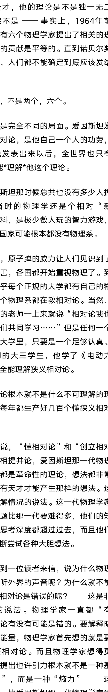

这张照片是1927年索尔维会议上物理学家的合影，这可能是物理学史上最著名的一张照片。照片上有二十九个人，其中十七人得了诺贝尔奖。不过小小的诺贝尔奖并不能代表这些人的成就，爱因斯坦、狄拉克、玻尔、普朗克、居里夫人、薛定谔、海森堡、泡利……这些人的名字如同恒星照耀人类历史。

我们不但知道他们的思想和成就，还知道他们的性格和趣闻轶事。就像文科生粉民国“大师”一样，理科生崇拜二十世纪前期活跃的那些物理学家，这些人是真正的英雄。

那么问题来了。从二十世纪后期到现在，还有哪些物理学家是你熟悉的呢？……霍金吗？

事实是现在活跃的物理学家的*知名度*，远远不能跟爱因斯坦那一代人相提并论。如果那一代物理学家是元帅和将军，这一版物理学家只能算长沙和排长。

这当然有很多可能的原因。一个原因是那一代物理学家都赶上了好时机，当时的物理学还是个年轻的科学，有很多“低垂的果实”，一个年轻人单打独斗就可以取得非凡的成就。而到今天，容易研究的问题都研究完了，新的突破必须多人合作才能完成，投入大量的时间和金钱也未必见效。个人英雄主义的时代已经一去不复返了。

不过在我看来还有一个原因也很重要，那就是现在搞物理研究的人太多了。现在的物理学是一个充分竞争、充分交流的学科，这就意味着两点——
第一，其间会有很多高手。
第二，其中的高手水平都差不多。

比如说，提出“希格斯机制”这个理论的英国物理学家彼得·希格斯，因为大型强子对撞机发现希格斯玻色子的确存在，等于是验证了他的理论，而获得诺贝尔物理学奖。那请问，希格斯是不是一位不世出的物理天才，他的理论是不是独一无二呢？当然不是——事实上，1964年前后，至少有六个物理学家提出了相关的理论，他们的贡献是平等的。直到诺贝尔奖宣布之前，人们都不能确定到底应该发给谁。不是一个，不是两个，六个。

这跟过去是完全不同的局面。爱因斯坦发表狭义相对论，是他自己一个人的功劳，而且据说发表出来以后，全世界也只有2.5个人能*理解*他这个理论。

但是爱因斯坦那时候总共也没有多少人搞物理。当时的物理学还是个相对“新兴”的学科，是极少数人玩的智力游戏，绝大多数国家可能根本都没有物理系。

二战末期，原子弹的威力让人们见识到了物理的厉害，各国都开始重视物理了。到今天，几乎每个正规的大学都有自己的物理系，每个物理系都在教相对论。当然，我听说有的老师一上来就说“相对论我也不懂，咱们共同学习……”但是任何一个比较好的大学里，只要是一个足够认真、足够聪明的大学生，他学了《电动力学》就完全能理解狭义相对论。

狭义相对论根本就不是什么不可理解的理论，中国每年都生产好几百个懂狭义相对论的人。

那你可能说，“懂相对论”和“创立相对论”不能相提并论，爱因斯坦那一代物理学家搞得都是革命性的理论，想法都非常离奇，只有天才才能产生那样的想法。这是个不了解情况的说法。这时代物理学家思考的问题比那一代要难得多，他们的知识水平和思考深度都超过过去，而且他们也都在不断尝试各种大胆想法。

上周我收到一位读者来信，说为什么物理学家不听听外界的声音呢？为什么就不能想想万一相对论是错误呢？——这是非常外行的说法。物理学家一直都在“有想”相对论有没有可能是错的。要解释暗物质和暗能量，物理学家首先想的就是要不要修正相对论。而且物理学家想得更深，有人提出也许引力根本就不是一种基本的“力”，而是一种“熵力”——这个想象力，比爱因斯坦那一代物理学家能差到哪去呢？

所以这一代物理学家的水平并不差。但是没人知道他们的个性，没人记录他们的名言，没人打听他们的“风雅趣闻”——因为他们实在太多了。今天“科学家”只是一个普通的职业，有很多很多从业者。

而且现代的物理学家，也包括其他学科的科学家和各行各业的“牛人”，还有一个特点。现在的高手都没有什么个性化的、人无我有的“绝招”。

像爱因斯坦那样，随便一出手就是震惊天下的一招，别人一看简直匪夷所思，这种情况现在越来越不可能发生了。

这是因为现在是一个充分竞争、充分交流的时代。今天的物理学家非常喜欢四处拜访，开各种学术会议，论文直接上网，好想法非常容易传播出去，那你就很难搞什么“横空出世”。事实上，连“研究风格”这个词，现在都很少有人使用了。

因为只有竞争不充分的领域里才有“风格”。比如现在我们看拳击比赛、格斗散打比赛，两个选手的打法都非常相似——为什么不是像电影里那样，一个用铁砂掌，一个用螳螂拳呢？

我理解，什么少林、武当、峨眉这些武林门派，既然一直流传到今天，历史上肯定都是非常厉害的，他们的武功不是假的。但当时既然各个门派的打法非常不同，那就说明历史上这些门派之间缺乏有效的交流。可能功夫都密不外传，可能不同门派的人很难见面，也可能一见面一动手就死一个人没办法总结经验。

如果武术门派之间充分交流，像现在职业足球这样每周打一场联赛，那么不同打法很快就能分出高下，然后所有门派的人都会去学习最高级的那个打法。那么最后结果就是所有人使用同样打法比赛——这个打法，在散打规则之下，也许就是今天的散打打法。

足球就是这样。三十年以前，足球是一个有明显不同风格的运动，比如英格兰打长传冲吊，南美洲足球则主打脚法细腻，有时候一个人盘带不动就能过好几个人，还有什么“欧洲拉丁派”。但是今天我们看世界杯，这些风格就都不那么明显了。巴西队也追求快速推进，英格兰也不打长传冲吊了。当然你可以说巴西的踢法就是与众不同——但这个关键词是“不明顯”。

这就是充分竞争和充分交流的结果。人都是同样的人，既然你这个踢法好，那我为什么不能学？过去各国球员还有身高的差异，现在实在不行还可以引进归化球员。
而且球员还在各个俱乐部流动——如果巴西国家队球员都在欧洲踢球，那他们踢的到底是巴西足球还是欧洲足球？

几十年前棋大师也很讲究个人风格，什么这个流那个流——现在还有谁说是是什么流的？招数就是那么多招数，大家从小都学过，无非是灵活运用，哪里还谈得上什么流派。

这是一个没有英雄，也没有绝招的时代。

韩非子有句话说——
“上古竞于道德，中世逞于智慧，当今争于气力。”

竞争越充分，个人风格和绝招就越没用。今天的球星出头，靠的是天赋、科学训练、艰苦奋斗和运气——基本上就是在看谁比谁有“气力”。你说我能不能说情画意、羽毛扇纶巾、慈态优雅地成为世界第一，门儿都没有。这是一个想在任何行业成为高手都得有*体能*的时代。

那么在这个时代，我们应该干什么呢？难道说只能在一个领域内模仿高手吗？也不是。

咱们想想手机。十年前的手机，各家品牌有各家的风格。外观千奇百怪。而今天的手机正面全都是一块黑屏。这就是竞争和交流带来的同质化。我们看看这张图，从前那些风格各异的手机，像不像是已经逝去了的物理学大师 —— 现在这些清一色的黑屏手机，像不像是今天这些“物理学工作者”。看上去没什么风格，实际上功能强大得多。


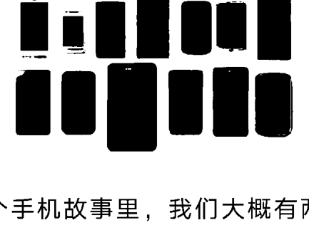

从这个手机故事里，我们大概有两个教训。

第一，你应该尽可能去一个新兴的领域。领域不成熟，竞争不激烈，你就有更大的自由度。

第二，如果是一个成熟的领域，那你就得尊重这个领域的规律，不能随便标新立异。但是！今天的手机行业也讲设计、而且特别讲创新。各家品牌的风格都淡化了，但是每一台新手机都有自己的新特点，你只是无法预测这个新特点会先在哪家出现。

这就是说没有人想完全跟别人一样，你总要有些新东西。如果一个圈子已经同质化，也许想要创新就得往圈外看 —— 看谁能从圈外给这个圈子输入新的信息。

然而归根结底，我们知道大创新是越来越难，小创新是越来越不自由了。

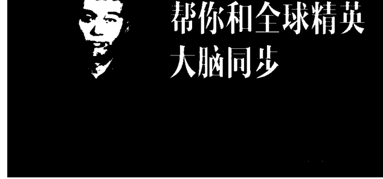

### 日课149 | 通往固化之路

日课149 | 通往固化之路

今天咱们继续说泰勒·科文（Tyler Cowen）的《自满阶级》（The Complacent Class: The Self-Defeating Quest for the American Dream）。

在正式开始之前，我们先思考一个问题——

假设你是一个刚刚毕业的大学生，没有什么家庭背景，天赋也一般，但是你品格优秀，工作肯干，很幸运地有机会进入两家比较高端的公司。A公司的员工都很注重着装，女的都穿着套裙，男的都打着领带。B公司的员工穿着都很随意，怎么舒服怎么穿，几乎没人打领带。

如果你想通过拼命工作快速升职，你应该选择哪一家公司呢？答案我们后面再说。

#### 1.美国没有马云

今天我们要说的一个概念，叫做“社会流动性（social mobility）”。社会流动性的意思是这个社会里的人在多大程度上能够跨越阶层流动。简单地说，就是穷人能不能经过个人奋斗变成富人。经济学家喜欢看的一个指标是“代际流动”，也就是说低收入阶层家庭的子女，有多大可能上升到高收入阶层？

如果社会流动性高，那就说明穷人还有机会，富人的地位不是永久的。这个世界大多数人不是富人，所以大概大多数人希望自己所处的社会能有高一点的流动性。

当今中国，就是这样一个社会。泰勒·科文在过去五年中多次访问中国，他认为中国是一个非常有活力的国家，虽然现在有很多问题，可是你每隔几年回去一看，以前的旧问题要么就消失了，要么就在发展中被跳过了……前景非常乐观。科文印象最深刻的，就是这一代中国富豪，马云、刘永好这些人，大都是从底层自己奋斗上来的。

白手起家，靠努力拼搏成为富豪，这不就是最原汁原味的美国梦吗？可是今天的美国底层已经没有马云了。

所有重要领域都已经有主了，新人没啥机会。人们曾经寄希望于互联网能制造一些新贵，毕竟互联网是全新的领域。可事实上，在互联网领域创业成功的人，扎克伯格、比尔·盖茨、贝佐斯这些人，他们都出生在美国中产、甚至是上层中产家庭。互联网并没有提高美国社会流动性。和中国相比，美国现在是一个非常稳定的局面。

科文说，这可不是说美国的政策有问题——政府就算把什么都做对，今天美国的社会流动性也高不到哪去。这是由于社会流动性有个定律——

一个国家只要没有动乱，稳定发展，那么社会流动性就一定是越来越低。

关键在于，富有家族可以“遗传”给子女的，不仅仅是财富——比如智商，就有40%到60%的因素是遗传。优秀家庭还可以给子女提供好的教育，甚至帮子女养成好的工作习惯。

那就是说，即使一个社会对所有人完全公平，没有任何人拉关系走后门，出生在好家庭的孩子也更有机会得到更好的工作。他们一代代占据好位置，根本不想把机会让给底层。

科文说，所谓高社会流动性，其实都是一社会发生了极其不好的事情以后才有的结果。比如说灾难、经济大萧条、动乱，把所有人变穷，大家重新洗牌，然后才有高流动性。

不过你要说今天美国社会已经固化了，那也不对。美国还有一个常常不被传统方法统计到的流动性，那就是外国移民。移民一般来自不发达国家，自己在美国创造的财富远远高于父辈，整个流动性是向上的。

可是问题在于，新来的移民往往并不认同美国的主流文化，他们更多的是“奋斗者”——这大概就是为什么在美国进入财富500强的公司里面，有40%是第一代移民或第二代移民创建的。

大概二十年前吧，刚到美国的中国留学生爱说一句话，叫“融入主流文化”。现在中国人越来越自信，已经没这么说了。我是从一开始就不太理解他们说的那个“主流文化”到底是什么文化。他们知不知道，现在美国的主流文化，是一个建立在低社会流动性上的文化。

#### 2.为什么同性恋婚姻要合法化？

同性恋在中国仍然是一个比较禁忌的话题。我们站在中国的角度看美国现在把同性恋婚姻合法化了，感觉这是一个激进文化、有反叛精神，这个看法其实是错误的。同性恋婚姻合法化，其实是美国追求安定的结果。

美国同性恋群体最反叛的时候是六七十年代，搞各种社会示威，他们敢于跟主流社会做对，敢于高调宣布自己的同性恋身份，积极争取权益，那是真正的反叛。那时候不管你是否支持同性恋，你看同性恋者的眼光里，多少都有一点暗暗佩服的成分。同性恋，是一面文化大纛。

有人把这个反叛精神一直继承到今天。某个同性恋运动领袖就指出，他们作为同性恋就是要大胆追求身体上的满足，直男也应该像他们学习，享受淫乱，不要被落后的婚姻制度所束缚！什么叫激进文化？这才是激进文化。

可是他低估了美国人对安定的需求。为什么民众会赞同同性恋*婚姻*合法化呢？科文认为，这其实是美国主流民众在“驯化”同性恋群体！

你们同性恋虽然不能生孩子，但也不要乱搞了，多危险啊——还是像我们直人一样，找个固定的伴侣安定下来……干脆你们就结婚吧。

我读书读到这里都乐了，这哪里是赋予婚姻权利，这简直就是用体制“招安”啊。

美国过去几十年中，任何社会变革，总是往更平静、更安全方向走。大麻合法化也是这样。以前大麻被定性为毒品，吸大麻的这帮人整天在一起闹事，没准还有一种违法的和打破禁忌的乐趣。现在大麻合法了，你想吸就吸吧，吸多了无非就是睡觉，而且对社会人畜无害。

所以说，同性恋婚姻合法化和大麻合法化这些事儿，不但不能说明美国更激进了，恰恰说明美国更平静了。

可是如果你想上进，你未必会喜欢平静。

#### 3.信号和反信号

现在回到咱们一开始的思考题，答案是你应该去那个穿西装打领带公司。想要理解这一点，我们先得了解两个经济学概念：“信号”，和“反信号”。

所谓信号，就是你做一些事情去向别人证明你的身份。比如你穿一身昂贵的衣服，来证明你有钱。

所谓反信号，就是你明明有钱，但是故意穿一身很普通的衣服。你这么做不是为了给人一个错误的信号，而恰恰是给一个*更强烈*的正确信号——你要证明的就是：“我不说你们也应该知道我有钱，我无需证明。”

举个例子。美国出版的书也是良莠不齐。从作者署名来说，如果这个作者比较自信，那封面上就应该简单写个名字——比如我叫泰勒·科文，这本书署名就是“泰勒·科文”。

可是有些书的封面署名，会在作者名字前面加一个“头衔”，比如写成“泰勒·科文博士”。这个信号就比较low了。对写书的人来说，博士算得了什么呢？事实上，凡是书名故意加一个博士头衔的，我就没看到过好书。有头衔，而署名的时候不用，这就是一个很好的反信号。

科文还举过一个例子。有人调查发现，美国大学教授在他自己的办公室电话留言机里对自己的称呼，有两种不同的信号。正规大学的教授说得很简单：“我是泰勒·科文，我不在请你给我留言”。而两年制社区大学的教授，留言就是“我是泰勒.科文*教授*，我不在请你给我留言”。社会地位比较高的人对这个自称头衔的信号就很不以为然，这个简直是生怕别人不知道他是教授，好像有一种不安全感。

下面这张图是比尔·盖茨和巴菲特一起吃午餐，他们衣着随意，吃的东西不过是汉堡加薯条，好像还一人弄了一杯含糖饮料。不知的人可能很难想象这是两位超级富豪 —— 但关键就在于，人人都知道这是两位超级富豪。他们，无需证明。

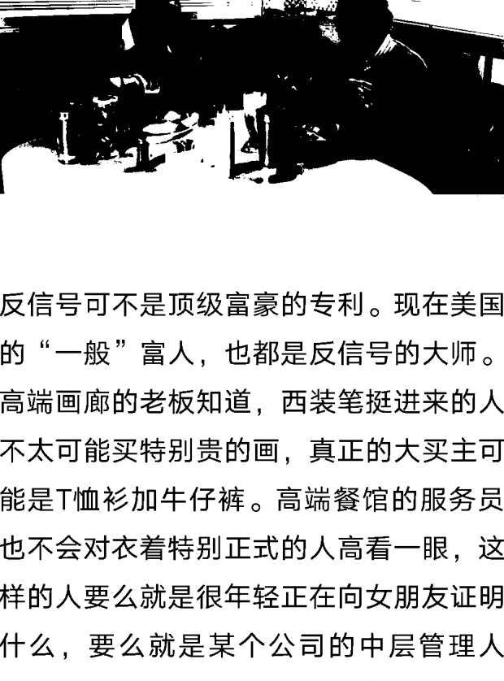

反信号可不是顶级富豪的专利。现在美国的“一般”富人，也都是反信号的大师。高端画廊的老板知道，西装笔挺进来的人不太可能买特别贵的画，真正的大买主可能是T恤衫加牛仔裤。高端餐馆的服务员也不会对衣着特别正式的人高看一眼，这样的人要么就是很年轻正在向女朋友证明什么，要么就是某个公司的中层管理人员，生怕得罪一起吃饭的日本客户。

那么现在美国公司的一个趋势就是着装越来越随意。公司大老板无需证明，二老板也无需证明，一层一层每个员工都无需证明，简直是人尽其才。可这也恰恰是高度匹配的结果！说明这个公司里的每个人都已经找到了自己的位置，既不担心被别人抢走，也不指望更进一步！

可是这样的公司，你从底层做起，还有多大上升的可能性？

科文说，从1960年代开始，日本、韩国、中国都有一段时期，员工流行穿正装上班。这些员工西装革履，朝气蓬勃，一看就和同一个地铁车厢里那些邋遢的懒汉不是同一类人。他们证明了自己的身份，发出了正确的信号 —— 我正在积极向上流动，而且我充满信心。

如果街头有很多 人打领带，我们应该非常庆幸，赶上了一个普通人仍然有上升机会的时代。


## I 由此思考

宽容大度、从容不迫，在一个人身上，这是自信；在一个社会身上，这就是低流动性，这就是阶层固化。

如此说来，低流动性其实是社会成熟的结果。如果每个阶层的人各安其命，日子过得也不错，幸福度比GDP显示的更高，那有何不可？这岂不就是桃花源社会吗？

但是科文说，这样的社会其实是不可持续的。你越是追求稳定，社会经济变化的压力就越大。稳定的背后就是危机。

咱们下次再说。


### 日课150｜有关学校教育的大实话

日课150｜有关学校教育...

今天咱们说个老话题，学校教育。现在有个新研究，证实了我长期以来一直有一个想法——也许学校对学习没有直接的作用。

我是从 Aeon 上三月份的一篇新文章知道的这个研究，文章标题是“为什么最成功的学生对学校没有热情”（Why the most successful students have no passion for school），作者叫李知炫（Jihyun Lee），这是一个韩国名字，她现在是澳大利亚新南威尔大学教育学院的副教授。文章说的就是作者本人的研究。

咱们专栏以前有篇文章叫《中美好家长都为孩子做些什么》，其中讲到过一个项目，叫“国际学生能力评估计划”（Programme for International Student Assessment），简称PISA。今天说的这个研究也是PISA项目的成果。

PISA用一套通用的试题，在多个国家对中学生进行测试，考试项目包括阅读、数学和科学。考试得分结果经常被媒体报道，人们把它当成各国学生水平的较量。不过PISA最主要的目的并不是给各国教育排名，而是教育研究！

考试之外还有一套问卷调查也要求学生完成，调查学生的学习习惯、学习态度等等。PISA要做的事情，就是寻找学生的学习成绩和问卷调查结果之间的关系。它的最高目标是想知道什么方法才是最好的学习方法，到底怎样才能培养更好的学生。PISA项目提供了很大的数据库，研究者可以直接调用这些数据。

李知炫使用了2015年最新测试的数据，覆盖72个国家和地区，对象都是15岁的初中生（大概相当于初三或高一的学生）。李知炫关心的是学生对学校的观念，和他的学习成绩之间的关系。PISA问卷调查里，有这么一道选择题：谈谈你对学校的印象，一共有四个选项：

+   A. 学校对我将来毕业以后的成人生活没有起到任何准备作用
B. 学校整个就是浪费时间
C. 学校帮我获得做决定的信心
D. 学校的确教给我将来工作有用的东西

李知炫就想看看学生给这道题的答案，和他们的学习成绩有什么关系。她只需要做一些简单的统计分析。

常理设想，好学生应该热爱学校。你每天上学充满热情，对老师言听计从，对教材深信不疑，对教育体制满怀敬畏，你的学习成绩就应该更好。差生在学校充满挫折感，也许他对学校的印象就不那么好。

但是李知炫得到的结果是，学生的考试成绩和学生对学校的态度之间，没有任何关系。

## ｜我的评论

从家长的角度看这个研究，如果学校对学习真的没什么用，那我们花很多钱买学区房，想各种办法把孩子送到好学校去，这还有意义吗？对此我有一点个人经验。

## ｜由此得到

学校对学习的作用是安排学习内容、监督学习进度、考查学习水平、交流学习心得。学校对社交的作用可能比学习的作用大多了。至于说“学习”这个动作本身，那就是你自己的事儿。


### 日课151 | 不稳定终将到来

日课151 | 不稳定终将到来

今天我们继续说泰勒·科文（Tyler Cowen）的《自满阶级》（The Complacent Class: The Self-Defeating Quest for the American Dream）。

最近特朗普公布了他的2018年预算方案，很多重要部门的经费被大幅削减，特别是科研经费减了不少。比如生命科学方面受到的伤害就很大，美国国立卫生研究院（NIH）的经费需要削减18%。像以前物理，经费主要是能源部科学办公室给的，而现在在特朗普要把能源部的总经费削减6%，其中科学办公室要被削减9亿美元。

这意味着某些大型科学装置，比如超级计算机和一些实验装置，要停止运行。某些科研项目要直接被砍掉。某些科学家要重新找工作。

在联邦政府的诸多花费之中，科学只占其中非常小的一部分。而科学代表未来，可以说是国家最重要的投资，是美国最核心的竞争优势。那为什么特朗普非得对小小的科研经费动刀呢？

泰勒·科文这本书，在特朗普就任总统之前就写好了，而我们看书中相关的讨论，就已经解释了为什么特朗普会削减科研经费。事实上，奥巴马在任的时候如果遇到财政问题，最先削减的也是科研项目。

其实谁都知道科学重要。可今天的美国政府，就是到了这么一个万般无奈的境地。

#### 1.预算与民主

表面上看，美国总统权力很大，他可以直接通过控制预算左右国家各项事业。可是实际上，总统的自由度非常有限。

理解联邦预算，我们需要两个概念，一个叫“强制性开支（mandatory spending）”，一个叫“可自由支配开支（discretionary spending）”。所谓强制性开支，就好象我们交房租、还房贷、买医疗保险这些花费，是每天早上一起眼就必须花钱，你根本动不了。去除强制性开支，还剩下多少钱，才是你的可自由支配开支。

下面这张图是去年奥巴马提出的2017财年预算方案——


我们看到，给退休人员和失业者提供的社会保险、给老年人的医疗保险、国债的利息，这三项花费就已占据了将近70%——这些花费就是你不能动的强制性开支。当然，不是法律意义上绝对不允许你动，而是一般不会动。许诺了公民的退休金总要发放，老人的医疗总要管，欠的债总要还。不但不能削减，而且随着人口老龄化越来越严重，社保医保的开支还要增加；如果利率升高，利息花费也要增加——你不但不能削减，还只能眼睁睁地看着它们往上涨。

剩下的钱里，国防预算通常也是不能削减的，像今年特朗普还给国防预算增加了10%。这几个大头一去，那联邦政府的实际可自由支配开支，连20%都不到。

我经常说你要想明白经济学就得明白“国家不是家庭”，不过在这里用家庭打比方可以帮助我们理解美国政府的困境。这个情况就如同你家的收入很高，可是你大部分收入要还房贷、买医疗保险、抚养老人，最后可支配收入还有不到20%。如果你今年想上一个大的装修项目，小孩的钢琴课就得停。

特朗普想上大项目。修边境墙和实施公立学校的择校计划需要启动资金，军费还要增加，这些钱从哪里来？那就只能削减别的开支。很多很多项目是必需品，而科学研究是奢侈品，那就削减一点科研经费吧？


联邦政府无钱可用，这是一个非常可怕的局面，而且将来还会越来越严重。有学者发明显了一个“财政民主指数（Steuerle-Roeper fiscal democracy index）”，用来表示每年的预算里到底有多大比例是联邦政府实际可以动用的。过去五十多年来，这个指数的变化如下图所示——


上世纪六十年代的财政民主指数超过60%，那政府当然可以摘登月之类的大项目！2014年这个指数已经下降到20%，2020年以后的预期将是10%以下，那政府还能干什么呢？

为什么这个指数叫财政“民主”指数呢？因为如果它的数值太小，所谓“民主”就没有意义了。政治的关键是“谁得到什么”，民主无非就是瓜分利益的方法，政府最大的权力就是利益分配——那如果你根本就没有多少利益是可以自由分配的，你还谈什么权力？

可支配支出越来越小，是因为强制性支出越来越大，其中最关键的还是社保和医保——换句话说，美国现在背上了沉重的福利负担。

#### 2.谁是世界最大的福利国家

在我们印象中，美国不应该算高福利国家。像北欧、西欧的国家，比如丹麦、芬兰、瑞典、法国等等，高税收高福利，每个人的生活水平都差不多，美国可不是这样。美国的税收水平是比较低的——这个印象，其实仅仅是算账方法的问题。

事实上，美国政府在人均医疗方面的支出，甚至超过了法国政府和个人总的人均医疗支出。你可以说美国政府医疗支出的效果不好——政府花了这么多钱，还是有那么多人没保险看不起病——但是美国政府是一分钱都没有少花。

如果你只看总预算中社保和医保这两项福利占的比例，美国的福利支出比例可能比北欧国家低，但这其实是一种误导。美国税法非常复杂，有的东西不是政府先收上来再支付出去，而是政府直接不收。比如你存退休金、买医疗保险，这都也可以减税，被减免的这部分税收干脆就没计算在预算里。如果把这些减税项目考虑在内，那么政府实际用于福利的花费会多很多。

经济合作与发展组织（The Organization for Economic Cooperation and Development，简称OECD）的结论，美国人均福利支出，实际排名是世界第二。

福利支出无非是为了给人民一个安定的生活。那么科文说，国防支出也是为了安定的生活啊？如果你把国防支出也算成一种“福利”，那美国政府的人均福利支出就绝对是世界第一。

咱们可以把美国联邦政府的强制开支负担和中国的中央政府财政预算做个对比。我找到一张图，下面是2013年中国中央财政预算支出结构——


当然我不是专业经济学家，不知道两国预算的统计方法有没有什么重大区别。仅从这张图而论，中国的社会保障和医疗卫生总支出仅占全部预算的12%左右，即使考虑到对地方一般性转移支付中可能还有福利支出，中国的总福利支出比例，估计也

福利支出，中国的总福利支出比例，估计也不会超过20%，也远远低于美国60%那个水平。

中国的事儿见仁见智，而美国政府的日子肯定是很不好过。政府可以通过加税的办法迅速获得自由可支配收入，但加税政策非常不得人心。

最可怕的是，现在美国几乎没有多少人在乎这个问题。穷人指望着政府的福利支出，当然不可能主动少拿，能过一天算一天。富人自己有的是办法，而中产阶级的纳税负担已经挺重了。

每个人似乎都是理性的，大家集体走向一场危机。

#### 3.混乱将至

现在美国的政治局面非常无奈。表面上看，特朗普当选是美国群众表达了对“建制派”的不满，可是这个“不满”，并不是面前未来的不满，而是想让美国回到过去。科文说，你睁眼看看，现在世界已经发生了这么大的变化，你能回得去吗？

美国民众这个自满情绪，早在十九世纪就已经被托克维尓在《论美国的民主》这本书里预料到了。那时候的美国充满生机，但是托克维尓注意到，美国人的精神非常世俗化，人们不是向“上”看，而是向“周围”看，跟周围的人比较。美国人并不追求真正意义上的“伟大”，而是追求把自己的日子过好。那么托克维尓推测，早晚有一天，美国人会满足于自己的日子——到那个时候，美国的民主制度就会出问题，社会的进步就会停滞下来。现在托克维尓的预言已经实现了。

科文最后用了一章的篇幅推测美国未来的危机。联邦政府的财政状况不可持续，现在已经是在向未来借钱了。将来一旦出现财务危机福利支出减少，最先的受害者就是穷人，尤其是被社会隔离已久了的黑人。黑人的不满将会引发动乱，紧接着大学校园也会陷于混乱，然后就是犯罪率上升。如果再考虑到人工智能时代的到来，大量的人失业，到时候会是什么样的局面？这还不算世界上还有其他不安定的力量。

科文最后感叹，也许历史的发展并没有一个特定的方向，而是循环的——有点“治乱循环”的宿命论的意思。当天下大治到一定程度的时候，人们越来越自满，搞不好就会导致天下大乱。也许在未来十到二十年的时间范围内，美国就可能会出现混乱。

当然美国藏富于民，国力仍在，一定程度的混乱也不见得就是灾难，也许会是活力的重生。

《自满阶级》，到此就算是说完了。

## 我的评论

这本书可能在一定程度上改变了我们对美国的认知。在我们的刻板印象中，美国人敢想敢干，充满激情和活力……现在看来，那个评价说中国可能更合适。美国现在更像个老大帝国。

这本书让我们从另一个角度认识了稳定。以变化求稳定则稳定存，以稳定求稳定则稳定亡。

当然，我们最为关心的还是中国。把中国和美国对比，我们可以得出几个有趣的结论。

我们预期将来中国的社会流动性会降低，底层上升的通道将会越来越少。

中国也会面临社会福利压力。现在中国的老龄化程度比美国好一些，问题还不太严重，可是独生子女政策使得中国将来的养老问题会比美国更严重。美国的另一个教训是政府福利支出越多，效率就越低，美国的医疗就是越来越贵。

中国人也会产生自满的情绪。其实这本书可以帮助我们重新思考一些价值观问题。过去的二三十年，中国人整个精神面貌就是想挣钱，钱是第一位的。那么很多知识分子看不惯这个现象，说中国人不讲礼貌没素质，全是暴发户没有真正的贵族。

金钱至上的暴发户心态确实不太好，可是这也恰恰说明现在的中国充满活力！有些人鸡汤式的梦想，说我现在努力挣钱，将来子女就不用这么努力了，我们有钱了就可以过安定的生活，如果特别有钱还可以去买个海岛——我就想，你买个岛又能有什么意义呢？子女不努力创造价值，难道就是理想人生了？

泰勒·科文感慨，美国有多少人关注中国GDP即将超过美国的这个事实呢？而中国人非常关心。此时此刻的中国人都想着迅速超越美国。

想想春运时候拥挤的火车，想想被未来丈母娘逼着挣钱买房的小伙，这是由奋斗者组成的中国。

此情可待成追忆，只是当时已惘然！

### 日课152 | 心理治疗师的刻意练习

今天的内容开始之前，先请你辨析以下几个名词：

心理治疗师（Psychotherapist），主要通过谈话的方式治疗和缓解患者一般性心理问题。

精神病医师（Psychiatrist），主要通过药物方法治疗精神病。

心理咨询师，相当于没有行医执照的心理治疗师，可能是中国特有的职业。治疗师由卫生部考核，咨询师由人力资源和社会保障部考核。

今天咱们说最新一期（2017年四月）《大西洋月刊》上的一篇文章，题目的“你的治疗师不知道的事儿”（What your therapist doesn't know），作者是一个心理治疗师，叫托尼·罗斯玛尼亚（Tony Rousmaniere）。这篇文章讲的是心理治疗行业的事情，我从中得知了一些以前不知道的东西。

现在心理治疗在中国已经广泛接受了。当我们产生抑郁、愤怒、过分悲伤、害怕这些情绪的时候，不管是短期还是长期，我们知道这都很有可能是 一种病，我们就需要别人的帮助。心理治疗，是一个非常重要的工作。

#### 1.一个不成熟的行业

首先我们得明确，心理治疗确实是有用的，已经帮助过很多很多人。当然心理治疗并不是都有 效，有时候确实是治疗无效——但是这也很正常，别忘了身体上的疾病去医院也不一定都能治好。

#### 2.治疗师与刻意练习

#### 3.人厉害，还是数据厉害？

## 我的评论

想让机器干》，其中举过一个例子。让犯罪专家去判断一个罪犯将来再次犯案的概率大小，陪审团更希望结论是专家自己判断得出的，而不愿意相信一个计算机模型的判断结果。人们过高评价人与人的直接交往，这个偏见暂时无法去除。

这大概可以算作人工智能即将取代人类专家的又一个例子。不过我现在最强烈的感觉，这根本不是一个“人工智能问题”，而是人的认识问题。

用软件一个最基本的好处就是患者填写问卷调查的时候，因为面对的是一台iPad而不是医生本人，他就不太可能说谎。所以哪怕不管它的算法怎么样，FIT系统天生就已经胜了一筹。

数据，只是给我们提供了一个更客观地看世界的方法。从今天这个故事我们看到，人与人的直接交流，在某些情况下可能是一种低效率的交流，其中有太多的主观感觉和太多的偏见。

以此推想，就有点细思恐极了。我们平时做事并没有什么数据分析系统随时提供反馈，那我们所看所想的，有没有可能太主观了呢？我们是不是已经处在偏见之中而不自知呢？

领导故作诚恳地向群众代表征求意见的时候，他心里其实很难明白，那种意见都是客气话没什么价值。那么我们这些普通人，能不能指望轻易获得有效反馈呢？

如果你对刻意练习式的心理治疗感兴趣，罗斯玛尼亚写了一本书，就叫《心理治疗师的刻意练习》（ Deliberate Practice for Psychotherapists: A Guide to Improving Clinical Effectiveness ）。这是一本专业著作，去年12月刚刚出版。

## I 由此思考

你所在的行业，是不是一个充分竞争和交流的行业？其中从业者的水平是否参差不齐，各人有没有非常不一样的流派呢？这个行业是怎样实现刻意练习式的即时反馈的呢？

如果有幸处在一个竞争不充分的行业，也许还是个大展身手的机会。


### 日课153 | 高手修炼手册1：系统，灵感和技能

今天咱们说一本新近特别流行的书，叫《巨人的工具：亿万富翁、偶像和世界级表演者的战术、习惯和日常》（Tools of Titans: The Tactics, Routines, and Habits of Billionaires, Icons, and World-Class Performers），作者是蒂姆·费里斯（Timothy Ferriss）。这本书是去年12月出版的，现在很多人都在谈论。


这个费里斯是1977年出生的，年纪不大已经出了好几本超级畅销书，《每周工作4小时》、《4小时锻炼身体》、《四小时大厨》，他有一个特别受欢迎的博客（www.fourhourblog.com），从2003年开始就在普林斯顿大学给人讲课，还号称是一个连续创业者和天使投资人。我以前尝试读过费里斯的《每周工作4小时》，感觉写的特别浮夸，读了个开头就放弃了。

不过这本《巨人的工具》不是费里斯自己的思想。费里斯做了一个Podcast节目，专门对名人访谈。他询问了大概一两百位名人，都是一些人物，可以说是当世之杰。费里斯让这些牛人都讲讲自己的经验之谈，他把访谈内容编排在一起，就成了这本书。


呆伯特系列漫画，今天同时在65个国家，使用25种语言，超过两千家报纸转载。亚当斯原本是个坐办公室的白领文员，刚开始画呆伯特漫画的时候因为要上班，必须每天早上四点起来画……他是怎么坚持下来，取得今天这个成就的呢？

亚当斯分享的最有价值的经验，大概是这么三条。

#### 1. “目标” 和 “系统”

亚当斯当年一边工作一边业余画画和写作，这些给他带来的物质回报非常少，大概只相当于工资收入的5%，对生活没有任何影响。当时他女朋友问他为什么要干这件事？亚当斯对此无法回答。

亚当斯现在总结，他做的这个事情，不是为了完成一个什么具体的“目标”，而是为了发展一个“系统”。

#### 2. 灵感

如果你的写作技术已经比较成熟了，你最关心的就不是“怎么写”，而是“写什么”。亚当斯要保持高频率的更新，就必须要有大量的想法做后盾。那么他的想法都是从哪里来的呢？这是我最想知道的问题，而亚当斯的答案给了我很大启发。

#### 3. 技能

亚当斯说，如果你想取得出类拔萃的成就，你大概有两个选择。

的水平。他写笑话的技能也不是全世界最好的，但是他写笑话的技能也能达到前25%的水平。现在他把这两项技能结合到一起，画“呆伯特漫画”，能做到这一点的 人就太少了。

而亚当斯其实还有第三个技能，那就是他此前坐办公室坐了很多年，他特别懂办公室政治！“办公室政治”哈哈就是呆伯特漫画的主题——这就是三个厉害的技能放在一个人身上产生的化学反应。

所以亚当斯给年轻人的建议是，不管你真正喜欢的领域是什么，你要努力在这个领域练到前25%。然后你还得再加一个领域——当然能加两个更好。如果你不知道该加什么领域，亚当斯建议你练演讲。

亚当斯说，演讲这个东西，只要是个个人，愿意苦练，就一定能练好。如果你是个 top 25%的程序员，你们公司有很多也是 top 25%的程序员，但是你同时还是一个 top 25%的演讲者——那你天然就是其他那些程序员的领导啊。

费里斯对此评论说，另一个著名作家马克·安德森（Marc Andreessen）也有类似的建议。年轻人大学最好能拿到两个不同学科的学位，这两个学科距离越远越好。比如 工程+MBA、法学+MBA，或者物理学+经济学。


## 我的评论

亚当斯这三条经验，第三条是水平问题，第二条是敏感度问题，我觉得最值得品味的是他的第一条，也就是这个“系统”，这是一个气度问题。

试问有多少人能做到，没有节点式的职业规划，没有具体目标，不计回报，长时间地去发展这么一个系统。

请允许我吹一句——我就做到了。当然我的系统没有亚当斯这么厉害，但我的确曾经在很多年里，在写作不能带来什么收入的情况下，花很多时间用自诩的专业作家的精神写博客。我从来没主动给任何媒体投过稿，我从来没向任何名人求推广，我从来没计划过哪年出书、哪年全职写作，我只是把写作当成严肃的业余爱好。

你想做到这一点，需要一定的条件。你得有个正经工作，还得有家人的支持。比如我妻子就一直都支持，其实有一段时间我整天打游戏她也支持。我的父母倒是问过我为什么要花这个功夫，我就开玩笑说因为我要当思想家——我们都觉得这挺好笑。

当然，首先你得有兴趣，你得能从这个系统本身获得乐趣——可是 有兴趣的人太多了。 每个人都对某一方面的事情感兴趣，但是要真像亚当斯这样做下来，光有兴趣是不够的。发展一个系统，不但需要你做“好玩”的事儿，还需要你做很多“不好玩”的事儿。“兴趣”，是个被高估了的素质。

“气度”，是个被忽略了的素质。不计较得失，心里有一件“大”事，我特别佩服有这样气度的人。

## 由此得到

亚当斯的三条经验：

- 1. 要发展一个系统，不要在乎小目标的成败；
- 2. 判断一个灵感值不值，与其听大脑的，不如听身体的；
- 3. 在两到三个领域，达到前25%的水平。

万维钢

这个高手修炼手册，我打算做成个小系列，继续帮你解读牛人的经验之谈。如果你觉得被启发，请点一下页面右下角的“请朋友读”，把它分享给和你一样期待取得更高成就的朋友，也许你能帮到他。


### 答读者问｜东西方对英雄的理解差异在哪？

## 来日周末小议：竞争不充分的领域里才有英雄

万老师，您好！今天日课的题目是，竞争不充分的领域才会英雄。那么我可不可以反过来，说是英雄开拓出了竞争不充分的领域呢？汉语语境里对英雄的理解，一般是智者为英，勇者为雄。一个智勇双全的人，在特殊的时势下，即便最后不成功，也可以被称之为英雄。就像李清照感叹的那样：至今思项羽，不肯过江东。而在英语境中，hero这个词来源于希腊神话，指的是神和凡人的后代，他们都是具有超凡能力的半人半神的存在。所以，超乎常美国人眼中的英雄。而中国人一般不会把孙悟空和英雄这个词联想到一块，即便他也从妖精那里救过小孩，也为干旱的国家求来了雨等等。虽然东西方对英雄的理解略有差异，但我开始提出的问题在两种文化中是同时存在的。您认为英雄和时势，是谁造就了谁呢？

万维钢
非常赞同您的说法。中国传统似乎更欣赏一个人的动作和动机，而不在乎结局，强调不以成败论英雄；西方则更多的是追求取得了出类拔萃的成就。我觉得“不以成败论英雄”这个传统不太好，不利于总结成经验和失败教训，重姿势，轻知识；不利于树立好的榜样，“平时袖手谈心性，临危一死报君王”，影响太坏。

每个人都是历史的一部分，受到当时当地的限制。如果没有电磁学、洛伦茨变换这个数学工具和光速不变的实验，爱因斯坦就不可能提出狭义相对论。爱因斯坦，首先也是人。但人不是道具，总要改变一点历史，英雄就是在更大程度上改变了历史的人吧！

## 来自日课：通往固化之路

互联网公司基本都没有西装革履，那可以说说明互联网公司没有流动力了吗？

年轻人未婚女子通常热衷打扮而已婚尤其是有了孩子的女人修饰自己的热情就会下降很多，好像是一样的道理。一个是积极发出信号，另一个已完全配不需证明自己了。尤其是婚姻越安全稳定的女性对自己的外貌越随意。这样反过来推，如果一个社会里已婚的妇女也非常注重外表的修饰，是不是说明婚姻越来越不稳定呢？

## 来自日课：有关学校教育的大实话

万老师昨天日课里说的想要成为高手就要体力好，那这个体力好到底是个什么程度呢？对于普通人来说如何达到这个体力好呢？是不是用刻意练习的那一套原则去倒着定义体力，还是说要像职业运动员那样命锻炼，可是我看职业运动员的运动生涯都不长啊。是不是有点竭泽而渔缺少后劲了？请问老师，体力好的这个度怎么把握？

年级，已经尝到了甜头——他数学水平比班上所有同学高出一截，他感到数学课很无聊，学校把他选到数学天赋班，他说天赋班的数学也太简单，他回来跟我说，老师教的方法，不如他去年就会的方法好——这不就建立了自信吗？这不就是性格养成都吗？这不就是自强于体制吗？

有一次问一个国内有名的教育学教授，农村的孩子能否超越城区的孩子，可能性有多大？他的回答是可能超越，农村的父母年龄普遍小，孩子身体好，受挫力强，智力差异小可通过后天指导消除，万老师您怎么看？

## 万维钢

平均而论肯定是城市里的孩子教育水平和机会更好，但牛人的特点就是不管平均。我上大学遇到的一个观念冲击就是出身于农村的同学和老师，有很多非常精彩的人物。后来我看有人说农村的孩子到大学之后心理有问题——我从来没遇到过心理有问题的农村同学和同事，他们身上根本就没有“农村”这个标签。

格拉德威尔有个说法，某些劣势，如果你克服了，就反而成了优势。……不过都这个时代了，还用“农村”和“城市”区分人，是不是有点过时了？

## 来自日课：不稳定终将到来

我是真的不清楚：“春运时候拥挤的火车，未来丈母娘逼着挣钱买房的小伙”。这不是激烈矛盾的体现么？哪里是活力的体现？“这是一个由奋斗者组成的中国”更是摸不着头脑：整天想着挣钱买房就是奋斗者了？刚还在批评美国之前攀比的心态，一放到我们这里就变成奋斗活力的美好景象了？望万老师指正。

## 万维钢

事物没有绝对的好坏。从这个角度看可能是不好的，从另一个角度看可能就是好的。从个体看可能是不好的，从整体看可能就是好的。

看完这一系列，一个感觉就是，政府不能管太多，从摇篮管到坟墓，就会缺乏活力，但是政府管的少，老百姓也会不满意， unavoidable 大多数人是世俗的，总喜欢和周围人比，正因为日子还没达到想要的程度，才会不自满，不自满才会有竞争有活力，所以政府职能和活力这两个面怎么平衡呢？

## 万维钢

你说的“平衡”，就是民主党和共和党怎么平衡……肯定没有什么科学的配方，两种力量都应该存在，动态平衡。太左了就往右调一调，太右了就往左调一调。

## 来自日课：心理治疗师的刻意练习

万老师，判断一个行业是否 是充分竞争，除了从业者水平和流派这些特征之外还有哪些，价格能不能算一个特征呢？

## 万维钢

当然是。这就是哈福德说的“完美市场”，我们在《两个字：稀缺》这篇文章里说过。

## 这两个问题我也不知道答案

其实我特别赞成配合使用软件。我特别想咨询万能的万老师，对于心理学专业或者心理咨询师，他们接受的负面很多，该如何排解呢？很不幸，我认识的俩不错的学习心理学的朋友……抑郁了。而他们的专业很好却无法帮助自己。我很想帮助她们，特别想知道老师是怎么看的。不知道老师能否看到留言，隔壁都直播了，不知道我们的万老师有没有安排什么时候也直播？

说到某一个行业，我还想请教老师，有什么统计方法或别的方式，能靠谱地获取行业情况？比如，在不久的将来，我考虑开一家瑜伽馆，那么目前瑜伽业的市场普遍是如何，大多数顾客又有什么样需求？有什么渠道比较客观地提供上述数据呢？

## 万维钢

这两个问题我也不知道答案，希望高手看到回答。我哪是万能的……八万多读者也许是万能的。直播还没有具体安排，等我什么时候回国就搞一次。


### 周末小议 | 第一性原理

周末小议 | 第一性原理

这周罗辑思维讲了个来自物理学和哲学的概念，叫“第一性原理”。罗胖引用了伊隆·马斯克的说法，说我们考虑一个问题，不一定非得使用类比思维，考虑前人的做法，有时候直接从最基本原理出发，可能会找到全新的办法。罗胖说，现在硅谷的创业圈，特别爱用“第一性原理”这个词。

我理解创业者说“第一性原理”，这个精神就是要抛弃成见，拒绝套路，回到最基本的限制条件下去，重新认识和解决问题。这是一个非常可贵的精神，其实“创业”的最高境界，就是要做前人没做过的事，创造从来没有过的东西。

精神归精神。不过你要说*真 的*从第一性原理出发做事，我看也是不太可能的。今天咱从物理学角度，说说这个“第一性原理”到底是什么意思。

#### 1. 马斯克的电池应该值多少钱

马斯克说第一性原理，有这么一个思路。他说现在电动汽车的电池卖的这么贵，可是如果你把电池拆开，它里面的材料无非就是钴、镍、铝、碳和一些聚合物——这些东西都很便宜！那么我们从根本出发——他的说法就是从第一性原理出发——你这个电池无非就是这些材料的排列组合吧？材料都很便宜，我怎么就不能把电池的价格降下来呢？

#### 2. 谁能做牛顿做的事儿

从物理学上说，所谓第一性原理（first principles），就是最基本的物理定律。


#### 3. 经验的价值

如果*真的*按马斯克说的从第一性原理出发，其实就是要不顾前人智慧的积累，自己另起炉灶搞一套——我认为这十分困难。电力储存的原理、电池生产的流程，这些东西不能说变就变。马斯克说的不用类比思维，只能是相对而言，不可能一点都不用。

一种情况是你有了新的工具。比如你可以借助新的研发手段，什么人工智能大数据3D打印之类，让你对电池有了新的理解。老一辈没做到，是因为他们没有自动化工具去积累足够的实验数据，也没有这么强的计算能力。你工具强大干脆暴力破解，老一辈只能羡慕。

还有一种情况，是现在环境变了。今天的基础设施、原材料价格、消费者状况如果跟过去有重大区别，那老一套的做法就不适用，你就需要一个全新的商业模式。但是你这个新模式也是依赖于当前的条件，并不是自己拍脑袋，从第一性原理中推导出来的。

技术和环境一直在变化。我们如果做一个东西，时不时想一想，这个东西以往的做法是不是已经过时了，现在有没有什么新的手段是我可以用的，这都非常正确。马斯克实力强大，肯定能集中到更多的资源做这样的事情。

可是你要说不顾当前的技术和环境条件，我马斯克只服第一性原理的物理定律，我就要给你们重新发明一个电池，我觉得你不太可能。


### 日课154｜高手修炼手册2：指挥官的派头

日课154｜高手修炼手册2...

今天咱们继续说蒂姆·费里斯的《巨人的工具》，今天出场的人物，是曾经担任过美国海军海豹突击队（SEALs）指挥官的杰克·威林克(Jocko Willink)。

威林克在海豹突击队服役二十年，参与过伊拉克战争，回来以后负责西海岸所有海豹突击队员的训练，退役以后跟人合伙开了一家咨询公司，专门向商界传授军队的领导力和管理经验。2015年，威林克还出了一本书，《极端所有权：海豹突击队的领导方法与制胜策略》（Extreme Ownership: How U.S. Navy SEALs Lead and Win），这本书曾经在纽约时报畅销书排行榜名列第一。


即使在名人之中，这位威林克也不是个普通人物，他是个非常有派头的人物。我读书的时候隔着纸背，都能感受到威林克的气势。

#### 1.自律＝自由

以前我听说罗辑思维给用户画像，说“得到”的用户都是“战士”，每天工作学习都好像战斗一样，都在想方设法提高自己，取得胜利。这种精神当然厉害，不过我猜这里说的“战士”和“战斗”主要还是一种比喻。

毕竟你的工作和学习都见不着血，就算是偶尔失败了，也不至于有人就得牺牲生命。我们有时候自己给自己增加压力，搞什么遗习之类，其实多数情况下最高目标也就是让领导满意而已。

那么如果一个人真的上过战场，见过血，面对真正H的敌人，自己一个错误决定就可能导致战友牺牲——这样的人，是一种什么气质呢？

#### 2.极端的所有权

#### 3.谦卑与领导力

旁观自己。

你正在做这件事，但是你能够时不时的跳出自己的身体，去观察你自己：我是不是生气了？我是不是太感情用事了？我是不是反应过度了？

这个其实就有点像咱们中国人说的“当局者迷旁观者清”，这等于是自己给自己提供即时反馈。做到这一点非常困难，这要求你在即使投入全部身心的情況下，仍然能在心里保持一个冷静的声音，给自己提个醒。我看这大概就是“谦卑”的最高境界。

威林克不抽烟不喝酒，连咖啡都不喝，唯一的嗜好是偶尔喝点茶。他在军中养成的习惯，做事永远有个备用方案，永远保持可靠性。威林克平时爱读一些非常黑暗的纪实作品，他说他越了解黑暗，就越对安定的日常生活充满感恩之情。

## 丨 我的评论

我读威林克事迹的时候一直在想，军队，到底是个干什么的组织？

咱们日课之前有篇文章叫《有一种情怀叫“有限”》，其中提到德国军人的荣誉感特别强，甚至上升到了宗教的程度。我们当然不赞成德军那种情怀，但是军人，的确是一个特别讲荣誉感的职业。

我想，军队其实就是一个专门研究怎么在竞争中取胜的组织。军队就要打仗，打仗就要打赢，军人的荣誉感不是“我衣服漂亮我很光荣”那种荣誉感，而是“每次跟人竞争我都要赢”，这种荣誉感。

我总是晚睡，几乎从来没有早起过。以前我总想，晚睡晚起和早睡早起的实际清醒时间不是一样的吗？早起有什么了不起的呢？今天想来，早起的人的确更自律。该睡觉不睡容易，睡得很香到点就起床比较难。如果你真的4:45起床，心想别人都还睡着而你已经做了不少工作，可能心理上确实会SUR...

## 丨 由此得到

战争能培养人。我们从一个经历过战斗，而且还是特种部队指挥官的人身上，大概可以学到这么几条——

- 一，真正的自由是自律；
- 二，你要对你的世界有极端所有权，任何事情负责到底。
- 三，谦卑使人进步。


### 日课155 | 领导力 ≠ 权力

日课155 | 领导力 ≠ 权力

今天咱们说两个熟悉的概念的新认知，“领导力”，和“权力”。

最近这几年，你肯定已经听到太多次“领导力”这个词。咱们专栏去年就说过“领导力”的一种，也就是“领导魅力”——《学点领导魅力》。这几天“得到”还搞了个专题，叫“给现在和未来的领导者们：截此培养领导力”，其中就收录了我们的文章。我觉得这个专题的题目起的特别好——“现在和未来的领导者们”——如果你现在还不是领导者，那么你可能是未来的领导者，总之你想当，或者也应该当个领导者。

这都很好。事实上，咱们专栏叫“精英日课”，那也是希望读者之中能多有一些有领导力，成为现在或者未来的领导者的人。但是这里面有一个问题——

谁当，群众。

#### 1.浮夸的领导力标签

这可不是我个人的调侃，这是一个严肃的问题，而且在已经成了一个美国的危机。3月24日的纽约时报上有篇文章，“不是领导材料？很好。世界需要追随者。”（ Not Leadership Material? Good. The World Needs Followers.）作者是苏珊·凯恩（Susan Cain）。

凯恩这篇文章，一言以蔽之——想当领导的人太多，群众不够用了。

#### 2.什么是权力

#### 3.到底什么是领导力

## | 由此得到

不一定导致腐败，权力对你个人的作用是能暴露和放大你的品质。真正的领导力还包含权力之外的东西，比如说给别人做榜样……不过现在还是权力更受重视。


## 日课精选

徐1一
20

Aa
字号
写留言
161
请朋友读

### 日课157｜给你一点虚幻的控制感

上周我们有一期文章叫《心理治疗师的刻意练习》，其中提到一个现象，有个很好用的计算机算法可以判断患者的病情是否恶化，准确率比人类心理治疗师高得多，但是大多数心理治疗师拒绝使用这个算法。专家总是觉得算法不可靠，更相信自己的判断。

这是一个很普遍的现象，有人甚至给这个现象取了个名字，叫“算法厌恶（algorithm aversion）”。计算机告诉我应该选这个，我偏不选，我非得自己说了算。

这个现象其实有点像小孩和家长的关系。家长苦口婆心说根据我这么多年的经验，你应该这么办——可是小孩有抗拒心理，说我为什么听你的，我就要自己做决定。

未来的算法越来越强大，算法做出的判断会远胜于人类，可是如果人类都有算法厌恶症，那怎么办呢？

上一期的《哈佛商业评论》中有一篇报道，介绍了一个特别漂亮的解决方案。这篇报道叫做《人们喜欢控制的错觉》（People Like The Illusion of Control）。

这是一项新研究的综述。芝加哥大学和宾夕法尼亚大学商学院的研究者想出的这个办法，是允许人们在算法给出结果的基础上，做一点小小的改动。

## ｜我的评论

今天我们说的这个“控制错觉（Illusion of Control）”，可是个普遍的心理现象。咱們现在想想，“朝三暮四”这个成语，说的就是虚假的控制感。你直接向猴子宣布，早上给三个栗子，晚上给四个，猴子就很不高兴。然后你表示接受了他们的抗议，改成早上四个，晚上三个，他们就很高兴——猴子，以为自己获得了控制权。

## ｜由此得到

人人都需要一点控制感。你生硬地替别人决定，对方就会有逆反心理。如果你稍微给他一点控制感——哪怕仅仅是个控制错觉——他就会更容易接受你的决定——啊不对，应该叫“建议”。


### 日课158｜高手修炼手册4：风险投资人的养成

日课158｜高手修炼手册4...

今天我们继续说蒂姆·费里斯的《巨人的工具》。今天出场的人物是风险投资人克里斯·萨卡（Chris Sacca）。萨卡可能是硅谷最成功的风险投资人之一，据说身价超过十亿美元。萨卡曾经在Google担任过部门的经理，出来搞风险投资以后有过多个神来之笔，像Twitter，Uber，Instagram，Kickstarter这些现在如雷贯耳的公司，萨卡都是在他们创业早期就投资了。他还上过福布斯杂志的封面。


费里斯这本书里的萨卡，是个有点性格的人。比如作为一个风险投资人，人们都把他当硅谷的人，毕竟他投的大部分公司都在硅谷——但是萨卡并不住硅谷。他住在加州一个山区里。

萨卡不住浪潮中心，因为他说他是一个进攻的人。

#### 1.进攻和防守

萨卡说，你在生活中面对的各种挑战可以分为两类。一类挑战是“防守”，也就是说那些别人给你你的挑战。别人给你任务，你想方设法完成，做成了也没有成就感，但是主动权是在别人手里。另外一类挑战是“进攻”，是你做自己想做的事情，主动权在自己手里。

比如你的电子邮箱，其实就是你的防守任务列表。每封邮件都是别人想让你干的事儿，如果你一直被邮箱左右，你就一直 在防守。

萨卡想进攻。所以他从2007年就搬离了距离硅谷30分钟车程的旧金山，跑到山里面去居住。

萨卡不想再没完没了地见各种人，开各种会了。他在山里可以集中精力做一些自己想做的事情，学习新东西，建立一些真正有价值的长期关系。

他住的地方正好是个滑雪胜地，景色很好。他就经常在周末邀请各路商业伙伴来家里玩，别人也愿意来，结果这样的关系显然更深入。这种长期的个人朋友关系，是萨卡成功投资Twitter和Uber这些公司的关键。

所以我们看，风险投资人肯定要认识很多很多人，而现在萨卡的特点是他已经不再被动地见很多人，而是主动地、有选择地跟一些人建立更高水平的关系。

关键词，“主动”。所谓进攻，就是要以我为主，积极主动。实际上萨卡早期也是这样。他知道风险投资人需要很多知识，对各行各业的情况都得有点了解，可是如果你在一个公司有份正式工作，你的工作能够给你提供的视野往往非常有限，那你就必须主动出击。

当年萨卡的做法就是不论哪有重要会议，不论人家是否邀请了他，他都想方设法去听一下。在Google的时候，各种高层的会议，甚至创始人之间的会议，萨卡也去参加。

他去开会别人根本没请他，有时候人不好意思说他，有时候也会有人问他你来干什么——这时候萨卡就说，“我是来帮你们做会议记录的。”然后他真的会把自己记的笔记发给与会者。

像这样的情商，是怎么练出来的呢？

#### 2.少年时代

我们讲的上三本书《自满阶级》里说过，美国现在阶层固化，连互联网行业这个全新行业的创业者，通常也不是出自中等以下的家庭。萨卡的家庭就有点不一般，他的父母是有一定能力的人。

美国学校的暑假长达两个半月，穷人家小孩就在家里蹲玩，有条件人家的孩子可以参加各种培训班和夏令营。而萨卡家的规矩，是每年暑假出去实习。

实习分两个阶段，萨卡称之为“甜酸暑假”。

先说“甜”的部分。萨卡的父亲有个朋友，也是萨卡的教父，这位教父有个儿子，算是萨卡的“教兄（godbrother）”吧。萨卡这位教兄的职业，是帮着利益集团在华盛顿游说国会议员。12岁那年，萨卡的实习生工作就是给教兄当小跟班，去参加游说。

而且萨卡在其中起到了一个相当严肃的作用。在游说每个政客之前，萨卡会先跟他教兄梳理一下这次游说要达到的各种条款，萨卡会把计划的内容浓缩到一张纸上，帮助兄理清思路。然后他跟着教兄去参加和政客的会面，他教兄跟政客谈，他就在旁边看。

12岁的萨卡，就已经见过华盛顿那帮议员的各种嘴脸。萨卡说这种实习至少给他三个收获——第一是获得了许多见识；第二是建立了强大的自信心；而更重要的第三条，通过总结谈话要点，他掌握了很强的讲故事能力。

而暑假里“酸”的部分是萨卡回到自己家，父亲安排他去一个建筑队打杂。建筑队的老板是他父亲的朋友，他父亲要求老板把最脏最累的工作安排给萨卡，比如把粪肥洒到别人家的院子里。如果萨卡干得不好，工友们还会对他打骂！

也许这种吃苦的工作能磨练意志品质吧。不过萨卡调侃，他父亲安排这两种实习可能还有一个警告的意思——如果你拿不到华盛顿游说这样高端的工作，那你就只能做建筑队那种“真正”的工作了。

#### 3.日常风格

我们知道有些硅谷名人爱穿标志性的衣服，比如乔布斯每次开发布会都是一件黑色套头衫，扎克伯格总爱穿一件T恤衫。萨卡的标志性服装是一件绣花牛仔服——


为啥非得这样呢？萨卡说他有一次出去做演讲，在机场很随意地买了件衣服，演讲的时候穿着反响很好。于是他回来就把家里同款衣服的一半库存都买了，从此一有正式场合就穿这件。这件衣服给了媒体一个很强的辨识度，这是在不妨害自己的情况下增加曝光的最好方法，何乐而不为呢？

萨卡面对压力的方法是反复对自己说一句话：“今天晚上我还是会回到我的床上”。不管这一天有多难，不管当前的事儿有多棘手，晚上我就可以获得安静。

萨卡对年轻人的忠告是，任何时候都要真诚，不要模仿任何人，永远做最真实的自己——而且你不必为此道歉。如果你真实自我是一个很怪异的人，那你就做这样一个很怪异的人。

其实这个说法在《巨人的工具》书里提到的另一个人物格林·贝克（Glenn Beck）也提到过。格林·贝克是现在美国当红的节目主持人，他有一次在电台节目里没忍住，暴露了自己很私密的事情，以为职业生涯结束了，没想到听众反而很欢迎。

这个逻辑是现代社会里太多人说话都是按照事先写好的稿子说，越是这样人们就越欢迎真诚的声音。跟别人一样非常无趣，真实的自我表达反而可能有市场。如果你真的在某些方面有特殊之处，它可能还是你的卖点。

萨卡给的最后一个忠告是，一定善于讲故事。风险投资人做决策，其实并不是依赖理性分析你的数字和图表，而是在听你的故事。如果他能被你的故事打动，他就会投资你的项目。如果你发现一个投资人会投资你的项目。如果你发现一个投资人在纠结地翻来覆去看你的数据，他其实不是在那里做计算，而是他想在这些数据里面找到相信你这个故事的理由。

## 我的评论

我看现在风险投资人是个非常有意思的职业。他们自己并不直接发明什么东西，但是总能侃侃而谈，专门给创业者指点江山，而且所有人都重视他们的意见，因为他们是拿着真金白银玩真的。现在很多人号称是风险投资人，但是厉害的风险投资人应该拥有多方面的素质，从低到高排列，至少有这么几个——

- 第一，你得有钱。但钱反而不是最重要的条件，现在是资本过剩的时代，创业公司弄到钱比较容易。
- 第二，你得有五花八门的知识。你需要的不见得是什么专业技能，但是你得能理解一个行业的逻辑，你得理解风险和人心，你得理解历史和趋势。你需要像狐狸一样，有跨界的见识。
- 第三，你得有关系。你得认识很多人，你得知道牛人都在哪。但是你光认识还不行，还得和这些人建立长期的、深度的关系，最好能时不时互相帮忙。风险投资人对创业者的帮助绝不仅仅是金钱上的，比如说你能不能通过关系，把发明创造和市场连接起来。
- 第四，风险投资人还得有自己的风格，甚至是哲学。如果巴菲特刚刚投资了一个东西，你要不要跟着投？

《巨人的工具》这本书里就提到，另一个风险投资人，马克·安德森（Marc Andreessen），就非要和巴菲特反着投资，他不相信巴菲特的方向。安德森说，你一定得有一个强烈的观点，然后你还得有放弃这个观点的勇气。有强烈的观点，你才能下水去做这件事。可是一旦现实告诉你这个强烈的观点是错误的，你还得能马上调整，而不是固执己见。

有观点有态度，再往高了还得有思想。马克·安德森就是一个很有思想的人。他现在到处鼓吹的一个思想是，现在创业者的产品都卖得太便宜了。产品卖得太便宜了就收不回资金，收不了资金就做不了推广，做不了推广就不能把产品推广给更多的人。所以他强烈主张创业者们提高产品价格——其实我觉得他说的好像不对，但最起码他有这个思想。

这大概就是为什么人们都爱听风险投资人讲话吧。

## 由此得到

并不是每个人都能有萨卡这样的条件，能获得那些经历和见识。但是每个人都能更“积极主动”一点。有多少事情是别人让你干的，有多少事情是你自己真正想干的？你想不想尝试一下，进攻。


### 答读者问 | 如何讲好一个故事？

#### 来自日课：给你一点虚幻的控制感

万老师，我想咨询一下您是如何培养孩子的数学能力的？能否分享一下您的方法？还有就是从那个年龄开始培养比较合适？如何知道孩子对数学是否有兴趣？

万老师，我小孩正在上二年级，我想对他的数学（在学校教学之外）下点功夫，望能得到您的建议。

万维钢

我听说过一个理论。家长干预孩子学习，只在十二岁以前有效——你投入时间，他的成绩就能变好。过了十二岁，全凭自己爱不爱学，你只是提供一个后勤保障。数学是自己会做会算才觉得有兴趣，所以早期干预一下，强制提高成绩，是值得的。

具体方法没有什么特殊的，无非是做足够多的练习题。我觉得很多人犯的一个错误是把大量时间浪费在已经会做的题目上，不敢前行。我父母从国内带来现在的小学数学课本，我发现上面的习题就已经很多了。如果让你孩子用课本自学，那些题就已经够了，不要再加别的练习题。别管学校老师教到哪，会了就往下学。哪怕提前好几年把小学数学都学完了也没关系。有余力，回过头来再上难度，搞搞数学竞赛之类。

关于万老师举的孩子学习的例子，是不是“从一开始就让孩子选择撕哪页习集”比“开始被动接受，到后来能够选择撕哪页”的愉悦感要低？

万维钢

我不知道有没有人做过实验，但我觉得你说的有道理。但是我们也知道，这点愉悦感其实是微不足道的。为刻意练习计，前期做什么题家长还是要干预一下。

万老师，我发现其实一个很奇怪的现象啊，可能有些人需要的是仅仅一点虚幻控制感，而不是全部控制感。很多人做自主权很大的工作表现的很差啊，你看很多人根本没办法支配充裕的时间，只是觉得无聊。这是为什么啊？能不能解答哈。

万维钢

这个问题我略知一二。首先，的确是有些人自主能力比较强，你给他自由时间他知道该干什么；有些人自主能力弱，你不告诉他他就不干。第二，这两种人是基因决定还是文化决定的，我没听说过什么结论，但是我知道一个事实：国家的社会经济制度，会影响国民的自主性。

这是 Top Dog: The Science of Winning and Losing，《夺魁者：关于输赢的科学》作者（作者 Po Bronson and Ashley Merryman）这本书里说的，我在别处似乎也见过类似的说法——

以前东欧社会主义国家的工人，因为是终生制的，工资福利都有保证，干活就非常没有积极性。干活的工具坏了，工人既不会自己修好，也不会上报领导，而是等着！等上级路过这里说你怎么不干活？他才说工具坏了。你让秘书打个电话，她打的时候发现电话号码不对，那么她不会自己去找正确的电话号码，她干脆就不打了，等着你下次过问。

当年东欧的学校，学生成绩再差也不会被淘汰，最多也就是跟全班同学道歉说我拖慢了班级的进度。如果竞争无意义，水乎高也不能脱颖而出，那就可能形成一个“没有自主性”的文化。东欧有些工程师，就算自己有个高级技能，也不会去谋求更好的职位。

而这个现象一直到这些国家变成资本主义国家以后，仍然长期存在——已经成了“文化”了。两德统一之后，原来东德的人的自主性仍然不如西德。

但是我们知道，这种“文化”似乎没有在中国发生。这可能是因为东欧当年搞得太过分了，或者因为中国文化传统上就是比较勤奋的。

当然制度的影响不是绝对的。自主性高和低的人在哪个国家、什么时候期，都有。

#### 来自日课：风险投资人的养成

万老师如何提高讲故事的能力呢？现在也每天看很多乱七八糟的书，包含各个知识领域的都有，但每次聊天说自己看到的有趣的事时，感觉自己说出来就没那么有趣了。是自己归纳理解的问题还是表达的问题？还有就是明明有相关的故事但当下就是没有联想起来，是要刻意去练习记忆吗？平常我自己也有用笔记录很多自己觉得有趣的东西，但摘录后就很少去看了，请指点一二。

万维钢

这个话题太大了，关于讲故事的书有很多，是个学问，我今天没法详细说。但我想说的是，“故事”是个广义的概念，并不是只有剧情片才叫故事，纪录片、政论演讲、科普文章、乃至于科学论文，都可以写成故事。

你需要英雄，你需要悬念，你需要冲突，你需要结局。

比如说我要写篇物理论文，我可以这么写——

+ 1. 现在有这么一个物理现象，它发生在很多地方，而它有一个性质，现在是怎么回事还不知道：【坏人、悬念】
+ 2. 某某和某某使用了他们的方法试图解决这个问题，但是他们的结果我们不太满意：【冲突】
+ 3. 我们有这么一个高级工具：【英雄】
+ 4. 用我们的工具研究这个问题，我是这么做的：【剧情展开】
+ 5. 中间有个难点，工具不能直接用；【冲突：英雄第一次出手，失败了】
+ 6. 我必须对工具做一些修改；【英雄改变了自己】
+ 7. 然后我就得出了很好的结果：【英雄战胜了坏人：高潮！】
+ 8. 我还发现了以前不知道的一些事情【给续集留下悬念】

这就是一篇很好读的论文。当然论文前面有摘要，引言里也由介绍你的结果，这些都相当于“照递”，可是按照这个套路写仍然更能让人接受。

但是更重要的教训还不是怎么写故事，而是这个——文章是写给读者的，说话是讲给听众的。你说每一句话，都要想着怎么才能让人容易接受。

### 周末小议｜问熊逸：国学的三个问题

周末小议｜问熊逸：国学...

熊逸书院终于开学了，大会堂里有一个盛大的集会。领导先致辞，然后熊逸老师给了一个开明宗义的主题演讲。熊逸立志要办新型书院，特意用浅显的语言，把他深的道理论得非常明白。台下学生大呼精彩。熊逸讲完之后，主持人说，有没有同学想问熊老师问题？

同学们都 Lip...同学...万维钢同学举起了手。"万同学，你有什么问题吗？" 熊老师用鼓励的眼神看着他。万维钢紧张地站起来，说，熊老师——

## 我有三个问题。

作为一个中国的读书人，我们从小到大，大概有两个沮丧时刻...

第二个 沮丧 时刻就 比较 严重了 —— 是你某一天终于意识到，中国文化有 可能 并 不是 世界上 最 优秀 的文化。

那么 我的 第一个问题就是，所谓 “国学”，到底是 对全体人类都有价值的通用的学问，还是仅仅是一个地方性的风俗学问。

## 熊逸来了

一年读通52本思想经典


### 日课159 | 什么故事最好使？

日课159 | 什么故事最好使？

咱们上周五讲《巨人的工具》这本书里说到风险投资人克里斯·萨卡，有一个忠告，说你应该掌握讲故事的技能 —— 因为说服别人最好的办法往往不是靠理论和数据，而是讲一个好故事。前天的“答读者问”里，我说了一点讲故事的事儿，今天再说个更高级的。

我要说的道理，来自《像TED一样讲话：世界顶级大脑的九个演讲秘密》（Talk Like TED: The 9 Public-Speaking Secrets of the World's Top Minds）这本书，作者是卡迈恩·加洛（Carmine Gallo）。


讲解TED演讲套路的书有好几本，我最推荐这本。咱们专栏去年有一篇文章叫《表现出热情，别人才相信你是真心》，说的也是这本书。加洛不但量化分析了大量的TED演讲，而且还把他分析出来的结果和当前各种科学研究结合起来，可以说是既有理论，又有数据。

—— 而今天的道理是理论和数据的作用远远不如故事。咱们先讲个故事。

#### 1.一个故事

这个故事是布莱恩·史蒂文森（Bryan Stevenson）在2012年的一次TED演讲里讲的。史蒂文森是个非常有影响力的民权律师和社会活动家，他这次演讲非常精彩，建议找时间听一下，题目的 “We need to talk about an injustice”。他讲了好几个故事，这是其中一个——


史蒂文森的外祖母有十个子女，子女们又各有孩子，整个是个很大的家族，所以史蒂文森小时候并没有多少机会跟外祖母单独独处。但是家里人都知道，外祖母是个有智慧的人。史蒂文森九岁时候的一天，外祖母叫住他，领着他离开众人，找了个小房间单独谈话。

#### 2.故事的力量

这本书的作者加洛，对史蒂文森的演讲做了量化分析。他发现整个将近24分钟的演讲里，史蒂文森65%的时间都在讲故事。他讲了自己的故事，亲朋的故事，和名人的故事。史蒂文森是来讲道理的，那他为什么用这么多的时间讲故事呢？

#### 3.三种故事

加洛纵观各个成功的TED演讲，发现演讲者爱讲的故事总共有三种。要想有说服力，你可以考虑讲这三种故事，而我们对这三种故事有不同的要求。

从这个人的经历中学到一个什么道理。

第三种，是某个品牌或者产品的故事。像这样的故事，听众的要求就更高：它必须是一个有关成功或者失败的故事。

## Ⅰ 由此得到

讲道理不如讲故事。顺便说一句，史蒂文森讲他外祖母的故事，想说的道理是“身份认同”——我们常常根据自己的身份认同去做选择。我认为我是 políticas的孩子，我就不喝酒。你能说服他不是那种人，他就不会做不好的事。

加洛这本书是我几年前看的。这次要不是为了写文章把这本书找出来又读一遍，我都忘了史蒂文森到底想说哪个道理。可是我还记得这个故事。也许有时候道理比故事值钱，但是故事的生命力远胜道理。

从这个角度讲，我们一生之中学了许多道理，也许还不如经历过什么难忘的故事！

我敢打赌，再过几年你可能会忘记今天课说的道理——但是你会记得史蒂文森和他外祖母的那个故事。


### 日课160｜行业和行业的创新不平等

“创新”现在可能已经是人们最常听到的词汇了，但是你注意到没有，我们平时听到说创新比较多的，都是跟互联网相关的企业。就拿“得到”里的“知识新闻”这个栏目来说，非常喜欢谈创新，但是很少涉及到传统行业。我们看各种科技报道，企业大佬的话语之类，也大都跟互联网行业相关。这是不是一个偏见呢？

也许不是。媒体报道总是喜欢“新”故事，我们关注“新”东西。而现在传统行业里，没有多少“新”东西。

咱们专栏前段时间讲过泰勒·科文的《自满阶级》这本书，其中提到现在美国的经济进步有点滞后的趋势，其实这并非是科文一个人的观点。现在有很多学者认为，别看表面看起来花团锦簇整个世界都在谈论创新，实际上，发达国家的企业创新速度正在减缓。

今天要说的是《哈佛商业评论》网站上3月21日的一篇文章，“到底是研发越来越难，还是公司越来越不会研发了？”（Is R&D Getting Harder, or Are Companies Just Getting Worse At It?），作者是华盛顿大学商学院教授安妮·诺特（Anne Knott）。这篇文章说的是诺特本人的研究。

诺特列举数据说明，现在企业投入的研发力量超过以往，但是获得的新成果却是越来越少。2015年，研发投入前1000名的企业，总共投入了6800亿美元的研发费用，比上一年增加了5%。跟三十年前相比，现在参与研发的科学家和工程师人数增加了250%。可是单位研发投入所产生的回报，却比30年前降低了65%。

## ｜我的评论

诺特这个研究说的是公司，但是我们如果想想个人，也很感慨。网上流传一句话，是1998年版《新华字典》上讲到标点符号用法的一个例句：“张华考上了北京大学，李萍进了中等技术学校；我在百货公司当售货员；我们都有光明的前途。”


## ｜由此得到

行业跟行业是不平等的。现在的局面是大多数行业创新越来越难，少数特别有活力的行业还有很大的创新空间。不论企业还是个人，选择行业都无比重要。可局势总会变化你也无法预测赌哪一个，那最好就采取多样性的策略。


## 日课161 | 你用“算法”，我用“意会”

日课161 | 你用“算法”，...

从今天开始咱们连载解读一本新书，《意会：人文学科在算法时代的力量》（Sensemaking：The Power of the Humanities in the Age of the Algorithm），作者克里斯汀·麦兹伯格（Christian Madsbjerg）是个战略咨询顾问。


这本书是两周之前，3月21号才刚刚出版。我目测这是一本非常重要的书。在讲这本书之前，咱们先来回顾一下我们曾经反复提到过的一句话，《了不起的盖茨比》的作者菲茨杰拉德（Francis Scott Key Fitzgerald）的名言——


> “检验一流智力的标准，就是看你能不能在头脑中同时存在两种相反的想法，还维持正常行事的能力。”

你肯定猜出来了，我今天要讲的，又是一个跟咱们以前说过的东西有点矛盾的道理。

#### 1. 谁还学人文学科？

#### 2. 哪个专业收入高

#### 3. 什么叫“意会”

的区别。如果去年是个普通员工，今年进入了管理层，那不管工资升高了多少，这都是发生了“质”的变化，这就是有意义的区别。

有意义的区别，就是不能简单用*数字*描述的东西，所以叫“意会”。而我们研究这些区别，最根本的目的，是理解“人”。

麦兹伯格举了个例子。假设你是福特汽车的CEO。这是一个非常高的位置，公司上下几万人的命运都在你手里，有些下属为了跟你谈半小时，可能要用几周的时间做准备。你的最重要职责，就是战略决策。

现在有这么一个问题。福特汽车在美国市场的卖点是高科技。美国消费者喜欢高精尖的功能，所以福特汽车投入大量的研发力量，给汽车配置各种先进功能。而现在福特公司想要进入发展中国家的新兴市场，那你应该定位什么样的卖点呢？

如果要用算法解决这个问题，你大概就得不预设任何立场地设计很多款不同的车型，在各个国家做销售实验，看哪个车型好卖就批量生产哪个。但是这根本不可行——车型变化的灵活性太大，你不可能测试五百种不同的车型，而且你根本没有时间和金钱去做这种实验。

这时候，你就需要“意会”了。你必须根据对当地文化的*理解*，判断消费者可能喜欢什么样的汽车。

比如福特研发了一个叫做“变道辅助”的技术，能提醒司机在自己的车道行驶。这个技术在路况较差、划线不规范的国家里，就毫无意义，做不成卖点。再比无人驾驶汽车在印度可能就没什么需求，因为印度有车家庭的标配是雇佣一名专职司机，这在印度人看来是身份的象征。像这样的分析推理，就不是算法，而是意会。

福特公司当然需要算法。财务报表、供应链、消费者调查，这些都有算法的支持，但是有些重大决定是算法不能实现的。

## I 我的评论

其实每个认真的学者都明白，人类专家有人类专家的优点，算法有算法的缺点。过去这二十年，西方“主流”学者特别爱强调算法的优越性，是因为这是我们这个时代的主题。

## I 由此得到

在算法大行其道的时代，麦兹伯格这本书说真正的重大决策还是得靠人，靠“意会”。表面上看，大数据、算法和定量分析已经占领了社会科学，但实际上传统的“自由技艺”的根基并没有动摇，反而显得更可贵了。


### 日课162 | 心理学黑套路的实战应用

日课162 | 心理学黑套路...

今天我们再说一个跟“行为设计学”有关的话题。咱们专栏之前有篇文章就叫《行为设计学》，讲的是现在有些商家正在把一些心理学套路用于产品设计。后来我们还有一篇 文章叫《老百姓的不满和高材生的设计》，讲的是美国政府曾经想用行为设计学去解决水污染危机，结果失败了。

所以行为设计学有时候好使有时候不好使——公司用似乎总比政府用好使。而今天我们要说的，是一个特别好使的例子。纽约时报4月2号的一篇深度报道“Uber使用心理学套路操纵司机”（How Uber Uses Psychological Tricks to Push Its Drivers’ Buttons），作者乔昂·黄（JON HUANG），爆了一个猛料。

#### 1.利益格局

我们知道，Uber做的是共享专车，你只要安装一个手机App就可以开出租车，Uber帮你找到乘客。你开自己的车也行，租辆车也行，全职开车也行，业余偶尔开开也行。Uber的分成比例是司机拿75%，Uber平台拿25%。平时打车费率固定，遇到高峰时段不好打车Uber还会帮你加价。

这个系统看似天衣无缝，Uber和司机的利益应该是一致的，有钱一起赚，童叟无欺，对吧？实际上，Uber和司机之间存在一个矛盾。

开车是能挣钱，但是你不打算一直都在路上开车。人总要生活的，可能你想每天赚点钱就下班，可能你想平时开开周末不开，这都是人之常情。

如果路上的Uber司机少乘客不容易打到车，那就算是高峰，Uber还会提高打车价格，司机还能多挣点。

所以对司机来说，最好的局面是大家都少干点，每次拉客的价格高一点。

可是Uber根本就不想赚高峰时段加价这个钱。我们以前说过，Uber现在还是个烧钱的公司，它短期内根本不想盈利，它想要的是迅速占领整个打车市场。Uber希望每 时每刻，任何想打车的乘客都能快速地、廉价地叫到一辆Uber的出租车。

所以对Uber来说，最好的局面是司机们任劳任怨、永不停歇地一直ro路上。

可是Uber和司机并没有正式的雇佣关系，司机并没有固定的工资，也享受不到任何福利——所以司机们根本不用听Uber的命令，想干就干，不想干就回家。那Uber怎么办呢？这就是“行为设计学”的用武之地了。

#### 2.五个套路

“行为设计学”最大的好处就是既不用威逼也不用利诱，使几个心理学套路就能让 人按你设计的办。它不是催眠术，但是用好了比催眠和巫术都好使。

Uber的思想，是把司机的行为给“游戏 化”。Uber雇佣了几百位社会学家、数据 科学家和电子游戏设计师，来设计司机使 用的手机APP系统，研究怎么让司机像打 游戏一样，对“开出租”这个活动上瘾。

这个做法说不上是秘密，但是Uber绝不会 公开跟人说。一开始是有一些中层管理人员 透露了一些消息，后来有科学家还专门把 Uber的游戏化做法写成了论文发表，人们 这才渐渐知道Uber在做这个。纽约时报的 这位黄记者，走访了很多Uber内部人士和 科学家，才写出了这篇重量级的报道。

Uber至少用了五招。如果不看这篇报道， 我们很难想象有人能把行为设计学用到这 个地步！

第一招是动态目标。去年我们专栏有篇文 章叫《目标很丰满，不确定性很骨感》， 其中提到一个现象，出租车司机习惯每天 给自己定一个目标，比如要挣到500块钱。但这种“固定目标”的效率非常低， 因为司机一旦挣够了500块钱就不干了。

Uber的做法，是给司机一个*动态*目标。 一个司机跑累了，他点击手机APP说我要 下线，Uber并不会让司机马上下线。它给 司机弹出一个提示：“你今天只要再挣6 美元，就能挣够40美元，你真的想现在就 下线吗？"


40美元这个数字是怎么来的呢？为什么我 今天非得挣够40美元？可能你昨天挣了 40美元。更可能的是没有任何理由， Uber就是想在前面找个整数，吸引你继续 开车。等你挣到40美元它又会问你为什么 不挣到60美元？这种动态目标就好像挂在 驴子眼前的胡萝卜一样，你永远都够不 到。

第二招是提前接单。在Netflix上看电视连 续剧，一集快要结束的时候，下一集自动 就已经出现在屏幕上。你什么都不用做， 它就能自动播放。你想停下来反而还需要 去做点什么——按个暂停键。Netflix这 个做法能最大限度地把观众留在屏幕前， 让人上瘾。

Uber借鉴了这个办法。在你把这一单乘客 即将送到，但是还没送到的时候，下一个 乘客的订单就已经显示出来了。你接还是 不接？这个时候正好。你不由自主地就想 接单……然后下一单还没送完，又进来一 单。

第三招是女性口吻。Uber各地的调度经理 有时候会通过手机APP给司机发短信，提 示哪里有机会，比如“有个音乐会快散场 了你去吧”。经理们很快发现，如果用女 性的口吻和司机对话，司机就更容易从 指挥——因为绝大多数Uber司机都是男 的。其实大多数经理也是男的——不过 没关系，反正也不用发语音。

第四招是新人任务。很多新司机开几天车 新鲜感过去就不再想干了。为了把这些人留 住，Uber搞了个新手奖励机制——完成 25单任务，就可以获得一个奖励。你的新 手任务快要过半的时候，Uber还会给你发 一个鼓励短信！那你可能会问，如果有人干 完25单就走人，Uber岂不是失算了吗？ 其实不会。“25”这个数字不是拍脑袋想 出来的，是科学测定的结果——干过25 单……你就已经习惯了。

第五招是免费勋章。咱们在“得到”完成 一定的学习时间，就会收到系统颁发的各 种勋章奖励，有些勋章可以换来电子书。 Uber也有给司机的勋章系统，而且连电子 书都不给，纯粹是个免费的精神鼓励—— 就跟电子游戏里一样。

咱们想想这五招。没有任何强制，纯粹是 心理学上的助推——就把司机搞沉迷 了。

#### 3.流氓会武术

经常打电子游戏的人大概都有这样的体 验。有些游戏打完之后有一种成就感，有 些游戏如果你沉迷进去，时间长了是一种 非常无助的空虚感。给Uber当司机这个游 戏，带来的可能就是空虚感。

有个司机跟黄记者说，“我几乎是全职给 Uber干，一整夏才挣了2万美元，这还没 算油钱和车的保养费用！”

黄记者说，如果Uber和司机之间有正式的 雇佣关系，你这么长的工作时间，这么低 的报酬，就违反了劳动法！可是Uber妙就 妙在根本没有雇佣关系，你司机工作时间 长是你自愿的，我可没逼你。

我不知道有没有学心理学的同学，读到这 里作何感想。你们哪里像昨天泰布·布什 说的找不到好工作，你们研究的简直是大 规模杀伤性武器。

而且还有更黑的手段没用。Uber有个强有 力的竞争对手，滴滴差不多一样。

而且还有更黑的手段没用。Uber有个强有力的竞争对手，商业模式几乎一样，叫Lyft。Lyft曾经内部测试过一招。有些司机喜欢每周五休息，可是周五又是打车高峰期。Lyft就给一些司机发消息：“如果你把休息时间从周五改成周二，你周五每小时可以多挣15美元。”而给另一些司机发 Magic messages 则：“如果你周五休息，你相当于每小时少挣15美元。”

结果第二种消息效果好得多。心理学家一看就明白这个原理——典型的“损失厌恶”。人们惧怕损失，远远超过渴望赢得。

但是让我感到很吃惊的是，Lyft最终还是选择了第一种消息——他们觉得损失厌恶这招实在太狠了，对司机压榨过甚容易出事。

所以心理学套路这种武器，现在已经强大到了需要谨慎使用的程度！

黄记者呼吁有关部门限制一下Uber这种公司对心理学武器的滥用，而Uber最近出了不少丑闻，也在想办法改进跟司机的关系。

## 我的评论

真实生活和游戏的一个最大区别，就是真实生活没有游戏里那么高的效率。

以前有个笑话说如果比尔·盖茨看到地上有一张一百美元的钞票，他不应该捡——因为根据盖茨的赚钱速度，在弯腰捡钱的这一秒钟时间里，他原本可以赚更多的钱。

而实际上，如果我是盖茨，我大概会捡那一百块钱——事实上哪怕是1块钱我也会捡。因为我并不是每时每刻都在做“最高效率挣钱”的事。盖茨的钱不是他手脚一刻不停地挣的，他该玩玩该休息休息。他知道，有时候就算他参与了也不会多挣钱，有时候就算他不参与也不会少挣钱。

这不是劳逸结合的问题，这是“人的劳务输出跟收获不总成比例”。这是系统低效率的表现，但也正因为这样，我们才能心安理得地休息。

如此说来，固定工资制的效率虽然没有计件工资制那么高，但固定工资制是一个更人性化的制度！也许固定工资除了劳务回报之外，还有一个“给你提供一个一揽子生存解决方案”的意思。这个解决方案不仅仅包括工资，还包括福利和生活。人们工作并不仅仅是拿劳务换钱，还有一个安身立命的含义。

那么考虑到这一点，Uber这些公司搞“游戏化”，能不能多一点思路呢？

## 由此得到

当前亾司对行为设计学的应用已经达到了一个很高的水平，而且其有效程度几近可怕。现在已经有必要对行为设计学的应用加以规范，再不采取措施，人可能会被套路玩出事儿来。


### 日课163 | 老年人有知识，年轻人有数据

日课163 | 老年人有知识...

今天我们继续说克里斯汀·麦兹伯格（Christian Madsbjerg）的《意义：人文学科在算法时代的力量》（Sensemaking：The Power of the Humanities in the Age of the Algorithm）这本书。

中国一百年前的新文化运动，有个代表人物叫钱玄同。钱玄同年轻的时候有一句名言：“人到40岁就该死，不死也该枪毙”。这句话当然太偏激了，但是也代表了当时的一种时代精神——中国被列强欺侮得惨不忍睹，很多人员觉得老一套的东西真是不行，都在呼吁新思想。既然人过了四十很难转变思想，那想要救中国就只能指望年轻人。

可是等到钱玄同在自己到了40岁……他选择了继续活着。胡适、鲁迅都拿这件事调侃过他。但是是一百年后的今天，仍然有人认为人到了一定年龄以后就不行了。

硅谷，就有非常明显的年龄歧视。年纪大的工程师很难在硅谷创业公司找到职位，尤其是软件工程师。我甚至看到过一个报道，说一个有脱发的人为了去硅谷工作，专门去做了植发，就为让自己显得年轻一点。

而且硅谷对老人的歧视有时候是直截了当地说出来的，也不顾什么政治正确。比如扎克伯格在一个斯坦福的聚会上，公开说“年轻人就是更聪明”。还有人说，“45岁以上的人基本上没啥新思想了”。

#### 1. “理论的终结”

#### 2.Google到底能不能预测流感爆发

知都会被“颠覆”——我们只追求“解决方案”。

那我们还要不要学习新思想？还要不要了解对立阵营的想法？麦兹伯格感到非常痛心。

## Ⅰ 我的评论

如果你写说理的文章想要让读者容易接受，形成鲜明记忆，我告诉你一个秘诀——你不要说“一方……另一方……”，你最好有点智识勇气和责任担当，只说“一方”。

安德森的文章就只说了“一方”，麦兹伯格这本《意会》则只说了“另一方”。两个人说话的时间相隔九年，他们说的都是当时那个时代的时代精神。

但是我们作为读者，就得考虑“两方”了。那结论当然是两个人都有道理。不过我是个有担当的人，所以我想替安德森辩护几句。

用大数据取代科学也许不可能，但是到了这个时代，要像麦兹伯格说的那样先去理解世界，再去解决问题，也许更不可能。普林斯顿大学有个哲学教授叫戴维·温伯格（David Weinberger），他2012年出了本书叫《万物皆无序：新数字秩序的革命》（ Too Big to Know），这本书里有一个关键思想，那就是这个世界可能根本就是不可能被人理解的。

比如说生物的细胞系统。我们知道细胞里有各种结构，细胞各个地区之间有各种信号传递、有接收信号之后的反应。但是这些信号和反应之间，到底是一个什么逻辑？没人知道。因为细胞里有太多的信号和太多的反应！整个系统太过复杂，你根本就没有办法讲故事！

那想要研究真实的细胞，唯一的做法就是用计算机模拟。也许我们可以做到精确预测细胞的演化，但是我们永远都不能指望去“理解”这个演化。

以前我做物理的时候，我的工作是用计算机模拟受控核聚变条件下的等离子体。所以现在这么多人用计算机模拟，是因为传统的物理理论已经用不上了。我们能用计算机模拟一个物理现象，但是你很难用人的语言“解释”那个现象。

所以千万不要轻易否定硅谷这个意识形态。也许我们就是得重新思考什么叫“理论”，什么叫“知识”。我们会面临很多很多无法“意会”的东西。

不过麦兹伯格也没打算“意会”所有问题，他真正关心的是社会和人。我们理解不了细胞，理解人还是可以的吧？咱们下次再说。


### 答读者问 | 人生不是游戏通关

#### 来自日课：什么故事最好使？

今天的故事让人印象深刻，可以说是过耳不忘了吧。不过我想问万老师一个技术上的问题，老师说几年前看过这本书，记得这个故事，但是我平时会有这样的困惑，我记得一个故事，但是我是想不起来是哪本书里看到的了，想再看一看却不知从哪里找起。万老师看书这么多，需要记忆的东西更多，您是如何解决这个问题呢？是您记忆力特别好，还是说有什么特别有效的方法呢？

## 万维钢

我有时候也记不得一个内容是在哪本书里看的，不过很多情况下，我的确记得、或者用的时候能找到，一个内容是哪本书里的。不是我记忆力好，是因为我读书是专业的读法。

首先我记笔记。我查找什么内容首先从笔记查，而不去查原书。

其次我每读一本书都读好几遍。就拿《意志》这本书来说，我是有声书听一遍、电子书一边划线一边读一遍、单看划线总结思想形成笔记一遍、写成文章还有一遍。读这么多遍我不太可能记不住内容。但是你不能刻意地去记忆，有一个笔记系统是最好的。

等你读书到了更高的阶段，还有一点不同：你得对现在世界上有那些牛人经常写书，他们的观点和立场都是什么，有一个认识。这样你就会把书按照作者分类，形成一个框架，你就知道哪句话可能谁说的，很不可能是谁说的。……不过我的确听说，有个教授的妻子把家里的书按封面颜色分类，居然有时候找书比把书按作者分类的教授还快：）

#### 来自日课：行业和行业的创新不平等

多样性的策略，会不会造成公司过个人不专太专？很多公司就是由于多元化发展，抓不住主线，造成竞争力的下降，没有一种业务能够做到业界TOP级别。

## 万维钢

的确如此。公司创新本质上是有赌博成分的，没有万全之策……还记得咱们以前说过“苹果的表永远指向上午九点”这个典故吧。所以有人就说，CEO最重要的职责不是日常管理，而是琼脂创新方向。

#### 来自日课：你用“算法”，我用“意会”

#### 来自日课：心理学黑套路的实战应用

#### 来自日课：老年人有知识，年轻人有数据

个“经验公式”，能几乎完美地描写这些数据。仿佛那个公式代表了现象背后的理论，可是没人知道公式为什么是这个样子。能预测，但是不理解。

而这种能预测但是不理解的情形还很多，事实上我们也可以说古人能预测太阳东升西落，但是并不真的理解为何如此。

霍金，曾经问过一个问题。他说既然宇宙是物理定律决定的，那么这些物理定律完全可以“规定”，其中的生物不能“理解”这个宇宙。我们现在试图理解，这只是一个信念。

“时代太快，等你慢慢理解了解世界，世界早变了。套路能用先用，先别管理论。” 不过想问万老师，各门各派武功，如果没有背后理论（价值观）支持，看到别门招式厉害，就不管三七二十一先用在说，学到最后，自己是谁会不会都忘了呢？ 还有，真理对这个真实世界可能没用，就像哲学一样，但没有探究真理的必要性存在吗？如果是这样，怎么会有伟大的思想出现呢？如果探究科学的真理无用，真正追思想突破的学者，在这个时代背景下会沮丧的，万老师作为曾经的学者，对此又有什么看法呢？

## 万维钢

这就涉及到“后现代主义哲学”了。这个思想认为一切知识都只是主观的模型，所谓“理解”，也只是一种主观感受。一切模型都是有限的真理，有各自的适用范围。

但这不用沮丧。“真不真”，意义不大；但是“美不美”意义很大。牛顿力学是一个区域性的模型，但是你可以欣赏它的简洁之美。量子电动力学、广义相对论，这些都是特别美的理论。

我有个朋友，哲学造诣很深。他经常跟我说，最后剩下宝贵的东西，并不是因为你的理论“对”，你发现了“真理”，而是你使用的技巧漂亮。技巧，是真正值得崇拜的东西。

其实人生不也是这样吗？我们追求的并不是在死前那一刻达到什么状态，什么“彼岸”，人生不是游戏通关。我们追求的就是一生之中的这些各种各样的体验。

## 2人笔记

万老师看你的专栏有那个logo，包括你的《未来简史》读书笔记封面也是那个logo，请问那个logo有什么特殊意义嘛？或者它背后有什么故事？如果有机会请务必跟我们分享一下哦！

## 万维钢

这个东西叫“小斜方截半立方体”，没有什么特殊的意义。关键这个图是达芬奇画的，我想跟圣人沾点光：）


### 周末小议｜熊逸答：国学的三个问题

周末小议｜熊逸答：国学...

## 万维钢

上周末，我向《熊逸书院》的熊逸老师问了关于国学的三个问题。熊老师连夜做出了回复，以下是全文——

文｜熊逸

万维钢老师在“精英日课”发布“周末小议”，题目是“问熊逸：国学的三个问题”。

第一问：所谓‘国学’，到底是对全体人类都有价值的通用的学问，还是仅仅是一个地方性的风俗学问？

第二问：中国文化中有哪些仅仅是历史遗迹，有哪些对现代社会仍然有用？

第三问：我们对中国文化是不是非得“仰望”，我们能不能站在现代的高度，“俯视”国学。如果一直仰望，怎么能发展呢？

三个响当当的问题，配合着万老师精心设计的提问场景，引发了一场群情雀跃。大家的目光都看向熊逸书院，不知道熊逸为什么还不出来回应，难道熊老师比熊孩子更迟钝？

且慢，熊只是身形笨拙而已，终于还是慢吞吞地来了。

## 1.熊来了

话说熊逸憨憨愣愣地听完了问题，耸起眼睛，侧起耳朵，迟疑着说：“万同学，你最后那段话，是怎么说的来着？就是‘非得’什么、‘格局’什么，我！听！不！清！ ”

## 2.无法共鸣的lamp感

## 3.内群体偏袒效应

五岁砒红，你的聪明才智终于使你克服了情感的干扰，发现对面那一组里，吴军和李笑来正在畅谈天下大势，薛兆丰和李翔在聊经济学原理，刘润站在“5分钟商学院”的门口，笑嘻嘻地问你：“你的部门，有必要存在吗？”还有人挂出了“槽边往事和菜头”的专栏招牌，而罗胖正站在招牌底下，渊淳岳峤地指点着：“‘往事’和‘和’和‘和’和‘菜头’的字间距太小了，要调整一下。”

“好高深的语言啊，难道这就是传说中的叱咤风云？”你正在喃喃自语，老潘走了出来，扔给你一本古色古香的《番汉合时掌中珠》，笑嘻嘻地说道：“那是西夏语，拿这本书来查。”

你哪还有心思查书呢，只是左右看着，看到谈笑有鸿儒，往来无白丁。再看看自己这边人，都在墙根底下黑压压挤成一团，除了斗地主的就是给斗地主支付的，只有熊逸骄然出尘，和傻丫儿玩跳皮筋呢。

## 4.大局观和新视野

认真说来，眼界越窄，排外心理就越强。即便在一些细枝末节上，比如在吃豆腐脑糊撇的地方，会觉得吃豆腐脑放白糖是粗鄙无文的蚕食行径，当然，反之亦然。人的口味主要是由母亲在怀孕时期的饮食特色造就的，其次是受周边环境的影响，倒也没有客观上的高下优劣之分。但是，智能马桶和秸秆衬儿，手机和大喇叭儿，貌似貌劣，至少绝大多数人都有一致的标准。

所以，站在今天来看，西方的物质文明超过中国，这是没人可以反驳的。但这又有什麽关系呢？我们每家每户用到的冰箱、彩电、洗衣机，大大小小的家用电器，上下楼要坐的电梯，上下班要坐的汽车，哪一样都不是中国本土的发明，但“百姓日用而不知”，因此而沮丧的人显然不多。即便是文官老太也有一种大局观——当然不是何帆式的大局观（^_^）——即使不能清晰地表达出来，隐隐然也知道这些科技都属于“人类文明”，不分国界。

## 5.熊的手机是iphone7

说回国学，我认真看了一眼自己的手机。

国学和手机有什么关系呢？别急，请容我慢慢道来。

我用的手机是iphone7，是的，有点丢脸。某个朋友发现了这桩奇事，特地问我：“赶时髦？这不像你！到底怎么了？”

这种群体联盟制度中，双方享有共同权利，承担着对权利起补充作用的义务”。他在“多贡人抽象观念的基础中”找到了解释。“事实上，关于世界的起源，其标志一直就是事物的二元结合。世上万物都应是成双出现的。”因此，这是根据多贡人关于孪生的观念所作的个别解释。

两个群体之间的这种关系在世界上许多地方都可以发现。最著名的例证是北美、南美、美拉尼西亚和澳大利亚的半偶族组织。描述这两种群体联成一个社会的二元结合的最常用的方法是运用一对对立，如天与地、战争与和平、红与白、土与水、土狼与野猫、鹰与乌鸦。因此，其基本的观念是对立的统一，如赫拉克利特的哲学所表述的那样。在中国人的哲学中，则将其更精巧地表述为阴阳；阴与阳是指男人与女人、白天与黑夜、夏天与冬天、积极与消极等等，他们断言，要构成统一和谐，就必须使阴阳结合，如同夫妻之合，或冬夏之合为一年。

看嘛，连“阴阳”这种观念都不那么独特。

至于我自己的态度，可能是因为天性凉薄、又总有一种局外人身份的缘故吧，所以并没有万老师的这些纠结。我对传统经典虽然有着厚重的趣味，但是毕竟是个现代人，同样渴望现代社会中的新知，并且以新知回望古典。人类的知识总是进步的，尽管进步总是曲折的。我喜爱传统的经典，正如考古学家喜爱东捡西掘，为一点点发现而激动万分。但是，考古学家的家里，一定用的是新版的智能马桶，而不是古代的粪坑和马桶；他可以复原出古代的孔明灯，但现实生活中的沟通还是要靠手机和互联网。同样，翻出二十年前的“大哥大”，循着技术和社会的脉络，一步步看清今天的手机从何而来，这是一件有趣的事情，而即使“大哥大”还可以正常使用，我们也会舍“大哥大”而取智能手机者也。

刻意发掘“大哥大”在今天的实用意义——无论是发掘它的“高级功能”还是“低级功能”，实在很无必要，至少会是一桩事倍功半的事。那么，对于万老师的第二个问题：

中国文化中有哪些仅是历史遗迹，有哪些对现代社会仍然有用？

## 6. “无用”与“无用之用”

来理解极本华，很可能就不会有这部《人问词语》了。

中国传统总是实用主义的，即使时到如今，人们热衷于理解哲学或类似哲学的心理灵汤，出发点总是希望对当下有益：或用以平衡心态，或用以强大家志。这是一种U盘式的拿来主义：只有即插即用才是好的。这种阅读风气不免令人怀疑：我们究竟比那些晚清遗老进步了多少？

哲学偏离不是U盘，反而更像是二进制运算算法。小得勃对哲学的一句说明恰恰与上述罗素对几何学的评语有些异曲同工之妙：“表面上似乎同人们的实际生活和表面利益相去甚远的思辨哲学，其实是世界上最能影响人们的东西。”

如果不将粗浅之讥，将社会比作一棵大树，那么哲学、意识形态与技术的关系便近乎于树根、树干与树叶的关系。枝繁叶茂是触手可及的繁华，但是，若仅仅在枝叶上注射养料以期待枝繁叶茂的结果，这结果分明不待尝试便可预见。

但是，也许只有王国维一般高见沧海的人才有如此的预见力，这或多或少要归功于他受旧学影响较浅的缘故——当然，是和张之洞那些人比，不是和我们来比。”清谈误国”是中国历史上以惨痛代价才获得的政治智慧：魏晋清谈声尤在耳，那么大族名士岂不正是不理世务，以谈玄论道打发高雅浮生的么？难道此风还当再现，只是清谈的内容换成西方哲学吗？

这是一种合情合理的质疑，只不过忽略了魏晋名士与西哲先贤的一点不同：前者毕竟是在尸位素餐之余来谈玄论道的，霸占着官位却毫不理事，即便将清谈改成其他娱乐方式，亡国也是免不了的。一言以蔽之：误国其实不是清谈负责的责任。

1903年7月，王国维在《教育世界》上发表了一篇《哲学骇惑》，反击张之洞抛出的“哲学有害无益”论，阐述哲学的无用之大用。这篇文章，似乎在今天看来亦不失其时效性。

## 7.极端之见

再来看看万老师的第三个问题：

我们对中国文化是不是非得‘仰望’，我们不能站在现代的高度，‘俯视’国学。如果一直仰望，怎么能发展呢？

万老师的心里肯定已经有了答案，我对万老师不曾说出的答案深表赞同，非但赞同，而且我的看法还要更极端一些。

这个极端之处就是：国学为什么一定要发展呢？

假如我们生在西方，我们当然知道柏拉图和亚里士多德是伟大的哲人，他们的著作是奠定西方文明的重要基石。我们当然会去研究他们的学术，但我们真的会想“发展”他们的学术吗？今天的医学院还会教学生背诵希波克拉底誓言，但谁会想要“发展”希波克拉底的医术呢？

探究我们身上的文化基因，可以使我们更好地认识自己，知道我们从哪里来，我们何以如此，我们向何处去。我们像农夫一样生活，有的人只看着麦穗，有的人却还想了解土壤。

## 8.我爸爸比你爸爸强

从另一个角度看，对国学的“仰望”未尝不可，这就像一个人既然有信仰上的自由，为什么就不能以信仰国学呢？

给心理找依靠，找靠山，这是人的天性。或者可以这样来说，宗教性就是人的天性。哪怕胡乱相信一点什么，心里也会踏实很多。这番道理，万老师在专栏第006期《表现出热情，别人才会相信你是真心》其实已经讲到了，只要稍稍引申一下，就可以解释国人对国学的“仰望”之情。

万老师在问题里说：“如果有什么学问非得跟着学，我看那不是学问，那是宗教。中国过去这几十年，因为国学出了大名的，有一些人很不争气。有的寻章摘句，有的心灵鸡汤，有弹神弄鬼。”这话说得掷地有声呵。万老师觉得国学不该是宗教却变成了宗教，所以值得批判。容我借用拜伦赞颂吉本的诗句来赞颂万老师：“他精通道器，笑里藏刀，用疾穆的冷嘲笑倒了肃穆的宗教。”但是，这是精英思维。像万老师这样怀有精英思维的人有多少呢？截止到此时此刻，我竟然只发现了87698人！^_^

对的，这是《精英日课》的订阅量。尽管这是一个令人眼红的数字，但比起全中国的人口基数来说，简直九牛一毛。^_^

这虽然是玩笑话，涵义却并不那么玩笑。

在《精英日课》的发刊词里，万老师区分出“精英”和“普通人”的诸多特质，其中有这样一组对比：“精英注重个人选择和自由，而普通人认为别人应该和自己一样。”我愿意把话说得更直接一点：“精英注重个人选择和自由，而普通人喜欢很有限的个人选择和很有限的自由。”

这个问题优势，就是我们基因里烙印着的奴性。做奴隶真的那么可敬吗？其实并不是的，古今中外的历史上出现过各种形式的奴隶，他们往往乐在其中。至少奴隶制是治疗选择障碍的灵丹妙药，今天的很多年轻人一定都有同感吧？女生出门前挑选—身合适的衣服——这样搭配，那样搭配，这个和那个不搭，那个和这个不搭，这双鞋子昨天穿过了，不能连续两天重样，等等等等。如果她卖身为奴，只能穿主人规定她穿的衣服，所有的纠结就都没有了。^_^

更重要的是，奴隶可以有个主子做靠山，这是很愉快的心里体验。如果我们觉得与人为奴有侮辱严，做神的奴仆也就没有这个问题了嘛。

即便当神的光环陨落，拥有了自由的人们却往往逃避自由，这是因为自由是一种“不安全”的状态，而弱小的人类在天性上就是需要“集体”的。弗洛姆在《健全的社会》里有过这样的概括：“……极权主义运动吸引着渴望逃避自由的人们。现代人获得了自由，然而在内心深处却渴望逃避自由。现代人摆脱了中世纪的束缚，却没有能够自由地在理性与爱的基础之上营造一种有意义的生活，于是，他便想以顺从领袖、民族或国家的方式，以寻求新的安全感。”

越是“普通人”，越是需要神，需要靠山，需要领袖，需要偶像，这四者异名而同实。作为群居动物，奴性显然是一种生存优势，让我们能在不明所以的时候自动自发地围拢在强者身边，而那些特立独行的“精英”——如果曾经有过的话——很容易被严苛的生活环境淘汰。万老师强调的精英思维，是人类进入文明时代之后才会闪光的东西，需要以脆弱的理性抗拒强悍的本能，这很辛苦，能坚持下来的人注定不会很多。

普通人身上不但奴性更强，还会更加在意自己的社群标签。社群就是神，就是靠山，就是领袖，就是偶像，就是给他们提供精神力量的源泉。一个人类举着社群标签拼杀在这个高度竞争的社会上，就像球员带着亲友团到世界各地打比赛一样，无论身在何方都能获得一点“主场优势”。那么，在缺乏西方式宗教传统中国，许多人以国学为宗教，自然是在再正常不过的事情。如果我们在学术系统里看国学，当然会对它的宗教化感到荒唐，但是，正如我自己专栏的发刊词标题“跨界读经典”所说的那样，让我们跨个界，把国学的宗教化当做一种社会现象，从社会学的角度来理解它，就会对荒唐感到释然，并且多了几分别样的感受。

人的宗教性是永恒且普世的，有神就会拜神，无神就会造神，当然还需自己的神比别人的神厉害才行。所以道教编《老子化胡经》，说佛教不过是老子西出函谷关之后化身而成的，佛教说孔子是儒萨，儒家说道教是虚妄，佛教是夷狄。这种心态可以一言以蔽之：“我爸爸比你爸爸强！”小孩子的话里最能体现出人性的本真。

国学很“厉害爸爸”的潜质，所以很容易被披上宗教的外衣。这些潜质，我就不想一列举了，这里只谈其中的一点，那就是古汉语的模糊性。

我为自己的专栏已经储备好很多期的内容，其中讲《大学》的那一期里，有一节的小标题是“语言限定了思辨的边界”，我就顶着“剧透”的骂名，摘引两段出来好了：

## 9.语言限定了思辨的边界

中国走进宋朝，异党文化水平提高了，儒学开始向着思辨哲学的方向发展了。但古汉语并没有进步太多，用古汉语来编思辨哲学，就像用泥瓦匠的工具来修理手表。今天我们能写出的谨的思辨文章，很大程度上要感谢晚清、民国那些翻译家。现代汉语里那些时态从句、被动语态等等，都是当年的“翻译腔”带过来的。

最适合古汉语的文体是诗歌，最能写出朦胧的韵味，比西方语言强一大截。

朦胧的韵味，比西方语言强一大截。
欧美学习中国古诗，兴起过一个意象派，虽然也有好作品，虽然也能在当年的诗坛上刮起一阵旋风，但和中国古诗的佳作一比，好像天生就带残疾似的。这是因為英语的语法结构太精确了，天生就朦胧不起来。这方面的内容，等我今后讲到诗歌的时候再展开谈。
为什么很多人觉得宋诗赶不上唐诗，一个很主要的原因是：宋朝人就连写诗也喜欢说理，这就等于舍长用短，看上去总感觉有点勉强，只有少数高手才能应付裕如。而用古汉语来作哲学思辨，就像用英语写意象派诗歌一样，勉为其难。我只举一个小例子：“无极而太极”，这是一个很重要的、基础性的哲学命题，但它到底是什么意思，是说无极生出了太极，还是说无极就是太极，还是别的是什么意思，就连第一流的学者也搞不清，在理学阵营内部就说不清。

## 10.从听人的书名看逻辑传统

还有一段讲欧洲中世纪大学课程的内容，也不妨剧透出来作为对照：

在贸易兴起的时候，算术和法律就变成了热门。博洛尼亚大学就是以法学著称的。还有一门学科被高度重视，但我们今天很难理解，那就是逻辑学。逻辑学耗时耗力，学下来需要很多年，巴黎大学的逻辑课要求学生完亚里士多德的全部逻辑学著作。当时的逻辑学就像今天的基础学科一样，不管你以后要专攻医学、法学还是神学，如果打不好逻辑学的底子，一切都是白搭。

我第一次知道这一点的時候，很有一种恍然大悟的感觉。以前看西方著作，总是不理解那些书名为什么两极分化。小説题目一般只是主人公的人名，比如《奥利弗·特维斯特》，中国人看不惯，要翻译成《雾都孤儿》。后来才知道这是《荷马史诗》的标题传统，《伊利亚特》、《奥德赛》就是这样的。但另一方面，西方论说性的著作，题目极其繁琐。我们先看一下中国人取的题目，比如《大学章句》、《大学衍义》、《大学问》，然后我们再看西方的书名：《国富论》，好像书简意骇，但这是中译本的简化，人家原名叫《国民财富的性质和原因的研究》，再比如《乌托邦》，这同样是中式式的简化，原名有点可怕，是《关于最完美的国家制度和乌托邦新岛的既有益又有趣的金书》。再看《物种起源》，原名更吓人，是《物种通过自然选择或在生存竞争中占优势的种群得以存活的方式的起源》——这是我从英文书名直译过来的，如果采取“信、达、雅”的标准，就必须断句，再重新组织语言。还好原书会把“物种起源”几个字印成大号、加粗，算是对读者最大限度的体谅了。

这就是高度重视逻辑学后的遗症，从中看得出，他们为了精确的表达、规范的描述，付出了怎样的代价。这种语言的麻烦当然就是累赘，而优势也很明显，就是准确，并且便于交流。

中国也有过逻辑课，不过都是在佛教寺院里，是来自印度的因明学。佛教僧侣经常需要辩论佛经义理，这就需要大家都遵守一致的逻辑规范，否则很容易鸡同鸭讲。但中国人并不重视这个，古汉语又确实不适合逻辑思辨，所以因明学也没有发展很久。

中国人不大讲究逻辑，很大程度上是受了语言的制约。所以金岳霖当年提出“逻辑救国”这个口号，倒也不算荒唐。金岳霖的著作，以缜密的逻辑逐层推导中国传统哲学那些“无极而太极”的模糊概念，是一项难能可贵但费力不讨好的事业，所以他的学术远不如他和林徽因的关系那样脍炙人口。

话说回来，古汉语的模糊性很容易使现代人在似懂非懂间萌生敬畏，又有太大的解读空间。有了这两点，宗教性就已经呼之欲出了。

## 11.要不要把希波克拉底和扁鹊的医术发扬光大？

万老师讲：

国学不是吐火罗文，国学不是《弟子规》。国学不应该仅仅是EMBA培训班上老板们的饭后读资，国学更不应该仅仅是附庸风雅的中产阶级培训小孩的另一项才艺。

其实我倒觉得，国学可以是吐火罗文，可以是《弟子规》，可以是谈资和才艺，这都无妨。这就像跆拳道原本是格斗技术，但时代变了，它不妨变身为体育运动或礼仪训练。至于国学能否成为万老师所推崇的“治国者”的学问，我倒觉得没必要做这种事倍功半的事情，这就像我们守着三甲医院，没必要发扬希波克拉底和扁鹊的医术来治病一样。

但是，深入了解“希波克拉底”和“扁鹊”的学问，可以使我们对许多貌似古怪、荒唐的历史和社会问题明白一点“为什么”，从此不再“莫名惊诧”了。

万老师说：“国学对应的应该是西方的‘自由技艺（liberal arts）’，是能让人事事更有分寸，解决问题更有办法，获得真正自由的学问。”这种对应，恰好我在“熊逸书院”第八周的文稿里仔细写到过，只不过我对“自由技艺”使用的译名是“文科七艺”。这两种学问，在它们各自发展起来之后，就出现了一种奇怪的现象：从出发点到教育结构，竟然处处都是反的。“文科七艺”发展为技能教育，恰恰属于“君子不器”的那个“器”。而国学“君子不器”的精神貌似居高临下，但国学教育早在古代就面临了一种很严峻的读者错位和社会背景错位的问题，所以才会越变越奇怪。这里我就不仔细讲了，请大家等到专栏第八周吧。

我的回复就到这里吧，还有一点小尾巴留到下次再说，不然真怕累到大家了。铺天盖地讲了这么多，貌似有一种“乱拳打死老师傅”的气慨，希望没让万老师见笑。最后，对万老师的鼓励和帮助再次致以诚挚的感谢！祝万老师仙福永享，寿与天齐！^_^

万维钢
能看到这里，你辛苦了。据说熊逸老师做了这番精彩的长回复之后，仍然意犹未尽，正在酝酿向我发出第二轮隔空提问。下周末再来，敬请期待！


### 日课164 | 专家的五重境界

日课164 | 专家的五重境界

今天咱们继续说克里斯汀·麦兹伯格的《意会：人文学科在算法时代的力量》这本书。

上周有个读者给我留言，说他的儿子被两个美国大学录取了，他儿子想学工科，选择了一个综合性大学，但他希望他儿子择另一个，问我用什么办法说服他儿子。

可是这个问题我没法回答。事实上，如果哲学家海德格尔听到这个问题，他一定会禁止我回答。关键在于，我根本不了解这位读者的儿子。

#### 1.海德格尔的洞见

海德格尔的一个思想，就是今天我们要说的内容。这个思想就是到底应该怎么研究“人”？

早期的哲学家是把人当成单独的个体。比如笛卡尔说“我思故我在”——既然我能坐在这里思考，那就证明我是一个存在着的人。如果你也在思考，那你也可以认为你也存在。这其中的一个精神是我这个个人是怎么回事，你大概也是怎么回事。

但是到了近现代，到了海德格尔这里，“人”就不是这么简单的了。海德格尔说每个人都有属于他自己的一个“世界”，你脱离这个人的世界，单独把这个人拿出来，抽象地谈论这个人，是行不通的。

这句话，非常非常厉害。海德格尔等于于是宣布，研究自然科学的“科学方法”，是不能用来研究人的！

比如物理学家研究电子，这个电子和那个电子完全一样，你做实验在这个电子身上证明的性质，必然也适用于那个电子，物理学家可以谈论“一般的”电子。

可是人不是电子。每个人背后都有一个无法分割的“世界”——他的成长环境、文化背景、历史经验……，根本就没有“一般”人。在这群人身上适用的理论，就可能完全不适用于另一群人。

研究人，得用不同的方法。咱们看看麦兹伯格自己的一个实战案例。

#### 2.什么叫“奢侈”？

这得从林肯轿车说起。我们知道，林肯是福特旗下的豪华品牌，以前是特别高大上，但是已经今非昔比了。2015年福特只卖出了10万辆林肯，远远低于他在美国的竞争对手凯迪拉克，和欧洲的宝马、奔驰、奥迪更没法比。现在林肯在全球豪华汽车的市场占有率只有5.5%。林肯顾客的平均年龄高达65岁。这几乎是一个没有前途的品牌。

福特公司迫切需要让林肯汽车吸引到一些更年轻、教育程度更高的用户。为此，福特公司就和麦兹伯格的咨询公司合作，在全世界选了四个国家——美国、中国、印度和俄罗斯——做市场调查。这四个国家是豪华轿车最大的潜在市场。

传统上做市场调研，是尽可能地调查更多的人，比如调查一万个豪华车主，用一系列问卷调查的方法，找到统计上的规律。而麦兹伯格的方法不是大规模统计，他从四个国家总共只选了60个人，样本量很小。然后派人去跟踪这60个人的日常生活，去访问他们的亲戚好友，去探索他们的“世界”。他想理解这60个人。

麦兹伯格发现，这些人对“奢侈”的要求，和以前的豪华车主不太一样。这些人是上层中产阶级，地位已经很稳固了，他们不需要金光闪闪的车标那种炫耀性消费。

研究者的第一个发现是，这些人拥有的豪车，95%的时间，并不在路上，而是停在路边或者车库里。而且这些人生活在大城市里，平常车速很慢。那么豪车在高速状态下开着有多少“爽”，对这些人来说意义并不大。

如果不是速度，他们要的“奢侈”又是什么呢？

一种是自我表达。我开车的时候，处在一个封闭空间里，可以完全沉浸在这里面，做我自己。我是在享受独处。

一种是舒适空间。有个印度女性说，跟几个朋友一起在车里面，内部设计特别漂亮，感觉很舒服。

还有一种是移动办公。我在车里就能处理一些公务，我跟客户同车，直接就能办一些事情。

归根结底，他们要的不是炫耀给别人看，而是自己的“体验”。这就是达到了对人的理解。那么有了这个理解，再设计车的时候，车上每一个配置都应该是以完成用户体验为目标去设计。而麦兹伯格说，要想做到这一点，福特公司自己的“世界”——也就是他们的汽车文化，也必须跟着改变。

福特的原本的精神，是根本不在乎消费者想什么。老福特有句名言，“如果你问消费者想要什么，消费者只会告诉你他们想要一匹更快的马。”——好东西是我们发明出来的，不是消费者“需求”出来的。

所以福特汽车是一个以工程师为本的企业。它的设计思想，实际上是工程师——也就是这帮住在密歇根州的中产阶级白人男性对汽车的喜好。这些人想要的是驾驶体验、飙车速度、导航系统等等。这些人想要的跟上海市上层中产阶级对豪华汽车的要求非常不一样。

所以这哪里是设计一辆车的问题，这是不同文化的碰撞。这样的洞见，就是硅谷思维所无法达到的。

咱们再想想麦兹伯格这种思维的特点。它强调的是你考虑一个东西，必须同时考虑它的环境，不能把这个东西单独拿出来。更进一步，麦兹伯格说人脑处理信息，一般都不是处理抽象的信息，而是把很多信息全部考虑。

而这种全局思维的水平，就决定了一个人的专业水平。写到这里麦兹伯格引用了一本三十年前出版的书，叫《超越机器的心灵》（Mind Over Machine），作者是加州大学伯克利分校的哲学教授，休伯特·德雷福斯（Hubert Dreyfus）。这位德雷福斯，是研究海德格尔的权威。

德雷福斯提出了一个有关“专家”的理论。

#### 3.专家：从入门到精通到无为

德雷福斯的理论，把专家的成长过程分为五级。

第一级是新手。新手能记住抽象的规则，然后按照规则行事。

第二级是先进的初学者。先进的初学者不但能按规则行事，而且能够根据以往的经验，面对不同的局面能采取不同的行动。新手只会规则告诉他的那几招，而先进的初学者除了规则还有经验，他可以在一定程度上，对不同环境随机应变。

第三级是胜任。胜任者面对几个事情，能够分出优先级。也就是说，在做决定的时候，他清楚地知道，首先应该照顾什么地方，其次应该做什么事。能分清楚什么重要，什么不重要。他有时候按照固定规则去做事，有时候则是依据以往的经验。

第四级是精通。精通者能够把所有的信息当做一个整体来考虑。精通者考虑问题，很少理性地使用固定的规则，他已经不再区分经验和规则，而是从整体出发，全盘考虑。

举个例子，比如有人给一个品牌设计一个logo，精通者一看这个logo，就能感到“不对”。也许这个logo的各方面细节都没有问题，可是从总体看就有问题。只有精通者能看出来这样的问题。

我想起一本书，格拉德威尔的《眨眼之间》（Blink），里面有一个例子。说好的古董鉴定专家，给他一个雕像，别人怎么测都测不出这个雕像是假的，但是他一看，就觉得这个雕像有一种很新的感觉，不像是老东西，就知道是假的。

第五级是专业。专业者完全不受理性的束缚，他的判断和反应都是在无意识的情况下做出的。哪怕面对的是全新的情况，他也能无意识地把这个情况和以前的经验联系在一起，自动处理。

咱们读者可能一眼就能看出来，这不就是

咱们读者可能一眼就能看出来，这不就是以前讲过的森锶瀨的《无为》那本书里说的“无为”的境界吗？所以第五级应该叫“无为”。不过德雷福斯这个理论，重点说的是人在多大程度上能把自己的技艺、经验和当前环境结合起来做事。

新手完全不考虑外部环境，在哪儿都是同一个做法，按照抽象规则去做事。水平越高，就越能将外部环境作为变量，把以往的经验都考虑进去，到最后就能达到存乎一心的境界，随机应变。

再举个例子，爵士乐。新手在舞台上的演出，跟他自己在家里的练习没区别，他只是做“对”而已。大师级的爵士乐表演者，从一上场开始，他能感受到房间里的温度，他会注意每一个听众的反应，他甚至能捕捉到房间外街道的噪声。他表演的时候，能跟听众互动，他能把街道的噪声都照顾到，甚至融入到他的乐曲中。这种真正的高手，能够把表演和环境融为一体。

## Ⅰ 由此得到

今天的关键词是“环境”。理解人得理解他的环境——社会文化、人生经历、等等等等，这些东西不是几个简单的数字能概括的。做事要想达到大师水平，也得时刻考虑你所处的环境。

## Ⅰ 我的评论

今天这段书使我想起一个问题：所谓“道德困境题”，到底有多大意义？

我们大概都做过这种题。比如说：你在一个天桥上，天桥上坐着一个胖子，天桥下面是铁轨，铁轨上有五个人。后面开过来一辆火车，马上要撞上这个五个人。现在你有一个选择——你可以把胖子推下天桥，让胖子挡住火车，救五个人的命——请问你是否会把胖子推下去？


像这样的题经常被人拿来搞问卷调查，做各种研究。我想说不是这道题的答案，我想说的是，这种题根本没意义。

因为这是一个*抽象*的问题。海德格尔告诉我们，有关“人”的问题是不能抽象的。请问这个事发生在哪个国家，什么历史时代，这个国家当时的文化习俗是怎样的，这个胖子是什么人，这五个人又都是什么人，这五个人到底是怎么把自己置身在危险情境中，他们需不需要为自己的行为负责任？

还有，你问我怎么办，那“유산”又是誰？我有多大权力决定别人生死？胖子死了，或者五个人死了，我分别要负多大责任，我能不能担得起那样的责任？

这些条件都不知道，我怎么能作出决定呢？

你不可能脱离环境研究人。

我们以前讲过的《平均的终结》这本书，其实也表达了这个意思。比如说，单纯用一个数字来代表一个人的性格是行不通的，人不同的环境中会表现出不同的性格。想要研究这样的问题，与其收集很多人的“大数据”，不如收集少数人的“深度数据”。

数据的问题，咱们下次再说。


### 日课165 | 知道是什么，知道该怎么，和知道为什么

咱們这几天连载解读麦兹伯格的《葳会》这本书，最根本的主题，是在算法越来越厉害的这个时代，我们应该怎么发挥人类思维的特长……如果人类思维还有特长的话。

四月3日这期《纽约客》杂志有篇文章正好说的也是这个话题。这篇文章的作者是个名人，悉达多·穆克吉（Siddhartha Mukherjee），他是个肿瘤学家，写有一本在中国也有很大影响力的书叫《癌症之王：癌症传》。他这篇文章的题目是“现在算法要来看你”（The algorithm will see you now），讲的是用深度学习算法进行医疗诊断的事情。


就算不看穆克吉这篇文章，你大概也已经知道，现在人工智能在医疗诊断方面的水平即将超过人类专家。比如说从一张CT扫描照片中发现病变，现在就是算法做得更好。所以好几年以前就有人说，“放射科医生”这个职业，恐怕很就快要过时了。

美国放射科医生的年薪超过30万美金，是多年艰苦训练出来、优中选优的人才，难道说被淘汰就被淘汰了吗？

穆克吉这篇文章可以给我们有两个收获。第一，算法的准确度和效率的确比人强。第二，人还是比算法厉害。

#### 1.怎样诊断黑色素瘤

咱們都看过一个电影叫《非诚勿扰2》，里面有个情节是孙红雷扮演的那个角色最后是死于黑色素瘤。这是一种癌症，但是病变初期的表现，就好像是皮肤上一个普通的“色素痣”一样。


那你怎么知道，到底是长了一个无伤大雅的痣，还是长了黑色素瘤呢？

最稳妥的办法，是做活组织切片检查，但是你是显然不想每长个痣就动刀。好在医学家发现黑色素瘤和普通色素痣的外观还是有区别的，总结来说，黑色素瘤的外观具备所谓“ABCD”四个特征——A非对称（asymmetry）；B边缘不规则（border irregularity）；C颜色改变（color variation）；D直径（diameter）更大。

#### 2. “什么”和“怎么”

#### 3. “怎么”和“为什么”

## 我的评论

大的局限性。

不久之后，世界排名第一的围棋棋手柯洁将会代表人类最后一次挑战AlphaGo，所有人都对此很不乐观。估计输是肯定输了，只是希望能下出新的内容。那么AlphaGo这么厉害，作为人类应该作何感想呢？

今天这篇文章，就对我们很有启发。AlphaGo也是深度学习算法的产物，知道“该怎么”而不知道“是什么”，更不会说“为什么”。它的工程师根本就不需要懂围棋，可是AlphaGo已经是绝顶围棋高手，还能经常下出前所未有的创新下法。

那是不是说AlphaGo穷尽了人的智能呢？当然不是。真实世界里的真实问题，不是围棋。围棋的规则是固定的，棋盘只有那么大，理论上所有可能的下法，也只有那么多——这些条件特别适合算法。

而真实世界具有几乎无限的自由度，根本没有明确规则，你沿着任何一个方向深入进去都会遇到各种各样事先没想到可能性。这些，才是真正的“新”东西。

所以我给柯洁的建议是为什么非得下一盘“正规”围棋呢？如果当场把围棋棋盘从19x19改为21x21——假设事先柯洁和AlphaGo都没在这个尺寸的棋盘上下过棋——你看看谁厉害，谁更会举一反三，谁更能适应新形势，谁，更“会”下棋！

## Ⅰ 由此得到

人类解决问题，需要从“是什么”、“该怎么”和“为什么”三个角度全盘考虑。而现在人工智能诊断所用的“深度学习”算法，特别善于“该怎么”，但在“是什么”和“为什么”上没有能力。人工智能的缺陷，就是人类智能的机会。

那么至少短期判断，至少在放射科医生这种高端职位上，人工智能也许仅仅是解放了人类，而不是取代了人类。

再跟我们这几天正在说的《意会》这本书联系起来，现在人对事物的“理解”，真是越来越重要了。


## 日课166 | 索罗斯的见识

今天咱们继续说麦兹伯格的《意会》这本书。今天的话题可能比较有意思，讲讲“金融大鳄”索罗斯的交易手段。

我们知道“风险投资人”是个非常高调的职业，他们经常表达自己的思想，到处给人指点江山。而对比之下，金融交易员，虽然可能同样有钱、甚至更有钱，似乎就比较低调。同样是以钱生钱，“投资”，针对的是一项一项的事业，总要长期持有一些资产；而金融交易都是快速的买卖，纯属投机，这些人也有思想吗？

有思想。至少有两位交易员，经常跟别人讲他们的思想。一位是我们熟悉的纳西姆·塔勒布，也就是《黑天鹅》、《反脆弱》这些书的作者。塔勒布在交易上也 väldigt成功，喜欢做空，但是没有特别轰动的大手笔，所以我们一般都当他是个哲学家——或者至少是个作家。

另一位就是著名的乔治·索罗斯。索罗斯平生做过很多大事，有时候正好赶上别人国运转变，世人就把他当成能左右一国之命运的厉害人物。人们非常学习索罗斯的交易秘诀，但索罗斯内心深处其实希望别人拿他当哲学家。


我读过索罗斯写的“哲学书”。我可以负责地告诉你，索罗斯基本没有原创思想，比塔勒布差远了。

但索罗斯，很善于运用思想。

#### 1.索罗斯的大手笔

1992年9月初，欧洲货币市场有一个巨大的悬念。

当时东西德国刚刚统一，德国面临通货膨胀压力，德意志联邦银行就定下了一个很高的利率。而此时正好赶上欧洲其他国家的经济低迷，政府搞了低利率想要刺激经济。那么既然其他国家利率低，你德国利率高，各国货币又是可自由兑换的，所以大量的钱涌入德国。特别是英镑和里拉，被大量地兑换为德国马克。

咱们单说英国。如果德国维持高利率不变，英国要么减少英镑供应——那样会导致国内通货紧缩，要么就听任英镑贬值。这两个结果都不好，所以英国就抓紧向德国施加压力：赶 minimizing把利率调低吧。

还有一个关键因素是当时欧洲各国正在讨论一个欧洲统一货币，也就是现在的欧元。而德国则是这个统一货币的领导者。所以人们就用这个欧洲大义说德意志联邦银行行长，你不是领导者吗？你难道不应做一个负责任的大国吗？

所以这个悬念就是德国会不会调低利率。

索罗斯和两个助手判断，德国一定不会调低利率，英国一定让英镑贬值。他们对这个判断有95%的把握。他们还计算出，如果这时候做空英镑，失败，则损失1%；成功，则赚到15%到20%。

这是一个根本不需要犹豫的赌局。索罗斯下重注做空英镑，他的“量子基金”十几天之内就赚了10亿美元，其中索罗斯个人财富增加了6亿5000万美元。而英国政府——确切地说s是英国纳税人——损失了相当于38亿美元。

#### 2.四种知识

“知识”这个词听起来很简单，其实如果深究的话非常不简单。哲学家把知识分为了四种。

第一种叫“客观知识”。光速是多少，12+12等于几，这些知识就是客观知识。一切自然科学，都是客观知识。客观知识的特点是它跟你的“视角”无关，不管你是谁，你都得承认客观知识。

因为客观知识非常过硬，搞社会科学的学者很想把“社会科学”变成客观知识。其实从“社会科学”这个词就能看出，物理学就叫物理学，并不叫什么“物理科学”——在名字里加个“科学”，本身就是不自信的表现。

第二种叫“主观知识”。你说你饿了，你说你脖子疼，这就是一个主观知识。我们没感到你饿也没感到你疼，我们甚至很难精确测量你到底疼不疼，但是我们尊重你的说法，可以接受这个知识。主观知识，就是个人的各种感受。感受本质上就是很难测量的，其实你也很难说清你到底“饿”到了什么程度。

第三种叫“共享知识”。共享知识是一群人共享的主观知识，比如说文化和公共情绪。德国人惧怕通货膨胀，这就是一个共享知识。文化和情绪是无法量化测量的，但是真实存在，而且还可能根据不同情况变化。捕捉这样的知识，你必须“理解”。

第四种叫“感觉知识”。感觉知识说的是专家对所在环境、对各种数据的一种直观感受，一种直觉反应。比如一个特别有经验的交易员能“感觉到”今天的市场有问题。这种感觉其实是人脑对大量信息综合处理之后的一种反应，有时候还能表现为身体上的生理反应，比如说后背痛、呕郁。可能你感觉到风险，一种难以名状的情绪就会让你身体感到不适。

生一次像飓风这样的重大灾难，只会玩模型的交易员会束手无策，因为这样的灾难没有那么多“大数据”可供建立模型。可是对于掌握四种知识的交易员来说，意外的大事件正是赚钱的好机会。

#### 3.实战者的智慧

索罗斯手下的交易员评价索罗斯，说这就好像打高尔夫球一样。不怎么样打的时候，你看不出来顶尖高手到底厉害在哪。等到你的水平越接近顶尖高手，你就越觉得顶尖高手高不可攀。高尔夫球打到高水平要考虑的因素太多，风速、温度、草地的纹理……但是最大的难点，还在于你敢不敢挥出这一杆！

索罗斯，不但能综合运用四种知识，而且到关键时刻敢于执行。

有的交易员说他自己其实也意识到那是一个好的交易，可就是没敢动手，结果错过机会。而索罗斯想到就做到了。

大多数交易员犯过一次大错，造成巨额损失之后，精神会变软，会变得不敢出手。索罗斯也犯过大错，量子基金几周之内损失10%，别人都受不了，公司合伙人一见面就好像参加葬礼一样，索罗斯地位受到质疑。可是索罗斯马上捕捉到下一个机会，不带任何不必要的客观情绪，出手一点都不软，结果很快又让量子基金回升13%。

2001年，量子基金有个交易员认准了巴西的一个交易，固执己见，结果六个月损失了好几亿美金。然后索罗斯给他打电话让他上楼单独聊天。交易员以为索罗斯要解雇他，一见面先解释自己的想法——结果索罗斯打断了他，给他一个指示：一直等到你认为到底为止——到那个时候，把你的赌注加倍。

交易员如释重负，但是也有点懵——我怎么能知道什么时候“到底”呢？结果两周之后的一天，这个交易员突然明显地感觉到真的到底了——其他人似乎都逃跑，他想起索罗斯的话，选择了加倍。然后市场马上回升，所有损失回来，还大赚了一笔。

这个交易员跟麦兹伯格说，我这么多年的市场经验，其实我真的能感受到那个时刻到底了——但是如果没有索罗斯给我的勇气，我不可能在众人恐慌的情绪中投入那么大的赌注。

索罗斯拥有的，叫做实践智慧——他能在恰当的时机，用恰当的方式，做恰当的事。

## ｜由此得到

可以量化的客观知识的数据，麦兹伯格称之为“薄数据（thin data）”，而综合四种知识的信息，称为“厚数据（thick data）”。我们看到在金融交易这么数据化的事情上，最好的交易员是怎么使用厚数据的。

所以高手厉害还真不是数学厉害，而是他综合考虑了数学、主观感受、社会文化和情绪，以及直觉。

## ｜我的评论

今天这篇专栏可能有一个危险的效果——你可能会觉得做大事非常简单。数学模型那么复杂，我也许不会。可是文化、情绪、关键时刻的勇敢？这些有何难呢？

你觉得容易，那是因为麦兹伯格（以及我）把这些说的特别容易让人“理解”。但是别忘了昨天咱们说的，知道是什么，可不一定知道该怎么。

四项知识同等重要，可能也是同等的难度。别忘了今天那个打高尔夫球的比方——只有当你的水平接近高手了，你才会真正感到高手高不可攀。


### 日课167 | 为什么坐飞机的体验越来越差？

这几天的―个新闻热点是美联航空公司粗暴殉伤一位越南裔乘客，把他强行拖下飞机的事件。现在各方反应非常激烈，都在谴责美联航空公司。几天下来，又有很多人乘客公开了自己在美联航，以及其它几个美国的航空公司遭受类似对待的经历。

咱们精英日课不是时事述评专栏，一般不会涉及新闻热点，今天这篇文章也不是为了评论和表态。我说的是有关当前航空业的一点知识，也许我们能从中有所借鉴。

大概率每个人都能感觉到，特别是过去这十几年来，坐飞机的体验是越来越差了。中国和亚洲的一些航空公司的服务现在还算不错，而美国的各个航空公司，服务水平都是越来越烂——当然，像美联这样发展到虐待乘客的程度，还是创了水准新低。

据说八十年代的时候坐飞机，哪怕是普通舱，吃饭之前居然还会发一份制作精美的菜单给你，食物自然也都是一流的。而现在美国国内航线不仅不给吃饭，有时候连饮料都没有。航空公司对行李的限制越来越多，机票出售成了普遍现象，至于说漂亮空姐服务，我到美国以来就从未见过。

有一次我坐飞机，身边是一位老太太，她身体不太好，求服务员要水，服务员没及时送到。老太太就跟我抱怨说，现在的服务真是太不像话，她年轻的时候坐飞机可完全不是这样的。我就说了一句，可是现在机票也比以前便宜了很多啊！

这就是问题所在。现在的机票很便宜。“物美”和“价廉”本质上是个矛盾，但是一般的商品，我们总能找到一个平衡点，实际上存在很多物美价廉的好东西。那为什么航空飞行，廉价机票的代价就是服务非得差到这个地步呢？

《大西洋月刊》网站4月12日的一篇文章，对这个问题有非常好的分析。这篇文章的作者是德里克·汤普森（Derek Thompson），就是我们前段时间解读过的《流行制造者》这本书的作者。汤普森还是《大西洋月刊》的资深编辑，他这篇文章的题目是“美联的可耻下场，和低价的狂热崇拜”（United’s Fiasco and the Cult of Low Prices）。

汤普森告诉我们几个关于现在美国航空业的事实。

事实一，过去这三十年中，飞机票的价格下降了50%。


事实二，互联网的出现，加剧了航空公司的价格战。

现在网上比价实在太容易了。从哪里到哪一输入，哪家航空公司的机票多少钱一目了然，然后人们就会选最便宜的那个。像Spirit这样新成立的航空公司更是说明了我们就是要提供最廉价——也同时是最差的服务，而别的航空公司还不能不跟进。有经济学家做了数据分析，Spirit对哪条航线降价，别的航空公司就跟着降。

那你可能要问了，我们买别的商品，比如说去餐馆吃饭、买衣服，都不是只看价格的，我们都比较注重服务品质——为什么坐飞机就这么注重价格呢？因为坐飞机是一种特殊的商品。

美国没有发达的高铁系统，但是经常要坐飞机出行的人只是少数人。一张往返机票再便宜也要几百美元，而调查显示一半的美国人，连四百美元的闲钱都拿不出来。坐飞机，即便在今天的美国，也是个比较奢侈的行为。下面几个关键事实，就是关于美国的飞机乘客的。

事实三，“中位乘客”——一半的人飞得比他多，一半的人飞得比他少——每年差不多只飞两次往返旅程。

如果你飞得少，你不太可能跟哪个航空公司建立什么感情。航空公司也就没必要用优质服务吸引什么“回头客”。事实上——

事实四，美国航空（AA）2015年度的数据，它一半的收入，来自90%的乘客，这些乘客当年只飞了他家一次。

那么航空公司就应该只照顾好那10%的“忠实乘客”——可是这些人中搞不好大部分还是拿了积分省钱的。所以服务好坏意义不大，根本就没有多少什么“回头客”。

其实说到底，我们坐飞机无非只是想从A点到达B点，几个小时睡一觉就过去了，谈不上什么体验。服务好，你也只能老老实实坐在一个空间狭小的座位上；服务再差，你也不太容易每次都换打。而机票价格相对于居民可支配收入来说还是比较贵的，所以乘客最在乎的肯定是票价。更何况不在乎票价的人，还有头等舱可坐。

汤普森还说个有意思的事儿。我们前面说的那个Spirit航空公司，因为票价低，生意很好，股价很高，投资者非常满意。但是Spirit的服务实在太差，在2015和2016的消费者满意指数排名都是倒数第一。去年公司上了一个新CEO，想改善一下品牌形象，升级服务——结果直接导致从每名乘客身上获得的平均利润下降，华尔街对此很不满，股价跌了超过30%。

彭博网站的专栏作家莱文（Matt Levine）四月11日有篇文章，说的更直白。他说，美联航提出给每位“志愿”下飞机的乘客补偿500美元代金券，没人愿意下，那为什么美联航不继续提高奖金呢？如果每人给2000美元，岂不是肯定有人愿意下去了吗？

莱文说因为根本没必要。直接叫人把乘客强制拉下去不是更好？反正下次只要美联的机票比对手便宜五美元，他们还是会选择美联。

这就引出了汤普森说的第五个事实——

事实五，盖洛普民意调查显示，2008年以来，美国民众对航空公司的看法一致持续上升，去年还达到历史新高。


咱们看看这张图，这几年对航空公司持有正面看法的人，多于持有负面看法的人。

所以我们综合看来，高效、廉价、安全地解决老百姓远途出行问题，这个任务，美国的航空公司做到了。美联航这个事件，可能会让各大航空公司更重视服务问题，也可能不会。归根到底，美国的航空业就是这么一个服务不重要，价格很重要的行业。

那我们再想想中国。为什么中国航空公司的服务还都不错呢？也许是中国坐飞机出行的还只是少数人，这些人对价格的敏感度，没有美国乘客那么高。也许是中国空乘服务员的工资比较低，提高服务水平多花不了多少钱。也许是中国航空业还在高速发展之中，各航空公司之间的价格竞争还不激烈。

但是最重要的原因，是中国有高铁。中国人出行有比美国人更多的选择，所以乘客的权力更大。

而在美国，我们看到，一个单一的市场，竞争一个单一的指标，结果是什么样子。


## 今天
4月15日
真正的慷慨，不是大方地给别人需要的东西，而是把自己需要的，给了别人。

## 第105天 | 荣誉还是生命？

第105天 | 荣誉还是生命？

荣誉和生命，你要选择哪一样？

当灾难来临，真正令人难忘的不只是灾难的后果，还有灾难背后那些道德的选择。

查尔斯·莱托勒写过一篇短短十七页的回忆录，这十七页记录了一次重大灾难的细节，这些细节应该永远被记住。

这场灾难，造成一千五百多人罹难，有七百多人得救。莱托勒是这七百多人中，最后一个从大海中被拉上救生艇的人。他就是泰坦尼克号上的二副，他经历的灾难就是泰坦尼克号沉没。他生还后，详细写下沉船前他所看见的事，那些勇敢、高贵、牺牲的生命。

泰坦尼克号是在1912年4月14日晚11点40分撞上冰山，船长发现船会沉没时，已经是4月15日的凌晨。

他下令船员放下救生艇，妇女、儿童优先上去。很多乘客是夫妻结伴而行，所以大部分妻子都不愿意抛弃丈夫独自上救生艇，除非她们还带着孩子。

船上有一位当时的世界首富，地产业大亨约翰·雅各布·阿斯特四世，他把怀有五个月身孕的太太送上救生艇时，泰坦尼克号的大副叫他快跟上去，他生气地拒绝，然后把位置让给一个坐三等舱准备从爱尔兰移民去美国的女人。阿斯特四世牵着他的狗，救生艇划走时，他拿出一根雪茄，点着它，举起雪茄在空中挥舞，对着小艇不停喊着：“我爱你们！”

不只世界首富，还有世界第二巨富、美国梅西百货公司的大老板伊西多·斯特劳斯。死说活劝，但他和夫人就是不肯上救生艇。船员对六十七岁的斯特劳斯说：“您是老先生，我保证不会有人反对您上救生艇的！”斯特劳斯说：“只要还没有别的男人上救生艇，我是绝不先上去的！”

他的夫人跟他一样坚定，她说：“这么多年了，你去哪里，我就去哪里。我会陪着你去你要去的任何地方！”两人在甲板的椅子上坐下，互相搂着手臂，等待命运的召唤。后来，两人的遗体没有被寻获，现在纽约的伍德朗公墓建有他们的衣冠冢和纪念碑，上刻着一行字：

再多再多的海水都不能淹没的爱。


另一个超级富豪是银行大亨本杰明·古根海姆，他是一个人搭船。他穿上正式的晚礼服，写下一张字条，请船员带给他的太太：“泰坦尼克号不会有任何一名女性，因为我占了救生艇的位置而留在甲板上。我会死得像一个真正的男子汉，不会像一个贪生！”

对，他就是古根海姆美术馆的古根海姆，佩姬·古根海姆就是他的女儿。

有一对正在度蜜月的史密特夫妇，新娘也是不肯上救生艇，丈夫只好趁太太不注意，一拳将她打昏，请船员带他太太上救生艇。当她醒来时，泰坦尼克号早已沉没。后来她终生没有再嫁，她的心已随丈夫沉入海底。

一个法国富商纳夫拉蒂尔，船员叫他一起上船，因为他带着两个儿子。但他把孩子拜托给不认识的女士，自己拒绝上船。孩子得救后，母亲是通过报上刊登的照片才找到他们。

同样带着两个小孩的史密斯夫人，当孩子被抱上救生艇后，发现已经没有空位，挤不下。这时一位女士起身，把她推上船，说：“上去吧！孩子不能没有妈妈！”

泰坦尼克号的五十名高级船员，除了指挥逃生的二副莱托勒被救，其他全部殉职。

泰坦尼克号于1912年4月15日凌晨2点20分沉没。

真正的慷慨，不是大方地给别人需要的东西，而是把自己需要的，给了别人。

乘客中有一位日本铁道院的高级官员细野正文，他男扮女装，冒充女人挤上了救生艇，因此获救。当然他回到日本之后就被开除了，所有的报纸都骂他是……怎么说呢？

郝广才·今天 “真故事滋养好作文”

### 日课168 | 意会工具箱里的六种武器

日课168 | 意会工具箱里...

今天咱们继续说麦兹伯格的《意会》这本书。从前面几期文章我们已经知道，所谓“意会”，就是要在客观的量化数据之外，获取更丰富的知识，特别是各种主观的知识。我们不但要“知道”，而且要“理解”。我们要理解人、要感知环境，要理解文化。

一旦进入“主观”世界，你发现一下子就多出来很多东西。比如同样的酒、同样的酒杯，在嘈杂的酒吧里喝，和在一个安静的高级餐厅里喝，可能你的感觉完全不同。同样是几分钟的时间，在医院里等待医生的检验结果，你可能感到特别漫长；在路上赶着去火车站，你可能感到过得特别快。同样是一个历史事件，当时的人看，过十年再看，和过百年再看，对其中人物的逻辑也可能不同。

原本只是一杯酒、几分钟时间和一个事件，现在你却要了解它们在不同环境、不同文化、不同人眼中代表的意义。

那你可能说，这不就是文人抒情吗？不是。了解这些主观感受上的差别，有非常实用的价值。

比如说，对“死亡”的认识，年轻人和小老人完全不同。谁都知道人总是要死的，但是对年轻人来说死亡根本不在考虑范围之内，而对老人来说，可能就得严肃规划死亡。

麦兹伯格的咨询公司曾经接过一单活，帮一个人寿保险和理财公司梳理业务。这个公司原本是主攻年轻人类市场，可是年轻人对人寿保险根本不感兴趣，约了面谈时间一半以上都不到来。麦兹伯格就问这个公司的高层：你们知不知道“年老”，是一种什么体验？

麦兹伯格就派人深入跟进一些老年人的生活，去充分了解老年人。他们马上就有一个洞见——老年人对保险理财有迫切的需求，但是这个市场没有获得重视。他们发现很多中产阶层老年人，都有一种对生活失控的感觉：孩子已经离开家了，我是不是还应该住这么大的房子？工作还能多久？养老怎么安排？买保险还能不能买？他们不知道该怎么办。

保险理财公司了解了老年人和年轻人对死亡认识的不同，马上决定把对年轻人业务全改为网上办理，然后把所有人员投入到对老人的对一真服务之中，提供个性化解决方案。结果公司业绩马上大涨。

这就是“意会”的价值。不过你要说这是文人抒情也对，因为“意会”的有些思维工具，就是从文学艺术中获得的。当然还不止是文学艺术，“意会”的技能本质上是自由技艺，各种人文科学都可能给你提供思维工具。

### 麦兹伯格列举了六个意会工具。

#### 1.符号

可能很多人都看过丹·布朗的《达芬奇密码》系列小说，或者看过电影。小說的主人公叫罗伯特·兰登，这个兰登的一个特长是解读各种神秘的宗教符号。小说中设定，兰登作为一个大学教授，他研究的学问就叫做“符号学（semiotics）”。

“符号学”，是一门真实存在的学问。咱们单说符号学的一个观点：人们根据各自的背景，赋予符号不同的意义。

如果你能找到恰当的符号，能代表某个特定人群想要的意义，你就能用符号赢得这些人。

比如你要推广一个高端的化妆品品牌，你的目标消费者是大都市里那些高端白领女性。这些女性的特点是她们什么都有——事业、爱情、孩子、健康，什么都想要，追求生活的平衡。那你应该用什么符号吸引她们呢？

麦兹伯格说，一开始营销人员犯了一个错误，用得广告形象就是“什么都有”的女性，结果市场反应很冷淡。后来他们发现，这些高端女性虽然自己追求生活的平衡，但是对“时尚”的要求可不是平衡——而是一种现代生活的浪漫。

然后他们就把这个品牌和一些这样的符号放在一起：手写的书信、丝绸的长外衣、生蚝的壳、一串珍珠……结果大受欢迎。

#### 2.话语理论

这其实是政治学的理论。两个政治学家，恩内斯特·拉克劳（Ernesto Laclau）和尚塔尔·墨菲（Chantal Mouffe）有个理论说，同一个词，在不同的语境之内，含义很不一样。

比如说，什么叫“自由”？社会主义者认为“自由”就是给每个人均等的机会，就是团结一致；保守主义者则认为“自由”就是个人主义，就是政府不能干涉个人。

这个见识在商业有什么用呢？可口可乐公司在中國市场卖茶饮料，就用上了。

可口可乐发现，“茶”这个东西，在西方社会代表做加法。美国的茶饮料一般都很有甜，人们所謂的“喝茶”其实是给身体补充糖分和咖啡因。而在中国“茶”代表做减法。人们喝茶是为了远离喧嚣，尋找纯净的自我。可口可乐有了这个见识，針對中国市场調整了饮料茶的配方，结果很成功。

不过我的確是没喝过可口可樂的茶，实在不知道麦兹伯格说的是哪个产品。

#### 3.社会系统理论

社会学家尼克拉斯·卢曼（Niklas Luhmann）有个理论说，每一个专业的专业人士，看一个什么系统，都爱用一个二分法的眼光去看。

比如说，律师看什么东西都是“合法”和“不合法”。商人看什么东西都是“盈利”和“不盈利”。记者看，那就是“有故事”和“没有故事”。

关键在于，这些人看问题是在不同的维度去看。那么如果你把他们放在一起，他们就会有矛盾。比如一个医院，上层经理人想的是这个服务计算还是不计算，而基层真正实施这个服务的医生和护士，心里想的是我照顾好还是没照顾好病人！

那么像这样的矛盾你要想处理好，就得有点“维度”的概念。

#### 4.台前和台后

文化人类学家尔文·戈夫曼（Erving Goffman）有个理论说，每个人都在管理自己在别人面前的形象，而你在“人前”的形象，其实是由你在“私下”的准备所决定的。这个理论把我们的生活空间分为“前台”和“后台”，并且指出，前台和后台同样重要。

文化人类学家的这个理论，可以用在房地产开发上。比如说，我们看到比较好的房产，会把厨房搞成开放式的，跟客厅连接在一起，凡是可以给客人看的房间都尽量不设隔断墙，这样显得公共空间特别宽敞，电器商也会特意把冰箱、微波炉这些厨房设备做得特别好看——这不就是人们生活的“前台”吗？

那前台这么受重视，后台肯定也受重视——事实正如现在，房产流行的趋势就是不给客人看的私人空间，比如说卧室，也要搞得很好。甚至洗衣机房，都要讲讲设计美学。

#### 5.回报理论

人类学家马歇尔·萨林斯（Marshall Sahlins）有个理论说，人的付出分三种。一种是希望自己付出的少回报的多；一种是希望自己付出和回报平衡；还有一种是单纯付出，不计眼前的回报，因为他们知道将来也许会有更好的回报。

这个理论就被博物馆用上了。博物馆希望一些参观展览的高端观众能给博物馆捐款，那就不能用普通的门票或者会员制，因为门票和会費会限制是“付出和回报平衡”这种回报模式。博物馆最好的办法是激发这些观众的“利他”心理，让他们把捐款变成长履行关系的一种投资。

#### 6.语言理论

这是哲学家维特根斯坦的理论。维特根斯坦可是特别牛的人物，咱们将来有机会必须单独讲他。

维特根斯坦说，人的语言，其实大部分不在字词之中 —— 你不但要听，更要观察才行。

这对理解恐怖主义很有用。为什么那些狂热的恐怖分子要搞恐怖袭击？你光听他们说什么不行，你得深入到他们的生活环境中去观察，才能理解他们。话题比较敏感，咱们不必细说。

总而言之，这个“意会”工具箱里的东西，五花八门，而且远远不止这六种武器。这些武器的来源很有意思：符号学、政治学、社会学、人类学 —— 这些似乎都是毕业生不好找工作的学问！

似乎无用的学问，如果你会用，就有大用。


### 周末小议｜答熊逸：说精英，谁是精英

万维钢

上周和熊逸老师就国学有过一番问答之后，熊逸老师也向我提了一个问题：关于精英。以下是全文：

周末小议｜熊逸问：到底...

### 文｜熊逸

这次，我想和万老师论一论到底谁是精英，万老师如何看待普通人对精英的理解？

当然，我真希望在这个春暖花开的季节，青青梅酒招待万老师，说一句“天下精英，唯使君与熊耳”。如果按照万老师的标准，精英和普通人真正的差异在于思维模式的不同，我和万老师确实都是精英。但是，我家门口的菜贩子显然不会赞同这个结论。他不了解万老师，但肯定不觉得我是精英，谁让我总在傍晚时分去买贩价处理的剩菜叶子呢。菜贩子的标准很简单：买菜从不还价的那个人，才是精英。

这个标准可以稍微申一下，那就是，在任何社会里，掌握着核心资源的那个人，才是精英。换言之，一个人是不是精英，取决于他在社群排序 couch 中的位置。即便有人凭着心机或色相，而不是与众不同的思维方式，上升到排序中的前列，那么他（她）就是当之无愧的精英。我们每一个人在学生时代都有过这种体会：重要的是分数，而是排名。

### 争做精英，难道不就是争夺食物链上的更高排序吗？

“鹪鹩（jiāo）鹩（liáo）巢林，不过一枝；偃鼠依河，不过满腹。”古人不尽其地给我们讲这些知足常乐的哲理，大家都爱听，但没几个个人能够做到。即便我们谁都没有马斯洛讲的自我实现的需求，仅“炊桑软红尘客，一味醉生梦死”，但为什么还要不断追求那些自己明显享受不完的物欲满足呢？

### 答熊逸：说精英，谁是精英

《熊逸书院》和《精英日课》这两个专栏，本质上都是读书专栏，无非现在熊逸老师读的是经典，我读的是新书。熊老师问我如何看待“普通人对精英的理解”，其实这个问题就是“读书”和“精英”到底有多大关系。我总爱鼓吹读书的好处，认为精英必须得有先进思想。而熊老师也不是那种专门谈论冠冕堂皇的圣人之道的假道学，说的非常实在——普通人心目中的精英，就是掌握了核心资源，在食物链上排序靠前的人。

#### 1.食物链、知识链和幸福链

熊老师说的不错，的确存在一个“食物链”，每个人在这个食物链上的地位，取决于他掌握的资源。资源不一定是钱，更可以是权力，还可以是过硬的社会关系、独一无二的技术、出众的美貌、影响力巨大的名望等等。正如李斯说的两种老鼠的故事，人有了资源，才能有恃无恐。如果有哪个学问说这些都不重要，你只追求内心纯净的精神就行，我看那肯定不是好学问。

链”。我既不追求富贵也不追求见识，我就想看看电视剧打打游戏了解一下明星八卦过好自己的小确幸，你再怎么害又能奈我何？

所以人生大概有好几个维度，我们关心的不仅仅是食物链这一个维度上的位置。在所有维度之中，我个人的偏见，是认为“知识”最值得追求。我认为“精英”的定义，应该看知识水平的高低。

首先知识比较可控。读书就是提高知识水平最简单的办法，门槛低收效少，你只要愿意下功夫就可以。当然，读书也有天赋和机遇的问题，但是毕竟比食物链上的爬升容易多了。

#### 2.自由、代价和大事

亚当·斯密有个理论，说财富和名望，哪怕是从自利的角度，也不应该过分追求。因为食物链排名是一个正反馈的遊戲。我们专栏讲过Uber出租车司机的故事。Uber给司机们设计了一个游戏，不论你已经挣了多少钱，不论你多苦多累，你总能看到下一个挣钱目标。人陷入这个游戏就是一个非常痛苦的状态，沉迷了，不能自拔。

#### 3.算法和复杂

的行动指南，你必须参考两方面的道理，自己决策。

大多数人从小到大，可能根本就没有几次需要做决策的机会，所以决策也可以说是精英的特权。这也是为什么“创业者”其实不需要读很多书，时机到来的关键时刻最需要的不是什么决策，而是执行力，简单粗暴最好。但是事业做大以后，局面越来越复杂，你就得读书了。精英日课正在连载解读一本书，克里斯汀·麦兹伯格的《意会：人文学科在算法时代的力量》，说的就是人文学科的用处。

有时候你已经有了主意，可是要想说服别人，还得有专门的学问。这就更得读书，比如《熊逸书院》有篇文章叫《让我们当一次翻手为云、覆手为雨的奸臣吧》，特别精彩，就是用一本《穀梁传》，做一件事情正反两个方面都能找出冠冕堂皇的理由来。

像这种熟读春秋的精英，摆弄一个只读过成功学的执行者，不跟玩似的吗？

熊逸老师是个厚道人，你要问他为啥要读这些书，他不爱说读这些书有啥用。我更功利一些，特别爱说有用。不过也可能是我更厚道，因为付费专栏的宗旨就是得对读者有用……那到底有用还是没用，还是得用菲茨杰拉德那句话——你得同时容得下这两个相反的说法。


### 日课169 | 获得“洞见”的内功

日课169 | 获得“洞见”... ↓

今天咱们继续说麦兹伯格的《意会》这本书。你可能注意到了，咱们专栏经常出现“洞见”这个词，我经常说“某某有一个洞见”。“洞见”对应的英文是“insight”，也就是面对一大堆复杂的事物，能够清楚地看到其中的关键所在。

我们知道物理学家费曼是一个特别聪明的 人。我们之所以知道他聪明……也是因为他喜欢讲自己的聪明故事。据费曼说，因为他经常给人出特别好的主意，人人们有点把他奉为神明的意味。有一次，一个他根本不认识的工程师，拿着一张什么东西的设计图找他，说我们这个东西怎么也不好，能不能帮我看看问题出在哪里。费曼把图纸拿过来一看，根本看不懂，但是他又不想让人失望，装模作样看了几分钟，感觉图上有个地方似乎有点特别，他就一指那个位置，说你看看这里有没有问题。

那工程师一看，竟然怔然大悟，千恩万谢而去。

这就叫洞见。当然真正的洞见不是蒙出来的，但是洞见的效果，就是这么厉害。那怎么获得真正的洞见呢？有了前面几期内容的准备，今天咱们说说麦兹伯格的“洞见”理论。

#### 1.奇异的恩典

麦兹伯格的第一个告诫是咱们必须得摆正态度。洞见，不是你“制造”出来的，不是你“产生”的，而是你“获得”的。洞见不是“从”（from）你身上出来，而是“通过”（through）你出现。

麦兹伯格用了一个词，叫“恩典”（grace）。洞见是一个恩典，是老天赐予你的礼物。

这怎么理解呢？我用一句中文你就明白了——陆游有句诗，“文章本天成，妙手偶得之”。换句话说，不管有你没你，洞见就在那里，你只是比较幸运，得到了它。

#### 2.溯因推理

获得洞见的思维是创造性思维，而创造性思维，是一种特殊的推理方式。哲学家说的推理方式大概总共有三种，咱们平时听说比较多的是其中两种——“演绎推理”和“归纳推理”，而麦兹伯格在这本书里特别强调的是第三种，叫“溯因推理”。咱们一个一个说。

- 1. 收集大量的数据。我们前面讲过，数据不仅仅是可量化的信息，还包括文化、环境这些内容；
- 2. 从数据中找到规律，发现“模式”（patterns）。你会发现数据并不是完全的杂乱无章，其实现有各种组织和结构。你要把这些结构找到，好好总结。
- 3. 把模式综合起来，形成理论。所谓理论，就是你能用一句话去描述那些数据，你可以得出一个理论，也可以是几个理论。
- 4. 获得洞见。

这四步不是那么容易做到的。尤其是获得洞见的第四步，人们为了做到这一点，真是什麽招都使上了。

#### 3.内功

麦兹伯格不相信洞见可以轻易获得。他认为你必须投入大量的时间，深入到要研究的那个环境中去，让自己完全沉浸在其中。调研的心法，是专注。他们公司的几个人出去调研，就好像练什麽内功一样，全部身心都投入到问题之中。有的时候自己就是客户，干什麽事都用客户的眼光去看。有的时候压力极大，想法没出来的时候甚至都觉得自己胃里有好几把刀。

等到调研的差不多了，他们会设定一个时间段，完全不想这个问题。有的人选择玩一天，然后好好睡一觉；有的人选择跑步——什麽都不想，就是专门跑步。

他们先尽可能吸收更多的信息，然后主动清空大脑，等着恩典的出现。

然后他们找张纸，找个笔，找个地方，开始写。他们不用想什麽重要什麽不重要，最重要的想法自己就冒出来了。这就是洞见。

### 丨我的评论

咱们专栏有过两期文章，叫《到底什麽是发散思维》。我们看到，溯因推理的这个过程，跟从集中思维到发散思维的过程非常相似。我们说过，新的问题进入大脑，就好像是一个小球进入一个弹球游戏的盒子。集中思维，就是这个小球按照固定套路走到指定的区域去。发散思维，就是让这个小球随便跑一跑，也许它能在一个意想不到的区域，给你一个意想不到的答案。

前期都是大量的集中思维，获得信息，做好准备。

中间都有一段时间，放松一下，干点别的事，主动不思考。这是让大脑“长”一会儿。让思考在后台以潜意识的形式完成，让不同的想法在头脑中发生连接。

然后某个偶然时刻，小球正好来到关键的区域，洞见就出来了。

我们以前管这个过程叫“发散思维”，麦兹伯格管这个过程叫“溯因推理”，还有人管这个过程叫“慢直觉”。三个说法的侧重点不一样，但是描述的这个过程，是一样的。那么由此可见，所谓“创造性思维”，大致也就是如此了。

顺便说说我的个人使用心得。我现在写专栏的任务是把好书的内容介绍给读者。我要讲解作者的理论逻辑、挑选最有意思的案例。我还要把这本书的内容跟别的知识联系在一起，我还要想办法让文章有意思，让读者容易接受。这些工作加在一起，也可以说是对一本书的“意会”。你看我一篇 artyku 挺简单，其实背后做了大量的工作。原作者提供的只是思想，整个写法都是我的。

而我的一个最重要心得，就是写文章和调研之间，至少要间隔一个晚上。不让我睡一觉，我实在不知道怎么写才能写好。睡一觉第二天再看，各种思路全出来了。

所以“溯因推理”并不神秘，你可以每天都用。

### 丨由此得到

洞见不是拼凑出来的，就像是一个礼物，你只能等待它出现。获得洞见的思维过程叫“溯因推理”，总共分四步。如果你准备功夫做得好，内功过硬，没有偏见，也许就能幸运地获得一个洞见。


## 日课170｜面试根本不靠谱

日课170｜面试根本不靠谱

中国有个成语叫“疑邻盗斧”，说有人丢了一把斧子，怀疑是邻居偷的，然后他怎么看邻居，怎么像是偷斧子之后的表现，走路的样子像，说话的表情更像。后来他在自己家找到了斧子，再看邻居就怎么都不像偷斧子的了。这个故事的意思，当然是说如果我们心中有个偏见，就会按照这个偏见去观察世界，专门寻找支持这个偏见的证据，再也无法客观了。

“疑邻盗斧”这个道理太简单，我想说的是一个新思想。假设你心中没有任何偏见。假设让你观察的是一个陌生人，你跟他没有任何利益瓜葛，你的任务仅仅是跟他进行面对面的简单对话，然后对他的某一方面做出判断。那你能得出客观公正的结论么？

答案是见了可能还不如不见。

今天要说的是纽约时报4月8日的一篇文章，“工作面试完全没用”（The Utter Uselessness of Job Interviews），作者是耶鲁大学管理学院的助理教授詹森·达纳（Jason Dana）。

这篇文章说，像面试这样的短期交流，根本看不出来一个人的水平如何——不但看不出来，而且不如不看。

#### 1.实验

文中说的研究就是达纳本人的工作。他们并没有研究工作面试，只是找了一些学生做实验。

实验是这样的。受试者的任务是判断一个学生下学期的学习成绩。他们有三个判断依据：

- 1. 这个学生以前的学习成绩；
- 2. 这个学生下学期的课程安排；
- 3. 受试者可以直接“面试”这个学生。

而研究者还事先告诉了受试者们，预测一个人下学期成绩，最好的指标就是他以前的成绩。

好，现在受试者被分成两组，第一组全部面试了自己要预测的学生；第二组只看前两项信息，不直接接触学生。那哪一组空间更准确呢？

结果是第二组的判断准确度明显比第一组高。也就是说，面试起了反作用，还不如不面试。

#### 2.考研面试没过，说明什么？

德克萨斯大学医学院招生，有点像咱们中国考研。除了看考试成绩，还搞了一个面试。德克萨斯大学的面试还搞得挺科学，从各个角度考察学生的综合素质，每一项都给打了分。面试的结果，就淘汰了很多的人。

#### 3.面试和故事

## 1 我的评论

了。

## I 由此得到

今天这篇文章说直接交流反而有负作用，还不如直接看数据 —— 而这段时间我们连载解读的麦兹伯格《意会》这本书，又说光看数据不行，必须得直接交流。那到底哪个对呢？

我觉得应该是这样的：麦兹伯格说的意会，是非常非常深入的交流。你得全面理解一个人所处的文化环境，深入地理解一个人。而面试不是深入交流。所以顺序很简单：简单人与人交流不如直接看数据，只看数据不如深入地理解。


## 日课171 | 意会大师的三个故事

日课171 | 意会大师的三个故事

今天咱们继续说麦兹伯格的《意会》这本书。前面理论已经说得差不多了，今天咱们讲三个实战应用的故事，都是麦兹伯格亲自采访获得的。故事的主人公，都是顶尖高手。

最近《人民的名义》这个电视剧正在热播。中国可能已经有十年没有反腐剧了，所以这个片引起了热议，我看这两天网上的议论已经到到了很高的水平，开始分析剧中人物的见识和格局、做事的手法之类。这就使我想起了十多年前的一个反腐剧，2003年、高群书导演的《权利场》，其中有些细节，也值 荐玩味。

我记得《权利场》中有个剧情是这样的。专家组开会，案情已经定下来了，最后反贪局长跟在场的手下说了几句话。他说，我想提醒一下同志们——几年我们办一个工厂的案子，依法抓了负责人，结果工厂倒闭了，几千工人下岗——所以这次咱们一定要掌握灵活性，办事艺术一点，不能一根筋地就知道抓人。

他说完这个话会议就散了。事后，他的一个上级，单独说了他几句。上级说你最后那几句话说的非常不合适。当时大领导在场，像这样有关执法灵活性的话，要说也得大领导说！然后这位上级说了一句话，我十多年以后的今天还记得——

> “下层军官没有资格讨论全局战略。”

这个剧情的道理是有多高的位置就有多高的灵活性，就应该考虑多大的局面。下层是执行者，应该多讲原则性；上层是决策者，才能讲讲灵活性。那灵活到底是怎么个灵活法，做事要怎么做才艺术呢？好在咱们读书人没有上下级的关系，咱们至少可以看看国外的高官的灵活性。

#### 1.欧盟官员的故事

欧盟竞争委员会理事玛格丽特·韦斯塔格（Margrethe Vestager）以前当过丹麦经济部长，是个纵横政界多年的老手。她的最著名政绩是领导了2015年欧盟针对Google公司的反垄断调查，开了一个巨额罚单。


韦斯塔格的职责基本上就是一个执法者。什么叫垄断，什么叫不正常竞争，欧盟有明确的法规，你按照法规办事，对违反企业该罚款就罚款该关闭就关闭，当这个官岂非常简单，对吗？

不对。韦斯塔格跟麦兹伯格说，欧盟是个官僚系统，它的规定针对的都是“一般情况”，可是你作为官员面对的每一个案子，都是特殊的——如果你不理解每个具体案子会有什么后果、有机会，只知道按规则办事，那就非常危险。

比如说，意大利有个钢铁公司，意大利政府给这个钢铁公司提供了一笔资金，使得它对自己下属的一个工厂进行了技术改造，产量能够大幅增加。这件事情构成了不正常竞争，你拿了政府的钱，这就不是市场经济了。意大利政府随意资助本国的钢厂，这对欧洲别的国家的钢铁企业就非常不公平。

好，那么韦斯塔格说，我应该关停意大利这个钢铁公司吗？

一方面，现在来自中国的钢铁把欧洲市场冲击得很厉害，很多欧洲钢铁公司已经都干不下去了，意大利钢厂这个做法等于是对欧洲其他钢铁公司的二次打击。可是另一方面，如果你真的关了这个公司，一万五千人就需要立即失业。

这个公司所在的地方，正好是意大利的阿尔巴尼亚移民的聚集体。这些移民如果失业，生活没有着落，他们会怎样？

韦斯塔格说她从来都不是只看经济数字，她总是试图真正理解每一个案子背后的局面。韦斯塔格理解阿尔巴尼亚移民，是因为她读过有关阿尔巴尼亚移民的小说！她说小说不一定科学，但是有助于你理解别人的文化。

麦兹伯格说，韦斯塔格真不是一个简单的技术官僚啊。她看到的不仅仅是自己这一摊，她能从欧盟政治的全局考虑问题。她能从法规的缝隙之中找到灵活性，她知道做事最重要的是不仅仅是“做什么”，还有“什么时候做”。

麦兹伯格没讲意大利那个钢铁公司的结局。我猜处局肯定是要处罚的，但是处罚的力度和时机，可能就得全凭韦斯塔格的个人判断了。

这个真实的故事，和《权利场》电视剧里的剧情，是不是有点相似。所以你看，“灵活性”不仅仅是中国官员的特性，欧盟官员——还是一位女性，还是来自以政治廉洁著称的丹麦——也有这样的能力。

下一个故事我们将看到，察言观色，也不是中国人的特性。

#### 2.哈佛讲师的故事

希拉·赫恩（Sheila Heen）是哈佛大学法学院的讲师，她自己还有个咨询公司，专门教世界各地的企业高管们谈判技巧，教他们怎么进行“关键对话”。


听赫恩讲课的，大多都是特别有钱和特别有权的人，这些人不会特别在意一位“哈佛讲师”。可是赫恩是个讲课高手，她总能把自己的知识高效地传递给学生。这是因为赫恩有两个特长。

第一，赫恩特别善于识别在座的每个学生的地位等级。如果要给一个公司内部给高管讲课，她会事先拿到一份可听讲的学生名单，她会记住每个人的职位高低。等见到真人，她还能迅速从学生之间的互动中判断每个人的实际地位和影响力。

第二，更重要的是，赫恩特别善于捕捉教室里的情绪变化。如果气氛比较冷淡，她就讲几个笑话。如果气氛比较紧张，高管们对她有敌意，她就迅速提示双方的共同兴趣所在。

有一次，赫恩给某财 某五百强企业的高管讲“反馈”。课讲到一半，一个高管就说，“我很难接受我老婆给我的反馈！她从来不直接告诉我想我要什么，我实在理解不了她。”

像这样的问题，对老师是个好机会。老师可以正好拿这个同学做反面教材，给全班同学一个例子，讲一番道理——问题在于，这个同学愿不愿意当这个例子。有的人愿意给你当垫脚，有的人可能会觉得这是一种冒犯。

赫恩知道这位高管的地位很高，而且他一说话，其他同学都笑得很愉快，这说明人们喜欢他。赫恩还感到，这个人对别人怎么看他，并没有完全的把握。这样赫恩的策略就是可以佣他当例子，但是不能用得太狠。

赫恩就问这位高管，“那遇到这种情况，你是怎么反应的呢？”

高管说，“我就会跟她说，我不知道你要什么，等你想好了再来找我。”

赫恩说，“那就是说，你只能接受表述得特别清晰的反馈吗？”

高管说，“是啊。”

这个时候，全场都安静了。人们的注意为达到顶点，所有人都知道赫恩接下来马上要说关键的了。

赫恩说，“但是真的有完美表述的反馈吗？”她停顿一下，接着说，“你是不是想告诉她，永远都不要给你反馈啊？”

那位高管当场有点惊呆了，有点恍然大悟的感觉。这时候其他同学都笑了出来。高管自己也笑了，他说，“如此说来，反馈永远都 不可能是完美的。”

但是赫恩知道，如果继续把焦点放在这位

但是赫恩知道，如果继续把焦点放在这位高管身上，他就要尴尬了。赫恩马上把焦点拉到自己身上：“我自己到现在，还是总犯这样的错误！别人给我的反馈不明确，我就很难受……其实听反馈，最关键的还是态度啊，你得表现出对别人的话真正感兴趣，别人才愿意给你反馈……”

咱们看看这是不是最理想的课堂教学效果。用一个身边的真实例子，抓住所有学生的注意力，把道理讲清楚了，而且还没得罪那个被当做例子的学生。

想要做到这一点，需要你对所处的环境非常非常敏感，就好像咱们前面讲过的那个爵士乐大师一样。赫恩对麦兹伯格说，我最早讲课的时候，脑子里关注的都是要讲的内容；而现在这些内容对我来说已经太熟练了，根本不用想，所以我关注的都是学生的反应。

而要说到捕捉和左右情绪，最厉害的还得是一位谈判专家。

#### 3.谈判专家的故事

克里斯·沃斯（Chris Voss）是FBI专门负责跟中东恐怖分子谈判的谈判专家。

2006年，一个美国女记者在伊拉克被恐怖分子绑架。恐怖分子向全世界播放了一段视频，女记者跪在地上，两边一边一个持枪的蒙面人，中间一个人手里拿着一本书讲话。


恐怖分子的条件是西方国家必须释放在中东地区的所有女战俘，否则就会把女记者斩首。美国陷入了人质危机，就赶紧让沃斯想办法跟恐怖分子谈判解决。

沃斯分析了视频之后，有一个洞见。沃斯说恐怖分子的目的根本就不是释放女战俘——现在中东到底关着多少女战俘，连美军都搞不清楚，这根本就是一个不可能完成的条件。他说恐怖分子的真实目的，是想通过这个动作争取中东国家的普通人对他们的支持。

沃斯的谈判方法是捕捉到对手正面的情绪和负面的情绪，然后鼓励他的正面情绪。那既然恐怖分子是想在中东普通人面前争取一个为民请命的好形象，他就要利用这个正面情绪。

沃斯马上安排女记者的家人怎么反应。女记者家人最想跟媒体说的是他们有多着急、有多难过、有多愤怒，但是沃斯说，你们千万别说这些。沃斯最后定下来，其他人都不跟媒体说话，只让女记者的父亲宣读一份声明——这份声明当然是沃斯写的。

女记者父亲在声明里只说了一个意思——我女儿不是你们的敌 ops。我女儿去伊拉克，是为了报道伊拉克人民的苦难。如果你们释放她，她会继续这样的报道。

结果这几句话的效果特别好。恐怖分子看了视频，跟女记者说：“你父亲是个可敬的人”。在中东文化中，如果对方说尊敬你的父亲，那你们的关系就没问题了。果然女记者就受到了比较好的对待。

恐怖分子公布的第二段视频中，女记者戴上了中东女性戴的头巾。第三段视频中，女记者全身上下都穿上了中东女性的服装。


沃斯一看第三段视频就知道，恐怖分子肯定是不会杀害女记者了，他们只是想要一个能保全自己面子的方式释放这个女记者。结果过了一个多月，女记者果然被释放了。

沃斯能把这件事处理好，就是因为他不但善于捕捉对手的情绪变化，而且对中东文化有极深的理解。

三个故事讲完了。我们可以体会一下这些高手是怎么做事的。他们不但有知识、有经验，而且有非常高的敏感度。他们决策的时候能考虑到各种因素，但又不是对什么因素都重视，他们每个人都有自己关注的重点。他们的手段可能是多变的，并没有一定之规，更没有标准答案，他们达到了艺术的境界。

麦兹伯格把这样水平的人，称为“鉴赏家”——他们在知识中自由穿行，他们做各种判断，简直就是在审美！

## 1 由此思考

以前我们的刻板印象，可能觉得中国人做事比较灵活，西方人都是直来直去，有的人还特别崇尚直来直去。可是从麦兹伯格这本书中，我们看到真正的高手从来都不是直来直去的。

但是纸上得来终觉浅！真正的做事水平只有在做事中提高。我是个只做过科研工作的书呆子，没有多少做事经验可以分享。你在工作中，有没有过什么类似今天这三个故事的经历，请在留言区吹一把。


## 日课172｜最简单的科学决策法

今天咱们说一个特别实用，同时也是特别高级的技能：科学决策。

咱们精英日课最近一直在说，专家意见也好、面试获得的第一印象也好，最后都不如数据分析好。除非你能花很多时间深入了解一个事物，否则最好的办法就是做点数值计算。可数值得计算往往都特别专业，可能需要用到复杂的模型和算法，还有“大数据”，也实在不适合日常使用。

但是今天我们有个好消息：你根本不需要什么复杂算法——最简单的数值计算就足以让你的决策水平大大提高！

昨天（4月19日）哈佛商业评论网站发表了一篇文章，“为复杂决策创造简单规则”（Creating Simple Rules for Complex Decisions），作者是斯坦福大学和几个研究机构的四位研究人员 Jongbin Jung，Connor Concannon，Ravi Shroff，Sharad Goel，Daniel G. Goldstein。这篇文章是一个研究介绍，他们的原始论文还是预印本状态，尚未在学术期刊发表。

包括专家在内，我们平时考虑个什么问题，往往会考虑很多很多因素。我们心里往往拿不准哪些因素重要哪些因素不重要，而且我们特别容易受短期情绪的影响，可能最后促使我们下决心的都是一些很偶然的原因。这种决策方式是不行的，可能同样一件事，你当时的心情很容易就影响了你的决定。

科学决策的关键，是你需要一个“系统”。你建立一套规则，有什么事就按规则办。那么也许规则本身也不科学，但是有了规则，至少你的决策是前后一致的，不会随心情改变。

而斯坦福大学这篇文章说的就是，咱们是特别简单的规则，也能给我们非常好的结果。

举个例子。比如说你是一个法官。嫌疑犯犯了法，被抓住了，在正式 allowed 之 前，法官有权力让他暂时回家等着。这也是因为犯法的人实在太多，如果都关在看守所里——相当于中国的“拘留”——也实在没有那么多地方。那么你作为法官，就要评估让谁回家等着的危险性小，也就是说，这个嫌疑人有多大可能逃跑，根本就不回来参加庭审。

现在美国通行的做法，让谁暂时回家，这个决定全凭法官个人的主观判断。但是现在我们换个办法，用一个简单规则做决定。

首先，你看看一个嫌疑人会不会逃跑，跟哪些因素有关——不用选很多，比如这里我们就选两个：嫌疑人的年龄，和他以前曾经逃跑（其实就是在约定的出庭日期没有出庭）次数。

## 第二，你建立一个简单的打分系统。这里研究者制定的打分系统是这样的——

年龄方面，越年轻的嫌疑人越不靠谱，所以年轻人高分：18-20岁的算8分，21-25岁的算6分，以此类推，51岁以上就算0分。

历史逃跑记录方面，当然是以曾经逃跑次数越多的，得分越高：没跑过的0分，跑过1次的6分，跑过2次的8分，3次9分，4次及以后都是10分。

## 第三，每个嫌疑人的总分，就是把前面两项的得分相加。然后你指定一个分数线，达到这个分数线的就关着，没到分数线的就放他回家。

整个计算过程如下图所示——

## A Simple Decision Tool Can Outperform Human Experts
This example gauges a defendant's flight risk by summing scores based on age and court dates missed. Similar methods can be used for hiring, auditing, and other classification decisions.


在这个例子里，研究者定的分数线是10分。那么如果有一个嫌疑人的年龄是32岁（2分），此前有过一次逃跑记录（6分），他的总得分就是8分，没到分数线，所以你就可以让他回家。

就这么简单。你可能觉得这也太简单了——其实方法简单，背后的原理没有那么简单。研究者在背后做了大量的工作。一方面，他们把这个简单规则的判断结果和真实的法官判断结果做了对比，结果是简单规则完胜法官的个人判断，所以有规则就比没有规则好。另一方面，他们还跟使用“大数据”的复杂算法的判断结果做了对比，结果是几乎一样！也就是说，你根本不需要什么复杂规则。

但是你可能已经猜到了，还有一个关键问题——这个打分系统的分值，是怎么确定的呢？难道是拍胸脯想出来的吗？不是。严格来说，想要得到一个合理的规则系统，你得这么办——

- 1. 选择相关变量。也就是说，你认为有哪些因素可以影响最终结果？这里研究者选择的是年龄和以住的逃跑记录。
- 2. 使用标准的统计回归算法，借助若干已知的数据，计算每个因素对最终结果影响的权重。你的打分系统的分值就是从这个权重里算出来的，具体的计算方法，请查阅这个研究的原始论文。
- 3. 从第二步算出来的分值其实太过精确了，你直接把分值四舍五入成整数就行。

所以，获得规则也不是很麻烦。而这套系统非常好使。研究者在22个不同的领域测试了这套办法，效果良好。

## ｜我的评论

我想说的是这并不是一个新思想。人们早就知道，对付复杂系统使用简单规则其实就非常有效。

专家常犯的错误是他们考虑的因素太多了。你既然是专家，你就想注意一些别人不会注意的地方，越想越复杂，结果就是钻了牛角尖，还容易“过度拟合”。

按照规则打分的方法虽然简单，甚至看起来非常粗糙，但是胜在两点。第一，它只考虑最重要的因素，很稳定。第二，它不受人的情绪影响，很客观。

我们今天说的办法还要用统计方法算一下打分系统的评分数值，这其实还不是最简单的方法。丹尼尔·卡尼曼在《思考，快与慢》这本书里，还专门讲过这个思想，他说，你根本都不需要设定什么权重！卡尼曼1955年在以色列军队中设计了这么一套简单的评分表来评估士兵素质，效果非常好。

我觉得这里面最有意思的一个事实是，你使用更复杂的评分办法，或者是计算权重，或者是用什么大数据统计算法，得到的结果并不会比简单方法好很多。

但是我们还是得明白，这套简单方法最适合的是做出快速的、大量的判断。法官可以用它来判断是否释放犯人，公司可以用它来招人，你也可以用它来筛选潜在的相亲对象。但是，如果涉及到不常发生的、值得花时间的决策，那最好的办法还是深入了解。

比如你可以用简单规则先选出来几个相亲对象，然后跟他们深入交流选出一位当男朋友，再跟男朋友更深入地交流一段较长的时间，再决定是否结婚。

## ｜由此得到

斯坦福论文的方法还不够简单，咱们干脆就用卡尼曼的方法吧：

- 1. 选择几个你认为对结果有重要影响的因素，不要超过六个。
- 2. 按照比如说满分十分的统一标准，对每个因素打分。
- 3. 把分数简单相加获得总分。

比如你手里有50个人的资料，你想从中选择五个人相亲。那你先选择你认为最重要的几个可以量化的因素——不用太多，选三个吧，比如说长相、学历、收入。然后你对每个人在这三项打分，计算总分。

后你对每个人在这三项打分，计算总分。然后你选择总分前五名就行了。

这比全凭感觉强很多很多，也许你能打败大多数相亲专家。

## 一个思考

我还是想说，这个事实特别有意思：简单规则得到的结果并不比大数据复杂模型的结果差。这对“大数据”可不是好消息。事实上，这从另一个侧面证明，统计方法的局限性非常明显 —— 想要真正进一步提高准确度，你就非得“意会”不可。


## 日课173 | 人不是工业品，世界不能标准化

日课173 | 人不是工业品，... ↓

今天咱们把麦兹伯格的《意会》说完。事实上本书的干货咱们已经说的差不多了，今天我想重点谈谈我的感想。

咱们专栏去年连载解读了托德·罗斯的《平均的终结》。以我之见，如果用一句话概括那本书，那就是“人不是工业品”。所谓工业品，就是按照固定的标准、批量生产出来的东西。而过去这一百多年间，因为大规模工业生产的需求，泰勒制的普及，整个社会的一个趋势就是把人变成工业品。学校有标准的教学大纲，工人有标准的工作方法。标准的就是好的，不标准的就是不合格的。

但是托德·罗斯使用大量的研究结果告诉我们，人从来都不是标准的。人和人之间的差异巨大，所谓“平均人”根本没意义——根本就没有人完全符合“平均人”的各项指标。你跟别人不一样？很正常！每个人跟每个人都不一样。

过去因为是大工厂的生产模式，你跟人不一样也得尽量一样。但是今天的情况已经变了，大工厂里的工人将会逐渐被机器人取代，人正在腾出 hands 干“人”的事情。我们已经进入了一个“不规则人才”的时代，这个时代不但承认不规则，而且鼓励不规则。

这个时代，要求你有不同于工业化时代的思维方式。

那么麦兹伯格这本《意会》，说的就是这样一个思维方式。让我用一句话概括这本书的话，那就是“世界不能标准化”。真实世界非常复杂，你不可能用一细量化指标描写世界，必须真正深入进去，获得文化、环境各方面的理解，也就是所谓“厚数据”。

人不是工业品，世界不能标准化，这两个思想，对急剧转型的中国来说，现在可能还稍稍有一点超前。

过去这三十年，我们才刚刚完成工业化，我们可以说是刚刚体会到工业化和标准化的好处。十多年前有个纪录片叫《复活的军团》，讲的是有关于战国时代到秦始皇统一中国这段时期的秦国军队的考古发现。其中有个细节特别有意思，说挖掘出来的秦军箭头，曲线像是现代子弹一样的流线型符合空气动力学，而更厉害的是，这些箭头实现了标准化。考古学家考察了900多个箭头，发现尺寸最小误差只有0.02毫米！


这件事特别令人震惊，因为秦代以后的中国就不再使用标准化军工生产了——失传了。标准化就是坏了可以随时替换的，标准化的质量就有保证。明朝生产的火铳，据说枪管薄厚不一，你根本都不知道哪个好使哪个一开火就炸膛。

这就是为什么直到不久之前，甚至可能直到今天，我们是以标准化为荣。麦当劳为什么比个体经营的小饭店靠谱？因为麦当劳提供了标准化的食物。标准化走到哪里，现代文明就达到哪里。

在这个时代背景之下，人希望把自己也变成工业品。我们希望跟别人一样。别人买什么东西，我也买什么东西。别人家小孩学什么才艺，我家小孩子也得学这些才艺。别人这样做事，我也要这样做事。

但是现在这两本书告诉我们，这个时代正在结束，下一个时代，你不能再当工业品，不能再追求标准化了。

## 因为我们正在进入算法时代。

我们现在都爱说“人工智能”，其实“人工智能”不是一个好词，它是一个科幻的词汇。什么叫“人工智能”？人们爱问的一个问题是，如果人工智能拥有人的全部智能，那人应该怎么办？——这个问题其实是一个科幻问题。

当前我们面临的所谓“人工智能”，根本就不是“模仿人的智能”。现在的人工智能，其实是统计方法、大数据、神经网络、机器学习这些东西。这些算法跟人的思维方式非常不同，它们仅仅是把重复的东西自动化、用把统计得出的经验做事。

我想说一句，现在所谓的人工智能，从基本原理来说，并没有开启什么新的时代，只不过是以标准化为代表的工业时代的顶点而已。

现在的人工智能的本质，其实就是经验主义。用两句话来概括，就是第一，以往的经验证明这样做有效，所以现在也应该这样做。第二，对别人有效，所以对你也应该有效。这两句话合在一起就是标准化——你应该跟过去的人一样，你应该跟别人一样。

好在真实世界不是这样的，所以我们肯定不会输给这一代人工智能。麦兹伯格这本书记中还有一个故事，值得玩味。

一个是养老院。养老院追求的都是给老人提供高效而又不太贵的服务，有一系列的判断指标，比如说每个月老人摔倒的事故不能多于一定次数，保证一定的活动时间等等。这些提指标关注的都是老人的身体情况，所以养老院的护理人员只要把老人身体照顾好就行了，对吗？

不对。麦兹伯格调研发现，真正想要护理好老人的身体，你必须理解每一位老人。比如有一位87岁的老人，出现了一些稀奇的症状，有时候神志不清，甚至还有跟狂的行为。随着人口老龄化程度加剧，像这样的老人会越来越多。

这位87岁的老人姓约翰逊，每天一到下午3点就会躁狂，大喊大叫，别的老人都受不了他。约翰逊所在的养老院的护士，后来发现了照顾他的办法。护士得知，约翰逊以前当过几十年的小学老师，而下午三点正好是孩子们放学回家的时刻，所以他一到这个时刻才会有情绪波动。护士干脆就针对这一点做了各种安排，比如说像小学生一样管他叫“约翰逊老师（Mr. Johnson）”，平时多跟他聊学校的事儿，转移他的注意力，一到三点就让他单独在一个大房间里待上十几分钟发泄情绪。

结果使用了这些办法之后，护士们发现约翰逊其实非常好照顾。这个道理是你必须充分理解每一位老人，才能照顾好老人——表面上因为要理解他们，似乎护理成本上升了，其实理解了以后更容易照顾，护理成本是下降了。

这就是人的本事。将来就算你发明一个机器人护士，它能想到管约翰逊叫“约翰逊老师”吗？它能针对每位老人采用不同的护理方法吗？它能“理解”老人吗？它最喜欢的是标准人，可是没有哪个人是标准人。

早在1980年代，机械化大潮席卷美国农业，很多只会传统耕种方法的农民都失业了，经济学家还把他们称为“永远都找不到工作的人”。当时有一位作家，叫Wendell Berry，目睹这个局面，内心非常痛苦，他就写了一篇文章，题目就叫“人到底是干什么的？”（What Are People For?）他说，难道我们这个社会的目标，就是要让人都变成过时的废物吗？

在《意会》这本书最后，麦兹伯格回答了这个问题。

麦兹伯格说，人，是创造意义，和解释意义的。算法永远都不会真正“在乎”这个世界到底是怎么回事，只有 人会在乎。


### 答读者问丨非虚构类作家开更好的车

#### 来自日课：获得“洞见”的内功

万老师，我总感觉思维跟不上。请问有没有锻炼思维的书可以介绍一下？让我强力研读，以期能跟上你们的脚步共同学习。请您务必回复，谢谢！

万维钢

我并没有看过专门锻炼思维的书，不过我知道有很多这样的书，一个关键词是“批判性思维”，如果哪位读者知道有好的，请推荐。

但是如果没有一个特定的问题，单独谈思维，感觉太干巴巴了。就像你不去谈恋爱，整天研究恋爱技巧，没啥意思。

有两本书可以帮助你在实战中提高。一本是丹内特的《直觉泵和其他思维工具》，可惜没有中文版；一本是戴维斯的《上帝与新物理学》。或者你可以选择任何你感兴趣的话题，找一本高手的书，死磕。

#### 来自日课：意会大师的三个故事

#### 来自日课：最简单的科学决策法

#### 来自日课：人不是工业品，世界不能标准化

很好地完成自动驾驶任务，我们的目的就已经达到了。大数据、机器学习这些东西的时代才刚刚开始，可能未来二十年之内都是它们的天下。

最近我发现很多人自办写作培训，但都基于非虚构类写作，基本上没有人谈虚构类写作，这是为何呢？可以谈谈你对虚构类写作前景的看法吗？非常感谢！

万维钢

关于虚构类写作和非虚构类写作，我想引用美国作家Dan Poynter的一句名言：“Fiction writers tend to be creative, interesting people who are fun at parties. But nonfiction writers drive better cars.”——虚构类作家常常是聚会会特别有创造性、特别有趣的人物。但是非虚构类作家开更好的车。

写小说，表面上看门槛低，实际上风险太大，想要做到真正经工作很难。只有顶尖的小说家才能被人看到。我记得以前看过一个统计，美国小说家的年收入中位数大约是三万多美元，相当于普通家庭收入中位数的一般，养家糊口都很成问题。

但是非虚构写作就比较实用了。只要做好研究，选好主题，写一本书总能卖出一些，正经的文章总会有读者。就算不为发表而写，平常工作也能用上。通过非虚构写作训练出来的思维方法、说理能力，都是特别有用的东西。

互联网造就了一批成功的小说家。但是另一方面，他们背后有无数个失败的小说家；另一方面，新媒体是一个非常特殊的机会，以后恐怕很难再有这样的机会了。

而且小说是一门艺术，真正写好对天赋要求非常高。非虚构类，当然写法也是重要的，但是只要你真的有料，就算文笔差也值得读。非虚构写作，是给有思想的人提供一个工具，帮他们表达思想。虚构写作，可以说本身就是目的。

有个问题，请问之前我们不是有一节课说任何行业发展到成熟期都是标准化的么？现在又强调因人而异，是不是标准化之后的就发展为个性期？

万维钢

行业成熟会带来“同质化”，能自由发挥的余地变得越来越小，也就很难谈个性了。有志于搞大创新的高手，应该选择不太成熟的行业。

不知道为什么机器人护士不能理解老人，对症下药？这个结论似乎下得太草率了。每个围棋局都是个性化的，千差万别的，机器人都可以“理解”并应对；一个老人并不复杂的人生经历对机器人来说，看上去并不难。

万维钢

老人比围棋更复杂。围棋表面上看千变万化，但是第一，规则非常简单；第二，下棋的目的明确，就是要占据更多的地，赢棋，只有一个指标；第三，每时每刻，围棋盘上最多只有361个点可供选择。

老人就不同了。第一，老人可以不按规则跟你玩，或者说根本没规则；第二，你不知道做到什么程度才能让他满意，可以衡量满意的指标实在太多了；第三，老人身上的“按钮”远远不止361个，你可以跟他说的话就千变万化。

还有，围棋每一负荷都是清楚量化的，容易训练算法。每个老人都不一样，情绪和身体反应不好量化，而且你没办法找到一个老人让你短期内训练一万种不同的说话方式。

所以人实在太复杂了。不用说别的，就我们前面说过的“黑色素瘤诊断”这一项，算法实现都很难容易。

那为什么小护士就能照顾好老人？因为她能“理解”。这个“理解”并不简单，背后是这个护士对人类社会全部的认识、人类全部的meme——其中有些知识是不能量化 and 写出来的，所谓“默许的知识”。而算法不但不能理解一个活人，连语言都理解不了。

看完今天的日课，忽然发现塑造人的有两个重要能力：一是每个人的个体差异，因此每个人对世界的感知都是不同的；二是人们共同的想象力，许多学者提出人类之所以能在自然竞争中脱颖而出是因为能共同想象一件没有发生过的事情，大规模协作的基础源自此。感觉这是两种矛盾的能力。万老师，人是如何扛着这两项能力走钢丝？

万维钢

共同想象是人类的文化meme，个体差异可以视为meme的基因变异，两者互相影响和补充……似乎并不矛盾？

万老师，读你文章到最后总感觉好像还有什么没讲完，但又说不出来，想来想去可能是对生活的运用，那么你是觉得介绍这些前沿思想后，读者应该自己动脑思考结合自己去应用，还是说你觉得已经把该说的都已经说了，没有其他了？

万维钢

能写出来的总是有限的。我的文章应该起到一个抛砖引玉的作用，是咱们思考的开始，而不是终点。

我认为意会本身就是一个标准化的流程，都是有套路的信息输入归纳输出再推理出一个最佳行动方案……如果把这个过程分解无限小，那么每个小过程就是自己的标准化护士的例子，就是典型的归纳法，从老人过去的经历中找规律，把这个规律当做假设推理出护理方案，这个过程是标准化的，结果方案其实施就是蒙的，存在不确定性/概率…如果换成机器去“蒙”，给与各种归纳，再让护士去选择，会不会对护士的依赖性降低？

万维钢

如果小护士先提出一个“蒙”的方向，让机器去测试，也许是可行的。这个整个是一个贝叶斯方法。而正如我们在《人工智能，能婴儿吗？》这篇文章中讨论过的，目前没有任何算法能主动提出“蒙”的方向。这是一个非常主观的选择。

万老师，我有个问题，目前我们的大数据，算法，人工智能，不都是推送私人定制么？既然是私人定制，那么又怎么能像工业品一样有标准化呢，既然是标准，那不是所有的推送服务都是标准化了么？哪还定制定可言？或者说是我没有理解在点上，这个人工智能的标准是每个人独立标准的集合，对，是我没理解到点上，是经验的大集合。可即使是经验的大集合，人工智能不是可以把人类的一切行为通过大数据学习么？甚至可以预测人的行为模式，就像《未来简史》里面说的，人已经被科学完全破解，根本不存在什么自我，和灵魂，人的一切都是化学反应的结果，既然是这样，那么到底是人类走在人工智能前面还是人工智能走在人类前面？

万维钢

“私人定制”是从有限的选项中做选择，这仍然是标准化。“提供什么选项”，这一步才是真正自由的，也是主观的。

这个思想很有意思，咱们展开探讨一下。任何一种分类，都是主观的。比如你说大数据学习“人的一切行为”，那你总要先“描述”人的一切行为，对吧？你怎么描述呢？你一开口，就已经做了一个主观的选择，就已经选择了一个特殊的视角，并且同时忽略了别的视角。

比如说，一个人走过去，把一件东西放在桌子上。这件事你怎么输入到大数据系统之中？你可能会重视他的步频？他拿东西用哪只手？他放东西的力度？他这么做的目的？情绪？不管你记录多少，总有很多视角是你没有记录到的。

高手高就在选择这个主观的视角。同样看一件事情，外行看热闹，内行看门道，这就是视角。大数据如果没有好的视角，记录的数据越多，对结果都是负作用。


## 周末放送｜既要《意会》，也要言传

万维钢

咱们连载解读了3月份刚刚出版的新书《意会：人文学科在算法时代的力量》（Sensemaking: The Power of the Humanities in the Age of the Algorithm），作者是克里斯汀·麦兹伯格（Christian Madsbjerg），今天我来帮你做一次回顾总结。

如果你读过了之前的文章，就当是复习加深印象；如果你还没读，这篇文章能帮助你大致了解《意会》这本书，如果对哪部分感兴趣，可以去翻阅之前对应的日课文章。

关于“意会”，你大概应该记住的是以下几件事情——

#### 1. 看书名就知道，这本书围绕着“意会”这个词展开。所以，首先我们需要弄清楚什么叫做“意会”。

Sensemaking 读书笔记

> “意会”是“对人间和人之间有意义的区以，具有一个敏感度”，“有意义的区别”是指不能简单用数字描述的东西，所以叫“意会”。研究这些区别，最根本的目的就是为了理解“人”。

所谓“意会”就是要在观察的量化数据之外，获取更丰富的知识，特别是各显主观的知识。我们不要“知道”，而要“理解”，要理解人，要感知环境，要理解文化。

#### 2. 算法运用的正是客观的、可量化的数 据，也就说，今天我们面临的算法世界 放弃了“理解”。这是一个“理论终 结”的时代：

Sensemaking 读书笔记

> 克里斯·安德森说：以前我们都是通过某种“理论”，弄清楚因果关系，对事情有个“理解”，才能解决问题。而到了今天，数据规模已经如此之大，就给我们提供了一个全新的武器，可以直接取代“理论”。

传统上，科学家研究问题，都是提出一个假设，讲一个故事，把变化变成化的模型，然后再用实验数据去测试这个模型的正确与否。这个“模型”就是理论，现在不需要了。大数据时代，你不需要什么理论模型，也不需要什么假设，只要用统计方法发现足够多的相关性就够了。

#### 3. 乍一看，“理论终结”似乎没什么不 好，我们可以省去很多麻烦，简单直接就 得出结果。事实上，从Google预测流感 爆发的例子中，我们就能看到，如果 不“理解”用户的动机，很难得出准确的 结论。

Sensemaking 读书笔记

> 不仅只是大数据可能出错，更重要的是现在人的思维方式都变了。过去我们关心“为什么”现在人们只关心“怎么办”。我们不再追求“认知”——也667反而正认知都会被“颠覆”——我们只追求“解决方案”。

#### 4. 拥护算法的人可能会提出反对意见，因为我们知道算法有一个技能叫做“深度学习”：

Sensemaking 读书笔记

所谓“深度学习”其实就是“神经网络”算法，是用数学方法模拟人脑的神经突触网络。事ད并不需要输入任何决策规则，让系统自己学着判断。系统内部有各神经突触连接，如果这一次预的关联的强度就会增强，如果错误就会减弱。这些相关性的网络，系统自己就能学会判断。

#### 5. 但是，“深度学习”并不能解决所有问题，尤其是在“研究人”这一点上。[日课165]中，我们引用了肿瘤学家穆克吉最新发表在《纽约客》杂志上的一个案例，关于深度学习并不能全面诊断黑素瘤。这个例子就显示出了人工智能的缺陷，和人类智能的机会。那算法不行，不就是数据不够吗？给它足够的数据不就行了！其实，这里包含的问题不是数据大小的问题，而是数据薄厚的问题。

Sensemaking 读书笔记

> “薄数据”（thin data）是指可以量化的表观知识的数据。“厚数据”（thick data）是综合以下四种知识的信息：第一，是“客观知识”，跟你的“视角”无关，不管你是谁都获得的知识；第二，是“主观知识”，就是个人的各种感受；第三，是“共享知识”，是一群人共享的主观知识，比如文化和情感，是个体量化的却真实存在的，而且还可能根据不同情况变化；第四，是“感知知识”，是专家对所处环境、对各种数据的一种直观感受，一种直觉反应。

#### 6. 这个复杂世界没法用量化的数据去描述，那是现阶段的算法不可能完成的任务。所以人类掌握“厚数据”的优势就显现出来了——可以利用“厚数据”来研究人。

Sensemaking 读书笔记

研究自然科学的“科学方法”，不能用来研究人。因为每个人都属于他自己一个“世界”，脱离这个人的世界，抽象地讨论这个人，是行不通的。想要正确分析一个人，你必须理解他所处的文化和环境。

所谓“理解”，更进一步，是指人脑处理信息，一般都不是处理抽象的信息，而是把很多信息全盘考虑；而这种全盘思昙的水平，就决定了一个人的专业水平。

所谓“环境”，是指每个人的成长环境、文化背景、历史经历……这些东西不是几个简单的数字能概括的。

#### 7. 关于“研究人”，[日课173]中提到的养老院照顾一位老人的故事，是一个很好的例子。《意会》这本书给出了六个意会的工具，可以帮我们学会如何意会：

Sensemaking 读书笔记

+ 1. 符号：找到当时的符号，代表某个特定人群想要的意义，就能用符号赢得他们；
2. 话语论说：你要知道，同一单词，在不同的语言论境内，含义都不一样；
3. 社会理论：每个事业人士，着一个系统都要用二分法观察来看，如果把这些人放在一起，就会产生冲突，要学习如何处理这种冲突；
4. 台阶和台后：要想每个若干都在管理自己在别人面前形象，“人前”形象是由“私下”的一维所在决定的；
5. 回报论：人的行为是三种神，第三种是希望自己付出回报的多，第二种是希望自己付出和回报并致，第三种是单途径，不计较前面的回报，因为他们知道将来也许会换来回报；
6. 语言论说：人的语言，其实大部分不在字句之中。

#### 8. 考虑一个东西，必须考虑它的环境，其 实人脑处理信息，都不是处理抽象的信 息，而是把很多信息全盘考虑。这种全 局思维的水平，就决定了一个人的专业 水平。而要想成为专家，需要经历五级过 程：

Sensemaking 读书笔记

+ 专家的五重境界 ——
第一级是新手；
第二级是先进的初学者；
第三级是胜任；
第四级是精通；
第五级是专家。

#### 9. 不过，成为专家并不是意会的最高层次，最高层次的意会是获得“洞见”：

Sensemaking 读书笔记

> “洞见”对应的英文是“insight”，也就是说面对一大堆复杂的事物，能够清晰地看看到其中的关键所在。
首先，它不是拼凑出来的，不是按照某个配方，什么算法，什么固定套路一点一点制造出来的，而是一个非线性的跳跃过程。
其次，它不是你想象就能得到的，没有就是没有，你各种努力都用不上用。
第三，想要获得洞见，你得先把自己的身心调整到有利于“接收事物”的状态。你得忘掉一切偏见，让大脑处于一个空灵的状态。


10.怎样才能获得“洞见”呢？麦兹伯格说，前提条件是必须摆正态度：

## Sensemaking 读书笔记

「洞见」，不是你「制造」出来的，不是你「产生」的，而是你「获得」的。洞见不是「从」(from)你身上出来，而是「通过」(through)你出现。不管有你没你，洞见就在那里，你只是比较幸运，得到了它。

11.态度端正了之后，可以通过“溯因推理”做好获得“洞见”的准备。

## Sensemaking 读书笔记

「溯因推理」是一个非常现代的概念，是创造性的思维，是最高级的推理方式。过程分为四步：
- 1. 收集大量的数据。我们前面讲过，数据不仅仅是可量化的信息，还包括文化、环境这些内容；
- 2. 从数据中找规律，发现「模式」(patterns)。数据并不是完全的杂乱无章，有各种组织和结构，找到它们，好好总结。
- 3. 把模式综合起来，形成理论。所谓理论，就是你能用一句话去描写那些数据，你可以得出一个理论，也可以是几个理论。
- 4. 获得洞见。

12.以上，就是《意会》这本书中的重要知识点。这本书并不是为了否定算法，而是为了指出在这个算法时代，人类的优势在哪里，什么才是现代最高级的知识：

## Sensemaking 读书笔记

现代高级知识= 算法 + 自由技艺

在算法大行其道的时代，真正的重大决策还是得靠人，靠「意会」。传统的「自由技艺」的根基并没有动摇，反而显得更可贵了。

「自由技艺」的主要内容就是「人文学科」，学习自由技艺不是学习实用的工作技能，而是为了获得解决问題、认识社会、理解他人的能力。

13.人不是工业品，世界不能标准化。《意会》最重要的意义在于全书结尾时，麦兹伯格的一句话，我希望你能记住它——

## Sensemaking 读书笔记

> 人，是创造意义，和解释意义的。算法永远都不会真正「在乎」这个世界到底是怎么回事儿，只有 人会在乎。

—— Christian Madsbjerg

万维钢

好了，以上就是我帮你整理出的这本书的脉络要点，不知道这样的复习方式你是不是能接受？如果接受就点个赞，如果有其他意见和建议，欢迎在留言区告诉我。

### 日课174 | 到底什么是厉害的决策法

从今天开始，我想用几期的内容，讲讲“决策科学”。

上周我们有一期专栏叫《最简单的科学决策法》，说的是当你面临很多很多决策对象的时候，怎么使用一个简单的数学方法，批量决策。但是我们日常生活中的个人决策，往往并不是这样的。比如有一位读者，叫“十甫”，给我留言，说他现在有一个选择，要不要暂停大学的学业，入伍去军队锻炼两年再回来继续学习。面对这样的情况，我们应该怎么决策呢？

科学决策是一门学问。有很多很多关于决策的相关研究，但是有关决策的知识还远远没到普及的程度。咱们借助一本书来讲讲有关决策的研究和知识——奇普·希思（Chip Heath）和丹·希思（Dan Heath）的《决断：如何在工作生活中做出更好的决策》（Decisive: How to make better choices in life and work）。


这本书的作者是兄弟俩，奇普·希思是斯坦福大学商学院教授，丹·希思是杜克大学CASE中心的 Dla研究员，两个人都是研究企业管理的。在这本《决断》之前，他们还写过两本书，可能读者已经很熟悉了，一本是《黏住》（Made to Stick），一本是《瞬变》（Switch）。

我特别喜欢希斯兄弟的书。他们的风格比较学院派，逻辑严密，随时列举大量的研究结果和真实案例，技术含量和思维密度非常高。如果他们两个就某个课题写本书，那你就基本上可以放心，关于这个课题，目前学术界所知道的，你能知道的，都在书里了。

咱们先说说什么叫“决策”。

#### 1.你会“拿主意”吗？

有一个事实说出来可能有点无奈——绝大多数人，一辈子也没做过多少决策。老板给你一个任务，你把任务完成了，你没有决策。两个东西价格差不多，一个质量好一个质量差，你选择了质量好的这个，这不叫决策。

决策，是面对不容易判断优劣的几个选项，做出正确的选择。说白了，决策就是拿个主意。但是我们的日常生活都是随波逐流按部就班，让干啥干啥，或者该干啥干啥，根本谈不上什么决策。决策是一个非常纠结的心理过程，你上一次非常纠结地拿主意，是什么时候？

我们知道丹尼尔·卡尼曼的《思考，快与慢》这本书里讲了很多有关决策的知识。最近出了新本书，叫《解构生活：改变我们大脑的一段友谊》（The Undoing Project: A Friendship That Changed Our Minds），是卡尼曼和他一生的研究合作伙伴阿摩司·特沃斯基的传记，而如果你读了这本传记，你就会有一个疑问——卡尼曼和特沃斯基整天研究决策，可是他们一生之中，并没有做过多少次决策。

有权力，或者能掌控自己的事业的人，才整天做决策。一般人决策的机会很少，无非就是选择什么专业、跟谁结婚、加入哪个公司——但是也正因为决策的机会少，人们就不太重视，也就不擅长决策。

有的人能为几十块钱的东西货比三家，可是面对人生重大选择却异常草率。这大概就是随波逐流惯了，不但不讲究决策科学，而且缺乏决策意识。

那有了决策意识，知道需要拿个好主意的时候，到底应该怎么决策呢？咱们先说一个比较常见的做法。

这个方法大概还是美国国父本杰明·富兰克林首创的。比如你面临一个两难的选择，对一件事情不知道该做还是不该做。富兰克林把它叫做“道德算数（moral algebra）”。

找一张纸，中间画一条竖线，在左边写下做这件事的理由，在右边写下不做的理由。所有理由都写好之后，你再权衡两边的理由。如果有两个对立的理由重要性相等，你就把它们都划掉，这样划掉一些，最后剩下的理由中，哪边多，你就选择哪边。

咱们专栏去年有篇文章叫《数学家告诉你为什么难得糊涂》，其中提到达尔文在考虑要不要结婚的时候，也使用了这个办法。


虽然连大人物都这么做，但我们今天要说的是，这个“道德算数”法，并不是最好的决策方法——它甚至根本就谈不上是个科学决策法。咱们看看好的决策是什么样的。

#### 2.普利斯特里的工作选择

英国化学家约瑟夫·普利斯特里（Joseph Priestley）以对氧气的早期研究闻名于世，希斯兄弟在《决断》这本书里讲了他当初的一个人生决策。


普利斯特里本来是个牧师，这个工作很稳定，社会地位也高，年薪是100英镑。普利斯特里是个很有意思的人，兴趣非常广泛。在化学方面，他至少发现了十种气体，包括氧气、氢气和一氧化碳等等。他还对政治运动和神学感兴趣，写过很多著作，而且还是个很好的教育家。个人生活方面也很成功，普利斯特里拥有八个孩子。

但是这就有一个问题，钱不够花。1772年，有一位大亨，谢尔本伯爵，给了普利斯特里一个工作offer——说你能不能全家都搬到我家来，给我的孩子当个家庭教师，同时也给我当个顾问，年薪250英镑。

这位谢尔本伯爵可不是一般的富豪，他有权有势非常高调，后来还当过英国首相。打个非常不恰当的比方，这就相当于你是今天的一个大学教授，年薪20万元。有


就包括本杰明·富兰克林。富兰克林给普利斯特里的建议……就是“道德算数”法，找张纸做做利弊分析。

好处非常明显，工资高，对家庭很有帮助。但是坏处也有很多。首先普利斯特里在利兹过的很舒服，接受这份工作就得搬到伦敦去。更重要的是，普利斯特里不知道这个工作会占用他多少时间，他还能不能有时间搞自己的研究？还有，这位谢尔本伯爵是什么脾气？普利斯特里去了会不会被当成家臣和仆人？如果将来两人关系不好，普利斯特里又当如何？

所以如果按照富兰克林的办法，做这个利弊分析的话，普利斯特里大概应该拒绝这份工作。

富兰克林这个办法，其实是个被动决策法。你是假设所有的条件、所有的信息都摆在桌面上了，仅仅根据这些条件和信息做决策。那剩下的当然就是一个算数问题。

但是普利斯特里使用了更积极的决策办法。首先，他积极寻求更多的信息。他向自己的朋友寻求建议，朋友说千万别去，你去了就成了贵族的附属，就没有学者的独立性！但是普利斯特里接着又询问了自己不太熟悉、但是更了解谢尔本伯爵的人。他就发现，越是了解谢尔本伯爵的人，越劝他接受这个工作，他们都说谢尔本伯爵人品很好。

再者，普利斯特里没有被动地二选一，他积极改变选项。普利斯特里向谢尔本伯爵提出了两项要求。第一，我能不能指定一位教师在你家教书，我自己仍然住在利兹，远程操控这个教师，只在你真正需要我的时候，我临时再去伦敦。第二，如果将来咱们两人的关系闹僵了、我这个工作不能做了，你也要保证每年给我150英镑，直到底生。

我不知道今天的大学教授们，有多少人能对权贵提出这样的要求。但是普利斯特里提了，而且谢尔本伯爵同意了。这件事情的结局是普利斯特里接受了offer，给谢尔本伯爵当了七年家庭教师和顾问——这七年时间他过得自由自在，取得很多学术成果。七年以后，不知道是什么原因，两人果然分手了，而谢尔本伯爵果然继续每年给普利斯特里150英镑。

#### 3.科学决策的四个步骤

希斯兄弟总结，科学的决策一共分四步。其中每一步我们都有可能犯错误，克服这些错误就是成功决策的关键。

第一步是看看自己都有哪些选项。一般人的做法是有什麽选项就从这些选项里选，而正确的做法是想想你能不能给自己增加几个选项。比如普利斯特里，想要高收入，又不想搬家，还想继续住在自己家保持独立性，原来的工作条款不允许他这么做，但是他通过谈判，就给自己增加了远程工作这个选项。

第二步是评估每个选项的优劣。这一步人们常犯的错误是“确认偏误”——如果你先入为主已经有了看法，比如说你已经“喜欢”某个选项，你就可能会不顾事实坚持这个选项。而普利斯特里的做法是像很多人寻求意见，对自己的工作前景获得一个客观的评估。

第三步是从这些选项中选择一个。这一步人们常犯的错误是被自己的短期情感左右。比如一份新工作，许诺了一笔很高的工资，这个高工资就有一个特别大的吸引力，你从情感上会特别想拿这笔钱。这时候一定要从长远考虑。

第四步是对未来的不确定性得有一定的准备。首先做人要信守承诺，自己约的xx，含着泪也要xx，但是任何决策都不可能百分之一百正确，如果将来出现变故，你得有所准备。我们决策的时候，常犯过度自信的错误。像普利斯特里事先就想好了，如果将来这份工作做不下去，我全家生活怎么办？然后他也要求一份150英镑的固定收入，等于是要了一份保险。

你可能会说，普利斯特里谈下来的条件也太好了，我根本做不到——但是我们这里的要点不在于具体的条件，而是决策方法。这是一套积极主动的决策法！像普利斯特里这样的人，永远积极主动，绝不循规蹈矩，富兰克林给的建议也没当回事，跟未来的英国首相都能讨价还价，干什么事儿都肯定能超出你的预期，250英镑一年还真不算贵。

那么希斯兄弟就把这四步决策过程的指导思想，总结成四句话：
- 1. 扩充你的选项；
- 2. 用现实检验你的观点；
- 3. 从长远考虑；
- 4. 为一旦决策错误做好准备

用中国话来说，这四步就是第一奇计百出、第二实事求是、第三从长计议、第四未料胜先料败——古代最厉害的谋士，也不过如此吧？

这四步都有一些值得说的事儿，咱们下次继续说。

## ｜我的评论

我以前有一段时间对股票很感兴趣，读过一些关于炒股的书，也曾经实际操作过。
我看很多炒股的人说炒股也一个“操作纪律”，就是要跟自己的本能和直觉作斗争。炒股的操作纪律，跟希斯兄弟的这四步决策法，有些共同之处。

### 1，扩充你的选项
◎ 这就是说选股的时候眼界要宽，不要只盯着那几只热门股。

### 2，用现实检验你的观点
◎ 新手常犯的错误是自己手里持有什么股票，就只爱看这些股票的好消息，听不得坏消息。有研究发现炒股论坛上人们争论之激烈，感情之强烈，比政治论坛都厉害。能客观看着待自己持有的股票，是需要修炼的。

### 3，从长远考虑
◎ 一定要克服自己的短期情感冲动。刚刚赔了钱就想快点捞回来，这就是非常不好的短期情感。

### 4，为一旦决策错误做好准备
◎ 有的人会在决定买一只股票之前，先设定一个“止损点”，如果事实证明自己判断失误，那么一旦损失达到这个点，就接受失败，立即卖出。

我的炒股事业非常失败，亏了不少钱之后洗手不干了。其实我至今也没想明白，炒股到底有没有“技术”可言，股票市场是不是基本随机的。也许你用了科学决策法也不能从股市赚钱。

但是我举这个例子不是为了说炒股，而是因为炒股是个经常性的决策实践。如果你炒过股，或者你经常做别的一些决策，你就知道，这四条规则看似简单，一听就明白，但是当你真正面临决策的时候，想要做到这些，那是非常非常困难。

## ｜由此得到

决策是个不常用到的技能，生活中大多数情况下我们都是自动驾驶模式，根据直觉就把事情做了。可是有的时候，你需要停下来，想一想，仔细评估，才能做好决定。今天说的决策方法，就是专门为了这些艰难决定的。


### 日课175 | 贫困病

今天咱们说个比较沉重的话题：贫困。咱们专栏的读者大概没有人是深陷贫困的，大家都对富裕比较感兴趣，对贫困可能不感兴趣。但是我认为今天这个内容对每个人都非常重要，我们要说的是过去这几内，科学家对贫困的一个最新理解。了解这个内容，你的世界观可能会发生一点点改变，你可能会成为一个更好——至少是更聪明的 人。

这个最新理解就是，贫困不仅仅是一种社会经济条件，贫困还是一个生理疾病。

我要说的是《鳄鱼蝇》杂志四月20日刚刚发表的一篇文章，题目是“为何贫困是一种疾病”（Why Poverty Is Like a Disease），作者是克里斯蒂安·库珀（Christian H. Cooper）。

这个库珀算是个名人，曾经理任过投资银行的经理，现在管理某个基金，经常在媒体发表文章，还涉足政治，是杜鲁门国家安全项目成员，大概还担任外交政策顾问之类的职务。

库珀今年40岁，年薪超过70万美元，但是他不敢要小孩，因为他总觉得钱还没有足够——他有一种非常强烈的不安全感。有这样的收入和地位，竟然还被不安全感左右，常常自我质疑，充满焦虑，这不是有病吗？

的确有病。库珀这个病，就是贫困病。

#### 1.什么叫“贫困”

咱们先说说 什么叫“贫困”。如果按发达国家标准，今天中国恐怕还有很大比例的家庭的收入在贫困线以下，但绝对收入并不能说明问题。几十年以前，几乎所有中国人的绝对收入都很低。现在三四十岁的人，大概小时候都有物质贫乏的经历。好吃的不常吃，新衣服没买，游乐场没去……这些，都不叫贫困。

家里有冰箱，但是食物储备只有48小时的，两天之后吃什么还没有着落，这个才叫贫困。本来有手机，但是因为欠费停机了，结果没有电话就没有工作，然后连锁反应、导致失业，这个才叫贫困。

贫困，不在于一个人享受的物质水平，而在于他生活的压力和不确定性。

#### 2.生理疾病

库珀这篇文章写得很长，正好他本人还有生物学的背景，他做了大量的调研。过去十年以来，各方面的研究表明，贫困会减少人的大脑的表面积，会缩短人的线粒体端粒（这意味着寿命缩短），会增加肥胖症的可能性，会让人更愿意冒不必要的风险。

以前有句话叫“人穷志短，马瘦毛长”，大概是说贫困对人的影响是心理上的，可是现在我们看看这些研究，贫困对人的影响其实也包括生理上的。人穷不但是志短，而且端粒也短！

这还不是最可怕的。最可怕的是一种可遗传的贫困机制。
- 1. 贫困带来的压力有一种生理作用，可以持续一生；
- 2. 这个效应是可遗传的。

#### 3.人真的能凭自己的努力脱贫吗？

说到这里，你可能已经感到非常难受了。穷人生活本来就不容易，现在科学家居然又给他扣上一个遗传了贫困特质的帽子。难道有的人天生就该受穷吗？！

## | 我的评论

如果贫困真的是可以遗传的一种生理疾病，这对我们思想上的冲击就太大了。今天我还看到一个新闻，说很多老人被骗，以为交10块钱报名费，然后自己到北京鸟巢体育场就能领到5万元，结果全国各地很多老人就真的去了，怎么劝谎都说没用。

## 遗传的结果？

好在表现基因遗传未必能永远传下去，也许两三代就能终止 —— 那么是不是说，中国未来的一代人，会比现在强得多？

这个脑洞还可以开下去，但是我觉得我们更应该往上看一代。中国过去是非常贫困的，那么为什么现在的中国人之中，也有更多格局远大、气度恢弘的人呢？我觉得感谢中国的文化传统，特别是应该感谢父母。

上一代人苦是苦，但是他们总是尽量给孩子创造一个稳定和温暖的环境。别忘了我们前面说的“贫困”的定义，压力大和不确定性高，才是真贫困。也许这些人的父母一代，把自己变成防火墙，不让压力和不确定性影响他们。

库珀说什么政府干预，我看政府再厉害，也没有中国父母厉害。

## │ 由此得到

贫困的本质是生活压力和不确定性。贫困带给人的坏影响不仅仅是心理上的，也是生理上的，而且新研究似乎表明，这种影响能够遗传。

让下一代人摆脱贫困的关键不仅仅在于物质供应，更在于能否提供一个稳定而又温暖的家庭环境。


### 日课176｜选项的价值

今天咱们继续借助希斯兄弟的《决策》这本书说决策的科学。上次我们已经介绍了做决策的四个步骤。你可能已经注意到了，希斯兄弟说的决策，其实就是从若干个选项之中选择一个——决策就是选择。

这跟我们平常说的“决策”似乎不太一样。我们平时听说某公司有某某“战略决策”，好像说的都是决定去做*一件事情*，似乎不是什么二选一或者多选一。我们自己平时说“我决定如何如何”，也都是决定做一件事情。那为什么希斯兄弟，非得强调从几个选项之中做选择呢？

因为真正的决策就必须得有多个选项，才谈得上科学。我们听说的“战略决策”只有一件事情，那是因为等公布结果的时候背后的权衡比较都被隐藏了。我们平时说“我决定如何如何”，那是因为……你那根本就不是科学决策。

#### 1.尽量多点选择

卡耐基梅隆大学的几个研究者曾经访问了匹兹堡市的105个女中学生，问她们过去一段时间都做过什么决定。这些女中学生说了很多，结果研究者发现，女中学生的多数决定，都是没有什么是选项的。

这些决定可以分为两类。第一类就是决定去做一件事——“我决定从此之后再也不指责别人了。”

第二类是对一件事，做一个 yes 或者 no 的选择——“我要不要跟男朋友分手”、“朋友请我抽烟，我抽还是不抽”、“晚上有个聚会，我去还是不去”。

如果你是一个老江湖的话，你不妨欣赏一下年轻人的这些“决策”。如果你是一个年轻人，你不妨自省一下，自己平时做决定，是不是就是这样的。这些决策充满了青春的味道——因为实在太直来直去了。

她们没有给自己任何选项。别人说个事儿，她们要不就连想都不想直接就决定去干了，要不就稍微好一点、想一想干还是不干。她们就没想到，我还有没有别的选项？我能不能把这件事情改善？

#### 2.寻找亮点

最简单的增加选项的办法，就是看看别人是怎么做的。希斯兄弟讲到，比如说沃尔玛商场，是怎么一步一步做到这么成功的？沃尔玛老板有句话，说我在沃尔玛采取的每一个动作，几乎都是从别的商店那里抄来的。
- 1. 先看内部有没有“亮点”：有没有哪个打饭窗口的队列总是前进得特别快？
- 2. 再看同行：别的学校食堂，是怎么做的？
- 3. 同行也不行，再找不同领域的经验：其他需要排队的地方，比如说银行、商店，它们都是怎么做的？


选项就越多。

有了各种选项之后，你还需要一个小技巧。

#### 3.并列选择

今天咱们说的道理都是一说出来感觉特别简单，实际应用并不简单。第三个道理也是这样——那就是，你要把多个选项都摆在桌子上，要选就一起参选。

这不是废话。比如说你要设计一个什么东西，找了两个设计小组。第一组，每想出来一个什么方案就给你看，然后你提各种意见，他们拿回去再修改，再提出不同的方案。第二组，一次性地给你提供了好几个方案，同时摆在你的面前，让你选。你选定一个，他们回去再略作修改。

结果实验表明，第二组的做法效果要好得多。都摆出来，哪个好哪个不好一目了然。一个一个比较，费时费力而且到后面你会忘了前面的。

你看选秀节目选歌手，特别喜欢搞两两PK，这样做节目特别热闹，但严格来说并不科学。类似地，体操比赛一个比完给一个打分，其实也不科学。最好的办法是所有运动员都比完了以后统一打分，而且允许裁判回看每个人的录像。体育比赛本质上是娱乐节目，打分形式有戏剧性的追求。

我们平时买东西、决定科研课题、选择上哪个项目，最好的办法都是把所有方案都摆出来，统一选择……当然如果找对象也能这么选就更好了：）

所以你看评书里那些古代谋士给主公出主意，比较讲究的做法是一次性给三个主意让主公选择——有上策、中策和下策。一方面都放一起说容易比较，另一方面这也给了主公一种控制感。

所以现在大人物做决策，往往都要求幕僚多给几个方案。不过这样的老板也容易糊弄，基辛格给尼克松当过国务卿，基辛格后来写回忆录，说尼克松总是要求至少给三个选项，而他的幕僚有时候其实只想给一个选项，然后故意找两个实际上根本不可行的选项作陪衬！

基辛格开玩笑说，这帮人给总统的三个选项其实是第一，发动核战争；第二，直接投降；第三，要不咱们就这么办……

当然这个精神是总统面前必须永远有多个选项。

## 由此得到

老江湖和女高中生做决策的最大区别在于老江湖总是考虑多个选项。如果你没有选项，你那不叫决策，只能叫决心。获得选项最好的办法是借鉴，有了选项以后最好同时都摆出来。

那都摆出来以后怎么挑选呢？咱们下次再说。


### 日课177 | 怎样培养抗打击能力

日课177 | 怎样培养抗打...

前天咱们专栏的《贫困病》这篇文章引起的讨论很多，其中关注的一个重点就是在不利的条件下，父母对孩子的保护。今天我们说一个相关的话题，怎么培养孩子的抗打击能力。

我要说的是《纽约时报》四月24日的一篇文章，“怎么在哪怕失去亲人的情况下培养抗打击的孩子”（ How to build resilient kids, even after a loss），作者是雪莉·桑德伯格（ Sheryl Sandberg）。

这个桑德伯格的名字我一开始没对上号，为了写专栏特意查了一下才知道，她其实就是Facebook 的现任 COO（首席运营官），是一位非常成功的商界女强人，是让Facebook产生盈利的关键人物，同时也是个很活跃的作家。纽约时报这篇文章其实是当天刚刚出版、桑德伯格和人合著的一本新书的节录。这本书的标题是《B 选项》（ Option B: Facing Adversity, Building Resilience, and Finding Joy）。


值得一提的是，不论是纽约时报发表这篇文章时候对作者的介绍，还是文章的内容中，都没有提到桑德伯格的企业家身份。桑德伯格只是以一个母亲和作家的身份讲了她对培养孩子的看法，而且文章专业水平很到位，引用了大量的科研结果。

但是桑德伯格这篇文章的确跟自身的经历有关。她的丈夫2015年因为意外事故去世了，给她留下了一个7岁的女儿和一个10岁的儿子。当时桑德伯格面临的一个巨大困难就是怎么帮助两个孩子度过这个痛苦。她的做法就非常积极主动，自己找到专家，跟专家一起调研了有关培养孩子抗打击能力的最新研究，最后不但帮助了自己的孩子，还写了这么一本书，能够帮助更多的人。

“Resilience” 这个词，我给翻译成“抗打击能力”，但是它的字面意思是“有弹性、能够迅速复原”，用在形容人的性格就是“遭遇打击之后能够迅速恢复，重新振作起来”。

现在科学家已经把抗打击能力当成一项重要的性格指标。且有研究证明，抗打击能力强的人，比别人更健康、生活更幸福、事业也更成功。有这个能力，就意味着当你面对各种困难的时候，你不会被击垮！而且这个能力不是天生的，就好像肌肉一样，后天可以锻炼。

那么怎么锻炼呢？如果你有孩子，你怎么培养他的抗打击能力呢？如果是看到桑德伯格这篇文章之前你问我，我首先想到的大概是……时不时地打击他一下。想要培养坚韧不拔的意志品质，是不是就得主动磨炼呢？有个流行的说法叫“男孩要穷养”，大概也是这个意思。

可是桑德伯格说的，哈哈不包括“主动打击孩子”，连提都没有。我猜这可能是因为现实生活中本来就有各种困难和挫折——考试没考好怎么办？在学校受人欺负怎么办？没有朋友怎么办？——一个小孩能把真实生活给处理好就不错了，你再主动给他麻烦他可能根本受不了。

我大概总结一下，桑德伯格给的办法一共三条。

第一是要让孩子们明白，他们很重要，英文就是 “they matter”。什么叫“matter”呢？这里面社会学家有个专门的定义，就是别人能注意到你，别人关心你，而且别人还依赖你。

我们每个人都是从小就关心自己在这个世界上的位置。如果我觉得我的存在毫无价值，根本没人在乎我，我感到被人拒绝，我很孤独，那往小了说，我可能自暴自弃；往大说了，我就可能就会有一丝反社会的倾向。

这可不是危言耸听，有时候一件小事就能毁掉一个孩子。桑德伯格举了个例子。她一个朋友的孩子，在学校花两天时间做了一个机器人，回家非常高兴，特别自豪，第三天再去，他做的这个机器人被几个孩子给毁了，而且那几个孩子是专门针对他，还特意告诉他：我们打坏你的机器人就是因为你一文不值！

从此这个孩子就是焦虑加抑郁，也不跟人交往了，每天就是用连帽衫把自己包裹起来往后排一坐。

这时候大人就必须得干预。

桑德伯格的第二条是陪伴。哪怕你也不知道怎么解决问题，你至少可以多陪伴孩子。你可以陪他散步，听他说话。这样的关系至少能证明这个世界上还有人关心他，甚至还依赖他，他仍然matter！

前面那个遭遇了校园霸凌的孩子，最后是他的一位老师帮助了他。老师就每周都找固定的时间陪伴这个孩子，孩子感觉到自己很重要，还跟老师交上了朋友，整个人就好起来了。

那么一般的孩子，可能平时就很活泼开朗，一直都被家长宠着，根本就不缺陪伴，本来就认为自己特别重要，这样的小孩怎么培养抗打击能力呢？

桑德伯格的第三条是跟孩子一起，公开地讨论历史记忆。不妨给孩子讲述家族的历史。爷爷奶奶、外公外婆是在哪里长大的？父母一代是怎么奋斗的？早年的生活有多么不容易，以前的故事，不管好的坏的，都要说。理解家族历史，孩子就能建立一个认同感，他就把自己和我们常说的那个 “something bigger than yourself” 联系在了一起。

所以你与其“穷养”，还不如用历史去教育他。我有一个感觉，美国学校的教学，还真可能比中国的教育更注重让学生理解自己的家的历史。我儿子才小学二年级，有一次老师留的作业就是记录家族前几代人的名字和出生地点。

一个人要是有了历史眼光，那就不比较害了。眼前遇到的这个困点再大，也不能跟家族历史上的困难相比。所以历史上那些不好的事情也要讲，可能说的时候大家都感到不舒服，但是桑德伯格说，从长期看来，这样的谈话能增强孩子的心理、甚至是身体素质。

桑德伯格至今经常带着两个孩子回忆他们的父亲。她甚至去访了丈夫的亲朋好友，把这些人的回忆拍成录像，就怕将来孩子忘了父亲。有一次女儿说有点想不起来爸爸什么样了，她就给女儿播放了一年前女儿自己回忆爸爸的录像。桑德伯格给孩子定的规矩是可以感到难过，可以哭，甚至可以嫉妒那些有父亲的孩子，但是一定要记住这个感情，一家人互相依靠。

桑德伯格还引用研究说，回顾历史上一定要让每个人平等发言，这对女生特别重要，能培养自尊心。发言之后还要把每个人讲的综合在一起形成一个自治的说法，这对男孩特别重要，能培养控制感。

桑德伯格现在的身价大概是几十亿美元，她每天关注的事情非常多。但是你看到写的这篇文章，就是一个学者型的母亲在交流怎么抚养孩子。而且桑德伯格是个非常有教育理念和社会责任感的人，她特别强调夫妻双方应该分担对子女的教育责任，认为单亲家庭太多已经对美国社会造成威胁，她还发起成立了一个慈善机构。

## 我的评论

我读桑德伯格说的这三条，就有一个想法，这不仅跟小孩子有关，跟所有人都有关系。

往小了说，一个企业需不需要给员工建立认同感？如果企业仅仅是一帮人凑在一起合作做事，那么工作顺利的时候当然好办，可是如果遇到困境，你这个企业能有多大的抗打击能力呢？搞搞企业文化，让员工有认同感、陪伴感、历史感，也许抗打击能力就能增强。

往大了说，一个国家要想有很强的抗打击能力，是不是也得让国民有认同感、陪伴感和历史感。如果一个国家不能勇敢面对历史，特别是历史上一些不好的事情，那么这个国家的抗打击能力是不是也会有点弱呢？

## 由此得到

要想培养孩子的抗打击能力，关键不在于什么穷养富养，而在于三条：

- 1， 让孩子感到他很重要，别人关注他、关心他、依靠他；
- 2， 给孩子陪伴；
- 3， 跟孩子分享记忆，回顾家族历史——特别是艰难的历史。


## 周末小议 | 好思想都在哪里？

周末小议 | 好思想都在哪...

本周末是五一假期，估计很多读者会出去游玩没时间读专栏，咱们把“周末小议”提前到周五。经常有读者问我是怎么样给“精英日课”选择有价值的好书和好文的，今天咱们就说说这个。

“得到”的宗旨是提供知识服务，所以我们专栏不太可能去讲一本小说或者一篇散文，我们必须给读者“干货”和“猛料”。不过“精英日课”不是一门课，我不想被限制在一个特定的领域之内，我要保留“任何领域都可以说”的权利——不管是心理学的新认识、物理学的新进展、还是管理学的新方法，不管是人工智能的技术、经济学的分析、还是政治意识形态的交锋，我们什么都可能说。

我们专栏交付给读者的，是“思想”——或者说的更量化一点，是“想法”。所有人的大脑共同生活在一个“知识世界”之中，这个“知识世界”就是由想法组成的。所谓创新，很大程度上就是想法的连结。所谓“认知升级”，就是你有没有更先进的想法。娱乐节目谈论人，新闻论坛谈论事，我们是付费专栏，专门谈论想法。你得先有想法，才能做事。

而好想法不是从天上掉下来的，更不可能是我一个人琢磨出来的。我的任务是通过大量阅读，找到有趣有用的好思想，用自己的方式交付给读者。如果我是一个厨师，我认为食材比我的手艺重要。读者要吃海参，我可以把海参做得好吃一点，但是我不能把烤梦变成海参。这就是说，专栏文章的选题比写法重要。

好思想都在哪里？在书里，在杂志文章里，在论文里。我选题的标准大概有三个。第一，要新；第二，要过硬；第三，要让读者能“得到”。

经典的东西都经过了时间考验，当然好，但是我更偏爱新思想，这可能是以前搞科研的职业病。

我们正处在一个知识快速更新的时代。所谓“新思想”，并不一定是距离我们生活很远的“前沿”思想，其实我们平时以为常的观念，都在不断地被刷新。

比如说，什么是“贫困”？如果你认为贫困就是物质匮乏买不起东西，你的思想就需要更新。几年前有一本心理学家——而不是经济学家——写的书叫《稀缺》，说贫困其实是一种思维模式。而就在几天前，我们专栏讲解了《鸳鸯蝴蝶》杂志的一篇新的研究综述，说现在科学家对贫困的理解又更新了——贫困不仅仅是一种思维模式，还是一种可传染的生理疾病！

重要的好书。

但最高级的办法是跟踪作者。你应该对现在活着的、特别有想法、特别能写的人都有谁，心里有个数。什么纳西姆·塔勒布、戴维·布鲁克斯、马尔科姆·格拉德威尔、蒂姆·哈福德、迈克尔·刘易斯、泰勒·科文……这些人刚刚出了什么书，甚至正在写什么书，你读多了就会注意到。

选书读好像看足球一样。初等球迷看朋友圈发的射门集锦，一般球迷看世界杯和欧冠这样的大场面，资深球迷则跟踪所有重要球员的动态。

我真希望不管有什么重要的新思想，都能让精英日课的读者第一时间知道……当然这是不可能做到的，但精神，是这个精神。


## 答读者问｜复制是“形似”，借鉴是“神似”

看完今天的日课我有个疑问，选项增加固然可以降低错误选择的概率，但同时也会让人陷入纠结的局面，如何能够从选择的纠结中跳出来更好地执行呢？我自己的经历是这样的，每当要做一个选择时我会让自己想多一点选项，但最后会发现往往没有完美的选项，总得舍弃一些东西。到这里问题就变成了应该要放弃什么，想得到什么。但人总是贪心的，一想到要放弃一些东西就Kill不忍心即使现在还没有得到，但还可能也不想放弃。到最后经年长时间思量还不能做出选择而导致没有执行的时候，就会产生非得逼自己硬选一个的想法，这就又把自己逼到墙角里了……

我最近状态很不好，觉得自己不管是生活还是工作都有待提高，什么都想学，什么都想干，压力较大，忙忙碌碌的又感觉什么都浅了。看了这篇文章知道是自己的压力太大了，而自己没有目标、主次不分加大了不确定性，所以陷入了“窘困”。想问万老师，我该如何调整目标，找到最主要的事情集中精力去做呢？

大学毕业四年，在四线小城市体制内安逸了四年，突然冒出不知名的进发式的灵感告诉我要去一线城市看一看，于是辞职，走向深圳。辞掉体制工作的过程中也使用了类似富兰克林道德算数的方式，可发现，大抵一万个外块都敌不过一个“想”字，现在想来，作出决策前左边的理由根本不足以划掉右边的那个“她”。也许每个决策都要面临不可接受的成本，如此看来，万老师，所谓不可接受的决策成本能否成为决策落地的唯一理由？

万维钢 这三个问题都跟我们说的决策过程的第二步和第三步，也就是面对众多选项怎么选择，有关。请允许我把答案留在下周的正文。

提问万老师。之前看到隔壁吴军老师的一篇文章说有时没选择是一件好事。他举了一个决定部门员工去哪里度假的例子。手下人提了两个方案，一个是去北海道滑雪，一个是去泰国海岛休闲，让员工们自行选择。但吴军老师说直接给员工一个度假方案就行，这样大家就不会因为比较，对放弃了的那个选择感到遗憾，更能投入旅行。请问这要如何理解呢？

吴军老师《硅谷来信》里，有一篇《不给选择的智慧》，讲到管理，给人意见的时候，不给别人选择往往是最好的管理方法。现在《决策》又告诉我们，要有尽可能多的选择，这样才可能做出尽可能正确的决策。那么问题来了，是不是我们渴望别人按照我们的意愿行事，避免麻烦的时候，要主动少给选择；而需要对方做理性决策，权衡利弊的时候要多给选项呢？另外，之前一篇日课讲到控制感，主动给更多选项，是不是可以给人提供一些控制感，让人更有动力去思考呢？

“增加选项”这个方法在上一篇文章里觉得非常有道理，不过好像“不给选择”也有它的道理。像苹果的iPhone，它就出一个款式，不给用户更多的选择，结果销量非常好，用户也非常喜欢。吴军老师也说以前组织腾讯内部旅游的时候，助手工给出两个目的地给大家选择，不过吴军老师直接去掉一个，不给员工选择，结果大家最后都非常满意。我认为富利斯特里增加选项的做法是非常明智的，但也有一种说法是：选项越多，做出来的决策反而越差！不知道万老师怎么看待这一点了？

万维钢 这是很好的问题。决策和选择是非常消耗精力的事情，而且正如吴军老师所说，不管你选了哪个，之后总会感到遗憾。正因为如此，我们才应该只对最重要的事情使用科学决策法。为什么扎克伯格总穿同样的衣服？为什么斯科特·亚当斯每天早上吃同样的早餐？因为他们不想把精力花费在这种“小决策”上。 如果你要计较，生活中心乎每件事儿都值得计较一番，日常的每一个行动都值得质疑、值得重新考虑——但是你犯不上。《意志力》这本书中就举好几个实验，证明做选择非常消耗意志力。如果整天为了一些小事儿选择迷去，就没法做想要的事儿了。所以高手本来就讲自由，但是反而讲究习惯，每天生活有许多仪式般的固定流程——也就是“不选择”。 我在意的事情，我希望有控制感，但有很多事儿我不在意。老婆问我晚上吃啥，其实我真的很想回答“随便”——可是现在“随便”这个答案被污染了，所以我一般说“你说吃啥就吃啥！”能信赖对方的意思，替对方做出决定，这就是充满爱心的行为。

不是说，成功的经验都是很难借鉴的嘛？因为每个人时地利人和各方面都是不同的嘛！现在太多人分享失败，因为成功人士太多，唯有失败有值得借鉴的意义。万老师这里说的该如何理解呢？ 听了今天的日课我脑洞大开，受益非浅，随着思考的深入，问题来了，文中举了沃尔玛成功，老板说都是学来的，文中反复举例说到借鉴别人的成功经验，可人们不是常说成功是不可复制的吗？别人的成功经验不一定适合自己，这不是矛盾的吗？区别在哪？要点呢？迷糊了，望万老师解惑！谢谢！

万维钢 成功和失败的经验都是可以借鉴的，但是不可以“复制”。复制是生搬硬套，这里就想要有什么，借鉴是只提取他身上跟我有关的一点，结合我的具体情况。复制是“形似”，借鉴是“神似”。 齐白石说“学我者生，似我者死”！毕加索也有句名言：Good artists copy. Great artists steal. 建筑师朱海峰把它翻译成“能工摹其形，巧匠握其魂”，你们体会一下。

面对选择或决定的时候，我们要多问“为什么”和“如果”。比如，为什么我要选择？为什么我要此刻如此选择？如果我不选或者不在此刻选，会怎么样呢？我们的目的究竟是什么？有没有更好的办法达成目标呢？追根究底之后事情可能会变得明朗而不需要纠结，同时你也可能发现新的选项。这个过程最好可以debate。一个问题：有选择恐惧症的人能做个好领导吗？

总结并且讲一下我的观点吧。1、扩充被忽略的选项；2、消除对于某些选项的主观倾向；3、选择长远上最有利的选项；4、对不确定结果有一定准备第一点可能是这个决策法最特殊也是最重要的一个点，太多时候我们只看中自己眼前的选项，并且在里面花费了大量的注意为。有句俗话说：方法总是有去的。任何时候都有比目前方法更卓越的方法，只不过去发现这个方法需要一定精力和经验。添加选项也是一样，总有其他方案，只不过很少有人愿意去想。好的选项无疑会增加选择的品质。相信在增加选项这方面万老师应该会教我们一些小技巧。我个人认为，前期增加选项是个必须做的工作，但一旦确认选项，最好不要在下一步的过程中增加选项了，那个时候集中注意力在选择上反而更好。第二步，消除主观性太难了，我个人觉得怎么可能没有主观性嘛，就像生活中怎么可能没有一些区分高下的偏见嘛。这方面的解决方法我认为不是短时间内能够掌握的。但是，我认为不用每个步骤都完美，只要都及格就会产生一个好的选择。3、从长期角度选择会有一些影响，递结结果能够给予你目前的动力可能不足，需要自己去找的即使反馈。这样可能会造成潜在意识中觉得这个不是一个很

迈挥拢采能够窃于你目前即劝巧才可能个足，需要自己去找的即使反馈。这样可能会造成潜意识中觉得这个不是一个很好的选择，心底还是对之前有明确预期反馈念念不忘。4、对于不确定性的防备应该做到什么程度呢？会不会造成一种心理暗示：定的目标太难了，不用去做，反正有备选方案嘛。初来乍到，望指教。

万维钢

有选择恐惧症当领导绝不行，优柔寡断是领导大忌。有机会的时候，领导得首先看到这个机会，领着大家干；有疑难的时候，领导得最后拍板定夺。

优柔寡断会让领导丢失威信，别人会认为你不敢负责。咱俩之前有篇专栏叫《领导魅力到底是什么？》，其中就提到领导魅力一个关键就是反应快。别人问你问题你能快速回答，面临某些突发状况，你能马上想出应对应施，这种能力其实比智商和性格更重要。

那怎么面对未来可能的不确定性呢？最好还是有点贝叶斯定理的精神，先动起来，试试水随时调整，也比犹豫不决强。好像是风险投资人马克·安德森说的，你首先要“相信”一个什么东西，才能够快速行动起来——但是你动起来以后一旦发现不对，还要敢于调整自己的信念。什么都想好再动是不行的，你永远都想不好。摸着石头过河是好办法。

第一次见到对贫困病的描写，是在杰克伦敦的《热爱生命》中，即将饿死的淘金者被泊海航行的轮船救下。上船后，淘金者开始疯狂进食，疯狂囤积食物。还时时去船上厨房看看存储的粮食够不够。小说里说，几周后，他恢复正常了。但看今天的例子，正常是一种假象，似乎人类只要经历过中的这种物质不安全状态，会记它一辈子。看《鸦》里描述的斯嘉丽，在南北战争中家庭被洗劫过一次，导致全家 across 沦落饿死，这种童梦在她富裕后，仍然纠缠了她一生。白瑞德说有钱就会逐渐忘记这种梦，似乎没用。似乎人体这种不安全阀门，一旦被打开，终身关不上。到夜有有没有比较好的缓解方法？

您说了贫困病不是外部环境好就能治好的，又说了摆脱贫困的关键是家庭的稳定和温暖，感觉有点矛盾，是不是可以理解外部环境能部分影响基团表达？

万维钢

《鸦鸠螺》原文的作者，克里斯蒂安·库珀，正体在严肃考虑用药的方法治疗自己的贫困病。如果真的是生理疾病，药物治疗是符合逻辑的。但是这件事听着有点极端，更何况现在也没有很好的针对性药物，所以在库珀取得疗效之前咱俩还是不要盲然行动。

“guess”兄说的对，外部环境可以影响基因表达。据我所知，像“表现基因”、什么“基因开关”这些东西，受环境的影响很大。既然贫困能带来贫困病，那稳定温暖的环境就应该能治疗贫困病。如果库珀有个家庭，要几个孩子，他的心态肯定会发生改变。

如果贫困是一种生理疾病，那么肯定也有富裕病，万老师说对吗？还有一个问题，生理疾病可以用心理疗法或者文化影响逐渐治愈吗？

现代社会，占据资源优势者会“递三世可至万世而为君”吗。长期资源过于匮乏，会留下生理痕迹，贫困病。长期资源过于充裕，是否也会留下另一种生理痕迹，“富贵病”？（不是三高 o_ o）

万维钢

说得好！富贵也有富贵病，只是我没看到系统的研究。不过格拉德威尔在《大卫与歌利亚》这本书里讲到，在美国，从培养孩子角度而言，最理想的家庭年收入是7万5千美元——这个数字只比美国家庭年收入的中位数，6万多美元，高一点而已。高于这个数字，更高的收入反而对孩子不利，他可能缺乏独立精神。我认识一个收入很高的人，他儿子得了抑郁症。他总结说，这可能是因为孩子从小要什么有什么，满足感太强，反而觉得生活没意思。

我们在《新富的新文化》这篇去年的专栏文章，和今年对《自律阶级》这本书的解读里都提到，你考察那些在新兴行业白手起家，取得巨额财富的人，他们大都出身于中产家庭。他们的父母都是靠工作挣钱养家，而且特别重视子女教育。

我思贫穷也好富贵也好，关键是让孩子相信“努力奋斗是有意义的”。如果他认为未来风险太大大再怎么努力奋斗也没用，或者他认为未来已经搞定根本就不需要努力奋斗，那都不行。

我们读过《成功与运气》，我们知道在真实世界中，运气的成分很大，所以“付出总有回报”很多时候是个幻觉——但是父母的任务，就是在孩子自立之前，让他相信这个神话！

万老师，我是大学生，家不富裕，但母亲每个月都会给我足够的生活费。而我把这些生活费的大部分都去知识付费了，以至于吃得很省，很多时候会计划明天三餐怎么吃才又省又营养，我感觉自己“穷”，有压力。请问这个自给的压力会不会影响到我以后的生理和心理？麻烦万老师解惑。

万维钢

你这根本不叫贫困病。贫困病是因为一直生活在不确定的环境之中，没有长远规划的意识，过度重视短期问题。你现在有足够的生资费，不但不去挥霍享受，反而主动把钱花在知识上，坚决选择了长远。

你让我想起了我自己。我上高中的时候不爱撒谎，父母每周给我10块钱买午饭，但是我中午经常不吃饭。我跟同学说我出去吃饭，实际上是去一个书店赠书看。我把钱省下来买书买报纸。不过我那时候并没有想到要购买知识，只是在吃饭和看书之间更爱看书。手里有书兜里有钱，我少吃一顿饭但是心情愉快，身体似乎不错。

我诉说自已的事儿，不是说不吃饭买书是正确选择，也不是说营养不重要，如果感到身体受不了那就赶紧补充营养——我的意思是说如果你不把它当回事儿，它可能就不是个事儿。也许“吃的省”实际上没有那么大的影响，父母一代年轻时候都吃的很省——但是“吃的省”导致心理压力的影响反而大。我们读书人，别为小事儿担心。

万老师这么厉害，炒股都亏钱，为什么炒股这么难。我在股票上亏了不少钱 S_$, 现在还在炒。想问万老师，“亏了不少钱之后洗手不干了”这个决定是怎么做的？

最近我正开始看《思考，快与慢》，但如果研究决定的本人本身没有做过多少决策那他的理论是否可信呢？是否值得我们去学习呢？

万维钢

很惭愧，我洗手不干谈不上是一个决策，是我想干也干不了了，后期买了很多期权镭光没有弹了：）所以人生之中的确没有多少主动态的决策。

那学者自己没有多少决策，还整天研究决策，他的研积结果还有价值吗？有价值。这就好比说我们一生之中谁也不可可能跟踪一颗恒星，看着它出生看着它死亡，但是天文学家仍然可以研究恒星的出生和死亡——因为宇宙中随时都有很多很多恒星出生和死亡。如果你想知道恒星的一生是怎么回事，你与其间某个具体的恒星，就不如问天文学家。

我恳读完每节目课都成为自己的知识所以我开始从万老师最前面日课开始读，读一篇写个几百字的自己的感悟，不知道对我有什么帮助但我相信万老师说的“系统”所以每天写一篇，但是我有个问题如何从中不断提升呢，想请教一下万老师。

万维钢

把自己的感悟写下来是个好办法。我也是这么做的，读到什么东西，或者联想出什么想法，都会尽量写下来。光写还不行，还要经常回头整理，发现其中的联系。我们专栏以前有篇文字《厚道人应该怎么使用思维导图》，你可以借鉴。

读了建议文章，让我思考如果一个孩子 Aa 字号 写留言 155 请朋友阅读

读了这篇文章，让我思考如果一个孩子没有得到这些的照顾，该怎么处理以后的人生。我是一个农村的孩子，是个留守儿童，虽然父母会经常打电话，也很关心自己，但缺乏陪伴。父母也没有机会在我受挫的时候，给我鼓励，这也使得自己害怕面对困难，承担责任，更别说抗打击能力了。但自己十分清楚，抗击打能力非常重要。所以，我就想问一下万老师，如果一个这样的孩子已经长大，该怎么培养自己？

## 万维钢

这个问题我一时回答不了。不过下周讲完《决断》这本书之后，我们接着就讲桑德伯格的新书，《B选项》（*Option B: Facing Adversity, Building Resilience, and Finding Joy*），其中就包括你的问题。


1043任意门
93896成员 1028人今日打卡
