# 万维钢精英日课201705-08


## 特别放送｜巨人的备忘

万维钢

上周咱们把《意会》整理了一遍，受到了很多读者欢迎。今天我把《巨人的工具》这本书重要的部分提炼出来，希望也能帮你记住它。

### —— ◆ 概要 ◆ ——


### —— ◆ 第一位牛人 ◆ ——

姓名：斯科特·亚当斯 (Scott Adams)

职业：风靡全球的《呆伯特系列漫画》作者

成就：又写博客又画漫画又写书，特别高产，而且自成体系。呆伯特系列漫画今天同时在65个国家，使用25种语言，超过两千家报纸转载。

### 经验一：要发展一个系统，不要在乎小目标的成败

做一些不是为了完成一个什么具体目标，而是为了发展一个“系统”的事。

> “目标”：就是为了做好这件事，成功了就会有回报，失败了就算白干。

> “系统”：是一个连续变化的东西——或者是 一项技能，或者是一个关系。为了这个系统，你可以做各种项目，你可以要求自己养成什么习惯，你要的不是某个具体事件的成败，而是*发展*这个系统。


> 光有兴趣是不够的。发展一个系统，不但需要你做“好玩”的事，还需要你做很多“不好玩”的事。 “兴趣”，是个被高估的素质。“气度”，是个被忽略的素质。不计较得失，心里该有一件「大」事。

### 经验二：判断一个灵感值不值，与其听大脑的，不如听身体的

判断信息的价值，不应该听从大脑的判断，而是听从身体的判断。大脑容易想太多，容易过度拟合，而身体则是自然反应。

### —— ◆ 第二位牛人 ◆ ——

姓名：杰克·威林克(Jocko Willink)

### 经验一：真正的自由是自律

你正在做这件事，但是你能够时不时的跳出自己的身体，去观察你自己：我是不高兴？我是
不生气了？我是不要太感情用事了？我是不是反应过度了？

## —— 第三位牛人 ——

姓名：比尔·贝利奇克（Bill Belichick）

职业：NFL新英格兰爱国者队的主教练

成就：曾经拿过四次超级碗

经验：画布策略

你发现别人要画油画，你给他找个画布让他画。画里也许有你的功劳。但你的位置，是给人提供画布。这就是学徒做的事情——

### Tools of Titans 读书笔记

- 学徒的工作递籍：
第一，你根本没有你想象的那么厉害，也没有那么重要；
第二，你这个不谦虚的态度就不对，你的性格需要磨练；
第三，你从学校和书本上学到的那些知识，要么过期了，要么根本就是错的，你需要第一线高手的真知灼见。

学徒工作的协议：用礼敬和服务，换取机会 —— 这个机会不是立功露脸的机会，而是学习实践的机会。

### Tools of Titans 读书笔记

> 「你不妨把所有的功劳都给导师」
—Ryan Holiday

- 1， “画布策略” 的关键：是在工作上给人一个帮助，给人铺路，让别人能把事情做得更漂亮。然后你把功劳也给对方。
- 2， “画布策略” 的心法，就是 “be lesser, do more” —— 把自己放在更次要的位置，给别人做更多的事。
- 3， “画布策略” 没有过期时间：哪怕你自己已经独立做事了，哪怕别人都开始对你使用画布策略了，你还应该继续给人当清道夫。

### Tools of Titans 读书笔记

有一个道理，是那些狂妄自大的人体会不到的：当你给人铺路的时候，你实际上也在左右他的前进方向。

## —— 第四位牛人 ——

姓名：克里斯·萨卡（Chris Sacca）

职业：风险投资人

成就：可能是硅谷最成功的风险投资人之一，据说身价超过十亿美元，曾经在Google担任过部门的经理，Twitter，Uber，Instagram，Kickstarter 这些现在如雷贯耳的公司，在创业早期就投资了。还上过福布斯杂志的封面。

经验：进攻，关键词：主动

厉害的风险投资人必备素质，从高到低排 列：

- 第一，得有钱。但钱反而不是最重要的条件。
- 第二，得有五花八门的知识。不见得是专业技能，但是能理解一个行业的逻辑、风险和人心，历史和趋势。
- 第三，得有关系。得知道牛人都在哪，还得和这些人建立长期的、深度、互相帮忙的关系，并且能通过关系，把发明创造和市场连接起来。
- 第四，得有自己的风格，甚至是哲学。

### Tools of Titans 读书笔记

任何时候都要真诚，不要模仿任何人，永远做最真实的自己 —— 而且你不必为此道歉。如果你真实自己是一个很怪异的人，那你就做这样一个很怪异的人。

### Tools of Titans 读书笔记

每个人都更“积极主动”一点。有多少事情是别人让你干的，有多少事情是你自己真正想干的？你想不想尝试一下，进攻。


## 日课精选

行者2025 41
明天结婚，我还在看得到。难道是上瘾了！ 😂
04-30 23:25:00
作者 回复
必须恭喜！！
05-01 00:01:40

番茄炒蛋 48
你虽然年轻，但是可以开始培养自己的“气度”了，心里锁有件“大事”。
...（评论内容略）...

## 日课178｜成大事者怎么才能不纠结

日课178｜成大事者怎么才...

今天我们继续用希斯兄弟的《决策》这本书来说决策科学。前面我们讲了，真正的决策一定要确保自己有多个选项，决策的第一步就是想办法增加选项。那今天要说的就是当你面对众多选项的时候应该怎么选。

先说一个我儿子常用的、可能是在小学生中流行的办法。上周我给他买了三本书，题材一样都是解谜游戏类，那他先看哪一本呢？他把三本书都搁在地上，一边念叨好像是咒语一样的儿歌，一边用手指轮流指向三本书，咒语念完，手指停在一本书上，他就选这本书。

这当然不是科学决策法。但是这个办法也有个好处，就是他一点都不纠结，选中哪个就是哪个，然后坚决执行。

真实的决策，往往都是充满纠结的。如果你一眼就能看出某个方案比别的方案好，那你直接选这个方案就是，根本用不着什么决策。决策，就是要在看起来各有优点和缺点，没有明显好坏差异的几个选项中做出选择。

罗辑思维出过一本书叫《成大事者不纠结》，那面对重大选择怎么才能不纠结呢？希斯兄弟给了三个办法。

### 1.设立反对派

不知道你有没有过这样的经历，就是你特别特别想去做一件事，别人说什么你都听不进去。上周咱们有位读者叫李振鹏，本来有个体制内的稳定工作，但是特别想去深圳发展，他使用富兰克林“道德算数”的方法，自己列举了各种不去的理由，但是感到“一万个坏处都敌不过一个‘想’字”！

我很佩服和赞成这个冒险精神，但这是一个不科学的决策方法，有点感性用事。当我们特别想干一件事情的时候，我们会产生“确认偏误”，也就是只能听得进去正面的意见，干脆就听不进去反面的意见了。这往往是过度自信的结果。

咱们上周讲过，大公司的CEO，特别喜欢收购别人的公司，而且经常给一个明显高于市场价的收购价。事实上你看历史上那些收购的案例，最后的结果很多都不好，比如说著名的惠普收购康柏，还有这几年Yahoo收购的一系列大大小小的公司。

那CEO们为什么这么热衷于收购公司呢？我们之前讲过的《独裁者手册》这本书说这是因为收购公司可以扩大CEO的个人权力，对公司并无好处。而希斯兄弟说，这在很大程度上也是因为CEO的傲慢。

你想想，假设你有个做得很好的公司，近年来在市场上很有名气——而我财大气粗，根本不跟你竞争，我直接收购你的公司！我给你一个你不可能拒绝的offer！这简直就是攻城略地！这种心理上的满足感，实在太吸引人了——更何况花的还是公司的钱。

有研究者做过一个统计，说主流媒体上每多一篇吹捧这个CEO的报道，这个CEO收购下一个公司的时候，就愿意多付4.8%的溢价。比如你的公司值1亿美元，现在有个大公司可能要收购你的公司，那你赶紧找记者，发表一篇吹捧这个大公司的CEO的文章——然后他愿意出的收购价就能增加480万美元！

这就是当你特别想干一件事的时候，尤其是如果这件事能给你带来感情上的回报，你就可能一意孤行。那怎么才能阻止这些被荣誉冲昏了头脑的CEO呢？这就必须建立反对派。

上次咱们说过的那本《巨人的工具》中，有个风险投资公司提供了一条经验，当时我没有讲。这个经验就是每个决定都要特别设立反对派。作反对派，哪怕你心里支持这笔投资，你在开会的时候也要想方设法列举反对的理由。如果经过所有反对理由之后，你们还是决定要投资，那么这个投资决定就可能是比较靠谱的。

希斯兄弟说，现在绝大多数公司的战略决策过程中，是没有正式的反对派的。这就好比说法庭审判只有检察官没有辩护律师。一个好办法是每次讨论决策之前，专门制定一支“蓝军”部队，让他们专门唱反调。这个好处是既然他是奉命反对，讨论起来大家就不会觉得他是在反对我这个人，是对事不对人。

我们一般的个人决策是不是也要蓝军呢？找几个朋友提及反对意见，帮你用理智战胜情感，用现在流行的说法叫“求骂醒”！

找朋友提意见，还有一个“旁观者清”的效果。

### 2.从远处旁观

做选择时候的很多纠结，其实是各种复杂情绪在影响你的判断。这些情绪往往是短期的，在别人眼中看，或者你自己过段时间再看，根本不重要。“旁观者清”，其实就是因为旁观者没有你那么多复杂情绪，往往能做出更理性的判断。

可是我们也不能什么事情都听从“旁观者”的意见，毕竟最了解情况的人还是我们自己。那么最好的办法，就是把自己想象成一个旁观者。咱们以前说过，高手要善于跳出来，以旁观者的视角去观察自己。

希斯兄弟介绍了一个特别好的旁观技术，叫“10/10/10法则”。这个方法要求你从三个时间尺度去考虑一个问题：

- 10分钟之后，你会对这个决定作何感想？
- 10个月之后，你会作何感想？
- 10年之后，你又会作何感想？

举个例子。有个青年女性叫安妮，她有个男朋友叫卡尔。安妮36岁，卡尔45岁，安妮没结过婚，卡尔是离婚带一个女儿。两人正式交往已经九个月了，安妮对卡尔非常满意，想要赶紧结婚生孩子，但是卡尔的态度不明朗。事实上，卡尔就没让安妮见过他的女儿。这可能是因为卡尔经历了离婚，感觉受到了创伤，他不想让自己的女朋友干涉孩子。两人相处以来，还没有谁说过“我爱你”这句决定性的话。

这个周末，安妮和卡尔要一起出去度假，安妮认为这是一个摊牌的机会。但是安妮有点拿不定主意，就请希斯兄弟帮忙。

希斯兄弟判断，安妮现在的纠结，完全是短期情绪的作用。她有点紧张，有点害怕，特别是担心如果卡尔拒绝，她怎么办。

“10/10/10法则”最适合克制短期情绪。希斯兄弟就让安妮考虑，如果跟卡尔表白，自己十分钟、十个月和十年之后会怎么看待这次的决定。

安妮说，十分钟之后，我会很紧张，但是我也会很自豪自己说了；十个月之后，就算被卡尔拒绝了，我大概也不会后悔；十年之后，这次表白可能根本就不是个事儿，或者那时候我跟卡尔生活在一起，或者我跟别人生活在一起。

这么一分析，结论当然是向卡尔摊牌。这其实就是一种旁观者思维，站在一个远距离考虑问题，所有短期的情绪，什么害怕、紧张，可能就都不重要了。

另一个使用旁观者思维的办法是，当你面临困难选择的时候，你可以问自己：如果是你最好的朋友面临这个选择，你会给他什么建议？

我前段时间还看到过一个研究，说如果用第二语言，也就是一门外语思考，更有利于做出正确决策。这大概是因为我们使用外语隔着一层，不善于表达短期情绪。这也是一种旁观者思维。

如果这样还不能做出最终决定，那我们还有第三个办法。

### 3.考虑价值观

前面两个办法都是用理智战胜情感，让自己尽可能客观地分析利弊。但是任何分析都是有限的，到最后可能还是面临一个利益计算已经无法判断优劣的局面。就比如咱们开头说的这个当公务员还是去一线城市闯荡的问题，最后很可能就是一个两难选择，事实上上的人当公务员当得很 好，有的人出去闯荡也闯荡得很好。

这个时候，就得看个人的“价值观”是什么了。

这里所指的价值观，就是你设定的“优先级”（priority）是什么样的，说白了就是你认为什么重要，什么不重要。

如果不能两全，你认为事业的成功对你最重要，还是家庭幸福对你最重要？这个问题没有正确答案，完全是个人的选择。

咱們专栏以前有篇文章叫《道德和道德》，就是说你可以像“龙与地下城”游戏里选择阵营一样，给自己选择一个道德定位。这就是一种价值观。你想当一个目无法纪的英雄，还是想当一个遵纪守法的自私自利者，都可以。有了定位，再做事就容易选择了。

作为一个企业，你认为让消费者满意最重要，让股东满意最重要，还是让员工满意最重要？这三个满意很多情况下是一致的，但有时候也会产生矛盾。如果让消费者满意最重要，那就少赚点钱多服务一些人；如果让股东满意最重要，那就尽可能扩大利润；如果让员工满意最重要，那就干脆像美联航一样，为了给自己员工让座可以把乘客直接拉下飞机。企业家事先把这个价值观跟员工说好，员工遇到两难选择就知道怎么决策。

根本来说，价值观是每个人自己选择的。没有人强迫你接受，你也不一定一旦选了就必须坚持。价值观只是一个指引。

但是价值观不是一句空话，它可以指导我们的决策。不过希斯兄弟说，一般人做事往往做着做着就忘了自己的优先级，有时候随波逐流，最好时不时反省一下核心价值观。所谓“不忘初衷”，也是很难啊！

### 由此得到

- 1. 把兼听则明给程序化，并且要求给出具体的反对理由；
- 2. 克服短期情绪，尽量从一个远距离考虑问题；
- 3. 如果利益计算已经无法让你判断优劣，那就想想自己的核心价值观是什么。

最后再说说安妮和卡尔故事的结局。截止《决策》那本书出版为止，两人还没有结婚。安妮表白了，卡尔并没有正式表态，但是正在往有利的方向进展——安妮说成功的可能性大概是80%。这里问题是卡尔是个非常优柔寡断的人，他想买个智能手机念叨了三年都没买——显然卡尔需要学点决策科学。


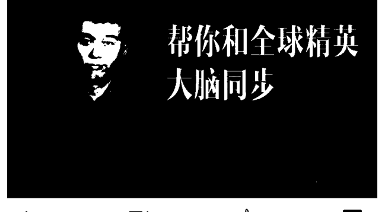

## 日课179 | 网购是怎么把我们变成傻瓜的

日课179 | 网购是怎么把...

很多年以前，我还在念研究生的時候，回国机票还不能在网上买，我都是打电话给本地的一个华人开的机票代理。后来可以在网上比价买票了，我就先拿了网上的价格，然后又打电话给本地那家代理，想看看她有没有更好的价格。我说了行程，她给我一个报价，我说你这个价格太高了，网上的价格比你低不少。然后她说——

> “你会上网还虐待我们于什么？”

这是一个非常让人难忘的词，“虐待”。一个老老实实的宅男，因为会上网，就突然获得了虐待商家的能力。这个词的隐含意思是传统的商家对互联网完全没有应对办法。过去十几年商业的一个大趋势，就是一旦某种商品的互联网销售量占到20%到25%，对应的实体店就会发生倒闭。

互联网的比价功能实在是太强了，互联网时代必然是消费者占上风的时代，对吗？

不对。现在商店已经反应过来了。实体店也好，网店也好，都在更新自己的定价策略。今天我们要说的是《大西洋月刊》五月份这一期的 target='_blank'，'“网购如何把我们都变成傻瓜”（How online shopping makes suckers of us all），作者是商业和经济作家杰里·尤西姆（Jerry Useem）。

尤西姆告诉我们，商家没有坐以待毙，他们使用了更先进的办法跟消费者博弈。

在说这些新方法之前，咱先从“第一性原理”思考一下商品定价的问题——如果你是一个开商店的，对你来说最理想的定价是什么呢？

### 1.用算法定价

最理想的定价，当然是顾客愿意出的最高价。如果这个人很有钱根本不在乎价格，那你就把价格定的高一点；如果那个人花钱很谨慎，你就把价格定的低一点，能赚多少赚多少。

这其实就是最古老的定价方法。历史上的商品交易本来就是都要讨价还价的。是十九世纪以来，商店要实现规模化经营，讨价还价的服务成本太高，才索性让统一定价成了主流。从此之后，商店就得猜测一个大多数人在大多数情况下能接受的最高价格。

但是商店总想做得更好——我为什么不能给每个人一个不同的价格呢？我为什么不能在不同的时间段，给不同的价格呢？

算法可以帮助你做到这一点。亚马逊雇了很多经济学家开发自己的商品定价算法。仅仅今年三月份，亚马逊就贴出了59个针对经济学家的招聘广告。尤西姆重点介绍的一个公司叫“飞去来器商业”（Boomerang Commerce），已经成立五年，专门给商店提供定价算法。

这些经济学家借助大数据和在线实验，搞出了各种新的定价策略。

### 2.商店的三招

第一个办法是让商品价格随时变动。比如说自动售货机里卖的罐装可乐，现在可以做到让价格随室外温度的变化而变化。天热就自动卖的贵点，天冷就自动降价。

网购的高峰时段，是工作日的上班时间——也就是说人们总爱在办公室里上网买东西，回家可能就专心看电视剧了。那网店的一个好办法就是在早上略微提高商品的价格，晚上略微降低价格。事实上不只网店这么做，连实体的超市也可以在一天之内变动几次价格，只不过对应的是不同的时间段。

如果你拿不准到底应该什么时候变，变化多少，你还可以直接做实验。有人跟踪了亚马逊上一种做南瓜饼的调料，发现这个调料的价格变动很大，有时候卖$4.49，有时候卖$8.99，有时候又是别的价格。专家猜测，亚马逊是在做价格测试。亚马逊也不知道这个调料卖多少钱合适，随时变动一下看看消费者反应。

第二个办法是让价格因人而异。如果商店知道你的年龄、性别、家庭住址、甚至收入情况，那它就可以大致推算你的价格敏感度，它就可以给每个人一个不同的出价。

注意，这可是价格歧视。亚马逊早在2000年就这么做过，被人发现了，贝佐斯紧急声明，说我们只是在做测试，不是故意歧视。目前为止，我没有听说过直接的证据，说两个人проп...

但是亚马逊没做，不等于别人也没做，而且可以做得更高級。最好的办法不是看一个人的宏观经济数字，而是看他上网浏览的记录。尤西姆引用了一项研究。研究者用两台电脑模拟两个上网者。一个假装是富人，专门浏览一些高大上的奢侈品网站；一个假装是个节俭的人，专门浏览一些低端的东西。这么上了一周网之后，两台电脑上一个购物网站——文章没有点名是哪家网站——买耳机。结果网站给“富人”推荐的耳机的价格，是“节俭者”看到的耳机的价格四倍。

而且还不仅仅是推荐的商品不一样。研究者发现，对同一件商品，地址是富裕地区的电脑，看到的价格就比低收入地址的电脑要高。

如果每时每刻看到的价格都可能不一样，而你看到的价格还可能跟别人的价格不一样，那货比三家的意义就没那么大了。也许早上看好一个商品，晚上就降价了。那这样的话还不如找一个靠谱的良心商店，如果他家的价格一贵比价实惠，干脆索都在他家买算了。——对这样的心态，商店也有办法。

这就是第三招，制造“低价感”。商店可以有意识地把你关注的商品给个底价，哪怕少赚甚至不赚钱，先把你吸引过来，但是对那些你不敏感的商品给个高价。比如说鸡蛋和牛奶是大多数人每周都要买的，那商店就把鸡蛋和牛奶卖得便宜一点，让你获得一个“低价感”。你记得鸡蛋的价格可是你未必记得生姜多少钱一斤，只要你来了，商店随时把生姜价格提高一倍，而你可能根本没注意到就买了。

亚马逊就常干这样的事情。感恩节之后的黑黑星期五，是美国的购物节。有一款电视机，平常卖350美元，黑黑星期五这天亚马逊给它的标价是250美元，全网最低！你来了，你买电视可能还需买一根HDMI连接线，亚马逊就把这根线的价格悄悄提高了60%——而你根本不会注意到，顺手就买了。

定价有这么多门道，现在购物简直就成了一个斗智斗勇的事情，那消费者也要反击。

### 3.消费者的反击

据说同一架飞机的乘客之中，每个人买机票花的钱数都不一样。如果你愿意投入时间 Limited ...


你可以让 camelcamelcamel.com 帮你关注一个商品的价格，一旦到位就自动通知。

尤西姆说，现在有人呼吁弄一个全网监控系统，看看有哪些商家在搞价格歧视！不过这样一个系统必然是非常复杂非常麻烦。

道高一尺魔高一丈，消费者和商店都有点各自的招数。


道高一尺魔高一丈，消费者和商店都有点身心俱疲！所以现在就有一个卖服装的网站，叫 everlane，干脆来了个“透明定价”。

对每一件衣服，材料费多少钱、生产人工成本多少钱，海关关税多少钱，运输费多少钱，全都告诉你。比如 everlane 上一件卖$48的衬衫，它明确告诉你，进货成本是$19，而别家一般卖$95，咱们都是实在人我不跟你玩花活，你要买就买！

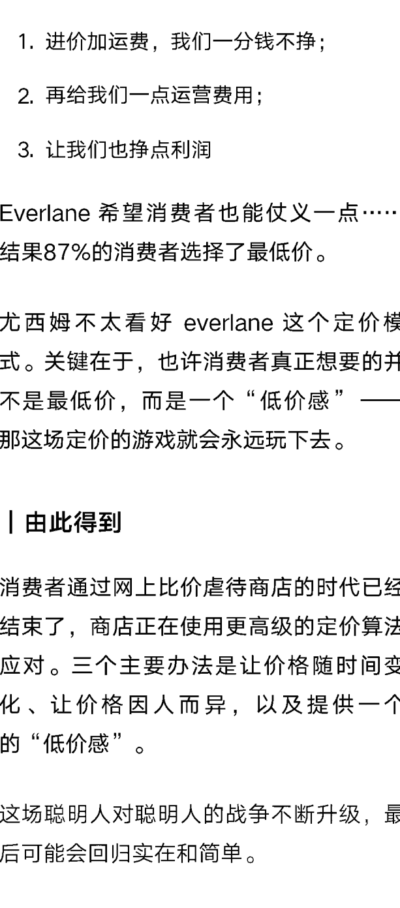

尤西姆介绍，everlane 甚至实在到，它清仓甩卖一件衣服的时候，会给消费者三种价格，让消费者自选：

- 1. 进价加运费，我们一分钱不挣；
- 2. 再给我们一点运营费用；
- 3. 让我们也挣点利润

Everlane 希望消费者也能仗义一点……结果87%的消费者选择了最低价。

尤西姆不太看好 everlane 这个定价模式。关键在于，也许消费者真正想要的并不是最低价，而是一个“低价感”——那这场定价的游戏就会永远玩下去。

### 由此得到

消费者通过网上比价虐待商店的时代已经结束了，商店正在使用更高的定价算法应对。三个主要办法是让价格随时间变化、让价格因人而异，以及提供一个的“低价感”。

这场聪明人对聪明人的战争不断升级，最后可能会回归实在和简单。

### 我的评论

尤西姆在文章里介绍了一个经济学家的研究结果。在线视频服务商Netflix，我们知道它给的是一个单一的价格，每月 $11.99。经济学家说，如果 Netflix 搞价格歧视，看看谁经常去电影评分网站就给他一个更高的价格，Netflix 的收入能提高 14.6%。

我觉得这个经济学家有点太书呆子气了。Netflix 提供的是一个标准化的产品，所有人的服务是一样的，比价太容易了。如果你收我 $15.99，而我家邻居只交 $11.99，难道我会不知道吗？

以我之见，简单商品不容易玩价格游戏。比如iPhone手机，是多少钱就是多少钱，就这么一个手机，消费者非常容易感受到价格变动。

那么由此推论，将来人们越不喜欢价格游戏，就可能越喜欢简单化、标准化的商品。把复杂的日常用品打包，提供一个一揽子的解决方案，让消费者不用为价格战操心，也许就是一个好方向。


## 日课180 | 用别人预测自己

今天咱们继续用希斯兄弟的《决策》这本书说决策科学。上次我们讲了在面临一堆选项的时候该如何尽可能地理性选择。而理性决策最关键的一点，还是你对未来的判断。今天就说一个评估自己未来表现的好办法。

我先贡献一个自己的故事吧。四、五年 前，美国股市是一波牛市，我也跟风加入了炒股的队伍。当然我投入的钱并不多，总共投了大概4万美元。

一开始只是买股票，后来我就觉得股票没意思。你花费时间研究股票，可是4万美元的本金，即使是股票上涨10%-20%，也就是几千元，这个时间花得根本不值。于是我开始买期权。

对手里持有大量股票的机构来说，期权是一种对冲风险的工具，相当于于是给股票买了个保险。而对手里没有股票的我来说，期权是个高风险的杠杆。开始我运气很好，挣了点钱，账户最高的时候到达了13万美元。

### 1.你不比别人特殊

说了我的故事，咱们再说一个丹尼尔·卡尼曼在《思考，快与慢》这本书里说的他自己的故事。我们今天讲决策科学，大家听起来还比较陌生，很少有人系统地学习过决策科学。而卡尼曼早在多年前以前，就和人合著过一本关于判断与决策的高中教材，帮助以色列在高中就普及这种决策科学。这个想法非常棒。

### 2.你特殊在哪里？

我想再强调一遍，用基础比率预测，用过去的经验判断未来，是一个特别可靠的决策方法。那么就算你认为自己很特殊，也要先了解基础比率，再从这个基础上做些修正。

希斯兄弟在《决策》中讲了一个真实的案例，特别能说明问题。

### 3.基础比率与你

我们把卡尼曼的故事和布莱恩的故事放在一起看，其中就有 一个关于怎样使用统计数据的智慧。

了解一线的情况。

我们平时做决策，就得有这样的精神：第一看基础比率，第二看我到底特殊不特殊。

比如你打算去一家以前没去过的餐馆吃饭，你想知道这家餐馆好不 好，最好的办法是先去看看网上的评价。你打开手机应用一看，这家餐馆的评分是三星半。

如果只看评分的话，你就不应该去了。不过你也可以仔细研究一下这个“三星半”是怎么来的。你一看具体评论，有很多人给它打了五星，也有很多人只打了一星。而打一星的这些人之所以不喜欢这家餐馆，并不是因为饭菜不好吃，而是认为价位太高，是对价格不满意。

那如果你能承受这个价位，这家餐馆对你来说岂不是很理想吗？

这就叫既尊重一般知识，又能做到具体问题具体分析。

最后咱们再回到我当年炒股的例子。别人业余买期权的，都失败了，那么和别人相比，我有什么特殊之处呢？可以说没有。我并没有深入研究过期权，没有多少操作经验，更没有独创一套成熟的买卖期权的方法。不但如此，和别人相比我还有很多劣势。我的科研工作繁重，平时还爱看书，并不会花太多时间在股市上。我炒股的态度也不够严肃认真，经常不顾交易纪律去寻求刺激。那么综合考虑，我并没有比基础比率强——所以我当时科学的决策，就应该接受基础比率，放弃买卖期权。

### 由此得到

- 1. 当我们在预测未来的时候，首先要想到自己并不比别人更特殊，基础比率是最好的参考资料。
- 2. 如果你不想听从基础比率，那么你就得拿出非常特殊的理由，而且这些理由必须是切实存在的和别人的不同之处。

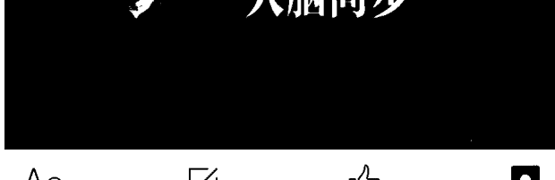

## 日课181｜厉害的CEO 什么？

5月份这期《哈佛商业评论》有一篇非常重要的文章，“什么让成功的CEO脱颖而出”（What Sets Successful CEOs Apart），作者是几个机构的四位研究者。他们近期做了一项多方合作的研究，叫“CEO基因组计划（CEO Genome Project）”。这个研究是用数据分析的方法，看看CEO身上有哪些成功素质。

这是我们关心的一个基本问题。如果这是有史以来最为权威的答案，那么在将来很长一段时间它都会发挥作用，所以值得咱们好好说说。

CEO，是一个非常特殊的工作。你不但要对自己负责，还要对董事会、员工负责，对公司的现状和未来发展负责。公司上下的所有的指令，归根结底都来自于CEO，所以别人都可以被动，CEO必须积极主动。CEO的一举一动直接影响到公司的业绩……——至少在外人看来是这样的，出问题就得你负责。

CEO的工作难到什么程度呢？这篇文章中就提到，在2000年到2003年之间，财富500强中有四分之一的CEO被撤职。一般员工，甚至政府官员，都不可能有这么高的撤职率。

可是有趣的是，CEO的职位如此重要，却很少有人知道，什么样的人适合成为一名好CEO。不但我们不了解，连投资者和董事会里那些对选拔CEO有决定权的人也对此所知甚少。

这就是这项研究的价值所在。这是一个大项目，从大学到私人公司多方合作，研究对象是17000名企业高管，其中包括2000名CEO。这些人被做了全面的评佑，性格分析、详细简历和别人对他们的各种评价应有尽有。所以研究者敢于叫这个特别牛气的名字，“CEO基因组计划”——显然是在模仿生物学家搞的“人类基因组计划”。

那么好CEO都有些什么基因呢？咱们先说几个这项研究发现的、人們常有的错误认识——

- 1. 通常我们认为CEO应该是比较外向的人，而事实上内向CEO的表现比外向CEO更好。
- 2. 通常我们认为CEO是优中选优，过关斩将一路打赢各种比赛过来的，而事实上，厉害的CEO中有很多人职生生涯中无失败的经历，其中45%的人曾经犯过重大错误。
- 3. 通常我们认为CEO应该是名校毕业的高材生，而事实上优秀的CEO里只有7%毕业于常青藤大学，更有8%是根本没上过大学。
- 4. 通常我们认为CEO是那些表现得非常自信的人，而事实上表现得自信只在面试的时候有效。表现得自信的人更容易被董事会选为CEO，但并不一定是优秀的CEO。

CEO，特别是厉害的CEO，的确是一个非常特殊的人群。他可能没上过什么名校，人生之中经历过挫折，职业生涯中犯过很大的错误，性格内向，外表看起来也没有呛呛逼人的自信。就是这样的人，管理着一帮履历光鲜，夸夸其谈的高材生。

那么，对CEO来说，真正有用的特质是什么呢？你不需要从A学到Z。对于那些特别厉害的CEO，研究者只总结了四项关键素质——而你如果能做到其中两项，就已经很不错了。

### 1.快速决策

遇到任何问题，你要尽可能早、尽可能快地做出决策，而且还必须非常坚定。哪怕是当前的局面还不明确，信息还不完全，甚至这个领域对你来说很陌生，作为CEO，你仍然需要快速拍板。你拍板了，公司才能行动。

有一个CEO说，“只要有65%的把握，我就会做出决定。”谁都不可能拥有完美的信息，如果什么事情能有百分之百的把握，那何必还要你这个CEO来决定？

这个哲学是错误的决定也比没有决定要好得多。犹豫不决是最糟糕的做法。如果CEO犹豫不决，全公司上下就会陷入不知道做什么的境地，就没有行动力，就可能错失良机。

那么，在做决定这件事上，一个聪明人可能就不如那些有决策力的人。聪明人考虑的因素往往过多，瞻前顾后。的确，最后聪明人的决策往往更正确，但是错过时机是更大的罪过。

1人笔记

### 2.争取各方支持

有位CEO，每当重大决策的时候，都会画一个人物关系图，图中标出了办成这件事情需要涉及到所有重要人员。然后他会和这些人接个谈话，取得他们对这个决定的支持。如果有人始终反对他的决定，那么他就会尽力把这个反对的力量往正面的方向引导。

### 3.主动适应新局面

当市场环境快速变化的时候，CEO应该积极带领着公司做出相应的改变，比如推出新产品、公司转型等等，这是CEO最重要的职责之一。

成长的机会。

### 4.给人可靠感

咱们先说一个例子。某公司正打算任命一位新的CEO，它的一个强力部门的经理想要竞争这个职位，而他刚刚超额50%完成了全年销售任务。这是一个非常了不起的成绩，要知道当时行业水平是你能超额2%都算好成绩。

可是这位经理却没能当上CEO。他这个业绩太突然，别人根本不知道他是怎么做到的，更不知道他未来还能不能复制这样的业绩。

想要当一个受人肯定的CEO，你必须给人一种“可靠感”。这有两层意思。

第一，你得给人一个合理的预期。这也就是说你计划要干什么事，公司业绩在几个月或者一年内能达到什么程度，你要提前告诉股东和员工，让人觉得你“有谱”。

第二，到了时候，你得达到、最好能超出这个预期，让人觉得你“靠谱”。我觉得这个文化有点受到财务报表制度的影响。上市公司每个季度都要发布一次财报，你得总结这个季度做到了什么，还得汇报下季度想做到什么。华尔街对报表非常敏感，给每个公司一个预期，一旦达不到预期，股价就会受到惩罚。

这是一个非常束缚人的文化，CEO必须时刻确保公司业绩达到预期。在这种情况下，一个发挥稳定、每次都能让公司业绩比华尔街预期稍微好一点的CEO，就非常可贵了。

这就是“CEO基因组计划”发现的优秀CEO应该具备的四个素质。当然，一个优秀的CEO需要具备的素质肯定不止四条，比如说你人品也得好啊？对。但是人品好是对所有领导者的要求，人品不好早就被淘汰了——但是这四项素质，是能把优秀CEO和普通CEO区分开来的关键素质。

好消息是这四个素质都是可以学的。研究发现，如果你有意识地练习这方面的能力，你就比一般人更容易成为好的CEO。更好的消息是你不需要同时具备四项素质也能当个好的CEO——统计结果是，好CEO里面，有50%至少做到其中两项。而不行的CEO，只有5%至少做到了其中的两项。

### 我的评论

我读这个研究报告，就觉得这四个所谓“CEO的素质”，其实对每个想要在工作中做出成绩的人来说都很重要。显然CEO们并不是当上了CEO才需要这些素质，是他们先有了这些素质，才能当上、而且能当好CEO。

第一快速判断——就算不做什么大决策，这也是行动力的体现。别人还在犹豫不决的时候，可能你的工作都做完一半了——那就算你做的不对，你现在至少获得了第一手的信息。

第二争取支持——这就是跟人合作的关键。你可能没有手下，但是你做事也需要同事、特别是老板的支持。

第三点主动适应新局面——我们干任何大事业，都得从长远考虑问题。

第四给人可靠感——如果一个球员发挥稳定，他上场机会，会比今天发挥很好明天发挥很差的球员多很多。

“CEO基因组计划”还给其中两个素质量化计算了“重要倍数”。比如“快速判断” 的重要倍数是12倍，这就是说，有这个素质的人，比没有这个素质的人，成为优秀CEO的可能性高12倍！“可靠”的重要倍数更高达15倍。

那你如果能做到快速判断又可靠，岂不是就已经打败了无数的人吗？


## 日课182 | 实干家不需要精确调研

今天我们继续用希斯兄弟的《决策》这本书说决策科学。这也是这次决策系列的最后一讲。

昨天我们分享了一篇关于优秀CEO特质的文章，其中关键的一点，就是快速决策。即便是错误决策，也比没有决策好。这个说法听起来不太容易接受，今天咱们就说说决策和行动的原理。

也许科学决策的一个高级用法，就是“不科学”决策。

对实干家来说，并没有什么“谋定而后动”的决策。实干家的决策都是一个动态的过程，你先动起来，看着情况再调整。

我想先讲一个悲剧故事。这个故事是在蒂姆·哈福德的《适应》（Adapt: Why Success Always Starts with Failure）这本书里看到的。

### 1.工程师和政治家

前苏联有个工程师叫彼得·保金斯基（Peter Palchinsky，1875 - 1929），他在苏联建国之前就已经是一名很著名的工程师，非常注重实地调研，有丰富的第一手工作经验。苏联建国之后，保金斯基担任中央政府的顾问。

斯大林搞的苏联第一个五年计划中，有两个大项目让保金斯基参与了。一个是在乌克兰修建一个超大的水电站，命名为“列宁坝”，一旦建成就是世界上最大的水电站。另一个是在“磁山城”建立一个钢铁厂，这个钢铁厂的产量将超过整个英国的钢铁总产量。项目开始之前，保金斯基就到这两地去调研。

保金斯基发现列宁坝所在这条河的水流速度太慢，必须得建立一个非 常、非常大的水库蓄水，才能带动这么大的发电站。这样代价就太大了，涉及到大规模的移民，而且这条河每年还有三个月的枯水期！保金斯基就建议，还不如沿着河弄几个小型的水电站。

至于磁山城的钢铁厂，保金斯基发现它建立在荒郊野外，当地缺少必要的生活资源，工人的基本生活条件没法保障。再者，虽然当地有丰富的铁矿资源，但是缺乏煤炭！钢铁厂需要大量的煤炭，而煤炭只能从很远的地方运过来，如此一来，也是得不偿失。

保金斯基对这两项目都提出了反对的意见，但一五计划的大局为重，政府对他的意见置之不理，斯大林必须要有世界最大的水电站和比英国全国产量都高的钢铁厂。

### 2.调研和政治

希斯兄弟在《决策》这本书里提到了一项研究。有人调查了财富500强的CEO，观察他们的决策模式，发现其中60%的CEO在做一件重大的商业决定时，是连计划书都没有的——是想做就做。这些企业家对预测未来的数据和报告根本没兴趣。

一项研究邀请了45位创业者，他们创立的企业规模当时最低在2亿美元，最高达到了65亿美元，可以说是非常成功。研究者就询问这些创业者，邀请他们做个假设实验——想象如果要开一家全新的公司，你会怎么搞市场调研呢？

其中一个创业者，开始还是为了迎合研究者就说了些关于如何开展市场调研的事情，但是说着说着，他就坦白说：“算了，我和你说实话吧，我做决定的时候，从来不做什么市场调研。我根本就不相信市场调研。”

2011年的时候，Intuit公司的CEO曾经公开说：“企业家做决策的过程就是3个P，政治（politics），劝导（persuasion），和PPT（PowerPoint）。”从政治上考虑做好决定，然后说服其他人支持这个决定，最后用PPT讲一遍这个决定，根本不存在什么调研。

### 3.专业和强迫症

希斯兄弟讲了一个年轻人，史蒂夫，决定是否要成为一名药剂师的决策过程。史蒂夫本来就喜欢化学，而且药剂师的收入很高，工作时间又不像医生那么长。但这些理由还不足以让史蒂夫下决心，毕竟为了成为一名药剂师，你要投入几年的时间学习，这个期间不但没有收入，还要付出高昂的学费。

心理治疗师给佩吉想了个办法，就有点类似于咱俩前面说的流氓骚扰女性。治疗的过程分为若干步——

- 1. 把文档带回家检查三遍，就定稿；
- 2. 把文档带回家只检查两遍；
- 3. 把文档带回家只检查一遍；
- 4. 第四步，不把文档带回家，下班后在公司多待一个小时，能检查多少算多少，到一个小时马上回家；
- 5. 下班就回家。

治疗师告诉佩吉，每做一步，确认你这么做的确没有给公司带来任何损失，老板没有责备你，再进行下一步。这个做法让佩吉非常放心，她小心翼翼地一步一步放松对自己的要求，结果果然没出什么毛病。佩吉的胆子有点变大了。然后治疗师说那咱俩继续试探——

- 6. 故意在文档中犯一个标点符号的错误；
- 7. 犯一个语法错误；
- 8. 犯一个拼写错误。

结果一直到第八步，佩吉给了一个明显的拼写错误，公司也没有因为这个错误输掉官司，佩吉没有被解雇——事实上，公司上下根本没有人注意到她那个错误！佩吉的强迫症，治好了。

最后，我们回到保金斯基的故事。保金斯基不是历史名人，维基百科甚至没有他的中文页面，我上网反复查也没找到他的中文名应该怎么翻译，“保金斯基”这个译名是还是我创造的。1990年代，麻省理工学院一个教授研究苏联工程师的历史，才发掘到了他的事迹和思想。

我们今天讲的是实干，开头说保金斯基在搞调研——可是保金斯基并非不是实干家。事实上，保金斯基特别主张试水！蒂姆·哈福德在《适应》这本书里也讲试水，说的就是保金斯基的理论。保金斯基提出，用试水的方法创新，有三个原则：

- 1. 尽可能地尝试新事物；
- 2. 尝试要可控，要确保试验不给我们带来灾难性的后果；
- 3. 获得反馈，从结果中学习，随时调整做法。

咱俩想想这三条，这不就是中国人爱说的“摸着石头过河”吗？保金斯基，是实干者的先驱！

可是斯大林的尝试尺度，比保金斯基可大多了。列宁坝和磁山城钢铁厂这两个失败的项目，在一五计划的大局里也许只能算是两次失败的小尝试，牺牲一万人对斯大林来说也许只是一个小数字，也许不算什么“灾难性的后果”。

也许斯大林和保金斯基的根本区别是斯大林不关心反馈。也许斯大林看一五计划成绩喜人认为反馈很好。也许尝试的尺度大小，也是相对的吧。


今天我们的由此得到，就是保金斯基的三个原则。


## 答读者问｜这一此的输赢和这一生的输赢

### 来自日课：实干家不需要精确调研

决策前，我一个地方先小小的实践一下，试试水。别作死，把自己搭进去。获得反馈，在小小的试水中得到经验，学到知识。人的位置高低不同，试水时把自己搭进去的试水深度也不同。那么万老师，如果上级给了一个他看起来安全试水深度，但是让我去做时发现这个深度会把自己搭进去，那我们怎样拒绝？

### 万维钢

谁做的决策，谁承担后果。职业道德是开飞机的得坐在飞机上，不过现在世风日下，搞投资的赚了钱跟着分奖金了钱不用负责责任。好领导应当给手下背锅，不行的人让别人当炮灰。请告诉上级：have a skin in the game。

这篇与麦肯锡机构为林肯轿车做市场调研的理论相反，万老师这个如何理解？

看到文章的最后一句话瞬间想到，具备第一个素质“快速判断”的厉害的CEO一定是个意会高手啊。因为要在信息少于65%甚至更少的情况下做到快速判断，基本就是“意会”能力在发挥作用，就是他们用知识、经验以及对事物的敏感度综合发生作用。另一个角度来看，如果我们想要练习培养快速判断的能力，也可以利用之前万老师文章里讲到的意会工具箱里的武器？

### 万维钢

问得好：）但是我们其实讲《意会》的时候就说过这个问题，请看《你用“算法”，我用“意会”》这篇文章中，就说了一段话——

如果要用算法解决这个问题，你大概就得不预设任何立场地设计很多款不同的车型，在各个国家做销售实验，看哪个车型好卖就地量生产哪个。但是这根本不可行——车型变化的灵活性太大，你不可能测试五百种不同的车型，而且你根本没有时间和金钱去做这种实验。

关键就在于对于新车型来说，可以测试的自由度实在太多了。实干家讲先试水再说，CEO讲快速判断，但他们并不是胡乱判断，总爱心里有个大致的方向，比如65%。正如夏冬冬所说，这65%的把握，恐怕很大程度上就是来自意会。

今天的日课中的试水概念，让我想起精益创业中的MVP，即最小可可行产品。核心思想是通过做实验快速获得反馈，再决定接下来是否要投入更多资源去完善产品，甚至一开始产品有很多缺点也不要紧。因为过去一年所在的创业公司都奉行这套理论，所以在这里说一些我自己的体会：1，战场的选择。因为在做试验时我们的目的是以最小的成本去试错，所以产品难免有各种各样的缺陷。这一点在商业上如果已选择的领域竞争对手很多，那么你的产品很可能很长时间都得不到消费者的关注，当然这从某种程度说明产品没有快速爆发的潜力。（没有快速爆发潜力的产品不代表后期不会带来收益）。所以选择战场，包括两个层面，一个是产品的切入点，另一个是早期使用者的选择。2，制定对反馈的衡量指标。这点看起来很理所应当，但是真正执行起来却是很有难度的，尤其当我们追求的是在单位时间内尽可能多的做试验时。如果没有一个好的指标，很难确定哪个方向更好。这里有一个我自己的疑惑，也希望可以得到万sir的解答：如果我们对产出的结果本身没有足够的认知或者不知道它到底是好是坏，如何去制定衡量指标？但是没有衡量指标，我们也不好去判断各个试验的结果。感觉这是一个悖论，让我困惑许久。3，最后就是我想向万sir请教的问题，每次试错产出的结果其实与当时的环境有莫大的关系，在我看来就是变量，但当我们改变变量，结果就会变化，而我们每次跟上次不同的操作都是一次变量的变动，这样的情况下，试错产生的结果对我们之后，也有很多的意义呢？问题有点多，也是我一年来的思考了许久却没有结果的困惑，如果能得到万sir的解答就太好了，在此先感谢！

### 万维钢

这是非常深入的思考。我并没有什么实战经验，只能纸上谈兵一番。
1，战场的选择，从科学实验角度，当然应选择日后的目标市场，随机抽样。不过前期从推广角度考虑，先让有影响力的铁杆粉丝试用也是个办法——可是我怀疑这一招被用得太多，反馈来的结果太容易被高估了。
2，对产品来说，最好的指标难道不就是销量吗？好评度也是个指标，但是不如消费者用钱表达值得信任。
3，我理解这还是一个统计抽样的问题。一个产品在不同环境下的表现不一样，那最好还是随机抽样，多测试各种环境看综合表现。比如一个电影剧本，一二三四线各种文化程度的观众最好都测试一下。

### 来自日课：厉害的CEO什么样？

万老师，我觉得这篇文章有bug吗。我知道，几乎所有管理的文都有bug，但是这篇我直觉好别扭…首先我觉得“好”CEO的这个概念很模糊。于是，我就去翻了一下hbr的原文，原文中“high-performing”的定义是“达到或者超过董事会和投资人的预期”。那么我可以理解为“好”等同于“为董事会和投资人带来显明收益”，也就是公司业绩。然而，咱们“学区房”的那篇日课中说过，“CEO个人能力对公司影响有限”。那么用公司业绩来划分出“好”真的靠谱吗？其次，我注意这个是一个10年研究，推测这些高管应该经历了2008的经济危机到如今缓慢的经济恢复，美国GDP的增长率现在是在2%徘徊。那么这里有两个问题。第一，低增长降低预期，这就导致“好”CEO可能并不那么“好”。第二，经济大环境属于business cycle的回复期，那么因其而来的业绩又有多少应当归功于CEO本人的英明神武？或者更严重的，那些被炒了的CEO，有多少是因为个人能力，而不 是所在企业内部的不稳定和经济冲击？另外，我根据原文推测，这次调查是先把高管和CEO取样，用他们的背景职业信息和董事会和投资人对他们特点的评分建立数据库，做大数据分析。但是大数据分析自带bug，因为如果有足够的数据和维度，那么你几可以人伪建立联系。就是这些数据和“好CEO”的因果关系是值得进一步实验的。但是，我觉得这四个特点还是有价值的。“支持”我觉得有点水，因为给CEO评分的就是“支持”他的董事会。这可能是一项情感评分。因为没有数据对比说，CEO不被支持的决定导致了重大损失啊。但是，这起码说明，人际交往中，让别人觉得你很靠谱也很重视他就容易提高好感度。其他三点我觉得真的是很有用。“判断”，与其实是快速决定，我觉得可能用“把握最佳时机”更好，“好CEO”会快速判断，而神级CEO知道什么时候该做判断，换而言之，在判断和未知信息之间做取舍；“适应”，这个是高级技能，特别“意会”，原文就用的“sense”，其实我觉得也有可能是清晰的CEO知道自己对公司现阶段影响有限；“可靠”，我总结就是“务实”。具体做法：“理清现状以知己” + “提供预期以知彼” + “每一个小目标的阶段性胜利” = “可靠的领导”。

### 万维钢

CEO、包括总裁的*业绩*的确不能完全说明问题，受经济周期影响颇大。但是这个研究说的“performance”，并不单指经营业绩。研究者还特别强调：according to INTERVIEWS with board members and majority investors DEEPLY FAMILIAR with the CEO’s performance —— 他们并没有单看财处报表，而是已经做到了直接采访熟悉这个CEO表现的人，对于这样规模的研究来说，也算是可以了。

第二个问题，这个“支持”，研究者观察的并不是别人对这个CEO的支持度，而是这个CEO是否主动寻求别人的支持。是主动动作，而不是客效效果。

### 来自日课：用别人预测自己

现在很多中国所谓的“中产阶级”都在走移民这条路，万老师作为先行者，能否给一些建议，如何在移民浪潮中做出选择？

### 万维钢

我的例子不具备可比性。我并不是“中产阶级移民”，我是个穷学生，带着父母给的两千美元只身来到美国，没有任何家庭负担，也没有“到美国之后该干什么”的疑惑。

但移民这样的决定的确适合使用“用别人预测自己”这个方法。第一步，跟自己*情况类似*的人移民之后怎么样了。第二步，*对你来说*，有什么特殊之处。两国经济状况、环境差异、教育水平这些东西，是对所有人来说都一样的因素，我们更应该关心的是具体到自己，是个什么状况。比如移民之后的工作问题，每个人就非常不同。

但是如果我们真的很想做一件事情，可能会专门找一些幸存者偏差来骗自己，就算是全部，也可能是比较大部分。还有一种情况是如果身边没有例子，那么肯定就会去找一些认知度较高的例子，然后分析。这些例子可能是幸存者偏差，那么这样分析会有危害吗？

### 万维钢

说得很好。如果你意识到可能会有幸存者偏差，那你就可能避免被它影响。上周我们专栏问读者，是否应该把每期的长度控制在音频10分钟之内，结果很多读者留言表示长点没关系。当时主编就跟我分析，这其中可能有幸存者偏差——专门听音频、而且不喜欢长音频的读者可能没有留言，甚至可能根本就没看到这个问题。事实上，主编说，后台数据显示，10分钟的确是最受欢迎的长度。所以客观的数据真是特别重要。

在做一件事情的时候总是过高的估计自己的能力，每次都会出现两种传统文化的纠缠，是世上无难事只怕有心人，还是退一步海阔天空，而做决定又必须像医生一样在各项信息不是很完整的情况下，对于目前信息爆炸的时代，一个门类的知识其一生也掌握不了，我们应该怎样才不被时代淘汰呢？

### 万维钢

罗胖说，《我懂你的知识焦虑》：）不过现在知识实在太多的的确是根本不可能全都掌握。

想要不被时代淘汰，我理解关键在于四个字：有特无恐。所有凭借就有安全感——或者凭借本事，或者凭借财富，或者凭借跟某人的血缘关系，等等。凭借本事的话，最好能有一个“核心竞争力”，一个让你不可替代的东西。

我搞科研的时候，有几个老头子好几年内，在各种会议上作报告，讲的都是大同小异的一套。他并没有紧跟领域内所有最新进展，他并没有时刻更新自己的知识，可是那个东西是他搞出来的，只有他最懂，你不能不服还不能不理，所以他非常安全。

### 来自日课：网购是怎么把我们变成傻瓜的

万老师，面对商家“算法”，发起“反击”的消费者，是否只是少数？大部分人即使知道价格高一些，也觉得无所谓，不去计较那几个小钱。而商家，面对的以上不在乎小钱的消费者越多，越能赚钱，结果是否就是商家的“恒胜”呢？那些推出比价的网站或公司，最后是否会被诸如Amazon这样的公司收购掉，因为看中这些小公司手里虽不够海量但足够精确的消费者数据？

### 万维钢

是只有少数消费者在反击，这给了商家钻空子的机会，但这少数人的反击，就已经构成了极大的威慑。如果商店定价太不像话，他们会抗议，然后我们就可能会跟着抗议。正所谓《只要有一小撮人玩真的》。

亚马逊是可以对比价网站施加影响，比如 Adblock Plus 现在就被很多网站抗议，还在搞什么“白名单”。可是你总不能一手遮天吧？允许一小撮人闹事，对大家的健康都有好处。

### 来自日课：成大事者怎么才能不纠结

说到底，决策是一个困难的问题，不然怎么会有“硕 knit? ”“阮籍诏狂，岌岌效逸之哭”“无为在歧路，儿女共沾巾”古人也彷徨，也迷茫。而在...（略）道理都懂，可是该如何面对呢？

### 万维钢

这个问题，我记得好像是丹尼尔·卡尼曼说过。你要想象人生并不是一锤子买卖，是由很多很多决策构成的。

举个例子，赌钱游戏。咱俩赌硬币正反面，如果是正面，我输给你150万元，如果是反面，你输给我100万元——这个游戏你赌还是不赌呢？概率论告诉你应该赌，因为数学期望是正的25万元。但你可能不会赌，因为一旦输了，这个损失不好承受。

然后咱俩换个玩法。正面，我输给你150元；反面，你输给我100元，而且咱俩玩1万次。那这回你当然要赌！数学期望还是25万元，但这一次你基本上一定会拿到差不多这么多钱。

真实生活，更像是第二种玩法。每一次都面临输的可能性，但是只要你坚持正确的选择，而且能承受小失败，那么从长期看来必定是赢。

所以答案就是想想长期。你在乎的不是这一次的输赢，而是这一生的输赢。你要的不是一次赌对，而是一个能够多次赌对的系统。

## 特别放送 | 「科学决策」的七种武器

万维钢

周末好！希思兄弟的《决策》是一本特别重要的书，今天我再来帮你做个提炼总结，帮助你能真正记住它、用 ionized it。

### —— ◆ 概要 ◆ ——


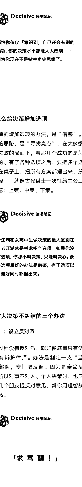


### —— ◆ 科学决策的七种武器 ◆ ——

### 一. “决策”不是“决定”，也不是“决心”

决策，是面对不容易判断优劣的几个选项，做出的正确选择。完成老板给的任务，你没有决策；两个东西价格差不多，你选择了质量好的那个，也不叫决策。决策是在优势劣势相当的情况下，拿主意。决策应该是一个非常纠结的心理过程。

Decisive 读书笔记

有人能为几块钱的东西货比三家，可是面对人生重大选择却异常草率。这大概就是随波逐流惯了，不但不讲究决策科学，而且缺乏决策意识。

### 二. 科学决策有四个步骤

第一步：看看自己都有哪些选项。

错误做法：有什么选项就从这些选项里选。

正确做法：想想能不能给自己增加几个选项。

第二步：评估每个选项的优劣。

错误做法：“确认偏误”，先入为主地喜欢和坚持某个选项。

正确做法：向多人寻求意见，获得一个客观的评估。

第三步：从这些选项中选择一个。

错误做法：被自己的短期情绪左右。

正确做法：要从长远考虑。

第四步：对未来的不确定性有一定准备。

错误做法：过度自信。

正确做法：给未来要一份保险。

Decisive 读书笔记

+ 希思兄弟四步决策法：
1, 扩充你的选项；
2, 用现实检验你的观点；
3, 从长远考虑；
4, 为一旦决策错误做好准备

### 三. 真正的决策必须得有多个选项

如果只能选择yes或no，长期看有52%的决定是错的，增加两个选项，选错的比率下降到32%。

Decisive 读书笔记

哪怕你仅仅「意识到」自己还会有别的选项，你的决策水平都能大大改观 —— 因为你现在不是钻牛角尖思绪了。

### 四. 怎么给决策增加选项

最简单的增加选项的办法，是“借鉴”。借鉴的思想，是“寻找亮点”，在大多数人都失败的局面下，看那几个成功的是怎么做。 有了各种选项之后，要把多个选项摆在桌子上，把所有方案都摊出来，统一选择——就像古代谋士一次性给主公三个主意：上策、中策、下策。

Decisive 读书笔记

老江湖和女高中生做决策的最大区别在于老江湖总是考虑多个选项。如果你没有选项，你那不叫决策，只能叫决心。获得选项最好的办法是借鉴，有了选项以后最好同时都摊出来。

### 五. 重大决策不纠结的三个办法

办法一：设立反对派

决策过程没有反对派，就好像庭审只有法官没有辩护律师。办法是制定一支“蓝军”部队，专门唱反调。因为是奉命反对，所以对事不对人。个人决策时，也应该找几个朋友提反对意见，帮助你用理性战胜情绪。

Decisive 读书笔记

- 「求骂醒！」

办法二：从远处旁观

要跳出来，以旁观者的视角观察自己。10/10/10法则是一个特别好的旁观技术，要求你从三个时间尺度去考虑一个问题。

Decisive 读书笔记

+ ● 10 分钟之后，你会对这个决定作何感想？
● 10 个月之后，你会作何感想？
● 10 年之后，你又会作何感想？

办法三：考虑价值观

价值观就是你设定的“优先级”，就是你认为什么是重要、什么不重要。它可以指导我们决策。

Decisive 读书笔记

### Decisive 读书笔记

把兼听则明给程序化，并且要求给出具体的反对理由；
克服短期情绪，尽量从一个远距离考虑问题；
如果利益计算已经无法让你判断优劣，那就像想自己的核心价值观是什么。

### 六. 用别人预测自己的正确方式

当我们在预测未来的时候，首先要想到自己并不比别人更特殊，基础比率是最好的参考资料。

Decisive 读书笔记

所谓基础比率，就是以前的人，做同样的事，做到的平均水平。预测未来最好的参考指标，就是基础比率。
你以为你了不起，其实别人在这件事之前也认为自己了不起。
你并不特殊。

如果你不想听从基础比率，那么你就得拿出非常特殊的理由，而且这些理由必须是切实存在的和别人的不同之处。

Decisive 读书笔记

我们平时做决策，就得有这样的精神：
第一看基础比率，第二看我到底特殊不特殊。

这就叫既尊重一般知识，又能做到具体问题具体分析。

### 七. 高级的科学决策就是“不科学”决策

对实干家来说，并没有什么“谋定而后动”的决策。实干家的决策都是一个动态的过程，你先动起来，上来就直接试水，看看情况再调整。

Decisive 读书笔记

企业家做决策的过程就是 3 个 P，政治 (politics)，劝导 (persuasion)，和 PPT (PowerPoint)。

从政治上考虑做好决定，然后劝说其他人支持这个决定，最后用 PPT 讲一遍这个决定，根本不存在什么调研。

实干家所谓的“科学”，不是要不要做这件事，而是把握好一开始的力度，小规模测试。用试水的方法创新，有三个原则。

Decisive 读书笔记

+ 1, 尽可能地尝试新事物；
2, 尝试要可控，要确保试验不给我们带来灾难性的后果；
3, 获得反馈，从结果中学习，随时调整做法。

万维钢

至此，《决断》这本书就讲完了。如果你觉得有启发，请把它分享给你正在面对艰难选择的朋友吧。祝你们成大事，不纠结。


## 日课183 | 假如生活打击了你

日课183 | 假如生活打击了你 ↓

今天我们说一本4月24日刚刚出版的新书，Facebook 的 COO 雪莉·桑德伯格（Sheryl Sandberg）的《B选项：直面逆境，建立抗打击能力，找到快乐》（Option B: Facing Adversity, Building Resilience, and Finding Joy）。我们两周前有篇专栏叫《怎样培养抗打击能力》，讲桑德伯格在纽约时报的一篇文章，那篇文章正是这本书的一个节选。

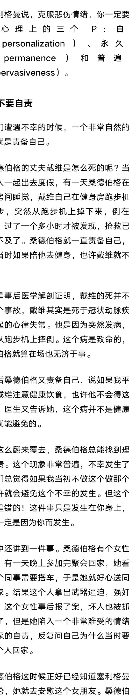

上次我们已经讲过桑德伯格的故事，她的丈夫戴维在2015年突然去世，留下她和两个孩子。失去丈夫对任何女性来说都是重大打击，桑德伯格虽然是成功企业家，但是在很长的时间内，也是完全崩溃的状态。

桑德伯格说，任何日常的小事，都成了她雷。她随时随地都可能因为什么东西联想到戴维，然后就是哭，根本控制不了自己。至于说原本就重要的日期，比如说孩子新学期开学第一天，她更是无法面对，她就不知道现在戴维不在了，谁给孩子拍照？

### 1.不要自责

### 2.悲伤不会永远存在

### 3.你遭受的打击不是全方位的


夫，其他方面并没有失去什么。

应对这种情绪的一个方法是多考虑生活中好的方面。桑德伯格意识到，自己虽然失去丈夫，但的确有很多庆幸之处。她作为企业家很有钱，家里的经济状况没有受到丈夫去世的影响。而在美国，一大半妇女在失去丈夫之后会面临重大经济困难，有的不得不从自己家原本的大房子里搬出去。桑德伯格一家的健康状况也很好，而且还有一大堆亲朋好友帮忙。

还有一个考虑问题的方法，就是这个事情其实还可以更坏！格兰特提醒桑德伯格，如果当时戴维是在开车接送你两个孩子的路上发病，会是一个什么情况？桑德伯格一想那太可怕了，可能三个人都没有了。再大的不幸，也可能是不幸中的万幸。

所有这些办法，都是为了帮我们快速从不幸中恢复心情。事实还是这些事实，但是这些方法可以让人更好地看待事实。你可以说这都是自我安慰，但以我之见，这些方法的确能让人看问题看得更全面，也更客观 —— 大概也就相当于我们常说的“想开点”。

而且这些方法确实有效。有很多研究表明，一次失败的考试，一次糟糕的推销经验之后，如果当事人能够从这个“三个 P”的角度平复心情，他们下一次努力的表现就是会更好。但我觉得最重要的还是这些方法帮助了那些陷入悲痛不能自拔的人。

桑德伯格说，抗打击能力就如同肌肉，你可以通过锻炼让它更强大。而这些科学的方法，就是你锻炼的指南。

## ｜我的评论

今天我们的这个标题来自俄国诗人普希金1825年写的一首诗，你想必早就听过，叫《假如生活欺骗了你》。当时普希金自己正面临重大逆境，但是没有自暴自弃，还给女友写了这么一首诗——

假如生活欺骗了你，
不要悲伤，不要心急！
忧郁的日子里须要镇静；
相信吧，快乐的日子将会来临！
心儿永远向往着未来；
现在却常是忧郁。
一切都是瞬息，一切都将会过去；
而那过去了的，就会成为亲切的怀恋。

我们现在读这首诗，其实它强调的就是三个 P 中的“permanence” —— 一切都将会过去。

普希金将近两百年前就洞彻了人性！但是时至今日，心理学家已经有了更全面的理论 —— 那我们遇到不幸的时候，就有了比读诗更多的应对办法。

## ｜由此得到

人生难免遇到不幸，而抗打击能力是可以培养的。遭遇不幸之后，从三个方面多想想，我们可以更快地从悲痛中恢复过来 —— 不要自责、知道悲伤不是永久的，你遭受的也不是全方位的打击。

## 日课184 | 哈佛商学院是个特殊生意

提起哈佛商学院，那是今世人仰慕的地方，很多很多有能力的人，削尖了脑袋都想从那里拿一个 MBA 文凭。但我今天想说的不是否哈佛商学院有多牛，也不是怎么获得商学院水平的教育，我想说的是咱们能不能从另一个角度看看这个充满精英感的地方。

咱们能不能不仰望，改成平视，甚至是俯视。

现在我们中国人对国内的商学院有时候并不买账，但是对哈佛、斯坦福这样的地方还是仰慕的。而在美国，很多有识之士对这些所谓的精英俱乐部是持一个批评的态度。哈佛商学院也好，哈佛大学也好，它们的光芒并没有“亮瞎”所有人的眼睛。

商学院，到底是个什么地方呢？

是个学本领的地方？这是天真的说法。

是个拿文凭毕业以后好找工作的地方？这是草根的说法。

是个混圈子的地方？这才是精英的说法。

不过今天我们既然是平视，那就有一个说法——哈佛商学院，其实是个生意。

五月六号这一期《经济学人》杂志，有一篇非常有意思的文章——严格地说叫文章，其实是一份哈佛商学院内部的、只给高级教职员工看的、保密的备忘录。《经济学人》给起的题目是“从卓越走向优秀”（From great to good）——这是一个调侃，是把“从优秀走向卓越”这句俗语给反过来了，意思是哈佛商学院正在堕落。

### 1.声望的价值

我读这个备忘录的一个突出感觉是，世界上最重要的资源，除了财富和关系之外，还有声望。而像哈佛这样的顶级名校，它们真正经营的东西就是声望。声望，是真的可以实实在在地变现。

备忘录列举了哈佛商学院的收入来源，咱们看看声望在其中的作用。哈佛商学院现在的年收入是七亿五千万美元，而且年增长率高达到8%，总资产更是高达50亿美元。在这些收入中——

17%来自学费。商学院总共有大约2000个学生，每个学生每年的学费高达71,635美元。你交这么多学费，当然不是完全为了读书，你更是为了加入哈佛校友的社交网络。

23%来自面向企业家的短期培训班。备忘录说的很实在，企业家们从这些培训班里获得两个好处——一个是让头脑获得一点“适当的刺激”，一个是……从此可以自称是哈佛校友了。

29%来自版权。哈佛商学院卖很多书，还有我们专栏经常说的《哈佛商业评论》杂志，但最重要的版权收入来自商学院教授们编写的“案例分析”。这是哈佛商学院首创的MBA教学方式，让学生通过真实的商业案例学习实践经验。

31%，也是最大的收入来源，是捐款。

### 2.捐款的门道

就说这31%的捐款收入。请注意，富人给名校捐款、给博物馆捐款，和普通人资助失学儿童，可是两个完全不同的概念。普通人捐款是出于爱心，富人捐款则在很大程度上是出于私心——啊不对，应该叫“理性”。给著名大学和博物馆提供巨额捐款，是你、甚至包括你的家族，进入上流社会的标志。捐款是门票，慈善拍卖会是富人联谊会。

### 3.声望的危机

备忘录说，哈佛商学院现在面临三个战略问题，需要请各位资深教授一起想想应该怎么办。第一个问题就是利益冲突，其中最主要的就是捐款人的利益和商学院声望的利益是冲突的。如果你案例都是赞助掏出的，谁还在乎你的案例呢？

有多少人买账呢？

### 由此得到

顶级大学的声望很可能比公司的品牌更容易变现，哈佛商学院就完成了一个每年七亿五千万美元的大生意。当你仰望的时候，你是个声望的消费者。只有平视甚至俯视，才能让你看清这个生意。

拥有名校校友资源的MBA们当然是一股很厉害的力量。但我们一旦俯视，就知道这股力量也不值得高估。

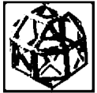

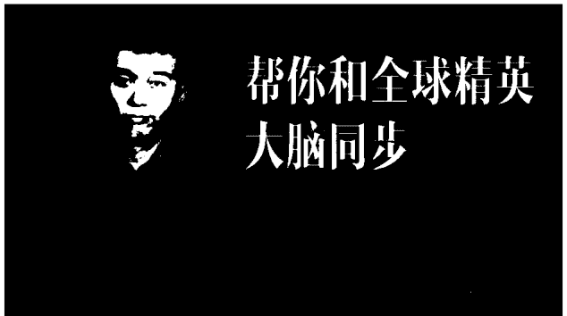

## 日课185｜假如生活打击了你的朋友

今天咱们继续说蒙德伯格和格兰特的《B选项》这本书。上次说的是个人遭受了不幸，怎么调节自己的情绪。这次我们说如果身边的亲友遭遇不幸，你怎么帮助他。

我们还是先讲一个真实的故事。

### 1.好学生

咱们上次说了，这本书的第二作者，亚当·格兰特，是宾夕法尼亚大学沃顿商学院的教授。话说格兰特在宾大第一年教学的时候，班上有个学生，名字叫欧文。欧文是大学橄榄球队的队员，长得又高又壮，头发还染成橘黄色，从远处看就好像一团火焰，非常耀眼。

欧文的性格特别外向，每次上课都坐第一排，谁一进教室他都热情问好。欧文的心胸还特别好。有一次格兰特让同学们模拟商业判断，结果欧文得分全班最低，因为他非常不愿意给自己争取利益，等于把假设的公司送给了谈判对手。学期结束的时候，全班评选最受欢迎的学生，欧文排第一。

第二学期，欧文自杀了。

格兰特非常沮丧。他上一次跟欧文单独接触，是几个月前，欧文到他办公室，请求他帮着找个实习的机会，他答应了。自始至终，格兰特没有发现欧文身上有任何想要自杀的迹象。

### 2.两句正确的话

蒙德伯格在书里说，如果一个人刚刚经历了不幸，他周围的人会在两个想法之间斗争。一个想法是我想赶紧去帮助他，问问他过得好不好；另一个想法是如果我提起这个不幸，会不会更加刺激他？

### 3.孔雀翎

有个著名的心理学实验。实验人员招募一批受试者，让他们在实验室内做一些很难的解谜题。如果集中注意力，这些题都是能够做出来的。但是在做题的过程中，实验人员给他们播放噪音，噪音让人心神不定，根本就无法集中精力解题，受试者的成绩都很差。

### 我的评论

### 由此得到

如果亲友遭受不幸，你要告诉他你了解他的痛苦，而且你愿意帮忙。帮忙最好的办法是增加一个选项，提供一种控制感。

事实上，就算你没有孔雀翎级别的力量，也可以帮忙。

桑德伯格在书中还有个故事。她一个同事的儿子病了，顾不上吃饭就一直在医院守护儿子。这个同事的朋友给他打电话，电话里只问了一个问题：“有什么东西，是你不想加在三明治里的？”

朋友没有问他需不需要帮助，而是直接提供了帮助。这个帮助不是孔雀翎级别的，但是它也有一个选项，在这个最焦虑难过的时刻，给人提供了一个小小的控制感。

所以我们说的这个武器，也不是孔雀翎，而是控制感！

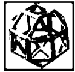

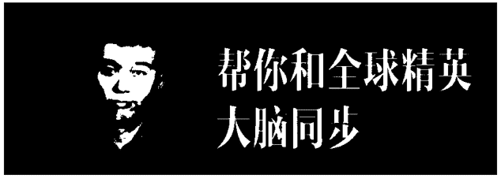

## 日课186 | 科普的三个边界

### 万维钢

你好！我的第一本书《万万没想到》在台湾出版了，本文就是这本书台湾版的自序，其中也说的道理，我也希望和你分享。

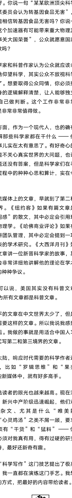

《万万没想到》是我的平生第一本书，它说的是怎么用科学方法和科学思维去理解这个复杂的现代世界。这本书目前为止在中国大陆卖出将近二十万册，读者给打了高分，获得了许多奖项，书中内容经常被人引用。大陆之外，它已经在韩国翻译出版，现在又出了台湾版，而且英文版也在准备之中。我收到好多读者的热情鼓励，受宠若惊。

可以说一个科学作者所能够期待的东西，《万万没想到》都得到了。这并不是因为我有多厉害，而是因为我特别幸运——我赶上了一个科学可以流行的时代。

我就想用这个机会，分享一点我对中文世界科学写作的看法和心得，顺便也向台湾读者介绍一下大陆这边的青年思潮。

大陆传统上，科学写作这个工作叫做“科普”——向公众“普及”科学。“科普”，似乎是作者居高临下的态度——这个知识太高级了你不懂，我给你讲讲，让知识落地，让科学流传——就好像老师讲课甚至牧师布道一样。在内容匮乏的时代这个姿态也许可以，而现在则不行。电影、电视、游戏、社交网络这些东西早就占据了大部分人的大部分时间，现在连读书的人都很少，又有多少人会去读一本科普书呢？

让科学流行，到底是为了对科学好呢，还是为了对读者好？难道读科普书是一项公益活动吗？

我认为科学写作的出发点，必须是为了读者。科学知识、科学方法和科学思想，是我们这个时代最有用、也是最有趣的内容。读科普书应该是纯粹为了自己，那些不读科普书的人亏大了。

我甚至认为，“科普”根本就不应该作为一个特殊的內容分类——未来所有值得让人读的文章都应该与科学有关。科学写作，应该成为一种普遍的写作方式。

以我之见，当前的“科普”，有三个境界。

第一境界是科学知识。有些科学知识可以破除迷信，比如“鬼火其实是磷火”。有些科学知识在日常生活中非常有用，比如某某东西致癌或者不致癌，中式坐月子法到底好不好。还有些科学知识纯属谈资，可以显示一个人博学多才，比如说太阳系到底有九大行星还是八大行星，其中的历史掌故。这些知识，是晚报和中学生读物中的流行内容。

不过让我说的话，这些内容统统不值得专门写文章。它们最多只适合给文章做边角素材，平时应该以什么百科的形式放在网上，谁想了解就用搜索引擎直达。读者之所以觉得科普文章没意思，就是因为这样的科普文章的确没意思。

第二境界是科学思想。有知识不等于有思想。知识只是一点，思想则是包含这一点的因果后果，是一个故事，还可以是一套方法论。比如说，你告诉我蜜蜂传递信息是靠跳舞，这只是一个知识——我拿它有什么用呢？但如果你告诉我蜜蜂的群体决策机制——怎么侦查，怎么交换信息，怎么投票表决，科学家是怎么知道的，跟人类的决策方式怎么对比——那这篇文章就很有意思了。读者从文章中得到的不仅仅是多多少少知识，更是思维的乐趣。

而且思想可以借鉴，可以类比，可以举一反三，可以跟别的思想组合。思想可以让人成长，可以作为工具和武器。大陆青年中有个流行词叫“三观”，说的是世界观、人生观和价值观。科普的最重要作用就是帮人“正三观”。一个人如果掌握很多科学思想，他就对这个世界有个正确的看法，就能过好这一生，就知道什么东西值得追求。

第三境界是科学本身。现代科学越来越专业化，科学家距离公众越来越远，这对双方都不好。你说一句“某某欧洲顶尖科学家、某某委员会认为转基因食品无害”，公众就能相信转基因食品无害吗？你说一句“建这个加速器有可能带来重大物理发现，这事关大国荣誉”，公众就愿意国家给你拨款吗？

有些科学家和科普作家认为公众就应该老老实实地仰望科学，其实公众不鄙视科学就不错了。想要取得公众同情，你必须把科学本身的逻辑解释清楚，让人能够独立思考，自己做判断。这个工作非常非常难，但是非常非常值得做。

而另一方面，作为一个现代人，也的确有必要了解那些科学家都在干什么——他们干的事儿实在太有意思了。有好奇心的人不可能不关心真实世界的大问题，也许这些问题还没有答案，但是科学家们在寻求答案过程中的种种心思和计算，实在令人赞叹。

美国主流媒体上的文章，早到了第二和第三境界。《纽约客》如果有篇文章是讲“时间感”的散文，其中必定会引用现代理论物理学。《哈佛商业评论》如果有篇文章讲团队管理，其中必定会提到一项最近发表的学术研究。《大西洋月刊》如果有篇文章讲一位新晋科学家的故事，其中必定会非常详细地讲解他的理论在学术圈内部的种种争议。

你甚至可以说，美国其实没有科普文章——因为所有文章都是科普文章。

这种水平的文章在中文世界太少了，但是读者很需要这样的文章。所以我觉得我特别幸运。我做的事就是用适合中国人习惯的方式写第二和第三境界的文章。

目前在大陸，响应时代需要的科学作者还有不少，比如“罗辑思维”和“果壳网”这些新媒体中，就有好多高手。

而且大陆读者的眼光也越来越高。现在消费升级，新兴中产阶级迅速崛起，他们对传统的散文、尤其是什么“唯美散文”、“心灵鸡汤”之类不屑一顾，要求文章必须有“干货”和“猛料”——你的内容必须对我真有用，得有过硬的研究结果支持，最好还新奇有趣。

这就对“科学写作”这门技艺提出了极高的要求。我一直都在演练这门手艺。我想用最好的方式，把最好的内容带给读者。

感谢你阅读这本书！


### 万维钢

也许你是看过这本书才来到日课专栏的。没看过也没关系，我也为你准备了电子版↓↓↓↓


## 日课187 | 五种反脆弱

今天我们继续说桑德伯格的《B选项》这本书。咱们前面讲了怎样平复悲痛的情绪，这次说说我们能不能从创伤中得到什么东西。

我还是先贡献一个自己的故事。三年前的一天，我正在工作的时候，幼儿园老师打电话，说我儿子从滑梯上摔下来，把胳膊给摔断了。我就赶紧跑到医院去，一路上担心，不知道胳膊摔得多严重。

到医院一看，情况确实很严重，右手前臂两根骨头都折了，整个胳膊变形。但是我儿子表现得很坚强，也没哭。我和妻子都有点被吓着了，但是医生护士的精神很轻松，非常肯定地告诉我们不用担心，小孩的恢复能力很强，过几个月就会好。

结果过了几个月，确实是恢复了。后来去医院做检查的时候，我就问医生，这个受伤过的胳膊，将来会不会使不上劲，比如打球会不会有困难？医生说，受过伤的右臂不但不会有困难，而且会比左臂更强壮！骨折过的地方再长好，会长得比以前更粗壮更结实一些。

事实证明我儿子的确恢复得很好。要不是为了写这篇文章查了一下当时的照片，我都忘了他是右臂受过伤还是左臂受过伤。

### 1.发现自己的力量

### 2.知道感激

### 3.获得更深入的关系

### 4.发现生命的意义

助更多的人，也是我们经常说的“something bigger than yourself”。以前你只是在做一个“工作”，现在变成了“使命的召唤”。

比如911事件之后，很多美国人放弃了平常的工作去参军。一个橄榄球球星，是放弃了每年上千万的收入去阿富汗参战，后来战死了。还有很多人去当消防队员。特别有意思的一点，911后的那一年，申请教育学学位、想当老师的人突然之间增加了很多！

灾难，会让人更愿意做那些能实实在在地帮助别人的工作。

### 5.找到新机会

当不幸为你关上一扇门的时候，往往同时会给你打开另外一扇门。如果你陷入悲痛之中，一直在追问，这个门为什么会被关上，那个时候你就会忽略新打开的那扇门。等到特别悲痛的这个时期过去以后，人们就会慢慢开始新的人生。

我看这本书，有个突出的印象——桑德伯格的这些朋友，动不动就成立一个非盈利机构。非盈利机构在美国很常见，就好像一个普通公司一样运营和管理，但是不用交税。你同样可以雇人，也可以获得收入，只不过你不能以利润最大化为目的，要以社会福利为目的。有人孩子去世了，孩子生前非常喜欢艺术，他就成立一个非盈利机构，去帮助同样喜欢艺术但是家庭贫困的孩子。

刚刚遭遇不幸的人意识不到创伤后成长的可能性。如果你的朋友刚刚遭遇不幸，你也不要马上就用这些理论去安慰他。随着时间的推移，人们会慢慢恢复过来，开始成长。

桑德伯格说，还有一种成长是“创伤前成长（pre-traumatic growth）”。你不一定非得经历创伤，也能获得创伤的成长。当你知道世界上这么多的痛苦和不幸的时候，你对世界会有一个全新的认识，你自己可以从这些外界的不幸中获得成长。

我以前看过一个新闻，讨论暴力游戏对儿童的“残害”。说有个小孩非常喜欢玩暴力电子游戏，一天到晚打打杀杀。他的家长注意到，游戏改变了孩子的性格。有一天他奶奶领着孩子在路边走，突然一面墙塌了，差一点点就砸到这个孩子。奶奶都吓坏了，可是更让这位奶奶害怕的是，孩子面对这样的危险，居然面不改色。奶奶说，这孩子是不是打游戏打得都不正常了？

要我说，孩子不是不正常，而是成熟了。游戏磨练了他的品格，这小孩说不定以后可以干大事。

“创伤前成长”，岂不是我们读书人低成本成长的机会吗？


这是三年前我儿子摔断胫腓后的片子。像这样的事情，当时你可能非常非常难过，但你要知道三年以后，如果你能恢复过来甚至成长了，这都是值得炫耀的资本。


## 答读者问 | 你是费曼的同事

万老师，希望你能够看一下这一条留言，我是一名大学生，艺术生，热爱奋斗，可是一次次的打击让我对现状是很失望，大一我进入大学，带头为班级同学服务并获得大家支持，可是在大家都以为我是班委的时候，带班们没有让我当班委，让我进了学生会，可是学生会也一年一变化，我也奋力为学生会服务，发展并维持学生会在大家都认我这个主席，在获得最高分和学生最大支持的时候，老师们让我从主席位置上下来，给了我副主席，我的辅导员一人也无能为力，我心中确实是难受。难道这就是社会？我一直想变得更强，可是为什么总是意外。我需要你的帮助万老师。

万维钢

这些不算什么打击，在学生时期体验一点非理想的状态，这叫历练。我认为你在这两件事中获得的教训是：你得走高层路线。群众基础当然是个加分，有利于你开展工作，但对当官来说不是决定性的。首先你得知道权力的来源在哪里。是哪些“老师”让你下来的？你让他们了解了你吗？你了解他们吗？他们让谁当主席了？如果这个人关系实在硬，非拿这个主席的屡历不可，那你也只能让了。不过你也没失去太多，毕竟主席也当过了，现在当副主席也不错。这一切都是漫长人生中的小插曲。

请问万老师，阿尔法币您怎么看？我们在了解虚拟货币时，应该注意哪些去系统全面地看懂这些货币的实力和可靠性？谢谢

万维钢

完全不看好。所有虚拟货币都没有任何实际价值，什么技术、什么可靠性的门槛都都很低，随便就能做到很好，根本不稀缺。虚拟货币的唯一价值就是声望。比特币是第一个虚拟货币，它已经把位置占上了。什么莱特币、狗狗币、阿尔法币等等等等，每多一个新虚拟货币，都会让比特币以外所有其他的虚拟货币贬值，而更加突出比特币的独特地位。

当然，如果有什么权威机构，比如某大国政府，高调宣布说我们就支持阿尔法币，提供这种声望背书，那的确可以。但是显然这种可能性非常小——如果是权威机构，需要虚拟货币，我为什么不自己发明一种币？要知道发明新币的技术含量非常低。

万老师，在得到学习一段时间了，老师们说的都是这些实用有分量的科学方法，但是这种科学验证的思维方法也不过几百年的历史，所以古人就不能接触，他们更可能用诗歌或谚语这种虚幻的东西，其实我们现代人也不是完全抛弃了这些，而我自己也切身体会这些不那么实际的东西其实价值也不小，所以我想知道这两者之间的关系是怎样的？对一个人的塑造改变会有哪些差异？是不是这些虚幻的东西更容易让一个人变得感性，有艺术气息呢？还有一个人在生活中如何去平衡这两者？

万维钢

我赞同你的说法。现代学者爱谈科学方法，这有两个“偏见”。一个是科学方法比较新，而学者喜欢新东西，过去那一套已经不新鲜了，不值得专门写书。另一个是实质性的意义，相对于古代，现代社会更强调陌生人之间的合作，而这种合作更需要科学理性思维。


君子和而不同。

两次听到万老师用“俯视”这个词，瞬间觉得高不可攀的事物也不是真的那么高不可攀。请问万老师，“俯视”是一种什么样的心态呢？

万维钢

俯视是客观、科学、冷静、中立、好奇，也是随时准备开玩笑的心态。世界上有许多“殿堂”，比如科学共同体、名校、大公司、牛人，这些东西都给人高山仰止的感觉。个人初次接触，“仰望”这些殿堂，出于佩服和见贤思齐的想法，都是很好的，说明价值观正确。

但仰望是看不到什么东西的。有的人仰望的时间长了，开始享受这个仰望的感觉，甚至沉迷于仰望，这就成教徒和粉丝了。你要想拿这个殿堂真正做点事，至少你应该进去看看到底怎么回事儿，这就得平视。而作为学者，俯视才是最正确的姿势。

有些物理系的大学生，把自己对前辈物理学家的热爱上升到了追星的高度，我就很反感——你是费曼的粉丝吗？你是费曼的同事！

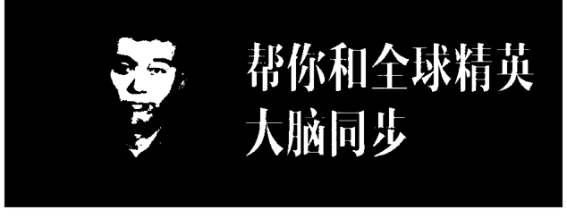

## 周末小议 | 宠物的超生问题

你养宠物吗？如果你养宠物的话，你肯定是一个有爱心的人。我认识一些养宠物的朋友，他们都很有爱心。如果需要临时找人照看小孩，我会更乐意把孩子放到养宠物的家庭。我家是不养宠物的，但是我经常在网上看到别人贴的宠物照片和视频，觉得它们真是非常可爱，看了之后心情很愉快。

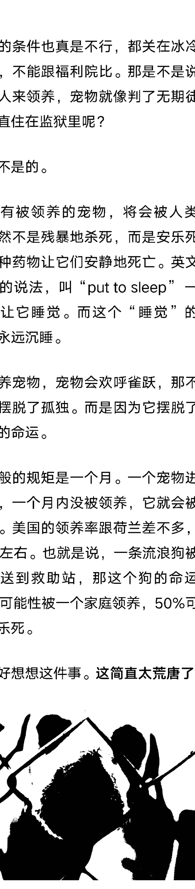

1

有的宠物视频还令人感动。我看过一个报道，说有一只狗因为车祸腿被扯伤了，只能跛行，看着就让人觉得很不忍心。后来宠物救援站的人来了，把这只狗抓住，给它做了精细的手术，仔细地调养。后来这条狗的腿好了，能正常走路，非常可爱地在救助站里跑来跑去。

我前几天还看到一个关于猪的新闻。一只猪，天生后腿发育不良，只靠两条前腿走路，等于跪立行走。当地媒体报道之后，养猪的农户决定不杀这只猪，把它当宠物来养，养它一辈子。

我们看了这样的新闻，就对人类有信心。我们正生活在一个特别文明的现代社会，整个世界都充满了爱心。

在有些国家，人们对宠物的爱已经做到了体制化。比如荷兰，已经立法禁止遗弃宠物，还有非常好的宠物救助制度。据报道，荷兰宠物救助站的领养率达到52%，现在荷兰街头根本看不到流浪狗。

受伤了给治疗，流浪了给收容，然后还会帮着找人领养。我看过一个宠物救助站的宣传短片。一只小狗，孤苦伶仃地住在救助站的一个笼子里，有一天有个家庭来领养它，它一开始不敢相信自己会被领养，当它确认自己被领养的时候，那真的是欢欣雀跃，非常可爱。

还有一个公益短片，为了号召大家去领养宠物，拍得非常有创造性。这个片里是人被关在笼子里，等着让小狗去领养！几个男人各自住在自己的笼子，都

而且救助站还会对领养者设定一定的条件，不是你想领养就能领养。在美国，宠物救助站会对你进行背景调查，看看你家的设施是不是齐备，比如院子有没有围墙，评估你有没有能力照顾宠物，比如会不会经常出差不在家。

非常人性化制度，人类付出了很大的努力，确保给每个宠物一个好的归宿。

好是好。

可是还有一个问题。那那些没被领养的宠物，他们后来怎么样了呢？

2

我虽然没有领养过宠物，但我做过一些调研。比如前面说的荷兰的宠物救助站，已经做得很好了，它的宠物领养率也有52%。有很多宠物没有找到领养家庭。

是不是像人类的儿童福利院一样，如果没有人领养它们，它们就会一直住在救助站里呢？

救助站的条件也真是不行，都关在冰冷的笼子里，不能跟福利院比。那是不是说，如果没人来领养，宠物就像判了无期徒刑一样一直住在监狱里呢？

不是。不是的。

那些没有被领养的宠物，将会被人类杀死。当然不是残暴地杀死，而是安乐死，注射一种药物让它们安静地死亡。英文有个文雅的说法，叫 “put to sleep” —— 也就是让它睡觉。而这个“睡觉”的意思，是永远沉睡。

你去领养宠物，宠物会欢呼雀跃，那不是因为它摆脱了孤独。而是因为它摆脱了很快死亡的命运。

美国一般的规矩是一个月。一个宠物进入救助站，一个月内没被领养，它就会被永远沉睡。美国的领养率跟荷兰差不多，也是50%左右。也就是说，一条流浪狗被人发现，送到救助站，那这个狗的命运是50%的可能被一个家庭领养，50%可能性被安乐死。

咱们好好想想这件事。这简直太荒唐了。


3

一只受伤的流浪狗，我们会花很大的力量救它，给它做高难度的手术，媒体高调报道，然后他进入救助站等着。我估计这只狗应该没事了，它上过电视出名了，很快就会有人领养它。可是与此同时，有很多健康的狗、比这只狗漂亮更可爱的狗，在救助站里，会被同样的给狗做手术的医生，杀死。

有个家庭来领养一只小狗，你不放心小狗的安全，亲自去这家考察了一番。你觉得他家的环境不够舒服，拒绝了领养申请。十几天以后，因为没有等到新的领养家庭，你把这只小狗杀死了。

咱们再想想前面说的那个让人抚慰宠物的公益片。如果我是一只宠物，我很想把救助站的工作人员咬死。我选择流浪行吗？

不行。流浪猫狗是公共安全和健康的隐患。宠物的命运，就是或者被好好吃养，或者被杀死。救助站只能收养这么多宠物，新的要进来，旧的就必须腾地方。

我去年还看到一个报道，台湾有一个美女兽医叫简稚澄，台大毕业、成绩第一的高材生，因为喜欢小动物，选择去救助站工作。简稚澄学了五年兽医，她学的是怎么救助动物，不是怎么让动物安乐死。

台湾的规定是12天。宠物进了救助站12天找不到领养家庭，就会被杀死。简稚澄杀死700个宠物之后，再也承受不了这样的情绪，选择了自杀。她年仅32岁。


4

爱心和理性，有时候是一对重大矛盾。

你面前有一只狗，快要冻死了，你肯定会让这只狗在你家过一夜。你甚至可能会收养这只狗。这就是爱心。

后来这只狗生下了六只小狗，你不可能把它们都养在家里。你想把小狗送人，可是周围亲友要么已经养了狗，要么根本就不想养狗。你甚至上网发了广告，但是也是没有人响应。那你就只有两个选择：或者把小狗送到救助站去，或者把小狗遗弃。这就是理性。

猫和狗，实在太能生了。几个月就能生一窝，每窝能生五六只。人类养宠物以前，猫狗的祖先在自然界是自生自灭的，存活率很低，或者是饿死了，或者是被咬死了。但是现在人接管了猫和狗的生活，如果让他们还保持这样的生育率的话，那就是完全不行的。

现在美国养宠物的家庭已经比有孩子的家庭都多了，饱和了。再有多余的猫狗，就只能杀死。

这就是爱心与理性的矛盾，也可以说是局部思维与全局思维之间的矛盾。单个动作判断，有爱心总是好的，无缘无故杀死一个宠物总是坏的。可是我们把所有爱心加在一起，根本养不了这么多怎么办？

在一起，根本养不了这么多怎么办？

这个矛盾无解，此事古难全。

5

没有终极解决方案，不过现代社会有办法“调和”这个矛盾。

一个办法是阉割。美国有30个州有不同程度的立法，要求对宠物进行阉割。所谓阉割，就是母猫和母狗要切除它们的卵巢，而公猫和公狗更惨，要……“中性化”——他们不再是公猫和公狗了，他们被剥夺了性生活的能力。那为什么非得搞野蛮阉割，不做更精细的绝育手术呢？因为绝育手术太贵了做不起。

第二个办法是禁止买卖宠物、禁止私下配种，培育什么纯种狗。当然完全禁止不可能，一般的做法，像荷兰是收重税。这等于变相的计划生育——不要再生了，想要就去领养一只现成的吧。

第三个办法比较人性化，是泰勒·科文在《自满阶级》这本书里提到过的，“匹配”。美国的救助站正在使用跟婚恋交友的原理差不多的配对算法，帮宠物和对应的家庭配对。现在纽约和旧金山这两个地方的救助站的领养率达到了80%到90%，而是1970年代的领养率才只有20%。

但是宠物和人类都是越来越不自由了。我要说的这个道理是，现代社会，是一个你不能为所欲为的社会——连爱心都不能为所欲为。

现在美国78%的宠物都被阉割过。它们的一生是不完整的，仅仅作为宠物而存在。有人说阉割是为了好养，因为阉割后的宠物性情会更温顺——其实最主要的原因还是控制数量。你想给狗狗完整的一生，让它能生儿育女，对不起你最好不要这样。你不喜欢救助站里的野猫野狗，你想要个血统高贵的纯种，对不起请交税。

遇到流浪猫狗，如果你想对它负责，可以把它送到救助站去。如果你不想对它负责，那你就别管它。但是你不要投喂。投喂流浪猫狗是对宠物界、对人类都不负责的行为。

归根结底，人类养宠物是为了人类自己，而不是为了猫权和狗权。宠物过的不是它们自己的一生，而是我们爱心的投射。现代人一方面对宠物很有爱心，另一方面在救助站批量地杀死宠物。

你说这是伪善吗？我说是妥协。这就是爱心跟理性之间的妥协，也是理想跟现实之间的妥协。这就是现代社会。每个人都必须妥协，人和人、人和宠物才能共处。


## 日课188 | 假如你自己打击了你

今天我们把桑德伯格的《B选项》讲完。这本书说的是“抗打击能力”，咱们前面说的“打击”，各种不幸，比如失去亲人、得了疾病、工作中的困境，大多是外部的原因导致致的，自己不能控制——所以也不能怨自己。但还有一种不幸是因为自己犯了重大错误带来的，换句话说就是“自作自受”。

这时候怎么办呢？理论上来说，当然应该把每个错误都当成一个学习的机会，总结经验教训。但是这个话说起来很容易，实际上很少有人能从自己的错误中学会什么东西。咱们去年有篇专栏《失败不是成功之母，成功是成功之母》，说的就是这个道理。

自己的原因导致的失败，实在让人太痛苦了。你不能怨恨任何人，甚至都不能怨恨运气，要怪只能怪自己不行！这简直何以自处呢？

### 1.对事不对人

咱们以前说过，想要从失败中提高，一定得有“反馈”，而反馈一定要“对事不对人”。可是人的习惯思维，总是指责“人”。如果自己做错了事，就指责自己。

- 自我放纵（self-indulgence）：我根本不在乎这个错误，你们爱咋咋地；
- 自我怜悯（self-pity）：我充满羞愧，我不行，我这个人就不行；
- 自我同情（self-compassion）：像同情一位朋友那样，同情自己。

### 2.具体再具体

桑德伯格失去丈夫，第一天回到公司上班，跟同事开会的时候，感到自己根本没办法集中注意力。我们知道桑德伯格是Facebook的COO，那么多管理人员看着她，可是她不知道该说什么。等别人都讲完，该桑德伯格讲几句，她可能是为了调整自己的情绪，一开口就说了很多很多，最后自己都不知道自己说了什么。

### 3.发射火箭可以失败多少次

人需要抗打击能力，公司也需要抗打击能力。我读这本书的一个突出感受是桑德伯格的朋友是真多，比如特斯拉和Space X的CEO埃隆·马斯克，也是她的朋友。Space X有一次发射火箭，桑德伯格还领着孩子去现场看过。

误。

但是一般的工作就不是这样了。如果很多错误并不影响大局，那公司文化就可能是为了不得罪人而掩盖错误。怎么才能建立一个健康的机制，让员工不怕谈论错误呢？

桑德伯格有个朋友是谷歌的高管，她有个办法。她从家里拿来一个毛绒玩具小猴，在自己领导的这个部门规定，每周评选一次这周内所有人犯过的最严重的错误——这个错误是谁犯的，小猴就在谁的办公桌上放一周。这是一个无伤大雅的小惩罚，还有点温和的玩笑意味。这个措施得到了欢迎，员工的确更乐意谈论错误了。

桑德伯格在Facebook也定了一个规矩：每人每个月都至少要和同事发生一次“艰难对话”——也就是给同事挑毛病的对话。桑德伯格建议你可以这么跟同事说：“我对你的工作有些评论，想让你听听——我之所以跟你说这些，因为我对你有很高的期望，而且我认为你完全能达到这样的期望。”

我们看这些给别人指出错误的办法，最理想的效果都是既提供了反馈，又不伤感情——这也就是对事不对人。

## I 由此得到

对事不对人，这个原则既适用于别人，也适用于自己。所有的评价都应该是针对具体动作和具体事儿的，而不应该是针对人。可以说这件事儿做得对不对，最好不要说这个人行不行。

### I 我的评论

今天的主题是对事不对人，但这本书说完了，我还是很想评论一下桑德伯格这个人——或者说，是桑德伯格的一个行为模式。我感觉桑德伯格是个非常懂得知行合一的人。她做事——不管是公司的大事，还是个人生活的小事——非常愿意寻求专家的意见，而且还都是领域内的一线专家的意见。她听说了一个理论，哪怕是个刚刚研发出来的新理论，都能马上付诸实践。

这样的人做事就特别有章法，她每一个动作可能都不是随意的，都能讲出道理来。一旦失去章法，像遇到丈夫去世这样的打击导致自己的行为失控，她会感到非常不安。

而且你还可以看出，桑德伯格并不死板。她自己在做事，同时还能以一个旁观者的视角观察自己，评估每个套路的实践效果，看看你跟她说的那个理论好不好使，随时获得反馈随时调整。

中国有句话叫“上士闻道勤而行之”，我看桑德伯格就做到了这一点。当然她能做到这一点是有条件的——她在公司的位位置很高，有很多决策机会能实践各种理论，她的朋友圈也是极其过硬，能给她提供第一流的建议。

下面这张图，是桑德伯格丈夫去世以后，她在家里和两个孩子共同商定的“家庭规则”。这就是精英水平的做法章法。

桑德伯格这样的人，真是咱 collateral title 的榜样啊。


万维钢

在最新一期《奇葩说》中，马东老师正好引用了咱们专栏的《失败不是成功之母，成功是成功之母》这篇文章。原来马东也是《精英日课》的读者，我深感荣幸！ 所以咱们是不是可以这么说：“你是马东的粉丝吗？其实马东是你的同事！”


## 日课189｜高频切换工作法

今天我们说一个熟悉的话题——到底要不要在工作中来回切换任务？这个问题现在有了很新的进展。

任何一本讲时间管理的书都会告诉你，高效来自注意力集中。你应该排除干扰，坐在那儿老老实实地把一个任务做完，再做另一个任务，尽量避免在不同任务之间来回切换。这是因为切换任务是有成本的，大脑每次转换任务都得重新熟悉，要付出时间适应。所以我们工作的时候切忌东张西望，切忌时不时查收邮件，切忌动不动拿起手机看朋友圈，最好找个不受打扰的环境。

但是另一方面，咱们专栏之前也多次讲过，如果你不仅仅是想把活干完，而是想把活干“好”——想要有点创造性的话，那么时不时切换任务反而是有利的。比如我们解读过蒂姆·哈福德的《混沌》这本书，其中就提到，那些创造性思维比较强的人，比如艺术家，往往不能集中注意力，经常分心。

我们还讲过发散思维。发散思维跟集中思维有一个很大的区别，就是发散思维喜欢有休息的时间段，换换脑子干点儿别的事儿，比如散散步、睡一觉，反而更容易获得新灵感，我们不建议连续在一个问题上花费太多时间。

而今天我要说的这个新研究，可以说是刷新了我对这个问题的认识，甚至让我感觉有点吃惊。《哈佛商业评论》网站5月10日有篇文章，叫“想要更有创造性，就计划好休息时间段”（To Be More Creative, Schedule Your Breaks），作者是哥伦比亚商学院的三个研究者，Jackson G. Lu，Modupe Akinola，和Malia Mason。

文章是个简要的研究报道，原始论文发表在《组织行为与人类决策过程》期刊上，我把截图贴在这里。这个研究说对于创造性任务来说，经常切换任务是有利的。这个说法我们之前就已知晓了，不算新鲜，但魔鬼在细节中——为了了解这个研究的细节，我特意读了他们的论文，这一读就吃了一惊。


实验中切换任务的频率之高，完全超出了我的想象。

研究者做了好几个实验，我们重点说其中两个。

第一个实验是在实验室进行的，受试者是美国某大学的学生和校友，他们的任务是做两道英文文字题。题目本身不算难，但就算英语是你的母语，你也需要费一番功夫才能想到答案。

题目是这样的，给你三个词：way、mission、let，然后问你能不能再想一个词，跟这三个词分别连接，都能组成新词。这道题的正确答案是“sub”，跟前面三个词组成 subway、submission 和 sublet。就是一个简单的文字游戏。实验者用这样的题目来考察受试者的创造性思维。

像这样的题，一共有两道。每个受试者有4分钟时间来做这两道题目。所有受试者被随机分成三组，每组被指定了不同的解题方法——

- 第一组是“连续切换”。受试者必须轮番思考这两道题。做第一题，考虑30秒，时间一到马上“想”第二题，再过30秒又回到第一题，如此反复地在这两道题之间跳来跳去。
第二组是“任意切换”。在4分钟的时间内，受试者可以随意在两道题中切换，愿意怎么分配时间，来回考虑都可以。
第三组是“中间切换”，在4分钟里，前两分钟考虑第一题，后两分钟考虑第二题。

那你猜哪种方法好呢？按常理来说，第二组方法，任意切换应该是最好。正好有思路的时候不会被打断，没有思路的时候可以换另一道题做。其实我们平时考试的时候，就是这么做的，把会做的题目都先完成，不会的慢慢做。从来没有一个考试，这个题给你30秒钟，30秒后马上“想”另一道题，另一道题30秒没想出来再倒回去想第一道题。所有考试都是给个总时间，你自己任意把时间分配给各个题目。

但是实验结果大大出乎我的预料。第一组，连续切换组，有51.4%的人把两道题都做出来了；第二组，任意切换组，只有12.5%的人两道题都做出来了。第三组，中间切换组，是14.3%有两道题都做出来了。也就是说，以30秒为一个单位时间连续切换组的成绩，大大超过另外两组的成绩。

咱们想想这个结果。一道题想30秒就被打断，马上思考另一道题，还是30秒，再回来，这切换速度也太快了，结果反而做题的效果最好。这简直是闻所未闻。以前我们说，心理学这个科学没啥惊喜，因为心理学家研究的结论一般都是显而易见的，只不过他们做个实验证明一下——但是今天这个结论，的确是我们以前没想到。

另外一个实验是在网上招募了一批受试者进行的，也是做两道题，总共8分钟。第一题是列举砖头的各种用途，第二题是列举牙签的各种用途。实验也是分三组，第一组连续切换，写一个砖头的用处，再写一个牙签的用处，反复来回；第二组任意切换，你可以随时在砖头和牙签之间来跳去；第三组中间切换，前4分钟想砖头的用处，后4分钟想牙签的用处。

第二个实验的结果跟第一个实验的结果很相似，也是连续切换组的成绩最好。

我来说说这两个实验的特点。

我们以前讲发散性思维也好，创造性思维也好，我们讲的是换换脑子，放松一下，休息一下，比如工作一会儿就去散个步吃个饭。但是这个研究不是这样，它是在两项同样难度的工作之间来回切换，不是利用休息时间换脑子，而是强制利用工作来换脑子。

另一个特点是，转换速度实在是太快了。它并不是在第一个问题已经没思路了才让你换第二个问题，而是强迫你换第二个问题。砖头和牙签的实验也是，这边想出一个，马上想另外一个，这就好像同时跟两个人工棋一样——难道说同时跟两个人下棋，反而比每次只跟一个人下棋的更有利于发挥水平吗？

那研究者自己怎么说呢？研究者认为之所以这种强制切换的方法有效，是因为人脑在解决一个问题的时候，往往会进入一个不经意的低效状态——实际上你已经没有新想法了，是在原地打转，但是你自己意识不到自己正在原地打转。你意识不到你的灵感已经枯竭了。这个时候如果来个强制打断，先让你去干个别的事件，稍后再转回来，才能换一个新角度考虑问题。

我看这个观点很有意思——也就是说存在一种状态，是你以为你还有思路的时候，其实你已经没有思路了。

而且这项研究不是孤立的。研究者提到几个类似的研究，结论都是连续切换最好。比如有个研究是让受试者尽可能多地列举出这个四种种类下的不同物品，就发现四个种类轮流说，每轮每个种类只说一个物品，效果最好。

那么这个研究给我们的建议就和以前那些“时间管理”的建议正好相反——应 该每工作一段时间，就被打扰一下，做做分心的事情，比如说查看电子邮件。研究者建议用闹钟，其实现在如果你是在计算机上工作的话，有些软件可以用。

如果你用的是 Mac 的电脑，推荐一个我常用的软件，叫 Time Out，能根据你设定的时间提醒你休息。


如果你用的是 Windows 或者 Linux，也有 很多类似的工具，我截图在这里供参考——

### Workrave

Workrave is a program that assists in the recovery and prevention of Repetitive Strain Injury (RSI). The program frequently alerts you to take micro-pauses, rest breaks...

### EyeLeo

EyeLeo is a handy PC application that reminds you to take a break for your eyes. Features: Screen blocking long breaks every hour. Short breaks with...

### RSIBreak

RSIBreak is a small utility to remind you to take regular short breaks. Repetitive Strain Injury is an illness which can occur as a result of continuous work with a...

这些工具本来是防止久坐影响身体健康，提醒我们在电脑前工作一段时间就站起来走几步用的，没想到可以用来提升创造性思维！

### 我的评论

我想先重申一下，所谓创造性思维，并不是什么神秘的东西，不能说创造性思维就比集中思维、执行思维更高级。能列举砖头的各种用处并没有什么了不起，如果缺乏真正知识的支撑，这种思维没有大用。

创造性思维是一个你自己寻找答案的过程。创造性思维没有固定的套路，是你在没有路的地方搜索——如果有固定套路你执行就可以了，那就谈不上创造性。没有一个固定的套路会告诉你砖头有什么用，你只能在自己的大脑里面搜索砖头都有什么用处。创造性思维的基本功，说的高级一点叫“探索”，其实就是“搜索”和“摸索”。

仅就创造性思维而言，不停地换思路确实是个好办法——这个地方搜索得差不多了，那就换个地方找。

可是这个研究所用的轮换频率，也实在太高了。这种方法究竟有多大推广价值呢？比如你参加高考，数学最后两大难题都比较难，一上来可能都没有什么思路——难道你应该给自己掐个表，第一题想30秒后，改想第二题，第二题想30秒后，再想第一题？这个我真不敢下结论。

如果你昨天问我怎么做这两道题，我肯定说应该把第一题做完了再做第二道题。但是今天我看到这个研究，也想做个实验，不知道我们的读者中有没有老师，能不能安排学生们做这个实验。原来的研究用的是小题目，切换时间只有30秒，那我们用两道真正有点难的数学题，也许应该把30秒，改成1分钟、或者两分钟？

那篇论文最后的讨论部分，研究者也表示他们不知道最优化的切换时间是什么，也许跟任务的难度相关。但他们猜测，随着思考进行，切换时间应该越来越短！因为你已经熟悉这两道题了。

我自己也在演练。读书似乎不应该被过分打扰，但是整理思路、给专栏文章列提纲和最终写作，我准备加大打扰的密集度。

### 由此得到

今天我们了解了一个非常新的研究，说如果是为了创造性思维，那就应该跟传统的“时间管理”反其道而行之，增加打扰和休息。这个研究的令人吃惊之处在于，打扰的频率越高、打扰的方法越被动，对解决问题的帮助反而越大！


## 日课190 | 用进化论修心养性

日课190 | 用进化论修心养性

今天咱们说一本已经有中文版的书，英国作家马特·里德利（ Matt Ridley ）的《自下而上》。这本书目前正在罗辑思维热卖，想必很多读者已经看过了，但是我还是很想分享一点自己的感想。

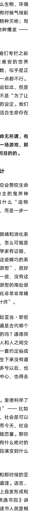

里德利非常喜欢讲大道理，像他之前的《理性乐观看》讲的就是交换与分工决定了人类的福祉，他能从原始社会一直讲到未来。这本《自下而上》就更厉害，跨学科涉及到很多领域，而且讲了一个特别大的道理。

这个道理，其实就是进化论。更准确地说，应该叫“演化论”，不不仅仅是生物的演化，更是一切事物的演化。这本书的英文标题叫 The Evolution of Everything，也就是一切事物的演化。

### 1.世界观：演化没有目的

### 2.社会观：好东西没有设计

### 3.价值观：自发演化的东西往往比设计出来的东西好

胆怯试新东西，发明新技术。

那创新是从哪儿来的呢？是演化出来的。凯文·凯利在《科技想要什么》这本书里就把技术创新和生物演化做了很好的类比，创新从来都是自下而上，自发演化的结果。什么是市场？市场就是一个演化系统。

市场讲究的是自下而上，而政府则是 editorial 个自上而下的系统。那如果要解决什么问题，哪个系统更厉害呢？这个价值观就是演化的力量往往更强大。比如说你比较过去这么多年各种商品的价格变动情况，你会发现绝大多数市场化的商品都是越来越便宜，哪怕最底层的消费者的生活水平也大大超过一百年以前。可是医疗和教育这两个政府插手的项目，却常常是越来越贵。据里德利考证，现在英国引以为豪的全民医保系统，还不如英国以前没有政府插手的居民互助系统效率高。

当然我们不是说要取消政府——政府有政府的作用，但这个价值观是，在演化机制能起作用的地方，最好把问题交给演化。

演化为什么这么厉害呢？它有两个重要特点。首先演化是可以继承的，好东西会得到奖赏，获得更多的繁殖机会，它会生育很多后代，更容易流传。另一个特点是，两个好东西之间，可以通过异性繁殖，产生强强结合的后代。生物界的基因遗传和异性繁殖，在人类社会的文化、道德和市场中就是模仿和交流。

所以你看，演化这个思想，落实在生物界就是达尔文的进化论，落实在经济学上就是亚当·斯密的看不见的手。但是里德利说，很少有人意识到，这两个东西其实说的是同一个道理。

美国就有许多自相矛盾的人。美国右翼信仰上帝，非常不相信进化论，但是非常相信自由市场。美国左翼非常相信进化论，但是不相信自由市场，总想让政府来个顶层设计，取代市场的作用。其实进化论就是市场，上帝就是政府！

所以我说演化思想是一把尺子。你到底是更相信自下而上的力量，还是自上而下的目的和设计？

里德利在书中还考察了演化思想在其他领域的应用，非常精彩，咱们下次有机会再说。我想先说我的一个观点。如果你能接受演化的世界观、社会观和价值观，你大概会有一个特别的人生观。

### 4.人生观：符合天道

咱们专栏说过哈耶克，我们知道什么思想极端化以后都不好。但是以我之见，如果一个人的三观是以自下而上的演化思想为主，那他可能就具备很多优良品质——

他会不迷信权威，不相信什么救世主，愿意靠自己。

他不会有那么多人生的困惑，不会质疑命运不公平，不抱怨做好事怎么没有好报，更容易接受现实。

这个人还会比较谦虚，他知道好的东西都是自发演化出来的，不是什么圣人设计出来的，所以他就不会有妄想，不会幻想自己能一手遮天，搞个什么顶层设计一下子就能治理好国家。

前面我说了，演化思想有大用。从个人角度，我们还可以从演化思想中推导一套为 人处世的行为准则。人生在世，到底有什么事儿是最值得干的呢？

如果你接受演化的价值观，如果你认为演化就是“天道”，我认为有三件事最值得干。

第一是传宗接代。当然这不只是生物学意义上的传宗接代，也包括文化的传承，手艺、技术的传承。你去学习前人的好东西，让它流传下去，这总是好的。

第二是交流。交流就等于异性繁殖。你有一个好想法，我有一个好想法，咱们交流一下，让好东西结合，也许就能产生一个更好的东西。交流可以带来综合式的创新。

第三点是创新。还有一种创新是随机产生的突变式的创新，相当于基因变异。创新不一定是科技创新。如果你认为这个社会现在有问题了，你大胆创造一个新的行事方法，从自己开始慢慢影响周围的人，最后改变社会规范，你这就是一次创新。

我们有了演化的世界观、社会观和价值观，去做传宗接代、交流和创新的事儿，那就算是符合了天道吧！


## 日课191｜低收入者重视集体，高收入者强调个人

不知道你注意到没有，过去这些年，中国的人与人之间的关系似乎比以前疏远了一些。过去如果说两个人关系好，能好到不分彼此，干什么事都要在一起。现在不论是学校还是在公司，乃至邻里和亲戚之间，这种关系已经很少了。过去还有结拜异姓兄弟，认干爹干妈，这些现在也几乎没有了。

还有很多过去的格言现在也不说了。我小时候经常听到的格言，什么“一个好汉三个帮”、“多个朋友多条路”、“远亲不如近邻”，现在可能连中小学生写作文都不用，这些词显得太老也太土。

我有个感觉，中国社会正在变成个人主义越来越强的社会。

最近有一项研究，跟这个现象很有关系。这是纽约时报5月12日的一篇文章，“怎么说服富人捐款”（How to Get the Wealthy to Donate），作者是加拿大不列颠哥伦比亚大学和美国芝加哥大学的三个研究者（ASHLEY V. WHILLANS, ELIZABETH W. DUNN and EUGENE M. CARUSO），实际上是他们自己做的几个研究的一个综述。

这些研究者对富人的定义是一个人年收入在9万美元以上。这是一个什么概念呢？我们多次说过，美国家庭年收入的中位数是6万美元。个人收入9万美元，就相当于普通美国人收入的2到3倍左右。这差不多是高科技行业一个有硕士学位的工程师的收入水平，在其他行业就是管理层的水准。

很多研究都说明，富人是比较自私的。如果你有个爱心项目需要募捐，你最好找收入不是特别高的人。不但富人不愿意为了爱心捐款，连富人家的小孩子对比别的小孩更不愿意捐款。

2015年有人在幼儿园里做了一个研究。研究者给孩子们组织了一个活动，小孩做了些事情，换到一些代金券，这些代金券可以用于购买非常好的礼物。研究者告诉孩子们，另外还有一个孩子，生病了，在医院里躺着，不能参加这个活动。你们愿意不愿意把你们换到的代金券分给生病的小朋友一点呢？结果家境富裕的小孩捐出来的代金券反而更少。

所以千万别对富人的爱心抱太大幻想。富人真要捐款也可以很大方，但肯定不是为了爱心，而是为了自己。

今天说的这个研究，则是一个实用技能：如果 impulses

- “让我们一起来救一个孩子”
- “你 = 救命者”

结果是对于那些年收入9万美元以上的高收入者来说，第二个广告词的效果大大好于第一个广告词。

一般搞捐款活动，我们直观的想法，都是众人合力去做一件好事，为的是一个共同的目标。可是你要想说服高收入者捐款，说“共同的目标”他根本不感兴趣。你得强调这个捐款行为是他的一个个人成就。

换句话说，高收入者救孩子不是为了那个孩子，而是为了给自己增加一项“曾救过人”的成就。

- “向前一步，开始你的个人行动”
- “让我们支持一个共同的目标”

可想而知，第一个广告词大获全胜，平均每个人的捐款比第二个广告词多了150美元。

我看这个研究，就觉得这些高收入者真是有点像咱们“得到”的用户——希望自己变得更厉害。所以你看，哪怕是募捐，都得给用户赚能啊。

### 我的评论

听说了这两种植心态的教育思想，我心里真有点不是滋味。我从小受的教育，就是应该把集体的需求放到第一位，人应该有点高尚情操，无私奉献。咱们中国人从小都是受这个教育。而现在居然有人说，这样的教育是低收入者的特征？

什么人脉，什么人情账户，其实是没有明确收益的账，不但不利于良好合作，还污染

确权利益的账，不但不利于良好合作，还污染了真诚的友情。表面上温情脉脉，背后却是可耻的算计。这大概就是为什么现代社会的人们越来越反感这些所谓的人情往来。

把利益瓜葛都排除在外，轻装上阵交往，这样的亲情和友情，难道不是更值得追求吗？

想明白这些，高收入者的独立精神，可能就是更健康的人际关系。要么就是真诚的友谊，要么就是公平的合作，实在不行干脆就是赤裸裸的交易，搞什么人脉。

### Ⅰ 由此得到

相对于完成一个共同的目标，高收入者更在意个人的成就。但收入次要的，关键在于思维模式。随着经济实力的提高，人们互相依赖的程度将会减少，个人独立的程度将会增加。

那如果你想向某个大人物寻求帮助，最好的办法就是让他感到帮助你也是他的一个成就。

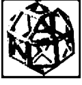

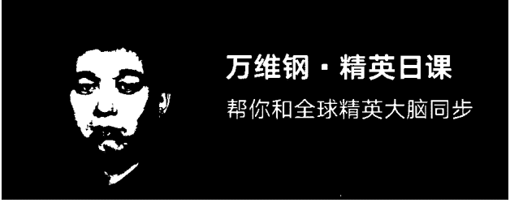

## 日课192 | 样板式的妥协

日课192 | 样板式的妥协

今天咱们说一个高端的 ánimo 题，科学与宗教。当然这个题目太大，写多少本书都说不完，我不可能说得特别深入，我只想从一个小角度说一点小心得。

我使用素材来自丽莎·兰道尔（Lisa Randall）的《叩响天堂之门》这本书。我们之前在《伽利略的反应速度》这期专栏里说过这本书。兰道尔下了很多功夫，中译本的翻译也非常不错，这本书对科学史有一个非常好的叙述。

我从这本书里读出一个感想：科学与宗教之间的妥协，远大于对抗。

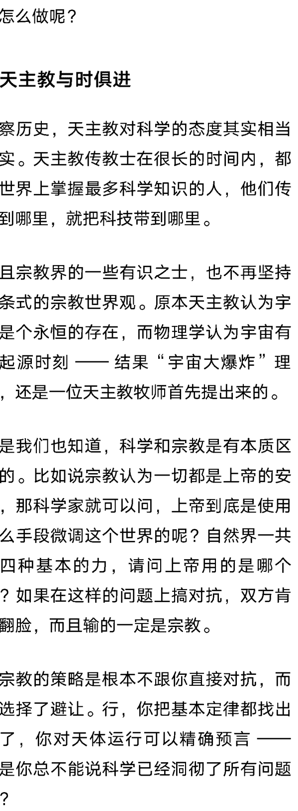

### 1.信教的科学家

我们一般提到科学与宗教，首先想到的是对抗。我们以前听到的科学史说的都是什么宗教裁判所，布鲁诺、哥白尼和伽利略的悲剧等等。科学代表先进，宗教代表落后，科学代表反叛精神，宗教代表压迫，这两个东西是水火不相容。如果你是科学家，那你就不应该信什么宗教，你甚至应该主动宣传科学，破除宗教的迷信，对吧？

### 2.礼让一步

早在公元五世纪的时候，天主教中的有识之士就已经注意到，有些非基督徒通过理性和实验的方法，掌握了一些有关天体运行的知识，而这些知识和《圣经》的说法是矛盾的。

### 3.反贪官不反皇帝

等到了伽利略的时代，科学家手里获得了更多的“猛料”，足以颠覆天主教的世界观——但是天主教的势力也到了几乎可以一手遮天的程度。

### 4.天主教与时俱进

考察历史，天主教对科学的态度其实相当务实。天主教传教士在很长的时间内，都是世界上掌握最多科学知识的人，他们传教到哪里，就把科技带到哪里。

当然也是真信，有时候宗教主动避免。始终给面子，始终留余地，始终能找到台阶下，这就是妥协。

这种妥协让我想起历史上的革命和改良。挑战权威不见得非得革命，我进一步你退一步，慢慢改良也是个办法。我们把科学家想象成反叛者，教会想象成执政者，那我们看到的历史是反叛者并不是一上来就要彻底推翻执政者，执政者也不是一上来就要掐死反叛者。

双方都是聪明人，讲究理性和克制，各自都有-bis 一定的妥协，耐心地等着力量对比的变化，在绝大多数情况下所有人都有安全感——这难道不是一个非常理想的状态吗？

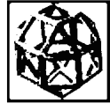

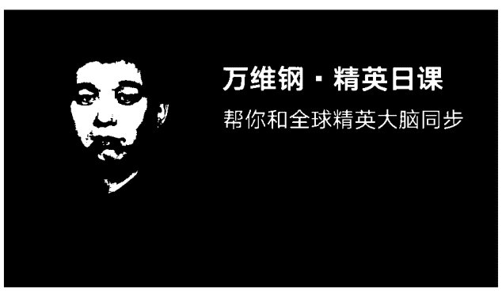

## 答读者问｜人生的第一要务是传宗接代

万老师，有报道说量子物理学目前遇到的瓶颈科学已解释不了了，而科学家说可能要上升到佛学的层面，那如果这是这样，科学就不研究佛学了吗？这不是有冲突？

万维钢 那不是报道，是某人自己的、错误地看法。物理学和佛教是完全不同的体系，任何看起来相似的地方都是比喻意义上的巧合。

只能说这只不过是站在以追求财富为目的的角度看。现今社会就是太过强调物质注意，所以才认为要成为富人多么重要。不是研究表明富人跟普通人幸福感没本质差异吗，如果以追求幸福感为目的，那么去帮助别人而不求回报不是比努力变富来的容易吗？

万维钢 “幸福感”是个很模糊定义的东西。帮助别人而不求回报，的确是一种幸福，而且我敢说是非常高级的幸福，但是经济独立的人更有能力帮助别人不求回报。
那“富人”跟“普通人”的幸福感有没有差距呢？华尔街日报报道的一个新研究说，是有差距的——

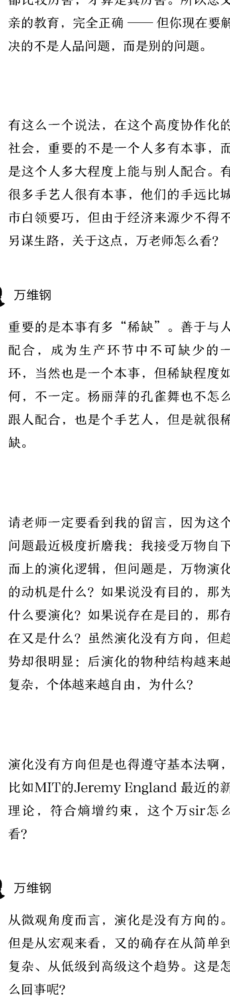

这个调查说收入低可能幸福，也可能不幸福；但是年收入超过50万美元的，都幸福。

骑行西藏的时候，在进藏之前用钱解决困难比较实在。进藏之后，虽然也是商业社会了，但是，有时候还是不能说用钱解决就可以用钱解决，人情因素多点。我在想，假如出现一场不可预期的灾难，即使是富人，是否也会转变思维和行动模式，重新回到人脉上来？我们是不是应该学会适应切换？我们有切换能力是不是能更大程度的反脆弱？

一时期二者接上了头，所以这个家族发展得好。就像生物的基因也通过有性生殖在变化。另外，政府本身也不也是演化的产物么？演化论和“存在即合理”有什么区别（姑且把“存在即合理”理解为一个事物存在是因为它“符合当前时期的特点和要求”）？有人说达尔文的进化论是“套套逻辑”，因为它不可能错：一个物种灭绝了，肯定是因为不适应环境，因为如果适意环境他就会留下下来。什么叫适应呢？适应就是能够在特定环境中生存下来…所以它的正确是定义性的，不可能找到反例。这个问题我们应该怎么理解呢？

留言里有人理解“演化”状态是系统的自组织，那么我有个疑问，比如人类社会进程，很多文化都或早或晚经历过奴隶制那样的专制时代，我们也知道在更原始的时代，社会组织不是那样的，所以原始共产主义，原始社会更像是自由市场信仰者心中萌种理想的自然自发自由的社会自组织状态（原始自由市场？），那么问题来了，奴隶制这种人压迫人剥削人的“不自然”的社会形态，显然不是圣经说的那样被神设计出来的，那么它又是如何从原始自由市场状态下被“自然演化”出来的呢？

演化思想发展下去会不会回到黑格尔存在即合理的古典辩证法上去？这样会不会事实上鼓励大家听天由命顺受？奴隶制一样是演化出来的在当时那个时代和社会环境下是被自然选择的结果——其他的制度都被淘汰了。既然如此，还反抗什么压迫，还需要什么对真善美的追求？杨白劳就该乖乖把媳妇还了，汤姆叔叔也该乖乖的为奴隶主服务…如果林肯相信这个思想，他还会那么积极的去解放黑奴么？须知，很多时候，正是因为受了自上而下的目的论思想，精英才会相信“可以变得更好”而去做很多“不自然”的事情，才会有改革甚至革命。当然，这些行动可以被演化思想体系创新的演异来囊括——我是这样做思想演练，来尽量达到自洽的。

万维钢

演化是不是“存在即合理”，“适应”是不是完全由环境定义的？不是。

同样环境之下，“适应度”大小有高有低，适应度高的个体获得更多的繁殖机会。乖乖还债的杨白劳，和乖乖为奴隶主服务的汤姆叔叔，就算是身处那样的社会，他们的适应度也不高——他们没有获得很好的繁殖机会。适应度高的是奴隶主。

在演化中获得高适应度，除了作为高适应度者的后代之外，别忘了还有一个基因突变的手段。既然同一环境下不同物种的适应度可以有高有低，那你就不能说这些现有的物种已经达到了这个环境所能允许的最高适应度，更不能说环境不变，物种就不能变。精英革命，就是基因突变。

当然我们也知道，基因突变是一种赌博，可能获得更好的适应度，也可能获得更低的适应度。但正是因基因突变，生物才不断实现更高的适应度。

第二个问题，“人压迫人”并不是“不自然”的社会形态，其实现在是个很自然的社会形态，最早何止是人压迫人，简直是人吃人。相对乎于扛战停止吃掉，战停止做奴隶就是社会的进步——这个演化也许是因为人有了可以和战俘沟通的语言？

请教万老师及各位同学，难道国家、政府不是演化出来的吗？原来没有这些玩意儿，后来，从群落到部族，再到国家，原来只有酋长，后来政府出现了，并且架构都是趋同的可能。这不就是演化吗？所以对于是自上而下还是自下而上，没必要非黑即白吧，来点灰度吧？

又涉及到宏观问题了，美国的教育医疗最好的都是私立的，占收入支出的比例，做得更好吗？万老师，为什么要有一个市场归市场，政府归政府的顶层设计，然后说怎么样更好，为什么不能用演化的思想，看看中国是全世界260个国家地区里唯一在过去60年里演化出来的产业齐全的现代国家呢？演化思维，让政府和市场自己慢慢摸索，怎么适应世界怎么来吧，不要顶层设计一个完美的“市场”。

万维钢

自下而上能做到的事情，它做的往往比自上而下好，这只是一个价值观，不是法则。我们特意强调了，连亚当·斯密都不是无政府主义者，所以灰度本来就存在。

中国经济的成功，你可以说是中国作为一个基因突变的个体在世界范围内“演化”的成功，但中国内部的确更多地使用了政府的力量。这是为了什么呢？

我以前有篇文章叫《谈死的就死的市场经济》，说的就是这个问题。简要来说，市场经济的好处在于通过不断试错，能让好的创新自然发生，让落后的公司自然淘汰。

但中国面临的情况很特殊，就是你是后发国家！很多东西根本不用自己摸索创新，直接照搬别国已有产品就可以了——这时候直接模仿、乃至于“集中力量办大事”甚至比试错的效率更高——前提是你排在别人后面，已经知道正确的方向在哪里。

但是这一套适用于过去，未必适用于将来。如果到了中国企业必须自主创新的时候，市场才是最厉害的机制。

弱势群体怎么办？演化的结果就是适者生存吗？

万维钢

演化是“适者”获得更多的繁殖机会，可不是要消灭弱势群体。弱势群体在演化系统中至少有两个机会。

第一是基因突变。我们看到有很多天才，是出生在弱势家庭。这一代不行不代表以后都 Saat

对，对一夫一妻制的现代人来说应该说更好）的繁殖机会。但是你没有任何办法能让你的后代比*你们两个*强。他们将会接近你们的水平，但基因变异没有方向，可能会比你们强，也可能会比你们弱。

万老师好，我的问题是：我们对动物的爱心，到底是什么？我们一方面收容流浪猫、流浪狗，一方面将在归定时间内未被领养的猫狗杀死。——那收容它们的根本目的，是为了降低社会隐患，还是为了表达爱心？有人宁愿领养一只受过伤甚至终生不能恢复的小猫小狗、甚至是小猪，却对那么多健健康康的动物视而不见。——这种行为到底是真正的爱心，还是在媒体曝光下产生的虚荣心？（我相信，在有选择的情况下，任何人都会选择健康动物领养）小猫小狗小鸡小鸭小牛小羊小猪小马，同样是被人类似化的动物，为什么有些人士对某些动物的批量饲养、批量处决、批量上市习以为常，而对食用另一些动物却极为抵触。假设，再次强调只是假设，你可以心情好时养小狗吃牛肉，我为什么不能心情好时养小牛吃狗肉？——同样是伤害一种动物的同时保护另一种动物，哪种算是有爱，哪种算是为恶？谁规定的标准？期待万老师的解答。

万维钢

照顾受伤的小狗，对健康的小狗视而不见，肯定不是完全理性的，但我感觉的确是出于爱心。这个爱心主要是共情作用，对发生在自己身边，亲眼所见的东西感同身受，看到小狗受苦，就好像自己受苦一样，特别同情，于是收养。这也是为什么我们更乐意给悲惨画面特别鲜明的灾难捐款，而不是理性地按照实际需求救助。

那为什么养小狗吃牛肉呢？我听说一个理论是小猫小狗的“可爱”，很像人类的小孩。爱孩子是人的天性，不然没法好好照顾后代。有实验表明，如果在钱包里放个孩子的照片，钱包丢了别人捡到就更愿意还给你。

我们喜欢什么动物，不是考虑这个动物的使用价值、也不是考虑它的智力水平，而是看它像不像孩子。我们把对孩子的爱投射到对小猫小狗的身上。猪和牛就不行了！

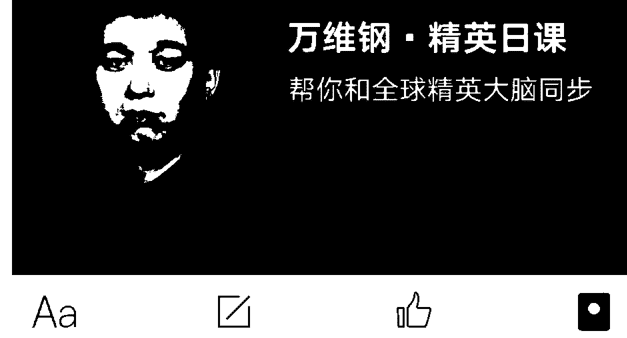

## 特别放送｜向10万读者致敬

万维钢

今天咱们精英日课订阅量到达了10万。恭喜和感谢各位！

这个世界每天都在产生大量的知识。而我理解的「精英」，就是能从知识思辨中找到乐趣的人，就是对未知无限好奇的人，就是面对不确定性随时可以迭代自己的的人，就是要求自己和最新认知保持同步、从不放弃学习、永远高看自己一眼的人。

你们就是这样的人。向你们致敬。

今天精选了日课上线上以来我认为最有价值的最新认知，和你回顾分享。

并向那些在各领域探索未知的学者致敬，以及，向未知致敬。

## 日课 048 科学版无为

无为首先是一个个人状态，就是「not trying」。不刻意追求，不用心匠造物，像佛特意松松的去做一件事情，结果做得非常自然。无为不是不做事，而是做得看起来自然，让人感觉他毫不费力。

做事达到无为的水平，反而不是要经常苦练！无为和熟练，无法和刻意之时，反而要松一点点。这点点，值得一个高手用一生去追求。

区分好的忘我状态和不好忘我状态，应该用另外一个标准：你做完这件事情之后是感觉到愉悦，还是很空虚。

如果用这个标准判断，那么好的忘我体验就是心流，而不是无为！

## 日课 053 科学版无为

孔子、老子、荀子、庄子，他们的最高境界都归结到无为，也就是 not trying。但他们的路径截然不一样：

+   孔子供以冷知识为主导，通过博学苦练，执先王遗智慧凝结在熟知的热情之中，是 try hard not to try;
老子主张直接认知知识，只保留「好的」热情知，是 stop trying;
荀子主张人生天生就有好的热情知，应该把这些好的热情从知识路径培养，但是要用冷静进行第一轮的热情知系统，就是 try, but not too hard;
庄子强调事，事先不做任何对和错的区分，是 forget about trying / not trying。

四派说功，你只要实转了，才知道都是到底是什么境界。正所谓逆用之时，存乎一心。

## 日课 105 敬畏是一种什么情绪

所谓敬畏，就是当一个人面对一个别的认知范围之外的「恐惧区」的事件产生出的情绪。这其实是一个非常难得的美好体验！没有敬畏之心并不代表一个人很厉害，只能说明这个人的格局太小，只关心自己身边的一点事情。

但是，敬畏，应该是探索未知的开始，而不应仅仅只是一段旅游式体验的结束。

## 日课 114 谁想成为《文化》亿万富翁

素勒·科文从经济学角度，提出两个欣赏文化的原则。

+   第一，你知道需要稀缺的是什么 —— 是你的时间和注意力，而不是名品。收藏艺术品就像花钱，但是欣赏艺术品花不了多少钱。买本书、去博物馆，能花多少钱？如果你花钱的最关键点，不是装。

+   第二，你知道文化其实并不那么重要。我们大多数人都并不打算为艺术献身，我们只是当个欣赏者 —— 要让艺术为我服务，而不是我为艺术服务。那么你欣赏艺术的方式够正确不正经，生态或不妥协，听个歌到底什么衣服，都根本不重要

## 日课 102 喜欢一熟悉＋意外

工业设计大师诺曼，参加过美国宇航局第一个空间站的设计。他想方法让他空间站内部设计的有像素是地球上的房子，给予宇航员增加一点点熟悉感。最关键的一点，是尽量让他很容易看到地球。

在大空那奇怪的环境中，能看一眼地球是多大的安慰啊。

最容易被人类接受的东西，往往是在熟悉和新奇之间找到了一微妙的平衡。

## 特别放送 到底什么是智商

+   1, 国民平均智商比单个个人的智商更重要。
2, 高智商者有五个要素，对国民经济特别好处：爱冒险、善于合作、理解市场和现代政治、工作能力强、互相学习。
3, 如果人类空悬指定了关于《精英日课》给你的建议就是更加高端的。不确定性表白，高智商夫妇即使将来离婚后，仍能找到一个双赢的方式。

## 日课 119 到底什么是发散思维

+   1, 集中思维，是掌握挖掘概念套路，以及使用这些概念和套路的思维，特点是每次专注一点，是局部思维。
2, 集中思维有个缺点 —— 容易陷入思维定规。
3, 发散思维是全局性的思维，往往能把新想法和一个意想不到的知识联系起来，创造破定规。

最重要的一点教训，其实是每个人都会适合合理用自己的大脑，不要把大脑当成机器，要以其多神秒，要把大脑加工工具！根据不同情况主动切换集中思维和发散思维 ——

关键词：主动。

## 日课 057 平庸公司的厚黑学

我们过分关注了成功和高调创新的公司，世界上绝大多数公司，并不是像谷歌和Facebook那样运营的——平庸的组织，是算尽愚蠢运营。

普通打工饭本不需要特别聪明 Foot soldiers，你保持阶级执行了。愚蠢化，恰恰是效率的保障。

直到遇到危机为止。

## 日课 131 怎么理解特别大和特别小的数

生活中挫芝蔑西瓜的事情实在太多了。有的人买生活必需品的时候非常节省，买奢侈品的时候特别大方。有的人能为几十块钱比三家，而面对人生重大选择却异常草率。

忽略小事不是因为大胆，不是「个性」，而是理性。重视小事就等于忽略大事。你必须剥离轻重缓急，把精力资源放在最重要的事情上。

所以能做到不顾心理冲击，坚决使用某种「数量级思维」，是一种「大人思维」。这种「大有大量」，不是装出来的，也不是「养浩然正气」养出来的，是算出来的。

见识过、计算过、能做出理性决定，这对叫做胆识。

## 日课 045 到底什么是智慧

所谓“智慧 (wisdom)”，就是“明智的推理 (wise reasoning)”。

研究者从三个方面考察一个人的智慧水平：

+   ◇ 智识上的谦逊 — 我知道我需要更多的信息，才能合理地估计事件，我知道未来可能有不确定性；
◇ 超越自我 — 我知道我面对这个事情中其他可能当局者迷，如果能从旁观者的视角看问题，也许更好；
◇ 考虑他人观点，这成要我 — 我知道不同观点利益冲突能理解这个事情的夹杂与各方的思想和立场。我不仅仅考虑自己的利益，也考虑别人关系。

谦逊谨慎，旁观者清，达成妥协，能在日常生活中经常做到这三点，就是有智慧的人。

## 日课 039 这时候和那时候的亚当斯密

亚当·斯密说，热闹的富贵之外，还有另外一条路可以获得“被爱”，就是去追求智慧和美德。这个说法，有个相当严密的逻辑结构：

+   1, 人要追求自利
2, 自利，就要被爱
3, 被爱，还得值得爱
4, 获得被爱，名利不是个好方法
5, 好方法是智慧和美德。

他不对你说教，他不跟你玩什么“功利之情”，他跟你讲道理。

道德，可以是一个理性人的自利选择。

## 日课 035 天才少年还是靠谱的

+   1, 「以一般人类努力程度之低，根本轮不到拼天赋」—没错，但是对「不一般」的人来说，真的拼天赋。
2, 「数学就是用来把7成人都筛出去的」—对到处要用数学和逻辑的现代世界来说，这句话有可能说对了。连Lady Gaga都是从小数学好。
3, 但是！这个研究只研究了数学好的人，没有研究那些数学不好但是取得了不起成就的人。从逻辑上讲，「数学好的人很厉害」，不等价于，「数学不好的人不厉害」—就算数学不好的人，也应该理解这个逻辑。）

## 日课 009 今朝有酒今朝醉也是种理性

看似荒唐的行为，背后可能有不得已的苦衷。表面上人有自由意志，其实身上都不知道背着什么基因和环境的枷锁 — 有的人能够胜过这些枷锁，他们就是英雄。

## 日课 027 两种技能增长曲线

对数增长和指数增长，哪种增长模式好呢？如果让我选的话，特别是对于家里条件还可以的人来说，我认为指数增长是最佳的。初期不计回报地投入，坚持坚持再坚持，掌握一个门槛高的技能，坚持下来突破以后就自由了。其实搞学术、考试高阶技能，就算早期无心嚼彩又有甚么苦的呢？胡适有句话说得好 —— 怕什么真理无穷，进一寸有一寸的欢喜。

## 日课 050 精英水平的道歉

只有当你分析并解决了自己的问题，你的道歉才配得上被考虑。

道歉的目的，不应该是为了从对方获得什么 — 这个你控制不了。你只能控制你自己。

大人物关注自己的内心，小人物研究怎么应付和取悦别人。

一个真正的精英人物得有点中国古代君子，或者西方绅士的作风，学会反思自己的功夫。

## 《未来简史》解读 7：万物之网

人生，根本，没有，真实的，意义。一切意义都是幻想出来的。但唯一不好的呢？别忘了幻想可是最聪明在动物界中特有的超能力。我的建议是继续生活在梦境之中。

+   1, 我们继续维护各种我以为有价值的意义共同体。
2, 我会继续增加我的骄傲，提升我的感觉度。
3, 我会继续问我的内心愿望是什么。

但是！因为我知道这些是虚构的，所以 — 1, 如果有某个想象的共同体要求我牺牲自己或者别人的生命去维护它，我就不干。 2, 在经历事故、增加体验的时候，我知道我对这件事的解释，只是一个主观看法，只是我的事自以为讲了一个方便的解释，我不会被它绑住或者说是会。 3, 当某些强大撞击的时候，我会告诉自己，现在内心深处最强大的那个声音，可能它是错的！

## 日课小议 因为这个文化还跟我急了

所谓「精英」，特别是值得学习的一点，就是他知道现代人都很复杂的，而且能容忍人的复杂。他看一个人能看到很多面，而且他只关注这个人最有价值的一面。他不会要求一个企业家不信气功大师，不会要求一个运动员说话处处符合政治正确，也不会要求一个演员反台独 —— 你只需要在该对的地方对，就足够好了。

## 日课 139 从刻意练习到功夫在诗外

「老手并不是高手」，「专家未必最好用」，这两个道理成一定是的。

这是一个需要通才的时代。可以「练习」容刻意急，但成为通才，似乎却需刻意。你很推崇着实用的目的学习广泛的知识。通才的目的本来就是为了对付复杂问题和不确定的局面。

也许「什么都不知道到底有什么用」，这个问题错了。如果哪个知识都可能有用，那么最该关心的是你对什么感兴趣。真正的理科青年追求的不是简单上多几个理科，而应该是培养广泛的兴趣，把知识本身当成回报。

## 日课 191 低收入者重视集体高收入者强调个人

“人脉”这个概念，在现代社会根本就是一个伪命题，其实是弱者经常来的概念。现代社会是陌生人之间能够协作，能够迅速建立互助社会。如果遇到麻烦都向朋友依赖，即便根本不需要积累什么人脉关系，也不说不认识现在可以认识。如果这件事对我有利对你不利，却我怎么忍心让你做呢？

什么人脉，什么人情赊账，其实是没有明确权益的账，不但不利于良好合作，还污染了真实的友谊。表面上温情脉脉背后却是最精明的计算，这大概就是为什么现代社会的人们越来越反感这种所谓的圈子的人情往来。

想明白这些，高收入者的独立精神，可能是更健康的人际关系。要么靠最真诚的友谊，要么就是公平的合作，实在不行就越就是机械的交易，糊弄人么。

## 说一件有关时间的小事

「1043」这个数字的缩写是物物理学上的「普朗克时间」，它等于普朗克长度除以光速，数值大约是10的 -43次方秒。

普朗克长度，是物理学在理论上能测量的最短距离；光速，是信息传递的最快速度。普朗克时间之前，宇宙就已经存在；但是普朗克时间之后，可以理解的宇宙才正式开始。

我们把晚上10点43分作为《精英日课》的更新时间。

没有比普朗克更短的时间了，所以也不可能有更快的速度了。我希望能最集我最新的思想，用最短的时间，以最快速度传递给你。

我想用这个时间和你共鸣——对无限的未知永恒敬畏。


## 日课193 | 暴露于数据之下的真实你我

日课193 | 暴露于数据之下...

从今天开始，咱们分几次说一本5月9号刚刚出版的新书，《人人说谎：大数据、新数据以及关于真实的你我，互联网可告诉我们什么》（ Everybody Lies: Big Data, New Data, and What the Internet Can Tell Us About Who We Really Are ），作者是赛斯·史蒂芬斯-大卫德<|start|>茨（Seth Stephens-Davidowitz）。

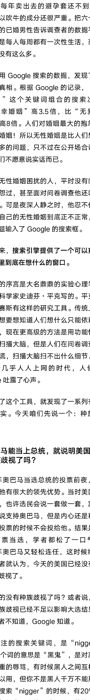

这位作者的姓实在太长，咱们以后就直接叫他的名字。赛斯的简历很有意思，本科是在斯坦福大学学的哲学，博士是哈佛学...现在在沃顿商学院当老师。这样的经历你很难在中国复制，我们的文科教育不太可能培养出来数据科学家——而赛斯这个跨学科的经历，对他在本书里说的事情却是十分重要的。

我估计你以听到书名就笑了，因为前一阵我们刚刚解读过麦肯巴格的《意会》，等于说我们刚说大数据不行，还得靠人，今天又反过来，说要想了解真实的人，还是得靠数据。

但是你当然明白，看似矛盾并不一定矛盾，正如菲茨杰拉德说的：“检验一流智力的标准，就是看你能不能在头脑中同时存在两种相反的想法，还维持正常行事的能力。”大数据和“意会”这两种方法有不同的适用范围，就如同阴阳，是互相补充的关系，并不像小孔里说的“气宗”和“剑宗”那样对立。上次我们说了“阴”，这次我们谈谈“阳”。

《意会》那本书告诉我们，有很多东西是大数据看不到的，需要我们身临其境去理解和体验。而赛斯这本书，说的是有很多东西是我们平时看不到，也打听不到的，只有通过大数据才能了解到——关键就在于你得知道去哪里看。

### 1.别人不知道，Google 知道

什么东西非得靠大数据才能知道呢？比如说人的真实想法。一个人的情緒可能低落甚至抑郁，但是在人前的表现还是阳光外向。一个可能有强烈的种族歧视心理，但是他不会告诉做民意测验的人。一个可能对感情生活很不满，但是连他的配偶都不知道。

但是 Google 可能知道。人人们可能会偷偷地搜索一些东西，他的搜索关键词暴露了他的内心。所有这些搜索动作，包括关键词、时间、地点、乃至于是谁搜索的、前后有什么关联，Google 全部记录在案，而且数据会被保留多年。当然，Google 不会公布具体哪个人搜索了什么，但研究者不需要知道具体的个人，他只要知道有这么一些人在做这样的搜索，就足以对“人”多出很多了解了。

咱们干脆说一个少儿不宜的例子。比如你要做一个调查，你想知道美国国民的性生活频率是怎么样的。那么哪怕你这个调查是完全匿名的，我们也可以想象，人们面对这个问题一定会吹嘘一下。根据一项非常权威的调查显示，仅限于异性恋，美国女性平均每年性生活次数是55次，其中16%的情况下使用了避孕套——那么按照这个数据计算，美国每年应该用掉11亿个避孕套。而如果调查对象是男性，那么数据就更大一点，是美国每年会用掉16亿个避孕套。

这就显然有问题了——避孕套一对男女共用一个，那两个数据应该是相同的才对，为什么会有这么大的差别呢？看来是有人在吹牛。

事实上，你再去看真实的避孕套销量，实际美国每年卖出去的避孕套还不到6亿个。所以吹牛的成分还很严重。把六十五岁以下的已婚男性告诉调查者的数据平均起来，是每人每周都有一次性生活，而实际肯定没有这么多。

赛斯使用 Google 搜索的数据，发现了更深入的真相。根据 Google 的记录，“无性婚姻”这个关键词组合的搜索次数比“不幸婚姻”高3.5倍，比“无爱婚姻”要高8倍。人们对婚姻最大的疚恨就是无性婚姻！所以无性婚姻是比人们想象中大得多的問題，只不过在公开场合调查中，人们不愿意说实话而已。

一个被无性婚姻困扰的人，平时没有向任何人抱怨过，甚至面对问卷调查他还吹嘘了一番。可是夜深人静之时，他忍不住想要了解自己的无性婚姻到底正不正常，于是把问题输入了 Google 的搜索框。

如此说来，搜索引擎提供了一个可以窥探人们心里到底在想什么的窗口。

这本书的序言是大师鼎鼎的实验心理学家和认知科学家史迪芬·平克写的。平克非常 fascinated 赛斯有这样的研究工具。传统上心理学家想要知道人们想什么只能依靠问卷调查，现在更高级的方法是用功能性核磁共振扫描大脑，但是人们在问卷调查里可以撒谎，扫描大脑拍不出什么细节。而在这个几乎人人上网的时代，人们向 Google 吐露了心声。

赛斯有了这个工具，就发现了一系列有意思的事实。今天咱们先说一个：种族歧视。

### 2.奥巴马能当上总统，就说明美国没有种族歧视了吗？

2008年奥巴马当选总统的投票前夜，民调显示他有很大的领先优势。当时美国学者担心，也许选民说一套做一套，跟民调的人说支持奥巴马，但是内心还是种族歧视，投票的时候不会投给他。结果是奥巴马高票当选，学者都松了一口气。2012年奥巴马又轻松连任，这时候绝大多数学者就认为，今天的美国已经没有什么种族歧视了。

美国真的没有种族歧视了吗？或者说，美国的种族歧视已经不足以影响大选结果了吗？学者不知道，Google 知道。

赛斯关注的搜索关键词，是 “nigger”——这个词的意思是“黑鬼”，是对黑人非常严重的侮辱，有时候黑人之间互相开玩笑可以用，但你不是黑人千万不能用。当人们搜索 “nigger” 的时候，有20% 的情况是想找个黑人笑话读，剩下的情况几乎就是直接的恨意：“stupid niggers”、“I hate niggers”。

赛斯发现，奥巴马第一次当选总统前夕，跟 “Obama” 这个词连在一起的搜索中，有1%，包含 “nigger” 这个词。在某些州，搜索 “nigger president（黑鬼总统）” 的人，比搜索 “first black president（第一位黑人总统）” 的人还要多。

这个比例似乎不大，但是落实到选票上，赛斯估计，以全国总数而论，奥巴马至少因为种族歧视少拿了4个百分点的选票。

奥巴马当选总统，不是因美国没有种族歧视，也不是因为种族歧视对选举的影响很小，而是因为奥巴马和民主党在其他方面的优势实在太大了！

而且 Google 数据还能告诉我们一些更深入的事实。

### 3.哪里的人最有心机

关于种族歧视，传统上我们有两个刻板印象。一个是我们总觉得民主党的人思想进步，比较少有种族歧视；共和党的人思想保守，更有种族歧视。另一个是北方经济发达，人比较开明，不搞种族歧视；而南方经济落后，人比较封闭，种族歧视比较严重——这当然是南北战争给人留下的印象。

可是赛斯从 Google 数据判断，这两个印象都是错的。真正能划分种族歧视的，不是政党也不是南北，而是东西——美国东部的几个州，有更多人有种族歧视思想，而西部尤其是加州一带，人们的确实没有什么歧视思想。

有什么歧视思想。

所以有这么一帮人，他们是民主党人，住在发达的东部，经济条件和受教育程度都不错，代表先进文化和先进生产力，平时隐藏的很深 —— 但是他们内心深处是个种族主义者，一到选举的关键时刻就会偷偷投出带有歧视的一票。

这一票有时候就能左右大局。比如这次特朗普当选总统，简直是美国数据预测界的一大耻辱，所有民调、包括大神级的人物 Nate Silver（《信号与噪声》一书的作者）事先都没预测到。那事先的预测和最后的结果到底差在哪呢？Nate Silver 后来做了大量的分析，发现正是因为种族歧视者在关键时刻表里不一，表面上说要投给希拉里，但实际上却投票给了特朗普。

这些人都住在哪呢？正好和赛斯发现的结果一致，也就是美国东部那几个搜索 “nigger” 这个词频率很高的州。

我们看电视剧《纸牌屋》里有个情节，说互联网公司可以左右选情。现在没有任何迹象表明 Google 有这样的能力 —— 不能左右选情，而且也没有能力精确预测大选结果。不过赛斯的确发现一些能一定程度上帮助预测的办法。

比如说今天晚上有一场总统竞选辩论，特朗普对希拉里。你想知道辩论是在几点进行、哪个台直播，于是你上网搜索。你可能会搜索 “特朗普希拉里辩论”，也可能会搜索 “希拉里特朗普辩论”，对吧？赛斯把这一次搜索关键词，和同一个其他时候搜索的关键词联系起来，就发现一个大体有效的规律：你支持谁，就会把谁的名字放前面。

把像这样的蛛丝马迹都利用起来，赛斯就发现了一些非常有意思的事实。

美国学术圈流传一个说法。说你如果去加州的那些大学作报告，比如说去伯克利，听报告的人问你什么问题，肯定都是真诚的提问，他们是不懂才问。但如果你去东部的那些传统名校作报告，比如说去普林斯顿，那有时候听众问你的问题是他本来就知道答案的 —— 他不但不想暴露无知，还想要证明自己厉害。

所以美国东部人民的心机重，学术界还是有共识的啊 —— 只不过一直没有他们种族歧视的证据。

好在人们问 Google 的问题，都是真诚的提问。


## 日课194 | Google 搜索与专业形象

前几天我儿子拿回来一套橡皮拼图，一共六块，让我帮他拼成一个立方体。我拼了一会儿没拼出来，就说算了，咱仍上网找答案吧。结果随手一搜索，就找到一个YouTube上的“教学”视频。我把手机拽给他，他自己就学会了。

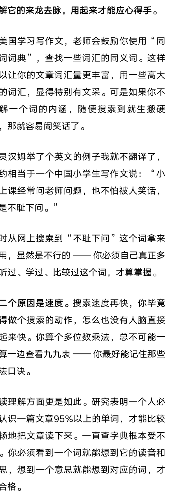

像这样的事我干过很多次。我通过学习YouTube视频，给厨房下水道换过一个搅拌机，给汽车换过一个门把手，还安装过一个微波炉。我并不是一个擅长动手的人，可是网上什么信息都有，你一看就会。

这就引出一个问题。如果网上啥都有，你还需要特别学习什么东西吗？比如前几年有个认知科学家写了本书叫 Smart Thinking，说我们平时接触的很多东西，都是只会用而不理解它的原理——比如自行车是怎么工作的？抽水马桶是什么原理？大多数人根本不知道。他就建议我们应该去深入了解这些原理。

对此我不以为然。我不是职业水管工，我有必要了解下水道搅拌机的原理吗？我有必要专门学习搅拌机的维修技术吗？根本没必要。如果真的需要让我换一个搅拌机，我现用现学，根本没困难。

这大概就是为什么 Google 负责教育应用的一位主管，最近有个言论。他说他不能理解在这个互联网时代，为什么他的儿子还必须学习和记忆一元二次方程。

这是一个合法的问题。每个初中生都得会背一元二次方程的求根公式——

```
在: ax² + bx + c = 0 中，
x = (-b ± √(b² - 4ac)) / (2a)
```

但是你初中毕业这么多年以来，上一次使用这个公式是什么时候？如果只是偶尔用一次，现用现搜索当不是更好？

今天我要说的是纽约时报5月19日的一篇文章，“你仍然需要你的大脑”（You Still Need Your Brain），作者是弗吉尼亚大学心理学教授丹尼尔·威灵汉姆（Daniel T. Willingham）。这篇文章说的就是这个问题。

威灵汉姆说，哪怕可以随便用 Google，你也应该学习和记忆一些知识，这至少有两个原因。

### 第一个原因是任何知识都有个上下文，你得理解它的来龙去脉，用起来才能应心得手。

在美国学习写作文，老师会鼓励你使用“同义词词典”，查找一些词汇的同义词。这样可以让你的文章词汇量更丰富，用一些高大上的词汇，显得特别有文采。可是如果你不理解一个词的内涵，随便搜索到就生搬硬套，那就容易闹笑话了。

威灵汉姆举了个英文的例子我就not翻译了，大约相当于一个中国小学生作文说：“小明上课经常问老师问题，也不怕被人笑话，真是 To不耻下问。”

临时从网上搜索到“不耻下问”这个词拿来就用，显然是不行的——你必须自己真正多次听过、学过、比较过这个词，才算掌握。

### 第二个原因是速度。搜索速度再快，你毕竟还得做个搜索的动作，怎么也没有人脑直接想起来快。你算个多位数乘法，总不可能一边算一边查看九九表——你最好能记住那些乘法口诀。

阅读理解方面更是如此。研究表明一个人必须认识一篇文章95%以上的单词，才能比较流畅地把文章读下来。一直查字典根本受不了。你必须看到一个词就能想到它的读音和意思，想到一个意思就能想到对应的词，才算合格。

所以威灵汉姆说，凡是像单词意思和乘法口诀这种需要多次使用的知识，就应该背下来——包括一元二次方程公式也应该背下来。

所以，千万不要认为 Google 可以替代记忆力，该学的知识还是得学。

### Ⅰ 我的评论

我理解威灵汉姆说的，主要还是一个学习效率的问题。如果你要经常用到一个知识，那你最好背下来，否则不但浪费时间，而且可能会用错。如果比较冷门，偶尔才用一次，像我安装厨房搅拌机，那用的时候再搜索也是对的。

不过关于搜索引擎为什么不能取代系统性的学习，还有些更深的原因。我就可以至少再补充两个。

### 一个是有一些知识是分层的，你必须先理解了底层的，才能理解上面一层。一元二次方程求根公式也许上网查了就能用，但是更高級的东西，查到公式也未必会用。

那我知道并且理解一元二次方程这个概念行不行，为什么非得背下来具体的公式呢？这里面还有一个模式识别问题。熟练使用，或者有创造性的发挥，一个主要技能就是模式识别。

比如下棋，表面上看棋盘上的局面可以千变万化，但是在高手看来，不过就是若干个套路的灵活运用。如果你事先非常熟悉这些套路，那对手一动，你就知道他的意思。如果只知道有套路，但是记不住套路，那就像很难看出来。

### 还有一点，也是关键的一点：搜索引擎只能被动回答问题，但不能“主动”给你提示。

你至少得先知道要问什么，才能用上搜索引擎。而对于高级的问题来说，可能外行根本不知道现在有没有什么信息是缺失的，也问不出什么好问题。

### 由此得到

+ 1. 现在搜索引擎能直达的知识已经非常丰富，对很多知识都已经不需要事先积累，可以现用现学的地步。
2. 尽管如此，仍然有很多知识必须主动学习，而且最好能背下来。这方面有效率的考虑，也有知识系统生长的原因。

最后再说个别的原困。我家以前那个微波炉，同时还是一个抽油烟机，固定在橱柜上，去年它坏了。我一看拆、装都非常麻烦，而且同一样已经买不到，只能买个新型的，尺寸又有不同，还得重新钻孔定位，我一看安装说明书头都大了。

所以我就把说明书扔到一边，上 YouTube 找个安装视频，想直观地跟人学着做。结果我儿子一看不干了，他说：“你为什么不能像个大人一样直接看说明书？你为什么像个胆小鬼一样看 YouTube？”

遇事就知道搜索，这个形象真是不专业啊。


万维钢·精英日课
帮你和全球精英大脑同步

1043任意门
101258成员 744人今日打卡

## 日课精选

甘伟 10
除了互联网上可查阅的生知识，我们仍然需要一些灵活运用的熟知识。
1.首先，我们至少得具备搜索的能力，而专业搜索的能力并不是人人都有；
2.我们不是时时刻刻都具备搜索条件，考试时不行，急智时刻不行，失信号时不行；
3.高级的知识是互联网上不能获取的，它要求成体系可应用的知识链而不是零散的知识；
4.互联网没有再创造的能力，不能熟练掌握已有的知识，就不可能产生再新知识。
05-23 23:33:53

## 日课195 | 为什么非得是“大”数据

日课195 | 为什么非得是“...”

今天咱们继续说赛斯·史蒂芬斯-大卫斯岑的《人人说谎：大数据、新数据以及关于真实的你，我，互联网能告诉我们什么》这本书。

不知道你有没有感觉，“大数据”这个词现在用得有点泛滥了，简直是浮夸。媒体是不管什么东西都要跟大数据扯在一起，研究者也特别爱吹嘘自己的数据量有多“大”——赛斯在美国参加学术会议就发现，这个研究者说自己用了有几个G的数据，下一个研究者就说他用了几个T的数据——就好像数据量越大越厉害似的。

可是我们在《最简单的科学决策法》这期专栏里说过，有很多基于统计的判断决策，使用简单的几个指标就能做得很好，再用更多的数据也不能让判断更准确。

赛斯也举了个例子。一个烧红的炉子，你只要触碰一下就知道这东西危险不能碰；可是要想知道喝咖啡能不能导致头痛，你大概要喝上几千杯才能看出效果来。

如此说来，明显的效应只要小数据就够了，不明显的效应才需要大数据。

那么难道说，必须用大数据才能得出的结论，都是不重要的结论吗？也不是。赛斯在书中列举了大数据的三个关键用处。

### 1.从罕见的案例中发现规律

胰腺癌并不是一个特别常见的癌症，但是非常危险，确诊之后五年的存活率只有3%。如果能提前发现胰腺癌的迹象，尽早干预，就非常重要。那么当一个人身上出现了哪些症状，他就应该这赶紧去医院检查一下，看看自己是不是得了胰腺癌呢？

有研究者使用微软的 Bing 搜索记录，找到了一些规律。这个研究方法是先锁定那些在网上搜索诸如“我被诊断出胰腺癌，我该怎么办”之类的人——这些人十有八九就是真的得了胰腺癌。然后再看这些人几周、或者几个月之前，是否搜索过其他跟健康有关的症状。再把这些症状跟没有得胰腺癌的人平时搜索的健康问题对比，发现那些属于胰腺癌患者的独特症状，那就可能是胰腺癌的前兆。

研究者发现两组独特症状。第一组是背痛加皮肤变黄，第二组是消化不良伴随腹痛。单纯的背痛或者单纯的消化不良，并不表示得了胰腺癌，但是如果有皮肤变黄和腹痛的伴随症状，那就很可能是胰腺癌。

没有这些症状也可能得胰腺癌。但使用这些症状，可以提前锁定5%到15%的胰腺癌患者，这个比例不高，但也等于是多少救了很多的人。

而最关键的在于，这些前兆症状完全是由大数据发现的！一般人身边并没有很多得了胰腺癌的人。就算胰腺癌患者，也不太可能记得自己几个月之前有没有什么特别的症状。只靠人观察，很难注意到这些症状和胰腺癌的联系。但是大数据做到了。

研究者可以像大海捞针一般，从大数据中发现这些关键信息。

### 2.量化一个效应的大小

我们知道好天气能让人心情愉快，而阴雨绵绵或者是寒冷的天气，则让人心情也糟糕。美国有些地方，像芝加哥的天气就常常是阴冷的；而有些地方，像加州和夏威夷，就常常是阳光灿烂。

好，那么现在有个问题：一个住在芝加哥的抑郁症患者，为了治疗抑郁症，获得好心情，他是不是应该搬家到夏威夷去呢？

这个问题关键就在于我们*知道*搬到夏威夷会缓解抑郁症，但是我们*不知道*这个缓解的程度是大小。我们需要一个量化的评估。

Google 的搜索数据可以帮助你。研究显示，住在夏威夷的人，搜索“抑郁症”的比率，比像芝加哥这样的寒冷地区多了40%。这个效果有多好呢？要知道，哪怕最好的抗抑郁药物，也只能让抑郁症的发病率减少20%。

那如此说来，如果你一到冬天就抑郁，最好的办法不是吃药，而是搬到夏威夷去。大数据告诉我们，搬家的效果，大约是吃药的两倍。

### 3.发现反直觉的结论

假设现在你有两个潜在的结婚对象。第一个人跟你有很多共同的朋友，第二个人则是一个圈外人，你不熟悉他/她的朋友，他/她也不熟悉你的朋友。那么请问，如果你想要的是长期的关系，你应该跟谁结婚呢？

直觉来说，也许应该选第一个人。这个人跟你的朋友们相处融洽，那就说明你们有很多共同点，想必结婚之后你们两个也会相处得很好。对吧？

不对。我们在 Facebook 上的交友状况，和单身/已婚/有男友女朋友状况都是公开的，研究者就用 Facebook 的数据做了一个分析。他们锁定那些是夫妻或者男女朋友关系的人，看看他们的朋友圈有多少重合之处。结果发现，朋友圈重合度越高的夫妻或者男女朋友，越有可能在一定时间之后宣布再次单身。也就是说，最持久的关系，往往是双方各自有不同的朋友圈。

那这到底是因为什么呢？大数据不能告诉我们原因——这是一个“反直觉”的结论。也许你身边有一对夫妇，感情良好，他们有很多共同的朋友，那你就应该知道，这只是特例。人很容易被身边的特例影响判断，而大数据不会犯这样的错误。

赛斯自己也有一个比较反直觉的发现。我们知道很多 NBA 球星是出生于贫困家庭，有很多还是来自单亲家庭，那你说，到底是单亲贫困家庭容易出球星呢，还是双亲中产家庭容易出球星？

这个问题非常不好回答。也许单亲家庭的孩子从小自立，拼搏能力更强；也许单亲家庭的孩子从小缺乏管教。真正的麻烦在于，根本就不存在每个 NBA 球员小时候的家庭状况数据。赛斯想了各种办法。他考查了每个球员都是在哪里出生的，然后看看这些出生地的富裕程度如何。他尽可能地追溯每个球员的家族历史，他甚至还通过球员的名字判断他是不是来自单亲家庭。原来还有一个规律，单亲妈妈总爱给孩子起一个比较怪的名字，而双亲家庭给孩子起的名字比较正常。

说到这我真是挺佩服赛斯。作为一个数据科学家，他不仅仅是用什么数学工具从现有的数据里发掘事实，他还能主动寻找各种相关的数据，他知道去哪里找，而且真找到了。就这样赛斯把几个数据库连在一起，才算是发现了答案。

答案是来自父母双全的中产家庭的球员更容易取得好成绩。这里有两个主要原因。第一是这样家庭的孩子从小营养养好，所以长得更高。第二是这样的孩子社交能力更强。这两个素质对打篮球来说太重要了。身高的优势就不用说了。关于第二点，咱们在《今朝有酒今朝醉，也是一种理性》这期专栏里说过，有些 NBA 球星从小养成的思维模式就不行，有点钱就志乎所以，实在不利于事业成功。

所以，大数据确实能告诉我们一些我们本来不知道的东西。

### Ⅰ 我的评论

我读这本书之前，最担心的问题是使用网上搜索数据所得的结论可能是有偏见的。单单你研究的都是“会使用搜索引擎的人”——这些人能有多大代表性呢？他们的文化程度，甚至收入水平，可能都高于一般人。再者，就算是我在网上搜索了“nigger”这个词，那也不能说我就是个种族歧视者吧？也许我就是个想要知道美国人如何使用 nigger 这个词的科研人员。这样的情况该怎么排除呢？

读了这本书之后，我的担心就有所减弱了。首先现在互联网已经非常普及，可能大部分人也都已经学会了上网。其次，大部分人在网上搜索的东西是和他自身状况相关的，像我这样纯粹出于好奇心去搜索的人应该很少。

更重要的是，我注意到研究者并没有把“搜索”的人和“不搜索”的人比较。他们是拿搜索结果和搜索结果比较。比如说，研究者并没有把在网上搜索“无性婚姻”的人所占的比例，就当成美国无性婚姻的比例——他们是把搜索“无性婚姻”跟搜索“不幸福婚姻”、“无爱婚姻”的人作比较，说明“无性婚姻”比“不幸婚姻”和“无爱婚姻”的问题都严重，这就的确比较有说服力。

这样说来，该考虑的问题，大数据的研究者们可能也都已经考虑到了，那我们就在一定程度上可以相信他们的结论。当然一切研究方法都是有漏洞的，任何结论都只能作为参考。而这本书中的某些结论的确很有意思，咱下次再说。

### Ⅰ 由此得到

你察觉不到的规律，大数据能察觉到；你察觉到了的效果，大数据能评估这个效应的大小。更重要的是，大数据能得出一些跟我们的直觉相反，但却是更可信的结论。


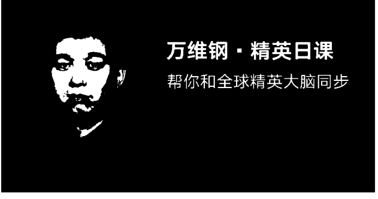

## 日课196｜斯多葛派哲学的安心之法

日课196｜斯多葛派哲学的...

今天咱们说点哲学。有一个古老的哲学学派，叫斯多葛派（Stoicism），近年来在美国非常流行，我经常能看到有人写文章、写书介绍这个哲学学派的心法，也有很多人可以说是在按照这个学派的指导自我修行。但是据我观察，斯多葛派对中国读者来说还比较陌生。

斯多葛派哲学要求我们做一个坚忍、坚定、不轻易动感情的人。Stoic 这个词，在英文中可以做名词，那就是指一个斯多葛派的信徒，或者说叫“斯多葛者”；也可以做形容词，形容一个人宠辱不惊、坚忍。比如我曾经看到有文章形容奥巴马是个 stoic 的人，意思就是说他作为一个领导人，遇事不慌不忙，镇定自若。像特朗普有时候给大家感觉有点一惊一乍，那就不太可能用这个词形容他。

中国读者可能不太熟悉“斯多葛”这个词，但是我一个你肯定知道。前任总理很喜欢读一本书，叫《沉思录》，据说是在枕边读过一百多遍。这个《沉思录》的作者是古罗马皇帝马可·奥勒留，被后人称为“哲人王”——那奥勒留是哪儿哲学门下的呢？就是这个斯多葛派。

斯多葛派，在两千多年以前，古罗马时代就已经有了。等我说完今天的内容，你就会理解它为什么现在还受到欢迎。

### 1.一段名言

我们要说的是 Aeon 上5月22号的一篇文章，题目是“想要更幸福，就关注你能控制的东西”（To be happier, focus on what’s within your control），作者是纽约城市大学的哲学教授马西莫·匹格里奇（Massimo Pigliucci）。

匹格里奇刚刚出版一本书，叫《怎样成为一名斯多葛者：古老智慧在现代生活中的应用》。在这篇文章中，匹格里奇只说了斯多葛派的一个小内容，称之为“斯多葛控制二分法”——意思是说，在生活中，有些事情是你能够控制的，有些事情你是控制不了的，而你应该只关注你能控制的东西。

你听这句话是不是感觉有点熟悉呢？基督教里有个类似的说法。美国基督教神学家尼布尔，曾在19世纪30年代写过一段《宁静祷文》（以下是维基百科收录的洪宋体译文）：

> 神啊，
请赐与我宁静，好让我能接受，我无法改变的事情；
请赐与我勇气，好让我能改变，我能去改变的事情；
请赐与我睿智，好让我能区别，以上这两者的不同。

其实犹太教也有类似的说法。中国科大前任校长朱清时也非常喜欢这段话，曾经用来勉励学生：“有勇气去改变那些可以改变的事；有度量去容忍那些不能改变的事；有智慧区别以上两类事。”

而据匹格里奇考证，这段话的意思，最早恰恰是起源于斯多葛派哲学。2000年以前，古罗马的斯多葛派哲学家爱比克泰德（Epictetus），说过一段这样的话。所以这个宁静祷文的本意，并不是出自基督教，而是出自哲学家。所谓“可以改变”，就是“斯多葛控制二分法”中的“你能控制”。


今天你听这个“斯多葛控制二分法”，可能第一反应是这有点平淡无奇，这是不是鸡汤呢？我知道这个，又能怎样呢？

也许能很不一样。匹格里奇把“斯多葛控制二分法”的效果称之为“爱比克泰德的许诺”——如果你真的能区分你能控制的事情和你不能控制的事情，并且将两者区别对待，那么你在心理上，就基本上胜的——在面对人生起伏的时候，你就能真正做到宠辱不惊。

### 2.一个心法

匹格里奇举了个自己的例子。他有一次在罗马坐地铁，眼睁睁地看着一个小偷把他身上的钱包偷走，还没等他反应过来，小偷拿到钱包转身就跑出了地铁车厢的门，然后门正好关上，匹格里奇无可奈何。钱包中不仅有现金，还有他的证件，信用卡。丢了钱包非常麻烦，他得花很多时间去补办各种证件，挂失信用卡，简直想想都让人头大。

### 3.两种目标

什么叫“外界目标”，什么叫“内部目标”呢？


都是这样。

参加一个比赛，你要关注的重点应该是发挥出自己最好的水平，打一场漂亮的比赛，而不是能不能赢得比赛。你喜欢某个人，想获得对方的爱，那么他/她怎么对待你是你无法控制的，但你能控制的是你对他/她的态度，呈现自己最好的一面。在一场政治选举中，你无法控制哪个政党会获胜，但你可以控制自己的一票，你可以帮你支持的政党做宣传。

匹格里奇认为，如果能做到这些，那你就没有敌人和对手，因为你关注的是你自己，你不会去指责任何人。

### Ⅰ 我的评论

咱们想想，为什么斯多葛派哲学在今天仍然受到欢迎。这大概是因为它没有脱离实际，具备实现的可能性。

每个人都希望自己能克服焦虑情绪，宠辱不惊，任何时候都镇定自若。但是中国传统上对这个问题的解决方案，似乎是一句成语，叫“无欲则刚”。说如果你能消除自己的欲望，你自然没有焦虑。佛教似乎也是类似的说法，要求我们去除欲望。

但我们普通人怎么可能消除欲望呢？我参加一个比赛，我当然想赢！我马上就要上场了，教练看我紧张，过来跟我说你要消除取胜的欲望！这可能吗？

消除欲望这个要求实在太高了。斯多葛派这个心法就实在得多 —— 并不是没有欲望，你想要什么东西，可以！但是你要把注意力全部集中在自己能控制的这部分上。

### Ⅰ 由此得到

“控制二分法”，可能是斯多葛派哲学中最重要的一个心法。我们应该区分自己能控制和不能控制的东西，接受那些不能控制的，把注意力集中在能控制的，并且有勇气去控制。这不是什么宗教鸡汤，而是很有实用价值的一个哲学思想。做到这一点，我们遇事就能从容大度，处变不惊。


## 日课197丨如果你知道看什么……

日课197 | 如果你知道看...

今天咱们继续说赛斯的《人人说谎》这本书。这本书的副标题是“大数据、新数据以及关于真实的你我，互联网能告诉我们什么”——上次我们说为了为什么必须要用“大”数据，这次说说“新”数据。我还要介绍一个小工具，让你自己也能做些数据分析。

“新”数据，说的是你应该看什么的问题。像GDP、就业率这样的传统指标仍然重要，但是现在科学家已经开始使用一些以前不被注意、或者根本看不到的信息，去判断世界正在发生的事情。数据分析发现的有些新指标非常好使……但是根本讲理。

### 1.赛马的关键指标

咱们先说一个有趣的。照片可以是数据。有的人把美国各个学校每年的学生毕业照做了数字分析，每十年算一个全体男生和全体女生的平均脸，从1900年代一直排到2010年代，就得到下面这张图——


你发现没有？其中有个趋势。在上世纪四、五十年代以前，美国人拍照是不笑的，各人都很严肃。但是四、五十年代以后，人人就都笑了。这是怎么回事呢？

猜这个数据分析的人自己也解释不了，后来还是别人给了非常好的解释。最早的人拍照，潜意识中是在模仿油画上的人像。画油画需要很长时间，一个人不可能一直做笑脸，所以油画上的人不笑，以前的人也就没想过拍照要笑。后来人们为什么开始笑了呢？那是因为上世纪四五十年 代，柯达公司搞市场营销，说我们要随时随地用照片记录幸福时刻！从那以后，人们养成了新习惯，拍照就要笑。

像这样的 数据分析就非常有意思，关键在于你得知道往哪儿看。咱们讲《注意力商人》这本书的时候说过，广告的最高境界是改变社会习俗。可是如果你想要测量广告营销改变社会习惯的过程，有谁能想到去分析毕业照呢？

像这种匪夷所思的例子，赛斯说了好几个。比如你想要判断一匹1岁 的赛马以后比赛潜力有多大，以前的人都是看它的身高、腿长、什么肌肉群之类。但是有一个人发现，最关键的其实是内脏的大小。心脏、脾脏都是越大越好，尤其是左心室，左心室越大，同时其他内脏也大的话，这个赛马的成绩就会越好。可是，这一点谁能想到呢？医学上有什么解释吗？这都不重要，重要的是这个指标好使。

再比如沃尔玛公司用数据分析发现，每当飓风侵袭某个地区的时候，这个地区的沃尔玛商店的一种草莓馅饼干的销量就会大增——


那这个饼干和飓风有什么关系呢？有可能是飓风天气下，大家都不愿意做饭，这种饼干打开就能吃，还不用冰箱冷藏？那为什么非得是草莓馅的呢？为什么不是别的饼干呢？无法解释——但是沃尔玛一看到天气预报有飓风，就事先在对应的商店里大量备货这种草莓馅饼干，卖得很好。

还有一个例子，红酒。即使是同一个产地的红酒，每年产出的品质也可能有很大的起伏变化，价格也不一样。怎么预测红酒将来的价格呢？有人用数据分析发现，红酒价格主要和葡萄生长和收获期的天气状况有关，而且还总结了一个公式——

```
价格 = 12.145 + 0.00117 × 冬季降雨量 + 0.0614 × 生长期平均温度 - 0.00386 × 收获期降雨量
```

对大数据来说，这个公式的道理何在并不重要。是，相关性不等于因果性 ——可是我们只要知道有这种相关性，就足以应用了。

咱们再说两个例子，用的都是字词分析。

### 2.自由派词汇和保守派词汇

先来一道语法题。我们知道“美国”的英文是“The United States”，那么请问，“The United States”，应该当单数用呢，还是应该当复数用？

我们专栏以前说过亚当·斯密和进化论的思想，我们知道，语法的问题应该由人民自下而上决定。Google有一个书籍词频分析工具，叫Ngrams，在网上可以随便用。你输入任何词汇，它都会告诉你历年出版的书之中，这个词出现的频率——

### Google Books Ngram Viewer

赛斯就用这个工具查看了“The United States are”和“The United States is”这两个词组的出现频率变化——


我们可以看出，1880年之前，美国人民认为“The United States”是个复数，后 面要接“are”——人们观念中的美国是各个州的一个联合体，而不像是一个整体的国家。改变这个观念的大概是南北战争。南北战争把美国打成了一个更紧密的国家，以至于战争结束后15年之后，“The United States”在书籍里成了一个单数词组。

现在美国两党的分歧越来越严重，媒体也划分为两大阵营，这也能从字词分析上看出来。比如说，同样是“同性恋结婚”这个事件，右倾的《华盛顿时报》的说法是“homosexual marry”，而左倾的《华盛顿邮报》则爱说“same sex couple”。翻译成中文看不出什么区别，但是从英文看，后者显然更就事论事，说这也是一对夫妇，只不过恰好是同性别而已。

有研究者对2005年美国国会两党的议员的发言做了字词分析。同样一件事 情，共和党和民主党在叙事的时候，关注点和措辞会有不同。比如房地产遗产税，民主党管它叫“estate tax（遗产税）”，而共和党就管它叫“死亡税（death tax）”，倾向性非常明显。咱们来欣赏一下两党说法的不同——

| 民主党人说…… | 共和党人说…… |
|---|---|
| 房地产遗产税 | 死亡税 |
| 社保基金私有化 | 改善社保基金 |
| 罗莎·帕克斯(民权运动名人) | 玛达·史考特 |
| 工人权利 | 私有产权 |
| 穷人 | 政府支出 |

研究者们就从国会发言中找出了这类有代表性的词组，再用这些词组去分析不同的媒体，就能把全国数百家媒体进行分类，看看哪些是左翼媒体，哪些是右翼媒体。

结果他们发现，媒体的政治偏见，是由地域决定的——这家媒体覆盖地区的人大多有什么样的政治倾向，这家媒体就是什么政治倾向。如此说来，媒体并没有什么自己的立场，他们只是看读者想听什么，他们就说什么。甚至媒体的立场和这家媒体老板的立场关系都 没那么大，真正起决定作用的是市场。

很多保守派认为美国媒体和记者普遍左倾，这种现象确实存在，统计表明的确是左倾的媒体比较多。但这也是市场决定的——消费媒体的老百姓中，左倾的多。

最后再说个轻松的话题。《罗辑思维》有一期节目讲过“把妹达人”，咱们看看大数据对此有什么可说的。

### 3.第一次约会中的蜘蛛马迭

比如有一对青年男女，正处在确定恋爱关系之前的微妙状态。你有什么办法，能预测到他们关系的走向吗？一般人都是看身高、性格这些硬指标，或者考察双方互动……

高、性格这些硬指标，或者考察双方互动的表情和动作，但有一个新研究，是把男女第一次约会全程的对话录下来，通过分析对话录音，就能发现重要的迹象。他们的结论很有意思。

如果男性对这个女性有兴趣，他会有两个表现。首先是女性如果讲个什么笑话，他会非常配合地笑出来。再者，他会控制自己的声调，让声调比较单一化。有研究表明，声调起伏不大的男性更有吸引力。男性似乎是无意识地控制声调来展现吸引力。

那如果是女方对男的感兴趣，她会怎么做呢？她会*增加*自己声调的变化，然后她说话的语气会更轻，间隔会更短，更愿意多说话。

如果这个女性说了很多“可能”，什么“I guess（我猜）”、“sort of（有点儿）”、“probably（也许）”这类词，那基本上表示她对这位男性不感兴趣。

但如果她经常说了很多“我”，我如何如何，“I”这个词是你​在第一次约会中所能提到的最好的词！女性愿意谈论自己，说明她对这位男性很感兴趣。

那么，如果你想好好表现一番，增加自己在对方眼中的吸引力，你应该怎么做呢？对男性来说，最好的办法就是接受女性的领导——女性讲了笑话，你就笑；如果她谈论某个话题，你就顺着这个话题往下说；如果她说要干什么事情，你要表示支持。这样就能大大增加她对你的好感。

那么对于女性来说，有什么特别的对话技巧呢？对不起，数据显示女性用不着对话技巧——男性最后选择的总是外表好看的。

## I 由此得到

- 1. 数据分析的一个关键是看什么：有些看似关系不大的新型数据可以是决定性的指标。
- 2. 字词分析能揭示倾向性，比如我们知道了美国媒体的政治偏见其实是出于市场的需要。
- 3. 我们可以通过男女约会过程中的蛛丝马迹预测未来这段关系的发展。

归根结底，所有能通过数据发现的东西，其实都是公开的秘密。迹象都已经存在，大多数情况下并没有刻意掩饰。只要你知道该看什么，找到关键指标，你就能发现很多真相。

最后，我感觉这个 Google 词频分析是个很有意思的工具，我自己做了一些小观测，附图在文章最后，供你参考。


词频分析并不见得代表真相……但你也去玩玩吧。


## 答读者问 | 相关性和因果性

万老师，知道怎么去看很重要，可是对于一个课题，怎样才能提高自己看的能力呢？让自己知道去看什么？

大数据分析方式都是人设计的，这些人是不是能避免主观偏见呢？

心理学认为不同背景、经历的人对同一事物会有不同的心理投射导致不同解读，另外，就像被收买的网络水军一样，有些网络数据是刻意为之的、带有目的的偏差的，所以要想透过数据找真实，还是要靠人的分析和鉴别，所以产生了数据工程这样学科。所以我觉得大数据本身不能自动展现真实，它永远都是人的工具。请问万老师怎么看？

万维钢

“知道去看什么”，其实就是一种“主观偏见”，也就是“人的分析和鉴别”。咱们以前在《人工智能，能署几乎》这期专栏里说过，人工智能不能做出任何主观选择。比如说用贝叶斯方法先做个猜测、或者做变量分析先挑选几个测量的变量——这些猜测和变量的选择，全都得靠人。

说白了，就是人决定看问题的角度，大数据只能决定结果。就好比竞赛马的关键指标是左心室大小，可是如果不是“人”提出出来，机器根本想不到去测量左心室。给定一堆指标，机器也许可以用回归分析的办法告诉你哪个指标最重要，但问题就在这堆指标必须得先有个 人亲自测量。

这不就是咱们前段时间说过的泰勒·科文的《自满阶级》一书讨论过的问题吗？两种生活态度没有谁对谁错。发达国家的人更乐意享受当下的生活，这不是天性如此，而是经济环境和社会发展的结果。处在今日中国，有时候会觉得身边的人是不是都太着急了；可是科文身在美国，也在感慨身边的人缺少活力！

自己一直做前两条，但没有上升到哲学理论的高度。问题是怎么做到第三条能区别二者呢？比如钱包被偷，通过各种努力（报警、悬赏等）还是有可能找回来。极端地说，有些事是需要“一vend…

万维钢

“斯多葛控制二分法”解决的是心理问题，是个“安心”之法，但并不是决策之法。

如果只有一份希望，那到底要努力到什么程度呢？这是一个决策问题。咱们说得直接一点，如果这个家庭有好几个孩子，那么父母把全部资源都投入到这个患病的孩子身上，恐怕就不是最佳选择。就算只有这一个孩子，也要综合考虑多种因素，比如父母本身的幸福，似乎也应该考虑在内。我并不是说不爱孩子，如果我的孩子需要我牺牲生命，我绝对愿意——但这里的意思是我们总要做个决策。不管怎么决策，最后决策的内容，也就是投入到这个孩子身上资源（包括时间和金钱），相信都是当前条件下所能做到的最多资源。

而决策都有风险。怎么面对这个风险，“斯多葛控制二分法”就有用了。家长能控制的，就是好好调研做出最合理的决策，然后好好执行这个决策。该花多少时间多花多少时间，该拿多少钱拿多少钱。至于最后结果如何，那就是家长不能控制的——所以不论如何都应该坦然面对。

感觉智慧都是要二，那不二到底是什么意思呢？就是万老师常说的，具有两个矛盾的观念，又能并行不悖的意思？

万维钢

我理解佛学说的“不二”，就是不要有分别心，不要给东西贴标签。你去买水果，面对一堆水果挑来挑去，卖水果的就问你挑什么？你说我要挑“好的”——卖水果的说：“哪一个不是好的？”

这大约就是不二。谁是好人、谁是坏人？不同条件下表现不同而已。说“”.

### 万维钢

这就和平常的科研项目是一样的，科学家弄了那么多科研结果，普通人怎么才能分享呢？我们至少可以多了解一些研究者从大数据中获得的有价值信息。

你得知道去哪找——搜索是个很好的技能，会阅读学术论文是个更好的技能。平时看看新闻，也很好。

你还得能判断可信程度——贝叶斯方法（观点随事实发生改变）是个好办法。罗辑思维视频，去年有一期节目叫《我们到底该信谁》，就是说的这个问题。

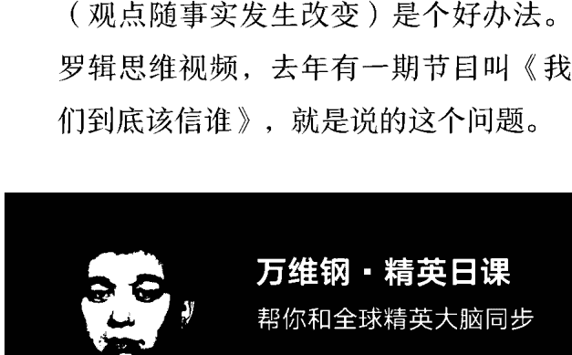

## 特别放 lector 1 凡不能毁灭我的，必使我更强大

万维钢

《B选项》不久前的解读受到了咱们专栏读者的欢迎。今天咱们就来给这本书做个复习总结。

## —— 概要 ——

书名：Option B: Facing Adversity, Building Resilience, and Finding Joy（B选项：直面逆境，建立抗打击能力，找到快乐）

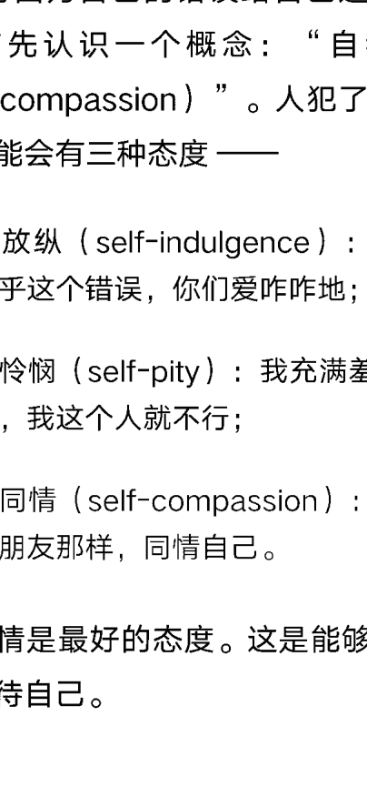

作者：雪莉·桑德伯格（Sheryl Sandberg），Facebook 的 COO，扎克伯格的左膀右臂，《向前一步》作者；亚当·格兰特（Adam Grant），宾夕法尼亚大学沃顿商学院的教授，《沃顿商学院最受欢迎的成功课》（A Revolutionary Approach to Success）作者。

背景：桑德伯格的丈夫戴维在2015年突然去世，留下她和两个孩子。桑德伯格在很长的时间内是完全崩溃的状态。一天桑德伯格的兄弟菲尔对她说：“A选项现在已经没有了。咱们必须得上这个该死的B选项！”这就是这本书书名的来历。

## —— 如何增强抗打击能力 ——

- 1. 克服悲伤情绪最有效的做法是“三个P”理论，这个理论来自心理学家马丁·塞利格曼（Martin Seligman）。

Option B 读书笔记

> 心理学家马丁·塞利格曼说：
克服悲伤情绪，你一定要克服心理上的三个 P：
自责（personalization）
永久化（permanence）
普遍化（pervasiveness）

- 2. 不要自责：遭遇不幸的时候，一个非常自然的反应就是责备自己。事实是这件事只是发生在你身上，并不一定是因为你而发生。
- 3. 知道悲伤不是永久的：人们常常高估生活打击对自己情绪负面影响的持续时间。人有一个“心理免疫系统”，会尽最大让我们感受好一点。平复悲伤，就是这个系统的作用之一。所以事实是悲伤通常会随着时间慢慢减弱，而且小孩恢复得更快。
- 4. 你遭受的不是全方位的打击：人们总认为遭受的打击是全方位的。事实是生活的其他方面并没有失去什么。多考虑生活中好的方面，还有就是想想这件事情其实还可以更坏——再大的不幸，也可能是不幸中的万幸。

抗打击能力就如同肌肉，你可以通过锻炼让它更强大。而这些科学的方法，就是你锻炼的指南。

- 5. 面对亲友的不幸，你要跟他说的正确的话，一共有两句。第一句，首先向他确认，你知道了他的不幸。第二句，提出帮助。“我听说了你的事，我知道了。如果有什么我能帮忙的，我随时都在。”
- 6. 面对亲友的不幸，帮忙最好的办法是增加一个选项，提供一种控制感。一个尽在掌握的控制感，一个终极的选项，才是给予亲友的真正的信心。
- 7. 人，是一个会成长的有机体，人体的系统，在很多情况下会表现出“反脆弱”——经历一次打击之后，反而会变得更强。在经历诸如失去亲人、失去工作、得了疾病这样的重大打击后，人的思想、认知和情绪，也可能会有反脆弱的表现。
- 8. 15%的人在创伤后会得一种叫做创伤后应激障碍（PTSD）的病，很难复原。有人会表现出坚强和抗打击能力，还能恢复到原来的水平。超过50%的人，经历创伤之后至少有一个积极反应。对此心理学专家专门有个名词，叫“创伤后成长（post-traumatic growth）”。
- 9. 创伤后成长有五种状况：发现自己的力量、知道感激、获得更深入的关系、发现生命的意义、找到新机会。

我们比我们知道的自己更脆弱，但同时我们也比我们想象中的自己更强大。

911事件之后，很多美国人放弃了平常的工作去参军。一个橄榄球选手，是放弃了每年上千万的收入去阿富汗参军，后来死了。还有很多 人去当消防队员。特别有意思的一点，911 后的那一年，申请教育学学、想当老师的人数竟然增加了很多。
灾难，会让人更愿意做那些能实实在在地帮助别人的工作。

还有一种成长是“创伤前成长（pre-traumatic growth）”。你不一定非得经历创伤，也能获得创伤的成长。当你知道世界上 有这么多的痛苦和不幸的时候，你对世界会有一个全新的认识，你自己可以从外界的不幸中获得成长。

- 10. 面对因为自己的错误给自己造成的打击，首先认识一个概念：“自我同情（self-compassion）”。人犯了错，对自己可能有三种态度——
自我放纵（self-indulgence）：我根本不在乎这个错误，你们爱咋咋地；
自我怜悯（self-pity）：我充满着愧疚，我不行，我这个人就TY不 行；
自我同情（self-compassion）：像同情一位朋友那样，同情自己。
自我同情是最好的态度。这是能够客观看待自己。

犯了错之后，如果你认为只是这件事做错了，你会有负罪感，这个负罪感会带来下一步改进的动力。
如果你认为自己这个人就不行，那你就有着愧疚感，觉得自己太糟小了，自我怜悯，那么就只能躲在自己的世界里面，也许自暴自弃。
不管是对别人还是对自己，都不要因为一件事否定一个人。只有对事不对人，才能从错误中取得教训。

- 11. 犯了错之后恢复自信的方法，是去做具体的 小事，并且每天都想想这一天自己都做出了哪些贡献——所谓「small wins」，也就是从这些「小成功」中找回自信。

自信是从哪里来的？不是从你的学历、职称和履历表里来的，而是从你做过的一个一个具体的贡献里来的。
犯了错后恢复自信的方法：每天都想想这一 天自己都做出了哪些贡献——所谓「small wins」，也就是小成功。

- 12. 从创伤中恢复，遵循「对事不对人」的原则。所有的评价都应该是针对具体动作

12.从创伤中恢复，遵循「对事不对人」的原则。所有的评价都应该是针对具体动作和具体的事实，而不应该是针对人。可以说这件事做得对不对，最好不要说这个人行不行。对事不对人不仅适用于个人，也适用于集体。

## Option B 读书笔记

桑德伯格在Facebook定了一个规矩：每人每个月都至少要和同事发生一次「艰难对话」——也就是给同事挑毛病的对话。桑德伯格建议你可以这么跟同事说：

> 「我对你的工作有些评论，想让你听听——我之所以跟你说这些，因为我对你有很高的期望，而且我认为你完全能达到这样的期望。」

这个给别人指出错误的办法，既提供了反馈，又不伤感情——这就是对事不对人。

13.和桑德伯格学习她的行为模式：做事——不管是公司的大事，还是个人生活的小事——非常愿意寻求专家的意见，而且还都是领域内的一线专家的意见。她听说了一个理论，哪怕是个刚刚研发出来的新理论，都能马上付诸实践。她自己在做事，同时还能以一个旁观者的视角观察自己，评估每个套路的实践效果，随时获得反馈随时调整。

这就是精英水平的做法章法。

## Option B 读书笔记

> 凡不能毁灭我的，必使我更强大。

——尼采


## 日课198 | 《人人说谎》解读4： “政治正确” 是虚伪的吗？

日课198 | 《人人说谎》...

最近这几天有个新闻。马里兰大学一位中国留学生在毕业论文中，说了一些关于中国的坏话，结果被口水笔伐，甚至某位主流媒体的网站连“卖国求荣”这个词都用上了。

这位同学肯定是做错了。我认为她错在公开说出了自己那些上不了台面的想法，尤其还是在这样特别正式的场合。但是我并不认为我们应该讨论她的想法。

当然她的想法也是错的，一点都不容，充满偏见——可是谁还没有带偏见的想法呢？

今天我们继续说赛斯的《人人说谎》这本书。赛斯用大数据看到的偏见，可比这位留学生的演讲严重多了。

### 1. 辱华和重男轻女

下面这个表格是Google搜索关键词统计发现的各个族群经常被人们联系在一起的负面词汇排名——

|  | 1 | 2 | 3 | 4 | 5 |
|---|---|---|---|---|---|
| 美国黑人 | 贬语 | 种族主义者 | 懒 | 丑 | 懒 |
| 犹太人 | 邪恶 | 种族主义者 | 丑 | 小气 | 贪婪 |
| 穆斯林 | 邪恶 | 恐怖分子 | 坏 | 暴力 | 危险 |
| 墨西哥人 | 种族主义者 | 痴 | 懒 | 懒 |  |
| 亚洲人 | 丑 | 种族主义者 | 奴隶 | 懒 | 小气 |
| 男同性恋者 | 邪恶 | 错误 | 懒 | 厌人 | 自私 |
| 蕾丝边 | 像 | 误狂 | 荣 | 美观 | 错误 |

作为亚洲人你可能一看就不干了——亚洲人被喷得最多的缺点居然是长得丑？请问你们拿准谁代表亚洲了？居然还有人说亚洲人像？东亚人民的智商难道不是全世界最高的吗？

千万别当真。除了犹太人和穆斯林，所有族群都被人们骂过“像”——而犹太人和穆斯林独有的称号则是“邪恶”——那你说到底是“像”好还是“邪恶”好。事实是所有族群都被嘲讽。看看别人，我们心里是不是能好受一点。

我觉得最有意思的是有很多族群被贴的歧视标签是“种族主义者”，这充满了讽刺意味——当一个人在搜索框输入“犹太人是种族主义者”、“亚洲人是种族主义者”的时候，他难道不应该想想，他自己就是个种族主义者吗？

这个道理是人人都是偏见的受害者。所以我就想，我们再听说某名人、某节目“辱华”，还有必要大惊小怪吗？那帮人只不过是“像”的“种族主义者”而已……也不知道我这句话算不算偏见。

当然，公开把自己的偏见说出来，是非常错误的行为——可你不能说有偏见是个多么大不了的事儿，因为偏见简直无处不在。

再比如说，你知道美国女孩最严重的人是谁吗？可能是她们的父母。

### 2.美国人就不重男轻女吗？

中国传统一直有重男轻女的思想，男孩受到更好的待遇，甚至有人认为这导致了中国女婴存活率大大低于男婴。在我们的印象中，美国是不存在重男轻女思想的，美国人生了女孩和生了男孩一样高兴。美国人甚至还收养了很多中国女婴。

但是美国家长其实也有重男轻女的思想。这并不是说美国女孩享受的待遇不如男孩，但美国家长对待儿子和女儿的看法是有区别的。

如果你你的孩子表现得比较聪明，你就可能觉得他有天赋。但你又拿不准“有天赋”的判断标准是什么，于是你就上网搜索，对吧？那么问题来了——搜索“我儿子有天赋吗？”的比率，比搜索“我女儿有天赋吗？”的比率高2.5倍。

那是不是男孩真的比女孩聪明更“有天赋”呢？恰恰相反。美国公立学校系统大多都有“天赋学生”项目，通过考试入选——进入天赋班的女孩数量，比男孩要多9%。女孩更可能有天赋。但父母们更关心的却是自己的儿子有没有天赋。

那父母最关心女儿什么问题呢？答案是超重。搜索“我女儿是否超重”的比率，要比搜索“我儿子是否超重”的比率，高出两倍。可实际情况是，美国女孩超重的比率是28%，而男孩超重的比率高达35%。

美国家长还关心女孩的长相是否漂亮。搜索有关女孩漂亮的比率，比搜索男孩漂亮的比率高1.5倍；搜索女孩长得算不算丑的比率，比男孩高3倍。

所以，看来美国家长对男孩的期望是要有天赋，对女孩的期望则是长得漂亮，不要超重。这绝对是会让女权主义者火冒三丈的偏见——而这个偏见，还是来自她们的父母。

更可怕的是，总体来说，家长在搜索和孩子有关的信息时，用的词更加正面——“我儿子是不是很幸福？”；而搜索女儿的时候，用的词就比较负面——“我女儿是不是抑郁了？”而且这些偏见和地域、政治观点无关，自由派并不会比保守派做得更好。

也许每个人的心中都有各种各样的偏见，这些偏见都是错误、不科学的，它只不过是平时都没有表现出来。那我们故意表现给人看的，又是什么呢？是朋友圈。

### 3.朋友圈人生和真实人生

咱们专栏之前讲《注意力商人》的时候说过，像Facebook这样的社交网站，其实是在迎合人的自恋心态。人们在社交网络上表现出来的自己，其实是加强版的自己。那么，这个加强版的自己和真实的自己有多大的差距呢？

比如我们专栏经常引用的一本杂志叫《大西洋月刊》，主要是刊登时政和思想方面的内容，是比较高级的杂志。美国还有一本流行杂志叫《国民探秘者》，讲的都是明星的隐私，迎合低级趣味。你大概率愿意让别人知道你读《大西洋月刊》，但你不会想让别人知道你读《国民探秘者》。通过这两个杂志的数据，我们可以对比一下公开和私下的区别。

赛斯说，这两本杂志的发行量是1:1，非常相似。它们在网上被搜索的次数也是1:1，Google搜索可以说是真实地反应了这两本杂志的实际影响力。可是，这两本杂志在Facebook页面上被点击喜欢（like）按钮的次数是27:1——大量的人宣称自己喜欢《大西洋月刊》上的某篇文章，很少有人会说喜欢《国民探秘者》上的什么东西。Facebook上有150万人讨论过《大西洋月刊》上的内容，而讨论过《国民探秘者》杂志内容的人只有5万。

还有一个例子。网上播放次数最多的短视频是《江南Style》，YouTube的数据23亿次。而播放次数最多的色情视频——名字咱这里就不说了——则被播放过8000万次。23亿次和8000万次，两者相差大约30倍。但是如果你去看这两个视频在社交网站上被分享的次数，那差距可以说是无穷多倍。很多人分享《江南Style》，而分享这段色情视频的只有十几个人，他们全都是搞笑星。

在社交网站上，我们不但表里不一，还总是刻意表现出道德优越感。当年Facebook推出了一个新功能，叫News Feed，就相当于现在微信上的“朋友圈”按钮。以前你要看好友的状态必须单独点击他的头像，现在News Feed功能能把所有人的状态放在一起按时间线推送，成为一个信息流。这个功能刚出来的时候，遇到了巨大的抗议。

很多人说这个功能实在太low了，我有那么八卦吗？整天查看好友的生活！不过扎克伯格可没理会这些人的抗议，因为后台数据显示，News Feed功能非常非常受欢迎。你有那么八卦吗？你最喜欢的就是八卦。

### 由此得到

我们的朋友圈都是高大上，我们的实际行动有很多上不了台面，我们心里更是充满偏见，而大数据都可以观测到。

如果拿自己的真实生活和别人发的朋友圈动态比，你可能会感到非常惭愧——但是千万别往心里去，你只不过是信息不全面。明天我们会说，了解真实状况，有什么好处。

### 我的评论

前几天扎克伯格在哈佛大学的毕业典礼上发表了演讲。这是一个值得尊敬的演讲——扎克伯格承认自己的成功中有很大的缺欠。

——扎克伯格承认自己的成功中有很大的运气因素，他呼吁社会给普通人更公平的机会，还要求给穷人提供最低生活保障。

可是我听他讲的时候就总忍不住想：你Facebook不就是一个靠迎合用户的自恋和八卦心态赚钱的小网站吗？你有什么资格讲这些大道理？这不是太虚伪了吗？

想一套，做一套，说一套，现代世界就是这样。你要不了解，可能会被感动。你要了解了，可能会愤世嫉俗。但你要是了解了还想明白了，你可能会发现这个机制其实挺好。

消除人们心里的偏见是几乎不可能的，那么虽然消除不了，但是社会习俗约定，凡是上不了台面的想法都不能公开说，则完全可行。这就是政治正确。如果被歧视的不是你，你可能会说“政治正确”很虚伪，但是如果有人说中国坏话，你也受不了。

扎克伯格有钱又能干，无数青年拿他当偶像，哈佛大学请他演讲，也是无可厚非。现在扎克伯格讲一大堆大道理，可能总比说“你看我赚了这么多钱我最牛”好吧。

万维钢

最后，为了让你心情轻松一点，我来讲个笑话吧——

这个世界上我最痛恨两种人：黑人、种族主义者、和不识数的人。

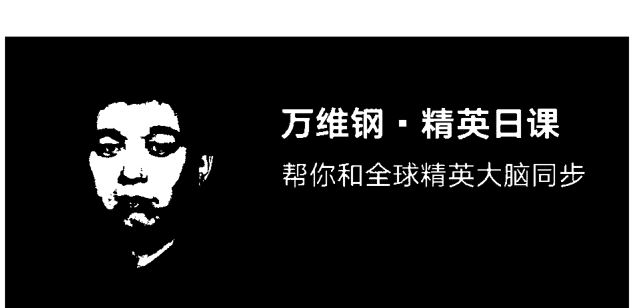

## 日课199 | 《人人说谎》解读5：黑暗数据中的温暖

日课199 | 《人人说谎》...

今天咱们继续说赛斯的《人人说谎》这本书。上次我们通过大数据看到了人们内心深处的各种偏见，和表现出来的各种虚伪。我们知道偏见是不可避免的，我们也能理解虚伪是必要的。但你有没有一个感觉，就是赛斯搞的这些大数据的工作，似乎的确是比我们前段时间讲的麦兹伯格的《意志》要“低级”一点——麦兹伯格有理论有哲学有深入理解，而赛斯无非是用统计数据告诉我们一些几乎是明星八卦一样的简单信息。

你发现了别人思想中的隐私，那又怎么样呢？这些仅仅是谈资吗？而且还是令人沮丧的谈资。但是赛斯说，大数据发现的这些事实，可以至少在三个方面对我们有所帮助。

### 1.你并不孤独

大数据对我们的第一个帮助，就是使我们更加了解别人——让我们知道，别人的状况比我们好不了多少。如果身处不性婚姻，或者有什么怪病，或者对自己的身体不满意，现在大数据可以告诉你，你并不是孤独的。

这总是安慰。老师鼓励学生要勇于提问，总爱说一句话，“世界上没有愚蠢的问题！”老师说，你觉得很愚蠢的问题，也许正是你的同学也想问的。这套说辞其实没啥说服力，我们依然害怕提出一个太简单的问题而被嘲笑。而Google可以告诉你，人们就是在问一些愚蠢的问题。

比如2014年，奥巴马的一次国情咨文讲话，Google就捕捉了很多“愚蠢的”问题。要知道这时候奥巴马已经当了6年的美国总统了，老百姓应该对他已经非常熟悉了，对吧？可是你知道奥巴马讲话过程中，Google搜索上关于他最热门的问题是什么吗？是奥巴马今年多岁。排名第二的问题是副总统拜登身边的那个人是谁。排名第三的问题是众议院议长今天为什么戴个绿领带。那些关注奥巴马讲话议题的人都哪去了？美国人真的懂政治吗？

所以你要觉得你不懂、你很糟糕——那你要知道，别人的也不懂。如果你觉得你在某一方面很差劲，那大数据也许会告诉你别人也没好。

而且你还可能是纯粹无谓的担心，局面根本没有那么严重。男性经常问Google的一个问题，是自己身上某个重要器官的尺寸是不是太小了，这个问题在男性的性相关的问题中排名第一。这个担心有点过度了，因为他们的另一半似乎并不怎么关心他们的尺寸——Google数据显示，女性搜索男性这个尺寸的频率，大约是男性自己的1/170。而且在女性的这些搜索中，即使是抱怨自己的丈夫或者男朋友的尺寸的，其中有40%是抱怨尺寸太大而不是太小。

女性也有类似的烦恼。出乎赛斯和可能绝大多数男性意料的是，女性最关心的一个问题是自己某器官的气味不对。有些女孩甚至认为自己的一生幸福都会被这个气味给毁了。可事实上，男性搜索相关话题的频率，跟女性搜索男性尺寸的频率一样小，而且其中很大一部分也不是抱怨气味不对。赛斯在纽约时报发表文章讲过这个事情，反响非常大，有很多医生专门跟他联络，说咱们能不能想个办法消除女性的这个恐惧。

这个道理是什么呢？是每个人都太过关注自己的身体有没有缺陷，以至于根本没心思注意对方的身体有没有毛病。我就想起来听说过的一个实验，让人故意穿一件很不合适的衣服去上班，穿这个衣服的人非常担心别人怎么看他，可是一天下去，根本就没有几个人注意到他的衣服不对。

所以，千万不要拿自己的真实情况和别人发的朋友圈状态比，也千万别担心别人笑话你。事实是此恨人人有，家家都有本难念的经——而且别人根本就没注意到你的“缺陷”。

### 2.有人正在受苦

大数据的第二个帮助，是告诉我们这个世界上很多人正在忍受痛苦，他们只不过没有公开说出来。

正规的社会调查，一直注意到一个很有意思的现象，就是在美国那些对同性恋容忍度比较高的地区，同性恋占总人口的比例也比较高。比如说，加州旧金山是美国对同性恋容忍度最高的地方，这里男同性恋的比例高达4%。而其他地区，像有些社会风气保守的州，同性恋连1%都不到。

这是为什么呢？我们知道同性恋是由基因决定的，是先天就有，而不是后天学的——那似乎各地同性恋人口比例应该差不多才对。是不是因为很多人发现自己是同性恋，就会搬家到对同性恋容忍度高的地方去生活呢？似乎不是，因为搬家的数据根本解释不了这么大的差距。

而网络数据能告诉你真相。数据科学家可以从一个人输入的搜索关键词，判断这个人是不是同性恋——比如同性恋男性可能会搜索一些同性恋相关的心理焦虑问题，他们上色情网站只搜索同性恋内容的色情视频，等等。

使用这些数据，赛斯判断，不管是在哪个州，男同性恋的人数占男性总人数的比例，大约是在5%左右——这跟旧金山的4%非常接近。在对同性恋容忍度高的地方，他们敢于公开宣布自己是同性恋；但在对同性恋容忍度低的地方，他们就不愿意让人知道，包括在民意测验中也不会表示自己是个同性恋。他们可能自己对自己都不愿意相信自己是个同性恋，他们只能在夜深人静的时候，自己在网上搜索一下相关的内容。

还有一个例子。如果你看公开报告，金融危机以后，美国家庭虐待儿童的事件不但没有增多，还减少了。可是如果你看搜索数据，儿童搜索自己被家长虐待的频率并没有减少。这就说明有些小孩是被父母虐待而不敢报告。之所以现在虐待报告减少，也许是因为政府财政缩水，没有那么多人员负责跟进走访儿童虐待问题。

如果没有这些数据，我们怎么能知道，现在有这些人正在受苦呢？

### 3.测试解决方案

大数据的第三个帮助，是能帮我们发现解决问题的办法。

还是说个岔题的例子。2015年12月2日，美国发生了一次穆斯林枪大屠杀事件，导致多人死亡。作为“白左”的优秀代表，奥巴马发表演讲对美国国民进行说教，说千万不要因此恨所有的穆斯林，不要滋生族裔歧视。主流媒体对奥巴马的这个演讲一致）

Google关键词的实时数据显示，在奥巴马发表演讲的同时，仇恨穆斯林的搜索比平时高出两倍。

奥巴马在演讲过程中还提到，我们在让外国人入境的时候，不要去调查他们的宗教背景，美国欢迎任何宗教背景的人。而就在他说完这句话以后，有关“杀利亚难民”的负面搜索上升了60%，而像“帮助难民”这样的正面的搜索下降了35%。

这么看来，奥巴马的演讲还不如不讲。他越讲不要歧视穆斯林，老百姓越反对穆斯林移民，整个起了反作用。

那这个问题怎么解决呢？过了一段时间后，奥巴马又发表了一次演讲。这次演讲中，奥巴马说到一句话：穆斯林不仅仅是恐怖分子，他们也是我们的邻居和同事，穆斯林中还有很多伟大的运动员，他们代表美国在国际上赢得了荣誉，还有许多穆斯林参加了美军，正在为美国而战。

奥巴马的演讲撰稿人写这句话，也许只是想煽情，并没有过多考虑——但是谁都没有想到，这句话的效果出奇地好。

奥巴马刚说完这句话，Google搜索可能是有史以来第一次，和穆斯林有关的搜索中，排名第一的是运动员，而不是恐怖分子。美国观众非常想知道到底有哪些运动员是穆斯林。

注意到这个正面反应，奥巴马在下一次有关穆斯林的演讲中，就有意识地告诉美国人一些有关美国穆斯林的情况，提到一些穆斯林运动员和士兵的事情，还说美国国父托马斯·杰斐逊就曾经研读过《古兰经》，结果效果非常好。

简单的说教没用。但如果你能给人提供一些新的事实，激发别人的好奇心，就非常有效。而这个教训正是大数据告诉我们的。

### 由此得到

大数据不仅仅暴露了世人的隐私，也让我们更客观地理解这个世界。有很多人跟我们一样有各种问题，我们的很多担心其实是多余的，但是有人确实在受苦。不但如此，如果你把真实世界当成一个实验室，大数据技术随时采集实验数据的力量，还能对某些问题提供解决方案。

### 我的评论

从今天这些内容，我们大概还有这么一个收获，那就是大数据分析最厉害的优势，在于客观。当然绝对的客观是不存在的，就算是大数据也得靠人选择观察视角和模型的变量。但这个方法的确比个人的感受要客观的多。

一个人哪怕再有经验，也是“小”数据。我们身边可供参考的样本本来就很少，而我们有时候还根本不采样分析——我们会过高评价自己的个人感受，我们甚至可能只看到了自己。

而大数据让我们看别人，还告诉我们别人怎么看我们。这样新鲜的视角，难道不应该好好了解吗？

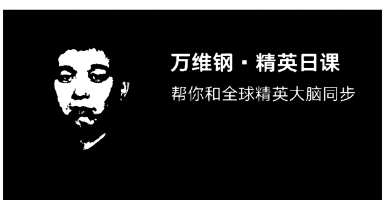

## 日课200 | 《人人说谎》解读6：隐藏的规律

日课200 | 《人人说谎》...

今天咱们继续说赛斯的《人人说谎》。咱们前面已经看到，大数据可以发现一些不为人知的事情，而且这些事实可能对我们有所帮助。今天我们更深入一步。如果你有足够大的数据量，那就像有了一张分辨率足够高的照片一样，你就可以任意放大照片的一个局部，还能看到足够多的信息。如果你能这么干，你就有可能发现一些隐藏的规律。

咱们先做个判断题，看看你的常识跟数据的结果有没有矛盾——

很多家长和老师反对暴力电影，担心会给青少年带来不良影响，而心理学家在实验室里证明这个担心是正确的。实验表明，一个人看完暴力电影之后，他的愤怒情绪会被激发出来，如果这个情绪足够强烈，就会引发暴力行为。

好。那么请问，暴力电影对真实世界里的暴力事件，有多大贡献呢？具体来说，如果这一周上映的流行电影是个暴力片，那么它会如何影响这一周的青少年犯罪率呢？能让犯罪率上升15%吗？

答案咱们最后再说。先说个轻松的。

### 1.是什么把你变成粉丝的

赛斯和他弟弟相差四岁，两人长得也挺像，但是他们的兴趣爱好很不一样。比如说，赛斯非常喜欢棒球，而他弟弟对棒球完全无感。这个情况很普遍的，一个家庭的几个孩子，按理说基因应该差不太多，在家里的生活环境还是一样的，为什么会有不同的爱好呢？

这个问题，一般的心理学家，什么教育专家，都很难回答，因为你不可能长期跟踪记录一个人的成长。但是大数据可以。大数据发现，一个人是否会成为某支球队的球迷，跟这支球队夺冠的时候，这个人的年龄有关。

下面这张图说的是棒球。横坐标是一支球队夺冠的时候，你的年龄是多少岁，纵坐标是这个夺冠事件让你在成年以后成为球迷的概率增加了多少——


最关键的年龄是八到十岁。如果你八岁的时候，家乡的一支球队夺冠了，你就容易成为这支球队的球迷，并且因此爱上这项运动，终生都是球迷。可如果球队夺冠的时候你已经二十岁了，那么这个事件对你的影响就很小。

### 2.一般的和特殊的

### 3.谁能成为名人


子很早就能够接触新东西。

第二种是大城市。大城市是人才和创新资源集中的地方。你要想当记者，你最好生在纽约；波士顿生产了最多和最好的科学家；洛杉矶则是一线演员的故乡。

如果再按照人群细分，还有一个有意思的现象——移民。赛斯发现，越是第一代移民聚集的地方，越容易出名人。事实上，很多在美国出生的名人，他们的父母是在外国出生的。这个结论印证了我以前在别处看到的统计，移民比土生美国人有更大的创造力——其实你看看硅谷那些公司里都是什么人就知道。

但是教育投入跟成为名人关系不大。赛斯把他的研究跟别人的研究对比，认为一个家庭在教育上加大投入，的确有助于让孩子进入中产阶层——但是并不能帮他成为能进维基百科的名人。这个说法我也特别赞同——现代教育系统是批量生产普通人用的，名人基本不在乎你怎么教他。

现在公布开头那个判断题的答案。答案是暴力电影不但没有增加暴力犯罪，反而减少了暴力犯罪。数据显示凡是有暴力电影上映的那些日子里，暴力犯罪率都比平时下降了。

这是为什么呢？原因可能让你哭笑不得：因为暴力电影把有暴力倾向的人留在了电影院里——他们既然在电影院里看电影，就不太可能上街犯罪！

那你可能要问，他们看完电影之后，愤怒值上升，会不会上街犯罪呢？也没有。数据显示，晚间电影结束之后，犯罪率也是下降的。这可能是因为很多人犯罪是因为喝了酒，而既然青年们都在电影院里看电影……他们就没有喝酒。

所以结论有点反直觉，暴力电影其实减少了暴力犯罪。那你可能又要问，会不会有青少年看了电影之后的第二天、第二周、或者第二个加月加大犯罪倾向呢？这个赛斯就没有提到了，但我判断，也不会。咱们想想，中国1980年代的时候，根本就没有什么是暴力电影可看，但是暴力犯罪率比现在可是高得多。

暴力犯罪根本就不是“学”来的，人天生就有暴力基因。暴力电影和游戏的作用根本就不是“教会”青少年犯罪，而是占用了青少年的时间和精力，使他们没有时间去犯罪！

咱们好好想想这个道理。现在很多人讨伐“网瘾”，说网吧是青少年犯罪的温床——这就是颠倒了因果关系。对学习成绩差、无所事事的青少年来说，网吧的确是个消磨时间的好地方，网吧里这样的人多，当然容易有事情。但你不能说网吧带来了这些事情！如果没有网吧打游戏，这些人到街头去玩真的，那才是真犯罪。

### Ⅰ 由此得到

今天我们看到了大数据细分分析的力量。只有深入进去，你才能看到各种隐藏的规律——其中有些道理与直觉相反，非得用大数据才有说服力。我们知道了青少年时代是一个人对各种事物形成喜好的关键期、全国的一般结论不能代表地区差异、想要成为名人最好出生在哪里，以及暴力电影的真正作用不是教导暴力，而是抵冲暴力。

这就再一次提醒我们要实事求是：不要盲目下结论，你的直觉可能是错的。

## 日课201 | 《人人说谎》解读7：意料之外的有用和没用

日课201 | 《人人说谎》...

今天咱们继续说赛斯的《人人说谎》。经过前面几讲你大概已经体会到了，有些用大数据得出的结论，跟我们的直觉相反。今天咱们再说几个——这一次说的就不是简单统计得来的了，而是随机测试得出来的。这个好处是有明确的因果关系——我们就能知道一个东西到底是不是真的有用。

咱们先搞个小测试。这次我要问你三个问题——

（1）下面这张图是2012年 Google 在搜索结果页面中加入的网页广告——

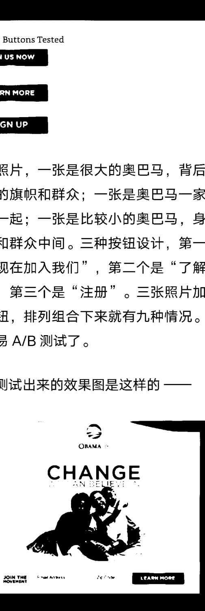

其中每条广告的右侧，有个正方形的框里的小箭头图案。请问，加入这么一个小箭头的设计，对增加广告点击率有用吗？

（2）前段时间有篇比较火的文章，百雀羚花了重金做了很多广告，但是销售状况并没有获得很大提升。那么请问，做广告真的有用吗？——当然，也许百雀羚做广告的方式不对。那么最常见的广告方式，也就是电视广告，有用吗？

（3）现在马上就要高考了，可能一两分的差距，一个人能上的大学就有天壤之别。请问，名校对人真的有用吗？

请你大概估计一下每个东西有用的程度，然后按照从没用到有用给排序。

现在我们就看看大数据是怎么说的。

### 1. 网页设计的A/B测试

想要获得真正的因果关系，最好的办法是搞一个随机测试。比如说，我想知道到底是不是吸烟导致癌症，我就应该找一帮人，把他们随机分成两组，然后让一组人坚决不吸烟，另一组人必须吸烟。这样坚持几十年之后，看看吸烟这组的人，肺癌患病率是不是显著比不吸烟的一组多。如果多了，那就肯定是吸烟导致的——因为除了吸烟之外，这两组人不应该有任何区别。

这种随机测试，特别是大规模的随机测试，是医学研究中最有力量的科学方法。可是在真实生活中搞随机测试非常困难，要消耗很多人力物力，投入很长的时间——再说也没人愿意被强迫吸烟啊。

但是在互联网上搞随机测试非常方便。按赛斯的说法，Google 最早是在2000年2月27日，第一次引进了对网页设计的随机测试。

比如说，Google 想用蓝色网页，但是到底我说浅蓝好还是深蓝好呢？Google 就可以随机地让一部分用户看到浅蓝色网页，另一部分人看到深蓝色网页，然后比较哪一组用户在这个网页的点击率更高。一旦有了明确答案，就统一使用这种蓝色。这就是所谓的“A/B测试”，咱们专栏以前多次提到这个方法。

仅仅2011年一年，Google 就搞了7000次A/B测试。它甚至测试过41种不同深度的蓝色！这个测试把网页设计师给惹恼了，设计师愤然辞职！咱们想想也是，判断到底哪种蓝色好看，难道不是设计师的职责吗？你什么都搞测试，这简直就是对设计师专业素质的侮辱。

但是事实是，A/B测试非常有效。回到今天开头的第一个问题，箭头的设计到底有没有用？答案是非常有用。Google 测试过改变广告的字体、把字居中排版、在广告里面加入网页评分等等，结果都没用，最有用的办法就是在广告里面加入小箭头图案。

这个箭头图案的效果到底有多大，是Google 的商业秘密，我们不得而知。但是有一个更著名的例子。下面这个图，是2008年奥巴马第一次竞选总统的时候，他的竞选网站筹款的页面——


网页非常简单。上面是一张奥巴马的照片，下面是两个输入框，分别让你输入你的电子邮件地址和你家的邮编编码。然后紧接着是一个按钮，点击这个按钮，你就加入奥巴马的助选阵营，然后系统就会提醒你捐款。

问题在于，照片应该用什么样的照片，按钮又应该是什么样的按钮呢？这个网页是一位 Google 前雇员设计的，他想到的办法，当然是A/B测试。下面是测试过的三张照片和三个按钮设计——


三张照片，一张是很大的奥巴马，背后是竞选的旗帜和群众；一张是奥巴马一家人坐在一起；一张是比较小的奥巴马，身处旗帜和群众中间。三种按钮设计，第一个是“现在加入我们”，第二个是“了解更多”，第三个是“注册”。三张照片加三个按钮，排列组合下来就有九种情况。这太容易 A/B 测试了。

最后测试出来的效果图是这样的——


照片是奥巴马和家人坐在一起，按钮是“了解更多”。你猜这个选择值多少钱？

这个测试出来的照片和按钮组合，让给奥巴马捐款的人数增加了 40% —— 相当于多了6000万美元的竞选经费。帮奥巴马设计网页的这人后来自己开了个公司，专门给人搞 A/B 测试。

咱们仔细想想，这东西有点反直觉。这么小的改动，竟然有这么大的效果。我们是获得了因果性——多出来的点击量的确实是网页设计带来的，可到底为什么呢？这一张照片、这个按钮比别的照片和按钮好在哪里呢？我们不知道。

现在A/B测试更多的被运用于选择新闻标题，而如果你看看那些被选中的标题和落选的标题，你很难想象为什么这个标题就会比另一个标题带来更高的点击率。

现在大家公认的理论是，干脆你就不要想“为什么”，全听测试结果的就对了。

### 2.电视广告的效果

你想过没有，广告其实是一个谜。

某个品牌某天盖地做了很多广告，然后它的产品卖出去了很多——请问你能说这是广告的作用吗？不能。

可能是人们看了广告才去买他家的产品。但也可能是他家的产品本来就好，不做广告也能卖得很好。就算广告能增加销售，广告也能卖得很好。就算广告能增加销量，多出来的销量值不值那么贵的广告费，你也知道。

商家一直相信广告，但是经济学家始终有点怀疑。想要说服一个经济学家，最好的办法还得是随机测试。可问题是哪个公司也不愿意花那么多钱陷经济学玩，这样的实验始终就没人做过。

2012年，经济学家终于找到一个办法：自然实验。所谓自然实验，也就是“自然的随机实验”——你没有主动搞随机分组，但是有一个什么突发性的自然力量，带来了一种随机分组。

这个研究是赛斯本人参与了的。美国一年一度最重要的电视节目是超级碗，也就是美式足球的总决赛，就好像中国春晚一样。超级碗中场休息的电视广告是最贵的。

### 3.只差一分进名校

名校有用吗？当然，如果你是名校毕业生，你的收入水平将会比一般大学的毕业生高很多。有人统计，哈佛毕业生的平均年收入是12万3千美元，而宾夕法尼亚州立大学毕业生的平均年收入是8万7千美元，所以显然是哈佛厉害。

### 由此得到

不知道开头的三道题，你猜对了几道呢？现在大数据的结果，让我排个序的话，名校最没用；电视广告非常有用；而最有用的则是网页设计：几乎是零成本的改动，竟能带来巨大的营收差异。

### 我的评论

请注意，这些结论应该仅供参考，任何生搬硬套都是有风险的。美国的名校不好使，可是美国的市埸经济比较完善，效率很高，是人才总能出头——那么中国的名校是否也一样不好使呢？


## 日课202 | 《人人说谎》解读8：大数据的不

## 能和不愿

日课202 | 《人人说谎》...

今天咱们把《人人说谎》这本书讲完。关于大数据能干什么，前面已经说得差不多了。最后这一讲，我们讲讲大数据不能干什么，和不应该干什么。

上周咱们专栏的一位读者，Leslie，问我，大数据能不能用来预测股市？其实这个问题不光是我们感兴趣，就连著名学者、前任哈佛大学校长劳伦斯·萨默斯（Lawrence H. Summers）也感兴趣。萨默斯专门把赛斯请到自己的办公室，问他能不能用大数据预测股市，他自己也出了几个主意——但答案是不能。

### 1.预测的错觉

传统的股票交易员一直都在用数学模型分析股市，什么技术分析、基本分析，都是看数据。这些模型有的有点用，有的完全没用，总体来说，都不是特别有用。

所以现在有人想用“大数据”的特殊方法预测股市。比如说，有人提议，我们可以实时监控人们在Twitter的言论——如果有很多 人讨论一个股票代码，是不是就意味着这个股票会上涨呢？又或者说，如果有很多人 在 Google 搜索某个股票的新闻，这个股票会不会涨？

### 2.计步器与健康

大数据分析还有一个重要缺点，那就是我们会过高评价可量化观测的东西。比如说，现在有很多“可穿戴设备”，随时记录我们的运动状况，能够计你走的每一步。

### 3.你从朋友圈判断一个人的智商低，你会告诉他老板吗？

假设你是某个银行的经理，任务是审批贷款。那你能不能判断一下，贷款申请书里经常出现的以下这十个词中，哪些词说明这个人会按时还款，哪些词说明这个人可能还不上款——

下次你批准贷款的时候，要不要参考大数据 的这个知识呢？遇到一位张口“上帝”、闭口“一定还钱”的人，你还会批准他的贷款申请吗？

如果你不批准，那发现这个知识的数据科学家，可能就会感到很对不起这位家里有人在医院等着用钱的贷款申请人！

这就是大数据的道德问题。你拥有一个别人没有的工具，洞见了一个隐藏的真相，那你不要说出来呢？

还有，了解大数据力量的人不会在 Facebook 上随便点赞，因为点赞会暴露一个人的智商。大数据显示，喜欢莫扎特、雷暴雨、卷曲的炸薯条的人智商高，而喜欢哈利一戴维森摩托车、乡村音乐和“我爱做妈妈”网站的人智商比较低。

那如果你通过观察一个人的点赞记录，洞悉了他的智商，你会想让他的老板知道吗？难道说点个赞都不让人点吗？

类似的困境很多。如果 Google 发现一个人在大量搜索怎么杀人或者怎么自杀的信息，那 Google 应该把这个事报告给警察吗？

恐怕不应该。因为数据显示，搜索这种信息的人非常非常多，但实际上的杀人案和自杀案远远没有这么多。如果有点风吹草动就报警，警察怎么也忙不过来。

而且搜索信息毕竟也算隐私。那么如果将来大数据技术进一步发展，真正能够锁定一些搜索行为，真的能判断强烈杀人或者自杀动机的时候，你是汇报还是不汇报呢？这些难题，只能留待将来 了。

最后，赛斯的结论是，现在有了大数据这个工具，“社会科学”也许可以成为一门真的科学。广告到底有多大用处？暴力电影到底是增加犯罪还是减少犯罪？如果没有大数据证据，以前的人搞社会科学简直是胡乱说。

而且大数据能研究的问题正在升级。《魔鬼经济学》是一本非常火爆的书，但是你注意到没有，那本书里说的很多问题都是小问题，比如相扑运动员是不是有作弊行为之类。为什么作者列维特不研究大问题呢？因为当时没有这么多数据！列维特只能选择有数据的领域。现在情况不一样了，大数据已经开始解决“广告到底有没有用”这种大问题。

大数据突飞猛进，但还有一些传统学者没有适应这个工具。如果你有志于用数据分析解决真正的社会问题，这个领域现在非常值得进入。随便说一句，我刚查了一下，大数据工作的工资也很高。一般数据科学家的平均年薪是9万多美元，资深数据科学家是13万美元，Google 的数据科学家年薪更是超过15万美元。大数据，现在是稀缺技能。

大数据不是万能的，但是是一个强大的工具。就算你不掌握具体的数据分析技术，也应该了解这个思维方式。读完这本书，也许我们最大的教训是，当你讨论任何社会问题的时候，千万不要信口开河，最好能找到数据支持，要知道很多真相是反直觉的。

不过话说回来，这本书里的各种结论虽然不是完全可靠，但当成八卦和段子还是可以的——有点娱乐性，而且至少比“常识”可信。

## 答读者问 | 好问题是怎么来的？

关于名校作用，我此前比较认同的观点是：名校提供了你与牛人交流、观察、学习的机会，不在于上的具体课程，而是与那些有思想的教授、同学直接面对面的学习场景，这个恐怕是名校相对于普通学校最具价值的地方。所以想请问万老师大数据分析的结果真的就表示我们能够忽略这一价值吗？

名校对于人的发展并没有什么作用，这个测试具体怎么做的我不得而知，但是我选择相信，现在的社会对于每个人来说机会太多了，所以个人的成长并不会受到学校限制和束缚，还有就是，在中国的话名校真的没有用吗？可能是这样的，因为在不怎么好的学校里就会有那种十分杰出的人，那么这个因素难道和基因有关？还是和家庭教育有关？那么万老师你觉得和什么原因关系最大呢？

### 万维钢

## 关于名校无用这个研究，有两点需要再次强调。

第一，我们说的是“可观测”的效应。对高中来说，可观测效应就是考试分数、被哪个大学录取。对大学来说，可观测效应就是收入水平。名校可能有很多别的好处，比如说教授的水平、眼界，这些东西对人可能也有影响，但是这些影响没有体现在硬指标上。

第二，我们是把上了名校的人和上了比名校差一个档次的人比，而不是把上了名校和不上学的人比。所以研究结论是“名校并不比低一档的学校有加持力量”，而不是“学校根本没用”。

意识到这两点，那么这个研究的结论可能就没有那么离奇了。事实上我还可以补充一点，这本书没讲但是有研究表明：学术成就，比如你统计毕业以后发表论文的篇数，名校也没有特别明显的加持力量。

这可能是因为美国所有比较正规的大学都是“学术圈”的一员。对学生来说，进入这个学术圈很重要，但是具体进入哪个大学并没有那么重要。

我想，这也可能是因为美国的各个大学之间交流非常充分。宾州州立大学排名虽然不如哈佛，但是宾州州立大学的教授，跟哈佛那个教授可能曾经是同班同学。区重点高中老师可能没有省重点高中厉害，但是区重点高中用的教材、复习资料，和省重点高中是同样的。有差距，但是没有本质的差异。

所以牛人的确是去哪里都行——只要是这个“圈子里”的。这就好比说足球，不管是从中超的青年队还是中甲的青年队起步，一个年轻球员只要进了职业队，他的才华就不太可能被埋没——各家的球探都盯着呢。可如果他根本没进职业队，大好年华跟自己家门口的孩子踢野球，那就是没戏了。

又有一个和老师相同的地方了：守门员！我想问，这些数据分析的牛人，那么多好问题是哪里来的？就像专业的写作，专业的分析也应该有一—产生或训练——问问题的能力的方法吧。老师能介绍下吗？

### 万维钢

这个你算是说到点子上了，我一向认为，搞科研也好，写文章也好，最重要的就是选题。好的问题是成功的一半。什么是好问题呢？必须同时满足，第一，这个问题现在大家都很关心；第二，这个问题你恰好能做出来。

所以好问题具有“社交”属性。你得在这个圈子里混，才知道这个圈子里的人都关心什么。你拥有的技能必须满足这个圈子的当今市场的需求，你才能把这个问题做出来，那么前提就是你还是得知道这个需求是什么。

对有志于搞科研的初学者来说，这就是“师父领入门”的重要性了。导师可以不教你任何具体的东西，你都可以自学，但是他必须得给你指一个方向。

等你有了独立性，那就更要跟各路人马交流，多读论文，特别是要重视学术会议。你必须得知道当前沿在哪里。你甚至应该知道现在这个领域内所有重要人物、所有重要的研究组，都正在干些什么——在他们的论文还没发表之前。

而更高级别的技能，也就是说你已经到了前面这两个水平以后，还能不能提出更有原创性的问题来呢？什么问题才是好问题呢？那当然就是我专栏多次讲过的：喜好 = 熟悉 + 意外。

在用数据过程中，如果人们知道了数据的小套路，数据还会珂珂有用吗？

### 万维钢

数据还会珂珂有用。首先大数据更关心的是多数人的普遍行为，少数知道套路的人故意改变自己的行为，影响不了大局。

那么作为个人，比如你知道某些公司可能会给“富人”更高的价格，那你就想在网上假装“穷人”，以期获得低价，这样可行吗？不太可行。数据对人的判断是多方位考虑的，你的家庭住址、外出旅游次数、高消费的行为之类的数 据很难假装，也捉不上假装。

我曾听一个给美国高中生提供上大学咨询服务的人讲大学录取里面的门道——其中有很多东西有大数据的精神。当时有个家长就问，说既然现在亚裔高分学生被名校“歧视”，那我让孩子改名，假装不是亚裔，这招可行吗？

咨询师说，这招没用。大学负责招生的人，已经把你家孩子整明白了——你的电子邮箱地址是gmail的，你用的手机是iPhone，你的特长是钢琴或著小提琴……这一切的一切都证明，你就是亚裔。

既然这些大数据可以发现我们发现不了的事实，那么是不是可以用来自记录我们日常生活，来分析和反思自己是一个什么样的人呢？是否可以通过生活中的信息跟踪，来客观分析自己该在哪里进步，该如何快速进步，该如何成为精英呢？我ain想，古人所有的吾日三省吾身，也是通过自己过去的事情来反思自己的。这就是说，做过的事情和痕迹，就是我们分析自己的重要信息。但是，大多数情况下，我们存在对过往信息认知不清、肃不全面，甚至会遗忘的情况，那么，这就容易客观分析当时的自己。而大数据却可以，它实在在的把什么时候，什么地点，什么人，什么天气等言素立体地保存下来，通过过往数据的综合与分析，或许能加大反思自己的成果，有利于自己的成长。那么，这时候的问题就在于，该如何客观搜集自己的过往信息？有意识地随记记录当时的情况，把自己一天的时间分阶段段记录下来，通过这些数据来分析。至于其 他的方法，还请不吝指导！

### 万维钢

自我量化现在很流行啊！记录别人的比较麻烦，但记录时间很容易，工具很多。我推荐一个App叫“A'Tracker”，随时记录你怎样花时间，分析统计。这个行为可以让人对“自己一天到晚到底干了什么，怎么感觉什么都还没做就结束了”这个问题有个清晰的认识，有助于提高时间敏感度！

想请问万老师，关于“同性恋是基因决定”这个结论，可以从哪里找到参考的相关资料吗？

### 万维钢

搜索引擎是你的朋友。据我所知，主流观点认为同性恋是基因决定的。但具体是哪个基因，似乎还没有锁定，因为很可能是多个基因共同决定。相关研究仍然在进行。不过也不是没有反对意见，有人认为后天环境的影响也很重要——不过我的印象是，主流观点认为同性恋是天生的。

中国的大数据在使珂和价值上和美国还存在较大差距，这是因为中国大数据的量不够吗？还是中国的大数据还处于各自封闭的状态？或是其它因素？

### 万维钢

可能两个原因都有吧。美国在数据采集和数据公开开放方面做得都很好。Data.gov上提供各种公共数据，多种格式，随便下载。专业研究者能接触到的数 据更多，而且也确实比较强调共享，向人要数据都比较好直爽。多年以前我搞空间等离子体研究，需要用到卫星采集到

间等离子体研究，需要用到卫星采集到的数据，我还以为要找专门的部门申请，结果有个网站直接就能下载。

也就是说，美国对很多数据的态度是，不但允许你用，而且想办法创造条件方便你用。当然，私人公司会把自己的关键数据秘而不宣，但总体的社会文化是乐于共享数据的。

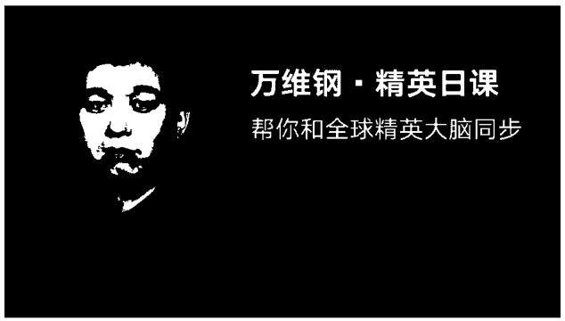

## 日课精选

Aa
字号

写留言

105

请朋友读

## 特别放送 | 释放少的潜能，取得多的成就

万维钢

今天我来帮你把今年2月份出的新书《俭省》总结归纳一下。现代社会，过分追求“多”，好像是不对的。可到底哪里不对呢？到底怎么做才是对的呢？这本书给这个问题提供了解决方案。

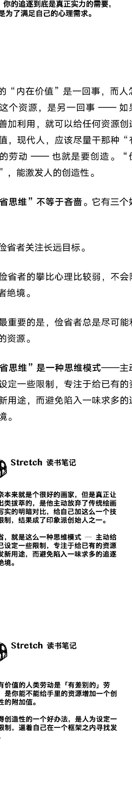

书名：Stretch: Unlock the Power of Less -and Achieve More Than You Ever Imagined 《俭省：释放“少”的潜能，取得“多”的成就》

作者：莱斯大学管理学教授斯科特·索南史恩 Scott Sonenshein，曾出任过许多跨国公司如美国电话电报公司（AT&T）、微软（Microsoft）的战略顾问，在硅谷的一个创业公司经历了网络泡沫的繁荣与衰落。

### 本书核心观点：避免陷入一味求多的思维模式，尽可能利用手里现有的资源发展。

1. 现代社会的主流价值观是“追求更多”，多就代表成功。对此批判意见也有两种：一种是消极避世、节制发展，另一种是极简主义。然而，现代社会组织的整个前提就是要发展，发展已经是现代人的本能追求，发展中出现的问题，只能用发展解决。

发展中出现的问题，只能用发展解决。极端环保主义者、宗教人士，鼓吹不发展，其实是一种撤离式的情节。而所谓“极简主义”其实是某些反人类的生活姿态，这个姿态甚至有点违法人性，非常做作——当你处处想着怎么“极简”的时候，你已经把太多精力浪费在了这点小事上。

### 2. 追逐者：更多的收入、更大的办公室、更高的职位、更好的汽车等等，有这种强烈愿望的人，索南史恩称之为“追逐者”。追逐心态有三个来源：

- 第一个来源是跟别人比。
- 第二个来源是我们总是认为要想办更多的事儿，就得动用更多的资源。
- 第三个来源是，我们单纯就是想要“更多”。

### 3. 追逐者心态公式：拥有更多资源 = 获得更好的结果。而真正要把事情办好，需要的是另一个公式：
更好地利用资源 = 获得更好的结果

### 4. 正反馈游戏：在短期内，你追逐的越多，拥有的就越多，获得的评价就越高，向上攀比的对象也越高，你越想追逐更多的东西，主动停手很难。但是这个游戏是不可持续的，最后要么把能从外界获取的资源耗光，要么把自己的精力和希望耗光。

面对一个具体的局面，到底是应该悠着点，还是全力以赴争取呢？
大概有两个判断标准：
1，游戏是不是可持续的；
2，你的追逐到底是真正实质的需求，还是为了满足自己的心理需求。

### 5. 资源的“内在价值”是一回事，而人怎么利用这个资源，是另一回事——如果人能够善加利用，就可以给任何资源创造新的价值，现代人，应该尽量干那种“有差别”的劳动——也就是要创造。“俭省思维”，能激发人的创造性。

### 6. “俭省思维”不等于苛嗇。它有三个好处：
第一，俭省者关注长远目标。
第二，俭省者的攀比心理比较弱，不会陷入追逐者绝境。
第三，最重要的是，俭省者总是尽可能利用现有的资源。

### 7. “俭省思维”是一种思维模式——主动给自己设定一些限制，专注于给已有的资源开发新用途，而避免陷入一味求多的追逐者绝境。

### 8. 俭省思维模式的关键，是从已有的资源中发挥出创造性的价值。一个最普遍的创造方法，就是“想法的连接”，即把一个遥远的想法跟你手里的东西连接在一起，提供一个新思路。

### 9. 发挥创造性，“刻意练习”成一个专家就远遥不够了。这是因此练习的作用有限：
第一，有严格固定规则的领域，练习的作用最大，比如国际象棋；没有严格规则的领域，练习的作用非常有限，比如音乐、教育、编程。
第二，环境局面越是可控和可预测的，练习的作用越大，能解释24%的表现；局面如果是复杂多变、不可预测的，练习的作用就很小，能够解释的因素只有4%。

### 10. “匹格马利翁效应（Pygmalion effect）”：你当她是个什么人，她最后就真的是个什么人。俭省思维模式的关键在于怎么开发手里现有的资源。

> 「匹格马利翁效应（Pygmalion effect）」：
你当她是什么人，她最后就是什么人。很多情况下，人心本来是个“墨加态”。你想象它看到什么状态，它就会往什么状态滑诸。
这就是“预期”的力量。

### 11. 你把别人当成怎么样的人，别 人慢慢就会变成怎么样的人。你认为自己是个什么人，你自己就会变成什么人。这个“预期”，放在自己的身上，其实就是“叙事自我”。我们的时刻都在给自己讲一个故事，说我这么做，是因为我是个这样的人。人都是高度可塑的。

人。人都是高度可塑的。

## Stretch 读书笔记

云对雨，雪对风，佛陀对苍生。
我对你，嘴对心，九夏对三冬。
我们都想想，应该怎么对家人、同事和自己吧。

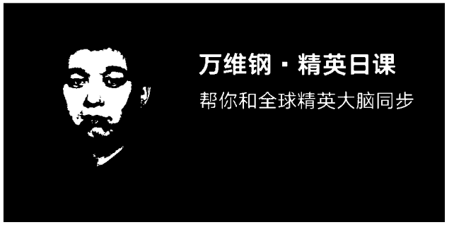

## 日课203 | 为什么优等生不能改变世界

日课203 | 为什么优等生不...

今天开始咱们说一本五月16号刚刚出版的新书，中文暂译成《破除成功学的迷信：为什么你所知道的关于成功的多数事情都是错的，以及背后令人惊奇的科学》（ Barking Up the Wrong Tree: The Surprising Science Behind Why Everything You Know About Success Is (Mostly) Wrong ），作者是博客和专栏作者埃里克·巴克尔（Eric Barker）。

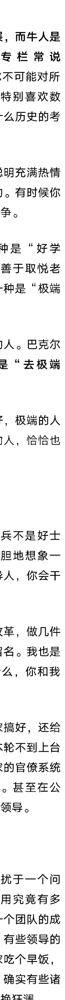

这本书的英文标题，Barking Up the Wrong Tree，也是巴克尔的博客的名字，直译过来就是“吠错了树”。这是一个很有画面感的成语，说一只狗追一个人，人跑进树林上了树，狗看着一棵树就站在前面叫，但是它也不知道那个个人并不在那棵树上。对应到中文，差不多是“缘木求鱼”。

也就是说，现在人们追求的所谓“成功”，各种鸡汤段子里的“成功学”，可能都是缘木求鱼。关于“成功”的迷信说法太多了，巴克尔这本书就是要用科学研究的结果破除迷信、拨乱反正。

### 1.好学生和极端学生

### 2.你是一个什么样的领导？

此时此刻的要求，那么他走极端，反而成功了。

比如说丘吉尔，就是非常极端的人物。别人都爱国，丘吉尔不光是爱国，是极端爱国 —— 只要他觉得什么东西对英国有威胁，他就要不顾一切地消灭之。甘地在印度搞个非暴力不合作运动，丘吉尔也不干，差点要除掉甘地。像这样的领导人放在平时可能就是国家的灾难，但是赶上二战，也只有这样极端的人才能领导英国对抗希特勒。

所以你看出来没有？正所谓“非常之功必待非常之人”，“牛人”的成功，就是要走极端。

那极端的人都在哪呢？是不是想极端就能极端吗？不是。你恐怕得有极端的基因才行。

### 3.蒲公英和兰花

有个基因叫DRD4，一般人都有，但有些人的DRD4基因变异了，变成了DRD4-7R。带着这个“7R”变异的人，小时候会表现为儿童多动症。

你可能认为这是一个不好的变异，因为它会让人难以集中注意力、不听话、不遵守规则。但现在科学家看问题不是这么看的，科学家认为基因没有好坏，像7R变异，只是一个“增强器”。

带着 DRD4-7R 基因的孩子确实有多动症，但他们也有别的孩子不具备的优点：才三岁大，他们就能主动和其他孩子分享好东西，这显然是社交能力更强的表现。

所以基因好不好，还得看环境怎么配合。7R变异者如果在一个冷漠、甚至虐待的环境中长大，他就会表现出多动、对抗的特征。可如果他成长在一个温暖的家庭环境中，他就会成为很好的连接者和组织者。

基因变异通常是非常温和的，不会带来什么显着的变化，人和人差不了太多。巴克尔打了个比方，大多数人就像是蒲公英一样，对环境要求不高，在哪里都能生存。


可是有些基因变异，像是这个 DRD4-7R，就是比较显着的。有这种变异的人会表现出跟别人非常不一样。他们就像是兰花，对环境要求很高。环境不行，他们的生存能力远不如蒲公英。但是如果环境正好合适，他们能取得极端的成功。


你想当兰花吗？那你先想想电影 X-Men 里面那些人吧——


他们身上有特殊的基因变异，的确是超能力，但是他们从小就异于常人，收获更多的恐怕不是羡慕，而是歧视！

咱们再举个例子。比如一个人，身子特别长，腿特别短，胳膊特别细，手和脚都特别大，跑步跑不快，整个都不协调，你想当这样的人吗？

在普通人眼里，这是生理缺陷；在游泳教练眼里，这是世界冠军。菲尔普斯就是这种体型。


他很不适合在陆地行动，但是他非常适合游泳。


### 由此得到

极端的成功并不适合所有人，需要基因和环境的配合。成功的反义词不是失败，而是平庸。失败其实是成功的近义词，两者都意味着要走极端。

### 我的评论

了解了这些，你还羡慕那些特别成功的人吗？也许还不如老老实实当个优等生，过好自己的小确幸。成功学鸡汤说只要你这么、这么、这么做，就人人都能向乔布斯、比尔·盖茨和卡洛巴格学习 —— 怎么可能呢？他们都是大学退学生，你敢退学吗？

如果你要生一个孩子，请问你想给他多大的基因变异？你想生个 X-Man 呢，还是想生个蒲公英呢？

## 日课204｜主要看气质

日课204｜主要看气质

今天咱们说个轻松点的话题，谈谈长相的重要性。“主要看气质”这句话进入了2015年十大网络用语，一般似乎是用于发自拍照的场合——就算我的长相先天条件一般，但是我气质好啊。那“气质”到底有多重要呢？非常，非常重要。

传统智慧要求我们看人要看内心，谨防上了“金玉其外败絮其中”的当。可是现代社会是个陌生人社会，这个传统智慧就不太实用了——我们每天要接触很多人，怎么可能——了解别人的内心？你就得通过观察外表，迅速判断。

随便给你一个个人，你马上就能对这个人产生一个第一印象，这是人人都有本能。而我们今天要说的这个研究，说的就是这个本能其实非常强大。

你只需要0.1秒的时间，就能对人做出相当“靠谱”的判断。

我要说的是普林斯顿大学心理学教授亚历山大·托多罗夫（Alexander Todorov）五月30日发表在 Aeon 上的文章。

我们只需要0.1秒，就能只靠照片判断一个政客的能力是否胜任，而这个判断结果又能在很大程度上左右选举结果。

托多罗夫在实验室证明，受试者们第一印象觉得哪个政客看上去更有能力，这个政客最后往往就真能当选。

0.1秒。铺天盖地的竞选广告、煞费苦心的纲领设计、费尽口舌的演讲和辩论，可能都不如这0.1秒的第一印象作用大。“气质”就是这么重要。


左边这张脸，A，看上去更有男子汉气质，更强硬；右边边的B，看上去更聪明，更和气，也更讨人喜欢。


## 日课205 | 坚持坚持再坚持

日课205 | 坚持坚持再坚持

今天咱们继续说埃里克·巴克尔（Eric Barker）的《破解成功学的迷信》（Barking Up the Wrong Tree）这本书。

通过上一讲，你看出来没有，所谓“成功”，并不是一个误删而后动、理性计算坚定执行的过程，其中可能会有无奈的迂拗，有偶然的运气成分。成功者可能不是最理性和最现实的人，反而有可能是特极端的人。今天我们要说的，也有这个意思——成功者可能是不太理性，甚至是自己欺骗自己的人。

中国有句叫做“坚持就是胜利”，咱们今天就说说“坚持”。“坚持就是胜利”这句话没毛病，很多成功者恰恰就是关键时刻都没有放弃，坚持下来了。

比如说，我们上一讲说到，美国百万富翁的平均GPA只有2.9，学习成绩不怎么好。但是统计也发现，百万富翁们还有个共同点，就是都自诩特别能坚持，做事有始有终，说别人都夸他们可靠。还有人发现，即使你干的是艺术这种创造性工作，也需要坚持，遇到挫折不放弃，把失败当成学习的机会，一路坚持干下来才能取得成功。

去年出了一本畅销书叫 Grit: The Power of Passion and Perseverance，中文版叫《恒毅力》。Grit 这个词对应的中文差不多是“坚忍”，那本书的作者、心理学家Angela Duckworth 把 Grit 定义为“热情 + 坚持”，说能坚持，也是人的一种素质，需要好好培养。

### 1.特种部队与保险推销员

我们知道美国海军海豹突击队（SEALs）是一支非常厉害的部队，它在训练和作战中经常搞一些创新，它在训练中对“人”的研究，经常被商学院学习。咱们上次讲《巨人的工具》这本书的时候有一期叫《指挥官的派头》，说的就是海豹突击队的一位指挥官。

- 困难都是暂时的，只不过偶尔发生，没有关系不影响大局；
- 这次的失败只不过是因为某个特殊的原因；
- 这是我的错误——不是我不行，只不过今天我运气不好。

### 2.律师与抑郁症

如果一个人看什么都看得特别准，对局面有精确的判断……他可能是个抑郁症患者。

### 3.故事的力量

有些事儿你真是没法乐观，你需要讲一个更好的故事才行。比如在纳粹集中营里，所有人对生活都没有最基本的掌控，每天就是等死，有的人受不了直接就自杀了。那些最后能活下来的人，都是什么人呢？

你明明经历了很多失败，犯过各种错误，还干了一些坏事，但是你给自己讲故事的时候，专门挑好的说。这其实是人的一种非常健康的心理机制。故事的价值不在于真实准确，而在于提供人生的意义。

有研究发现，你要考察一对夫妻的关系是不是足够牢靠，有没有可能离婚，最好的指标不是看他们的经济状况，也不是看他们相处时间的长短，性生活的频率之类。最有效的做法，是让这对夫妻讲讲他们这段关系的故事。研究者判断，这个故事讲得好不好，能在94%的程度上，预测这二人是否会离婚。

还有一个研究，说一个小孩的心理健康状况，跟他在哪個学校上学、有多少玩具、看多少电影这些关系都不大。最重要的指标是看这个小孩是不是理解家族的历史。如果小孩深刻了解家族历史，明白自己这个家族是怎么走到今天这一步，理解父母是怎么回事，他的心理就非常健康。咱们讲过，桑德伯格在《B选项》这本书里说了给孩子讲解家族历史这一招，看来的确有用。

故事能给工作带来意义。一个医院里的清洁工，如果他把干活纯粹当成是为了挣钱糊口，他工作就很不愉快。但是如果他认为自己的工作也是为了帮助病人，是治疗的一部分，他的工作状态就很好。

调查显示，工作的意义比工作的收入更重要。这也是我们常说的 “something bigger than yourself”。

给自己讲个好故事，找到工作和生活的意义，保持乐观的精神，这是能坚持下来的前提条件。然后你再把大目标分解为各种小任务，把每个任务都游戏化，随时奖励自己，获得掌控感，用一个个小胜利慢慢积累进步，这就是通往成功之路。

### 由此得到

面对各种挫折和困难永不放弃，能长期坚持下来，是成功者必备的素质。长期的坚持不是来自体能和意志力，而是来自乐观的精神，来自我们给自己讲的故事。故事都是虚构的，但是故事提供了工作和人生的意义。

### 我的评论

今天我们再次看到，真正让人成功的往往不是机械化的理性和算法，而是某些情绪化、非理性的东西。

以前我看过一个报道，讲奇瑞汽车是怎么起家的。当事人后来感慨，说我们那时候就是安徽的一个小厂，哪知道现代汽车工业是怎么回事，造汽车有这么困难。我们纯粹是无知者无畏，想造汽车就干起来了，结果一步一步坚持下来，现在居然就是一个举足轻重的大公司。

大事业往往是这么干出来的。如果开始的时候你清醒地知道这件事有多难，你根本就不会开始。

现在一提孙中山都说是革命伟人，可是你重返革命现场，孙中山早期的反清运动就好像笑话一样。现在一提黄兴，说是个革命军事家，可是黄兴当年十次起义十次失败，哪里像是懂军事呢？

但是这帮人屡败屡战，最后赶上历史时机居然就干成了。大的成功往往不是理性计算的结果，而是这么无知无畏拼命硬干出来的。

这种做法，非常可能遭遇失败，谁问我要不要走这条路，我大概会劝他别走。还是那句话，成功的反义词不是失败，而是平庸。失败，是成功的近义词。

……可是话说回来，不管什么事业，不问可行性，一味地坚持，真的好吗？有时候放弃也是对的，咱们下次再说。


## 日课206 | 企业家精神和包办婚姻

日课206 | 企业家精神和包办...

今天我们继续说巴克尔的《破除成功学的迷信》。昨天咱们说要“坚持坚持再坚持”，但这里面有问题。怎么找到值得坚持的事情呢？你总不能说只要肯坚持，干什么事都能成功——我想当美国总统，那肯定再怎么坚持都没用——那我如何判断哪些目标根本不切实际，应该放弃呢？今天我们就解决这两个问题。

### 1.找到兴趣所在

咱们还是先来做道题。给你20根意大利面条——是没有煮过、长长的比较粗比较硬的那种，一根绳子，一米长的胶带，一块棉花糖。20分钟之内，看你有什么办法，能用这些材料，把棉花糖放置在一个尽可能高的高度。

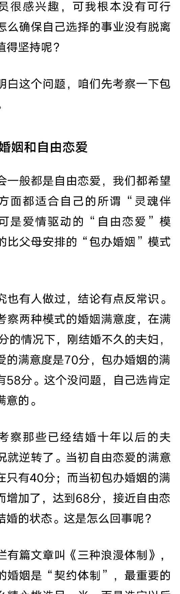

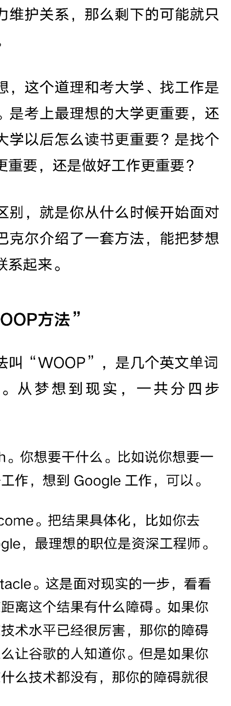

有个研究者拿着这个问题（叫“spaghetti problem”）测试了很多人，他想考察不同人群的创造性。他测试过工程师、商界人物，MBA的学生——而据说，表现最好的人群，是六岁的幼儿园小孩。


这个结果非常符合民间传说的说法，说小孩的创造性比成年人厉害。但小孩可能只不过是解决问题的办法更先进。小孩没有想太多，直接上手尝试，一个方法不行就换一个——结果大人还没想好，小孩已经做出来了。

这个风格很有企业家精神。咱们以前讲《决策》这本书的时候说过，《实干家不需要精确调研》，不用考虑太多，多尝试新事物，在行动中获得想法。我们说过“保金斯基三原则”，就是要在可控和低成本的状态下尽可能多尝试新事物，不怕失败，取得反馈。硅谷有句格言叫“fail fast, fail often”——要多失败，快失败，说的也是这个意思。


这就是我们寻找那个值得坚持的事业的方法。

我们多次说过，成功有很大的运气因素。找到适合自己的环境和事业就需要运气，但运气其实是可以“调整”的。还有人专门研究过运气——有的人认为自己运气好，有的人抱怨自己运气不好，那么研究者就比较了这两种人，看看他们的行为方式有什么区别。

结果是，区别运气好与运气不好的关键，是你是否经常尝试新东西。如果你尝试的东西很多，你遇到好东西的可能性就越大，你当然就会有好运气。当然，从另一方面说，你尝试的东西多，遇到的不好的东西也会更多，但只要你遵循“可控”和“低成本”的原则，你就不怕那些小失败。

愿意多尝试的人运气好，这个还有直接证据。有经济学家统计过，那些刚刚参加工作的时候频繁跳槽的人，等到他们稳定下来以后，收入会高于那些在一家公司一直干到老的人。这些人一开始通过频繁跳槽找到了自己的兴趣所在，然后再坚持下去。

咱们之前讲《俭省》那本书的时候说过，CEO这样高级职位通常都是由“通才”担任的，他们的履历很有多样性。这里巴克尔也提到一个研究，说如果一个人在职场上只扮演过两种不同角色，那么他将来升为高管的可能性只有2%；如果他至少干过五种不同工作，那么他成为高管的可能性超过18%。

科学家也应该多尝试。有研究说，普通科学家的业余爱好好的数目，跟一般人是差不多多的。高质量科学家常有两倍于一般人的业余爱好，而诺贝尔奖级别的科学家的业余爱好则是一般人的三倍。兴趣广泛真的是个优点，它能带来好运气。

所以这个道理就是要多尝试，要接触不同的领域，这样你就更容易遇到自己真正感兴趣的东西。

可是感兴趣不等于真可行。我对当职业足球运动员很感兴趣，可根本没有可行性。那怎么确保自己选择的事业没有脱离实际、值得坚持呢？

为了想明白这个问题，咱们先考察一下包办婚姻。

### 2.包办婚姻和自由恋爱

现代社会一般都是自由恋爱，我们都希望找到各方面都适合自己的所谓“灵魂伴侣”。可是爱情驱动的“自由恋爱”模式，真的比父母安排的“包办婚姻”模式好吗？

这个研究也有人做过，结论有点反常识。研究者考察两种模式的婚姻满意度，在满分是91分的情况下，刚结婚不久的夫妇，自由恋爱的满意度是70分，包办婚姻的满意度只有58分。这个时间点，自己选肯定是满意的。

但是再考察那些已经结婚十年以后的夫妇，情况就转折了。当初自由恋爱的满意度，现在只有40分；而当初包办婚姻的满意度反而增加了，达到68分，接近自由恋爱刚结婚的状态。这是怎么回事呢？

我们专栏有篇文章叫《三种浪漫体制》，说最好的婚姻是“契约体制”，最重要的是不是怎么精心挑选另一半，而是选定以后怎么维护两人的关系。包办婚姻的秘密也就在这里。按研究者的说法，包办婚姻好就好在，从刚结婚的第一天开始，你就没有抱太大的期望，你就知道自己必须努力维护才能把日子过好。

而自由恋爱结婚的人，更多地可能认为婚姻最重要的是开始的挑选，一旦结婚就不再努力维护关系，那么剩下的可能就是只有失望。

咱们想想，这个道理和考大学、找工作是一样的。是考上最理想的大学更重要，还是上了大学以后怎么读书更重要？是找个好工作更重要，还是做好工作更重要？

真正的区别，就是你从什么时候开始面对现实。巴克尔介绍了一套方法，能把梦想和现实联系起来。

### 3.“WOOP方法”

这个方法叫“WOOP”，是几个英文单词的缩写。从梦想到现实，一共分四步——

- 1. Wish。你想要干什么。比如说你想要一个好工作，想到 Google 工作，可以。
- 2. Outcome。把结果具体化，比如你去 Google，最理想的职位是资深工程师。
- 3. Obstacle。这是面对现实的一步，看看现在距离这个结果有什么障碍。如果你现在在技术水平已经很厉害，那你的障碍是怎么让谷歌的人知道你。但是如果你现在什么技术都没有，那你的障碍就很大。


大。

### 4. Plan。制定计划，解决各种障碍。

这四步没什么稀奇的，都是寻常的招式，但很多人恰恰就没有经过这个 WOOP 过程。过去的人都是以“有功劳”，或者最起码是以“有能力”为自豪，而现在的人有的是以“有梦想”为自豪，认为只要有那么一个梦想就很了不起，这岂不是荒唐吗？

WOOP 方法，在我看来，最大的作用并不是帮助你实现梦想，而是帮助你放弃不切实际的梦想。如果你梦想是不行的，使用这个方法分析之后，你会强烈感觉到这个梦想确实不可行。

如果可行，剩下的事儿就是坚持了。这就回到我们昨天的內容。

“坚持”和“多尝试”是個矛盾。注意这有一个时机问题。职业生涯的早期要多尝试，可以多跳槽，但确定了事业之后就应该坚持。最理想的状态是把无关的事情都推掉，每天只干最重要的这一件事儿。

但坚持的同时，也要多尝试。前面不管投入多少都是沉没成本，有新的好机会还是可抓住。总之是不坚持就干不成大事，不尝试就找不到“对”的事。这个矛盾永远存在。大部分时间集中力量干大事，同时确保一小部分时间尝试新事物，可能是个好办法。

### Ⅰ 由此得到

如果你不知道自己该干什么，就多尝试不同的领域。

等你有了梦想，就用 WOOP 方法分析一下可行性。

如果确实可行，你就要投入进去，坚持坚持再坚持。

在可行的情况下，有时候“坚持”比“选对”还重要，就好像包办婚姻一样。

在坚持的过程中，你需要给自己讲个好故事，要保持乐观的精神。

你要排除干扰，专心做好这一件事。

你可以使用游戏化、小目标的办法慢慢进步。

但是坚持，一方面也要继续尝试新的可能性。


### Ⅰ 我的评论

这个“得到”，简直就是一个算法。如果怎么怎么样，你就怎么怎么样。这个路线图，仿佛就是一条通往成功之路。

但我想说的是，这个路线图里充满了矛盾和自由意志。

比如说，书里面巴克尔举的一个例子，说有一个出身于上层中产家庭的19岁的美国青年，已经被哈佛录取了，突然对中国功夫产生兴趣，就跑到中国少林寺学了两年武术。他吃了许多苦，也没有成为武林高手，两年之后放弃了。

像这样的“尝试”，是值得的吗？他后来不坚持了、选择放弃，是正确的吗？如果高中毕业的时候北大录取了你，你会放着北大不去少林寺“尝试”吗？

这个青年很幸运，少林寺没白去。他后来把少林寺这段经历写出来在美国发表，引发轰动，从此决定做一个作家。他还是去了名校读书，但是是少林寺这段经历，而不是什么名校，决定了这个青年的一生，可以说是他最宝贵的财富。

但这样的结果你事先能想到吗？

这个美国青年的故事不是特例。凯文·凯利年轻的时候像个苦行僧，又像个乞丐一样游历了世界。乔布斯曾经只身去遥远的印度学习佛法。这样的“尝试”，你敢干吗？

所以人生还是矛盾。尝试和坚持是矛盾，故事和现实是矛盾，风险和稳定是矛盾。

但是你也不能说读这些书没用。你现在至少知道有这样的规律，有这么一个路线图。在每一个十字路口你可能不知道怎么选，但你至少知道有这些选项存在 —— 所以这书就没白读。


## 日课207 | 外向好还是内向好？

日课207 | 外向好还是内向... ↓

今天咱们继续说埃里克·巴克尔的《破除成功学的迷思》。

从前面这些研究结果，我们总结出了一个成功的“算法”。但我们也说了，算法背后其实是各种矛盾的选择。今天咱们再说一对矛盾：性格的内向和外向。

咱们以前讲过托德·罗斯的《平均的终结》，那本书里提到过，所谓内向、外向不能一概而论，很多人在一个场合上表现出外向，在另一些场合上就表现出内向。直接给人贴一个内向外向的标签，就过于简单粗暴了。

而按照巴克尔这本书的说法，现在心理学的统计基本是这样的——大概有1/3的人，是强烈的内向或者强烈的外向；剩下2/3的人，是处在中间，有时候内向有时候外向。

### 1.外向的好处

巴克尔的调研能力很强，他在书里列举了很多研究证据，说明外向的人如何，内向的人又如何。咱们挨个说。

### 2.内向者的价值

外向者的职务可能更高，获得的奖励也可能更多，但是如果你考察人的真实水平，那水平最高的反而是内向者。

### 3.内向学习外向

巴克尔说，我们一般印象中外向者表现更好，这很可能是因为外向的人本来就善于推广自己。这是市场营销！可是说回来，内向的人，和大多数处在内向和外向的中间地带的人，为什么就不能学着外向一点呢？

水平的领域，你就需要导师，而且可能还不止一位。你想在任何一个领域干出名堂，都需要跟人合作。换句话说，你需要关系网。

“关系网”这个词有点自带贬义，一般都是政客和汽车销售员爱说关系网。我们印象中的关系网就是互相利用。还有人把关系网分类，说跟这个人是私下的朋友关系，跟这个人是工作中的同事关系，跟这个人是客户关系等等。

可是巴克尔这本书说，关系网哪有这么复杂。人的大脑并不善于区分什么“不同类别的关系”，对人脑来说，一切“好关系”，都是亲朋关系。所谓外向者的关系网厉害，无非就是多交朋友 —— 最好是真诚的、不是那种斤斤计较利益的朋友。

巴克尔给内向者讲了一些交朋友、找到好导师的办法。你可以先从自己以前的老朋友出发，重新跟他们联络。你可以去找那些看上去跟你比较相似的人，人总是喜欢跟像自己的人。你可以发挥特长，做一个倾听者。你可以主动给别人提供帮助。你可以专门向帮过你的人表达真诚的谢意。对导师，我们以前说过“画布策略”，差不多都是这个意思。

关键是，你得把社交当成一个正事来做，甚至专门拿出固定的时间去跟人交往。

### 我的评论

我看这个“外向”和“内向”，其实对应的就是我们昨天说的“尝试”和“坚持”。坚持、刻意练习、专注，这不就是内向者的行为模式吗？多尝试新鲜事物，这不就是外向者的爱好吗？外向的人运气好，这不就是尝试出来的吗？

所以我们都是在矛盾中寻找一个动态平衡。有时候你要多尝试，有时候你要多坚持，有时候你要外向一点，有时候你要老老实实做个内向的人 —— 但总体来说，一味地内向就太吃亏了。

### 由此得到

既然这个时代奖励外向，我们就干脆都假装是外向的人吧。

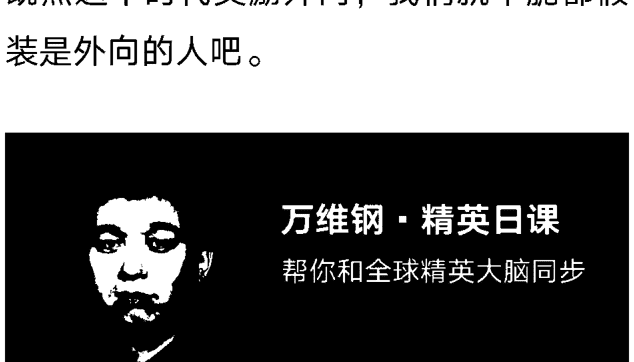

## 特别放送 | 关于“智商”那些事

万维钢

咱们课经常提到“智商”、“智慧”、“聪明”，今天就来帮你做个总结。辨析清楚“智商”这个概念，或许能帮你成为一个聪明人，或者帮你辨别出身边的聪明人。

1. “智商”，是一个人的认知能力。比如说逻辑推理、模式识别、短期记忆力这些与积累了多少知识关系不大的，但是能反映大脑的运算水平的能力。

### 关于“智商”那些事

智商跟智慧不一样。智商主要与人人的差异，而智慧是可以学的。

智商，都需要什么能力？你得对周围环境非常敏感，能从一个更大的视野中观察到问题；你得有灵活性，能同时考虑不同方面的现状；你懂得自知之明，承认自己的认识是有限的，这个能具体地看事情的分析能力，对个人生活环境来讲，比智商更有用。

2. 心理学家已经做了无数的研究，早就是达成了共识，存在一个“一般的因素”，直接决定每个人在所有领域的表现。这个“一般的因素”，心理学家称之为“g-因子（g-factor）”。用智力测验的方法可以测量每个人的g-因子，这就是智商。

### 关于「智商」那些事

为什么德国能生产高精密设备，而阿根廷就不行？德国强的不仅仅是一两个厉害的工程师，而是全体工人都厉害。高手和高手配合出来的结果就是高水平。

为什么年轻人都不愿意去北上广深？就是因为大城市的工作更高端，合作水平更高，说白了也就是人的素质更高吧。

一个国家最宝贵的资源，不是土地，不是海洋，不是石油矿藏，也不是机器厂房，而是人！

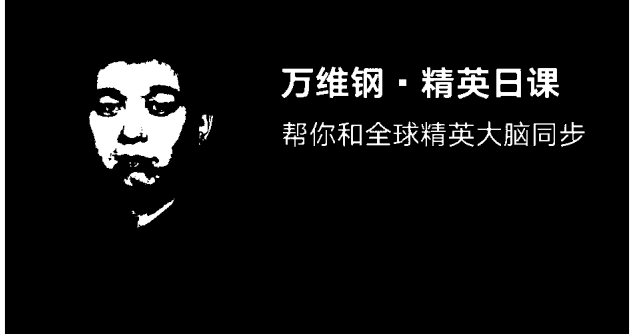

## 日课208 | 从“迷之自信”到“自我关怀”

今天咱们继续说埃里克·巴克尔的《破解成功学的迷思》。

这本书的主题是“成功”，但其中很多道理可以说是生活和工作的一般规律。我们一直在强调一个道理，就是要把一件事情做好，你常常要在互相矛盾的两个选项之中寻找一个微妙的平衡点，什么东西都是过犹不及。

今天我们再说一个比较矛盾的东西：自信。

### 1.迷之自信

1997年，《美国新闻和世界报道》杂志搞了一个调查：在当世的名人之中，你认为谁配得上死后进天堂？结果各名人都获得的支持率都一般。

当时的美国总统克林顿，读者对他进天堂的支持率只有52%；迈克尔·乔丹的支持率是65%；特蕾莎修女（Mother Teresa）是世界公认的好人，而且还是个宗教人士，她的支持率也只有79%。进天堂不是上大学，没有名额限制，可是世人对这些名人的要求就这么严苛。

但是有一个人，获得的进天堂平均支持率高达到87%——这个人就是“我”。也就是说每个参加调查的人自己。绝大多数人认为自己比克林顿、乔丹和特蕾莎修女更应该进天堂。

这就叫“过度自信”。有个著名的说法说，90%的人都认为自己开车的水平是在平均水平之上——而“平均水平”的定义是50%！

### 2.卡斯帕罗夫的教训

关心围棋的人今年都被刷新了世界观。AlphaGo先赢了李世石，刚刚又赢了世界排名第一的柯洁。当然AlphaGo的确厉害，据说能让人类棋手三个子。但我读这本书之后有个感觉，人类棋手面对人工智能，可能没有发挥个人最佳水平——因为你已经有点不自信了。

这是一个关于控制感、自信和胜负的故事。


### 3.你一个练太极神功的，怎么就真敢跟人打呢？

有些场合不自信是不行的，比如说演讲，装也得装出自信的样子，可能装的次数多了就真自信了，正所谓“fake it till you make it”。

但演讲本来就是一种表演。那么如果一个 CEO，明明没有多大本事，还故意在员工面前装得很厉害的样子，那 saison 等于骗人了。最大的危险在于，装来装去容易把自己也给骗了。

《怪诞行为学》的作者丹·艾瑞里，做过一个实验。让受试者在一个单独的房间里做测验，答对多少题有奖。实验故意设计成让受试者有作弊的机会，而受试者不知道的是，所有作弊行为都没逃过研究者的眼睛。研究者关心的不是有多少人作弊，而是作弊的人对自己有什么评价。做完题，每位受试者都要填写一张自我调查表，评估自己的水平到底怎么样。

结果发现，那些作弊的人，对自己的评估都还很好，他们真的以为自己很厉害！难道你不记得自己刚刚作弊了吗？！

这是因为人处理不好“假装”。就好像演员一旦入了戏，自己都会被剧情感动一样，人在一程度上会以为自己假装的是真的。作弊者假装厉害，结果他们就真的以为自己很厉害。

这就非常危险了，而且还是个普遍现象。

### 4.自我关怀

美国过去曾经流行过“自尊（self-esteem）”教育，让人自己看得起自己，差不多就是不自信的时候假装自信。但是后来很多研究发现，人为的自尊有很多弊端，正如前面说的自己骗自己。

- 1. 鼓励自己。还记得咱们上次说过海豹突击队的经验，能坚持下来的人都善于给自己鼓励。你要像你奶奶一样，用特别温和的语气跟自己说话；
- 2. 接受自己。你并非无所不能，只是一个普通人，普通人都会犯错；
- 3. 面对错误。你要承认这是一个错误，但这个错误不是世界末日，只要吸取教训就行。

### 由此得到

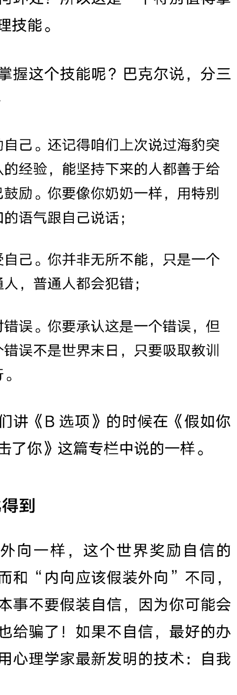
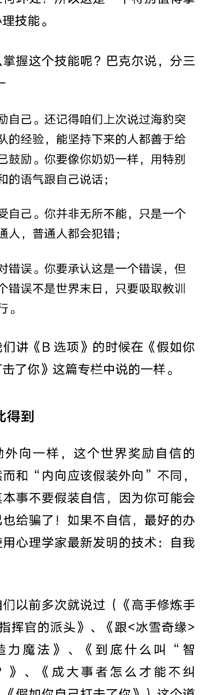

## 日课209｜谈资比名牌包贵的社会

日课209｜谈资比名牌包贵...

咱俩假设一个场景。在一个聚会上，你跟两位年轻女士聊天。其中一位女士拿的包看起来上去挺一般，但是谈吐不俗，居然引用了上周《经济学人》杂志对英国大选的分析。第二位女士的包一看就是名牌，但她更关心电视剧《欢乐颂》里的某个人物的命运。

那你能不能判断，这两位女士谁的社会地位更高呢？

在中国可能不太好判断。第一位女士显然更有文化，也许是某个大学的青年教师。可 第二位女士的经济状况可能更好，也许是银行的什么经理。作为读书人，我们更同情第一位女士，但二人地位高低，很难说。

但是，如果是在今天的美国，答案就非常简单了——肯定是第一位女士社会地位高。不仅仅是学识，我们甚至可以断定，她的经济状况也大大超过第二位女士。

这可不是因为美国是个公平社会，有知识的人地位一定高——因果关系正好相反：今天的美国是个非常不平等的社会，知识很贵，是只有社会地位高的人，才有知识。

今天我们说的这篇文章是Aeon网站上六月7日的一篇文章，题目是《炫耀性消费已经结束了，现在都是无形消费》（Conspicuous consumption is over. It’s all about intangibles now）。作者是南加州大学的公共政策教授伊丽莎白·科瑞德-霍凯特（Elizabeth Currid-Halkett），我们就叫她科瑞德吧。

科瑞德刚刚出了一本新书《小事物之和：一个关于有抱负阶级的理论》（The Sum of Small Things: A Theory of the Aspirational Class）。科瑞德使用了几个名词，我们先来解释一下。

所谓“有抱负阶级（aspirational class）”，在美国相当于中产阶级的上层或者更高。科瑞德的理论是，现在这个阶级已经取代了过去的“有闲阶级”，是新兴的精英阶层。

## ｜我的评论

说过这篇文章，我却不好意思再在专栏里说《经济学人》和《纽约客》杂志上的内容了。别人可能以为咱俩了解这些东西都是为了炫耀…

## ｜由此得到

过去十几年来，美国富人的消费习惯发生根本转变，从“炫耀性消费”转为“无形消费”，从购买高档商品转为购买文化资本。而对一个想要提升自己社会地位的中等收入者来说，文化资本越来越贵，绝对不是好消息。

## 日课210 | 谁愿意嫁给爱因斯坦

今天咱们继续说埃里克·巴克尔的《破除成功的迷信》。今天还是一个两难选择：工作和生活。

这是一个非常普遍的问题。你稍微工作忙一点，父母和朋友就会劝你不要太忙了，要好好吃生活。你听这个话的时候，有没有一种感觉，这些围观群众是不是有点站着说话不腰疼？

比如一个高水平医生，每天做几台手术，还要搞科研，还做一些行政管理工作，肯定是非常忙。像这样的人，劝他休息、多陪陪家人，有意义吗？这么简单的道理难道他不懂吗？

问题就在子，这个道理并不简单。

### 1.工作狂的道理

泰德·威廉姆斯（Ted Williams）是美国历史上最伟大的棒球运动员之一，他成功的秘诀是从小就用超长的时间猛练。正常人的事物，什么娱乐、休息、社交，他全都不要，在职业队成名以后才有了第一个女朋友。


威廉姆斯的了不起之处还不只是棒球。他二战期间去服兵役，在海军陆战队当战斗机领航员，他是最好的士兵。回来继续打棒球，还是最好的运动员。他职业生涯特别长，一直打到41岁。他退役之后当球队经理，管理得特别出色，又成了最好的管理者。他的业余爱好是钓鱼，玩得特别专业，结果入选钓鱼名人堂。

威廉姆斯干每一件事都力求完美，不但投入很多时间，而且都是高质量的刻意练习时间。

像这样的人，你拿什么跟他竞争呢？

这是一个普遍现象：最厉害的人同时也是工作量最大的人。有人做过调查，每个领域里，基本都是10%最强的人干了这个领域80%的工作。比如学术界，大部分最重要成果是少数科学家做出来的。

有些围观群众以为，高水平工作要使“巧劲儿”，只要你干活聪明，就不用花这么长时间，对吗？错了。真正的高手就没有不聪明的。有什么工作诀窍要是好使，肯定所有人都会这么用。现在的共识是，想要成为高手，你的智商必须要达到120——而只要达到120，再高的智商意义就不大了，剩下的就是比谁的身体好，谁能投入更多能量，谁有足够耐力坚持下来。

我上大学的时候到数学系听过一位名师的课。那个老师很实在，他有一次在课堂上说，想当数学家，你得有连续作战的能力。如果熬夜打了一晚上麻将，第二天早上就不能精神抖擞地工作的话，那你就别干了。

古老的人以空闲时间多为荣，现在这个时代的人以忙碌为荣。底层员工每周工作标准40个小时，高管人员常常要工作60小时以上，还都是主动的。特别能挣钱的人，往往没什么时间花钱。

那这帮人图啥呢？高强度的工难道不累吗？工作累不累，取决你干的是什么工作。

沉迷于电子游戏的人没有抱怨苦和累的，而好工作就好像游戏一样有意思。很多研究表明，如果你干的工作对你特别有意义，长时期的高强度工作就不但不痛苦，反而是幸福感最强的活动。所谓“有意义”，心理学家发明一个概念叫“个人特征强项（signature strength）”，也就是特别适合你的工作领域——两个标准：1）你必须觉得这个工作很重要；2）你必须非常擅长这个工作。长期跟踪研究表明，做这样工作的人，连寿命都延长了。

事实上，真正打击人的不是“工作”，而是“失去工作”。有研究表明，失业对人的打击是巨大的而且是永久的。一旦失业，人过早死亡的概率就能提高2/3。精神很痛苦，哪怕后来又找到新的工作，一想起来当初失业还是受不了。退休也是一大杀手，工作的时候本状态很好，一退休各种病都来了。

我们在《极端式成功者》这期专栏讲过埃隆·马斯克的事迹。据他前妻说，什么睡眠不足、飞行时差、精神疲劳，这些症状在马斯克身上司空见惯，但是他乐此不疲。

因为马斯克是干大事儿的人。那么问题来了。你是干大事儿去了，你的家人怎么办呢？

### 2.爱因斯坦的家规

马斯克的前妻是个作家，也是个厉害人物……这大概就是为什么俩人离婚了。那么作为牛人的妻子，如果主动承担家务，甘愿无私奉献，这行不行呢？我们可以考察一下爱因斯坦的事迹。

爱因斯坦需要长时间的专注思考，你可以想象，他大概没有多少时间陪家人。实际上爱因斯坦做得更极端，他基本把自己的妻子当成雇员——他的原话是“我的妻子就是我的雇员，只是我不能解雇她而已。”

爱因斯坦给妻子制定了若干条“家规”——


家规的全文在上图。作为一个男人和一个曾经的物理学家，我佛爱因斯坦的物理成就我做过梦——但是他搞的这些家规，我连做梦都不想梦到。

都不敢想。其中有几条是这样的：

你要放弃要求我陪你待在家里，放弃要求我陪你外出旅行；

如果我让你别跟我说话，你必须马上停止说话；

如果我让你离开我的卧室或书房，你必须马上离开。

爱因斯坦的妻子接受了这些规定。但后来爱因斯坦还是跟她离婚了，因为爱因斯坦要和另一位女子在一起。两个儿子小的时候，爱因斯坦曾经帮忙照顾过，长大就完全不管了。爱因斯坦的大儿子得了精神病，在精神病院住了三十年，一直死在那里，这三十年间爱因斯坦一次都没去看过他。爱因斯坦的小儿子曾经跟记者说，我爸爸对科学项目都能坚持，而我，可能是他唯一放弃了的项目。

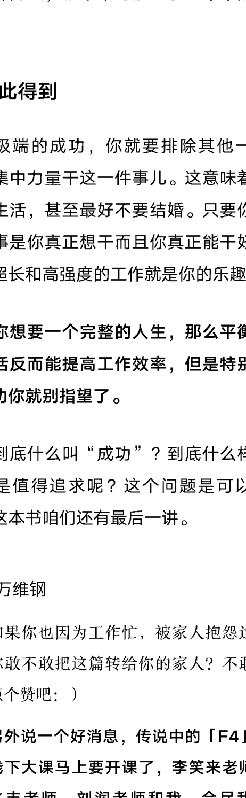

有人做过调查研究，特别厉害的高手，天才式的人物，大多对家人不管不顾。莫扎特的妻子生孩子的时候，莫扎特在另外一个房间继续做曲。

那如果这些人良心发现，选择多陪陪家人，会怎么样呢？答案是他们的工作生产力将会下降。

有个针对男性的研究发现，科学家、作家、音乐家、画家，甚至犯罪分子，都是结婚就不行了。比如科学家，从结婚那年开始，出论文的数量和质量就会下降。而他那个不结婚的同事，哪怕年龄变老，只要不结婚，就可以一直维持很高的产出。

我物理生涯中最佩服的一位物理学家，就没有结婚。他是个意大利人，有时候把妈妈从意大利接到美国来照顾他的生活。我在洛斯阿拉莫斯——就是美国最初搞原子弹的地方——给他当过两年多博士后，那是我工作效率最高的两年。他手下有很多学生和博士后，但科研亲力亲为，新想法层出不穷，产量极高。我们白天工作，晚上还经常几个人一起吃饭，继续讨论物理学和“国家大事”。后来我离开了遥远的洛斯阿拉莫斯，回到文明世界结婚生孩子，就很少有机会跟物理学家吃晚饭了。

极端的成功需要极端的做法，这就意味着很大的牺牲——而且牺牲的都不是自己，而是亲人。

但是如果我不想成就什么伟大事业，我也不是爱因斯坦，我就想老老实实做个普通人，那我能不能实现工作和生活的平衡呢？那当然可以。

### 3.平衡

如果你放弃追求极端的成功，那么保持工作和生活的平衡，反而对你的工作是有好处的。比如研究发现，给小孩子充分的时间玩，他的学习效率会提高。学习成绩特别好的孩子可以同时也是爱玩的孩子。

我们之前讲过创造性思维，创造性思维常常就是在特别放松的情况下获得灵感。很多人是在洗澡的时候获得灵感，就是因为洗澡的时候人非常放松。

睡眠很重要。睡眠充足的人，记忆力、反应速度、学习和工作效率都会更好。超长的工 作时间其实并不好。有研究发现，如果你每周工作时间超过55个小时的话，那么从第55小时以后的那些时间，其实是没有什么产出的，这个活儿还不如不干。

所以你需要玩闹、有点幽默感、充分的休息、多留出点时间跟家人在一起、时不时出去度个假，这样还可以获得最佳工作状态。

而且使巧劲儿也是可以的。《怪诞行为学》的作者丹·艾瑞里跟巴克尔说了一个经验。对于大多数人来说，早上起来过一个小时之后开始工作，连续工作两个半小时，是最佳工作时间。如果你七点起床，那么从八点到十点半，就是你精力最充沛、效率最高的时间段。那么最简单的办法就是把最重要的工作放到这个时间段，然后剩余的时间完全可以放松。

而这一切的一切的前提是，你想要一个更完整的人生，而不是一个极端的成就。像马斯克这样的人，根本不可能过了上午十点半就放松。

## ｜由此得到

想要极端的成功，你就要排除其他一切干扰，集中力量干这一件事儿。这意味着牺牲家庭生活，甚至最好不要结婚。只要你干的这件事是你真正想干而且你真正能干好的事儿，超长和高强度的工 作就是你的乐趣。

如果你想要一个完整的人生，那么平衡工作和生活反而能提高工作效率，但是特别极端 的成功你就别指望了。

那么到底什么叫“成功”？到底什么样的人生才是值得追求呢？这个问题是可以讨论的，这本书嘁唔还有最后一讲。

万维钢

如果你也因为工作忙，被家人抱怨过，那你敢不敢把这篇转发给你的家人？不敢的就点个赞吧：）

另外说一个好消息，传说中的「F4」上海线下大课马上要开课了，李笑来老师、薛兆丰老师、刘润老师和我，会尽我们所能，帮咱们得到的读者做一次重点串讲，帮你打通知识之间的连接，收获相对完整的知识体系。遗憾的是我在美国没法亲自去现场，只能写好稿子，做好PPT，拜托罗胖在当天帮我讲给大家听，我相信他肯定比我讲得好。这个课程今天在咱们专栏首发，点击下面的图片，你还能了解更多。

替罗胖说声：上海见：）


## 日课211｜面对两难选择，最好量化决策

日课211｜面对两难选择...

这段时间讲《破除成功学的迷信》这本书，我们一直ggggggg在讲“两难选择”。面对两个矛盾的选项，坚决选择其中一端，可能不是最好的，也许最好的办法是在二者中间的某个地方找一个点。这个点在哪里呢？今天我们说一个可能是最高级的办法。

假设你是政府部门中负责发放科研经费的官员。国家把很多钱交给你，现在你要把这些钱分给全国的科学家。你的目的，是想用同样多的钱，带来最多最好的科研成果。当然，每个项目课题报上来，科学家之间要同行评议，你不能独断专行。但你手里肯定也有一些灵活性 —— 要不怎么叫权力呢？

比如说，把经费给那些成名的科学家，应该是比较稳妥的，他们的能力已经被证明，肯定会有好成果出来。但是我们知道，现在人们对科研经费发放的一个批评就是少数人手里集中了太多的资源。比如一个中科院院士能拿到很多很多项目，所有工作可能都是他实验室里的徒子徒孙做的，他本人究竟能参与多少呢？就算你的实验室人多，也不能什么都给你吧？而对比之下，大量刚出道的青年科学家却申请不到经费。

所以，把经费给老院士，还是给青年科学家，这就是一个矛盾。院士能在一定程度上保证出成果，但是他们的资源已经太多难免浪费；青年还没有证明自己的能力，比较有风险。这个矛盾怎么解决呢？

这个时候不能讲“理念” —— 说我就算认为老院士/ cup？或者我认为青年有希望，那都是“你以为”。科学决策，最好能有点量化思维。“量化”，就是要在老院士和青年之间寻找一个“度”。

今天我们要说的是《科学》杂志六月七日的一篇报道，“NIH发现大实验室不一定更好，但招致了抨击”（Critics challenge NIH finding that bigger labs aren’t necessarily better），作者是乔斯林·凯泽（Jocelyn Kaiser）。

NIH（美国国立卫生研究院）是美国政府仅次于国防部的第二大科研部门，它每年的运营经费超过300亿美金，其中一大半要作为科研经费发放给科学家使用。我们可以看见，NIH 必须有一个科学的经费政策，而且它值得为这个政策做深入研究。

现代的科研制度，是“PI（principal investigator，课题责任人）”负责制。PI 是人而不是机构，可以是资深的老院士，也可以是刚出道的青年研究员。政府把科研经费发给 PI，PI 用这个经费招兵买马，手里有多少钱，就可以招多少个学生和博士后。最多的话可能是手下的人干的，但 PI 要参与到研究中去，他提供指导意见，对整个项目负责。

高水平科学家有很多研究想法，要让他发挥水平，最好的办法就是多给他几个项目的经费，让各个项目同时进行。但是人的精力总是有限的，你不太可能同时指导30个人。所以 NIH 就想了解一个问题：一个 PI，最多能干几个项目？

为此 NIH 搞了一个自己的研究。直接用钱来衡量项目多少可能不太科学，所以 NIH 发明了一个指标，叫“经费支持指数，GSI”。具体说来，一个历时五年、每年经费25万美金的大项目，GSI 算7分，小项目酌减。

衡量 PI 的产出也不能只看发了多少篇论文，还得看这些论文的影响力。NIH 发明了一个指标叫“加权相关引用率，RCR”，根据每个 PI 的实验室每年发表多少论文，这些论文被引用的情况，综合评分。

简单说来，NIH 想知道给你一定的 GSI，你能产出多少 RCR？通过考察旗下 71,493 个 PI 过去20年的平均表现，NIH 得到了下面这张图——


图中曲线上的每一个点都代表一个 PI。横坐标是这个 PI 拿到的 GSI，也就是项目情况；纵坐标是这个 PI 的 RCR，也就是科研产出。注意，这张图的纵坐标是对数坐标。

我们从左往右看，一开始的时候，是项目越多，成果就越多。这非常合理，应该是多给 PI 钱，让他多招一些人，形成规模效应，充分发挥水平。

但是到 GSI 达到21，也就是相当于三个大项目的时候，PI 的产出就顶了。再给他更多的项目，让他继续扩大实验室规模，他并不会给你更多的科研成果。当然，继续往上，每个 PI 的表现差异很大，曲线有不确定性，但总体而言，三个大项目似乎是个合理的封顶。

这就是“度数”。院士再厉害，给他的钱也不是多多益善，那么到底给多少合适？现在有答案了。

据此，NIH 决定，给每个 PI 的经费支持最多就到21个 GSI。NIH 测算，这个新政策会削减占全體 PI 总数的3%的大 PI 的经费，然后他们用这些经费可以支持900个新项目——NIH 将会把这些新项目给青年 PI。

而《科学》杂志这篇报道说，NIH 这个新政策引发了一些大 PI 的不满。有人说不应该<|start|>一刀切，也许有的 PI 就是效率高。有的说这个指标设计的不科学。有的说你这研究只是发现了相关性，而相关不等于因果……

但 NIH 不为所动，必须执行。NIH 的一个理由是哪怕青年 PI 真的的不如大 PI 厉害，我们也要支持，因为大 PI 少几个项目还可以继续搞科研，可是有青年科学家没钱就得离开科研行业了。

## ｜我的评论

咱们看看 NIH 的决策过程和反对者的批评意见，其实都有道理。矛盾还是这个矛盾：大 PI 的潜能真的都发挥出来了吗？青年 PI 没了机会会怎么样？但是 NIH 这个做法，至少找到了一个度数：GSI = 21。

所有政策都是有缺陷的，你不管怎么分钱都会有人浪费、有人牺牲，但是按照这个度数走，可能就是最优解。

现在这个结论的确还有争议，但至少每个人都知道该争什么，大家有个落脚点。如果没有这项研究，说什么大 PI 厉害还是青年 PI 重要，都是空谈。

## ｜由此得到

真正的决策往往都是在矛盾中选择一个最优解，过犹不及。空谈的人可以大谈“理念”，而决策者需要的是“度数”。为了获得精确度数，我们需要的是量化思维。

NIH 是个美国的科研部门，办事比较g有谱。那么别的政府部门，特别是其他国家的政府部门，在做重大决策的时候，有没有这种调查研究，甚至量化分析的精神，到底有多少是拍脑袋决策的成分，我们就不好说了。

万维钢

继续说这个好消息：7月15号，李笑来老师、薛兆丰老师、刘润老师和我，为咱们得到的读者准备了一场线下大课，我们四个准备给大家讲讲「我们眼中的大神」——就是那些影响过和照耀过我们的大师们。遗憾的是我在美国没法去现场，所以我已经写好了稿子，做好了 PPT，拜托罗胖现场帮我讲给大家，我也相信他比我讲得好。这个课程已经可以购买了，点击下面的图片，你还能了解更多。


## 日课212 | 蜘蛛侠套装

日课212 | 蜘蛛侠套装

今天咱们把埃里克·巴克尔《破除成功学的迷思》这本书讲完。

有人做过调查，从1976年到2000年，美国高中生的野心和期望越来越大，现在已经到了不可理喻的程度——每个人都以为自己将应该成为亿万富翁和大明星之类不起的人物。而等到他们大学毕业走向社会，就会慢慢失望，乃至非常愤怒。

人们曾经认为所谓“成功”是少数人的事，后来人们认为只要努力就人人能成功，而现在有的人看小明星的事迹看多了，认为不努力也有权成功。

成功不是天赋人权。成功也不是“有天赋”就有权。成功也不是什么埋头苦干命硬干就有回报的事儿。成功，是在一系列矛盾中做出艰难的选择。

你是做个好学生，与人为善呢，还是做个极端学生，与体制为敌？

### 1.共生体套装

咱们先讲个蜘蛛侠的故事。我们知道蜘蛛侠的力量来自他的一套红蓝色套装。

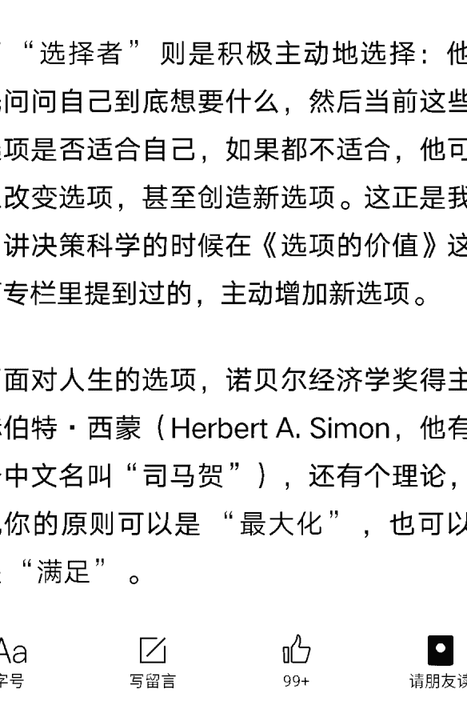

### 2.成功人生的四个维度

- 1. 幸福（happiness）：这里说的幸福就是生活中的乐趣和满足，幸福 = 享受；
- 2. 成就（achievement）：跟那些有相同奋斗目标的人相比，你取得了什么了不起的成就，成就 = 取胜；
- 3. 意义（significance）：你对你关心的人，有没有一个正面的影响，意义 = 可依赖；
- 4. 遗产（legacy）：你走了，你的价值观和成就，能不能给别人未来成功的铺平道路，遗产 = 延伸。

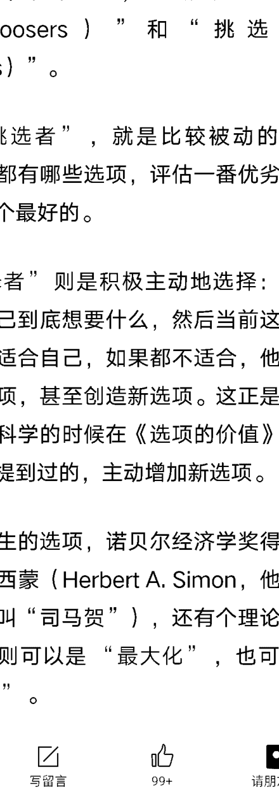

### 3.选择者和挑选者

现代人都有选择困难症。没有什么选项，我们该干啥干啥似乎活的也不错，有了许多选项，我们反而不知道怎么办。宝洁公司最多的时候曾经提供过26种不同类型的海飞丝洗发水，结果消费者无所适从。后来宝洁把种类削减到了15种，消费者反而更愿意买了，利润上升了10%。

是“满足”。

比如我们在前面《企业家精神和包办婚姻》中讲过，刚入职场的时候频繁跳槽的人，后来的收入高于那些找个公司就一直干下去的人。前一种人的原则就是“最大化”，所有选项我都尝试一遍，看看哪个最好我就选择哪个。但我们上次没说的是，这个研究还有个坏消息。前一种人的收入的确比后一种人平均高了20%，但是幸福度却更低——因为他们永远这山望着那山高，总觉得自己当前拥有的不是最好的。而后一种人比较容易满足。

现在我们对做选择有了两个考虑：你是做“选择者”还是“挑选者”？你是做“最大化”，还是“满足”？

那么具体到成功的四个维度，最好的办法，是做个积极主动的“选择者”，以我为主调整选项，对某些选项采取“满足”策略。

比如说，如果你要追求极端的成功，那么你可以对“幸福”和“意义”采取满足策略。这就意味着你对物质享受没有太大要求，偶尔度个假、一年看两场电影就可以了。你对亲友也不能承担太多责任，有时间就陪陪，没时间就不陪了。你没有什么丰富的业余生活，也不是个好家长，但是你对此满意。然后你集中精力，追求“成就”和“遗产”。

“满足”提供了一个自我限制，有了限制，决策就容易。

所以说来说去，成功不是算法，而是选择。是你自己想做个什么样的人。当然你的选择可以随时调整，不过一定得是“你的”选择。

### 由此得到

经常有人问，说我的条件是这么这么样的，我还能成功吗？这种问题没意义。成功不在于你手里*有什么，而在于你愿意*付出*什么——或者更准确地说，是你愿意*放弃*什么。人生的成功有四个维度，每个人可以自由选择自己想要什么样的成功。而选择的关键词在于要主动。

## 一个彩蛋

最后我想再来一段励志的。我想介绍一位著名计算机科学家，叫理查德·汉明（Richard Hamming）的经验，看看他是怎么选择的。


汉明是1998年去世的，他在1986年，也就是71岁的时候，曾经做过一个演讲，题目是“你和你的研究”（You and Your Research）。这篇演讲流传极广，没有什么场面话，全是真知灼见。演讲中有一段，跟咱们今天的内容很有关系。

汉明说，他年轻的时候非常仰慕一位同事，叫约翰·图基（John Tukey）。汉明认为图基的水平比自己高很多。有一天，汉明偶然发现，图基的年龄居然比自己小！他就有点受不了了，就去问另一个同事，说我到底怎么做，才能变成那个人那样？

这位同事说，你要是也能像图基那样连续多年那么努力地工作，你根本想象不到你能做出多少东西来。

汉明言下顿悟。这个道理是“知识和生产力是一种复利”。

如果你干一般的话，你每天比别人多搬10%的砖，一年下来你还是比别人多搬了10%的砖。但是钻研知识可不是这样。

汉明说，你知道越多，学的就越多；学的越多，能做的事就越多；做的越多，机会就越多。这是一个正反馈过程，就好像投资一样，是利滚利。

如果你每天比别人多钻研10%，那么日积月累，你的成就就会远远超过他。

如果存钱的利息这么高，你还愿意随便花钱吗？所以汉明说：“我不会当着妻子的面说这个，但我有时确实忽略她了。我得钻研。”

汉明从不掩饰自己对青史留名的渴望。他说科学家成功的唯一标准就是你的名字能不能被以小写的形式命名某个概念——事实上他做到了，计算机科学里有个“汉明码”。

那么这个最后的道理就是如果你想学汉明从妻子那里克扣时间，记住别用这宝贵的时间打《王者荣耀》，最好用在“得到”……啊不是，是用在能产生复利的事情上。

Ω本期推荐阅读，戳此
日课162 | 心理学黑客路的实战应用
日课176 | 《决断》解读2：选项的价值
日课206 | 企业家精神和包办婚姻


## 答读者问 | “全美国最好的20所大学”，一共有⋯20所

用量化分析，求出最优解，使资源最大化使用。生活如如何用量化分析一件事过程的成本？

万Sir，有没有什么可以让我们快速入门的量化思维工具和方法，让我们这样的无法使用大数据工具的人也可以直接尝到量化思维的甜头。听了那么多AI和大数据的好处，我们这些小白难道只能眼巴巴流口水吗？

政府部门有能力量化，我们普通人怎么⋯量化？感觉这只是写给日课中的官员读者 Cal …

万维钢
这个量化判断的方法，是个非常高级的办法。NIH 做的是上百亿美元的决策，手里还有大量的数据，所以用这个方法特别适合。咱俩普通人搞量化的无非就是记账、搞搞时间管理，或者弄些健康数据之类，而这些项目都缺乏明确的反馈指标，所以我看意义不大。

但我们可以学习它的“精神”，这就是不预设观点，根据事实决定策略。在数据量比较少的情况下，画NIH那种曲线图不太现实，最好的办法就是一边试探一边调整。

日课211 | 面对两难选择，最好量化决策

看着长期高效的学习和高效的产出确实不是我这种追求平衡的人能轻易获得的。那么像万老师这种每天一篇“精英日课”这么高质量高频率的产出，是以什么做为牺牲的代价的呢？我还想说一点，养育孩子的过程虽然很消耗大人（ especially 母亲）的时间和精力，但是这也是大人的价值和意义所在，更是促使有拖负的父母们继续成长的动力。所以不论是极端的追求成功还是追求工作与生活的平衡，它们都有其存在的社会价值。每当夜深人静，看到两个女儿酣睡的表情，我心里就会涌起一股暖流，促使我白天更加努力地工作和学习。

万维钢
我是全职写这个专栏，本来就应该有这样的产出，算不上牺牲。非常赞同您关于孩子的说法！


这么认真了，其实对工作不是本身就应该认真吗？一方面我自己也能看得出来，自从妈妈做了这份超市的工作后，她真的开心了很多，也感到自己的人生更有价值感和意义感，工作中认识了新朋友，也在不断地学习新知识，有工作、有收入、有朋友的日子让妈妈过得很开心。她热爱这份工作，同时也擅长这份工作，平时也是尽力把工作都做到最好，所以我也要向她学习！只是老师，我们怎么能在做好自身工作后，敢于走出舒适区，走向学习区，进一步尝试和挑战自己呢？

### 万维钢

祝贺您的妈妈！我的纸上谈兵当然是“保金斯基三原则”，但针对具体情况，您妈妈可能比保金斯基更有发言权。

很想听万老师聊聊对极端成功的定义是什么？米歇尔·奥巴马作为美国第一夫人，她们家每周有五天是一家人在一起吃晚饭的，她自己也坦言道：“在第一夫人之前，我首先是一个母亲。”她的这种言行一致，也让大家对她充满好感。第一夫人也是成功的，但是她的家庭也很完美。

### 万维钢

我们最好不要拿美国第一夫人做榜样。奥巴马夫妇有很多人事供他支配使用，他们一家的生活每年花费纳税人14亿美元——对比之下英国王室一年才花费6000万。如果给你那么多钱，我相信你一定能保证跟家人一起吃晚饭，还能保证首先是一个母亲。

日课208 | 从“迷之自信”到“自我关怀”

《欢乐颂》被黑得好惨。像美国教育完全市场化之后，经济学家告诉我，再稀缺的商品，只要是好生意，就有人会参与进来，增加供给，让产品价格不要变得离谱。为什么这条经济学规律在美国不适用呢？是社会福利太好了，中低收入人群没有进入教育行业的动力？还是这个门槛已经让中低收入人群彻底无法进入了呢？

《熊逸书院》。这是我每天必读的专栏，我邀请你和我一起，跟着熊逸老师学习最高级的学问。


## 一年读通52本
思想经典

此内容归得到App独家专享，版权所有，未经许可不得转载，侵权必究。
合作请联系get@luojilab.com

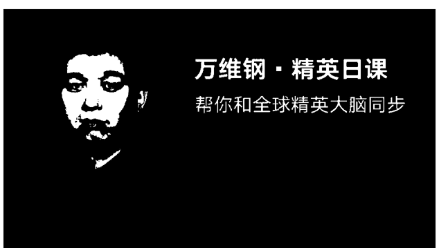

## 万维钢·精英日课

帮你和全球精英大脑同步

绩、大学毕业院校、是否在编程比赛中得过奖，这些“指标”和这个人的实际工作能力毫无关系。现在有越来越多的一流公司注意到了这一点，用一个或者几个简单数字来描写一个人，是不行的。

没有标准人，没有标准能力，甚至连所谓“性格”，现在都被证明也是不标准的。人，比我们想象的要复杂得多。

罗斯这本书，非常符合我们这个新时代的精神。像 Google、微软这些公司，已经开始尝试用新的方法录用和评价员工。传统的统计方法，包括现在非常热门的“大数据”，都开始被人质疑。罗斯并不孤独，2017年还有一本新书，Christian Madsbjerg 的 Sensemaking: The Power of the Humanities in the Age of the Algorithm（意会：人文学科在算法时代的力量），也在呼吁在这个时代我们应该“理解”人，而不是简单地“统计”人。

泰勒制那个年代的时代主题是“生产”，而我们今天的时代主题是“创新”。

你不可能用泰勒制管理程序员，或者任何但凡有一点创新任务的人才。标准化的教学大纲和分类考试不适合培养真正的创新人才。这个时代不再需要那么多工业品式的劳动力，我们需要的是有血有肉、有主见有个性的活生生的人。罗斯这本书，指向的是我们这个时代迫切需要的新指导思想。

### 万维钢

最后留个思考题：你能感受到，哪些领域的平均和标准已经开始不好使了，正在被个性和创新替代吗？欢迎在日课留言区举例和我们分享，在周四前获得点赞最多的20名读者，我会寄送一本《平均的终结》中文版签名书给你。不用着急写，多思考，多观察，留言不看标准，看个性。

## Ω本期推荐阅读

- 日课089 | 哪有什么“标准人”？
- 日课094 | 不规则人才
- 日课096 | 性格…到底是什么意思？
- 日课097 | 每条路都是少有人走的路

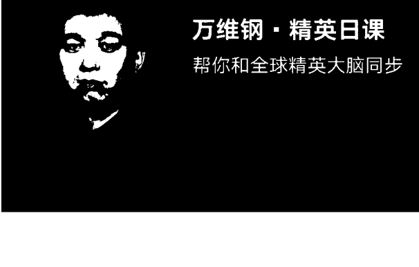

## 日课精选

提交留言可与专栏作者互动

## 周末小议 | 平均的终结：人不是工业品

万维钢

咱俩日课曾经讲过一本托德·罗斯的书《平均的终结》，出版社看到了咱俩的解读，以最快的速度把这本书引进到了中国，我非常荣幸地给这本书作了序。所以今天的内容，就是这本书的序言全文，我还是希望先让咱俩的读者第一时间读到，也帮你回顾一下这本书的主要思想。文末还有一个送签名书的小活动，邀请你参加。

## 人不是工业品

托德·罗斯的《平均的终结》，并不是一本科普书。罗斯使用了最新的科学研究结果，引用了前人的学说，考虑了历史，并不是为了“普及”一个什么旧思想，而是为了提出一个新思想。这个思想就是“人不是工业品”。

你可能觉得我这么说有点奇怪，人本来就不是工业品，这怎么是新思想呢？我也要说的是，过去上百年间，工业化成功的一个秘诀和整个社会发展的一个大势，就是把人变成工业品。所谓工业品，就是按照固定规格批量生产出来的标准化产品。我们“现代人”的一个文化特征，就是认为符合“标准”的，就是好、就放心了，一旦不符合“标准”，就非常担心。

## 日课213 | 幸运是这个宇宙的通行证


日课213 | 幸运是这个宇...

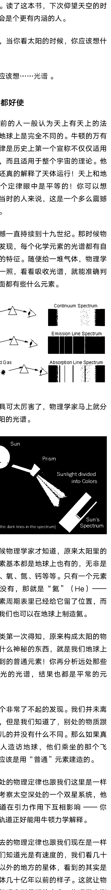

今天开始我们说一本新书，《给忙碌者的天体物理学》 《 Astrophysics for People in a Hurry 》。作者是一位天体物理学家，但他更著名的身份则是科普达人，有个拍得特别漂亮的系列纪录片叫《宇宙》就是他主持的，他就是尼尔·德格拉斯·泰森（ Neil deGrasse Tyson）。


“天体物理学”似乎是个有点不岁尴的题目，但是这本书目前在《纽约时报》畅销书排行榜排名第二！它是一本写给普通读者看的天体物理学。你整天忙着要成功，还要平衡工作和家庭！但是忙归忙，每个人内心深处，都想知道我们生活的这个宇宙到底是怎么回事。

宇宙是完全不可知的吗？我们可能是生活在一个电子游戏之中吗？物理学家对这个宇宙到底知道多少呢？

答案是很多很多。我们今天对宇宙的了解，跟一百年前、甚至几十年前都非常不一样。我们已经有很大的把握知道这个宇宙是怎么回事，而你也有权知道。

傍你仰望天空的时候，你会想到什么呢？你可能觉得理科生没有什么有趣，看到天空无非就是想“光谱”之类的物理学知识。文艺青年却可能想宇宙之博大和个人之渺小，想到真理，想到公平和正义……

但事实上，现代天体物理学比文艺青年想象的东西要丰富很多很多倍，也精彩很多很多倍。读了这本书，下次仰望天空的时候，你会是个更有内涵的人。

比如说，当你看太阳的时候，你应该想什么呢？

你首先应该想……光谱。

### 1.哪里都好使

牛顿之前的人一般认为天上有天上的法则，跟地球上是完全不同的。牛顿的万有引力定律是历史上第一个宣告不仅仅仅适用于地球，而且适用于整个宇宙的理论。他的理论还真的解释了天体运行！天上和地上在这个定律眼中是平等的！你可以想象，对当时的人来说，这是一个多么震撼的知识。

这个震撼一直持续到十九世纪。那时候物理学家发现，每个化学元素的光谱都有自己唯一的特征。随便是给一堆气体，物理学家拿光一照，看看吸收光谱，就能准确判断这里面都有些什么元素。


这个工具可太厉害了，物理学家马上就分析了太阳的光谱。


到这时候物理学家才知道，原来太阳里的各种元素基本都是地球上也有的，无非是氢、碳、氧、氮、钙等等。只有一个元素地球上没有，那就是“氦”（He）——不过元素周期表里已经给它留了位置，而且现在我们也可以在地球上制造氦。

这是人类第一次得知，原来构成太阳的物质不是什么神秘的东西，就是我们地球上也能找到的普通元素！你再分析远处那些星星发光的光谱，结果也都是平常的元素。

这是一个非常了不起的发现。我们并未离开地球，但是我们知道了，别处的物质跟我们这儿的并没有什么不同。那么如果真有外星人造访地球，他们乘坐的那个飞碟，也应该是用“普通”元素建造的。

而且别处的物理定律也跟我们这里是一样的。你考察太空深处的一个双星系统，他们的轨道在引力作用下互相影响——你一算，轨道正好能用牛顿力学解释。

而且过去的物理定律也跟我们现在是一样的。我们知道光是有速度的，我们看几十亿光年以外的地方的星体，看到的其实是那些星体几十亿年以前的样子。这就让物理学家能观测到早期的宇宙。物理学家测量很远很远的地方发来的星光的光谱，发现它们跟地球上元素的谱线完全一样，纹丝不差。这就意味着早期宇宙的原子物理学跟我们现在完全一样！更进一步，考察太阳发光的情况，物理学家知道引力常数（G）也从来都没有变过。

昨天、今天和明天，东方、南方和北方，这里、那里和所有地方，构成这个宇宙的物质和物理定律都是一样的！

对想要殖民太空的人来说这可能不是个好消息，这意味着你走到哪也开采不到我们认知范围以外的元素。

可是对物理学家来说这是个好消息——物理定律到处都管用，“普天之下莫非王土”。

既然如此，我们就可以用同样的物理定律计算……宇宙的起源。

### 2.宇宙的起源

物理学家的预测和计算结果是我们这个宇宙起源于137亿年之前的一次“大爆炸”。

我们已知的物理定律只能从宇宙起源10^(-43)秒之后开始起作用——这就是“普朗克时间”，也是咱们《精英日课》专栏的更新时间：晚上10:43分。物理学一共有四种基本相互作用：引力、强相互作用、弱相互作用、电磁相互作用。在普朗克时间之前，四种相互作用是统一在一起的，描述那样的状态需要把广义相对论和量子力学统一在一起，而这个工作现在还没做好。

从10^(-43)秒开始，引力就脱离出来，单独起作用了。那时候宇宙还是一个直径为10^(-35)米的一个小点，但温度无比的高。

到10^(-35)秒的时候，强相互作用和“弱电相互作用”分开了。到稍微更晚的时候，弱相互作用和电磁相互作用分开了。

到一万亿分之一秒的时候，宇宙里有了粒子——夸克和轻子已经出现了。电子就是我们最熟悉的“轻子”。这时候宇宙里有夸克和电子，还有反夸克和反电子。2012年的时候，物理学家知道，在当时那个高温条件下，夸克和电子都可以自由行动，宇宙就好象是一锅夸克轻子汤。

这锅汤里的主要活动是正反物质的产生和湮灭。夸克和反夸克，电子和反电子一旦相遇就会湮灭并且释放两个极高能量的光子，而在这个时候宇宙的高温之下，光子又会再产生正反夸克和电子。一个正电子刚刚产生之后，又马上跟另外一个电子相遇，又湮灭成光。


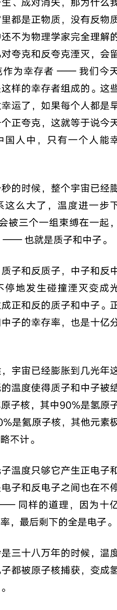

这是一个非常有意思的机制。如果正反物质总是成对产生、成对消失，那么为什么我们现在的宇宙里都是正物质，没有反物质呢？出于某种还不为物理学家完全理解的原因，每十亿对夸克和反夸克湮灭，会留下一个正夸克作为幸存者——我们今天的世界，都是这样的幸存者组成的。这些幸存者实在太幸运了，如果每个人都是早期宇宙中的一个正夸克，这就等于说今天活着的全体中国人中，只有一个人能幸存！

到百万分之一秒的时候，整个宇宙已经膨胀得像太阳系这么大了，温度进一步下降，夸克们会被三个一组合缚在一起，形成“重子”——也就是质子和中子。

但与此同时，质子和反质子，中子和反中子之间也要不停地发生碰撞湮灭变成光子，光子再生生成正和反的质子和中子。正物质的质子和中子的幸存率，也是十亿分之一。

到一秒的时候，宇宙已经膨胀到几光年这么大了。更低的温度使得质子和中子被结合在一起形成原子核，其中90%是氢原子核，剩下的10%是氦原子核，其他元素极少，都可以忽略不计。

这个时候，光子温度只够它产生正电子和反电子，但是电子和反电子之间也在不停地发生湮灭——同样的道理，因为十亿分之一的幸存率，最后剩下的全是电子。

等到宇宙年龄是三十八万年的时候，温度低到让所有电子都被原子核捕获，变成氢原子和氦原子。

到十亿年的时候，这些原子在引力的作用下结合在一起，就会变成恒星，然后这些恒星又会组成星系。那个时候，我们已经有了一千亿个星系，每个星系里面会有几千亿个恒星。

其中有些比太阳大十倍的恒星，在高温高压之下，可以生产一些更重的元素，比如氧和碳之类。这些恒星最后会爆炸，重元素被传播出来，散布在整个宇宙之中。正因为这样，今天我们才会有这些重元素，否则宇宙中几乎全是氢和氦。

又过了九十亿年，在宇宙中某个不起眼的地方产生了一个不起眼的恒星，这个恒星就是太阳。太阳所处的位置正好有很多重元素构成的气体，这些气体在引力作用下慢慢聚集在一起，形成了行星。

其中某一颗行星，距离太阳不远不近，正好允许液态水的存在，这个行星就是地球。此后又经过无数机缘巧合，地球上有了生命，生命演化，最后终于有了你。

有个著名的说法说，我们每一個人都是一个亿分之一的幸运者。这是因为当初精子和卵子结合，是一个亿个精子中只有一个最终能进入卵子形成受精卵，在这场竞争中，我们每個人都打败了一亿个精子。

但是你想想宇宙的起源！我们的幸运度其实实这要严重要得多——构成你身体的、你周围环境的每一个原子，都是这么幸运。每一个原子身上的每一个质子、中子、电子，都是正反物质湮灭中十亿分之一的幸存者！

### 我们能有今天难道不是奇迹吗？

不过，如果你是天体物理学家的话，你会更幸运。

### 3.天体物理学家的礼物

比“存在”更幸运的是，我们不但存在，而且还可以回过头来*理解*这个宇宙。大爆炸不但创造了宇宙，而且还给天体物理学家留下了一个礼物。

## 这个礼物就是“微波背景辐射”。

前面说了，原子是在宇宙年龄是38万年的时候形成。在此之前的宇宙你就算去了也看不远，因为温度太高，光子随时都会被电子碰撞，走不远。

从那个时候开始，光子终于自由了。它们在宇宙中飞翔，一直存在到今天。随着宇宙膨胀，这些光子的能量变得越来越低，到今天它们steil

1948年的时候，几个美国物理学家使用三个理论，预言了微波背景辐射的存在。这三个理论是——

1. 1916年爱因斯坦提出的广义相对论；
2. 1929年哈勃发现宇宙正在膨胀；
3. 二战前后，美国为搞原子弹的曼哈顿计划中一系列原子物理实验结果。

他们仅仅利用这三个知识，就推算出来，“宇宙微波背景辐射”的温度应该是5°K。

到1964年，两个贝尔实验室的工程师偶然测量到了“宇宙微波背景辐射”——现在最精确的结果，这个温度应该是2.72°K。

这是物理学的伟大胜利！你想想，当初我们用了三个在地球上出现的物理知识，只用一个模型去推演宇宙应该起源于大爆炸，然后算出这个大爆炸有个温度是5°K的遗迹……然后你找了找，居然居然找到了这个遗迹，而且数值相差不到两倍？！

有个天文学家形容，这就好比你坐在房间里算出，说某月某日将会有个直径50英尺的飞碟降落在白宫草坪——而到了那一天，居然真有个飞碟降落在了白宫草坪，只不过飞碟的直径不是50英尺，而是27.2英尺——飞碟城来就是奇妙了好吗？！


更庆幸的是，宇宙中遍布一种叫做“氰”（符号是CN, cyanogen）的气体分子，这个分子受到微波辐射会被激发。物理学家从它被激发的情况，就可以帮助断宇宙微波背景辐射在各处的温度有什么细微的差异。

现在借助卫星观测，天文学家可以精确绘制整个宇宙的微波背景辐射地图——


我们看到，这张图并不是完全均匀的。“宇宙微波背景辐射”带来的，是宇宙刚刚产生38万年时候的信息。我们可以据此推测当时的物质在宇宙的分布情况。再根据这一点，我们就可以推测宇宙现在的物质是怎么分布的，宇宙的未来将会怎么演变。

泰森说，正因为有了“宇宙微波背景辐射”这个东西，天文学才变成真正的科学！现在你有任何理论模型，都可以计算一番去跟微波背景辐射信息做个比对，验证不了就只能淘汰。宇宙学成了精确科学！

### 由此得到

过去这一百多年间，物理学家做了非常了不起的事情。我们通过地球上得到的物理学，居然能精确定解这个宇宙的早期是怎么回事。以人类的生存偏见眼光去看，这个大历史的主题应该是幸运——我们经历的是动不动就十亿分之一的中奖机会。

今天说的是宇宙这么动人的故事，我想学学和菜头，来个“神定时刻”——

## 神定时刻

因为微波背景辐射的存在，宇宙中最旷最空旷的地方，也不是完全冷的绝对零度，至少有2.72°K的温度。你知道宇宙中最冷的地方在哪吗？就在我家附近。

从我家开车走25分钟，就是科罗拉多大学物理系。其中有个实验室，为了研究玻色-爱因斯坦凝聚，物理学家在里面制造了比宇宙微波背景辐射还低的温度。

现代物理学就这么厉害。但是这个厉害的背后是庆幸。

如果正反物质湮灭没有十亿分之一的幸存率，那上帝创造宇宙的时候说完“要有光”……也就只能有光。如果没有大恒星生产重型元素，宇宙中就只能有氢和氦。如果没有后来的一系列“如果”，我们就不会站在这里仰望天空。

如果微波背景辐射在今天测不到，如果物理定律和物质在别处跟在我们这里不一样，如果元素光谱没有那么简洁漂亮的性质，我们就不可能理解这个宇宙。

所以泰森有句名言：“这个宇宙根本没有义务让你理解。”

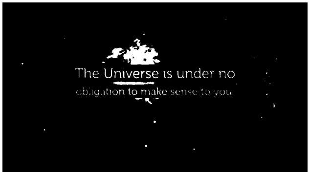

所幸的是宇宙还是给物理学家提供了“知识服务”。我们今天居然能在这么大程度上理解这个宇宙，而且还理解得如此精确，你说这生活是多么美好。

当然，物理学家还有很多不知道的事儿。咱下次再说。

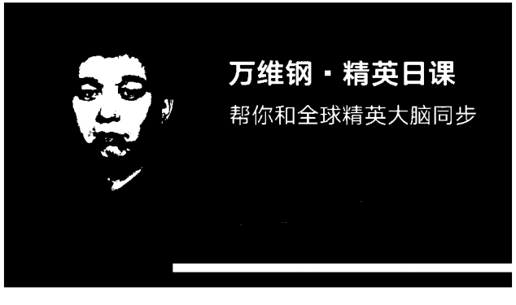

## 日课214 | 现代人怎么都不穿正装了？

日课214 | 现代人怎么都不...

昨天讲的《给忙碌者的天体物理学》这本书非常受欢迎，我还需要一点时间研发下一讲，今天先说个轻松一点的话题。咱们说说服装习惯的演变。

你看描写二十世纪初或者更早的时代的电影、电视剧的时候有没有一个感觉，当时的人似乎穿着都很正式。即使有头有脸的男子出门，都穿一身西装套装，而且都戴帽子。

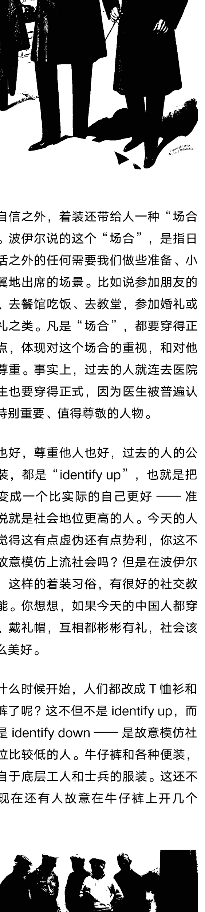

当时中国正在经历战乱，老百姓穿着讲究的不过，我们看美国就非常明显了。下面这两张图是1940年代的棒球赛场，我们看到，观众席上几乎所有男性都是穿西装戴帽子。


今天我们如果周末出去看场比赛，恐怕不会有多少人穿西装，尽管也会有一些。但是帽子呢？现在除了冬天保暖，平凡几乎就没有男子戴帽子。

人们是从什么时候开始变得这么不讲究了？T恤衫和牛仔裤怎么就取代了套装呢？

我要说的是 First Things 杂志六月份的一篇文章，题 مى是“穿得正式点儿：我们在便装革命中失去了什么”（ Dress Up: What we lost in the casual revolution ），作者是时尚编辑 G. 布鲁斯·波伊尔（Bruce Boyer）。

波伊尔显然是个老派人物，写文章文绉绉的，对过去有点怀念，对现实有点无奈，就好像一位盛襟礼崩乐坏的没落贵族。波伊尔说，着装不仅只是着装的问题，它反映的是整个社会心理的变化。

在过去，每个人都要扮演“公共”和“私下”两个角色。在家里你想放松一下没关系，出门参加任何公共活动，包括平常的上班在内，你都得有一种“仪式感”。那时候，穿着正式有两个作用：首先是对自己的严格要求，其次是对别人的尊重。

西方社会普遍流行正装，是从十九世纪早期开始的。那时候工业革命刚刚造就了一个中产阶级，人们对身份充满自豪感，男子套装都是笔挺的，给人一种阳刚之气。穿这样的衣服对人也是一个束缚，你的举手投足必须得体，符合“绅士”的做派。事实上，“绅士（gentleman）”这个词，也就那时候的人最爱用。


自尊自信之外，着装还带给人一种“场合感”。波伊尔说的这个“场合”，是指日常生活之外的任何需要我们做些准备、小心翼翼地出席的场景。比如参加朋友的聚会、去餐馆吃饭、去教堂，参加婚礼或者葬礼之类。凡是“场合”，都要穿得正式一点，体现对这个场合的重视，和对他人的尊重。事实上，过去的人就连去医院见医生也要穿得正式，因为医生被普遍认为是非常重要、值得尊敬的人物。

自尊也好，尊重他人也好，过去的人的公共着装，都是“identify up”，也就是把自己变成一个比实际的自己更好——准确地说就是社会地位更高的人。今天的人可能觉得这有点虚伪或有点势利，你这不是故意模仿上流社会吗？但是在波伊尔看来，这样的着装习惯，有很好的社交教化功能。你想想，如果今天的中国人都穿正装、戴礼帽，互相都彬彬有礼，社会是多么美好。

那从什么时候开始，人们都改成T恤衫和牛仔裤了呢？这不仅不是 identify up，而且还是 identify down ——是故意模仿社会地位比较低的人。牛仔裤和各种便装，都来自于底层工人和士兵的服装。这还不算，现在还有人故意在牛仔裤上开几个洞。


以前咱们专栏在《这时候和那时候的亚当·斯密》和《最简单词耶克》这两篇文章里说过，亚当·斯密和哈耶克都认为社会习惯的改变应该是自下而上发生的，不能让政府推动。着装习惯似乎应该完美符合这个学说，毕竟不太可能有哪国政府命令人民穿破洞的牛仔裤。不过根据波伊尔总结的历史，我感觉美国政府还是在其中起到了一个重要作用。

因为美国政府单方面采取行动，扩大了美国中产阶级。

二战结束后，为了安置退伍军人，美国政府于1945年通过“美国军人权利法案”（G. I. Bill），给退伍军人提供一系列的福利。这些福利的力量非常之大——你要买房或者做生意，政府给你极低利率的贷款；你要失业了，政府给你发补助；特别是你要上大学，政府给你交学费。这些政策直接把无数战员的后代一步到位变成中产阶级。正是因为这些政策，美国人才开始普遍在市郊买别墅式的房子，家家户户都开上了汽车，为1950年代的经济大繁荣奠定了基础。

当然你也可以说这是美国打赢了二战获得的战后红利。但是我经常忍不住想，像哈耶克说的那样。光指望市场力量提高人

的战争红利。但是我却经常忍不住想，像哈耶克说的那样，光指望市场力量提高人民生活水平是不是有点慢 —— 美国政府 1945年这个大动作，是不是也值得别国借鉴呢？

还是回到着装上来。“美国军人权利法案”的一大作用，是使得美国大学的学生，在战争结束十年之内，扩大了十倍！上大学不再是少数人的特权，大量的平民子弟成了大学生。

在此之前的大学生，穿着跟社会上的职业男性不太一样，有点“名校范儿” —— 特别是常青藤联盟大学，讲究一个“The Ivy look”。这个风格比较休闲，更自由一点，不那么束缚人。平民学生上了大学，就把这种比较休闲的藤校风格的着装传播了全国。

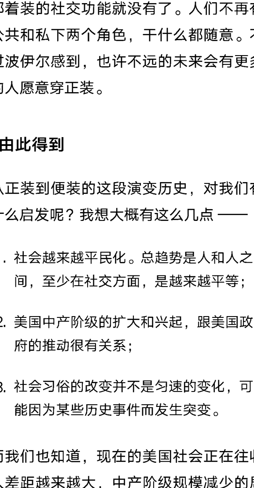

再加上电视的推波助澜和爵士乐的流行，整个社会都接受了着装的“软化”。但即使如此，还不至于礼崩乐坏。

最重要的是，整个社会越来越平等了。既然越来越平等，那么穿西装的也不应该看不起穿牛仔裤的，穿军服的更应该受到尊重。这时候美国工人、特别是军装风格的服装也开始流行起来。与此同时，外国人似乎特别喜欢美国这两种平民服装，外国学了美国，回来又影响美国人，牛仔裤就开始慢慢取代“藤校风”。

紧接着，到六、七十年代，美国兴起了嬉皮运动，大学生愤世嫉俗，开启了“identify down”，也就是为了反社会故意模仿下层人民穿着的模式，T恤衫和牛仔裤成了时尚。

1967年，10万青年在旧金山参与了历时整个夏天的“爱之夏”运动集会，T恤衫正式登上历史舞台。


等到两年以后，40万人在纽约参加一个露天摇滚音乐会，T恤衫和牛仔裤从此就成了大学生的标配。也就是从1970年左右开始，正装时代就彻底结束了。

像 IBM 这样的大公司，最初都是要求员工穿西装打领带。后来响应平民化号召，允许员工每个星期五穿便装。再后来就都随意了。

现在我们是一个着装上的平民时代。波伊尔对此不太满意，现代人着装几乎完全是怎么舒服怎么来，要不就是想表达一下自己的“个性” —— 而且可能还仅仅是他在今天的个性，也许明天就变了。在纽约金融区遇到一位身穿牛仔服的中年男子，你无法判断他是个普通工人呢，还是个银行高管。

那着装的社交功能就没有了。人们不再有公共和私下两个角色，干什么都随意。不过波伊尔感到，也许不远的未来会有更多的人愿意穿正装。

### | 由此得到

从正装到便装的这段演变历史，对我们有什么启发呢？我大概有这么几点 ——

+   1. 社会越来越平民化。总趋势是人与人之间，至少在社交方面，是越来越平等；
2. 美国中产阶级的扩大和兴起，跟美国政府的推动很有关系；
3. 社会习惯的改变并不是匀速的变化，可能因为某些历史事件而发生突变。

而我们也知道，现在的美国社会正在往收入差距越来越大，中产阶级规模减少的局面发展。上周我们还在《谈资比名牌包贵的社会》说过不同阶层在教育上的重大差别，廉价大学的时代刚刚已经结束了。那么未来美国人的着装会不会更正式，乃至怎么影响世界特别是中国，就是个很有意思的问题。

本期推荐阅读
日课039 | 那时候和这时候的亚当·斯密
日课046 | 最简单哈耶克
日课209 | 谈资比名牌包贵的社会


## 日课215｜暗物质的陪伴

日课215｜暗物质的陪伴

咱们今天继续说尼尔·泰森的《给忙碌者的天体物理学》。上期我们讲了关于这个宇宙，物理学家知道的很多事儿。今天要说的是一个物理学家还不完全知道，但是做梦都想知道的事儿。

咱们在《伽利略的反应速度》这期专栏讲过望远镜的起源。在望远镜刚刚出来的时候，它的放大倍数很低，既没有军事用途也没有科学用途。最早的望远镜被称为“偷窥镜”，因为人们买望远镜主要是为了偷窥邻居。

当然偷窥这个行为是很猥琐，但是这也取决于你观察邻居的时候，到底看了什么、看了多长时间，和你看的时候有多用心。我就听说过有人通过偷窥洞察了人性，还出了书，更新了世人的三观。

从某种意义上说，天文学家干的事儿和偷窥差差不多，他们都是充满好奇心地观察一些东西。也许最大区别的是，天文学家看的东西更多、看的时间更长，而且看得非常非常用心。

所以天文学家发现的结果，比偷窥邻居可刺激多了。

而今天这个内容就好比说，你发现有些邻居的行为，实在太奇怪了。

### 1.少了很多东西

满天星斗并非是杂乱无章的。古人的思路是把星星划分成“星座”，而今天的天文学家对星星之间的关系看得更清楚，他们的划分思路是“星系”和“星系团”。

我们这个太阳，就处在“银河系”这个星系之中。从地球上看，银河是带状的——


但是如果你换个远方太空中居高临下的视角，银河系其实是盘状的。它有若干条螺旋臂，太阳就位于银河系的某个不起眼的螺旋臂的某个不起眼的位置。


每个星系中可能有千亿、甚至万亿颗恒星。就好像星围绕恒星转一样，星系中的恒星也绕着星系的中心转——这当然是因为星系内部这一大堆恒星集合在一起，给外面的恒星提供了一个向内的引力。

像银河系这样的星系，宇宙中至少有千亿个。星系们又组成星系团，然后每个星系都绕着它所在星系团的中心转。


在星系中间那广大空旷的空旷地带，其实也有很多物质，包括矮星系、不属于任何星系的孤单恒星、星系间气体等等。但是总体来说，结构就是这样。如果把宇宙想象成一个国家，星系团就好像是城市，这些城市就好像一个一个的岛屿散布在宇宙之中。

天文学家看着这些星系和星系团，实在着迷。

1937年的时候，天文学家弗里茨·兹威基（Fritz Zwicky）仔细观察了一个星系团，叫“后发座星系团”。兹威基选择了后发座星系团里的几个星系，测量了这些星系绕着星系团旋转的移动速度。兹威基发现，这些星系的速度都太快了。

咱们可以做个实验体会一下。你拿一根比较长绳子，比如说耳机线吧，抓住一端快速运动，让绳子绕着你手指旋转。很明显，转动速度越快，你的手指就要越用力。如果转动速度特别快以至于你的手抓不住它，这个绳子就会飞出去。地球绕着太阳转也是这个道理，中心提供的引力越大，能支持的旋转速度就越大。

星系绕着星系团中心转，也是这个道理。兹威基估算了后发座星系团内部大概有多少星系，这些星系总共有多大的质量，能提供多大的引力。他发现这个引力根本支撑不了外面星系旋转的速度！那么高的速度，那几个星系都应该被甩出去才对！

兹威基非常相信自己的计算，他据此判断，星系团内部必定还有一些我们看不到的物质，提供了多余的引力。

此后天文学家们陆续考察了别的星系团，结果每个星系团都有这个现象。

到了1976年的时候，一个叫薇拉·鲁宾（Vera Rubin）女天文学家又把目光准恒星围绕星系的转动。首先她注意到，在一个星系的可见部分之中，越往外的恒星，旋转速度就越快。这个是可以理解的，越往外的恒星，它里面的恒星就越多，能提供的引力就越大。

然后鲁宾在星系的最边缘找了几个恒星，结果发现这几个恒星也是越往外速度越快。这就不对了，因为从这里再往外，就已经没有多少恒星给它们提供更多的引力。

不论星系绕着星系团转，还是恒星绕着星系转，转速都比天文学家计算的快得多。

咱们打个比方。这就好像你密切观察你家的邻居，你详细记录了每一个人的出行情况，发现他们平时都不出门，只在周末出去买点食物回来吃。你仔细测量了他们每周末买回来的食物都有什么，总共能提供多少热量，结果你发现这些买回来的东西根本不够一家吃一周。那这一家是怎么样生存的呢？

### 2.黑暗的物质

最合理的解释，就是邻居吃了一些你看不到的东西。物理学家把提供多余引力的东西，称为“暗物质”。计算表明，想维持那么高的速度，暗物质不但要提供多余引力，而且必须提供很多很多引力才行——暗物质的总质量，必须是已知物质总质量的6倍。

考虑到暗物质，我们银河系的图像应该是这样的——


整个星系被一层厚厚的暗物质包围。暗物质在星系中间比较浓，远离星系的地方慢慢淡漠。因为我们的太阳系只是整个星系中间的一小块区域，行星和卫星都太小，运动不会受到暗物质影响，我们没感觉到。但是考察星系边缘那些恒星的运动，影响就非常明显了。

暗物质到底是什么东西呢？我们的第一反应，也许暗物质就是一些比较“暗”的正常物质，因为太暗了我们没看到而已。而物理学家已经排除了这种可能性。咱们先一个一个地数。

暗物质是黑洞吗？黑洞其实是可以探测到的。黑洞在很小的区域内产生很大的引力，周围星体会绕着黑洞转，我们一看那些星体的轨道，就知道中间有个黑洞。

暗物质是星际间的气体云吗？也不是。遥远的星光穿过气体云，会受到影响，但我们没有发现到这种影响。

们没有发现到这种影响。

### 暗物质有没有可能是一些散布在空间没有恒星“主人”的流浪行星呢？这也不太可能。你要知道，我们太阳系总重量的4/5在太阳上，而不是行星上——宇宙中不太可能是行星集中那么大比例的质量。

就好像中学生解数学题要用两种不同方法求解一样，物理学家还可以从另一个方面证明暗物质不是寻常物质。物理学家计算表明，大爆炸产生的氢原子和氦原子核的比例是10:1，这个比例还可以跟宇宙微波背景辐射的观测结果对上号——宇宙创生中所有的核反应都在这里了。那也就是说，暗物质根本就没参与核反应！

目前所有的仪器都测不到暗物质。物理学家知道的四种相互作用，暗物质很可能除了引力之外，其它都不参与。

咱们想想这个东西。除了引力，我们在生活中，在原子核之外，所有能感受到的所有“力”——我们能看到光、我们被什么东西打一下会疼，这些都是电磁力。可是暗物质不参与电磁力。

这就是说，你的房间里遍布着一种特殊粒子构成的气体。这种粒子可能比质子、中子都大很多，也很重。可是你摸不着它、看不到它，就算用上各种先进仪器，也完全感受不到它的存在。你任凭它在你的身体中穿过。

### 3.各种可能性

物理学告诉我们，所有东西都有引力。但是不是“有引力”就一定“有东西”呢？这个现在很难回答，也许我们需要在牛顿、爱因斯坦之后，再出一位神人，再给我们一个新的引力理论。

连民间科学家都可能会想到，是不是爱因斯坦的广义相对论，在星系这么大的尺度上，出错了。有人在做这个工作，但大多数物理学家对广义相对论非常有信心。广义相对论是个相当精确的理论。

事实上，物理学家把民间科学家想不到的离奇可能性也想到了。比如说有没有可能暗物质是我们感受到的来自“高维空间”的引力？也许存在多重宇宙，有一个“平行宇宙”跟我们的空间重叠在了一起，以至于这个平行宇宙中的物质的引力穿越了时空的维度，让我们感受到了。这些可能性似乎都不大。

如果暗物质根本不参与引力之外的其他相互作用，那它到底是怎么从宇宙大爆炸中产生的呢？物理学家的一个猜想是也许暗物质也参与强相互作用或者弱电相互作用，只不过实在太微弱了，不容易测到。

所以现在物理学家正在上天入地，去探测暗物质。他们把专门的卫星送上太空，在地底下挖了很深很深的坑，在实验室里用最高能级的粒子加速器搞碰撞，希望能找到一两两个“暗物质粒子”。

但是从1937年兹威基的发现至今八十年过去了，物理学家对暗物质的了解，仍然没有突破。

但是物理学家回头又算了一下。我们知道大爆炸以来，宇宙一直在膨胀。在这个过程中有两种力量在对抗——一种力量是引力，引力是把东西聚集到一起；另一种是膨胀，是要把东西分散开。

这两个力量如果平衡得不好，就不会有今天的日月星辰。引力太强，宇宙中的原子们刚刚出生就会都挤在一起；引力太弱，它们就不会有机会凝聚成恒星。

物理学家计算发现，我们已知的这些寻常物质的引力，原来根本对抗不了大爆炸的膨胀。原来非得依靠暗物质的陪伴，才有我们这个宇宙的今天。那到底需要多少暗物质，才能让宇宙膨胀成今天这个样子呢？

正好也是已知物质总质量的6倍。

## |由此得到

暗物质，完全是物理学家因为算数对不上，而认为必须存在的一种东西。但是我们至今对暗物质还没有任何直接的观测。

在物理学史上，这其实是司空见惯的局面。比如说十九世纪的时候，有人测量太阳光到达地球的能量，就发现太阳每时每刻产生的能量是非常巨大的。那太阳的能量来自哪呢？太阳上到底要烧什么东西，才能产生这么大的能量呢？

当时的人还不知道核反应。甚至有人提出非常可笑的猜测，说太阳上烧的是煤！

但这个精神是一样的：我这里数字对不上，你那里必定有别的东西。

## |禅定时刻

最后我想请你看一张照片。这张照片的分辨率不高，但是非常非常厉害——


这是一张在地球上、晚上拍摄的太阳照片。注意，晚上，太阳可是在地球的另一面。物理学家把照相机镜头向下，透过地球，拍到了太阳！

那是因为这张照片拍的不是太阳光，而是太阳发射的中微子。中微子，是最难跟任何仪器发生相互作用的东西，它们横穿整个地球都畅通无阻……但最终还是被物理学家捕捉到了。

所以我敢说，只要暗物质存在，物理学家就一定有办法“看到”它。

本期推荐阅读
日课123 | 伽利略的反应速度


当你仰望，你会好奇。当你好奇，你会探索。当你探索，你会得到。当你得到，你会分享。点击右下角，分享给朋友，邀请ta，陪你仰望。

## 日课216 | 经验 = 对小概率意外的熟悉程度

日课216 | 经验 = 对小概率…

现在已经是夏天了，估计很多人都会去游泳。那你最近没听到这句话：“淹死的都是会水的”。我不知道你怎么理解这句话，我之前对这句话的理解，认为这纯粹是一个频率问题——会游泳的人下水的次数多，他面对的总的危险肯定要大一些；而不会游泳的人可能根本不下水，或者即使下水，也会特别小心翼翼，所以反而更安全。

但我刚刚读了一篇文章之后，感觉自己对这句话有了更深的理解。今天要说的这个知识，对像我这样家里有小孩的人来说，特别有用。

这是Slate网站上6月19号的一篇文章，题目是《儿童游泳课的危险谬误》（The Dangerous Fallacy of Toddler Swim Lessons），作者是梅琳达·温纳·莫耶（Melinda Wenner Moyer）。

我最近在微博看到一段视频，一个三四岁的小孩在游泳池里出现危险，差点淹死，他的家长就在附近居然没注意到。这种情况，其实经常发生。

这篇文章的作者莫耶本人的儿子就两岁差点在游泳池里淹死。当时游泳池里有很多人，包括她的亲友就在旁边，她自己也在旁边，但是所有人都并没有注意到她儿子出危险了。她是突然想起来找儿子，找不到，一看就发现他儿子在深水区里快要沉下去了！而且这个情况还发生了两次！

事实上，按美国的统计，1岁到4岁的儿童，游泳淹死是死亡率最高的活动，比车祸还危险。而且这么小的孩子一旦溺水，即使被救起来，也有10%的可能性会遭受脑神经系统的损害。

### | 我的评论

今天这个道理显然不只是儿童游泳，也适用于其他领域。这个道理就是，常规流程技能和意外情况的应对技能是两码事。

### | 由此得到

应对平常情况的技能和应对突发情况的技能是两种不同的概念。如果我们只掌握平常技能，就认为自己会了，可能会非常危险——这也گی为什么淹死的都是会水的人。

本期推荐阅读 周末小记 | 成熟度 = 对小概率事件的承受程度 日课001 | 失败不是成功之母，成功是成功之母


点击右下角，分享给你的家长朋友——这是一条严肃的请求。

## 日课217 | 暗能量的惆怅

日课217 | 暗能量的惆怅

今天咱们继续说尼尔·泰森的《给忙碌者的天体物理学》。上次我们讲了暗物质，今天我们讲天体物理学的另一个谜团，暗能量。

你注意到没有，即使到了今天，宇宙大爆炸理论早已被物物理学家广泛接受了，可是有些民间哲学家一说起宇宙还是“空间上无边无际、时间上无始无终”这两句话。我们传统想象中的宇宙是无限大的，曾静静存在过无比长的时间，并且将永久地存在下去。

然而现在所有证据都表明，宇宙绝不是这样永恒不变的样子。宇宙有个开始，而且还会有个终结。

这一点违反直觉。一个个人、一个房子、一个国家有开始有结束，我们都能理解——但是宇宙是一切事物的总和啊！不管人在不在，组成人的原子总是在的；不过国家有没有，国土总是有的。那宇宙的开始和结束，又从何说起呢？

如果你觉得这不好接受，你不是一个人。

当年，连爱因斯坦都认为宇宙应该是静态的。

### 1. “一生最大错误”

牛顿的万有引力定律是个非常漂亮、也相当精确的理论，但是它有一个本质的缺陷。牛顿引力是一种“超距作用”。这里有个质量很大的物体，你立即就感受到了它的引力——可是这个力是怎么传递的呢？连光速都有限，引力信息难道能瞬间到达到吗？牛顿自己也意识到了这个问题，但是他没办法。

直到1916年，爱因斯坦提出广义相对论。爱因斯坦说，你可以把引力当成是空间的弯曲。用一句话概括他的思想，就是“物质告诉空间怎么弯曲，空间告诉物质怎么运动。”大质量物体改变它周围空间的弯曲程度，其他物体根据感受到的弯曲空间运动，引力不再是超距作用了，它通过空间传递。


因为引力是一个可传递的东西，广义相对论马上就预言了“引力波”的存在。然后等到2016年，物理学家果然观测到了引力波。

```
(R_α^β - 1/2 g_α^β R) + Λ g_α^β = 8π G / c^4 T_α^β
```

### 2.哈勃改变了世界观

到了1929年，美国天文学家哈勃迎来一个改变世界观的时刻。当时哈勃对银河系以外那些广阔空间中的星系，做了一个系统性的观测。他发现，星系发出的光的光谱，有一个往红端的移动。


这就是所谓“红移”，也就是频率都变小了一些。这种现象我们在生活中也能遇到。波动都是这样的，当这个物体向你跑过来的時候，它的频率会增加；当这个物体离你而去的时候，他的频率会减少。比如一个火车鸣笛，如果是火车面向你开过来，你会觉得鸣笛声音更尖锐一点；如果是火车是离你而去，你会觉得鸣笛声音更低沉。

```
G_μν = R_μν - 1/2 g_μν R = 8π G / c^4 T_μν
```

胀，一切都和谐了。

谁能想到，爱因斯坦死后43年，天文学家的世界观又改变了一次。

### 3.空间的膨胀

我先来解释一下，“宇宙膨胀”到底是什么意思。宇宙大爆炸和寻常一颗炸弹的爆炸可不一样，大爆炸带来的膨胀，是空间本身的膨胀。广义相对论认为“空间”并不是一片虚空，而是一个可以传播引力、可以变形可以弯曲的实在在的东西。

在宇宙起源之前，时空根本不存在。大爆炸以后空间膨胀了，日月星辰才有了在其中玩耍的场所。我们可以把空间想象成一张实在在的网——所有东西都是放在这张网上，而网本身可以变大。

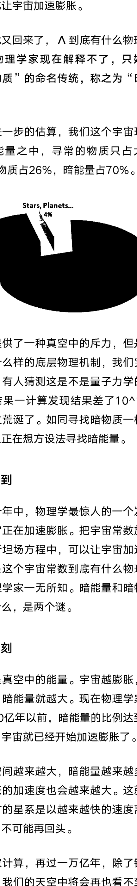

我们知道，物理定律要求是任何东西的移动速度不能超过光速——但是请注意，这说的是物体在空间中的移动，可不是空间本身的移动。

事实上，宇宙膨胀的速度可以超过光速。在大爆炸刚开始的时候，早期的宇宙的膨胀速度到处都超过光速。而在现在，那些距离我们特别特别遥远的星系，他们的离我们而去速度也是超光速的。

这就意味着，存在很多星系，因为它们距离我们太远，膨胀的速度超过光速，我们不可能看到它们。它们那里不管发生什么，我们都无法知道。女朋友坐飞机走了，飞机上总还能打个卫星电话——可是如果女朋友跑的比光速还快，你就再也没办法跟她取得联络了。

难道说，我们将孤独地跟可见的这些星系生活在这里。

但是也不一定。别忘了在引力作用下，星系之间还有个互相吸引的作用，这也是一个把空间往回拉的力量。那么在引力作用下，我们设想，宇宙膨胀的速度应该是越来越慢——就像你往天上扔一个球，球上升的速度肯定是越来越慢，而且可能还会回来。

对吧？

### 4.黑暗的能量

爱因斯坦死后43年，也就是1998年的时候，有两组天文学家，想测量一下现在宇宙的膨胀速度已经减慢到了什么程度。

他们有一些特别好的观测目标，叫“Ia型超新星”。这种超新星也是宇宙送给天文学家的礼物。最初这是一种双星系统，其中一颗星是白矮星。白矮星不断吸收临近这颗星的质量，等到自己的质量增长到相当于我们的太阳质量的1.44倍的时候，它就会突然爆发，变成超新星。


这种超新星的引爆质量永远一样，它的光度也永远一样。这样天文学家一看Ia型超新星到达地球的亮度，就能精确知道它们距离地球有多远。

与此同时，根据光谱的分析，看看红移情况，天文学家还可以另外一个方法计算超新星的距离，这个计算中就包括了理论模型中宇宙膨胀的历史。对比一下两个距离的差距，就知道现在膨胀速度减慢了多少。

结果天文学家惊掉了下巴。

用超新星亮度算的实际距离，比用宇宙膨胀历史算的距离长了15%。这就意味着，宇宙膨胀不但没有减速，而且还加速了！

这个发现实在够三观，但是历经检验确认无疑，最后三个科学家因此获得2011年诺贝尔奖。

物理学家就只好再把宇宙常数放回到爱因斯坦方程中去，只不过这回Λ的数值得改，变成让宇宙加速膨胀。

那问题就又回来了，Λ到底有什么物理意义呢？物理学家现在解释不了，只好沿袭“暗物质”的命名传统，称之为“暗能量”。

现在更进一步的估算，我们这个宇宙现在全部能量之中，寻常的物质只占大约4%，暗物质占26%，暗能量占70%。


暗能量提供了一种真空中的斥力，但是它到底是什么样的底层物理机制，我们完全不知道。有人猜测这是不是量子力学的真空能，结果一计算发现结果差了10^120倍，太过荒谬了。如同寻找暗物质一样，物理学家正在想方设法寻找暗能量。

## |由此得到

过去三十年中，物理学最惊人的一个发现就是宇宙正在加速膨胀。把宇宙常数放回到爱因斯坦方程中，可以让宇宙加速膨胀，但是这个宇宙常数到底有什么物理意义，物理学家一无所知。暗能量和暗物质到底是什么，是两个谜。

## |神定时刻

暗能量是真空中的能量。宇宙越膨胀，真空越大，暗能量就越大。现在物理学家知道，在50亿年以前，暗能量的比例达到一定数值，宇宙就已经开始加速膨胀了。

而随着空间越来越大，暗能量越来越多，宇宙膨胀的加速度也会越来越大。这就意味着远方的星系是以越来越快的速度离我们而去，不可能再回头。

物理学家计算，再过一万亿年，除了银河系以外，我们的天空中将再也看不到其他的星星。

如果我们这个文明不能把现在关于宇宙的知识流传到那个时候，如果那时候还有智慧生命的话，那时的天文学家将会认为宇宙里就只有一个银河系。他们的宇宙观会跟我们很不一样，他们将从不知道宇宙里其实有那么多星系！

因为缺乏关键信息，他们永远都想不到宇宙曾经有过这样的历史。

但是还有更可怕的。泰森说他做了一个噩梦。如果说一万亿年以后的人缺少关键信息，那么我们这一代人，是不是也缺少了某些关键信息，以至于有关这个宇宙，有些东西是我们永远都不能理解的呢？

要知道，这个宇宙根本没有义务让你理解。


## 答读者问 | 当时没有人在现场看

世界太美妙，难道真是上帝创造了整个宇宙。大爆炸之前的那个能量密度最高的小点哪里来的？

万老师，怀老师，为什么我听这期节目，居然流泪了？到底是幸运还是命运？奇点之前，到底是什么？奇点外围有空间吗？有时空吗？

长知识了。万老师，宇宙在大爆炸前的状态又是怎么形成的？有没有另外的宇宙？

万老师 心头一直有个疑问：宇宙大爆炸之前是什么？宇宙在扩张，那动态边缘外是什么？合理推测，这倒其实是一个东西。但是就好比之前的白课的那个无解题“如果神创造了世界，那么谁创造了神”一样，这种逻辑无穷的问题总是怎么理解的呢？

万维钢 已知的物理定律只管到大爆炸之后10^(-43)秒，所以实干派的物理学家不怎么谈论“大爆炸之前”。

不过霍金有个量子宇宙学说，认为大爆炸之前的“宇宙”，时空缝隙在一起不可分割，它就存在那里，可以随“时”爆炸，也可以一直不爆炸，就好像一个随“时”可能衰变的原子核。或者你也可以把它想象成花果山的抛出的石头，也许某一天就炸出来一个孙悟空，也许它就一直沉默。

但要点在于，这个“它”不需要“神”的干预。宇宙大爆炸是一个量子力学意义上的几率事件！没有第一推动！这就避免了“如果神创造了世界，那么谁创造了神”这个逻辑隐患。

很多物理学家相信可以爆炸无数个有着不同参数的宇宙，否则无法解释我们这个宇宙为什么恰好适合人类生存。你甚至有可能在我们这个宇宙的实验室里爆炸一个新宇宙……一切都有可能，但这一切也都是玄学——还是那句话，已知的物理定律只管到大爆炸之后10^(-43)秒。

以上问题来自日课213 | 幸还是这个宇宙的通行证

请问80后了，经验如何活用？如何不是束缚？

### 万维钢

很有道理。我们只说 虽然经验有“价值”，但这个价值在市场上到底值多少钱，就不一定了。低技术行业不需要复杂的经验，新技术行业也用不上老经验。

大概越复杂的技能，经验越值钱。物理学家、医生，干活的有大堆老头子，肯定需要经验。那我们选择专业的时候，是不是也应该考虑一下这个因素，选个越老越值钱的。还有管理者也需要经验，招普通员工可能不招80后，招CEO就没有这样的限制吧？

螺丝钉不需要有经验。大约高级的经验就是“意会”，是不能算法化、流程化的技能。

看到最后万老师说了一个二八法则，最近我经常听到这个理论，而且很多地方都可以用二八法则来解释。比如一本书里20%的干货用80%的例子去证明，社会20%的人拥有80%的财富等等。在这里想请教一下万老师，二八法则是怎么得来的？有没有著名的书籍专门讲这个？用它还能解释生活中的什么现象呢？为什么是二八？

### 万维钢

有本书就叫The 80/20 Principle，我还写过一篇文章章节《想要提高效率，就得不公平》，其中说的也是二八法则。当然不一定非得二八，也可以一九……

为什么会有这样的现象呢？一个重要原因是正反馈——越有钱的人越容易赚更多的钱，所以财富会迅速向少数人集中，形成所谓power law分布。

我特意查过，想知是否所有power law分布都是某个正反馈过程的结果，但我没有找到答案。

以上问题来自 日课216 | 经验 = 对小概率意外的熟悉程度

太喜欢这篇了，我听了两遍，既然暗物质可以穿过一切物质，人类仪器自然无法捕捉到，这种无影无形的物质真的好奇妙。如果人类找到这种物质，可以用于哪些方面？还有作为物理小白，我想问为什么是六倍？地球和月球之间引力是不是也相差六倍？这有没有啥关系？

### 万维钢

暗物质的密度很低，只在空间尺度特别大的情况下才有作用。太阳系系统的尺度很小，其中的暗物质起不到什么作用。

六倍是观测的结果。总量是6倍，但密度要低得多。

万老师，这条我不是很明白呢？“然后鲁宾在星系的最边缘找到了几个恒星，结果发现这些恒星也是越往外速度越快。这就不对了，因为从这里再往外，就已经没有多少恒星给它们提供更多的引力。”我觉得越往外速度越快是正常的呢，半径越大线速度越快，越往外内部的恒星越多，引力提供的向心力就足以支撑离心力呀。为什么要考虑再往外提供的引力呢，而不是只考虑他们内部提供的引力就可以了吗？

### 万维钢

到了星系边缘，再往外就没有更多的恒星了。那么我们可以把内部的所有恒星当成一个质点，它的总质量 M 是不变的。那么根据简单的牛顿力学，V^2/R = GM/R^2，M 现在固定了，速度和距离的平方根成反比，越远，速度应该越慢。

以上问题来自 日课215 | 暗物质的陪伴

我很好奇这些宇宙特定时间是怎么来的呢？比如一万亿分之一秒，是观测的结果还是公式能算出来的呢？

### 万维钢

是推算的，当然这一系列的推算可以用微波背景辐射验证。

> 《圣经》： “起初上帝创造天地……”  
温伯格，《最初三分种》：“但当时没有人在现场看。”

今天的文章只能用“震撼”二字形容！让我们从蚊营狗苟，花花绿绿的今天一下子回到了让我们目瞪口呆的一个点。有个疑惑想问下万老师，我们这个宇宙的3维空间是怎么来的呢？

### 万维钢

如果空间不是三维的，其中行星公转的轨道就会不稳定……也就不会有生命出现。

当然你不能说为了让生命出现，这个宇宙特意选择了三维空间。你只能说也许有无数个宇宙存在，我们只不过恰好生在一个三维空间的宇宙之中。

万老师，国外的确似乎很流行把晦涩的专业知识科普化，面向非专业，甚至面向儿童。是不是首先要找到非专业人士的兴趣点，还要写的幽默，并且脱离尽可能多的专业术语。这是一种天赋还是刻意练习的结果？为什么国外盛行？是有政府或者学术界的引导么？

### 万维钢

用公众能理解的话介绍自己的研究，本来就是科学家的基本功和光荣传统。达尔文《物种起源》本来就是一本面向大众的书。现代学术分工把大部分科学工作者变成技术工人，实在是礼崩乐坏。

另一方面，现在科学家搞研究主要靠政府提供经费，并不需要公众直接的支持，也就懒得向公众喊话了。

国外盛行各种科普，不仅仅是科学家的爱好，更重要的是市场的需求决定的。发达国家有很多教育程度高又不整天忙着赚钱的人，愿意花时间知道这个世界到底是怎么回事。西方国家搞 liberal arts 教育，培养了很多这样的人——他们既可能是科学内容的生产者，更是消费者。

以上问题来自 日课217 | 暗能量的嗥啸

### 万维钢

上周的答题获奖名单公布：

@怀沙不是艺名！ @仇道文 @成洁getit @单色调的宅寂 @Nina酱 @蓝莹莹 @pioneer @杨博（LG 工程师） @kcrteacher @蓝莓77212183 @心碎雨 @你先走 @氢 @欣 @Yuhan : Dagny @金磊五 @郑宇泽 @Stay Hungry @Hauson @河流 @子非鱼

请以上这21名读者朋友（因为怀沙是咱们转述师，属于工作人员，所以我多选了一位读者）在留言区写下你的快递寄送地址、电话和联系人姓名，得到的工作人员会给你寄送一本《平均的终结》中文版签名书。

祝贺，并感谢大家参与！


## 日课精选

## 特别放送 | 精英的智慧

特别放送 | 精英的智慧

咱们日课有一篇文章叫《到底什么是“智慧”》说过，智慧是一种“明智的推理（wise reasoning）”，是指通过你的理性，来对生活中遇到的挑战，做出正确的选择和判断。这种选择能力，不是知识，不是智商，也不是情商。心理学家干脆就把这种能力，叫做“智慧”。

研究者特别从三个方面考察一个人的智慧水平：

- 1. 智识上的谦逊——我知道我需要更多的信息，才会合理评估这件事，我知道未来可能还有不确定性；
- 2. 超越自我——我知道我身在 issues 之...我知道我身在这个事情之中可能会当局者迷，如果能从旁观者的视角看问题，也许更好；
- 3. 考虑他人观点，达成妥协——我知道不同观点的利弊，能理解这个事件的参与各方的想法和立场，我不仅仅考虑自己的利益，也考虑跟别人的关系。

谦逊谨慎，旁观者清，达成妥协——今天咱们就用这三个标准来总结一下，《精英日课》中提到的、精英的智慧都有哪些呢？

### 一、谦逊谨慎

### 1. 创新者要主动给自己增加不确定性

“任意的震动”是什么呢？就是你在这个山头已经到了最高点，去无可去了，这时候来个震动，把你震到一个别的地方。运气不好的话你可能去了一处谷底。运气好的话也许你就被震到了一座更高的山的山脚下。

从事创造性工作的人，经常会面临去无可去的局面。作家写小说写到一处不知道怎么往下写了，科学家搞科研遇到难题不知道怎么解决，这就是需要任意的震动的时刻。

所以分心也好，任意的震动也好，其实就是给创造过程来一点不确定性。而真正的创新者，不但不怕不确定性，还要时刻欢迎，甚至主动增加一点不确定性。

日课059 | 《混乱》解读1:任意的震动

### 2. 面对真实世界该保持谦谦敬畏的态度

戴森的告诫是不要妄想统治科学。你能从自然界里发现一点新思想，这就已经是很的成就。科学的进步往往由新工具的推动，比如有个什么以前没有的实验仪器出来，常常马上能把科学往前推动一大步。科学进步，从来都是不是哲学和情怀的产物。

我是一个“科学家”，那我做事的出发点就是要维护“科学共同体”吗？遇到什么问题，我都去问科学家的共识是什么，主流科学家对这个问题怎么看，谁的说法跟主流科学家的不一样，我就批判谁，这对吗？

事实是哪里有什么“主流科学家”。每个科学家都是反叛者，不是什么统治者。真实世界，才是我们唯一应该敬畏的东西。

面对真实世界最好保持谦虚的态度。谦虚的意思就是，既不要当教徒，更不要去当教主。你能做的是做一个手艺人，做出一点有意思的贡献，就是不可忽视的成就。

日课122 | 反叛才是科学家

### 3. 谦虚的人不会幻想一手遮天

如果一个人的三观是以自下而上的演化思想为主，那他可能就具备很多优良品质——他会不迷信权威，不相信什么救世主，愿意靠自己。他不会有那么多人生的困惑，不会质疑命运不公平，不抱怨做事怎么没有好报，更容易接受现实。这个人还会比较谦虚，他知道好的东西都是自发演化出来的，不是什么圣人设计出来的，所以他就不会妄想，不会幻想自己能一手遮天，搞个什么顶层设计一下子就能治理好国家。

日课190 | 用进化论修心养性

### 4. “慎独”就是不要独自决断

“是故君子戒慎乎其所不睹，恐惧乎其所不闻。莫见乎隐，莫显乎微，故君子慎其独”，我可以这么解释——面对复杂局面，各种矛盾的选择，做出正确决断是非常困难的。你必须尽可能了解全面的信息。有些关键的事儿你不知道，那你应该很担心啊！不能胡乱决策啊！所以做决策不要独断专行，要多参考各种意见和信息。也就是说，“慎独”，是不要独自决断的意思，而不是什么“不要独自一人看色情片”。

答读书问 | 对“中庸”的一点浅见

### 二、旁观者清

### 1. 用第三人称的视角自我评估

训练任务是故意让所有队伍都失败。有谦卑素质的指挥官回来，首先把责任归于自己。是我没控制好，我输了，咱们能不能复盘一下，看看我哪个地方做的不对。然后你给他指出不足，他马上记在笔记本上。而对比之下，傲慢自大的指挥官回来先指责别人，反正自己没错，他好像什么都知道——其实他连诚实的自我评估都做不到。那威廉克是怎么自我评估的呢？这个方法我在哪看到过，非常值得借鉴——那就是你要以一个第三人称的视角，旁观自己。你正在做这件事，但是你能够时不时的跳出自己的身体，去观察你自己：我是不是生气了？我是不是太情绪用事了？我是不是反应过头了？这个其实就有点像咱们中国人说的“当局者迷旁观者清”，这等于是自己给自己提供即时反馈。做到这一点非常困难，这要求你在即使投入全部身心的的情况下，仍然能在心里保持一个冷静的声音，给自己提个醒。我看这大概就是“谦卑”的最高境界。

日课154 | 高手修手机手记2：指挥官的派头

### 2. 增加一个旁观者激发创造力

《冰雪奇缘》的编剧团队有了一个新的麻烦：他们不知道结尾怎么写。事后分析，团队当时大概陷入了“当局者迷”的状态——用好莱坞的语言说，这叫做spinning（围绕一个东西旋转）。编剧们对目前的剧情设定非常满意，他们整个沉浸在这个设定之中，没有灵活性，也没有办法从新的角度去考虑问题了。这时候迪斯尼高层使出了一招——他们把那位叫Lee的女编剧，提拔为这个电影的副导演，并且给了她副剧本最后拍板的权力。这个办法，其实就是对系统的一个外来扰动。生物学家很早就知道，如果一个生态系统长期没有外来扰动，其中一个物种就会一家独大，整个系统毫无生气。这时候如果突然来一个不大不小的外来扰动，打破原有平衡，系统往往能爆发出巨大的创造性，也就是不同的物种都活跃起来。旁观者清——这是激发创造力的办法之一。陷入一个情境不能自拔的时候，主动换一个视角。

日课058 | 跟《冰雪奇缘》学创造力魔法

### 3. 用“10/10/10法则”避免决策时的短期情绪

做选择时候的很多纠结，其实是各种复杂情绪在影响你的判断。这些情绪往往是短期的，在别人眼中看，或者你自己过段时间再看，根本不重要。“旁观者清”，其实就是因为旁观者没有你那么多复杂情绪，往往能做出更理性的判断。可是我们也不能什么事情都听从“旁观者”的意见，毕竟最了解情况的人还是我们自己。那么最好的办法，就是把自己想象成一个旁观者。咱们以前说过，高手要善于跳出来，以旁观者的视角去观察自己。希斯兄弟介绍了一个特别好的旁观技术，...“10/10/10法则”，就是这样一个方法。

希斯兄弟介绍了一个特别好的旁观技术，叫“10/10/10法则”。这个方法要求你从三个时间尺度去考虑一个问题：

- 10分钟之后，你会对这个决定作何感受？
10个月之后，你会作何感受？
10年之后，你又会作何感受？

这其实就是一种旁观者思维，站在一个远距离考虑问题，所有短期的情绪，什么害怕、紧张，可能就都不重要了。

另一个使用旁观者思维的办法是，当你面临困难选择的时候，你可以问自己：如果是最好的朋友面临这个选择，你会给他什么建议？

日课178 | 成大事者怎么才能不纠结

### 4.用“自我关怀”的旁观者技术增强自信

所谓“自我关怀”，就是你看自己，应该跟看自己的一位好朋友一样。我们看朋友总是比看自己更客观，你不会觉得朋友是神，也不会觉得朋友一无是处。如果朋友犯了一个错误，你不会把他骂的一无是处，你会鼓励他。你会跟他说是人都会犯错误，下次改正就好。那么对自己，也应该这样。

所以“自我关怀”就是要从一个友善的外人的角度看自己。自我关怀能给你自信所有好处，但是又不会有过度自信的任何坏处！所以这是一个特别值得掌握的心理技能。

掌握这个技能，分三步——

- 1. 鼓励自己。还记得咱们上次说过海豹突击队的经验，能坚持下来的人都善于给自己鼓励。你要像你奶奶一样，用特别温和的语气跟自己说话；
- 2. 接受自己。你并非无所不能，只是一个普通人，普通人都会犯错；
- 3. 面对错误。你要承认这是一个错误，但这个错误不是世界末日，只要吸取教训就行。

和奖励外向一样，这个世界奖励自信的人。如果不自信，最好的办法是使用心理学家最新发明的技术：自我关怀。

日课208 | 从“迷之自信”到“自我关怀”

### 三、达成妥协

### 1.就事论事，认识并容忍他人的复杂

我未必是个了不起的职业拳手，但我的确从来不在比赛之外打架。

把一个具体的人给驳倒，既没有多大价值，也没有什么乐趣。更何况大家抬头不见低头见，就算是跟谁都想合作，也没必要因为这些遥远的话题树敌。写《黑天鹅》的特勒布说，有的人想赢得争论，有的人想赢，他们不是同一拨人。

别人对付你，你要做到 don’t take it personal，你出手对付别人的时候，也要做到 don’t get personal。就事论事，避免人身攻击，是最理想的姿态。

所谓“精英”，特别值得学习的一点，就是他知道现代人都是复杂的，而且能容忍人的复杂。他看一个人能看到很多面，而且他只关注这个人最有价值的一面。他不会要求一个企业家不信气功大师，不会要求一个运动员说话处处符合政治正确，也不会要求一个演员反台独——你只只要在该对的地方对，就足够好了。

把人划分各种阵营，给人贴标签，竖起大旗来党同伐异，这些事情除非别有用心，绝非智者所为。在这个场子上是对方辩友，在下一个场子上可能是队友；白天尖锐对话，晚上还能在一张桌子上喝酒，该合作还能够合作，这才是精英的做法。

周末小议 | “因为个文化还跟我急了”

### 2.有意义的对话是目标明确并且充分尊重

《关键对话》这本书提出的一个对话关键，就是一定要让双方都有心理安全感。哪怕你觉得这个人差到不行，你也得在他身上找到一个值得尊重的地方，否则这个话就没法谈。一旦有一方失去安全感，进入防守反击的状态，肯定谈崩。

我们谈话的目的从来都不应该是为了赢得什么争论，我们的目的是为了让这个人按我们的想法去把事儿办了，是为了赢得这个人！把一个希拉里的支持者给气哭了不算本事，你能说服她去给特朗普投票，这才算本事！

就算是说不了她，能了解她的想法，能让她心平气和地了解你的想法，也算值得。你了解了对方阵营的视角，而且也许你就在她心中埋下了一颗将来可能会发芽的种子。这样的对话才有意义。

日课037 | 这样优雅地跟人谈政治...以及任何有争议的话题

### 3.用礼敬和服务换取高手的真知灼见

所谓“画布策略”，就是你发现别人要画油画，你给他找个画布让他画。

画里也许有你的功劳。但你的位置，是给人提供画布的。这就是学徒做的事情。学徒这个工作的逻辑是——

- 第一，你根本没有你想象的那么厉害，也没有那么重要；
- 第二，你这个不谦虚的态度就错不对，你的性格需要磨练；
- 第三，你从学校和书本上学到的那些知识，要么过时了，要么根本就是错的，你需要第一线高手的真知灼见。

给人当学徒，就给你提供了这个机会。你现在把自己和一个高手连接在了一起，你可以从内部了解第一手的经验。这就是学徒工作的协议：用礼敬和服务，换取机会——而这个机会还不是立功露脸的机会，而是学习实践的机会。

“画布策略”没有过期时间。哪怕你自己已经独立做事了，哪怕别人都开始对你使用画布策略了，你还应该继续给人当清道夫。

因为还有一个最后的道理，是那些狂妄自大的人体会不到的：当你给人铺路的时候，你实际上也在左右他的前进方向。

日课156 | 高手修炼手册3：给前辈铺路的人

### 4.像“科学和宗教”那样学会理性和克制的妥协

现在的局面就是科学提供对世界的精准描述，提供世界的使用说明书，而宗教提供世界的意义，和对人的慰藉。时至今日，绝大多数所谓教徒，根本谈不上什么信不信的问题，他们参加宗教活动仅仅是作为一个社会习俗。他能从教会活动里面获得人生的意义，获得慰藉，其实并不纠结上帝到底是什么东西，上帝如何控制这个世界，上帝和物理学之间到底有什么矛盾。

所以我们看着这段历史，似乎是科学一步步前进，宗教一步步后退，但是双方很少发生正面的冲突。有时候双方主动把《圣经》模糊化，有时候科学家假装信教——当然也可能是真信，有时候宗教主动避让。始终给面子，始终留余地，始终能找到台阶下，这就是妥协。

这种妥协让我想起历史上的革命和改良。挑起权威不见得非得革命，我进一步你退一步，慢慢改良也是个办法。

双方都是聪明人，讲究理性和克制，各自都有一定 的妥协，耐心地等着力量对比的变化，在绝大多数情况下所有人都有安全感——这难道不是一个非常理想的状态吗？

日课192 | 样板式的妥协


## 日课218｜宇宙的视角

日课218｜宇宙的视角

今天是尼尔·泰森《给忙碌者的天体物理学》最后一讲。

前面三讲我们讲了很多知识，今天咱们说点“意义”——知道一点天体物理学，了解宇宙是怎么回事，对我们普通人的生活有什么用处吗？

泰森说，天体物理学给我们的是一个“宇宙学视角”。

所谓视角，就是看问题的角度和方法。比如一群人出去旅游，要研究一下旅游的线路。艺术家视角，就是一定要去最美的几个地方。教育的视角，是去哪几个地方能学到最多东西。工程师视角是怎么合理规划线路。我们多一个视角，就多一个自由度，就不容易把自己限制在一种境地之中。

那宇宙学视角意味着什么呢？最根本的一点，就是这个世界不是因为你而存在的。

### 1.类地行星

地球在太阳系中占据了一个绝佳位置，这让我们深感庆幸。

一个行星要想适合生命存在，就必须得有液态水。这就意味着你的温度不能太冷也不能太热，这就要要求你的轨道距离恒星不能太近也不能太远，而地球正好处在这样一个轨道上。更幸运的是，地球轨道几乎是一个圆形，一年四季的日地距离都是一样的，温度变化仅仅因为阳光的倾角不同——如果轨道是个椭圆，冷热变化就会大得多。地球的大小和密度也正好合适。如果太大，过高的重力就不允许大型动物出现；如果太小，什么东西都太轻了也不行。

像这样难得的行星，天文学家称之为“类地行星”。宇宙中能有多少类地行星呢？有很多。

观测太阳系以外的行星非常困难。你几乎没有办法直接观测，因为行星的亮度相对于恒星来说实在是太弱了。如果你站在离太阳系很远的位置看，地球的亮度只相当于太阳的十亿分之一！泰森打了个比方，这就好比在探照灯中找一个萤火虫一样困难。

但天文学家还是有办法的。我们可以想象，当一个行星绕着恒星转，正好转到正面的时候，它会把恒星的光遮挡一部分。那么如果你盯住一颗恒星看，你就会发现恒星的星光会周期性地发生一点点黯淡。星光有了这一点点黯淡，我们就知道有颗行星转过来了，等到光亮恢复，我们就知道行星转到背面去了，对吧？

那么这一有点点黯淡到底是暗了多少呢？如果你站在远方遥望太阳系，地球转过来，大概让太阳的星光黯淡了一万分之一。

就这么一点点，天文学家也能捕捉到。美国国家航空航天局（NASA）2009年发射了“开普勒”太空望远镜，它的使命就是寻找太阳系以外的行星。开普勒望远镜能分辨出来一颗恒星被几颗行星遮挡的情况。天文学家甚至还有办法通过恒星星光穿过行星表面时候发生的折射情况，判断这些行星大气的主要化学成分。

开普勒现在已经找到了几千颗太阳系以外的行星。其中有几颗，看上去就跟地球有点相似。我们这几年就经常说发现类地行星的报道。

我们知道，仅仅是一个银河系里就有千亿个甚至可能万亿颗恒星。而天文学家估计，仅在银河系中，类地行星就至少四百亿颗。这就等于说自古至今每个曾经活过的地球人都发一颗类地行星，还绰绰有余。

当然，生命的产生可能是一系列机缘巧合的结果，这四百亿颗类地行星上不可能都有生命。但这个要点是宇宙中应该有很很多行星上有生命——只不过跟我们距离太远，动不动就几十光年甚至几十亿光年，互相之间没法交流。

在太阳系里，地球的确是非常特殊，人类这个高等生物的出现的确是难能可贵。可是放眼宇宙，甚至仅仅是放眼银河系，我们似乎一点儿都不特殊。这个宇宙不可能 是专门为了我们而存在的。

这种感觉，就好像你是某个省的高考状元。全省这么多考生你考了第一，所有大学供你随便挑选，你肯定会感到自己非常了不起，仿佛整个高考制度都是为你而设！可是等你上了大学之后，发现你们班上就有好几个状元，很多人比你厉害得多，你这才知道什么叫人外有人，以及——这里不带任何夸张比喻——天外有天。

宇宙中的星星比地球上的沙子都多，比地球上自历史以来出现过的所有人说过的所有的话，其中所所有的字所有的音节都多。

泰森说，当我思考宇宙的膨胀的时候，有时候我会忘记地球上还有饥寒交迫的人。

当我分析暗物质和暗能量数据的时候，有时候我会忘记地球上有人正在因为宗教信仰和政治理念的不同而互相杀戮。

当我跟踪行星和彗星运行轨道的时候，有时候我会忘记地球上的人不顾对子孙后代的责任，恶意破坏环境。

因为不管你怎么想象，宇宙都比你想得更大。

所以我们现在有个矛盾。考虑到生命、甚至组成生命的每个粒子出现的概率之小，我们应该觉得自己特别幸运；可是考虑到宇宙之大，我们又觉得自己特别渺小。

那宇宙学视角，到底让人何以自处呢？

### 2.和宇宙的连接

纽约市某个博物馆曾经放过一个关于宇宙的穹幕电影。观众沉浸其中，以一个假想的视角，从地球出发，飞出太阳系，再飞出银河系，镜头越拉越远，能直观感到宇宙非常非常大，地球非常非常小。

某常青藤大学的一位心理学教授，看了这个影片深受震撼，感觉自己实在太渺小了。他就给泰森写信，说他想用这个影片搞个现场观影调查，研究一下“渺小感”。

可是泰森说，我是专门研究天体物理学的，我整天面对宇宙，可是我并没有“渺小感”。我的感受我是跟宇宙是连接在一起的，我感觉我更自由了。

如果你了解生物学，你大概不会认为人是地球的主宰者，你会认为人只是地球生物的一个成员。论数量，细菌比人多得多；论智力，人跟黑猩猩的基因差了几个百分点而已。如果这么小的基因差异就导致这么大的智力差距，那么如果真有一种什么外星人，在基因上比我们高级很多，那在他们眼里我们人类又算什么呢？

想想这一点，高考状元大概也可以释然了。事实是你既不比本省没考上状元的人强很多，也不比外省的状元强很多，在宇宙学视角之下，每个人都是一个成员。

而且每个人都互相拥有联系。一杯水中所包含的水分子的个数，比地球上所有水分能装满的“杯数”，还大得多，大约要多1500倍。这就意味着，你喝的每一杯水里面，都必定有很多分子是地球上其他人喝过的——也许它们曾经在苏格拉底、圣女贞德和成吉思汗的肾脏里经过。空气也是这样，我们吸入的每一口空气中分子的个数，比地球上所有空气的“口数”要大得多，这就意味着你可能刚刚吸入了曾经被拿破仑、贝多芬和林肯呼出的气体分子。

我们生命最关键的四个元素，氢、氧、碳和氮，遍布于整个宇宙。这些元素都不是本地生产的，它们来自早期的宇宙，产生于某个大质量恒星，是恒星爆炸才使得它们在宇宙中传播。

距离我们几十亿光年远的地方可能有个外星人，你跟他永远都不可能见面——但是他身上的某个氧原子，和你身上的某个氧原子，是几十亿年前在同一颗恒星上制造出来的。

再进一步，地球上的生命也不见得起源于地球，我们甚至可能都是外星生命的后代——比如说，火星。现在有一个学说认为地球生命起源于火星。

在太阳系的早期，火星上很可能是有水的，而那个时候地球上还没有水，那么火星就可能先于地球产生生命。

物理学家现在知道，如果有一个巨大的小行星撞击某个行星，只要撞击的动能足够大，行星上的一些物质就会被飞溅到太空中。那么其中就可能携带一些微生物。

而有些微生物的生存能力非常强，即使在宇宙空间中也能生存很长时间。

那么就有一种可能，小行星撞击火星，把火星上的一些原始微生物泼溅到了地球上！那我们就可能都是火星人。

宇宙非常非常大，但哪怕再遥远，我们每个人跟每个人都有联系。

### 3.谦卑与探索

我以前一直有个想法，我们这个宇宙不太可能是一场计算机模拟游戏。因为如果你只是为了哄地球人玩，模拟这么一个世界的话，你完全没有必要把宇宙场景设定得这么大。如果宇宙的绝大部分是我们永远都不能访问的，那那些遥远星系的存在对我们到底有什么意义呢？

宇宙学视角的一个重要意义就是让我们谦卑一点。

泰森说，比如你观察小孩。小孩总是把身边一点小事当成天大的事儿。玩具坏了，他就哭闹。膝盖擦破一点皮，他就大喊大叫。他们以为自己是世界的中心，因为他们经验太少，不知道世界上还有比这些大得多的事儿。

那我们作为大人，是不是也有同样幼稚的想法呢？我们是不是也会不自觉地认为世界应该绕着自己转呢？别人跟你信仰不同，你就要打击；别人跟你政治观点不一样，你就想控制。如果你有点宇宙学视角，你可能会觉得人跟人的区别不但不是坏事，反而还值得珍视。

探索宇宙可能会给我们带来一些实际的物质好处，也可能纯粹是因为有趣。但是泰森说，探索宇宙还有一个功能，就是让我们保持把眼光放远的态度。

如果你只看自己这一亩三分地，你慢慢总会认为世界就应该绕着你转，你一定会变得无知和自大。愿意向外探索，实在是事关谦卑的美德。

好在我们这个宇宙没有义务让我们理解。它现在还充满未知！

## | 祥定时刻

最后咱们再看一张照片。


这是一张著名的照片。1990年，旅行者1号探测器即将飞出太阳系的时候，在距离地球60亿公里的地方，美国国家航空航天局命令它回头再看一眼，拍摄了60张照片。照片上的光带是相机镜头反射的太阳光。其中的这一张上正好包括了地球——就是图中那个亮点。

泰森的老师，天体物理学家、也是著名的科学作家卡尔·萨根，看了这张照片非常感慨，他在1996年的一个颁发学位典礼上就此说过一段非常著名的话。咱们就把这段话作为这个系列的结尾吧——

> 我们成功地（从外太空）拍到这张照片，细心再看，你会看见一个小点。就是这里，就是我们的家，就是我们。在这个小点上，每个你爱的人、每个你认识的人、每个你曾经听过的人，以及每个曾经存在的人，都在那里度完一生。这里集合了一切的欢喜与苦难，数千个自信的宗教、意识形态以及经济学说，每个猎人和搜寻者、每个英雄和懦夫、每个文明的创造者与毁灭者、每个国王与农夫、每对相恋中的年轻爱侣、每个充满希望的孩子、每对父母、发明家和探险家，每个教授道德的老师、每个贪污政客、每个超级巨星、每个至高无上的领袖、每个人类历史上的圣人与罪人，都住在这里——一粒悬浮在阳光下的微尘。

地球是这个浩瀚宇宙剧院里的一個小小舞台。想想从那些将领和帝王们挥洒出的血河，他们的光荣与胜利只为了让他们成为了这一点上一个部分的短暂主宰。想想栖身在这点上一个角落的人正受着万般苦楚，而在几乎不能区分的同一点上的另外一个角落里亦同时栖身了另一批人。他们有多常发生误解？他们有多渴望杀了对方？他们的敌意有多强烈？

我们的装模作样，我们的自以为是，我们的错觉以为自己在宇宙里的位置有多优越，都被这暗淡的光点所挑破。我们的星球只是在这被漆黑包裹的宇宙里一粒孤单的微尘而已。我们是如此的不起眼——在这浩瀚之中，我们不会从任何地方得到提示去拯救我们自身。

……

一直有人说天文学是令人谦卑，同时也是一种塑造性格的学问。对我来说，希望没有比这张从远处拍摄我们微小世界的照片更好的示范，去展示人类自大的愚蠢。对我来说，这强调了我们应该更加亲切和富同情心地去对待身边的每一个人，同时更加保护和珍惜这暗淡蓝点，这个我们目前所知唯一的家…


## 日课219 | 权力带来的脑损伤

日课219 | 权力带来的脑损伤

咱们先来做个小测试。假设你现在是跟一屋子人在一起，每个人都要在自己的额头上写一个字母，要让互相都能看见各人头上的字母是什么。

你要 在自己额头上写的，是一个大写的英文字母 “E”。当然我们只是一个假想的实验，你不用真拿笔写，自己用手指比划一下就可以了。现在给你三秒钟时间。


好，写好了。

这个 “E”，其实有两种写法。一种写法是 用自己的视角看，那么 “E” 的那一竖就写在你的左手这边。另一种写法是考虑到别人的视角，那么那一竖就要写在你的右手边。你是怎么写的呢？

时间长了，你发现最合理的解释就是他真的不知道自己在干什么。他想一出是一出，有多少反对意见都置之不理，逼急了还跟你直接对抗。

现在我们知道，是这人的脑子坏了。

### | 由此得到

今天说的是“傲慢综合征”。权力感会损害人的共情能力，使我们不能体察别人的想法和感受，变得刚愎自用。权力是个好东西，但“权力感”不是。主动消除权力感非常困难，最好的办法是身边有个分分钟就能把你打回原形的人。

万维钢

再次推荐这个好消息：传说中的「F4」线下大课，7月15会在上海开课，李笑来老师、薛兆丰老师、刘润老师和我，会尽我们所能，帮咱们得到的读者做一次重点串讲，帮你打通知识之间的连接，收获相对完整的知识体系。遗憾的是我在美国没法亲自去现场，只能写好稿子，做好PPT，拜托罗胖在当天帮我讲给大家听，我 believe 他肯定比我讲得好。

刚听说票已经所剩不多了…感谢大家支持！今年仅此一场，还在犹豫的读者，要抓紧做决策了：）


## 日课220丨通往超人之路

日课220丨通往超人之路

今天的标题并不夸张，我本来想的标题是“通往神人之路”，只是担心你没见过这一期讲修仙的专栏。不过如果你还记得我们讲过的《未来简史》这本书的话，你应该对“神人”这个词有跟别人不一样的理解。我们这里说的“超人”或者“神人”，是通 Hispanic基因或者技术手段升级了的人。

但我今天说的可不是科幻，也不是畅想未来。我要说的是现在。

《未来简史》里讲过，现在美军搞了一种头盔，能够使人集中注意力于好一件事，这就是一个把人升级的尝试。咱们专栏还讲过森赖澜的《无为》，讲中国古人对“无为”的追求。头盔和无为，都是要让大脑达到某种更高一级的状态——比如说类似于心理学家说的“心流（flow）”，让人能够全身心投入一项活动，忘记自己，忘记时间，毫不费力，发揮特别好还充满愉悦感。

我们知道这样的状态存在，但是有点可遇不可求。而现在在美国，从特种部队到高科技公司，对这件事开始严肃对待了，投入了很大力量，并且取得了一定的成果。

我今天要说的是新书，《盗火：硅谷、海豹突击队和疯狂科学家正在给我们的工作和生活带来一场革命》（Stealing Fire: How Silicon Valley, the Navy SEALs, and Maverick Scientists Are Revolutionizing the Way We Live and Work），作者是史蒂芬·科特勒（Steven Kotler）和杰米·威尔（Jamie Wheal）。


过去五年中，作者参与搞了一个“心流基因组计划”。他们走访了很多实践者和研究人员，了解了这些人已经研究到了什么程度，最终目的是想把所有结果都公开出来。

人们把这些东西叫做“出神技术（ecstatic technologies）”。其中第一个词来自“ecstasy”，最早是个古希腊的词，中文意思差不多是“出神，狂喜，极乐”的状态。凡人本来不应该拥有随意进入这个状态的能力！所以作者把研发出神技术称为“盗火”——你获取了天神的力量，对别人构成一个非常不公平的竞争优势。

读了这本书，我感到有点不安。

### 1.集体心流

我们专栏已经多次介绍过海豹突击队（Navy SEALs）。这是美军最精锐的部队，专门执行最难的任务。他们的训练手段非常极端化，动不动是什么110个小时不休息之类的高强度训练，淘汰率特别高。海豹突击队有很多关于“人”的创新，他们也在关注出神技术。

### 2.Google与火人节


### 3.脑科学的洞见

宗教人士的体验。

第三个是迷幻，简单地说就是用吸毒的方法进入。比如说 LSD 就是一个有强烈迷幻作用的毒品，以前深受嬉皮士喜爱。

这三个状态包括了正邪两道，但是从脑科学角度来说，它们基本是一样的状态，我们就称为“出神状态”。

它们都是潜意识的活动。主管理性思维的大大脑前额叶皮层的活动降低，负责潜意识的区域活动增加。这跟我们以前讲“无为”是一样的，用“热认知”主导。

然后你还可以从脑波角度分析。我们大脑理性思维和保持机警的时候，会发出所谓“β波”，但是在出神状态中，β波会减弱。另外两种脑波，α波和θ波会加强。其中α波是人做白日梦的时候发出的一种波，θ波是人深入思考的时候发出的。伴随着这两个脑波，人的紧张程度会下降，愉悦感会上升。

其实这个出神状态，我们多多少少都经历过。为了思考一个问题忘了时间和周围环境，打游戏太专注了听不见别人叫你，跟朋友一起唱歌跳舞的全情投入……当然咱没吸过毒，但是你可以想象，这些体验有共同之处。

凡是进入这种状态，特别是有些特别深入的体验的人，都想要不惜一切代价希望能再进入一次。为此从几千年前就有人在努力追求。西方从古罗马时代就有智者整天研究这个，东方有“冥想”的功夫，大约类似中国佛教和道教文化里面的打坐。

这本书的作者说，古人用冥想的方法，也许要十几年或者几十年的功夫才能摸到进入状态的门道——但是现代人有了脑科学的知识，就可以把训练时间大大缩短。比如说我们开发一个能调动α波和θ波的头盔，你戴着头盔打坐，是一种什么体验？

事实上，海豹突击队和 Google 公司现在已经走得更远。海豹突击队研发部门专门盖了一栋楼，叫做“头脑体操馆”（Mind Gym）。头脑体操馆里搞了一种特殊的仪器，把人放到盐水里面漂浮，屏蔽一切外部感知，训练他学会忘我。他们也有一个控制大脑的设备，目的是让人快速学习知识——据说，现在已经做到能把学习一门外语的时间从六个月缩短到六个星期！

Google 在公司大楼里弄了一些“冥想室”，据说还给员工提供带有传感器的套装和神经反馈设备。如果程序员能任意进入心流状态，工作效率将是什么水平？

一切都还在研究之中。现在一个难点是能经常进入出神状态的一般都是艺术家、运动员和各种边缘人士，他们并不擅长总结经验；而会搞研究 implantation...

## |由此得到

现在在特种部队和硅谷高科技公司这种对人员表现要求特别高的地方，人们对“心流”之类的出神状态已经有了实质性的追求，各种力量正在研发之中。心理学家和脑科学的加入，让这个追求越来越严肃了。

## |我的评论

不知道你对此作何感想，我的第一感觉是这不是盆火，这可能是玩火。这等于是运动员服用禁药。

冥想似乎是个绿色的功夫，那用头盔电击大脑呢？这本书后面还会讲到，在有人指导的情况下，服用违禁药物也是个好办法。难道说我们日常工作的竞争，已经到了需要服用兴奋剂的程度了吗？或者说得难听一点，这叫吸毒。

但我的确知道，美国有很多人在使用药物方法提高认知能力，特别是很多学生在考试之前使用能提升注意力和记忆力的特殊药物。

这么做到底好不好，要付出多大代价，这些目前都没有定论。但既然这个趋势已经存在，而且很多人正在这么干，我们《精英日课》就有责任把这个情况汇报给你。

咱俩下次再说。

本期推荐阅读
《未来简史》解读6：二十一世纪的三种人
日课049 | 科学版“无为”2:心理学家的心流和中国的道


## 日课221 | 领导吃了文化的亏

日课221 | 领导吃了文化的亏

从前有个美国的大公司，在中国开了个分公司。美方派到分公司的太老板在中国干了一段时间就觉得有问题。他发现中国员工一点都不积极主动，对公司运转状况没有什么想法，也从来不提什么合理化建议，只是出问题了就汇报问题。你安排任务他就干，但是他从来都不会主动要求做些什么。这不行啊！

大老板就把中方的几个经理召集到一起，说咱们公司到底怎么回事，你们能不能开诚布公地跟我讲一讲，为什么员工一点都不积极。中方经理先自己开了个会，然后非常郑重地给美方老板提了三条建议。

老板一看三条建议，非常诧异。原来在中国员工眼中，不称职的不是中国员工，而是老板自己。

中方经理说，公司想在中国成功，你就必须做到这三点——

- 1. 在开会之前你要多做点准备，自己想好了再召集会议；
2. 你给员工的指示，一定要具体，不能模棱两可；
3. 你自己先把计划做好了，再给人分配任务。

美国老板心想，难道我们开会的目地不就是为了讨论这些东西吗？如果我在开会之前自己都想清楚了，那我开这个会还有什么意义呢？

这就是一个重大的文化差异。

今天我要说的是《哈佛商业评论》七·八月这期上的一篇文章，“在布鲁塞尔，波士顿和北京当老板”（Being The Boss in Brussels, Boston and Beijing），作者是英士国际商学院教授艾琳·迈耶（Erin Meyer）。

迈耶跟好几个公司在不同国家有过合作，再加上历时十多年的调查访问，她对各国的领导文化做了一个总结。迈耶说，领导文化有两个维度：第一是对权威的认同，第二是决策的方式。使用这两个维度，可以把领导文化分成四类。

她这个分类非常简单。而我一看中国在迈耶这个分类图上的位置，陷入了沉思！

### 1.等级与平等

第一个维度，所谓对权威的认同，就是你公司的人员是等级分明呢，还是人人平等？

过去几十年间，美国的企业文化是越来越讲平等。员工对老板都是直呼其名，如果老板叫“赵本山”，那就都管他叫“本山”，不用叫什么“赵总”或者“赵先生”。尤其近几年以来，美国企业在管理上有很多创新，大趋势就是把公司变得更扁平化，把层级减少。公司CEO要深入到第一线去，越过中层管理人员直接跟第一线人员交流，谁有想法、建议、批评都可以跟他提。老板对员工不是“命令与控制”，而是“赋能”。

平等文化的好处是能调动每个人的积极性，能让老板迅速获得反馈。但平等并不只是给员工的福利，它也是一个要求所有人都必须积极主动的文化。

咱们今天开头说的是个真实发生的事情。迈耶说，从这个故事你就能看出，中国的大企业文化跟美国截然不同。中国更讲等级。

有多高的地位，承担多大的责任。你不能一方面等级分明，一方面还要要求别人积极主动。

### 2.独断与共识

第二个维度是决策方式，有两个 endpoint。一种是“自上而下”，上级说怎么办就怎么办，下面的只管执行。另一种是“共识性”的决策，要全体参与者达成共识再拍板。

为什么说决策方式和对权威的认同是两个维度呢？比如美国，非常讲平等，老板看起来很平易近人，但是做决策却属老板说了算。老板可以听取建议，但是一旦他决定怎么办，所有人就马上服从。

美国式独断的好处是决策速度非常快，特别适合剧烈变化的市场环境。但是注意，你决策太快，就必须允许将来根据实际情况随时调整和改变。咱们专栏前面讲决策科学的时候有一期叫《实干家不需要精确调研》，说的就是这个道理。

而日本公司就不是这样了。日本公司没有那么强的平等意识，上下等级分明尊卑有序，但是日本公司决策非常注重“共识”。

日本的领导在开会决定大事之前，会先一个个地跟会者私下交流，争取达成共识，然后开会只是走一个正式的过场。在日本公司从下往上提建议的话，都是在底下这几个先讨论明白了达成共识，然后把这个建议交给中层；中层达成共识之后再提交给上级，就这么一层一层追求共识。

共识式的决策过程非常慢，但是因为每个人都参与这个过程，一旦决议达成就能被很好地贯彻执行。像这样的决策定了就定了，很难再改变。

咱们想想，独断和共识这两种决策方式很难说哪个好，是各有特色。美国公司决策快，面对快变化的市场很善于创新。日本公司决策慢，但是日本很善于保证产品质量，对既定政策能够坚持有执行，特别适合周期长的项目。

### 3.文化的碰撞

关于企业文化的差异，迈耶说个真实的案例。美国跟德国在两个维度上都正好相反——美国讲平等，但决策是老板说了算；德国是讲等级，但是决策过程中讲共识。而迈耶合作过的一个公司，正好是美国和德国公司合办的。

这个公司位于美国，大老板也是美国人。有一次要决定一件事。事先，在中层人员中，美国人和德国人已经商量出来一个共识，就等着开个会让老板拍板。结果在会上，大老板听完议题，当场就拍板，决定走相反的方向。

既然老板这么决定了，在场的美国人就都欣然同意。德国人讲等级，当面也不好说什么。

可是在私下，德国人就很不高兴。首先他们觉得美国大老板太武断，也不跟人商量就胡乱拍板。其次他们还认为那些美国同事是两面派，敢情咱们事先商量的都不算数了？

等双方磨合一段时间之后，德国人才明白美国人是怎么做事的。德国人发现，美国公司是老板说了算，但是老板所说的这个决定实际上是可以随时更改的。这就不像在德国，老板要最大限度地寻求共识，但是决策一旦定下来就不能改了。

后来双方干脆搞了个约定。美国老板说，以后我再说“决定”，那要分两种，一种是小写的“d”，叫 decision；另一种是大写的“D”，叫“Decision”。凡是小写的d，意思是我们今天的讨论可以告一个段落，将来还可能改；凡是大写的D，那就是你们德国人理解的“决定”，要坚决执行不动摇。

### 4.四种领导文化

按照权威等级和决策过程这两个维度，迈耶把各个国家划分为四种领导文化。也就是下面这张图。


左下角这个文化是“讲共识而且讲平等”，包括丹麦、荷兰、挪威和瑞典几个北欧国家。在这种文化里，所谓“领导人”，并不是一个决策者，而仅仅相当于是一个开会的主持人。有什么是集体决定，所有人平等地发言，所有人都同意了才能办。一个不理解当地文化的人在参与决策的时候就会很不舒服——
了才能办。一个不理解当地文化的人在参与决策的时候就会很不耐烦，磨磨唧唧半天什么事都定不下来。

右下角文化是追求共识但是又讲等级，代表国家包括比利时、德国和日本。

这些国家讲等级，所以你决策了，我肯定会听你的。但是如果你你的决策没有事先跟我商量达成共识，我私下会抱怨你。这种文化的好处是一旦达成共识，执行力特别强。

右上角文化是自上而下的决策同时还讲等级。

这里的代表国家非常多，包括巴西，中国，法国，印度，印度尼西亚，墨西哥，俄罗斯和沙特阿拉伯。在这些国家里下级绝对服从上级，而且什么事都是上级一个人说了算，不用跟下级取得共识，不用参考下级的意见。在这些国家当领导一定要把什么工作都安排得特别具体才行，而且你还必须谨慎言行，因为你随便说一句活，别人都可能当成命令去执行！有点皇帝金口玉言的意思。

左上角文化是自上而下的决策同时也讲平等。

这里都是一些讲英语的国家，包括美国、澳大利亚、加拿大和英国。外国人到这些国家工作有时候不适应。迈耶举了个例子，一个韩国人在一个美国公司工作。美国主管一开始很看重这个韩国人，他聪明能干，但是非常不主动，从来都不说自己的想法和意见，表现得非常不自信。主管本来想提拔他，看他这么不自信也不能提拔。在这种企业文化里面，你一定要敢于说话，要表达自己。而且别忘了，大老板的所谓的“决策”，是可以改的。

| 由此得到

一个公司应该采用什么制度，应该充分考虑当地的文化。不同文化中上层和基层各自扮演的角色很不一样，公司决策方式也不一样。不管你是要顶层设计还是混职场，都应该了解这些。

| 我的评论

今天说的是企业管理的事儿，可是作为中国人，我们看着迈耶画的这张图，心中难免会有一番别的感慨。

在这张图右上角，中国的小伙伴们包括印度尼西亚、沙特阿拉伯、印度和俄罗斯，你看这几个国家有什么共同点？

以美国为代表的左上角，和以日本德国为代表的右下角，这些都是发达国家。这两个区域的企业文化正好相反，但是各有千秋。你要是分等级，那你就得讲共识。你要是领导一个人说了算，那你就得讲平等。你决策快，那你后面可以改。你决策慢，但是后面坚决贯彻执行。总而言之，这两个领导文化都不太可能出现上下离心离德、政令出不了总裁办公室的局面。

可是左下角和右上角这两种领导文化，我就有点理解不了了。北欧国家什么事儿都定不了，中国什么事儿都让领导定，这样也能办好事儿吗？

也许在这些国家，企业的成功并不是靠制度先进，而是靠别的原因。北欧国家人口少资源丰富，教育水平还非常高。把一帮富裕的高素质者放在一起，工作再怎么样也不会差到哪去。而中国正好相反，作为一个发展中国家，有大量的低成本劳动力，也许就占了一个后发优势和低成本优势。

迈耶把中国放在右上角最远的地方，我看这也太不公平了。中国这么大，不同公司有不同的企业文化。大型国有企业里是一种文化，互联网创业公司又是一种文化。再说企业文化也都是不断变动的——现在职场新人都是从小没吃过亏的九零后，谁管你什么等级不等级。

那么如果我们感到自己的文化正在跟时代冲突，是不是可以借鉴一下别人的做法呢？

本期推荐阅读
日课182 | 《决策》解读5：实干家不需要精确调研

### 万维钢

如果你订阅了隔壁专栏《严伯钧·西方艺术课》的话，你会发现今天的内容藏了个小惊喜……其实严伯钧的这个专栏才是惊喜：一个布朗大学学物理的年轻人，能把西方艺术讲得严谨又有趣，实在很难得。理科生讲艺术的好处，是能最大程度地给艺术祛魅，让你直接拿走干货。推荐你听听，学物理的，你懂的。


「万维钢·精英日课」更新时间 10:43


“普朗克时间”大约是10的负43次方秒。普朗克时间之前，宇宙也已经存在；普朗克时间之后，可以理解的宇宙才正式开始。我们用这个时间来模糊；对未知的未知永远保持好奇。每日普朗克时间开机。

## 日课222 | 禁药的诱惑

日课222 | 禁药的诱惑

今天咱们继续说科特勒和威尔的《盗火：硅谷、海狗突击队和疯狂科学家正在给我们的工作和生活带来一场革命》这本书。

咱们先来做个小测试。这是一道著名的题，可能你早就做过——


图中有 3×3 一共九个点，摆成一个田字形的点阵。现在给你10分钟的时间，看你能不能用一笔画四条直线，经过全部九个点。

如果你感兴趣可以做做这个题，答案我们放在文章最后。这道题完全不重要，你做没做出来都说明不了什么——我想说的是，现在有一个办法，能把你做这种题的能力提高七倍。

### 1.创造力是状态，不是技能

上次我们讲到，现在在美国有很多力量正在积极探索“出神技术”，让人进入“心流”状态。心流的一个好处就是能提升创造性思维，解决复杂问题。麦肯锡咨询公司2013年有个报告，根据历时十年、针对大公司高管的调查，这些高管说心流状态可以让他们解决复杂问题的能力提升五倍。

- “β波”：对应前额叶皮层主导的理性思维，保持机警；
“α波”：对应白日梦，更平静的大脑活动；
“θ波”：对应排除外界干扰的深入思考；
“γ波”：对应创造性思维的尤里卡时刻。

### 2.两种常规武器

以前有人研究过西藏的僧人，发现他们如果功夫深，可以在打坐中发出γ波。但是这个打坐功夫比“刻意练习”还要难，我们常说刻意练习要“一万小时”，而僧人打坐平均需要34,000个小时才能达到这样的水平，差不多要30年的时间。


### 3.迷幻蘑菇

2012年，有人对美国几所常春藤大学的学生做过一个调查，其中1/5的人为了应付学习和考试使用了“聪明药”。所谓聪明药，其实是一些治疗儿童多动症的处方药，但是从非正常渠道没有处方也能买到。如果这个药能让多动症儿童集中注意力，当然也能让正常人集中注意力。

那么如果你现在有个什么问题解决不了，有人给你50毫克LSD，你吃还是不吃？


1962年，哈佛大学神学院的一个研究生，叫沃尔特·潘克（Walter Pahnke），用迷幻蘑菇做过一个非常大胆的实验。在耶稣受难日这天，潘克找了波士顿某个神学院的20个学生，分成两组。他第一组十个人服用了迷幻蘑菇，第二组十个人服用了维生素B3作为安慰剂。然后这20个人一起去参加了耶稣受难日的教堂活动。

日的教堂活动。

回来以后，潘克让着20个人评价一下自己的受难日活动体验。结果迷幻蘑菇组都表示有一种很强烈的神秘体验，仿佛真的接触到了神灵一般，而维生素 B3组就没有什么感觉。

最让人吃惊的是，这个体验几乎是永久的。到六个月之后，迷幻蘑菇组的学生仍然反映他们现在对宗教有更强烈的信仰。信仰到什么程度呢？这10个人里面有9个人最终选择当了牧师。要知道从神学院毕业的人也不一定都当牧师，对照组那十个人中就没有一个人去当牧师。

这个效果也太神了。潘克的实验后来被人重复验证了两次。2015年，有个科学家在《纽约客》杂志写文章说，因为涉及到毒品和道德问题，现在这样的实验已经被强行停止，不让继续研究，也不让讨论，所有资料封存。在现代科学史上，这是非常罕见的事情。

说到这里，我觉得今天可能说得太多了——该说不该说的都说了。最后强调一句，此书作者指出，你是用冥想也好、戴头盔的技术也行，跟服药的效果是殊途同归。

另外，我前几天刚刚在《新科学家》杂志看到一篇相关的报道，“ Microdosers say tiny hits of LSD make your work and life better ”（6月14日）。这篇报道说的是现在有很多专业人士在偷偷使用微弱剂量的 LSD 和魔幻蘑菇来提升认知能力和改善情绪。这篇文章基本上说了三句话：

- 1. 有人用了，说有效。
2. 到底有没有效，目前还没有人做过大规模的严格科学实验。
3. 短期实验表明，微弱剂量的迷幻药似乎对健康影响不大，但是科学家并不建议使用。

| 由此得到

目前的出神技术有三种：其中两种常规的是冥想和用外部设备刺激大脑，一种特别有争议的方法则是服用违禁药物——而这后一种方法，反而是现在用的最多的。

| 友情提示

我们《精英日课》坚决反对服用任何形式或者任何剂量的毒品，连沾都不能沾。LSD 和迷幻蘑菇在包括美国在内的很多国家都是违禁药物，在中国携带毒品更是重罪。

短期的效果和实验都是靠不住的。也许使用一两次无害，但是长期使用会不会上瘾？人对药物刺激的反应会不会越来越弱，必须不断加大剂量？如果一个宗教或者政治组织，使用迷幻剂招募成员，这难道不是犯罪吗？

冥想和头盔刺激好不好使，我不知道，而且我认为也不需要。比如上一期专栏介绍这本书之后，咱们一位画家读者，叫“大王叫我来巡山”，就分享了自己的经验——进入心流专注状态并不难。

大王叫我来巡山 其实我觉得进入文中的心流状态，或者是我觉得的某种专注的状态并不难的，感觉上是要进入到你所做的那件事情的生命中，比如画画有画画的生命，写文章有文章的生命感觉上你并不是在完成一个工作，而是和你的工作对话，让它告诉你该怎么做，然后你就只需要按照它所说的去做。但是进入到这种状态说实话是需要一点时间的，并不是一开始就能进去。需要一到两个小时的状态的培养。
比如我一般从12点开始熬夜画画，到一两点左右就可以进入到忘我的状态，这个状态一直可以持续到天亮以后直到工作结束，而且第二天整个个人也会较长时间处于比较充裕的状态。不光是画画，在我有时候做其他事情的时候按照这个套路也可以进入这种状态。个人一点浅见，第一次在这里说，希望与各位分享看看。

我们解读这本书，完全是因为现在有个公开的秘密，我认为你应该知道。

九点问题答案：


本期推荐阅读
日课119 | 到底什么是发散思维（上）
日课120 | 到底什么是发散思维（下）

| 得到更多 尤里卡时刻

“尤里卡”原是古希腊语，意思是：“好啊！有办法啦！”古希腊学者阿基米德，有一次在浴盆里洗澡，突然来了灵感，发现了他久未解决的计算浮力问题的办法，因而惊喜地叫了一声“尤里卡”，从此发现了阿基米德定律。

## 答读者问 | 适合生命生存的行星必须有液态水吗？

一个行星想要适合生命存在，就必须得有液态水，这句话是不是维度有点窄了？

万维钢

我们已经知道，宇宙各地所有的元素，都在我们已知的元素周期表上。物理定律到处都好使。所以如果外星有生命，它也只能是这些普通的元素构成的，不是什么奇异的物质。

想要构成生命，就必须有复杂的大分子。也就是要求各种元素复杂change的配合和组装——要复杂到可以保存大量信息、可以自我复制的程度。

而所有元素的各种化学性质，我们在地球上都研究过。你容易想到，大分子的高度复制和组装，必须在某种溶剂中进行。而化学家已经研究过各种溶剂——只有水能做到。水的'

老师好！火星那个亮点，木星和土星的大点去哪里了？

万维钢

太阳系非常非常空旷，这张照片拍摄的只是一个小角度，几大行星不太可能同框。

万老师，您好！请教您一个题外题，如果用机器学习的方法求解偏微分方程，使用仿真的数据去训练神经网络，替代有限元或者有限差分等方法，可不可行呢？

万维钢

可行是可行，但是不经济，没意义。偏微分方程是原理最清晰的系统，有限元和差分方法能够以极高的精度求解。神经网络是把系统当成黑箱，追求一个大概的“解”，根本不能保证精度。这还不算偏微分方程的解在某些区域变动极大，这对神经网络来说都是避之不及的。

我一直一个疑问：如果几十万年以前就有外星人（这个尺度对于宇宙年龄应该很小了）按照他们的科技应该能够易地发现我们才对。可是为什么我们现在还没有被发现呢？难道就是因为宇宙中的类地行星太多？宇宙太大人类太渺小？光线传播太慢？或者外星人太发达以至于对人类没有兴趣吗？

万维钢

高科技外星人也许可以看到地球，甚至可能还能判断出地球上有液态水，但是他们很难判断地球上是否有智慧生命。人类

以上问题来自 日课218 | 宇宙的视角

万老师在之前的一篇文章中提到权力如果是善良的人得到，会发挥更多的正向影响力，而并非只有腐败的一面。记得当时非常冲击到我既有的认知。读过所有关于权力论的文章，都是在描述权力如何令人腐败，但我认为善用权威，对我以正义视角来许自己的人，感觉得到了慰藉。然而这篇文章似乎又反驳了前篇文章的观点，不知权力对万老师而言，到底是怎样的存在，我们又该如何正确理解权力呢？

万维钢

你说的是《领导力 ≠ 权力》这期。我们这里说“权力带来腐蚀伤”，是说权力会让人做慢，听不进去别人的意见，对新信息不敏感，一意孤行——但不是说腐败。腐败和做慢是两个不同的维度。一个一意孤行的人完全可以认为他正在做天大的好事，只是过世人不理解他。

我觉得共情能力太强，会不会带来过多的内心损耗，进而让人变得优柔寡断？我记得有一期讲的好像是快速决断，是一个好领导的标志啊。我们应该如何把握呢？然而事事择中，你就会是个平庸的人。这世界看来真的没有一条康庄大道！老师觉得呢？

万维钢

非常正确。今年有本新书就叫 Against Empathy，说面对公共事务，我们千脆就不应该要这个“共情能力”。不过他说的是...

以上问题来自 日课219 | 权力带来的腐蚀伤
推荐阅读 日课155 | 领导力≠权力

万老师，有一点我不太明白，理性思考和深度思考难道是相悖的？难道专注力很高的時候不應該也是理性思维更活跃的时候吗？

万维钢

我的用词肯定不严谨。到底怎么定义“理性思维”？发明创造肯定都是“理性”的，但不是一种机械化的思维，而是跳跃的发散思维。这在前面《到底什么是发散思维》这两期文章里说的比较详细。

和使命感。个人如果进入这种无意识状态，则好像不能从融入集体的无意识去解释带来的快感，也许是因为存在个体意识的时候做事情总还是受到各种各样的限制，而flow状态下只需要一心做一件事情就行。这就好像脱了衣服游泳和穿着衣服游泳的区别。无论如何，我觉得这种状态是一把双刃剑。对个人而言，flow状态的实现有利于提升效率，但是过于急功近利，希望通过外力干预强达到这种状态似乎有些本末倒置。我认为flow状态应该是集中精力去完成某件事情所导致的结果，而非原因。对于集体而言我觉得flow状态带来的集体无意识将会非常危险。在集体无意识情况下，既有可能出现集体的智慧大于个人之和，比如海豹突击队；也有可能出现群体性的无智慧，比如乌合之众。因为达成群体意识flow状态的先决条件就是个人意识的消失，在消除个人意识服从群体意识后，如果群体没有严格的秩序引导与约束，群体就会呈现微妙的混沌状态，任何微小的扰动都可能导致完全无法预计的后果，这样的群体既可能是天使也可能是恶魔。其根本原因在于进入flow状态而完全消除个人意识之后，个体卸下了所有防备，而把价值判断的权利放任给了集体。因此无论集体的行为从外部看来是什么样，处于集体内部的人都不会觉得有任何问题。不知万老师怎么看待集体意识存在的这种矛盾？

跟今天的日课有些相似之处也有很大的不同，有些疑问想跟万老师请教一下。书中讲到群体是一个全新的物种，每个个人进入群体都会失去自我，群体能够激发每个人的本能，这点跟今天的日课有相似之处，然而书中还讲到群体是愚昧的，愚昧程度会低于群体的个人最低值，到这里我就比较疑惑了，结合今天的日课难道说我们现代人是因为想得太多大了？进入群体失去自我激发本能反而会更有效率？

### 万维钢

两位说的有道理。我们这里说的“集体心流”和《乌合之众》说的“集体无意识”，的确有相似之处，也就是个人都忘记了自我，融入了集体。但是其中有个重大区别。“乌合之众”是无组织的、spontane的集体行为；而“集体心流”则是高度有组织有秩序的。后者这个集体有明确的行动目标，做事有章法、有限度。“乌合之众”则非常不可控。

利用科技提升大脑能为为何被叫做玩火？是因为跟毒品一样有令人上瘾的特点吗？人使用镜片改善视力，或安装假肢，或佩戴助听器之类的的做法与人通过头盔提升大脑心流状态有什么区别？是因为对于大脑我们更未知更恐惧？就像电影中电击不明生物脑眠体一样危险？

如果经过大量的实验证明通过服药提升认知对身体毫无害处，人们会用吗？这会不会发展为观念问题呢？

### 万维钢

这就是一个道德难题。服用药物也许真的无害，那时应该怎么办，我完全不知道。但是目前来说，不能证明无害。

以上问题来自 日课220 | 徒往超人之路

看到评论里大多数都是认同的声音，我还是忍不住想说说我读万老师这篇文章时的疑惑。不知这篇哈佛商业评论对各个国家选取了多少样本，都是什么类型的公司，又是在什么类型的决策上。以这些因素似乎都会对某个国家被划分进入哪个区间有些影响。另外，根据我在实际生活中的观察也有两个不同的看法：1. 我之前在丹麦留学过，也在一家当地排名前五的公司工作过。丹麦人给我的总体感觉是工作时间很短，但效率很高。他们非常注重平等这点没错，不光是上下级之间，更体现在男女之间。说到决策上来，我们工作时开会也经常会有不同意见，但最后还是老板来拍板，大家执行也很好。印象最深的是08-09年公司裁了不少人 basically 老板做这些决策是不带任何商量的。难道我经历的是个例？2. 为何法国也在右上角？如果是这样，那他们工作效率应该很高才是，但事实似乎恰好相反，这怎么解释呢？另外，法国也算是发达国家啊，所以万老师最后的得到里的划分也不能一概而论吧？第一次留言就提这么直接的问题，不知道能否被万老师看到并解答一下？

精彩！谢谢分享评论！与来自不同国家的同事共事，也观察到他们有不同的工作方式，但从没从这两种角度总结共性。坐标图算是 top down 的演绎，自己的观察总算算是 bottom up 的推理吧。两种方法相辅相成，可以更好地认知升级。运用多种方法提高工作效率。另外，很好奇采用这两种不能量化的量度，作者Meyer 是怎么推理出来的坐标图？看了一下原文，好像也没有给出具体试验方法。虽然结论可以验证，但是方法却无法复制，算是严谨的科学评论吗？

### 万维钢

她说的方法是“采访（interview）”。这当然是个非常不严谨的方法。但我相信另找一个人来做更严格的研究，这些国家所在的具體位置会有所移动，但是所在的大区域应该不变。这个划分很大程度反映了各国文化的差别。法国也是发达国家，但法国距离坐标原点更近，所以等级观念和领导拍板决策的风格不是那么强烈。

文化差别只可能是一个泛泛而谈的东西。比如我们知道法国人爱喝红酒，但是法国肯定也有很多人不喝红酒，法国喝红酒的人也肯定在很多场合下不喝红酒。可是一个大略的趋势存在。了解这个大概的趋势，对我们是有利的。

以上问题来自 日课221 | 领导吃掉了文化的亏

进入心流状态的诱惑非常之大，相信进入的人都抗拒不了那种神灵感迸发的诱惑，但自然之所以是自然，我想非心流状态也是非常重要的一种能力，比如可以保持对周围的关注，如果所有人都进入心流状态，怎么感觉会有一种无序的味道，就好像熵增减一样，希望万老师解惑。

### 万维钢

心流是一个特殊状态，肯定是偶尔进入。就好像游戏中赛车可以搞个“氮气加速”，让大脑暂时进入一个高级状态，但你肯定还要出来才行。

万老师，现在科技进步了，人类对于脑科学研究有了很大的突破，可以使用药物增加创造力，而以前的人没有使用药物也有很多创造发明，这是否也说明了现代人太过于浮躁，面临的诱惑太多，而不能专注做一件事情，只能通过药物去刺激大脑？

### 万维钢

儿童多动症的诊断，近年来的确是大大增加了。最近出了本新书叫《重拾交谈：数字时代对话的力量》（有中文版），其中就说因为手机的出现，现代人某些认知能力下降了。还有更早的《浅薄（The Shallows）》一书，也表达了担忧。

万老师我读完第一反应是有点不安，常青藤真的有那么多学生服用"聪明药"，真的有那么多亿万富翁服用迷幻药物？怎么感觉有点阶级化上层精英，我有理由认为这是某些人为自己当上亿万富翁找的一个安慰自己的理由，万老师能不能找到一些更强的材料，让这些更可信呢？

### 万维钢

我不了解亿万富翁，但我知道大学生服用聪明药是真的，职场中有人在用也是真的。华尔街很多人用。前面提到的那篇《新科学家》的报道就是一个最新的材料。如果这么多人在用，亿万富翁也可用——现实是某些人吃了药，但还是没当上亿万富翁。

以上问题来自 日课222 | 藥癮的誘惑


## 特别放送｜公司的坏话

特别放送｜公司的坏话

今天我继续来帮你做个总结串讲。

如果你也在：一家公司工作的话，你可能会发现，有些管理学理论、领导力概念不那么好使了，有些关于公司运作的常识观念，也时常遭遇挑战。

其实并不是它们错了，而是它们需要更新。

### 1.平庸的公司靠愚蠢运营

我们看很多研究公司的文章，其实都有一个系统偏差：大家都过度关注了成功和高调创新的公司。要么就是谷歌和facebook，或者就是马云和马斯克，其实世界上绝大多数公司是平庸的、普通的，没什么经验可以写的。这些公司，在靠愚蠢运营。

### 2.对某些行业来说，创新其实越来越难

### 3.85%的工作没有价值

### 4.短面试根本不靠谱

### 5.凭什么拿一个数字评价我？

### 6.刻意创新的办公室抑制了创新

### 7.高水平的团队不需要凝聚力

间的互动就必须是磕磕碰碰，每个人都不太舒服。

凝聚力高，工作水平就低。工作水平高，凝聚力就低。

所以，如果你所在的公司团队，明明从事高级工作，老板偏偏要统一思想，你要不要多想想？或者给他提个建议：

千人诺诺，不如一士谔谔！

看原文：日课060｜《混乱》解读2:混乱的队伍

### 8.没有反对派的决策靠不住

惠普收购康柏、Yahoo 收购一系列的大小公司，这些事实证明错误的决策，不仅出于管理者的一意孤行的做慢，也是因为这个决策过程，缺少了“反对派”。

《决断》的作者希斯兄弟说，现在绝大多数公司的战略决策过程中，是没有正式的反对派的。这就好比说法庭审判只有检察官没有辩护律师。一个好办法是每次讨论决策之前，专门制定一支“蓝军”部队，让他们专门唱反调。这个好处是既然他是奉命反对，讨论起来大家就不会觉得他是在反对我这个人，是对事不对人。

有个风险投资公司提供了一条经验，就是每个决定都要特别设立反对派。作为反对派，哪怕你心里支持这笔投资，你也要想方设法列举反对的理由。如果听过所有反对理由之后，你们还是决定要投资，那这个投资决定就可能是比较靠谱的。

你的公司决策层，有反对派吗？

看原文：日课178｜《决断》解读3：成大事者怎么才能不纠结

### 9.关于权力的真相：老板的脑子坏了

我们平时观察，有些领导的决策简直不可理喻。一开始你可能觉得他这么做肯定另有深意，是我们普通人不能理解的。但是时间长了，你发现最合理的解释就是他真的不知道自己在干什么。他想一出是一出，有多少反对意见都置之不理，逼急了还跟你直接对抗。

七月份《大西洋月刊》的一篇研究文章说，这是权力的傲慢，从脑科学角度，这是权力的愚蠢。

镜像神经元是我们能对别人的遭遇、情感、想法感同身受，以及互相模仿学习的关键。就是心理学家说的“共情”——正因为我们有这样的能力，我们才能良好地合作。

但是权力感会损害这个能力。也就是说，权力会带来脑损伤，再换句话说，领导的脑子坏了！

那怎么办呢？主动消除权力感确实非常困难，最好的办法是身边有个分分钟就能把他打回原形的人。

看原文：日课219｜权力带来的脑损伤

### 10.无限投入不是敬业，而是陷阱

你还记得那两位军人的故事吗？约德尔和巴尔克。

约德尔的职业精神可以用“庄严”来形容，而巴尔克则只是“严肃”。约德尔是一个理念型的军人，而巴尔克是一个技术型的军人。

国际法庭认为约德尔在战略上主动做决策，是个战争贩子和刽子手，而巴尔克作为一个前线的指挥官，打仗只是他的职业，他只是在战术上去打，他没有把打仗上升到道德和荣誉的高度，只是在完成一个普通的工作而已，所以最后约德尔必须死，而巴尔克没事。

打目标无限的战争，是宗教狂热。打目标有限的战争，才是专业精神。

或许无论公司本身还是公司里的你，都应该设置一个关键词：有限。不敬业的人不值得尊敬，可是敬业也分两种。敬业，但是只投入有限的感情，保留一点幽默感，没准你的工作水平更高。

当公司用“不惜一切代价，把你的心血全部投入到事业中”来感召你的时候，记得保持警惕。

“有限”精神，是现代人应该有的智慧。

看原文：日课124｜有一种情怀叫“有限”

好了，这就是今天的全部总结内容。如果哪里有同感，有启发，欢迎点击右下角，和同事、合作伙伴分享，但是转发给老板前最好三思。

说完公司的坏话，最后总得说点正能量——又到周一，等你再去公司的时候，你已经变成了一个对公司有了全新认知的人。

祝你每天都有收获。


## 日课223 | 主动操作大脑

日课223 | 主动操作大脑 ↓

今天我们继续说《盗火》。不知道上一期说的有关服用禁药的事情是否让你感到有点不适……也许未来已经到来，“神人”就在身边。但是咱俩有一期专栏叫《怎样识别 “hype”？》，我们知道很多技术一开始吹得特别神，过段时间就消散了。出神技术到底是一个 “hype”，还是一个历史转折点，咱俩拭目以待。

不管出神技术是不是 hype，“心流”总是客观存在的。寻求一个难题的答案也好、打游戏也好、看电影也好，只要你曾经特别专注地干一件事情，你就在不同程度上体验过心流。这本书说，出神体验证有四个特征——

- 1. 忘记自己
- 2. 忘记时间流逝
- 3. 获得丰富信息
- 4. 做复杂工作毫不费力，而且有强烈的愉悦感

前面两条很简单，我们看电影的时候都能体验到，关键在于后面这两条。怎么达到高级的心流水平呢？我读这本书的一个突出感受，就是我们首先要有 一个新的观念。

本来，我们是把大脑当成“自己”，是用大脑控制其他的东西。而所有这些出神技术的出发点，都是用其他东西控制大脑。

也就是说，我们要把大脑当成一台普通的机器，对它进行主动的操作。

冥想也好，电磁刺激也好，药物也好，无非是一些操作大脑的手段。手段并不是最关键的，关键是你 executives 要把大脑操作到什么状态。《盗火》描述了心流状态的一些底层原理上的东西，我看非常值得了解。

我理解这些技术最核心的原则，就是要把头脑中的几个声音给关掉。

咱俩以前说过，人并不只有一个单一的自我，我们的头脑中其实有各种声音。参加聚会面对一块蛋糕，你头脑中一个声音说想吃，一个声音说不能吃要减肥，一个声音说不吃会不会伤害主人的面子，一个声音说吃蛋糕的形象会不会不好看。人脑是一场争论，我们有多个自我，他们开讨论会决定下一步怎么办。电影《头脑特工队》说的就是这个道理。


比如你正在于一项高难度的脑力工作，你头脑中一个声音说今天晚上吃什么，一个声音说昨天那场比赛输了真遗憾，一个声音说这个工作干好了会取得什么评价，一个声音说我一个人留在公司干活真了不起……那么就算没人打扰你、你也没玩手机，你这也 不能算专注工作。

所以必须关闭几个声音。要关闭哪些声音呢？如果你现在已经很有知识，掌握了专业技能，正在做一件创造性的工作，那么你应该关闭“前额叶皮层（prefrontal cortex）”的一部分功能。


这是因为，我们现在想要的是“热认知”主导的“无为”，而前额叶皮层主管“冷认知”。具体来说，你要关闭前额叶皮层主管的两个声音：一个是“自我批评”，一个是“时间感”。

按照书中说法，从初级到高级，整个过程差不多是这样的——

### 1.忘我

我们大脑中有一个自己评价自己的声音。比如现在面对一大屋子人，让你上台唱首歌，你可能就会很紧张，因为你担心别人怎么看你，万一唱得不好听、动作不自然，怎么办？结果你越想越紧张，表演就越不自然。

### 2.去除时间感

### 3.获得丰富信息

容易建立想法连接，计算的速度也更快。

到了这一步，大脑会分泌“血清素”和“催产素”，这两种激素让我们感到和平、幸福、充满信任感，正好有利于把信息综合起来处理。

为什么我们在心流状态中做事会感到毫不费力，还充满愉悦感？因为前面提到的在心流不同阶段出现的这六种激素 —— 去甲肾上腺素、多巴胺、内酚酞、花生四烯酸乙醇胺、血清素、催产素 —— 都是带来愉悦感的激素。

这就是工作的乐趣！有些人认为工作是很辛苦的事情，什么推迟享乐啊，要学会做取舍啊，今天的受苦是为了明天能享受更多啊 —— 他们说的肯定是简单劳动。对于高级智力活动来说，工作充满乐趣。这就是为什么极端式的成功者把工作视为最大的乐趣。

而且大脑能分泌的愉悦感激素也就只有这六种。一次完整的心流体验，能让你享受全部六种快乐激素！这就是为什么心流会让人上瘾！有人不惜冒生命危险也要去攀登最高的山峰，大概就是追求这种体验。一个艺术家完成了一件作品，一个数学家证明了一个定理，那种兴奋感，也许都在这里。

所以心流并不神秘。此书作者说，只要你是为了一个明确目标努力，你大致都能体会到工作带来的愉悦感。

### | 由此得到

“心流”并不是什么神秘的境界，它的整个过程都可以用大脑活动解释。如果我们能关闭自我评价和时间感，释放一些计算带宽，乃至进入潜意识主导的状态，我们就能接收和处理更多的信息，触发不同想法的创造性连接。而这整个过程，还能给我们带来巨大的愉悦感。

当然，光知道这些基本原理还不够，咱们下次再说。

本期推荐阅读

- 日课048 | 科学版"无为"1:庄子"无为"的一种科学解释
- 日课049 | 科学版"无为"2:心理学家的心流和中国的道
- 日课051 | 科学版"无为"3:伪君子和嬉皮士
- 日课053 | 科学版"无为"4:运用之妙
- 周末小议 | 怎样识别 “hype” ？

## 日课224｜满足感管理

日课224｜满足感管理

从前有一个人，工作稳定，生活体面，没有什么不良爱好，只是喜欢美食。他非常注重保持体形，从来不敢多吃。突然有一天他失业了，面临很大的生活压力，就松面对自己的要求。他开始暴饮暴食，吃很多高热高脂肪的食物，越来越想吃。以前他到饭店吃饭，点一盘菜就已经很满足，现在他要点两盘菜，甚至三盘菜，全部吃了还是不满足。

他越吃越胖，越胖反而越想吃，生活一塌糊涂……

这个故事当然是我编的，但这个现象是个科学的存在。你把“吃”换作别的东西，比如毒品、性、赌博都可以。这个道理是人的“满足感”有可能会失控，需要管理。

今天我们要说的是纽约时报7月2号的一篇文章，题目是“饼干和兴” 共同点”（What Cookies and Meth Have in Common），作者是威尔康奈尔医学院的精神病学教授，理查德·弗里德曼（Richard A. Friedman）。这篇文章是一个研究综述，告诉我们一个关于“上瘾”和“满足感”的生理机制。

这是一个有点可怕的机制。

### 1.一个机制

咱们先考虑一个最基本的问题：我们到底为什么吃饭？

你可能会说我们是为了生存而吃饭——但你这是理性思维。动物没有理性思维，甚至可能根本意识不到吃饭和生存之间的因果关系，它们为什么吃饭？少吃几顿饭，我们也饿不死，我们为什么吃饭？

——为了享受吃饭的过程，为了吃饭带来的满足感。

人的大脑中有一个奖励系统。当你做任何有利于生存、有利于基因延续的事——比如说获得食物、赢钱、性行为——的时候，你的大脑会分泌一种叫做多巴胺的化学物质。多巴胺是大脑对你这个行为的奖励！感受到多巴胺，你就会感觉特别兴奋、刺激和愉悦。大脑是用多巴胺告诉你，下次还要做这样的事。

### 2.上瘾是一个硬件问题

有个成语叫“知足常乐”——我以前一直认为这种世界观有点土，但现在考虑到D2，一个知足的人应该比 cliché 更幸福的。

D2 多的人就是知足常乐的人。她不需要很强烈的刺激，一点点好吃的就容易满足，再多就腻了。她会非常反感毒品。

### 3.压力与上瘾

有两个因素，可以从后天影响 D2 数量。

### 4.贫困病

这个“多巴胺-D2”机制不仅仅适用于毒品，也适用于别的。科学家针对肥胖者的研究也有类似的结果。科学家甚至发现，肥胖者的 D2 减少程度，与他们身体的 BMI（身高体重指数）居然成正比。

咱们讲过，贫困是一种可遗传的生理疾病。现在看来，贫困病还包括 D2 的减少。贫困会导致压力增大，压力增大会导致 D2 减少……恶性循环一旦开启，再想脱贫可就难了。

弗里德曼非常感慨！美国胖子这么多，根本原因是美国食物太便宜了。以前人就算再想吃，还有一个经济条件的限制。现在想吃就可以吃，恶性循环这把火太容易点起来了。

但这个过程是可以逆转的！弗里德曼说，最简单的办法是跟容易上瘾的东西隔离。为了避免受诱惑，你应该连食品广告都不看，这样一段时间之后你就会变化。

我们再想想猴子实验！如果你身边有朋友或家人面临压力的话，你一定要多关心他，甚至干脆给他猴王的待遇！这样他就不至于走向恶性循环。

### | 我的评论

古人有句话叫“欲壑难填”，现在听起来都有点过时了。我们这个时代以自由挥洒的个性为荣。以前我看《非诚勿扰》，我就发现男女嘉宾做自我介绍的时候，经常说“我是吃货”。这在几十年前是不可想象的事情——贪吃是优点吗？

我想他们的意思是“我是一个真诚的人，真诚地面对生活，想吃就吃。”

敢于大胆说出自己的追求，的确是可爱的个性！但是最好别过度。喜欢美食和贪吃是两码事。有个词也许比“吃货”更能彰显个性——“自律”。

我们可以提出一个概念，叫做“满足感管理”。

有满足感管理意识的人，不让自己轻易满足，讲究适可而止。就算是这东西再好吃，也不要吃得满足为止，最好吃到意犹未尽就停下。这样做不是为了保持体形，而是为了让满足感的阈值保持在一个比较低的水平。

因为我们知道，一旦放纵满足感，就可能一次比一次不容易满足。

如此说来，小孩都是怎么被惯坏呢？要什么给什么，想吃什么吃什么，想玩什么玩什么，这样的孩子不见得幸福。因为他的满足感阈值越来越高，他越来越不容易被满足！一个永不满足、永远都在追求各种低层次享受的人，心情怎么可能愉快呢？

### | 由此得到

过去十几年间，科学家发现了上瘾和满足感的机制：

- 1. 大脑分泌多巴胺，让我们的相关行为获得奖励；
- 2. 多巴胺 D2 受体，是接受多巴胺，获得满足感的关键；
- 3. 压力和过度满足都会减少 D2；
- 4. D2 减少，人会更不容易满足，自控能力会下降；
- 5. 整个就是一个恶性循环。

而我们从中悟出的道理，叫做“满足感管理”。

本期推荐阅读
- 日课175 | 贫困病
- 日课040 | 行为设计学


## 日课225 | 用身体影响大脑的一些离奇体验

日课225 | 用身体影响大...

今天咱们继续说《盗火》这本书。

经过前面几讲，我们现在可能最想知道的是，有没有简单快速的办法能在不服药的情况下进入心流状态。很遗憾，书里确实没有什么简单方法，也没说什么具体方法。这本书说的是“出神技术”的研究状况，但并不是一本使用说明书。目前可能还没有一个公认特别有效的方法，如果将来有的话，可能也需要在教练指导下学习。

不过我的确在这本书里看到一个简单的方法，虽然不能达到心流，但可能比较实用。

今天咱们就说说这个方法，但我们的主题还是观念上的更新。这个观念是身体可以影响大脑。

### 1.妮可·基德曼的眼眉

好莱坞演员妮可·基德曼可真是美女啊。她是1967年出生的，已过50岁了，但是你看她，还是那么美。


像这样的演员，是怎么永葆青春的呢？他们肯定跟你说健身、节食、保持充足的睡眠和好心情……以及——基德曼告诉我们——肉毒杆菌注射。

2011年，基德曼参加奥斯卡颁奖典礼走红地毯的时候，有人注意到，她的眼眉好像不能动。她的整个面部表情非常僵硬，人们猜测她使用了某种药物。

2013年，基德曼在电视节目上承认，她的确曾经用过注射肉毒杆菌（Botox）的方法去除皱纹。这个药的副作用是肌肉会僵硬，这就是为什么基德曼的眼眉动不了。基德曼的选择简直到是自杀，演员可不能没有表情啊。

### 2.一个实用姿势

最近电影院里正在演《神奇女侠》（Wonder Woman），我刚刚去看了，挺不错。早在这个电影上映之前的时候，它们的漫画版流行的时候，就有人用漫画讲过一个非常实用的技能。


哈佛大学商学院的社会心理学家艾米·库迪（Amy Cuddy），2012年给了一个 TED 演讲，说只要你保持两分钟这个姿势，就能获得真正的自信。你的皮质醇水平将会提高20%，这意味着你会更有自信，更愿意冒险。与此同时，你的代表压力的荷尔蒙水平将会降低15%。


### 3.神经神学

十三世纪的时候，犹太民族出了一个神秘的人物，叫亚伯拉罕·阿布拉菲亚（Abraham Abulafia）。阿布拉菲亚发明了一套方法。

做了一个虚拟现实游戏！你只要玩这个游戏的时候按照要求做出一些动作，游戏里面模拟一个你的幽灵，那你就会真的分不清哪个是真正的自己。

这个要点就是，也许各种宗教体验都能用大脑活动解释。还有一种宗教体验也被解释了。这种体验是说人的功夫达到一定程度，会感到自己跟整个宇宙的万事万物融为一体。科学家扫描大脑发现，这个融为一体的体验对应的是大脑中“右顶叶（right parietal lobe）”的功能被关闭了。这个区域负责给我们“空间感”，它的功能之一就是确定身体和外界的边界——现在这个功能关闭，人当然就觉得自己跟世界融为一体。

当然，宗教人士可能会表示这些实验并不能说明神秘现象都不存在——你也可以说大脑功能的变化只是功夫的结果。但不管怎么说，现代脑科学的确给我们破解宗教体验提供了一个很好的工具。

对很多高级宗教人士来说，宗教是一种修行，他想要的不是名望，而是体验。传统上的宗教会给提供一套“一览子生活解决方案”——吃什么东西、穿什么衣服、要不要结婚、要有什么样的信仰、要参加什么样的仪式、要做什么样的动作。那么我们大概可以设想，所有这些活动之中，大概只有一小部分是真能让我们获得体验的“有效成分”，其余的可能只不过是历史文化的积累，是装饰而已。现在有了脑科学这个手段，也许就能把这些有效成分给提炼出来，帮我们找到最高效的训练方法。

我看这个思路非常可行。《盗火》更大的思路，就是像这样的观念的改变。我们以前都是把大脑当做身体的“操作系统”，现在我们的观念要变化一下，要把大脑当成一个“用户界面”。你可以对大脑进行各种操作来影响自己！

有了脑神经科学的帮助，一系列的操作技术正在被发掘出来。

### | 我的评论

今天的内容，我必须给一个补充说明。《盗火》是一本鼓吹时代新趋势的书，作者写的时候难免会过分乐观，只强调正的一方面，忽略反的一方面。

比如“神奇女侠的能量姿势”，的确是哈佛商学院教授的说法。但是请注意，我们在《哈佛商学院是个特殊生意》这期专栏里讲过，哈佛商学院跟哈佛大学几乎没有什么直接的关系……商学院教授，不是科学家。

有些专业科学家，就对库迪教授这个说法提出了强烈质疑。详细情况在2016年9月28日的《每日电讯报》就有一篇分析，Why the 'power pose' may be nothing more than bogus body language（为什么说“能量姿势”可能是没什么用的肢体语言），作者是Harry Yorke。

我们《精英日课》专栏经常说一些特别前沿的研究，这些研究还没有来得及进入大学教科书，有些甚至还没有在科学家中达成共识。但是我认为你有权知道，而且我认为你有自己的判断能力。

像这样的内容，我认为最好的态度就是把它当成寓言故事。也许有用，也许没用；也许对某些人有用，对某些人没用；也许在某些场合有用，在某些场合没用——但知道就比不知道好。就比如说这个“能量姿势”，咱们尝试一下，万一好使，不也是一个收获吗？

### | 由此得到

近年来的一系列研究似乎表明，身体姿态可以影响大脑真实情绪。由此出发，有一些使用身体的技术值得借鉴。研究者在出神技术上的探索已经达到了用脑神经科学解释宗教体验的程度。

本期推荐阅读

- 日课219 | 权力带来的脑损伤
- 日课042 | 不可重复的心理学套路
- 日课184 | 哈佛商学院是个特殊生意


## 日课226 | 怎么样“不”集中注意力

日课226 | 怎么样“不”集中...

你肯定已经听过太多有关“集中注意力”的道理了，今天咱们说一个同等重要的道理：怎样不集中注意力。注意力是一种有限的资源，你要是不断长不集中注意力，你就不增长集中注意力。

今天我要说的是《哈佛商业评论》网站五月12日的一篇文章，“你的大脑只有这么多注意力”（Your Brain Can Only Take So Much Focus），作者史里尼·皮莱（Srini Pillay）是哈佛大学医学院的兼职助理教授，同时还是个训练师和企业家。

你以前大概听说过，“意志力”可能是一种有限的资源。一个人不可能时刻都严格地束缚自己，不能一天到晚绷着，必须是该休息还要休息，该放松还要放松。

“注意力”和“意志力”似乎有关系，我们强迫自己集中注意力的时候，必须要花费意志力。但据我理解，有些注意力就不需要意志力，比如你读一本惊险小说、参加一场重要比赛、跟心仪的对象聊天，在这些活动中人不由自主地就集中了注意力。


所以注意力需要“养”。这使我想起古人说的所谓“闭目养神”——也许注意力就是这个“神”。

可是养神怎么养呢？我们每时每刻都在想事情，想停都停不下来，那什么叫“不集中注意力”呢？这就引出一个重要概念，叫做“默认模式网络（default mode network）”。

如果查看一下你的电脑的运行情况，你会发现，只要不是正在做一些特别大的计算，电脑的CPU并不是满负荷运转——可能90%以上的计算能力都处在闲置状态。

这个闲置状态的概念，也可以类比于人脑。让你算一道题，做一件需要集中注意力的事情，你会感到有点累，这是大脑处在某种任务状态。如果当前没有任何任务，什么事情都不去做，就可以认为大脑处在闲置状态——这就是“默认模式网络”。

但是人的大脑毕竟跟CPU不同，大脑的确是一刻都不停息。就是现在没有任何特定任务，我们也在胡思乱想，比如回顾一下过去，畅想一下未来，今天晚上吃什么，明天玩什么等等。所以就是处在这个默认模式网络，大脑也要消耗全身20%的能量。而对比之下，做一项任务，我们只多消耗5%的能量。

据说，我们的大脑每天平均有46.9%的时间都是处于默认模式网络。

现在有些汽车，即使是停车熄火的状态，有时候也会发出一些细微的声音，据说是车上的计算机正在对各个部件进行检测。人脑更是这样。现在科学家对默认模式网络有了很多了解。在这个状态中，大脑会重新发掘过去的记忆，在过去和未来之间畅想，而且把不同的想法连接起来。

这种遥远的连接，就是我们以前说过的“发散思维”，这是创造力的来源！所以默认模式网络对人非常重要。而且还不仅仅是创造力，默认模式网络还能让我们获得更强的自我意识，提升自己的“重要感”，同时你还能更好地理解别人，有利于跟人合作。

这就是“不集中注意力”的好处。集中注意力相当于出去做事，默认模式网络则相当于回来盘点盘点、反思反思，两者显然都是必须的。所以当你心不在焉、胡思乱想的时候，千万不要有什么负罪感——这是一项有益身心的活动。

而且我们要主动开启这个默认模式网络。请注意，看电视看小说不算默认模式网络，因为在这种活动中你仍然在使用注意力。我们专栏之前有一期叫《科学休息法》说过，追剧、上网这些活动根本不算休息，只会让你更累。你必须不被任何外部信息所吸引，纯粹是自己跟自己闲聊才好。

所以你不见得连吃饭散步的时候也必须带个耳机听有声书——留点时间给默认模式网络吧。

另外，在默认模式网络状态下想一些特别负面的东西，越想越生气，也不好。那怎么“养神”最好呢？皮莱提出了三个办法。

### 第一个办法是“积极的建设性的白日梦（ positive constructive daydreaming，简称 PCD）”。

PCD这个概念不是皮莱拍脑袋的发明，这是现在科学家一个共识的概念。这个观点是胡思乱想也要有个原则和指引，如果能进入PCD状态，那么你就能让大脑迅速恢复能量，增加创造力，甚至还能够增加领导力。

首先你要找个不需要费力的事情做。比如织毛衣、摆弄花草、散步之类，目的是让大脑放松下来，进入默认模式网络。


然后你不要想那些负面的东西，主动想点好事情——好玩的事情、在树林里穿梭，在游艇上躺着，或者纯粹是白日做梦，想想你期待的一个什么事情。


PCD是一种积极正面的默认模式网络。心理学家用餐具打了比方。注意力，就好像是叉子，你可以选择地选取某个想法。而PCD，就好像一把勺子或者一双筷子。作为勺子，它可以给你带来一堆过去的美好回忆，甚至是遥远的回忆；作为筷子，它可以把两个遥远的想法连接起来，带来创造力。经常进入PCD状态，你就能获得更强的自我认同感，你的领导力也会随之提升。

### 第二个办法是小睡片刻。有研究表明打个10分钟的盹就能让人的精力更充沛，而你如果想要获得增强的创造力，你可以小睡90分钟。

### 第三个办法是假装自己是别人。这是当你有问题解决不了的时候用的办法。比如文科生可以暂时假装自己是个理科生，换个视角，胡思乱想一番，看看有没有什么新思路。

### | 由此得到

注意力是一个有限的资源，我们平时不用注意力的時候，应该主动进入默认模式网络，来养神。养神有三个办法：积极的建设性的白日梦、小睡、和假装自己是别人。

### | 我的评论

咱们专栏这段时间讲过的有关大脑的一些知识，集中思维、发散思维、心流、注意力、默认模式网络、“积极的建设性的白日梦”，你在中有没有一个感觉，大脑就好像一辆汽车要换挡一样，需要在各种不同状态中切换。

据此我有一个观点：善于用脑的人，第一，他的状态切换会更主动、更自由；第二，他能达到的状态比别人多。

这就好像我们玩《魔兽世界》游戏，比如说“战士”这个职业有三种姿态：“防御姿态”、“战斗姿态”、“狂暴姿态”。你干不同的事儿，要切换到不同的姿态才行。而且像“狂暴姿态”，还必须得升级到

行。而且像“狂暴姿态”，还必须得升到30级以后才能掌握。

也许将来脑科学进一步发达，可以搞一本《大脑使用说明书》，或者说是《大脑升级指南》，详细列举大脑都有那些状态，怎样练习才能“解锁”高级的状态。也许练习大脑就好像是武侠小说里连“内功”一样，功夫升级到每个新的高度都有新的境界。

不过就算是现有的这些状态也够我们练习和追求的了！该集中就集中，该 PCD 就 PCD，想进入心流就能心流，其疾如风，其徐如林，侵略如火，不动如山！这岂不是大脑的真正自由吗？

本期推荐阅读
日课030 | 科学休息法


## 日课227｜康有为的耶路撒冷综合征

日课227｜康有为的耶路撒冷综合征…

今天咱们把《盗火》这本书讲完。关于对出神技术探索、像“心流”这样的出神状态是什么样的状态，我们前面已经说了很多。当然很遗憾，目前还没有一个特别行之有效、绿色、简单的操作方法。

不过我们既然了解了这些知识，将来遇到什么状况，你就可能知道是怎么回事儿。

今天要说的，就是如果将来你或者你身边的人获得强烈的出神体验，你应该怎么办。

我想还是先说一个咱们中国人的故事。

近代史上的名人康有为，年少的时候有“神童”之名，读书非常厉害。而且康有为读书跟现在那些所谓高考考研完全是两码事，他是把书读活了，对经典有批判意见，有自己的独特看法，跟现在熊逸老师一样，可以说是读书人里面第一流的人物。

康有为知道学问有高低贵贱之分。据说他二十岁的时候，就看出来当时学者流行的所谓“词章考据之学”是低级学问，将之抛弃后放放弃，决心研读真正大学问。

康有为选择的，是王阳明的心学。心学的确是大学问，不但有关个人修养，更能做大事的学问。

我猜康有为老师在心学上的修为，大概高于熊逸老师——因为康有为老师身体力行，时常“静坐养心”——用今天的话来说，这大概就是“冥想”的功夫。而我们现在知道，冥想的一个高境界就是出神体验。

康有为就获得了出神体验。

据说有一天，康有为静坐到一定程度，“忽见天地万物皆我一体，大放光明，自以为圣人，则欣喜而笑！”（出自《康南海自编年谱》）——他突然感到自己和天地万物融为了一体，大放光明！原来我康有为是圣人啊！

咱们读了《盗火》，你现在一眼就能看出来，康有为这个体验其实是大脑中“右顶叶”这个区域的功能受到了静坐的影响，他一时之间无法区分自己身体和外界的边界。这个体验并非是圣人所独有，各种宗教人士，只要打坐的功夫深，都有这样的体验。你可以说这是人脑的一个“正常的高级状态”。

但是康有为不知道这个知识啊。他从此就以圣人自居，言行十分狂放，而且的确影响了历史进程。康有为这一次出神体验，可能是中国近代史上件值得记下来的大事。

后人评价康有为，有很多人承认他是圣人，他一直到民国时期都受到各界尊敬，人称“康圣人”。但是也有很多人，特别是现代的学者，对康有为非常不以为然。康有为的思想具有强大的冲击力，对中国的现代化进程是个强大的推动，但是落实到具体行动上，他的策略就非常不可行。

比如康有为跟光绪皇帝说：“日本改革三十年而强，而以我中国国土之大，人民之众，变法三年而宏规成，五年而条例备，八年而成效著，十年而霸图定矣。”——这怎么可能呢！人人都说越是大国变法越困难，康有为这里整个反过来，来了个“人多力量大”。戊戌变法之所以失败，跟康有为不会把握节奏、全凭冲动办事就很有关系。

好。现在我们对“出神体验”已经有一个比较科学的认知，那我们不能回头思考一下，康有为当年的出神体验，能给我们一个什么教训。

《盗火》这本书说，很多外地人到了耶路撒冷，面对千年圣地，触摸到圣殿哭墙遗址，会有一种极大的敬畏之感。这种敬畏，有时候就能带来出神体验。而有些人经历这个出神体验的结果，不是认为自己接触到了耶稣基督，而是认为他自己就是耶稣基督。

这是跟康有为一样的经历。突然之间，发现自己是圣人！

这个现象是如此普遍，以至于有个专门的名称，叫“耶路撒冷综合征”。

咱们专栏这两周已经两次提到“多巴胺”，耶路撒冷综合征就与多巴胺有关。《盗火》这本书说，当你获得出神体验的时候，你的大脑会一下子分泌大量的多巴胺，这会给你带来极大的愉悦感。与此同时，你大脑的前额叶皮层处于半关闭状态，这会让你暂时没有理性思维能力。这两者结合起来，你本来是因为忘记自我而获得这个体验，现在却可能因为这个体验带来的多巴胺而产生一个极端的自我意识。

你可能感到自己特别特别了不起，感到自己是个圣人。这就是耶路撒冷综合征。

我们还知道，出神体验的特点包括“去除时间感”和“毫不费力”——体现耶路撒冷综合征上，就是认为再大的事业，也可以一蹴而成！你会认为世间什么限制都不能阻挡你，你会决心立即出发追寻心中的伟大理想。比如说，爱情。比如说，救国图强。

如果你这个想法根本不切实际、而你又不自知，还因为这次出神体验而决心必须去做，那岂不是悲剧吗？

这就是出神体验的一个负面作用。而且还不止于此。出神体验是如此令人着迷，有人会为了这种体验不管不顾地地步。比如书中说有个女的极限滑雪运动员，在天气不利的情况下强行征服一座山，其中有些斜坡有70度的倾角，她失败、几乎死去、后来侥幸被人搜救生还。

她被救回来，回想起来当时的体验实在是爽，第二天又去了。

第二天又是差一点摔死，又被救……五个小时之内，她有了五次濒死体验。她不但不害怕，反而上瘾了。

然后突然有一天，她决定不再滑雪了——完全从滑雪界消失了。为什么呢？因为她发现了咱们前面说过的“火人节”这个活动。原来在火人节里，不用冒生命危险，也能获得类似的体验啊！

现在有很多很多人，这一生专门做的事情，就是追求出神体验。极限运动、火人节、吸毒、性、借助外部设备……无奇不有，打坐绝对算是最绿色无害的方法。而且这些人发现，玩的越危险，走的越深入，越是接近生死边缘，这个体验就越high——有的人宁可死也不愿回来。

还有的人，痴迷于“心流”这个毫不费力的状态，希望什么事情都在心流状态进行，拒绝任何形式的努力。

《盗火》这本书的最后忠告，就是别忘了回来。

出神体验好是好，但是别忘了理性的作用。咱们专栏以前有一期叫《天才与疯子的一线之隔》，这一线，就是理性。出神之后，你还得能归回理性才行。

所以“火人节”的组织者有一个忠告：不要在参加完火人节一个月的时间内，做任何重大决定。因为你的激动情绪用一个月的时间都平复不了，你的理性思维用一个月的时都没有进来。

说到这里，咱们面对的又是两个相反的想法，一对矛盾的选择，那就是“放纵”和“克制”。一个平生谨愼，从不放纵的人，不可能是了不起的艺术家，也不会有什么真正的创造，不是能在关键时刻左右历史进程的革新人物。但是是一味追求放纵，那更不对，可能正常的生活都过不好。

该投入投入、投入完了还能回来，这才是真正的自由。《盗火》建议我们把各种出神体验按照强度、时间和危险度排序，有计划地参与。强度低、危险小的活动，可以多搞搞；强度高、危险大的活动，只能偶尔为之。

作为一个热衷于写作的人，我以前也听说过用服药的方法写作的例子。比如说，LSD是一种迷幻剂，吃了之后能让你用全新的视角看周围的世界，据说是终身难忘的开脑洞体验。那你就可能想到，如果在LSD的刺激下写诗，是不是能写出特别绝妙的诗句来呢？

有人就是这么写的。而且有的人是长期这么写——而且取得了一定的成功。他能发现词汇之间的遥远连接，发现各种新奇、甚至是高妙的字词组合。


奇、甚至是高妙的字词组合。

但是也有人说，LSD 状态下写诗，当时觉得写得特别好，可是等到自己清醒过来一看，发现全是胡说八道。我没有用过 LSD，但是我有过这第二种体验。我本来根本不会作诗，但是曾经有一两次，在梦中做出诗句，在半梦半醒的时候我还在想，这两句诗实在是高！这可是我的原创啊，千万别忘了，等会儿起床马上记下来。……可是等我完全清醒过来，再想起那两句诗，才知道根本不是什么好诗。

这个道理就是感性的东西再厉害，最后还是需要理性的规范和把握。英文里说写作有一句话，叫 “write drunk, edit sober” —— 在醉酒状态写作，在清醒状态修改，据说还是海明威说的。那么写作就应该像打醉拳，看似颠颠倒倒，实则更加潇洒自如。


你可能觉得这个建议不错，不过我刚刚搜索这句话的时候得知有人考证，说海明威自己从来不在写作的时候喝酒。

总而言之，还是那句话，我们必须得在相反的想法、矛盾的选项之中寻找平衡。

如果康有为没有那次出神体验，他大概根本不会走上救国图强的道路，那中国的近代史就会失色很多。我们只是可惜，康有为有过那次体验之后，如果经常能用理性思维加以规范，戊戌变法会不会有个更好的结局呢？

比如说，在醉酒状态下写作就算不行，构思总是可以的吧？

## 本期推荐阅读
日课147 | 天才和疯子的一线之隔


## 答读者问 | 人到底有没有自由意志？

我有一个疑问：老师说的大脑未来的自由控制，等同于自由意志吗？还是说
是自由意志下的自由控制？那如果是后者，自由意志可以被管理么？

一、不让自己过度满足；二、我被大脑控制，应该说是被分泌物控制。现在想问，我是谁？只是被各种物质控制的傀儡吗？

老师，这节课最大的收获就是了解了上瘾是一种硬件行为。可以想象这是一种表面上可以由我们主动控制，实际上却取决于我们身体中的化学物质，如果这样说来，那么软弱，内向，害羞等等性格方面的特点，就不能简单从心理层面看待，真实上是我们内在化学物质所决定的。如此看来，未来的尚史中一个问题：我们对自己到底有多大的主导权呢？所以有一个问题：如果真的是这样，那么我们如何去培养自己想要的性格就是调剂自己体内各种化学物质的组成配比（当然真实机制很复杂），那么也应该有一些科学的方法吧？

万维钢

这是我们在说《未来简史》的时候讨论过的问题，也是现在哲学家最关心的问题之一，人到底有没有自由意志。基本上来求，人根本没有自由意志。

我想要什么，我就去追求什么，这不叫自由意志——自由意志是你能不能决定你“想要”什么。我们都想要什么、想要到什么程度，怎么才能满足，这些都是多巴胺、各种激素……这些身体“硬件”决定的。人就是一台机器而已。

那我们为什么还要整天说要追求“更自由”呢？我认为是这样的：也许从根本上来求，人没有绝对的自由意志——但是每个人的“自由程度”不一样。

一个重度吸毒者离开毒品就受不了，一个肥胖者看见食品广告特别想吃，一个直男跟一位陌生美女单独相处聊天内容却是量子力学，这三个人的自由程度很不一样。

人并没有一个单独的自我，人脑是各种声音的一场争论。正所谓发乎情，止乎礼，各种声音都在吵，有的声音还特别大，但是如果你能协调控制这些声音，你大概就是自由的。

那么这个控制力又是从哪来的呢？大约也是硬件解决。可能你的前额叶皮层特别发达，意志力强大。可能你像孔子说的那样经常磨练自己的性格，以至于不用特别控制就能符合道德规范做事。人脑是高度可塑的，你可以通过练习改变大脑。

科学休息法曾经说过，休息就是为了让注意力和意志力回血。我觉得除了这一点之外，有没有什么能提升注意力和意志力总量的的方法呢？我发现了一个有趣的现象，同事总是说我工作时的专注和精力旺盛，其实我觉得这是有代价的。我总是会不记得身边不重要的事情，甚至刚刚和同事聊过的天，我觉得和同事聊天时我没有使用太多的注意力和意志力，有点像为无，随意率性，不用动脑子，同事之间的聊天则少量的消耗注意力和意志力，所以工作的效率会不如我，但在一些事情的记忆上要更胜我一筹。这是不是注意力和意志力有限的一个证明呢？

小时候看动画片《聪明的 一休》，一休每次遇到难题就坐下来做些让人看不懂的动作，然后就轻松解决问题，我看了以后就特意去模仿这个动作，看能不能变得更聪明，发现没有什么特别的感觉，心想动画片都是骗小孩子的，现在看来这一休主动切换状态，进入发散思维模式。也许每个人思考时会有不同的习惯性动作，我的疑问是一休做这个仪式有什么意义呢？是否有研究表明做某些肢体上的动作（比如 qubits 下巴）能促进思维的效率？我曾看过一本关于睡眠的书，作者提到一种促进睡眠的方法，就是每次睡前进行一些仪式（小便也算），养成习惯，久而久之你晚上做这些仪式后自然而然就非常想睡，一休的这种仪式也许一开始没什么意义，只是他每次思考时的一种习惯，久而久之，他只要做这个动作，就能快速让他进入发散思维的状态，这不是意味着对大脑更主动吗？

万维钢

两位说法我觉得非常有道理，谢谢分享！

以上问题来自日课226 | 怎样“不”集中注意力

请问美国的训练脑知觉的游戏 Lumosity 的科学性和有效性，万老师怎么看呢？或目前学界内对其如何评价呢？

万维钢

这个具体的训练程序我不了解。但是据我所知，各种认知训练的作用都非常有限。人们搞认知训练是为了全面提升认知能力，比如说记忆力、智商、延缓大脑衰老这些，但是认知训练的效果似乎仅限于它所训练的这个项目。一个人在这个项目上的水平的确是随着训练提高了，但是他在其他项目上的水平并没有也没跟着提高。

当然我听说的研究是几年前的，而且实验室里只能测量短期的效应。现在有什么新的说法，我还不了解。

对这些姿势的一些感想：如果深信不疑的话，做这种姿势起作用，是不是类似安慰剂效果呢？医生给你打一针说这是止痛的吗啡，和自己给自己来个能量姿势，是不是一样的效果呢？

老师好，这些高能姿势给我们带来的自信，会不会是由自我暗示的作用呢？

万维钢

是的。但这个问题就是，安慰剂效果也是一个实在的效果。就比如望梅止渴，你究竟还是止渴了。我们想要的，无非就是一个小心态的变化而已。

万老师，能详细说亚伯拉罕·阿布拉菲亚的方法吗？

网上找不到亚伯拉罕·阿布拉菲亚的方法呢，万老师这有吗？想试一试

万维钢

这本书没给具体的方法，我只能告诉你搜索关键词： abraham abulafia doppelganger。

万老师，您好，我和闺蜜都在听您的课，有个问题想请教您，您在文章中多次提到权力影响“共情”功能，既然这样就不能理解成，医生看到血流成河开膛剖腹，熟视无睹是“共情功能”受损的表现？银行职员看到大量现金见惯不怪，也是这部分“共情功能”受损的表现呢？我和闺蜜共同期盼您的答复，谢谢哈！

万维钢

一个医生目睹病人受苦，自己感同身受，这是典型的共情。我听说有很多医生，已经从医多年，还是有这样的感觉。

但这里有个“视角”问题。医生看病人的视角，跟普通人看病人的视角毕竟不一样。医生更多地考虑怎么“操作”病人，而不是把自己想象成病人。那么他看 TV 一个病人被开膛破肚，他的共情作用可能会模拟两个东西：一个是模拟自己被开膛破肚；另一个是模拟自己是那个给病人开膛破肚的医生，模拟他的动作。

随着经验增加，他的共情作用大概会越来越转移到第二个模拟上去。看见同事手术动作失误，就好像自己的失误一样恨不得替他做。而第一种模拟，就削弱了。

以前的医生都认为这是很正常。但现在在美国很多医院，认为这是一个问题，并且要求医生去上相关的课程，提高对病人的共情作用。其中一个重要原因是医患交流问题。医生从专业角度认为患者应该做这个手术，但是患者有自身的考虑

该做这个手术，但是患者有自身的考虑和各种情结，如果医生不能体会患者想什么，就很难交流。医生这个职业毕竟是专门跟人打交道的，如果将来人工智能医生越来越厉害，共情能力可能还是人类医生的一个重大强项。

共情都是人对人，所以银行职员看钱这个不算。共情能力的确可以受损！现在有些研究就认为手机降低了青少年的共情能力，不能别真人的情绪了。但只要，离开手机，参加一个真人的训练营，两个星期就能恢复共情能力。

## 以上来自日课 225 | 用身体影响大脑的一些离奇体验

在某些方面，D2受体多也未尝不是好事。极端成功者不正是特殊领域不甘现状，不满足，由此才不断向前进的？

万老师，还有一个荷尔蒙元素叫，中文名称 儿茶酚-O-甲基转移酶，英文名称 COMT，据说这个元素是和D2相对，不是用来感受多巴胺，而是用来清除多巴胺的，那这个元素又和D2有什么关系呢？和生活环境又有何关系呢？


### 万维钢

我不了解 D2 和成功的联系。但是我听说过 COMT 对竞争力的影响。D2 是满足感，COMT 是面对兴奋、特别是压力局面的时候能不能撑得住。如果一下子多出来的多巴胺能被 COMT 快速清理掉，那人就能对竞争环境应对自如，有利于千大场面的事了。但是 COMT 如果比较弱，也不是不能成功，只是更适合需要持续力、长期进行项目。COMT 似乎是天生的。

当然，这个总的道理还是 “人就是机器”。你不服硬件不行——所幸的是，大脑有高度的可塑性，很多硬件是可以后天调整的。

这里有个问题文中没有说明，就是如果想让D2增加，那么只要做就行吗？D2能增加吗？不是硬件怎么还能减少增加呢？

感谢万老师解读这篇文章。我之前有网瘾，恶性循环的过程跟文中说的一样。通过这篇文章我明白了，原来刚开始是是我的D2受体减少了，才产生的后来的结果。这才明白，不拿出实际行动管理满足感，只做心理辅导是没用的。我想问万老师的问题，就是D2受体因为生存压力减少之后，如果没了生存压力，那D2受体还会恢复到那个人的正常水平吗？（我的经历告诉我很难，我现在玩游戏就是要不不要，要就不很难停下来。）

D2可以恢复吗？《意志力》告诉我们，为了克制欲望我们应该直面诱惑并且体验诱惑给你带来的感觉，本文里的隔离诱惑的方法谁更有效？


### 万维钢

我不是专家，但纽约时报那篇文章明确表示 D2 可以恢复，他说的方法是隔离。隔离是慢慢静养，直面诱惑是锻炼肌肉，这两个方法哪个好使，我不知道。常理来说，一个病情严重、身体已经很弱的人，还是先静养吧？

压力和过度满足都会减少 D2；这句话是否矛盾？前文提到减少压力就好好吃待，甚至给予猴王待遇，这个度怎么把握？这样不会流入过度满足吗？？

文章说人有压力，D2会减少，所以要给他/她猴王般的待遇；文章末尾又说小孩要啥给啥就会惯坏，这两个观点是否有矛盾之处？


### 万维钢

给猴王待遇，是在精神上提供关怀和关注，这可不是迎合他的生理需求。对小孩要啥给啥，那纯粹是让他体验多巴胺。

为什么我觉得明星圈子里吸毒的更多呢？他们可并不穷啊，这又作何解释呢？


### 万维钢

生活压力是导致吸毒的原因，之一。明星和企业家都面临事业上的不确定性，那为什么明星吸毒的比较多，企业家很少有人吸毒呢？我想要可能是因为明星都是比较敏感的。艺术家对各种体验特别敏感，他们本身就追求各种体验。娱乐性毒品对艺术家的吸引力可能更大一些。

## 以上来自日课224 | 满足感管理

对于 “心流” 这种状态我产生了一些疑问，就是通过使用药物进入 “心流” 状态的人，为什么大部分人都会出现性幻想？只有很少的人才会产生灵感？ “心流” 能够调动的人脑资源是不是也有规律或者是次序呢？


### 万维钢

有多少积累，才有多少灵感。灵感是把遥远的知识连接在一起，产生创造性的组合——前提是你有那么多知识等在那里。必须用集中思维事先积累大量的知识，已经尝试过各种解决方案而不可得，对这个问题已经特别熟了，这时候来个灵感才可能有效。如果我平时根本不写诗甚至根本不读诗，我怎么可能在梦中获得好的原创诗句呢？脑子空空的人，能有啥灵感？

老师我想问一下，就是孤儿都有一中自卑心理，很害怕别人问起父母的事情。那么当别人问起的时候我们应该怎么回答会更好呢？以前我都是说父母在老家一是而过，现在觉得这样说谎不好。我也跟朋友说过实话，但是我们后来的相处很尴尬，有时候我就觉得聊天刻意回避一下问题很压抑。说实话不行，说谎话也觉得不好。但是又不想让对方知道自己的身世，那么面对这样的问题我们该如何用更好的方式回答呢？或者我们应该怎么正视自己的问题呢？是不是必须如实回答，对于年轻人都自尊心很难如实回答。


### 万维钢

咱们专栏以前有一期叫《怎样（不）说谎话》，你可以用一个正确事实误导，比如说 “我从没跟父母在一起生活。” 对方还要追问的话就有点失礼了。

但关键是，孤儿并不是 “你的” 问题！你没有做错任何事！别人不会因为你是孤儿而有什么贬低，我想你只是不想因为这件事成为说话的焦点。

直接说也没关系。您可以参考《黑暗数据中的温暖》这一期专栏，这个情况是你以为你是孤儿很痛苦，但别人也有别人的痛苦！每个人都更关注自己的缺点和不幸。

在《怎样快速跟人建立亲密关系》这一期我们还讲到，暴露自己的一个不幸给别人，可以迅速让两人建立亲密感。那么这样说的话谈话中就算提到这个，也不见得是坏事。

所以我认为你的压抑感主要是自己给自己强加的，也许不是别人 ∩ 乎，而是你自己太在乎。咱们老说 “自由”，自由大概也是一种不被过去束缚的、“翻篇儿”的能力——人生长着棵，别老往回看，得一直往前走。

## 以上来自日课223 | 主动操作大脑


## 特别放送 | 大脑的秘密


万维钢

周末好！今天把日课中提到的关于大脑的最新研究总结出来，帮你了解认识自己大脑，更好地操作和使用它，让你的工作学习、生活决策都更高效。

### 1.人脑和计算机。人脑中有多个声音，我们每一个决策都是多个不同声音竞争的结果。人脑中有一个区域，叫做“额叶内区（medial frontal cortex）”，负责把所有这些声音协调汇集在一起，好做出一个最终决定。也就是说，人脑的决策过程就如同是一个民主大会，额叶内区就是会议的主持人。

人脑的办事法就是同时启动很多个程序。所以人脑不是专用计算机，学习技能的目的不是为了把自己变成一台专用计算机——尤其是不能变成只安装了一个程序的专用计算机。遇到事情多几个心眼，尤其是遇到不熟悉的局面三思而行，从各个方面考虑，具体问题具体分析，才是人脑特有的大智慧。

看原文：听大脑说话和给大脑编程

### 2.婴儿的大脑和中年的大脑：一个15个月大的婴儿学习事物因果关系的速度，会比年龄比她大的孩子更快——孩子的学习模式不是靠数据积累，而是靠对周围人和环境的探索和测试。换句话说，这叫“贝叶斯法”：观点要随着事实发生改变。

而跟年轻的大脑相比，中年大脑在两个方面的性能是下降的：计算速度和注意力。其他方面，比如模式识别、空间想象能力、逻辑推理能力等等，性能不但没有下降，而且还提高了。

在实践中学习新技能，数据有限先上手再说，“在战争中学习战争”，这个做法比较适合人类。而延缓大脑衰老的最主要因素，是文化程度和认知能力——接受教育、读书、多与人交往、下棋。

看原文：人工智能，能婴儿乎？中年的大脑更易青

### 3.集中思维、发散思维、短期工作记忆和长期工作记忆：一个外部信息进来，你立即在大脑中给这个信息定位，专注思考，快速处理，这就是集中思维。关键词：专注。集中思维的弊端是“Einstellung Effect”，也就是“定势效应”，就是当局者迷，我们会用头脑里现有的定势思考。而发散思维，就是跳出这个定势去思考。

现在心理学认为人有两种“工作记忆”。“短期工作记忆”相当于计算机内存，是完成一项具体工作的时候大脑随时使用的记忆。“长期工作记忆”相当于硬盘，是我们平时的知识储备。

人的短期工作记忆能力非常有限，现在的公式是一般人只能同时考虑四个东西。这四个东西最好都是跟当前要解决的问题有关的，这就是为什么要专注。

所谓学习，就是把进入到大脑的短期工作记忆的内容强化吸收，写进长期工作记忆之中的过程。所谓创新，就是把长期工作记忆中的相关内容调出来，放在短期工作记忆里跟新信息形成配合的过程。

集中思维，就是在此时此刻的短期工作记忆里强化这个新信息。而发散思维，就是短期工作记忆和长期工作记忆之间的通道。

所以，不论你是想消化吸收新知识还是想从旧知识里获得灵感，你都需要发散思维。高手会主动交替使用集中思维和发散思维。发散思维需要时间……一个好办法是睡觉。

看原文：到底什么是发散思维（上）到底什么是发散思维（下）

### 4.上瘾和满足：科学家发现了上瘾和满足感的机制：

+ 1. 大脑分泌多巴胺，让我们的相关行为获得奖励；
+ 2. 多巴胺 D2 受体，是接受多巴胺，获得满足感的关键；
+ 3. 压力和过度满足都会减少 D2；
+ 4. D2 减少，人会更不容易满足，自控能力会下降；
+ 5. 整个就是一个恶性循环。

我们需要做“满足感管理”。最简单的做法是跟容易上瘾的东西隔离，而有个词比“吃货”更彰显个性：“自律”。

看原文：满足感管理

### 5.刻意和熟练：人脑中有两个区域负责认知控制。第一个区域叫“前扣带皮层（ACC）”，功能相当于是烟雾报警器，一直开着监控局面。ACC一旦发现异常情况，就会给第二个区域，叫做“侧前叶皮层（Lateral PFC）”报警。而这个 lateral PFC 的作用相当于是救火队，它更重要的功能是大脑中的决策系统，它会给大脑中各个部分下命令处理这个情况。

"刻意"，就是 ACC 和 lateral PFC 同时打开。任务主要由缓慢的冷认知系统完成，整个动作是有意识的。

"熟练"，就是 ACC 和 lateral PFC 同时关闭。任务主要由快速的热认知系统完成，整个动作是无意识的。

"无为"，是意识和潜意识，冷认知和热认知的完美合作。

看原文：庄子无为的一种科学解释

### 6.眼前和长远：人脑考虑眼前享受的时候基本上是情感区在起作用；而在考虑未来的时候，我们就需要动用大脑的前额叶皮层（prefrontal cortex），进行理性计算。而一般来说，感性总是能胜过理性，我们很容易高估当下能获得的享受，而低估了未来需要付出的代价！

所以，从脑科学角度看，使用信用卡消费，其实是让我们在眼前的享受（消费）和长远的利益（过段时间再还钱）之间做了一次取舍。尽管你知道使用信用卡会让你多花钱，你大概还是会忍不住去刷……这都是脑科学所决定的。

看原文：信用卡行为经济学

### 7.天才和疯子：天才和疯子之间有一个共同点，叫做“认知抑制解除（cognitive disinhibition）”。生活中我们每时每刻会接触到大量信息，意味着你必须大量地忽略信息，这就是“认知抑制”。而“认知抑制解除”，则说有的人，能解除这个认知抑制的本能，专门注意到被一般人忽略掉的信息，从中发现一些东西。

认知抑制是理性的。认知抑制解除是非理性的。天才和疯子的差距在于“智能”。“智能”和“想法多”，是两个不同的维度。智能是对想法的选择和加工处理。只有想法没有智能，你就是疯子。只有智能没有想法，你就缺少创造性。

如果用一个公式来总结，那就是——
创造力 = 大胆尝试新想法 × 智能。

看原文：天才和疯子的一线之隔

### 8.分块学习："分块（chunks）"，说白了就是学习套路。你把知识拆解成各种不同的“块”，通过各种重复训练，这些“块”就会以脑神经元连接的方式“长”在你的大脑之中。——这里我们说的“长”可不是比喻，而是切切实实地，你的大脑里出现了这么一个硬件组织。

脑子里长了这个“块”，就好像一台计算机里安装了一个子程序一样。将来要用到的这个套路的时候你就根本不用有意识地现场琢磨怎么办，系统直接调用子程序，你可能完全无意识的就把这招给使出来了。这就叫，把一个技能，“长”在了大脑之中。

看原文：怎样用不同的方法学好初等数学

### 9.忘记和记忆：人的记忆其实有两个强度：存储强度（storage strength），和提取强度（retrieval strength）。存储强度不会随时间减弱。我们每时每刻都在接收大量的信息，而其中的绝大部分都被大脑自动忽略了，剩下来的只要进入记忆，就永远在那里了。下次再见到它，它在你大脑里的存储强度会增强，但是哪怕再也见不它了，它的存储强度也不会减弱。存储强度只增不减。

忘记，是提取强度出了问题。如果没有复习，提取强度就随着时间慢慢减弱。提取强度是越用越高。每一次提取记忆，提取强度都会增加；而因为这个记忆在你脑子里又过了这一遍，所以存储强度也增加了。


里又过了一遍，所以存储强度也增加了。
所以——

- 1. 最好的复习是考试。
- 2. 最高效率的记忆，是先“忘掉”。
- 3. 记忆式学习，可以搞战略性的多任务。

看原文：忘记是为了更好的记住

### 10.心流和耶路撒冷综合征：

人的大脑有“β波”、“α波”和“θ波”，而当你进入尤里卡时刻的时候，大脑会描述四种脑波：

- “β波”：对应前额叶皮层主导的理性思维，保持机警；
“α波”：对应白日梦，更平静的大脑活动；
“θ波”：对应排除外界干扰的深入思考；
“γ波”：对应创造性思维的尤里卡时刻。

想要“出神”，达到心流状态，我们要的是后面这三种波，为此就得设法在一定程度上关闭前额叶皮层的活动——也就是关闭冷认知，让热认知主导。

“心流”并不是什么神秘的境界，它的整个过程都可以用大脑活动解释。如果我们能关闭自我评价和时间感，释放一些计算带宽，乃至进入潜意识主导的状态，我们就能接收和处理更多的信息，触发不同想法的创造性连接。而这整个过程，还能给我们带来巨大的愉悦感。

而当你获得出神体验的时候，你的大脑会一下子分泌大量的多巴胺，这会给你带来极大的愉悦感。与此同时，你大脑的前额叶皮层处在半关闭状态，这会让你暂时没有理性思维能力。这两者结合起来，你本来是因为忘记自我而获得这个体验，现在却可能因为这个体验带来的多巴胺而产生一个极端的自我意识。

你可能感到自己特别特别了不起，感到自己是个圣人。这就是耶路撒冷综合征。

所以，该投入投入、投入完了还能回来，这才是真正的自由。

看原文：禁药的诱惑 主动操作大脑 康有为的耶路撒冷综合征

### 11.默认模式网络：

大脑处在闲置状态，这就是“默认模式网络”。我们的大脑每天平均有46.9%的时间都是出于默认模式网络。在这个状态中，大脑会重新发掘过去的记忆，在过去和未来之间畅想，而且把不同的想法连接起来。

这种遥远的连接，就是“发散思维”，这是创造力的来源！所以默认模式网络对人非常重要。而且还不仅仅是创造力，默认模式网络还能让我们获得更强的自我意识，提升自己的“重要感”，同时你还能更理解别人，有利于跟人合作。

我们平时不用注意力的时候，应该主动进入默认模式网络，来养神。养神有三个办法：积极的建设性的白日梦、小睡、和假装自己是别人。

看原文：怎样“不”集中注意力

### 12.最后烧脑的思考：

如果所有过程无非就是物理和化学，人和人和平等一样，无非就是各种算法的集合，哪有什么特别的？如果我们的大脑中有各种声音的争论，各個部门各自为政，哪个才是真正的自我？如果没有自我，自由意志又在哪里？


## 日课228｜策略性忌妒

日课228｜策略性忌妒

如果你在工作中表现出色，不知你是否曾经感到过来自同事的忌妒。“忌妒”是个老话题，现在的人都有“双赢”的观念，更喜欢谈合作，要竞争也讲究的是公平的竞争，很少有人谈“忌妒”了。

我们不爱谈忌妒，也是因为我们认为忌妒是个上不了台面的小情绪——谁如果忌妒心强，那只能说明他心胸窄眼界低，不是个能做大事的人，根本不值得在意。

作为一个优秀的人，如果身边的人忌妒你，那是他们的事，你只要继续做好自己就行，对吗？

如果你这么想，你可能就犯了一个错误。忌妒，可能是策略性的。

也许忌妒是个上不了台面的小情绪，但我今天要说的可是一篇高大上的文章，《科学美国人》杂志网站7月5日的“作为表现出色者面对的问题”（The problem with being a top performer），作者是哈佛商学院教授弗兰切斯卡·吉诺（Francesca Gino）。这是一篇有关忌妒的研究综述。

吉诺列举了几个很有意思的研究。我觉得看这些研究的最佳视角，是忌妒到底是理性的，还是非理性的？

有个吉诺本人参与的研究是这样的。美国绝大多数州，要求车主每隔两年对汽车做一次尾气排放测试。你把车开到政府指定的一个测试机构，有专门人员给你当场测试、当场出结果。如果排放达标，你这辆车就可以继续注册使用，如果不达标就不能上路。

搞这种测试当然是为了保护环境。但环境很大，车很小，就算路上有几辆排放不达标的车也不见得空气就不好了。比如果我在洛斯阿拉莫斯工作过，那里地广人稀，政府根本就不要求什么排放测试。

那么既然如此，有时候你的车其实排放不达标，可是正好赶上测试员心情好，也许就算你过了。

这种行为大概不算腐败，因为测试员并没有收你的贿赂。他们作为政府底层雇员，受贿是万万不敢的。但是他们的确会不时地根据心情，使用一下手里这个小小的权力。

关键问题就是，根据什么心情？

排放测试员是中等收入者，他们自己开的都是比较一般的车。吉诺等研究者想问的问题是，他们更愿意帮“一般的车”作假，还是愿意帮“好车”作假呢？

吉诺等人调查了测试员作假的情况，结论是测试员更愿意放过一般的车，但是对豪华的车都坚守了严格标准。

吉诺说，当测试员看到一个人开着跟自己的车差不多档次的车的时候，他会对这个人产生共情作用。我感觉你跟我是差不多的人，那你有麻烦就好像我有麻烦一样，这次就算你过了吧。

但是当测试员面对一个开豪车的人的时候，他的情绪是忌妒。严格把关，不能过就是不能过。

### 我的评论

### 由此得到


## 日课229｜一个有关衰老的最新理论

日课229｜一个有关衰老的...

今天开始咱们说一本新书，《端粒效应》（The Telomere Effect: A Revolutionary Approach to Living Younger, Healthier, Longer）。


此书第一作者伊丽莎白·布莱克本（Elizabeth Blackburn），因为为端粒的研究获得了2009年诺贝尔生理或医学奖，她现在是加州大学旧金山分校教授。第二作者埃利萨·艾培尔（Elissa Epel）在同一所大学从事精神病学研究。


这本书说的是衰老的秘密。人到底是怎么变老的？我们到底能不能延迟衰老？你肯定已经听过说各种说法，现在看来，这个端粒理论最靠谱。关于“染色体端粒的长短跟人的寿命有关系”这个理论我几年前就听说了，咱们专栏在《贫困病》和《心态年轻，你就真的年轻吗》这两篇文章里也提到过，相关的研究非常多，但是把所有研究综合在一起，给一个系统性的说法，这是第一次。

这本书今年1月就出版了，我感到有点对不起专栏读者，因为我对生物和医学关注度不够，最近才读到——这是一本非常重要的书。这本书将一次性地改变你对“衰老”的认识，而且有可能深刻影响你未来的生活。我甚至敢说，《精英日课》专栏的订阅费是199元，你只看这一本书的解读，就能值回票价。

### 1.衰老，快与慢

人人都想抵抗衰老，但是你不得不承认衰老是一个客观规律。咱们看看下面这张图——


图中说的是美国不同年龄死于各种疾病的人数。五十岁以前的人几乎没什么病，一过五十岁各种病都来了。老人得病并不是因为运气不好，也不是因为做错了什么事儿，根本原因就是老了。衰老是个系统性的过程，全身的各个器官都在变老。

你不服不行。

可是我们观察世界上的一些人，总有些人老得比一般人慢。那就算一定要变老，我们能不能老得慢一点呢？

以前主流的答案，是这主要是遗传基因决定的。比如杨振宁先生就曾经跟记者说，他家的基因所以他身体特别好。我们看杨振宁先生82岁还能跟翁帆女士结婚，今年已经90多岁了，还很健康，也许等翁帆老了杨振宁还活着。所以基因好没办法，确实厉害。

但另一方面，环境肯定也有作用。人身上任何一个功能的表述都不是基因单独决定的——基因仅仅是提供子弹，这个子弹能不能打出去还是由环境决定的。生活方式肯定有用吧？中国有个传说，春秋时代伍子胥因为被他追杀，世间观和人生发生巨变，竟然一夜之间白了头。这个故事很夸张，可是我们经常观察到，很多人生活压力之下，在人生中某一段时间就是会加速衰老。

既然不好的生活能让人加速衰老，那似乎就应该有什么“好的”生活能让人减缓衰老。

对此民间有很多经验和说法，有人说锻炼使人年轻，有人说心态好使人年轻，有人说补药使人年轻——这些说法都没有科学根据。

想要真正理解衰老，我们需要分子生物学。人之所以变老，是因为身上的某些细胞不再更新了。

### 2.端粒的效果

有个著名的哲学典故，说从前有一条船，你每天换一个零部件，直到把船的所有部分都替换成新的——那请问，这条船还是原来的船吗？

人体差不就就是这条船。我们身体的各个地方都有细胞在不断地被更新替换，表面看来人还是这个人，但是细胞都已经换过好多遍。等于是说每隔一段时间，我们几乎就是一个新人。如果能这么一直保持更新，你就不会老。

细胞是通过分裂更新的。问题就在於，有些细胞只能分裂这么多次。一定次数之后，这个细胞就不再更新了，它会失去作用，它对应的组织就会衰老，人就老了。

那为什么会有这个分裂次数的限制呢？原理解释在于“端粒”。

咱们先复习一下最简单的中学生物知识。人体的每个细胞里有23对染色体。染色体包含一个人的完整遗传信息，它是由DNA和蛋白质组成。DNA代表遗传信息编码，是碱基对组成的双螺旋结构。所谓基因，就是染色体上一段一段的DNA序列。我们还知道，DNA的碱基一共有四种，分别是A、T、C、G，其中A总是和T配对，C总是和G配对。

“端粒”，就是染色体末端的DNA序列。端粒上的DNA不参与编码，序列固定不变，一条链总是 TTAGGG 循环，配对的另一条链总是 AATCCC 循环——


如果这个图像不太好理解，你可以把染色体想象成一根鞋带，而端粒就是鞋带的塑料头儿，把鞋带给包起来——


科学家以前就知道端粒的存在，但真正确定端粒结构，正是这本书的第一作者布莱克本在1975年的发现。

到1980年代的时候，还是布莱克本参与研究，发现端粒在细胞分裂过程中，起到了保护DNA序列的作用。

每一次细胞分裂都要复制染色体。每次复制染色体的时候，端粒内侧的DNA是全面复制，但是端粒那一段的DNA，每次都会少一点。这就是说细胞每分裂一次，端粒就要变短一点。等到端粒短到一定程度之后，它对染色体的保护作用就没有了，染色体就不能正常复制，细胞就不能分裂了。


如此说来，人衰老的本质原因是端粒变短了。一个典型的人，刚出生时候的端粒长度是一万个碱基对，到35岁的时候就剩下7500个，到60岁就剩下4800个。

每个人的端粒变短速度不一样，所以每个人衰老的速度也不一样。很多研究证实了这个判断。下面这张图就是端粒长短和各种疾病死亡率之间的关系——


我们能看出，端粒越短，人就越容易患病而死。还有一个研究，选取一些人做了端粒长短的测试，把这个测试结果保留，然后看这些人在未来三年身体会怎样。结果很明显，当年端粒越短的人，三年之内得病的就越多。类似的研究还有很多很多。

如此说来，看一个人老不老不能看出生年龄，得看他端粒的长短。

现在有更进一步研究发现，端粒长度影响你皮肤的老化程度、有多少白头发、心肺功能、骨头情况，而且还影响你的认知能力。包括阿尔海默综合征（也就是我们常说的老年痴呆症），都可能端粒变短导致的。

为什么有些老人长寿？因为他们的端粒长。咱们再看一张图，这是不同年龄的人，端粒的长度——


这张图是对多个人的统计的平均结果。从出生开始，年龄越大的人端粒就越短。75岁的女人平均端粒长度达到最短，这也是死亡率最高的年龄。

但有意思的是，为什么过了75岁以后，反而是年龄越大的人端粒越长呢？这就是“幸存者偏差”！是只有端粒足够长的人，才能活过75岁。可能是基因好，也可能是别的原因，长寿老人的端粒特别长。

有个13岁的少女，满头白发，步履蹒跚，各项生理机能都退化了。结果一查，一个特殊基因导致的端粒失调。她的身份证年龄很小，但她已经是一个老人。

所以这一切都在于端粒。细胞分裂一次，端粒就缩短一点。端粒决定了我们的宿命。

不过布莱克本有个好消息——端粒其实是可以再次变长的。

### 3.端粒酶

这一次又是布莱克本！1984年，布莱克本偶然在实验室发现，端粒有时候不但没缩短，反而还变长了一点。布莱克本赶紧寻找端粒增长的机制，很快她的学生就分离出来一种酶——他们把它命名为“端粒酶”。

人体中本来就有端粒酶。端粒可以从端粒酶中吸收DNA，从而减缓变短，甚至实现增长。下面这张图就表现了在端粒酶供应充分和端粒酶供应不足的情况下，每一次细胞分裂之后，端粒的长短变化。


只要有充足的端粒酶，细胞就能一直分裂下去！问题就在乎，人体中端粒酶的活性经常不足。

那你可能马上就想到一个问题——我如果吃点什么能加强端粒酶的药，不就逆转衰老了吗？

这样的药的确存在，而且现在有卖的，但是布莱克本警告说，你不应该吃这个药。端粒酶如果过多，有些原本不该继续分裂的细胞也会继续分裂——癌症就是这么来的。端粒酶不足，人会衰老；端粒酶过多，人会得癌症。事实上有人正在研究怎么用控制端粒酶的方法治疗癌症。

只有靠人体自身机能生产端粒酶，才能刚好控制在危险线以下，不导致癌症。

我们再回到刚开始的问题。现在这个问题变成了：到底什么东西影响了人体自身的端粒酶？为什么有些人的端粒就这么长呢？

### 4.一个希望

这本书的第二作者艾培尔，本来就是一个从事心理压力研究的学者。她在研究中注意到了一个现象，那些长期照顾家里生病的孩子的妈妈们，看上去都老得特别快。看来似乎是生活压力导致了衰老。

艾培尔听说布莱克本关于端粒的研究，她联系布莱克本，说你能不能测量一下这些妈妈们的端粒长度。布莱克本这时候正好在想办法研究有什么外界因素能影响端粒长度，两人一拍即合。

她们找到很多长期照顾患病孩子的妈妈，做了端粒测量，然后她们发现三个事实。

第一，总体来说，一个母亲照顾孩子的时间越长，她的端粒长度就越短。

可是也有一些母亲，照顾孩子时间很长，但是端粒似乎也没有缩短太多。这是怎么样回事呢？关键在于你“感觉到”自己承担了多大的生活压力。

第二个事实就是，那些感受自己照顾孩子的压力特别大的母亲们，端粒是最短的。

第三，这些感受到压力最大的母亲，她们的端粒酶的活性也是最差的。

的确是生活压力让她们老得这么快。这就解释了我们前面说的“伍子胥问题”，为什么有人会加速衰老。

### 由此得到

咱们梳理一遍逻辑链条：

- 1. 衰老是因为细胞不再分裂更新了；
- 2. 细胞之所以停止分裂，是因为受到端粒长短的限制——每分裂一次，端粒就会缩短一点；
- 3. 端粒酶的存在甚至有可能让端粒延长！但是人体的端粒酶的活性会变差，会不够用。
- 4. 感受到生活的压力，会恶化端粒酶，加剧端粒变短，从而加剧衰老。

为什么有的人老得快，有的人老得慢？基因之外，最重要的原因可能就是生活压力。咱们上周在《满足感管理》这期专栏刚讲过，压力会破坏大脑中的多巴胺D2受体，从而让人更容易对毒品和食物上瘾。现在我们又知道能让人变老。

可是人生谁免都有压力！这个苦你不吃也得吃。

那这怎么办呢？艾培尔的工作，恰恰就是告诉我们应该怎么面对压力——或者说，怎么“感受”压力。咱们下次再说。

本期推荐阅读
日课175 | 贫困病
日课067 | 心态年轻，你就真的年轻吗？
日课224 | 满足感管理


## 日课230｜压力的一念之间

日课230｜压力的一念之间

今天咱们继续说布莱克本和埃佩尔的《端粒效应》。

咱们先来想象一个场景。假设你在某个公司工作，平时就很忙，经常加班，你感到有点劳累，但还能应付过来。现在经济形势不太好，你一方面希望能更进一步，另一方面也有点担心被裁员。有诺天， parametric

请问你此时，会是什么样的心情？

现在科学家有足够的证据表明，你面对像这样的局面时侯的心态，决定了你衰老的速度的快慢。

### 1.压力的因果

上次我们说到，人类衰老的机制在于染色体的端粒变短。每个人但端粒变短速度快慢不一，而两位作者的一个重要发现，就是压力会加速端粒变短。

下面这张图是研究者对那些长期照顾生病孩子的妈妈们的端粒测量结果。总体趋势是清楚的：一个妈妈照顾孩子年头越长，她的端粒就越短。


这个局面你想想都难受。一对夫妻高高兴兴地生了个小孩，结果孩子有先天性的生理疾病，从小就需要特殊照顾，长大了生活也不能自理。他们义无反顾地决定把孩子养大。妈妈辞职在家照顾孩子。这是个没有下班时间、没有休息日，甚至可以说是没有希望的工作。孩子24小时随时都可能需要她，没完没了地打针吃药，没完没了地约见医生、讨论病情、换医院、做各种决定，还要想办法给孩子一个尽可能完整的人生。

即便把这些妈妈的年龄、自身肥胖程度这些因素都排除掉，这个趋势也非常明显：照顾孩子的时间越长，妈妈的端粒就越短。

### 2.威胁和挑战

虽然总体上都受到了压力的影响，但是这些妈妈们的反应并不完全一样。有些妈妈照顾孩子的时间很长，但端粒变短的情况还不算太严重。这是ees

端粒变短，并不是对压力的反应——而是对“你对压力的反应”的反应。

第一种反应叫“威胁”。如果你走在丛林之中，手无寸铁，突然跳出来一只老虎要吃你，你感到非常害怕，你的反应就是对威胁的反应。

第二种反应叫“挑战”。同样是面对一只老虎，如果你不但不害怕，还把这当做一个成为打虎英雄扬名立万的机会，你的生理反应就不会一样。


### 3.一念之间

我以前听说过一个研究。某著名大学，大概是普林斯顿，用刚入学的新生做了一次实验。实验是给新生组织了一次考试，学生被随机分成两组。“威胁组”的学生被告知，这个考试是看看你们到底够不够资格上普林斯顿；而“挑战组”的学生们则被告知这次考试的试题很差，是为了看看他们到底能优秀到什么程度。


这招对长期照顾患病孩子的妈妈们也有用。生活不会永远都处在压力状态，总会有一些间隙，人总有自由决定自己怎么想。

但不幸的是，在实验室里，的确是这些妈妈们更容易触发威胁反应。短期、间隔的压力能锻炼人的抗压水平，但人需要休息。放松、冥想之类的方法可以减压。人不能一直都是兴奋的挑战姿态，感到威胁也是本能。调整心态这个方法很有用，但长期不断的压力，也许还是会让人端粒加速变短。

不但是端粒，长期的压力感还会破坏人的免疫系统，还会让人更容易得上什么炎症。压力感，是健康的大敌。

书中提供了几个实践证明有效的消除压力感的方法。

### 4.减压方法

人生最严重的一种威胁是身份认同威胁。比如一个人没有通过什么考试，或者被公司裁员了，他就可能会质疑自己的身份认同。本来我认为我是个人优秀的人，现在我是不是不行了？我还有价值吗？我何以自处呢？

这时候你一定要冷静。要知道人生是复杂的，你的身份有多个维度。你不但是个员工，你还是妻子或者丈夫，父母或者子女，是朋友，是社区的重要成员，是个好公民。你的价值体现在所有这些维度上，就算是其中一方面暂时出了问题，你还是社会中流砥柱和国家栋梁。

说白了，就是你要想得“宽”一点。

另一个办法则是想得“远”一点。比如你可以用一个第三人称的视角看自己，甚至你可以用第三人称来称呼自己。研究表明如果你在心里对自己直呼其名，而不说“我”，你的威胁感、焦虑感和羞耻感就会降低。

你还可以假想一个自己是在参演人生的电视剧，而另一个自己正在从远处观看。从远处看，你遇到的这些困难可能不算什么。你还可以像我们在《成大事者怎么才能不纠结》这期专栏里说过的那样，想想十年之后这件事又算得了什么。

### 由此得到

导致端粒缩短和健康恶化的并不是压力本身，而是压力感。把压力视为威胁还是视为挑战，这心态上的一念之差就会带来很不一样的、实实在在的生理反应。

事情还是这个事情，仅仅是你面对它的态度不一样，结局就很不一样。

人体这台机器还真是奇妙。我们专栏这段时间讲的一个主题就是思想不但能指导行动，而且能带来生理反应，进而左右大脑和身体的硬件设备。

影响端粒的思想还不只是压力感。咱们下次再说。

本期推荐阅读
日课178 | 《决断》解读3：成大事者怎么才能不纠结


## 日课231｜耿耿于怀，何以释怀？

日课231｜耿耿于怀，何以...

今天咱们继续说布莱克本和埃佩尔的《端粒效应》。上一期我们讲到压力感会影响健康，导致端粒缩短。但是除了压力之外，其实还有其他很多负面情绪也会对端粒不利。

要说“负面情绪对身体不好，积极乐观对身体好”，这些道理我们早就算知道，都是常识——但“常识”不知道的是，到底哪些负面情绪对身体不好，哪些正面情绪对身体好，好和不好，都是什么程度。我们没有要卓木宫兵，抓住关键的就行。

我最近听说一句活，“该吃吃该喝喝，啥事别往心里搁”。这个状态当然好。如果一个人永远活在当下，从来不担忧任何事，没有焦虑，他肯定是非常健康。可是人非圣贤，怎么可能什么都不担忧呢？

今天我们要说三个影响端粒的负面情绪，以及应对这些情绪的办法。

### 1.三个负面情绪

你开车过一个交通灯，正好到达路口的时候，黄灯变成红灯，你很懊恼。你去买个什么东西，结果到商店一看很多人排队，你很不高兴。这样的心情……不会影响端粒。

有小情绪很正常，你不用变成圣人就能享受长寿。真正影响端粒的是长期的、严重的负面情绪。除了对压力的威胁反应之外，还有三种。

第一个情绪是“敌意”。

书中举了个例子。假设你是一个中年男子，性格比较强势。最近你的工作有点不顺利，身边的跟你配合得也不是很好，你看哪儿都觉得不对。工作了一天，你带着不满回到家里。妻子正在做饭，而你注意到，厨房的桌子上摆着很多没有用的广告。你心想，早上走的时候你已经告诉妻子把广告垃圾扔掉，她怎么没扔呢？你觉得妻子太懒了，你就去指责她。

这就是敌意。难道你没看见她在做饭吗？可能还是给你做饭。

抱怨排队的队伍长很正常，但是如果你觉得队伍长是因为排队的那些人都有毛病、他们都在专门跟你做对，那就糟了。

敌意感强的人中，男性居多。敌意会让你跟周围人的关系变差，你会陷入更放纵的生活方式，比如贪吃、抽烟、喝酒。你的健康会变差——你的端粒会变短。

第二个情绪是“悲观”。

悲观的人里面女性比较多。悲观，就是对事物总有一个负面的预期。

比如两个人一起在树林里散步，走着走着发现一条以前没走过的小路。正常人可能想探索这条小路，觉得走一条没走过的路很好玩，可能有什么惊喜。可是悲观的人，一遇到这种不确定的情况总是往坏的一面想——这条路可能危机四伏，也许有野兽，也许有坏人！

我们可以想见，悲观的人面对压力的时候，因为他总是预期自己处理不好，肯定是威胁感大于挑战感。悲观者的端粒，的确更短。

咱们以前在《从“迷之自信”到“自我关怀”》这期专栏讲过，大部分人都是过度自信的，乐观自信有好处。那为什么还有人悲观呢？悲观是一种心理保护——保护你不会感到失望。如果你事先预期很好，结果不好，你就会非常失望。结果有的人为了不失望，宁可选择了悲观。

第三个情绪是“胡思乱想”。

人是动物界唯一一个不“活在当下”的物种。别的动物都是现在干什么事儿就做什么事儿，只有人的可以在干一件事情的时候，想另外一件事情。有人做过严肃的大规模研究，人们在一大天中50%的时间段内，想的事情都不是正在经历的事。

当然，根据赫拉利的说法，正是这样的想象力让创新和大规模合作成为可能。咱们前面有一期专栏《怎样“不”集中注意》也说过，这种心不在焉、做白日梦的状态等于是养神——如果是做的“积极的建设性的白日梦”的话。

问题就在于，很多情况下人想的是负面的东西。

咱们专栏的老朋友西姆·库布布有句活说，“如果你的愤懑随着时间减弱，你就是做了不公正的事。如果你的愤怒与日俱增，那你肯定经受了不公正对待。”

经受了不公正对待，这种感觉真是难以释怀啊。

英文有个词叫“rumination”，中文字典翻译成“沉思”——但 rumination 可不是普通的沉思。Rumination 是对一件负面的事情耿耿于怀。你明知道这件事想也没用、不值得再想，可是你无法停止想它。感时花溅泪，恨别鸟惊心，才上眉头，却上心头！

Rumination 会减弱你的端粒酶。

有个著名的心理学典故，说你能不能在接下来的十分钟内，“不想”北极熊。结果当然是不可能的，你越是要避免想北极熊，你越是满脑子都是北极熊。Rumination 就是这样的状态。

一开始你只是感觉不好。然后想到这个不好的感觉会影响健康，应该避免啊，可是你又避免不了——所以你就会因为自己感觉不好，而更加感觉不好。越想压制、这些思想就越出来。这是一个恶性循环。长期下去，就可能是抑郁症。

抑郁症是端粒的大敌。下面这张图是对抑郁症影响端粒长度的研究结果。没有抑郁症的人端粒最长，抑郁的时间越长，端粒越短。


那怎么才能克服这些负面情绪呢？

### 2.抗打击思维

负面情绪的特点是让人当局者迷。陷入情绪的你，是被这个情绪给控制住了。比如前面那个关于敌意的例子，你当时就真的以为妻子很懒，因为你根本没有理性思维能力。

这就是为什么你应该学会用旁观者的视角观察自己。你要跳出这个局，识别出来这是个不好的情绪，给它打一个标签。然后你不能回避，你得接受你有这个情绪。然后你就可以对自己笑一笑。

比如说，你曾经做错一件事，非常懊悔，动不动就因此自责，典型的 rumination。那么当你这个自责的情绪上来的时候，你可以对自己这么说：“我又开始自责了，这个情绪不好，可是我这个人最近就是经常自责，真有意思！”

咱们以前好几次提到一个技术叫“自我关怀 (self-compassion)”，在这里也能用上。你可能还记得，自我关怀就是要像对待自己一个好朋友那样对待自己，做错了什么事情不要过分自责。这本书建议的一个自我关怀的办法是把你头脑中那个负面的声音，想象成是一个你请来的实习生。这个实习生经验不足，经常说错话，但是她的心是好心。遇到什么不好的情绪，你可以这么想：“实习生又胡乱说话了，唉！年轻人不还是不行啊！不过关系，我可以原谅她。”

你用自嘲的心态去看待此时的自己，用宽松的办法面对这些情绪，情绪就会慢慢消失。

我不知道他们怎么算的，但这本书说，我们每天会产生 65,000 个想法。所以想法不值钱，90%的想法都是没有意义、不值得跟进的。一个有各种不好的想法都是正常的。考虑到这一点，当你遇到一个负面想法，你知道它只是 65,000 个想法中的一个，你就不会太在意。

有这个态度，是很好的开始。

更高级的技术包括冥想。这本书是比较推崇冥想的，列举了一些相关的研究。诺贝尔奖得主卡布齐木才未参加一个冥想训练班，亲测有效。

冥想的一个重要原则就是专注于当下。如果你专注在自己正在做的这件事儿上，工作就全身心投入工作，吃饭就好好体会饭有多好吃，其他的想法就自然就没有了。有个简单的冥想训练是用三分钟的时间体会自己的呼吸，培养专注力。

其实你不用冥想也能做到这一点。比如咱《精英日课》的主编筱颖，就在昨天那期专栏留言，分享了自己的一条减压经验：关闭情绪，动手做事。如果你做的是有一件有难度的、烧脑的事儿，哪还有什么别的心思？

专注是一个很重要的能力！有研究发现，那些无法集中注意力，永远乱想的人，即使没有什么压力感，端粒也平均比别人短了200个碱基对。

布莱克本和埃佩尔的建议 还包括找到人生的目标。这个目标就是你希望你的墓碑上写什么？我最羡慕的是那些物理学家在墓碑上刻下自己发现的公式，这个一般人很难做到，但我们总可以写“这是一个了不起的父亲”、“这是一位最有爱心的人”、“艺术的支持者”这些。

换句话说，这正是我们专栏常说的，你要找到 “ something bigger than yourself ”，找到使命感。

“人生的目标”这一招可不是心灵鸡汤，研究证明它有实实在在的好处。有人拿退休的老人做过一个实验，让这些老人去当志愿者照顾那些患病的儿童，每周工作15个小时。我们知道照顾人会带来压力，但是这些老人当上志愿者之后身心健康水平大大提高。他们找到了目标。

把这些东西综合到一起，对健康长寿最有利的一个精神状态，叫做 “conscientious”——意思差不多是认真真、勤勉、有条理、不冲动、充满责任感，像是中国人说的“君子终日乾乾”。

最后咱把书中提到的，有研究证实的各种情绪对端粒的影响统一列举一遍。

## 负面情绪：

- 威胁式压力感：缩短端粒
- 敌意：对男性的研究表明，缩短端粒
- 悲观：缩短端粒
- 胡思乱想，不能集中注意力：缩短端粒
- Rumination（耿耿于怀）：直接作用是减弱端粒酶，间接作用是可能导致抑郁症
- 抑郁症：非常缩短端粒

## 正面情绪：

- 挑战式压力感：有利于端粒
- 乐观：没有发现对端粒的直接影响，但有利于减压
- 专注：对抗胡思乱想，有利于端粒
- 人生目标：对端粒长度的直接影响还不知道，但是确定能提高端粒酶水平

说完情绪对端粒的影响，下次该说健身了。

本期推荐阅读
日课226 | 怎样“不”集中注意力
日课208 | 从“迷之自信”到“自我关怀”


## 日课232 | 锻炼的本质是对身体的适度打击

日课232 | 锻炼的本质是对...

咱俩今天继续说布莱克本和埃尔的《端粒效应》这本书。今天说的是锻炼对端粒的好处。

这本书的主题是端粒，所以咱俩暂且假定，我们锻炼的目标就是健康长寿。有的人锻炼是为了更高更快更强、挑战身体极限，有的人锻炼是为了肌肉发达身体健美，那就是两种更高级的目标，显然需要专业化、甚至是高强度的训练。但如果你只是想不得病，尽可能老得慢一点，专注于端粒，那似乎就没有必要花太多时间锻炼。

到底花多少时间、练到什么程度合适？首先你得知道锻炼的原理。

### 1.反脆弱系统

我们锻炼身体，无非是做一些体力活动。可是你看专从从事体力劳动的人，比如过去码头上的搬运工、靠身体种地的农民，他们的健康程度并不怎么样，工作很辛苦，到老的时候身体就已经被劳动磨损了。高强度训练的运动员，比如跑超级马拉松的选手，常常是一身伤病。

如果人体是一台普通的机器，这台机器你肯定是越用越老化，越用它零部件磨损就越大，想要损旧慢一点，似乎应该少用才对。

而健身的原理就在於，人体不是一台普通的机器。人 CVE 是一个“活的东西”，细胞可以自己再生，机能可以重建。人体，是一个“反脆弱”系统。

> “反脆弱”这个概念是纳西姆·塔勒布先提出来的，我们在《反脆弱式学习养生法》专栏说过其中“拥抱不确定性”这个道理，今天说的是更基本的道理。一个玻璃杯是“脆弱”的，你稍微打击它一下，它就碎了。一个塑料杯是“鲁棒”的，一般的打击它坏不了。

而“反脆弱”，则葬是你打击它，它不但没有坏，而且还变得更强壮了。

人体就是这样。你想让肌肉变强，就要对肌肉进行打击——使用、磨损一下，然后让它恢复过来。它不但能恢复到磨损之前的水平，而且还能超越之前的水平。所以肌肉越用越发达。这就不但“抗打击”，而且还“喜欢被打击”，这就叫反脆弱。

咱俩前面说压力，因为反脆弱，短期的、适度的压力可以锻炼人的抗压能力，对身心健康有好处。一个从来没承受过压力的人恐怕不会是端粒最长的人。时不时承受一点压力，抗压能力越来越强，这才是符合生物规律的养生之道。

所以说，锻炼的本质是对身体的适度打击。

关键词是“适度”。既要打疼，又要能恢复过来。不疼就等于没练，恢复不过来就是过度锻炼。

那么落实到分子生物学上，锻炼对人的好处是什么呢？

### 2.细胞的反击

我们先认识一个过程，叫“氧化应激”。

人的细胞中 有一种分子叫“自由基”。这其实就是普通分子，但是少了一个电子。因为少了一个电子，自由基就会吸引它周围其他分子的电子。而其他分子被自由基剥夺一个电子之后，又想去找别的分子要一个电子。这样一个传一个，就把很多分子都传染了。链式反应发展下去，就会导致整个细胞出问题。太多细胞出问题，人就会得病。这就是氧化应激。

所以自由基对身体有害。但自由基是不可避免的，我们的新陈代谢系会随时产生自由基。

自由基的敌人，也就是我们的朋友，叫“抗氧化剂”。抗氧化剂会送给自由基一个电子，这样自由基就不用再找别的分子要电子了——而且抗氧化剂还不会因此有什么传染性。

所以，你需要用抗氧化剂去平衡自由基。如果人的抗氧化剂产量太少，平衡不了自由基，那么氧化应激反应就会开始，人就会得病。

那么锻炼起到了一个什么作用呢？锻炼增加自由基。

锻炼的时候，你会消耗更多的氧气，你的新陈代谢会加快，你身上的自由基就会增加。

自由基增加本来是不好的，但人体是个反脆弱系统——突然增加的自由基，会激发你的身体对抗性地增加抗氧化剂。结果你多生产出来的抗氧化剂比多出来的自由基还要多。所以锻炼改善了抗氧化剂和自由基的平衡，减轻了氧化应激。

锻炼能让人的端粒更长。有人对1200对的同卵双胞胎做调查，他们的基因都是一样的，后天生活环境也差不多，但是如果一个爱锻炼、一个不爱锻炼的话，那个爱锻炼的就比不爱锻炼的端粒长。

锻炼到底是如何影响端粒或者端粒酶的，分子生物学上的机制科学家现在还不知道——也许是因为锻炼让氧化应激反应下降，对细胞的整体环境有好处，也许是别的原因，但是这个效应是确定的。

特别是，如果一个人从不锻炼，特别是如果长期久坐，那特别不好，会让端粒变短。稍微运动一下就比不运动好，人体需要折腾。那到底要折腾到什么程度呢？

### 3.两种高效锻炼

研究表明，跟那些整天静坐、从不锻炼的人相比，超级马拉松运动员的端粒要长很多，身体机能也强得多。但是跟适度锻炼的人相比，参与高强度训练的运动员的端粒并长出多少，也就长一点点，而且高强度训练还有过度的危险。所以考虑到性价比，你似乎不需要锻炼太长时间。

作者说，如果你能推着割草机割草，能铲雪，打高尔夫球的时候自己能背动球杆，你的身体机能就不算太差。不过身体机能越好端粒就越长，一个开始锻炼的年龄越早端粒也是越长。所以就算你平时身体好，也要锻炼。

压力大的 人、说自己压力太大没时间锻炼的人，更要锻炼。锻炼可以减压。对那些照顾患病孩子的妈妈们的 研究表明，经常锻炼的比不锻炼的端粒长很多。一个原因大概是锻炼能让人获得愉悦感——每次锻炼之后，你可以在三个小时之内保持心情愉快。

那么什么样的锻炼最好呢？如果你对竞技体育没兴趣，只想身体健康端粒长，你需要锻炼心血管机能。

最常见的锻炼方法可以分为三类，其中两类对心血管有好处。

## 第一类是“有氧耐力训练”。最典型的就是长跑，跑起来心跳加快、气喘吁吁，所以是有氧训练。有实验表明，每次跑四十五分钟，每周跑三次，坚持六个月，你的端粒酶的活性就能提高两倍，这是一个非常显著的效果。

## 第二类是“高强度的间歇训练”。这是短跑结合恢复的办法，快跑几分钟，停下来慢慢走休息，然后再快跑。这种训练对端粒酶的效果和有氧耐力训练是一样的。

平时我们还有一类叫“抗阻训练”，包括拉伸、举重这些，目前没有发现这种训练对端粒或者端粒酶有什么好处。但是这些训练有别的好效果，能让你更强壮，可以跟前两项配合——训练方法要多样化才好。

书中讲了两个被研究证明了的简单实用训练法，咱俩列举出来——

- 1) 有氧耐力：

跑或者走都可以，使60%的劲儿，强度要达到你稍微感到有点气喘呼呼，但又能说话的程度。每次40分钟，每周三次。

- 2) 高强度间歇：

先热身10分钟，然后把下面活动重复四次——

快跑：3分钟

慢跑：3分钟

走路恢复：10分钟

走路恢复：10分钟

这个流程，每周三次。

你甚至可以把这个间歇训练法中的跑步给改成快走，把恢复改成慢走，每次三分钟！

我看这些锻炼方法真是一点都不难——可是也不知有多少人能做到。

人生的项目，有些是竞争性的，有些是非竞争性的——端粒就是个非竞争性的项目。一个想要成为某个领域的高手必须付出艰苦的努力，但如果只是想健康地活的长一点，那还是比较容易的！

书中还有些睡眠、营养和饮食方面的建议，咱们下次再说。

本期推荐阅读
日课033 | 反脆弱式学习养生法


## 答读者问丨最高的境界是做情绪的主人

如果只是明星员工，损失的只是一个小团队的利益；如果是个中高层干部是明星，损失就大了！因为团队大了就会有政治，有政治就会有斗争，有斗争，就会“站队”！这样的“明星”不要也罢！尤其是当你的认知和行动超越所有的同级甚至上级，这样的“明星”就危险了！求解，麻烦万老师了。

万维钢

明星的工作产出，常常是一般人的几倍甚至十几倍。明星能提升公司的格局。明星还能带动身边的人——有研究发现，坐在明星身边工作的人，自己的工作效率也提高了。

至于明星带来的“不团结”，其实无关系。“团结”被高估了。我曾经看到过研究，说并不是团结的团队更容易取得好成绩——而是取得了好成绩的团队看起来比较团结。如果成绩好，队伍里的一切矛盾就会被掩盖。如果成绩不好，大家互相指责，矛盾就会爆发。

作为一只生物狗冒昧地提一点文本表述上的异议…第三节中“端粒可以从端粒酶中吸收DNA”这个表述有些过度不严谨了，很容易让非专业读者会产生“端粒酶是DNA的提供者”这样的误读。端粒酶作为一种酶只是特定生化反应过程的催化者而已。另外“吸收DNA”也是一个不准确的表述，DNA通常是指脱氧核糖核酸的大分子或者片段。比如说端粒是一段DNA是没有问题的，但它在复制延长的时候实际“吸收”的应该是一个一个的脱氧核糖核苷酸（dNTP），而不是一段一段的DNA。更为准确的表述应该是“端粒可以在端粒酶的作用下吸收脱氧核糖核苷酸来维持现有长度甚至实现延长”。

万博士，您好！很喜欢您这篇文章。我是在离您不远的科罗拉多州 Golden 美国有可再生能源国家实验室工作的生物学者。有一句话和您商榷。“端粒可以从端粒酶中吸收DNA，从而减少变短，甚至实现增长。”这句话讲的有歧义，可改为“端粒可以通过端粒酶复制DNA”。因为端粒酶本身并不含有DNA，但可以以RNA为模板合成端粒DNA序列。和您探讨，谢谢！

万维钢

这个的确是我误读了。原文有两处说法是 “Telomerase replenishes telomeres by adding telomeric DNA to them” 以及 “telomerase counteracts this telomere shortening by adding DNA and building back the chromosome end each time a cell pides”。我只关注了这两处笼统说法，有点不求甚解，其实书中还有一个更长段的描述，正是xiong-study说的“以RNA为模板合成端粒DNA序列”，不过没有说到LydRaw说的那么详细。抱歉抱歉！多谢两位指出！

我有个问题想问万老师，怎么才能看完一本不感兴趣的书，像生物医学，物理化学这类书籍，我都没办法看完，能看的书只集中于几大类，只看想看的书是我的选书标准，但这样知识面太狭窄了。

万维钢

人生有限书太多，我主张只看感兴趣的书。但这并不是说只关注个别领域，可能生物医学，物理化学的书你不感兴趣，是因为你还没有遇到这个领域里写得足够好，能让你感兴趣的书。

还有，喜欢 = 熟悉 + 意外。我们都是沿着自己兴趣的边缘向外探索。等你看的书多了，就会 experience 对更多的东西感兴趣。

做有氧运动有用，那做瑜伽呢？书中有说吗？万老师，这也是低强度的有氧运动。

万维钢

书中提到了瑜伽。瑜伽并没有被认为是一个锻炼身体的方法，但是一个缓解心理压力的方法，类似于冥想。

万老师好！搜到有个teloyears公司可以测到个人端粒情况，请问这靠谱吗？每次听到长辈说老了，我心里不是滋味，如果我们的端粒年龄还年轻着，会更加乐观，对身体更好吧…感谢您本周的推荐和解读！

端粒是怎么测量的，我们可以通过什么方法知道自己的端粒长度呢？

万维钢

美国有些私人公司提供端粒长度测量服务，价格是100到500美元。这些公司没有经过政府监管，测量水平不一定有保证。这本书的两位作者，布莱克本，完全出于好奇，测量了自己的端粒长度；而埃尔尔根本就没测。一 以一次测量可能意义不是很大，每年测一次看看变化趋势也许更有意思。但你测或不测，端粒就在那里——选择健康的生活方式永远有好处。

老师，那请问抑郁症康复的人端粒还会发生变化吗？还是永久性受到损坏？

万维钢

这个问题书中说的非常明确，我以下的转述应该是无误的——经历一次人生的重大精神创伤，会让端粒迅速变短一些。但是只要创伤之后没 得抑郁症，那么即便这个人什么都不做，一段时间之后端粒长度也能恢复过来。但如果这个精神创伤非常大，以至于创伤之后转为抑郁症，那么端粒缩短之后，如果这个人什么都不做，端粒长度将不会恢复。这就是一个永久性的伤疤。但是，如果这个人在抑郁症结束之后主动做一些能提高端粒酶活性的事情，那么端粒的缩短就会减速、稳定、甚至可能再次变长。

负面情绪减少端粒，那化解负面情绪应该是不减少端粒，而不会增加端粒吧？自我关怀，冥想，专注等这些方法是指接的化解或避开了负面情绪，只是让端粒减少慢些吧，有没有增加端粒的方法呢？

万老师，我读完了这几期后冷汗直流……我从小就生活在一个很压抑的家庭。身患类风湿关节炎，伴随抑郁症，十多年了，是不是端粒已经没多少了，虽然后来吃药调整过来了，但面对困难还是会习惯性的焦虑，常常很压抑感，并胡思乱想。端粒变短是不是不可逆的？我还怎么做才能够救自己？现在改变自己还来得及吗？如果保持乐观，端粒能长长吗？

万维钢

关于端粒长度到底能不能增加，微观上显然可以，端粒酶的作用就是增加端粒长度。宏观上你可以做一些事情改善端粒酶活性，这可以减缓端粒变短，但是要大逆转，让整个身体的端粒酶系统性地变长，我们能想该这可能是困难的。不过《端粒效应》这本书多次提到端粒可能变长，只是没有刻意强调这一点。的确有一个2013年的研究，发现健康饮食、冥想和健身让人的端粒变长了。35个患有前列腺癌的男子被分成两组，实验组的10个人，大幅度改变了自己的生活方式，结果五年之后，他们的端粒变长了10%。25个控制组的人没有生活方式改变，五年间端粒缩短了3%。相关报道截图如下——Lifestyle Changes May Lengthen Telomeres, A Measure of Cell Aging

这个研究因为是事先的安排实验，而不是事后的统计，所以因果关系明确：是健康生活让端粒变长，而不是端粒长的人更愿意健康生活。但这个研究的最大缺点是参加实验的都是前列腺癌患者。更明确的研究，我暂时还不知道。


更明确的研究，我暂时还不知道。

老师好，文中提到有条理好，不会让端粒缩短，但适当的混乱不是能增加创造力吗？这矛盾不？我 Rudolf 思应该是如果混乱并不使我的情绪变坏就没有问题吧。应该掌握个度，大部分时间还是条理清晰好，比如居于整洁，我可以这么理解吧。

### 万维钢

没错，是掌握个度——这个度就是“可控”。Conscientious 的人不一定把什么东西都摆放整齐，关键是他对生活有掌控感，是个靠谱的人。最高境界是做情绪的主人，而不是情绪的奴隶。

最近在工作和生活中总是有一些小情绪，遇事很冲动，遇到不如意的事情或者不公平的对待，或者遇到别人胡搅蛮缠就很昌火，但总算还能控制。就是有时候会用言语稍微婉转的讽刺对方。不知道我的这些情绪和做法对端粒有什么影响？

### 万维钢

遇事冲动不太好，但如果不冲动、自己长时间生闷气，那就是 rumination，直接缩短端粒。短期的 小情绪都正常。

我是学材料的研究生，最近陷入了很大的压力，不是科研任务重，相反是发现自己什么都做不了，看不到自己的价值，甚至会有时候感觉自己的存在对这世界有负面影响…用“第三人称”看自己，最后变成了：我真为“他”感到羞耻——可能 是因为早年对我现在的这种状态极其鄙视吧。至于想想十年以后，这个方法听起来很好，可是我现在的脑子乱得连一年之后都无法想象，怎么去想十年以后呢？

### 万维钢

你想的不够“宽”！你不能只跟自己心 中理想的那个你比，要想想更多的人。你会搞科研，还很年轻，还爱思考人生重大问题，还很有进取心——这难道不是高素质人才吗？每个不甘于随波逐流的人都遇到过你这样的困惑。想想如果你的好朋友是这样情况，你会给他提什么样的建议。

最近对于阅读有个迷惑，我觉得自己通过看的方式注意力记忆都会强一些，如果单纯是听音频，自己会分心，记忆也不深，之前看到万老师说很多书都是听的，我想知道万老师在听书的时候是正襟危坐，专心一致的，还是边听边做一些别的事情呢？

### 万维钢

取决于书的思维密集度。有很多书爱讲大段的故事，理论就一点，适合走路、开车、吃饭的时候听。有的书理论密集，我是找张纸边听边记——这种情况用有声书主要是为了强迫高速阅读（1.5到2倍速），我感觉语音信息似乎比文字信息的输入速度快。

我之前做的是零售工作，每天都要面对形形色色的顾客。有时候顾客是一家人一起来 的，曾经就见过几个家庭，他们的孩子是有不同程度的残疾的，从行为上看很明显。给我印象深刻的还不是这些孩子，而是他们的父母，尤其是母亲，明显在外表上看起来比实际年龄苍老许多。他们都是城市居民，从消费水平 看来至少是中产阶级 的收入，有些看起来是属于富裕阶层，然而还是表现出 了远超年龄的苍老。这应该就是照顾生病 的孩子所带来的精神压力所致。这如何转变观念呢？似乎没有办法啊。

### 万维钢

我们一再强调，即便是对于长期照顾患病儿童的妈妈们来说，也是有办法至少 缓解端粒加速变短的。她们比别人更需要 主观地给自己减压、更需要锻炼身 体。

但观念的问题就在于这些妈妈们可能已经决定为孩子牺牲自己，她们的所有注 意力都在孩子身上，根本就不关心自己如何。她们甚至可能觉得这时候还考虑自己就是对不起孩子。这是伟大的母爱，但这个做法是不可取的。

感谢万老师，我遇到一个难题，正不知道如何想才能使自己恢复开朗和乐观。事情是这样的，我在一家500强企业工作，通过自己的打拼和好运气以及周围人的支持，嗯嗯，可以说混的还不错，回想起来充满自豪感。但现在我还有一年多就退休了，领导也许是照顾我，给我换了一个顾问的岗位，你懂得，感到了倦大的挫折感和沮丧。我原本的想法是善始善终，与年轻人平等竞争，现在看来这想法恐怕是泡汤了。作为第三者，你觉得我如何改变心境，或认为这是一个正常的过程，是我自己太敏感了？总之，我想改变逆境以及再次创业压力，变压力为动力和激励，让我的端粒缩短的不那么快！这是我看完日课的收获！同时，我特别想听听您的建议，谢谢！

### 万维钢

您需要一个新的 人生目标。再次创业也可以，于别的 工作也可以，总之人生漫长，必须找个事儿干。希望跟年轻人平等竞争的心态特别好，说端粒很长。

你的挫折感和沮丧肯定是看别人正在玩一个很激烈的游戏，可是你不带你玩了。这一年多的顾问时间，如果只是看着别人玩，确实难受。但如果别人玩的同时，你虽然在同一个地方办公，但正在玩另一个游戏，甚至可能还是一个更有意思的游戏，那岂不是挺好？

如果是我你的话，这个顾问岗位对我太适合了，工作轻松，正好读书啊。

### 万维钢

本周的话题实在非我所长，有些生物科学的专家探讨、有关于身方法的问题、一些关于健康的问题，我真不知道答案，非常对不起没有回答。知识服务这个工作，特别是问答，对我本人帮助很大——但是学无止境，我还得继续努力……


## 特别放送 | 压力的朋友

特别放送 | 压力的朋友

万维钢

如何面对压力是每个上进的现代人的必修课。今天的总结，我把日课里提到的关于压力的知识点了帮你梳理了一下，也把从“得到系”其他老师的专栏里，学习到的关于压力的内容做了一个汇总，请你和我一起更全面地认知压力、面对压力和管理压力，做压力的朋友。

*以下链接，如果你正好订阅了这个专栏可以直接点击阅读，如果还不是，可以点击之后，在“免费试读”里读到这篇原文。

### 1.压力的两种反应

人类衰老的机制在于染色体的端粒变短。
压力可以让端粒变短，但关键不在于压力本身，而在于你对压力的感受。端粒变短不是对压力的反应一而是对“你对压力的反应”的反应。

人对压力有两种反应：威胁和挑战。

如果你走在丛林之中，手无寸铁，突然跳出来一只老虎要吃你，你感到非常害怕，你的反应就是对威胁的反应。你的心率加快、血压升高，表情僵硬，手脚冰冷连动不了——越是容易产生这种“威胁”反应的人，端粒就越短。

第二种反应叫“挑战”。同样是面对一只老虎，如果你不但不害怕，还把这当做一个成为打虎英雄扬名立万的机会，你的心率还是会增加，但你的血液中含氧量提高了，有更多血液流向大脑和四肢，你把全身的资源都调动起来，准备战斗。你感到很兴奋。威胁变成挑战，把压力变成动力。如果你能保持这样的心态，你的端粒就会很长。

面对压力人的端粒变短速度，取决于你的“威胁”感和“挑战”感各占多少比例。

减压的方法除了想的宽一点，还有想得远一点。你可以用一个第三人称来称呼自己，再想想十年之后这件事又算得了什么。

看原文 《压力的一念之间》

### 2.压力带来的危害

压力最大的问题是它会诱发身体炎症，不仅仅是急性炎症，还有经常被忽视的慢性炎症。它的危害在于，你很难察觉到它。

科学家没找到压力是如何诱发身体炎症的，但通过大量实验，确实发现压力是身体炎症的最大诱因。一群人如果处在压力下，无论长期还是短期，不管压力大还是小，体内的炎症因子都会比别人多。

比如心脏病，甚至还有抑郁症。研究者做出猜测，如果抑郁症是因为体内有炎症而产生的，这就能解释为什么很多抗抑郁的药都不是那么有效果了，因为这些药没有消炎的作用。

抵抗压力带来的慢性炎症首先需要控制体重。因为脂肪可以存储大量的炎症因子，脂肪越多，存储的炎症因子就越多。

其次，每周吃三次油性鱼类。比如金枪鱼、鲱鱼、鲭鱼、鲈鱼、沙丁鱼等。

第三，多吃新鲜蔬菜水果。

最后，坚持运动。哪怕每天散步20分钟，都会对身体有很大好处。特别是拉伸运动。

看原文 马约黎 世界名刊速读 《新科学家》| 压力诱发身体炎症

### 3.来自贫困的压力是可以遗传的

贫困，不在于一个人享受的物质水平，而在于他生活的压力和不确定性。而生活压力和不确定性给穷人带来的不仅仅是落后的思维模式，更是生理上的问题。而且是非常严重的生理问题。

贫困会减少人的大脑的表面积，会缩短人的线粒体端粒（这意味着寿命缩短），会增加得肥胖症的可能性，会让人更愿意冒不必要的风险。

贫困会导致人的压力增大。如果一个人小的时候因为贫困而持续处于高压状态，他成年以后，哪怕经济状况发生了很大改观，他还是会继续感到压力太大。说白了，就是他的身体已经得了“贫困病”。这个病不是外部环境好就能治好的，这是一个生理问题。

这个人天生就容易对生活中的困难反应过度，这就是“压力遗传”。他无法考虑什么长远打算，特别容易把注意力集中在短期的事情上。

所以说，让下一代人摆脱贫困的关键不仅仅在于物质供应，更在于能否提供一个稳定而又温暖的家庭环境。

看原文 《贫困病》

### 4.压力之下男女反应不同

这本书：《压力的好处：为什么压力对你有好处，以及你应该怎么应对它》（The Upside Of Stress : Why Stress Is Good For You, and How To Get Good at It）提出：不是压力损害了人的健康和心理，而是对压力的不同态度和观念损害了人的健康和心理。

你可能看到过说压力对人会造成损害，会让人脾气大、攻击性强。这本书说这个结论也站不住脚，因为以前的科研样本的全是男性。压力之下男性的反应和女性的反应是不同的：

男性面对压力时选择撇起来，自己承担这个压力。而女性在面对压力时会选择找朋友，大家一起倾诉，当有压力时，反倒更外向，更愿意帮助别人，反倒更合群。通过合群的方式一起协作，消解压力。

研究结论是，当你能像女性那样，为别人着想，把小我化成大我时，就不单是压力被消解，而且活得更健康。

王煜全老师说，女性应对压力的特点，给我们一个重要的启示：未来是女性的时代，因为女性更愿意社交，三种不容易被人工智能替代的人——创意工作者、连接者和领导者里，女性特别适合做连接者。

而连接者的数量要比创意者和领导者的多。

看原文 前唱 王煜全 《一起读书》| 都是压力惹的祸？》

### 5.男女分担生活压力是最健康的状态

《1843》杂志：男性在跟伴侣分担生活压力时最健康，当男人分担妻子更多的经济压力时，健康水平开始下降，当妻子不工作后，他们的健康状况是最差的。

过多的经济压力导致男性不健康，但是更多分担家务事和照顾孩子却正相反，可以提高男性的生活和健康质量，活得也更长。

这篇文章的作者建议，应该用更平等的婚姻模式来解决双重压力对男性损害。

无论男女，只有在平衡的关系中，幸福程度才是最好的。夫妻双方都应有自己的工作，女性分担经济压力，男人拿出更多时间参与家庭生活，这对双方以及婚姻来说，才是最好的选择。

看原文 马约黎 世界名刊速读 《1843》| 家庭工作双重压力下，男人女人谁更难？

### 6.用“怒”应对压力不是明智之举

“怒”这个字，代表的是压力积压出来的能量爆发。

汉字造字有一个规律，就是同声的字往往同意。以“咎”为声的字有怒、努、努、努（nù）等，都是积压产生的巨大能量。弩是负重的马；努是负重的人；弩是负重的弓箭；而怒，是重压下的释放。

怒的原始意义是女人被抢的愤怒，也是受到压迫后愤怒的爆发，我们都知道，这样的怒气毁坏了多少英雄，而真正的英雄，是能够管理自己情绪的人。

说白了，就是心胸广大，自然不怒自威。

裒老师的专栏里有这个字图文并茂的演变和典故，感兴趣你可以去看看。用发怒应对压力，实在不是明智之举。

看原文 老裒识字：【怒】需要管理

### 7.用“玩”应对压力是高手心态

游戏有两种——Play for win 和 Play for fun 为了赢，和为了好玩、享乐。享乐是以快乐为唯一目的，沉溺其中的确丧志。但高级的玩则是一种以从容的态度更加高效率的状态——我们说的玩家心态，显然是 Play for win，我们称为 Playful 玩家心态——以Playful的心态进入，全力以赴的状态。

压力和绩效的关系是一个倒U形的关系。压力太大，表现降低；压力太小也不好，最好的绩效状态就是“压力-挑战”达到平衡的心流状态。这个时候，人体验到的就是“玩”的心态。放松并不意味着放下期待。

世界上至少有两种游戏，一种是有限游戏，一种是无限游戏。有限游戏以取胜为目的，无限游戏以延续游戏为目的。有限游戏包括在无限游戏里。

很多人就是没有意识到在有限游戏以外还有无限游戏，所以总是过度焦虑。一个在办公室被臭骂的员工，当他意识到这只是他职业发展这个无限游戏里的一个有限游戏时，心情并不会沮丧太久。而一个人如果能意识到工作是一种“有限游戏”，而“事业”“家庭”则是无限游戏。他们对于当下的困境，也就更有一中能够站得更高，重新评估的淡定。

所以，高手们面对焦虑和不确定性时的最高境界，就是“在热爱的领域努力地玩”。

看原文 古典·超级个体《玩：一种以赢为目标的高手心态》

### 8.用积极情绪面对压力

宁向东老师在他的《清华管理学课》里，提到了用“积极情绪”化解压力。他告诉我们：

首先，情绪与决策如影随形，人是不能脱离情绪，来进行所谓理性决策的，人的所有决策，都是情绪参与的结果。

其次，情绪是第一生产力，在团队压力面前，管理者要善于控制情绪，使用情绪和传递情绪，这是管理学的价值所在。

看原文 宁向东的清华管理学课《情绪｜第一生产力》

万维钢

## 日课233｜君子坦荡荡的节食减肥法

日课233｜君子坦荡荡的...

今天咱们继续说布莱克本和埃佩尔的《端粒效应》，今天说的是节食和减肥。

有个非常流行的说法，说如果你每顿饭都只吃七分饱，一直处在一个有点饿的状态，对身体有好处，可以长寿。这个说法是来自一个著名的老鼠实验，说那些喂得少、长期吃不饱的老鼠，寿命比那些顿顿饱的老鼠长。

这个实验是真的。而且有人拿蚊子做类似的实验，也得到同样的结论。长期吃不饱的虫子活得更长。

问题就在於，这个结论只对老鼠和虫子这种体型比较小、比较低等的动物有效。

对猴子就没用。有人拿猴子做过实验，让猴子每天饮食摄入的热量比正常水平低30%，结果跟正常饮食的猴子相比，这些吃不饱的猴子的寿命和健康水平都并没有更好，它们的端粒也不比正常猴子长……似乎还稍微短了一点。

后来有研究者干脆拿人做了实验，找一群人随机分成两组，让一组该吃该喝喝，另一组顿顿故意不吃饱——结果长期下来，吃不饱的这一组的端粒不但不比正常人的长，而且都不比有点肥胖的人长。

### 1.哪里胖才是真的胖

咱们先看一张图，两个人有相同的体重，但是“胖法”不一样——


左边这位女子腿很细，但是腰很粗。右边这位女子腿很粗，屁股比较大，腰很细。请问谁更健康？

### 2.节食与反弹

### 3.地中海饮食

- 1. 肚子大，腰臀比过高
- 2. 胆固醇超标
- 3. 高血压
- 4. 胰岛素抵抗

的 omega-3 脂肪酸越多，你未来端粒缩短得就越慢。


很多食物里有 omega-3 脂肪酸，比如说鱼类、牛奶、有机鸡蛋之类。那如果我专门吃一些鱼油行不行呢？实验证明有一定的效果，但是作者并不强烈建议吃鱼油，因为效果取决于你对鱼油的吸收能力——最好的办法还是直接从食物中获取。

第二个敌人是氧化应激反应。维生素C和维生素E能对抗氧化应激反应。你可以从水果、胡萝卜、西红柿、土豆和一些绿叶蔬菜里获得这两种维生素——而且吃土豆最好带着皮儿吃。

第三个敌人是胰岛素抵抗。对付胰岛素抵抗，最关键的就是要少吃糖！含糖饮料，特别可口可乐是垃圾食品，应该坚决抵制。

维生素D对端粒酶有好处，作者建议可以吃些补充维生素D的药丸。不过我在别的地方多次看到，维生素D其实没有必要专门补充，你没事晒晒太阳就可以获得足够的维生素D。

所以这个思路是你不需要少吃，你需要的是吃对。

综合起来，作者给了一套饮食方面建议——非常类似于我们经常听说的“地中海饮食”。咱们列举一下——

## 对端粒有害的食物：

- 红肉（也就是哺乳动物的肉 —— 鸟类鱼类两栖类的肉叫 “白肉”）
- 加工肉类，比如香肠、火腿
- 白面包
- 含糖饮料
- Omega-6 多不饱和脂肪酸
- 过量饮酒不好，但少喝点没关系。

## 对端粒有好处的食物：

- 植物纤维、全麦
- 蔬菜
- 坚果，豆类
- 水果
- 海带
- Omeg-3

值得一提的是，关于咖啡的研究有很多，结论是喝咖啡对身体有好处。


总结一下，腿粗没问题，腰粗才是问题，少吃解决不了问题，吃对加上多运动才是健康之道。

说到这里我有一点感慨。健康的生活方式，其实也是一个人生态度，这就是君子坦荡荡，小人常戚戚。

如果一个人特别在意自己的体重，这也不敢吃那也不敢吃，一天到晚饿着，表面上拒绝食物，实际满脑子想的都是食物，这种做法岂能是君子所为呢？又或者说一个人完全受不了食物的诱惑，为了一些甜味整天可乐不离手，变成一个生理需求的奴隶，那更可能自己都看不起自己。

对自己有良好的控制但又不需要刻意控制，有什么好吃的吃点也行，不吃也行，生活不走极端，不沉迷，该做的很自然地就去做，这才是真正的自由啊。

本期推荐阅读
日课224 | 满足感管理
日课143 | 有关糖的犯罪推理


## 日课234｜白人男性的冒险思维

日课234｜白人男性的冒...

不知你注意到没有，现在在中国，至少在互联网上，出现了一批新时期的女权主义者。这些人超越了过去“保护妇女”那种落后思维，认为男女应该真正的、完全的平等。比如如果你敢说在夫妻之间，男人应该多挣钱养家，女人应该多承担一些养育孩子的任务，新女权主义者就会说你是个“直男癌”。

我拥护女权主义者的宏观主张，但我总觉得有些个别的实施细节是可以商榷的——绝对的平等似乎不太现实。男女生理结构不同，这你总得承认吧？你说让男人多在家带孩子，可是男人根本没有哺乳功能！

不过今天这期专栏可不是反驳女权主义者，而是给女权主义者提供一点新的弹药。

我们一直有一种思维，认为男女在生理上的差异，决定了一些心理上的差异。而这些心理上的差异，就决定了男女在工作中的分工应该有所不同。

比如说，很多人从进化心理学角度分析，认为男人比女人更爱冒险。

这个推理是这样的。咱们想象一个情景。在十万年前的非洲大草原上，在一个月色美好的夜晚，一对素不相识的孤男寡女，偶然相遇了。他们分属不同的部落，明天就要各自奔东西。那么请问，两人是否应该抓住这个机会，做一点青年男女爱做的事呢？

男子当然乐意。他不需要承担任何后果，还可能把自己的基因传播出去。女子就很可能不乐意。这个行为太冒险了，一旦怀孕就得怀胎十个月，生下孩子独生独立抚养，那样很可能养不活，搞不好把自己的人生都毁了。

有这两种态度的男女，基因最容易流传下来——所以男人天生就不介意性行为的风险，女人天生就担心这个风险。长此以往，爱冒险就会被认为是一种男子气概，而谨慎则是女子贤良淑德的表现。

既然男人比女人爱冒险，那么像股票交易员这样需要经常面对风险的工作就应该让男人做；像幼儿园老师这样需要小心谨慎的工作就应该让女人做。对吗？

这个推理听起来似乎没毛病，但是其中有个漏洞。一个个人对性行为这一件事的风险的偏好，能推广他对所有事物的风险偏好上去吗？

2017年五/六月这期《鳄蝮蝎》杂志有篇文章叫“我们思考风险时隐藏的性别歧视”（ The hidden sexism of how we think about risk），作者是墨尔本大学历史和哲学副教授科迪莉亚·法恩（Cordelia Fine）。法恩这篇文章综述了近年来一系列最新研究的结果，她向我们描述了一个很不一样的风险观。

### 1.胆大不是标签

这个新观点是，一个人的风险偏好，不是这个人本身的一项什么特质，而是跟具体的事物有关。说白了，就是胆大的人不是干什么都胆大，胆小的人也不是干什么都胆小。

比如高空走钢丝在一般人看来是个非常大胆的行为，可是有人专门采访了走钢丝的运动员，发现他们在生活的其他方面相当胆小。赌徒应该是很愿意拿钱冒险的人吧？可是研究发现，如果你让一个赌徒拿出一笔钱来去做正经的投资，他居然可能因为担心风险太大而不愿意投。

还有人调查了500个企业主管，发现他们在个人理财方面的风险偏好，和对公司战略的风险偏好，可能完全不同。一个把自己的钱全存银行里不敢买股票的人，却可能在公司的收购业务上非常冒失。一个完全不在乎自己家里的理财计划的CEO，却可能在公司事务上无比谨慎小心。

咱们专栏以前讲《平均的终结》，有一期叫《性格到底是什么意思？》，提到传统的“特性派”和“形势派”性格分类法都是不准确的，更科学的性格理论是“情境派”。一个这种情况下内向的人可以在那种情况下外向。人的性格其实是一张复杂的表格，人会在不同情境下表现出不同的性格。

风险偏好也是这样。世界上没有带着“胆大”或者“胆小”标签出生的人，每个人都是在不同情境之下表现出不同程度的风险偏好。

但人的不同风险偏好可不是天生的，而是由这个人的“认知”决定的。每一件不确定的事，都有“风险”和“收益”两个方面。如果你对收益的感知大于风险，你就会认为值得冒险，反过来你就认为不应该冒险。

比如说核电站。跟传统的烧煤的火电站相比，核电是一种无比清洁的能源，而且节省了大量的人力，这些是收益。但核电有安全隐患，历史上发生过切尔诺贝利核电站泄漏的重大事故，前几年还发生过日本福岛核电站的泄漏，这些就是风险。

如果你真的了解核电，你会认为新一代核电站的安全性能都非常好，风险其实很小。可是对很多普通人来说，核泄漏这个噩梦实在太可怕了。你会倾向于多建核电站，而有些人会强烈反对建核电站。

那么到底哪些人支持，哪些人反对呢？

### 2.“白男” vs 所有人

这就有一個非常有意思的观察结果：面对现代社会的科技、环境和生活方式问题，“白人男性”更倾向于冒险，而其他所有人都不爱冒险。

注意，这里说的是“白人男性”，可不是所有男性。很多第三世界国家的男性非常反对核电。而且这里的“白男”还特指美国的、社会地位比较高、思想比较保守的白男。有人调查瑞典人，发现瑞典男性并不怎么爱冒险。

为什么白男爱在公共事务上选择冒险？因为他们对社会有非常强的掌控感，他们是现代社会的第一受益者。白男看一个什么新事物，首先想到的是收益。女性和其他国家的人，分蛋糕的时候没有分到那么大，有什么不好的后果的时候却全得跟着承担后果，那自然对风险比对收益看得重。

说白了，就是你在我们这儿建个核电站，赚钱是你们这些帮投资者赚钱，有什么功劳是你们当官的拿功劳，可是一旦出事，承受污染的是我们老百姓。

这是由立场决定的认知……也叫“屁股决定脑袋”。但这个认知不仅仅是立场问题——就算站在底层的立场，只要一个人有充分的科学知识，他也应该明白， sống在核电站附近比生活在火电站附近更安全。火电站污染严重，而且也有辐射问题。

不管是因为立场还是因为水平，反正人的认知有差距。风险偏好是建立在认知的基礎之上，所以是比较理性的。

这个理性的另一面，则是对社会习俗的适应。

### 3.男女的真正风险偏好差异

法恩列举了一个中国的硏究，没给参考文献，我不知道特别具体的情况，但大体上是这样的。在实验中让一些青年男女做风险决策，可能类似于在一个游戏中拿多少钱赌博之类。如果没有人观察，男女对这个游戏的风险承受能力其实是一样的，表现出来的决策风格没有什么不同。

但是如果让一个很有吸引力的异性看着受试者做决策，那结果就不一样了。男性受试者面对一位美女的时候，会故意加大冒险力度。女性受试者面对一位帅哥，会故意表现得特别谨慎。

这就是社会习俗的力量。既然社会认为我应该冒险，我就冒险给你看——这么做可能牺牲了一点利益，但是能取得社会认同。

这个习俗的力量在生活中真的能带来利益牺牲。调查表明男性更愿意跟公司谈条件，要求提高工资，而女性这么做的就很少。可是🇮n实验只要把“谈判”这个词改成“询问”就可行。

所以男女的风险偏好差异其实并没有那么大。

所以男女的风险偏好差异其实并没有那么大。一项综合研究表明，对生活各个方面总体而论，男性的确在整体上比女性更爱冒险。但是在其中一半的项目上，男女冒险程度几乎一样。而在20%的项目上，女性比男性更爱冒险。

所以女权主义者应该感到高兴：爱不爱冒险跟性别的关系不大。你们的任务是提高女性的社会地位和认知水平，你们的敌人是传统社会习俗。

### 由此得到

人的风险偏好并非天生，也不是由生理结构决定，而是由对不同事物的收益和风险大小的认知所决定的。有些认知是对的，有些认知是错的，还有些时候我们向社会习俗投降。

《三国演义》中曹操评价袁绍“色厉胆薄，好谋无断，干大事而惜身，见小利而忘命，非英雄也。”刘备对这个评价无异议，我想就算是袁绍本人听见了，也无法反驳。袁绍四世三公家大业大，生活理应更追求稳定，肯定不爱冒险，不像创业者曹操和刘备光脚不怕穿鞋的。不过当时是乱世，袁绍想不冒险也不行，所以曹操说袁绍认知水平低，确实有道理。

我感觉这个世界是鼓励冒险的。只有大胆尝试才能让社会进步，获得超越自己的成功。所以不论男女，咱们都应该学点白男思维。那么今天说的就是没有天生的胆大和胆小，只要你能提高认知水平，就能更合理应对风险。

除此之外，你还需要一点勇气。这几天《权力的游戏》又在热播了，我整天忙着写专栏还没来得及看，但是我想借用这个电视剧的两句台词结束今天的日课——


> 布兰：“一个人如果害怕，他还能勇敢吗？”

> 奈德：“人在害怕时候的勇敢，才是真的勇敢。”

本期推荐阅读
日课096｜《平均的终结》4:性格··到底是什么意思？


## 日课235 | 你我的端粒

今天咱们把《端粒效应》这本书说完。

前面我们一直在讲做些什么事能影响自己的端粒 —— 锻炼、健康饮食、正确面对压力 —— 但是人的命运并不完全掌握在自己手中。今天要说的，就是我们掌控之外的因素。

环境肯定对端粒有影响。如果你住的地方附近有绿地，你能经常感受一下大自然的美好，你的心理和生理都会更健康。如果你进一步还能享受到绿色食品那就更好了 —— 我本来对有机食品非常不以为然，但此书作者多次强调普通食品的农药和化学残余对端粒很有害处。也许作者是有点多虑了，我看到的研究都说普通食品非常安全。

真正的问题是，有些环境不像有机食品这么容易选择。更重要的环境，其实是人的环境。

### 1.都市丛林里的端粒

德国人做过一个研究。研究者找到一群在城市居住的人，和一群在乡村居住的人，把他们请到实验室里做一个压力实验。这个压力实验的方法是让你做数学题。你一边做题，实验人员一边通过耳机去督促你抓紧做，弄得你非常紧张。与此同时，实验者用功能性核磁共振扫描受试者的大脑，观察他们的大脑中对压力的反应。你猜是城市居民，还是乡村居民更能适应压力？

### 2.贫困病的遗传原理

露西是个美国的女高中生，她是个黑人，生活在一个单亲家庭，母亲养好几个孩子疲于奔命，不怎么管她。17岁这年，露西怀孕了。男朋友一走了之，母亲气愤之余拒绝帮忙，但是坚强的露西决心一个人把孩子养大。她离开家自己租了个小公寓，为了支付房租和生活费不得不从高中退学，在一家超市当上了收款员。露西面临很大的生存压力。

你的端粒不是你自己能左右的，它也是你周围所有人的事儿。

反过来说，别人的端粒，也是你的事儿。

最后让我们再看一眼这根鞋带——


这就是你的端粒的样子。人生在世要活得潇洒一点，没必要时时刻刻担心健康——但是我希望，至少我们每次系鞋带的时候，都想想自己的端粒。

（全书完）


## 日课236｜垄断的逻辑

最近的一个热点事件是微信和苹果之争。你在某个微信公众号看到一篇好文章，想给作者打赏一点钱，微信提供了方便，腾讯公司很支持——但是因为你看文章用的是苹果手机，苹果公司说，它应该从中抽成30%。微信和苹果争论不下，打赏功能就被暂时关闭了。前天的最新消息是，似乎是因为中国政府出面干预，苹果可能做出让步。

几乎所有人都认为苹果的要求不合理。你在某个高档社区买了个房子，房产公司说我不但要收房子的钱，而且还要对所有给这个社区居民提供服务的公司进行管理，并且收取管理费。你一想这也对，毕算是高档社区，不能让什么不良商家都随随便进来。

但管理费可不是一次性的是每一笔交易，只要是虚拟产品，它都要收30%。要知道政府收税也只是对利润收税，连黑社会受保护费也没这么收的，苹果这么做合理吗？

咱们今天这期可不是发牢骚。我想说的是，“30%的抽成合理不合理”，这是一个一般老百姓问的问题。高级的问题是：苹果凭什么对手机应用进行管理？

我想说的是信息技术背后的两大对立理念：一个叫“自由开放”，一个叫“垄断封闭”。

比如你买一台个人电脑，电脑一旦属于你，你就可以对它做任何事情。你可以加两条内存，你可以换一块显卡，你可以选择你喜欢的操作系统，你当然可以在上面安装任何软件。你甚至可以安装盗版的软件，浏览“一般不公开”的内容——这么做不太道德，但电脑毕竟是你的，你做什么谁也管不着。这就是自由开放。

但苹果手机可绝对不是这样的。自己升级硬件非常困难——事实上，只要打开手机盖，你就已经被违反了用户协议，你的手机就失去了保修资格。所有“应用”都必须经过苹果的“应用商店”安装，野生软件根本进不了你的手机。这就是垄断封闭。

那局面怎么就从自由开放变成垄断封闭了呢？这两种理念的此消彼长，并不是偶然的。

咱专栏连载解读过哥伦比亚大学的法学院教授吴修铭（Tim Wu）《注意力商人》这本书，吴修铭在此之前还有一本书，叫《总开关：信息帝国的兴亡》（The Master Switch: The Rise and Fall of Information Empires），说的是美国信息产业的历史。


吴修铭总结了一条历史规律——

任何革命性的信息技术，一开始出现的时候总是自由开放的，而成熟以后一定会走向垄断封闭。

比如无线电台。一开始出现的时候都是业余爱好者在用，美国一夜之间出来了好多个小电台，自己制作节目，免费向公众发布。没人考虑赚钱的事儿，人们把收听电台当成一项高雅的文化活动。但后来电台节目变得有利可图，广告商介入，商业广播公司出现，逐渐做大，最后干脆禁止了个人电台。以自由开放开始，以垄断封闭结束。

《总开关》这本书出版于2010年，苹果的市场份额还没有现在这么大，乔布斯还活着，誉满天下——但吴修铭洞见到，乔布斯的封闭理念不是消费者之福，未来的苹果的垄断必将是一个重大社会问题。

书中讲了些有意思的历史故事。苹果公司最早是乔布斯和史蒂夫·沃兹尼亚克共同创建的。乔布斯总揽全局，沃兹尼亚克主管技术，但沃兹尼亚克也有自己的理念。


他的理念就是自由开放。那时候所有充满热情的IT极客都推崇自由开放，新技术本来就应该让所有人共享。一直到 Apple II 型计算机，都是自由开放的，允许用户随意更改设置。

但乔布斯的理念，一直都想封闭。乍听起来，你可能觉得乔布斯是个不可理喻的贪婪商人，但乔布斯有乔布斯的道理。乔布斯说普通用户根本不知道他们想要什么，我们根本不应该给他们自由设置的权力——我们应该帮他们把什么都搞好，交付一个最佳状态的最终产品。

后来乔布斯占了上风。有一个可能关键、也有可能无关大局的细节是沃兹尼亚克1981年出了一次车祸，他的大脑受损，有点失忆，休息了很长一段时间。等沃兹尼亚克返回公司工作，乔布斯已经大权独揽了。结果就是1984年苹果历史上地发表了第一台 Mac 电脑——这就是一台完全封闭的电脑。


这是一个拥有革命性新技术的伟大产品，这是世人第一次见到“鼠标”和图形界面的桌面系统。但这也是第一台不让你随便“动”的电脑。

从此之后，苹果的产品一直都是这个路数——你抱怨它不开放，同时你又不得不服它做的确实是最好的。

PC 时代，用电脑的大都是专业人士，懂技术，喜欢自己定制，也有能力自己定制。苹果定价又太高，结果让微软做大了。请注意，微软的 Windows 系统经常被指责为“垄断”，但微软其实还是比较开放的。微软希望用户在尽可能多的计算机上安装 Windows，它强调兼容，允许任何公司开发 Windows 下的软件，用户安装这些软件完全不需要经过微软同意。

到了手机时代，乔布斯心中最理想的用户才成了主流：大多数人不懂技术，也懒得折腾，只想要一个最方便好用——如果还好看那就更好了——的手机。

这就是为什么有人说苹果公司的表永远指向上午九点——以前这个表不准、现在这个表准了，那只不过是因为现在正好是上午九点。

在PC时代，有很多有感于微软系统垄断又独裁，选择个人可以随随便定的 Linux 操作系统。我那时候也认为用 Linux 最光荣，多次安装使用。Linux 确实灵活，光是不同风格的桌面系统就有好几个，各种软件不但免费，而且比免费更好——自由。这意味着你可以随随便修改和发布这些软件，只要你保证你发布出去的软件也是自由的。

……问题就在于，我只是一个普通的使用者，我既不修改也不发布软件。Linux 系统有好几个不同的发布版本，大家各自为政，因为不赚钱，投入开发力量有限，各家都是一堆问题。我装个主流显卡的驱动程序都要花费很长时间，无线网卡更是从来都没有装上过。最后我发现很多时候我是为了用 Linux 而用 Linux。

时至今日，Linux 始终没有成为个人电脑操作系统的主流，占的份额几乎可以忽略不计。

Linux 的遗产之一，就是今天的安卓手机系统。因为各大手机厂商都做了精心的定制，安卓系统显然比当年的 Linux 好用得多……但是不能跟苹果比。关键在于，只要你保持开放性，允许任何软件都能安装，用户用着用着总会有各种问题。如果你学苹果对应用进行严格审查，你就不是开放的了。

这是一个根本的矛盾：你想要自由，就得自己应对自由带来的各种不确定性；你想要什么都让别人搞好，就得放弃自由。

所以真正的问题是：你要自由有什么用？

单就手机来说，自由对我没啥用。曾经以用 Linux 为荣的我从来没用过安卓手机，我把自由献给苹果，换取一时的安逸。

那么在这个上午九点的时刻，请问你，用什么最光荣？


## 日课237 | “欢迎度” 的科学


今天开始我们说一本新书，叫做《欢迎度》（Popular: The Power of Likability in a Status-Obsessed World），作者是北卡罗来纳大学教堂山分校的心理学教授米奇·普林斯坦（Mitch Prinstein）。


这本书六月份刚刚出版，现在亚马逊上15个打分全是五个星，非常受欢迎。但是它说的跟咱俩前面说过的《流行制造者》可不一样，普林斯坦研究的不是怎么让一本书或者一首歌曲受欢迎，而是怎么让一个人受欢迎。

咱俩假想一个场景。你是一个初中生的家长，你热心地参与孩子所在学校的理事事务，是家长委员会的成员。你的孩子学习特别好，所以你希望学校给特长生办一个特长班，而这涉及到经费和人员支持。

家长委员会里别的家长对你这个提案不以为然，毕竟大多数学生进不了特长班。你做了大量的调研，做了专业水平的PPT，精心设计了话术，你说有这个特长班就能给学校争光，这对所有孩子都有好处。可是你讲了好几次，提案都没有通过。

有一天又是家长委员会开会，你们班另外一个孩子的妈妈，苏珊，也来了。苏珊光彩照人，一进来就是全场焦点。她是第一次参加家长委员会，但很多家长明显早就认识她，人人都跟她打招呼，还拥抱！

会议开始了，你又一次说了你的提案，人们还是不以为然——然后苏珊说话了。苏珊说你这个提案好……她也就随便说了几句话，结果提案就被一致通过了！

你心里就想，这不对啊！为什么我做了那么多说服工作都沒用，苏珊几句话就好使？

这就叫“欢迎度”。很多时候我们支持一个人的决定，并不是因为她说的多么正确，也不是因为她使用了什么“说服力”、“影响力”话术，而是因为我们喜欢她这个人。受欢迎的人，干啥都对。

怎么提高欢迎度，是民间心理学家特别喜欢研究的课题，你大概经常在微信公众号看到相关的文章。但是这本书说的是严肃的科学研究。这不仅意味着我们以下要说的各种结论都是比较靠谱的，更重要的是，科学家看问题的眼光跟老百姓可不一样。

比如说，科学家非常关心“欢迎度”是不是人的一种稳定特性。一个人在这家公司受到同事欢迎的，给他换个完全不同的单位上班，他还会受到类似的欢迎吗？

像这样的问题你说两个历史典故，引用个什么电视剧剧情是不行的，你得做实验验证。

同时，你还需要一个科学家才有的洞见。

### 1.喜欢和不喜欢，是两个维度

1982年，杜克大学的心理学家约翰·科伊（John Coie），做了一个奠基性的研究。他到学校调查了很多10岁的小学生，问他们两个问题：在你们班所有同学之中，你最喜欢的人是谁？你最不喜欢的人是谁？

科伊的洞见就在于，“喜欢”和“不喜欢”，是两个不同的维度。

你直觉上可能觉得喜欢和不喜欢是同一个维度——“不喜欢”是“喜欢”的反义词，难道不对吗？不对。还记得我们专栏曾经说过，“成功”的反义词不是“失败”，而是“平庸”。同样道理，“喜欢”的反义词也不是“不喜欢”，而是“不在乎”。

一个特别突出的人，有很多人喜欢他，也有很多人不喜欢他。一个默默无闻的人，既没有多少人喜欢他，也没有多少人不喜欢他。这两个人显然不是同一类型，所以“喜欢”和“不喜欢”不能互相抵消，必须算作两个维度。

科伊分别统计了每个孩子得到的喜欢和不喜欢的票数，按照两个维度划分，就是下面这张图——


图中横坐标是有多少人不喜欢你，你的位置越往左就说明不喜欢你的人越少，越往右不喜欢你的人越多。纵坐标是有多少人喜欢你，越往上喜欢你的人越多，越往下喜欢你的人越少。

根据这个坐标系，所有人被分成了五类——

- 喜欢你的人很多，不喜欢你的人很少，称为“被接受”（Accepted）；
- 喜欢你的人很多，不喜欢你的人也很多，称为“被争议”（Controversial）；
- 喜欢你的人很少，不喜欢你的人也很少，称为“被忽略”（Neglected）；
- 喜欢你的人很少，不喜欢你的人很多，称为“被拒绝”（Rejected）；
- 喜欢和不喜欢你的人都不太多也不太少，称为“一般人”（Average）。

这五种类型中，“一般人”最多，大约占40%；“被争议”的人最少。

然后科伊问，每个人的类型是不是稳定的？你在这个学校属于“被接受”，那把你换到一个陌生的学校，你还能被接受吗？当然科伊不能安排孩子转学，但是他的实验方法却很有利。

实验者从几个学校招募了很多个孩子，每周末聚在一起做游戏。所有孩子被四个人一组分成很多组。每个小组的四个孩子来自不同的学校，此前互相都不认识——而孩子们不知道的是，四个人在自己各自的学校里，恰好一个是被接受，一个是被忽略，一个是被拒绝，一个是一般人。“被争议”的人数太少，不在此次研究之列。

游戏前半段时间是老师领着玩，后半段是小孩自己互动。每周聚会一次，每次只玩一个小时。实验者想知道，这些孩子在全新的环境里，他们还是不是原来的欢迎度类型。每次聚会之后，实验者用跟孩子闲聊的方式套话，统计每个孩子心目中自己组里最喜欢和最不喜欢的人是谁。

实验总共进行了六周。结果仅仅三周之后，也就是孩子们互相总共接触了三个小时之后，各小组孩子的欢迎度类型就和他们原本的标签是一样的了。被接受的还是被接受，被拒绝的还是被拒绝，等等。

咱俩想想这个结果，这非常有意思。我们以前讲《平等的终结》的时候说过，性格并不是人的单一特性，比如什么内向外向，人不同情景中的表现可以很不一样。但现在实验证明，受不受欢迎，却是人的本性！

美国有一句谚语，叫“高中永远都不会结束”。高中时代是人们第一次面对复杂的社交关系，而你在高中的社会地位，可能会影响你的一生。调查统计的结果是这个谚语是对的，在高中受欢迎的人一辈子都过得不错，甚至连身体都受到影响。

所以这几种欢迎度类型，我们得认真对待。

### 2.四种类型

我们解说一下心理学家对四种类型的人的观察。

“被接受”的人可能外向也可能内向，反正大家都喜欢他，他的办公室在哪里，哪里就总是聚集一帮人。他跟人聊天的时候问问题总能问到点子上，给对方表达的机会。他总能感知到一屋子人的情绪变动，能抓住时机得体发言。他很有幽默感，总能让别人笑。更重要的是，他对人非常友好，所有人都信任他。

“被争议”的人，是有的人非常喜欢他，有的人非常不喜欢他。这种人并不常见，但只要出现，就经常是在一群人中地位比较高的人。他可能像咱们在《大人物 的坏毛病》这期专栏里说过的亨利·基辛格年轻时候一样，对上级特别在意，对下边的人傲慢无礼。但他也可能是个专门跟权威做对的反叛者。

“被忽略”的人，通常是非常安静的人。有什么集体活动他也参加，但他并不真正“参与”。他开会的时候只是坐在那里，很少主动发言，他的存在感很低。在所有类型中，“被忽略”的人将来的可变性最高，在一定的环境中他可能会变成“被接受”或者“被拒绝”的人，但是不太可能变成“被争议”的人。

“被拒绝”，有两种情况。一种“攻击性的被拒绝”，也就是那些在学校经常欺负同学，长大了也总爱冒犯别人的人。这种人用老百姓的话说就是情商太低，他不知道别人不喜欢他，还以为别人很喜欢他。

还有一种，则是“非攻击性的被拒绝”。这样的人可能因为出身的背景跟别人都不一样，或者因为行为比较怪异而被排斥，他自己能感受到被排斥，内心可能很难受。

不管你性格如何，从事什么样的的工作，你大概都不希望“被忽略”甚至“被拒绝”，人总是希望得到别人的认可、甚至是关注。但是在“被接受”和“被争议”两种类型之间应该选哪个，答案可并不是显然的。

### 3.两种欢迎度

中国高中里长得最漂亮的女生通常被称为“校花”，校花非常受同学欢迎，但既然是“花”，一般都还是比较含蓄内敛的。美国高中里最受欢迎的女生，恐怕就不能用“校花”来形容了——我看更合适的词应该是“女王”。因为这样的女生非常非常强势。

“女王”的成绩不见得是最好的，长相也不见得是最漂亮的，但绝对是整个学校地位最高的女生——这个地位不是来自老师的赐予，而是来自同学的认可。所有人都认识她，所有人都愿意跟她交往，所有人举办所有聚会，都会邀请她参加。不但男生喜欢她，女生也拥戴她。

这本书的作者普林斯汀，曾经在研究中邀请到一位女王做测试对象。女王气场十足非常骄傲，在校园里走到哪都是明星待遇，身边还有两个女生当跟班。她进实验室做测验，两个跟班就在门口等着。实验人员就和那两个女生说测试要进行很长时间你们先去吃饭吧，两个女生说，我们就是陪着她来的，我们不吃饭了，我们就在这儿等她出来。

对全校学生做调查，你最喜欢的同学是谁？女王得票最高。但是，女王的欢迎度类型可不是“被接受”——而是“被争议”。事实上，如果选“你最不喜欢的同学是谁”，女王也是高票。有人说她太八卦，有人说她太刻薄，有人说她欺负同学……人们看她身上有各种缺点。

但是她的社会地位却是最高的。

普林斯汀说，所谓“受欢迎”，其实有两种。

一种是被人喜欢。我们愿意跟这个人相处，他很友好，跟他在一起特别愉快。这是“被接受”的类型。

还有一种受欢迎，则是指这个人的社会地位高。这个人特别引人瞩目，所有人都重视他，但“重视”不等于“喜欢”——也许人们还有点怕他。

高中女王就是这第二种类型。工作中也有这样的人，本事大脾气也大，看谁都不顺眼，地位高，说一不二。你不得不服他的专业水平，但是有很多人不喜欢他。

当然有些人是地位也高，也受人喜欢，不过这样的人并不多。有数据说，地位高的人中只有35%是“被接受”型，剩下大部分是“被争议”型。

如此说来，你就可能面临一个两难的选择。你是应该追求被人喜欢呢，还是应该追求更高的地位呢？

今天我们已经搭建好了一个科学的理论框架，咱们下次再说。

本期推荐阅读
日课004｜大人物 的坏毛病
日课096｜《平均的终结》4:性格…到底是什么意思？


## 答读者问｜另一个有关衰老的最新理论

## 来自日课：一个有关衰老的最新理论

万sir，这个是相关，甚至是倒置因果。
可以看到端粒的效果是有限的，因为65之后发病率极速上升，但是端粒酶活性并不是极速下降，还有其他原因，比如DNA破损后的修复酶活性下降，原癌基因过表达，抑癌基因多次突变积累等等。所以衰老还真是一个系统性过程，
只逆转一个是隔靴搔痒，增强端粒酶活性的实验研究在许多生物中都有，效果也没有那么令人期待。生命科学研究从业者。

前面69期“心态年轻，你就真的年轻吗”里面讲：20年前，生物学家一度发现“染色体端粒”是個好的指标，年齡越大的 人，端粒越短，但這個结论现在也被证明是靠不住的。最近几年才出现一个比较客观的指标——DNA甲基化水平。生物学家注意到，器官的衰老会改变人的基因表达。人的基因组中，有些基因的甲基化水平随着年龄增长而增长，有些基因的甲基化水平随着年龄增长而下降。真的里面不是已经否定了端粒一说了吗？但是没有提及为什么端粒说到底是怎么被证明靠不住的，万老师有相关论据吗？不过，不管是端粒说还是DNA甲基化一说，保证一个健康的积极的心态也都没有错吧，诶我们人体那儿复杂呢，而且我们也要够袋子里有两种观点还能够行无阻啊！

### 万维钢

两个问题来自上周，当时我无法回答，这周我做了一点钻研。《端粒效应》这本书特别强调的是端粒对衰老的作用，我们读了之后可能会认为，第一，端粒变短是导致衰老的主要原因；第二，端粒长度是衡量一个 人衰老程度的最佳指标。……这两句话，可能都是不对的。


这张图说的是失眠症跟端粒长度的关系。对70岁以上的人来说，的确是失眠者的端粒大大短于正常人。可是对60到69岁的人群来说，图中分明说的是失眠者的端粒更长吗！


## 来自日课：君子坦荡荡的节食减肥法

### 万维钢

吗？

我爱吃面食，几乎顿顿吃，《谷物大脑》中面食致质损害大脑的说法听着我疼了。我按其食谱调整了饮食，巨量减去主食至每天2-3两。目 前吃了8个月，4月曾体检，指标确实改善，身体自我感觉也好些，体重有所下降（我本来自也不胖）。可能是原来主食尤其是面食吃太多的缘故，虽然其说法不可靠，但对我却客观上起到了均衡饮食的作用。还有一个疑问，其中关于胆固醇的观点是否也是错误 的？鸡蛋吃多了是否导致胆固醇增高？

想问一下万老师，中国人常吃的米饭、面条这一类是不是就属于对端粒有害的食物？

### 万维钢

我对此所知不多，没有什么专业的看法，但我理解，“旧石器食谱”也好、“谷物大脑”也好、“生酮饮食法”也好，根本上都是反对碳水化合物——也就是反对中国人常吃的米饭和面条。而根本原因，则是碳水化合物会被消化系统分解成葡萄糖——本质上还是反对糖。

糖太多，对胰岛素是个巨大的压力。现代社会食谱中摄入糖太容易，所以才有这么多糖尿病患者。但问题是人需要糖，糖是能量来源！吃多了当然不好（什么东西吃多了都不好），但是是不是要极端到不吃 的程度？

### 万维钢

2015年世界卫生组织说红肉吃多了会导致癌，而腊肉，作为加工肉类，更致癌。对不同人群的统计表明，吃很多红肉和加工肉类的确对端粒不利。

老师，您说喝咖啡对身体健康有好处，不知道，您对咱们中国的茶叶怎么看？有相关的资料说明对端粒有影响吗？

### 万维钢

绿茶对端粒有好处，红茶不知道。

### 万维钢

可口可乐公司说他们让穷人和富人和完全相同的一种饮料，把幸福感平等地带给所有人。Facebook 说他们把世界上的人连接在了一起。腾讯说王者荣耀给中国人民带来了欢乐……问题可能不是因为他们卖的产品不健康才挣钱，而是因为他们太挣钱了，才导致这些产品不健康——他们挣钱，说明消费者摄入过量。是过量才不健康。

### 万维钢

选择读哪本书，我是根据问题和兴趣。但拿到一本书一旦读进去，我就像一个苍蝇一样一页一页都读了，好像担心少读一页就对不起买书的钱。纯粹为了功利的话可能会觉得根本就没有多少书需要读，毕竟眼前临时的 问题都是有限的。为了兴趣而读，为了把自己变成一个更好的人而读，读着读着发现能在这 里用上，有很多惊喜，这种体验更有意义。

### 万维钢

是认知水平决定了风险偏好的“准确度”，而不是说认知水平高的人会“更加偏好”风险。

### 万维钢

对社会来说，女博士不但应该结婚而且应该多生孩子，这才能改善人口质量，让民族更有前途。但是对女博士个人来说，很多 人选择不结婚是因为不结婚比结婚的生活更好。所以这似乎是一个囚徒困境问题——各人做出对自己最好的选择，结果是大家作为一个集体受害。

### 万维钢

把四个被接受的人放一起，如果一定要问问他们到底喜欢谁不喜欢谁，总还是能拍出一个喜欢度的排名。但这样的排名难以解读：他只是四个高个子中相对最矮的一个，那你说他就是一个“矮个子”吗？


## 极简长寿清单 特别放送

本期日课，建议把手机锁屏，横过来观看

## 为什么会衰老？

+   1. 衰老是因为细胞端粒会逐渐变短了。
2. 端粒越短人体越容易生病，而且人的细胞复制次数有限，每复制一次，端粒就会缩短一点；
3. 细胞端粒的缩短还与某些可能让人衰老的因素有关，会不断缩短。
4. 需要达到活性状态，尽量避免增加额外寿命。


第一作者：布莱克本 (Elizabeth Blackburn)，因研究端粒在细胞分裂中的作用而获得2009年诺贝尔生理学或医学奖； 第二作者：埃丽莎·爱泼尔 (Elissa Epel) 在同一所大学从事神经科学研究。

## 目前看来，端粒理论最靠谱

## 影响端粒的五个因素 压力 情绪 锻炼健身 节食减肥 人的环境

## 压力

减压方程式：
想得“宽”一点
想得“远”一点
用第三人称称呼自己
从远处观看

+   1. 压力会使大脑新陈代谢——是对“威胁对应区”的反应。
2. 细胞反映，并不是我们的反应——是对“对立反应区”的反应。
3. 细胞反应光速中，心跳加快，肌肉中会收缩。
4. 面对压力时人的情绪会更强烈，甚至对陌生和相似的事情比平时。

## 情绪

三个负面情绪会导致端粒变短：愤怒、悲观、思维混乱。

## 锻炼健身。

## 节食减肥

## 人的环境

## 万维钢·精英文日课 帮你和全球精英大脑同步


## 日课238 | 能从十三岁看老的品质

日课238 | 能从十三岁看老...

今天咱们继续说米奇·普林斯汀的《欢迎度》这本书。

咱们先来做个小测试，题目非常老套，但是请你认真对待——你的答案，可能会预示你一生的幸福。

假设有一天你在海边玩，偶然捡到一个瓶子。你一摁这个瓶子，里面<|start|>出来一个精灵。精灵说，为了感谢你把它放出来，他决定满足你三个愿望。任何愿望都可以。请问你的三个愿望是什么？

心理学家测试过很多人，所有人的愿望都差不多，大体上可以分成两类。第一类是“内在愿望”，也就是说目的是为了自己内心感到幸福，而不在意外界对自己有什么评价。比如说我希望跟亲友有良好的关系、希望我的家人们健康、希望世界和平之类。有很多内在愿望是非常无私的。第二类则是“外在愿望”，也就是希望获得别人的认同。比如说希望出名、希望赚很多钱、希望获得权力、希望拥有美貌等等。

### 1.热力十三岁

我估计咱们专栏没有多少十三岁的小读者，但是有很多家长。如果你有一个孩子正好十三岁，你应该密切关注他最近的社交生活。如果你有还没到十三岁的孩子，你要为他的十三岁做好准备。

### 2.酷小孩的命运

十三岁的孩子里，什么样的人社会地位最高呢？当然是那些“酷”小孩。

### 3.“被接受”者的优良品质

普林斯汀在书里说了很多真实的故事，咱们先说一个。某大学法学院的开学第一天，杰夫和史蒂夫两个新生相邻而坐。杰夫学习成绩一般，但是很喜欢跟人交往，有很多朋友。史蒂夫学习成绩特别好，但是他认为跟同学交往是浪费时间，他的目标明确，就是要以优异的成绩毕业，然后当个好律师。

欢”——也就是我们上一期讲欢迎度分类法中的“被接受”。

中国上海有个跟踪七年的类似研究，结论也是最“被喜欢”的人，命运最好。

最厉害的一个研究是瑞典的，对一万个孩子跟踪了三十到四十年，结论是在即使考虑到智商、社会经济地位、身体和精神健康、家长情况这些因素的影响，“被喜欢”还是对未来好命运的最重要的预测指标。

有人可能会说，这些人被很多人喜欢，是不是因为他们特别会“装”？不是。真正被人家喜欢的人都是真诚的。他们有些共同的特征——

+   - 能跟人合作、爱帮助别人、好东西能分享
- 遵守规则
- 言行得体
- 聪明，但又不是天才式的那种聪明
- 经常有个好情绪
- 面对尴尬社交局面能巧妙化解
- 最重要的是，他们绝对不会对所在的集体搞破坏

如果在十三岁这年，班上有很多同学喜欢你——注意，不是认为你很酷，不是怕你，而是喜欢你——那么恭喜，你这一生将会过得非常愉快。

最后说说开头那三个愿望的结局。研究者拿这三个愿望的测试题在北美、俄罗斯、克罗地亚、德国和韩国分别做过测试，有的国家的人的内在愿望多些，有的国家的人外在愿望多些——但愿望和命运的关系是一致的。

那些主要愿望是内在愿望的人，也就是那些希望拥有更亲密的关系、追求个人内在的进步、愿意帮助别人的人，幸福感、生命活力、自尊心和身体健康状况都更好。

而那些主要愿望是外在愿望的人，那些追求名望、权力、极度的财富和美貌的人，更多的感觉是不满、焦虑和抑郁。

## ｜由此得到

十三岁是人生的关键一年，从此之后我们开始追求自己在同辈人之间的社会地位。对社会地位的追逐往往会让人失望，而且即使一时得到很高的地位，也未必能长久。对比之下，反倒是那些有强烈内在愿望、被人喜欢、被接受的人，获得了长久的幸福。

把今天这些研究结论跟咱们前面讲《破除成功学的迷信》这本书里说的那些极端式的成功者对比，非常有意思。极端式的成功者，一般不太可能是“被接受”者。所以你到底想当哪种人？

我觉得“被接受”是 Gefahr 个很好的选择，我就从小到大都被接受，同学同事都跟我挺好。我们在《这时候和那时候的亚当·斯密》这期专栏里讲过，亚当·斯密也是这样的态度。

好消息是哪怕是现在被拒绝的人，也可以变成被接受。咱们下次再说。

本期推荐阅读
日课134｜《流行制造者》5:什么是幽默，什么是酷？
日课055｜极端式成功者
日课039｜那时候和这时候的亚当·斯密（上）


## 日课239 | 一个改变你世界观的效果

日课239 | 一个改变你世界...

今天咱们要说的话题可能会改变你的世界观。就算你早就听说过这个效应，今天说的最新进展也很可能会刷新你的认知。

咱们先想象一个场景。假设你最近总觉得头痛。也可能因为没休息好，也可能因为工作紧张压力大，总之就是疼，很难受。于是你就去看了本市最好的医院，托人找到治疗头痛最好的医生。这个医生特别不好约，你预约之后等了一个星期才见到他。

你一见到这位医生就感觉就放心了。医生的形象、说话的语气、做事的风格都特别专业，而且态度和蔼可亲，一看就是一位素质过硬的好医生。他详细询问了你的病情，然后安排你做了全面的检查，什么CT之类相关的项目都上了。你折腾了半天，拿着检查结果回到医生的办公室，医生仔细研究了所有的片子和数据。

医生郑重地对你说，你这个病比较严重，但是现在国际上刚刚有人研究出来一种疗法，我恰好知道这个疗法，我能给你治好。你需要服用一种很贵的进口药，价格是一千块钱一片，每天两片，一个月见效。幸运的是这个药已经被列入国家医保药品目录，你自己并不用花很多钱。医生给你开了药，告诉你回去一定要按时吃，而且吃药必须使用温开水，要在饭前吃。特别要求，吃药期间绝对不能抽烟喝酒，生活起居都要有规律，以免影响药效。

你千恩万谢地告别医生，到药房拿到了按下硝贵进口药。你一看瓶子上的单词都不怎么认识，药丸的形状也很不同寻常，感觉特别高级。

你按照医生的吩咐吃了一个月的药。效果非常好，你现在感觉几乎就不疼了。

这就是“安慰剂效应（placebo effect）”。你吃的不 是药，你吃的是“安慰”。你在整个求医过程中获得了一种极大的心理暗示，你特别相信这个药有效，结果这个药竟然真的有效！

## |由此得到

总而言之，我们现在对医学有了一点新的

总而言之，我们现在对医学有了一点新的认识：

+   1. 安慰剂效应广泛存在。
2. 很多长期使用的治疗手段，甚至是手术，并不比安慰剂的效果好。
3. 安慰剂效应的一个可能原因是疼痛感是一种主观的感觉，但是为什么安慰剂对哮喘、帕金森症、儿童多动症、肠易激综合征这些病也有效，的确很难解释。

## |我的评论

使用“随机实验”这个科学方法判断一种疗法的真正疗效，是把现代医学从传统医学里区分出来的重要一步。这是非常简单的道理，但是我们看到，即便在现代的主流医院里，仍然有很多主流疗法通不过这个检验。这就是为什么现在有人呼吁搞“循证医学”，也就是要对每一种疗法都做这样的严格检验。但是目前局面，这一步还差得很远。

不过我们真正今天得到的并不是对医院的抱怨，而是这个思维方式：到底什么叫“这个东西有效”？

给老人花很多钱买了电视广告大量宣传的补品，老人吃了之后表示有效，那你能说这个补品真的有效吗？很可能就是一种安慰剂效应。你得找对照组，吃同样精美包装、同样味道的“假补品”，看看有没有类似的效果。

一瓶20块钱的矿泉水，有人喝了认为比两块钱的好喝——那到底是水真好喝，还是因为价格带来的安慰剂效应？至少对红酒来说，我听说过好几次随机实验，只要品酒的“专家”不知道他们喝的酒多少钱一瓶，结果他们就无法把200美元的红酒和20美元的红酒区分开来。

更大的道理是，想要在复杂世界里获得一种确定的因果关系，有时候非常困难。一个成功人士分享自己的人生经验，说他是因为有这样那样良好的生活习惯、做了这些那些别人做不到的事情，才取得了今天的成就。他“亲测有效”，那你能说他做的那些事情真有效吗？有些可能就是安慰剂效应，就算不做、只要“心诚”，也有效。也许他们成功最重要的因素是运气好。

了解安慰剂效应，善于使用科学方法，是我们“防忽悠”的最佳办法。下次有人再鼓吹什么东西有效，请你问他一句：敢不敢做个随机实验。


## 日课240｜高中的精神枷锁

日课240｜高中的精神枷锁

今天咱们继续说米奇·普林斯汀的《欢迎度》。

从前面两讲你可能已经看出来了，普林斯汀这本书说的并不仅仅是“怎么做一个受欢迎的人”这种公众号话题。他重点想说的是一些更深刻的东西。今天我们要讲的内容，就可能让你产生一种悲天悯人的情绪。

咱们先来做一道心理测试题——

假设你是小孩子。有一天你从家里带了一个玩具去学校玩，一位同学看到这个玩具，说能不能借我玩玩？你说可以，就把玩具借给了他。他玩了一会儿，把玩具还给你的时候，你发现玩具损坏了。

另有一天，你正在学校食堂里坐着吃饭，有个同学拿着一杯饮料从你身边路过，他身体突然一动，饮料洒在了你的后背上。

那么请问：

想象如果你正在经历这样的事情，你会怎么想？答案分析在后面，咱们还是先从一个有点娱乐性的话题开始说。

### 1.什么时候个子高才是真的高？

我们这个社会有个共识，人们都喜欢个子高的人。每个家长都希望自己的孩子长大高个儿，我们相亲也就都是给高个儿加分。所以美国密西根大学和宾夕法尼亚大学的几个经济学家就问了一个问题：一个人的身高，跟他的收入有没有关系？是不是身高越高的人，收入也越高呢？

的确是这样。

一般求职简历里不会包括身高信息，但事实上个子高的人就连在职场上都比较受欢迎。经济学家用美国和英国的数据库，调查了两万多个30岁的男子的身高和收入的关系，的确有一个身高越高，收入也越高的分布大趋势。

但是经济学家发现一个有意思的现象。跟这些人的收入的相关系数最大的，并不是他们现在的身高——而是他们十六岁时候的身高！

每个人的发育速度不一样，有的个子高是十六岁的时候就已经很高，有的则是后来才长高了。而这个研究说，后来长得再高，对收入的意义也不大，关键在于你十六岁的时候有多高。那么如此说来，高个子之所以收入高，并不是因为公司招人的时候特别关注身高，也不是因为人们看着你的身高跟你做生意，而是因为他们在十六岁的时候，因为个子高而获得了某种性格优势。

我们有理由相信，这个性格优势跟自信、乐 观和受欢迎度有关。十六岁正是上高中的年纪，你想必还记得，那时候班上同学身高差异很大。如果同学之间有什么政治斗争的话……不太可能是矮个同学欺负高个同学。我非常幸运，是全班最高的几个男生之一，一直都坐教室最后排，上课的时候往前一看，一览众山小，的确是非常自信。

这样的性格优势，特别宝贵。上期我们说过，从十三岁开始，我们就特别重视自己的社会地位了，而这一点是由大脑的发育进程所决定的。整个青春期是大脑发育的一个高峰，是神经元和髓鞘质在一岁以后增长最快的时期。

青春期之前，小孩大体上是“活在当下”的，他们喜欢什么就做什么，不喜欢就抗议，大部分行为都是对当前事物的反应。而到了青春期，我们心中的“叙事自我”越来越强大，我们开始想前想后，开始给自己讲故事，尤其关注别人对自己的评价。

普林斯汀说，到高中的时候，我们大脑中就逐步积累和形成了一个“社交数据库”。我们大体上就知道了跟别人怎么互动会有什么样的结果。比如跟陌生人认识要微笑，路上遇到熟人要点头打招呼，这些举手投足的行动都是瞬间决定，你在几毫秒的时间内就能做出正确反应——这些几乎是自动化的社交知识，就是在这个阶段形成的。

我以前听说过一个名词，叫“隐性知识（tacit knowledge）”，差不多就是这个意思。让你列举你都掌握哪些社交习俗，你可能说不出什么来，但是临场发挥的时候，你知道该怎么做。现在搞人工智能的科学家面临的一大难题，就是怎么让计算机算法掌握这些隐性知识。

关键在于，每个人的隐性知识，因为个人的经历和记忆的不同，是有各自的偏见的。有些偏见对你有好处，有些偏见则可能是一生的精神枷锁。

### 2.看见的都是自己

英国心理学家做过一个实验。事先通过问卷调查，了解受试者平时的经历，看他们的欢迎度情况。我们做个最简单的分类，就是有的人是“被接受”，也就是说一直都受到别人的喜欢；有的人是“被拒绝”，在社交生活中不太成功。

所有受试者一起看了八个视频短片。这些视频的内容都是一些高中生在校园里的互动情况。有些互动表现的是参与者互相喜欢，比如点头、微笑、一起大笑。有些互动就不怎么和谐，比如一个人说话被人打断、被人忽略，两个人争吵，或者作出互不理解的姿态。

受试者看视频的时候，他们的头上都带着眼球跟踪设备，这样实验者可以知道每个受试者重点看了屏幕上的哪些地方。结果非常明显。

在生活中被接受的受试者，有60%到70%的时候看的都是视频中那些互相喜欢的、正面的互动。而在生活中被拒绝的受试者，有80%的时候看的都是那些不和谐的、负面的互动。这两个群体的关注点实在太不一样了，简直就是他们在看两种不同的影片！

这就应了女作家阿娜伊丝·宁的一句名言——


“我们看到的不是事物本身，我们是从这些事物上看到了自己。”

用最简化、最直白的语言说，就是高中的生活给我们每个人戴上了一副“欢迎度”眼镜：高中时代被接受的人，从此在社交生活中看到的都是被接受的场面，高中时代被拒绝的人，从此在社交生活中就特别关注被拒绝的局面。

他们看的地方就不一样。不但如此，对同一件事情，他们的解读也不一样。

### 3.精神枷锁和有色眼镜

现在说说开头那道测试题。事情就是这些事情，问题是你如何解读这些事情。这些是纯属偶然的事故呢，还是这两个同学故意欺负你呢？有心理学家做过研究，发现不论这些事是发生在自己还是别人身上，那些被接受的孩子，更倾向于把它们解释成偶然事故，而那些被拒绝的孩子，更倾向于把它们解读成有人在故意欺负人。

这种观察世界的“有色眼镜”，就是一个精神枷锁。这个精神枷锁是从青春期开始形成，到高中就基本完成了。我们知道人脑是一个硬件系统，什么信息和套路都是以神经元的形式“长”在大脑之中，这意味着“社交精神枷锁”一旦形成，就很难更改了。

长大以后，比如说有一次你跟一位朋友约好了下午四点在某处见面。你按时到达，可是在等到四点半，朋友也没来。那这怎么解释呢？是他忘了吗？是他临时有事来不了吗？还是他从一开始就故意要晾你？带着“被拒绝”的精神枷锁的人，更容易把这件事情解读为自己被朋友晾了。

现在“校园霸凌”现象是个热点话题，我们们肯定是坚决反对霸凌者，绝对不应该谴责受害者——但是普林斯汀说，有些校园霸凌事件，跟受害者一开始的解读也有关系。就比如说像把饮料洒在你身上这种...

关系。就比如说像把饮料洒在你身上这种平时一些纯属偶然事故的事情，如果你非得解读成对方故意欺负你，那事故就会升级。而对那些被接受的人来说，即便对方真的冒犯了他，他可能都能跟霸凌者化敌为友。

带着被拒绝的精神枷锁的人，会在生活中寻找各种蛛丝马迹，去进一步证明自己被拒绝。他们在工作中会表现的更容易生气、更容易焦虑、更具有攻击性、也更容易一言不合就辞职不干。而那些一直被接受的人，可能对很多事情根本就不在乎，甚至根本就感觉不到。

但是“被拒绝”这个精神枷锁其实很有用，甚至可能帮你获得真正的智慧。

### 4.被拒绝者的优势

咱们专栏前面有一期叫《权力带来的脑损伤》，你还记得其中提到一个实验，在自己的脑门上写个大写字母“E”。我们说过，那些带有权力的傲慢的人，往往这个“E”是用自己的视角写的，在别人看来就是写反了；而那些能从别人视角考虑问题的人，则能写一个“正”的“E”。


而普林斯汀这本书说，这个实验你还可以从另一个角度解释。经常被接受的人，自信心太强，做事比较主观，所以写E是用自己的视角。而经常被拒绝的人，因为善于察觉社交中的蛛丝马迹，所以更能够体察别人的情绪，写E也能用别人的视角。

这在很多时候是一个优势。比如你们公司要说服另一个公司跟你们合作。领导作报告说得眉飞色舞，对方公司听得也是频频点头——那么如果在场的你们公司的人都是被接受的类型，可能就会过分乐观，认为合作肯定能谈成。但是如果这时候你们有个高中时代有过被拒绝枷锁的人，他就能察觉到，领导讲到某某处的时候，对方反应不太好。这个关键信息就给你们带来一个改进的提示。

所以这个世界虽然不怎么公平，但毕竟还是各有所长。从小被接受，你固然获得了自信和乐观，但是你可能是个傲慢的人，缺少真正的智慧；从小被拒绝，虽然你的生活可能不太愉快，但是黑夜给了你黑色的眼睛。

高中枷锁带给我们的所有这一切，都是毫秒间的反应。你根本没来得及细想，就已经做出了判断，甚至已经采取了行动。这就是枷锁的力量，是大脑硬件的快速处理。

## |由此得到

我们对日常生活中社交行为的观察和解读，往往受到青春期、特别是高中时代经历的影响。一个高中时被接受的人看事情会更加乐观正面，但也容易傲慢；一个高中时被拒绝的人看事情更加负面敏感，但也更善于从别人的角度考虑问题。

## |我的评论

“精神枷锁”这个概念我们以前也讲过一次，在《今朝有酒今朝醉，也是一种理性》这期专栏里，我们讲过有些人不能从长远打算，不会推迟享乐，是因为他们从小的家庭环境导致的。今天说的，则是高中社交生活的影响。

了解这些知识，一方面我们可以反思一下自己身上有没有这些枷锁，而另一方面，我们也会对别人多一分理解和宽容。同样一件小事，为什么有的人会过度解读？他有他的苦衷。

这叫好像前面讲《端粒效应》的时候那期《压力的一念之间》，为什么面对压力，有的人感觉它是个挑战，有的人就感觉它是個威胁？——这也和人们从小的经历有关。一个如果从小被父母虐待、被同学欺负，那可能就养成了胆小怕事的思维习惯，面对压力就更容易触发“威胁”反应。

咱们再想的大一点，如果一个国家一个民族曾经有过长期被人欺负的历史，她看问题的眼光恐怕也会有所不同。中国的近代史上历经了屈辱，几十年前的中国并不是“被接受”的角色。那我们想想今天的国人，对国际事务特别敏感，动不动就是谁谁“辱华”、谁谁“伤害了中国人民的感情”——这难道不也是精神枷锁的效果吗？美国人怎么就没有这么容易被伤害感情呢？

所以说“高中永不结束”，高中的确影响人的一生——但这可绝对不是说，人的命运就被高中决定了。就在那几毫秒的反应时间内，你仍然有一个选择的自由。

长大了，我们仍然可以改变自己的欢迎度类型。咱们下次再说。

本期推荐阅读
日课219 | 权力带来的脑损伤
日课009 | 今朝有酒今朝醉，也是一种理性
日课230 | 《端粒效应》2:压力的一念之间


## 日课241｜礼崩乐坏文化战

日课241｜礼崩乐坏文化战

昨天我们讲高中经历对人生影响，提到一个概念叫“隐性知识（ tacit knowledge）”，今天的内容还是跟隐性知识有关。

纽约时报专栏作家戴维·布鲁克斯（David Brooks）七月18日发表一篇文章，叫“激烈面对不平等”（Getting radical about inequality）。这篇文章有900多条评论，我读了排在前面的若干条，包括纽约时报编辑精选的24条——我想布鲁克斯看了这些评论可能会非常恼火：读者根本没看懂他想说的是什么。

所以专栏作家不会“知识服务”不闻不问。我来帮布鲁克斯解释一番。我们在《三种浪漫体制》专栏里介绍过布鲁克斯，他是我最喜欢的作家之一，非常有见识。本来他的文章可读性都很强，但是自从特朗普当选美国总统这大半年以来，布鲁克斯几乎是专职黑特朗普，可读的文章不多。布鲁克斯整天都在琢磨，美国到底怎么了，怎么就让特朗普选上了呢？

这一次，布鲁克斯是尝试从法国社会学家皮埃尔·布迪厄的理论中寻求答案。布迪厄生于1930年死于2002年，他的理论到今天还好使吗？我觉得与其说布迪厄提供了一个理论，不如说布迪厄提供了一个看问题的视角。

这个视角，就是各个阶层之间的文化战。

## |逻辑梳理

布迪厄的观点，是各阶层要代表本阶层打文化战。阶层文化能扩大阶层差距。但是布迪厄注意到，把顶层文化向底层普及的这种打法，有时候能够胜出。

## |我的评论

我能体会到布鲁克斯最后的矛盾心情。这其实也是所有保守派知识分子都面临的一个两难困境。一方面，所有知识分子都主张平等，希望底层跟顶层的经济地位不要相差太大，他们从内心深处是同情底层的。但是另一方面，作为保守派，布鲁克斯有点鄙视底层的文化品位，暗自不希望顶层文化跟底层文化平等。布鲁克斯对现役的共和党非常失望，认为共和党没有好好为顶层高级文化战斗。

实。人们的确在各自表达自己的文化，但是本质上并不在乎别的阶层的人是否接受。你喜欢赵忠祥我喜欢赵本山，咱俩其实没什么可争的。

品位文化是阶层划分的“结果”，而不是阶层划分的“原因”。是因为你家一直很有钱，你才有这个品位，而不是因为你有这个品位就能有钱——否则底层都要去学你这个品位。

顶层真正要争夺和保卫的东西，其实是技能文化和知识文化。他们花巨额学费把孩子送到最好的大学，不是为了学习什么莎士比亚戏剧，而是为了真正的竞争优势。这就是为什么“金融”是哈佛本科生最热门的专业。这些东西底层也想拥有，但是没有这个条件。

所谓底层文化打败了顶层文化，其实是底层的品位打败了顶层的品位。品位不能巩固阶层地位，所以贫富差距加大的趋势根本不受影响。

人们常常把品位和技能、知识混为一谈，我认为这是一个误区。教育家和学生家长给孩子搞“素质教育”，其实基本上都是品位教育。品位有啥用呢？人们一般说“品位有利于社交，比如你打高尔夫球的时候可以跟国际商界友人讨论一下简·奥斯汀的小说。”——事实是现在“国际商界友人”根本不谈什么简·奥斯汀。更可能的谈资是全球变暖、美国政治、硅谷新闻这些。至于说美国大学录取新生要考虑品位教育，那纯粹是为了把家境好的学生挑出来。

当然，我绝对不是说品位没有用，品位可以让你的生活充满乐趣——但是品位不是提升和保障社会地位的手段。

我这个理论，不知你以为如何。

## 本期推荐阅读

+   日课209 | 谈资比名牌包贵的社会
日课142 | 三种浪漫体制
日课214 | 现代人怎么都不穿正装了？


一键直达    精英日课书单目录索引

## 日课242 | 怎样提高受欢迎度

日课242 | 怎样提高受欢迎度

今天咱们把普林斯汀的《受欢迎度》这本书讲完。今天我们重点说怎么提高受欢迎度——一方面是提高自己的受欢迎度，一方面是作为家长怎么帮助孩子提高受欢迎度。我们知道受欢迎度有两种，一种是地位高，一种是被接受，其中能够带来长期幸福感的是被接受。

我以前听一些心理咨询、心理分析的案例总觉得特别不服气，因为我发现心理咨询师总爱把一个个性格的缺陷归因于他童年的不幸。好像不管你现在哪里不对，归根结底都是当年你妈妈的不对。然后治疗方法就是唤起自己埋藏多年的童年记忆，先痛哭一场。我觉得这个方法也太不好了，有问题解决问题，抱怨父母干什么？成年人得为自己负责。

而我们从这本书里可以看出来，影响我们受欢迎度的一个最重要原因，是……当年妈妈的不对。

### 1.其母和其子

咱们想象一个场景。一个年轻的妈妈，领着自己刚满一岁的孩子，到一个幼儿园里的游戏室玩。孩子是第一次来这个地方，感到很新奇但是也有点紧张，总是在靠近妈妈的地方玩。母子二人玩了一会儿，幼儿园的老师走进房间，她非常友好，也跟这个孩子玩。孩子慢慢适应了老师，但仍然跟自己的妈妈更靠近一些。妈妈找了个机会，在孩子没注意的情况下离开了游戏室。孩子发现妈妈不在房间了，有点不乐意，但勉强还是继续跟老师一起玩。过了会儿妈妈回来了，孩子一看到妈妈就特别高兴，马上跑到妈妈身边。

家里有孩子的读者肯定对这个场景非常熟悉，这不就是我们最早送孩子进幼儿园的情境吗？这也是心理学家喜欢用的一个观察6到18个月大的孩子对父母的“依恋度”的方法。如果你家小孩子是前面说的这种表现，你应该感到高兴！这是非常正常的表现，说明你给孩子提供了足够的安全感。

那“不正常”的表现是什么样的呢？小孩进入到游戏室之后就自己玩玩具，根本不在乎妈妈在哪里，甚至还故意离妈妈远一点。等妈妈回来的时候，他也无所谓，你让我留下我就留下，你领我走我就走。这就太疏远了。还有一种情况就是孩子一时半刻也不能离开妈妈。这两种情况都是安全感不够。当然，把这个实验里的妈妈换成爸爸也可以。

荷兰的一项研究表明，从一个孩子一岁时候的安全感，就能判断他七岁时候的受欢迎度。

心理学家还有个特别简单的方法能预测一个五岁小孩在七岁时候的受欢迎度——给他妈妈五分钟时间，让她谈谈自己的孩子。如果妈妈说起自己的孩子都是用一些温暖的词汇，充满喜悦和自豪，那就说明母子互动良好，这个小孩到七岁的时候也会跟同学相处的很好。如果妈妈一说起孩子就是各种抱怨，那么这个孩子就很可能特别具有攻击性。

我们知道小孩真正面对社会生活，是在十三岁以后。而在此之前孩子跟父母的互动，与其说是反映了孩子是什么人，不如说是反映了父母是什么人。

事实上，杜克大学的研究者发现，想要知道一个孩子受不受同学欢迎，你可以直接问他妈妈自己小的时候受不受同学欢迎。

如果妈妈回想起自己当年在学校的日子，都是一些幸福时光，自己当年就是“被接受”的，那她的孩子在学校的受欢迎度也绝对是平均水平之上。

如果妈妈当年是个“被拒绝”的角色，整天跟同学充满敌意，那么她的孩子也很有可能被拒绝。

但有意思的是，如果妈妈当年是“被忽略”，感到特别孤单无助，她的孩子反而不会是这样的人——孩子很可能是比较受欢迎的。那这是为什么呢？

研究者说，这是教育的作用！被接受的家长自己就善于与人相处，带出来的孩子自然也不差。被忽略的家长从小体会到孤单无助之苦，她会特别重视孩子的社交，帮助孩子跟同学好好相处。而被拒绝的家长，因为自己就“情商太低”，根本不知道怎么跟人相处，当然也不能教会孩子。

很多东西都是天生的。长得好看的人，连刚出生的婴儿都喜欢她，自然从小到大都受欢迎，而且家长的一些性格也能遗传给孩子。但是至少这个被忽略的家长教出受欢迎的孩子的研究表明，后天努力还是有希望的。

其实想要被接受，一点都不难。

### 2.假装一天被接受的人

普林斯汀本人是北卡罗来纳大学（UNC）的心理学教授，他每年都讲一门心理学大课。每年都有一天，所有选这个课的人，要参与一个大实验。

实验前一天算是“对照组”，学生们要时刻记录自己跟每个人的互动情况，并且写下自己在互动中的各种感受。

实验当天，所有学生、包括普林斯汀本人 此处原文为‘包括普林斯汀本人’在内，都穿一件颜色特别明亮的T恤衫，上面写着一句话特别显眼的话：“我是UNC最受欢迎的人”。他们的任务就是穿着这件衣服在校园里该干啥干啥，同时记录自己跟别人的互动情况和感受。

结果每个人的社交待遇都大大提高了。穿上这件衣服出门，不管认识不认识的人都过来跟你打招呼，“你这是怎么节日？”路上行人都对你点头微笑。

然后你发现你也变了。别人对你发出各种友好的信号，你也不会自主地对别人表示喜欢。这个局面就好像中国过年一样，看谁都是喜气洋洋的样子。参加实验的学生们整整一天都很high，到处受到关注，走路也不看手机了，抬头跟各种人打招呼，跟一群人在一起的时候也敢讲笑话了——而且他们发现自己讲的笑话原来还真有人爱听。

普林斯汀这个实验的目的，是为了证明“被接受”是可交易 的。你喜欢我，我就更能喜欢你；我喜欢你，你就更加喜欢我。一天下  来，学生们记录的感受都非常正面，充满自信、乐乐观，幸福感强，而且还获得了一种对社区的归属感。

有个学生说：“如果我在幼儿园的时候就穿着这件T恤衫，今天的我肯定是个完全不同的人。”

咱们以前讲《检省》这本书的时候有一期叫《穷冤诉女效应》，其实说的是类似的意思。你想让别人怎么对你，最好的办法就是先主动怎么对待别人。

普林斯汀自己还做过一个非正式的实验。他在一天之中，有时候假装喜欢别人，有时候假装不喜欢别人，看看到别人怎么对待他。比如他的网断了，他打电话到互联网接入公司抱怨，对方给他连接了好几个技术员指导他设置网络，可是问题怎么也解决不了。普林斯汀就利用这个机会有时候故意说非常友好，有时候故意说得很不耐烦——按理说对方都应该以专业精神公务公平地帮他解决问题，但事实上，对方的态度就很不一样。

所以受欢迎度是可以传递的。如果某天早上你遇到一个不受欢迎的人，可能你自己也会变得不受欢迎，然后你又会影响别人，整个就是一个链式反应。这就是受欢迎度的雪球效应。所以现在人们爱说 的什么“正能量”还真有道理啊！

那么作为家长，怎么给孩子“正能量”呢？

### 3.干预和不干预

中国家长最关心的是孩子的学习成绩，因为有这样一个最重要的指标，其他事情反而简单了。美国家长对学习成绩没有那么重视，关注点有时候不太一样。

据说美国有个女高中生的妈妈，为了自己女儿能在校拉拉队获得一个首发位置，竟然谋杀了女儿一个同学的妈妈——仅仅是为了让那个同学上不了场！

这个例子非常极端，但你能想象得到，有 些家长非常关注孩子的受欢迎度。他们从孩子几岁的时候就帮助约别的 小孩一起玩，一直 到高中还处处干预孩子的社交生活。

不过普林斯汀说，家长的干预应该有个限度。这个大原则是孩子越小你就越应该干预，比如两三岁的孩子玩的时候，家长甚至可以参与。事实上家长跟孩子以平等的身份玩游戏 —— 特别是体育游戏，双方严格遵守规则，是培养社交能力的好办法。但是孩子越大，你就应该越少干预。最好是只有当你发现他有社交困难，到了被忽略甚至被拒绝的程度才干预。

其实父母做什么事情，对孩子的影响是相当有限的 —— 还是那句话：你是个什么人，比你怎么做要重要得多。我们在《中美好家长都为孩子做些什么》这期日课里讲过类似的道理。

最后我们再强调一次，想要获得幸福生活，“被接受”是比“地位高”更好的选择。普林斯汀说，这就意味着 ——

- 要帮助别人，而不是只顾自己的需求；
- 要关注别人，而不是只想要被关注；
- 要精心培养深入的关系，而不是收集更多的朋友圈“点赞”；
- 要让别人感受到接纳和欢迎，而不是自己感觉高人一等。

普林斯汀本人在整个青少年时代都是被忽略的角色。他一心只想学习，不善交际，同学们有什么活动都不带他，有时候还拿他开恶劣的玩笑。结果今天的普林斯汀专门写了一本关于欢迎度的书。

所以我猜，就算你现在的欢迎度不算太高，也不用太担心。

（全书完）

万维钢

最后，推荐给你武志红老师的心理学课专栏，武志红老师就提到过他在咨询中常用的技术：问来访者他童年记忆中印象最深的三件事，或者细节 —— “当你不再重复你童年的人生脚本的时候，就会成为自己命运的主人。”

## 截此试读   武志红的心理学课：你想要什么样的自传

本期推荐阅读
日课141 | 《俭省》解读4:穷寇淑女效应
日课071 | 中美好家长都为孩子做些什么


## 答读者问丨“吃亏是福”是个不好的哲学

## 来自日课：能从十三岁看老的品质

我是15岁的小读者，今年刚中考完，用老师的话说我是那种以自我为中心，我行我素，不关心集体的人。初中三年，在班上我基本上没有交到一个朋友。因为，我发现，我与他们的关注点完全不一样。你能想象和一群每天只打王者荣耀的人，讨论未来商业趋势是什么感觉吗？是的，很绝望。后来我也不与他们交谈了，渐渐的我就变成了老师口中的那种人。今年9月我就要升入高中了。我不想再做那样的人。万sir，求破。

### 万维钢

这位同学你千万不要看不起打王者荣耀的人，要知道三人行必有我师。愿意在任何一个项目上付出热血和汗水，努力钻研提高技艺的人，都是值得我们尊敬和学习的人。王者荣耀这个项目上达到高水平，也 doing 有“道”——正确理解游戏设定、合理使用角色特长，为智；了解对手、做出针对性的布置，为圣；战斗打响之后一马当先不怕牺牲，为勇；积极掩护和救援队友，为义；战斗胜利了不居功、输了不抱怨，跟队友分享荣誉、分担责任，为仁。这样的人怎么就不如你了？

还有，别人们打王者荣耀，时刻面对的是真刀真枪的反馈，如果技术不过硬，只知道一些花哨的概念，真的到了场上是要吃亏的。而你讨论的“未来商业趋势”，又经过哪些实践的考验呢？我们到底要做一个苦干实干的人，还一个夸夸其谈的人？所以我认为年轻人打打游戏是一个非常好的活动，能培养我们刻苦钻研和谦虚谨慎的品质。

回到受欢迎的话题，要知道每个人身上都有优点。哪个专业能赚钱、哪个专业是把天赋虚掷，很多情况下是个运气问题。个人的命运有时无法把握，但凡是曾经真诚付出过的人，大家怎么就不能交个朋友呢？

文中所提到的被接受被喜欢，和我们在中国长提到的“老好人”有哪些具体区别呢？请教下万老师，谢谢。

### 万维钢

“老好人”显然是被喜欢的高手，如果只说被喜欢这个素质，我们应该向老好人学习。“老好人”的问题不在于“好人”，而在于“老”——他除了想当好人之外没有别的原则，没有正确的是非观念，过犹不及。人不能一味追求“被喜欢”，有时候该翻脸就翻脸。

## 来自日课：一个改变你世界观的效果

安慰剂这么有效，那假如自己知道了这是安慰剂那还有效吗？

### 万维钢

我看到过一项研究，说即使不欺骗病人，安慰剂效应也比什么都不做更有效。有些研究明确告诉病人，给你吃的其实就是糖片，结果病人病情也缓解了，什么“药”都没有的对照组更有效。事实上很多病情一进医院就已经有所缓解了，医生的认真问寒问暖、医院的氛围、每天按时吃药的行为，可能都有效果。

我想人可能有个不由自主地做出符合对方预期的行动的倾向。物理学家费曼念研究生的时候，普林斯顿研究坐清来一个催眠师，号称能把任何人当场催眠，做出他指定的动作。费曼不信什么催眠，自告奋勇说你拿我试试。结果费曼上去之后，催眠师让他做些动作，他在完全清醒的状态下，还是照做了。

我做过膝盖关节镜手术，和万老师的描述有出入。做完关节镜手术要经历几个月的物理治疗，只是切开皮就会很快康复，两种手术的术后有明显的差别，这样如何能安慰到患者呢？

### 万维钢

这个我真不知道了！原文没说手术后物理治疗的情况，应该不包括这一项。但是原文的确提到，即使是看长期的“疗效”，假手术也不比真手术差。我对这个结论完全不负责。

万老师，国内现在很多地方在开展针对孩子的右脑开发（蒙眼识字，过目不忘之类）有科学依据吗？

### 万维钢

我可以负责任地说完全没有科学依据。“右脑”这个说法现在都已经被学术界大大淡化了。左右脑有没有分工上的区别？的确有，但是非常微妙。事实上人脑的各种任务都是全脑协调完成的，并不只在左脑或者右脑。

我不知道“蒙眼识字”是什么技能，但我知道各种所谓大脑开发的训练，即使训练一段时间真的提高了那个技能，也仅仅是对这个技能有效，再换个项目还是不行。

还有类似的说法是“人脑只被开发了10%”，纯属无稽之谈。

## 来自日课：高中的精神枷锁

从罗森塔尔效应对我们幼年的影响，到万维钢老师说的关键的13岁，再到高中的枷锁，仿佛我们人生的每一秒钟都在给我们的潜意识写入代码，到这里我也越来越相信武志红老师所讲的潜意识即是命运。如果说过去的每一秒钟都在决定自己未来的命运，那么是不是即是说更深地认知自己的过去，其实就是认知自己未来最好的方法呢？

### 万维钢

深挖过去是被广泛使用的心理治疗方法。但是我还听说过一种疗法，叫 “solution-focused brief therapy”，就根本不关心你的过去。

这个原理大约是这样的。比如你们夫妻二人经常吵架，一个办法当然是考察一下两人的童年，看有什么阴影。但另一个办法则是问这个问题：你们两个有没有不吵架的时候？你们不吵架的时候都在于什么？你们幸福和睦的时候都从事什么活动？那你就多做一些这样的活动，慢慢训练不就行了吗？

从另一个角度讲，考察过去能解决的问题是有限的，因为有些问题可能根本就是基因决定，而不是以往的经历决定的。一个有阅读障碍症的人看书速度慢，很可能只是一个意外的基因突变，和童年经历无关。而即便如此，因为人脑有可塑性，只要训练方法得当，有很多阅读障碍症患者也取得了学术成就。

所以无论是武志红老师还是其他心理学派，都是在帮我们认知自己，认知过去恰恰是为了让自己的未来不按原来的“人设”演下去。别忘了咱们说过：你仍然有选择的自由，能战胜环境和基因枷锁的人，就是英雄。

万老师，有没有测试题选了1，E又是站在别人角度写的呢？

我是那种从小学到高中在班里永远是最高，基本都是倒数一二排的高个子，虽然乐观自信，但好像也可以从他人的角度考虑问题。万老师，这两种情况并存也是有可能的吧？

### 万维钢

当然都可能。 人是非常复杂的系统，不是基本粒子，心理学理论也不是物理定律。心理学的 研究结果一般都是“对大多数人来说，有这个效应”。事情总有例外，每个人总有改变的自由。

"我们知道人脑是一个硬件系统，什么信息和套路都是以神经元的形式‘长’在大脑之中，这意味着‘社交精神枷锁’一旦形成，就很难更改了。"万老师，关于这一句话，你在本月8号答读者问人到底有没有自由意志上说人的大脑是高度可塑的，是不是有点矛盾？

### 万维钢

相对于计算机删除和安装软件来说，因为大脑是肉长的，很难更改。但是相对于力量、速度、减肥这些身体项目来说，大脑的可塑性是非常可观的。

## 来自日课：怎样提高欢迎度

万老师，如果从小被灌输“吃亏是福”的理念是否还是和文章有类似的效果。比如某人的类型是“被拒绝绝型”，受到什么刺激，第一反应是进行反击，如果身上被倒果汁，虽然潜意识面带着怒火，但意识层面提示自己“吃亏是福”，长此以往，是否能够改变潜意识？

### 万维钢

我认为还是就事论事，把意外事故认定为意外比较好。“吃亏是福”是个不好的哲学，如果真是福，那我岂不是应该故意找亏吃？如果真的判断是吃亏了，那就应该一直报怨。


## 不见不散 | 关于第二季，有话对你说

不见不散 | 关于第二季，有...

## 小师弟，你好！

现在还有不到两周的时间，到8月10日，咱们《精英日课》专栏的第一季就要结束了。

在过去这一年里，我们一起读了很多书，了解了很多新思想，追踪学习了尤瓦尔·赫拉利、纳西姆·塔勒布、泰勒·科文、斯蒂芬·温伯格、丽莎·兰道尔、戴维·布鲁克斯等等等等这一干现在还活着、而且还活跃着的英雄豪杰。

我们见到了一个比平凡的日常生活更有意思的世界。以后面对或新或旧、或大或小的问题，我们也许能做出更好的选择。

我特别想跟每天阅读、收听、留言的读者说，谢谢你——跟你一起钻研，是我的荣耀。

在接下来的一个月，请允许我放个假，读点闲书、陪陪家人，调整到最好的状态——然后我们专栏的第二季，将在9月18日展开。

> “检验一流智力的标准，就是看你能不能在头脑中同时存在两种相反的想法，还维持正常行事的能力”，“真正的决策就必须得有多个选项，才谈得上科学”——订阅第二季，你有两个选项。

一个办法是马上订阅——现在预售状态的第二季专栏已经上线，而且目前只有咱们第一季的读者可以订阅。


另一个办法是预订书和限量实体卡。我们把日课里的文章精选出了一本书，书名叫《高手：精英的见识和我们的时代》！你将获得这本书的精装定制版，和第二季专栏的限量实体订阅卡。这张卡我们请了设计师专门设计，非常漂亮，还可以拿来当书签。


我和你每天在比特的世界里隔洋相望，彼此是超远距离的量子纠缠。这一次，我们终于有了一个可以收藏的连接纪念。

918，1043，约你不见不散。

万维钢

2017年7月30日


△专栏一年以来的文章精选集，根据阅读数量、点赞排序初选，再和编辑评判相结合，“人工”+“智能”，为你精心打磨出了这本书。


△普朗克时间“1043”，不仅是专栏的更新时间，也是日课读者在精进的路上，彼此相识的暗号和密码。


△精装书+订阅卡组合珍藏套装限量版，只在专栏内，为第一季老友尊享首发。

+   提示：
1.如果图片不能跳转，请更新得到App后再试；
2.购买电子兑换码之后，打开「得到」点击首页右下角「我的」-「我的账户」-「卡券中心」，输入兑换码，即可成功订阅；
3.第二季预售专栏不在首页列表出现，可在「已购」中查看。


## 日课243｜成长 = 压力 + 休息

日课243｜成长 = 压力 + 休... ↓

《精英日课》专栏第一季还有10天就要结束了，咱们抓紧时间再说一本新书。今天开始我们说说本六月份刚刚出版的《巅峰表现》（Peak Performance: Elevate Your Game, Avoid Burnout, and Thrive with the New Science of Success），作者是科学作家布拉德·史托伯格（Brad Stulberg）和运动科学家史蒂夫·马格内斯（Steve Magness）。


前段时间，我们从《破除成功学的迷思》这本书知道，特别厉害的个人成功，往往需要极端的付出。我们从《溢火》这本书知道，现在有很多人正在不惜服禁药来获得竞争优势。而我们从《端粒效应》这本书知道，压力可能会危害人的寿命和健康。

把这些东西综合起来，我们似乎就面临一个两难选择：你到底要极端的表现呢，还是要健康？《巅峰表现》这本书，回答的就是这个问题。事实上表现和健康并不是矛盾的关系，如果一个人身体不行，那就算能在短时间内有优异表现也没意义，大成就需要的是长期的高水平输出。所以《巅峰表现》关心的并不是你的“峰值”表现能到多少，而是怎么“可持续发展”。

### 1. 竞争愈演愈烈

我们在《禁药的诱惑》这期专栏里说过，现在在美国已经有三分之一的大学生在使用所谓“聪明药”来提高考试成绩，而且很多专业人士也在偷偷服药。其中像“迷幻蘑菇”和“微量LSD”都是比较猛、也是在大多数国家违禁的药物，大学生用的不多。一般常用的，我现在也可以告诉你，就是“阿得拉（Adderall）”。


阿得拉本来是用来治疗注意力缺陷多动障碍（ADHD），也就是人们平常说的所谓“儿童多动症”的药，现在在已经被滥用到非常严重的程度。人们反应吃了阿得拉以后注意力容易高度集中，能对所做的事情一直保持兴趣，能提升认知水平、加深理解，而且还能提高记忆力。有的学生说阿得拉能让他们迅速写出十几页论文，我还在别处看到有人声称阿得拉可以让他连续一周不睡觉。

最早的时候，我只是听说有人为了准备期末考试而用阿得拉。而现在的情况是大学生平时也在用，白天日常都在用，就连高中生、甚至是初中生都有人在用，还有的学生家长特意让孩子用。


下面这张图是使用了阿得拉的大脑活动（左边）和普通状态下大脑（右边）的差别——


其中红色代表增加的大脑活动。我们看到，在药物作用下，几乎整个大脑都被调动起来，的确是完全不一样的状态。

那你想让你的大脑长期处在这样的“红色”状态吗？千万别这么干。长期服用这种兴奋剂，会让人产生焦虑、抑郁、失眠这样的精神症状，还会有肥胖、血压紊乱、心脏病甚至不育之类的身体症状。

阿得拉，是脑力劳动者兴奋剂。我认为一个负责任的政府应该把阿得拉列为禁药，并且在学校和公司里暗巡行的药检。但是美国政府还没有走到这一步。

现在在美国，高中生进大学的竞争、大学生取得好成绩的竞争、职场人士保证高水平发挥的竞争，跟奥运运动队员一样，真的到了需要服用兴奋剂的程度。一方面是美国文化一直都是强调努力工作，另一方面现在经济形势导致的：贫富差距越来越大，全球化条件下每个美国工人都面临发展中国家低工资工人的竞争压力。好大学和好工作就只有这么多，有能力争取的人可是太太多太多了。

兴奋剂只是竞争的最激烈一步。就算不考虑兴奋剂，现在很多人的竞争方法也是不可持续的。

### 2. 两个拼命者的命运

这本书的两位作者，曾经是两个拼命者。

第二作者马格内斯，曾经是一位特别有潜力的运动员。他还在上高中的时候就和职业选手一起比赛，是美国历史上跑的最快的五个高中生之一，成绩曾经名列青年运动员的全世界第二。

马格内斯为了自己的梦想不计一切代价，什么意志力、自控力根本不在话下，他的训练已经到了“痴迷”的程度。作为一个高中生，他从不参加同学的聚会，也不过跟女朋友交往，强迫自己每天晚上十点必须睡觉。

马格内斯的努力获得了回报。历史上曾经有人认为人类不可能在4分钟之内跑完一英里（1609米），结果后来每年都有二三十个运动员能跑进4分钟，而作为高中的马格内斯，在一次关键比赛中，只差几秒就进了4分钟。他感到很遗憾，但同时认为自己很快就能跑进4分钟。他从未跑进4分钟。

第一作者史托伯格，从小就受经济学熏陶。有很多优等生努力学习都是为了这个好工作之类的外部目标，而史托伯格是真心喜欢经济学。他放弃了各种娱乐项目，全力向学，在学业之外还大量阅读经济学的书，每天必看《华尔街日报》和《哈佛商业评论》之类的报刊。

史托伯格毕业就进了大名鼎鼎的麦肯锡咨询公司。他的工作更加努力，自己搞出一套每天早上在12分钟之内完成刷牙、洗漱、刮胡子、穿好衣服出门的高效率流程，披星戴月地工作。别人都说你这么干是不是太累了，可是史托伯格其实非常享受这样高强度的生活。

史托伯格的成绩相当了不起。他搞出的一个有关医保的数学模型被证明非常好使，很多保险公司都在使用。因为这个工作，史托伯格被白宫征召，还不到24岁就开始给总统出谋划策。史托伯格踌躇满志，相信自己的工作很快就能影响国家政策。那也是他最后一次获得职务升迁。

史托伯格和马格内斯的经历非常具有代表性。像这样特别优秀、特别高效率的人，什么自律、意志力、好习惯的力量、注意力集中……这些品质他们都有，他们的内在天赋和外部环境都很好，他们也取得了非常好的成绩，但是在他们还很年轻的时候的某一刻，他们突然不玩了。

有时候是因为太累，累到玩不下去的程度。有时候是因为事业上升到一个平台期，本身不想再继续了。不论是什么情况，这些人早期的高速进步，都是不可持续的。

这种不可持续的工作状态现在简直越来越普遍。《巅峰表现》书中列举了一组数据——

超过一半的职场白领认为他们已经快要崩溃，不能再吸收更多信息了；
美国只有三分之一的白领工人享受了“午休”时间——也就是离开自己的办公桌去吃顿正式的午饭……其他人都是在办公室内对付着吃点；
27%的人会在晚上十点以后到早上六点之间这段时间工作，29%的人会在周末工作；
美国人平均每年浪费掉5个带薪休假日不用；
53%的人认为自己工作太累已经要不行了；
高盛公司有感于员工工作强度太高，给员工设定了一个每天工作时间的上限——而这个上限是，17小时。

这就应了我们中国人劝人的时候常说的一句话：人生是一场长跑啊！你这么努力光赢了起跑线没用，你得悠着点啊！要知道身体是革命的本钱不会休息的人就不会工作……

可是我怎么悠着点呢？工作和休息应该怎么分配呢？史托伯格和马格内斯广泛调研了各个领域中做到了持续发展高手的做法，结合最新的研究结果，才有了这本书。

他们的第一个洞见，是一个公式。

### 3.一个公式

两位作者考察了长期保持状态、甚至40多岁了还保持了世界一流水准的运动员，也考察了从事创造性工作的脑力劳动者，发现他们的行为规律有共同之处。一个关键，是节奏感。总结成一个公式，就是：

成长 = 压力 + 休息

这里所说的压力（stress）和我们讲《端粒效应》时候说的压力略有不同。这里的压力并不一定是外界给你的，而是你自己为了提高水平，故意给自己施加的压力。说白了，这就好像是为了锻炼身体而故意对身体的某个区域进行的“打击”。

就好像举重一样，一次举的东西太重或者太轻、练习时间太长或者太短都不行。这个公式说，合理分配压力和休息，你才能以最高效率、可持续地成长。如果压力太大而休息太少，你就会被击垮；如果压力不够而休息太多，你就会自满、达到一个平台不再进步。

有很多运动员面临“过度训练”的问题，练着练着把身体练坏了，或者精神上极度疲惫不想练了。美国有很多有前途的中学生练体育，就是练到实在练不下去选择了退出。

而这本书则发现，如果你考察那些保持可持续状态的运动员，他们的训练方法其实特别强调休息。他们会在高强度训练之后安排非正式的休息和非常简单的训练。总结来说，高水平训练流程是这样的——

1. 确定你要练什么；
2. 进行有针对性的、高压式的训练；
3. 休息和恢复，让身体能适应变化；
4. 重复上面过程，但这一次的强度要略高一点。

整个过程非常简单，关键词是“恢复”。这个道理我们以前也说过，当然是因为人体是一个“反脆弱”系统。能恢复过来，就是反脆弱，会变得更强大；恢复不过来，就练废了。

这个道理也适用于创造性的脑力劳动。我们专栏多次讲过“心流”这个概念，“心流”理论的发明人是米哈里·契克森米哈赖（Mihaly Csikszentmihalyi），而契克森米哈赖关注的另一个领域，是创造性活动。契克森米哈赖总结的创造活动有三个步骤——

1. 沉浸。完全集中注意力，把自己沉浸在你正在研究的这个内容之中；
2. 孵化。专门有一个休息和恢复的时间段，在此期间完全不想那个研究内容；
3. 洞见。也就是新想法出现的尤里卡时刻。

这个过程，跟我们讲过的“集中思维”和“发散思维”的过程是一致的。其实道理就是这么点道理，但是真正这么做的人并不多。

这本书强调的一个关键之处在于，体力活动和脑力活动消耗的是同一个资源，也就是类似于人们常说的“意志力”。现在最新的理论并不认为意志力是一种有限的资源，但体力活动和脑力活动都会让人疲惫这个结论是没问题的。疲惫了就得休息，而休息和恢复，在这本书里被提到了一个战略的地位。

高手会非常精确地管理自己的体能，绝不轻易浪费。比如果说既然抵制诱惑会消耗意志力，高手就会好好安排自己的生活环境，把各种诱惑减少到最低限度。比如说食物对节食的人来说是个巨大的诱惑，所以高手就不会轻易节食。

所以在当今这个世界参与竞争，我们真是都得以职业运动员的标准来要求自己。

那么从压力和休息的角度出发，我们可以再次审视，什么叫“刻意练习”——咱们下次再说。


## —— 第二季抢先预订中 ——

选择一：精装书 + 第二季订阅卡组合（限量版）；原价 ¥277，第一季老友尊享价 ¥259

《万维钢·精英日课》第一季精选集 & 第二季限量卡 跨季预订

选择二：直接拿下第二季专栏兑换码

《万维钢·精英日课》第二季  & 你和全球精英大课同步 抢先订阅

第一季专栏文章精选集合，为你精心打磨。印有普朗克时间“1043”的订阅卡不仅可以用作书签，也是我们在精进的路上，彼此相认的暗号和密码。书+卡组合，只在专栏内，为第一季老友专享。


提示：
1.如果图片不能跳转，请更新得到App后再试；
2.购买电子兑换码之后，打开「得到」点击首页右下角「我的」-「我的账户」-「卡券中心」，输入兑换码，即可成功订阅；
3.第二季预售专栏不在首页列表出现，可在「已购」中查看。
4.所有专栏一经订阅，都可以永久收听阅读。


## 日课244 | 一个道德哲学难题

日课244 | 一个道德哲学难题

今天咱们来体会一点思辨的乐趣，思考一个“哲学”问题。我理解，所谓哲学问题，就是在给定的条件之下，你不是通过做实验或者引入新的知识，而纯粹是通过思考和推理来解决、或者认识一个问题。

这个问题是这样的：如果一个人犯了罪，我们应该在多大程度上谴责他？

其实你以前就遇到过这个问题。比如我们经常看新闻说某某人犯罪，罪大恶极，全民愤慨。可是在紧接着记者就会做深入的采访调查，告诉我们他为什么会走上犯罪的道路，他的犯罪有多大不得已的苦衷。看了记者的报道，有时候我们又觉得犯罪似乎是值得同情的。那么像这种矛盾的情绪，你怎么面对呢？

像这样的问题在网上往往就是一番争论之后不了了之，每个人的情绪都受到个人经历的影响，发泄一番了事，没人较真。

而哲学家做的，恰恰就是要较真。你必须冷静思考，抓住本质，才能面对真实的问题，同时也真正面对自己。

咱们来看看哲学家是怎么思考的。我要说的是 Aeon 网站 7 月 24 日的一篇文章，“道德运气”（Moral luck），作者是哥德堡大学的一个博士后，叫罗比特·哈特曼（Robert J. Hartman）。这篇文章其实是哈特曼的一本专著的通俗缩写版，原作是一篇很长的专业哲学论文。


哲学家做的第一件事跟数学家有点像，那就是抛开一切具体的细节，把问题抽象到最简化的形式。那么问题就变成了下面这个样子——

从前有两个 人，参加聚会喝醉了，但各自仍然决定要开车回家。第一个人，我们不妨称之为“杀手”，在回家的路上一个急转弯，汽车上了人行道，直接撞死了一个无辜的行人。第二个人，我们称之为“荫撞者”，也是酒驾回家，也是在路上急转弯上了人行道，但幸运的是，当时人行道上并没有行人。

也就是说，杀手和荫撞者的一切行为都是一样的，只是因为运气不一样，他们造成的结果不一样。那么请问，我们应该给他们什么样的谴责呢？

你大脑中一个声音说，既然杀手撞死了人，就理应承担更大的谴责，比如说应该判刑几年，而荫撞者虽然是酒驾，但毕竟没有造成严重后果，判几个月也就算了。

可是另一个声音说，这不公平啊！两个人的行为其实是一模一样的，杀手仅仅是运气不好才撞死了人——我们怎么能因为一个人的运气不好而多谴责他呢？所以应该给这二人同样的谴责。

这么一简化，问题就变得非常清楚了：我哲学家问，当你说“运气”的时候，你到底是什么意思？你是不是说人应该为自己的行为负责，而运气仅仅影响了行为的结果呢？那你可就错了。

哲学家说，运气不仅仅影响“后果”，其实连我们的“行为本身”，也会受到运气的影响。

为了说明这一点，哈特曼又虚构了两个人。其中一个，也就是我们整个故事的第三个人，我们不妨称之为“荫独者”。荫独者也喝醉了酒，而且也打算酒后驾车回家，他的动机跟杀手和荫撞者没有任何区别——但是荫独者在走向自己汽车的路上，把车钥匙丢失了。荫独者开不成车，只好打了个出租车回家。

主张对杀手和荫撞者给同样谴责的人，可能也会谴责荫独者——从“本质”上说，荫独者也是个“坏人”，他只不过因为运气的原因，未能做出坏的行为。既然我们谴责坏人不应考虑运气，我们就应该谴责这个荫独者。

注意，如果你这么想，你的底线已经从“谴责行为”，变成了“谴责人的本性”。

好，那我请出今天第四个主角，叫“夜盲者”。夜盲者跟其他三人有完全相同的脾气本性，他也是一个为了自己的方便对别人的安全无所顾忌的人。可 是夜盲者患有夜盲症，一到晚上就看不见东西，所以他虽然喝醉了酒，但是根本不可能开车，所以也就根本没想要开车回家。他直接打了出租车回家。

既然夜盲者的“本性”中根本就没有酒驾撞人这个可能性，我们似乎完全不应该因为酒驾的事儿谴责他。这个应该是没有争议的吧？可是别忘了，夜盲者之所以根本没想过开车，仅仅是因为他的运气好——他恰好患有夜盲症。因为他患有夜盲症，他的“本性”之中就根本没有夜晚酒后驾车这个选项。

那这就等于说，不但我们行为的结果、我们的行为本身，就连我们自己，也是运气的产物。

那么这样一来，对这四个人的不同谴责态度，就一共有四个派别。

第一种是“怀疑论”。这一派认为当你要对一个人进行道德谴责的时候，必须排除一切运气因素。可是我们已经知道，就连我们自己的“本性”之中都包含运气的因素。夜盲者之所以绝对不会在晚上酒后驾车，是因为他有夜盲症。那进一步说，任何一个“坏人”之所以是坏人，也是因为他从小受到过虐待、或者他的基因有问题——一切都是运气。既然一切都是运气，怀疑论如果一定要排除运气因素，那你怀疑论就必然认为所有人都不应该受到道德谴责。

第二种是“特性论”。这一派认为我们只能谴责人的“特性”，而不应该谴责人的行为，有点像中国人所说的“论心不论事”。四个人中只有夜盲者的特性中不会在夜间酒后驾车，所以只有夜盲者不受谴责，其他三人都要求受到同等的谴责。

第三种是“行动论”。这一派认为我们只应该谴责人的行为，而不应该管这个人的“特性”中包含什么，有点像中国人说的“论事不论心”。杀手和荫撞者都有酒驾的行为，所以应该受到同样的谴责；而荫独者和夜盲者因为没有相关的行为，所以不受谴责。

第四种是“道德运气论”。这一派认为既然运气左右了我们的特性、我们的行为、和我们行为的结果，那么运气也应该左右我们是否受到谴责，以及受到什么样的谴责。所以道德运气论认为杀手受到的谴责应该大于荫撞者，荫撞者受到的谴责应该大于荫独者，荫独者受到的谴责应该大于夜盲者。

这四个派别咱们这么说着简单，其实如果你看哈特曼原始论文的话，其背后都有各种学说、各路学者的支持。

那哈特曼是不是把这四个派别介绍完了就完了呢？不行。哲学家和稀泥可不行，得有自己的立场，英文术语叫“position”。

哈特曼的立场，是道德运气论。他认为其他三个派别，都是站不住脚的。其中的关键，是运气和人的关系。如果说这件事是因为运气导致的，一个人就可以不负责，那我们前面已经推导出出来，因为人的特性本质上也是运气决定的，这就等于说人对自己的一切行动都可以不负责。如果说对坏运气也要负责，那到底要负责到什么程度？既然要对运气负责，那只负责到行为 或者只负责到特性 都不是完整的。

度？既然要对运气负责，那只负责到行为，或者只负责到特性，都是不完整的。人应该对包含运气因素的自己的特性、行为和结果都负责。

这个道理一说明白了就非常简单，为什么还有的人觉得杀手和阴撞者受到的谴责应该相同呢？这是因为他们混淆了“谴责这个人”和“谴责这个人的行为”。

“道德运气论”认为，不但这些人应该被谴责，而且他们的额外行为、包括行为导致的后果，还应该受到额外的谴责。这也涉及到正确人生观的问题 —— 作为一个人，我们不但要为“我是是不是好人”负责，而且要为“我的行为”、“我的行为会导致什么样的后果”负责。

杀手和阴撞者在“人格”上是平等的，获得同样的谴责，但是他们在“行为”上受到的谴责应该很不一样。

对此我想，哪怕你完全从功利角度出发，这个立场也是对的。如果人只要做个好人就行，不用顾忌行为和后果，那世界上就会出现各种假仁假义、重视姿势而不顾后果的人。正是我们要考虑到这么做可能会遇到不好的运气、可能出大错，我们做这件事的时候不管有多么美好的初衷，也要谨慎小心三思而行。

### 由此得到

通过这个道德哲学问题，我们至少有三个收获。

第一是思辨的乐趣。我们看到哲学家是怎么把一个具体的问题抽象出来，变成简单的通用问题，然后追问问题的本质，又设想了思想实验来帮助分析问题。

第二是对运气的深入理解。我们意识到，仅仅把坏的结果归于运气是不行的，其实我们本身的特性和行为，都是运气产物。你根本就不可能把人和他的运气隔离开来。

第三，我们可以进一步学会怎么对待“运气”。你是个好人从来都没干过坏事，你也不能太骄傲；别人是个坏人，做了坏事，我们可能还要对他抱有同情。但是同情归同情，即便考虑到运气的因素，该奖励还是得奖励，该谴责还是得谴责。

最后我还想再说一句 —— 当你说你要怎样对别人道德谴责的时候，这个“你”又是谁？你是政府吗？是上帝吗？那你应该知道这个世界上没有绝对的公平。

虽然如此，作为一个真诚而又理性的人，我们还是应该尽可能追求一套“自洽”的道德标准 —— 这就意味着不管你是受害者的朋友还是犯罪分子的家属，你对同一件事情的道德谴责不应该有所不同。这是哲学给我们的慰藉。

万维钢

咱们第二季的预订特别火爆，让我特别感动，多谢各位支持！

今天听「得到」的同事说，这张「黑金卡」特别受欢迎，不仅熟悉咱们「1043」暗号的读者喜欢，没有订阅的朋友看了也表示惊艳——但是这张卡目前只在第一季的专栏里、只面向第一季的老友发售，不仅限量，并且限时——到咱们结束的8月10号，就停止售卖了。
这大概就是「稀缺」的道理。


得到的同事还给这张卡设计了包装卡套，送朋友也很高级。


提示：
1.此卡是第二季的订阅卡，也可以当书签；收到卡后把背面的兑换码输入到「卡券中心」，即可订阅到第二季专栏；
2.普朗克时间“1043”是日课的更新时间。它的缘起，请看这里 说一件时间的小事


## 日课245｜进取者的工作作风

今天咱俩继续说史托伯格和马格内的《巅峰表现》这本书。上次我们说到一个公式，成长＝压力＋休息。今天我们就从压力的角度，说说“刻意练习”，然后给一个“简约而不简单”的深度工作法。

一切进步的出发点，是你得把“压力”当成一个好东西。我们已经多次讲过，你得把压力视为“挑战”而不是“威胁”——是一次让你提高水准的机会，而不是一个证明自己“不行”的陷阱。

有时候我仔细想想，觉得这一套理论直有点像是玄学——仅仅是心态不一样，人对事物的应对、做事的结果就会非常不一样。可是我们想想“安慰剂效应”、想想“自证预言”、想想《端粒效应》书中解释过的身体对压力反应的底层原理，这个道理还是可以接受的。

更有甚者，斯坦福大学教授卡罗尔·德威克（Carol Dweck）还提出一个非常著名的心态理论，叫“思维模式（mindset）”理论。这个理论把人分成两类，一类人相信所谓“固定思维模式（fixed mindset）”，也就是我能不能做好这些事，是由我的天赋所决定的，我行就是行不行就是不行，再怎么努力也没用。另一类人则相信所谓“成长思维模式（growth mindset）”，认为能力是慢慢积累来的，只要努力就能进步。德威克本人和后来的研究者做了很多实验，证明那些拥有“成长型思维模式”的人，才能快速进步。

这一切理论都是说，你首先得“相信”。你得相信压力是个挑战而不是威胁，你得相信你自己的努力能带来进步。有了这些信心的准备，你要做的就是主动给自己设置压力。

### 1.只在压力状态下做事

现在人们一说“练习”，就容易想起“一万小时”，其实这是一个大大的认识误区。事实上“刻意练习”这个概念的发明人 K. 安德斯·埃里克森（K. Anders Ericsson）当年研究练习行为的第一个洞见，就是水准高低与经验长短无关。

埃里克森发现放射科医生并不是越老越厉害，他们的诊断水平并没有随着工作时间不断进步——因为他们的绝大多数工作都只是例行公务，并不是“刻意”练习。同样道理，一个学琴的孩子如果只是站在那里例行公务地拉小提琴，他练的时间再长也没用。

所谓“刻意”练习，是你做的这件事必须是

### 2.“完全全全在这里”


三个人一见面，两个作者就意识到关键所在了。“鲍勃医生”跟他们两个在一起的时候，就是百分之一百地跟他们两个在一起。他把自己刚才的工作完全放下，手机什么的全部放在别的地方，不受任何打扰，完全全全在这里接受采访。两个作者说，鲍勃医生给我们的注意力和跟他给总统的注意力是一样的。

### 3.深度工作法

专注的内功现在越来越不好练，主要就是因为现代人可以分心的事情实在是太多了。那么锻炼专注的最重要办法，就是把所有能分心的东西拿走，眼不见为净。尤其是手机，实验证明，即使手机是关机状态、甚至哪怕是别人的手机，只要我们眼前有个手机，我们就总想着查看一下有什么消息，无法专注。所以直截了当一点，凡是要专注工作的时候就把手机放到别的房间去。

一个肉类加工厂工人最佳工作时间段是工作51分钟，休息9分钟；

农业工人的工作节奏是75分钟 + 15分钟；

高级脑力劳动的节奏是50分钟 + 7分钟。

这些数据来自不同的研究，我从中并没有看出来脑力劳动和体力劳动的节奏有什么区别 —— 不过按咱上期的说法，脑力和体力本来就是消耗同一个意志力资源。

总结来说，专家的建议是把工作时间分成一个一个的区块，每个区块由50到90分钟的高强度、高注意力工作和7到20分钟的休息组成。

这个节奏跟一般人的工作方式非常不一样。人们通常的做法是低强度的连续工作，就好像慢跑和散步一样。时不时打断一下，注意力不怎么集中，很多动作都是例行公事。跟这个科学方法相比，一般人的工作强度和投入度都太低了，而有些特别努力的人则没有把握好休息的节奏。

对比这个方法，互联网上流行的所谓“番茄工作法”也没有达到要求。番茄工作法是每隔25分钟短暂休息3到5分钟，如此四次之后休息15到30分钟 —— 这个休息次数有点太频繁了。我想“番茄工作法”可能最适合注意力薄弱的人，作为入门的功夫使用。

### 由此得到

思想准备：把压力当成挑战，建立“成长思维模式”。

战略：合理安排压力，确保每次学习或者工作都是在稍微高出自己当前能力的水准上。

作风：全神贯注只做这一件事。

战术：第一，排除各种干扰；第二，用50到90分钟的高强度工作和7到20分钟的休息，间隔进行。

说起来都非常简单，而通过各种研究证明这个方法的有效性，很不简单。更不简单的是，你到底有没有这个内力，能连续50分钟做一件有难度的事？

接下来该说战略性的休息了，会休息比会工作还难。咱下次再说。

本期推荐阅读
日课212 | 蜘蛛侠套装


第一季精选精装版 + 第二季订阅卡组合限量版；原价¥277，第一季老友尊享价¥259。黑金卡只在专栏内限时发售到8月10日。

此卡是第二季的订阅卡，也可以当书签；收到卡后用背面的兑换码输入到「卡券中心」，即可订阅到第二季专栏；

普朗克时间“1043”是日课的更新时间。它的缘起，请看这里 说一件时间的小事


## 日课246｜我们对人工智能可能有点想多了

我们专栏经常说些人工智能的事儿，今天我想说个反方的意见。这几年人工智能的话题越来越热，媒体似乎得了某种病，叫“人工智能恐慌症”。可能有的真担心人工智能，也可能有的只是觉得这么说比较好玩，总之人他们很喜欢夸大人工智能的威胁。

人工智能恐慌症的一个最新例证，是这几天 Facebook 关闭了一个聊天机器人项目。

最早的说法是这样的。Facebook 开发了两个聊天机器人，让他俩互相聊，想看看能聊出什么。结果两个机器人聊着聊着就不用人类语言了，他们似乎发明了一种自己的语言！Facebook 工程师已经看不懂他们聊天的内容了，担心这么下去可能会失控——也许两个机器人演化一个什么危险的技术毁灭人类——于是赶紧 co 头接了，终止了这个项目。

这个说法不仅仅是危言耸听，而且是胡说八道。事实是 Facebook 想用两个聊天程序模拟人类类裁判的过程，事先的设定没有搞好，导致机器人说着说着说出来的话就不符合标准英语语法了——但并不是发明了什么新的“高效”语言——工程师完全理解他们的“语言”，都是一些低效率的、语法错误的话。

Facebook 关闭这个项目，并不是因为人工智能太强了超出了工程师预期。恰好相反，是因为这两个程序的表现太弱了，没有达到预期，项目不值得继续进行。整个事件的报道乌龙并不是中文媒体的错，最早是几个英文媒体起的头，中国记者只是跟进。Quartz 网站 有一篇 文章（ https://qz.com/1043365/facebook-didnt-kill-its-language-building-ai-because-it-was-too-smart-it-was-actually-too-dumb/）详细考证了事情的来龙去脉，中文的“品玩”网也有个很好的 分析（ http://www.pingwest.com/facebook-ai-didnt-lose-control-and-create-new-language/）。

所以不用担心，Facebook 并没有发明差一点毁灭人类的人工智能。虽然现在人工智能的水平已经在围棋上超过人类，已经能做出更好的医疗诊断、能在一定程度上实现机器翻译、能开车，但是距离对人类产生威胁还有本质的差距。

### 1.失业率

2012年，麻省理工学院的两个管理学教授，埃里克·布林约尔松（Erik Brynjolfsson）和安德鲁·麦卡菲（Andrew McAfee）出了一本书，叫《与机器竞赛》（Race against the machine），从经济学的角度，把人工智能取代人类工作这个问题严肃地摆在世人面前。他们2016年又出了第二本书，叫《第二个机器时代》（The second machine age），说了类似的意思，这本书还被认为是近年来最重要的一本商业管理类书籍。


### 2.有工作，但不是好工作

### 3.有工作，但不是直接创造财富的工作

那这么一来，真正的技术进步、真正的经济增长又在哪里？难道人类从此只能干“软”活了吗？

总之不管怎么说，经济学家都在担心人工智能。但是最近有一篇新论文，说也许不用担心。

### 4.别担心了，你的工作还在

7月15日，几个德国经济学家在 Economics Letters 发表一篇新论文，“重新评估自动化危险”（Revisiting the risk of automation），说人工智能取代工作的能力其实没那么可怕。


这篇论文说，以前的经济学家估计人工智能会占领多少个人类工作，用的方法太粗糙了。前人动不动就算出来说各个领域会有139的工作被自动化取代，但是这些计算方法没有考虑到，每个工作中都有一些任务是自动化不好取代的。

比如说财务人员、会计这些工作，他们干的大部分事情似乎是计算机算法很容易取代的。但是如果你仔细观察一个财务人员的日常，你会发现她也要灵活解决一些突发性的、出乎意料的小麻烦；她还可以发挥个人的影响力，帮你做些决策——这些事情都是机器所不擅长的。

再比如说我们日课前面有一期叫《知道是什么，知道该怎么，和知道为什么》讲过，放射科医生完全没有被人工智能取代，别忘了他们除了阅读X-光片之外，还有一个研究和创新的功能。

考虑到这一点，德国人计算，真正会被人工智能取代的工作种类比例，从原来的38%，下降到了9%。

我并不是专业经济学家，以上这个总结可能并不全面。但是我们可以看出来，学者们对人工智能的认识已经发生了变化，或者说至少是有争议的。我自己也经历了思想的转变，我以前经常鼓吹人工智能很厉害，现在也比较冷静了。

所以人工智能到底会在多大程度上取代人的工作？到底是历史重演，我们不过是杞人忧天，还是这一次真的有所不同？我想在这个问题上，光说“你认为……”或者“你相信……”没什么意义。你得像经济学家这样，寻找各种证据，观察各种趋势——当然这些证据和趋势也见得靠谱。

所以今天的“得到”不是人工智能到底会如何，而是我们想要认识世界，到底有多么不容易。

本期推荐阅读
《未来简史》解读6：二十一世纪的三种人
日课165 | 知道是什么，知道该怎么，和知道为什么

万维钢

咱俩专栏的好朋友、隔壁“提问小王子”王煜全老师的第二季专栏上线了，祝贺！王老师对全球创新前沿的理解，比我专业，也比我更有一线经验，而且听说他下周的话题就是“人工智能”。特别推荐你去听听。


第一季精选精装版 + 第二季订阅卡组合限量版；原价¥277，第一季老友尊享价¥259。黑金卡只在专栏内限时发售到8月10日。

此卡是第二季的订阅卡，也可以当书签；收到卡后用背面的兑换码输入到「卡券中心」，即可订阅到第二季专栏；

普朗克时间“1043”是日课的更新时间。它的缘起，请看这里 说一件时间的小事


## 日课247 | 战略性休息

今天咱们继续说史托伯格和马格内斯的《巅峰表现》。我记得以前看老舍在可能是《骆驼祥子》里有一句话，说“不抽烟怎么能思考呢？不喝酒怎么能停止思考呢？”现在想起这句话来，他说的其实是大脑的状态切换啊。

低水平的人发愁的是怎么进入工作状态，高手困扰的却是无法从工作状态里摆脱出来。《巅峰表现》这本书，是写给高手的。咱们今天先说怎么在工作和休息状态间切换自如，再说几个战略性的休息方法，最后说说怎么操作一项我们此前一直提到、但从来没有演练过的运动：冥想。

### 1.Google 的冥想课

不知道你注意到没有，现在“meditation”和“mindful”这两个词在美国实在是太流行了。Meditation就是“冥想”，mindful我都不知道怎么翻译，大约的意思是“刻意地控制自己的情绪”，大约相当于“冥想”的形容词形式。下面这张图是纽约时报“Mind”栏目的最新截图，简直除了 meditation 就是 mindful。


我以前一直把“冥想”看做瑜伽之类附庸风雅的、不知道有没有用的小资活动，但是最近我的认识有点变了。用老舍的话说，“冥想”，是一个“停止思考”的技术。

第一个严肃对待冥想的大公司可能是 Google。Google 的工程师干活都非常拼，一旦投入项目研发之中就无法自拔，结果休息不好健康受影响工作效率也低。Google 内部有个工程师正好会冥想，他就给同事办了个班，结果 Google 一看效果非常好，干脆就让他专门向员工传授冥想。

冥想的关键精神，就是“活在当下”——要求你完全完全，百分之百地面对当前的事情。这本书的两位作者采访了一位冥想教练，他们就发现这个教练什么都是完全投入。他看一个普通的房间，就好像是在看最壮丽的大峡谷一样；他打开一个笔记记本电脑，就好像是一个四岁小孩第一次见到电脑一样。

能做到这一点，你就做到了“了无牵挂”。你休息的时候就不会把工作中的烦恼一直带着，你就实现了自由切换。我们以前说过，大脑的“前额叶皮质”是负责理性判断和自主选择的

最高级的选择，是选择自己的感情。

有脑科学家做过一个实验。实验召集一些有冥想功夫的人，和一些不会冥想的“俗人”，给他们大脑接上功能性核磁共振设备，实时观测大脑的活动变化。受试者老老实实坐在那里，实验人员突然用什么东西烙了一下他们的脚趾！所有人都“哦”的一声——这也是冥想者和俗人的唯一共同点。

接下来，研究者发现，俗人的大脑中的“杏仁核”区域活动剧烈。这个区域是感情区，说明这些人正在经受强烈的感情波动。剧烈的感情迅速波及了整个大脑，科学家称为“杏仁核绑架”——也就是说，俗人完全沉浸在对疼痛的恼怒之中。杏仁核绑架持续了很长一段时间才消散。

冥想者可就不是这样了。他一开始虽然也“哦”了一声，但是情绪并没有剧烈变化。他们注意到这个压力事件……然后就没有然后了。他们主动选择不再纠结这件事儿，他们，没有被杏仁核绑架。他们就算经历天大的事儿，也不会影响休息。

中国说古代的豪杰“卒然临之而不惊，无故加之而不怒”，也不过如此吧？你想不想拥有这样的功夫？咱们等会儿再说。先说几个常规的休息方法。

### 2.四个常规休息法

冥想是为了迅速切换到休息模式，而休息的时候……当然我们也可以冥想。不过有几个常规的方法是简便易学的，咱们先说说。对脑力劳动者来说，休息的作用除了放松和恢复之外，还有一个让大脑进入“默认模式网络”状态，让潜意识暂时接管思考，获得创造性思维的作用。我们在《怎样集中注意力》这期日课讲过“默认模式网络”的作用，在《科学休息法》讲过休息的原则，这次说四个有强列科学证据支持的办法。

第一个办法是散步。作家和思想家特别喜欢散步。有人做实验证明，在户外散步，创造性水平能比在室内坐着提高60%，而且就连在室内散步，也比坐着的创造性提高40%。

一方面，散步活动了肢体，可以增加给大脑的供血量。更重要的作用则是散步给大脑提供了一个恰到好处的“打扰”——你既可以不想工作上的事儿，也不用想别的大事儿，正好进入“默认模式网络”。

其实就算是你不“正式”散步，每隔一个小时起来走几步，两分钟就能起到一个关键的效果——能让你过早死亡的概率降低33%！长期坐着，是健康杀手——现在有句话叫“久坐就是新时代的吸烟”。


第二个办法是回到大自然中去。达芬奇和达尔文特别喜欢到大自然中待着，让大脑放松。所谓“大自然”，就是城市的反义词——花草树木、山川河流都可以。

那我们身处城市之中根本接触不到大自然怎么办呢？实验证明，可以用大自然的图片代替！有研究说6分钟大自然图片，就能对你的大脑产生明显的好作用。所以可以在墙上贴一张自然景观的画或者照片——如果这也做不到，弄张照片做电脑桌面也行。

第三个办法是跟朋友聚会。聊聊天也行，喝点酒也行——但是注意，必须是朋友，是为了友谊，而不是为了什么“人脉”。

大自然和朋友有助于休息，因为这两种东西都能给我们带来连结感，知道自己不是孤独的。

第四个办法是休假。休息的重要目的是消除压力，压力越大，需要的休息时间就越长。

### 3.简易冥想法

这本书给了一个简单的冥想方法，我为了写这期专栏特意演绎了一次，感觉还可以。你每天练一分钟都行。

+   1. 找个不受打扰的时间，非常舒服地坐在一个安静的地方；
+   2. 设个闹钟，这样你就不用管时间了；
+   3. 用鼻子深呼吸；
+   4. 使用正常频率呼吸，把意识专注于体会自己的呼吸，体会你的肚子随着呼吸起伏。
+   5. 如果在此过程中你脑子里冒出别的想法，不用刻意回避，承认这个想法，然后把它放走。意识始终只想呼吸。
+   6. 时间一到就可以“收功”。从每天1分钟

6. 时间一到就可以“收功”。从每天1分钟开始，逐渐增加时间。

等你功夫深了以后，可以用这个方法专注于任何事情。先深呼吸几次，然后把意识专注在手头这件事上。

到了高水平，不管什么愁情烦事，你都可以“选择”不放心头。


### 由此得到

对高手来说，休息是战略性的。我们讲了怎么自由进入休息模式，具体的休息方法，还讲了一套冥想内功心法。

有谁能想到，在今天这个世界里想要做出来一点成绩，居然连呼吸都得练呢？这一切的一切的出发点，都是因为你想做个不一样的人。

还有一个最重要的休息方法，我知道了以后大受刺激 —— 咱们下期专门说：睡眠。

本期推荐阅读
日课226 | 怎样“不”集中注意力
日课030 | 科学休息法


第一季精选精装版 + 第二季订阅卡组合限量版；原价 ¥277，第一季老友尊享价 ¥259。黑金卡只在专栏内限时发售到8月10日。

此卡是第二季的订阅卡，也可以当书签；收到卡后用背面的兑换码输入到「卡券中心」，即可订阅到第二季专栏；

普朗克时间“1043”是日课的更新时间。它的缘起，请看这里 说一件时间的小事


## 答读者问 | 遍地砖瓦，一种优雅

### 来自日课：成长=压力+休息

正如文中所讲合理分配压力与休息，才能以最高效率、可持续地成长。刻意练习也是如此。对于刻意练习而言，最重要的是找到自己的学习区，并持续地在学习区中去练习。相对于学习区而言，舒适区，压力太小，很容易让人造成自满，不思进取；而恐慌区压力又太大，休息周期太长，又很容易把人击垮。因此刻意练习的关键，也可以说是压力与休息之间的分配要均衡。不过这里也有一个问题，文中说脑力活动和体力活动都会消耗同样的资源，都会使人感到疲惫怠意。那局部休息的理论是否合理？打个比方，我们知道文科和理科使用到的是不同的思维方式，一个学生可以先学数学，等到数学学累了就学语文，换换脑子，通过这样文理搭配，不断反复，是否可以最大限度的缩短休息周期，提升学习效率呢？

### 万维钢

休息就是好好休息，用一项高强度工作替换另一项高强度工作不是休息。休息式的“换脑子”，是不学习，是散散步、跟朋友聊聊天这种。

转换工作项目也是有必要的，但不是因为“累了”而转换，而是因为遇到瓶颈而转换。也就是说，数学学累了就先什么都别学了——但是如果是数学题做不出来、或者做数学做得很无聊了，总之就是并不累，只是感觉不想做，这时候可以换别的项目，给大脑一个新鲜感，保持注意力集中。

今日问题：这样的方法进步是可以预见的，但是人的进步难道没有上限吗？例如说，工作的进步总会遇到瓶颈；跑步的进步是边际递减的，该如何突破这样的限制呢？

### 万维钢

这取决于你怎么定义“进步”。身体项目的上限是显然的，人跑得再快也不太可能七秒跑100米。基本认知能力的上限也不那么明显，但我们也完全能想象到——人的短期工作记忆、心算速度、读书速度，这些指标在不同人身上下差极大，但是也一定也有上限。

可是我们说“进步”，并不是为了追求这些生理上的指标，我们不是为了参加什么“最强大脑”。人群生理指标的分布都是正态分布，跟身高一样，特别高的人很少，再高也高不到哪去。我们追求的是成就。爱因斯坦不是心算速度最快的人，可他的成就照耀人类历史。最简单的像赚钱，也不是谁大脑速度快谁钱多，是他的智力输出能不能被社会放大。成就比的往往不是简单技能，而是知识积累、智慧、眼光、格局和运气。如果你解决了一个问题就找新的问题，而不是在一个小小问题上做一辈子，科研工作就没有上限。正所谓“生也有涯而知也无涯”。

另一方面，有些技能本身有上限，但是因为市场胜者通吃，成就与技能完全不成比例，所以成就等于是没有上限。比如短跑运动员的速度上限很近，但是赚钱的上限则很远很远。

文中的“现在最新的理论并不认为意志力是一种有限的资源”和“抵制诱惑会消耗意志力，所以尽量处于诱惑力低的环境”之间是不是有矛盾？前一句的论证能否详细解读一下吗？谢谢！

这篇文章告诉我们意志力也不要滥用，在一定时候要放松，这是出于战略角度。但是是不是意志力也可以通过锻炼来增强，这之间如何制度呢？

### 万维钢

这就是为什么心理学是个不怎么靠谱的科学，但你还不能不用它。最早的（2010年以前）研究共识是意志力是一个有限的资源。这主要表现在如果让你先去抵制一个诱惑，再去做一个任务，那么你做这个任务的投入程度会有所下降，因为抵制诱惑消耗了你的意志力。

可是后来又有研究说，上面说的这种实验都不怎么严谨——比如说，怎么证明你第二个任务的投入度下降了？结果似乎对某些任务有效，对某些任务无效。还有研究说，如果让一个人连续抵制若干个诱惑，那么他的意志力反而还增强了。

也就是说，抵制诱惑到底是不是消耗意志力、消耗多少意志力，这个是有争议的。我想这肯定跟人有关——人体是个非线性的、反脆弱的复杂系统，也许有的人在抵制了诱惑之后产生反脆弱反应，反而更强了。也许意志力特别强大的人就算被美食和美女包围，也能潜心做数学题，也许有的人天生觉得数学题比美食和美女更有诱惑力。

但我作为一个生活小窍门，特别对“普通人”来说，尽量处于一个诱惑低的环境工作应该是程序上的合理的。意志力的确可以通过不断练习提高——这个结论，我还没有听说过有争议。

### 来自日课：一个道德哲学难题

谴责应该考虑运气，奖励也应该考虑运气。两个销售员，一个用了稳健的方法，当月的业绩平平；另一个用了激进的方法，当月获得的高回报。我们怎么奖励？

### 万维钢

非功不赏，完全按成绩奖励，是最直截了当也是最公平的做法。如果你奖励完成绩的“姿势”，别人就会故意捏你喜欢的姿势——而你想要的只是业绩。

“哲学”就是只有观点和立场，而没有对错。不知道这么理解对不对？

### 万维钢

不对！这是虚无主义的说法。说了半天理论你一句“没有对错”，那以后谁还当哲学家？立场就是对错。不敢说“他们错了，我是对的”这句话的，不是真正的哲学家。

另外注意，后现代主义哲学认为一切理论都是主观模型——比如说日心说也好、地心说也好，都是有效的模型，不应该以一句“对错”随随便便否认之，这显然是有道理的说法。但是具体到一个问题，哪个模型好用，这个当然是有重大的区别的。理论和理论是不平等的。

法律应该只是规责行为和结果。从道德角度讲，一个好人有坏想法，但没实施，要不要谴责呢？

### 万维钢

可以有想谴责他的想法，但不实施。

今天日课的得到：1.我觉得可以从法律角度结合今天内容做个理解：对一个人的罪名判定包括三个方面：动机、行为和结果。我们换个方式用排除的思想看，四个囚只有夜盲者可以排除犯罪动机，其他三人需要谴责，这是特性论；从行为看，排除笨拙者和夜盲者，他们并未作出对结果产生影响的直接行为，这是行为论。2.文章里的假设只是一次，假如我们考虑多次情景，结果可能又不太一样。比如荔捧者这次运气好未受道德谴责，但他本身是个好人，那么下次他可能因为这次的后怕而从此都不会酒后驾车，但他也可能是个大胆之人，下次运气可能没那么好，说不定就是这次杀手的下场。有句古话是：夜路走多了也会遇到鬼。我想说的也就是多次独立事件下大概率吧。每一个人一生获得的道德谴责大致水平应该是公平的，或者说大家都在一个平均水平上。3.老师在文末的点评里提到“人不仅应该做个好人就行，还要顾及后果和社会影响。”我就有一个小疑问：老师，我们平时所说的的好人难道不包括对他人道德水平的评价么，也就是这个人的行为在自己负责的前提下还应不伤害他人？如果老师和我对好人定义一样，那是不是这句话就有矛盾了，是正确的废话了么？那如果不是，老师对好人的定义又是什么呢？我没有贬低老师的意思，只是很疑惑，希望得到老师的解答！

### 万维钢

具体到这篇文章的语境之中，“好人”的定义就是“特性”是好的，也就是没有酒后驾车的动机。所以夜盲者可以称作“好人”，也从一方面说明……

是没有酒后驾车的动机。所以夜盲者可算是一个“好人”，其他三人不是。如果养痔者下次后怕此改了，那么他下次就是好人，但这次不是。

这个理论的妙处就在于用四个虚构的人，帮助我们把人的特性、人的行为、和行为的结果给区分开。

经常让我感到烦躁和不耐烦的一个原因是，我的家人、亲戚、朋友或者同事对一件我认为道理、理论很明显的事情表现出出知或者错误的理解，我心里有一百个声音会立刻响起，这不是明摆的么！这么显而易见的事情怎么就会如此不解呢！说如此类。越是亲近的人让我越容易发火，受害最大的是我太太，真的是对不起她。看完师先完万老师带来的这篇关于道德的探讨的文章，觉得，如果我们对道德有着深刻的理解，并且极大的恪守心中那份自治的道德观，一步一步我们会否成为道德上的完人或者接近那状态，那么我们会否变得对身边的不那么道德的行为难以接受，不知不觉的以那么高的道德水平去要求身边人？那样的话，会不会落得个道德高尚却没朋友？那是否又是另一种不道德呢？说回前面的我的那种表现，动不动就表现出在知识上的优越感，动不动就不耐烦，和把周围人划入无知的范畴，是否也是一种无知呢？请万老师指教……

万维钢

您可参考咱们专栏前面对森矽澜《无为》的解读。问题就是你想做孔子、老子还是孟子。

孔子是看谁不对就要管，就要批评，所幸的是他那时候还是君子多，否则赶上今天的话可能心态是非常愤怒的。老子是如果时代不行我就跟你们在一起玩了，我隐居。

### 来自日课：进取者的工作作风

### 来自日课：我们对人工智能可能有点想多了

### 来自日课：战略性休息

推荐阅读：
日课053 | 科学版“无为”4:运用之妙
日课141 | 《论语》解读4:窃窍淑女效应

累。还有，冥想的目的是活在当下，可以让我们自由地在休息和工作中切换，甚至还可以自由地切换自己的感情。游戏同样也可以集中注意力，活在当下（也就是打游戏上）啊，那么打游戏有同样的功效吗？

万维钢

冥想的目的不是为了高度集中注意力！冥想是练习“关闭”想法和情绪。我理解，冥想的时候把意识集中在呼吸上，主要不是为了关注呼吸，而是为了用这个方法避免想别的。

1）控制不住自己，总想别的；2）被一个工作吸引，全神贯注投入其中；3）根据意愿自由选择想什么不想什么——这是三个不同的状态。

## ——书+第二季预定中——


第一季精选精装版+第二季订阅卡组合限量版；原价¥277，第一季老友尊享价¥259。黑金卡只在专栏内限时发售到8月10日。

此卡是第二季的订阅卡，也可以当书签；收到卡后用背面的兑换码输入到「卡券中心」，即可订阅到第二季专栏；

普朗克时间“1043”是日课的更新时间。它的缘起，请看这里➔说一件时间的小事


## 特别放送 | 精英日课第一季度年度试卷

万维钢

咱们第一季快结束了。今天的特别放送请大家来做做题，看看这一年来，你学得如何？不妨拿出纸笔，记录下你的答案。

## ——► 精英日课年度试卷 ◄——

## 第一部分、填空题

（共10题，每题2.5分，共25分）

+ 1. 知识 = 体验 x _____
+ 2. 喜欢 = 熟悉 + _____
+ 3. 成长 = 压力 + _____
+ 4. 好目标 = 难度 x _____
+ 5. 创造力 = __________ × 智能
+ 6. 最好的失败，就是__________。
+ 7. 最高效率的记忆，是先_____。
+ 8. 理性的人，应该知道什么时候_____。
+ 9. 如果有人不顾重点，在细节问题上纠缠不清，请你跟他说一句成语：你_______了。
+ 10. “伟大的头脑谈论_____，中等头的头脑谈论_____，弱小的头脑谈论_____。”

## 第二部分：单选题

（只有一个正确答案。共7题，每题5分，共35分）

+ 1. “回归成为一个理性人的快乐，跟身体有病然后康复获得的快乐，还是不能比的。”这句话出自：
A 冯·诺伊曼
B 泰勒·科文
C 约翰·纳什
D 亚当·斯密
+ 2. 有时候我们会过高评价自己拥有的东西。这种现象在心理学上被称为：
A 确认偏误
B 幸存者偏误
C 现状偏误
D 控制错觉
+ 3. 如果你是一位导演，拿到下面四个剧本，请你判断哪个剧情会在好莱坞最不卖座？
A 男主角是个有缺陷的小人物，经历很多磨难挣扎，结束时不但取得胜利还完善了自己；
B 男主角是一位父亲，跟孩子比较疏远，在危机中拯救了家庭，还赢得了孩子的信任；
C 男主人公是个超级英雄，一开场就担负重大使命，历经种种磨难最后终于完胜；
D 主人公是一队小人物组队，用牺牲自己的方法拯救世界。
+ 4. 从前有一只火鸡，主人每天都给他投喂食物，它见到主人就很高兴，一直到感恩节当天……火鸡悲剧了。请问，这个故事中火鸡使用的是哪一种推理方法？
A 溯因推理
B 演绎推理
C 归纳推理
D 反绎推理
+ 5. “负面情绪对身体不好，积极乐观对身体好”，但到底哪些负面情绪对身体最不好，哪些正面情绪对身体好，好和不好，都是什么程度？我们没必要草木皆兵，抓住关键的就行。下面哪些负面情绪不会造成端粒变短：
A 你去排队买东西，队伍很长，你觉得这些人都有毛病，故意在跟你作对；
B 你和朋友在森林里散步，发现一条没走过的小路。你觉得这条小路危机四伏；
C 你通过路口之前，黄灯变成了红灯，你只能等，你感觉很懊恼。
D 你考研失败，每次回想都自责而且后悔。
+ 6. 一般的演讲，是以想法为核心，以为听众服务为目的。而“大人物 的演讲法”，是以演讲者自己为核心，以征服听众，让听众支持我，甚至听我的号令去采取行动为目的。那么关于“大人物 的演讲”，哪个做法是对的？
A 上得台来应该先谦卑地点头致意，然后向主持人和听众表示感谢；
B 做详细的PPT，一边演讲一边播放并且讲解；
C 如果在地上爬能让观众接受看法，就在地上爬；
D 连续而激烈的语气，并且最好多引用数字和其他名人 的话。
+ 7. 孔子、老子、孟子、庄子，他们的最高目标都是让冷认知和热认知完美统一，达到无为状态，也就是 not trying。但是他们的路线非常不一样。以下哪个是孟子的主张？
A 主张以冷认知为主导，通过勤学苦练，把先王的智慧凝结在人的热认知之中，是 try hard not to try；
B 主张直接关闭冷认知，只保留“好的”热认知，是 stop trying；
C 主张人天生就好好的热认知了，应该把这些好的热认知给培养壮大，而不必冷认知强行建一套新的热认知系统，是 try, but not too hard；
D 跟着感觉走，事先不做任何对和错的区分，是 forget about trying / not trying

## 第三部分、多选题

（有多个正确选项。共4题，每题10分，共40分）

+ 1. Liberal arts被称为“自由技艺”，原本是古罗马时代的一套课程，被认为是“自由的人”应该掌握的一套学问，课程项目在历史上有个演变的过程，到了中世纪，被确定为七个项目。这七艺中，被叫做Trivium的项目是：
A 文法。其实就是拉丁文。拉丁文在古代欧洲是各国通用的上层语言，而英语、德语都只能算是方言。掌握拉丁文，你才能参与国际交流——就像现代人应该学普通话和英语一样。
B 逻辑。掌握逻辑，你读什么东西才能读懂。
C 修辞。学修辞的最主要目的就是为了说服别人，施加自己的影响力。
D 算数。作为贵族，你得管理财产。
E 几何。涉及到严密的推理，而且你需要对建筑有所理解。
F 音乐。音乐被视为与世间的法则有关。
G 天文学。其中包括了占星术。音乐是人世间的法则，天文则是自然界的法则。
+ 2. 有些技能是“指数增长”。从你开始做这件事情，一直到很长时间内，几乎没有任何能让外人看出来的进步。一直到某个时候，你就好像突破了一个什么障碍一样，水平一下子就显现出来了，然后还越来越快。以下哪些属于指数增长：
A 体育运动
B 学术研究
C 个人财富增加
D 减肥
E 企业成长
F 学外语
+ 3. 想要“出神”，达到心流状态，就得设法在一定程度上关闭冷认知，让热认知主导。那么需要的是大脑的哪几种波：
A “β波”：对当前额叶皮层主导的理性思维，保持机警；
B “α波”：对应白日梦，更平静的大脑活动；
C “θ波”：对应排除外界干扰的深入思考；
D “γ波”：对应创造性思维的尤里卡时刻。
+ 4. 关于刻意练习的表述，哪些是正确的？
A 成为高手，“一万小时”毫无意义，真正的关键根本就不是训练时间，而是训练的方法。
B 刻意练习意味着有效的练习必须发生在“学习区”。
C 结果可控的领域，刻意练习才有用。预测股市是不可控的，所以刻意练习就很可能没用。
D 有严格固定规则的领域，练习的作用最大，比如国际象棋；没有严格规则的领域，练习的作用非常有限，比如编程、广告创意。
E 刻意练习的关键是反馈。考试是最好的反馈。熟悉并不等于理解，想要真正理解，唯一的做法是考试和测验。
F 通过刻意练习成为高手，必须遵循“一万小时定律”。

## 第四部分、问答题

（共1题，每题60分，共60分。
ps:这是一道送分题！）

请问：《精英日课》的更新时间是几点？这个时间代表什么？

万维钢

正确答案将在下周公布，也欢迎在留言区写出自己的答案。这是一个开卷测试，答案都在下面这本第一季精选集里了。当然，如果你没买书，我也把参考文章的链接放到了最后。感谢你参与答题，祝你有个好成绩！


参考答案
获得洞见的内功
商业片的剧情公式
统治者和被统治者的学问
经济学是老司机的游戏
谁想成为文化亿万富翁
天才和疯子的一线之隔
科学版无为
两种技能增长曲线
大人物演讲法
数学家告诉你为什么难得糊涂
失败不是成功之母
二十层床垫级别的敏感度
忘记是为了更好的记忆


## 日课248｜哪种睡眠最宝贵

日课248｜哪种睡眠最宝贵

今天咱们继续说史托伯格和马格内斯的《巅峰表现》。几十年以前的人从来不认为睡眠是个值得讨论的问题，而今天的人非常关注睡眠话题——这主要是因为现在人们普遍睡眠不足。一部分原因是为了工作，一部分原因是为了娱乐。这是一个晚上有太多好玩的事情可做、实在不想睡的年代。

1942年美国人平均每天睡7.9个小时，今天则是6.8个小时。专家建议的成年人“充足睡眠”是每天睡7到9个小时，而65%的人做不到。为了少睡，人们发明了各种做法。比如有个据说是达芬奇发明的“多相睡眠法”，说睡觉不要连续睡长觉，应该把一天24小时分成六块，在其中每4个小时睡半小时，这样你一天的实际睡眠时间只有三个小时，还能保持精力充沛。

这种少睡的方法可能都不靠谱。要知道该怎么睡，我们得先知道人为什么要睡觉。在原始的野外生活中，晚上睡觉等于是把自己置于危险之中——所以一定是有特别重要的理由，进化才让我们保留了睡觉这个功能。

睡觉的功能，可不不仅仅是消除疲劳。

### 1.睡眠的周期

首先我们得说科学家仍然没有完全理解睡眠——因为科学家并没有完全理解大脑，我们在很大程度上是把人体当成一个黑盒子去观测。但有些知识是千锤百炼非常明确的。比如说，我们知道，人睡觉的时候并不是一成不变地就睡在那里，而是呈现周期性的变化。

下面这张图，是8个小时睡眠时间内，典型的睡眠周期状况。


我们看到，在每个周期内，睡眠被分成不同的阶段。第一和第二阶段是“浅睡”，第三和第四阶段是“深睡”（也有人把整个“深睡”算是一个阶段），红色的区域则是“快速眼动（Rapid Eye Movement，简称REM）睡眠”。我们是从浅睡，到深睡，到 REM，完成一个周期，然后又回到浅睡，以此类推。

浅睡的时候，你睡得……比较浅。第一阶段只有10分钟左右，你的眼晴闭着，可以说是睡着了，但是随时可以醒过来。到第二阶段，你的心率开始变慢，你的体温开始降低。这个时候如果有人叫醒你，你很容易就能起来。

进入深睡，你的身体就开始修复工作了。你的肌肉组织和骨骼开始生长，你的免疫系统也会得到加强。你的心跳很慢，你的呼吸很沉，你的肌肉已经松弛下来。在这个阶段你不会做很多梦，就算做了也记不住。这时候如果有人看见你睡觉的样子，会认为你睡得非常香甜。如果叫醒你，你会非常难受，迷迷糊糊根本不愿意醒过来。

但是深睡并不是最重要的睡眠阶段。接下来发生的快速眼动睡眠，才是最宝贵的。

深睡了一段时间之后，你又开始向浅睡转变。你的心率增加，你的血压升高，你的呼吸变得急促，你的大脑同时发出α、β和θ波——一句话，你就好像醒了一样。事实上，如果测量这个阶段你的大脑消耗氧气的情况，会发现比你清醒状态下做一道最复杂的数学题的时候还要多，这说明你的大脑正在高速运转——唯一不同的是，你的肌肉现在比深睡的时候更松弛了，几乎是瘫痪的状态。

也许这个肌肉瘫痪而大脑活跃的局面，就是有人在睡梦中会感到“鬼压床”的原理。科学家管这个阶段叫做“快速眼动睡眠（REM）”，因为他们发现现在这个阶段中，眼球一直在快速运动，就好像一直在到处“看”东西一样。有这样的视觉感受，是因为你正在做梦。人在这个阶段会做各种复杂的梦，而且这些梦容易被记住。

人在REM睡眠期有时候会醒过来，但是片刻之后会继续入睡，这大概就是为什么有时候你做了一个梦，中间醒过来想想，然后还能接着做。REM期被叫醒也不是很难受的体验，最大的遗憾可能就是一个好梦没做完。我以前用过一个手机APP（叫 Sleep Time），你设一个闹钟，它不是正好在你设定的时间叫你，而是特意观察到你处在 REM期的时刻才叫你。

下面这张图的左边是非 REM期的大脑活动情况，右边是REM期的情况。图中红色表示更活跃，蓝色表示不活跃。非常清楚，在快速眼动睡眠期，我们的大脑非常、非常活跃。


这么活跃，可不仅仅只是因为做梦。

### 2.快速眼动睡眠的好处

睡眠的几乎所有重要好处，都是因为REM睡眠。

我们说锻炼的原理是因为人体是个反馈弱系统。白天锻炼，身体经历的是所谓“分解代谢”，你的肌肉会被一定程度的撕裂。晚上睡觉的时候身体会经历所谓“合成代谢”，对肌肉和骨骼进行修复——所以运动员必须特别重视睡眠。我们刚刚才说在深睡期人体就开始了修复工作，是我在网上看到一处资料的说法。而《巅峰表现》这本书说，得先经历一次REM，是REM期间分泌的合成代谢荷尔蒙，才能让此后的合成代谢工作开始。

但是 REM睡眠最重要的工作是发生在大脑中。我们专栏之前在《到底什么是发散思维（下）》这期讲过，白天学到的技能和知识，需要大脑在晚上消化、重组一番，才算真正“长”在了我们身上。这个消化重组的过程，就发生在REM期间。

大脑在REM期如此活跃，是因为它在处理白天收集的信息。它要对新信息强化一番，存储在相应的地方，变成长期记忆。它还会回想白天发生的各个事件，特别是引起情绪波动的那些事件，形成更深入的理解和认识。

也就是说，睡眠不仅仅是让身体恢复，更是让身体、特别是让大脑成长。而REM睡眠，就是成长的关键期。

我看有很多 人做梦多了就有点担心，觉得做梦太累，影响了睡眠质量——其实恰恰相反，做梦多代表经历了更多的REM睡眠，是高质量的表现。

想要更多的REM睡眠，你就需要更长的睡眠时间。

下面这张图是各年龄段人的REM睡眠所占比例——


小婴儿百分之四、五十的睡眠都是REM，而到了成人阶段，就只剩下20%左右。

咱们再看看前面第一张图，每个睡眠周期的长度是越来越长的，而且REM睡眠占总睡眠时间的比例也是越来越大。这就是为什么我们前半夜梦少，后半夜、特别是临近起床的时候，梦最多。也就是说，睡眠越往后，才越是黄金时段，我们必须睡得足够长，才能抓住最大比例的REM睡眠。

所以睡得少真不行，就算你表现出来精力充沛充实，但是你的REM睡眠不够。科学家建议的睡眠时间是每个晚上7到9个小时，具体长短因人而异，以不用闹钟、睡醒自然醒为佳。


时，具体长短因人而异，以不用闹钟、睡到自然醒为最好。

各种研究发现，睡眠不足的人自控能力会变差，会更轻易地服从于短期冲动，不能合理决策，注意力也不集中。

如果我们晚上实在睡得不够，白天打个盹补充一下行不行呢？

### 3.打盹的作用

关于打盹科学家也有很多研究。首先我们得明确一点，打盹不能真正“补充”睡眠——因为你仍然错过了 REM 睡眠。打盹没有让大脑和身体生长的作用。

但是打盹可以让人恢复能量和注意力。如果你白天感到又困又累，打个盹的确是快速有效的办法。NASA 做了很多有关打盹的实验，发现小睡25分钟，就能让判断力增加35%，机警能力增加16%。10到25分钟的打盹相当于一大杯咖啡的兴奋作用。

请注意，打盹时间太长反而不好。有一些科学家认为打盹的最佳时间长度是10分钟！一般认为10到30分钟都是可以的。你甚至不需要真的睡着，就闭一会儿眼睛养养神都有效果。

关键是一定要把打盹保持在浅睡状态。如果超过30分钟你就会进入深睡，你就很不容易醒，产生“睡眠惯性”——强行被闹钟叫醒了，没睡够的感觉会非常强烈，精神状态反而不行。

所以打盹是个非常有意思的功能。小睡片刻就能起到很大的作用，这大概就是为什么有人每四小时睡30分钟，每天总共只睡三个小时就能保持很好的精力——唯一的问题是他们可能失去了宝贵的 REM 睡眠。

这本书中还给了一些良好睡眠的建议，咱们统一列举一下——

### 由此得到

- 睡眠的作用不仅仅是消除疲劳，更重要的是让身体和大脑“成长”；
- 睡眠是周期性的，每个周期末端的“REM睡眠”，是最宝贵的睡眠阶段；
- 打盹的作用仅限于恢复能量和注意力，打盹的时间不要超过30分钟；
- 为了保证良好睡眠，晚上最好不要从事剧烈的脑力劳动，睡前不要喝酒；
- 如果心静不下来，睡前可以用冥想的方法切换状态；
- 睡前不要使用手机、电脑或者 iPad 之类的电子产品！这些东西的屏幕会给人一种“蓝光”照射，影响褪黑素分泌，让人不愿意入睡。

人到底应该睡多长时间？似乎是越长越好。有人拿斯坦福大学校篮球队的运动员做过一个实验，强迫他们每天必须睡十个小时，结果短跑速度提高了4%，投篮命中率提高了9%，而且反应时间也大大加快了。要知道这可都是专业运动员啊！

### 我的评论

所以你能每天睡十个小时吗？我肯定是无法做到，读了这段书之后深受震动。我喜欢在晚上工作，对着各种发射蓝光的显示屏……白天有时候还睡一个小时“补觉”——可以说是每件事都做错了。

不过我还是多做了一点调研。如果你睡觉少，也许不至于就损失了很多很多 REM 睡眠。有个现象叫“REM 反弹（REM rebound）”，说对缺觉的人来说，REM 在睡眠周期中所占的比例会提高，REM 出现的 时间也会提前。如果你平时连续缺觉，周末睡个长觉，你这个长觉的 REM 所占比例就能从平均19.4%提高到26.6%。人体毕竟是个反脆弱系统，有人甚至提出用偶尔的睡眠不足来练习增加 REM 比例！

但不论如何，能享受充足睡眠是最好的。

本期推荐阅读
日课120 | 到底什么是发散思维（下）


提示：

+   1.「黑金卡」目前只在第一季的专栏里、面向第一季的老友发售，不只限量，并且限时，8月10号将停止售卖，还有3天。
2.此卡是第二季的订阅卡，也可以当书签；收到卡后用背面的兑换码输入到「卡券中心」，即可订阅到第二季专栏；
3.普朗克时间“1043”是日课的更新时间。它的缘起，请看这里 说一件时间的小事


## 日课249 | 见火不救的智慧

今天咱们还是说一个有点哲学味道的问题。进入夏天我们可能经常听到哪里发生森林大火的新闻。着火了就要救火，要积极抢救宝贵的森林资源，这似乎是人们的本能反应。但是你想过没有，有些森林火灾其实不应该救。

纽约时报8月6日有篇报道，“难道让森林火灾就这么烧下去吗？黑背啄木鸟也许可知道”（Let Forest Fires Burn? What the Black-Backed Woodpecker Knows），作者是科学记者贾斯廷·吉利斯（Justin Gillis）。

人们通常总是批评政府不作为，而这篇报道说的是，科学家正在批评美国政府做的太多了。

### 1.森林着火了就该救火吗？

森林本来就是要着火的。科学家估计，在欧洲殖民者到达美洲大陆之前，美国土地上的森林，每年要被火灾烧掉两千到三千万英亩。而现在，因为政府救火，每年只有四百万到五百万英亩森林被烧掉，大约只相当于“自然水平”的五分之一到六分之一。本来，森林可以容忍很多、很大规模的火灾，现在火灾减少了这么多，森林……能受得了吗？


比如这种“黑背啄木鸟（black-backed woodpecker）”，就特别喜欢被烧过的树干。有些昆虫依赖火灾之后的森林生存，它们在几英里之外就能闻到着火的味道，然后会立即向灾区迁徙！而因为火灾太少，美国加州和俄勒冈州的黑背啄木鸟只剩下了1000对，人们正在申请把黑背啄木鸟列为保护动物。

### 2.森林管理局与利益集团

美国森林管理局曾经是联邦政府最高效的机构之一，是美国民主制度的典范。过去森林管理局的政策完全是建立在科学的基础上，认为治理国家就是要凭贤与能，要科学执政。

### 3.不作为的智慧

如果经济危机和金融危机是火灾，那请问，政府应该救火吗？

最厉害的创新都是“颠覆性创新”，是你这个技术一出来，别人的工厂就得倒闭，别人的工人就得失业！如果政府不让工厂倒闭、不让工人失业，哪还有什么颠覆性创新呢？

所以我敢说，谈创新不谈风险，谈创新不谈颠覆的，都是叶公好龙的伪创新。你问的不是有没有万众创新，而是你敢不敢让企业倒闭。

当然，咱俩老百姓不是政府官员，妄议经济政策没什么太大意义，但我们管不了政府可以管企业、管学生、最不济还可以管自己的孩子。今天的道理是有些“小灾难”，你放手不管让它发生，反而是一种智慧。过度保护也是一种错误。

你要问的，是你敢不敢见火不救。

## ——♦ 第二季专栏预订中 ♦——


第一季精选精装版 + 第二季订阅卡组合限量版；原价 ¥277，第一季老友尊享价 ¥259。黑金卡只在专栏内限时发售到8月10日，还有2天。

此卡是第二季的订阅卡，也可以当书签；收到卡后用背面的兑换码输入到「卡券中心」，即可订阅到第二季专栏；

普朗克时间“1043”是日课的更新时间。它的缘起，请看这里：说一件时间的小事


## 日课250｜仪式感和不确定性

日课250｜仪式感和不确定性

今天咱俩继续说史托伯格和马格内斯的《巅峰表现》。

咱俩先假想一个情景。假设你有个同事，叫老张。你偶然发现，老张在工作中似乎有一些怪癖。

比如说今天下午公司有个例会，老张准备在会上发言。他在会议开始前，会偷偷地在自己的办公室里先做一番热身运动。他把胳膊拧圆了猛转了十圈，趴在地上做了十个俯卧撑，然后站起来又踮了五下。他整理好衣服，拿出一支平时绝对不用、开会时必须要用的钢笔，再带上开会专用笔记本，来诣会议室。

老张的座位并不起眼，但他坐在那里，感觉就好像是公司总裁一样。他环视全场，一个一个地注视与会者，口中似乎还念念有词，你感觉他好像对每个人都说了一句评语，可是谁也不知道他说的是什么。

这么神神道道的，是什么意思？我们觉得老张有点怪，只不过因为老张是个每天上班拿固定工资的“普通人”。如果老张是个运动员，他在上场之前搞这么一番固定流程，所有人都会觉得是理所当然。

### 1.高手的仪式

有一种说法认为越是经常面对不确定性的人，越容易迷信。普通人上班拿固定工资不确定性不多，就不怎么迷信；而运动员和演员的收入乃至个人荣誉都随时跟着成绩变化，就比较迷信。几乎所有运动员都有一套自己特有的赛前准备流程，就如同宗教仪式一样丝毫不变。很多人还带着幸运护身符，有的足球教练一到比赛就要在西装里面穿一件已经很破旧了的衬衫——因为那是他的幸运衬衫。普通人对此表示：呵呵。

### 2.高手的情绪

2010年，美国空军学院做了一项研究，想知道为什么有些学员经历了四年的军校生活，体型变好了，而有些学员的体型没有变好。他们做了一些统计分析，发现学员的体型，是以中队为单位集体变化的。要不就是一个中队的30个人都好好锻炼注意饮食，体型都变好；要不就是一个中队的人都不在乎体型。


乔布斯总是黑色圆领衫、牛仔裤和运动鞋——

### 3.高手的定制

你大概早就注意到了，硅谷的科技名人，都不爱换衣服……的样子。


还有我们在《巨人的工具》这本书里认识的风险投资人克里斯·萨卡，总是绣花牛仔服——


萨卡曾经跟记者表示他这么穿是为了提高自己的媒体识别度，说白了就是让人更容易记住他。我没听说过乔布斯对着装的解释，但扎克伯格有过明确的说法：他没时间专门为穿什么衣服做决定。每天的衣服都一样，这样他就不用琢磨穿衣服这种小事儿了。

我曾经听说，中科院理论物理研究所有个研究生，平时对衣着打扮完全不在乎。他的朋友看不过去，就专门陪他上街买衣服。两人在一家商店发现一件衣服不错，试穿之后也合适，朋友说这个你可以买——理论物理研究生闻言大喜，说买五件吧。朋友一看买衣服哪有这么买的？反复劝说之后改成买了两件。

所以有些人的思路跟一般人不一样。我看这些人不是不讲究，而是特别讲究。他们对自己的日常生活进行了“定制”。做决定要消耗意志力，那我就把决定都留给关键的事情，小事全都走流程。

定制还意味着根据自己的特点决定工作风格。研究说有的人像云雀，早上特别精神，晚上需要早早睡觉；有的人像猫头鹰，习惯于晚上用功，早上总是昏昏沉沉。拿写作打比方，专家的建议是如果你是云雀，你就要把需要特别集中注意力的完成写作这一步放到早上进行，下午和晚上不妨做些放松点的工作，发挥发散思维和创造性。如果你是猫头鹰，就应该反过来。

定制还意味着敢于说“不”，而且是经常说“不”。很多社交活动不参加，很多会议不去，很多别人让你做的事儿你拒绝做。

说“不”需要强大的精神！但是最强大的定制还不是说“不”，而是——用《巅峰表现》的话说——“出现（show up）”。

需要做这件事的时候，你能不能按时出现在这里，老老实实就做这件事，而且长期不变。说起来非常简单，但是做起来非常困难。

我以前搞物理研究的时候，只能业余写作，时间非常有限。我给自己定了一个目标，每天要写800个字，每周至少写五天。我画了一个表格，哪天写了800个字就打个勾，哪天没写就画个圈，我力图确保每周至少有五个勾。

我坚持了大概四五个月。非常非常困难，有时候上上网看看书一晚上就过去了，根本不想写。后来也不知道是什么原因，有一周我没有做到五个勾……然后就没有然后了。我感觉这个“坚持”就好像“童子功”一样，几乎是一旦破功就等于彻底放弃。

这个教训是如果你只是出于业余兴趣做一件事，你很难坚持。其实哪怕是为了赚钱也是很难坚持。舒舒服服过日子，什么好吃就吃点，什么好玩就玩玩，根本花不了多少钱。为什么有的人不过这样的生活，非得自己跟自己过不去，定制一个艰苦的生活呢？

有人问扎克伯格为什么每天都穿同样的衣服，扎克伯格的回答是这样的——
“我现在是处在一个特别幸运的位置，每天起来就能为超过十亿人服务。我就觉得如果我把任何精力花费在个人生活中的琐碎小事儿上，我就是没有做好我的工作。”

换句话说，他们工作不完全是为了自己。你要想坚持这么困难的工作，你肯定是为了我们专栏常说的那个 something bigger than yourself.

明天还有最后一讲。


## —— 第二季专栏预订中 ——


第一季精选精装版 + 第二季订阅卡组合限量版；原价 ¥277，第一季老友尊享价 ¥259。黑金卡只在专栏内限时发售到8月10日，还有最后一天。

此卡是第二季的订阅卡，也可以当书签；收到卡后用背面的兑换码输入到「卡券中心」，即可订阅到第二季专栏；

普朗克时间“1043”是日课的更新时间。它的缘起，请看这里   说一件时间的小事


## Something Bigger Than Yourself

Something Bigger Than Y…

今天是《精英日课》专栏第一季的最后一期，咱们正好把《巅峰表现》这本书讲完。

以前小学时写作文，写到自己做出“超越自我”的事迹，比如说参加运动会努力拼搏，或者抢金不眈助人为乐之类，总爱说一句“当时我眼前景浮现出英雄人物的光辉形象……。”这个套路用得太多，后来被当成笑话，现在估计很少有人用了。

现在在中国拍个电影电视剧，很少再有“超越自我”的情节，我们觉得那样的剧情有点不真实。我们更喜欢表现小人物的“真实”自我。可是如果你注意美国电影，一个小人物超越自我成长为大英雄，是最常用、也是最好使的套路，观众乐此不疲。所以“超越自我”这种事情到底有没有科学根据？

真有。而且这个现象非常普遍，而且当人们超越自我的时候，心里想的的确……不是自我。《巅峰表现》书中列举了很多例子，听起来就像是最典型的好莱坞电影剧情一样——

一个身强力壮、但并非是专业举重运动员的人，有一天看到别人遭遇车祸被压在车底下。他为了救人，居然以一己之力抬起了汽车的一角。

### 1.疲劳首先是发生在大脑，而不是身体上

### 2.回顾价值观，能让你更好地面对威胁

### 3.“自我”和“超越自我”

### 4.工作的意义

些事情，感受到使命的召唤，从此为之奋斗终生。比如说有一个人，目睹纺织厂女工被大火烧死，内心极为震动，从此专门为妇女权利奔波。

前几天《罗辑思维》有一期节目叫《小高潮》，其中引用茨威格的一句话，说“一个人生命中最大的幸运，莫过于在他人生中途，还年富力强的时候，发现了自己的使命。”使命就这么重要。

我们专栏的发刊词，是以马斯洛的“需求金字塔”理论开篇的。马斯洛说人的一个高级的需求是“自我实现”，就让我们以“自我实现”来结束第一季吧。纳粹集中营幸存者，犹太心理学家维克多·弗兰克尔（Victor Frankl），是这么说自我实现的——

> “自我实现是个无法瞄准的目标，因为你越是追求它，你就离它越远——自我实现，其实是自我超越的副作用。”


万维钢

这本书，和《精英日课》第一季，到此就结束了。祝你找到 something bigger than yourself。

云对雨，雪对风，佛陀对苍生。我对你，嘴对心，九夏对三冬。9月18日，我在普朗克时间等你！


此卡是第二季的订阅卡，也可以当书签；收到卡后用背面的兑换码输入到「卡券中心」，即可订阅到第二季专栏；「黑金卡」只为第一季老友尊享，今天最后一天接受预定。

普朗克时间“1043”是日课的更新时间。它的缘起，请看这里  说一件时间的小事


## 特别放送 | 一键直达你最想找的那篇日课（上）

万维钢

各位好！在两季之间的假期，我帮你把日课里提到过的好文章的主要观点、重要的名词，按照来源分类做成了卡片，帮助你复习重温。今天是上集，之后会送出下集。点击卡片可以跳转到对应日课，长按卡片可以保存到手机。假期学习愉快：）

## 哈佛商业评论

对话技巧却都在其次，明确目的和态度，才是关键。

日课 037 | 哈佛商业评论入派系……以及如何在没有说熄客（变量名）？
译文：哈佛商业评论：How to Talk Politics at Work Without Alenening People（怎样在工作上讨论政治而不激怒别人）
作者：Joseph Grenny, David Maxfield, Candace Berruti, Chase McMillon

一个好的道歉分三步：明确动机、学到东西、提出道歉。大人物关注自己的内心，小人物研究怎么应付和取悦别人。

日课 050 | 鸣谢天下道歉术
译文：哈佛商业评论：What a Real Apology Requires（真正的道歉需要）
作者：Joseph Grenny

## 纽约时报

选择任何技能之前，应该先考虑好它的增长模式。既然选择了这一条，就得按照这个技能增长曲线的规律走，情绪根本没意义。

## 经济学人 & 1843

大多数人不热衷超，但是有少数人特别特别热衷，这个才是真正的小众。大多数不怎么感兴趣，那叫“平庸”。

## 纽约客

在奥运精神的初衷就是“赢，还要赢得漂亮”。它有贵族气质：那种付出冲击在最前面。出了事情就相当，为了爱情敢决斗的贵族。

## Aeon

现在人工智能所用的“深度学习”算法，特别善于“该怎么”，但在“是什么”和“为什么”上没有能力。人工智能的缺陷，就是人类智能的机会。

## Aeon

用委婉语来代替一个可能令人不适的词当然好，但这还不是一劳永逸的行动，委婉语就像内衣一样，必须得经常换。

委婉语跑步机
日课 015 | 委婉语如内衣
源自：Aeon · Euphemisms are like underwear: best changed frequently. What work are they doing in our language and why do they expire?
（委婉语在我们的语言中起什么作用？它们为什么会过期？）
作者：John McWhorter

平庸的组织，靠愚蠢运营。愚蠢化，恰恰是效率的保障。直到遇到危机为止。

日课 057 | 平庸公司的厚黑学
源自：Aeon · Stupefied: How organisations enshrine collective stupidity and employees are rewarded for checking their brains at the office door（愚蠢化：为什么组织会供奉愚蠢和奖励员工不带脑子）
作者：André Spicer

不远的将来，确实会存在一大部人没有工作可做。而且社会并没有准备好。作为有知识的现代人，我们总要对未来有所预判，看看有什么变化，怎么应对。

日课 075 | 想象一个不用工作的世界
源自：Aeon · Fuck Work（去他妈的工作）
作者：James Livingston（詹姆斯·利维斯通）

学校的作用是安排学习内容、监督学习进度、交流学习心得。“学习”这个动作本身，是你自己的事。

日课 150 | 有关学校教育的大实话
源自：Aeon · Why the most successful students have no passion for school（为什么最成功的学生对学校没有热情）
作者：Jihyun Lee（李知悦）

+   有勇气去改变那些可以改变的事；
有度量去容忍那些不能改变的事；
有智慧区别以上两类事。

斯多葛者 控制二分法 爱比克泰德的诵读 外部目标 内部目标
日课 196 | 斯多葛学派的安心之法
源自：Aeon · To be happier, focus on what’s within your control（想要更幸福，就关注你能控制的东西）
作者：Massimo Pigliucci（马西莫·匹格里奇）

我们只需要0.1秒的时间，就能对人做出相当“靠谱”的判断。“主要看气质”是有科学依据的，陌生人社会，“气质”非常、非常重要。

日课 204 | 主要看气质
源自：Aeon · First impressions count（第一印象很重要）
作者：Alexander Todorov（亚历山大·托多罗夫）

我们应该追求一套“自洽”的道德标准：不管你是受害者的朋友还是罪犯分子的家属，你对同一件事的道德谴责不应该有所不同。这是哲学给我们的慰藉。

道德运气论
日课 244 | 一个道德哲学难題
源自：Aeon · Moral luck（道德运气）
作者：Robert J. Hartman（罗比特·哈特曼）

### 万维钢

点赞即收藏：点赞后在首页右下角的“我的”-“我赞过的”-“文章”里，可以找到这篇卡片目录，随时复习查询。


## 用户留言

提交留言可与专栏作者互动


## 特别放送 | 一键直达你最想找的那篇日课（下）

万维钢

各位好！第二季下周一（9月18号）就要上线了，今天我继续帮你把日课里提到过的好文章的主要要点、重要的名词、按照来源分类做成卡片，帮助你复习重温。点击卡片可以跳转到对应日课，长按卡片可以保存到手机。祝你学习愉快:）

### ♦—— 大西洋月刊 ——♦

领导魅力，并不是一种实际的工作能力，而是一种精神作用。领导魅力是可以假装的，它本来就是领导力的假装。
X因子
日课 065 | 《领导魅力的秘密》
原著：大西洋月刊 The Charisma Effect: how to bend people to your will
译者：Matt Hexon（...）

最容易被人接受的东西，往往是在熟悉和新奇之间找到了一个微妙的平衡。
多效应
日课 102 | 大西洋月刊
原著：大西洋月刊 What Makes Things Cool?（什么让东西变酷？）
作者：Derek Thompson（德里克·汤普森）

做事，应该说是探索未知的开始，而不应仅只是一段游戏式体验的结束。如果你做得很够以后，能跳出来一步，你就能把这次体验变成认知升级的机会。
日课 105 | 心有千千结，一点点什么是情感
原著：大西洋月刊 Awesomeness is everything（只要够爽一切）
作者：Matthew Hutton

### ♦—— 鹅鹳螺 ——♦

成年的大脑仍然有高度的可塑性，26岁从事数学学习并不算晚。让一个技能长在脑子里的方法不是“理解”，而是“刻意练习”。
分类
日课 047 | 《如何让我的大脑...》
原著：How I Retired My Brain to Become Fluent in Math（...）
作者：Barbara Oakley（芭芭拉·奥克利）

### ♦—— 科学美国人 ——♦

“照前的苔苔”，恰恰是人的安身立命之本。人一旦迷惑了，唯一能把他拉回来做个正常人，恰恰是这眼前方的苔苔。
日课 062 | 记忆中的科学
原著：科学美国人 Redenomics: Memories and emotions—not reason—hold the key to reclaiming young... according to an expert team in France（...）
作者：Olivier Onoz...

### ♦—— 纽约书评 ——♦

你、我，我们这些高高兴兴地、乐此不疲地、甚至已经上瘾地分享照片、发状态、点赞的人，都是羊。
日课 082 | Facebook 不但能提高幸福感，还有...
原著：纽约书评 They Have, Right Now, Another You（...）
作者：Sue Halpern（...）

### ♦—— 华盛顿邮报 ——♦

人的灵感和创造力不会随着时间的流逝而下降。你无法取得现在的真正原因是你放弃了坚持，而如果你坚持下去，如若持之以恒，你的创造力不会衰退。
日课 093 | 老年也能突破
原著：华盛顿邮报 Don’t give up: Older people can have creative breakthroughs（...）
作者：Albert-László Barabási（...）

### ♦—— 新科学家 ——♦

慈善不是随意施与；在同样的付出下，应该设法让效果最大化，这需要科学知识。可以优先关注自己人，同时还可以理性行事。
...日课 140 | 慈善需要科学？
原著：新科学家 Does altruism need science?（...）
作者：Niall Firth

### 科学

真正的决策是在矛盾中选择一个最优解，过犹不及。空谈的人可以大谈“理念”，而决策者需要的是“精确度”。精确度就靠量化思维。
日课 211 | 决策更好？
原著：科学 Critics challenge NIH finding that bigger labs aren’t necessarily better（...）
作者：Joachim...

### ♦—— Medium.com ——♦

真想要成功什么事，别当空群空谈... 必须得 have a skin in the game。
日课 025 | 只有...参与...
原著：Medium.com The Most Infamous Wins: The Dictatorship of the Small Minority（...）
作者：Nassim Nicholas Taleb（...）

### ♦—— 99U ——♦

凡是调动了注意力和意志力的行为就是消耗，而不是休息。娱乐也不是休息。
日课 030 | 科学休息
原著：99U A Science-Backed Guide to Taking Truly Restful Breaks（...）
作者：Christian Jarrett

### ♦—— 自然 ——♦

“以一般努力程度之低，根本轮不到拼天赋”——没错，但是对“不一般”的人来说，真的拼天赋。
日课 147 | 天才是怎么养成的
原著：自然 How to raise a genius: Lessons from a 45-year study of super smart children（...）
作者：Tori Cynes

### ♦—— 发现 ——♦

人脑不是专用计算机。无为不等于是热练，学习技能的目的不是把它自己变成一台专用计算机，尤其是不能变成只安装了一个程序的专用计算机。
日课 452 | 为什么...
原著：发现 Why Our “Procrastinating” Brains Still Outperform Computers（...）
作者：Parsh... Noche

### ♦—— 国际财经时报 ——♦

在实践中学新技能，数据有限先上手再说，“在战争中学习战争”，这个做法比较适合人类。
见识 | 人工智能
日课 072 | 人工智能学...
原著：国际财经时报 Artificial Intelligence Has a Lot to Learn From Babies（...）
作者：Samantha Olson

### ♦—— 宇宙 ——♦

只要在时间和空间尺度上稍微看远一点，你会发现眼前这一切都是奇迹。你的存在，就是一件无比宝贵的事情。
标准模型、上帝粒子、...
日课 090 | 一个...
原著：宇宙 A universe mode for me? Physics, fine-tuning and life（...）
作者：Genn... Lewis

### ♦—— First Things ——♦

社会越来越平民化。总趋势是人人之间，至少在社交方面，是越来越平等。

社会越来越平民化。总趋势是人和人之间，至少在社交方面，是越来越平等。社会习俗的变化并不是匀速的变化，可能因为某些历史事件而发生突变。

日课 214 | 现代人怎么都不穿正装了
源自：First Things · Dress Up: What we lost in the casual revolution
（穿着正点点儿：我们在 casual 时代失去了什么）
作者：Bruce Boyer（G. 布鲁斯·波伊尔）

### Slate网站

常规流程技能和意外状况的应对技能是两码事。你用20%的时间应对80%的情况，但应对剩下的20%意外突发情况，需要用80%的时间去学习。这就是“经验”的价值。

日课 216 | 经验 = 对小概率意外的熟悉程度
源自：Slate · The Dangerous Fallacy of Toddler Swim Lessons（儿童游泳课的危险的常见错误）
作者：Melinda Wenner Moyer

### 538网站

安慰剂效应广泛存在。如果有人鼓吹什么东西有效，你可以问他一句：敢不敢做个随机实验。

安慰剂效应
日课 239 | 一个改变你世界观的效应
源自：538 · Surgery is one hell of a placebo（手术是个大大的安慰剂）
作者：Christie Aschwanden（克里斯蒂·阿什万登）

### 其它论文

最理想的情况，是你总能找到一些心理学套路对别人好使，而一切套路对你都通通不好使。

日课 042 | 不可重复的心理学套路
源自：英国心理学会研究文摘 · Ten Famous Psychology Findings That It’s Been Difficult To Replicate（十个难以重复的著名心理学发现）
作者：Christian Jarrett

一定不要说谎。如果非得说谎，可以尝试“用事实误导”，别人发现了还是会认为你撒谎；他会鄙视你的人格…但至少不会鄙视你的智商。

误导性的事实
日课 110 | 怎样（不）说谎话
源自：英国心理学会研究文摘 · Using the truth to mislead (paltering) feels less bad than lying, but will cost you in the long run（用事实误导感觉不像说谎那么差，但是从长期来看也有坏处）
作者：Alex Fradera

你为了达到什么效果而搞了个什么政策，实行的结果正好跟你的预期相反。但这个动作本身实在太好，结果就不重要了。

日课 032 | 如果你休体操去育婴儿，你就能催重怀孕吗
源自：'Robot' Babies Could Increase Teen Pregnancy Rate（机器人宝宝可能增加少年怀孕率）

谦逊谨慎，旁观者清，达成妥协，这些都是能让我们的生活更好的品质。能在日常生活中经常做到这三点，就是有智慧的人。

明智的推理 智商 情商
日课 045 | 到底什么是“智慧”？
源自：Wise Reasoning in the Face of Everyday Life Challenges（面对日常挑战的明智推理）

认知信念决定学习能力。具备复杂认知信念的人可以在冲突信息中随机获得新知，不断进步。

复杂认知信念 简单认知信念
日课 085 | 便是复杂的婴儿人
源自：现代教育心理学 · Exploring the relations between epistemic beliefs, emotions, and learning from texts（探索信念、情感和学习之间的关系）

一个系统如果是比较稳定的，那么领导人能起的作用就小。有志于成就一番领袖霸业的人，应该去混乱的地方。

日课 010 | 总统、CEO、好学区，到底是你们厉害，还是天赋好？
源自：FiveThirtyEight · A President’s Economic Decisions Matter … Eventually（总统的经济决策还是……有用的）
作者：Ben Casselman

### 万维钢

点赞即收藏：点赞后在 首页 右下角的“我的”-“我赞过的”-“文章”里，可以找到这篇卡片目录，随时复习查询。


