# 万维钢精英日课第三期201811-201902


## 发刊词：手眼通天的胆量

发刊词：手眼通天的胆量

## 小师弟,你好

欢迎来到精英日课。我们专栏的使命是把最有价值的新思想交给得到的读者，现在开始第三季。

我们在过去两年里解读过的英文新书，现在大多已经出了中文版。我们在中文世界第一个提到的一些新名词，现在慢慢地为读者所熟悉。我们首先讲解的新理论，现在正在被人们追逐模仿。

我们还系统性地总结了系统思维、概率思维、战略和决策、人工智能和因果关系、算法和人生策略、高手的经验、数学的视光、成功学的迷思、信息论、意识、宇宙、量子力学……这些学问将会逐步形成体系，在你的头脑中成长。

今年的一个小变化是会加入几个不那么新、但是特别重要的小专题，现在确定的有博弈论和爱因斯坦相对论。我无法预测第三季的全部内容，但是精英日课有自己的选题偏好。我们要问的问题是，精英日课的读者，应该是一——或者应该变成——什么样的人？

如果你允许我随便想象，答案就是“手眼通天”的人。

老李的儿子，因为一分之差，没有考上他理想的那个重点高中。别人都会在口头上安慰他，但是私下里只有惋惜，人们都知道重点高中太重要了。

而我希望你能从一个“高观点”去帮助他分析这个局面。到底是人重要，还是学校重要？我们会讲到网络科学家拉乌·巴拉巴西（Albert-László Barabás）11月6日刚出的一本新书，叫《成功公式》，其中使用扎实的研究结果告诉你，重点高中并不重要。事实上，那些以一分优势勉强考上重点高中的人，和那些以一分之差没有考上重点高中的人，最后考大学时的录取情况，没有*任何*区别。

也许不是好学校成就了好学生，而是好学生成就了好学校。巴拉巴西的书中还列举了别的研究，说甚至连大学都可能是这样。

别人以为是天大的差距，如果你有通天的见识，也许就能淡然处之。

你跟两个朋友一起逛商场，发现有一家店推出了“价格匹配”的活动。商店承诺，在我们店买的东西，如果一个月内发现有另一家店的价格比我们低，你回来我们不但会给你补足差价，而且还会多给你差价的10%作为补偿。

一个朋友对此根本不相信，说这肯定是促销的噱头，真有人发现差价商店肯定不认账。另一个朋友则想到，也许绝大多数顾客不会找这个麻烦，商店就算真搞价格匹配也不会有很大损失。

而我希望你能多想一层，想到这其实是商家防止价格战的有效手段。我们讲博弈论的时候会说到，商店不但要考虑顾客的反应，更要计算竞争对手的应对。我们会讲到所谓“伯特兰德双寡头垄断”和价格战的博弈格局，以及其破解方式。价格匹配政策的好处就在于对手即使降价，也不能把顾客吸引过去——所以对手就没有必要搞降价，这样就避免了恶性竞争。

博弈论要求你换位思考，全局思考，思考规则。

在一个公开场合，你因为某人做错了一件小事而大发雷霆，给人家造成了严重伤害。事后人们都劝你改改这个坏脾气，还有人给你推荐了“制怒”、“情绪管理”之类的励志书。

你为这件事情也感到有点后悔，你想做一个更理性和更阳光的人。

而我希望你从一个一般人想不到的角度反思自己。也许你是故意发怒的。也许你看似不可遏制的情绪，其实是你有目的的战略选择。你发怒是为了行使和彰显自己的权力。这个学说起源于上世纪阿德勒学派的心理学。阿德勒学派因为缺乏实证，在现代心理学界可能地位不高，但是在心理治疗方面很有价值，变成了一套哲学。我们将借助一本2018年的新书，两位日本学者写的《敢不被喜欢的勇气》（Courage to be Disliked），给你讲讲这个学说——它特别适合帮助人做出积极主动的性格改变。

精英日课的读者都知道心理学的结论大多不靠谱，最好当做寓言故事听。要说靠谱的，我们这一季要精讲一本大部头著作，斯坦福大学教授罗伯特·萨波尔斯基（Robert Sapolsky）去年出版的《行为：人类在最好和最坏时的生物学》（Behave: The Biology of Humans at Our Best and Worst）。这本书使用生物学和脑神经科学的最新知识，研究人的种种行为到底是怎么回事儿。现在说这句话还有点早，但我感觉此书将会是一部经典。

科学家对人的理解正在取得重大进步——我们没有理由还把人往古代的说法上套。

“手眼通天”的“天”，就是我们专栏特别强调的一个词，叫“当前科学理解”。

当前科学理解，是一线科学家穷尽人类目前所有的知识，对一个事物最好的判断。对科学家来说，它是新研究的出发点和讨论的基本线；对一般公众来说，它可能是认知的天花板。考虑问题得考虑到这个高度，才算精英。

当前科学理解不一定就是对的，科学 家和学者们还有各种争论，但是拥有这些思想，你就可以说是一个手眼通天的人。谁也不敢用神神叨叨的东西吓唬你，谁也不能用什么大词儿欺负你，谁也别想在智力上碾压你。

通天的人不能一天到晚只琢磨对生计有用的东西，我希望你有一颗赤子之心，有宇宙那么大的格局。为此我们要讲一些打磨世界观的东西，我们专栏这一季就以爱因斯坦相对论开头。

相对论本身对事业余选手并没有直接的价值，但是如果你能重复一遍物理学家心中的纠结，感受一点科学发现的体验，演绎一把思辨的本事，你会获得一个不一样的气质。如果连相对论你都琢磨过，还有什么思想是高不可攀的呢？

当然你不能指望只从一个每天十几分钟的专栏中得到手眼通天的能力。真正的本事来自枯燥的训练、真实世界的反馈、成败的苦乐和刻意练习。

但是我们专栏能带给你胆量。

前面说的那个《成功公式》书里的研究，有个细节。研究者通过大规模统计数据发现，那些学习成绩同样优秀、申请了哈佛之类的著名大学，但是因为缺少耀眼的课外活动和强有力推荐信而没有被名校录取，不得不去了稍差一点的大学的学生，后来人生中的收入水平，跟那些上了名校的人一样高。

但是，请注意，这个学生当初必须是*申请了*名校才行。如果他成绩同样好，但是根本就没申请名校，那么他未来的收入就不会有那么高。

也就是说，可测量的成绩很重要，但是报名校的野心也很重要。

巴拉巴西说，这里所谓的野心，就是“你认为你属于哪儿”。你认为你属于哈佛，而且成绩又够，那不管哈佛录不录取你，你将来都能够取得哈佛毕业生那样的成就。

这个野心可不能是被父母逼着报哈佛。你得切实相信，你跟那些高手是一路人，才行。

学习成绩是你自己的事儿，但我们也许专栏能帮你养成这样的野心。

当今世界有很多流量意见领袖，有很多想要立言的成功企业家，有很多电视学术明星和名场国学大师……我希望你选择跟斯坦福的教授、麻省理工学院的科学家和圣达菲研究所的学者站在一起。我希望你选择当前科学理解，加入我们的队伍。

精英日课，祝你有手眼通天的胆量。

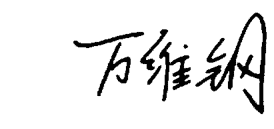


## 日课精选

Aa
字号

写留言

4

请朋友读

### 相对论1：一个简单的信念

相对论1：一个简单的概念

从今天开始，我们就来讲讲爱因斯坦的狭义和广义相对论。

相对论对绝大多数人来说是个神秘的理论。你肯定已经听说过有关相对论的一些有趣的和怪异的结论，比如说，一个物体在高速运动的时候，它的长短会变短，它的时间会变慢。

咱们假设有一个距离地球40光年远的星球。光需要走40年才能到达那里。那么如果以80%的光速前往那个星球，你得飞行50年才能到达那里，对吧？在留在地球的我们看来确实是这样。如果出发的时候20岁，到达的时候应该是70岁吗？

不是。根据相对论效应，高速运动的物体的时间会变慢。寻常的50年对你来说只有30年，你到达的时候，只有50岁！而你是能以99.5%的光速飞行，你的时间将会比我们慢10倍！

这也就是说相对论效应可以让人穿越到未来。这个世界为什么是这样的？这不是科幻，而且这仅仅是开胃菜……相对论，本质上是关于时空的理论——时空跟我们寻常想象的完全不同。正是由于有了相对论，我们才知道有黑洞这种东西，我们才知道空间居然会膨胀，我们才知道宇宙有个起源。

而相对论是一个出了名的难以理解的理论。据说爱因斯坦刚刚发表狭义相对论的时候，全世界只有2.5个人能理解。等到相对论已经被物理学家广泛接受、爱因斯坦爆得大名，公众又理解不了了。我记得欧洲当时还出了一本书叫《一百个反对爱因斯坦的作家》——而爱因斯坦对此的回答是“如果相对论真的错了，有一个人反对就够了。”

那相对论真的这么难吗？你要知道爱因斯坦发表狭义相对论是在1905年，距离今天已经100多年了。我们没有理由不能理解一个清朝末年就出来了的理论！

所以我就想在咱们《精英日课》专栏用一个小专题的形式，给你彻底讲明白相对论。相对论的数学很简单，但我们重点还是说它的思想。

相对论会对你的世界观产生重大影响。作为一个现代人，如果不理解爱因斯坦相对论，你就错过了这个世界最精彩的东西。一旦理解了相对论，你就不再是以前的你，你就再也回不去了。但是光知道一些奇妙的结论可不算理解。

我有一个好消息。相对论是简单的。这是一个干净利索的漂亮理论。

但简单不等于容易。简单——的东西可以非常深刻。

#### 1.一个信念

咱们先来考虑一个思想实验。假设你在艘豪华游轮上旅行，这艘游轮在海上开的速度很快，但是它非常平稳，没有任何颠簸。游轮上有个全封闭的大厅，里面有游泳池有球场，你甚至还可以在里面做物理实验。

那请问，在不和外界发生任何联系的情况下，你能判断出这艘游轮是在前进还是静止不动吗？

你可以做各种实验。比如说把球抛到空中，在静止的情况下，球会落回你的手里。可是封闭游轮里也是这样，球也会落回你的手里。你向游轮前进的方向射门，同在游轮上的守门员只会感到你射门的寻常速度，而不需要考虑游轮的速度。

只要游轮的速度平稳不发生变化，你就无法判断它是在运动还是静止！其实我们生活的地球就相当于这样一个游轮。地球绕太阳公转的速度是每秒29.8公里，比飞机快的多，但因为地球走得几乎是一条直线，你完全感觉不到它正在高速前进。

这个道理，最早是物理学的祖师爷伽利略想明白的。你在速度是每小时50公里的游轮上建立一个坐标系研究物理学，我在地面建立一个坐标系，咱们其实是对等的。你相对于游轮是静止的，相对于我就是运动的。你向前射出一支箭，箭相对于你的速度是每小时360公里，那相对于我就是每小时360＋50＝410公里。

不跳出自己的坐标系往外看，你单纯做一个射箭、抛掷球之类的实验无法区分运动和静止。匀速直线运动和静止没有本质区别，速度都是相对的。

这个其实就是相对论，这就叫“伽利略的相对论”。


后面咱们讲广义相对论的时候你还会知道，其实不一定是匀速直线运动，加速运动跟静止也没有本质区别……到时候再说。

总而言之，物理学家看破了运动。在物理学家的眼中，运动和静止其实是一回事儿。

#### 2.看破世间繁华

物理学，有点看破红尘的意思。

以前人们眼中非常不一样的两个东西，物理学家发现它们其实是一回事儿，这是物理学统一世界的一个主旋律。

古人认为大地静止不动，日月星辰都绕着地球做完美的圆周运动。天和地，截然不同。可是后来天文学家精细的观测发现不对，天体运行的轨道并没有那么完美，很复杂。

结果哥白尼就提出来，说如果你把太阳当做是静止不动，想老地球和其他行星都在绕着太阳做圆周运动的话，你就容易解释以前解释不了的一些轨道。地球，不宇宙的中心。

这个日心说就有点看破红尘的意味。哥白尼等于是说地球和天上的那些天体没有本质的区别，天和地是一回事儿！

天主教会受不了这个学说，而物理学的思想解放才刚刚开始。哥白尼那时候人们还以为行星都是做圆周运动，而且是有一些小精灵在推着行星运动……等到天文学家开普勒的时候，他就提出行星绕着太阳转的轨道并不是完美的圆形，而是一个椭圆。开普勒甚至已经提出行星不需要什么精灵推着走，只要太阳给行星一个吸引力就就行。开普勒，把行星给看破了。

等到牛顿一出手，就把引力也给看破了。牛顿说不但太阳和地球之间有引力，地球上的所有有重量的东西之间都有引力。引力普遍存在，天上和地上真的是真是一回事儿。

这几次“看破”之后，当然还得再结合数学方程式和天文观测，物理学就成了一个非常成功的理论。咱们看看“牛顿三大定律”中的前两个——

第一定律说是在没有外力的作用的情况下，任何一个物体将会保持匀速直线运动或者是静止。匀速直线运动和静止一样，无需外力，无需解释。

第二定律说，力，会改变物体的运动方式。注意这里面有个关键的点，力不是*运动的原因*——没有力，物体本来也在匀速直线运动。力，是*改变*运动的原因。如果是一个理想的光滑平面，上面的一个滚动的乒乓球会一直前进——生活中的乒乓球之所以会停下来，是因为平面给了它提供了摩擦力。一直动不停，无需解释；动着动着停下了，才需要有个原因。

这两个定律都离不开伽利略的相对论。力只能带来*加*速度，单纯的速度跟力无关。匀速直线运动和静止都没有力，所以物理定律在游轮和地面是一样的。

其实你不做试验也能想明白，单纯谈速度真没啥意义。宇宙中你来我往，可能距离地球很遥远的一个星球，跟我们之间就有个特别高的相对速度。那你说，那个天体上的物理定律会和咱们这里有什么不一样吗？不会的。在那里的外星人看来他们是静止的，我们才是在高速运动。

所以相对论是物理学家的一个信念。这个信念也可以叫“不特殊论”：不管你的速度有多快，你的坐标系都不特殊。

这个信念实在太简单也太完美了。完美到简直是宁可海枯石烂，宁可扭转时空，物理学家也不应该放弃它……

#### 3."相对论与哲学家"

爱因斯坦的相对论其实是伽利略相对论的延伸。伽利略相对论是说如果你不往自己的坐标系之外看，你做任何抛小球之类的*力学*实验都无法判断自己是运动还是静止——而爱因斯坦相对论则是说，不用限制在力学，你*不管做什么*实验都无法判断自己是运动还是静止。

那你说这句话能有啥问题？相对论这不很容易吗？这简直就是哲学！

还真是这样。哲学家很喜欢谈论相对论。但是物理学家对哲学家有时候是嘲讽的态度。有一套特别厉害的物理学教材叫《费曼物理学讲义》，是大概有史以来最有趣的物理学家理查德·费曼在加州理工学院给本科生讲课的记录。费曼在这个讲义里专门设置了一个小节，叫“相对论与哲学家”。

费曼说，有些哲学家把相对论想的特别容易。哲学家听说 了相对论的这个信念，就觉得这对我们哲学家来说不是明摆着的原则吗？不跳出自己的坐标系你当然不知道自己是运动还是静止！物理学家折腾半天，结果还不是我们哲学家等候多时了吗？

是吗？相对论如此平凡吗？哲学家坐在家里喝着茶就能想出来吗？牛顿以后的物理学之所以不叫哲学了，就是因为物理学不是坐在家里就能想出来的学问，物理学家靠的是数学、实验和观测。

接下来我们要讲的事实，足以让费曼嘲笑那些哲学家。因为它足以让所有人——包括你、哲学家和物理学家——都目瞪口呆。

这件事就是光速在所有坐标系下都是一样的。

咱们再回到游轮。假设站在游轮上的你不是向游轮前方射出一支箭，而是用手电筒打出一束光，你猜这束光的速度应该怎样。相对于你来说，光速是每秒30万公里。

那既然你跟站在地面上的我的相对速度是每小时360公里——也就是每秒0.1公里，根据刚才伽利略的算法，我眼中这束光的速度就应该是每秒30万.1公里，对吧？

物理学家发现，不是这样的。不管你跟我的相对速度有多快，我测量和你测量这束光的速度*都是每秒30万公里*！

可这怎么可能呢？我们这个世界怎么会是这样的呢？

这件事，哲学家坐在家里喝多少茶都发现不了。你之所以觉得它怪异，只不过是因为你生活的范围实在太小了，你的见识太有限了。

有些信念可以坚持，但是别忘了，有些常识是错的。咱们下一讲再说。


🌼🌼🌼 学习进步群


活码长期有效

### 相对论2：英雄与危机

相对论2：英雄与危机

物理学这个学科的一个特点是有太多的英雄人物。如果你不理解他们都干了什么，对物理学家保持不明觉厉、敬而远之的态度，你完全可以踏踏实实地过好这一生。可是如果你一旦真正理解了这些英雄做的事情，你可能就再也不愿意老老实实地享受岁月静好了。你可能会“一见杨过误终生”。

在讲爱因斯坦的丰功伟业之前，咱们先说另外一个英雄，英国物理学家詹姆斯·克拉克·麦克斯韦。麦克斯韦统一了电磁学。这个工作有多么不起来？费曼是这么说的——

> “从人类历史的长远观点来看……几乎无疑的是，麦克斯韦发现电动力学定律将被判定为19世纪最重要的事件。与这一重要科学事件相比，发生于同一个10年中的美国内战，将褪色而成为只有区域性的意义。”

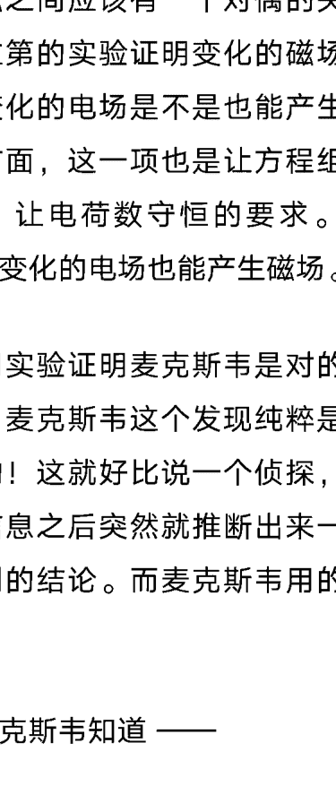

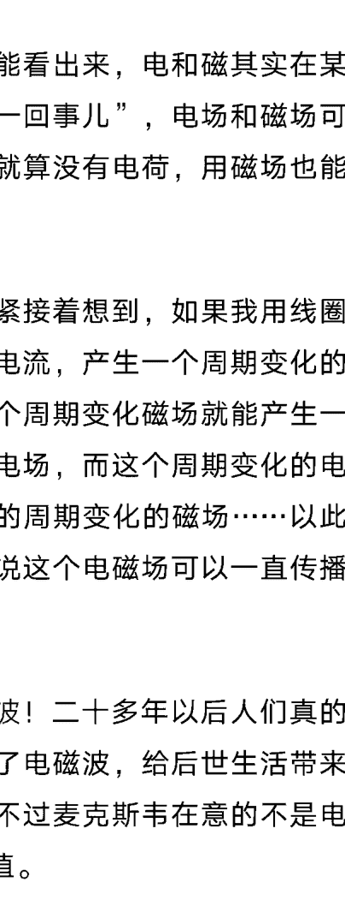

麦克斯韦干的这件事，可以吹好几辈子。今天我把这个事儿给你讲一讲，我都感觉与有荣焉。你如果能把这个工作给听懂，你也会有一种自豪感。

这件事直接导致了爱因斯坦相对论的创立。整个过程好像是一个奇幻电影。一开始大家本来过着寻常的日子，突然就有人弄了个大事件。因为这个大事件，人们就意识到这个世界有点不太对。你抓住这一点点不对，仔细追究下去，你就打开一扇大门。这扇大门一打开，寻常的日子就不存在了，影片从此进入奇幻世界……然后你就期待续集吧。

咱们先从寻常的物理现象说起。

#### 1. 一点电磁学

我们在生活中能接触到的物理现象其实就那么几种。你搬运东西、测量一个什么运动的速度，那是力学；你能看到周围的事物，欣赏各种颜色，那是光学；你家里的一些家用电器，几乎都来自电磁学。

电磁学并不神秘。什么是电呢？电就是电荷之间的相互作用。电子带负电，离子带正电，电子跟离子之间就有一个吸引力，而两个电子或者两个离子之间就有一个排斥力，也就是同性相斥，异性相吸。

那么什么是磁呢？磁来源于电，是电荷的运动产生磁。一段导体中有电流，它周围就会有磁性。像我们平时看到的磁铁，也无非就是其中原子排列的很整齐，每个原子周围电子的运动带来的磁力。

而如果用物理学家的眼光理解电磁现象，你必须得掌握一个概念，叫做“场”。

两个电荷之间发生吸引，请问这个吸引力是怎么感觉到的呢？难道一个电荷*隔空*就能感受到另一个电荷的存在吗？这里可没有什么“超距作用”。每个电荷都会在自己的周围形成一个“电场”，另一个电荷不是跟这个电荷直接发生相互作用，而是跟这个电荷的电场发生相互作用——


图中那些带箭头的曲线就是电场的形状和走向。类似地，磁力，其实也是以“磁场”的形式在周围空间存在——


确切地说，是所有的电场和磁场重叠在一起，形成一个总的电磁场，然后各个带电物质根据自己所在位置的电磁场来决定自己怎么运动。

电磁场可不是物理学家的想象，而是客观存在的东西，你完全可以用仪器探测出来。我记得爱因斯坦曾经有一句话说，“场，就好像我坐的这把椅子一样真实。”当然现在有些神神叨叨的人说气功高手能体察到“能量场”、名人的周围有“气场”，那些“场”就不是电磁场了。

好，现在麦克斯韦出场。

#### 2. 麦克斯韦的壮举

麦克斯韦之前的物理学家已经对电磁现象做过各种研究。特别是法拉第，在实验室里发现，变化的磁场能够带来一个电流，也就是说“磁能生电”。像这些电磁现象都很有意思，你完全可以编写一本书，列举科学家已有的电磁学知识——但是这些知识有点杂乱无章，就好像一本写满了各地风土人情的菜谱。

麦克斯韦要做的事情，有点像是一位好学的武林高手，博采各家之长，融会贯通之后，创立了自己的武学。

这门学问不但是统一江湖，而且还推演出一些前人根本没想到过的新物理来。

1860年代初期，麦克斯韦提出一组总共四个方程，来描写*所有*的*电磁现象。这就是著名的麦克斯韦方程组，它们写出来非常漂亮——

```
∇·E→ = ρ/ε₀
∇·B→ = 0
∇×E→ = −∂B→/∂t
∇×B→ = μ₀J→ + 1/c² ∂E→/∂t
```

前三个方程分别说的是（1）电荷产生电场；（2）没有磁荷；（3）变化的磁场也能产生电场。第（4）个方程右边第一项说的是电流产生磁场，所以这些都是当时已知的物理知识。

我们重点说说它的第二项。这一项就是麦克斯韦的独特发现。一方面，是麦克斯韦考虑电和磁之间应该有一个对偶的关系。那既然法拉第的实验证明变化的磁场能产生电场，变化的电场是不是也能产生磁场呢？另一方面，这一項也是让方程组在数学上自洽、让电荷守恒的要求。这一项，就是说变化的电场也能产生磁场。

后来人们用实验证明麦克斯韦是对的。但是请注意，麦克斯韦这个发现纯粹是理论推导出来的！这就好比说一个侦探，听取了各方的信息之后居然就推断出一个人们意想不到的结论。而麦克斯韦用的仅仅是数学。

好，现在麦克斯韦知道——

+   * 变化的磁场能产生电场
* 变化的电场又能产生磁场

那首先你就能看出，电和磁其实在某种程度上是“一回事儿”，电场和磁场可以互相产生，就算没有电荷，用磁场也能产生电场。

但麦克斯韦紧接着想到，如果我用线圈弄一个震荡的电流，产生一个周期变化的磁场，那么这个周期变化磁场就能产生一个周期变化的电场，而这个周期变化的电场又能产生新的周期变化的磁场……以此类推，岂不是说这个电磁场可以一直传播下去吗？

这就是电磁波！二十多年以后人们真地在实验中制造了电磁波，给后世生活带来巨大的影响，不过麦克斯韦在意的不电磁波的实用价值。


麦克斯韦可以用他的方程组直接计算这个电磁波的传播速度。他算出来电磁波速度，发现跟光速，的数值是一样的！

光是有速度的。你打开一盏灯，光线不会瞬间传播到宇宙的另一头去。当时的人已

瞬间传播到宇宙的另一头去。当时的人已经在实验中测量了光速。而且早在1801年人们就已经知道光是一种波。但是人们并不知道光到底是怎么回事。

而现在麦克斯韦计算得出的电磁波的速度正好是光速，于是麦克斯韦大胆宣称，光，其实就是电磁波。后来人们证实果然是这样，我们平时所见的可见光无非就是特定频率的电磁波而已。

这是物理学家再一次看破了红尘。天上的东西和地上是一回事儿，匀速直线运动和静止是一回事，电和磁是一回事儿，而现在麦克斯韦说，光跟电磁场，其实也是一回事儿。

这么一来，物理学的逻辑结构就变得更简单了。牛顿力学加上麦克斯韦电磁学，身边的一些物理现象等于就是都被理解了。这绝对是英雄的壮举。

但是这个成就里边有一个危机。

#### 3.危机

咱们先瞅一把麦克斯韦的发现——

- 1. 他用四个方程概括了所有电磁现象；
2. 他发现变化的电磁场可以互相产生，从而推导出电磁波；
3. 他计算出电磁波的速度正好是光速，从而说明光其实就是电磁波。

现在我们知道了，光速，是电磁现象所要求的结果，是可以用数学计算出来的。

那好。请问，你麦克斯韦计算出来的这个光速，是*相对于*谁的呢？

从逻辑角度，你不能脱离坐标系（或者叫“参照系”）谈速度。

比如说，你站在一个快速行驶的船上，船的速度是每小时50公里。你在船上射出一支箭，你平时射箭的速度是每小时100公里，那这个“每小时100公里”就是相对于船上的你来说的。

而相对于站在岸边的我来说，箭的速度就应该是每小时 50+100 = 150公里，对吧？速度都是相对的。

那麦克斯韦方程组解出来的光速是相对于谁呢？这个问题可以有两种答案。

老百姓的直觉是，光速肯定是相对于光源的。你打开手电筒射出去一束光，那这个光速肯定是相对于手电筒啊——但是这个说法很快就被物理学家给否定了。

宇宙中 有一种“双星系统”，就是两个临近的恒星互相绕着对方旋转，谁也离不开谁。从我们这里观察，就总有一颗恒星在向着我们运动，另外一个恒星向着我们相反的方向运动——


如果光速是相对于光源的速度，那么向我们走的这个恒星的光速就应该更快一点，离我们而去的恒星的光速应该更慢一点——


这个速度差异并不大，但是因为双星距离我们十分遥远，星光到达我们需要的时间就很长，这一点点速度差异就足以让我们观察到两颗星的星光有一个延迟。

可是天文学家观测了各种双星系统，从来都没有看到任何延迟。两个恒星的光速始终都是一样的！

这说明光速跟光源的速度无关。物理学家对此并不感到惊讶，因为电磁波本来就是脱离最早产生它的电荷和电流而独立存在。波，毕竟不是射出去的箭。

物理学家设想，光其实是遍布宇宙空间的某种介质的波动，而光速就是相对于这个介质的速度……可是当时的 人万万没想到，这个解释的问题更大。

咱们下一讲再说。

### 相对论3：光速啊，光速

相对论3：光速啊，光速

相对论已经到了第三讲，爱因斯坦的理论还没有出场，而我们做这么多铺垫都是值得的。真正的精彩不在于相对论的结论，而在于思辨的过程。前两讲，我们说了两件事情。

第一，匀速直线运动和静止没有区别。物理定律——至少是力学的定律——应该在所有匀速直线运动或者静止的坐标系下是一样的。

第二，麦克斯韦解方程解出来一个光速，可是物理学家有个疑问：这个光速是相对于谁的呢？

如果光速是相对于光源的速度，那没问题，这两个事实不矛盾。但是我们讲了，实验观测表明，光速跟光源的速度无关。

于是物理学家相信，光既是一种波动，光速就一定是相对于某种“介质”的速度。

#### 1.波动和“以太”

咱们先说说什么叫“波动”。你往平静的湖水里扔一块石头，水面上就会产生一层层的波纹，慢慢传播出去，这就是波动。用我记得教科书上的话说，波，就是“时间和空间上的周期性运动”。

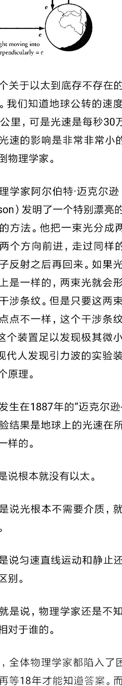

请注意，在波往外传递的过程中，是波的*形态*在传播，但是湖水本身并没有往外传播。湖面上的水有一个局限在当地的来回运动，仅此而已。你看到海浪一层层地来到岸边，那些岸边的浪花只是岸边的水的波动，并不是远方的水跟着海浪一起来了。

在大尺度上，水并没有动，是波在相对于水而动。水是波传递的介质，波传递的仅仅是信息和能量，而不是物质——介质本身，不需要动。

声波也是这样。距离你十米远的人说话，你能听到他的声音，那是声波在空气中传递的结果。声波从那个人的嘴边到达了你的耳朵——但是那个人并没有把他嘴边的空气给吹到你这里。

好，水波是相对于水面的运动，声波是相对于空气的运动——那既然光作为电磁波也是一种波动，它就也应该是相对于某种介质的运动，对吧？

这个假设中的介质，就被称为“以太”。

并不是物理学家观察到过以太的蛛丝马迹，也不是物理学家固执地相信凡是波都必须得有介质——物理学家凭空想象这么一个以太，纯粹是为了回答“光速到底是相对于谁”这个问题。

#### 2.可是没有以太

那以太到底是一种什么东西呢？物理学家可以推算它的性质。

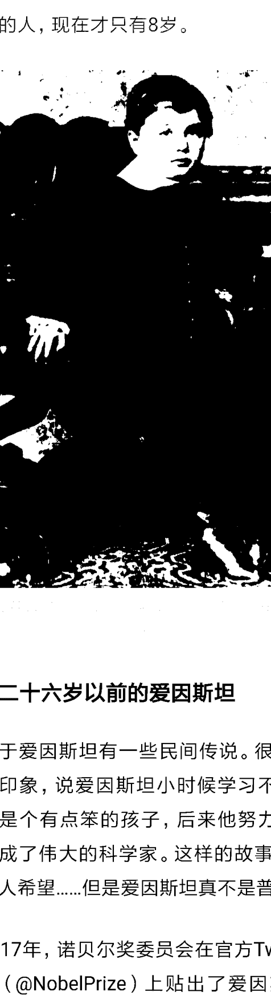

这是一个关于以太到底存不存在的决定性的判据。我们知道地球公转的速度大约是每秒30公里，可是光速是每秒30万公里，公转对光速的影响是非常非常小的，但是这难不倒物理学家。

美国物理学家阿尔伯特·迈克尔逊（Albert Michelson）发明了一个特别漂亮的测量光速变化的方法。他把一束光分成两束，在垂直的两个方向前进，走过同样的距离，经过镜子反射之后再回来。如果光速在两个方向上是一样的，两束光就会形成一个完美的干涉条纹。但是只要两束光的速度有一点点不一样，这个干涉条纹也会被破坏。这个装置足以发现极其微小的速度差异，现代人发现引力波的实验装置也是用了这个原理。

这就是发生在1887年的“迈克尔逊-莫雷实验”。实验结果是地球上的光速在所有方向上都是一样的。

这也就是说根本就没有以太。

这也就是说光根本不需要介质，就能在空间传播。

这也就是说匀速直线运动和静止还真是没有本质区别。

但这也也就是说，物理学家还是不知道光速到底是相对于谁的。

1887年，全体物理学家都陷入了困惑。他们还得再等18年才能知道答案。而提供答案的人，现在才只有8岁。

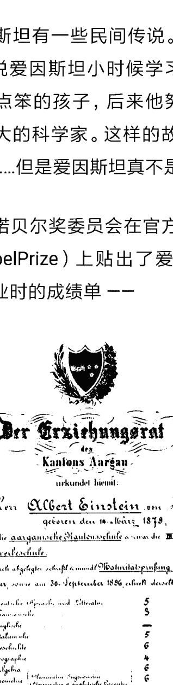

#### 3.二十六岁之前的爱因斯坦

关于爱因斯坦有一些民间传说。很多 人有 个印象，说爱因斯坦小时候学习不好，好像是个有点笨的孩子，后来他努力学习，才成了伟大的科学家。这样的故事能给普通人希望……但是爱因斯坦真不是普通人。

2017年，诺贝尔奖委员会在官方Twitter账号（@NobelPrize）上贴出了爱因斯坦17岁高中毕业时的成绩单——

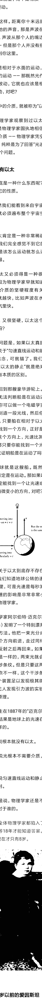

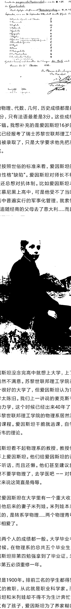

他的物理、代数、几何、历史成绩都是最高分6分，只有法语最差是3分。这些成绩相当不错。我想补充的是爱因斯坦16岁的时候就已经报考了瑞士苏黎世联邦理工学院而且被录取了，只是大学要求他先把高中念完。

不过按照世俗的标准来看，爱因斯坦的确有点性格“缺陷”。爱因斯坦对师长不够尊重，还总想对抗体制。比如爱因斯坦本來是在慕尼黑上高中，可是他受不了当时德国高中普遍实行的军事化管理，就索性退学，追随经商的父母去了意大利……而且连


爱因斯坦没念完高中就想上大学，上了大学仍然不满意。苏黎世联邦理工学院已经是个很好的大学了，但爱因斯坦认为它的教学太陈旧。我们上讲说的麦克斯韦的电动力学，这个时候已经出来40年了，可是苏黎世联邦理工学院的物理系居然没有这个课程。爱因斯坦干脆就逃课，自学麦克斯韦的理论。

爱因斯坦看不惯物理系的教授，教授们也看不上爱因斯坦。他们给爱因斯坦的评价是不听话，而且还懒。他们甚至建议爱因斯坦不要学物理了，去学医吧——对物理学家来说这简直是侮辱。

不过爱因斯坦在大学里有一个重大收获，就是他后来的妻子米列娃。米列娃本来是学医的，是转系学物理……两个物理青年就这样相爱了。

但是两个人的成绩都一般。大学毕业考试的时候，在物理系的总共五个毕业生中，爱因斯坦排第四勉强拿到了毕业证，米列娃排第五必须重修一年。

当时是1900年。排前三名的学生都得到了正式的教职，从此就是职业科学家。而爱因斯坦和米列娃却不得不为生计奔忙。两人又有了孩子，爱因斯坦为了养家糊口还去给人当了一阵家庭教师，后来好不容易在专利局找到了一个低级的工作。

这就是爱因斯坦在1905年之前的生活状况。我想有相似这样经历的求学者可以说是不在少数。心中有一個远大的志向，看什么都不顺眼，面对现实毫不妥协，结果把自己生活搞得很艰难……正所谓“诚知此恨人人有”。


爱因斯坦跟这些人唯一的区别是，到了26岁这一年，他创造了奇迹。

我最近读到一篇杨振宁先生写的文章，叫《爱因斯坦的机遇与眼光》。杨振宁说爱因斯坦之所以能创造奇迹，首先是他极其幸运：“他生逢其时，当物理学界面临着重重危机时，他的创造力正处于巅峰。”

但是光有机遇还不行，因为当时至少有还两个人——洛伦兹和彭加莱——也摸到了相对论的门，但是这两个人都没有成功。杨振宁说“洛伦兹有数学，但没有物理学；彭加莱有哲学，但也没有物理学。”那为什么是爱因斯坦打开这扇门呢？因为爱因斯坦有个“自由的眼光”。

爱因斯坦敢质疑当前现状。爱因斯坦不跟体制和解。杨振宁说爱因斯坦这种“孤持(apartness)”的个性，是他能取得伟大成就的必要条件。

但是你光有机遇和个性也不行。在我看来，爱因斯坦的物理直觉，也许是一种天赋。比如他五岁的时候，就对一个指南针非常感兴趣。小孩对指南针感兴趣很正常，但爱因斯坦的思路不一般——他觉得指南针说明我们所处的这个空间有问题！空间不是各向同性的，居然有一个特殊的方向！

爱因斯坦16岁就写了第一篇物理论文，这篇论文的题目就是……《磁场里以太的状态的研究》。他就问了一个问题，说如果我以光速在运动，那我看到的光，会是什么样的呢？难道光会是静止不动的吗？

当时爱因斯坦就说，他认为不会是那样——他说根据麦克斯韦的理论，不管我是什么速度，我做实验弄出光波来，光波还是会以光速在运动。

一般情况下师长们都告诉你要适应世界。爱因斯坦不是来适应世界的。他是来改变世界的。


得到更多｜太...说：地球行经承载光的介质以太
以太 (Luminiferous aether, aether 或 ether) 或译为光以太，是古希腊哲学家亚里士多德所设想的一种物质，为五元素之一。19世纪的物理学家，认为是...曾被假想的电磁波的传播媒质。但后来的实验和理论说明，如果不假定"以太"的存在，很多物理现象可以有更简单的解释。也就是说，没有任何观测证据表明"以太"存在，因此"以太"理论被科学界抛弃。——维基百科


## 活码长期有效

### 相对论4：刺激1905

相对论4：刺激1905

只要你活得足够长，见识足够广，你就会发现所谓“平凡的日子”，其实是一个假象。我们生活的这个世界非常喜欢搞事情，其中有一些不可思议的大事件。

纳西姆·塔勒布在《随机生存的智慧》这本书里有句话说，100个人里面，50%的财富，90%的想象力，和100%的智力勇气，都是集中在某一个人身上——尽管不一定是同一个人。

这个世界就是这么喜欢不均匀的分布。

1905年这一年，全世界的智力勇气，大约都集中在爱因斯坦身上。

#### 1.奇迹

现在我们一般把1905年称为“爱因斯坦奇迹年”。我记得2005年的时候，物理学家们还专门组织活动纪念爱因斯坦奇迹年的一百周年——别的名人都纪念诞辰或者逝世多少周年，而爱因斯坦应该按照奇迹年纪念。

伯尔尼瑞士专利局的助理鉴定员阿尔伯特·爱因斯坦，利用业余时间开展科学研究，于1905年发表了六篇物理学论文。其中四篇，用物理学家杨振宁的话说，引发了人类关于物理世界的基本概念——时间、空间、能量、光和物质——的三 大革命。

1905年6月9日，爱因斯坦发表《关于光的产生和转变成一个启发性观点》。当时物理学家认为光是一种连续的波动，而爱因斯坦在这篇论文里针对“光电效应”这个现象，提出一个解释，说光的能量不是连续变化的，而是一份儿一份儿的——是“量子”化的。这篇论文开启了量子力学。

#### 2.爱因斯坦的断言

#### 3.时间的膨胀

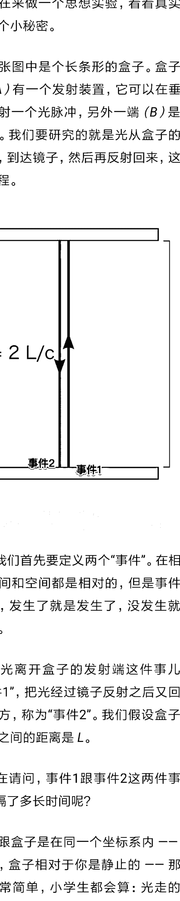

一切匀速直线运动或者静止的坐标系下，物理定律都是一样的，句号。

c = 299,792,458 米/秒。

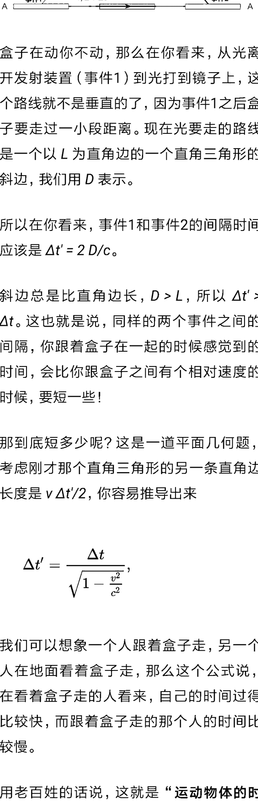

盒子在动你不动，那么在你看来，从光开发射装置（事件1）到光打到镜子上，这个路线就不是垂直的了，因为事件1之后盒子要走过一小段距离。现在光要走的路线是一个以 L 为直角边的一个直角三角形的斜边，我们用 D 表示。

所以在你看来，事件1和事件2的间隔时间应该是 Δt' = 2 D / c。

斜边总是比直角边长，D > L，所以 Δt' > Δt。这也就是说，同样的两个事件之间的间隔，你跟着盒子在一起的时候感觉到的时间，会比你跟盒子之间有个相对速度的时候，要短一些！

那到底短多少呢？这是一道平面几何题，考虑刚才那个直角三角形的另一条直角边长度是 v Δt' / 2，你容易推导出出来

```
Δt' = Δt / √(1 - v² / c²)
```

我们可以想象一个人跟着盒子走，另一个人在地面看着盒子走，那么这个公式说，在看着盒子走的人看来，自己的时间过得比较快，而跟着盒子走的那个人时间比较慢。

用老百姓的话说，这就是“运动物体的时间会变慢！”

我们推出这个怪异的结论，唯一用到的假设就是光速不变。在寻常的情况下，比如你让一个初中生做这道题，他一定会假设时间不变，是光速要变。

所以你一定得非常相信光速在任何坐标系下都不变才行。

#### 4. 寻常不寻常

怎么理解时间变慢这个现象呢？是我们测量用的表有问题吗？不是。

根据相对性原理，物理定律在任何一个匀速直线运动的坐标系都应该一样，表根本就感觉不到自己是在运动还是静止。不但表感觉不到，如果你跟着盒子一起动，你的意识、你身上的每个细胞，组成你的每个原子，也都感觉不到任何问题。

是时间本身，变慢了。

而这个“变慢”也是相对的。运动的你完全感觉不到慢，是在地面不动的我，觉得你慢。

## ｜禅定时刻

如果你觉得相对论怪异，那这一切的怪异都是来自光速不变。可是光速为啥不变呢？

复旦大学中文系的严锋教授，曾经有个调侃，说我们这个宇宙其实是一个计算机模拟，因为系统的计算能力有限，所以必须给光速设这么一个上限。

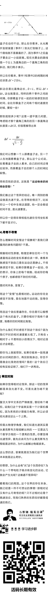

### 要做事，不要做“人”

要做事，不要做“人”

现在有个流行的概念叫“认同感”，是一个影响力工具，可以左右别人和自己的行为。比如以前我听说有人在美国德克萨州做过一个研究。有些人开车的时候爱往路上扔垃圾，研究者测试了两种劝人不乱扔垃圾的广告词。一种方法是直接说，“保护环境，不要乱扔垃圾！”效果很不好。另一种方法就是激发人的认同感：“我们德克萨斯人不乱扔垃圾！”效果就很好。

以前我们经常在网上看到的“不转不是中国人”，也是这个意思。一旦激发了认同感，做事就是自动的：因为我就是这样的人，所以我肯定要做这样的事儿。

我们隔壁马雪骏老师的专栏解读过《鹦鹉螺》的一篇报道 [1]，列举了很多有关认同感的研究。比如实验表明，在考试之前，如果你跟学生说，我相信你们都是诚实的人——给学生贴个“诚实的人”的标签，考试作弊的比率就会显著下降。

所以认同感真的很有用。当然认同感也有坏处。现在人们分析美国政治，一个突出问题就是人们对自己所隶属的政治阵营的认同感太强。认同感太强了，你就做一些党同伐异的事，你不会顾事实，只认阵营。

#### 1.认同感和思维模式

人们经常用认同感来激励别人成长。老师和家长们都喜欢用这招：你是好孩子，你得如何如何；你是聪明孩子，你要如何如何……

但是，这可能不是一个好办法。我们专栏第二季有篇文章叫《提高学习成绩的最简单方法》，讲了斯坦福大学心理学教授卡罗尔·德韦克（Carol Dweck）的“思维模式”理论。德维克说人有两种思维模式，一个叫“成长思维模式（growth mindset）”，一个叫“固定思维模式（fixed mindset）”。

#### 2.怎样改善自己的性格

我要说的第二个研究来自美国的南方卫理公会大学 [4,5]。这一次的受试者是377个大学生，项目是改善性格。很多人对自己的性格不满意，有的人希望变得更外向一些，有的人希望头脑能更开放。研究者想问的问题是，性格，是说改善就能改善得了的吗？

#### 3.做人和做事

所有这些研究都还没有最后定论，需要不断地探索和验证，但是我觉得这些证据已经……

断地探索和验证，但是我觉得这些证据已经足够带给我们一点启发了。

简单的说，固定思维模式，就是琢磨自己是个什么人，也就是认同感。而成长思维模式，考虑的则是自己下一步该做啥事儿。

我先说明一点，成长思维模式要求我们夸孩子要夸他努力，不能夸他聪明 —— 但是请注意，这一招对孩子是好使，对成年人可不能这么用。也是2018年的一个新研究[6]发现，一个领导要是夸自己的手下工作很努力，他会觉得这是等于是在说他不够聪明。这也许是因为成年人已经不在乎成长了，固定思维模式实在太强大。

那怎么理解认同感对成长的作用呢？根据前面这些研究，这个机制也许是这样的 ——

对于一个在某一方面处于蒙昧状态、没有什么时候明显认同感的人来说，建立认同感对人的激励很有效果。如果一个小孩根本就没想过自己是不是个爱帮助别人的人，你突然给他戴一项这样的帽子，他会给你一个积极反应。人的确可以出于认同感去做一些事。

但是成长初期的认同感非常脆弱。在这个时候人并没有真正的自信。这就表现在一旦遇到了任何挫折，比如一件事情没做好，或者该做的任务没有做，他就会质疑自己的认同感。

比如说，家长总夸自己的孩子聪明，一开始孩子也信了，跃跃欲试，很想跟别的孩子较量。可是等他遇到真正的难题，发现自己的水平并不比别的孩子厉害，他就会觉得家长一直在哄他。他反而会认为自己其实是个非常不聪明的人。

坚实的认同感得有自信作为基础。自信不是来自别人告诉你你是什么人，或者你自己想做什么人 —— 自信来自一次一次把事情做成。

其实以我之见，哪怕一个人真的水平很高，有强烈自信，也不应该在乎自己身上的标签。标签和认同感，任何时候都是固定思维模式。你是科学家，你就应该性格内向吗？你是程序员，你就应该只研究编程吗？我们应该关心的是下一步该做啥事儿，而不是自己头上是什么标签。

“人设”，其实是个枷锁。

参考文献
[1] 马徐骏·新知报告 038|学会正确地给别人“贴标签”；Should You Tell Everyone They're Honest? CHRISTIAN B. MILLER, Nautilus, June 28, 2018.
[2] Emily Foster-Hanson et al., Asking Children to “Be Helpers” Can Backfire After Setbacks, Child Development, 19 September 2018.
[3] Emma Young, Growth mindset doesn't only apply to learning – it's better to encourage your child to help, than to be “a helper”, BPS Research Digest, October 15, 2018.
[4] Hudson, N. W., Briley, D. A., Chopik, W. J., & Derringer, J. (2018). You have to follow through: Attaining behavioral change goals predicts volitional personality change. Journal of Personality and Social Psychology. Advance online publication.
[5] Christian Jarrett, Merely desiring to alter your personality is not enough, and may backfire unless you take concrete action to change, BPS Research Digest, November 1, 2018.
[6] Reavis, R. D. et al., Effort as Person-Focused Praise: “Hard Worker” Has Negative Effects for Adults After a Failure, The Journal of Genetic Psychology, Volume 179, 2018 - Issue 3.


活码长期有效


## 为什么你应该想“系统”？

为什么你应该想“系统”？

万维钢

这一讲的内容是我给《系统思维的艺术》写的序言，这本书在咱们日课第二季里曾讲过。这篇序言，希望能帮你加深对系统思维的理解。

你肯定知道“系统”。你可能经常使用“计算机系统”、“医疗系统”这些说法。一堆互相之间有关联的东西，如果我们说这是一个“系统”，其中似乎就应该有一些高级的说到。那是什么说到呢？可能一般人只是觉得这么说更正式而已。

系统思维，并不是我们中国传统文化的一部分......事实无论任何一个传统文化里都没有系统思维。你不会在东西方的经典里发现系统思维的智慧，古代圣贤没说过有关系统思维的名言。系统思维是个完全现代化的思想，过去这几十年才刚刚成起来。

到底什么是系统思维？既然古人没有这个思想日子也照样过，为什么现代人应该学习系统思维呢？我想要给你简单说说。

人的思维习惯，一般情况下考虑问题，都是只考虑一个东西。

这个工具怎么用，这件衣服好不好看，这个人可不可以信任，这个店铺值多少钱......你把这一东西搞明白了，问题通常也就解决了。

这个思维习惯非常强大，以至于当我们面临明显是好多东西的问题的时候，也是从“一个东西”入手。

我们常常把一群人或者一个组织，默默地当做一个人。比如说“球队休息得不涣散”、“咱们公司现在是高速成长”、“政工军心涣散不堪一击”，其实都是用一个拟人的形象代表了一大堆东西。这种思维其实还是在研究“一个东西”。

如果非得深入到内部去研究一堆东西，我们又习惯于把这一堆东西的运行机制归结到一个人身上。比如“领导干部要起带头作用”、“榜样的力量是无穷的”、“兵熊熊一个将熊熊一窝”、“君子之德风，小人之德草”，说的都是想让一个人去带动一堆东西，这仍然是“一个东西”思维。

那么如果出了问题，原因通常也就只有一个，而且通常是因为有“坏人”。公司业绩不行，那么肯定是CEO没能耐。长平之战四十万赵军被灭，那是因为主将赵括纸上谈兵。

这种把什么事情都归结于一个东西的思维，我们可以叫做“线性思维”。线性思维很多时候是好使的。比如现在突然爆发了一个传染病，那你最需要解决的就是这个病毒的问题，病毒就是这个坏人。找到病毒的抗体，问题就能解决。

古人的思维能力，基本上就到这里了。只能看到一个东西。很多管理者要求手下“团结如一人”、“如臂指使”、“统一思想”，除了团结有时候真有好处之外，大约也有思维方式的原因。把一堆东西变成一个，他才能思考。

但真实世界并不总是这样的——事实上，真实世界通常不是这样的。

比如说，让你管理一个自然保护区，你要怎么做，才能把它给做大做强呢？保护区里有老虎，有鹿，有草地。

你不可能把这些东西当做一个东西。老虎和鹿不可能团结如一人。老虎太多，鹿就会大幅度减少，那是你不愿看到的。可是如果老虎太少，鹿没了天敌就可能大量繁殖，那草地又受不了。你要怎么做，才能让保护区和谐、可持续地发展呢？

这就是系统思维出场的时候。首先你得把保护区看做一个“系统”，而不是一个东西。所谓“系统”，关键就在于它不仅仅是一大堆东西在一起，而必须是这些东西之间要存在强烈的关联。你把其中任何一个东西弄得再明白也没用——你必须理清各个东西之间的关系，才能解决系统的问题。

线性思维考虑的是一个点。系统思维考虑的是很多个不同的点，以及这些点之间的关系。

系统思维不属于任何一个传统的学科，不是物理学、不是数学、不是哲学也不是通常的管理学。系统可以是一个生态环境，一个公司，一个学校，一个经济体，或者是你自己的一堆工作。这些系统看起来非常不一样，什么领域都有，但是它们内部的互动关系，有一些共同的特征。

比如说，系统内部有各个部门——或者叫做“元素”。这些部门有一个共同的大目标，比如说所有中国人都希望中国经济地越来越好，所有生物都希望一个生态环境是美好的。但与此同时，各个部门又都有各自的利益和小目标。这些小目标不会跟系统的大目标完全一致。

那么当一个领导说各个部门要“齐头并进”的时候，他可能根本不知道自己在说什么。有些部门获得的资源会增加，有些部门的资源就减少。有创新，就有淘汰。系统中各个部门不一定都有自由意志，但是它们都不会按照你的意志行事。

再进一步，系统的各个元素之间，通常有比较稳定的关系。老虎总是吃鹿的，校长总是管着老师，而学生不能管老师。

系统思维，会从这些关系之中寻找“反馈回路”。如果你关注系统中某一个量的库存，那么正反馈回路会让这个库存不断地增加或者减少，而负反馈回路则是想要把库存维持在一个稳定的水平上。

书中有很多具体的例子，咱们随便说个简单的。比如说赚钱。你库存的钱越多，就可以用更多的钱去投资，你投资产生的利润就越多；利润越多，你的钱又会进一步增多。投资——赚钱——投资，这就是一个正反馈回路。反过来来说，税收则是一个负反馈回路。钱越多，你要交的税就越多，这样你攒钱的速度就会放缓一点，同时政府还可以用税收给没有钱的人发一点福利，这样贫富差距不至于太大，系统才能持续发展。

“反馈”这个思想古代也有，有识之士能意识到土地兼并导致“富者愈富贫者愈贫”的机制。但是，古人常常会因此把富人视为坏人，认为要想解决问题就解决富人，这就不是系统思维了。真正的系统思维不但要通盘考虑穷人和富人，还得考虑系统中土地、商品、资源、就业、环境等一系列的元素和它们之间的关系，这种意识古人就不行了。

只有到了现代，我们才有能力去影响一个系统，我们才有机会用系统的眼光考虑问题。

首先你得超越“只看”一个东西的线性思维。很多系统出问题不是因为其中哪个东西坏了，而是东西和东西之间的关系没理顺。

那么你就会知道，直接的命令，往往是解决系统问题的下策。国民生育率低，那么就直接命令妇女多生孩子，这行吗？使用某种反馈机制刺激、调整系统内部的价值差，才是更好的办法。

反馈回路是系统思维的关键。特别是负反馈回路，它能维持系统的稳定运行。如果一个系统发生衰败，你应该首先考查是不是有个负反馈回路有问题。

一个系统不是一个人，政府不是家庭，治大国不是烹小鲜。掌握了系统思维，你就会遏制自己想让一个系统变成一个东西的思维惯性。你会意识到好的系统并不是整齐划一的。最好的系统应该是充满活力，各个部门有自我组织能力，整个系统有演化和谐抗打击的能力，上下级的关系能够达到某种平衡，而不是一切行动听指挥。

你会发现系统思维跟现在流行的一些新概念都是有联系的，比如说“涌现”、“去中心化”、“多样性”等等。而在系统思维这个框架下，你也许能把这些概念融会贯通。

当然不是所有人都有机会去管理一个公司，更不用说治理国家了。但是系统思维对个人也有用。我们以前讲过，美国作家，“呆伯特”系列漫画的作者斯科特·亚当斯（Scott Adams）就把自己的写作事业当做一个系统。

“系统”的意思是亚当斯并不在乎某一个作品能给自己带来多少收入，他在乎的是怎么让自己的写作系统发展起来。他不停地写和画，他测试各种写作技巧。他积累的系统元素不是稿费，而是技艺和声望。

我还讲过，效法亚当斯，你可以把自己的“运气”当做一个系统去经营。只要坚持做正确的事情 —— 也就是大概率能让你“赢”的事情 —— 不计一城一池之得失，不被短期的波动影响情绪，那么长期下来，你就会是一个运气好的人。

所以你看，只要你能意识到系统中有很多很多东西，其中一个单个的东西并不重要，这一点就已经能让你想明白很多事情了。

而如果你有机会做更大的事情，去左右自己之外的系统，那么掌握一点系统思维，对你和对别人，都是幸运的！


### 问答：不存在超光速的信息传递

问答：不存在超光速的信息...

### 来自日课：一个简单的信念

读者 Stone：

万老师，我有个很矛盾的推论：电磁现象发现之前，一些由电磁产生的神奇现象超出了当时人们的理解范畴，他们只能用宗教和迷信来解释。其实现在的手机通信，GPS定位，视频通话等拿到牛顿那个时候，他们也是无法理解的，也许会被划到宗教或者迷信这个类别里面。

那么我们现在无法认识的部分现象（宗教和迷信），是不是在未来的某个时间也有可能被发现或解释，比如时空穿越，起死回生、四维、五维、多维空间等等，那么宗教和迷信是不是可以称作‘还未被发现和解释的物理现象’？

万维钢

我认为并不是这样。宗教和迷信，并不是人们用来解释*未知*现象的，而是用来解释“不按*规律*”的现象。

指南针永远指岀南方，磁石可以吸铁，摩擦能够生电，这些电磁现象，据我所知，并没有被古人用宗教迷信来解释。古人没有说有一个什么神在让磁石吸铁。古人把这些现象当做日常世界的一个性质，给默默地接受了。而且古人还利用这些性质去做事。古人认为这些寻常的事情代表世界本来就是这样，无须解释。

那么为什么有些古人认为闪电这个东西，是天神的动作呢？我认为，根本原因在于，磁石什么的都是稳定的性质，而闪电却是个随机的现象，是不可控的。

### 来自日课：英雄与危机

读者 孙俊峰：

为什么宇宙的膨胀速度可以一直加速呢？万老师在上一季日课中讲过现在宇宙的膨胀速度已经超光速了，那这个速度有没有极限？

万维钢

关于在相对论中速度是如何叠加的，咱们下周会讲。关于物理定律禁止超光速这件事，我们可以记住一句话口诀：不存在超光速的信息传递。这句口诀可以帮助你判断一切超光速现象的真伪。

所谓光速不变，是光*在空间中*的移动速度——严格地说是光在真空中的移动速度——不变；而宇宙膨胀，则是*空间本身*的膨胀。

截此复习：一个简单的信念

读者 潘小浩：

相对论是清朝末年的东西，想到这里我不胜唏嘘。那么除了相对论，还有哪些是即使今天听说依然极其前卫的学问呢？

读者 陈C：

在讲麦克斯韦的发现时，提到“电磁波的速度正好是光速，从而说明光其实就是电磁波。”这里面看上去有一个混淆因果性与因果性的问题，比如说可能电磁波的速度与光速‘正好’一样，或者它们都受到了其他因素的影响。今天我们都知道，可见光只是电磁波中的一个频段，但是在当时，人们是怎么推导并证明这一点的呢？

读者 喵大王：

“因为双星距离我们十分遥远，星光到达我们需要的时间就很长，这一点点速度差异就足以让我们观测到两颗星的星光有一个延迟。”提问：如果能观测到延迟，那这个延迟的表现是什么样子呢？

万维钢

想象有人每天早上给你寄一封信，每天晚上给你寄一封信。如果你收到信的时间也是正好每12小时一封，你就能确信，邮递员送信的速度是一样的，跟早晚无关。如果邮递员送信速度跟早晚有关，你在不同的距离上收，就会出现收信是混乱的，几乎每天任何时候都可能收到一封信，你可能会先收到晚上的信后收到早上的信。

如果光速与光源速度有关，我们观察双星系统会看到模糊的一团光，而不是不管距离多远都是清清楚楚的两颗星！

戳此复习：英雄与危机

### 来自日课：光速啊，光速

读者 浮世绘：

以太和空气有什么区别呢？推测以太性质的时候说它能充满整个宇宙，但又说“相对于以太的静止是绝对的静止”那么就是说空气可能被外界物体改变运动状态和性质，而以太是不会受外界影响的，只是始终静止的呆在一个地方吗？

万维钢

我们文章中只讨论了地球相对以太运动的情况，但当时的物理学家也考虑了地球拖着周围的以太一起运动的情况。如果以太有一定的粘滞性，会跟着地球一起动，那的确，我们在地球上做实验就会看到光速在各个方向一样。但是，如果是那样的话，从地球看远处的星光，在地球公转的不同位置，就会有不同的偏折 —— 而我们没有观察到那种偏折。所以我们只好假设以太不会到处动，只作为宇宙的背景存在。

来自日课：光速啊，光速

### 来自日课：刺激1905

读者 agentle深海：

既然运动是相对的，为什么是它在高速运动，而不是我在高速运动呢？为什么是它的时间变慢而不是我的时间变慢呢？

万维钢

是你和它都在相对于对方的坐标系高速运动，相对于自己则当然都是静止的。你看他的时间比你慢，他看你的时间比他慢。关于这一点，特别是关于“双生子佯谬”，我们下周会专门讲。

戳此复习：刺激1905

### 相对论5：穿越到未来

相对论5：穿越到未来

1905年是大清光绪三十一年，可是直至今天，狭义相对论仍然是个激动人心的理论……而且我有时候感觉仍然生活在清朝。

现在有些知识分子还在反对相对论。我曾经看到一篇来自燕山大学的，2007年发表的正规论文，叫《狭义相对论的本质及对科学哲学和社会的影响》，列举了各种反对相对论的观点，引用了50多篇参考文献，说狭义相对论是“科学体系中的一颗毒瘤”。

这些反对者连基本概念都没搞明白，但是他们仍然能找到发表论文的地方。所以我有一点感慨。任何一个理论，你要想找都能找出来在历史上的争议，包括各路权威的反对意见。如果你没有区分对错的能力，你只能说这个学问“非常复杂”，越琢磨越糊涂。而如果你想专门去黑或者去捧一个学说，你完全可以得出自己想要的任何结论。

面对这样的事儿，你很可能会陷入虚无主义……难道这个世界就没有对错了吗？

当然不是！科学之所以是科学，就是它有办法判断对错。科学方法首先就是一套判断对错的方法。

相对论是一个非常“对”的理论。当然我并不是说将来绝不会有更好的理论可以取代它，但是在当前实验验证范畴之内，这是一个特别好特别对的理论。

幸好科学结论不是投票选出来的。我们最终靠的是实验验证。科学家早就对相对论做了大量的验证，咱们今天先说几个。

#### 1.真的能“长寿”

我们上一讲说到，相对论效应会让一个运动物体的时间变慢。这个效应叫“时间膨胀”，它可以用实验验证。

我们设想有一个距离地球80光年远的星球。光走到那里都需要80年的时间，而如果我们有一个速度达到0.8c的飞船，它飞到那里就需要100年。但是，这只是 result。

对飞船上的宇航员来说，他们的时间会比我们慢。相对论预测，在飞船坐标系中，完成这趟旅行只需要60年。


#### 2.双生子佯谬

你可能有点羡慕那些μ子。这难道不是一个让人活得年轻的方法吗？的确是，而且我们后面讲广义相对论的时候还会介绍另一个让时间变慢的机制。科幻小说经常使用这种素材，比如电影《星际穿越》里，宇航员去黑洞附近执行任务，回来的時候还挺年轻，可是自己的女儿却已经很老了。

子钟，现在比留在地面的那个要年轻一点。

那如此说来，那些经常在天上飞的飞行员和空姐，他们都比一般同龄人要年轻一点！当然他们速度不够高，一辈子也差不了一秒。

而如果你能把速度提高到无比地接近光速，那你的一天是地面上的人一年、甚至一千年，在理论上都是可能的。你就等于 是穿越到了未来。

#### 3.时空是相对的

跟时间膨胀相对应的是“长度收缩”。

我们还是说宇航员。同样是一段距离，我们在地面看他应该飞25年才能到，在他自己看来，飞15年就到了。而且请注意，不管在我们看来还是在他看来，飞船相对于这段距离的飞行速度可是一样的。

那么这就意味着，宇航员看到的这个距离，比我们看到的要短。

所以，长度是个相对的概念。一个物体的长度在相对于它静止的坐标系中是最大的，如果你跟它有一个相对的运动，你会觉得它比静止的时候短一些。这就是长度收缩。

我还记得小时候看过一个日本动画片，用极其夸张的手法描写了这个现象。几个孩子骑自行车，地面的人看他们感觉都变瘦了。

其实严格地说，有人计算得出，三维物体的长度收缩效应是你*观察*到的，而不是你*看*到的。考虑到物体各个部分的光到达你眼睛的距离不一样，你的眼睛实际看到的感觉只是这个物体旋转了一个角度而已。你在视觉上不会觉得它变短了，但是考虑到光速，你做一番计算的话，会得出它变短的结论……这个咱也不必细说。

时间膨胀和长度收缩这两个效应告诉我们什么呢？空间的长短也好，时间的快慢也好，都跟坐标系有关。不同坐标系中的观测者看到的时间和空间是不一样的。时空并不是一个客观的、不变的、一视同仁的大舞台，每个坐标系有自己的时空数字。不同的坐标系要想交流，得先做“坐标变换”，把对方的时空数字转换成自己的。

但是，在每个匀速直线运动的坐标系*内部*，你所用的物理方程，都是一模一样的。

如果永远不联系，你在飞船的生活跟我在地面的生活就没有任何区别。可是一旦要联系，咱俩的数字就非常不一样。而所有这些不一样，又恰恰是因为光速在所有坐标系下都一样。

相对论是如此地让人不好接受，却又是如此的简单。

相对性原理是一个信念，但物理学家从来都没有把相对论当做“信仰”——科学的精神是实验结果说了算。物理学家始终对相对论保持开放的态度。2011年的時候，物理学家曾经一度以为中微子的速度能超过光速，但是后来发现那是一个乌龙，是实验设备有问题。

现在我们只能说爱因斯坦完全正确。不要轻易挑战我佛爱因斯坦。

【参考文献】
[1] John S. Reid, Why we believe in Special Relativity: Experimental Support for Einstein's Theory, Report of Public Meeting held in Aberdeen University on March 21 2005.
[2] David Morin 的 Special Relativity: For the Enthusiastic Beginner 一书中列举了双生子佯谬的五种计算方法。

### 相对论6: “现在”，是个幻觉

相对论6: “现在”，是个幻觉

“理论物理”是个非常特殊的学问。一般人认识世界都是在实践中摸索一些规律，像现在流行的大数据方法一样，知识来源于经验。但是理论物理学家另有一套方法。

相对论的效应，像时间膨涨和长度收缩这些，都不是来自对生活的观察。我生活在一个低速运行的世界，我们身边从来都没有人的时间因为运动而变慢，也没有东西的尺度因为运动而变小。如果物理学家不说，人们做梦都想不到会有这样的事儿。

物理学家之所以能发现这两个效应，纯粹是因为他们从相对性原理和光速不变这两条基本假设出发，用数学推导的结果。只要你坚信这两条假设，那么不管推导出什么离奇的东西，你就都得接受。你放任一个怪异的东西进门，就得准备好迎接整个新世界。这简直就像是你嫁给一个人，就得接受他身上所有的优点和缺点，包括他的整个家族……你等于打开了一个魔盒。

然后人们想方设法创造极端的条件去验证那些离奇的结论，发现居然全都是对的。所谓“苟奢帷幄之中，决胜千里之外”，也无非就是这样吧？

今天咱们继续说一个从相对论推导出来的令人感慨的事实。

#### 1.同时不同时

相对论的一个重要结论是，在一个坐标系下看是同时发生的两事件，在另外一个坐标系下看就可能不是同时的了。为了理解这一 点，我再强调一下“事件”这个概念。

时间和空间都是相对的，但是“事件”是绝对的。比如说咱们见面握手，这件事不管在什么坐标系下观察，它发生就是发生了，没发生就是没发生，没有任何疑义。但是，事件发生的先后次序，却是不一定的。

我来说两个思想实验。咱们一起来体会一下其中思辨的乐趣。

第一个实验是物理课上常用的例子，它跟爱因斯坦本人设计的一个实验有点像，但是能说的更清楚。我们想象有一辆火车正在铁轨上从左到右高速运动。火车上的中间点站着一个观测者，叫老李。你站在火车外的地面上。也就是说，你是处在相对地面静止的坐标系，而老李则是处在火车坐标系中，他在相对于地面运动。

好，我们假设老李在火车中间点这个位置点亮了一盏灯。你站在地面上，也注意到了这盏灯。

那么请问，这盏灯的光到达火车车头，和灯光到达火车车尾，这两个事件，是同时发生的吗？

咱们先看老李。对老李来说，灯光距离车头和车尾的距离相等，而光速是固定的，所以这两事件当然是同时发生的。下面这张图表现了老李看到的光的路线，在每一个时刻，光距离车头和车尾的长度都是相等的。


可是对于站在地面上的你来说，可就不是这样了。光在往前和往后走的这段时间内，火车在移动。你看到的前后两束光的路线是下面这样的——


注意，*在你看来*，光速是相对于*你*，而不是相对于火车不变。光源只要闪一下就行，你一直记得光源的位置。在你看来，在光往左边走的这段时间，车尾也在往右边走。那么也就可以说，当左边的光接触到车尾的时候，右边的光还没有接触到车头。

所以在你看来，是车尾先接收到这束光，车头后接收到光——这两事件不是同时发生的。

同时不同时，取决于你是在哪个坐标系下看。

米德尔伯里学院的物理教学教授理查德·沃夫森（Richard Wolfson），讲过一个更直观的思想实验[1]。

我们考虑有两架同样大小的飞机，以相对于地面同样大小的速度相向而行，一架在上方开，一架在下方开，它们的飞行路线是平行的。


我们规定“事件1”，是上面那架飞机的机头和下面飞机的机尾相遇；“事件2”是下面那架飞机的机头和上面那架飞机的机尾相遇。那么请问，事件1先发生，还是事件2先发生？就这完全取决于你站在什么坐标系上看。

如果你是站在地面上看，虽然两架飞机的大小相同，显然事件1和事件2是同时发生的。

而如果你站在上面那架飞机上看，因为下面那个飞机相对于你有一个运动，你就会觉得下面那架飞机比你所在的飞机短——因为运动的物体优先级短。这也就意味着当你的机头遇到了它的机尾的时候，它的机头还没有遇到你的机尾！如图所示——


所以你会观察到事件1先发生，事件2后发生。

同样道理，如果你是站在下面那架飞机上看，你就会发现是事件2先发生，事件1后发生。


所谓“同时”，是一个相对的概念。你不能脱离坐标系谈两事件是否同时发生。你甚至不能脱离坐标系谈这两事件是哪个先发生，哪个后发生！

那这就有个大问题了。是不是任何两个事件的先后顺序，都是相对的呢？

#### 2.光锥之内才是命运

科幻小说里经常有穿越到过去改变历史的剧情。那你肯定想过这么一个问题——

比如我穿越到自己的小时候，然后杀死那时候的我，那将会发生什么呢？

我要说的就是别担心，狭义相对论禁止这件事情发生。虽然前面我们说到有些事件的先后顺序是相对的，但是相对论并没有抛弃“过去”和“未来”这两个词。有些事儿的先后顺序在哪个坐标系下看都是一样的。相对论不会混淆因果关系。

那到底哪些事件的先后是相对的，哪些事件的先后是绝对的呢？我们需要借助一个叫做“光锥”的概念。

对于任意一个坐标系中的一个事件A，我们首先用横坐标代表空间，纵坐标代表时间

我们首先用横坐标代表空间，纵坐标代表时间，画出它在这个坐标系中的时空位置，如下图

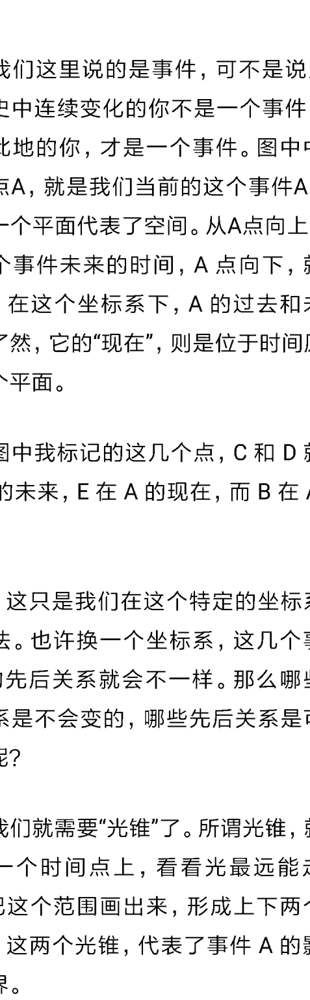

注意我们这里说的是事件，可不是说人。在历史中连续变化的你不是一个事件——此时此地的你，才是一个事件。图中中间那一点A，就是我们当前这个事件A，图中用一个平面代表了空间。从A点向上，就是这个事件未来的时间，A点向下，就是过去。在这个坐标系下，A的过去和未来一目了然，它“现在”，则是位于时间原点的一个平面。

那么图中我标记的这几个点，C和D就在A的未来，E在A的现在，而B在A的过去。

但是，这只是我们在这个特定的坐标系中的看法。也许换一个坐标系，这几个事件跟A的先后关系就会不一样。那么哪些先后关系是不会变的，哪些先后关系是可能变的呢？

为此我们就需要“光锥”了。所谓光锥，就是在每一个时间点上，看看光最远能走多远，把这个范围画出来，形成上下两个圆锥形。这两个光锥，代表了事件A的影响力边界。

为什么是这样？因为光速是信息传递最快的速度。比如说，我们知道光从太阳走到地球需要8分钟。那么请问，此时此刻的太阳和你之间，能互相影响吗？答案是不能。哪怕太阳此刻已经消失了，你也得在8分钟之后才感觉到。

这个原理就是光速不能到达的时空的事件，跟此刻的你没关系。但是，如果光速可以到达，那么两个事件的先后关系就是明确的。

上方光锥里的事件C，就完全可以被A影响。C在A的光锥范围之内，A一定可以给C发一个信号。这也意味着，事件C只能发生在事件A之后。

比如说，我写下这段文字这件事儿，算是事件A。你听这段文字的时候，你身边发生的事儿，算是事件C。这个事件C一定是在事件A之后，因为我可以通过这段文字给你一个信息，让你去干扰事件C。

同样道理，下方光锥里的事件，都是有可能影响到A的事件，所以一定发生在A的过去。

可是图中的事件D和E，却是在A的光锥之外。它们和A之间无法通过光速建立联系！在这个坐标系中D和E发生在A的未来和现在，而在另一个移动的坐标系中，D和E却有可能发生在A的过去。

一个事件的光锥，界定了它的边界。光锥以内的事件跟它*可以*有关，光锥以外的事件跟它*必然*无关。

#### 3.活在当下

考虑到光锥，我们就可以得出一个有意思的结论——“过去”和“未来”都有实实在在的范围，但是“现在”，却是一个相对的概念。

这个坐标系中的那个平面是这个坐标系中事件A的现在——E和A同时发生，是“现在”的事儿。但是E是在A的光锥之外。这也就是说，在另一个坐标系中，E和A就不是同时发生的了，可能发生在A的过去或者未来。

现在，其实是一个幻觉。你影响不了现在，也不被现在影响。

这个道理其实很简单。比如咱两面对面说话，你能看到我的形象，听到我的声音，可是考虑到光和声音都有一定的速度，你看到和听到的，其实都是我的过去。我的现在，可以影响你的将来——但是“我的现在”和“你的现在”这两个事件是不能互相影响的。

在绝对的意义上，你只能活在*自己的*当下，并没有人跟你天涯共此时。

费曼讲到这个道理的时候说，很多人号称能预测未来，而殊不知，人其实连“现在”在发生什么都不知道。

我们曾经以为时空是一个客观的大舞台，宇宙中所有东西有一个共同的标准时间——而真相是时空是相对的。现在是什么时间？这段距离有多长？那个东西的速度是多少？这些问题取决于你用的是哪个坐标系。

时空是相对的，好在因果关系还是稳定的，你不用担心被穿越者篡改历史。而这是来自于光速是信息传递的最快速度这个事实。

那你可能有一个问题：为什么不能超光速呢？咱们下一讲再说。

参考文献
[1] Richard Wolfson, Simply Einstein: Relativity Demystified.


### 相对论7：质量就是能量

普通的物理学家能完成常规的数学推导和实验测量。优秀的物理学家面对离奇的结论，也敢于把原则坚持到底。而爱因斯坦，则是跳出推导、自己建立原则的人。

前面我们说了几个相对论的著名结论，包括时间膨胀、长度收缩、“同时”是相对的。这些结论看似离奇，但是都是数学的操作，都可以从相对性原理和光速不变推导出来。

爱因斯坦的不同之处不在于这些机械化的推导，而在于他提出了相对性原理和光速不变这两个假设。

这是最高级的科学研究动作。提出假设需要勇气和勇气，往往带有一点个人风格。英雄从来都不是按照剧本走的人，英雄得任性。

今天我们将看到爱因斯坦的再一次任性发挥。

物理学是个专门看破红尘的学问，它的主旋律是解放思想。爱因斯坦在相对论上的第一次出手机会是告诉我们电动力学和常规的物理定律是一回事。这一次他将告诉我们，质量和能量是一回事。

#### 1.速度叠加

咱们先解决那个已经困扰了我们很久的问题，在相对论中，不同坐标系下的速度应该怎么算。

比如说，你在一艘速度是每小时100公里的船上射出一支箭，这支箭相对于你的速度是每小时200公里。常规的计算方法，相对于地面，这支箭的速度应该是每小时100 + 200 = 300公里。

```
u = (u' + v) / (1 + u'v / c²)
```

使用这个公式，火箭相对于地面的速度是0.91c，没有超光速。

#### 2.质量变重

咱们考虑这么一个情景。你坐在一艘宇宙飞船上飞行，我在地面上静止不动。飞船相对于我有一个很高的速度v，但是相对于你，它的速度始终是0。

```
m = m₀ / √(1 - v² / c²)
```

当你的速度接近光速的时候，我眼中你的质量就会接近于无穷大。

#### 3.E = mc²

我们已经知道运动的物体质量会变重。那请问，多出来的重量，是多在了哪里呢？爱因斯坦把质量变化的公式做了一个小小的变化 [2] ——

```
mc² = m₀c² + ½ m₀v² + …
```

```
E = mc²
```

出这一项来，但是爱因斯坦现在给这一项赋予了意义。这是画龙点睛的一笔。

那这能说明什么呢？咱们来做个思想实验。

有一颗炸弹，老老实实地在房间的中间静止不动。炸弹的质量是大写的M0，所以它的总能量 —— 其中包括它蕴含的一切化学能量 —— 就是M0c²。

现在这个炸弹爆炸了，它正好炸成质量相等的两个碎片，向两个相反的方向高速飞行。每个碎片的*运动质量*是小写的m，能量都是mc²，那么根据能量守恒，我们必须要求 M0 = 2m。

这两个碎片会跟房间里的各种东西发生一系列的碰撞和摩擦，最终它们的动能会变成热量消耗掉。两个碎片最终会静止下来，这时候它们的质量都是小写的 m0。

而根据相对论，我们知道 m > m0，所以，M0 > 2m0。

这也就是说，炸弹在爆炸之后，会损失一点点质量。那损失了的一点点质量，就是炸弹释放的能量。能量来自质量。

我们关于这个炸弹的推理适用于一切释放能量的现象。比如说蜡烛的燃烧。你在点燃蜡烛之前称一称它的重量，再算一算它燃烧过程中需要用到的氧气的质量。等蜡烛烧完，你再称一称它变成的灰烬的重量，再算一算它产生的燃烧气体的重量，前后比较 ——

你会发现，总重量减少了一点点。那减少的一点点重量，化作了蜡烛燃烧向周围释放的光和热。

在爱因斯坦发现质能方程之前，从来没有人想过化学反应会损失质量。这是因为光速实在太大，一点点质量就能化作巨大的能量。这是一个几乎在实验上无法测量出来的微小差异。

但是爱因斯坦就这么预见到了。其实不但是炸弹和蜡烛，不管什么东西，只要有能量差异，就有质量差异。比如你把一根橡皮筋拉紧了，称一称它的重量；然后你再把它放开，再称一称它的重量 ——那么橡皮筋的重量应该减轻了一点点，因为它释放了一点点动能。

但是这个质量的减少实在太小，连爱因斯坦都觉得这是无法验证的。爱因斯坦曾经想到，也许核反应释放的能量比较大，能验证他这个理论，但是他自己想想还是觉得核反应太难实现，没抱什么希望。

结果谁也没想到，后来核物理发展的非常快，人们做出了原子弹，还能用核能发电，而实验结果完全符合爱因斯坦的质能方程。

我们可以说爱因斯坦再一次看破了红尘。宇宙中所有的东西，无非就是质量和能量 —— 而爱因斯坦现在告诉你，这两种东西其实是一回事：质量就是能量。

质能公式还告诉我们，只要人类的技术够高，就永远都不用担心能源短缺的问题。光速c实在是太大了！你只要花费一点点质量就能换来巨大的能量。如果受控核聚变能做成，每年用上几克原料就够一个城市一年的电量。


E = mc² 这个公式已经被永远地跟爱因斯坦联系在了一起，以至于很多人以为是爱因斯坦发明了原子弹 —— 真实情况是爱因斯坦没有参与过原子弹的研究，他只是给罗斯福总统去了一封信呼吁美国搞原子弹，而且那封信还是别人写的，爱因斯坦只不过允许他使用自己的名字而已。

但是我敢说，爱因斯坦的洞见配得上所有这些荣耀。至此狭义相对论我们就算讲得差不多了，一开始仅仅是一个光速不变，现在却是连化学都要颠覆，你体会一下我们是怎么一步步走到这里的。

相对论的奇迹还没结束。接下来我们要讲广义相对论，爱因斯坦将会再一次看破这个世界。

注释：
[1] 当年费曼讲相对论讲到这里的时候说，学习狭义相对论，记住这个公式就行了，这个公式代表了狭义相对论对牛顿力学的所所有修正。我们这里只讲了一个意会式的介绍，严格地说这个公式来自“动量守恒”的要求。
[2] 如果你学过高等数学，这个方法叫泰勒展开。实际的思想很简单，就是考虑速度比较低的情况下，质量公式是什么样子。


### 一个有关工资的冰冷计算

万维钢

相对论太绕脑，还是老办法，咱今儿换个轻松点的內容缓冲一下。明天（周五）会放送一篇相对论番外，详解“双生子佯谬”，等你来挑战。

一个有关工资的冰冷计算 ↓

咱俩想象你是一个资本家。你拥有一家利润丰厚的大商场，它每年给你赚的钱已经多到……超出了你的初衷。那请问，你打算给你的商场最底层员工、那些普通的售货员，发多少钱工资呢？

如果你是一个普通资本家，你会给员工一个相当于市场水平的工资。你赚多少钱那是你的事儿，如果这个人的技能在市场上只值这么多钱，你就只给他发这么多工资。

可是如果你是一个有情怀的资本家，你可能会给他发一个高于市场水平的工资。虽然他没有多少技能，但他是*你的*员工，而你希望你的员工都能拿到体面的工资。

我觉得大多数自己不是资本家的人会选择后者。这个情绪就如同我看那些小小老板奚落对待工人的新闻时侯的感觉一样：你赚了那么多钱，花钱的时候一点都不在乎，那你为什么不给工人更好的条件呢？

#### 1.高工资的好处

我们之所以讲这个问题，是因为最近出了个新新闻，美国亚马逊大幅度提高了底层配送工人的工资[1]。美国最低工资的规定是每小时7.25美元，亚马逊配送工人之前的起薪是每小时11美元，而现在亚马逊一次性地把公司最低工资提高到了每小时15美元。

这个动作受到了社会的一致好评，连曾经的美国总统候选人、著名的民主社会主义者、民主党领袖伯尼·桑德斯都发了推特表示赞赏。

而有经济学家分析说[2]，亚马逊这么做不但有社会效益，而且有经济效益。高工资会提高工人的士气。人们会更愿意到亚马逊工作，现有的员工也会为了保住这份工作而更努力。

经济学家这个说法是有根据的。历史上一个著名的例子就是亨利·福特在1914年大幅度提高了福特汽车生产线上的工人工资——从每小时2.35美元提高到了5美元，大大高于市场平均水平。福特还把每天的工作时长从9小时降低到了8小时，给工人更好的待遇。

结果工人没有辜负福特，士气高涨，人们以在福特工作为荣，福特汽车的生产效率和产品质量大大提高。这件事是亨利·福特一生的得意之作。

那么这么说的话，在公司财力允许的情况下，给工人更高的工资，这是一件双赢的大好事。

可是为什么绝大多数公司都没有这么做呢？乔治·贝佐斯作为世界首富，亚马逊作为这么成功的公司，难道不应该早就这么做吗？

#### 2.工资和效率

最近《哈佛商业评论》发表了一个分析[3]，认为到底层员工来说，仅仅提高他们的工资，而没有配套措施支持的话，高工资可能没有那么好的效果。

这三个研究者都是女性，来自麻省理工的斯隆商学院和一个叫“好工作”的非盈利组织。她们专门研究零售业的底层员工的工作效率问题，她们不乐观。

是，高工资能吸引更高素质的人，也能提升员工的士气。但是现代的百货商店不是福特当年的生产线，商店里的很多工作，既不需要高素质，也体现不了士气。研究者举了一些例子，告诉我们真实的商店里，店员每天都做些什么——

价格变动了，你去把商品的价格牌全部调整一下。
总店弄了个紧急的促销活动，你得赶紧备货。
有些商品的送货时间突然变动，你得马上处理。
收款机坏了两台，需要找人来修。

你注意到有的商品这两天卖的特别好的商品卖不动，你想建议经理调整一下价格，可是经理没时间理你。因为你一个同事连顾客要退货这点小事都不敢自己做主，已经把经理逼疯了。
……

一个充满职业自豪感、心情舒畅的店员，他能给客户更好的服务体验，他还可能给公司提供一些创新的想法，这些当然能提升商店的效益。可实际情况是，上面那些麻烦的小事儿，才是店员们每天都做的事情。

这些事而只会消磨士气。工资再高，做这些事儿做多了也会变成一样消极的态度。

这个道理是单纯用高工资换来的士气提升，也许几乎不能体现在业绩上。

当然，这几个研究者也只是估计亚马逊这么做不见得能有很好的效果。到底会怎么样，还需要进一步的研究才能知道，我想也许会有研究者把亚马逊这一举措当成一次自然实验去研究。

蒂姆·哈福德[4]倒是曾经提到过这么一个实验。经济学家假装开了一家公司，贴出一份招聘广告，广告上宣称的工资相当于平均水平。招到几个员工之后，当场宣布给他们一个意外的高工资，想看看这样能不能提高士气。

结果是这些员工的士气真的很高，干活特别卖力……但是只维持了半天。几乎是刚到下午，他们就该怎么干活还是怎么干活。

所以站在资本家的角度，高工资到底有多大作用，你也许不能太乐观。

#### 3.现实和情怀

如果让中国导演拍一部关于百货商店的成功故事的电视剧，他肯定会描写一个士气高涨的团队。老板给员工高的工资，员工热情地服务顾客，上下关系其乐融融，共建和谐社会。

但是真实世界里那些成功的商店好像不是这样的。比如说全世界最大的零售商沃尔玛，对员工就是出了名的苛刻。工资低、福利差、而且工作时间也不人性化。美国沃尔玛商店里的售货员和收银员的士气非常低，对公司完全没有什么认同感。结果沃尔玛店员的离职率很高，大多数是实在没办法才进沃尔玛，干一会儿没意思就想干了。我在美国生活这十多年里，一直听到全社会指责沃尔玛。

然而，沃尔玛的销售利润率在各大零售商中却是最 高的。好事多（Costco）和塔吉特（Target）的员工待遇好比沃尔玛好很多，可是如果你是资本家，你可能更想当沃尔玛的股东。

低工资和低士气，显然并没有影响沃尔玛取得高利润，而且沃尔玛明摆着也不在乎。我以前曾经听 说，沃尔玛在招聘员工的时候，会让他们做一套心理测试题，测试一下这个人的忠诚度如何，会不会轻易离职。而这套题的评分标准是，你表现出来越*没有*创造力，思想越*不*灵活，沃尔玛越愿意要你。

这件事情是只要各项制度健全，一个员工就算士气很低，他也不能给沃尔玛带来什么损失，他该干的活还是得干。沃尔玛是超市，商店并不需要他跟顾客有太多互动。工资就算低，他毕竞需要这份工资。

沃尔玛不要快乐的聪明员工，它需要的低工资的老实员工。

所以真实世界和一般人的情怀很不一样。现在一说团队建设都要提高士气，但现实是对象沃尔玛这样的公司来说，高士气既不是千金难买的东西，更不是千金不换的东西！

而且高工资还可能有坏处。美国汽车制造业的效率之所以很低，很大程度上就是因为他们工资太高、给员工的福利太好。甚至有人说美国的那几个汽车厂现在已 经不是制造汽车的公司了——他们是福利公司，他们用卖汽车的办法给员工发福利。

我们讲这些并不是站在资本家的立场说话。我们是想知道为什么绝大多数公司给员工低工资，自己还能运行良好。我们想知道真实世界是怎么运行的。

一手创立了亚马逊的贝佐斯是个非常有理想有抱负有见识的人。他改变了现代商业，他促进了科技进步，他还弄了个搞载人航天公司想要探索太空，他非常有社会责任感，但是他不是用情怀办公司。这就是为什么亚马逊创立这么多年，直到现在才想起来给底层员工加工资。

像乔布斯、马斯克这样干了大事的企业家，他们身边的人、他们公司的员工，也都不是那么喜欢他们。说的极端一点，就是他们办公司不是为了给员工谋幸福。

有些人梦想的挣钱方式是开一家咖啡馆，因为他喜欢咖啡馆的氛围……另一些人开咖啡馆则真的赚到钱 —— 他们通常不是同一类人。所以你到底是想把生意做好，还是你只是喜欢被人喜欢的感觉？

那为啥亚马逊现在又加薪了呢？以我之见，首先现在亚马逊不差钱，它的利润体现在商业模式和科技上，底层员工工资占总成本的比例很小，亚马逊的市值已经把贝佐斯送上了世界首富的位置。而更重要的原因则是世界首富这个位置不太好坐，社会会对你有一个期待，你得有非常好的抗压能力才能自己当着首富，还让自己的员工拿最低收入。

我以前有个同事，就因为沃尔玛对员工太差，单方面宣布自己从此抵制沃尔玛，我对这种个人的个性政策表示钦佩。我还觉得像桑德斯这样用社会压力逼企业家分享利润是个挺有意思的机制，可能以后会越来越厉害。

沃尔玛现在已经把最低工资提高到了每小时11美元 —— 正好是亚马逊以前的水平。开公司不能讲情怀，但我们买东西还是可以讲讲的，我推荐买亚马逊的东西。

## 参考文献

[1] Karen Weise, Amazon to Raise Minimum Wage to $15 for All U.S. Workers, New York Times, Oct. 2, 2018.
[2] Ray Fisman and Michael Luca, How Amazon's Higher Wages Could Increase Productivity, Harvard Business Review Oct. 10, 2018.
[3] Katie Bach, Sarah Kalloch and Zeynep Ton, Higher Wages Aren't Enough to Turn Mediocre Jobs into Good Ones, Harvard Business Review Oct. 29, 2018.
[4] Tim Harford, The Logic of Life: The Rational Economics of an Irrational World, 2008.

### 相对论番外篇：双生子佯谬详解

相对论番外篇：双生子佯谬...

今天咱们专门用一讲来把“双生子佯谬”给彻底解释清楚，这个内容不影响你理解相对论的大局。我们不会用到什么特别的数学，但是推理过程有点烧脑，所以这一讲是专门献给爱钻研的读者。这期内 容不适合用音频讲，它需要你通过看文稿学习，甚至如果你能准备纸笔，边画图边 理解，你肯定能搞懂它。

“双生子佯谬”这个词是如此的熟悉却又如此的没有讲清楚。有些民间科学家认为双生子佯谬说明相对论是错的，有人认为必须学会广义相对论才能理解双生子佯谬，还有的是用到“闵可夫斯基空间”里的“世界线”来解释。

其实双生子佯谬一点都不神秘，在相对论的教科书里是常规的项目。我们这里讲一个最直观的解释[1]。

我们将会看到，双生子佯谬的确会涉及到一点广义相对论，但是它本质上是个狭义相对论的效应。

咱们先稍微做一点准备。

#### 1.基础准备

我们要用到的相对论的三个效应——

+ 1. 运动的物体的时间会变慢；
2. 运动的物体的长度会收缩；
3. “同时”是相对的。

然后我还想再次强调一下“事件”这个概念。所谓事件，就是在一个特定的时间和地点发生的事情，它是一个非常本地化的东西。

比如咱俩面对面相聚在一个地方，这就是一个事件。事件是实在在发生的，它是绝对的，不是相对的。

哪怕咱俩是高速擦肩而过，只要在某个时刻、咱俩的距离曾经非常近，那就可以迅速打开个照面，那就构成了一个事件。在这个事件里你看我是多少岁、我看你是多少岁，都是清清楚楚的。不管是谁、在哪个坐标系里看着这个事件里的咱俩，谁更年轻谁更老都是一目了然，没有任何异议。

但是，如果在这样相遇事件中，你告诉我你有一个兄弟在5光年以外的一个星球上工作，你告诉我你兄弟现在多少岁，那我可就不一定认同你的观点了。我跟你构成一个事件，因为你就在我身边。我跟你兄弟，可不算构成事件。

你说你兄弟今年30岁，那是在你的坐标系里你的看法。如果我跟你有个相对运动，也许在我眼里他现在就不是30岁——因为你的“现在”，不等于是我的“现在”。“现在”是个幻觉，“同时”是相对的。

好，有了这些理论准备，我们就可以仔细考察双生子佯谬。

为了把这个事儿彻底说明白，咱们假定有兄妹三人，是个三胞胎。妹妹一直待在地球上。哥哥坐着宇宙飞船从地球出发前往A星球，再从A星球回到地球。姐姐则一直待在A星球。

我们假设地球和A星球之间没有相对的运动，也就是说，A星球对地球来说只不过就是个比较远的地方而已。那么我们就可以建立一个让地球和A星球都静止的坐标系，那么显然在这个坐标系里妹妹和姐姐也是静止的——她们可以在这个坐标系里“同时”成长，年龄总是一样。

我们设定在这个相对于妹妹静止的坐标系里，地球到A星球的距离是20光年，哥哥的飞船的速度是0.8c。为了尽可能地去除广义相对论效应，我们设定哥哥一直保持高速，他加速和减速都不需要花时间。

好，现在我们定义三个事件：

+ * 事件1：哥哥和妹妹在地球告别；
* 事件2：哥哥到达A星球和姐姐见面；
* 事件3：哥哥回到地球和妹妹见面。

如果双生子佯谬没毛病，相对论没问题，那么这三个事件的当事人年龄，就应该与兄妹二人在所处的坐标系无关。

现在我们就考察一下两个坐标系中这三个事件发生时当事人的年龄。

#### 2.妹妹的坐标系

在妹妹的坐标系下，她和姐姐是静止不动的，哥哥在做运动。地球到A星球这段距离是20光年，哥哥的速度是0.8c。


事件1发生的时候，哥哥和妹妹在一起，而姐姐又跟妹妹在同一个坐标系里互相静止，所以兄妹三人的年龄是一样的，简单起见我们干脆设定这时候他们都是0岁。

在妹妹看来，哥哥要飞行25年才能到达A星球。所以事件2发生的时候妹妹和姐姐都应该都是25岁。但是，因为哥哥是在高速运动，他相对于妹妹的坐标系有个时间变慢的效果，所以他这时候应该只有15岁[2]。


所以哥哥和姐姐一见面，他已经比姐姐年轻了10岁！那你可能会说，为什么是哥哥比姐姐年轻？难道相对于哥哥，姐姐也不在做高速运动吗？这个问题咱们等会儿再说，因为那是哥哥的坐标系里的事情！

等到事件3，这个妹妹的坐标系下，哥哥又要飞25年才能回到地球，所以这时候妹妹已50岁了。而因为哥哥是高速运动的，他又有时间变慢的效果，所以哥哥飞行这段距离还是只花了15年。哥哥这时候，是30岁。

哥哥飞了一圈，妹妹原地不动，结果哥哥比妹妹年轻了20年。

人们对双生子佯谬的全部质疑，就是在哥哥不动的坐标系里，妹妹不也相当于是飞了一圈吗？为什么不是妹妹年轻呢？

#### 3.哥哥的坐标系

在相对于哥哥静止的坐标系下看，是哥哥的飞船静止不动，妹妹和从地球到A星球这段距离以0.8c的速度运动。那么既然这段距离是在运动，它就有一个相对论长度收缩的效果，所以在哥哥的眼中，地球到A星球的距离就不是20光年了，而是12光年。


事件1发生的时候，哥哥和妹妹在一起，他们都是0岁。但是，请注意，在哥哥的坐标系里，远在A星球的姐姐，可不是0岁。

这是因为“同时”是相对的！妹妹坐标系中妹妹和姐姐同时长大，但是在哥哥坐标系里，姐姐会比妹妹先长大！在哥哥眼中，在发生事件1的时候，姐姐不是0岁，而是16岁。这个16岁可不是我凭空给出的，这里有一个计算公式：Lv/c²，其中v=0.8，L=20[3]。

从事件1到事件2，哥哥看到的是12光年的距离以0.8c的速度运动，应该用15年。所以事件2发生的时候，哥哥是15岁。

而既然现在是姐姐在高速运动，所以姐姐的时间要变慢，姐姐可没有用15年——她只用了9年！所以事件2发生的时候，姐姐是16+9=25岁。妹妹也用了9年，妹妹是9岁。


这就解决了前面说的矛盾。是，哥哥的坐标系里是姐姐的时间慢——但是，姐姐的起步晚！所以还是哥哥比姐姐年轻！根本原因在于“同时”是相对的。不过，此时哥哥眼中，妹妹的确比哥哥年轻，只有9岁。

接下来，哥哥要调头飞回地球。这里有个关键问题。

哥哥调头的过程中，他的坐标系会发生一个变化。调头之前，是地球-A星球相对于哥哥从右往左飞；调头之后，是地球-A星球相对于哥哥从左往右飞。那也就是说，一旦调了头转换了坐标系，在哥哥的眼中，再看妹妹就好像事件1的时候看姐姐一样，是远方的妹妹比眼前的姐姐大16岁。

既然姐姐是25岁，妹妹就应该是25+16=41岁。

从事件2到事件3，哥哥还是需要15年的时间，变成30岁。而高速运动的妹妹只需要花9年的时间，变成41+9=50岁。

我们看看这三个事件，不管是在妹妹还是哥哥的坐标系看，当事的两个人的年龄都是一样的——

- 事件1：哥哥0岁，妹妹0岁；
- 事件2：哥哥15岁，姐姐25岁；
- 事件3：哥哥30岁，妹妹50岁。

区别在于不在场的第三人的年龄——

- 事件1：妹妹坐标系中姐姐是0岁，哥哥坐标系中姐姐是16岁；
- 事件2：妹妹坐标系中妹妹是25岁，哥哥坐标系中妹妹是9岁；
- 事件3：妹妹坐标系中姐姐是50岁，哥哥坐标系中姐姐是25+9=34岁。

在场的人构成*事件*，年龄都能对上；而不在场的人的年龄，因为“同时”是相对的，只能算*观点*。其实有关相对论的各种所谓的悖论，几乎都是因为同时是相对的。

为什么是哥哥比妹妹年轻，而不是妹妹比哥哥年轻？因为哥哥和妹妹的经历并不是等价的。妹妹一直都在做同一个匀速直线运动，而哥哥经历了两个不同方向的匀速直线运动。为此哥哥必须在A星球减速、调头、再加速，这种经历妹妹没有。

我们应该好好体会一下哥哥在A星球的那次调头。调头之前哥哥还以为妹妹比自己年轻。在整个调头过程中哥哥和就在本地的姐姐都没有什么年龄变化，可是调头之后，哥哥再看妹妹，感觉妹妹一下子就老了32岁！

这就是为什么去黑洞执行一次任务，回来就会发现别人都比你老的快——这就暗示了广义相对论。咱们下周再说。

注释

[1] 这里的详细计算过程参考 David Morin, Special Relativity for the Enthusiastic Beginner 一书。所用的图片来自 Richard Wolfson, Simply Einstein: Relativity Demystified 一书。

[2] 时间变慢和下面长度收缩的计算公式我们前面讲了。

[3] 这个16岁是如何计算的呢？如果你想要对相对论的掌握达到物理系学生的水平，可以查询前面注释里 David Morin 的书，计算公式是 Lv/c²，其中 v=0.8，L=20。

#### 问答：可以利用双生子效应穿越到未来实现永生吗？

问答：可以利用双生子效应…

万维钢
我们收到很多关于相对论的好问题，而且都是特别有想象力和技术性的问题。我想如果是爱因斯坦在1905年收到这些问题，他会为你们对相对论的接受程度感到震惊。爱因斯坦也得花上一段时间思考才能回答，有些问题还是物理学家们后来才想明白的。好在对于站在巨人的肩膀上的我来说，这些问题的答案都是现成的：）

##### 来自日 homeowner：穿越到未来

读者 Neil、Skyboat：
以后一些暂时治不了的病，是不是让病人上天飞几圈，然后等医疗技术更先进了，再下飞机诊治？以这样的逻辑，快老死的人也可以通过这种方式续命，这其实就是永生了？

万维钢
现在有些人已经冷冻了自己的身体，希望有朝一日医学进步到把自己解冻再治病。这个方法其实不太好，毕竟没有人拿活人做过冷冻再解冻的实验，我怀疑那些被冷冻的人其实已经都死了。利用双生子效应穿越到未来，对身体没有任何生物和化学的影响，确实是一个更好的办法，完全可行。
但是，这种方法并不能真正给人“续命”。一个人的有效生活时间如果有100年，相对论只能允许他选择怎么分配这100年，而不能给他变成101年。也许在21世纪活50年，去22世纪活30年，最后留下20年再去看看23世纪和两千年以后的世界。而他必须明白，每一次往未来穿越都是一次冒险，因为这种穿越只能向前不能向后，而未来的世界未必比现在好。

读者 曹玉彬、福元：
心流中，旁观者觉得过了很久了，但心流中的人却觉得很快。这个和相对论有关系吗？

万维钢
跟相对论完全没关系。心流状态下的人感觉自己没干什么、外界的时间却已经过了半天，这只是大脑的一个幻觉，他的身体仍然不折不扣地执行了……比如说，地球表面坐标系的北京时间。其实只要他的思绪回来，就会发现自己怎么突然饿了。

读者 唐僧：
如果驾驶一艘飞船以0.5c的速度驶离地球，飞船内的人始终和地球上的人用电磁波保持不断的通话状态，那飞船上的人听地球人的话会不会好像是慢速播放，而地球上的人听飞船上人的话会是 highspeed 程度的 fast？

读者 代成龙：
如果在一艘宇宙飞船上，我想给家人发一段微信小视频，会是什么结果？是不是会眼睁睁地看着家人变老？

读者 Strange：
宇航员在接近光速航行，在飞船上看书，地球上的人看到宇航员翻书的速度，是和我们一样，还是比我们快？

万维钢
这三个问题本质上是一样的。翻书也好、发视频也好、通电话也好，都是相对高速运动的两个个体之间进行的联系。快慢，取决于飞船和地球的相对运动关系。
如果飞船正在飞离地球而去，两者之间的距离越来越远，那么不管是飞船上的人看地球上的人，还是地球上的人看飞船上的人，都会觉得对方说活、翻书、做动作的速度变慢了。
这个首先是“多普勒效应”。我们在日常生活中也有这样的体验。比如一辆火车正在飞奔着离你而去的时候，你听火车的汽笛声，会觉得比火车不动的时候低一些。用物理学家的话说，就是离你远去的信号的频率会降低，因为周期延长了。
但是，在考虑到高速运动，双方不应该单纯依据视频来判断对方的衰老速度，还必须补偿上时间膨胀的因素。最终结果是双方看视频中对方都老得非常慢，但是计算出来对方老得没有那么慢——不过还是都比自己慢。
而如果飞船正在返回地球的路上，那么双方看对方在视频里的动作就都比自己要快。这就好像火车向你开过来的时候，你会觉得汽笛声变尖锐了。
这样只看视频的话，双方都觉得对方是比自己老得快。可是考虑到时间膨胀因素，还要再给对方补偿一点时间，双方计算出来，对方的衰老速度，还是比自己慢。
总而言之，不管是相聚还是远离，只要有相对的高速运动，就都是认为对方比自己老得慢——但这可不是双生子佯谬！只有先见面、再离去、然后又见面，在两次见面时的年龄对比才是实实在在的。否则，就只是起点不同的各自坐标系下的观点而已。

读者 八爷：
光速在真空中一样，地球的环境已不是真空，我们感受到的光速有变化吗？

万维钢
光在非真空环境中的速度会比真空中慢。但这并不是光速真的变慢了，而是光经历了一系列的折射反射，其实是走的实际路线延长了。

读者 夜未央：
不同的坐标系应该怎么理解，地球的坐标系是以地球为中心的吗？那太阳的坐标系是以太阳为中心吗？

万维钢
坐标系完全是由观测者自己决定的，可以以任何地点为中心。坐标系的关键不在于坐标原点（也就是中心）在哪，而在于它*相对于谁静止*。
当我们说“在我眼中，你的时间变慢了”，这句话的意思其实是说，在相对于我静止的坐标系中，运动的你的时间变慢了。其实我心中知道，你自己并不觉得你慢，而且你还觉得我慢，但是都是观点，表达不清甚容易绞晕。坐标系是规范的说法。“我的坐标系中你这一趟飞了15年”，不会引起歧义。

读者 CloudMan：
如果太阳消失，对地球的引力马上就没有了，并不需要等8分钟。但太阳消失这个事件在我们的光锥之外，却对我们产生了影响，这个怎么理解呢？

万维钢
恰恰不是这样。牛顿力学认为引力的传播不需要时间，但是相对论反对这一 点。事实是太阳就算是立即消失，它在地球附近的引力也得等8分钟之后才能消失。这里边没有“超距作用”。我们不是在跟太阳直接打交道，是在跟太阳在我们附近的引力打交道。“引力”，以光速传播——这也是引力波的一个背景知识。

读者 风：
高速行驶的物体变短。那么高速飞行的飞船会穿过静止时比它窄的夹缝吗？

读者 蓝月格：
既然运动的物体可以变小，那么一个接近光速的人（假设叫老李），能穿过相对于地球静止的针孔吗？在老李看来，针孔变大了吗？

万维钢
答案都是否定的。运动的物体在运动的方向上变短。夹缝的宽窄和针孔的大小都在飞船和老李运动的垂直方向上，它们互相之间没有尺寸的变化。
一个有意思的问题所谓“梯子佯谬”。比如有个梯子，它的长度比一个车库稍微长了一点点，现在梯子在水平方向上高速从车库中中间穿过，那么请问，是否有一个时刻，梯子整个都被放在了车库之中呢？

刻，梯子整个都被放在了车库之中呢？

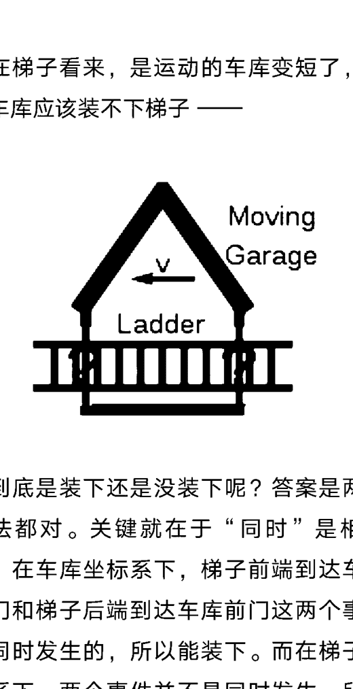

在车库看来，运动的梯子会变短，所以车库应该能装下梯子——

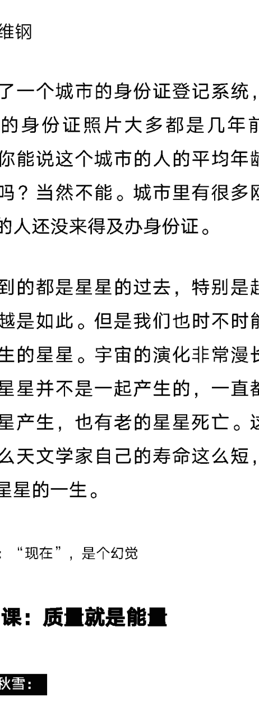

而在梯子看来，是运动的车库变短了，所以车库应该装不下梯子——

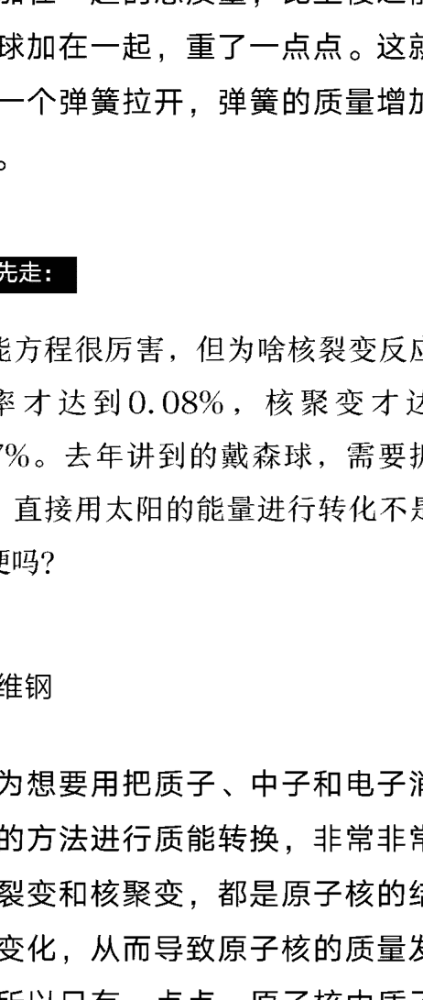

那到底是装下还是没装下呢？答案是两个说法都对。关键就在于“同时”是相对的！在车库坐标系下，梯子前端到达车库后门和梯子后端到达车库前门这两个事件是同时发生的，所以能装下。而在梯子坐标系下，两个事件并不是同时发生，所以没装下。

我们只能说反正车库的前后两个门一开一关、梯子通过了——但是我们没法客观绝对地说，两个门是不是同时开关的。

截止复习：穿越到未来

##### 来自日课：“现在”，是个幻觉

读者 158***5648：

如果光是有速度的，那宇宙中大部分我们所看到的行星光速达到地球的时间远超过星球的寿命（几十上百亿光年的多的是）。那是不是说明我们面对的是一个实际上已经星球绝大部分灭亡的宇宙？

万维钢

你查阅了一个城市的身份证登记系统，发现人们的身份证照片大多都是几年前照的，那你能说这个城市的人的平均年龄都很大了吗？当然不能。城市里有很多刚出生不久的人还没来得及办身份证。

我们看到的都是星星的过去，特别是越远的星星越是如此。但是我们也时不时能看到新出生的星星。宇宙的演化非常漫长，其中的星星并不是一起产生的，一直都有新的星星产生，也有老的星星死亡。这也是为什么天文学家自己的寿命这么短，却能研究星星的一生。

截止复习：“现在”，是个幻觉

##### 来自日课：质量就是能量

读者 千秋雪：

哎，第一次听说化学反应放出能量时损失了一丢丢质量。那物理反应释放能量会损失质量吗？例如开水变冷了？

读者 happy-first：

动能的增加会使质量增加，那势能的增加也会使质量增加吗？例如我坐电梯从一楼上九楼，九楼的我会比一楼的我重那么一点点么？

万维钢

把一个物体加热，的确能增加它的静止质量！

势能也能增加质量。不过九楼的你并不会比一楼的你重一点点——是上楼之后的你和地球加在一起的总质量，比上楼之前的你和地球加在一起，重了一点点。这就相当于把一个弹簧拉开，弹簧的质量增加了一点点。

读者 你先走：

质能方程很厉害，但为啥核裂变反应的效率才达到0.08%，核聚变才达到0.7%。去年讲到的戴森球，需要拆木星，直接用太阳的能量进行转化不是更方便吗？

万维钢

这是因为想要用把质子、中子和电子消失和产生的方法进行质能转换，非常非常困难。核裂变和核聚变，都是原子核的结合能发生变化，从而导致原子核的质量发生变化，所以只有一点点。原子核中质子和中子的数目并没有变。

换句话说，这就相当于刚才那个问题中的人上楼下楼导致的总质量变化，人和楼都还在。

想要用能量凭空制造一个粒子出来，是可行的但是非常困难。比如说有人正在做实验，要用两个高能光子对撞，变成一个电子和一个反电子——原则上可以做到，但是这种方法效率太低，还不如拆木星。

截止复习：质量就是能量

### 相对论8：不可思议的巧合

相对论8：不可思议的巧合

不知道你亲眼见过鲸鱼没有。我在海洋世界看过鲸鱼的表演。有Some动物可爱，有的动物凶猛，而鲸鱼给我的感觉跟别的动物完全不一样。鲸鱼的身体那么大，曲线那么美，姿态又是那么优雅。鲸鱼游来游去，有时候还活泼地向观众拍水花。可是我坐在那里，感觉它们好象是比人类更高级的存在，有种神明一般。

广义相对论给我 的感觉就是这样。大，而且优雅。

广义相对论是一个美丽的理论。

牛顿的引力公式过于直白，没有内涵。我们应该庆幸自己生活在一个广义相对论主导的宇宙里。广义相对论的数学特别难，思想却是简单的，只是非常深刻。想它 的来龙去脉，它意味着什么，它能推演出什么东西，其乐无穷。

咱们还是先来一点铺垫。讲狭义相对论的时候我们已经看到，爱因斯坦喜欢给你设定一两条最简单的原理，然后不管推导出 来什么怪异的结论你都得接受。广义相对论也是这样。

#### 1.广义-相对性原理

狭义相对论的缘起是一个危机。物理学家搞不清楚光速到底是相对于谁的。一个问题等了18年，等爱因斯坦长大了，才给解决。但是广义相对论可不是这么来的。广义相对论，是爱因斯坦自己提出来要干的事儿。

1905年，刚发表了狭义相对论，爱因斯坦就已经开始思考广义相对论，用了十年才最终完成。那他想要的是什么呢？

我们知道狭义相对论的出发点是“相对性原理”：一切匀速直线运动或者静止的坐标系下，物理定律都是一样的。

#### 2.加速和有引力

让爱因斯坦取得突破的首先是这么一个思想实验。想象你站在一个像电梯一样的长方形的封闭飞船里。在你脚下有个火箭，给你提供一个推力，让你一直向上加速运动。


#### 3.自由落体和没有引力

我们再看一个思想实验。爱因斯坦想的原始版本是，想象你在 一个电梯里，电梯突然间失控，以自由落体的形式往下坠落，你想想那是一个什么感觉。


这就很有意思了。之所以没区别，这里边蕴含着一个你想不到，但是在物理学家看来是极其怪异的事实。

#### 4.巧合

咱们先想想这个问题：为什么自由落体明明是个加速运动，可是爱因斯坦却说它跟匀速直线运动没区别呢？因为自由落体状态下所有物体的加速度都是一样的。

我们高中学过，地球上任何一个物体，无论是苹果，桌子，还是一个胖子，他们如果从高空掉下来，所有物体的加速度都是一样的，你可能还记得那个数字，加速度都是9.8m/s²。

只有这样，当你在空间站中把一个小球悬浮在空中的时候，它才会一直停留在你身边，它会跟着你一起动。如果小球和你的加速度不一样，你俩两个就会迅速分开，你就会察觉到现在不是匀速直线运动，对吧？

好，那为什么自由落体中所有物体的加速度都一样呢？因为地球引力对所有物体一视同仁。

那为啥会一视同仁呢？你以前学高中物理的时候是先默认了一视同仁，现在我换个讲法你就发现其中的问题了。

牛顿力学告诉我们，一个物体受到力，是导致它产生加速度的原因，力 = 质量 × 加速度。受力带来的加速度大小跟这个物体的质量有关系，对吧？这个质量，我们先称之为“惯性质量”。

牛顿引力公式又告诉我们，每个物体感受到的地球引力的大小，也跟这个物体自身的质量成正比，对吧？这里又有一个质量，这个质量，我们先称之为“引力质量”。

中学老师一上来就告诉你“质量、质量”——可是你想过没有，这两个地方出现的质量，为什么是一样的呢？换句话说，为什么“惯性质量”非得等于“引力质量”呢？

这是一个完全合法的疑问。惯性质量决定了力怎么给物体带来加速度——任何形式的力都可以，电磁力带来加速度也是用这个质量算，这里跟“引力”并没有天生的关系。引力质量仅仅是引力的一个性质，决定了一个物体受到的引力大小，也就是“重量”。

我们小时候总是默认质量就是重量，越重的东西就越不容易推动，其实它们是两回事。你想想，比如这里有一个胖子，他的“重量”是...等等。你要推他容不容易推动，那是一个水平方向上的故事。加速度可以是任何力在任何方向的结果，引力可是只有一个方向，那这两者为什么一样呢？

说到这里，有一个相当经典的案例，就是传说中的比萨斜塔实验，伽利略证明了一轻一重两个铁球从高处落下来是同时着地——也就是说，引力给它们的加速度完全一样：引力，很尊重小球的“惯性质量”。


伽利略当年论证为什么两个铁球必须同时着地，用了一个反证法。他说如果是越重的物体落得越快，那我们可以把一个轻的铁球和一个重的铁球粘在一起——一方面，轻的铁球应该拖慢重的铁球，现在的下落速度应该比重的铁球更慢一些；可是另一方面，现在你得到一个更重的大铁球啊，应该下落更快才对啊？这个矛盾表明，铁球的下落速度应该跟轻重无关。

伽利略这个论证其实站不住脚。伽利略默认了引力给加速度的时候*只看*重量——或者说，引力给重量的时候*只看*它们的加速度性能。可是引力凭什么这么干？

惯性质量正好等于引力质量这件事，现代物理学家能给的最好解释，是……纯属巧合。物理学家在真空中精确测量过两个铁球是不是同时落地，在月球上都做过这个实验，结果都是惯性质量精确地等于引力质量。我们不知道为什么这个世界是这样的，但是它就是这样的。


你马上就能想到，这跟“光速不变”好像很像：你再想不通，也得接受。

#### 5.爱因斯坦的断言

广义相对论的出发点，是爱因斯坦的一个断言——

在任何局部实验中，引力和加速运动无法区分。

这句话叫做“等效原理”，它等于就是说“惯性质量 = 引力质量”。爱因斯坦说别问为什么了，这个世界就是这样的。

在一个封闭的房间里，你说你正在地面待着享受引力，我可以说你其实是在一个加速运动的火箭里。你说你正在引力的作用下享受自由落体，我可以说你其实是处在一个不受任何引力影响的匀速直线运动。

爱因斯坦说，只要这个房间的尺度不是超级大，你说的和我说的一点没区别。

那我们再想想，引力到底是个什么东西。站在地面上，你能切切实实感受到引力的存在。可是只要你随便做个自由落体运动，引力对你就不存在。

一个东西如果是真实的存在，它怎么可能在静止坐标系下看着就有，在一个加速坐标系下看着就没有了呢？爱因斯坦的新要求可是物理定律不管在什么坐标系下都一样。

我们的结论就只能是，引力这个东西，其实是个幻觉。

……或者说的严格一点。在局部，引力根本就不存在。在大尺度范围，引力根本就不是力……正如鲸鱼不是鱼。

那引力到底是什么呢？只有爱因斯坦能提出这样的问题，也只有爱因斯坦能回答这个问题。咱们下一讲再说。


### 相对论9：大尺度的美

广义相对论的数学非常难。连爱因斯坦都觉得自己的数学不够用，后来是在数学家的帮助下使用微分几何的知识，才得到最终的引力场方程。我们不会讲任何数学细节，但是既然说到了广义相对论，我想你应该看一眼引力场方程的样子——

```
G_{μν} ≡ R_{μν} - 1/2 R g_{μν} = 8πG/c^4 T_{μν}
```

然后你可以把它跟中学学过的牛顿引力公式做个对比——

```
F = G M m / r²
```

我给你打个直观的比方。牛顿引力公式就好像是一个完美的球体。而广义相对论，就好像是一头美丽的鲸鱼。


你不见得非得知道鲸鱼身上每一处结构的精确尺寸，你没必要学会怎么画鲸鱼，但是你可以欣赏鲸鱼的美。

#### 1.弯曲的几何

#### 2.广义相对论ABC

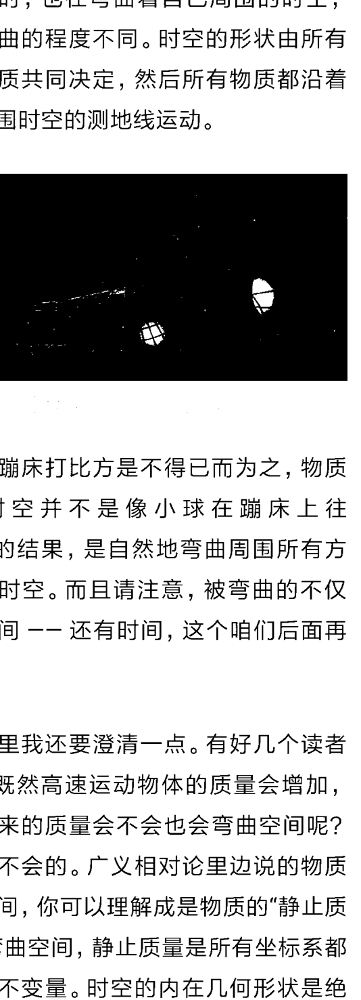

当然，每个有质量的物体在弯曲时空中运动的同时，也在弯曲着自己周围的时空，只是弯曲的程度不同。时空的形状由所有这些物质共同决定，然后所有物质都沿着自己周围时空的测地线运动。

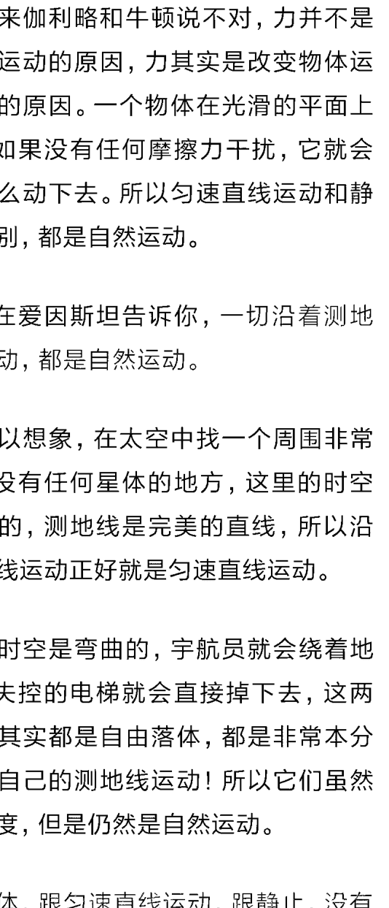

我们用蹦床打比方是不得已而为之，物质弯曲时空并不是像小球在蹦床上往下“压”的结果，是自然地弯曲周围所有方向上的时空。而且请注意，被弯曲的不仅仅是空间——还有时间，这个咱后面再讲。

说到这里我还要澄清一点。有好几个读者问我，既然高速运动物体的质量会增加，那多出来的质量会不会也会弯曲空间呢？答案是不会的。广义相对论里边说的物质弯曲空间，你可以理解成是物质的“静止质量”在弯曲空间，静止质量是所有坐标系都同意的不变量。时空的内在几何形状是绝对的，但是时空在不同的坐标系有不同的样子。

广义相对论就这么简单。

#### 3.自然运动状态

爱因斯坦再一次看破了红尘。什么是引力？你可以说根本没有引力，有的只是时空的弯曲。

或者你也可以说，所谓引力，就是在大尺度下才能看出来的、时空的弯曲。鲸鱼的身体是曲线的，但是如果你离近了看，它身上每个地方都可以用一个很平的小平面近似。局部的测地线就是很直很直的直线，这就是为什么我们上一讲说局部没有引力。

说到这里，我们要重新定义“自然运动状态”这个概念。所谓自然运动，就是在没有任何外力干扰的情况下，一个物体自由自在的状态。

亚里士多德认为自然的运动状态是静止。这符合我们的生活经验：没有外力的干扰的东西好像都是静止不动的。

但是后来伽利略和牛顿说不对，力并不是让物体运动的原因，力其实是改变物体运动状态的原因。一个物体在光滑的平面上滑动，如果没有任何摩擦力干扰，它就会一直这么动下去。所以匀速直线运动和静止没区别，都是自然运动。

好，现在爱因斯坦告诉你，一切沿着测地线的运动，都是自然运动。

我们可以想象，在太空中找一个周围非常空旷、没有任何星体的地方，这里的时空是平直的，测地线是完美的直线，所以沿着测地线运动正好就是匀速直线运动。

那如果时空是弯曲的，宇航员就会绕着地球转，失控的电梯就会直接掉下去，这两个运动其实都是自由落体，都是非常本分地沿着自己的测地线运动！所以它们虽然有加速度，但是仍然是自然运动。

自由落体，跟匀速直线运动，跟静止，没有任何区别。你在其中一个封闭的实验室里不管做什么实验，都无法把它们区别开来。爱因斯坦说它们是一回事，都是沿着测地线运动，都是自然运动。

反过来说，你站在地面不动，站一会儿就累了，这其实是一种*不自然*的运动。你本来想沿着测地线往下掉，可是地板阻止了你。想要体验真正的自由，你应该搞一个自由落体运动。

为什么引力质量正好等于惯性质量，为什么一轻一重两个铁球同时着地？因为只要你的质量没有大到能跟地球相提并论、足以显著影响周围时空的形状，你看到的测地线就只跟你的初始速度有关，跟你的质量没关系！

回头再看上一讲说的那两个思想实验。不管你是站在一个有火箭加速的飞船上也好，还是站在地面不动也好，都是有一个外力在阻止你沿着测地线走，所以它们是一样的。在地球附近自由落体也好，还是在空旷的地方做匀速直线运动也好，都是沿着本地的测地线的自然运动，所以它们也是一样的。

只要你接受时空尺寸是相对的，你就能接受狭义相对论。只要你接受时空可以弯曲，你就能接受广义相对论。接受了时空的这两个性质，什么光速为什么不变、惯性质量为什么等于引力质量、引力到底是不是真实的存在、超距作用......这些麻烦事儿就都没有了。

所以说相对论是个简单理论，它只是非常深刻。其实我觉得广义相对论比狭义相对论还容易理解，它只是非常美丽。

也许下次看见鲸鱼的时候，你可以想起广义相对论。

### 相对论10：爱因斯坦不可能这么幸运

美国物理学家约翰·惠勒是费曼的博士导师，也是“黑洞”这个概念的提出者。惠勒曾经对量子力学有这样一个评论——我们接触量子力学的感觉，就好像是一个从边远地区来的人第一次看汽车。他会觉得汽车这个东西虽然是有用的，而且肯定有重要的用处，可到底是什么用处呢？

我猜你第一次听说广义相对论也会有同样的感觉。广义相对论的思想跟牛顿引力公式是如此的不同，这个理论是如此的精妙，它肯定有深刻的内涵，可到底是什么内涵呢？要知道就算要登陆火星，牛顿力学也足够精确了。

爱因斯坦在1915年发表了广义相对论。这时候物理学家们已经普遍承认相对论的价值，但是爱因斯坦在公众眼中并没有什么声望。爱因斯坦就好像是一个互联网的创业者，每个了解他的人都承认他的想法是颠覆性的，能“改变世界”，但是没人知道他的公司应该有多大的估值，他还从来没有在市场上赚到过钱。

不过爱因斯坦不用等太久。1916年，爱因斯坦提出，有三件事，能证明广义相对论是对的，牛顿力学是不那么对的。咱们先说其中两件。

#### 1.水星进动

我们知道行星都在绕着太阳公转。如果你还记得高中物理，你应该知道行星公转的轨道通常不是标准的圆形，而是椭圆。椭圆有个长轴有个短轴，太阳在椭圆的一个焦点上。行星们就这么兢兢业业地、年复一年地沿着自己的椭圆轨道运动。


牛顿力学告诉我们，相对于太阳，这些椭圆轨道的位置是固定的。

按天文的标准，我们这个太阳的质量不算太大，整个太阳系内部的引力都不算太强。而只要引力不是特别强，广义相对论的计算结果跟牛顿力学都高度吻合，也是同样的椭圆轨道。但是广义相对论有个很微妙的性质——用广义相对论计算出来的椭圆轨道，并不是真正闭合的。

也就是说，行星公转一圈之后并不是恰好回到原来的出发点，会有一个小小的偏移！表现出来，就是椭圆轨道并不是完全固定的，每一圈都跟上一圈有个小小的差别。椭圆的长轴，会有一个慢慢的转动——物理学家称之为“进动”。

下面图中红色椭圆代表牛顿力学计算出的行星轨道，蓝色的线代表有进动的行星轨道——


下面这张动图是对行星进动的一个夸张的演示——


事情是这个事情，但情况是行星轨道的进动通常都非常、非常小，几乎就是无法观测的。

话分两头。另一方面，天文学家早在1859年就观测到，太阳系里距离太阳最近的行星，水星，一直都有一个进动。

但是19世纪的天文学家已经在很大程度上解释了水星的进动。因为水星附近还有其他行星，比如金星和地球，这些行星对水星也有引力，会干扰水星的轨道。天文学家精细计算了这些干扰，最后只剩下一有点点进动，可以说是牛顿力学无法解释的。

这一点点有多大呢？是每一百年人，进动43弧秒。这是什么概念呢？我们知道圆周有360度，然后一度分为60弧分，然后一弧分再分成60弧秒。100年43弧秒，这是一个几乎无法察觉到的差距。但是天文学家对自己的计算非常有把握，他们认定，这43弧秒需要一个解释。

结果1916年，爱因斯坦做了一个计算，得出，因为广义相对论效应导致的水星轨道的进动……正好是每100年43弧秒！

#### 2.光线弯曲

水星进动这个证据好是好，但是老百姓不容易理解。爱因斯坦提出的第二个证据，就非常直观了。

广义相对论要求时空可以是弯曲的，一切物体都要沿着时空中的测地线走——一切物体，其中就包括了光。如果这个地方的测地线是弯曲的，那么光线就也会是弯曲的。比如说，如果这里有一个大质量的星球，那么远方的星光经过这个星球附近的时候，就可能发生偏折。

这件事牛顿力学里可是绝对没有，人们一直都认为光在真空中永远走直线。

不过如果你把牛顿引力公式和狭义相对论放在一起，其实也能预言光线的弯曲。狭义相对论说质量就是能量，反过来也可以说能量就是质量。光没有静止质量，但是有能量啊——如果我们*强行*用光子的能量除以c²，也会得到一个光子的“运动质量”，就好像是一个有质量的物体一样。

那既然有质量，就应该能感受到引力，牛顿引力理论就足以给它一个偏转——就好像彗星掠过地球一样。

那广义相对论还有倚用呢？所幸的是，广义相对论预测的光线偏转，是“牛顿引力+狭义相对论”预测结果的两倍！

这样我们就有了三个直截了当的说法——

- 牛顿力学：光永远走直线
- 牛顿引力公式 + 狭义相对论：光线会被偏转，但偏转的程度较小
- 广义相对论：光线会被偏转，而且偏转的程度较大

所以现在只差一个观测验证。可是上哪找能让光线明显偏转的大质量的星球呢？月亮经常跟星星在一起，但是月亮的引力太小，偏转星光的效果看不出来，


这个思路好是好，可问题在于太阳太亮，它周围的星光都被太阳给掩盖了。

但是天文学家想到一个极端的情况，日全食。

日全食的时候，月亮会帮我们挡住太阳光，使得我们能看见太阳周围的星光。那如果我们事先算一算这个时候有哪些星星应该在太阳背后，你本来应该看不见，结果却在太阳周围看见它们了，这不就说明太阳弯曲了星光的路线吗？

爱因斯坦1916年计算出光线弯曲的正确结果，然后1919年5月29号，就有一次日全食。那时候第一次世界大战刚刚结束，英国天文学家爱丁顿，专门说服英国政府给了一笔经费，组织了两个观测团队，一个去巴西一个去非洲，专门为了验证广义相对论观测这次日食。

结果爱丁顿的团队就真的看到了原本不应该出现在太阳周围的几颗星 ——

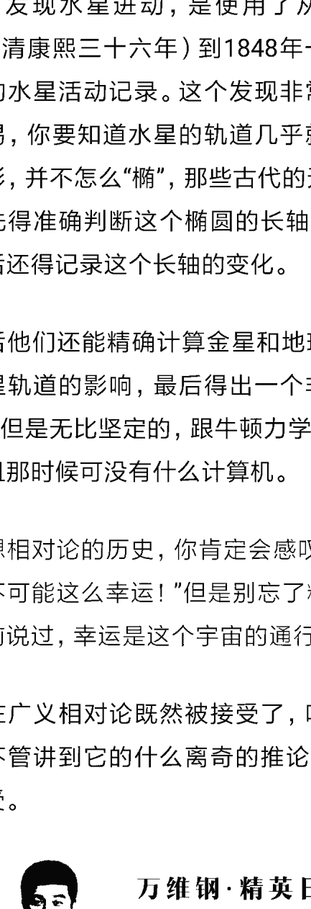


爱丁顿在皇家科学院宣读了观测结果，证明是广义相对论说得对。英国泰晤士报的报道用了个通栏标题 ——《科学革命 —— 关于宇宙的新理论 —— 牛顿思想被推翻！》

爱因斯坦一夜成名。

#### 3.爱因斯坦的运气

咱们现在考察广义相对论被世界接受的这段历史，你不能不承认，爱因斯坦的运气实在是太好了。

首先是这次日全食。爱因斯坦的计算结果刚出来三年，就赶上了日全食。我特意查了一下，地球上下一次有日全食得等到1937年6月8日。爱因斯坦动作稍微慢一点，或者爱丁顿未能促成这次观测，相对论搞不好就得再等18年才能被人接受。

而这一次日全食发生的时候，太阳周围正好是毕宿星团的星星 — 这个星团特别亮！再等下一次，还没有这么强的星光让你容易测到。

更巧的是，爱丁顿选择的这两个观测地点，在日食发生前后都是阴雨天气。巴西那个地方在日食当天早上还是多云，可是在日食发生前一分钟，天空中太阳那个位置的云居然散开了，给天文学家开了一小片晴天。非洲那个地方也是有云，也是恰好在日食期间让太阳露出来一会儿。

爱因斯坦要是个中国人，他也许会说一句“天助我也”。

而且人和也很重要。如果爱因斯坦是个注重声望的人，他除了感谢爱丁顿还应该感谢泰晤士报。“牛顿被推翻”这个标题直接把爱因斯坦送上了牛顿之后最伟大的科学家的位置。如果咱们“得到”报道这次科学发现，肯定不会用这个充满民科味道的标题，最起码应该用《光线可以被引力弯曲！》

我曾经听后来的人分析，爱因斯坦之所以能在短时间内从“世界上最了不起的物理学家”变成“世界伟人”，跟他1921年访问美国的旅程关系很大。美国媒体和美国老百姓都非常喜欢爱因斯坦……不过那时候他们并不怎么了解一般的科学家都什么样。

不论如何，爱因斯坦配得上所有这些幸运和荣誉。但我还是想说，爱因斯坦最大的幸运，是他生在了那个时代的欧洲。

天文学家之所以能在1856年（大清咸丰六年）发现水星进动，是使用了从1697年（大清康熙三十六年）到1848年一百五十年的水星活动记录。这个发现非常非常不容易，你要知道水星的轨道几乎就是一个圆形，并不怎么“椭”，那些古代的天文学家首先得准确判断这个椭圆的长轴在哪里，然后还得记录这个长轴的变化。

然后他们还能精确计算金星和地球引力对水星轨道的影响，最后得出一个非常非常小，但是无比坚定的，跟牛顿力学的差异。而且那时候可没有什么计算机。

想想相对论的历史，你肯定会感叹“爱因斯坦不可能这么幸运！”但是别忘了精英日课以前说过，幸运是这个宇宙的通行证。

现在广义相对论既然被接受了，咱们下—讲不管讲到它的什么离奇的推论，你都得接受。


日课精选

提交留言可与专栏作者互动

### 修炼你的文化自觉

我听单田芳的自传评书《言归正传》简直入了迷。书中有一段，说在特殊历史时期，单田芳因为受到迫害，不但不能说评书，连基本的生计和安全都成了问题，一家人颠沛流离。为了谋生，单田芳跟人学了一个制作“水泡花”的手艺，在街头贩卖。

当时的中国几乎没有任何文化娱乐，水泡花这个东西虽然简单，卖得还挺好。别人一看老单家挣了钱，也想卖水泡花。单田芳一家都是热心肠，就把水泡花的制作技术传授给了几个朋友。殊不知同行是冤家，后来这些人跟单田芳家争夺同一个街口的水泡花市场，闹得很不愉快。

我听书听到这里非常感慨。单田芳出身于艺术世家，从来做得都是“敲锣一响黄金万两”的事，竟落得病得这么一个低端行业打拼，还弄了一出教会徒弟弑师傅。

水泡花，别人一学就会，完了就能跟你竞争。而对比之下，单田芳的评书，则是一个高端的技艺——这表现在单田芳名满天下，一生收了十几个徒弟，竟然没有一个能取得可见的成就。

所以有条件的人安身立命，宁可下苦功夫也得掌握一门高端技艺。如果你指望一个需要严防死守的东西挣钱，你那就不是真正的稀缺，你也不会有安全感。

#### 第一个用处是“模式识别”。

#### 文化自觉的第二个用处是给你发挥创造力积累资源。

这也就是说，所谓的灵光乍现，其实是人脑在潜意识中，把距离比较远的两个东西，建立了一个连接。因为之前的活动都是潜意识，当事人自己往往意识不到思维过程，还以为灵感都来得很神秘。

其实是你的头脑中已经储存了大量的素材资源，你才有可能建立这种连接。

我们的大脑在日常生活中通常并不怎么警觉。比如你到餐馆吃饭，可能一直到吃完离开，你都不曾注意过自己坐的椅子什么样。但是由于进化，大脑对两种东西特别敏感，因为这两种东西直接关于我们的安全，关于我们得到奖励的机会。

一个是熟悉。如果餐馆的椅子跟你家饭桌用的椅子一模一样，你肯定就能注意到。再比如说你跟很多人在一个大厅里聊天，本来你不会注意旁边的人群在聊什么——但是如果其中有人提到你的名字，你就很容易注意到。

另一个是新。如果餐馆的椅子特别与众不同，你从来没见过那样奇怪的椅子，你肯定也能注意到。

熟悉，和意外。

熟悉得特别熟悉，意外得非常意外，才能让人印象深刻。

拥有了文化自觉，你才能对熟悉和意外有更高的敏感度。

甘尼特采访了大量以创造力闻名的人物，他总结了一个原则：20%。甘尼特说，为了建立和保持文化自觉，你必须每天用20%的醒着的时间吸收自己领域的东西。

如果你每天睡五六个小时，这就意味着你要用差不多四个小时做吸收。甘尼特采访的那些创造力人物全都是这样。如果你是作家，你要用四个小时读别人写的新小说。如果你是厨师，你要用四个小时研究现在有什么新菜，到各个餐馆试吃，参加各种美食节。设计师、音乐家、网络主播……一切需要创造的工作，都需要用20%的醒着的时间吸收。

每天20%，不练你就跟不上时代的文化自觉。那你说现代人每天都看四个小时的影视剧，是不是每个人都适合从事影视创作呢？当然不是。修炼文化自觉得是有意为之，不是看自己喜欢的东西，得什么都看、了解现在有一切东西，了解*别人*喜欢什么。

我们可以借用“刻意练习”这个词，把文化自觉的修炼称为“刻意吸收”。

单田芳创作的新评书之多，在所有评书艺人之中可以说是首屈一指。但是我听他的自传，感觉他除了现场演出观察观众反应之外，并没有花很多时间刻意吸收别人的作品。这可能是因为评书行业仍然属于传统，还没有过渡到现代。毕竟中国文化市场的竞争激烈程度远远不及美国。

单田芳是老一辈，可他讲了很多新书。而我看现在有些年轻的评书艺人还在讲什么“雍正剑侠图”。他们如果能修炼一点文化自觉，就不会整天抱着祖师爷教的那点玩意儿不放了。

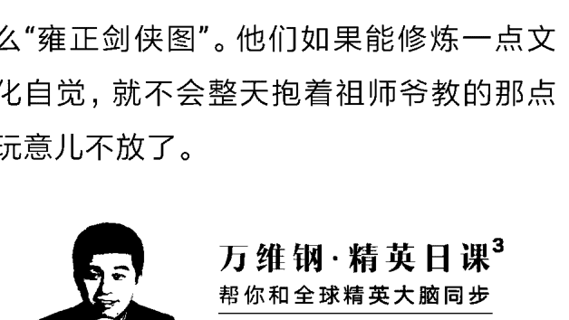

## 唐朝诗人的敏感度

万维钢

咱们得到上线了一门熊逸老师的唐诗课，我每天跟读，觉得特别有收获，这是一篇我的一篇课后感，跟你分享。

唐朝诗人的敏感度

1879年，有人在西班牙北部的奥尔塔米拉岩洞里发现了很多旧石器时代的人画的画。这些画的笔法流畅，不但栩栩如生，而且自带一种超凡脱俗的美。人们这才知道，原来几万年前的原始人，竟有这样的文化成就。

据说毕加索看过这些岩画有一句评价——奥尔塔米拉之后全是堕落。

我们喜爱的熊逸老师在得到开了一门新课，叫《唐诗50讲》。我知道唐诗，但是在学他这门课的时候，我有一个新的感慨。

唐诗之后全是堕落。

你会背诵《登鹳雀楼》，你知道诗是一种优美的语言表达方式，熊逸也说唐诗能给我们提供最佳表达方案。但是我听这个课程的感受，这不是有一个感情不知道怎么表达的问题。这是有*没有*这个感情的问题。

你登上一座高楼，看着脚下密密麻麻的人群，旁边熙熙攘攘的闹市，半空中来历不明的雾霾，你心中的万般滋味之中，通常不会包含“时光正在匆匆而过，我有一种紧迫感，但是只要我有更高的见识，我就还有机会”这样的情绪。

唐朝诗人王之涣等上鹳雀楼的那一天，未必不是身处同样的繁闹情境。也许市之声正是绝于耳，但是他看到的却是“白日依山尽，黄河入海流”，想到的却是“欲穷千里目，更上一层楼”。

王之涣感受到了诗意，而你没有。

尤瓦尔·赫拉利说在这个人文主义时代的我们，应该追求人生的体验，提高自己的敏感度。唐朝诗人不知道什么叫人文主义，但是他们显然有比我们更高的敏感度。

现代人不是好词儿不够用的问题，是敏感度不行的问题。唐朝人是有了诗意，才去写诗。而我们只能跟着唐诗去体悟一点诗意。

熊逸说唐诗能提高我们对美的感受力，这我绝对赞成，而且我想说的是有些感受力得学了才有。比如课程中杜牧《九月齐山登高》中有两句——

但将酩酊醉佳节，不用登临恨落旿。


仿历史上各个时期的人的生活。

我猜，他们会更愿意模仿那些虽然官场失意、但是充满诗意的唐朝诗人。我猜如果你是真正自由的，诗意会是特别宝贵的东西。

只要你至少还能读懂唐诗，能被唐诗引导着感受到诗意，就说明唐朝诗人的基因还在你身上，我们毕竟没有堕落成一个不同的物种。

《唐诗50讲》是熊逸老师的任性之作。我读的时候常常赞叹他能挖掘出唐诗的那么多言外之意。这是一个教你诗意的课程。这是来自东土大唐的礼物。

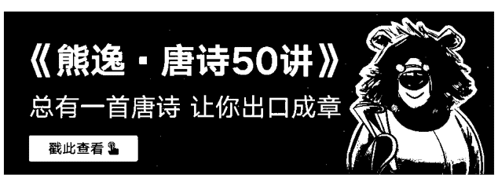

## 问答：思想实验和物理实验有什么区别？

思想实验和物理实验有什么...

## 来自日课：不可思议的巧合

读者 Core Duo：

如果引力不是力，那为什么还有所谓的电磁力、强作用力、弱作用力、引力这4种基本力呢？还要寻找所谓的大统一理论将它们统一呢？

读者 俩深山人、星星锶率、寡气 erne 子：

如果引力是个幻觉，那么物理学的四个基本力：强核力、弱核力，电磁力，引力都是幻觉吗？

读者 Sophie：

广义相对论和M理论PK哪个更胜一筹？

万维钢

广义相对论认为引力并不是一种“力”，但这只是广义相对论的看法。如果有一个物理学家非得认为引力也是一种力，那么的确，从逻辑上来说，引力应该跟其他三种力一起来。

## 来自日课：大尺度的美

## 来自日课：爱因斯坦不可能这么幸运

以我会挑选打印精英日课或得到课程内容给她阅读补充。昨天带给她一份《为什么佛学是真的》。我担心她看了相对论后，会不会对她的日常物理学习造成风中凌乱的感觉呢？

## 读者 郭强：

万老师，你会告诉你的孩子老师讲的“万有引力”是错的吗？最近跟着万老师学习相对论，感觉相对论的核心内容本质上不难理解，难的是我们对经典物理学根深蒂固的全盘接受。如果中学老师就讲相对论里关于“引力”的解释，学生们未必就听不懂。

## 万维钢

在学习中风中凌乱，是一个难得的美好体验。整天按照清晰的规则操作没意思，当上级的命令和内心的道德发生冲突的时候，人才能成长……

但相对论是个很安全的知识，一般不会导致跟老师的矛盾激化。老师在上面讲一个大众的版本，你坐在那里笑而不语，心中知道一个内部的版本，这难道不是一种优越感吗。这个优越感也许就能刺激孩子更好学。

教科书是给所有人用的，可能大多数人对物理知识并没有那么大的好奇心。但是谁也没规定十八岁以下的青年只能从教科书里获得知识，多方涉猎、量身定制、主动出击，也是读书人求知的本分。

我的孩子年龄太小，我没给他们讲什么物理。我倒是给我儿子找了一本课外的小学数学书让他学。那本书里有一个简便算法的公式，我儿子认为他的老师必定不知道那个公式。他把公式抄在卡片上，带到学校向老师炫耀——我没有阻止，老师也很配合，我儿子在数学上拿到一次虚荣心的满足。

### 万维钢·精英日课³
帮你和全球精英大脑同步
版权归得到App所有，未经许可不得转载

日课精选

提交留言可与专栏作者互动

#### 相对论11：黑洞边上的诗意

相对论11：黑洞边上的诗意

每隔四年就会有一个世界杯足球赛冠军和一大堆奥运会金牌，每年都会有十几个个人得到诺贝尔奖。而有些英雄壮举，在人类文明的历史上只可能发生一次。

1610年，也就是大明万历三十八年，伽利略用六个星期写成了一本书，叫《星空信使》。这本书介绍了伽利略用世界第一台望远镜看到的东西。他告诉人们天上有无数距离地球很远的恒星，月球上有山，木星有自己的卫星，金星有相位，太阳有黑子——这些证据表明太阳可能只是一颗普通的恒星，我们看到的行星都是绕着太阳转。

而当时的人还都以为一切天体都是绕着地球转的光滑球体。要论一本书改变人的宇宙观，再也比不会有人能超过《星空信使》了。

广义相对论在1919年之后很快就成了天文学家的常规工具。它比望远镜复杂得多，带来的天文发现是一个一个慢慢地冒出来的。

但是，广义相对论告诉我们这个宇宙的消息，像《星空信使》一样震撼。比如说，黑洞。黑洞有什么神奇之处呢？我们会从广义相对论最基本的假设出发，一步一步推导出一个让人不敢想象、但是又充满诗意的情境。

##### 1.红移和蓝移

广义相对论也有一个时间膨胀效应。空间弯曲得厉害、也就是引力场强的地地方的时间，会比引力场弱的地方要慢一些。用老百姓的话说，就是高处的时间会比我们在地面上的时间快一些。

想要理解这一 点，首先你得知道物理学上有一个现象叫“多普勒效应”。接下来的推理过程非常有意思，不要错过爱因斯坦的精妙思想！

多普勒效应是说，对于一个什么波，如果它是向你而来的，因为每一个周期都变短了一点，它的频率就会提高；如果它是离你而去的，频率就会降低。

比如一辆火车向你开过来，你听它的汽笛声会更尖锐一些；火车离你而去，汽笛声就会变低沉。

光波也是这样。我们现在知道光的速度是不变的——但是光的频率可变。如果发光点是向你走过来，光的频率就显得就更高一些，表现出来，就是你看到这个光的颜色会变得更蓝一点，这个叫“蓝移”。而如果发光点是在离你而去，光的频率就会变低，表现在颜色上就会发红，叫“红移”。

天文学家正是通过红移和蓝移，来判断宇宙中哪些星星是离地球而去，哪些是朝着地球飞来。

说到这里有个物理学家喜欢的冷笑话。美国物理学会曾经弄了一个红色的汽车保险杠贴纸，上面写着“如果你发现这张贴纸是蓝色的，那你就开得太快了。”


不知道你能不能体会到笑点。总而言之，你可以通过光的颜色变化判断光源和你之间的相对速度关系。

##### 2.引力红移

现在我们回到之前说的那个在自由落体的电梯里的思想实验。我们想象，电梯从地板向天棚射出了一束光。下面咱们考虑两个场景。

场景一，电梯是处在一个没有任何引力的空间里，它是自由自在地匀速直线运动。那我们可以想象，这束光应该既没有红移，也没有蓝移，就是本来样子的。

场景二，电梯是在地球的引力场中做自由落体运动，它会有一个从上到下的加速度。天棚就会加速冲向那一束刚刚离开了地板的光波。当然，天棚看到的光速还是 一样的——但是，天棚会察觉到这束光有一个蓝移。

好，这就有问题了。根据等效原理，场景一和场景二的电梯里的物理学应该完全一样，应该 是你不管做什么实验都不会发现二者有什么区别。那场景二的这个蓝移，是怎么回事儿呢？

一般人想到这里可能会说，啊，这说明等效原理不对——所以一般人不是爱因斯坦。爱因斯坦非常信等效原理。

所以爱因斯坦说，场景二也应该看不到光的蓝移。为了做到这一点，场景二中的引力场，必须提供一个红移，去抵消加速运动带来的光的蓝移！

为此，爱因斯坦要求引力场——或者说弯曲的时空——必须具备一个性质：它必须带有红移！这就是“引力红移”。


也就是说，身处引力场中，从高处看星体发出来的光，会有一个天然的红移。

这也就是说，同样一束光，我站在高空中看，会觉得它的频率变慢了。

而这也就是说，如果你在地面做什么事情，我在高空看你，会觉得你是在做慢动作。而你在地面看我，会觉得我是在做快动作。

这也就是 说你老得比我慢。

这也就是说引力能导致时间膨胀。

引力红移在地面附近导致的时间膨胀和高度成正比，距离地面越高的地方时间过得越快。

这个效应精确到什么程度呢？你拿两个对好了表的原子钟，一个放在地面，一个放在几十米高的楼上——你都能发现他们走时 的区别。因为巴黎和伦敦的海拔高度不同，它们的 时间每天相差1纳秒！物理学家还曾经把卫星发射到太阳附近去验证广义相对论的时间膨胀效应，结果跟理论非常 吻合。

GPS 卫星距离地面很远，时间膨胀效应很强，所以计算时间必须考虑广义相对论的修正。没有这个修正，定位精度就会差出十几公里！这也是能让百 姓直接用上广义相对论的一个例子。

我们还能彻底解释前面讲过的双生子效应。为什么哥哥一 阔头，就发现地球上的妹妹就突然变老了很多？因为哥哥这次阔头是一次剧烈的加速运动，而加速运动等效于一个强引力场。哥哥相当于是处在一个大质量天体的表面，而妹妹相当于是站在高处看哥哥——妹妹感受到了引力红移。

如此说来，生活在山顶的人，要比生活在山脚下的人老得快一些。说到这里，我们之前说的经常在天上飞的飞行员和空姐会因为高速运动比我们年轻一点，这就不是事实了——得取决 于高速运动变年轻和飞得高变老这两个效应哪个更强。美国国家标准局的科学家做过研究，说却是每小时40公里的速度，或者30厘米的高度，都足以对原子钟产生可测量的影响——而对普通航班来说，高度的影响略大一点点。一个飞行了一千万英里的人，也就比地面上的人老0.059秒 [1]。

当然所有这些效应在地球上、包括在整个太阳系里都是不明显的，你完全不必为生活在一个高海拔地区而感到焦虑。就连太阳的引力都不算强。

##### 3.黑洞

一个星体的质量越大、自身的尺寸越小，

一个星体的质量越大、自身的尺寸越小，它对周围空间弯曲的程度就越厉害。所谓“黑洞”，就是它把周围空间弯曲得实在是太厉害了，以至于连光线都无法从里面出来。

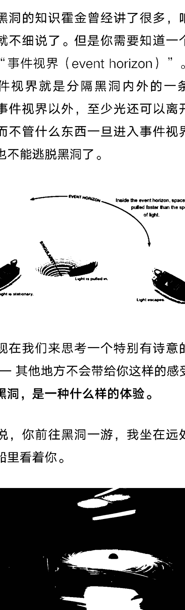

从外面看，黑洞本身是一个……黑黑的洞。但是如果黑洞附近有别的物质，比如说星际间的气体或者带电的粒子，你会看到它周围有一个光圈。那些光是来自带电粒子加速运动产生的辐射。

下面这张图表现了普通恒星、质量大体积小的中子星、和黑洞对时空的弯曲——

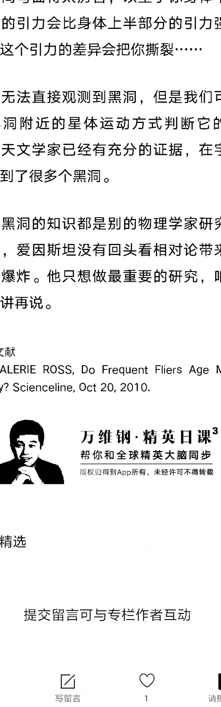

有关黑洞的知识霍金曾经讲了很多，咱这里就不细说了。但是你需要知道一个概念：“事件视界（event horizon）”。所谓事件视界就是分隔黑洞内外的一条界限。事件视界以外，至少光还可以离开黑洞；而不管什么东西一旦进入事件视界，就再也不能逃脱黑洞了。


好，现在我们来思考一个特别有诗意的事儿——其他地方不会带给你这样的感受：

**掉入黑洞，是一种什么样的体验。**

比如说，你前往黑洞一游，我坐在远处的太空船里看着你。


因为强烈的时间膨胀效应，当你接近黑洞的时候，我会看到你的动作变得越来越慢。你会比我老得慢！

接近黑洞不一定就会掉进黑洞里。事实上因为黑洞的尺寸往往比较小，想掉进去也不容易。你完全可以把黑洞当做一颗普通的行星，你绕着黑洞转几圈。你完全是自由落体运动，不会感到任何不适。但是因为黑洞引力场太强，你转的这几圈，在我眼中可就太漫长了。如果你转两圈就回来找我，可能我已经老死了，而你归来仍是少年。

但是如果你觉得在外围转两圈不过瘾，你想进入事件视界看看黑洞里面是什么情况，那可就麻烦了。

在事件视界上，你的时间膨胀将会达到无穷大。

也就是说，当你跌入黑洞的时候，我看到的是你越走越慢、越走越慢，最后你的身影将永远停留在事件视界上。我感觉你在那儿再也不动了……你的形象永远都保留在我的世界中。你那一瞬间，是我的永恒。


但是时间膨胀是相对于我而言的，你自己不会感觉到这一点，你只会自然地跌入到黑洞中去。经过事件视界的那一刻，你不会有任何异样的感觉。黑洞并没有在边界线给你举行欢迎仪式，你看到的黑洞内部也可以有光线，你眼中的事件视界内外没有什么区别。

然而这是一条有去无回的路。你将会被黑洞杀死。但你不是撞到地面摔死的。黑洞把空间弯曲得太厉害，以至于你身体下半部分引力会比身体上半部分引力强很多，这个引力的差异会把你撕裂……

我们无法直接观测到黑洞，但是我们可以从黑洞附近的星体运动方式判断它的存在。天文学家已经有充分的证据，在宇宙中找到了很多个黑洞。

有关黑洞的知识都是别的物理学家研究出来的，爱因斯坦没有回头看相对论带来的这场爆炸。他只想做最重要的研究，咱们下一讲再说。

参考文献
[1] VALERIE ROSS, Do Frequent Fliers Age More Slowly? Scienceline, Oct 20, 2010.


日课精选

提交留言可与专栏作者互动

#### 相对论12：爱因斯坦的愿望

你做没做过那种特别厉害的事儿。比如说，在一场关键篮球比赛中投入绝杀球、在公司的一次重大决策中力排众议做出错正确选择、用一个充满个人风格的表演征服观众。如果你做过一次这样的事儿，你就会只想再做一次。而如果你已经做过两次，你就会认为这就是你唯一该做的事儿。

爱因斯坦用狭义相对论改变了世人的世界观，然后用广义相对论再一次改变了世人的世界观。这样的事儿他做过好几次。也许征服物理学的世界，就是爱因斯坦唯一该做的事儿。

十多年前流行的一本叫《创新的窘境》的书，说过这么一个道理。一个因为坚持了某种理念而获得成功的公司，往往会执着于这个理念。这个理念本来是一个创新，曾经给企业带来了巨大的成功。但是到了后来，它往往会成为包袱，会阻碍你去尝试新的创新。

所以我们到底应该坚持、还是不应该坚持理念呢？我敢说，任何号称能给这个问题提供解决方案的人都是骗子。这里面没有可以机械化操作的方法，你只能自己选择。

相对论我们快要讲完了。相对论的发现旅程，即使在物理学家中都是绝无仅有的，这是一个充满爱因斯坦个人风格的探索。总来说，这个风格有两条——

第一，要统一。爱因斯坦总是想用一个“更一般”、或者说“更广义”的理论、用几个最基本的原则来统一描述看似完全不同的物理现象。

第二，要断然。只要你相信最初的原则是对的，那就不管推导出来什么离奇的结果，你都只能接受。就当时的实验条件验证不了了，将来总有人能验证。

##### 1.宇宙的命运问题

有了广义相对论的引力场方程，爱因斯坦就要做一件有史以来气魄最大的事情：他要对整个宇宙求解。

在广义相对论的视角下，宇宙无非就是物质和时空。我们想象一片有很多山头的地...它们在整体上会有一个什么样的行为呢？


但是这三个解都有大问题。如果宇宙的曲率是正的，时空就会不断收缩；如果曲率是负的或者是0，时空就会不断膨胀——不管怎么说，引力场方程结出来的宇宙时空都不会是静态的。

```
\left(R_{\alpha}^{\beta}-\frac{1}{2}g_{\alpha}^{\beta}R\right)+\Lambda g_{\alpha}^{\beta}=\frac{8\pi G}{c^{4}}T_{\alpha}^{\beta}
```

##### 2.量子力学和统一理论

在广义相对论带来宇宙学革命的同时，物理学的另一个阵地正在展开一场同样重大、同样震撼、甚至可能更加不可思议的革命，那就是量子力学。

算一切运动——而量子力学正好相反。

物理学再次陷入危机。或者，只有爱因斯坦觉得那是一个危机。毕竟广义相对论是大尺度的理论，而量子力学研究的是微观的世界。别的物理学家都认为这个矛盾可以先放着，目前是井水不犯河水.....

可是爱因斯坦如果能坐视这个矛盾，他就不是爱因斯坦了。他多么希望自己能再一次看破红尘，再一次开拓疆域，得到一个统一理论，告诉世人宏观和微观其实是一回事儿……

一直到1955年离世，他也未能做到。

##### 3.英雄

我以前读过一个科幻小说，说爱因斯坦晚年其实已经发现了统一理论，但是因为这个理论能带来不可思议的力量，他决定对世人保密，只告诉了自己的四个学生。后来多方势力争夺爱因斯坦的统一理论，导致四个学生全部被杀。

可惜那只是小说家对爱因斯坦的美好祝愿。

事实是爱因斯坦不可能得到统一理论，粒子物理学在爱因斯坦去世之后取得突飞猛进的发展。1970年代，物理学家把电磁相互作用、弱相互作用和强相互作用这三个除了引力之外的自然界基本力给统一起来了。爱因斯坦活着的时候还没有这些知识，他还不知道那些微观世界的实验结果。

爱因斯坦在1933年定居美国，担任普林斯顿高等研究院的教授。他脱离了物理学研究的主流，把所有立功的机会都让给别人，自己坚持去做那个不可能完成的任务。

他逐渐变得离群索居，跟同事和家人都慢慢疏远。好在后来普林斯顿来了个年轻的逻辑学家，库尔特·哥德尔——就是“哥德尔不完备性定理”的那个哥德尔，跟爱因斯坦成了忘年交。

爱因斯坦说他每天之所以还去高等研究院上班，就是为了拥有跟哥德尔一起上下班的荣幸。两人在上下班的路上谈论物理、哲学和政治。爱因斯坦能跟哥德尔聊到一起去，很可能是因为哥德尔也相信宇宙是精密数学的产物，他同样鄙视量子力学。有同事回忆说，爱因斯坦和哥德尔这俩人只在一起聊，他们都不愿意跟我们聊。

有时候想想，爱因斯坦和牛顿大约是人类历史上最厉害的两个科学家，但是他们有个很大的区别。牛顿面对同时代的科学家非常傲慢，对谁都看不起，但是牛顿对大自然充满敬畏。牛顿说，我只不过是在海边玩耍的一个小孩子，偶尔发现了几个漂亮的贝壳，但是我背后，我没看到的，却是真理的汪洋大海。

爱因斯坦正好相反。爱因斯坦是个非常谦逊的人，从来不跟同辈的科学家争名夺利——但是爱因斯坦对大自然却充满了雄心壮志，他认为自己一个人就能发现终极真理！

七十六岁这一年，爱因斯坦因为腹主动脉瘤破裂引起内出血，被送到医院。这不是什么疑难杂症，医生建议马上手术。但是爱因斯坦拒绝了。爱因斯坦说“当我想去的时候请让我离去，一味地延长生命是毫无意义的。我已经完成了我该做的。现在是该离去的时候了，我要优雅地离去。”

爱因斯坦去世后，哥德尔奉命整理他的办公室。哥德尔看到黑板墙上写着几个公式。

那些公式不会得到任何东西，是个死胡同。


万维钢·精英日课³
帮你和全球精英大脑同步
版权归得到App所有，未经许可不得转载

日课精选

提交留言可与专栏作者互动

#### 相对论13：相对中的绝对（完结篇）

如是我闻。一时我佛爱因斯坦在普林斯顿。为哥德尔讲相对论。

哥德尔从引力场方程中发现了一个不同于前人的、关于整个宇宙的解。根据这个解，宇宙的时空是旋转的——每个人抬头看漫天的星斗都在绕着自己转，而且如果一个能沿着一个方向走足够长的路程……他不仅能回到自己出发的位置，而且能回到自己出发的时刻。

哥德尔算出来一个在时间上循环的宇宙。这个解不一定违反因果关系——循环不等于穿越，可能你还是改变不了历史——但是如果所谓的“过去”还可以再次发生，那它还是过去吗？如果时间能循环，那时间还是时间吗？

爱因斯坦不喜欢这个解，事实上我们这个宇宙的观测证据也不支持这个解。但是哥德尔有一个洞见。

哥德尔说，我们的宇宙是不是这样的不重要。重要的是有一个宇宙可以是这样的。而既然相对论的一个合法的解里，时间流逝是一个幻觉，那就说明，在所有的宇宙中，时间流逝都是幻觉。

相对论咱们已经讲完了，这一讲说说我们能从相对论中得到什么。比如何说，哥德尔说的，其实是客观现在绝对与视角无关。

##### 1.一切都是相对的吗？

时间可以膨胀，长度可以收缩，时空可以弯曲，你的同时不一定是我的同时。被相对论颠覆了这么多次，人可能会陷入一种虚无主义。

还有什么概念是不会被颠覆的？也许世界上的Called一切都是相对的。也许我唯一知道的就是我一无所知……

千万别这样。这和有些女孩失恋几次之后就说“男人没有一个好东西”是一样的，这是气话。我们学习科学不是为了证明自己一无所知，你得知道自己知道。

相对论可不是说一切都是相对的，它只是说*坐标系*是相对的。坐标系，你可以把它理解成“视角”。


##### 2.不变量

当然在相对论中连距离都不是绝对的，长短取决于你的坐标系和这段距离之间的相对速度。但是，相对论里也有一些东西跟坐标系无关，是绝对的。

比如说“事件”就是绝对的。大家可以对位置和时间有不同的看法，但是事件就是事件。一束光发出来了，哥哥和妹妹见面，不管在哪个坐标系看都是同样的事件。

d² = c²t² - x² - y² - z²。

这个距离是一个绝对的不变量。不管你用的是什么坐标系，d² 的数值都是一样的。

##### 3.相对论带给我们什么

物理学是最解放思想的学问，但也是一门仅次于数学的严谨学问。物理学教给我们的精神是既要激进地开放思想，又要激进地审视自己的观念。

这朵花的存在是绝对的，但是人们对花的印象是相对的。

这是相对于我的。

比如说怎样用相对论观点看一场足球赛。裁判判罚我方球员犯规，你可能觉得裁判这次判罚不公平，可是对方球迷却可能认为裁判就只有这次判罚才公平。

当你宣称我方球员怎么犯规都是为了国家的胜利，国际比赛就不用讲规矩的时候，你能不能保留一点钻研相对论的习惯，询问如果是在对方的坐标系下，这些行为应该怎么算。

当你宣称大家都是各为其主、这个世界上根本就没有绝对的对错的时候，你能不能想想相对论里的那些不变量，最起码统计一下双方各自的犯规次数。

## 相对论总是提醒我们思想的局限性。亚里士多德认为静止是最自然的运动状态，牛顿认为匀速直线运动也是最自然的状态，而爱因斯坦说沿着测地线的任何运动都是最自然的状态。

我们难以接受相对论的结论，是因为我们从来都是生活在一个低速的环境之中。那我们能不能举一反三，看看还有什么思想，是自身环境的产物。

你在乡村获得的经验，能适用于大城市吗？你S在历史上获得的经验，能够适用于现在吗？

## 相对论打开了一扇大门。是爱因斯坦让世人深刻地意识到，现实可以和日常生活有如此巨大的差异。

自从有了相对论，物理学就从“反对日常直觉”，变成了“日常反直觉”。

哥德尔说时间的流逝是个幻觉，爱因斯坦并没有赞同，这个论断只能留待科学检验。但是爱因斯坦更反对量子力学，而量子力学现在已经是物理学家的常识。

也许只有到了连爱因斯坦都反对你的时候，你才算是学会了做爱因斯坦。

## 相对论还带给我们乐观的情绪。也许现在有一个边远地区的孩子，从来没进过城。他考上了大学，要去北京。他可能知道、也可能不知道，北京的生活和他家乡完全不一样。他将来还会去世界各个地方，他会发现这个世界完全超出他的想象。

这个孩子会不会感到害怕?如果你学了相对论，我希望你告诉他别害怕。

这个世界跟我想的非常不一样，我们的很多观念都错了，但是正像是相对论展示给我们的那样，这个世界只比你想象的精彩和丰富得多，也会好得多 —— 只要你愿意克服自己的偏见和无知。

## 爱因斯坦说，“上帝是不可捉摸的，但并无恶意。”

假如未来发生什么大灾变

让世界重归黑暗

人们不再钻研科学

拜倒在虚幻的神和压迫的权力之下

被偏见和狂热蒙蔽

只看到眼前的计较和平庸的善恶

我希望至少你、我

我们这几个人还记得

这个世界曾经拥有过爱因斯坦

拥有过相对论

这个美丽的理论


## 为什么新一代女生容易抑郁

为什么新一代女生容易抑郁

一代人有一代人的新问题。我在大学毕业之前好像就听说过“抑郁症”这个词。抑郁症变成流行词之后，有的人还以为这是一种时髦的矫情，是为了吸引注意力和故作姿态。我曾经一度认为抑郁症是现代医学过度诊断的结果。

三十年以前那些为生活奔忙的人，那些天天念叨工作和房子的人，那些从事集体劳动的工人和农民，那些连温饱都没解决的人，他们没有怎么抑郁症。我还记得听过一个说法，1970年代，日本人听说美国人发明了治疗“抑郁症”的药物，都认为这是美国人变着法赚钱——那时候日本根本就没有抑郁症这个概念。

那么为什么现在这些白领们，这些除了上学什么事儿都不用操心的学生们，突然间就抑郁了呢？

是基本生活太容易了闲的吗？是父母照顾太好了吗？我最近听说一个新研究，让我倒吸了一口冷气。

年轻人一代，特别是女性，可以说是正生活在一个风声鹤唳的险恶环境之中。

## 1.抑郁的新一代

抑郁症是真的，而且正在流行。美国社会心理学家珍·特温吉（Jean Twenge）2017年出了本书，叫《i一代》（iGen），告诉我们，现在发达国家的青少年中，得抑郁症的人数可以说是触目惊心。

下面这张图说的是过去十几年间，美国12到17岁的青少年被诊断出抑郁症的比例——


我们看到，2011年以后，抑郁症的比例持续增加，现在男生有抑郁症的比例超过5%，女生甚至是接近20%！

你的第一反应可能跟我以前一样，认为这只不过是现在美国对抑郁症的诊断标准过于敏感了，可能这人明明挺正常，医生也要给他诊断成抑郁症。但是，下面这个数据，可是硬证据。

这张图说的是过去十多年中美国15到19岁青少年的自杀率——


注意这张图统计的是每十万人中自杀*成功*的人数——仅仅尝试了自杀，后来被救活的不算。图中男生的自杀率比女生高，这是因为男生对自己下狠手，常常使用开枪或者跳楼这种没法抢救的方式，而女生更常用比较温和的手段。事实上，如果统计*尝试*自杀的人数，女生要多于男生。

要点在于，青少年自杀趋势和抑郁症的趋势一样，也是上升的。特别是女生，现在跟几十年前相比，自杀率几乎增加了一倍。还有人统计了不是自杀、但是是自我伤害，比如说用头撞墙之类的行为，也是同样的趋势。

这个趋势就是过去十几年来，美国青少年，特别是女生，其中有越来越多的人过得不快乐，轻则抑郁，重则自杀。

特温吉把这些青少年称为“i一代（iGen）”，特指那些在1995到2012年间出生的人。

这个 i，是 iPhone 的 i，也是 Internet 的那个 i。按中国说法，这些人是“互联网的原住民”。他们基本上是刚满十二岁就正好能用上 iPhone 和 Facebook。

特温吉之所以把这一代人单独拿出来研究，是因为他们有一些完全不同于上一代青少年的特点——

- 他们很少酗酒
- 他们很少吸烟
- 他们开车更安全
- 他们发生性行为的时间更晚
- 他们更服从家长和老师，不怎么叛逆
- 他们对社会的容忍度更高

那如此说来，这个i一代有点像是日本的“食草男”和中国的“佛系青年”，可以说是绿色的一代、节能的一代、环保的一代。这不就是人人心目中的好孩子形象吗？但是，i一代有大问题。

i一代是成熟得更晚的一代。他们学开车晚、谈恋爱晚、找工作也晚，他们的18岁就好像以前的15岁，13岁就好像以前的10岁。他们到了上大学的年龄，在心理上还没有准备好上大学。

i一代最大的不同点，就是他们的心理问题非常严重。焦虑和抑郁是这一代的新趋势。

这是身体比以前安全，心理比以前脆弱的一代。

## 2.什么是“抑郁”

我们精英日课专栏以前多次讲过焦虑。所谓焦虑，就是人对某种*威胁*的反应。比如说，过几天要参加一个考试，你怕考不好，你会焦虑。工作不稳定，你担心一旦被裁员就没法还房贷了，你会焦虑。

焦虑是个不好的情绪，对健康有害，有了焦虑感应该设法自己调节。严重的焦虑感会让人把不是威胁的东西也当做威胁。比如同事明明是随便说的一句话，你却能听出来那是在针对你。明明这个任务很简单，你却特别担心搞不好。

但是焦虑毕竟是个容易理解的情绪。你是因为想把日子过好，才会有焦虑感。

而抑郁，则是一种绝望感。你觉得自己没希望了，不管怎么努力都没用。你看着何问题都是无解的。你彻底丧失了控制感，认为一切都好不了。有个说法叫做，“抑郁是习得的无助感”。

焦虑和抑郁经常发生在同一个人身上。这样的人对周围事物的判断可能会有一个“故意偏见”，认为周围的人对他有故意。

那好。食草的、佛系的、绿色的 i一代，为什么会产生这样的感觉呢？这跟 iPhone 和互联网又有关系呢？

## 3.女生的江湖

以下我们要说的这些结论听起来可能有点不寻常，但是请注意，它们背后是很多社会心理学家的统计研究。

特温吉认为，i一代之所以会抑郁，很大程度上是 Facebook 之类移动社交网络影响的结果。

一个研究是看青少年每天花的“屏幕时间”——就是看手机看电视看电脑的时间——和抑郁症的关系。结果是如果你每天的屏幕时间少于两小时，那就没问题。如果多于两小时，那屏幕时间就跟抑郁症有正相关：你花在屏幕上的时间越多，就越可能得抑郁症。

当然相关不等于因果，所以特温吉还有别的证据。特温吉发现，那些不在屏幕上的活动，比如说体育锻炼、面对面的跟人交往、参加宗教活动、读书、甚至只要读的是印刷品而不是屏幕，就都能减少抑郁症风险。

那屏幕时间到底坏在呢？首先是它占用了你跟人面对面交往的时间。统计表明如果你每天跟真人交往的时间很多，那么就算你有更多的屏幕时间也没问题。

可是读书为啥就没事儿呢？也许手机能在一定程度上替代社交，而读书不会降低你的社交需求。

真实社交时间被屏幕占用，这个理论可以在一定程度上解释男生的精神状况问题。社交少可以出现各种精神状况，不一定是抑郁。

抑郁。

但是它解释不了为什么女生中的抑郁症患者突然增加了这个大趋势。

特温吉的数据表明，女生跟男生的屏幕时间有重大区别。女生更多地是使用社交网络，而社交网络导致了女生的抑郁症。

以前我们讲Tim Wu的《注意力商人》的时候也说过社交网络的心理危害。当时我们只是说社交网络让人爱炫耀，容易引起攀比。女生的确很重视攀比，特别是在美貌方面的攀比。人们在 Facebook 上发的照片常常是修过的，会比本人更美。一个女生看了另一个女生的照片，特别容易焦虑。

但是心理学家们还有一个新的洞见。对女生来说，社交网络的最大问题并不是炫耀和攀比，而是“被孤立的感觉”。

比如说，几个同学叫你一起出去玩，你有事去不了，你很遗憾，但是不会因此导致什么心理问题。可就是如果有几个同学一起出去玩，没叫你，那你会是一种什么感觉。

对男生来说可能无所谓，约等于叫你了你去不了，无非就是少玩一次——男生在意的是这次玩的活动本身。

而女生，在意的是通过这次活动体现出来的同学关系。这里面有政治！这几个同学一起玩不带你，这意味着你跟她们的关係有问题。你感到被孤立了。

最令我吃惊的是，因为 Facebook 已经紧密地成了学生生活的一部分，美国女生会战术性地使用Facebook。比如说，一个女生在 Facebook 上贴出她和几个女生的合影，其用意，其实是为了给一个不在这张照片上的女生看：我们聚会了，没带你。

对看照片的女生来说，她看到的不是照片里那些女生美不美，她首先看的是照片里为什么没有我。

这不是发朋友圈。这是挑衅，这是宣战。

男生对男生是物理攻击，女生对女生是关系攻击。

美国社会心理学家乔纳森·海特（Jonathan Haidt）和格雷格·卢加诺夫（Greg Lukianoff）在2018年出版的新书《被娇养的美国心灵》（The Coddling of the American Mind）中提到这个研究的时候说——

如果你想杀死很多美国男孩，你可以给他们每人发一把枪；如果你想杀死很多美国女孩，你可以给她们每人一个智能手机。

## 4.安全与脆弱

我觉得把所有抑郁症都归结于 Facebook 显然是不太公正的。海特和卢加诺夫问了一个更深层的问题：为什么这一代学生的心理素质变得这么脆弱了？

女生爱搞政治很正常，那也不至于就抑郁了吧。海特和卢加诺夫这本书的答案是，因为现在美国社会给孩子的环境过于强调安全。美国校园不但强调身体安全，而且还试图杜绝任何语言上的不安全。学校教育学生从教授、从媒体中寻找可能会冒犯他们的字眼儿。

在这种氛围内，学生们变得异常敏感。他们从来没有经历过真正的不安全，反而看什么东西都感觉不安全。

人本来是个反脆弱的东西，而现代化的娇惯式的教育，正在把人变脆弱。

我知道有些抑郁症是大脑的硬件出了问题，甚至可能跟基因有关。而且中国也不是美国。但是这两本书对我们仍然有借鉴意义——

你应该让孩子为将来要走的路做准备，而不是把路给孩子准备好。

## 问答：什么是“引力透镜”？

万维钢

熊逸老师给我们专栏写了一篇加餐，作为上周我的唐诗课读后感的答复，我们将在明天发布这篇文章。这样咱们把周末问答提前到今天。

问答：什么是“引力透镜”？

## 读者 怀沙：

万老师，可否讲一下“引力透镜”造成的多重影像问题？我的主要疑问是：既然费马元素要求光“走最短路线”，为什么会有四个光一起走，为什么还会出现“快光”和“慢光”、不同到达呢？

万维钢

引力透镜是个非常有意思的现象，而且现在是天文学家观测宇宙的一个常规的工具。我在相反对论正文中没有来得及讲，这回正好讲一下。

我们知道广义相对论说大质量天体会弯曲它周围的时空，包括光从它附近所走的路径——也就是测地线——也会被弯曲。这就是为什么发生日全食的时候我们能看到实际上是处在太阳背后的星星。

但是太阳的质量还不够大，它对星光的弯曲还不够厉害。使用哈勃太空望远镜这种天体物理学级别的装备，天文学家可以看到更壮丽的光线弯曲。

太阳只是一颗不算太大的恒星。这个宇宙的大尺度结构是百亿、千亿个恒星组成星系，星系们又组成星系团。在特别遥远的尺度上看，一个星系就好像是一颗恒星一样，有一个统一的引力场，能弯曲星系周围的时空。

比如距离地球很远的地方有个巨大的星系或者星系团，我们叫A星系。相对于地球，这个A星系的背后的一个更远处的星系，我们叫B星系，所发出的光，就有可能被前面A星系弯曲之后，传到地球。


这样我们会在A星系旁边看到B星系的光。而因为A星系把周围时空弯曲得太厉害了，我们看到的不是B星系传来的一束光，而是从围绕A星系的各方方向分别传来的几束光。

在最理想的情况下，如果A星系是个完美的球形，B星系又恰好在A星系背后正中的位置，我们看到的将是 B 星系的光形成了一个围绕着 A 星系的圆环！这个圆环叫“爱因斯坦环”——


当然一般不会这么巧，A星系的尺寸可能不规则，B星系的位置可能不在正中，但是我们仍然能看到好几束来自B星系的光。

有时候，B星系的光在横向形成一个圆弧形——


更常见的是比较短的“拉伸”——


比如上图中下方的方框里，才是B星系本来的样子。你可能会经常看到这个样子的星系照片，现在你知道它们都是广义相对论的光线弯曲效应。

还有一种有意思的情况叫“爱因斯坦十字”——是远方的一个极亮的星星——叫“类星体”——发出的光，被中间隔着的一个星系弯曲，到达地球。因为星系不规则的形状和这个类星体的位置，我们看到的是围绕星系有这个类星体的四个图像，形成一个十字形——


所有这些现象都叫做“引力透镜”。引力透镜是广义相对论送给天文学家的礼物。远方的星体和星系通过透镜成像，就好像有个望远镜一样，能让我们看它看得更清楚。

通过光线弯曲的不同情况，天文学家可以了解中间那个星系的信息。比如说，如果这个星系的可见物质只有这么多，可是它把光线弯曲得却特别厉害，那我们就可以推测，这个星系中存在大量的暗物质。

好，现在回到问题。为什么远方星体会有好几束光分别到达地球，为什么不是只走最短的路线呢？答案是每一束光走的都是最短的路线——但是它是*本地*最短的路线。比如一个类星体，它的的光既会到达中间那个星系的左边，也会到达那个星系的右边、上边和下边，这几束光已经分开了，只不过因为星系空间的弯曲，被再次汇聚到了地球这里。这是实实在在的几条路线。这个情况跟用放大镜汇聚太阳光完全一样，不同路线的光线汇聚到一起。

而对比之下，费马所说的“走最短路线”，是在“所有*可能*的路线”——而不是实实在在已经发生的路线——之中走了最短的一条。这种比较是数学上的比较，给人感觉就好像有思想一样，先走一遍看看哪个最短，然后其它的不走了，只走最短的。但那只是一个“相当与”而已，是个数学上的虚拟的比较。我们完全可以把费马原则理解成，光在临近的路径之中选择了测地线。

引力透镜，则是光在中间星系周围的每个邻近区域都有 一条本地的测地线，这些测地线的长短不一，光通过这些测地线分别到达地球。

还有一个有意思的问题是为什么我们在日食的时候只看到太阳弯曲的一束星光，而 不是爱因斯坦环和爱因斯坦十字呢？答案是因为太阳离我们太近了！换个地方弯曲，光线就会相差很远，在地球上就看不到了。引力透镜要求中间的星系差不多要处在远方星体和地球位置的中间才行。

## 读者 童馨：

日光是白光，而我们看太阳感受到的是红色，这也是由太阳引力带来的红移效应吗？

## 读者 顾昱晓：

宇宙膨胀带来星星红移的效应和广义相对论带来的红移的效应，哪个更强一些？

万维钢

太阳的引力红移是非常小的，我们不可能用肉眼观测到——事实上，在广义相对论被发现之前，科学家就通过比较太阳光谱和地面上各种元素的光谱来确定组成太阳的物质成分，他们并没有发现太阳光有红移。我们在朝阳和夕阳中看到太阳光是红色的，那是光线穿过地球大气被散射的缘故。

我们说“红移”，意思仅仅是光的频率变低了一点点——是在光谱上往红光的方向上移动了一点点，可不是说颜色就变成了红色。

引力红移是个短程的、本地化效应。就算引力场再强，过一段距离之后，红移就到此为止。

但宇宙膨胀带来的红移则是大尺度的效应，距离我们越远的天体的红移就越厉害，大大超过引力红移。如果我们看到有一颗星星的光谱有红移，那基本上都是因为它正在远离我们而去，而不是因为它的引力场很强。

## 读者 陈春：

记得经济学家说过，他认为所有的学问，有两样一定要了解，一门是物理学——无人的世界；一门是经济学——有人的世界。但是我脑子里一直在盘旋一个问题：这人，他不也是从无人的世界里演化出来的嘛。而且现在物理学已经发展到量子力学了，就加入了观察者这个角色的作用了。所以，是不是可以说，量子力学统一了有人和无人的世界？

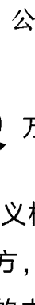

万维钢

有一些物理学家认为人可以影响量子力学效应，但这绝不是说量子力学能解释人的行为。人的行为，和组成人的基本粒子的物理学，是不同层面的问题。

我们专栏在讲《柏拉图和技术》这本书的时候介绍过一个“分层”的思想。逻辑门都是由晶体管组成的，CPU是由逻辑门组成的，程序是CPU的操作，人工智能是程序实现算法——但是你理解晶体管，可不一定就理解人工智能。每跨越一个层级，就是完全不同的原理。

这个现象也叫“涌现”——东西多了，它们就会表现出某种更宏观的、更高层面的逻辑。

量子力学能解释基本粒子的行为，但就算你完全会算量子力学，你也解释不了一个单细胞生物是怎么运作的。这是因为基本粒子到单细胞生物中间隔着很多层，一个单细胞生物是由无数个基本粒子组成的，你不可能一个粒子一个粒子地计算，那个运算量是不可接受的。你甚至连10个基本粒子的互动都算不过来，那太复杂了。

你只能暂时忘记基本粒子，重新总结一些更宏观的规律。

所以就算有朝一日我们找到了物理学的统一理论，也不能说这个世界上就没有新的学问可以研究了，不同层面有不同层面的学问。

一个有意思的问题是，既然经济学是研究人的，而人比基本粒子要复杂得多，那为什么经济学的理论都比较简单呢？答案是因为这些理论都比较粗糙。这是没有办法的办法，你不可能从第一性原理出发推导整个经济学，只能人为地弄一些做了大量近似的模型而已。

说到这里有个笑话——好像出自一位英国经济学家——是这样的。一个物理学家、一个工程师和一个经济学家被困在了沙漠里，他们只剩下一个铁盒的罐头，可是不知道怎么才能打开吃。物理学家建议把罐头放在火上烤，烤热了铁盒就会炸开。工程师说：“你疯了么？那样罐头就会炸得到处都是，我们还吃什么呢？我们应该找个什么铁片撬开它。” 经济学家说：“这可是沙漠！上哪找铁片去？我看这么着，咱先*假设*我们有个开罐头的起子……”

## 读者 杨开帅：

请问万老师，广义相对论是不是只适用于事件视界以外的宇宙空间？

## 读者 石榴哥：

好几次从课程里了解到，有科学家从广义相对论解出某些结果，请问老师，以后会不会还会不断有人从相对论的数学公式中解出新的结果呢？


万维钢

广义相对论也适用于黑洞事件视界之内的地方，但并不一定适用于整个黑洞。在黑洞的中心，可能合存在一个质量密度非常非常大、同时尺度又非常非常小的“奇点”，在这个奇点上，广义相对论会失效。

一般来说，广义相对论研究引力比较强、尺度比较大的物理学。量子力学研究引力比较小、尺度也比较小的物理学。通常它们井水不犯河水，但是黑洞的奇点这个地方，却是引力比较大，尺度又比较小，所以广义相对论和量子力学有可能同时失效。

英国物理学家彭罗斯把广义相对论用于黑洞内部，得到有关奇点的理论。而霍金，则把这个理论用于早期宇宙，并且推算出宇宙起源于一个奇点。所以广义相对论是个鲜活的理论，你可以对各种情况求解。


日课精选

提交留言可与专栏作者互动


# 熊逸：李白的“败笔”和杜甫的“精英日课”

万维钢 精英日课³
今天

万维钢
上周我写了一篇所《熊逸·唐诗50讲》的读后感——《唐朝诗人的敏感度》，熊逸老师提笔“回了一封信”。以下全文，和你分享。

很荣幸听到万维钢老师讲的《唐朝诗人的敏感度》，我也有一些话想接着万老师谈谈。这一回，我和万老师调换一下位置：万老师务虚，谈的是诗意和感受力；我来务实，谈的是实用性和工具价值。

让我们先看一首诗，李白的《关山月》：
明月出天山，苍茫云海间。
长风几万里，吹度玉门关。
汉下白登道，胡窥青海湾。
由来征战地，不见有人还。
成客望边色，思归多苦颜。
高楼当此夜，叹息未应闲。

这首诗我会在《唐诗50讲》的第19讲专门来谈，这里要谈的只是它的最后两句。当年我读这首诗，读到最后忽然感到很奇怪：整首诗明显在写征人思妇，也就是成守边疆的军人和驻守家园的女人，但为什么结尾会出现“高楼”的意象呢？

回顾：唐朝诗人的敏感度


## 《成功公式》1：分数在哪里决定成败

《成功公式》1：分数在哪里决定成败

今天开始咱们讲一本11月份刚刚出版的新书，叫《成功公式：成败背后的科学》（The Formula: The Universal Laws of Success）。这本书的作者是美国东北大学和波士顿复杂网络研究中心的教授，艾伯特-拉斯洛·巴拉巴西（Albert-László Barabási）。我们专栏曾经有篇文章叫《老王的体能和老张的灵感》讲过巴拉巴西的工作。他是物理学家出身，后来专门研究网络科学。他以前的两本书，《链接》《爆发》都有中文版。

## Albert-László Barabási

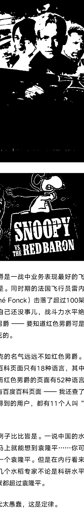

这本书说的不 是“成功学”，而是有关于成功的*科学*。

励志故事和名人传记有时候能给人带来一些启发。有些鸡汤作家和人生指南专家能从这些故事里挖掘出道理来，但那些都是个人的认识，不能上升到科学层面。科学理论，必须得可重复、可检验、有数据支持。

成功有科学吗？我们通常对成功这件事都有点感情用事，感慨的多，分析的少。明明是一个团队完成的项目，为什么最后拿功劳的是其中一个呢？明明两个人的水平差不多，为什么一个总升职，另一个人始终原地踏步呢？这些事儿到底是反常，还是规律，是运气，还是偶然中的必然。

你不能光看个例。你需要大规模的，最好是全面的统计。

这正是巴拉巴西他们所做的事情。现在互联网和大数据技术使得研究者能做一些极端的分析——

- * 他们统计了有史以来所有的学术论文，分析每一个学者是怎么成长起来的；
- * 他们拿到美国每周所有的图书销售数据，看看每一本书是怎么畅销的；
- * 他们有全世界所有的博物馆和艺术展览馆中的数据，这样他们能知道现代每一个艺术家是如何发迹的。

这些数据的特点是全覆盖无死角。可以说，他们知道一个领域内*所有的*成功。

然后他们找到了一些规律。他们对这些规律非常有信心，称之为“成功定律”。定律的意思就是你不服不行，不管你喜不喜欢，世界就是这样子。

## 1.业务表现 ≠ 成功

想要严肃地研究一个东西，你首先需要一个清晰的定义。到底什么叫“成功”呢？

两三岁自己会吃饭、长大每天都有起床穿衣的勇气、老了走路不用让人扶，很多人说这就是成功，可以。你创作了一个超越自我的作品，你说不管别人怎么想我认为这就是我的成功，也行。但是这本书研究的成功，不是这个意思。

这本书研究的是世俗的、可见的成功。如果你是一个作家，你的成功就是你写的书销量怎么样；你是一个品牌，你的知名度怎么样；你是個律师，有多少人排着队请你帮他们打官司；你是个明星，你有多少粉丝……这里说的成功不是你自我感觉怎么样，而是社会对你的认可。

这并不是说自我感觉的成功都是幻觉，也不是说不重要，而是那种成功不好测量。这就好比说“你幸福吗？”那个是非常主观的东西，不在这本书的研究范围之内。这本书研究的成功，是客观的、可测量的东西。

明确了这一点，接下来我们必须接受一个事实：业务表现好，不等於成功。

比如你是个画家。在美术学院的专家看来，你绘画的技法、作品的意境、特别是你审美的眼光，都大大超过了当代著名画家冷军。可是你的画卖不出去，而冷军的一幅画能卖出几千万元。那对不起，你不算成功。

业务表现（performance）是你自己的事儿。我们经常谈论的各种提升自己的方法，像刻意练习、意志力、高效率，这些都是研究怎么提高业务表现。业务表现好，说明你是一个高手，但高手并不一定成功。

## 2.你的成功由我们决定

巴拉巴西举了一个例子。第一次世界大战中，德国有个王牌飞行员叫曼弗雷德·冯·里希特霍芬（Manfred von Richthofen），曾击落过80架敌机，外号“红色男爵（Red Baron）”。红色男爵不但技术高超而且个性张扬，他故意把自己的飞机漆成红色，在空中特别显眼，向对方飞行员挑衅。

红色男爵不但在德国是家喻户晓，在全世界也是鼎鼎大名，出现在各种影视作品中。在他死后很多年，美国的动画片《史努比》里还有他的形象，西方的男孩几乎都知道有这么一个红色男爵。


那红色男爵是一战中业务表现最好的飞行员吗？不是。同时期的法国飞行员雷内·方克（René Fonck）击落了超过100架飞机，而且自己还没事死，战斗力水平绝对超过红色男爵——要知道红色男爵可是被人击中而死的。

但是，方克的名气远远不如红色男爵。方克的维基百科页面只有18种语言，其中没有中文；而红色男爵的页面有52种语言，他甚至还有百度百科页面——我还查了一下，咱們得到的用户，都 правового 11个人叫“红色男爵”。

像这样的例子比比皆是。一说中国的水稻专家，你马上就能想到袁隆平……你可能就只知道一个袁隆平。但是在内行看来，中国有好几个水稻专家不论是科研水平还是实际贡献都超过袁隆平。

这不是时代太愚蠢，这是定律。

巴拉巴西说，成功不是取决于你的业务表现，而是取决于你的业务表现对“社会网络” 的*用处*。

红色男爵对德国的价值并不仅仅是击落了80架敌机。德国宣传机构需要用他这个形象去振奋国民精神。红色男爵出身好、有个性、高调热爱战斗，特别符合德国的需求。德国一旦开马力宣传，约纳国这边就会跟着报道这个故事。可是方克就不行了，不但没战死还犯过政治错误，而且法国也没有那个宣传需求。

也就是说，决定你成功的不 是你的业务表现，而是别人对你业务表现的评价怎么样。说白了，就是你的成功不是你的事，是我们——也就是社会——的事。

就应该让我上好大学。我努力了，就应该得到奖励。但真实世界通常不是这样。这个思维模式就和相信那些成功人士都有超强的业务表现一样错误。

成功都是别人给的，你的成功由我们决定。想明白这一点，你对很多事情就容易释怀了。

但是也别太悲观！在有些领域，业务表现的确就能决定成功。

## 3.网球和高中

巴拉巴西等人做过这么一个研究。他们想看看职业网球选手的成绩，和他们的受关注程度之间，有什么样的关系。

网球运动员的业务表现就是成绩。研究者统计了2008到2015年间，所有职业网球运动员的比赛记录，谁赢了多少场、赢多少分。

而关于“成功”，研究者用了一个简单方法，就是看这个人的维基百科页面获得了多少点击。如果每天有很多 Fig...赞助商也就愿意找你。

# 由此得到

业务表现跟成功通常是两回事。成功不是由你的业务表现决定，而是由你的表现对社会网络的用处决定。但是，在某些特定的领域，业务表现的确驱动了成功。

这些领域的特点是业务表现是*可测量*的。网球运动员的战绩，学生的分数，明明白白就摆在那里，这是最硬的东西。

那如果一个领域的业务表现是不可测量的，会怎么样呢？特别是，好大学，能不能给学生提供“软实力”的加持呢？咱们下/pop


学习进步群


活码长期有效

## 《成功公式》2：名画和名校：你与网络的关系

万维钢·精英日课³
27万粉丝
进入派单 >

上一讲我们说到如果业务表现清晰可测，的确能在很大程度上决定成功。那如果业务表现没有那么清晰可测，是什么决定成功呢？答案是“网络”。

咱们说一个最极端的例子，艺术品。一件艺术品到底好不好，每个人都可以有自己的看法，完全没有客观的测量标准。那艺术家都是怎么成功的呢？

你可能听过各种传媒和名人轶事。艺术的网络好像是一个谜。有的人奋斗一辈子也没摸到这个网络的门道，有的 Siy -

## 1.名画“应该”值多少钱

业余欣赏者谈论艺术说的都是艺术本身。美学啊，潮流啊，流派啊，天赋什么的。但是对于圈内人来说，艺术品只有一个维度是最重要的，那就是价格。作品的所谓“内涵”因素远没有你想得那么重要，说得极端一点，它们在市场上都是虚的。

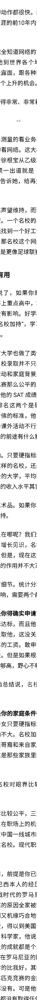

## 2.顶级网络的生意经

作为画家，你必须知道一点：你的画卖多少钱，几乎完全取决于你曾经在哪些画廊和博物馆里卖过或者展出过作品。

## 3.怎样逆袭

## 4.名校对谁有用

# 由此得到

《成功公式》这本书总结的第一条定律是—— 如果业务表现可测量，业务表现驱动成功；如果业务表现不可测量，则是网络驱动成功。

万维钢·精英日课³ 帮你和全球精英大脑同步

## 《成功公式》3：金子和金子怎么比

《成功公式》3：金子和金子。

老百姓们有句话叫“是金子总会发光”，经济学家有句话叫“胜者通吃”——我发现这两句话是矛盾的。

胜者通吃，就是在一个领域中，最厉害的人会拿走绝大部分的蛋糕。可能第二名的表现只比第一名差那么一点点，但是你的成功是我们决定的，而我们只喜欢第一名。

明星赚钱是这样，产品占市场份额是这样，科学家写论文也是这样：最厉害的论文被引用的次数，可以是普通论文的几百倍甚至几千倍。第一名发的光非常、非常亮。

如果金子都会发光，那第二名、第三名难道就不是金子吗？在胜者通吃的局面中他们能发光吗？

巴拉巴西的《成功公式》这本书中的研究表明，在高水平竞争中，是金子也不一定能发光。

## 1.红酒的玄学

每次听人说品评红酒的门道，我都忍不住会想到一些研究。所有研究的结论都是一致的：在品酒这个领域，根本就没有什么真正的专家。

## 2.最公平的音乐比赛

伊丽莎白女王国国际音乐竞赛可能是全世界最重要音乐比赛。赢了这个比赛，你不仅可以拿到一大笔奖金，还会被送到最好的音乐学院去深造，同时确保你将来有资格在最好的音乐会上演奏——你就拿到了顶级网络的门票。别忘了，音乐可是一个不容易测量的领域，是网络决定你的成功。

## 3.细节决定的成败

不知道你看过郎朗的表演没有。他是公认全世界最好的钢琴家之一，但是他的表演似乎不仅仅是音乐本身，他有一种充满激情的肢体语言。那作为一个音乐家，你需要在动作和表情上下功夫吗？答案是绝对需要。


有人做过这么一个实验。在受试者不知道比赛结果的情况下，让他们对一场真实的钢琴演奏比赛的三位选手的表现做判断，猜一猜是哪位选手得了冠军。

是非常极端的做法，别忘了这可是音乐比赛。结果这一组的准确率高到50%。实际比赛的评选专家，在既听又看的情况下，也就是这个准确率。第三组受试者边听边看，判断准确率还不如第二组。

难道现在钢琴比赛变成比视觉艺术了吗？我们只能说高水平选手的演奏水平已经无法区分了，人们只能用音乐以外的东西区分他们。

巴拉巴西的一个朋友有一次招聘，因为职位很热门，参加面试的每个人的简历都很漂亮，根本不知道选谁好……最后他选了一个人，是因为……那人当天穿了一双粉色的袜子，给他留下了深刻的印象。

金子跟金子比，常常就是这种意想不到的细节决定成败。也许是简历里的一段什么特殊的经历，也许是衣着打扮，也许是聊天时的一个小玩笑，这些东西基本上跟工作能力没啥关系。然而如果面试官知道来的人都不差，他还可能只看这种小细节。

当所有对手都是金子的时候，你就需要找一些特别的点来突出自己。

# 由此得到

《成功公式》这本书的第二条定律是——

业务表现是有上限的，而成功是没有上限的。

一旦大家的水平都接近上限，到了金子和金子比的程度，决定成败的就很可能有一些细节，甚至干脆就是纯属偶然。

但是到了这个层次，成败的结果却越发地重要。第一名只比别人领先一点点，他收获的回报却大很多很多。泰格·伍兹的收入是其他高尔夫选手收入的十倍、百倍甚至千倍，但是泰格·伍兹的水平并没有比其他职业选手高出多大截，他只不过稳定性稍微好一点点而已。业务表现是正态分布，成功的回报却是幂率分布。

我会随便买瓶红酒。我会尽可能晚出场。我会保留一点个人特色。我会把别人的胜负看淡一点。

中国队一遇到裁判“压分”，有人就说不要抱怨裁判了，我们应该进一步加强自己的实力，如果我们水平比对手高出一大截，那裁判想不公平也没办法。我看这些人纯粹是站着说话不腰疼——高水平比赛，你怎么可能比对手高出一大截呢？

如果你在这场竞争中真是鹤立鸡群、脱颖而出，那只能说明你走错了赛场。这个地方不适合你，你应该去参加更高水平的竞争。

在金子对金子的比赛中，“公平”这个词没啥意义。差距已经微乎其微，裁判再怎么样都无法保证绝对的公平。

那既然是金子和金子比，我们当然可以说反正这些人选都挺好，选谁都可以。可是如果你是参选者，在这个胜者通吃y

那怎么办呢？首先你得是金子。其次你需要一点特色，得让人容易识别。如果这还不行，那你就只能多参加比赛——一次运气不好两次不行，多参加几次，也许终有出头之日。关于这一点咱们下一讲再说。


万维钢·精英日课³
帮你和全球精英大脑同步

版权归得到App所有，未经许可不得转载

## 进步使人虚心，落后使人骄傲

进步使人虚心，落后使人骄傲

今天咱们说一个重要的心理学效应，叫 “邓宁-克鲁格效应（Dunning-Kruger effect）”。这个名词你可能没听说过，因为这是一个1999年才被正式研究发现的效应。但是这个道理，你早就应该能体会到。我认为这是一个应该写进中小學教科书的道理。

我先给你讲个故事。你听没听说过柠檬汁可以做隐形墨水？这是真的。就是用柠檬汁写在白纸上的字，干了以后就看不见了。然后比如说用电吹风一加热，字迹就能显现出来，这因为柠檬的酸性腐蚀了纸张。

话说1995年，美国有个叫麦克阿瑟·惠勒的中年男子，单枪匹马抢了两家银行 [1]。银行的人没难以为他，要钱给他钱。电影里一般抢银行的都带个头套，但是惠勒没有采取任何伪装措施，他甚至还朝着监控摄像头笑了笑，抢完银行就愉快地回家了。

当天晚上警察就抓住了他，并且出示了监控录像带的证据。惠勒感到很震惊。

惠勒说，不对啊，我已经在脸上抹了柠檬汁啊！

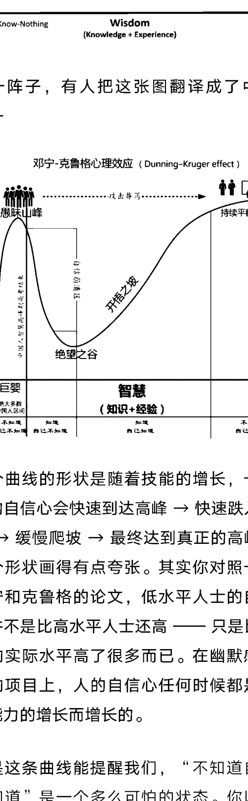

比如说真实水平最低的这一组，平均真实水平只有百分之十几，但是他们心中认为自己在人群中能够排到60%以上。这是一个大大的高估。而且请注意，图中第二条实线是在能力测试结束之后，每个 人感觉一下自己考得怎么样——结果最差的这一组，即便是刚刚考完逻辑推理，还以为自己考得不错。

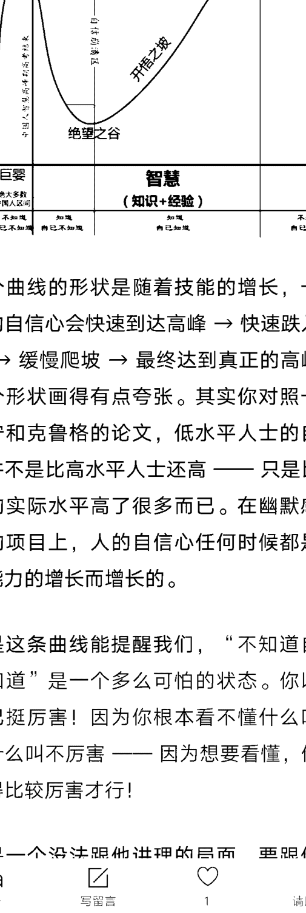


所以这个结论就很明显了，那些能力差的人，自我评估能力也差。这就是“邓宁-克鲁格效应”。

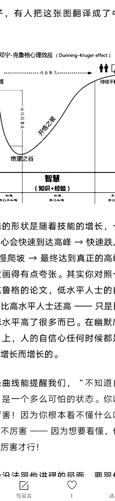

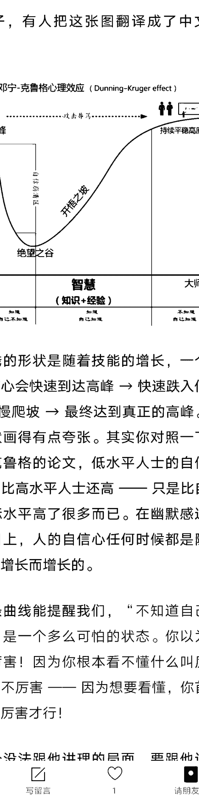

这个曲线的形状是随着技能的增长，一个人的自信心会快速到达高峰 → 快速跌入低谷 → 缓慢爬坡 → 最终达到真正的<|message|> 高峰。这个形状图带有有点夸张。其实你对照一下邓宁和克鲁格的论文，低水平人士的自信心并不是比高水平人士还高——只是比自己的实际水平高了很多而已。在幽默感这样的项目上，人的自信心任何时候都是随着能力的增长而增长的。

这是一个没法跟他讲理的局面。要跟他讲理，你得用事实和数据说话，但是因为他不懂，他会用自己的方式去解读那些事实和数据。而之所以这个效应直到1999年才被心理学家重视，是因为就算对自己的能力过度自信，人们其实日子也是照常这么过。可能我根本不懂足球，但是我以为我很懂足球，我总觉得中国队主教练排兵布阵有问题，那又能怎么样呢？毕竟中国队也没请我。

也许很多指点江山的人，很多自以为怀才不遇的人，其实是不知道自己不知道。

这通常没关系……除非他们真的打算靠这项技能抢银行。

如果你自信到真敢去抢银行的地步，那可就悲剧了。那就是说只有在生活中碰壁才能让你收到有效反馈！所以元认知能力差对大多数人来说也许还是一种祝福 —— 但是如果你是严肃地想学点知识，那么痛苦地意识到自己的无知，是求知的开始。

纳西姆·塔勒布在《黑天鹅》这本书里讲了一个好办法。他说人们往往过高估计自己已知的东西，同时低估了自己不知道的东西，而容易出事儿的往往是你不知道的东西。为了克服这个思维误区，你应该经常提醒自己有很多不知道的东西。

塔勒布说你需要一个“反图书馆”。有个意大利作家，他家里有三万本书。人们经常问他，你买这么多书读的完吗？塔勒布说问这种问题的都是愚蠢的人。没读过的书比读过的书更有价值，我们家里本来就应该多放没读过的书。塔勒布建议你应该在条件允许的情况下尽量储备没读过的书，这些书就构成了你的“反图书馆”。

你的知识越多，你的反图书馆就越大。书架上那一排排想读又没读过的书，时刻提醒你自己的无知。纽约时报有篇文章 [4] 认为“反图书馆”这个词不好听，说日语里其实有一个词专门概括这个收集一大堆没读过的书的行为，叫“积读（tsundoku）”。

以自己读过多少本书为荣，那是一种很土的行为。“积读”能让你保持智识的谦卑，书架应该是用来摆没读过的书的，为了谦卑多花点钱没关系。

根据同样的精神，塔勒布说能不能有一种“反学者”——专门琢磨自己不知道什么的学者，和“反简历”——专门列举自己没干过什么的简历。

那这样说来，我想现在到年底了，我们能不能搞一种“反年终总结”——专门列举本公司想做、但是还不知道怎么做的项目。

反过来説，如果一个领导在总结中一説过去都是成绩，一説未来都是充满自信，我猜他可能是不知自己不知道。

最后让我们思考一句罗素的名言——

> “这个世界的麻烦就是傻瓜非常自信，而智者总是充满疑虑。”


## 参考文献

- [1] KATE FEHLHABER, What Know-It-Alls Don't Know, or the Illusion of Competence, bigthink.com, 09 November, 2017.
[2] J. Kruger and D. Dunning, Unskilled and Unaware of It: How Difficulties in Reasoning One's Own Incompetence Lead to Inflated Self-Assessments, Journal of Personality and Social Psychology 1999, 77, 1121-1134.
[3] CHRIS LEE, Revisiting why incompetents think they're awesome, arstechnica.com, 11/4/2016.
[4] Kevin Mims, All Those Books You've Bought but Haven't Read? There's a Word for That, New York Times, Oct. 8, 2018.


# 哲学家的法宝

哲学家的法宝

万维钢

今天的内容是我给丹尼尔·丹内特的《直觉泵》这本书写的序言，希望它能帮你对哲学有个新的理解，所以全文分享给你

这是一本能让你变得更聪明的书。丹尼尔·丹内特的《直觉泵》现在已经是名著了，如果你拥有超一流的智慧，你想必已经知道这本书。如果你没读过，而你又愿意在脑力上下功夫，我建议你把这本书背下来。

你的思维水平会有不可逆的提高。再听到别人一本正经的愚蠢言论，你会受不了了。想起以前自己说过的那些荒诞的话，你会感到脸红。

要想横扫街头混混，你最好的办法是学习专业的搏击术。要想在思想上变聪明，你需要高级的思维训练。

哲学。

## 1.哲学死了吗？

哲学，曾经被视为是最高级的学问。很多中国人曾经相信，要想把什么事情做好，比如打仗、生产，甚至搞科学研究，你必须以某种哲学思想为指导。哲学高高在上，其他一切学问都不过是哲学在各个领域的具体应用罢了。

但现在可没人敢这么说。至少在很多物理学家这里，哲学是被嘲笑的对象。以前人们不知道宇宙是怎么回事，最新的物理学认为我们这个宇宙在时间上一定有个开端，在空间上至今尚且只有有限大。

鉴于哲学已经不再是世界观答案的合法来源，霍金在《大设计》这本书中写道，“哲学已死。”你想知道这个世界到底是怎么回事儿，你得问科学家。科学的答案不是一个科学家坐在那里空想出来的，也不是几个科学家辩论出来的，而是通过无数个精巧的科学实验，花费无数时间和金钱得出来的。

费曼——他是公认最聪明的物理学家之一——对哲学有众所周知的敌意。费曼曾经说[1]，什么是哲学家呢？就是这么两个人——一个哲学家对另一个哲学家说：“你根本不知道我说的意思！”另一个哲学家说：“什么是‘你’？什么是‘我’？什么是‘知道’？”费曼说我们能不能进行一点有建设性的讨论。

杨振宁也鄙视哲学。人问杨振宁哲学能不能指导科学，杨振宁说每个科学家都有自己的研究风格，如果你把这个个人风格称为“哲学”，那的确有用；但是如果你说的是作为一门正宗学问的哲学，那完全没用。有人又问，可是日本物理学家坂田昌一就很推崇哲学嘛？杨振宁说坂田昌一要是“越少用哲学，他的成就越大。”

坂田昌一的哲学思想包括“物质无限可分”。这个思想非常符合直觉，但是在现代粒子物理学家看来，所谓“无限可分”根本毫无意义。原子可以分成原子核和电子，原子核分成质子和中子，质子、中子和电子分成夸克，那夸克又该怎么分呢？事实上，物理学中的基本粒子，比如“夸克”，本质上是一个数学结构，根本就没有再“分”的必要。哲学家的原始直觉没想到这个情况。

所以哲学真的不能指导科学。真实情况是科学在指导哲学，是哲学家们从新科学发现中获得坐而论道的素材。

那哲学到底还有啥用呢？

## 2.大问题

我曾经是一个普通的物理学家。我不可能比霍金、费曼和杨振宁高明，但是因为我是一个特别虚心的人，所以我对现代哲学略有一点了解。

哲学没死。哲学不能指导科学，但是科学也不能取代哲学。有些问题，只能交给哲学家。

有些问题是在科学之外。比如说，人体的工作原理，这是科学问题。那人怎样才能获得幸福？人到底应该怎么做才是道德的？人和人之间能平等吗？这些就只能是哲学问题。康德、洛克、休谟、中国的孔孟，他们的思想并没有因为科学进步而过时。

有些问题是不需要使用科学手段就能解决的。比如说有个科幻电影叫《盗梦空间》，说可以通过梦境来修改一个人的观念，请问这是可能的吗？我们可以给一个人的大脑输入任何信息吗？

答案是不能——而你不需要懂科学的知识就能想明白这一点。丹内特这本书里有个直觉泵叫“生活在克利夫兰的一位兄长”，说的就是这个意思。如果这个人并没有兄长，你生生地在他脑中植入一句话“财富成为...”

## 3.哲学的技艺

科学家要做习题、棋手要打谱、律师和商人要学习案例，丹内特说的“直觉泵”，就是哲学家的思维工具。这里的“直觉”是个好词儿，代表快速产生思维的灵感。而直觉泵，就是说书中这些好像寓言故事和成语典故一样的思维工具，能给你“泵”出各种直觉来。

学习哲学的第一步，就是要学会审视自己的思想。

咱们再举个例子。一般人头脑中有个思维定式，就是把东西给分类，特别是把人分成“我们”和“他们”。中国人如何如何，外国人如何如何，就算不是歧视，也总要有所区别。可是你是否审视过，人或者东西，真的有明确分类吗？

这本书中有个直觉泵叫“世界上第一只哺乳动物是什么？”什么叫哺乳动物，科学家有严格的定义。但即便如此，如果你考虑到生命演化，你会意识到哺乳动物和哺乳动物的原始祖先之间有一个漫长而模糊的中间地带。你根本就没有办法来个一刀切，说这边就是哺乳动物、那边就不是。你会意识到世界上的很多东西并没有泾渭分明的分类界限。

那么下次要说“凡是....”的时候，你也许会更谨慎一点。

丹内特是当今最著名的几个哲学家之一，他研究的是意识、生命、计算和智能这些大问题。这本《直觉泵》，是一线哲学家送给外行和初学者的礼物。书中有很多工具是专门为了破解大问题而生的，相当于军用武器。不过就算这些武器不能都用在你的日常思维上，它们也能带给你极大的乐趣。

我认为哲学既不是规矩也不是火炬，哲学是技艺。如果你想用哲学的*结论*去指导科学或者生活，你很可能什么都得不到。但是如果你把哲学本身当做一个有意思的学问，并且在追逐大问题的过程中掌握哲学家的*思辨技巧*，你会得到法宝。

## 参考文献

+ [1] 理查德·费曼，《费曼物理学讲义》，第一卷。
+ [2] 杨振宁，《谈谈物理学研究和教学》，出自他1986年在北京中国科学技术大学研究生院的谈话。

## 问答：“网络”和“圈子”的区别

问答：“网络”和“圈子”...

## 来自日课：分数在那里决定成败

读者 额怿：

一个人的进步很大程度受环境影响，这是我们大家的常识，为什么统计数据表示不同环境对成绩的进步基本没有影响？难道好的老师不会使学生考的分数更高吗？如果说初中水平差不多的...是不是说明从一个固定水平进步到高水平是小概率事件，也就是说改变命运的进步几乎是不可能的？

万维钢

马萨诸塞州这个研究的结论非常出乎我们的意料，但是这个研究不是孤立的。我以前看到，有人在纽约市也做过类似的研究，结论也是如此。正是过线考上重点高中的学生，和就差一点没有考上重点、去了普通高中的学生，三年后考大学的成绩完全没有统计意义上可见的区别。

## 来自日课：名校和名画：你与网络的关系

读者 Andy：

有没有什么明确的例子能证明，画功不好的画家能够通过混圈子成为非常有名且作品值钱的画家？还是说成名的画家都至少有一个画功的底线？

万维钢

艺术网络显然是有门槛的，但这个门槛不是高考录取分数线。虽然不是说只要达到哪个门槛就能进网络，但也不是说低于什么门槛就一定不能进网络。

截此复写：分数在那里决定成败

读者 Inyalake：

你说的这些“网络”与我们日常里的“圈子”有什么区别？

## 来自日课：金子和金子怎么比

读者 sherry：

如果我在企业里主管人力资源，是不是应该挑那些只比第一名差一点点的“金子”选手，水平差不多，雇佣成本却很

多？

## 万维钢

从使用价值来说，名校毕业生很可能被高估了。事实上我们看现在阿里巴巴、华为这些一流的公司，招人并不在意名校，高层员工绝大部分也不是都来自清华北大。

但名校有名校的好处。比如如果你是个金融公司或者律师事务所，你需要向客户炫耀实力的话，名校的牌子能给你加分。再比如，如果是某些垄断性的、人人都想进入、人人进来都能挣钱的公司，用名校门槛可以作为一个淘汰别人的理由。还有，如果是搞研究的地方，比如物理研究所，名校生的能力确实更强一些。

## 读者 边走边瞧：

好的行业竞争就会格外激烈，最终胜者通吃，要知道后面的人也是付出了心血的，但是现实就是这么残酷。那最开始的时候，到底要不要去参与竞争呢？

## 万维钢

不竞争是不行的，但并不是所有领域都是胜者通吃。胜者通吃的领域一般都跟某种大众化的传播方式有关，比如说娱乐和体育，即便是这样其中也有很多细分市场。乒乓球，如果进不了国家队确实没啥意思。但是足球，中超、中甲加起来好几十个球队，不行还可以当教练。

但是不可否认，这些项目的淘汰率实在太高了。如果不是因为天赋特殊，老老实实考大学、找个人多的领域是更稳妥的办法。

如果选择了胜者通吃的领域，得学会及时退出。巴拉巴西这本书的数据分析，特别强调了速度是关键。如果你想在一个胜者通吃的领域里出头，必须用很快的速度拿到很好的位置才行。这就意味着如果你是个少年网球选手，你得一出道就总赢球才行。打败同龄人是第一步，如果跟同龄人比都不突出，那你应该意识到职业网球这个领域不属于你，赶紧回家好好学习考大学。

有人说人生是一场长跑别在于赢起跑线——那说的是人生，不是明星。明星是赢了起跑线的。他们不但赢了起跑线，而且一直都是赢，一路淘汰别人，最后万里挑一。社会越发达，训练选拔机制越完备，结果就越是这样。

但是输了没关系。及早退出不会损失什么，而这是人生难得的经历。

戳此复习：金子和金子怎么比

## 《成功公式》4：欢迎度和适应度

成功公式4: 欢迎度和适应度

今天我们继续说巴拉巴西的《成功公式》这本书，这一讲咱们要解决一个大问题。

我们都知道一个“马太效应”，已经取得过成功的个人或者产品往往更容易取得下一次成功。明星写的书一出来就会有人买，上了票房排行榜的电影你自然就想去看。那如果是一位新人写的书，或者被院线压低了排片率的电影，这不就输在起跑线上了吗？

有没有什么办法，能把名望带来的成功，和自身实力带来的成功给区分开来呢？

今天我们就要说一个这样的算法。

## 1.《哈利波特》是好书吗？

《哈利波特》可能是近年来最畅销的书，J.K.罗琳也是最成功的作者。盛名之下，J.K.罗琳产生了一个大胆的想法。

她就想，我写小说的成功，到底是偶然的呢，还是必然的？她自己拿自己做了一个特别酷的实验。

2013年，J.K.罗琳悄悄地用两个不同的笔名，写了两本不同题材的小说。她想看看如果我不用名气，能不能单纯靠实力让小说畅销。

第一本是政治小说，叫《偶发空缺》。这本书卖的还行，引起了读者的注意。当时亚马逊有读者评论说，这本书笔法老到，不像新手的作品，也许是一位成名作家用了笔名。后来也不知道是怎么传出去的，市面上有上了传言，爆出来这是J.K.罗琳的书。

第二本是犯罪小说，叫《布谷鸟的呼唤》。这本的运气就没有这么好了，被几个出版社拒稿，后来出版之后卖得也不好。但是偶然的情况下，有人感觉《布谷鸟的呼唤》和《偶发空缺》的笔法有点像。英国一家报纸就专门请了一位计算机专家对这两本书进行语义分析，看看作者是不是同一个人。

谣言四起的时候，J.K.罗琳不得不承认两本书都是她写的。结果这这两本书的销量马上暴增。

恐怖小说作家史蒂芬·金在1980年代也干过这样的事。他虚构了一个在底层奋斗的小作家的身份，而且接连出版了五本书。前几本的销量都很一般，第五本还不）...

## 2.白给的成功也是成功之母

众筹网站 Kickstarter 上有很多传奇故事。比如你想做一个什么产品但是没有钱，你可以把这个项目放在 Kickstarter 上众筹，谁对这个产品感兴趣就会给你钱，包括给你捐款。有很多小公司通过众筹一飞冲天，但事实上众筹有点胜者通吃的意思，70%的项目都失败了，有的是连一分钱都没筹到。

社会学家在 Kickstarter 上做了一个实验。随机选择200个新项目，分成两组。对第一组，研究者给每个项目捐了一笔几十美元的小钱，对第二组什么都没做。

结果收到研究者随机给的这点小小的启动奖励的项目，后来获得别的捐款的比率，是第二组的两倍以上。

然后社会学家又在维基百科上做了一个实验。随机选了200个编辑，分成两组，对第一组给其中每个编辑一个点赞式的虚拟奖励，第二组都没有。

结果在接下来一个月里，第一组编辑的产量提高了60%，而且其中有12个人又得到了别人的点赞。对此之下，第二组的产量没变化，得到新点赞的只有两个人。

这就是马太效应，这就是为什么你得赢起跑线！初期的一点点小小成功都弥足珍贵，能给你带来新的成功。

我们专栏以前就多次说过，失败不是成功之母，成功才是成功之母，因为成功能给你带来自信。那今天看来这句话还得修改一下——白给的成功，也是成功之母。

## 3.适应度

如果永远都是过去的成功推动未来的成功，如果一切都是之前的流量决定了后来的流量，那肯定是越大的网络枢纽越大，越老的明星名望越高。但真实世界并不都是这样的。比如 Google 在1997年出来之前，市场上已经有两家很牛的搜索引擎，雅虎和ALTA VISTA —— 那 Google 为什么还能异军突起呢？显然是因为 Google 给用户提供了独特的功能。

所以内在水平肯定是有影响的，关键是你怎么测量。

有个著名的实验是这样的。雅虎公司有个音乐实验室，准备了很多新歌，邀请了14000名受试者来听。研究者通过一些分组确定这些新歌的排名，然后在另一一些分组里故意把排名倒过来——比如说，好歌的排名被压低了，一般的歌曲被排在了前面。研究者想看看，人们会不会被排名影响，去重点关注那些平庸但是排在前面的歌曲。

对大多数歌曲来说，的确是这样。受试者就好像绵羊一样，别人说这个歌好听，他们就更多地下载了这个歌。托儿，真的有用。

但是，有几首特别好听的歌没有被压住。哪怕你把它排名压得非常低，受试者仍然能慢慢地把它顶上来。

据此，巴拉巴西提出了一个概念，叫“适应度（fitness）”。

适应度并不一定就是业务表现，因为业务表现是个独立的分数，而适应度是跟别人竞争的优劣情况。但是适应度不受社交网络流量的影响。

所以如果你想知道一个东西好不好，你需要关注的是它的适应度，而不是欢迎度。现在适应度算法还没有被用于各大购物网站，但是我们设想它将来一定会被广泛应用。科学方法是把商品按适应度排名。

### 由此得到

这就是巴拉巴西总结的第三条成功定律——

以前的成功 × 适应度 = 未来的成功

那考虑到适应度，《哈利波特》到底是好书呢？其实真是好书。J.K.罗琳本是个默默无闻的单亲妈妈，《哈利波特》第一本被12家出版社拒稿，好不容易出版了首印才只有500册。她没有媒体宣传，更没有托儿。

但是这500个读者认为那是他们看过的最好看的书。他们自己写评论，说不相信有任何小孩打开之后能放下这本书。

到美国出版后的第一年，也是没有任何宣传，仍然不被重视。但是读者默默地把《哈利波特与魔法石》送上了《纽约时报》畅销书排行榜。然后它就不下去了。J.K.罗琳霸榜时间实在太长，其他作者都不干了，纽约时报不得不把畅销书排行榜按大人和儿童分开。

《哈利波特》后来当然是欢迎度厉害，初期绝对是适应度的功劳。是读者的口碑造就了J.K.罗琳。

那为啥J.K.罗琳匿名写的两本书就没那么成功？我们只能说J.K.罗琳不可能做到每个题材都写得那么成功。

倒是有位中国作家，南派三叔，曾经匿名写作成功过。2011年，天涯论坛出现了一个叫做《大漠苍狼》的新小说，读者一时追捧，我当时看了也非常喜欢。那时候没人知道它是南派三叔的作品，甚至没人在乎它是谁的作品，我们只是单纯地觉得这个小说好看。要知道我根本看不下去《盗墓笔记》，你要先跟我提南派三叔我可能还不看了。南派三叔在这个实验上打败了J.K.罗琳和史蒂芬·金。

我猜这可能跟网络结构有关系。图书太多，分发体系太过重视作者名望。而在天涯论坛，所有人的作品都平等地放在一起，全靠读者顶帖。

## 《成功公式》5: 母鸡与GitHub上的程序员

《成功公式》5: 母鸡与GitHu...

我们继续说巴拉巴西的《成功公式》这本书，今天的主题是团队。怎样建设一个高效能团队，现在是非常热门的研究课题。有人发明了一个词叫做“团队智商”——组成团队的个人智商强，团队智商可不一定强。团队不行，有自己的法则。

我专栏在邓普西和布莱夫曼的《激进包容》这本书里讲过领导力，在科伊尔的《文化密码》里讲过认同感，在哈福德的《混沌》这本书讲过凝聚力和多样性，在讲佩奇的《多样性红利》里讲过君子和而不同，在达里奥的《原则》里讲过激进的团队什么样。今天这一讲，专门讨论成功团队的网络结构。

我以前听说过一个说法：要看一件事能不能办成，在你调兵遣将把这个团队建立起来的那一刻，就已经决定了70%。人员构成和关系网就有这么重要。

咱么先说一个有关母鸡的研究。

## 1.全明星母鸡

这个研究巴拉巴西也引用了，但是以前我看着桑森·海特的《正义之心》这本书里有一个更高级的描写。比如你拥有一个养鸡场。你知不知道，怎么样才能让母鸡多下蛋呢？除了好饲料啊环境啊这些硬件设施，你还需要科学育种。

直观的想法，是专门选拔最爱下蛋的母鸡。母鸡爱不爱下蛋应该是可以遗传的。如果一只母鸡爱下蛋，她的女儿也许就也爱下蛋。那我们一代一代优中选优，养鸡场里要全都是最爱下蛋的母鸡，让她们互相模仿开展下蛋竞争，这行不行呢？

不行。研究者发现，最爱下蛋的母鸡往往攻击性比较强，要诉求的母鸡对她俯首称臣。养鸡场都是一个笼子里放12只母鸡，高产母鸡放一起会上演宫斗剧情。她们互相伤害，上一代的恩怨下一代继续，才打了六代，就有的遍体鳞伤，有的直接就被斗死了，根本顾不上孵蛋。

后来研究者有了一个洞见。我们不应该选拔单个的母鸡，应该选拔的是母鸡的集体：先随机分组，然后看看哪个笼子的集体产蛋量最高，就对这个笼子集体育种，让她们的后代还在一起。结果这个思路是对的，几代下来，优秀母鸡集体的产蛋能力是一代比一代强。

这个道理是母鸡需要互相配合。激进的母鸡可以给温顺的母鸡提供刺激，温顺的母鸡可以给激进的母鸡提供心理满足。团结、紧张、严肃、活泼，配合好的集体下蛋最多。

美国社会心理学家约纳森·海特说，这叫群体演化。动物的演化并不仅仅是个体跟个体竞争，还有群体跟群体的竞争。这也是最早由达尔文提出的思想。

团队也是这样。团队的目的是跟别的团队去竞争，这个是大局，别被个人竞争干扰了大局。单兵作战能力强的人，如果太过好斗，就不能放一起。反倒是有些不愿意跟自己人竞争的人，是团队的必不可少的宝贝。

体育界，足球也好篮球也好，一个经验是全明星的阵容战斗力常常受损。你俱乐部有钱买人，各个位置上都是超级巨星，结果谁也不服谁，常常是严重的内讧。

Jobs2Careers 公司的葛振洲曾经到我们专栏分享过他的管理经验，他有句话叫“熊公多了打翻船”，说公司用人不能只招“牛人”。而《成功公式》这本书说，其实就连学术界都是这样。上世纪80年代到90年代，美国斯克大学的英语系非常有钱，就把全世界最著名的教授都给请来了，一时群星璀璨。哪知道教授也不能免俗，文人相轻谁也看不上谁，一个系的还互相批判对方的学术水平，甚至连课程设置都无法达成共识，把英语系弄了个鸡飞狗跳。

强人 + 强人 ≠ 强大团队。其实我们想想，群体演化这个思路还是很有启发性的。如果说进化就是适者生存，强人的基因更容易流传，那么为什么不是所有动物都是同样的性格呢？肯定是各种性格都有存在的合理性和必要性。群体的演化，需要各种类型的人好配合才行。

## 2.强联系和弱联系

优秀团队的人员网络结构应该是什么样的呢？

现在“团队科学”已经成为了一门正式的研究分支。有人分析了百老汇史上全部474个音乐剧和爵士乐史上全部10万首曲子，想着看其中那些脱颖而出、在市场上大获成功的作品背后都有一个什么样的创作团队。他们得出的结论，和别人对电子游戏制作团队的研究结果高度一致。

音乐剧、爵士乐和电子游戏，要想成功，必须被观众、粉丝和玩家喜欢才行。别忘了是“我们”决定你的成功。那我们喜欢什么样的作品呢？答案当然是“熟悉 + 意外”。巴拉巴西在书中的说法是既要尊重传统，又要有所创新。那么什么样的团队构成，才能兼顾传统和创新呢？

在巴拉巴西他们这一派这些专门研究网络科学的人看来，关键在于团队成员的网络关系。

像这种创作型的团队一般都不是来自同一个“工作单位”，他们都是因为一个项目而聚在一起，项目做完了就各自分开。我看现在在北京艺术圈的工作方式好像都是这样。比如说，如果两个人经常在一起合作，他们之间的连接就是一个“强联系”。如果两个人合作很少甚至以前根本不认识，那就是一个“弱联系”。

研究者发现，要想让团队成功，各成员之间既不能全是强联系，也不能全是弱联系。强联系太多，大家都是熟人，合作出来的东西就会太过传统，缺乏创造性，熟门熟路碰不出什么新的火花。弱联系太多，也不好形成配合。

要想既有传统又有创新，团队成员必须既有强联系又有弱联系。你得有老人，有新人，还得有外人。

包括科研团队也是这样。现在已经没有单独斗搞科研的人了，任何研究项目都是集体事儿。拿物理学研究来说，团队中通常要有人专门做理论，有人专门做实验，有人专门做计算机模拟。每个人身份也不一样，有教授，有博士后，有研究生、可能还有跟着混经验的本科生，更重要的是往往都有外地的合作者。

这样的关系网络才能保证多样性。而要想让每个成员都积极提供不同的想法，团队内部的交流一定得是非常平等的，得给到每个人充份的发言机会。

很多研究都表明，最有效的交流方式现在仍然是面对面直接交流，而不是打电话或者是发电子邮件。大家坐在一个房间里开会、一起吃午饭、私下有各种闲聊，聊怕是聊的都是和工作无关的事情，也对保持团队健康有好处。具体案例咱就Bier，总结来说，团队智商高的集体有下面三个特征——

- 1. 人们比较善于通过表情和肢体语言捕捉每个人的情绪；
- 2. 平等对话；
- 3. 团队中最好要有女性，因为女性更善于协调团队成员之间的关系。

那么领导应该在团队中发挥什么作用呢？

## 3.定于一人

人说 GitHub 是全世界最大的“同性社交网站”……因为它是程序员的交流社区。GitHub 有个好功能，世界各地的程序员，可以通过网络协作，联合起来去做一个项目。于是就有人对 GitHub 上的协作项目做了个网络结构分析研究。

作为可测量的标准，研究者用一个项目在 GitHub 上有多少关注者，来判断这个项目的成功程度——反正这本书里定义的成功都是社会给的。那么我们就可以看看成功的项目和不成功的项目有什么区别。

GitHub 网站还对每个项目的参与者各自干了什么，有非常好的记录。研究者发现，通常来说，一个项目中最重要的工作，几乎都是其中的一个人做的。

这个人是绝对主力，而且就只有一个主力。其他人虽然也都参与，但只是做一些辅助性的工作。而且项目的团队越大，这个“定于一人”的现象就越明显。


个“定于一人”的现象就越明显。

更重要的是，越是一个人主导的项目，它的成功的可能性就越大。

这个人就相当于团队的领导。那既然团队中每个人都要积极参与，那为什么还要定于一人呢？因为人多想法多，项目的愿景和完整性只能靠一个人把握。

大家都可以出主意，但是这个项目应该往哪个方向走，只能让一个人主导，他是项目的最终负责人。他得纠正团队的错误，他得决定不合格的东西不能被采纳，他得确保产品符合他的设想、达到他的要求。

当然写程序、包括书中还讲到维基百科的编辑工作，都是比较特殊的工作，尽可能让一个人干才能保证思路的一致性。别的工作，像搞科研，不一定这么分配工作量，但是一人主导这个结构应该是一致的。

这就是现代化的合作方式，有点像我们以前说过的罗辑思维的“扁平化管理”和美国流行的“合弄制”。定于一人可不是定于“一尊”，领导职位可以是不固定的，是对事而不是对人。凡事以项目为核心，在这个项目里你是领导你对项目负责，然后下一个项目你可能作为普通成员给别人提供支持。

## Ⅰ 由此得到

成功团队的网络结构，大约有三个特点。

第一，要定于一人。这个人为项目负总责，其他人提供支持。

第二，人员构成要多样化。每个个人有不同的专业，人与人之间要有不同的强弱关系。要有熟人、有新人、有外人。

第三，强调面对面的平等交流。

那既然是定于一人，最后团队的功劳，是不是也会都被这个人拿走呢？答案是通常都是一个人拿走几乎所有荣誉。巴拉巴西根据网络机构，甚至能精确预测一篇几百个人署名的论文作者中谁能得诺贝尔奖——但出乎意料的是，最终得奖的既不一定是做了团队里最大贡献的人，也不是领导。咱们下一讲再说。


万维钢·精英日课³
帮你和全球精英大脑同步
版权归得到App所有，未经许可不得转载

日课精选

提交留言可与专栏作者互动

## 《成功公式》6：曾经功劳你给了谁

《成功公式》6：曾经功劳你给了谁

今天咱们继续讲巴拉巴西的《成功公式》。我们要说的是成功第四定律——

团队的成功需要全体成员共同的、多样化的努力，但是这个功劳会被其中一个人拿走。

你肯定觉得这非常不公平。但是别忘了成功定律是客观规律。你喜欢不喜欢，世界就是这个样子。抱怨和感慨没意义，你得琢磨怎么让这些规律为你所用。

我先给你讲两个个别的故事。

### 1.两个故事

小张是个学生物的博士生。他的导师是个明显教授，研究组是领域的名门。导师给小张安排了一个课题，研究组在这个方向上已经有大量积累，小张只要会用本组的看家本领就行。

### 2.诺贝尔奖预测法

巴拉巴西有个中国学生叫沈华伟，他也是巴拉巴西的《链接》这本书的中文译者。沈华伟2013年加入巴拉巴西的实验室之后，立即就做了一个特别有意思的项目。他发明了一个算法，能精准确预测诺贝尔奖的得主。

功劳不是来自业务表现，而是来自社会的感知。

### 3.怎样拿回你的功劳

前面说的那个预测诺贝尔奖的算法，它的结果是可以随时间改变的。1997年的诺贝尔物理学奖就是一个大反转的故事。

发表了论文，现在已经成了这个方向的所有者。那篇论文以前属于巴拉巴西，现在则属于这位女士。

我们经常说谁谁谁抢了谁谁谁的功劳。但功劳不是一次性的东西，而是一个“系统”。

明星开演唱会，她也许愿意一个一个地把乐队成员介绍给观众，但是有用吗？观众只会记住歌手。哪怕导师和领导把你名字放报告前面，你也未必能拿得到那份功劳。这不是腐败，这是人的感知限制。

当然有时候是真腐败。我听说有一位中国留学生，自己证明了一个数学猜想，可是导师说这个证明不严谨让他修改，自己却偷偷地写了篇论文抢先发表了。学生为此跟导师打了好几年的官司，最后也没有得到公正的对待。

我特意去查看了这位导师的简历。他在那件事之后持续发表了好多篇论文，而且还是好几个领域。而这位学生，早已经不在数学界了。

这非常不公平，这是一个悲剧！可是如果你了解成功的定律，能不能更冷静地看这件事呢？

想要拿回自己的功劳，你必须学会独立工作。

以前我们讲《巨人的工具》的时候说过，当学徒，要有给牛人铺路的觉悟。你想要的是第一线的工作经验，就算把功劳都给导师又能怎样？事实上你想抢也抢不过来，导师给你你也接不住。

但是，到了一定的时候，你就必须跳出来，去独当一面。

巴拉巴西讲了一个黑人女歌手的故事，她的名字叫达琳·洛芙（Darlene Love）。洛芙有个天生的好嗓音，可是因为是黑人，只是在幕后唱歌，别人的用她的声音来对口型！电台里播着她的歌曲，她却只能当个清洁女工。

洛芙说我不能再待在幕后了。离开现有的唱片公司，独立出来演出很难很难，但是她做到了。她建立了自己的名望。

### | 由此得到

成功第四定律是团队需要各种人才的合作，但是功劳往往归于一人。他能拿走功劳不是因为他这一次做了什么，而是因为他拥有这个领域。

接受了这个定律，每个人都应该大度一点。如果你是新手，别在乎眼前的得失，你想要的不是一两个功劳，而是自己的系统！如果你是老板和导师，千万千万把该给别人的功劳都给人家，到公开场合大声说这是谁做出来的——你心里明白，其实还是你的。

我们再一次看到了“系统”的重要性。一直跟着一位牛人做事，你很难拿到自己的功劳。但是如果你跟不同的人合作过，做过很多事，你的人设就出来了。

最后，那个发明诺贝尔奖预测算法的中国人叫什么名字来着？叫沈华伟！他现在已经独立了，是中科院计算所的研究员。为了公平，你应该记住他的名字。


日课精选

提交留言可与专栏作者互动

## 《成功公式》7：与无常作伴（完结篇）

《成功公式》7：与无常作伴。

今天咱们把巴拉巴巴西的《成功公式》这本书讲完。

我们专栏去年讲过罗伯特·弗兰克的《成功与运气》，强调成功有很大的运气成分。弗兰克说的主要是社会：你的成功并不是完全是个人奋斗的结果，你应该感恩时代，回报社会。巴拉巴西这本书对个人更有用，但是他也得讲运气。

第五个成功定律，说的就是怎么让运气为我所用。

### 1.爱因斯坦的运气

爱因斯坦不仅仅是一位物理学家，他还是一位名人。所谓名人，就是他是做什么的已经不重要了，是“因为出名而出名”的人。

科学家通常不是名人。现在活着的、公认最厉害的物理学家是爱德华·威滕（Edward Witten）—— 我以前上《量子场论》课，我发现那个教室的书桌上，有人刻下了威滕的名字，大约是把他当做学物理的榜样——那你听说过威滕吗？你知道他长什么样子吗？

如果名望代表成功，爱因斯坦的名望是怎么来的呢？

### 2.成功与年龄

爱因斯坦有句话说，如果一个人在三十岁之前没对科学做出过贡献，那么他这辈子也不会有什么贡献了。狄拉克对此很认同，说物理学是年轻人的科学。事实上你考察那些伟大的科学家，大多都是年轻时代就取得了一生中最重要的成就。

巴拉巴西发现两个统计规律。
第一，大部分人取得重大突破，的确都是在职业生涯的早期。
第二，但是，对每个科学家来说，一生最重要的发现，却可以发生人生中的任何阶段。科学家的创造力并不会随着年龄减弱。

### 3.r值和Q值

巴拉巴西提出一个可测量的理论。单个项目的成功，由两个变量决定。

第一个变量叫 r 值，r 代表想法的的好坏。r 值越高，这个想法如果能实现的话，它的影响力就越大。

第二个变量叫 Q 值，代表你把这个想法实现的能力，也就是你的执行力。

```
S = Qr.
```

结果非常惊人。人的 Q 值，并不随着年龄变化。

还没做出重大发现。耶鲁看他 Q 值不高，希望他赶紧退休，把他的实验室和办公室都给收回了。但是苏恩不服老，换个地方继续干，终于在67岁这年取得突破，提出对生物分子的质谱分析法，然后一路高歌猛进一举获得2002诺贝尔化学奖。

所以成功不怕晚。苏恩只有一点遗憾，那就是消息传来之后香槟酒被家人藏起来了：“唯一的问题是，我已经85岁了，不能随心所欲地喝那么多酒了。”

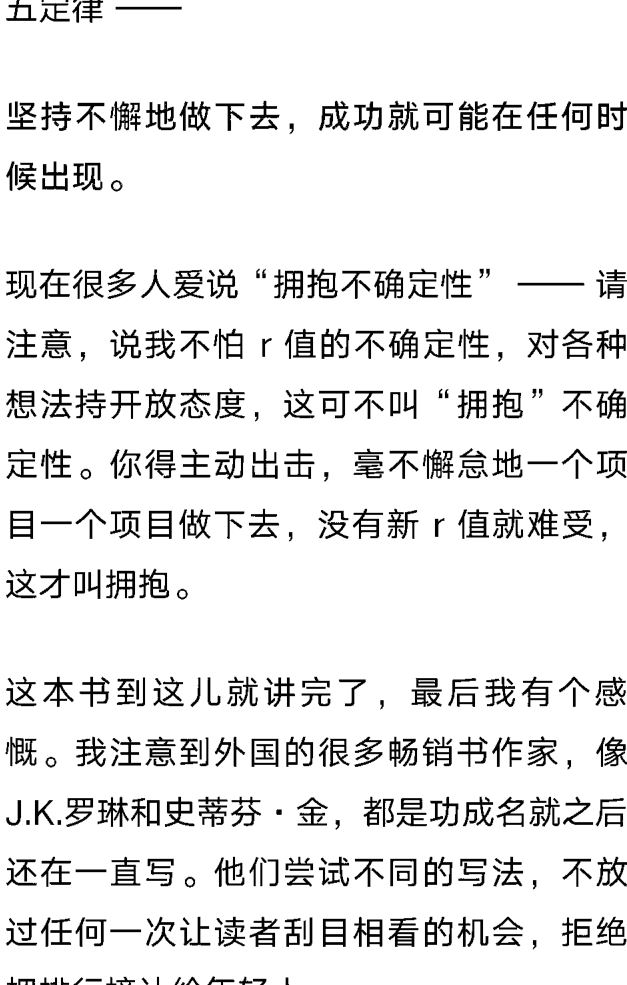

### | 由此得到

r，是不可捉摸的。Q，我们很难改变。但是产量，你自己可以控制。这就是成功第五定律——

坚持不懈地做下去，成功就可能在任何时候出现。

现在很多人爱说“拥抱不确定性”——请注意，说我不怕 r 值的不确定性，对各种想法持开放态度，这可不叫“拥抱”不确定性。你得主动出击，毫不懈怠地一个项目一个项目做下去，没有新 r 值就难受，这才叫拥抱。

这本书到这儿就讲完了，最后我有个感慨。我注意到外国的很多畅销书作家，像 J.K.罗琳和史蒂芬·金，都是功成名就之后还在一直写。他们尝试不同的写法，不放过任何一次让读者刮目相看的机会，拒绝把排行榜让给年轻人。

而对比一下，咱们中国这些作家，包括各种艺术家，都是成名就不干了。金庸只写了十五部小说，二月河只有三部。他们也说过自己有新的写作想法，但是都没写成。

那些年年春晚的常客，中国的老艺术家，都是“老艺术”的家。

为啥不写了呢？我感觉，咱们中国人对“成功”始终有一点负面印象。我们中国文化总是觉得争名夺利是不好的，应该“功成、名遂、身退”——我认为这个潜意识，是中年懈怠的重要原因。

中国老百姓可能会说，你该得到的都得到了，现在还图啥呢？但J.K.罗琳完全可以反问，我是一个作家，不写我干啥呢？

成功是社会对你工作的认可，名利只是副产品。可是因为这个副产品，我们中国人对成功的情绪有点复杂。继续执掌最先进的公司，再来一场商业革命，继续改变中国，怎么就不高尚了，去当个乡村教师怎么就高尚了呢？

快到新年了，罗胖承诺跨年演讲要讲二十年，我对此表示赞赏。希望咱们读者都像罗胖一样，到什么时候都不懈怠，做时间的朋友。

万维钢·精英日课³ 帮你和全球精英大脑同步 版权归得到App所有，未经许可不得转载

## 日课精选

提交留言可与专栏作者互动

## 总结：成功的定律

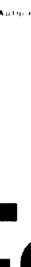

总结：成功的定律

万维钢

这一讲为你准备的，是《成功公式》这本书的总结，同时我也把咱们日课前两季的相关内容，也一起整理进了文稿里，希望这一讲，你能通过看文稿的方式学习，订阅了前两季的读者，你还可以通过链接回看原文。

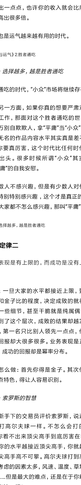

书名：《成功公式：成功背后的科学》（The Formula: The Universal Laws of Success）

作者：艾伯特·拉斯洛·巴拉巴西（Albert-László Barabási），美国东北大学和波士顿复杂网络研究中心教授，物理学家出身，后来专门研究网络科学。《链接》《爆发》作者。我们专栏曾经有篇文章叫《老王的体能和老张的灵感》讲过巴拉巴西的工作。

出版时间：2018年11月

### 导论

+ 1. 这本书说的不“成功学”，而是有关于成功的*科学*。
2. 这本书研究的世俗的、可诱导的成功。如果你是一作家，你的成功就是你写书的销量怎么样；你是一个品牌，你的知名度怎么样；你是律师，有多少人排着队请你帮他打官司；你是明星，你有多少粉丝……这里说的成功不是你自我感觉怎么样，而是社会对你的认可。
3. 业务表现好，不等于成功。决定你成功的不是你的业务表现，而是别人对你业务表现的评价怎么样。你的成功不是你的事，是我们——也就是社会——的事。

### 成功定律一

如果业务表现可测量，业务表现驱动成功；如果业务表现不可测量，则是网络驱动成功。

说明：打网球和考高中，是业务表现充分可测量的项目。艺术品是业务表现完全不可测量的项目。大多数项目处在二者之间：表现和网络都起作用。

你能怎么做：像名校这样，有时候网络看似不起作用，那可能只不过因为这个网络足够大，你身在其中而不自知。而如果网络很小，你又胸怀大志，那就一定要一开始就瞄准那个顶级网络！

回顾：胜者通吃的时代

### 成功定律二

业务表现是有上限的，而成功是没有上限的。

### 成功定律三

以前的成功 × 适应度 = 未来的成功

### 成功定律四

团队需要各种人才的合作，但是功劳往往归于一人。他能拿走功劳不是因为他这一披露趋势

次做了什么，而是因为他拥有这个领域。

### 说明：

+ 1. 团队智商高的集体有三个特征 ——

人们比较善于通过表情和肢体语言捕捉每个人的情绪；

平等对话；

团队中最好要有女性，因为女性更善于协调团队成员之间的关系。

+ 2. 成功团队的网络结构有三个特点 ——

要定于一人。这个人为项目负总责，其他人提供支持。

人员构成要多样化。每个人有不同的专业，人与人之间要有不同的强弱关系。要有熟人、有新人、有外人。

强调面对面的平等交流。

### 你能怎么作：

+ 1. 想要拿回自己的功劳，你必须学会独立工作。

+ 2. 如果你是新手，别在乎眼前的得失，你想要的不是一两个功劳，而是自己的系统！
如果你是老板和导师，千万千万把该给别人的功劳都给人家，到公开场合大声说这是谁做出来的 —— 你心里明白，其实还是你的。

我们再一次看到了“系统”的重要性。一直跟着一位牛人做事，你很难拿到自己的功劳。但是如果你跟不同的人合作过，做过很多事，你的人设就出来了。

回顾：画布策略的学徒心法

用一句话总结画布策略的心法，就是“be lesser, do more”——把自己放在更次要的位置，给别人做更多的事。

有什么好想法，赶紧告诉老板。多跟不同的人认识，介绍不同的人之间互相认识。
别人都不愿意做的事，你去做。发现团队有什么缺点和漏洞，你去补救。更进一步，不但对前辈要这样，最好对所有人都应该这样。想想有什么好想法能帮助别人，免费把想法给他。

这就是学徒的精神。

“画布策略”没有过期时间。哪怕你自己已经独立做事了，哪怕别人都开始对你使用画布策略了，你还应该继续给人当清道夫。

因为还有一个最后的道理，是那些狂妄自大的人体会不到的：当你给人铺路的时候，你实际上也在左右他的前进方向。

### 成功定律五

坚持不懈地做下去，成功就可能在任何时候出现。

### 说明：单个项目的成功，由两个变量决定。

第一个变量叫 r 值，r 代表想法的 好坏。r 值越高，这个想法如果能实现的话，它的影响力就越大。

第二个变量叫 Q 值，代表你把这个想法实现的能力，也就是你的执行力。

用 S 代表成功，那么——

S = Q r.

人的 Q 值，并不随着年龄变化。

r，是不可捉摸的。Q，我们很难改变。但是产量，你自己可以控制。

### 你能怎么做：

现在很多人爱说“拥抱不确定性”——请注意，说我不怕 r 值的不确定性，对各种想法保持开放态度，这可不叫“拥抱”不确定性。你得主动出击，毫不懈怠地一个项目一个项目做下去，没有新 r 值就难受，这才叫拥抱。

回顾：老王的体能和老张的灵感

一个学者取得他的最重大成就，既不一定是年轻的时候，也不是一定是年老的时候 —— 而是完全随机的！

如果说这个重大成就靠的是灵感，那巴拉巴西的结果就是，灵感与年龄无关。

比如说2004年诺贝尔物理学奖的一位得主，就是凭借研究生时期的一篇论文获奖的，那是他平生发表的第一篇论文。而另一位诺贝尔化学奖的得主，则是在70多岁做出的获奖工作 — 他本是耶鲁大学的教授，当时耶鲁规定70岁强制退休并且关闭实验室，他在退休之后坚持做实验，竟因此得了诺贝尔奖。

所以那些五十多岁就没有重大发现的人，并不是他们太老脑子不够用没有灵感了，而是因为他们不做了。

所以搞科研不是踢足球。巴拉巴西说，人的灵感和创造力并不会随着时间的流逝而下降。你无法取得成就的真正原因并不是你失去了创造力，而是你没有坚持下去。
如果持之以恒，你的创造力不会辜负你。

老王未必没有体能了，但真正表现了体能的，是老张。

巴拉巴西只是指出强调了随着年龄的增长，一个人的创造力并没有衰退。我想强调的一点，则是随着年龄的增长，一个人的创造力似乎也没有增加！这个研究说的是做出最大贡献的年龄完全是随机的。

这说明灵感，其实有很大的运气成分。

### 问答：不要低估天下英雄

问答：不要低估天下英雄

### 来自日课：欢迎度和适应度

读者 Sophie：

以前的成功 × 适应度 = 未来的成功，如果以前的成功为0，当不是适应度再高，未来也不可可能成功了？

读者 小白兔：

职场中欢迎度高的人的适应度大概率要比欢迎度低的人适应度高，那么欢迎度低的人当是不是没有成功的希望了？

万维钢

怎么才能让“欢迎度”，或者说“以前的成功”，从0变成1呢？找人推荐、找机会表现、慢慢等待，这些都可以，但我想补充两点。

一个是不要低估取得成功的难度。刚开始做事的时候人们经常信心满满，甚至觉得自己敢做就已经很不起了，会有不切实际的幻想。比如说，有人正在筹划人生第一本书，你问他预期卖多少本，他可能会说能卖一百万本！这就是无知无畏，事实是现在你弄本书放网上免费下载，都很难获得十万次点击。

不要低估社会，更不要低估天下英雄。想要用上成功定律，首先你得是金子才行。否则就算有人帮你赢了起跑线，你也不能持续。简单来说，成功之前大约得三分三步走。

### 第一步是学习。这一步是硬功夫，要专注提高自己的适应度。从上大学到研究生学徒或者初入职场做最基本的工作，都是学习。这个阶段不要想“成功”，你的功夫还没练成。

什么叫练成呢？如果你是一个志向远大的人，那就是必须明显高于业内一般水平才行。水平不行非得往外拿，那说明你不但不行，而且还不知道自己不行，或者缺少个人荣誉感，或者缺少最起码的品位。练习阶段做的事情、做出来的作品、甚至取得过什么荣誉，都别当回事，最好全忘掉，将来你想起来会感到脸红。

### 第二步是积累。如果你确信自己的水平已经明显高于业内一般水平了，也不能指望立即成功。

《出奇制胜》(Smartcuts) 这本书里有两个例子，我们专栏以前讲过，能说明积累的重要性。有人偶然拍了一段短视频，放网上居然就红了，又是被邀请上电视节目又是出纪念品，但是热度很快消退。有人同样是因为偶然的原因走红，却能把流量留住，获得真正的名望。

根本区别不是这一作作品有多大差异，而在于走红之前有多少积累。后面这个人，比如“可汗学院”和《罗辑思维》，已经积累了很多高水平作品，别人家看到的不是一个作品而是一堆，是一个系统和一个人。

职场也是这样，成功很大程度上是积累出来的。新人水平再高，你让他直接当市长也不能服众，也指挥不动。而如果一个人已经树大根深，你不用他都不行。积累是成功的条件，水平只是积累的前提条件。

### 第三步才是推广。过了学习阶段，你就配得上做为天下英雄的对手。积累，则是你淘汰天下英雄的终极手段。至于说能推广到什么程度，因为偶然因素太多，很大程度上是你无法掌控的。

回顾一下：《出奇制胜》：现代世界的快速上升管道

读者 锐：

如果一个智力平平学生申到了一个大牛门下读博士，和一个绝顶聪明的学生申到一个不是那么厉害的教授门下读博士，这两个人未来谁更有可能做得更好呢？也就是说，在科研上，适应度和欢迎度哪个更重要？

万维钢

一定要进入核心网络。不在核心网络，就谈不上有什么适应度。

现在情况大概已经好多了，但是据我以前观察，第三世界的科学家们明显形成了一个个自己的网络。他们专门研究偏门的主题，使用各种非主流的研究方法。这些外围网络也有自己的流行课题和方法，互相引用也是不亦乐乎。但是如果你从学术核心的角度看，那些问题根本就不值得浪费时间，纯粹是为了发论文而发论文，是浪费纳税人的钱。

如果你身处外围网络，手里只有这么简陋的工具，最起码的实验设施都没有，就算能看到主流的人在干什么，你都插不上手。你再聪明又有什么办法呢？你只能追逐那些第三世界的硏究，为一篇篇没意义的论文头疼。

君子性非异也，善假于物也。老板是不是绝对的大牛并不重要，重要的是他在不在核心网络之中。

### 来自日课：母亲与GitHub上的程序员

读者 无心葱烧：

成功团队的特征对创新型团队和执行力团队都适用吗？

读者 北堂双：

如果一个团队成员之间合作久了，大家互相熟悉了，新人变老人，弱联系都变成强联系，又没有新人加入，是不是意味着这个强大团队走下坡路了？

万维钢

强弱联系的配合，这个性质，书中只讨论了像音乐剧、爵士乐和电子游戏公司这样的创新型团队。

但是强调沟通协调能力这个性质，则有包括执行力团队在内的各种例子。比如书中提到一个电话客服服务中心，显然不能算是创新的团队，但是研究表明，让员工有私下交流的机会，比如有统一的休息时间、一起吃午饭，也能显著提高工作效率。

我认为没有绝对的不需要创新的执行力团队。我们以前讲过丰田汽车生产线工人，每天就是按固定流程操作，但是也有创新，工人可以随时提出合理化建议。事实证明给工人自主性、平等的关係，包括定期的学习，特别好好处。

一般的规律，如果总是几个老人在一起，没有新人加入是不好的。他们可能会形成紧密的利益共同体，会产生非外情结，会有门户之见，会拒绝改变。比如说，广州恒大足球队，几位老队员始终把持主位置，俱乐部花重金买来优秀年轻球员上不了场，现在就备受指责。让高水平球员赶紧累留洋，或者靠着年龄不太老卖个好价钱，然后再买新人补充进来，才是健康的球队。

当然，如果人的思想常新，老人一起也不是不行。我们以前讲过英特尔的故事。80年代中期，英特尔的内存业务明显不如日本人了，主席安迪·格鲁夫和 CEO 戈登·摩尔就面临到底要不要裁撤内存部门的决策问题。最后格鲁夫问了摩尔，说如果咱俩现在被免职了，新来一个 CEO，你猜他会怎么做？

摩尔说我猜新 CEO 一定会裁掉内存部门。格鲁夫马上说，那咱俩为什么不能先走出公司大门再走回来，假设咱俩就是新 CEO 呢？

这也是个办法。为什么不假设自己是新人呢？但假设可不容易，他俩是可以假设，可是英特尔整个内存部门的研发人员没法假设自己是新人，还是要被裁撤。

### 来自日课：与无常作伴

读者 橙：

万老师，您说执行力不能提高，但是我看《成功，动机与目标》这本书中说执行力（也就是你的意志力）可以通过训练来提高的，这两个有什么不同？

读者 大禹：

在S=Qr 公式中，我总觉得，如果一个人如果掌握更多资源，方法更娴熟，思维更广和多元，总会让好想法更容易实现，为什么的说Q值基本不变呢？

万维钢

Q值为什么基本不变，我想大概有两个原


Q值为什么基本不变，我想大约有两个原因。

一方面是人一旦成年，Q值就真的很难改变了。你已经从以学习为主，变成了以工作、积累为主。你还没做完一件事情就有另一件事情等着你，你整天做事，但一般的事情都不是刻意练习。

刻意练习要求你必须在“学习区”训练，持续地做那些你做不太好的事情。但是绝大多数工作都在“舒适区”，公司用你就是让你做你擅长的事情。就算一开始不擅长，做多了也就擅长了。你说县长我已经很会当了，明年我应该当省长——可是对不起，省长有别人当。

想要在工作中提高Q值，就得设法去找一些舒适区以外的事儿做。也许最好的办法就是换个工作。

另一方面，Q值是一个相对的概念。是你相对于社会，是个什么水平。可能这些年下来你的水平的确提高了，但是整个社会的水平也提高了。比如科研，新思想新技术层出不穷，你说你从不懈怠一直在紧跟潮流，可是别人也是这么干的。现在的科研水平跟20年前不可同日而语。你说你的写作水平提高了，但是读者的口味也在提高。还是那句话，不要低估天下英雄。

注意这两个因素在宏观统计上都看不出来。统计论文发表情况都是一个领域内部互相比较，而如果你已经跳到另一个领域去了，你的这次进步不会被统计到。统计Twitter转发情况也只看当时的相对表现，你的绝对进步也是看不出来的。

## 读者 Ethan-Guo：

既然一个项目的成功等于想法的很好乘以实现想法的能力，实现想法的能力是不会变的，那我是不是可以努力让自己的想法更好，这样可以加大自我成功率吗？

万维钢

初期你可以提高选择想法的眼光和执行力。但是眼光和执行力到了一定程度就不会一直提高了，有上限。到了 一定程度，想法是唯一的变量。这就好像一家电视台的新闻频道，记者、渠道、各种资源都有了，那什么东西决定收视率呢？当然是新闻本身。可 是今天有没有大新闻，那是不可捉摸的。

## 读者 悟空：

我最近一直有个疑惑，就是我越站在别人的立场上想问题，越去理解别人，我自己就越没有主见，这是为什么呢？

万维钢

这是你的进步。你以前的主见都是主观看法。现在失去了主见，将来学识和经历多了，才能建立新的主见。


### 万维钢·精英日课³
帮你和全球精英大脑同步
版权归得到App所有，未经许可不得转载


活码长期有效

## 迷幻药和脑科学（上）

迷幻药和脑科学（上）

我们要用两期节目讲一点关于致幻剂的新知识。首先请注意，使用和传播致幻剂，不管在中国还是美国都是违法的行为，特别在中国可能严重违法。这一讲绝对不是建议你尝试迷幻药，我们强烈反对和谴责任何使用迷幻药的行为。你应该对我们要说的这些事情采取冷眼旁观的态度，只听不参与。我们说的这些体验和实验的安全性，统统都没有经过严格的科学检验。

那你说作为老老实实的守法公民，我为啥要了解迷幻药呢？

因为我们想理解人的大脑。

### 1.背景

你很难说服一个健康人允许你打开他的大脑做实验，科学家只能尝试给大脑各种刺激，看看有什么反应。寻常的刺激都是使用声音啊图形啊之类，比较温和。使用致幻剂刺激，就相当于物理学家用加速器把一个基本粒子加速到接近光速，然后把它撞成碎片，看看里面有什么。这种刺激比较强烈，但又比较安全……当然你首先得控制好剂量。

### 2.两种致幻剂

### 3.波伦的体验

的毒液中提取出来的。我理解那个毒液是有毒的，但是把毒液提取物给结晶化，就无毒了。服用方法是把这个晶体给汽化，用鼻子吸。

波伦刚吸了一口，马上就会有一种强烈的感觉，有一种能量充满了大脑。他觉得好像从宇宙中发出来的一个波动，然后周围的一切都解体了，他自己的身体也解体了。解体之后又重新组合在一起……

波伦说，大部分人使用致幻剂的感受是正面的，但是也有一些人被致幻剂唤醒了童年的创伤，那些创伤往事突然涌上心头感觉十分难受。

总体来说致幻剂不会上瘾，而且通常不会让人死于用药过量。但是如果用的次数多了，大脑适应了之后就不管用了。那如果你想要加大剂量去追求那些幻觉，就是危险的。迷幻状态的大脑没有理性，人可能会做出一些不寻常的举动，比如到大街上游荡，搞不好会出车祸，甚至可能会自杀！所以我们再一次强调，千万不要尝试！

我们了解这些知识的目的是为了理解大脑。那致幻剂的效果能说明大脑的什么呢？咱们下一讲再说。

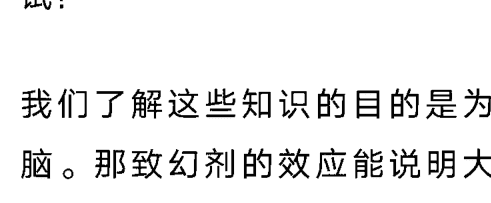


活码长期有效

## 迷幻药和脑科学（下）

迷幻药带来的各种幻觉体验有一个共同的特点，那就是“自我”意识会减弱。你会感觉和万事万物融为一体，成了宇宙的一部分，或者说宇宙万物也是自己的一部分。这种感觉我们在讲《为什么佛教是真的》《盗火》这些书中也说过，这是一种宗教般的体验，用佛学的说法叫“无我”。

这一讲我们要说一个关于这些现象的统一理论。迷幻药到底对大脑做了什么呢？

### 1."默认模式网络"

咱们专栏在《怎样*不*集中注意力》这一期讲过一个概念，叫“默认模式网络（Default Mode Network, DMN）”。这是一个2001年才被提出来的新概念，是科学家关于人脑的最新认知。

本来我们想设，当你集中注意力去做一件事情的时候，大脑stuff会非常消耗能量；而你如果无所事事、几乎什么都不想的时候，大脑消耗的能量应该很低。但是科学家发现并不是这样。人在无所事事的时候，大脑同样要消耗很多能量，而且某些区域的活动反而加强了 —— 这些区域，就构成了大脑的默认模式网络。

大脑是由很多网络拼接而成的。有默认模式网络，有视觉网络、听觉网络、运动网络等等。默认模式网络和负责有意识工作的网络的运行是交叉进行的 —— 其他网络的活动强，说明我们正在有意识地去做一些事情，默认模式网络的活动就会降低。在我们无所事事、或者想一些自己的事情、或者做白日梦的时候，默认模式网络的活动是最强的。

而现在一个最新的认识，说默认模式网络，是“自我”的来源 —— 你可以叫它 “Me Network”。它相当于是CEO、乐队指挥、也可以说是大脑的首府。

我理解，当你专注地做一件事的时候，会进入“心流”状态，它的特征恰恰是“忘我” —— 这也正好是默认模式网络活动降低的状态。“我” = 默认模式网络。

科学家认为人在刚出生的时候并没有默认模式网络，是长大了慢慢才形成。如果一个成年人没有了默认模式网络，他就会丧失自我意识，行为就会混乱，表现出来就可能是精神紊乱。

默认模式网络在人类的进化史中是较晚出现的。正因为有了默认模式网络，人有了自我意识，才会自我引导、反思，才有理性思维。

但是，默认模式网络也有一个坏处。它会造成一种隔阂感。我就是我，我不是别人，我跟外界的东西有明显的界限，而这可能给认知带来了障碍。

### 2.迷幻药的作用

我们说了三种致幻剂，LSD、迷幻蘑菇和5-MeO-DMT，它们其实是同一类东西，叫做“色胺”。色胺在动物植物、包括蘑菇中都存在，它在人体和大脑中负责细胞之间的信号传递。大脑皮层中有个血清素感受器，对色胺特别敏感。色胺能影响大脑神经信号。

科学家曾经猜想，既然致幻剂让人得感情都变得更强烈了，是不是说致幻剂能增强大脑的活动呢？结果发现不是。使用致幻剂后，大脑的供血量和供氧量都下降了。

致幻剂的作用，恰恰是降低大脑默认模式网络的活动。

那既然默认模式网络提供自我意识，致幻剂就会导致自我意识的消散。我们做梦的时候自我意识也会减弱，但是致幻剂有个最大的好处 —— 在致幻剂的作用下，你还是清醒的，你仍然能够接收到外界的信息，你甚至可以回答研究者提出的问题。迷幻药是古老文明和化学家送给神经科学家的礼物。

咱们看看下面这两张图。

首先是在正常情况下大脑的网络结构。这张图已经被高度抽象化了，大脑中每个子网络都被用同一种颜色标记。正常情况下，都是一个网络内部的神经元互相交流比较多，网络和网络之间的交流比较少。各个网络都是专业化地运行，比如视觉就是负责视觉，听觉就是负责听觉。


但是使用了迷幻蘑菇之后，大脑的各个网络之间就增加了很多横向的、全局性的交流。现在的大脑“全球化”了 ——


你的感情网络直接跟你的视觉网络对话，这就是为什么你会*看到*以前的亲人，*看到*他们对你的爱，你发现感情是一种视觉！

视觉和听觉直接对话，你会感到颜色是有声音的。听觉和触觉直接对话，你会感到声音有质感，可以触摸。

这就好像以前写作讲课说“通感”一样，只不过写作课说的是比喻，迷幻药带给你的是实实在在的感觉。

### 3.再论"色即是空"

我们讲《为什么佛教是真的》这本书的时候说过“色即是空”。这个意思是说人观察世界，都是戴着有色眼镜去看。从这里脑科学角度来说，就是当你的默认模式网络开启、你有自我意识的时候，你的大脑会自动过滤外界信息。

比如走路，你只会注意路的方向、有没有障碍物、有没有行人，你会把乌鸦的声音、树叶的颜色都忽略掉。再比如读书，你会注意文字的意思，而不会一直观察墨水和纸张的细微结构。过滤增加了你的效率，但同时也给你带上了有色眼镜，你不能客观地去体验这个世界。

但使用致幻剂降低了默认模式网络之后，以前注意不到的东西，你就能够注意到了。《如何改变你的心智》这本书的作者波伦，在LSD状态下听音乐，就听出了以前完全没有注意到声音和感觉。甚至有些色盲患者说迷幻药后能让他们看到以前没看到过的颜色。

有人还专门写了一篇论文，说大脑在默认模式网络作用下，就好像是一台降低不确定性的机器。我们总是看到我们想看到的，听到我们想听到的，关注我们想关注的 —— 这对我们有好处，可以自我反思，带来理性思维，但它也掩盖了大脑中更原始的那些网络，阻碍了我们对世界的认识。

致幻剂的作用并不是“制造幻觉”，而是让大脑建立更多的连接。我们专栏一直说，所谓创造，就是“想法的连接”。是大脑中的新连接，让你体验到了新的东西。

那你说如果我是一个专门从事创造性工作的人，服用致幻剂能不能促进创造力呢？我以前还真听说过一些人的使用经验，结论并不是好消息。有的诗人确实在使用LSD的状态下写出了好诗句，但是绝大多数情况下，LSD带给你的是不连贯、不合逻辑、混乱的东西，诗人清醒过来往往发现那些句子根本没法用。

科学家关心的一个问题是致幻剂带来的新连接，能不能永久存在呢？对此目前没有明确的答案。

那么这些连接不能增加大脑的可塑性？小孩学语言非常快，成年人再学就很慢，这就是人脑的可塑性降低了。那迷幻药能加速成年人的学习吗？有人在研究这个可能性，我估计也許需要特别的训练方法。

波伦在书中介绍，致幻剂在临床治疗上也有一定 的作用。

致幻剂可能让人清除对什么东西的上瘾。

致幻剂可能让人戒除对什么东西的上瘾。用迷幻药来帮助人们戒烟、戒酒，这在1950到1960年代甚至是标准的做法。当时的人做实验认为明显有效，但是后来这些实验都被禁止了。

临床试验表明致幻剂对抑郁症的治疗也有好处。在一定意义上，抑郁症患者和外界的连接被打断了，他觉得自己是一个孤岛，没有亲密感 —— 抑郁症可以说是心灵的监狱。那致幻剂增加大脑的连接，也许就有用。

上瘾也好，抑郁也好，都可以认为是大脑的一种思维定式。就好像大脑中已经建立了各种固定的路线，人总是不自觉地按照这些路线走。而致幻剂的作用是把这些固定路线都暂时抹去，相当于给大脑来了一次重新启动！

但是我们必须再强调一遍，所有这些研究都是非常初步的。科学家对迷幻药的安全性还远远不够了解，这些研究在美国都是行走在法律的边缘，在中国可能更是绝对不允许的。

另一方面，了解了迷幻药的作用原理，我们也可以使用其他方法达到同样的效果。呼吸训练、冥想、祈祷、面对大自然伟大景观的敬畏、极限运动，这些都是常用办法。你还可以对大脑进行硬件操作，比如减少供血量，直接降低默认模式网络的活动。

那说到这里，这个理论也许还能解释为什么人会有“濒临死亡体验（Near Death Experience，NDE）”。有些在死亡关头被抢救过来的人表示有各种神奇的感知，那是不是因为大脑供血量下降导致的自我意识消散呢？

在我看来，迷幻药带给我们最大的启发，就是观察世界可以有不同的眼光。不要以为你的眼光就是绝对的！特别是现在有些“愤世嫉俗”的人，看世间一切都是灰色的 —— 你醉心工作，他说那纯粹为了赚钱；你参加一个兴趣小组，他说这是什么商业模式；你推荐一本好书，他说这能不能解决我买房子的问题。在这样的人眼中这个世界没啥意思。我觉得迷幻药可能会对他有帮助。

截止复习：
怎样“不”集中注意力
什么叫“色即是空”？


万维钢·精英日课³
帮你和全球精英大脑同步
版权归得到App所有，未经许可不得转载

## 日课精选

提交留言可与专栏作者互动

## 《被讨厌的勇气》1：强人的生活哲学

《被讨厌的勇气》1：强的...

今天开始，我们用几期节目讲一讲日本哲学家岸见一郎和作家古贺史健的《被讨厌的勇气》这本书。这本书2018年刚出了英文版，中文本则是2015年就有了。可能你已经读过，但是咱们精英日课还是有必要讲。它在中文世界的影响还不够大，而且我认为这个学说对我们特别有用。这是一套强人的生活哲学。

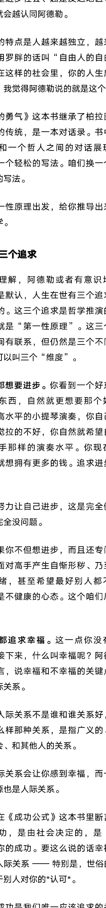

### 1.哲学

《被讨厌的勇气》说的是奥地利精神病学家阿尔弗雷德·阿德勒的思想。阿德勒和弗洛伊德是同辈人，两人经常在一起，后来因为观点不合分道扬镳。

现在弗洛伊德的精神分析学说已经基本被主流心理学界抛弃了。与其说弗洛伊德研究的是心理学，还不如说他那是文学。而阿德勒的学说，在我看来也不能叫心理学，应该叫哲学。


你可以从古希腊的哲学家，包括苏格拉底和我们专门谈过的斯多葛主义，到十八世纪的康德，乃至现代畅销书《高效能人士的七个习惯》这些地方找到阿德勒的影子。我理解阿德勒是把哲学原理具体成了人生指南。

为什么说这是哲学呢？如果是心理学，你得描述客观世界*是*什么样，人到底*是怎么回事儿，你需要实验验证。但哲学，可以研究人*应该*怎么样。

比如哲学家可以说人要想幸福，应该独立、自强、自由。但是心理学家会问，独立自强自由的人，就真的幸福吗？你如何测量幸福？就拿《高效能认识的七个习惯》这本书来说，我曾经看过一个研究，说没有直接的证据证明那些按照这七个习惯去做的人，就比不这么做的人成功。事实上就算有效你也很 CPU 出来，统计学只能研究大规律的规律。

所以哲学不是科学。但哲学也不等于鸡汤。鸡汤是你听了一两句人生格言觉得有道理就行。而哲学是思辨的产物，你得有一个严密的逻辑，能够经得起推敲和辩论，能站得住脚才行。哲学，值得我们严肃对待。

阿德勒这个学说一般被称为“个体心理学”，在历史上并不受重视，阿德勒的声音远远不如弗洛伊德——而这可能恰恰是因为阿德勒领先于自己的时代。以我之见，他这套学问应该叫“强人的生活哲学”。越是进步社会、越是发达地区、越是强人，就会越认同阿德勒。

现代社会的特点是人越来越独立，越来越讲自由，用罗胖的话叫“自由人的自由联合”。那么在这样的社会里，你的人生应该怎么过呢？我觉得阿德勒说的就是这个。

《被讨厌的勇气》这本书继承了柏拉图和苏格拉底的传统，是一本对话录。书中用一个青年和一个哲人之间的对话展现思想，这是一个轻松的写法。咱们换一个逻辑更清晰的写法。

我想从第一性原理出发，给你推导出来这套生活哲学。

### 2.人生的三个追求

根据我的理解，阿德勒或者有意识地说明确、或者是默认，人生在世有三个追求是不证自明的。这三个追求是哲学推演的出发点，也就是“第一性原理”。这三个追求互相之间有联系，但仍然是三个不同的方向，也可以叫三个“维度”。

# 第一，人都想要进步。你看到一个好东西和不好的东西，自然就想要那个好东西。听过高水平的小提琴演奏，你自己拉小提琴感觉拉的不够好，你自然就希望自己也能有高手那样的演奏水平。你现在钱少，自然就想拥有更多的钱。追求进步是人的本能。

想要通过努力让自己进步，这是完全健康的倾向，完全没问题。

但是，如果你不但想进步，而且还专门和别人比，面对高手产生自卑移形、乃至于自卑的情绪，甚至希望最好别人都不如我，那就是不健康的心态。这个咱们后面再说。

# 第二，人都追求幸福。这一点你没有异议。但是接下来，什么叫幸福呢？阿德勒有一个断言，说幸福和不幸福的关键点，都在于人际关系。

这里说的人际关系不是谁和谁关系好，你和领导怎么样那种关系，是指广义的、你和整个社会、和其他人的关系。

良好的人际关系会让你感到幸福，而一切烦恼的根源也是人际关系。

巴拉巴西在《成功公式》这本书里断言，世俗的成功，是由社会决定的，是“我们”决定你的成功。要这么说的话幸福真的取决于人际关系——特别是，世俗的成功是来自于别人对你的认可*。

可是世俗成功是我们唯一应该追求的关系吗？成功者毕竟是少数，难道不成功就不幸福吗？阿德勒认为幸福的确取决于关系，但“好关系”，可不等于“别人对你的认可”。

# 第三，人都追求自由。在我看来，对自由追求到什么程度，这是区分强人弱者的唯一标准。

如果你认为自由 = 财务自由，你是个弱者。那到底什么是真正的自由，我我们必须上升到康德哲学才能说明白。我们将会看到，强者和弱者的差别并不在于什么具体的技能，也不是性格上的“强势”，而是气度和勇气。

进步、幸福、自由，人人都想要。弱者的路线，是先实现进步，才能换来幸福，对自由没有特别的要求——也许自由只是幸福感之一，是进步的结果。

阿德勒学说则是一条强人的路线。这条路线要求先要有自由。自由前提下的幸福才是真正的幸福。当你知道什么是幸福的时候，你就知道人应该怎么处理进步的问题。

要走强人路线，我们还需要一个关键思想。

### 3.你可以自己选择

这个思想是阿德勒学说的标志性论断。阿德勒认为，你的生活模式，完全是你自己选择的结果。与其他人、与以前发生过什么，都无关。

所谓生活模式也可以叫生活方式，就是你的性格、你的行为规范、你怎么跟人交往，你有一个什么自我定位之类。

阿德勒这些都是你自己的选择。这是阿德勒和弗洛伊德最根本的区别。

咱们举个例子。比如有个个人，从小受到父母的虐待，他长大以后性格就会很扭曲，以伤害别人为乐，结果走向了犯罪的道路。

弗洛伊德会说这是完全可以理解的，是不幸的童年毁了这个人。弗洛伊德这个说法，叫做“决定论”。

那咱们想想，弗洛伊德等于是说，人其实

那咱们想想，弗洛伊德等于说是，人其实不能左右自己的命运 —— 你的命运由外界的设定决定。如果你童年不幸，也许你就应该犯罪。一切都是你妈妈的错。

阿德勒不承认这个说法。阿德勒认为这个人之所以性格扭曲，是因为他出于某种目的，主动*选择了*这个扭曲的性格。不幸的童年只是他的借口。阿德勒这个说法，叫“目的论”。

第二个例子。比如有个女孩，一和陌生人说话就紧张、脸红，说自己有社交恐惧症，始终不敢向心仪的男生表白，内心非常痛苦，来找阿德勒做心理咨询。阿德勒会告诉她，爱脸红的毛病是她自己的选择。

为啥呢？因为对这个女孩来说，被别人拒绝，是比脸红更可怕的事情！害怕表白被拒绝，又不愿意承认自己不敢表白，所以才发明了脸红的毛病。这样她就可以说服自己，“我要不是有社交恐惧症就会去表白，就会得到爱情。”

这个社交恐惧症不是假装的，事实上女孩一说话真的脸红 —— 但是，这仍然是她自己的选择。

阿德勒并不否认人有情感，但是他认为人不会真的被自己的什么情感给控制了。人总是战略性地选择某个情感，来达到别的目的。

再举个例子。比如你去餐馆吃饭，服务员失手把菜汤洒在你裤子上。你大发雷霆，指责服务员。事后你可能还挺后悔，说哎呀我当时好像有点没风度。但是阿德勒会说，发怒是你主动选择的。

为什么要选择发怒呢？因为你想通过发怒，去控制那个服务员。

那你说不可能！当时时间那么短我怎么可能想这些！岸见一郎是这么解释的 ——

比如现在有个妈妈正在怒气冲冲地骂她的女儿。这时候来了个电话，妈妈一看是女儿的小学老师，马上就和颜悦色地和老师说话。五分钟后放下电话，妈妈又接着对女儿发火。这个场景，你不陌生吧？

那好。如果怒气是不可遏制的，那妈妈变脸为什么那么快？她并非是遏制不了怒气。她是把发怒当做控制别人的手段。

有的人说从小性格孤僻，害怕外面的世界，所以不敢出门只能待在家里，这是他的性格悲剧吗？不是。他也知道孤僻的性格不好，但是这个性格对他有利 —— 有了这个性格，他就有了不出门的理由，他就可以一直得到父母的照顾。

弱者很善于把过去的不幸和性格的缺陷当做武器使用。他会抱怨这些不幸和缺陷，但是他*需要*不幸和缺陷。他拒绝改变。

那你说，抛弃那些上不了台面的目的，主动改变自己的性格，做个阳光正面的强人不是更好吗？是。但是改变生活方式是有风险的。他已经习惯了自己的人设，别人怎么对他，他有充分的预期。他没有勇气改变。

我们见过险恶环境中长大而性情优雅的强人，也见过家庭条件优越而性格猥琐的弱者。这个世界给了你什么，那是你决定不了的。但是怎么看待、怎么利用手里的东西，那是你可以决定的。咱们不要学弗洛伊德，不能一有什么问题都是你妈妈的错。心理分析师让你大哭一场又有啥用呢？咱们得学阿德勒，你可以改变自己。

而改变需要勇气。岸见一郎说，阿德勒心理学是关于勇气的心理学。

没有实验证据，我不敢说一切性格弱点都是个人的选择。但是我们大概可以说，阿德勒的学说是强人的生活哲学。要想成为强人，你首先得是个自由的人，咱们下一讲再说。

戳此复习：斯多葛派哲学的安心之法


万维钢·精英日课³
帮你和全球精英大脑同步
版权归得到App所有，未经许可不得转载


学习进步群


活码长期有效

## 《被讨厌的勇气》2：什么是真正的自由

《被讨厌的勇气》2：什么是...

苏格拉底有句名言叫“未经审视的人生不值得过”。每个人都有自己认同的人生原则，但是要想时时审视人生，你的原则最好是一个逻辑自治的体系。苏格拉底—康德—阿德勒这一脉传承的体系，就很讲逻辑。

我认为，这个体系的出发点，是自由。对自由要求到什么程度，是强人和弱者最根本的区别。自由不自由，是判断道德不道德的终极标准。

什么叫自由呢？财务自由就算自由吗？自由就是想干啥就干啥吗？老百姓有老百姓的说法，而我们要讲逻辑，就只能听康德的说法。

## 1.康德哲学

康德的《实践理性批判》这本书写的非常晦涩，但是你完全可以理解他的基本道理。这一切的出发点就是自由。咱们先从最不自由的情况说起。

比如现在有个奴隶，他做每一件事都必须听从主人的指挥。让站着就不能坐着，让干活就不能歇着，让往东就不能往西，自己好像完全没想法一样。他不敢不听话，因为反抗就会挨打，甚至还可能丢掉性命。这显然是极端的不自由，这个好理解。

现代社会有一种高级奴人，没有任何人压迫他去做什么事，没有人拿着枪指着他的头说必须得这么干，但是他也是别人让干啥就干啥——因为他是被钱收买的。撑个鞋拿多少钱，唱首歌拿多少钱，打个仗拿多少钱。他说不上喜欢不喜欢做这些事，但是他喜欢钱。钱指向哪里，他就打向哪里。

这个仆人是自由的吗？理论上讲他可以随时退出，但他不会退出，因为他需要钱。仆人是出于贪爱做事，和奴隶出于害怕做事一样，都是被某种欲望驱使——从这个意义上说，这个仆人也是不自由的。

好，再看第三个例子。有一位贵妇人，非常有钱什么都不缺，但是缺爱情。只要谁对她付出感情，哪怕只是做出付出感情的样子，她就感动得一塌糊涂。她说只要你对我是真心，你要什么我就给你什么……结果她被很多男人欺骗。

这位贵妇人是自由的吗？她被感情驱使，别人用感情调动她做这么做那，所以她也不自由。

第四个例子是一位慈善家。他有钱，又不受任何人管束，也不受一般感情的驱使，但是他有个最大的特点，就是见不得别人受苦！看谁有困难，他一定要上去帮忙。看新闻哪里发生了灾难，他一定捐钱。

这个慈善家是自由的吗？严格地说，他也是不自由的。他也是被一种感情和欲望驱使，那就是同理心。看到别人受苦就好像自己受苦一样，他必须采取行动来平息自己的苦难感。他仍然是被外界的某个东西牵着走，他不能说是自由的。

为了生存也好，为了利益也好，因为恐惧也好、贪婪也好、感情也好、同理心也好，康德说所有这些能牵着你走的力量叫做“inclination”——倾向性。

康德把出于倾向性而做事的行为叫做“假设律令（hypothetical imperative）”，因为它具有“如果……就……”的特点。我如果如何如何，就会如何如何，所以我要这么做。康德说，凡是出于倾向性的，就都是不自由的——也是不道德的。

那么怎么才算道德呢？道德得是“绝对律令（categorical imperative）”，得是无条件的。我做这件事并不是因为它会给我或者别人带来什么东西——仅仅是出于*义务*，我认为这件事应该做。这才是真正的道德。这才是真正的自由。


这是最高的道德标准，也是唯一逻辑自治的道德标准。

什么是自由？自由就是不受驱使。既不被别人驱使，也不被自己的欲念驱使。换句话说，就是你不能是一个工具。

康德哲学认为人只能是“目的”，人不能是“手段”。我不做工具，也不拿别人当工具。我不受人利用，我也不利用别人。只有这样的人才是自由的，才是强人。

那你说这要求是不是有点极端呢？我好心给你捐款怎么还能成了工具了呢？比如我是一个中学老师，我就兢兢业业地教学，不管学生家里状况如何，也不管学生聪明与否，我真心对待每一个学生。可是听了康德哲学，我深夜反省自己……我努力工作是不是也有升职加薪的目的在里面？我对贫困学生特别照顾，是不是也有同理心的情绪在里面？难道我也是被驱使的奴隶吗？

以我之见，这才是阿德勒的生活哲学出场的时刻。阿德勒解决了怎么把康德的最高原则应用于生活的问题。阿德勒说做一个自由的人其实并不难，而且可以说很简单。其实你可能已经在这么做了。

## 2.一切烦恼的根源

现代人几乎不会受到什么生命威胁，也通常不会做什么每一个动作拿多少钱的事儿。最能直接驱使我们的，是别人的*认可*。

如果你处处为了别人的认可而活，你就处处受到驱使，你就是不自由的，你就会很难受。

阿德勒认为，人的一些烦恼根源就是人际关系。为什么烦恼？因为你总想获得别人的认可。

那你说世俗的成功不就是社会的认可吗？我们需要社会的认可。我理解你应该这么想：你可以把认可当做一个产品，你做得好别人自然会认可——但是你不应该直接追求认可，不应该被认可牵着走。

岸见一郎和古贺史健在《被讨厌的勇气》这本书里举了个例子。一个人的个子比较矮，他非常在意这一点，总担心别人嘲笑他，很烦恼。后来有个朋友跟他说，其实现在个子矮也是一个优势啊，你和别人交流，别人没有那么大的威胁感，你有一种天然的亲和力啊！

这个人一想也对啊。其实根本就没有谁整天嘲笑他，最在意你长相的是你自己。最在意认可不认可的，也是你自己。

被认可驱使的人干什么都爱跟人比较。

如果觉得自己比不上别人，就会产生自卑。本来如果你是跟“理想的自己”比，对现在的自己感到不满，要努力奋斗，那是非健康的心态。但是跟别人比，不但不健康，而且还可能把自卑变成熟“自卑情结”。

有个人口吃，他觉得我要是口不吃，一定是个特别受欢迎的人。你安慰他说，其实口吃没什么，大家都不介意，而且你还可以训练……他的回答是你无法理解口吃者的内心！你知道我有多痛苦吗！这就是自卑情结。他已经把自卑感当做了借口，甚至是控制别人的武器。

还有一种更常见的叫“优越情结”，就是到处跟人炫耀越越感。士豪戴帽必须得戴十个，简直是强烈的自卑导致强烈的自尊。

被他人认可驱使的人，一天到晚跟人比，他们心目中的人际关系是纵向的：人和人的地位按照高低排序。他总想证明自己的地位比别人高，哪怕他已经到了顶端，也要担心别人把他比下来。

这样的人一点都不自由，简直可以说就是个奴隶。

要想在人际关系中获得自由，你需要建立横向的关系。

## 3.不批评也不表扬

自由的人跟人相处，都是讲究平等关系。

自由的人跟人相处，都是讲平等关系。

比如有个小孩，他的各项技能、智慧、体能各方面都不如你，那难道你瞧不起这个孩子吗？当然不行。人和人在某个方面可以有差距，但是人和人都是应该独立平等的关係。他有困难你可以帮助他，但是你不能居高临下地去支配他，更不能压迫他。

老板可以给你安排任务，你应该听他的指挥，但这是工作上的合作关系。是你也认同这个工作应该这么干，你才去干 —— 而不是因为你惧怕老板才去干。

在阿德勒的思想中，如果你是正确信奉自由、相信人人平等的人，那你对其他人的行为既不应该批评，也不应该表扬！因为不管是批评还是表扬，都是不平等，都是想操纵别人。

比如说有一天吃完晚饭，你家小孩主动收拾了碗筷，你就表扬他，说做得好！真是个好孩子！我要给你奖励！ —— 请问，这跟动物园驯兽师训练动物有什么区别？你这是一种居高临下的态度，你是想通过表扬去操纵孩子郭的行为，你是驱使郭子，你是把孩子当工具。试想，如果是你丈夫做了这件事，你会用这种方法跟他说话吗？

当你表扬别人的时候，就已经默许了上下级的关系，就是不平等。

表扬和批评都是 judge。别人做对了你可以表示感谢，别人做得不对你可以帮助他，但是你不能操纵他。

人人平等、不把人当工具，这条准则没有那么难。我们看现代发达的社会里，高水平的工作场合，其实都是这样的。下级害怕和奉承上级，上级对下级颐指气使重赏重罚，那都是特别土的地方。

你可能早就在这么做了，现在我们找到了哲学上的理论依据。

不再担心别人的认可，这也就是“被讨厌的勇气”。当然也不是说要故意让人讨厌。

希望这一讲能在新年带给你勇气。那你可能有一个疑问。不爱跟人交往的人、我行我素不管不顾的人也不在乎认可，也可以说是自由的，难道我们应该做这样的人吗？别着急。自由只是个一个维度，人确保了自由还得寻求幸福。咱们下一讲再说。


## 日课精选

老安
17
站好最后一班岗。还有一个月的时间，就要离开现在的工作岗位了，但是我依然兢兢业业，力争把上级交给的每一项工作都高标准地完成。

近段时间老板给我的工作特别多，我也能够感觉到他想让我临走前再出一份力。而身边的同事说，反正马上该走了，差不多应付应付就行了。

大家对我的看法都产生了变化，但我的想法始终没有变。因为，对于工作来说，我关注的不是多干一点或是少干一点，而是从中能学到多少东西，提升多少能力，毕竟练到的手艺是自己的。正因为此，也避免了工作中的很多纠结和焦虑，享受了工作所带来的喜悦和欣慰。01-03 00:14:51

作者 回复
赞！您生活在幸福中。01-03 05:12:27


## 活码长期有效

## 特别放送：2018最值得一读的8本好书

特别放送：2018最值得一读·

万维钢

书单有三种列法。一种是写给自己的记录和总结，一种是通过书单展示自己的读书品位和观点取向，一种是真诚地为读者推荐几本好书。这个书单是真诚的推荐。

一本好书可以是有趣的，有用的，或者是某个重要议题的提醒，但都应该是写给读者的。取悦读者不等于媚俗，更不是罪过。脱离读者自说自话是不会写书，而且通常作者本人根本没把这个议题想明白。议题重要、研究有料、思路清晰、笔法有创造性，一本书才能好看。现在好书太多，我们没有义务把时间浪费在不好看的书上。

2018年出版的新书中，我读过的，下面这八本不会辜负你。排名顺序按照阅读速度从快到慢——

## 1.《道门法则》

八宝饭著，起点中文网，正在连载。


这是一本网络小说。它的故事完全符合寻常网络小说的套路，也就是“攻略”式：奇遇、任务、打怪、拿经验升级、开新地图、慢慢揭示世界观。网络小说是这一代中国人的重大文化成就，我们很可能已经找到了给读者制造爽感的终极公式。

《延禧攻略》为什么能成为2018年全球搜索量排名第一的电视剧，就因为它符合这个公式。

读网络小说不是为了文学欣赏，而是为了“爽”。但是，因为这个公式已经是如此的纯熟，有些高水平作者和读者会以这个公式为“钉子”，在上面“挂”一些思想性知识性的东西。就好像大仲马说历史是他挂小说的钉子，只不过现在小说是钉子。试想，如果我们通过读一部网络小说，一边爽一边学会了微积分和复变函数，那岂不是寓教于乐吗？

《道门法则》是一部披着修仙小说外衣的官场小说。主人公穿越到某个时空的大明嘉靖年间，发现这个时空的灵气浓郁，有很多人修仙，而且修仙的道士们成了大明的组织和领导力量。作为先进代表，道门的运作方式十分现代化，从基层干部到高层领导都既讲原则又讲政治，手段微妙而耐人寻味。主人公上辈子是科员，拥有丰富的机关工作经验，加入道门之后如鱼得水，跟上上下各级都有良好的关系，还提出了“建设有道门特色的新大明”的政治主张。这些设定，使得小说在寻常的斗法、谋战、商战爽感之外，还给读者提供了官场话语的爽点。

## 2.《对话：有关宇宙本性的交谈》

(The Dialogues: Conversations about the Nature of the Universe), Clifford V. Johnson, The MIT Press.


这是一本漫画书，但不是日本那种漫画。严格地说这种书叫做“graphic novel”，有时候被翻译成“视觉文学”或者“图画小说”。这是一种严肃的艺术形式，可用于表达没有爽点的严肃思想。我曾经读过数理逻辑、经济学和民主政治题材的图画小说。

这本书讲的是现代物理学，用意是科普，但可不是那种儿童式的甜味科普。全书通过几个年轻人的对话，探讨了现代物理学对宇宙的理解。书中不但有相对论和麦克斯韦方程组，而且还有规范场论和杨-米尔斯方程——但是别害怕，书是给大众读者看的，方程都只是偶尔出镜。

书的开本挺大，还挺厚，做工精致。拿在手里沉甸甸，放在桌上能占地方，适合居家和咖啡馆摆设。

## 3.《超越曲棍球杆的战略》

(Strategy Beyond the Hockey Stick: People, Probabilities, and Big Moves to Beat the Odds), Chris Bradley, Martin Hirt and Sven Smit, Wiley.


此书最早是麦肯锡的一份商业研究报告。研究者分析了两千家公司的大数据，告诉我们公司战略到底应该是怎样的。企业管理这个学问对大多数人来说是用不上的，但是我推荐这本书不是因为什么管理学，而是因为这份报告具有通用价值，能激发我们思考。

说得严重一点，这可能是第一次，有人通过科学方法，说明“战略”到底是个什么东西。以前人们只是泛泛地谈论战略。想起来了，偶尔出个主意，说这是“战略决策”，实际大部分时间都是浑浑噩噩地惯性前进。而这本书的思路清晰，告诉你怎么系统化地设计、选择和应用战略。战略不是三十六计、不是寓言故事；改革不是拍脑袋，也并不不得不已来一次。战略是一门科学。理解了战略科学，就不用一惊一乍地感叹了，该做什么自然就做什么。

- 概述复习：
1.什么是战略思维 2.真实世界的战略格局 3.命运配方 4.为什么大公司抓不住大趋势 5.到底什么叫“集中力量办大事”

## 4.《直觉泵和其他思考工具》

[美] 丹尼尔·丹尼特著，冯文娟 / 傅金岳 / 徐缙译，浙江教育出版社。


终于出中文版了。丹内特是活着的最著名的几个哲学家之一，他专门思考意识、生命、人工智能这些科学一时半会儿回答不了、需要靠哲学思辨帮忙的大问题，这本书是他写给初学者的礼物。你可以把它当做“成语典故合集”，或者“思考三十六计”，学习书中列举的各种思想辩套路。内容很好看，自带一种毫不浮躁的趣味性。

把这本书啃下来，你会变聪明。

## 5.《利益攸关：日常生活ention不对称性》

(Skin in the Game: Hidden Asymmetries in Daily Life), 纳西姆·尼古拉斯·塔勒布 (Nassim Nicholas Taleb), Random House.

## SKIN IN THE GAME
Hidden Asymmetries in Daily Life
NASSIM NICHOLAS TALEB

塔勒布想必是你熟悉的作者，他写过《黑天鹅》和《反脆弱》。他是一个统计学家、学者和哲学作家，在纽约大学有教职，而且还曾经是个金融交易员。塔勒布的名字总是跟“不确定性”联系在一起，可以说现在不管谁谈论“随机性”这个问题，都不得不引用他。我非常喜欢塔勒布的文笔，有一种古典美，在英文畅销书里绝对不俗。

《利益攸关》一如既往地有思想，但我觉得读这本书主要读的是塔勒布的反精英气质——用他本人的话来说“知识勇气”。简单地说，就是知识精英一说什么是事儿都头头是道，可是承担风险的都是别人。

塔勒布显然看不起美国的自由派知识分子——也就是“白左”，但他不是像群体代表那样说实在在的“常识”，也不是强行讲笑话调侃。塔勒布的方法是居高临下，用古罗马古希腊先贤＋现代数学家物理学家这个级别的智能进行打击。比如说，经济学家皮凯蒂写了本《21世纪资本论》，塔勒布不需要跟他比“理念”，他跟人合作了两篇统计学论文，证明皮凯蒂的立论犯了数学上的错误。语言学家平克有本书叫《人性中的善良天性》弘扬乐观主义，说我们这个世界越来越好，塔勒布写论文证明平克因为有心理学偏差，犯了统计学的错误。

- 截此复习：
1. 现代社会和利益攸关 2. 道德的内外之别 3. 雇员和冒险家 4. 济贫和知识的小市民 5. 读士和主公 6. 杀手和语言学家 7. 当我们谈信仰时我们谈些什么 8. “遗尿性”和“尾部风险”

## 6.《西方的自杀》

(Suicide of the West: How the Rebirth of Tribalism, Populism, Nationalism, and Identity Politics is Destroying American Democracy)，卓纳·戈德堡（Jonah Goldberg）著，Crown Forum.


比尔·盖茨说史蒂芬·平克的《当下的启蒙》是他“平生最喜爱的书籍”，我认为这是一次个人形象公关。我不相信有哪个读书人平生最喜爱的是如一本描述“xx运动以来的伟大成就”的献礼书。平克谈启蒙运动就如同小学老师谈新中国的建立——这是伟大的时代！一切美好就这样发生了，让我们以梦为马，不负年华。

## 7.《生命3.0：人工智能时代，人类的进化与重生》


## 8.《为什么：因果关系的新科学》


这本书是对你智力的挑战。这不是一本科普书。81岁的计算机科学家和哲学家朱迪亚·珀尔，用平生的研究，告诉我们现在人工智能的发展方向太低级，高级的做法应该是什么。


## 问答：想赢得比赛，是“不自由”吗？

## 来自日课：迷幻药和脑科学

问答0104

《迷幻药和脑科学》这两期咱俩读者的留言水平非常高，提出了很多问题，比如人体是否能自行分泌类似的化学物质帮助大脑产生幻觉，还有有关大脑的非常技术性的问题，但这些问题我也不知道答案。而且我想，我们心中的很多疑问，是“当前科学理解”所无法解答的。《如何改变你的心智》这本书并不是一本答案之书，它的作用是帮我们打开一扇大门，让我们有所启发，在心中埋下一颗种子，去随时捕捉有关大脑的最新知识。

我觉得有意思的一点是有关迷幻药的研究都是比较边缘的研究，这体现在案例少，不能做大规模的实验。有几位读者，比如"sophia liang"，提到自己的亲人去世前的幻觉体验，这使我想到了另一类边缘研究，也就是“濒死体验”。我想借此机会说两句这方面的研究。

你可能想不到，濒死体验是一个严肃的研究课题。学术上还有个专有名词，叫“NDE”（Near Death Experience），有很多研究者撰写正式的论文。所谓濒死体验，就是有些病人在心脏停止跳动之类生死垂危的状态下经历了一小段时间，又被抢救回来之后，描述他们在那一段时间内体验。在我看来，人们之所以重视濒死体验的研究，是因人在濒临死亡状态下产生的各种幻觉，跟迷幻药的作用有一定区别——关键可能在于，不同人的濒死体验似乎有一种*共性*。

## 来自日课：强人的生活哲学

读者 月下的大灰狼：

我可不可以这么理解，弗洛伊德认为结果由外部因素导致非自身所能改变，这是固定思维模式。而阿德勒则说结果是由自己的选择决定的，既然是自己的选择，那就必然可以改变，这就是成长思维模式。

万维钢
“固定思维模式”和“成长思维模式”是心理学家卡罗尔·德维克（Carol Dweck）发明的概念，说的是人在课堂学习之类*技能*训练方面的思维模式。弗洛伊德和阿德勒说的是“生活模式”，包括性格、为人处世之类。这是不同的领域，但是，我们会忍不住注意到其中的共同之处。

长大以后的影响比儿童时期大。

每个人的性格都是从家庭到社会、从基因到环境、从主观到客观一系列影响的产物，任何强调单一影响的都只不过是讲故事，所以说弗洛伊德是个文学家。研究“原因”其实没有太大意思。你感冒了，吃药也行不吃药也行，反正过两天就好了 —— 你有必要追究是谁传染的你吗？

## 来自日课：什么是真正的自由

读者 廖伟吉：

和别人比，产生自卑甚至自卑情结固然是不好的。但如果和别人比是激发斗志，遇强则强呢？

读者 沫汐：

您说被金钱或者欲望驱动的人的行为都是不自由的，那么那些希望赢得足球比赛的球员、希望在考试中把别人比下去取得第一名等类似的行为都是不自由的吗？

万维钢

我认为赛场上的竞争不但不是不好的，而且体现了人性的光辉。有竞争，我们才能激发潜能，最大限度地取得进步。

阿德勒反对的是*人际关系*中的竞争。如果你一天到晚把他人视为敌人，这显然是不自由的，日子根本没法过。

我认为这个区别在于你是在跟“这个人的技艺”比，还是在跟“这个人”比。比技艺，你作为人的价值还是无所谓高低 —— 技艺才有高低，人和人仍然平等。

现代人应该善于对事不对人 —— 也就是把这个人的某一方面，和这个人本身，区分开来。你要知道这一场输了只是你技不如人，并不是说你这个人的价值受到威胁 —— 正如你知道服务员对你微笑是对作为消费者的你微笑，不是说对你这个人有意思……

读者 红桃2：

现在打卡读书，跑步后在晒朋友圈的人越来越多。目的是靠大家的认可(点赞)自我驱动，从而坚持下来。请问万老师，这是不是说如果是为了达到自己的美好目标，牺牲一些自由也是好事呢？

万维钢

我觉得阿德勒的哲学是让人生活更简单、精神更愉快的学问，不是为了给行为设限。阿德勒肯定反对为了赢得朋友圈的点赞而去冒着生命危险跑全程马拉松，他反对我们没有点赞就痛苦 —— 但是他不会介意我们为了点赞而偷偷高兴。


### 万维钢·精英日课³
帮你和全球精英大脑同步
版权归得到App所有，未经许可不得转载

## 《被讨厌的勇气》3：幸福 = “贡献感”

《被讨厌的勇气》3：幸福…

今天咱们继续讲岸见一郎和古贺史健的《被讨厌的勇气》这本书。这两位作者中，岸见一郎是阿德勒生活哲学的继承者和实践者，负责这本书的理论；古贺史健则是一位作家，负责把书写得好看。为了实践阿德勒的哲学，岸见一郎专门从事过很多年的心理咨询。他获得了一个洞见。

来寻求心理咨询的，没有任性的人。

在人际关系中遭遇各种困惑、特别不喜欢自己、甚至抑郁成疾的，都是过分在意别人对自己的评价的人。他们处处感到被别人的期待牵着走，特别不自由。反过来 说，任性可以让你过自己喜欢的人生。

阿德勒完全不反对你过自己喜欢的人生——这可是个人权！而且任性，说明你至少有“被讨厌的勇气”。但是，正如康德所 说，任性也是服从于某种 inclination，任性者其实是自己的欲望和冲动的奴隶。满足只是暂时的，任性不能带来长久的幸福。

那怎么才能够得到幸福呢？康德这一套有可操作性吗？咱们今天就解决这个问题。

### 1.比出来的幸福

阿德勒说人际关系是烦恼的根源，但也是幸福之源。很多人相信幸福感是跟别人比较出来的。现代人的生活水平比几十年前不知道好了多少倍，但是幸福感可没提高多少。人们最在意的总是在人群中的相对位置。

### 2.共同体感觉

阿德勒提出的幸福，来自人际关系的高级状态，叫做“共同体感觉”。

### 3.贡献和贡献感

为什么像比尔·盖茨、J.K.罗琳他们，已经功成名就有花不完的钱，完全被社会认可，还要继续工作呢？特别是比尔·盖茨，一方面在非洲慈善，最近几年还成了书评人，整天写博客推荐书——其实我觉得他写的411，不行，但耶是另一个问题——他图啥呢？

## 《被讨厌的勇气》4：生活哲学有啥用

《被讨厌的勇气》: 4生活哲...

岸见一郎年轻的时候第一次听到阿德勒心理学的讲座，主讲人说了一段让年轻人勃然大怒的话。他说，今天听了我的报告的人，立刻就能获得幸福 —— 但是如果你做不到这一点，你就一辈子也不可能获得幸福。

怎么有人敢这么说话呢？这不是骗子吗？我看这个话并没有道理。根本原因在于，幸福是一个主观的东西。

阿德勒的这套哲学，是教你怎么主观地看待这个世界。事情就是这个事情，情况就是这个情况 —— 但是意义，你可以自己选择。而选择了意义，你就选择了生活模式。

改变生活模式用不了太多时间。你不需要熟练掌握英语、不需要成为国家级运动员、不需要考上哈佛大学就可以改变生活模式。这几乎完全取决于心态上的转变。

这一讲我们说说具体的应用方法。

### 1.活在此时此刻

有句话叫“活在当下”，阿德勒哲学赞成这个观点。我们前面说了，弱者追求幸福的路线图是先进步，认为自己只有进步了才能获得幸福 —— 而强者的路线图则是先要自由。

进步这个路线图为啥不对呢？因为你永远都在路上。就好像登山一样，你以为只有山顶是幸福的，登山的过程是幸福的代价。可就是如果登不上呢？如果登上之后又发现更高的山呢？这样的生活等于被某个目标牵着走，不自由也不幸福。

### 2.课题分离

阿德勒心理学的一个重大论断是“课题分离”。在我看来，这也是现代社会人与人交往的首要准则。

### 3.建立共同体感觉

人际关系的出发点是课题分离，人际关系的终点则是建立良好关系，也就是“共同体感觉”。课题分离解决自由的问题，共同体感觉解决幸福的问题。建立共同体感觉分三步。

### 4.唯心的学问

## 4.唯心的学问

阿德勒这套人生哲学能解决你所有的问题吗？当然不能。哲学不能当饭吃。

如果你是一个普通的足球运动员，这套学问并不能帮助你进国家队。如果你是一名高中生，这套学问也不能帮你考入名校。如果你想的是怎么进国家队怎么考名校，多研究研究“刻意练习”，多读一读《成功公式》，那更有用。

阿德勒的生活哲学不是研究怎么让你成功的学问，但他解决了另外一个维度的问题——那就是心态问题。

明明不是钢琴大师，明明有很多人比你弹得好，你练琴还练得这么高兴，美其名曰“活在当下”——这不是自欺欺人吗？不是。不是钢琴大师怎么就不能高兴呢？

阿德勒的哲学解决的是让你幸福的问题。

有很多成功人士，他们完全知道怎么不断进步，知道怎么刻意练习，知道如何造势，知道怎么高别人一头，但是他们并不一定幸福。他的心态可能失衡，他一和人比较就沮丧，搞不好还会自杀。

世俗成功和内心幸福是不同的维度。阿德勒的学问不是告诉你怎么成功，而是告诉你怎么坦然面对这个社会。你说阿德勒哲学是不是唯心的？那我要问，“幸福”这个东西是不是唯心的？人除了那些可测量的世俗成功标准之外，内心还有没有不可测量的意义？

《被讨厌的勇气》这本书到这就算给你讲完了。有人说要想彻底理解阿德勒的哲学并且改变生活方式，你得花上相当于自身岁数的一半时间——如果你今年40岁，你得再学20年才行！我认为这个说法太极端了，也不符合开头那位主讲人夸下的海口。但是我觉得还是应该早点学。

有个很多年前的电视剧叫《大染坊》，拍得非常好。我最近又想起这部剧，就跑到豆瓣看现在大家对它有什么评价。其中有一个短评打动了我。

那个评论中说，他的妈妈生了重病，时日无多，临死之前把《大染坊》看了十遍。他妈妈说如果人生还有很多时间，一定要像主人公陈寿亭那样活！只恨这些道理现在才知道。

阿德勒这一套不是《大染坊》鼓吹的经商之道，但是它们似乎有个共同点。它们说的都是换一种活法的可能性。“朝闻道夕死可矣”，可是如果能早点知道岂不是更好？你可以在余生享受幸福。


日课精选

提交留言可与专栏作者互动

## 哪种不确定？什么黑天鹅？

哪种不确定？什么黑天鹅？

你有没有感觉，“黑天鹅”这个词现在已经流行到被滥用的程度了。但凡有什么后果严重的小概率事件发生——甚至只要是自己没想到事儿发生，人们就会说这是“黑天鹅事件”。我看有些记者从《黑天鹅》这本书中得到的教训大约就是“不要忽略小概率事件！”

这没ten用。不敢忽略小概率事件可不叫懂统计学——统计学不是吓唬人用的。真正的本事，是不但知道不该忽略的时候不忽略，而且知道该忽略的时候忽略。

最近，我专栏特别推崇的两位牛人，一个是《黑天鹅》的作者纳西姆·塔勒布，一个是538网站的主理人纳特·西尔弗（Nate Silver），在Twitter上爆发了一场激烈的争吵。我想给你介绍一下这场吵——你也许能从中更精确地体会到什么叫“不确定性”，什么叫“预测”，以及什么叫“黑天鹅”。

### 1.牛人相轻

我先给你说说纳特·西尔弗是当代预测界首屈一指的人物。他自学成才，因为在2008年总统大选中成功预测了美国51个州中50个州的选举结果而一举成名，后来创办了“538”网站，专注预测体育比赛和政治竞选结果。他对2012年大选的预测也异常成功，后来还出了一本书叫《信号与噪音》，可谓是预测这个行业的代言人。

但是2016年，西尔弗失手了。他一直预测特朗普当选的概率在50%以下，有时候甚至低于20%——而特朗普当选了。当然，绝大多数民调机构都预测失败——有些记者可能会说特朗普当选是个“黑天鹅事件”。但是，刚刚过去的2018年中期选举，西尔弗的预测又比较失败。那既然你是预测名人西尔弗，别人就有权利据此嘲笑你。

而西尔弗的反击是，嘲笑者不懂数学。


他这么说是有道理的。538网站给的预测从来都不是给一个单一的结果，而是一个概率。它不会说“特朗普会输”，它只会说“特朗普赢的概率是35%”。

### 2.什么是预测

咱们得先了解一下现在主流的、科学的预测方法是什么样。包括538网站的预测在内，预测一般分三步。

第一步是用一个数学模型代替真实世界。比如我要预测一场足球比赛，我的预测模型可以是双方球员的能力值决定比赛结果。我只考虑了射门、传球、防守各项能力的对比，但是像裁判执法是否公正，天气之类的因素我就忽略了。任何模型总要忽略一些东西。

### 3.预测的市场

那么塔勒布为什么要批评西尔弗呢？因为西尔弗没有明确告诉公众他预测的认知不确定性。

下面这张图是2016年总统大选之前6个月，538网站对选举结果预测的概率变化——


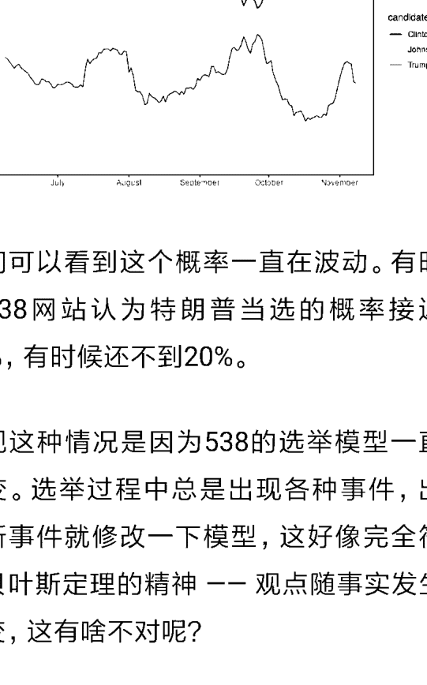

我们可以看到这个概率一直在波动。有时候538网站认为特朗普当选的概率接近40%，有时候还不到20%。

出现这种情况是因为538的选举模型一直在变。选举过程总是出现各种事件，出了新事件就修改一下模型，这好像完全符合贝叶斯定理的精神 —— 观点随事实发生改变，这有啥不对呢？

但是塔勒布认为，严肃的预测不应该随着时间发生这么大的变化。塔勒布还专门写了篇数学论文，预测概率变化到什么程度，才是可以接受的。

这个批评也有道理。如果你预测可以随时变化，那就像一边看着球赛一边预测比分 —— 这好像谁都会啊，那预测还有什么意义呢？真正的高水平预测难道不应该提前一段时间宣布比赛结果吗？

我看“通往数据科学”网站有一位博客博主 [1] 还提出了另一个批评。他说538这么做相当于于是立于不败之地！特朗普没当选，你说自己预测的只是一个概率 —— 可我们听你的预测，总要有个决策吧？决策得有阈值吧？对老百姓来说决策阈值就是50%。你说在50%以下，我就当你说预测特朗普*不会*当选。

2008年和2012年的时候，我们说你预测“准”，也是对着50%这个阈值说的 —— 那时候你坦然地接受了荣誉。如果你不承认50%这个槛，那你那个时候也应该说自己预测的不过是个概率，这只是运气好！

但是另外一个博主 [2] 说的也有道理。他说关键在于塔勒布和西尔弗是不同领域的人。

塔勒布眼中的预测，是真金白银对赌的决策依据，是利益攸关，是 have skin in the game。你说一个预测结果，别人可是会跟着投钱的！你得为预测负责任。

但是对西尔弗来说，预测结果仅仅是个谈资而已。538网站现在已经成了一个互联网基础设施，就好像搜索要上 Google 一样，想猜一件事情的结果就上538网站看预测。538是个满足好奇心的网站，也可以说是个新闻网站。比如昨天特朗普又干了什么事儿，你想知道这件事能在多大程度上影响选举结果，538会告诉你一个数值。

预测的数值变来变去，这正好是538吸引眼球的手段，是西尔弗作为媒体人的本分。西尔弗没有任何意愿老老实实地告诉读者，说我的预测就是闲着玩的，其实我也不知道谁能当选总统。

预测，已经娱乐化了。

这样说来，塔勒布和西尔弗其实都有道理。事实上他们在预测技术上的差异是非常小的。让塔勒布做538网站，他不会做的比西尔弗更好。但是，这个差异是不可调和的。

那我们能从这件事中得到什么呢？在我看来，首先是你能不能严肃认真地对待你的认知。当你谈论预测的时候，你知不知道应该怎么理解预测结果。当你谈论不确定性的時候，你知不知道你说的是哪种不确定性。当你谈论黑天鹅的时候，你知不知道黑天鹅是什么意思。当你谈论塔勒布和西尔弗的时候，你知不知道这俩人是有根本差异的。

一开始你可能想不到这里面有这么大的门道。随着知识的深入，你会对这些事儿越来越敏感。想想吧——

Twitter上出个撕什么什么的事件，竟可以是这样的水平。


万维钢·精英日课³
帮你和全球精英大脑同步
版权归得到App所有，未经许可不可转载

## 怎样不做“必须做的事儿”

怎样不做“必须做的事儿”

如果有一个神奇力量，突然给你两个月的假期，让你在这两个月内可以抛开一切责任想干啥就干啥，你会干啥呢？

如果你是一个成年人，我相信你不会把这两个月全用在吃喝玩乐上。你肯定有很好的计划。我有个朋友说他想以普通打工者的身份体验一下中国各地各种人的生活。也许你想去哪个寺院当两个月和尚。也许你可以去土耳其和沙特冒险。也许你可以学习一个新的技能。也许你只不过想读一本早就想读的书。也许你想研究一个什么东西，憋个大招！也许这两个月就能让你的人生状态发生根本的改变，最起码能让你的职业生涯上一个台阶。

某大学号称要“为祖国健康工作五十年”——在你五十年的职业生涯中两个月真不算什么。那你为啥没干这些事儿呢？你为啥就没有这么两个月呢？

### 1. 时间管理的最高境界

这些事儿对你非常、非常重要。可是它们不紧急。时间管理的学问要求我们把事情按照“重要”和“紧急”这两个维度分类，可是你的日程表上全都是紧急。

所谓成年，大约就是习惯了做“该做”而不是“想做”的事儿吧。那两个月的梦想是你*想做*的事儿。你做的全都是你*必须做*的事儿。

### 2. “余闲” 的价值

几年前一个经济学家（塞德希尔·穆来纳森）和一个心理学家（尔德·菲尔）写了本书叫《稀缺》，说贫困和忙碌会把人陷入一个特定的思维模式，这个思维模式又会进一步限制人的发展能力，使得穷人更穷。

### 3. 紧缺思维

《稀缺》这个书名在我看来应该翻译成“紧缺”，书中描写穷人一种紧缺思维模式，用的例子主要是金钱上的贫穷。但是紧缺思维的所有表现，你都可以类比到时间上的贫穷。一个忙碌者可能有很多余钱，但是因为没有余闲，其实是个时间上的穷人。

### 4. 人穷别借钱

首先你得避免变成时间上的穷人。《稀缺》列举了很多研究，说贫困本身会加剧贫困。穷人本来钱就不够花，遇到紧急情况只好去借钱，而美国有很多专门针对穷人的小额贷款公司，它们的利息非常高，但是利润非常厚实。为了偿还利息，穷人还得再借新的钱，以至于每个月在还各种借款的利息上就要花费400~600美元，这对于中产阶级家庭来说是不可想象的窘境。

所以富人反而可以借钱，穷人千万别借钱。

那么如果你时间本来就少，就千万别预支未来的时间！这件事情挤占了下一件事情的时间，下一件事情就不得不挤占另外一件事情的时间，一步赶不上步步赶不上，而且还得交重新开通费。透支会大大加剧贫困。

### 5.自由和自律

那如果我已经是时间上的穷人了，怎么才能给自己积攒一点余闲呢？

首先你得改变姿态，敢于对很多事情说“不”。我不做这件事情不是因为我没时间做——是因为我想“有时间”。

其次你可以搞个重新启动，干脆放弃一些项目，一次性地得到一大笔余闲。比如主动休假或者换个工作。

但是要想保住这笔余闲，你得非常自律才行。印度有些穷人做这么一种生意。每天早上向人借1000卢比作为本钱，买一些货物到集市上卖，到晚上能得到1100卢比。但是他必须当天还回借款，外加5%的利息——所以他一天只挣50卢比。

那你自然会想，如果这个人自己能拿出来1000卢比，他就不用去找人借钱，他每天的收入的100卢比不就都是自己的了吗？他的收入不就立即翻倍了吗？

研究者也是这么想的。研究者来到印度，直接送给这些人每人1000卢比，想看看这样能不能彻底改善他们的生活。

结果发现不能。头几个月这些人的生活的确好转了，但是不到一年，他们纷纷又回到每天要借1000卢比的状态！

这是因为生活中会有各种“震动”。亲朋好友过生日，没钱也就算了，可是既然现在能拿出钱来，他就会心动，他就会拿出钱来买一个贵重的礼物——于是第二天的本钱就没有了。

余闲在很大程度上就是给震动做准备的，但是余闲非常害怕震动。你得忍住不动才能保住余闲。一下午的自由时间，如果说不干就真的什么都没干就没有了。余闲的种种好处，也就没有了。自律未必等于康德式的自由，但是自律总比他律好。

拥有余闲就拥有主动权，就拥有了创造、冒险和改变的可能性。时间就好像是金钱：你花了它就不是你的了，可是你一直不花它也不是你的——只有在你“可以花也可以不花”的那一刻，它才是你的。

截此复习：从时间管理到能量管理

参考文献
[1] P. Kaisari et al., Top-down guidance of attention to food cues is enhanced in inpiduals with overweigh/obesity and predicts change in weight at one-year follow up, International Journal of Obesity (2018).


万维钢·精英日课³
帮你和全球精英大脑同步
版权归得到App所有，未经许可不得转载

## 日课精选

提交留言可与专栏作者互动


# 总结：通往强者之路

总结：通往强者之路

万维钢

今天来把《被讨厌的勇气》这本书的知识要点帮你总结一下，还是以前做总结的原则，并且把我们前两季提到的相关内容和链接都放到文稿中，希望能帮你从哲学和心理学两个维度，重新理解幸福和自由。

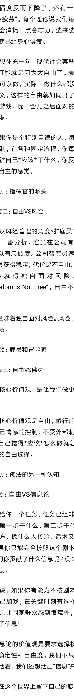

书名：被讨厌的勇气

作者：日本哲学家岸见一郎和作家古贺史健

简介：这是一套强人的生活哲学。

出版日期：中文版2015，英文版2018

## 一条强人路线: 自由-幸福-进步

先要有自由。自由前提下的幸福才是真正的幸福。当你知道什么是幸福的时候，你就知道人应该怎么处理进步的问题。

## 一个关键思想: 都是你的选择

阿德勒认为，你的生活模式，完全是你自己选择的结果。与其他人、与以前发生过什么，都无关。

## 自由

+   1. 康德哲学的自由观：自由就是不受驱使。既不被别人驱使，也不会被自己的欲念驱使。换句话说，就是你不能是一个工具。

不自由的四种状态：

+   *极端不自由——生存
*被钱收买——利益和贪婪
*被感情驱使——感情
*被同理心绑架——同理心

康德把所有这些能牵着你走的力量叫做"inclination"——倾向性。出于倾向性而做事的行为叫做"假设命令（hypothetical imperative）"，凡是出于倾向性的，就都是不自由的——也是不道德的。

道德得是"绝对命令（categorical imperative）"，得是无条件的。仅仅是出于*义务*，我认为这件事应该做。这才是真正的道德。这才是真正的自由。

+   2. 阿德勒哲学的自由观：最能直接驱使我们的，是别人的*认可*。如果你处处为了别人的认可而活，你就处处受到驱使，你就是不自由的，你就会很难受。真正的自由，是在人际关系中获得自由。

被认可驱使的人：

+   爱跟人比较
爱跟人炫耀

+   3. 获得自由的途径：建立横向的联系。如果你是个真正信奉自由、相信人人平等的人，那你对其他人的行为既不应该批评，也不应表扬，表扬和批评都是 judge。别人做对了你可以表示感谢，别人做得不对你可以帮助他，但是你不能操纵他。

链接一：自律vs自由

"自律 = 自由"——你为了获得真正的自由，就非得给自己设定一些限制。所谓"真正的自由"，也就是财务自由、时间自由、免于疾病和贫困的自由，为了达到这样的目标你必须自律才行，这个道理很明白。

不过今天的自律也不一定非得是为了"将来"的自由——那岂不是成了无限推迟自由了吗？德里达在书里还对"自由"有另一番解释。我们平时所说的自由，比如说想要什么有什么，想做什么做什么，这个其实有两个弊端，不是真正的自由。

一个弊端是"选择悖论"。你面临的选择太多，你就容易挑花眼，根本不知道选什么好，幸福度反而下降了。还有一个弊端是"决策疲劳"。有个理论说我们每一次做决定都会消耗一点意志力，选来选去什么都做不了就已经身心俱疲。

这里我想补充一句，现代社会某些人得抑郁症，可能就是因为太自由了。表面上看什么都可以做，实际上做什么都没意思，也没意义。这样的自由就如同开了作弊码打电子游戏，玩一会儿之后面对的就是无尽的空虚。

可是如果你是个特别自律的人，每天面对各种限制，有各种固定流程，你每时每刻都*知道*自己*应该*干什么，你反而获得了一种自主的感觉。

截此回顾：指挥官的派头

链接二：自由VS风险

塔勒布从风险管理的角度对"雇员"这个身份做过一番分析。雇员在公司有利差相关，所以有忠诚度。公司替雇员遮挡了风险，雇员获得稳定，代价是不自由。想要自由，你就得独自面对风险。所以说"Freedom is Not Free"，自由不是白给的。

自由，意味着独自面对风险。风险，决定了你的气质。

截此回顾：雇员和冒险家

链接三：自由VS佛法

佛法的核心价值观，是让我们做更自由的人。

佛法的核心价值观是自由，修行的目的是不受自己情感的控制、不受外部刺激的控制，是自己觉得*应该*怎么做就怎么做，是自己的自由选择。

截此回顾：佛法的另一种认知

链接：自由VS信息论

上级交给你一个任务，任务已经非常明确告诉你第一步干什么、第二步干什么、到什么地方、找什么人接洽、话术又要怎么说。如果你只能完全按照这个脚本执行任务，请问你贡献了什么信息呢？没有。你没有自由度。

反过来说明，如果你有能力不按脚本走，你敢给自己加戏，在关键时刻有选择权，你做的事儿让周围群众感到很意外，你才算是留下了信息！

所以信息论的价值观是要求选择权、多样性、不确定性和自由度。我们不只想老老实实地活着，我们还想活出"信息"来。

我们想在这个世界上留下自己的痕迹。

信息就是意外。从"信息论"这个维度出发，有两种事情是特别值得我们去做的：

+   • 出乎别人意料的事；
• 给自己增加选项的事。

做事出乎意料，你做的这件事才值得被记住。有更多的选项，你才有能力做出乎意料的事。有选择权的人也可能故意做一些可预测的事来促进交流和合作——但只要你真正的拥有选择权，那就不管你选了A还是选了B，都是真的信息。选项 = 自由度。

截此回顾：一个基于信息论的人生观

## 幸福

+   1."幸福是比较出来的"——比赢了的确能得到幸福感，但是这种幸福不自由。对此，人们发明了两个应对策略：假装幸福和消极幸福。

+   2. 阿德勒提出的幸福，来自人际关系的高级状态，叫做"共同体感觉"。幸福就是你出于对社会的关心，作为共同体的一员，积极参与其中，找得到归属感。幸福来自贡献。

+   3. 幸福不是由具体贡献的大小决定的，而是由"贡献感"决定的。算贡献的大小，那是*行为标准*，中国话叫“论事不论心”，而“贡献感”，则是*存在标准*，中国话叫“论心不论事”。

是由于“贡献感”决定的。算贡献的大小，那是*行为标准*，中国话叫“论事不论心”，而“贡献感”，则是*存在标准*，中国话叫“论心不论事”。

4.贡献感不在于行为的结果：你认为你做出了贡献，你就做出了贡献。

5.贡献感不在于和大小：你不需要达到一个客观标准。你不被外界东西牵引。

6.贡献感可控：你不被内心某个永远不可满足的欲念驱使。

链接一：回忆的幸福和经历的幸福

+   • 如果你想取悦将来的叙事自我，那就去大胆尝试新事物、多做主动的事情 — 你会觉得人生很有意义。
• 如果你想要的是此时此刻的幸福，那就不另当别论。
• 考虑到人至少有两个自我，那么人到底应该追求长远的意义，还是应该活在当下，这个问题似乎并不简单。

截至回顾：回忆的幸福和经历的幸福

链接二：契克森米哈赖的幸福课

在契克森米哈赖看来，心流其实是一个生活方式 — 而且是最高级的生活方式。你想幸福吗？追求心流。

心流只是一个方法，它背后更大的逻辑是，你要通过锻炼控制自己的意识，去获得真正的幸福。

链接三：幸福和欢迎度

+   • 要帮助别人，而不是只顾自己的需求；
• 要关注别人，而不是只想要被关注；
• 要精心培养深入的关系，而不是收集更多的朋友圈“点赞”；
• 要让别人感受到接纳和欢迎，而不是自己感觉高人一等。

链接四：使命和幸福

## 应用

1.做到认真：认真不等于深刻，人生没有必要深刻 — 认真就行了。如果你不能认真地活着，永远都在路上，永远都不喜欢当前的自己，那你真的可能一辈子都不会得到幸福。认真，是最基本的状态 — 是对自己的态度。

2.课题分离：每个人都有自己的课题，你只要为自己的课题负责，而不要干涉别人的课题。一切人际关系的矛盾都起源于对别人课题的妄加干涉，或者别人干涉了你的课题。

金句

弱者很善于把过去的不幸和性格的缺陷当做武器使用。他会抱怨这些不幸和缺陷，但是他*需要*不幸和缺陷。他拒绝改变。


日课精选

## 问答：“幸福”和“乐趣”是两回事

问答：“幸福”和“乐趣”是两回事...

来自日课：幸福=贡献感

读者 Jin777571：

如果只是个人的行为，比如征服了一座高山，解答了一道花了好几天没解决的数学题，吃了自己做的好吃的食物等等，这些事情中并没有贡献存在，也会产生幸福的感觉，类似的事情是不是不能用贡献感来解释？

读者 LJ：

贡献感由于很主观，会不会这个人自我感觉良好，自我的感觉很幸福，但其实周围的人却视之为异类呢？

读者二：

贡献感是不是也是跟贡献的大小有关呢？一个微不足道的贡献肯定不如一个很大的贡献产生的贡献感大吧？

万维钢
阿德勒认为烦恼的根源和幸福的来源都是人际关系。我理解他说的这个“幸福”，和我们平常说的“乐趣”，是两回事。一顿好吃和一个好电影能给我们带来乐趣和满足，但不是阿德勒说的幸福。我认为这样分类是有道理的，幸福应该是各种感官乐趣之外的东西，否则你无法解释一个物质生活和精神生活都很有富的人为什么还会感到抑郁。

数学家田刚曾经说过解决一个数学难题的乐趣，我记得他说的好像是“会当凌绝顶，一览众山小”那种感觉。这是一种非常强烈的愉悦感。但我想解决问题瞬间的这个愉悦感，仍然是一种“乐趣”。我们不是数学家，但我们平常解决一个什么难题，甚至打游戏，也能获得这样的乐趣。

那幸福是什么呢？如果你不仅仅是解决了一道难题，而且你知道这件事情除了给你带来乐趣之外，还有它的*意义*，那你应该能感到幸福。我想这个意义就应该是你为数学做出了什么贡献。

读者 博小群：

万老师，你好，我是一名医生，我正式工作快5年了，每天需要给大量的病人做检查，我刚开始工作的时候每天都很开心，就跟打了鸡血一样，现在的我依旧会好好对待自己的每个病人，认真负责处理每件事情是我对自己的要求，虽然我能帮患者解决问题，可是我明显感觉自己的态度大不如前，也没有以前那么开心，是因为我没有奉献精神吗？

读者 Aquapiranha：

理论上是完全主观，然而事实上是，比如作为护士的话你是从众护士之一，大家做的事情都一样工也都差不多（少），根本不缺你一个，或者有同事偷懒把活都推给你，请问你如何有贡献感？或者，你明明做事不如人家利索贡献不如别人，如何获得自己的贡献感呢？

万维钢
成长、自由和幸福是三个不同的维度。医生和护士责任重大而且工作非常繁重，贡献感肯定是充足的，但是可能自由感比较小。刚开始于主要体验贡献感，时间长了可能会觉得很不自由。

读者 Vincere_肖涵哲：

对于幸福度感觉不高的长辈，应该怎样更好地引导他获得幸福？

万维钢
我感觉长辈们最需要的是“控制感”。我以前听说一个实验研究 [1] 是这样的。心理学家组织大学生志愿者去养老院探望老人。对第一组老人，志愿者给他们提供了一定的控制权：老人可以决定志愿者每周来探望几次，每次什么时候来。第二组老人没有这个权利，志愿者自己想什么时候来探望就什么时候来。

干扰子女的生活也是可以理解的 —— 工作上的事儿都不让他管了，如果家里的事儿也不让管，他们的参与感、贡献感从哪来呢？我们可以把老人都当做老领导，没事儿请示请示，你听不听无所谓，但是要做出听话的样子。

来自日课：怎样不做“必须做的事儿”

读者 顺其自然：

前段时间我女儿学校老师要求背一篇古文，前几天让她背诵总是拖拖拉拉背不过，但是到最后一天晚上她也着急了，结果用了十几分钟背过了。我觉得是不是必须做的事到最后时间做才有效率，在开始时候做自己不愿意做的事情是低效率的呢？

万维钢

的确如此，而且在截止日期前夜工作有时候还能爆发想象不到的创造力。这似乎说明有时候光靠自律真不行，人非得被外界一个什么压力逼着才能前进。这只能说明我们毕竟不是圣人。

学者们建议的一个办法是自己给自己设定截止日期，但是把这个截止日期公布出去，逼着自己到时候必须完成。这样战略主动，战术被动，很健康。

参考文献
[1] 这个研究见于 Daniel Gilbert 的 Stumbling on Happiness 一书。

万维钢 · 精英日课³
帮你和全球精英大脑同步
版权归得到App所有，未经许可不得转载

日课精选

提交留言可与专栏作者互动

## 外星信号的思维模型

万维钢·精英日课³
今天

外星信号的思维模型

最近加拿大天文学家观测到了一组神秘的信号，很多HR怀却是不是外星人的信号。如果有关注了这件事，我相信你现在已经得出结论了，那根本不是什么外星人信号。不过我觉得还是值得在精英日课讲一期，我们可以从中体会宇宙学的视角。

宇宙学视角能让我们意识到思维的局限性。老百姓讨论国与国关系，总爱不自觉地用人与人的关系类比——日本是个死不认错的坏人，挪威用诺贝尔奖羞辱中国——其实国家是个复杂的共同体，不但是人而且不是家庭。同样道理，当我们谈论外星文明的时候，也总爱不自觉地把“外星”当做“外国”。

你必须充分理解宇宙有多么空旷，文明有多么罕见，才能意识到外星跟外国的区别。

怎么思考外星信号呢？首先你别搞科幻。有些科幻作家张口就说外星文明能超光速旅行，在我看来这是把外星人当成了无所不能的神，那你放飞想象就行——我们认为受限制条件下的推导才有意义。还是那句话，未经审视的思考不值得说出来。

### 1.事件

基本情况是加拿大一个新的射电天文望远镜，CHIME，上周观测到了13个“快速射电暴”信号。快速射电暴是天文学家还不能理解的现象，对应的天文事件是在几毫秒的时间内，释放出相当于太阳上百年释放的总能量。快速射电暴信号最早在2007年就已经被发现了，总共有过五六十次的记录。

CHIME这个发现的突出特点是，在这13个信号之中，有6个是发生同一位置，在距离地球15亿光年的一个地方。而之前的记录，只有两次快速射电暴是发生在同一地点。这给天文学家提供了一个解题思路，说明它背后是一个可以重复发生的物理过程。

到底是什么物理过程，我们不知道。可能是一个中子星通过一个布满等离子的强磁场区域，也可能是一个自带强磁场的星球的什么动作。科学家对这件事情特别感兴趣，完全是因为它是一个未知的物理现象。

最早可能是英国《卫报》先报道[1]，说哈佛大学教授阿维·洛布（Avi Loeb），猜测这个事件有可能不是*自然*现象，而是外星文明制造出来的。请注意这位勒布教授一贯爱好吹捧外星文明，有什么事儿他第一反应就是想这是不是外星文明。

但是这个猜测马上就被否定了。首先这不可能是哪个外星文明为了发信号而特意制造的事件。因为这么发信号太贵了！连我们人类都知道更省钱的发信号方法，外星人完全没有必要为了发这么短的信号消耗太阳级别的能量。

当然这种高能量信号有一个好处，就是传播距离非常远，以至于传到了15亿光年之外的地球。可这么远的信号有用吗？新闻刚出来的时坑网上这一片“不要回答！”的声音，但是你想想，那是一个发生在15亿年以前的事件！如果你要回答，就算不考虑宇宙膨胀的因素，也要再过15亿年才能收到。要知道15亿年之后地球已经不适合人类居住，人类文明就算还存在也可能不在这里了！

勒布教授想的可不是外星人发信号。他想的是这是否是外星文明在干些什么自己的事情——比如说爆发了战争？可能快速射电暴是什么大规模杀伤性武器造成的结局？

但是这也不可能。关键在于，我们收到的这几十个快速射电暴，是分布在宇宙的各个地方。这就说明它只能是一个自然现象，而极其不可能是人造的。

我给你打个比方。比如有个韩国的考古学家，在地里挖出来一块形状怪异、颜色质地都非常奇特的石头。大家都不理解这个石头是如何形成的，韩国网友就说这是我们祖先研制的东器，说说明我们韩国有一个伟大的远古文明！

但是紧接着中国的几个地方也发现了这样的石头，后来非洲、欧洲、美洲也找到了，它们分布在世界各地，而且还来自不同的地质年代……那你说这可能是什么远古文明的产物吗？难道伟大的远古文明到处都是，而且还都制作同一种石头吗？

所以严肃的科学家都认定这是一个自然现象[2]。之所以现在才发现，是因为快速射电暴的信号是处在频率几百兆赫的波段，以前的射电望远镜没有专注于这个频率。加拿大的CHIME是专门探测这种低频信号的，所以一搭建起来、现在甚至还没有满负荷运行，就已经收到了这么多。天文学家估计，很快这样的信号我们每天都能收到好几个！所以你想想这怎么可能是外星文明。

说到这里我倒是觉得“中国天眼”作为全世界最大的射电天文望远镜，居然让刚刚搭建起来的CHIME抢走了快速射电暴这个大功，非常遗憾。要知道天眼的设计中可是连几十兆赫的频段都能达到，而且天文学家早就知道快速射电暴是重要课题……如果天眼没做这个观测，我认为是决策错误。

### 2.怎样和外星人联络

一个有意思的问题是，如果我们想和外星人联络，或者探测一个外星信号，那么这种研究能有多靠谱或者说多不靠谱呢？

考虑宇宙的问题，你一定要知道两点：不管你怎么想，你都无法直观想象宇宙有多空旷；不管你怎么想，你都无法直观想象文明有多么不容易。我们以前说过“幸运是这个宇宙的通行证”，地球文明的出现是一个极度幸运的事件。

这就说明有文明的星球在宇宙中的分布是极其稀疏的。文明之间的间隔不是几光年，而是几十光年、几百光年，甚至是几十亿光年。

而在时间上，相对于宇宙137亿年的年龄，文明很可能只是昙花一现。我们用了30亿年才演化出今天的文明来，而我无法想象一亿年以后的地球文明会是什么样，很可能用不了几万年我们就消失了。

所以你想让两个文明在星际之间发生联络，那就是极其不可能的事情。

日常生活中没有这样的事儿可以类比，我只能强行给你打个比方。比如说，你的任务是在你结婚这一天，给一个刚刚获得了世界杯足球赛冠军的队员送花。这一天必须既是你结婚，又是他夺冠，你还得确保花要送到赛场。但是你既不知道世界杯足球赛什么时候举行，也不知道在哪里举行。

你唯一的办法就是在结婚当天，24小时不停地向你家附近各地的足球场送花。但是别忘了，即使你真的碰巧把花送到了世界杯决赛赛场，他的望远镜还不一定往你这个方向看——望远镜必须盯住一个小方向才能收到微弱的信号……

这件事情这么难，但是地球人的确考虑了。搜寻地外文明的代表人物是一位女性天文学家，吉尔·塔特尔（Jill Tarter），她长期担任搜寻地外文明计划（SETI）研究中心主任。

塔特尔是这么说的[3]：想跟外星人联络，你需要的不只是个几年、而是一个持续一万年的项目。你得在一万年内不断地向外发射一个稳定的信号——如果在你信号传播的范围内，正好有这么一个文明，它正好往你这个方向看了一眼，才可能收到。

当然《三体》的爱好者肯定反对这么做，担心外星人对我们使用“黑暗森林法则”。其实考虑到宇宙资源之丰富文明之稀疏，这个法则根本不成立——事实上近国与国之间都不是什么黑暗丛林。

不过别担心，现在我们还没有发射那种信号的能力，我们更关心接收信号，而这个项目搞不好也得持续一万年。

那收到什么样的信号，才算是外星文明而不是自然现象呢？第一它得有一定的规律性，得像是人做的。第二，它得是独一无二的，不能满天都是。

1967年，一个女研究生接收到一组来自宇宙深处非常有规律的无线电信号。这个信号相当整齐，就像你在野外捡到一块规则的球形石头，那你可能会觉得它不是天然形成的。但是研究者立即就否定了信号代表外星文明的可能性，因为他们一次就发现了俩！看看这么巧的事儿让你一下子找到两个外星文明。

现在我们知道那是自带强磁场的脉冲星高速旋转导致的信号，科学家称之为“脉冲星”。脉冲星满天都是，中国天眼也已经发现了好几个。

1997年，吉尔·塔特尔的团队曾经探测到一个非常整齐规则的信号，这个信号精确到就好比说你在野外捡到一块手表！他们非常激动，这只可能是人造的。结果发现的确是人造的——是地球人造的。当时有一个探测太阳的飞行器正好出现在那片区域。

现在还有一个候选者。2014年，开普勒空间望远镜发现了一颗叫做“塔比星”的恒星，这几年来持续的观测发现它的亮度在逐年下降。这非常奇怪，说明有什么东西在

年下降。这非常奇怪，说明有什么东西在遮挡它。通过各种光学分析，现在人们相信遮挡它的不太可能是星际间的气体、也不像是彗星，更不可能是行星，而是一个别的什么固体。

那就有人猜测，是不是外星人正在建造一个什么东西把塔比星给遮挡起来 —— 就好像我们以前说过的“戴森球”一样。

这的确是一个靠谱的可能性。但是，物理学家戴森本人对此不以为然 [4]，他认为那是一个自然现象。

为什么呢？因为戴森深刻地知道，发现一个地外文明有多困难。

## 3.新知识的罕见程度

没经历过社会的孩子很容易以为自己将来的结婚对象要么是霸道总裁，要么就是霸道总裁的女儿。人总是高估耀眼事物发生的频率。

人类知识的增长只能依赖科学发现，而突破性的发现可没那么容易。以我之见，人类知识更新可以分成六级，每一级的稀有程度都有十倍百倍的差异。

第一级是验证和澄清一个已有的理论模型。这是科学家的日常行为。

第二级是发现一个意外现象，用现有的理论模型解释不了，就像这次发现的快速射电暴。这是值得科学家们欢庆的大事件，因为他们知道不能天天都过节。

第三级是提出新的物理定律。这已经可以说是至高无上的荣誉。

前三级，是我们有生之年一定可以看到的科学进步。

第四级，是发现一个改变世界观的新现象。比如1998年天文学家发现宇宙正在加速膨胀，让我们对宇宙有了完全不一样的看法。像这样的事情你就不能指望在有生之年再遇到一次了。

第五级，是发现一个确定不是自然现象的宇宙事件，给外星文明的存在提供真正的证据。我认为这样的事儿可能几百年都不会发生。

第六级，是外星文明直接和我们联络。我认为这种事情极其不可能发生。

那下次听说外星人信号你应该怎么办？你得有点贝叶斯定理的精神。贝叶斯定理说

```
新概率 = 先验概率 × 新信息的调整
```

你要知道探测到外星文明的先验概率非常非常低！那么不管出现什么样的新信息，新概率都只能很低。这就好比你中大奖的概率是非常非常低的，如果哪天你的手机收到了一条中奖信息，你的理性判断应该是那是垃圾广告。

参考文献
[1] Mattha Busby and agency, Mysterious fast radio bursts from deep space ‘could be aliens’, theguardian.com, Jan 9, 2019.
[2] Don Lincoln, What explains the fascinating radio bursts from outer space, cnn.com, Jan 10, 2019.
[3] Jill Tarter, Are We Alone? 52-insights.com, Aug 17, 2017.
[4] Freeman Dyson, "I kept quiet for thirty years, maybe it’s time to speak.", 52-insights.com, June 15, 2018.

## 《分工与贸易》1：经济学是科学吗？

《分工与贸易》1：经济学是·

今天开始咱们来系统性地学习一点经济学。我要用的这本书是卡托研究所的经济学家阿诺德·克林（Arnold Kling）的《分工与贸易》（Specialization and Trade: A Reintroduction to Economics）。这本书是2016年出版的，按精英日课的标准已经不算新书了，但是我们很需要它。

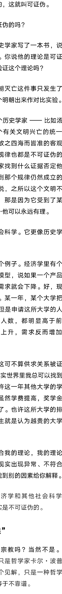

中美贸易战，中国说美国搞贸易保护，美国说中国干预市场，你怎么理解这些说法？国家经济下行，是应该让政府出手拉动一下呢，还是决绝相信市场？

你可能早就已经学习过经济学了，你可能已经有笃定的答案——可是不同经济学家有不同的答案。经济学是个非常特殊的学问。怎么才算学好了经济学呢？

首先你不应该仰望经济学，你得俯视。你不能今天赞美哈耶克明天就吹凯恩斯看着谁都是大师说啥都对，你要知道这两人的立场正好相反。其次你不能把经济学当宗教，你信仰这个教派我信仰那个教派搞“理念”之争。再者，我们也不应该把经济学当“成语故事集”，说各种学说都有道理听听就行。我们需要一个思路清晰、逻辑过硬的经济学课程。

而这正是克林写书的风格。我们专栏以前讲过他的《政治争论的三种语言》，他的思路很清晰，是个很逻辑的人。这本《分工与贸易》代表了一个正统经济学家的看法。过段时间我们还会讲女经济学家玛丽安娜·马祖卡托（Mariana Mazzucato）2018年的新书，叫《万物的价值》（The Value of Everything: Making and Taking in the Global Economy），那是另一个视角。

这录本书学下来，你就知道怎么用现代的方式思考经济学问题了。

克林这本书的立场是正统的，但是它的说法是新的。一般人讲经济学都是从稀缺入手，讲怎么把资源进行有效的配置。克林则是回归了亚当·斯密的传统，是从社会分工的角度来讲。

克林认为分工是经济学中最核心的概念。一说分工，你肯定听说过“比较优势”这个说法——一般的经济学家说到比较优势、赞美一下自由贸易，就把分工说完了。

那为什么在真实世界中，各国对自由贸易偏偏有这么大的争议呢？

我们要重点解决这个问题。我们不讲理念和信仰，我们回归第一性原理，把经济学当做一门科学来捋一捋。

但是首先我们要问一个比第一性原理更基本的问题——

## 经济学是科学吗？

### 1.社会科学与自然科学的区别

最近几期《罗辑思维》在讲科学哲学，咱们得到的读者应该很熟悉，“可证伪”的学说，才能是科学。爱因斯坦说引力场能让光线弯曲，这个命题对不对你可以通过实验观测证明。如果观测结果和理论相反，理论就是错的，这就叫可证伪。

那社会科学是可证伪的吗？

比如说，有个历史学家写了一本书，说明朝为什么会灭亡。你说他的理论是可证伪吗？你能做实验验证这个理论吗？

答案是不能。明朝灭亡这件事只发生了一次。你不能再弄个明朝出来作对比实验。

事实上，哪怕有个历史学家——比如汤因比——弄了一个有关文明兴亡的统一理论，号称发现了放之四海而皆准的客观规律，这个所谓的规律也都是不可证伪的。不管别的历史学家找到什么证据否定他的规律，他总能找到那个规律仍然成立的各种解释。他可以说，之所以这个文明不符合我的兴亡规律，那是因为它受到了某某种因素的影响……他可以永远有理。

经济学是一门社会科学。它更像历史学，而不是物理学。

克林举了这么一个例子。经济学里有个最简单的供求关系模型，说如果一个产品的价格上升，那么需求就会下降。好，现在有个真实的事件。某一年，某个大学把学费提高了17%，但是申请这所大学的人数和最终被录取的人数，都明显高于前一年。为什么价格上升，需求反而增加了呢？

经济学家会说，这可不算供求关系被证伪了——因为在真实世界里我总可以找到别的影响因素。也许这一年其他大学的学费也提高了。也许虽然学费提高，奖学金的力度也大幅提高了。也许这所大学的排名提高了。也许学生就是认为越贵越好。

反证如果现实符合我的理论，我的理论就被证实了；如果现实出现异常、不符合我的理论，我总能找到别的因素给予解释。

所以克林说，经济学和其他社会科学一样，它的命题其实是不可证伪的。

### 2. “解释性框架”

那你说经济学是宗教吗？当然不是。所谓“可证伪性”只是哲学家卡尔·波普尔对自然科学的一个见解，只是一种哲学思想。不可证伪不等于不靠谱。

波普尔之后还有个科学哲学家，托马斯·库恩，他提出一个概念叫“范式”。范式是科学家看待某个自然规律的集体眼光，相当于是一个信仰。范式很靠谱，但是范式不能被证伪。一个异常就可以立即证伪一条科学命题，但是要想改变范式，必须有很多很多异常才行——那不叫“证伪”，叫“科学革命”。

克林提出一个跟范式有点相似的概念，叫做“解释性框架（interpretive framework）”。克林说经济学里的各种模型，并不是可证伪的科学命题，而是解释性框架。

只要发现一个反例就可以立即证明一个科学命题是错的。但对于解释性框架来说，就算有一些反例，你也可以说是因为其他因素导致的，你不能立即推翻这个框架。

这可不是说经济学家比物理学家笨。这是由于经济学研究的东西比基本粒子要复杂得多！这有两方面的原因。

第一，经济学事件里实在有太多的影响因素了，你没有办法控制其他因素都不变，只看一个因素，然后去验证一个理论——真实世界不允许你做这样的实验。这就是为什么在我们刚才说的那个大学涨价的例子里你总能找到新的因素。

第二，经济系统会快速变化。你刚提出一个学说还没等验证呢，市场的局面可能已经变了。

举个例子。经济学家乔治·阿克洛夫（George Akerlof）1970年提出一个模型，说二手车交易市场里根本就不会有好车——因为如果你这辆车没毛病是辆好车，你进二手市场会吃亏，还不如私下卖给亲戚朋友。阿克洛夫说二手车市场有个“信息不对称”的问题，卖家没法知道一辆车到底有没有毛病，只能默许都有些毛病，所以必须压低价格。

阿克洛夫因为“信息不对称”这个模型获得2001年诺贝尔经济奖。可是他这个模型对吗？现在在互联网时代，二手车交易市场已经变了，人们发明了各种办法来确保二手车的质量！

那你能说这个得了诺贝尔奖的学说被证伪了吗？不能。作为一个解释性框架，“信息不对称”这个理论肯定是有道理的，一两个异常事实并不会让学者弃它。阿克洛夫完全可以说二手车市场虽然变了，但是别的市场中仍然存在信息不对称的局面。

### 3.怎样看待社会科学

因为这个不可证伪性，社会科学领域更像是一个江湖，而不是奥运会赛场。参赛选手不会认输。

对一个社会现象，各路学者往往会提出各种大相径庭的解释性框架去解释它。比如说，现在各国普遍存在男女收入水平不一样的现象，这你怎么解释呢？

经济学家可能会使用“人力资本”这个框架。他可以说这是因为男女在对工作的投入度不一样，工作产出不一样。男性干的多，所以男性自然工资更高。

而社会学家则可能用“性别歧视”这个框架。他可以说现实是男女同工不同酬，是因为人们传统上就歧视女性！

哪个解释对呢？我们可以考察具体的数据。如果数据显示男性在学历、工作能力、工作时间方面确实要比女性普遍更高一些，而且最危险的工作、最低端的工作也都是男性在做，那似乎就说明经济学家说的对，社会并没有歧视女性。

而如果数据显示在男女工作水平、学历等各方面因素都一样的情况下，女性的工资还是比男性低，那就说明社会学家说的更有道理。

好，现在假设事实明显倾向于一方。那么当你把数据摆在双方面前的时候，你猜，不被你的数据支持的这一方，会不会立即放弃自己的理论呢？

不会的。哪怕事实对他不利，一个学者也不会放弃自己的学说。他总能像我们前面说的那样，找到各种理由说明他的理论仍然是对的。

你几乎不可能说服一个研究社会科学的学者改变想法。他提出的学说是他在学术界安身立命的根本，就好像是他的孩子一样，那是绝对不能轻易认错的。

解释性框架不会被一两个事实击垮。这就是为什么至今我国还有很多人相信早被绝大多数经济学家认为不行的经济理论。

那你说难道社会科学就不分对错了吗？也不是。社会科学是一个拼人气的地方。如果有大量的事实都说明一个解释性框架不对，学者们 —— 特别是新来的学者们 —— 就会慢慢抛弃这个旧框架，改为支持新的框架。这个过程是逐渐的。

我来套用一句名言 —— 老的解释性框架不死，只是逐渐凋零。

这一讲我们解决了如何看待社会科学 —— 特别是经济学 —— 的问题。当一个经济学家说这是是什么什么什么，应该怎么怎么样的时候，你得知道 ——

第一，它并不是一个可证伪的科学理论，而是一个解释性框架。所以当你想到一个反例的时候，不要轻易否定这个理论。你要先想想在这个理论的假设因素之外，还有没有别的因素影响了事情的结果？

第二，有个心理学现象叫“确认偏误”。一般人都有这么一个倾向：如果有一个事实是你那个理论的反例，那肯定是你的理论错了；而如果有一个事实是我的理论的反例，那我肯定能“解释掉”这个反例。

“解释”不是不行，但是你最起码也应该给别人解释的机会。

第三，有句名言是这么说的：“相信那些寻找真理的人，怀疑那些宣称自己已经找到真理的人。”

> BELIEVE
THOSE WHO
ARE SEEKING
THE TRUTH.
DOUBT
THOSE WHO
FIND IT.
— ANDRÉ GIDE


万维钢·精英日课³
帮你和全球精英大脑同步
版权归得到App所有，未经许可不得转载

日课精选

提交留言可与专栏作者互动

## 《分工与贸易》2：工程师思维和生态学家思维

《分工与贸易》2：工程师思... ↓

罗胖在跨年演讲中引用了查理·芒格的一句话：“宏观是我们必须接受的，微观才是可以有所作为的。”所以我并不认为学习经济学能给人带来经济收益。

下级军官没有资格谈论全球战略。那我们又不治理国家，学习经济学——尤其是宏观经济学有什么用呢？我觉得也许可以陶冶情操。爱因斯坦相对论对普通人也没用，可是世界上上有这么一个有意思的理论，你要是不知就很难受。另一方面，作为一个公民，我们有权知道经济是怎么运行的……再说也许你将来真的能去治理国家。

心理学比经济学更接近自然科学，但是在学科的鄙视链上，经济学的格调高出心理学。有些经济学家的思维方式还是挺酷的。

### 1.隐喻与模型

咱们先说一个有意思的思维误区。我们经常用打比方的方法说明一个道理，这无可厚非，但是其中有个问题。你会不自觉地陷到这个比喻里去，比喻有可能反客为主，你可能会被这个比喻牵着走。

比如说，物理学家经常说“时间箭头”，这就是一个比喻，它的意思是说时间的流逝有一个方向。但是箭头这个比喻难免会让人问一个问题：如果时间是一支箭的话，这个箭是谁射出去的呢？

这个问题好像挺合理，生活中的箭的确都是被射的。可是你别忘了，“时间箭头”只是一个比喻！这个比喻只是想说时间有一个方向，时间像箭但不是箭，它不需要被射！霍金已经证明了宇宙大爆炸可以永远无故地发生，无需箭头。

所以使用比喻要非常小心，别陷进去。特别是有些比喻是不自觉的……弗洛伊德就陷进去了。

弗洛伊德活跃的时代是一个机器的时代，那时候的人看什么都往机器上想。比如说，我们现在喜欢把人脑比喻成计算机，但是那个时代的人则喜欢把人脑比喻成发动机。

弗洛伊德自觉或者不自觉地，也总爱把人当成机器。弗洛伊德发明了一个概念叫“力比多”，是一种“性能量”。他认为人的性能量是可以积累的——就好比有一个封闭的容器，随着能量累积，其中气体的压力就会越来越大，就好像高压锅一样。那这个压力要是不释放的话搞不好容器就会爆炸。所以为了避免爆炸，人一定需要多种方式去释放性能量。

你看这个理论是不是听着特别合理。但是现代神经心理学家发现，人体根本就没有这么一个能积累性能量的机制。弗洛伊德用比喻把自己给绕进去了。

上一讲我们说到社会科学和自然科学有本质的区别，社会科学的理论都是解释性框架，这些框架很大程度上都是学者自己的选择。

弗洛伊德这个框架总爱用人在幼童时代的种种遭遇来解释人一生的行为。比如什么弑父情结、恋母情结之类，基本上一切都跟性有关系。这个解释性框架已经被现代学者抛弃了。

现代学者的新框架是进化心理学。我们不再从父母身上找原因了，改为从原始社会找原因。为什么人们这么爱吃甜食？因为原始社会没有什么糖，甜食很珍贵。为什么我们对陌生人充满戒意呢？因为原始社会大家都是生活在自己的小部落里，陌生人可能带来传染病。这个新框架也不一定就全对，但是肯定比弗洛伊德那一套高级。

现在回到经济学。二十世纪的经济学家，也总爱把国家经济比喻成一台机器。而当代的经济学家，也有了个新框架。

### 2.经济体是机器吗？

美国二战以后宏观经济学的祖师爷是麻省理工学院的保罗·萨缪尔森教授。你可能对萨缪尔森很熟悉了，他经常编写经济学教科书，还总在教科书中预言苏联经济将超过美国。苏联经济总也不超过美国，萨缪尔森就年年修改教科书……一直到最后他的预言还是失败了。

当然你不能说萨缪尔森主张计划经济，但是他的确认为政府对经济可以有很大作为。在麻省理工学院这一派的经济学家眼中，国家经济机器的首要问题是怎么优化关键资源的配置——而“优化”是个工程问题，无非就是搭建一个数学方程，然后找出最优解。

既然是机器，你显然可以调控啊。经济学家把国家经济想象成一辆汽车，不一定有刹车，但它有一个油门。如果经济发展放缓了，政府就可以踩这个油门。踩油门主要通过两个方式来实现，一个是增发货币，一个就是扩大财政赤字。总而言之，就是政府要通过增加总需求来刺激经济增长。

克林批评说，这种思路已经彻底忽略了劳动分工。它几乎就是假设所有生产者都在生产同一种东西，整个国家就是一个 GDP 工厂，你做什么工作都是为 GDP 做贡献。

可以说萨缪尔森是继承了凯恩斯主义，但是萨缪尔森加入了数学模型。用数学模型描写，经济学就更像自然科学了，你可以搞精确计算。

但是，经济学家内心深处都知道，那些模型都是大大简化了的，就好像玩玩具一样。不过在克林看来，真正的问题还不在于哪个模型不对，而是把经济看成一台机器这个比喻错了。

### 3.机器和互联网

如果你把国家经济当做一台机器，它就有这么几个特点——

机器只能有很少的几个功能。经济的功能大概就是提高 GDP、促进就业之类。

机器是由少数人设计出来的。那么经济也可以搞顶层设计。

机器的运行情况可以通过几个参数来描写，运行的好不好可以通过可见的东西进行测量来确定。那么看一个国家的经济，也主要看 GDP 增长率、就业率、厂商、原材料等等。

克林认为这个比喻已经把萨缪尔森那一派经济学家都给绕进去了，是个死胡同。更好的经济学比喻是把市场比喻成互联网——

互联网有很多功能，你可以在网上购物、娱乐、交流信息等等，有些功能是你想都想不到的。市场也是这样。

互联网特别讲究分工和合作，它从来不假定所有人干同样事，它是人们各自干自己的事、互相做交易的地方。市场也是这样。

互联网不是顶层设计出来的，互联网上有无数个参与者，每个人都可以为互联网贡献力量。市场也是这样。

还有一点，互联网上有很多无形的东西。互联网不仅仅是计算机和网线的集合，它还包括知识、数据和人与人的关系。

市场也是这样。评价一个市场的好坏，我们不能只看其中有多少机械设备、多少厂房和自然资源，还应考察市场中个人和集体的知识，还有社会规范、政府能力、教育水平等等。这些无形的东西，对经济有重大的影响。

咱们对比一下这两个比喻。把国家经济当做一台机器，这是工程师思维。它主张政府要干预，要人为优化，要精密计算数学模型。但模型可能是错的，特别是像苏联那样搞彻底的计划经济，把国家当成一个大机器去运行，带来的是严重错误。而且机器思维还容易忽略像金融之类无形的东西。

而把市场比喻成互联网——或者换个说法，把市场想象成一个热带雨林，则是生态学家的思维。热带雨林中生机勃勃的，各种各样的生物自由增长自由竞争自由淘汰，这是把市场当做一个能自行演化的东西。

生态学家思维的特点是不讲控制。你没法命令植物怎么生长，食肉动物多吃点少吃点。生态学家非常明白，任何单方面的强行干预都有可能导致完全意想不到的结果。


行干预都有可能导致完全意想不到的结果，所以就算你非常不喜欢毒蛇，也不能说就把毒蛇全杀死。生态学家追求的是生态平衡。

把市场当作机器的经济学家经常爱说一句话叫“市场失灵”。但是克林说，当你说市场失灵的时候，你说的其实不是市场，而是你的模型失灵了。

市场的确有出状况的时候，但市场的问题不应该由政府搞宏观调控解决，而应该由市场的参与者——也就是企业家们去自动解决。企业家可能会犯各种错误，但是政府会犯更大的错误。

你可能猜到了，克林应该是一个市场原教旨主义者，是哈耶克的传人。克林的确宣称自己是一个“自由论者”。

我们以前讲过，西方政治思想可以分成三派。“自由主义者”强调政府要在经济上有所作为，要给穷苦人提供福利，要干预和限制大公司，但是要求政府对人们的社会生活不加限制。“保守主义者”强调传统价值，要求政府在社会生活方面搞爱国主义，但是在经济上倾向于让公司自由运行，只是对外强调本国利益。

大多数现代经济学家都是“自由论者”，不过一般不会像哈耶克那么极端。自由论者认为政府应该最小化，什么问题都让市场自己解决，尽量让社会自行演化。克林宣称自己是一个自由论者，但是我们后面会讲到，他认为政府有政府的职责，只不过这个职责并不是让政府直接干预市场。

我们讲这些东西并不是为了赞扬哪一种思想。人没必要自己给自己贴标签，你完全可以在扶贫事业上做自由主义者，在文化事业上做保守主义者，在经济生活中做自由论者。我们关心的是这些思维有没有合理性。

在我看来，从把经济比喻成一个机器，到把市场比喻成一个生态系统，这是一个非常积极的思维升级。我们以前讲过系统思维，好系统有三个特征：抗打击、自组织、以及中央控制和子系统自治要有一个平衡关系——这三个特征明显更符合生态系统的特征。

就算你完全不接受生态学家思维的经济学，我想你至少可以体会到这一讲之中思维方式的妙处。

使用比喻有助于我们交流想法，但是你容易把自己也绕进去。而反过来说，好的比喻，在把你绕进去的同时，还真能给你带来启发。

所以比喻是一把双刃剑，得看你会不会使。用不好容易伤了自己，但越是这样的武器用好了就越厉害——当然，这句话本身也是一个比喻。

# 《分工与贸易》3: 国家不是家庭，公司不是市场

《分工与贸易》3: 国家不是...

我国有个说法叫“西方经济学”，在我看来这就如同把现代医学称作“西医”一样。经济学的确不是一个天下统一的理论，但是现代经济学家在一一些重大问题上是具有共识的。

最大的共识就是市场。经济学家非常相信市场的作用，而外行总是猜测也许还有比市场更好的办法。那是不是说这些经济学家都被西方那一套给洗脑了呢？如果相信市场是不是一种执念呢？是不是盲目的信仰呢？

这一说我们从第一性原理出发，看看为什么非得靠市场。我们不能单纯说“市场就是好”，要知道世界上确实有一些看起来比市场更美好的分工协作方式。

# 1.国家不是家庭

每个人心目中都有一个大同社会的梦想。我们希望所有人各尽所能、充分自由，一起为集体贡献力量，而不是赤裸裸的金钱关系。这个梦想并非是空想，其实它符合人的本性。

家庭内部就是个大同社会。在家里我们一向都是各尽所能按需分配，根本不计较什么谁挣钱多谁不挣钱。

# 2.国家不是公司

我听说中国有个互联网大佬提出一个观点，说以前搞计划经济之所以失败是因为信息不足，那么现在我们既然已经进入大数据时代，是不是就可以实行真正的计划经济。这个观点不能算离谱，有的一些经济学课程也说，那些想要搞计划经济的人是受到物理学成功的鼓舞，天真地想要去预测经济。

# 3.公司不是市场

好，那既然市场这么好，我们自然就会想，能不能在公司和家庭内部也搞市场呢？

比如说，孩子洗碗得到多少钱、写作业得到多少钱。一个公司可以开展各个部门之间、员工和员工之间的竞争，这行不行？这么做通常也不好。

我们知道经济学家科斯对此的答案是公司内部搞市场的交易成本太高。克林的说法是，公司和市场的本质区别，在于一个任务的价值是不是可见的。如果我们公司明确知道你的这个任务值多少钱，那就没必要把你变成我们公司的雇员，直接把任务外包给你是最好的办法。

公司内部往往是一个团队一起来做一件事，价值是配合出来的，你很难评估每个人带来的效益有多大。在这种情况下市场的作用就不大了，最好用指令分配任务。

现在我们总结一下。市场的确是现代经济学家的最大共识，但是这可不是说经济学家就执着地想要用市场解决所有问题。以我之见，用什么方法给人分配分工，是由经济体的“规模（scale）”决定的。大和小不一样。

如果是一个家庭，或者是一个十来个人的小团体，那你完全可以搞成温暖的小社区。大家各尽所能自由协作，不用谈钱也不用谁命令谁。但是你这样只能有简单的合作。

如果是一个公司，那么指令模式是最方便的。有中央计划，有上下级关系，由领导来分配任务。

如果是一个国家，在战争年代或者百废待兴的极端条件下，计划经济可以有很高的效率。但是要想让经济可持续发展，特别是要想有破坏性创新，就必须采用市场制度。

所以你看这里哪有什么“理念”、什么“意识形态”、什么执着？这就是具体问题具体分析，针对不同规模、不同复杂度的局面采用不同的策略。

事实上，世界上并没有哪个国家实行纯粹的市场经济或者纯粹的指令经济，都是不同程度的混合。美国政府也在通过监管和法规干预市场，那这种做法好吗？咱们前三讲说的都是基本常识，后面要讲的才是克林这本书的关键。

最后，以我之见，关于经济学，如果你只记住一句话，那就是“人会对激励作出反应”。而关于宏观经济学，如果你只记住一句话，那就是“国家不是家庭”。第一句话提醒你思考机制，第二句话提醒你思考规模和复杂度。有了这两个思考，你就不会犯大糊涂。

参考文献
[1] G. A. Cohen, Why Not Socialism? 2009.


## 日课精选

提交留言可与专栏作者互动

# 科学研究的商业模式是上头条

科学研究的商业模式是上头条…

今天是周末，我想说一个大问题。下级军官没有资格讨论全球战略，但我不是军官，我只是一个科学专栏作家。专栏作家这个工作特别好，我可以说任何我想说的事情。我想说说中国的科学策略。

我认为中国的科学策略需要升级。

中国一直都有技术策略，那就是要把国际先进技术消化吸收后为我所用。这个策略非常成功。但是，我们的科学策略可以说是极其失败的。这表现在改革开放40年以来，没有一项本土的研究得到诺贝尔奖。我们唯一一个自然科学的诺贝尔奖，还是屠呦呦在某个年代做的研究。

当然你可以说中国还正在发展之中，而且诺贝尔奖也不是科研唯一的追求。但是我也应该反思一下，为什么有些比我们要弱、比我们穷、比我们人少、平均受教育程度比我们低的国家，得的诺贝尔奖却比我们多？我认为根本原因在于我们可能还没有充分理解科学研究的商业模式。

# 1.我有

中国的科研政策有个潜意识，叫做“我有”。严重点说，叫做“我也有”。

“我有”，对中国曾经是非常非常重要的。核武器的全部成果就是“我有”。中国从来都没有使用过核武器，但是核武器在中国历史上起到了极其关键的作用。有，你就形成核威慑；至于说用不用，那不重要。

“我有”这个思维直接影响了中国的一切大科学项目，成了中国科学政策的DNA。卫星、载人航天、正负电子对撞机，我们的指导思想就是“美国有，我就要也有”。前段时间论证要不要建造大型对撞机，高能所所长王颀芬的说法也是“对撞机值不值”的决定取决于“中国究竟要做一个二流国家还是一个一流国家”。

那当然是“有”=“一流”。这个战略DNA在早期给你带来了巨大成功，你就会抱着它不放。

那好，现在中国进步了，可以说很多该有的都有。那请问中国在粒子物理学、宇宙学方面，取得了什么重大的发现呢？没有。

“我有”特指有设备——那是技术上的进步，而不是有科学成果。比最近发生的快速射电暴信号事件，我特别想知道，为什么加拿大的CHIME刚刚搭起来，还没有满负荷运转的情况下，一下子就能发现13个信号，抢占了全世界各大媒体科学头条，而中国天眼几年就搭建好了，却能保持沉默。

天眼的设计规格已经包括快速射电暴的波段。有人说天眼之所以没发现，是因为没有在特定的时间往特定的方向看，我认为这不是理由。天眼在设计论证的过程中、包括中科院计算所说要给天眼提供支持的时候，都提到了快速射电暴。设计者完全知道天眼应该探测快速射电暴。

国人在“没有”的年代，都能以八路军小米加步枪敢打日本正规军为荣，现在别人没有的我也有了，却让加拿大人抢了先。这可能是因为决策者优先做一些保险的研究——比如天眼找到了几十颗脉冲星。可脉冲星对现代天文学家来说是寻常的东西，找到脉冲星只能说明你这个设备的好设备而已！

这个情形就如同中国投入很大资源铸造一把高级的宝剑。为了证明它的确是好剑，找了一些小动物来试剑，以便于确信“我真有”。加拿大人也铸造了一把宝剑，性能不如中国那把，但是加拿大人宝剑刚出炉、连剑鞘都还没装好的情况下，拿起剑来就猎杀了一头怪兽，立即成名。

# 2.是我

最近嫦娥四号成功登陆月球背面是一个绝对的壮举。我在微博 [1] 听说，设计者曾经设想“为了稳妥见面，让嫦娥四号不要节外生枝，和嫦娥三号一样平缓落在月球正面刷个存在感就好”！是探测器总指挥叶培建院士力排众议，坚持挑战月球背面。

叶培建说“先不要讲什么科学意义、技术带动，单从科学上看，落到月球背面的科学意义就是一句话：背面没去过！”

我认为这是中国科学史上的重大突破。这不是“我有”思维，这是“是我”思维。最先把探测器降落在月球背面的是谁？是我。

中国的整个科研策略都应该从“我有”思维转变为“是我”思维。

这个转变肯定不容易。载人航天项目备受赞美，技术策略非常成功，这当然是扬我国威，甚至还可以说是开疆拓土，但这不是科学发现。我们可以对比一下，现在美国在航天事业上的投入不足，重返月球遥遥无期，但是NASA每一个科学发现都是全球性的大新闻。是谁第一个发现火星上有水？是谁拍摄了冥王星的清晰照片？不是我们。这些探测需要的资金远远不及载人航天，但是它们刷新了人类对太阳系的认知。

现在嫦娥四号，很难说刷新了我们的认知。月球背面的第一张照片是苏联太空船1959年拍摄的，中国探测器登陆的确是首次，但是登陆之前每一条陨石坑都已经被人命名完毕了。有关月球的知识，没有哪一个，“是我”第一个发现的。

在“我有”和“是我”之间，我感觉中国科学决策者很矛盾。潜意识想要的仅仅是“我有”，但是也不希望单纯搞个行为艺术，所以也在尽可能地搭载一些科学探测项目。当然，嫦娥四号除了玉兔二号互相拍之外，还专门搭载了一个低频射电谱仪，准备利用太空无大气的环境进行低频射电天文观测 [2]。

这样的观测无疑是很有价值的—但是，如果你真的想要搞外太空无线电天文观测，直接发射一个探测卫星，是比登陆月球更简单、更省钱、特别更是耐用的办法！

我不是反对“我有”，我希望中国什么都有。但是真正的科学研究，不能都当“我有”的副产品。那样我们可能会误以为“我有”就算我们搞过科学研究了。

# 3.基础科学的商业模式

除了用“我有”之外，我们可能需要重新思考，中国搞基础科学研究的目标到底是什么。

科学跟技术最大的区别在于科学研究没有直接的经济价值，是纯花钱的事儿。表面上的说法当然是科学研究是为了给人类做出贡献，同时还能培养人才，还能拉动相关领域的技术进步。但是在科研工作者的实际操作中，科学研究的首要目标却变成是发论文。

有论文就有资历，有资历就可以评职称和申请更多的科研经费。这个发论文的商业模式是中国科学缺乏明确目标的结果。因为没有明确目标，中国科学家的公众形象有点怪—人们希望他继承两弹一星的精神去无私奉献，希望他纯粹出于兴趣而钻研，希望他没有功利心，同时又希望他能过好生活成为青年的榜样。

美国的科学研究有明确的目标，那就是声望。各个大学和研究想要的不是发多少篇论文，而是实实在在的声望。

科学研究的声望，来自独一无二的、值得上新闻头条的重大发现。名校之所以是名校不是因为名校学费贵，而是因为最厉害的发现是在那里做出来的。

美国科学家有非常强烈的竞争意识。他们会为了抢先在一个热门课题中取得突破而拼命工作，因为他们知道声望属于第一个发现者。他们不是刷存在感，他们不是在制造论文，他们是在制造新闻。

这是不是太功利了？功利就对了。把功利理顺，才是好的商业模式。有了好的商业模式，中国的科学家就不会囿于发那些小论文，就会建功立业。

中国科学政策的现代化，应该致力于把科学家从论文制造者变成新闻制造者。看看当今哪些领域有可能取得大新闻级别的突破，想方设法做几个惊动海内的大事。评价项目成功的标准，就是看能不能让中国上头条。

事实上抢科技新闻头条比“我有”更能扬国威。美国NASA非常了解什么样的科学发现能提升它的声望，能带来更多的经费，能争取老百姓的支持：那就是有新闻价值的科学发现。NASA能让全世界的科学爱好者熬夜等着看它的发布会，它非常善于形象公关。

善于形象公关。

这几天有一个不幸的消息，两弹一星元勋，于敏先生，去世了。我曾经看过他的一个访谈，他说自己年轻的时候最喜欢的是理论物理，也想过去发现新的物理定律青史留名。但为了国家需要，于敏选择了隐姓埋名的核物理研究。

那一代人牺牲了自己，为国家解决了“我有”的问题。我们对于敏这样的人充满敬意。但是我总会忍不住想，什么时候人们能像看球星、看霍金、看乔布斯一样看于敏这样的英雄呢？中国科学家怎么就非得充满悲情呢？新的于敏应该上头条。

上头条需要运气、需要冒险、需要智慧和勇气 — 而这正是健康的科学家形象。

参考文献
[1] @东风快递员，新浪微博 1-7-2019.
[2] 新浪科技：玉兔二号着陆器互拍 看嫦娥四号在月背做的三件大事，2019年01月12日。

# 问答：“宇宙学思维”带给我们的5个生活观念

问答：“宇宙学思维”带给我们。

# 来自日课：外星信号的思维模型

读者 吴意祖 本人：

宇宙学思维到底是“幸运是这个宇宙的通行证”多一些，还是“我们并不独特”多一些呢？

万维钢

是“我们并不独特”多一些。“幸运”是一个主观的评价。如果你非要生命出现，还非得定义像人这样能改造世界的叫高级生命，细菌那样只能算低级生命，那的确，我们非常非常幸运。茫茫宇宙之中能找到一个正好适合液态水常常存在的宜居星球就已经很不容易了，在其中演化出生命来，再演化出高级生命来，这种高级生命还能长期发展形成文明，这中间不知道要经过多少无比幸运的巧合。由此我们得知：宇宙中文明的分布必然是非常非常稀疏的。但是如果我们因此而感到...  完全就不再关心地球以外的事情，那就不是宇宙学思维了。

# 来自日课：经济学是科学吗？

读者 晓添才：

经济学能改变世界吗？

万维钢

经济学非常能改变世界，问题在于是不是往好方向改变。

# 来自日课：工程师思维和生态学家思维

读者 Jacky：

万老师，桥水的达里奥就是把市场比做机器，而且他们公司是真金白银地按照这套模型做投资，收益还不错，您怎么看呢？

万维钢

# 来自日课：国家不是家庭，公司不是市场

读者 黄礼贤：

老师曾说：“治大国如烹小鲜！”。但万老

老子曾说：“治大国如烹小鲜！”。但万老师在之前的专栏已经反驳过了，大了就是不同，治国怎能跟下厨一样呢？但在古代中国，是否还真可行，或者小国可否用类似家庭或公司的模式进行治理呢？

万维钢

从家庭、社区、村庄、县城到小国到大国，各个尺度的治理方式都是不一样的。老子说，“治大国若烹小鲜”，老子还说，最好都搞小国寡民，这两者本身就有点矛盾。

弗朗西斯·福山在《政治秩序的起源》这本书里列举了各种制度的演变，我看其中就伴随着尺度。一个制度只能解决一定尺度的治理问题。比如原始部落中，亲缘关系是最好的治理方式，凡事看血统，专门搞任人唯亲 — 也就是贵族统治 — 这没问题。贵族以自己的家族身份为荣，用荣誉感维持秩序。中国西周封建制度大约就是这样的形态。但是国家要变大，到战国时代就已经不能任人唯亲了。再大，就得是郡县制，等等等等。当然其中还跟生产方式、收税和练兵的技术升级都有关系。

有一个思路很有意思，有的人认为大国这种统治方式根本就不成立，应该回归原始社会，都搞成小国......我觉得这也是拒绝思考尺度问题的懒惰思维，这跟信仰乌托邦没有本质区别。

# 《分工与贸易》4:市场失灵和政府失灵

《分工与贸易》4:市场失灵和...

今天咱们继续讲克林的《分工与贸易》这本书。我理解“西方经济学家”和“东方经济学家”最大的立场差别，是政府应该在国民经济生活里起到一个什么作用。到哪里事应该交给市场，哪些事应该让政府解决呢？

要实事求是地讨论，首先你不能把这个问题上升到意识形态的层面。你不能说支持政府出手就是爱国，反对政府干预、让市场解决问题就是受了西方经济学的洗脑。为了防止这种偏见，咱们今天凡是提到政府，都特指美国政府。

美国政府也干预市场，而且有很多错误的干预。政府干预可以分微观和宏观两个层面。宏观上的干预方法是诸如增加货币或者财政赤字去间接影响全国经济，这个咱们后面再讲。微观上的干预，一般是政府想要影响某一个产业的发展。

# 1.市场失灵

经济学家在直觉上，总希望凡是能让市场解决的问题都用市场解决。如果你说这个问题市场没解决，经济学家很可能告诉你那是因为在这个问题上市场化的程度还不够。

比如说沿海有一片渔场，如果渔民们随意在这里捕鱼，很快鱼就都被捕完了，这显然是不可持续的，你怎么解决这个问题呢？

这就是所谓的“公地悲剧”，每个参与者做对自己最有利的事儿，受害的却是所有人——包括那些没有参与捕鱼的人。在经济学家看来，解决这种问题最简单的方法是私有化。

人们之所以在这任意捕捞不管不顾，是因为渔场是无主的，等于说有便宜不占白不占。但如果渔场是我家的，那就好了。捕鱼得给我交钱，我看鱼少了就可以涨价，鱼多了还可以降价。我一定会确保这个渔场可持续发展，因为你眼中的绿水青山，是我家的金山银山。

在某些极其相信市场力量的经济学家眼中，政府根本就不应该参与经济活动，私有化是解决公共问题的最好办法。但是世界上可能只有经济学家这么喜欢私有化。有些东西真的不能私有化。

空气能私有化吗？我们不可能允许哪家公司拥有全国的空气，然后大家给他付钱。你大概只能把空气交给政府管理。如果哪家炼钢厂造成空气污染，应该让政府跟它打交道。

这样的事情就叫做“市场失灵”。市场的作用是让人对价格激励做出反应，使得好的产品越来越多，不好的产品越来越少。所以市场失灵，就是个人对激励做出的反应与公共利益相反。市场失灵的表现是市场上生产了过多或者过少的某种产品。

比如说，对钢铁厂来说，如果它不用为空气污染负责，它就会只在乎钢铁市场的需求，那么结果就是如果考虑到空气污染，钢铁被生产得太多了。这种情况下让政府出面用法规限制企业排污，就是可能是必要的手段。

再比如说你需要保安服务。让一户人家自己出钱雇保安太贵了，如果没有人组织，我就会有太少的保安服务——市场失灵。而如果有人组织一下，强制要求每家每户必须交物业费，整个小区一起出钱来雇几个保安，这件事就完全可行。往大了说，这种强制收费的行为，就是政府行为。警察和军队服务，只有让政府去办。

那要这么说的话，政府真正应该出手的时候应该是市场失灵的时候。但是在真实世界中，政府可不仅仅在市场失灵的时候出手。

# 2.为什么政府能推动金融危机

克林重点举了2008年金融危机的例子。政府的一些政策对金融危机起到了推波助澜的作用。

我们知道2008金融危机首先是由房地产市场的次贷危机引发的。现在回头看危机发生之前的情況，至少在两个方面，政府行为很不正常。

一个是当时大量购房者的负债水平已经非常高，可是政策制定者居然还希望银行在发放贷款的时候能够更宽松一些，再让更多的人去买房。

另一个是当时很多购房贷款被证券化，然后层层转包，这个情况已经很严重，可是政府监管部门似乎并不觉得挺好。

如果政府发现什么指标偏离平衡了，难道不应该设法把它调控回来吗？政府为什么还要往火上浇油的方向去推动呢？

一个解释是，情况到底严不严重，在你身处历史现场的时候是看不出来的。政府没有办法判断现在市场是不是失灵了。也许政府之所以这么推动，是希望造福于民，想让更多的人拥有自己的住房。

但是克林对这个解释非常不以为然。克林说为什么让老百姓有自己的房子就叫做造福于民呢？租屋不挺好吗？事实上，我拥有自己的房子，对我自己来说不一定有多大好处——而对别人、对社会来说，几乎可以肯定没什么好处。更何况这么多人贷款买房，整个社会的负债率非常高，这怎么是好事呢？

# 3.公共选择理论

单纯的经济学解释不了政府的这种行为，必须考虑政治因素。为此有个专门的理论，叫“公共选择理论”。公共选择理论认为，政府干预经济，很多时候并不是为了解决市场失灵的问题，而是在为特殊利益集团服务。


提升房价。克林说，这些人构成了华盛顿最大的游说势力！政府的房地产政策，在一定程度上是为这些人服务的。

凡是这种一手补贴、一手限制市场准入、从而导致涨价的政策，可以说全是恶政。

比如教育。为什么美国大学的学费高涨？一个重要原因就是政府一方面给大学生提供了低息的学生贷款来补贴需求，另一方面又对办学搞各种限制。

医疗更是这样。美国政府对医生这个职业设置了极高的准入线，对新药上市设置了极其严格的门槛，这就是限制供给。而与此同时，政府还给老年人和穷人提供免费的医疗保险，这就是补贴需求。结果当然是看病越来越贵。

当然，这些政策在名义上都可以说是为了人民。难道对医生和新药不应该严格要求吗？难道政府不应该提供医疗保险吗？有道理，但是如果政府完全不插手，也许市场能做的好得多。

没有政府插手的领域，市场总是让东西越来越便宜。政府插手，却有可能让东西越来越贵。

经济学家总是认为有问题最好让市场来解决。在市场失灵的情况下，也许政府应该干预。可是市场失灵又不好判断，那到底在什么情况下的干预是好的干预呢？

克林提出这么一个标准。如果做这件事对所有人的好处都差不多，而且人们讨价还价做这件事太麻烦，那么让政府做就是最好的。

比如说自来水。每个人都要喝水，而水源就那么几个，成立一堆小公司搞竞争很麻烦，干脆就让政府操办。

交通设施也是这样。每个人都要走路，城市里不可能每条路都设个收费站，所以让政府来修路是最方便的。

但是，如果做这件事只对一部分人有好处，或者对有些人的好处大，对有些人的好处小，而市场交易又比较方便，政府干预就没道理了。

用全体纳税人的钱补贴一部分人的住房，对其他人公平吗？用全国人民的钱建设几所精英大学，只有少数人能上，这对吗？

这些问题都是可以讨论的。我们学习经济学不应该执着于某个结论，而应该学习经济学家的思维方法。到底什么应该交给市场，什么应该交给政府，具体问题具体分析。但是市场失灵和公共选择理论这两个思路，对分析问题特别有用。


## 日课精选

提交留言可与专栏作者互动

## 最高学习效率 = 15.87%

最高学习效率 = 15.87%

今天咱们说一个特别熟悉的规律的新发现。这个发现是如此的重要，以至于我认为你应该永远记住它。我先说三个熟悉的知识。

### 1.熟悉

第一个知识是“学习区”。心理学家把我们可能面对的学习内容分成了三个区：舒适区、学习区和恐慌区。舒适区的内容对你来说太容易，恐慌区的内容太难，刻意练习要求你始终在二者中间一个特别小的学习区里学习——这里的难度对你恰到好处。

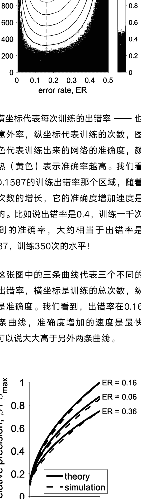

这个理论不可能—is错的。但是因为现在“跳出舒适区”已经成为了一句口号，有些人就产生了逆反心理，说我好不容易找到一个舒适区发挥特长，为什么要跳出来呢？关键在于这里说的是*学习*！也许你在舒适区赚钱最多，但那是另一回事——要想提高技艺，你就只能在学习区。

第二个知识是“心流”。这个概念最早是米哈里·契克森米哈赖在《心流：最优体验心理学》这本书里提出来的。契克森米哈赖说，要想在工作中达到心流状态，这项工作的挑战和你的技能必须形成平衡。他还专门用一张图说明这个道理——


如果工作的挑战大大低于你的技能，你会觉得这个工作很无聊。如果工作的挑战大大超出你的技能，你会感到焦虑。而如果难度和技能正好匹配，你一上来并不知道该怎么做，但是调动自己最高水平的技能、再稍微突破一点，你正好能解决这个问题，那就是心流的体验。这是一个奇妙的感觉，你沉浸在工作之中忘记了时间的流动，甚至可能忘记自身的存在。

第三个知识是我们专栏经常提到的一公式，叫“喜欢 = 熟悉 + 意外”。一个文艺作品要想最大限度地吸引观众，必须既提供观众熟悉的东西，又制造意外。

好，现在你发现没有，这三个知识说的其实是一回事。学习区、心流、喜欢，说的是已知和未知、简单和困难、熟悉和意外的搭配——从信息论的角度来说，它们说的都是“旧信息”和“新信息”的配比！

那我现在问你一个问题，这个配比应该是多少呢？

### 2.意外

以前我们并没有量化这些理论，我们只是泛泛地说要加入一定的难度和意外。而我今天要讲的这个研究，恰恰告诉我们一个神奇的答案，说这个问题是有最优数值解的：这个数值是15.87%。

亚利桑那大学和布朗大学的研究者刚刚贴出了一篇论文的预印本，叫《最优学习的85%规则》[1]。这篇论文还没有正式发表，《科学美国人》上的一个博客已经率先报道 [2]，Twitter 上也有好几个人讨论。

我仔细研读了这篇论文，感觉非常新颖而且非常重要，它将来会获得大量的引用。但是我认为一些讨论误解了这篇论文的意思。我先说说这篇论文到底说了什么。

我们知道现在人工智能本质上是机器学习。我们弄一个神经网络，用大量的数据去训练这个网络，让网络学会自己做判断。网络内部有大量参数随着训练不断变化，就相当于人脑在学习中提高技艺。

每一次训练，都是先让网络对数据做个自己的判断，然后数据再给它一个反馈。如果网络判断正确，它就会加深巩固现有的参数；如果判断错了，它就调整参数。这跟人脑的学习也很像：只有当你判断错误的时候，才说明这个知识对你是新知识，你才能学习提高。

研究者可以决定用什么难度的数据去“喂”这个网络。如果数据难度太低，网络每次都能猜对，那显然无法提高判断水平；如果数据难度太高，网络总是猜错，那它的参数就会东一下西一下变化变去，就会无所适从。这项研究的问题是，每次训练中网络判断的错误率是多少，才是最优的呢？

研究者首先用了一个比较简单的数学模型做理论推导，又用了一个AI神经网络学习算法和一个模拟生物大脑的神经网络模型做模拟实验，结果得出一个精确解：15.87%。

```
ER* = 1/2 (1 - erf(1/√2)) ≈ 0.1587
```

也就是说，当你训练一个东西的时候，你给它的内容中应该有大约85%是它熟悉的，有15%是它感到意外的。

研究者把这个结论称为“85%规则”，我们干脆就把15.87%叫做“最佳意外率”。这个数值就是学习的“甜蜜点”。

### 3.最快而且最爽

找到最佳意外率有两个好处。

第一，它让你学习速度最快。我们来看看模拟实验的结果。下面这是一张等值曲线图，说的是判断出错率和AI训练效率的关系——


图中横坐标代表每次训练的出错率——也就是意外率，纵坐标代表训练的次数，图中颜色代表训练出来的网络的准确度，颜色越热（黄色）表示准确率越高。我们看到，0.1587的训练出错率那个区域，随着训练次数的增长，它的准确度增加速度是最快的。比如说出错率是0.4，训练一千次能达到的准确率，大约相当于出错率是0.1587，训练350次的水平！

下面这张图中的三条曲线代表三个不同的训练出错率，横坐标是训练的总次数，纵坐标是准确度。我们看到，出错率在0.16的那条曲线，准确度增加的速度是最快的，可以说大大高于另外两条曲线。


研究者理论推导的结果是，15.87%的意外率能让训练时间相对于其他数值以指数下降！

第二，它还能让你在学习中感觉最爽。这项研究使用的例子主要是机器学习，但是研究者也考虑了在其他领域中的训练，包括对人的教学实验和对动物的训练，大家摸索出来的结果基本上都是要有15%的新内容。这些研究表明，在这一点上，人们对学习的投入度是最高的。

15.87%不但是学习中的最佳训练出错率，也是心流率，也是文艺作品最佳意外率。论文中还提到，电子游戏的设计者也得用这个比率。如果在这个游戏关卡中玩家都一点都不会犯错，轻松过关，那游戏就太简单了，玩家会感到无聊。如果让玩家频繁犯错，那设置太难了，也玩不下去。15%左右的犯错率，是最好玩的游戏。

15%左右的犯错率，是最好玩的游戏。

### 4.量化你的学习曲线

我为什么说《科学美国人》那篇博客文章的理解是错误呢？那个作者从这个研究悟出的道理是最好每次考试都考85分。如果
你考100分，那这个考试对你来说太简单了，你应该挑战更高难度的内容。如果你
的分数太低，那你应该降低难度。

但是你不想当一个考85分的学生，85分不能把你送进好大学。其实我们理解了这个研究之后就会明白，15.87%这个比率并不是学习之后再考试的出错率，而是在学习之*前*，你要学的这个内容的最佳意外率。这是先测验，后学习的训练方法中测验出来的出错率。

能让你判断错误的东西才是你需要学习的东西！不是说我们对一个什么知识掌握85%就行了，我们关注的恰恰是那15%的事先不会的东西。

所以最科学的安排不是说期末考试应该得85分，而是在每次学习之前，安排学习内容的时候，确保有15%的新东西。

比如说学英语。最理想的一篇课文，应该
是其中85%的内容是你熟悉的，15%的内
容 —— 包括单词和语法 —— 对你来说是
新的。

学数学，每一个新知识都是建立在旧知识的基础之上。最好这一讲中85%的操作是
你本来就会的，15%是新技巧。读书，最理想的情况是书中85%的内容让你有亲切感，另外15%是改造你的世界观。

我们从这项研究中至少可以有三个收获。

第一，熟悉很重要。

在学习中遇到熟悉的东西，可以巩固我们的知识，让我们再次确认以前学的是对的。这并不仅仅是心理上的安慰！人工智能神经网络不需要心理安慰，它是冷酷无情的，但是它也需要熟悉的内容。

所以“学习区”不是一个感情上的问题，而是大脑认知的问题。新信息重要，旧信息也很重要。

第二，15.87%这个数值是通用的吗？

研究者的理论推导用的是一个特殊的数学模型，但是他们的数值模拟，包括考察其他领域中的训练，结果差不多也都是这个数值。如果我们相信人脑本质上就是一个神经网络，那么这个研究就具有普遍的意义。我私下认为这个数值在任何一个领域中都不会太离谱。

第三，这里有一个值得专门强调的精神，那就是你应该时刻追求效率最大化。

知道一个道理有用，和知道这个道理有*多
么*有用，有本质区别。

每个人都知道要想学习好，你应该谦虚谨慎、博采众长、尊师重道、眼光放长远、有很大的格局。可是要谦虚到什么程度才好？格局最大要多大？这些都没有量化，不好操作。

但是15.87%这个最优意外率是可以操作的。15%和5%的进步速度有非常明显的差异。我们设想有两个爱学习的人——

A同学对什么都感兴趣，博览群书还选修了
很多课程。他有时候觉得所学的内容很轻松，有时候感到吃力，但他总是那么用功。A同学热爱学习，他觉得自己学得很不错。

但是世界上还可能存在一个B同学。B同学有个教练，给他精心安排每次学习的内容，确保每次15%的意外率。B同学的学习效率达到了最大化。

我们知道那是一个特别理想的状态，没有人能确保这样的高效率。但是根据这一讲的理论，假以时日，B同学的学习成就将会远远超过A同学。你想想这是多么可怕的一个事实。

参考文献
[1] Robert C. Wilson et al., The Eighty Five Percent Rule for Optimal Learning, doi: https://doi.org/10.1101/255182
[2] Cody Kommers, How Wrong Should You Be? blogs.scientificamerican.com, January 14, 2019.


## 《分工与贸易》5:金融危机的逻辑

《分工与贸易》5:金融危机...↓

对于不明就里的人来说，金融在国家经济中的好处好像不是显然的，但是金融的“害处”则是比较明显的。比如说，从1850年至今，美国发生的所有经济衰退，除了两次是石油危机之外，都是由金融危机引起。所以有些人视金融如猛虎。中国股市至今不允许卖空、没有期货交易，而且还有“涨停”、“跌停”这种幼稚的规定——事实上任何一个数学家都会告诉你，卖空和期货权*增加*股市的稳定性！

那金融危机到底是怎么来的呢？我们为什么就不能弄一个简单的经济体，让生产者和消费者都量入为出，老老实实地工作和交易，回归最基本的供求关系呢？

世界上之所以存在“经济周期”一包括增长、衰退甚至危机——就是因为经济生活中多了一个叫金融的东西。是金融和实体经济的互动导致了经济周期。这一讲我们来说金融危机的逻辑。

### 1. 金融中介的作用

世界上为什么非得要有银行呢？银行有两个作用，一个是转换风险，一个是转换期限。

比如现在你有一个很好的商业机会，你想办一个公司，但是你没有钱。而与此同时，有很多人手里有余钱没处花。如果双方都这么干着急，这个经济显然是低效率的。最好的办法是你要向手里有余钱的人借钱办公司，等公司做大了赚了钱之后，再把钱还给他们，还给利息，大家皆大欢喜。或者你也可以干脆让有余钱的人入股，他们只负责投资，你负责经营，将来赚了钱大家分红。这样一来，钱作为一种资源，就不会闲置了。

### 2. 金融周期是怎么回事

有个经济学家叫海曼·明斯基（Hyman Philip Minsky），他1996年就去世了，但是最近在中国突然很有名，因为很多人谈论“明斯基时刻”。

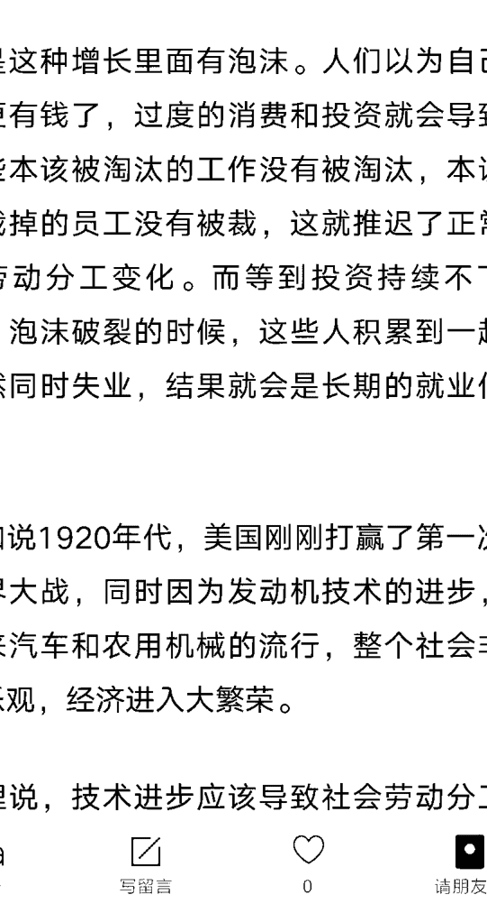

### 3. 好消息引发的危机

按理说，技术进步应该导致社会劳动分工的大调整。农业机械化了，传统上需要用很多人干的活，现在用少数人就能干好，那就应该有很多蓝领失业才对。但是新技术刚出来的时候人们看到的都是新的经济增长点，每个人都觉得自己更有钱了，社会上还出现了一些专门为富人服务的新工作，这就使得那些该失业的人没有立即失业，社会分工调整被推迟了。

但是调整终将发生。等到大量蓝领工人被机器淘汰而失业的时候，人们才发现原来社会财富没有那么多，那些专门给富人服务的临时性工作也消失了。这就带来了1930年代的经济大萧条。

当然技术进步的作用并不仅仅是让旧工作消失，新技术也会带来新工作，但是这需要时间。那一轮分工调整带来的新工作主要是在批发业和零售业方面，而这种工作需要至少高中教育的人才能干。

1930年代的美国没有那么多优质人才，这一波分工调整一直到1950年才彻底结束。到这个时候，美国才算真正享受到了机械化带来的繁荣。

我感觉这个过程有点像咱俩以前说过的“Hype”曲线（下图）

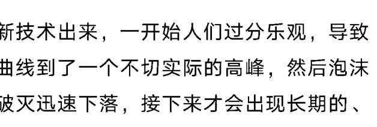

新技术出来，一开始人们过分乐观，导致曲线到了一个不切实际的高峰，然后泡沫破灭迅速下落，接下来才会出现长期的、真正的增长。

克林说，这样的周期在历史上发生过好几次。2000年前后，因为互联网新技术进步和中国等亚洲国家的崛起，也给美国带来了一波非理性的繁荣，导致2001年发生了一次短暂的金融危机。

2008年那次金融危机也可以说是因房价上涨这个“好消息”而导致的，只是并不伴随分工调整。

了解了这些理论，我感觉经济周期可以说是金融功效的副作用，而金融危机也可说是好消息的副作用。没有副作用当然更好，但是既然金融中介这么有用，既然技术进步终将带来真正的经济增长，那付出一点代价和阵痛也是值得的。

所以模型要想精细一点，就必须考虑劳动分工。然而美国的政策制定者仍然没有意识到分工在经济周期中的重要作用。

关于这个话题，明天咱俩还有最后一讲。

## 《分工与贸易》6: 宏观经济学的迷思

《分工与贸易》6: 宏观经济学。

今天咱们把阿诺德·克林的《分工与贸易》这本书讲完，我说说宏观经济学。

简单来说，宏观经济学最根本的问题，就是在经济衰退的时候怎么增加就业。只要想工作的人都有工作，政府就不需要宏观经济学。

政府在宏观上刺激经济无非就是两个办法。一个是财政政策，也就是增加赤字，通过政府直接花费提高“总需求”；一个是货币政策，也就是让中央银行降低利率，增加货币。

而这两个做法可能会有个副作用 — 也是政府最大的噩梦 — 那就是恶性通货膨胀。

可以说整个思路就是这么简单。那问题是，这真的有效吗？

美国的中央银行 — 美联储 — 这个机构成立的初衷就是为了应对经济危机，就是要通过货币政策影响宏观经济。有些经济学家认为美联储是比较成功的，因为自从美联储成立以后，美国就再也没有经历过像1930年代那样的经济大萧条，所有危机都是比较温和的。

可问题是这个说法是不可证伪的。你没办法做对比实验。我们这一讲只能从常识出发分析一下宏观经济学的道理。

### 1. 凯恩斯主义错在哪？

让政府通过扩张性的政策刺激经济，这个做法的祖师爷是约翰·凯恩斯，现在我们都说这叫“凯恩斯主义”。一个思想一旦成为“主义”，就跟它的提出者可能就没什么关系了。凯恩斯到底是怎样想的？这已经不重要了。克林说过去80年内，经济学家一直都在争论凯恩斯到底是什么意思。

不过我们都知道“通俗凯恩斯主义”是什么意思 — 那就是消费刺激增长。只要公司愿意投资、消费者愿意花钱，经济就能起来。

为此，钱一定要流动起来才行。政府应该减税，这样老百姓就能有更多的钱用于消费。利率应该降低，这样老百姓就不愿意存钱了，就更愿意消费。但你仔细想想，这套说法完全违反了微观经济学。

微观经济学说经济最本质的问题在于稀缺。是大家都想要好东西，可是好东西稀缺，才有经济学。可是凯恩斯主义说什么都是因为需求不足，好像遍地都是好东西人们不想要一样。

### 2. 中央银行能刺激经济吗？

美联储虽然是中央银行，但也仅仅是一家银行而已。美联储可以实行宽松的货币政策，刺激投资 — 但是别的银行也可以这么操作！如果现在形势好，美联储不给好政策各家银行也会加大投资；如果大家判断经济形势不好，美联储给政策也没用。中央银行对经济的控制能力并没有人们想象的那么大。

### 3. 失业问题应该怎么解决？

凯恩斯主义想要通过政府刺激经济的办法解决失业问题，可是凯恩斯主义甚至都不能解释为什么会有失业。如果说需求不足，那劳动力价格可以下降吗？为什么不是给工人降薪，而是非得让人失业呢？

他们的工作可能有用。

但是后来美国的失业就主要是结构性的了，旧岗位永久消失，必须创造新岗位。在这种情况，政府想要保住旧岗位的努力常常适得其反。2009年奥巴马搞了一个刺激就业的计划。这个计划在克林看来简直是每一项都有问题。

一个措施是如果你买新车，政府会给你一个退税。这其实是寅吃卯粮 — 本来我应该两年后买新车，现在因为这个刺激政策我先买了，这只是临时性地保住了汽车行业的就业岗位：两年后我不买车了，汽车工人不是还要失业吗？

一个措施是补贴“绿色能源”产业。政府的思路的确是想创造新的岗位 — 可是靠补贴创造出来的新岗位是可持续的吗？事实上这一轮政策结束之后，那些依靠政府补贴的新能源公司全都倒闭了！

一个措施是减税。减税同样只是在短期内有好处，它仍然是在保护那些理应被淘汰的岗位。

那政府到底应该怎么办呢？政府能帮助创造新岗位吗？这很难，但是克林也提供了几个思路。

我们专栏多次说过，创造就是想法的连接。政府可以做的，是加强人与人之间的连接。

美国的经验是二战以后有很多退伍军人联合起来成立了公司，创造了新就业。这件事凯恩斯解释不了，要是根据凯恩斯的说法，市场上突然多出这么多人找工作，经济应该不行才对，可是这些退伍军人恰恰带来了经济繁荣。军队给了这些人互相认识和合伙的机会。

以色列也有这样的经验，很多企业都是军队里的战友一起创业建立的。以色列学者认为这是因为军队给人提供了技术培训和文化培训。

政府还可以加强教育。大学能培养高质量的人才，还能把人才聚集在一起。政府还可以促进高科技移民，因为这些移民往往是创业的主力。政府还应该减少对土地用途的限制，释放创新能力。

克林的另一个想法对中国很有意义，那就是促进城乡交流。美国的农业人口很低，但是城乡分隔现在有点严重。而对中国来说，也许城市化是制造新就业的最大发动机。

总而言之，我的感想是，政府对宏观经济能做的好事儿非常有限 — 但是要做坏事比较容易。

而这是完全可以理解的。归根结底，财富是人民创造的 — 而不是因为什么“民主党的政策好”。


# 如果你从未错过航班，你在机场待的时间太长了

如果你从未错过航班，你在...

这一讲专栏献给好孩子、好学生、好员工和好公民。标题这句话是经济学家齐浩·斯蒂格勒（George Stigler）的名言，他是1982年的诺贝尔奖得主。

经济学家几乎不能准确预测世界，他们的很多看法都不一定对，但是他们总是能够提供有用的洞见。斯蒂格勒这句话的洞见是，任何“好成绩”都是有代价的。

坐飞机出行，很多人会确保自己在登机前两个小时、甚至三个小时就到达机场。再考虑到防止路上堵车，你可能提前四个小时就得从家里出发。

而斯蒂格勒提醒我们，错过航班虽然是个大麻烦，但那也不是世界末日。我就曾经因为到机场晚了错过了航班，而且还错过了转机航班，而且还因此不得不找人替我做一个会议上的报告，但是我的亲身体会是这没什么大不了的。我不是一个总迟到的人，不过我的记录并不完美。

## 1. 代价

完美，是一个很贵的东西。生活中的事情都具有不确定性，岂怕你已经做得很好，也不能确保不出错。我们知道有个“80/20法则”，把一件事情做到“差不多”的水平其实是比较容易的，而你如果想做到近乎完美，你要付出的代价将会不成比例地上升。

## 2. 放飞

如果你每天上班上学从来没迟到过，你花在睡眠上的时间可能太短了。只要不是习惯性的，偶尔迟到没关系。我上学上班经常迟到，还因为接送孩子迟到被罚过款，但那都是值得的。偶尔迟到的人对生活的掌控感更高。

## 3. 试探

我发现好人和坏人的一个区别是，好人总是适应世界的规范，而坏人总是试探世界的底线。有些效能特别高的人之所以被人说像个坏人，就是因为他们采用了坏人的高效能做法。

如果你从未被人说过“不”，你就没有充分利用周围的有利环境。

分利用周围的有利环境。

当然，动不动就试探别人底线的人恐怕真不是什么好人。我是个好人，我几乎从来不给别人提什么额外的要求。但是我观察到有些人特别喜欢提要求，他们吃个饭、坐个飞机、坐个火车都得一会儿要这个一会儿要那个，一点都不怕给别人添麻烦。我们不喜欢这样的人，但是你不得不承认，他们充满了被讨厌的勇气。

其实最应该使用试探精神的并不是在日常生活中。我们应该把勇气用在大事上。比如在谈判之类的关键场合，有时候一个不经意但是大胆的试探能带来很好的机会。

不过试探是有危险的。有些领导早就掌握了反制试探的方法 — 那就是不给明确的底线。

比如电影审查制度就是这样。如果广电总局有一个明确的底线，明文规定只要不越过这条线，你想怎样就怎样，我相信中国电影会比现在好看得多。但广电总局的智慧就在于它根本没有明文规定。

而电影人不敢大胆试探。一旦试探错了，电影可能直接被禁，你所有的投入都付之东流。电影人不但不敢试探，而且还要积极开展自我审查，而且自我审查的尺度还得比广电总局更严格。这简直是韩非子水平的治理智慧：“明君无为于上，群臣竦惧乎下”。

可我特别佩服那些宁可冒险也要试探一下的人。如果你从未碰过壁，你对这个世界的探索还不够 — 那个墙壁留给你的空间也会越来越小！

# 问答：当资源不再稀缺，经济学还有用吗？

问答：当资源不再稀缺，经济..

# 来自日课《市场失灵和政府失灵》

读者 kyrie社：

是否可以说不可替代的刚需品在市场经济下是失灵的？

万维钢

一个商品是不是刚需、是不是应该完全交给市场，标准应该是价格机制是否能对它起“好的”作用。

# 关于日课《最高学习效率 = 15.87%》

读者 睿学：

人随着年纪的增长，学会会效率降低。是因为熟悉的东西太多，还是因为接触陌生东西太少了？是把自己放在舒适区太久了吗？

## 万维钢

我理解市场至少有三个作用。一个是解决生产问题，通过价格机制激励人们去积极生产稀缺的东西，从而让稀缺的东西变得不再稀缺。另一个是解决了商品分配的问题，那就是按钱分配，价高者得。第三个就是克林强调的分工问题，因为价格机制的存在，才使得有人会去做那些没意思的、辛苦的，甚至是危险的工作，社会有复杂分工，才能做复杂的事情。

就算核聚变让能源不再稀缺，人工智能让一般生活必需品都不在稀缺了，甚至干脆接管所有生产，市场：的后两个功能仍然是需要的。

比如说，就算物质再怎么丰富，我们总得看世界杯足球赛吧？那世界杯决赛赛场上靠近比赛场地的座位，在理论上就只有那么多，人人都有需求，给谁是好。如果不是价高者得，那怎么分才能是合理的呢？

如果一个人想要证明自己拿那个稀缺的东西的合理性，他就必须证明自己是这个社会所需要的。那么他就必须去做一些不完全是因为自己感兴趣，而是因为社会需要才做的事情。那就还是需要某种分工才行。

只要有分工和分配，就还是需要经济学。

当然，如果人工智能真的接管了一切，这个社会根本就不需要人，那只能说万事皆空，经济学确实没用了。但是那样的社会也没啥意思，如果可以选择，我宁可去一个落后地方投胎！我们看现在所有的电子游戏，虽然可以随便幻想，其中的资源、装备、各种好东西也都是稀缺的，得自己挣出来。要啥有啥同时又不被需要的人生简直毫无意义。

### 万维钢·精英日课³

帮你和全球精英大脑同步
版权归得到App所有，未经许可不得转载

# 留言精选

提交留言可与专栏作者互动

# 学习一个“深度学习”算法（1）

学习一个“深度学习”算法 (1) ↓

春节快到了，在这个辞旧迎新的日子里，适合学习一些比较新、比较猛的知识。我们来学习一个基于“深度学习”的图形识别算法。

我们的学习目标是一个叫做“卷积网络”的东西，这是一个风头正劲的算法。不要被技术名词吓到！我们去年讲《人工不智能》这本书的时候详细讲过一个判断泰坦尼克号幸存者的机器学习算法，这一次更高 级，但是这次不编程。我们是个思想性的专栏，就好像前面讲相对论那样，我们关注的是它的思想，不是细节问题。如果你能欣赏广义相对论，那么你没有理由不能欣赏“深度学习”。

为啥要了解深度学习呢？首先这个东西现在太热门了，图形识别、语音识别、汽车导航全都能用上，非常值钱。但更重要的是，我认为这个算法包含精妙的思想，能够代表这个时代的精神。这个思想并不难，但是一旦领会了，你就能窥探一点脑神经科学和现代工程学。

我将重点使用两份参考资料。一个是 Ars technica 网站上个月刚刚出来的一篇文章，叫做《计算机图形识别能力如何好到令人震惊》[1]，作者是蒂莫西·李 (Timothy Lee)。一个是一本新书，叫《深度学习：智能时代的核心驱动力量》[2]，作者是特 伦 斯 · 谢 诺夫 斯 基（Terrence J. Sejnowski），英文版是2018年10月出来的，现在中信出版社刚刚出了中文版。

不知道你注意到没有，你的手机相册，现在知道你每一张照片里都有什么东西。不管你用的是 iPhone 还是安卓，打开相册，它有一个搜索功能，你输入“beach”，它能列举所有包含海滩的照片；输入“car”，它能列举画面中有汽车的照片，而且它还能识别照片中的每一个人。


每拍摄一张照片，手机都自动识别其中的典型物体。这是一个细思极恐的技术。怎么才能教会计算机识别物体呢？

## 1.没有规则的学习

就在不到十年之前，人们还总爱用模式识别作为人脑比计算机厉害的例子。我记得人们爱说的一个典故就是人很容易就能从一张照片里找到一只猫，可是 Google 动用了无比强大的计算力量、花了很多年研究都做不到这一点。

但现在可不是这样了。从2012年开始，“深度学习”让计算机识别图形的能力突然变得无比强大，目前已经超过了人类。

咱们先想想人是怎么识别猫的。观察一下下面这张图，看看你是怎么判断这张照片里有没有猫的呢？


你可能会说，这很简单，所有人都知道猫长什么样一好，那么请问猫长什么样？你也 许可以用科学语言描写“三角形”是什么样的——这是一种图形，它有三条直线的边， 有三个顶点。可是你能用比较科学的语言描写猫吗？它有耳朵、有尾巴，但这么形容远远不够，最起码你得能把猫和狗区分开来才行。

或者咱们再想一个问题。我再给你看一个 人脸的图片，你怎么判断 ta 是男还是女 呢？


你可能会说女性长得更秀气一些——那什么叫“秀气”？是说眉毛比较细吗？是轮廓比较小吗？

你体会一下，这是一个非常奇怪的感觉。你明明知道猫长什么样，你明明一眼就能区分男性和女性，可是你说不清你是怎么看出来的。

古老的计算机图形识别方法，就是非得说清楚一些明确的识别规则，让计算机根据规则判断，结果发现非常不可行。

根本原因就是连人自己都说不清。我们专栏讲过一个真事儿，一个法官说，什么叫色情作品？我没办法给你一个明确规定——但如果我看见了，我就能识别出来。

所以人脑并不是通过什么规则做的判断。那到底是怎么判断的呢？

## 2.神经网络

神经网络计算并不是一个很新的东西，好几十年前就已经出来了，但是是一开始并不被看好。

《深度学习》这本书的作者谢诺夫斯基，上世纪80年代就在研究神经网络计算，那时候他是一个少数派。

1989年，谢诺夫斯基到麻省理工学院计算机实验室访问。气氛不算融洽，那里的人都怀疑他的方法。午餐之前，谢诺夫斯基有五分钟的时间，给所有人介绍一下他讲座的主题。谢诺夫斯基临场发挥，以食物上的一只苍蝇为题，说了几句话。

谢诺夫斯基说，你看这只苍蝇的大脑只有10万个神经元，能耗那么低，但是它能看、能飞、能寻找食物，还能繁殖。MIT 有台价值一亿美金的超级计算机，消耗极大的能量，有庞大的体积，可是它的功能为什么还不如一只苍蝇？

在场的教授都未能回答好这个问题，倒是一个研究生肖出了正确答案。他说这是因为苍蝇的大脑是高度专业化的，进化使得苍蝇的大脑只具备这些特定的功能，而我们的计算机是通用的，你可以对它进行各种编程，它理论上可以干任何事情。

这个关键在于，大脑的识别能力，不是靠临场写一些规则临时编程。大脑的每一个功能都是专门的神经网络长出来的，那计算机能不能效法大脑呢？

谢诺夫斯基说，大脑已经给计算机科学家提供了四个暗示。

第一个暗示是大脑是一个强大的模式识别器。人脑非常善于在一个混乱的场景之中识别出你想要的那个东西。比如你能从满大街的人中，一眼就认出你熟悉的人。

第二个暗示是大脑的识别功能可以通过训练提高。

第三个暗示是大脑不管是练习还是使用识别能力，都不是按照各种逻辑和规则进行的。我们识别一个人脸，并不是跟一些抽象的规则进行比对。我们不是通过测量这个人两眼之间的距离来识别这个人。我们一眼看过去，就知道他是谁了。

第四个暗示是大脑是由神经元组成的。我们大脑里有数百亿个神经元，大脑计算不是基于明确规则的计算，而是基于神经元的计算。

这就是神经网络计算要做的事情。

## 3.什么是“深度学习”

我们接着看图，下面这张图代表一个最简单的计算机神经网络。


它从左到右分为三层。

第一层代表输入的数据，第二和第三层的每一个圆点代表一个神经元。

第一层代表输入的数据，第二和第三层的每一个圆点代表一个神经元。

第二层叫“隐藏层”。

第三层是“输出层”。

数据输入进来，经过隐藏层各个神经元的一番处理，再把信号传递给输出层，输出层神经元再处理一番，最后作出判断。

从下面这张图，你可以看到它的运行过程。

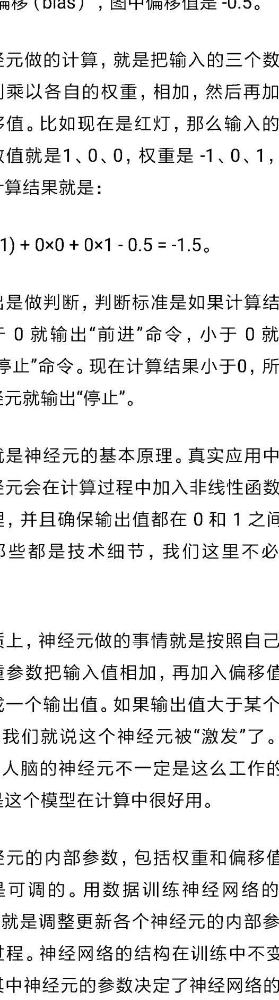

那什么叫“深度学习”呢？最简单的理解，就是中间有不止一层隐藏层神经元的神经网络计算。“深度”的字面意思就是层次比较“深”。

接着看下面这张图，你可以看到，左边是简单神经网络，右边是深度学习神经网络。


整个结构就是这么简单。我们专栏讲《柏拉图和技术呆子》那本书的时候专门说过“分层”这个思想，分层可以让我们用简单的事情解决复杂的问题。计算机最底层的单元是晶体管，而神经网络最底层的单元就是神经元。

神经元是什么东西呢？我们看一个最简单的例子。

你看，下面这张图表现了一个根据交通信号灯判断要不要前进的神经元。它由三部分组成：输入、内部参数和输出。


这个神经元的输入就是红灯、黄灯和绿灯这三个灯哪个亮了。我们用1表示亮，0表示不亮，那么按照顺序，“1, 0, 0”这一组输入数字，就代表红灯亮，黄灯和绿灯不亮。

神经元的内部参数包括“权重（weight）”，它对每个输入值都给一个权重，比如图中给红灯的权重是 -1，黄灯的权重是 0，给绿灯的权重是 1。另外，它还有一个参数叫“偏移（bias）”，图中偏移值是 -0.5。

神经元做的计算，就是把输入的三个数字分别乘以各自的权重，相加，然后再加上偏移值。比如现在是红灯，那么输入的三个数值就是1、0、0，权重是 -1、0、1，所以计算结果就是：

```
1×(-1) + 0×0 + 0×1 - 0.5 = -1.5。
```

输出是做判断，判断标准是如果计算结果大于 0 就输出“前进”命令，小于 0 就输出“停止”命令。现在计算结果小于0，所以神经元就输出“停止”。

这就是神经元的基本原理。真实应用中的神经元会在计算过程中加入非线性函数的处理，并且确保输出值都在 0 和 1 之间，但那些都是技术细节，我们这里不必在意。

本质上，神经元做的事情就是按照自己的权重参数把输入值相加，再加入偏移值，形成一个输出值。如果输出值大于某个阈值，我们就说这个神经元被“激发”了。当然，人脑的神经元不一定是这么工作的，但是这个模型在计算中很好用。

神经元的内部参数，包括权重和偏移值，都是可调的。用数据训练神经网络的过程，就是调整更新各个神经元的内部参数的过程。神经网络的结构在训练中不变，是其中神经元的参数决定了神经网络的功能。

接下来我们要用一个实战例子说明神经网络是怎样进行图形识别的。我们要用一个简单的神经网络识别手写的阿拉伯数字！咱俩下一讲再说。

> 参考文献：
[1] TIMOTHY B. LEE, DEEP LEARNING — How computers got shockingly good at recognizing images, arstechnica.com 12/18/2018.
[2] Terrence J. Sejnowski, The Deep Learning Revolution, 2018.

# 学习一个“深度学习”算法（2）

学习一个“深度学习”算法…

今天我们来做一个神经网络学习的实践。这是一套可以说是神奇的操作——因为它简直到出乎意料地简单。你会感慨，为什么这么复杂的问题，居然能用这么一个简单粗暴的方法就解决了。

在我看来这绝对是一个工程上的幸运发现。很多发明创造都是工程师偶然敲出来的。喷气式发动机到底是什么原理？到现在人们也说不清楚。阿司匹林为什么有这样和那样的疗效？医学研究还得继续做实验。神经网络计算就是这么一种发明，计算机科学家发现它很有用，可是要想用严格的数学说明它为什么这么有用，那很困难。

我们要用神经网络来识别手写的阿拉伯数字。这是一个非常成熟的项目，网上有现成的数据库和好几个教程。有个迈克尔·尼尔森（Michael Nielsen）做了个深度学习在线教程值得你深入了解 [1]，他只用了74行 Python 程序代码就做成了这件事。

给你几个手写阿拉伯数字，可能是信封上的邮政编码也可能是支票上的钱数，你怎么教会计算机识别这些数字呢？


## 1. 简化

想要让计算机处理，首先你得把问题“数学化”。写在纸上的字千变万化，我们首先从中简化出来一个数学问题。我们首先用几个正方形把各个数字分开，就像下面这张图一样——


现在问题变成给你一个包含一个手写数字的正方形区域，你能不能识别其中是什么数字——


再进一步，我们忽略字的颜色，降低正方形的分辨率，就考虑一个 28×28 = 784 个像素的图像。我们规定每一个像素值都是0到1之间的一個小数，代表灰度的深浅，0表示纯白色，1表示纯黑。这样一来，手写的数字“1”就变成了下面这个样子——


你看这就完全是一个数学问题了。现在无非就是给你784个0-1之间的数，你能不能对这组数做一番操作，判断它们对应的是哪个阿拉伯数字。输入784个数，输出一个数。

这件事从常理来说并不是一点头绪都没有。比如任何人写数字“7”，左下角的区域应该是空白的，这就意味着784个像素点中对应正方形左下角区域那些点的数值应该是0。再比如说，写“0”的时候中间是空的，那么对应正方形中间的那些像素点的数值应该也是0。

但这个人为找规律的思路非常不可行。首先你很难想到所有的规则，更重要的是很多规则都是模糊的——比如，7的左下角空白，那这个空白区域应该有多大呢？不同人的写法肯定不一样。

肯定有规律，可你说不清都是什么规律，这种问题特别适合神经网络学习。

## 2. 设定

我们要用的这个方法叫做“误差反向传播网络”，它最早起源于1986年发表在《自然》杂志上的一篇论文 [2]，这篇论文的被引用次数已经超过了4万次，是深度学习的里程碑。

根据尼尔森的教程，我们建一个三层的神经网络，就是下面这张图——


图的最左边一列是第一层（输入层），是输入数据的，这里只画了8个点，但事实上上有784个数据点。中间一列是隐藏层，由15个点，也就是15个神经元组成。第三层，也就是最右边一列是输出层，有10个神经元，对应0-9这10个数字。

上一讲我们说了，每个神经元都由输入、权重和偏移参数、输出三个部分组成。中间那一列的隐藏层15个神经元中的每一个都要接收全部784个像素的数据输入，总共有784×15=11760个权重和15个偏移值。最右边一列（输出层）10个神经元的每一个都要跟中间列的所有15个神经元连接，总共有150个权重和10个偏移值。这样下来，11760+15+150+10=11935，整个神经网络一共有11935个可调参数。

理想状态下，最左边一列（输入层）的784个输入值在经过隐藏层和输出层这两层神经元的处理后，最右边输出层的哪个神经元的输出结果最接近于1，神经网络就判断这是哪个手写数字。当然一开始肯定做不到，我们可以干脆随机选择这11935个参数的初始值。

## 3. 训练

网上有个公开的现成数据库叫“MNIST”，其中包括6万个手写的数字图像，都标记了它们代表的是哪些数字——


我们要做的是用这些图像训练神经网络，去调整好那11935个参数。我们可以用其中3万个图像训练，用剩下3万个图像检验训练效果。

这个训练调整参数的方法，就是“误差反向传播”。比如我们输入一个数字“7”的图像——


神经网络实际收到的是784个像素值。经过两层神经元的传导计算，理想情况下，输出层的7号神经元的输出值应该最接近于1，其它的都很接近于0。可是一开始肯定不是这样，我们要用一套特定的规则去调整各个神经元的参数。

关键思想在于，参数调整有个方向，叫做“误差梯度”。比如对输出层的7号神经元来说，调整方向就是要让它的输出值变大；对其她9个神经元，调整方向则是让输出值变小。这个调整策略是看哪个输入信号对结果的影响大，对它的权重的调整就要大一点。

隐藏层神经元的参数调整更麻烦。我们必须考虑到，调整一个隐藏层的神经元，会同时影响全部10个输出层神经元的输入值。这就涉及到误差反向传播了，也就是调整前面神经元的参数，必须考虑它对后 Woo 神经元总体误差的影响。

具体的调整算法都是技术细节，我们这里关键是要理解这个设计思想：每次新的训练数据进来，就根据正确答案对参数进行一次微调，使得神经网络输出数值更接近正确答案。

这有点像是体育训练中的刻意练习。反馈是即时的，你做的结果立刻就能跟正确答案比较。不要求你马上就做对，但是每次总要进步一点点。而你每一次都确切知道，身体上每一个关节的动作应该往哪个方向调整。

几万个训练图像可能会被反复使用多次，

几万个训练图像可能会被反复使用多次，神经网络参数改过来改过去，最终将会达到稳定。你会发现，慢慢地，新图像喂进来，这11935个参数的变化越来越小、最终几乎不动了。那就是说，这个识别手写数字的神经网络，已经练成了。

事实证明这个简单网络的识别准确率能达到95%！这个结果让我们有很多感慨和问题。

## 4. 感慨

如果是一个数学家听说这波操作，他问的第一个问题肯定是，为什么最后居然能得到一组稳定的参数？为什么不一直都是每输入一个数，所有参数都剧烈变动呢？用数学语言来说，就是为什么这些参数能“收敛”？

这只能是因为手写数字是有规律的。所有人写数字差不多都是相似的写法，神经网络训练一段时间就见怪不怪了。如果你一会儿把这个写法叫7，一会儿把一个完全不同的写法叫7，神经网络就会无所适从。

比如说，如果我们用历史上的股票价格走向去训练一个神经网络，看看它能不能预测未来的股价，我敢打赌你将不会得到一组稳定的参数。因为股价变动几乎是没有规律的。

我们能这么做，是因为手写数字允许你这么做。

第二，虽然有规律很重要，虽然我们的神经网络已经能做出出色的判断，但是我们仍然不知道到底有哪些规律。

整个神经网络就像一个黑箱。你能看到那11935个参数的数值，但是你不知道，这些数值到底用到了哪些规律。

当神经网络判断数字“7”的时候，它利用了“7的左下角都是空白”这个规律吗？我猜如果你仔细分析神经网络的信息传递，这个规律肯定已经体现在其中了。这就是神经网络的妙处！现在你还是不能一一列举所有的规律，但是所有的规律都已经被默默包含在11935个参数之中。

会，但是说不清 一 人脑的这个特点，就这样简单粗暴地被神经网络复制了。

第三，神经网络必须得用专门的数据喂出来。训练好之后，它就相当于长成了一个专门判断阿拉伯数字的网络。它不能判断英文字母或者别的东西。

当然，我们完全可以使用同样的网络设定，训练一个专门判断“零、壹、…… 玖”大写中文数字的神经网络——但是对不起，你得先有几万个图像作为训练素材才行。深度学习的原理都是公开的，训练数据才是各家公司真正的稀缺资源，得慢慢积累。

第四，深度学习非常消耗资源。我们只用了25个神经元和28×28的低分辨率的图像，就要每次训练都调整11935个参数。应用级别的深度学习将会是海量的计算。现在最新的芯片，比如苹果的A11和A12芯片上，已经有专门的神经网络计算引擎。

为什么今天的例子只用了两层神经元，为什么不再多加一层、每层多用几个神经元呢？首先运算量会大大增加，其次更复杂的网络需要更多的训练，可能几万个图像就不够了。工程学不是从第一性原理出发的科学，只要能用就是对的 一 到底怎么搭配是最优解，那是留给数学家的难题。

还有一点，这个方法按现代标准就算太简单了。我们的训练素材中，每个数字都不大不小，都写在正方形区域的正中间。那要是一张很大的图片里有个很小的数字，用这个神经网络就不能识别了。

而新一代深度学习网络，哪怕是一张照片的角落里有一只猫，它都能识别出来。这就是“卷积网络”做的事，它除了一般的隐藏层，还会在中间再加入几个卷积层……关于这个话题，咱们下一讲再说。

参考文献
[1] http://neuralnetworksanddeeplearning.com/chap1.html
[2] David E. Rumelhart, Geoffrey E. Hinton & Ronald J. Williams, Learning representations by back-propagating errors, Nature 323, 533–536 (1986).

## 学习一个“深度学习”算法（3）

今天是深度学习算法的最后一讲，我们要学习“卷积网络”。上一讲我们说如何使用一个最简单的神经网络识别手写阿拉伯数字。在理论上，这个方法可以用神经网络识别一切图像。你只要把一张张的图片喂给神经网络，告诉它图上有什么，它终将自己发现各个东西的像素规律……但是在实践上，这个方法非常不可行。

计算机不怕“笨办法”，但是哪怕你能让它稍微变聪明一点，你的收获都是巨大的。

## 1. “笨办法”和人的办法

下面这张图是我随便在网上找的，图中有 一只猫、一只狗、绿色的草地和蓝天白 云。它的分辨率是350×263，总共92050 个像素点。考虑到这是一张彩色照片，每 个像素点必须用三个数来代表颜色，这张 图要用27万个数来描写。


要想用一个上一讲说的那种误差反向传播 神经网络识别这样的图，它第二层每一个 神经元都得有27万个权重参数才行。要想 能够识别包括猫、狗、草地、蓝天白云这 种水平常见物体，它的输出层必须有上 千个神经元才行。这样训练一次的计算量 将是巨大的 —— 但这还不是最大的难点。

最大的难点是神经网络中的参数越多，它 需要的训练素材就越多。并不是任何照片 都能用作训练素材，你必须事先靠人工 标记照片上都有些什么东西作为标准答案， 才能给神经网络提供有效反馈。这么多训 练素材上哪找呢？

我听罗胖跨年演讲学到一个词叫“回到母 体”，意思大概是从新技术后退一步，返 回基本常识，也许能发现新的创新点。现 在我们回到人脑，想想为什么简单神经网 给是个笨办法。

人脑并不是每次都把一张图中所所有的像素 都放在一起考虑。我们有一个“看什 么”，和一个“往哪看”的思路。

让你找猫，你会先大概想象一下猫是什么 样子，然后从一张大图上一块一块地找。 也许猫在一个角落里，那你只要一个角落 一个角落找就行，你没必要同时考虑图片 的左上角和右下角。这“往哪看”。

还有，当你想象猫的时候，虽然不能完全 说清，但你始终还是按照一定的规律去 找。比如猫身上有毛，它有两个眼睛和一 条尾巴，等等。你看的不是单个的像素 点，你看的是一片一片的像素群的模式变 化。这“看什么”。

我理解“卷积网络”，就是这两个思路的 产物。

## 2.竞赛

斯坦福大学有个华裔计算机科学家叫李飞 飞，你想必听说过他的名字。李飞飞组织 了一个叫做 ImageNet 的机器学习图形识 别比赛，从2010年开始每年举行一次。这 个比赛的厉害之处在于它每年都给参赛者 提供一百万张图片作为训练素材！其中每 一张图都由人工标记了图中有什麽物体


总共有大约一千个物体分类。这就意味 着，对每一种物体，人工智能都有大约一 千次训练机会。

比赛规则是你用这一百万张训练图片练好 自己的程序，然后让程序识别一些新的图 片。每张新图片有一个事先设定的标准答 案，而你的程序可以猜五个答案，只要其 中有一个判断跟标准答案相符合，就算你 把这张图判断正确。

下面是历届比赛冠军的成绩——

## Classification Results (CLS)


我们看到2010和2011年，最好成绩的判 断错误率都在26%以上，但是2012年，错 误率一下子下降到了16%，从此之后就是 直线下降。2017年的成绩是2.3%，这个 水平已经超过人类 —— 等会儿你会看到， 有些图像里的东西连你都不一定能识 出来。

那2012年到底发生了什么呢？发生了“卷 积网络”。

## 3.卷积网络

2012年的冠军是多伦多大学的一个研究 组，他们使用的方法就是卷积网络。正是 因为这个方法太成功了，“深度学习”才 流行起来，现在搞图像识别几乎全都是用 这个方法。获奖团队描述卷积网络的论文 的第一作者叫亚历克斯·克里泽夫斯基 （Alex Krizhevsky），当时只是一个研究 生，这篇论文现在被人称为“AlexNet” [1]。

简单来说，AlexNet 的方法是在最基本的 像素到最终识别的物体之间加入了几个逻 辑层——也就是“卷积层”。“卷积”是 一种数学操作，可以理解成“过滤”，或 者叫“滤波”，意思是从细致的信号中识 别出尺度更大一点的结构。每一个卷积层识 别一种特定规模的图形模式，然后后面一 层只要在前面一层的基础上进行识别，这 就解决了“看什么”和“往哪看”的问 题。

我先说一个最直观的例子 [2]。比如说我们 要搞人脸识别，卷积网络方法把问题分解 为三个卷积层。


第一层，是先从像素点中识别一些小尺度 的线条结构。第二层，是根据第一层识别 出来的小尺度结构识别像眼睛、耳朵、嘴 之类的局部器官。第三层，才是根据这些 局部器官识别人脸。其中每一层的神经网 络从前面一层获得输入，经过深度学习之 后再输出到后面一层。基本思想就是这 样。

在细节上，咱们回到 AlexNet 的原始论 文，其中足足分了五个卷积层，每一层都 由很多个“特征探测器”组成。第一层有 96个特征探测器，各自负责探测整个图形 中哪些地方有下面这96种特征中的一种


比如说，第一层的第一个特征探测器，专 门负责判断图中哪里有像下面这样，从左 下到右上的线条结构——


下到右上的线条结构 ——

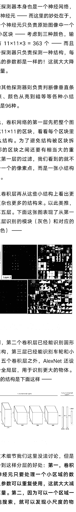

这个特征探测器本身也是一个神经网络，有自己的神经元 —— 而这里的妙处在于，它的每一个神经元只负责原始图像中一个 11×11 小区域 —— 考虑到三种颜色，输入值只有 11×11×3 = 363 个 —— 而且因为这个探测器只负责探测一种结构，每一个神经元的参数都是相同的！这就大大降低了运算量。

第一层的其他探测器则负责判断斜垂直条纹、斑点、颜色从黑到暗等各种小结构，一共是96种。

也就是 说，卷积网络的第一层先把整个图像分解成11×11的区块，看看每个区块里都是什么结构。为了避免结构被区块拆散，相邻的区块之间还要有相当大的重叠。经过第一层的过滤，我们看到的就不再是一个一个的像素点，而是一张小结构的逻辑图。

然后第二卷积层再从这些小结构上看出更大、更复杂也更多的结构来。以此类推，一直 到第五层。下面这张图表呈现了从第一层到第三层识别的模块（灰色）和对应的实例（彩色）——


我们看到，第二个卷积层已经能够识别圆形之类的结构，第三层已经能够识别车轮和小的人脸。五个卷积层之外，AlexNet 还设置了三个全局层，用于识别更大的物体。整个分层的结构是下面这样——


具体的技术细节我们这里没法讨论，但是你能体会到这种分层的好处：第一，卷积层中的神经元只要处理一个小区域的数据，而且参数可以重复使用，这就大大减少了运算量。第二，因为可以一个区域一个区域地搜索，就可以发现小尺度的物体。

意识到图形识别有多难，你就能体会到 AlexNet 的识别水平有多神奇。咱们看看 AlexNet 的识别结果。下面这张图中有个红色的螨虫，它出现在图像的边缘，但是被正确识别出来了——


# mite


AlexNet 还猜测它可能是蜘蛛、蟑螂、虱子或者海星，但是认为它是螨虫的可能性最高。这个判断水平已经超过了我，我都不知道那是个螨虫。

再比如下面这张图——


# mushroom


标准答案是“蘑菇”，但 AlexNet 给的第一判断是更精确的“伞菌”，“蘑菇”是它的第二选项！

下面这张图是AlexNet判断错误的一个例子。图中有一只小狗和一堆樱桃，标准答案是“樱桃”——


# cherry


AlexNet 首先注意到了那是一只达尔马提亚狗，它判断狗狗前面是某种水果，但是可能因为颜色太深，没有看出来是樱桃。这道题是不是有点故意难为人类了？

而现在基于类似的卷积网络方法的深度学习程序，水平已经远远超过了 AlexNet。

## 4.深度学习（不）能干什么

AlexNet 那篇论文的几个作者成立了一家创业公司，然而这家公司马上就在2013年被 Google 收购了。半年之后，Google 相册就有了搜索能力。紧接着，Google 就可以从自家拍摄的街景图像中识别每家每户的门牌号码了。Google 还夺得了2014年的 ImageNet 竞赛冠军。

所以千万别低估工程师迭代新技术的潜力。他们举一反三，一旦发现这个技术好，马上就能用用到极致。2012年之前深度学习还是机器学习中的“非主流”，现在是绝对主流。

深度学习能做一些令人赞叹的事情。比如说对于一个不太容易判断的物体，如果网络知道图中...

但是 arstechnica 那篇文章的作者蒂莫西·李也提醒了我们深度学习不能做什么。比如说，你把一个物体放大一点、或者旋转一个角度、或者调整一下光线，卷积网络就不知道那是同一个东西，它必须得重新判断。深度学习完全是基于经验的判断，它没有任何逻辑推理能力。

在我看来，这种学习方法，就如同在数学考试前夜背诵习题集。你能猜对答案是因为你背诵过类似的题，但是你并不真的理解数学。

这样的算法会创造力吗？深度学习能发现图像中从来没有被人类命名过的“异常”物体吗？我们见识了光凭经验的操作能强大到什么程度，但是我们也能看出 来，它距离真正的智能还非常遥远。

## 参考文献

> [1] Krizhevsky, Alex; Sutskever, Ilya; Hinton, Geoffrey E. "ImageNet classification with deep convolutional neural networks", Communications of the ACM. 60 (6): 84–90.

> [2] https://www.edureka.co/blog/what-is-deep-learning


## 活码长期有效

## 怎样优化悬念和意外

怎样优化悬念和意外

你被人“剧透”过吗？“剧透”是在一个人看着、但是还没看一个影视剧之前，提前告诉他关键剧情，使他在看片过程中失去悬念的行为。现代人越来越重视对一段经历过程的体验，被剧透的痛苦感就是越来越强烈。

读侦探小说的乐趣在于跟着主人公一起破案，你不想一上来说知道杀人凶手是谁。看体育比赛必须得看现场直播才刺激。看电影《第六感》，你绝对不能提前知道布鲁斯·威利斯扮演的那个儿童心理学家其实一开始就已经死了。（图1）

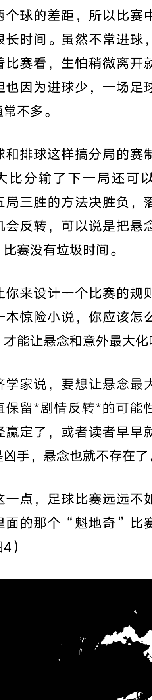

……如果还没看过《第六感》，请原谅我的剧透。但是咱们想一想，反对剧透这个事情挺有意思。如果你读一本书，学习一个什么知识，你关心的是信息本身。只要能得到全部的信息就行，信息的具体顺序并不重要，毕竟知识对你的意义是长期的，获得知识的过程只是一瞬间而已。但是读小说、看电影、收看体育比赛，获得信息的顺序却无比重要。

信息顺序能给我们制造刺激感。既然刺激感非常难得，那就是一种稀缺的东西。既然是稀缺的东西，那就是经济学家问题。真的有经济学家研究了这个问题。

到底怎么安排信息，才能把读者和观众的刺激感给最大化呢？西北大学和芝加哥大学的三个经济学家专门为此写了一篇论文[1]，第一作者是西北大学的杰弗里·伊利（Jeffrey Ely）教授。如果你对怎么制造刺激感感兴趣，你应该了解这项研究。

## 1.悬念和意外

这三个经济学家认为，刺激感不是单一的变量，它有两个维度：一个是“悬念”，一个是“意外”。而我们在欣赏一个作品的时候感受到的悬念和意外，都是由我们对某个事情的“信念”的走势变化决定的。

比如说观看一场体育比赛。如果你非常确信有一方能赢，也就是说你的信念非常强烈，而且那一方果然赢了，这场比赛对你就没啥意思，一点都不刺激。

刺激的比赛应该跌宕起伏。一开始你感觉谁有可能赢，但是你不确定，所以你很愿意看。比赛过程中你的信念忽上忽下，感觉赢定了的时候又被对手扳上来还反超了，你都绝望了结果最后来一个惊天大逆转，你支持的选手还是赢了——这样的比赛过程比稳稳当当地赢要刺激的多。

下面这张图（图2）说的是2011年美国网球公开赛中，德约科维奇对费德勒的一场比赛。曲线表现的是观众对德约科维奇获胜的信念，它是一个从0到1之间的概率值。


两人水平差不多，一开始的信念值是0.5。随着比赛进行，德约科维奇比分落后，信念值降低到了0.2左右。接下来德约科维奇奋起直追，信念值又回到0.5。可是就在这时候费德勒连续打出好球把比分拉开，观众感觉德约科维奇几乎输定了，信念值降到了0.1以下。最后阶段，德约科维奇突然爆发，上演惊天逆转，德约科维奇获胜！

哪怕你不是德约科维奇的球迷，你也会认为这是 一场非常刺激的比赛。而对比之下，下面图中（图3）穆雷对纳达尔的比赛就不够刺激了。纳达尔很快就取得了领先优势，而且一直把优势保持到最后的胜利。


信念值曲线对悬念和意外都有影响。

所谓悬念，是你无法预测比赛结果的那种感觉。可能现在你的信念值是0.5，你知道随着比赛进行这个信念值会发生变化，但是你不知道它会怎么变。悬念，是对不确定性的感受。

所谓意外，则是比赛过程中突然发生了一个你意想不到的大事，导致你的信念值发生巨变。现在中国队0:1落后伊朗，而比赛已经进行到了第85分钟，留给中国队的时间不多了。本来你以为这场输定了，可是中国队五分钟之内连进两个球居然赢了，这就叫意外。

悬念是在大事发生之前的感受，意外是在大事发生之后的感受。我打个不精确的比方，悬念就好像是“灰犀牛”——你知道这件事可能发生，但是你不知道它到底会不会真的发生，你不知道它什么时候发生。意外则有点像“黑天鹅”——你连想都想不到，它居然就发生了。

从维护稳定的角度，我们既要警惕黑天鹅，又要防范灰犀牛。但是是从吃瓜群看着热闹不怕事大的角度，我们希望戏里有悬念和意外。

## 2.优化

有多少悬念和意外，完全取决于信念值的走势。篮球比赛的得分多，如果不是势均力敌的话，双方很快就能拉开差距，弱队很难逆转，比赛到后期往往会进入“垃圾时间”，所以悬念不足。

足球比赛的得分低，强队和弱队比也常常就是一两个球的差距，所以比赛中的悬念能保留很长时间。虽然不常进球，观众也得总盯着比赛看，生怕稍微离开就错过了进球。但也因为进球少，一场足球比赛中的意外通常不多。

像乒乓球和排球这样局分制的赛制，就算这一局大比分输了下一局还可以重新开始，用五局三胜的方法决胜负，落后者一直都有机会反转，可以说是把悬念保留到了最后，比赛没有垃圾时间。

那如果让你来设计一个比赛的规则，或者让你写一本惊险小说，你应该怎么安排信息顺序，才能让悬念和意外最大化呢？

三个经济学家说，要想让悬念最大化，你必须一直保留“剧情反转”的可能性。如果一方已经赢定了，或者读者早早就知道某人肯定是凶手，悬念也就不存在了。

考虑到这一点，足球比赛远不如《哈利波特》里面的那个“魁地奇”比赛的悬念强。（图4）


魁地奇比赛中寻常的进球可以得10分，但是只要最后哪一方抓住金色飞球，立即就能得到150分。弱队可以单凭一个厉害的搜捕手逆转比赛，悬念一直保留到最后。

但是仅仅保留逆转的可能性还不行。悬念是有了，但既然谁都能逆转，观众会觉得不够意外。

而要想让意外也最大化，你必须让每一次反转发生的可能性越来越小才行。这个人明明快要输了，结果居然赢了，这样才刺激！

研究者提出，最优化的剧情进程，应该像下面这张图中的这样（图5）——


下面这张图（图5）——

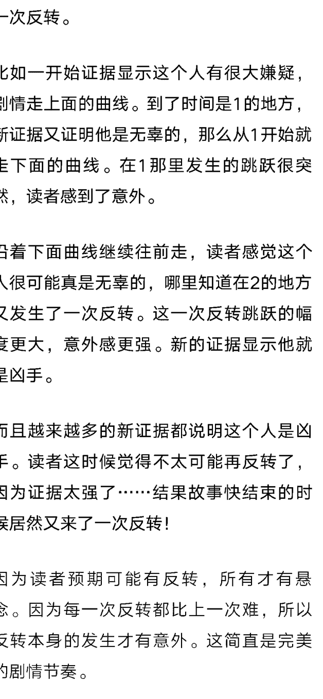

图中横坐标是时间，纵坐标是信念值，上下两条曲线代表两种可能的结局。比如说，上面的曲线代表这个人是凶手，下面曲线代表他是无辜的。最佳剧情，应该在两条曲线之间来回跳跃，一会儿走上面曲线，一会儿走下面曲线，每一次跳跃代表一次反转。

比如一开始证据显示这个人有很大嫌疑，剧情走上面的曲线。到了时间是1的地方，新证据又证明他是无辜的，那么从1开始就走下面的曲线。在1那里发生的跳跃很突然，读者感觉到了意外。

沿着下面曲线继续往前走，读者感觉这个人很可能真是无辜的，哪知道在2的地方又发生了一次反转。这一次反转跳跃的幅度更大，意外感更强。新的证据显示他就是凶手。

而且越来越多的新证据都说明这个人是凶手。读者这时候觉得不太可能再反转了，因为证据太强了……结果故事快结束的时候居然又来了一次反转！

因为读者预期可能有反转，所以才有悬念。因为每一次反转都比上一次难，所以反转本身的发生才有意外。这简直是完美的剧情节奏。

但是，请注意，反转可不是越多越好。

## 3.反转

三个经济学家在论文里没说反转几次好。但是他们在《纽约时报》发表了一篇介绍这个研究的文章 [2]，其中提到，一部小说剧情的最佳反转次数是三次。

这个道理是反转要稀有一点，悬念和意外的效果才好。如果剧情一会儿一个反转，读者和观众就会见怪不怪，甚至觉得你这个剧情根本不靠谱。我们应该把观众的意外感当做一种稀缺的资源。你一次只能制造这么多意外，意外太多就不叫意外了。三次正好。

而且也不应该是所有作品都要追求悬念和意外。在经济学播客 Freakonomics 的一次访谈 [3] 中，这几个经济学家甚至提出，现在好莱坞有点滥用剧情反转。人们都能猜到一般的剧情套路。可能观众一看你这是个悬疑片，就能预期剧情会发生反转，你越是证明这个人是好人，观众就越相信他最后必定是个坏人。这种观影心态就不好，明明是个煽情的故事，搞成了智力游戏。

观众的这个心态是所有悬念小说和电影共同培养出来的——这有点像是公地悲剧：每个作家都想让自己的作品里带点悬念和意外，结果却是导致观众对悬念和意外不敏感了。

我们今天说的这个最优配置仅仅是在优化作品的刺激性，而我们欣赏任何作品都不单纯是为了追求刺激。如果纯粹是要把比赛悬念和意外最大化，研究者建议足球比赛应该修改两条规则——

第一，不看进球个数，而是看哪个队打进最后一个球，算哪个队取胜。这样比赛一直到最后都有悬念。

第二，随着比赛的进行，双方的球门要变得越来越小。这样能让进球越来越难，增加每个进球带来的意外。

可是你愿意看这样的足球吗？任何一方打进一球之后必定会全面转为防守，这样的比赛还好看吗？

所以好看不等于刺激。真正的难处不在于怎么安排剧情反转的节奏，而在于怎么让每一次反转都显得真实和自然。

这就是今天的全部内容，《精英日课》祝你每天都有收获。

……但是，请注意，我们刚才说反转三次不能是绝对的！悬念来自不确定性。如果你每次都确定反转三次，剧情就没有悬念了。真正的好办法是在反转两次到四次之间随机选择。精英日课祝你每天都有收获。

参考文献
[1] Jeffrey Ely, Alexander Frankel and Emir Kamenica, Suspense and Surprise, Journal of Political Economy, Vol. 123, No. 1 (February 2015), pp. 215-260.
[2] Jeffrey Ely, Alexander Frankel and Emir Kamenica, The Economics of Suspense, New York Times, April 24, 2015.
[3] Freakonomics, How to Create Suspense (Ep. 214), July 29, 2015.


## 活码长期有效

## 实在的美国精英

实在的美国精英

万维钢

咱们在精英日课第一季里讲过一本书叫《巨人的工具》，很受读者欢迎。后来这本书被引进到了中文世界，我很荣幸为它作了序，今天就把这篇序言的全文放送给你。是你们的支持让这本书加快了被引进的速度，被更多的中国读者知道，谢谢你们。我也把这本书的解读链接放到了文稿最后，没有订阅第一季的读者，你也可以进行免费试读。

如果你是一位某个领域的成功人士，有一天你的母校请你去给师师师妹们做个报告，分享自己的成功经验，你会说些什么呢？

你大概会说得特别客气，既要表现出谦虚谨慎的品质，又要让人信服你确实有厉害。当然你要说一大堆感谢这个感谢那个的话，你知道好的报告得有意思才行，可是你不敢得罪任何人。所以也许你可以讲几个轻松的轶事，以自我调侃开始，巧妙地过渡到自我吹捧，最后以带给全体同学的希望结束。听你讲完，所有人都会觉得良好。

那种不是我们想听的报告。

蒂姆·费里斯的《巨人的工具》是一本美国的高手们分享自己的成功经验的书。费里斯是个从来不怕自己说讲话声音太大的作者。他的成名作是一本叫《每周工作4小时》的书——这是一个有点欠缺的书名。别人吶喊吶喊每周工作至少40乃至60小时都无法成功，你每周工作4小时就实现了财务自由？我翻阅过那本书，不适合我这样的一名老实人。他接下来出的《4小时锻炼身体》《4小时大厨》我就再没读过了。

但是费里斯有自己的道行。他知道读者需要什么，而且他并不糊弄读者。这本《巨人的工具》是来自费里斯的一个Podcast节目。他访问了一百多位活跃在美国科技、商业和写作一线的名人，让这些高手说说各自的工作方式和心法。

这是一本讲述成功的门道的书，有点“励志”。

在咱们中国，体面的文化人绝对不可能说喜欢读“励志类”的书，那种书格调不行。这并不是说文化人不想要成为高手。我猜其中最关键的原因，在于励志书经常是不实在的。

理直气壮了。只要勤奋工作、勇于改变自己、能直面真实的世界，乐于探索新思想，有广阔的胸怀和不受限的眼界，这样的人就是精英。

如果你是一个精英，想要做一些一般人做不到甚至根本都想不到的事情，《巨人的工具》值得你借鉴。我的观点是想在现代世界 —— 哪怕是在中国 —— 做了不起的事情，值得你学习的中国人并不是很多，你应该重点跟美国人学。

你会发现美国精英非常实在，但绝不土气。

- 戳此回顾 / 试读：
高手修炼手册1:系统，灵感和技能
高手修炼手册2:指挥官的派头
高手修炼手册3:给前辈铺路的人
高手修炼手册4:风险投资人的养成


### 万维钢·精英日课³
帮你和全球精英大脑同步

版权归得到App所有，未经许可不得转载

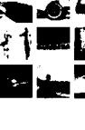

学习进步群


活码长期有效

## 问答：从必然王国走向自由王国

问答：从必然王国走向自由… ↓

## 来自日课：学习一个“深度学习”算法 (1)

读者 诸风明月：

反复学习是刺激神经元，相当于不断加大所权重的过程。那么权重大小是否在大脑中是神经元之间连接的稳定与否？

万维钢
不是加大权重的*大小*，而是加大权重的*确定程度*。一开始神经元给这个输入数据的权重是0.9，但这是一个随机的分配，有很大的不确定性。随着训练的加深，神经网络越来越相信这个权重应该是0.11，参数稳定在这里。看数值，减少了。但是确定性大大增加了。

## 来自日课：学习一个“深度学习”算法 (2)

读者 媚维层：

卓老师曾经讲过一个计算机制造算法：吃豆人游戏，大概方法就是随机给每个吃豆人移动策略，通过大量的游戏比赛，筛选出较优的策略，然后向下一代遗传，同时又随机改变一些策略，然后再进行大量的游戏比赛，筛选出较优的策略。通过这个方法不断的遗传变化下去。最终得到了非常理想的吃豆策略。我觉得这个吃豆游戏的遗传算法和神经网络算法有非常相似的地方。一是都需要大量的训练，通过大量的数据喂养，来寻找到较优方案；二是都在不断的随机调整参数或策略，不好的参数或策略最终被抛弃，好的参数或策略被保留并遗传下去；三是它们找到的参数或策略都不是最优解，不能保证100％正确，但解决具体问题的时候都非常有效。遗传和神经在计算机上如此相似有效，是巧合？还是必然？

## 来自日课：学习一个“深度学习”算法 (3)

## 万维钢

我认为“智能”的意思是会随机应变，能处理不同的问题。“智能”的反义词是机械化的重复劳动。也许AI界定义的智能不同于“意识”，意识是有就没有没有就没有黑白分明的东西，而智能是一个分高地上下连续变化的东西。

“强化学习”不靠背题，随机应变的能力更强，的确比图形识别算法有更强的智能。但是我理解，强化学习仍然是基于经验的。它自己跟自己玩，通过试错发现最优的操作，但这个判断仍然是从经验中得来。它认为这个方法最好，只不过是因为这个方法在过去表现得最好——它不知道*为什么*这个方法表现这么好。

正如朱迪亚·珀尔在《为什么》这本书里所说，知道“为什么”很重要。理解因果关系，下次局面发生剧烈变化的时候，它才知道怎么随机应变。

比如说，强化学习 AI 在《星际争霸》中表现好，那我给它换个游戏打，它能立即上手吗？它得重新训练。它能对游戏提出什么改进意见吗？它能说说游戏里哪个规则对防守的影响最大吗？人类玩家有发展经济、堆兵、突袭这些概念，可能这些概念限制了人类的想象力，但是人类能举一反三。

最简单的测试，就是如果人类棋手跟 Alpha Go 比赛的时候突然要求改变一下规则，比如把原来 19×19 棋盘改成 17×19，看看AI怎么应对。人类棋手会发现以前学的围棋知识几乎都仍然适用，而 AI 可能不得不重新训练。


### 万维钢·精英日课³
帮你和全球精英大脑同步
版权归得到App所有，未经许可不可转载

## 日课精选

提交留言可与专栏作者互动

## 春节优选1：怎样“调控”快乐

万维钢

从今天开始，咚们开启七天的春节优选特别放送。一个好问题，会激发一个好答案，我为你从前两季日课中选出了7个好问题，这7篇日课没有《未来简史》《天体物理学》的解读那么有名，但也非常受我们的读者欢迎。这个假期，日课不再为你增加新知识了，你多陪陪家人，调整身心，准备迎接来年更广阔的风景吧。精英日课祝你春节吉祥，阖府团圆。好，来听今天第一篇优选：怎样“调控”快乐。

春节优选1：怎样“调控”快乐

今天咱聊说说“快乐”。快乐总是……短暂的。哪怕是再愉快的事，如果没有变化，时间一长，你也会觉得没意思。我们总是在寻求新的刺激、更加新的东西、不一样的乐趣。

哲学家和心理学家早就明白这一点。咱专栏前面讲《为什么佛教是真的》那本书，其中就说过这个道理。快乐总是短暂的，这是自然选择の設定。只有让你得不到长久的快乐，你才永远有动力去寻找快乐，你才能一直为了生存和传递基因而努力奋斗。

面对这个设定，佛学的办法是别太快快乐当回事儿：短暂的快乐那都只是幻觉，我们活着是为了体验真实的世界。今天我要说的核心办法？如果我们就是想多体验一点快乐，我们应该怎么办呢？

那咱就得研究一下快乐机制的底层原理。

西北大学神经生物学教授英迪拉·拉曼（Indira M. Raman）3月15日在鹦鹉螺杂志上发表了一篇文章，叫《不快乐是口感清清剂》（Unhappiness Is a Palate-Cleanser： Why it’s impossible to always be happy），从脑神经科学的角度，说明了为什么快乐总是短暂的。

## 1.机制

研究人有不同的研究法。心理学家把人的大脑当成一个黑匣子，从外面推测人是怎么想的，总结一些宏观的规律。脑神经科学家是把这个黑匣子给打开，看看里面的结构，什么电信号、化学过程到底是怎么回事。心理学的规律不一定可靠，但是如果脑神经科学家能找到底层的机制，那这个规律就算是坐实了。

## 2.制造快乐的两种方法

- 1. 追求多样性。新奇的、不一样的刺激会让我们快乐。
- 2. 追求间隔性。间隔一段时间，哪怕是以前经历过的刺激，我们还是会感到快乐。

## 3.调控快乐


有一个洞见。

吉尔伯特说，这两招你不要同时使用。不能间隔，你才需要考虑多样性。如果有时 间间隔，就不需要再搞多样性了。

人们吃中餐一般都是几个人点一桌子菜交叉着吃，可是吃西餐通常都是每个人只吃自己点的一道菜，缺乏多样性，所以快乐更短暂。如果你昨天晚上在这个餐馆吃饭，今天晚上又来了这个餐馆，那哪怕这家餐馆只有一道菜是你喜欢的，你今天也应该换一道菜，来点多样性。

而吉尔伯特说，如果你是每个月才去一次这家餐馆，那你就应该每次都点最爱吃的 那道菜。

这个建议和拉曼说的“不快乐是口感清洁剂”是一致的。以我之见，这就是我们在 这个物质极大丰富的现代社会保持快乐的 最佳方法。

快乐在今天这个世界是廉价的。设计电子游戏的人非常明白怎么让人快乐，他们最主要 的手段就是第一个方法——多样性。游戏里会不断有新鲜的刺激，让你一直玩下去，乐此不疲。上网看微博、刷视频也是这样。这种电子化、工业化的刺激密集度比真实日常生活高太多了。没有人能抵抗这种快乐的吸引。

但是我注意到，这些娱乐项目有个本质的弱点。

设计者总是希望你一直留在他的产品里，所以他总是使用第一个制造快乐的方法。他负担不起第二个方法，也就是间隔。

所以在这个时代，间隔出来的快乐，更稀缺，所以更宝贵。

这就意味着我们应该更多地使用间隔的方法对快乐进行调控。比如说，再好吃的东西，也别一次吃太多；再好玩的游戏，也别无限制地玩。适可而止是为了长期的享受。而且这涉及到生活的主动权。被多样性吸引是“被”吸引。间隔，总是你主动。

而第一种方法也有高级的用法。这就是要追求比较“深”的东西。搞学问，学科的道理越深越好，你每进一步都有新的刺激。做事业，目标越远大越好，你才能一直有新的挑战。这就是为什么对有使命感的人来说工作才是最大的快乐。

所以我们的快乐调控策略就是，浅的东西用间隔，而深的东西自带多样性。


日课精选

提交留言可与专栏作者互动

## 春节优选2：怎样（不）说谎话

春节优选2：怎样（不）说谎话。

你说过谎话吗？

当然说过。一个人都说过谎话，说谎不等于恶意欺骗。有时候我们会说一些善意的谎言，有时候一个小小的谎言就能省下一大堆麻烦。但说谎毕竟不是好事。特别是在正式的场合，面对严肃的工作和生活问题，你其实是不能说谎的。

因为损失太大。你说的话会被人记住，将来一旦发现是说谎，信誉就完了。如果一个人说的话别人都不知道该不该相信，这就没法合作。所以理性的哪怕纯粹出于自利目的，也应该避免在正式场合说谎。

# 可问题在于，总有些事儿我们的确就是不想让别人知道真相。别人问了，你不回答也不行，说谎也不行，那么怎么办呢？

下面这个办法不是我的主意，是哈佛大学政治哲学教授的建议。

几年以前有一本非常流行，哈佛大学教授迈克尔·桑德尔（Michael J. Sandel）的《公正：该如何做是好》。在这本书中，桑德尔说，作为一个不说谎的人，遇到实在不能说实话的情况，你可以给对方一个“误导性的事实”。

比如说，你的朋友为躲避杀手的追杀躲入你的家中，杀手找到你家，问你那个朋友是否在这里，你应该如何回答？

桑德尔不建议直接撒谎说他不在这里。他的建议是，你可以告诉杀手，“我今天下午在超市里见到了他。”

这就是“误导性的事实”。首先你说的的确是事实，你今天下午的确跟那位朋友一起去了超市。但你这是一个误导性的事实，因为杀手听了这句话，还以为你的意思是说这个人不在你家，你上次见到他就是在超市里。你没有撒谎！是他自己被误导了。

桑德尔还举了个真实的例子：比尔·克林顿。克林顿在竞选总统的时候，被问到是否使用过娱乐性的毒品。克林顿的回答是“我可以明确告诉你，我绝对没有违反过美国关于毒品的法律。”

这个回答一点毛病也没有。你完全可以理解成克林顿的意思是说他没吸过毒、没吸过毒、也没携带过毒品，凡是违法他都没做过。但是实际上，克林顿在英国吸过大麻——不过这当然没有违反美国关于吸毒的法律。

这一招对政客太方便了，像克林顿更是张嘴就来。最著名的一次，是克林顿和莱温斯基的丑闻。新闻爆出来以后，克林顿在公开场合宣誓和作证都是理直气壮地说“我和莱温斯基没有性关系”。这句话从技术角度来讲，也可以说是一个事实，因为他们确实没有发生过完整的、通常意义下的性行为！具体情况想必大家都知道，不知道的同学可以自行查阅维基百科“莱温斯基丑闻”相关条目。

技术上是没问题，可是事件最后的定性，人們还是认为克林顿这种行为就是撒谎。

## 那么我们的问题就是，桑德尔说的这个办法真的有用吗？用事实误导，就比直接撒谎好吗？

我之所以想起来这个话题，是因为刚刚在英国心理学学会研究文摘（BPS Research Digest）上看到了一篇新的研究报告，Using the truth to mislead (paltering) feels less bad than lying, but will cost you in the long run（用事实误导感觉不像撒谎那么差，但是从长期来看也有坏处），作者是Alex Fradera。

这篇报道介绍了一项去年12月份刚刚发表的研究。心理学家做了两个实验，测试“用事实误导”的使用效果。

第一个实验是模拟在网上卖车。一部分受试者扮演卖车者，一部分受试者扮演买车者。假设这辆车其他方面都很好，唯一的缺陷是有时候打不着火。受试者让买家问卖家，这辆车的引擎有没有毛病？卖家不能直接撒谎，也不想告诉买家这个车的毛病，于是就告诉买家一个误导性的事实：“这辆车在路上行驶的时候非常平稳。”——是啊，只要你能打着火，开起来确实没问题。

买家拿到车，就发现了点火的毛病。然后研究者让扮演买家的受试者和扮演卖家的受试者分别给卖家打分，评价卖家的可信程度。满分7分，结果卖家给自己的打分是平均3.4分，而买家给他打的是平均2.5分。

# 也就是说，当你用事实去误导别人的时候，可能自我感觉比直接说谎好，但在别人看来，你就是在说谎。

第二个实验是模拟卖地。假设有人想卖一片地，如果这片地是要用来开发成居民区，开发商，也就是买家愿意出的价格就比较低；如果这片地开发成商业用地，买家愿意出的价格就会比较高。所以卖家在要价之前，先问了开发商一个问题：“这块地是开发成居民区还是商业区？”

买家其实是想做商业区。但是从讨价还价角度，买家不希望卖家知道他们要做商业区，那么买家应该怎么说呢？实验人员把扮演买家的受试者分成三组：

- 第一组说实话，告诉对方买这块地是为了商业用途；
第二组直接撒谎，告诉对方这块地将被开发成居民区；
第三组说的是“误导性的事实”，告诉对方“我们公司一直以来都是做居民区开发”——这句话是对的，他们公司确实一直做居民区开发，只不过打算从这块地开始做商业区开发。

最后揭露事实，研究者让扮演卖家的受试者对这三组买家进行评价，结果撒谎组和误导事实组得到的评价是一样的。

对被误导的人来说，用事实误导 = 撒谎。

## 那桑德尔的建议是错的吗？也不 是。用事实误导并不仅仅是为了给自己找个心理安慰。用事实误导，还是比直接说谎好。

桑德尔说，虽然你误导了别人，但只要你说的话还是事实，你的话就还是值得听的。别人可以仔细分析你说的每一句话，从事实推测真相。可是如果你直接撒谎，你的话就根本不值一听了。

## ｜我的评论

学会用事实误导去代替说谎，这是社会进步的表现。其实我们可能经常会无意识地这么做，但是我们没有把它上升到理论高度。在英语里，这个行为专门有个词，叫“palter”。中文词典中把“palter”翻译成模棱两可，闪烁其词，这个翻译没有抓住要点。

我们设想，如果人人都随随便便撒谎，那么这个社会就太可怕了，根本没有合作基础。而如果我们说的都是事实，只不过有时候故意用事实误导，那么这个社会虽然也不完美，但至少还是值得互相说话的。

公众人物说话尤其是这样。我们很难想象外交部发言人直接说谎是一种什么情景。而用事实误导，也许是他们常做的，也是我们可以理解的事情。

## ｜练习题

假设有猎头找你，说有个创业公司，愿意给你更高的职位，而且那个新公司的发展前景特别好，只是一开始给的工资比你现在的工资低一点，你有点动心。你还没有拿定主意之前肯定不想让现在公司的老板知道你有可能会跳槽。有一天老板跟你闲聊，问你有没有跳槽的想法，你怎么回答呢？

你可以说：“从经济上讲我对目前的薪水是满足的，我不认为有哪个公司还能给我更高的工资。”

你会怎么回答？欢迎在日课留言区写下你的答案。

## ｜由此得到

- 在社会行事，一定不要说谎。
如果你非得说谎的话，可以尝试用事实误导这个办法。但是请注意，将来别人发现了，还是会被认为你撒谎——他会同样鄙视你的品格……但至少不会鄙视你的智商。


日课精选

提交留言可与专栏作者互动


# 春节优选3：怎样对抗进化

优选3怎样对抗进化

今天咱们讲一个有关“进化”的道理。

进化，或者更严格的说法应该叫“演化”，是最厉害的社会化创新机制。事实证明达尔文进化论并不仅仅仅适用于生物世界，凯文·凯利说的人类技术的进化就符合生物进化的规律，雷·达利欧讲的企业进步也符合生物进化规律，计算机科学家使用进化规律寻找高效率的算法。我们大约可以说，所谓市场经济，就是能让好东西自产生、自己冒出来发展壮大、并且不断适应新环境变化的进化机制。

进化这个机制是如此的厉害，它几乎就是不可阻挡的。

而我们今天要说的这个道理，恰恰是怎么阻挡进化。这是由于世界上有些东西的进化速度太快，对人类是个危害。

比如说一个养猪大户，他有几千头猪。有一天，他发现很多猪感染了一种病菌，所以他就给这些猪使用了一种抗生素。抗生素的效果很不错，大部分病菌都被杀死了。养猪户们一看这个抗生素这么好使，就纷纷大量购买，发现猪有毛病就打一针，有时候没毛病的猪也打上再说，表示预防。

结果在病菌这个层面，事情开始起了变化。同一 种病菌有很多很多的个体，个体之间大致都是相同的，但是偶尔也会因为基因突变的缘故，有细微的、但是重大的差别。本来绝大多数病菌都怕这个抗生素，遇到就死了——但是其中有少量个体，因为其特殊的基因变异，不怕这个抗生素。它们幸存了下来。

用进化的语言说，抗生素的存在，给这些病菌提供了一个“选择压力”。

这些不怕抗生素的幸存者，就是这个选择压力“选择”的结果。怕那个抗生素的病菌都死了，而幸存者们获得了巨大的生存空间。它们不断地繁殖，它们的后代，在抗生素选择压力的作用下，变得越来越不怕抗生素。也就是说，病菌在演化。

这样演化的一个可能结果，就是病菌族群再次发展壮大起来，而且这次全都是不怕那个抗生素的病菌！在养猪户看来，这就是病菌产生了“抗药性”。

通常说起来演化，我们都觉得是几万年的尺度。像人类20年才能繁衍一代，演化速度就很慢，我们今天的身体设定跟农业革命之前可能几乎没什么变化。可是细菌的繁殖和演化速度非常非常快，以至于几天、甚至几个小时，就能培养出有抗药性的品种来。

这就是进化的力量。而且这个力量无处不在。

比如说，以前的农民在田间锄草，要把庄稼留下，把杂草拨掉——而有些杂草，就会演化成长得很像庄稼的样子，让农民无法识别。你可以说这也算是一种抗药性。

再比如说，农民种植转基因农作物在很大程度上是为了对抗虫害。有的转基因农作物会自带一种毒素，害虫吃了会中毒，可是对人没有害处。农民种植这个转基因农作物就可以少喷农药，这挺好，对吧？然而只需要几年的时间，害虫们，对这个转基因农作物，就进化出了抗药性。

还有癌细胞也是这样。一开始你可以能使用化疗之类的药物大规模地杀死癌细胞，可是癌细胞的生长繁殖速度非常快，它们可能会进化出抗药性，它们能避开身体免疫系统的攻击。药物一开始好使，可是过段时间就不好使了。

所以进化确实是一个特别厉害的力量。你要对抗进化，就是在对抗一个非常善于了解你的敌人——一旦他适应了你的打法，你就拿他没办法了。

但也不是完全没办法。我最近读到《新科学家》杂志的一篇报道 [1]，专门研究怎么写对抗抗药性，也就是怎么写对抗进化。这篇报道总结了一些常规的方法，然后重点说了一个新方法。以我之见，这些方法大致可以分为两种指导思想。

## 一种指导思想是多管齐下。如果单一的药物容易让对方产生抗药性，那我几种药物轮番上，没被这个药杀死的也会被那个药杀死，细菌或者癌细胞产生抗药性的可能性就会大大下降。

比如现在治疗艾滋病的通用做法，就是基于1995年华人科学家何大提出“鸡尾酒疗法”——这个做法就是把当时已经有的几种抗艾滋病药物组合使用，其主要目的，就是为了避免抗药性。

这是一个加高法思想，你厉害我更厉害，相当于是用多样性对抗演化。我觉得这个思想肯定有局限之处，比如说，你转换攻击方式的速度肯定要比对方产生抗药性的速度快才行。而病菌繁殖的速度可能比换抗生素快，转基因植物的基因更不能年年转。

## 另一种指导思想，则是做减法。这个思想是减少选择压力，让对方*没有必要*进化。

比如说，现在农民要种植转基因农作物，通常会被要求在转基因田地里，也间隔地种植一些“非转基因版”的传统农作物。因为转基因农作物有毒，害虫还是会被大量杀死。但是因为非转基因版农作物的存在，也有许多害虫没有被杀死。产生基因突变的、不怕转基因毒素的害虫毕竟是少数，而因为有很多传统的害虫活着，它们交配的结果，就不会让不怕毒素的害虫做大做强。

在实践中这个方法的确是行之有效。抗药性的进化会被停止，甚至还可以被扭转回来。这个思想的关键，就是你一定要让对药物敏感、害怕这个药物的个体，多于有抗药性的个体。

而这也就意味着，你明明可以杀死那些害怕这个药物的个体，但是你选择留下一些不杀。

说白了，这要求你克制自己的杀戮欲望。可是一 般人做不到这一点，养猪户总是尽情地使用抗生素，农民不愿意保留非转基因版的农作物。卓克老师有一期专栏文章叫《和微生物共处的日子》，其中就提到，现在抗生素滥用已经到了微生物大规模产生了抗药性，以至于未来我们可能会面临一切抗生素都不好使的境地。而滥用的根源不是医生给病人用，恰恰是在农牧业。

而《新科学家》这篇报道中的新成果，则是使用基因编辑的方法，主动制造一些对药物敏感、没有抗药性的细菌个体，再让这些个体去占领细菌的族群，以期扭转抗药性的进化趋势。

具体的方法是培养某种特殊的噬菌体，让它们进入细菌体内，啃掉能够带来抗药性的DNA片段，同时还让这个细菌活着！这个方法在实验室里已经成功了，但是我理解还没有正式推广使用。

这些技术细节对我们这些非专业人士意义不大，我们最关心的是其中的思想。这个思想仍然是尽可能保留一些传统的、没有抗药性的个体，以期减缓进化速度。

在我看来，事先节制、少用抗生素也好，保留非转基因农作物也好，“复活”不带抗药性的细菌也好，这个战术的本质，在于你追求的不是“杀死”，而是“控制”。

全杀死实在太难了，你真要把手段用绝，敌人可能就会快速进化。所以你选择留下一 点余地，允许一部分敌人活着，让他们有个出路。只要敌人的总体数量在你可控的范围之内，你仍然是成功的。

我认为这是一个智慧。真能把坏东西赶尽杀绝，那当然是最理想的，但是结局往往是坏东西没有死——而是变了。坏东西换了个方式继续流行，而你的手段却已经用尽。还不如故意留个后门，正所谓“围城必阙”，只要达到压倒性的优势也就可以了。

这可能也是一个管理学。我们考察历史，因为一开始追求的是赶尽杀绝，结果反而让敌人产生了抗药性，变得你无法控制的例子，有好几个。

比如说，明朝身处世界各国的大航海时代，逆历时潮流而动，非得海上禁。除了朝贡之外一切正当的海上贸易都被禁止，老百姓想做正经海货生意都不许做，这就相当于试图用一个抗生素杀死所有的细菌。结果明朝海盗、倭寇特别发达，而所谓的倭寇，其实很多都是中国人——这就谓的倭寇，其实很多都是中国人 —— 这就相当于细菌进化出了抗药性。

你让海贸不合法，结果就是只有不合法的人才去搞海贸。

美国上世纪三十年代的禁酒令也是同样的剧情。你全面禁酒，结果就是卖酒的都变成了黑手党。

全面禁止是禁止不了的，结果是都产生了抗药性。

而对比之下，我们看今天各国政府对赌博的态度就很有意思。赌博是不好的，赌博的危害比海贸和酒精更大，各国都对赌博行为有各种的限制 —— 可是人民喜欢，所以各国都留了后门。在美国只有某些特定地区，和拥有特许权的印第安人才可以开赌场。

允许一些合法的赌博，赌博行为就没有大规模地变异成地下赌场。赌博，现在基本上不是个严重的社会问题。

当然我们不是说一切非法行为都应该合法化。对付抗药性到底是使用轮番打击的思想还是使用网开一面的思想，在很大程度上应该是取决于敌我双方的反应速度对比，在不同的领域有不同的选择。

但是不追求禁止，而是追求控制，这个思想值得你借鉴。比如说小孩爱玩电子游戏。如果你实行全面禁止电子游戏的政策，孩子就有可能自己偷偷跑到街上的游戏厅里玩，搞不好更危险。如果你改为追求控制，在家里给他买个游戏机，允许他每周玩一会儿，也许效果更好。

## 日课精选

提交留言可与专栏作者互动

# 春节优选4：怎样提高受欢迎度

春节优选4：怎样提高受欢迎度

今天我们重点讲怎么提高受欢迎度——一方面是提高自己的受欢迎度，一方面是作为家长怎么帮助孩子提高受欢迎度。我们知道受欢迎度有两种，一种是地位高，一种是被接受，其中能够带来长期幸福感的是被接受。

我以前听一些心理咨询、心理分析的案例总觉得特别不服气，因为我发现心理咨询师总爱把一个个性格的缺陷归因于他童年的不幸。好像不管你现在哪里不对，归根结底都是当年你父母的不对。然后治疗方法就是唤醒自己埋藏多年的童年记忆，先痛哭一场。我觉得这个方法也太不好了，有问题解决问题，抛弃父母干什么？成年人得为自己负责。

而我们从这本书里可以看出来，影响我们受欢迎度的一个最重要原因，是……当年妈妈的不对。

### 1.其母和其子

咱们想象一个场景。一个年轻的妈妈，领着自己刚满一岁的孩子，到一个幼儿园里的游戏室玩。孩子是第一次来这个地方，感到很新奇但是也有点紧张，总是在靠近妈妈的地方玩。母子二人玩了一会儿，幼儿园的老师走进房间，她非常友好，也跟这个孩子玩。孩子慢慢适应了老师，但仍然跟自己的妈妈更亲近一些。妈妈找了个机会，在孩子没注意的情况下离开了游戏室。孩子发现妈妈不在房间了，有点不乐意，但勉强还是继续跟老师一起玩。过了 一会儿妈妈回来了，孩子一看到妈妈就特别高兴，马上跑到妈妈身边。

家里有孩子的读者肯定对这个场景非常熟悉，这不就是我们最早送孩子进幼儿园的情景吗？这也是心理学家喜欢用 的一个观察6到18个月大的孩子对父母的“依恋度”的方法。如果你家小孩是前面说的这种表现，你应该感到高兴！这是非常正常的表现，说明你给孩子提供了足够的安全感。

那么“不正常”的表现是什么样的呢？小孩进入游戏室之后就自己玩玩具，根本不在乎妈妈在哪里，甚至还故意离妈妈远一点。等妈妈回来的时候，他也无所谓，你让我留下来我就留下，你要我走我就走。这就太疏远了。还有一种情况则是孩子一时半刻也不能离开妈妈。这两种情况都是安全感不够。当然，把这个实验里的妈妈换成爸爸也可以。

荷兰的一项研究表明，从一个孩子一岁时候的安全感，就能判断他七岁时候的受欢迎度。

心理学家还有个特别简单的方法能预测一个五岁小孩在七岁时候的受欢迎度——给他的妈妈五分钟时间，让她谈谈自己的孩子。如果妈妈说起自己的孩子都是用一些温暖的词汇，充满喜悦和自豪，那就说明母子互动良好，这个小孩到七岁的时候也会跟同学相处的很好。如果妈妈一说起孩子就是各种抱怨，那么这个孩子就很可能特别具有攻击性。

我们知道小孩真正面对社交生活，是在十三岁以后。而在此之前孩子跟父母的互动，与其说是反映了孩子是什么人，不如说是反映了父母是什么人。

事实上，杜克大学的研究者发现，想要知道一个孩子受不受同学欢迎，你可以直接问他妈妈自己小的时候受不受同学欢迎。

如果妈妈回想起自己当年在学校的日子，都是一些幸福时光，自己当年就是“被接受”的，那么她的孩子在学校的受欢迎度也绝对是平均水平之上。

如果妈妈当年是个“被拒绝”的角色，整天跟同学充满敌意，那么她的孩子也很有可能被拒绝。

但有意思的是，如果妈妈当年是“被忽略”，感到特别孤单无助，她的孩子反而不会是这样的人——孩子很可能是比较受欢迎的。那这是为什么呢？

研究者说，这是教育的作用！被接受的家长自己就善于与人相处，带出来的孩子自然也不差。被忽略的家长从小体会到孤单无助之苦，她会特别重视孩子的社交，帮助孩子跟同学好好相处。而被拒绝的家长，因为自己就“情商太低”，根本不知道怎么跟人相处，当然也不能教会孩子。

很多东西都是天生的。长得好看的人，连刚出生的婴儿都喜欢她，自然从小到大都受欢迎，而且家长的一些性格也能遗传给孩子。但至少这个被忽略的家长教出受欢迎的孩子的研究表明，后天努力还是有希望的。

其实想要被接受，一点都不难。

### 2.假装一天被接受的人

普林斯诗汀本是北卡罗来纳大学（UNC）的心理学教授，他每年都讲一门心理学大课。每年都有一天，所有选这个课的人，要参与一个大实验。

实验前一天算是“对照组”，学生们要时刻记录自己跟每个人的互动情况，并且写下自己在互动中的各种感受。

实验当天，所有学生、包括普林斯诗汀本人在内，都穿一件颜色特别明亮的T恤衫，上面写着一句特别显眼的话：“我是UNC最受欢迎的人”。他们的任务就是穿着这件衣服在校园里该干啥干啥，同时记录自己跟别人的互动情况和感受。

结果每个人的社交待遇都大大提高了。穿上这件衣服出门，不管认识不认识的人都过来跟你打招呼，“你这是什么节目？”路上行人都会对你点头微笑。

然后你发现你也变了。别人对你发出各种友好的信号，你也不会自主要对别人表示喜欢。这个局面就好像中国过年一样，看谁都是喜气洋洋的样子。参加实验的学生们整整一天都很high，到处受到关注，走路也不看手机了，抬头跟各种人打招呼，跟一群人在一起的时候也敢安排说话了——而且他们发现自己讲的笑话原来还真有人爱听。

普林斯诗汀这个实验的目的，是为了证明“被接受”是可交易的。你喜欢我，我就更喜欢你；我喜欢你，你就更加喜欢我。一天下 来，学生们记录的感受都非常正面，充满自信、很乐观，幸福感强，而且还获得了一种归属感。

> 有个学生说：“如果我在幼儿园的时候就穿着这件T恤衫，今天的我肯定是个完全不同的人。”

咱们以前讲《俞省》这本书的时候有一期叫《穷冤救女效应》，其实说的是类似的意义。你想让别人怎样对你，最好的办法就是先主动怎么对别人。

普林斯诗汀自己还做过一个非正式的实验。他在一天之中，有时候假装喜欢别人，有时候假装不喜欢别人，看看到底别人怎么对待他。比如他家的网断了，他打电话到互联网接入公司抱怨，对方给他连接了好几个技术员指导他设置网络，可是问题怎么也解决不了。普林斯诗汀就利用这个机会有时候故意说话非常友好，有时候故意说得很不耐烦——按理说对方都应该以专业精神公事公办地帮他解决问题，但事实上，对方的态度就很不一样。

所以受欢迎度是可以传递的。如果某天早上你遇到一个不受欢迎的人，可能你自己也会变得不受欢迎，然后你又影响别人，整个就是一个链式反应。这就是受欢迎的雪球效应。所以现在人们爱说的什么“正能量”还真有道理啊！

那么作为家长，怎么给孩子“正能量”呢？

### 3.干预和不干预

中国家长最关心的是孩子的学习成绩，因为有这一最最重要的指标，其他事情反而简单了。美国家长对学习成绩没有那么重视，关注点有时候不太一样。

据说美国有个女高中生的妈妈，为了自己女儿能在校拉拉队获得一个首发位置，竟然谋杀了女儿一个同学的妈妈——仅仅是为了让那个同学上不了场！

这个例子非常极端，但你能想象得到，有些家长非常关注孩子的受欢迎度。他们从孩子多大的时候就帮助着别的孩子一起玩，一直 到高中中处处处处预孩子的社交生活。

不过普林斯诗汀说，家长的干预应该有个限度。这个大原则是孩子越小你就越应该干预，比如三岁的孩子玩的时候，家长甚至可以参与。事实上家长跟孩子以平等的身份玩游戏 —— 特别是体育游戏，双方严格遵守规则，是培养社交能力的好办法。但是孩子越大，你就应该越少干预。最好是只有当你发现他有社交困难，到了被忽略甚至被拒绝的程度才干预。

其实父母做什么事情，对孩子的影响是相当有限的 —— 还是那句话：你是个人，比你怎么做更重要得多。我们在《中美好家长都为孩子做些什么》这期日课里讲过类似的道理。

最后我们再强调一次，想要获得幸福生活，“被接受”是比“地位高”更好的选择。普林斯汀说，这就意味着 ——

- 要帮助别人，而不是只顾自己的需求；
- 要关注别人，而不是只想要被关注；
- 要精心培养深入的关系，而不是收集更多的朋友圈“点赞”；
- 要让别人感受到接纳和欢迎，而不是自己感觉高人一等。

普林斯汀本人在整个青少年时代都是被忽略的角色。他一心只想学习，不善交际，同学有什么活动都不带他，有时候还拿他开恶劣的玩笑。结果今天的普林斯汀专门写了一本关于欢迎度的书。

所以我猜，就算是你现在的欢迎度不算太高，也不用太担心。

## 日课精选

提交留言可与专栏作者互动

# 春节优选5：怎样快速跟人建立亲密关系

春节优选5：怎样快速跟人建...

有时候两个人能一见如故甚至一见钟情，有时候两个人在一起多年也只是泛泛之交——这其中并非没有规律可寻，其实还有技术可以学。

今天我们要说的这本书：

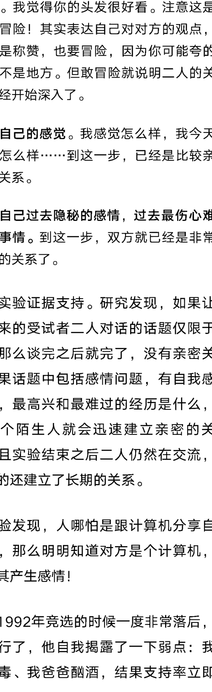

(Click: The Forces Behind How We Fully Engage with People, Work, and Everything We Do《咔嚓：让我们跟人、工作和任何事情凝聚在一起的力量》作者 Ori Brafman and Rom Brafman)

此书第一作者多年从事企业管理方面的咨询工作，他的另外几本书也都很好，以后我们可能会讲到。

跟人增加亲近感，有几个小技术。

比如说随意地触碰一下对方，造成身体接触，或者多有一些眼神交流，就很有效。有研究表明工作面试时双方的眼神交流跟成功率很有关系。

像这样的规律当然很有用，一般可以用在找工作和找对象上。但如果你是一个专门在跳楼现场劝说别人不要自杀的谈判专家，你就需要一些更高级的技术——专业的、能让你刚刚见面就与对方迅速建立亲密关系的技巧。

谈判专家最有效的一个技术，是故意跟对方说一个自己的弱点。把自己内心的隐秘暴露出来，让对方觉得你也有弱点，你是可能被伤害的，你才算是把自己真实感情的一面展现给了对方。这样对方就能立即获得安全感，感受到信任。

斯坦福大学MBA班有一个学习建立亲密关系的课程。一开始老师让学生们自由聊天，大家泛泛而谈一些不重要的话题。后来人们开始谈论自己的感情经历，虽然不一定是爱情。最后人们谈论自己内心的隐秘，结果都哭了，这时候全班同学都建立了非常亲密的关系。

谈判专家的策略就是在几句话之内就找引出情感话题——其实我最近心情也很差，我奶奶刚刚去世！对方就会问：“啊，你奶奶去世了吗？”这样二人的关系马上就上道了。

让谈话深入的几个阶段：

讨论事实。我住在纽约，你住在哪里？

评价。我觉得你的头发很好看。注意这是一种冒险！其实表达自己对对方的观点，哪怕是称赞，也要冒险，因为你可能夸的根本不是地方。但敢冒险就说明二人的关系已经开始深入了。

谈论自己的感觉。我感觉怎么样，我今天觉得怎么样……到这一步，已经是比较亲密的关系。

谈论自己过去隐秘的感情，过去最伤心难过的事情。到这一步，双方就已经是非常亲密的关系了。

这个有实验证据支持。研究发现，如果让随机找来的受试者二人对话的话题仅限于事实，那么谈完之后就完了，没有亲密关系。如果话题中包括感情问题，有自我感情揭露，最高兴和最难过的经历是什么，那么两个陌生人就会迅速建立亲密的关系，而且实验结束之后二人仍然在交流，甚至有的还建立了长期的关系。

另有实验发现，人哪怕是跟计算机分享自己感情，那么明明知道对方是个计算机，也会对其产生感情！

克林顿1992年竞选的时候一度非常落后，几乎不行了，他自我揭露了一下弱点：我弟弟吸毒、我爸爸酗酒，结果支持率立即上升。

暴露自己的弱点，其实对别人是一种邀请你可以进入我的生活。大部分人不愿意暴露弱点，一个原因是害怕别人利用你的弱点攻击你。也可能是 encuentran被别人可怜。不过我们不暴露弱点更重要的原因，也许是我们不知道暴露弱点有这么明显的好作用。

## | 我的评论

这不就是“搭讪学”吗？说如果一个女人开始跟你分享她的感觉了，你就有戏。看来这一招显然适合所有人，不一定是男女之间。我看 Power: Why Some People Have It—and Others Don’t（《权力：为什么有的人有一——而别人没有》）一书也提到，大人物应该主动暴露一些弱点给公众，能够提高好感度，让人对你放心。

另外我想，这个理论是不是“赌场失意，情场得意”的原理？一个事业刚刚失败的男人把自己的弱点暴露在女人面前，女人平时看他远在天边甚至可能遥不可攀，现在发现他突然平易近人了，于是火花出来了。当然把男女反过来也适用。

## | 由此得到

让两个人关系更进一步，最迅速有效的做法就是主动暴露自己的弱点。


日课精选

提交留言可与专栏作者互动


## 春节优选6：怎样“不”集中注意力

春节优选6：怎样“不”集中注意... ↓

你肯定已经听过太多有关“集中注意力”的道理了，今天咱们说一个同等重要的道理：怎样不集中注意力。注意力是一种有限的资源，你要是不断长不集中注意力，你就不增长集中注意力。

今天我要说的是《哈佛商业评论》网站五月12日的一篇文章，“你的大脑只有这么多注意力”（Your Brain Can Only Take So Much Focus），作者史里尼·皮莱（Srini Pillay）是哈佛大学医学院的兼职助理教授，同时还是个训练师和企业家。

你以前大概听说过，“意志力”可能是一种有限的资源。一个不可以时刻都严苛地束缚自己，不能一天到晚绷着，必须是该休息还要休息，该放松还要放松。

“注意力”和“意志力”似乎有关系，我们强迫自己集中注意力的时候，必然要花费意志力。但据我理解，有些注意力就不需要意志力，比如你读一本惊险小说、参加一场重要比赛、跟心仪的对象聊天，在这些活动中人不由自主地就集中了注意力。

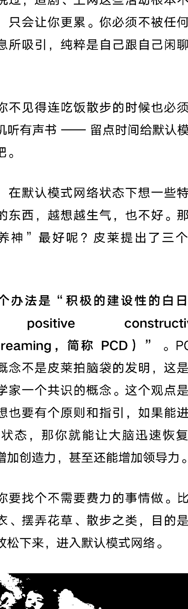

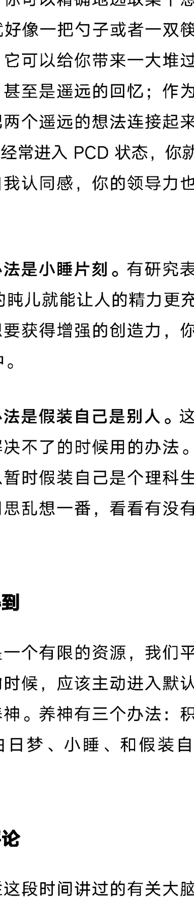

### 由此得到

注意力是一个有限的资源，我们平时不用注意力的时候，应该主动进入默认模式网络，来养神。养神有三个办法：积极的建设性的白日梦、小睡、和假装自己是别人。

### 我的评论

行。而且像“狂暴姿态”，还必须得升到30级以后才能掌握。

也许将来脑科学进一步发达，可以搞一本《大脑使用说明书》，或者说是《大脑升级指南》，详细列举大脑都有哪些状态，怎样练习才能“解锁”高级的状态。也许练习大脑就好像是武侠小说里练“内功”一样，功夫升级到每个新的高度都有新的境界。

不过就算是现有的这些状态也够我们练习和追求的了！该集中就集中，该 PCD 就 PCD，想进入心流就能心流，其疾如风，其徐如林，侵略如火，不动如山！这岂不是大脑的真正自由吗？


万维钢·精英日课³
帮你和全球精英大脑同步
版权归得到App所有，未经许可不得转载

## 日课精选

Aa
字号

写留言

0

请朋友读

## 春节优选7：怎样用知识和世界相处

春节优选7：怎样用知识和世界相处...

苏格拉底有一句名言，不知道你听说过没有，叫“我唯一知道的就是我一无所知。”我每次听到这句话，都感到非常荒唐。

苏格拉底是圣人，但是圣人的话也是有具体背景的，不能直接当鸡汤喝。你怎么可能唯一知道的就是一无所知呢？如果一无所知，那要你有何用呢？

比如现在有个事儿，大家正在讨论该怎么办，看老王过来了，说老王你有什么意见？老王如果高调地说一句“我唯一知道的就是我一无所知”，那就等于宣告了两点。第一，这事儿你们别指望我，我不负这个责任。第二，如果现在谁说他有主意，我这个高姿态就是告诉你们：有主意的人做慢无知——连苏格拉底都说他一无所知，你居然敢说你知道？

我觉得我们学习知识和哲学，千万别学成老王这个样子。

我们学习知识，就是为了关键时刻敢于为自己甚至为别人负责，我们就是要在关键时刻决定该怎么做。

今天咱们把尤德考斯基的《不充分均衡》这本书讲完。尤德考斯基的最主要思想就是“不充分均衡”这个概念，咱们其实已经说明白了。今天要探讨的，是作为个人，应该怎么处理好知识和社会的关系。

这本书全部的意义，就是告诉你这个世界上有着许许多多的漏洞，哪怕你不是专家，你也不应该全听专家的。

### 1.医生到底行不行？

我想请你回忆一个自己找医生看病的经历。从道理上讲，医生都经过专业的训练，而我们并不懂医学，所以我们如果有病就应该把性命交给医生，医生说怎么办就怎么办，对吧？但这件事情并没有这么简单。

有时候医生是真害苦。我先赘述一个自己的经历。三年前，我有一次突然感到腹部内部某个地方剧痛，到了满地打滚的程度。我妻子就赶紧把我送到了急诊室。我第一时间就得到了救护，但是很快我就发现，那些医护人员似乎都没把我这个病人当回事儿，她们几乎是面带笑容地看着我在那儿疼。因为我完全相信医院，我当时心里就宽慰了一点，可能真不是什么大病。然后我就听到护士们私下交流，说这是肾结石的症状。

拍片子，发现结石；做尿检，发现血迹，医生确诊了是肾结石，还给我讲了他的诊断思路。然后他给我开了止疼药，说下次再疼的时候吃点药忍着，过段时间这个结石自己就会被排出来。医生还特意打了个比方，说你就像生孩子一样把肾结石排出来就好了。我这才明白护士们为什么笑，她们正在目睹一个男人生孩子事件。

结果医生精准确言了此后病情的发展。我又不定期地疼了几次，后来把结石排出来，就啥事儿没有了。在这件事之前，我几乎连肾结石这个名词都没听过，看来专家就是专家，确实得服医生啊。

但是尤德考斯基也讲了一个他的经历。他一度受到头皮屑过多的困扰，去医院看了皮肤科，医生告诉他这是湿疹，给他开了药。尤德考斯基回去用了药，结果根本不好使。尤德考斯基也很相信医生，心想既然医生给的药无效，也许这个病就是没法治的，那也就算了，头皮屑多点就多点吧。

后来尤德考斯基为了减肥，尝试了所谓“生酮饮食”，结果发现头皮屑突然暴增！这回他没去医院，自己先上网Google了一番，他居然找到一些文献，说这个症状表明头皮屑是真菌引起的。这种真菌爱吃生酮，所以生酮饮食会让真菌的大量繁殖，所以头皮屑才会大量增加。

那如何才能杀死这种真菌呢？还是互联网告诉尤德考斯基，只要用含啶的洗发水洗头就行。尤德考斯基进一步了解到，美国生产的所有含啶洗发水的啶浓度都只有1%，而有研究表明，如果用浓度是2%的洗发水，效果能提高一个数量级。他又搜索到，泰国的一种洗发水的啶浓度就是2%。

于是尤德考斯基买了泰国洗发水，根本没跟医生交流，自己就治好了自己的头皮屑。

那从这两件事情上，我们能得出一个什么结论呢？

有时候医生能表现出极高的专业素质，有时候医生的表现还不如自己上网搜索。现代医疗体系，显然是有漏洞的。

### 2.医疗是个无效市场

尤德考斯基认为，医疗体系不但不是个有效市场，它甚至都不是个市场。

如果医疗服务是市场化的，那最根本的一条，就是我们得知道一个“性能价格比”，最后起码我们得知道一个医院的性能和价格。

但是第一，医院并不公布它对各种疾病的治愈率。第二，医院甚至都不公布它治疗各种疾病的价格表。我们病了就找一家离家近、看上去“比较好”的医院——你根本就谈不上研究性价比。

如果你觉得这很正常，尤德考斯基举了一个例子。美国麻醉医师协会曾经是不统计行医结果的，后来他们决定对每个麻醉师的记录做个统计，然后还建立了行业标准，结果麻醉事故的死亡率立即就降低了100倍！

性能和价格都不公开，医院就没有提高医术和降低成本的强烈愿望。

不论治疗结果如何，医院收的钱是一样的。当然你不能因此就说医生都唯利是图不好好治病——我们相信医生确实有救死扶伤的奉献精神。但是我们也应该知道，在这个制度下，有时候医生最关心的可能不是把你的病治好，而是确保自己不犯错误。如果照章办事就能获得稳定收入，他就没必要努力钻研技术。

网上的信息是越来越全面，而对一些不常见的病，医生们却不见得了解。所以像尤德考斯基那样有什么重大医疗问题自己会Google一下，这个功夫就很有必要了。

### 3.正确的知识策略

尤德考斯基提供了几个使用知识的建议。在我看来，这些建议最关键的一个出发点，是你必须把“相信知识”和“相信专家”区分开来。

相信知识不等于相信专家，不信任专家也不等于不信任知识。放着现代医学不信，说我非得自己弄些民间偏方治病，这是不信任知识。放弃自己的判断，说我什么都不懂干脆全听医生的，这是迷信专家。

知识，使我们跟这个世界打交道最好的武器。如果知识有漏洞，那我们一点办法没有，只能做到这个程度了。但如果是专家有知识漏洞，我们是可以做些事情的。

具体说来，用知识和世界打交道，你能做的事情有三种。

第一种，是你作为一个主流人物，在主流市场中，做出重要的知识贡献。比如你作为一个医学家发明一个新疗法，这个疗法能让所有相关的病人都用得上。这种贡献是为人类文明创造了新知识。

这是非常难得的机会，你一生之中大慨可以指望0到2次这样的机会——绝大多数人根本没机会。

但是不创造新知识，可不等于你就得放弃主动使用知识的权利。

第二种，是你根据自身的情况，综合现有知识，给自己定制一个解决方案。

比如尤德考斯基给自己治疗头皮屑就是这样。他运用网上公开的知识，自己定制治疗方案，把病治好了。

几十个学生，老师讲课应该讲给谁听？最标准的办法肯定是按照班里中等水平、甚至是比中等略低一点的学生水平制定教学进度。那如果有个学生学得快，她应该信奉老师的专家意见呢，还是应该按照自己的节奏走？

肾结石是个典型的病，按照固定流程走就行；头皮屑是个疑难杂症，那你就得定制方案。

你管不了别人，但是你可以管自己。当然，自我定制对人的要求仍然非常高，你需要具备很强的综合调研能力。不过在互联网时代，取得专业知识是越来越容易了。

不论如何，尤德考斯基认为，像这种事情，你可以指望每年都做一次。

### 第三种情况，是你能不能在互相矛盾的专家意见之中，选择一个你认为值得相信的意见。

比如说，日本经济过去一二十年停滞不前，有人说这是日本的社会结构问题：老龄化社会，企业没活力，年轻人没奔头，经济不行是注定的。但也有一些专家认为其实没有那么深刻的原因——原因很简单：是日本中央银行的错误货币政策！这一派专家说，只要日本央行多印一些钱，日本经济完全可以起来。

那你信谁的呢？像这样的情况，你再说我水平低，我就信专家的，这种态度就完全没有可操作性了——现在是专家都不信专家的。

会看球的人不一定非得会踢球。如果你对各路专家的立场、风格、利益所在和门户偏见有个基本了解，如果你能认识到日本央行领导人面临的利益格局，你完全可以对这个问题做出自己的判断。

当然，你仍然不是专家，你的观点并不是你自己原创的，但是知道采信哪个专家，这也是你主动运用了知识。

尤德考斯基认为，像这样的判断，你可以经常有。

以我之见，这一切的一切的根本，就是你到底敢不敢运用知识。通过考试发射一个信号，那不叫有知识。高谈阔论装点门面，那不叫有知识。拿知识武器在辩论中压倒对方，那不叫有知识。

一切不牵扯利益得失的知识，都只不过是智力游戏。

只有当局势不明朗，没有人告诉你该怎么办，错误的判断会导致不良后果的时候，你因为有知识而敢于拿一个主意，这才算是真有知识。


日课精选

提交留言可与专栏作者互动

## 博弈论1:博弈论不是“三十六计”

博弈论1:博弈论不是三十六...

任何一本讲博弈论的书都会告诉你博弈论有多重要，不过我想咱们应该先面对现实。现实是博弈论是个奇怪的话题。

人们非常愿意了解博弈论，每个商学院都要给MBA开博弈论课程，几乎每一本流行的讲博弈论的英文书都有中文版，我们经常在媒体看到“博弈”这个词 —— 但是，人们很少真正使用博弈论。你不太容易见到有人说，这件事根据博弈论应该怎么办。

并不仅仅在中国是这样。美国《快公司》杂志曾经有一篇文章[1]说，专家学者们整天说博弈论多么多么重要，可是他们做了一个调查，问企业家你们在过去五年内是否曾经使用博弈论做出过商业决策 —— 调查结果是，没有。这个说法让博弈论爱好者火冒三丈，但是你得承认，博弈论好像不是那么好用的。

为什么会这样？以我之见，不是博弈论没用，而是人们对博弈论的用法有误解。要想知道博弈论有什么用，我们先来思考一个明显着、但是从未被提起的问题。

如果博弈论是讲谋略的，那像“三十六计”这样传统的计谋，跟博弈论是什么关系？博弈论是科学版的三十六计吗？

### 1.计谋和战略

传统中国文化给世界人民的印象，中国是个武术之国；而在我们中国人心目中，中国更是计谋之国。我们有《三国演义》《三十六计》和各种兵法，像诸葛亮、吴用、刘伯温这些军师形象特别深入人心。但是你注意到没有，“计谋”这个东西，好像都是民间在谈 —— 计谋不是严肃的学术课题。

战略，好像很高大上。计谋，好像上不了台面。这是为啥呢？

因为计谋不值得被认真对待。

### 2.什么是理性

因为现在流行“行为经济学”，人们爱说人是非理性的，连有的学经济学家都不敢理直气壮地说经济学假设人是理性的了。但是地道的经济学必须得假设人是理性的 —— 如果人不是理性的，所有数学模型、包括供求关系之类的基本结论就都灰飞烟灭了。

### 3.博弈论的用处

因为要求各方是充分理性的，有时候博弈论会得出一些非常怪的结论。

我们假设所有同学都足够聪明的话，正确答案应该是0。这是 <span> 因为不管你猜测全班人的共识是多少，你都会把这个共识乘以2/3 —— 但别人也能想到这一点，他们也会把你的数字再乘以2/3......你们的每一步推理都会让共识变得越来越小。而事实上哪个大学的学生都不会得出这么极端的答案来。

生活中绝大多数人不会聪明到那个程度，去做那种极端的推理。那难道说博弈论真的没用吗？博弈论的实际应用，并不是这种数学谜题。

博弈论能帮助我们理解长期存在的各种现象。如果你观察到社会上有很多不合理的现象，而这些现象还长期存在，你会认为这是因为社会上的人都太愚蠢了吗？博弈论会让你考察现象背后的博弈规则。

当然，这绝对不是说可以理解的现象就应该长期存在。博弈论更重要的作用，是告诉我们如何改变不好的局面。

可能这个坏局面是因为博弈是单次的，可能其中有信息不完全的问题，可能是因为那个许诺不可信。现在博弈论已经能够提供各种工具，帮我们达成更好的局面。

我认为人们之所以用不上博弈论，是因为缺少识别博弈格局的眼光和改变博弈规则的意识。我们希望你能拥有这种眼光和意识。

对个人来说，最起码的一点，你应该时刻提醒自己要理性。研究博弈论就好像下棋一样，你要考虑你的每一个行动都是有后果的，你要事先想好对方会有什么反应，然后你再怎么应对，然后对方再反应......一直到最后是个什么结果。

而我觉得一个更深层的意识是，你应该首先做一个“player”。

Player，在游戏中叫玩家，在体育比赛中叫选手，在博弈论中叫参与者 —— 其实都是一个意思，博弈论（Game Theory）说的都是 game。有军一点参与游戏的精神，你就有权在规则范围内采取对自己最有利的行动，你就是积极主动的，你就会平等对待对手 —— 你就既不是一个浑浑噩噩整天根据别人设定做事的人，也不会有整个世界绕着自己转的幻觉。

## 参考文献

[1] MARTIN KIHN, You Got Game Theory! Fast Company magazine, February 2005.
[2] 六神磊磊，《国师没有好东西》，六神磊磊读金庸，2016-12-10.
[3] 关于理性和行为经济学，David Levine 的 Is Behavioral Economics Doomed? The Ordinary versus the Extraordinary (2012) 一书中的论述很好。

## 日课精选

提交留言可与专栏作者互动

## 博弈论2：群鸦的盛宴

博弈论2:群鸦的战争

博弈论是关于人在社会中如何做理性决策的理论。理性决策常常不是我们喜欢的决策。宋神宗有句话“快意事便做不得一件”，说的就是理性决策总是不得已的。在现有的规则之下，考虑到对手的反应，你通常没有太多选择。

面对世间种种无奈，文人总爱感慨说人心得行或者文化不行。你学了博弈论就会发现，很多事情是这样并不是因为有人喜欢这样，这不是思想品德的问题。哪怕所有人都不喜欢这个局面，所有人却都只能维护这个局面。

有时候人们感觉简直就是身处无间地狱：每一个人都在受苦，谁都无法脱离苦海。只有博弈论能解释这样的现象。陈道明在《无间道3》里有一句话，说“往往都是事情改变人，人改变不了事情。”

往往是博弈改变人。但我们学习博弈论的终极目的，就是要改变博弈。今天咱们讲博弈论的三个基本概念：“帕累托最优”、“压倒性策略”和“纳什均衡”。

### 1.为什么商家总扎堆？

你注意到没有，同一类商家总爱聚集在一起。偏一点的地方什么都没有，热门地段却有很多同样的店，一个十字路口竟然会有两家加油站。新闻媒体也是这样，一有什么重大事件或者热门电视剧，你打开电视所有频道都是这个内容。从消费者的角度，我们希望加油站更分散一点，让所有人都能就近使用。我们希望产品有更多的差异化。那为什么商家非得扎堆呢？


### 2.囚徒困境

你可能已经非常熟悉“囚徒困境”的故事了，但是因为从这个故事里能得出特别重要的概念，我们值得专门讲一遍。

有两个小偷被警察抓住了，但是警察手里并没有过硬的证据，只能指望口供。警察开出的条件是如果两个人都不招供，因为证据有限，所以两个人工作人员只有一种策略：招供/不招供。

| | 囚徒2招供 | 囚徒2不招供 |
|---|---|---|
| 囚徒1招供 | -3, -3 | 0, -5 |
| 囚徒1不招供 | -5, 0 |  |

矩阵边上是两个人采取的策略，中间是各种策略组合带给两人的回报。你一眼就能看出，最好的结果是两个人都不招供，然后后都判一年。


换句话说就是不管我们喜不喜欢，这个局面我们认了。关键词是“单方面”。是，如果囚徒都不招供会更好，可是要变必须得一起变，我自己不可能先变。因为人人都不会愿意先变，结果这个局面就变不了了。

理想青年喜欢帕累托最优，理性青年寻找纳什均衡。

比如你要跟人签个协议，如果你希望这个协议能被各方遵守，那它就必须得是一个纳什均衡。一个制度哪怕再好，如果不是纳什均衡就不会被遵守。一个制度哪怕再不好，如果是纳什均衡就会长久存在。

### 3.秦朝人的游戏

《权力的游戏》这个电视剧使我想起了霍布斯的《利维坦》。铁王座上一旦没了强力人物，维斯特洛大陆就陷入了“一切人对一切人的战争”。我们看现实中不也是这样吗？伊拉克和叙利亚有个独裁者还好，没了独裁者的高压统治各方势力立即互相残杀，老百姓进入想做奴隶而不得的时代。

《利维坦》中的“战争”和“高压统治”这两个局面，都是纳什均衡。

现在很多爱好自由的人向往中国古代的战国时期，那时候百家争鸣、人人争先。可是战国时期的人并不喜欢战国，那其实是一个互相残杀的时代。

我们想想当时的博弈局面。如果你邻国都在厉兵秣马，你应该怎么办？难道你真能像孟子说的那样用王道去感化别人么？你的“压倒性策略”是也只能备战。甚至有时候你还应该先下手为强，主动发动战争。单方面改变策略是不可行的，这是纳什均衡。

这个互相残杀局面的终结不是靠谁改变策略，而是靠秦国把策略用到极致——用最高水平的暴力完成的。中国统一之后，游戏规则就变了，专制强权的策略是臣服于我的都可以安居乐业，然后谁敢反对我我就对他坚决打击。

而被统治者则面临一种多人的囚徒困境，也叫“人质困境”[2]。是，如果大家联合起来就一定能推翻统治者，可问题是谁带头呢？强权会枪打出头鸟，谁带头谁先死。没有人愿意单方面采取行动，这又是一个纳什均衡。

那我们现在回想，秦朝后来之所以失败，可能不是因为什么法律太严厉，而是因为秦朝对自己的统治力过分乐观。博弈论告诉我们专制强权的主要威胁来自内部！可是秦朝把军队主力都部署到外面，居然来不及打击内部的起义军。后世的统治者显然吸取了秦的教训，武装力量重点都是对内的……

理想青年一边赞美百家争鸣一边感叹背叛和杀戮，而你知道此局无关文明与民主，那只是一场权力的游戏。

不知道这一讲会不会让你感到有点悲观。帕累托最优常常不是纳什均衡。那既然有囚徒困境这样局面的存在，是不是就非得有个强权来解决问题呢？不一定。

就拿商家扎堆这个现象来说，以前主流媒体的内容的确是同质化严重，但是后来有了互联网，我们就能看到各种满足细分需求的自媒体。这就相当于有人愿意在海滩的边缘摆摊。这是为了什么呢？因为市场的门槛变低了，小成本也可以经营，就没有必要抢主流市场——游戏改变了。

如果你想更系统地学习博弈论，张维迎的《博弈与社会》是本很好的教材，他对在市场中自发协调破解博弈论困境非常乐观。众所周知，张维迎是中国最拥护市场经济的人。

参考文献
[1] 这个例子来自 Presh Talwalkar, The Joy of Game Theory: An Introduction to Strategic Thinking (2014).
[2] 阿维纳什·K·迪克西特 / 巴里·J·奈尔伯夫，《策略思维：商界、政界及日常生活中的策略竞争》(2003)。


万维钢·精英日课³
帮你和全球精英大脑同步
版权归得到App所有，未经许可不得转载

日课精选

提交留言可与专栏作者互动


## 博弈论3：以和为贵

博弈论研究的一般都是“非合作博弈”，参与者并不是心往一处想劲往一处使齐心合力办大事，而是每个人想的都是怎么让自己赢。那么有些人可能会对博弈论产生误解，说你们这是否是在研究怎么自私自利勾心斗角，这算不算破坏呢？不是。出发点是非合作的，结果却可以达成合作。

这也是经济学的光荣传统。从亚当·斯密开始，人们就已经知道哪怕每个人都是自私的，各人都为了自己的利益工作，全社会却能达成高水平合作。

现在我们知道有囚徒困境、公地悲剧、信息不对称、市场失灵这些现象，那是不是“看不见的手”就不管用了，必须得让看得见的手来强制人们达成合作呢？

这些恰恰是博弈论的课题。任何一门社会科学的终极目都应该是要促进社会合作。合作对所有人都有好处，不合作只可能带来暂时的利益。但是博弈论研究的合作可不是要搞“思想道德教育”去劝人行善，也不是让一个强权去管制人民，而是寻求能让个人自愿合作的机制。

好的合作，一定得是个纳什均衡。

纳什均衡是一个美丽的概念。它能解释很多很多现象，能让我们迅速破解各种博弈局面，更能给我们设计博弈机制提供约束条件。上Content

其实在很多博弈中，人们原本就想合作。

### 1.聚焦点

你觉得世界上最完美的法则是什麽？我认为是交通法则，比如说“右侧通行”。首先它是最公平的——有钱没钱有权没权你都得走路，走路就得右侧通行。更好的是，每个个体都自觉遵守右侧通行——现在别人都右侧通行，如果你非要左侧通行，你就得撞车，你立即就会伤害自己。

所以你看，只要马路上有相向而行的车辆，只要这个地方的法律规定了右侧通行，右侧通行就是一个纳什均衡。没有人愿意单方面违反这条法律。

但是你想过没有，右侧通行的法律可不是通过什麽第一性原理推导出来的。没有生理学或者物理学的定律说人就应该靠右侧通行，这个只是任意的规定。

英国人左侧通行，也没有因而产生身体不适。事实上左侧通行也是一个纳什均衡。有些博弈中有多个纳什均衡。

那如果一个博弈中有个多个纳什均衡，人们应该如何做选择呢？上一讲我们说的那个发明了矩阵图的美国经济学家托马斯·谢林（Thomas Schelling），在1960年出了本书叫《冲突的策略》，其中提出一个观点，说你可以根据约定俗成选择。谢林后来靠博弈论的工作拿下了2005年的诺贝尔经济学奖，不过得奖的不是我们这一讲要说的理论，那个咱们后面再说。


谢林说的一个经典例子是这样的。比如说咱们约定明天要在纽约市见面，可以既没说时间也没说地点，你应该怎么找我呢？

谢林说你应该考虑那些就算事先不说，人们也能想到的选项。一天之中最常用的时间是中午12点，纽约市最常用的地标是中央地铁站，所以你最好的选择，是中午十二点去中央地铁站找我。

这样的选项，谢林称之为“聚焦点（focal point）”。聚焦点就是在众多可能的纳什均衡中最显眼的那一个，人们会自动在这一点上达成合作。聚焦点的作用是协调。

一般博弈论老师讲到聚焦点，都会让学生当场做个实验。比如我们的实验可以是这样的——给你四个数字，7、39、481、1342，两个学生各自从中挑选一个，如果两人选的数字一样，就能获得奖励。那请问你选哪个呢？

当然是选7。7是这四个数中最常见的一个，而且还排在第一位。从纯数学的角度每个数都是平等的，选哪个都可以是纳什均衡，但是人总有些约定俗成的偏好，这就是聚焦点。

### 2.生活中的聚焦点

经得起实践检验的概念总是这样的：一旦说破了，你有了这个眼光，你就发现它简直随处可见。

有些聚焦点是设计出来的。科技产品的“标准”，就是聚焦点。很多公司要卖DVD光盘，很多厂家在生产DVD影碟机，对所有参与者最有利的局面，是光盘和影碟机有一个统一的标准，让所有影碟机都能放所有的光盘。这个标准具体是什么其实并不那么重要，重要的是必须得有标准。

有些聚焦点属于历史路径依赖。像度量衡，用公制就都用公制，用英制就都用英制，你很难说哪个系统更科学。再比如键盘，可能 QWERTY 并不是最科学的布局，但是既然已经成了标准，而且也不是特别不方便，我们干脆就认了。

有了聚焦点思维，我们就应该在没有聚焦点的时候主动提出一个聚焦点，促成合作。

你可以先下手为强。如果DVD是你们公司发明的，那你就应该直接定义DVD的标准，让别人追随你。而如果人人都想制定标准，那让政府出面也不算是对人民的压迫。

比如我觉得，政府在高速公路上搞限速，其实等于是提供了一个聚焦点。开车并不总是越慢越安全。如果所有人都开得很快，你要开得慢就是安全隐患。如果所有人都开得很慢，你开得快也容易出事。只要大家都用同样的速度开，每个速度都是纳什均衡。那到底用哪个速度呢？限速牌就提供了聚焦点。

政府说这个路段限速每小时100公里，司机的理解可不是*最高*100，而是*建议*100——结果所有人的车速就在100到110之间，合作达成。

聚焦的最大价值就是它的存在本身。明天公司要开个重要会议，那几点开呢？几点都行，关键是你得有个点，让大家协调。像每周的例会，就应该在固定时间固定地点进行。

由此说来，传统文化和社会习俗其实也是作为聚焦点起到了协调合作的作用。中国人请老人要坐主座，西方请女士优先，其实这些规范具体是什么没有那么重要，重要的是得有个规范，有了规范就能省下一大堆麻烦。

请注意，聚焦点能这么有用，有一个关键的前提，那就是各方没有根本的利益冲突。我们都希望能促成这次合作，我们需要解决的只是在哪里合作。

遇到这样的博弈局面，我们一定要善于使用聚焦点。

### 3.谈判中的聚焦点

你是一个公司的董事长，你们公司要聘请一位CEO。CEO并不是一种标准化的商品，每个公司每个人的情况都不一样，就好像球星一样，年薪只能一事一议，谈判解决。

其实公司无法科学计算一个CEO值多少钱，而且CEO本人也不知道要多少钱。你说年薪应该是800万还是1200万，好像对双方来说差别都不是很大。谈判目标有很大的任意性，但是公司和CEO本人都希望达成合作！这是典型的需要焦点的博弈。

比如你可以说一家跟你相似的公司的CEO年薪是多少，你还可以援引市场上相似公司CEO的平均年薪，说我们在这个基础上，给你再提高一点，你看行不行。这样的聚焦点很容易让双方达成一致。

亲戚分割遗产、夫妻分割财产，约定的俗成的办法是有争议的部分就平均分配。其实平均分配很多情况下没道理，但是社会约定俗成认为平分是最公平的。

我们看二手房和二手车交易也是这样，装修和车况的细节对成交价格影响很小，人们都是上网查询“指导价”是多少。

们都是上网查查“指导价”是多少。网上价格相对于具体情况具有压倒性的优势，这也是聚焦点效应。

想要合作的人们需要聚焦点。只要你能找到借口，任何借口都可以是聚焦点。

所以如果你能在谈判中引用一个案例，说最近某某公司跟某某公司谈出来的就是这个条件，你看咱俩是不是也这么办，那就是一个强有力的说法。当然对方也可以找个别的借口。但是归根结底，我们知道这些借口其实都是说辞，借口好使的根本原因是大家本来就想促成这次合作。

事实上，即便有一定的利益冲突，只要合作的愿望大于冲突，我们还是可以使用聚焦点。下面我们再讲一个特别高级的分析。

### 4.实在不行......抽签吧

你和妻子打算晚上去看场电影。你想看《流浪地球》，但你妻子是韩寒的粉丝，她想看《飞驰人生》。这个博弈格局是你俩虽然存异，但是求同，你们都要求一起去看电影，是共识大于分歧。

充分认识到这个局面，你的第一个办法就是先下手为强，把《流浪地球》的票买了再说。对你妻子来说自己一个人去看《飞驰人生》还不如跟你一起看《流浪地球》，所以她只能同意。

如果谈判的时候票还没买，你还可以率先宣布坚决不看《飞驰人生》。不过从博弈论角度，你这个威胁其实是不可信的，因为你也想一起看——关于威胁的可信性这个问题咱们后面再说。你妻子可能早就看透你了，而且你要是没有谈判就买票她下次可能会剥夺你买票的权利。

博弈论专家 [1] 给你们提供了两个办法。

一个办法是轮流。这次听她的，下次听你的。但是如果这样的博弈不常发生，那另一个办法，干脆你俩抽签吧。

总而言之，这一讲说的是如果各方都有强烈的合作愿望，而博弈存在多个纳什均衡，我们要做的就是找到聚焦点。聚焦点可以是生活习惯，可以是历史传承，可以是传统文化，可以是先下手为强，可以是政府指导，可以是随便找到的什么借口，实在不行还可以抽签。

这个道理如此简单，但是别忘了它可是直到1960年才被提出来的。

当然现实生活中有很多情况并没有这么多正能量，人们会有强烈的利益冲突。我们后面慢慢讲。

## 参考文献

[1] Avinash K. Dixit and Barry J. Nalebuff, The Art of Strategy: A Game Theorist's Guide to Success in Business and Life (2008).


## 日课精选

提交留言可与专栏作者互动

## 对小区别的自恋

对小区别的自恋

今天咱们说一个不太著名的社会心理学概念，叫“对小区别的自恋（narcissism of minor differences）”。好的概念总是这样的，你不知道也就罢了，一旦知道，你就再也无法消除它带给你的眼光。

对小区别的自恋，是弗洛伊德在1930年提出的概念 [1]。弗洛伊德并不是一个现代的心理学家，按今天标准他更像是一个文学家——但是这没关系，文学家可以有洞见。

弗洛伊德的这个洞见是说，越是背景相似的两群人——比如既是邻居又是亲戚的两个家庭——越是互相看不上眼。我们最强烈反对的，是跟我们最相似的人。

比如说北大和清华是中国最好的两所大学，而且位置还紧挨着，而这两个学校的学生首要的假想敌就是对方。清华学生说虽然咱们两个大学是中国最好的，但是我们还是比你们要好一点；北大学生说我们有思想，而你们都是官迷。

其实你说北大跟清华的区别能有多大呢？在整个中国的尺度上看，那个区别完全可以忽略不计。但是如果你身处其中，你会发现那个区别对你来说是无比的大。复旦学生跟交大学生，国安球迷和申花球迷，华为手机用户和苹果手机用户，吴亦凡粉丝和鹿晗粉丝，都是彼此相似但是针锋相对的群体。

本是同根生，相煎何太急。明明相似，为何相杀呢？

弗洛伊德说，这是因为人有一种本能的倾向，总是希望自己要出类拔萃，要与众不同，至少要能跟别人区分开来。跟我们相似的人，威胁了我们的身份认同。

这就好比说你春节期间到国外旅游，买了一件特别满意的衣服。你过完年高高兴兴地穿着新衣服上班，结果发现有个同事居然穿了一件同款的衣服……你说今天谁是你敌人。现在你必须强调你俩的鞋不一样。

人总是关心两个地位。一个是自己所在群体相对于其他群体的地位，一个是自己在所在群体中的地位。前者是群体认同感，后者是自我认同感。我理解这个“对小区别的自恋”，虽然也搞拉结特派，但是更接近于个人认同。

群体认同能带给我们安全感，个人认同则更多的是追求优越感。优越感跟安全感并不是对立的，安全感越强，人就越想要优越感。而当今中国，人们正在追求安全感和追求优越感之间犹豫不决。我们既想跟别人一样，又想跟别人不一样。

比如说，现在很多家长给孩子起的名字是越来越没有想象力了。男孩都叫“子轩”，女孩都叫“子涵”，永远都是那几个最热门的字，也不知是哪个风水大师选的。家长首先希望自己孩子是安全的，如果这个字最好，那我家孩子也要用这个字，千万别落伍！

但另一方面也有一些家长就敢于标新立异。小学老师注意到一些像“张OK”、“刘小灵童”、“程门立雪”之类像网名一样的学名 [2]。

我相信不管叫“子涵”还是“OK”，这些孩子长大之后都会希望自己跟别人不一样。

安全感是容易保障的，但优越感是个零和博弈。

在现代社会想要跟别人不一样是越来越困难了。我们吃的穿的用的、看的电影读的书、包括旅游的地点，都是标准化的产品。

截止2018年11月1日，苹果公司在全球总共卖出了22个亿 iPhone 手机 [3]。考虑到全球总人口也就75亿，你说 iPhone 再高端又能高端到哪去呢？更可怕的是，没有比 iPhone 更高端了手机了。你再有钱，也只能跟广大高中生拿一样手机。

当然，华为手机用户会立即表示不满，说华为就是更高端的手机，用华为的都不是高中生，而是高管。行吧。但是咱们能不能站在一定的高度来看看这个问题，你说这两种手机有什么本质区别吗？

所谓的“更高端”，其实是对小区别的自恋。

就算你拿着限量版的名牌包，开着绝大多数人买不起的豪车，那些也只是标准化的工业品而已。

现实是我们都一样。我们是被标准化的、批量生产的可数的、相同的商品喂养长大的人。

世界越是同质化，人们对不一样的需求就越强烈。

最近《流浪地球》这个电影，我看了之后非常震撼。我甚至感觉就好像做梦一样，这是真的吗？中国居然拍出了这么厉害的电影！当然大胳是多元政体，我头脑中也有一些声音，认为影片还有一些不足之处。可是就算原本应该给四颗星，考虑到这是中国第一部科幻大片，也应该再加一个星，给五个星。

你要是不跟我想法一样，你就很难理解为什么网上有很多很多人给打一个星，而且他们还无比地愤怒。

难道我们生活在两个不同的世界吗？爱看电影的人平时看的基本都是同样的电影。我们就拿前一档热映的好莱坞电影《海王》做个对比。《流浪地球》和《海王》都是大制作，票房都很高，如果你是个经常看电影的人，你能不能良心说说哪个好。

如果说《流浪地球》有很多不合理的剧情，那《海王》可以说就是胡说八道、十分幼稚。可能有人认为《海王》的特效更好看，我没什么可反驳的，我认为两部电影的特效没有本质区别。那为什么有些人头脑里不满足的声音，能大到足以让他们给《流浪地球》打一个星呢？

把能写出一星热评的影评人和写了五星热评的影评人放在一起，你会发现他们其实是差不多的。我能写出热评来，他们的教养程度、收入水平，包括此前都看过多少电影，都不会有太大的差别。但是在这件事上，他们不一样。

我是个普通观众，单纯地认为《流浪地球》是个好片。

第二级影评人在我这种观众的基础之上，认为影片的不足之处带给他们的感受比普通观众更强烈，所以给个差评。

第三级影评人在第二级影评人的基础之上，认为就算是那些不足之处，考虑到这是中国电影，我们也应该高姿态地给予支持。

第四级影评人在第三级影评人的基础之上，认为民族主义影评之风不可长，所以必须打一星体现公允。

第五级影评人本来是不写影评的，但是他们被第四级影评人激怒了……

你在哪一级？品味，是最容易表现的不一样。

要想真正与众不同，那是需要勇气的。

巴菲特说“别人贪婪我恐惧，别人恐惧我贪婪”，这句话人人会背，可是真正上手买股票还不是跟风。很多人连给孩子起个“子轩子涵”以外的名字都不敢。别人家小孩上了这个课外班，他就赶紧给自己家小孩也报名，深怕掉队。找工作扎堆，上大学选同样热门的专业，连整个成都都成了一样的脸。

这些人所说的“我不一样”，只能用对东西的品味体现。他总是尽可能选择一个更小众一点的品牌。大家吃普通蔬菜，他必须吃有机蔬菜。你说今天吃了一碗牛肉拉面很好吃，他非得说你吃的不正宗，正宗的牛肉面是什么什么……

这不是勇气。

这种对小区别的自恋，有两个坏处 [4]。

第一个坏处是，你这是在给自己设限。你是在用你“不是什么”来定义你自己。

弗吉尼亚大学教授、临床心理学家梅格·杰伊（Meg Jay）给这个时代的新青年写了一

伊（Meg Jay）给这个时代的新青年写了一本书，叫《三十如何而立》[5]。杰伊说，与众不同的确是自我认同感的一个基本部分，但是“不一样”是简单的。这就好比说要解释什么是黑色，最简单的说法就是它是白色的反义词……但“不是什么”不能是你自我认同的全部。

你说是一个不喜欢某部电影的人、不爱听乡村音乐的人、你不是恒大队的球迷，哪怕你处处都不从众，这个负面清单也定义不了你是谁。

杰伊说，要定义你是谁，你需要一个正面的东西——而那个需要勇气。

对小区别的自恋第二个坏处是，你把注意力放在了鸡毛蒜皮的地方。

想要真正从人群中脱颖而出，你得创造一些东西，你得做出与众不同的成就来才行。对厉害的人物来说，个人品味那些根本不重要。

君子和而不同，小人同而不和。本来是不一样的人，为了合作而尽可能地表现出跟别人一样，求同存异，这才是高姿态。可是现在这些人本来都是一样的人，反而要刻意地表现与众不同，把人设寄托在品味的小区别上，这真的，是自恋。

## 参考文献

[1] Sigmund Freud, Civilization and its discontents (1930).

[2] 《钱江晚报》：开学第一天，老师撕心裂肺点名都没人搭理！2018年09月04日。

[3] https://www.lifewire.com/how-many-iphones-have-been-sold-1999500

[4] Brett and Kate McKay, The Narcissism of Minor Differences, www.artofmanliness.com, June 2, 2015.

[5] Meg Jay, The Defining Decade: Why Your Twenties Matter--And How to Make the Most of Them Now (2013).

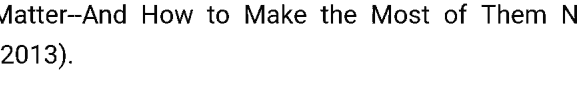

## 日课精选

提交留言可与专栏作者互动

## 博弈论特别放送：改变规则，才能改变局面（视频）

博弈论特别放送：改变规则，... ↓

万维钢

最近我们在讲《博弈论》专题，今天就为你放送我为“得到”特意制作的一个视频短片：7分钟看懂博弈论，并且附上中英文的文稿。希望对你学习《博弈论》有所帮助。

博弈论这个词你已经很熟悉了，我来给你讲一个“得到版”的博弈论。是专门讲给你这样的聪明人的。

You are no stranger to the term Game Theory. However today I’ll elaborate on an iGet version of this theory specifically tailored for smart people like you.

博弈论研究的aths就是一群聪明人，在一定的规则之下，如何选取最有利于自己的策略。传统上一说到博弈都是研究怎么选择更高效的策略，而我想告诉你的是，如果各方都足够理性，那么最终决定局面的不是策略，而是规则。

Game theory is about how a group of smart people adopt strategies that are most favorable to themselves under certain rules. Traditionally, we search for a better strategy when the word GAME is involved, but what I’m about to tell you is that if all parties are rational enough, it will be the rules that decides who wins a game, not strategies.


dollars into advertising. However, all those efforts proved futile in upsizing the total market. They were in a true predicament.

与此同时呢，因为当时人们越来越意识到吸烟的危害，政府就开始推动立法，想限制烟草业的发展。1967年，美国联邦通信委员会（FCC）发布一条规定，说电视台每播出香烟广告，就必须同时播出一条宣传“吸烟有害健康”的公益广告。

Meanwhile, people were increasingly aware of the hazards of smoking. The government thus began to push for legislation to restrict the expansion of tobacco industry. In 1967, the Federal Communications Commission (FCC) issued a regulation, that every cigarette ad broadcasted should come with a public-service announcement saying “smoking is dangerous to your health”.

这一来烟草业的局面就更可悲了：你不得不花钱给自己做广告，可是花钱的结果却是公众越来越了解吸烟有害健康，这等于是在作死啊。

It’s even more tragic for the tobacco companies: you have to spend millions on cigarette advertising, but only to let the public realize that smoking is hazardous? It was suicide, wasn’t it?

等到1970年，美国国会通过一条法律，干脆就禁止了烟草公司做电视广告。但公众不知道、甚至连很多国会议员都不知道的是，这条立法其实是烟草公司自己游说出来的——他们改变了规则。

Then in 1970, the US Congress passed a law, banning all cigarette ads on TV. But what the public--even many members of the Congress--did not know, is that tobacco companies themselves lobbied hard for the law. They changed the rules.

为什么烟草公司自己想要禁止自己呢？吸烟是一种刚需。大家都不做广告了，市场还是这么大，但是每个公司都能省下一大笔广告费，还不用再宣传“吸烟有害健康”了。

Why did tobacco companies bind their own hands and feet? Because smoking will always be a need. The total market will not shrink without advertising, but each company can save a fortune and they don’t have to promote “smoking is dangerous to your health” any more.

结果是一年之内，烟草公司的利润就提高了30%。

The outcome? The profits of tobacco companies saw a 30% surge within one year.

改变规则，你就改变了局面。

By changing the rules, you change the situation.

通过一个强制的规则停止恶性竞争，所有人的境遇都会更好。这就好比说现在国家改变规则，奥数成绩不能加分了，所有人的负担都能减轻，真正爱好数学的学生也得到一个更纯净的环境。

You can stop malign competition with a mandatory rule, and everyone ends up in a better environment. Like...if the Chinese government changes the rule--no extra points added even with a good result in the Math Olympiad--the burden will be eased on all shoulders, and the students who do love math will have a simpler motivation.

博弈论有个特别流行的概念叫“囚徒困境”。说两个一起偷东西的犯罪嫌疑人被警察抓住分别关押审讯，双方都知道，如果双方不招供，俩人的结果都会更好——但是因为规则，双方只能选择招供。我们经常用“囚徒困境”形容每个人都按照对自己最优的策略行事，结果却是双输的局面。

A prevailing concept in game theory is called the Prisoner’s dilemma. It says that two members of a criminal gang are arrested and imprisoned separately in a solitary confinement, knowing that they would get the best reward if they both keep silent. But because of the rigid rules, they have no options but to betray and testify against each other. We often use the Prisoner’s dilemma to describe a situation when each person rationally adopts the strategy to the most of their own benefit, but oddly, both lose at the end.

其实从数学上讲，真正的囚徒困境要求双方不能搞联合和串通，而且必须同时行动。真实世界的各种困局没有那么严格的限制，所以是有可能打破的。

Mathematically, a true Prisoner’s dilemma requires no alliance or collusion of those two and they have to act simultaneously. But dilemmas in the real world are open to all conditions. They could be cracked.

拍卖会、竞价排名、给医生送红包、让孩子上各种课外班，这些都是博弈论的困境。参与者明知对自己不好、还不得不拼命参与。而工资封顶、监管法规、停火协议，就是解决困境的方法。很多时候是自由带来困境，限制带来活力。

Auctions, bid rankings, bribing doctors with red envelopes (with money inside), sending kids to cram schools...these are all dilemmas of game theory. Participants strive and struggle to get there, knowing that it is not beneficial to them at all. The solutions are also simple: a salary cap, a certain regulation, a ceasefire agreement...they all work. Most of the time, liberty comes with dilemmas, however restriction brings vigor.

学习了博弈论，你就多了一个观察世界的眼光，你会发现生活中有很多理性选择之下的困境。

By studying game theory, you obtain a new perspective to see the world. You will spot plenty of dilemmas led by rational decisions.

而你知道，造成这些困境的常常不是参与的人，而是规则。

And you know that these dilemmas are not caused by the people in it, but by the rules.

博弈论，是一个复杂的学问，当然不是我们今天讲的这么简单。我会在得到的课程《精英日课》里，继续跟你探讨。

Game theory is complicated. Of course it is not as simple as how I put it today. I will continue the discussion in another episode of Class for Elites in iGet (the app).

## 问答：“聚焦点”和“锚定效应”有什么区别？

问答：“聚焦点”和“锚定…” ↓

## 来自日课：博弈论不是“三十六计”

## 读者 Apple：

博弈论就像“道”，像战略，普通人如何应用呢？还是停留在了理解的层面上，知道这个世界的运行规律就可以了？

万维钢 博弈论首先是“术”，有很多具体的操作方法，也就是 How。我们本周已经讲了“聚焦点”的应用，后面还会讲到各种各样的方法，包括怎样破解因继续困境、怎样提供一个可信的威胁和承诺，信息不完全的时候怎么办等等。现在更有 一个叫做“应用博弈论”的子学科，专门研究各种复杂的具体操作。

但是普通人的确没有很多机会使用这些手段。就算是一个研究博弈论的经济学家，也未必经常使用博弈论。这是因为日常生活中人们做的大部分事情都是按部就班，该学习学习该工作工作，连真正决策的机会都会很少，更不用说跟谁对抗了。有时候我们讲博弈论不得不用妻子和孩子举例，这个尴尬的事实是除了妻子孩子我们也拴不了别人……

## 来自日课：群鸦的盛宴

## 读者 真爱基：

纳什均衡是否是所有人都采取了自己的压倒性策略的情况？

人们愿意为了考大学而花费时间和金钱去上补习班，那是因为这么做是值得的，是大学、特别是名校的学历很值钱。但是如果社会更加多元化，给年轻人提供各种机会，比如职业教育、文艺、体育、创业等等，人们就会发现不需要上大学也能过上很好的生活，那么自然就不会有这么多人受罪了。还有像咱们得到提供的是终身的学习，在一个终身学习的社会，大学还会那么重要吗？

## 来自日课：以和为贵

读者 纯洁的憎恶、板牙老爹：

焦点与锚定效应有什么区别？

万维钢

“锚定效应”是“行为经济学”里爱说的一个“非理性”效应，它的作用机制是通过某种心理暗示去左右人的行为。

比如说，丹·艾瑞里（Dan Ariely）在《怪诞行为学》这本书里讲过这么一个实验。让受试者先回忆自己的出生日期，然后让他们评估一瓶红酒应该值多少钱。结果那些出生日期数字比较大的同学，给红酒的估价也比较高。其实一个人的生日跟红酒价格能有什么关系？但是因为他受到了那个数字的暗示，就愿意给个大数。

还有一个例子是让受试者通过做填空题思考一些跟老年人生活相关的词汇，结果受试者就会被暗示自己变老了——他们出门以后，走路的速度都变慢了。

我对这种研究有两个评论。第一，这些研究都可能有问题。《怪诞行为学》中的很多实验，就包括那个出生日期暗示红酒价格的实验，后来被证明是不可重复的。

第二，就算这个效应的确存在，它也只是人们面对不熟悉情况下的一个仓促表现。这样的招儿你只能用一次。一旦人们熟悉了这个场景，他们就会知道那瓶红酒本来是多少钱。

我们说的焦点，是双方都有强烈合作愿望的情况下，促成合作的一个方便方法。谈判中提出焦点跟锚定效应有点像，毕竞是先下手为强，如果你一开始就说一个大数，对方讨价还价也只能从这个大数开始谈，结果会对你很有利。

但是，提出焦点的最重要目的是为了促成合作，而不是为了占这个便宜，这是跟锚定效应的根本区别。关键在于你们的关系是长期的、可重复的还是临时的、只有这一次。锚定效应第一很可能不好使，第二就算偶尔得手，那下次怎么办？

焦点是双方越熟悉套路越容易达成合作。锚定效应是对方越不熟悉业务越可能有效。

万维钢·精英日课³
帮你和全球精英大脑同步
版权归得到App所有，未经许可不得转载

日课精选

提交留言可与专栏作者互动

## 博弈论4：不纵容，但要宽容

博弈论4：不纵容，但要宽容

囡囡囡境在生活中实在是太常见了。凡是合作则两利、背叛则两伤的情况，都可能是囚徒囚境。合作对双方都有好处，我们是好人，我们总是希望合作。但是博弈论告诉我们，有时候背叛是理性的。如果有一方合作一方背叛，选择背叛的那一方可能会获得最大的利益，选择合作的那一方会受到最大的伤害。

接下来这几讲我们专门研究合作与背叛。防止背叛，最直观的办法就是把单次博弈变成重复博弈。

为什么旅游景点的奶茶质次价高？因为那是单次博弈。你下次就不会来了，他能骗一把是一把。而像麦当劳这样的连锁店，哪里开在旅游景点，也会保证质量，因为它要为整个品牌的声誉负责。很多商家说我们要做一百，那年，有些商店搞会员制，这些都是重复博弈。

重复博弈之所以有效，是因为背叛者会受到惩罚。最直接的惩罚就是下次我也背叛你，让你得不到合作的好处。这一讲咱们专门说说惩罚。

### 1.美国往事

以前有些阴谋论者认为这个世界是被某些秘密组织控制的，比如什么“罗斯柴尔德家族”“骷髅会”“共济会”之类，其实都是些无稽之谈。并不是说没有人想秘密控制世界，而是这个世界实在太大多也太复杂，你根本就控制不了——更不用说用秘密的方法控制。

但是，美国历史上曾经有过一个非常成功的秘密组织【1】。它的成员都是有钱人，不但有钱而且还对组织无比忠诚。组织成员视彼此为亲人，有生意通常只跟内部的人做，对外甚至根本不透露组织的存在。组织1890年代诞生于纽约，到1920年代就把势力扩大到了全国，而美国社会直到1940年代才知道它的存在。

这个组织就是……美国的黑手党。

博弈论专家大卫·麦克亚当斯（David McAdams）在《游戏改变者》【1】这本书里说，一群人要想合作，至少要满足下面两个条件中的一个——

+   第一，是合作对自己有好处，人们本来就想合作。
+   第二，是不合作会受到惩罚。

### 2.稳定与脆弱

### 3.以牙还牙真的好吗？

+   1）不管跟谁，第一轮我都选择合作；
+   2）第一轮过后，我就复制对手上一轮的做法。

进化》，现在已经是名著了。人们从这本书中看到了人类文明的希望，我们终究将会走向合作。这本书的意义我们后面还会再讲。

但是你可能不知道的是，以牙还牙其实是一个脆弱的策略 [2]。

这个策略对错误很不友好。计算机模拟总是精确的，但真人博弈可能会操作失误。我们设想有两个人都是按照以牙还牙的策略博弈。一开始你俩一直都是合作，但是在某一轮，他操作失误了，或者是你判断失误了，结果你把合作当成了背叛。然后下一轮你就会报复他。而这又导致再下一轮他要报复你……你们就陷入了一个再也无法合作的死循环。

这不就是冤冤相报吗？就像巴勒斯坦和以色列，两边几十年的世仇，旧的伤口还没抹平又添新的仇恨，怎么调解都调解不好。他们都不是坏人，也许他们只是以直报怨的老实人。

我们在生活中有时候也这样。小孩打一架过两天还能和好，可是成年人讲原则，两个好朋友因为一次误会就可能一辈子都不交往了。

所以在真实世界中，以牙还牙并不是最好的策略，它不够宽容。博弈论专家提出一个改进版的以牙还牙：对方背叛我一次，我继续合作；只有当对方连续背叛我两次，我再报复。研究表明，在有可能出错的博弈中，这个办法的效果比以牙还牙更好。

真实生活中别人可能犯无心的错，你可能误判。中国人有句话叫“退一步海阔天空”，强人通常不喜欢这句话，但是其实这句话很有道理——宽容能避免脆弱。不过请注意，这句话的关键词是“一步”。退一步是宽容，退两步就是纵容了。

| 禅定时刻

说到这里我就不禁想起钱钟书小说《围城》的结尾。方鸿渐跟妻子孙柔嘉闹矛盾。方鸿渐在回家的路上“蓄心要待柔嘉好”，而在家中等丈夫回家吃饭的孙柔嘉也在“希望他会跟姑母和好，到她厂里做事”。两人都抱着良好的愿望，希望达成合作。

结果一见面说了几句话又翻脸了，还动手了。

有人说《围城》的主题，并不是说什么婚姻是个围城，而是说人无法掌控自己的命运。方鸿渐不知道因为啥就跟孙柔嘉结婚了，也不知道因为啥就婚姻破裂了。

总是事情改变人，人改变不了事情。人改变不了博弈。

但真的是这样吗？本来是想合作的，怎么就不能合作呢？如果有一方能宽容一点，被冒犯了再给对方一次机会，也许就不会是这样悲剧的结局。

参考文献
[1] David McAdams, Game-Changer: Game Theory and the Art of Transforming Strategic Situations (2014).
[2] Avinash K. Dixit and Barry J. Nalebuff, The Art of Strategy: A Game Theorist's Guide to Success in Business and Life (2008).

日课精选

提交留言可与专栏作者互动

## 博弈论5：装好人的好处

博弈论假设参与者都是理性的人，学习博弈论我们学习的就是理性的决策。理性人的一切行动都是为了自己的利益。但是另一方面，妈妈告诉我们要做个好人。那你说理性的人，还有可能是好人吗？

有的人认为我们生活的这个世界是由弱肉强食的丛林法则主导的，好人都很愚蠢。也有的人在任何情况下都选择做好人。那博弈论是怎么看待好人的呢？

### 1.好人与囚徒困境

以前有个电视节目是这样的 [1]。两个人组队答题，题目都很容易，答对一些题之后两人会获得一笔奖金，有好几千美元。节目的最大看点是怎么分这笔钱。规则是每个人在一张纸条上写下 “朋友” 或者 “敌人” 这两个词中的一个。如果两人写的都是 “朋友”，就平分这笔钱。如果一个人写 “朋友” 一个人写 “敌人”，那么写 “敌人” 的人就拿走所有的钱，写 “朋友” 的人什么都得不到。如果两个人都写的是敌人，那就是谁也得不到。

这是一个典型的囚徒困境，而且博弈只发生一次。写 “敌人”，要么你就拿到所有的钱，要么你就一分钱都拿不到。写 “朋友”，要么你就一分钱都拿不到，要么你只能得到一半儿的钱。对吧？虽然两个人的压倒性策略都是写 “敌人”。

然而节目中的真实情况是53.7%的女性和47.5%的男性都选择了合作，他们写下了 “朋友”。

这些人在金钱面前选择了相信一个素昧平生的人。他们宁可被人背叛也不愿背叛别人。他们选择了做好人。类似这样的研究我见过好多个，甚至有经济学家还专门跑到监狱里去，让真正的囚徒玩了囚徒困境的游戏 [2]。这些研究的结果高度一致：有一半儿、甚至一半儿以上的人选择做好人。

难道这些人都是非理性的吗？

### 2.好人与有限次重复博弈

上一讲我们说，重复博弈会促进合作，因为你可以惩罚那些不合作的人。但是请注意，上一次说的重复博弈，其实有个隐含的假设，那就是重复次数是无限的。在有限次的重复博弈中，按理说，你还是不应该合作。

### 3.好人与社会

这个A和B的故事你是不是感觉有点熟悉？《射雕英雄传》里，黄蓉和郭靖刚相遇的时候，黄蓉本是个理性人，知道江湖险恶，所以坑蒙拐骗。但黄蓉发现郭靖的行为有点傻，居然是个好人。于是黄蓉——在博弈论专家看来是完全理性地——也选择做了好人。结果就成了两个好人快乐地生活在一起。

### 4.好人与理性人

所以理性人有充分的理由不暴露自己是个理性人，你应该假装自己是个好人。


那装好人要装到哪一步为止呢？有限次重复博弈的实验中，双方通常是到了倒数第二次博弈才暴露自己的理性人面目，选择背叛。生活中有某些人的确是这么干的。比如领导干部有个“59岁现象”，老老实实做了一辈子革命工作，临退休捞一把大的。

但是59岁暴露可能还是太早了。人生的博弈并不在退休那一刻终止，你除了工作还有很多别的博弈，好人的声望可以一直有用！

也许你应该装到生命最后一刻。就好像一个著名的段子，说恋爱中的男女，女孩问男孩，你对我那么好是不是在骗我呢？男孩的回答非常符合博弈论精神，说如果我是在骗你，那就让我骗你一辈子吧。

那既然装好人有这么大的好处，我们为什么不做一个真正的好人呢？做一个康德式的的好人，跟人合作并不是因为合作有好处，而是我单纯认为这么做是对的！这样行不行呢？

博弈论专家绝对不会建议你去做真正的好人。好人经常对世界有一厢情愿的期待。有的好人认为他能感化别人，他觉得如果我这次跟人合作，哪怕吃了亏，下一次别人也会因为不好意思、或者为了回报我而跟我合作。博弈论专家会说这种想法非常危险。事实上，如果你身处一个比较险恶的社会环境，那你不但不应该做好人，而且应该装坏人 [6]。

不过话说回来，做真正的好人确实有个重大好处，那就是你会自我感觉很好。为了维持这个良好感觉，你宁可牺牲金钱的利益。这大约就是为什么在开始的那些实验里，有一半的人一上来就选择了合作。

现代社会就是这样，通俗小说、电影和电视剧里一般都是好人取得最后胜利。你被这样的文化熏陶，就不自觉地想要跟好人一伙儿。好人跟好人之间形成了一个想象的共同体。这其实是一个幻觉，但是没办法，想象的共同体是最强大的社会力量。

这种感觉有时候会如此强烈，以至于我们认为物质利益都是不值得的。这其实也是理性的！只要你知道自己心中什么最重要就行。

## 参考文献

[1] Avinash K. Dixit and Barry J. Nalebuff, The Art of Strategy: A Game Theorist's Guide to Success in Business and Life (2008).

[2] MAX NISEN, Scientists tested the 'Prisoner's Dilemma' on actual prisoners — and the results were not what you would expect, www.businessinsider.com.au, July 2013.

[3] David Levine, Is Behavioral Economics Doomed? The Ordinary versus the Extraordinary (2012).

[4] 张维迎，《博弈与社会》(2013)。

[5] Kreps D., R. Milgrom, J. Roberts and R. Wilson, Rational cooperation in the finitely repeated prisoners' dilemma, Journal of Economic theory, 1982.

[6] 我们精英日课专栏有一篇文章叫《做坏人的好处》。

## 博弈论6：布衣竞争，权贵合谋

博弈论6：布衣竞争，权贵合谋...

前几讲我们一直把囚徒困境当做一个不好的东西，但是这里面有个立场问题。站在囚徒的立场上来说，你希望促进合作；但是站在警察的立场上，你希望利用囚徒困境。

市场上的企业之间的竞争，就可以说是一个好的囚徒困境。作为消费者我们不希望所有公司联合起来抬高价格，我们希望各个公司互相竞争。但公司是非常理性的参与者，他们会想各种办法达成合作。

最常见的做法是通过某种协调机制进行合谋。只要参与者足够少，利益足够大，合谋简直就是必然的。

这不是一个正能量故事。

### 1.钻石故事

你记不记得2006年的時候，有一部莱昂纳多·迪卡普里奥主演的电影，叫《血钻》？当时很多人看了这个片子之后表示再也不喜欢钻石了。采集工付出极大代价却没有得到什么好处，钱都让商人赚了，而钻石不过是一种挺好看的石头而已！

一个公开的秘密是钻石根本就不是什么稀有的东西。天然钻石的储量其实很大，钻石之所以卖那么贵，是因为钻石业务被垄断了。


### 2.价格匹配

美国有些商店有个叫“价格匹配（price match）”的做法。比如你在我们商店买了个东西，一段时间内，如果你发现另一家店的价格比我们便宜，那你可以回来找我，我给你补足差价。有些商店甚至还会多给你差价的10%作为补偿金。

### 3.互联网时代的合谋

斯坦福大学胡佛研究所的研究员布鲁斯·布恩诺·德·梅斯奎塔（Bruce BuenoDe Mesquita）是一位应用博弈论专家，他写了本书叫《预测师的博弈论》[5]，其中讲了个买车的方法。在美国买车是可以讨价还价的，布恩诺·德·梅斯奎塔说你要买

了个买车的方法。在美国买车是可以讨价还价的。布恩诺·德·梅斯奎塔说你要买车先别去车行，你应该给每个车行打电话，告诉他们你今天下午四点之前要买一辆这个型号的车，而且告诉他们你会听取附近所有车行的报价，这样他们就会给你一个最低价格。

我家买车的时候亲测了这个方法，的确有效。但是现在在我看来，关键这是暗中的竞价。你跟这个车行谈出来的价格别的车行是不知道的。如果车行A知道你跟车行B谈出来的价格，而且车行A确保让车行B知道，它一定会知道车行B给你的报价，并且一定会立即匹配那个价格，你猜车行B会怎么做？

它就不会打这个价格战。如果打价格战不能吸引到更多的顾客，背叛没好处，那这就不是囚徒困境了。

互联网时代有很多比价网站，各家的报价一目了然，看上去像是一个为消费者服务的做法。但事实上，比价网站方便了商家之间的价格协调。

商店也在互相盯着各自的报价。如果某一个商店给某个商品降价，其他商店常常会在五分钟之内也降价。特别是亚马逊，有人专门做过研究，使用专门的算法根据别家的报价调整自家的价格。

你降价我也降价，那你降价又怎么能抢走我的顾客，那你何必还降价呢？因为有这样的协调机制，至少在报价这一点上看，消费者面对的其实只有一家店。

当然，如果你真想用降价的方法吸引顾客，其实还是可以操作的。比如你可以搞“满减”之类的活动，商品价格不变，最后结账的时候再给消费者实惠。中国的网店经常这么做，这可能是因为中国的网店仍然处在成长期，还在互相抢地盘。美国的网店已经成熟了，各自承认势力范围，尽量避免囚徒困境式的厮杀。

现在美国连“募捐”这种业务都已经形成垄断集团了 [1]。你说你有个慈善项目，比如要搞研究攻克某种罕见病，想要向全国人民募捐，可以。但是你自己去募捐可不行，因为你的行动力太弱。你必须把项目包给一个专门搞募捐的大公司，它会派人挨家挨户打电话敲门帮你募捐——但是你只能得到全部收入的20%。

你说这也太不公平了，但募捐是个囚徒困境，劝说捐款的组织太多老百姓已经不胜其烦，让一家大公司垄断是最合理的办法。大慈善组织全都联合起来，而小慈善项目根本分不到什么。

这个博弈格局是如果利益很大，而参与者很少，这些参与者就会联合起来。只要上了这张桌子，稳稳当当就能瓜分天下，何必斗个你死我活呢？

网上流传一句话叫“上流社会人捧人，中流社会人比人，下流社会人踩人”。这句话说得很难听，但是有几分道理。合作的利益大就不会竞争，背叛的成本低才会背叛。

怎么打破这个局面？一个办法就是扩大市场准入，让更多的参与者进来，让商家的协调没那么容易。另外一个办法就是依靠政府的力量反垄断，相当于全体消费者联合起来去对付那些巨头。

要知道人家巨头早就联合起来了。

## 参考文献

[1] David McAdams, Game-Changer: Game Theory and the Art of Transforming Strategic Situations (2014).

[2] 这两张图来自 Harlan Kessler, Investors Best Friend? seekingalpha.com, Nov 2013.

[3] https://en.israeldiamond.co.il/diamond-articles/diamonds/idex-price-index-july/

[4] Presh Talwalkar, The Joy of Game Theory: An Introduction to Strategic Thinking (2014).

[5] Bruce Bueno de Mesquita, The Predictioneer's Game: Using the Logic of Brazen Self-Interest to See and Shape the Future (2009).

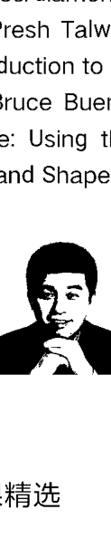

### 万维钢·精英日课³
帮你和全球精英大脑同步
版权归得到App所有，未经许可不得转载

## 日课精选

提交留言可与专栏作者互动

Aa 字号    写留言    0    请朋友读

## 数据分析师的窘境

数据分析师的窘境

身处现代世界，我们对技术进步都非常乐观。我们相信技术一定会越来越先进，技术会让我们的生活变得越来越好，技术会在每一个方面都促进社会进步。从大趋势来说，这个乐观情绪应该没问题，不过我们今天要说一个小趋势。

何帆老师在《何帆报告》中提出了“小趋势”的概念，也是今年罗腾岁年演讲的主题之一。小趋势是趋势的趋势，是尚未成为主流，但是意义深远的小众趋势。我们今天要说的这个跟何帆老师说的小趋势有所不同，这是一个逆流而动的趋势。

我要说的是数据分析。从大趋势来说，我们相信随着数据越来越丰富，各大公司应该越来越了解我们，会出现各种根据个人口味定制的商品，任何小众的需求都能被满足，每个人应该越来越个性化地发展，这是一个“大数据”时代，对吧？

也许是这样，按理说应该是这样，过去我们的确认为是这样。但现在看来，至少最近的趋势不是这样。

以前我们对“推荐引擎”这个东西抱有很大的期望，包括赫拉利在《未来简史》中都说，也许将来 AI 会比你自己更了解你自己。那请问在过去这些年间，在“机器学习”进步如此神速的背景之下，你收到各个网站的推荐，是否效果更好了呢？

人们一度认为数据分析能让电影电视剧越来越精确地符合观众口味，甚至曾经有传言说《纸牌屋》这个电视剧就是用数据分析编出来的（并不是）。那请问，为什么今天的市场上仍然充斥着各种不好看的影视作品呢？

我最近读到一位数据分析师的博客文章 [1]，深有感触。他的 Twitter 账号名是 @apenwarr，我不知道他的真实姓名。他分析了数据分析师面临的窘境。我总结一下，问题有三个方面。

### 第一，你很难通过数据分析找到人的个性化需求。

有很多珠喜好下载电影和电子书，在硬盘里攒一大堆，但是下载容易，实际上大多数都没有看。其实数据分析也是这样：搜集数据容易，分析数据难。

现在打开一个网页，你一看好像没有多少内容，但是打开的速度为什么这么慢呢？主要并不是广告，而是因为各种“trackers”，也就是追踪器。追踪器会记录你在这个网页上的各种行为，比如点击了什么，在那个页面停留了多少时间，曾经购买过什么东西，浏览记录之类。各个数据公司会付给网站一笔钱，比如每年几万美元，换取在网页上放置追踪器的权利。现在一个寻常的购物和娱乐网页上可能有好几个十个追踪器，可以说你的一举一动都被记录了。

这听起来挺可怕。从原则上来说，人工智能可以通过分析追踪器的数据来判断你的浏览和购物习惯、你的性别、年龄、居住地址、收入水平和受教育程度，你的家人和朋友都有准，各种信息，然后根据这些信息向你精准投放广告。

但事实上并没有那么厉害。数据公司只是通过追踪器收集你的网上活动数据，然后把数据卖给广告公司。但是因为各家数据公司是各自为战，各家广告公司并不能得到你的全部活动信息。它们也许只能看到你的一面，也许把你当成了好几个不同的人。所以有数据是一回事，能从数据里分析出来什么东西是另一回事。

更大的麻烦在于，点击行为常常并不能表arin your personality.

你打开一个新闻网站，看到上面有吴秀波的大事件，你就点击了。这能说明什么呢？说明你是一个关心明星八卦的时尚年轻人吗？不能！事实是所有人都对这种新闻感兴趣。可是你这么一点击，就给了数据公司的机器学习算法一个大大的正反馈，它下一次就会向你推荐类似的新闻——然后你又点击了。

我给你打个比喻，这种数据分析，就好比是公众号文章里爱说的那种“人性测试”。一个青年女性想知道自己的男朋友是不是靠得住的人，就请自己的朋友假意对他表示好感，想看看他能不能经受考验。结果不测试还好，一测试就容易出事。所以现在的新伦理要求我们不要做这样的测试，人性是经不起考验的，这种测试不能说明什么问题。

网络点击也是这样。数据分析师早就知道一个能获得最大点击量的算法：那就是加入通往色情内容的链接。不管这个人搜索的是什么关键词，只要你在搜索结果中加入几个色情内容链接，他一定会点击。可这是能说明什么呢？

各种新闻站点给我们明星八卦，其实跟色情一样，属于人性的基本需求，只不过明星八卦可以在办公室里浏览而已。

每个人的所谓个性，被淹没在了众人的共性之中。

### 数据分析的第二个问题是，消费者的个性需求对商家其实并不重要。

比如你想买个加湿器，你就在搜索引擎输入“加湿器”这个关键词，搜索引擎给你推荐了几个加湿器的广告。像这样的广告我们是欢迎的，可以说是精确投放。但是，搜索引擎在这个过程中用到了你的“个性化信息”了吗？

没有！你已经告诉它你需要加湿器。加湿器的广告就那么几种，搜索引擎只要把典型的加湿器广告投给谁就大功告成了。它根本不需要知道你的性别、年龄、收入水平和受教育程度。不同类型的人对加湿器的需求没有那么大的差别——就算有，我给你推荐五个型号总行了吧？

再比如说，你在游戏网站 Steam 上用打星的方式关注了好几个游戏。当其中某个游戏降价或者出了新版的时候，你收到一封电子邮件提醒。这个服务很贴心，但是这个服务用到了你的个性化信息吗？没有！是你自己打星告诉它你对这些游戏感兴趣。

还有，你在购物网站买个什么东西，网站会推荐你买另一些东西。比如你买个电视机它推荐你买HDMI线。这个服务用到了你的个性化信息了吗？也没有。事实是很多买电视机的人都需要HDMI线。网站只要知道大多数人的习惯就行了。

我认为出现这两个问题的根本原因在于，我们跟大多数人真的没有什么本质区别，而广告和推荐真的不需要太精确。电视广告是最不精确的投放，但是这么多年来广告商也认了，而且效果也还可以。相对于电视，网上这种“大多数人对 A 感兴趣的人也对 B 感兴趣”的推荐已经是巨大的进步。

更精确的投放，也许在技术上能做到，但是很可能根本不值得做。所以这个局面是就算你根本不在乎什么隐私，你把所有数据都告诉商家，商家也未必能给你提供更好的推荐服务。

那既然大多数人的偏好都差不多，还有必要搞什么定制的內容服务吗？

### 这就引出了第三个问题：个性化定制的必要性降低了。

以前 Netflix（奈飞）有非常好的个性化推荐服务。那时候它是一个出自DVD光盘的网站，你给看过的电影打分，它会向你推荐你可能喜欢的电影。它的推荐常常令人感到惊喜，有的电影你根本没听说过，但是واجدید看的喜欢。

那种日子已经结束了。我们专栏以前讲过，Netflix 曾经组织过一次推荐算法大赛，轰动一时，的确是出来一个更好的算法。但是 Netflix 并没有使用那个算法。现在的 Netflix 已经都不用推荐算法了。

为啥呢？因为精确推荐已经没有商业价值了。以前 Netflix 是邮寄光盘，等好几天才能收到一次，它会想方设法确保你拿到自己喜欢的电影，不然你若是一次收到三张光盘都不喜欢，整个周末可能都毁了。但是现在的 Netflix 是在网上直接看片，你一看这个不喜欢马上就可以换一个，它总能满足你。

还有，以前有惊喜，是因为以前的 Netflix 希望你看一些小众的电影，因为光盘已经买了，它希望增加每张光盘的流转率——否则新片太抢手不得不买一大堆光盘，可是过不了多久这个片子了那些光盘都没有人看了。而现在 Netflix 来说，看热门电影的人再多也不是问题，甚至看的人越多越方便安排流量。

还越方便安排流量。

所以现在的局面就更加走向了“胜者通吃”的方向。我们专栏以前讲《成功与运气》这本书和在《选择越多，越是胜者通吃》这篇文章里都说过这个问题：所谓的小众需求和“长尾效应”并没有我们想象的那么明显，互联网时代胜者通吃反而还加剧了。

那么在这种情况下，还有没有必要生产小众的影视节目，都成了问题。

以前没有数据分析，创作者还可以根据个人喜好任意探索一些内容。现在有了数据分析，用数据说话的声音越来越强，你就越来越得听数据的。

可是正如我们前面所说，数据分析基本上就相当于“人性测试”——你越测试就越觉得人性是黑暗的，但是殊不知黑暗本来就是你给测出来的！

那我们想想，在数据的作用下，我们看到的影视作品会不会越来越大众化、越来越依赖流量明星、越来越俗套呢？

数据最擅长告诉我们过去的规律、大多数人的规律、特别是大多数人轻易表现出来的规律。数据不能告诉我们创新，数据不能告诉我们内涵。朱迪亚·珀尔说，数据是深度愚蠢的。

我们对数据分析的赞美可能是个神话，这个神话很可能正在反转。

截止回顾：
《胜者通吃》
《选择越多，越是胜者通吃》

参考文献
[1] @apenwarr, Forget privacy: you're terrible at targeting anyway, https://apenwarr.ca/log/20190201


### 万维钢·精英日课³
帮你和全球精英大脑同步
版权归得到App所有，未经许可不得转载

## 日课精选

提交留言可与专栏作者互动

Aa 字号    写留言    0    请朋友读

## 特别放送：到底什么是“不确定性”

万维钢

“不确定性”在我们的三季专栏里出现率很高，我们曾经从不同的视角拆解过这个概念。今天我们就来帮你总结一下，到底什么是不确定性？人们在面对不确定性的时候，会有哪些反应？到底该怎么应对不确定性，高手又是 contemplated. 还 是老规矩，希望你通过看文稿来复习今天的内容。

## 什么是“不确定性”？

1.黑天鹅是哪种不确定？

预测包含两种不确定性。

第一种是“偶然不确定性（Aleatoric uncertainty）”，也叫统计不确定性。它的意思是给定模型的情况下，在模拟的过程中出现的不确定性有多大。我不能给你准确的结果，但是我是能给你一个准确的概率。

第二种是“认知不确定性（Epistemic uncertainty）”，也叫系统不确定性。意思是说你这个模型可能不对。因为认知不确定性而预测不准，那就是我考虑不周，是我缺少重要的认知。

## “不确定性”会导致什么？

1.迷信

渔民进行宗教仪式、运动员追求好运气、鸽子做多余的动作，有的是指望神，有的 是靠自己，但是本质上体现了同样一种思维——那就是在面对不确定性的时候，人 们总想做点什么事情来干预一下。

## 怎么应对“不确定性”？

1.见机行事，随其自然，没有机会就不要硬做，机会来了就放手大干。世界非常复杂，本来就充满不确定性，而且不可能围着你转。

## 高手怎么应对“不确定性”？

1.战胜认知偏差

人的大脑非常不善于处理不确定的信息。职业扑克选手要提高水平，就必须战胜头脑中各种认知偏差。为此，一个高手必须能够区分以下这些东西 ——

该主动拥抱不确定性。

注意我说的可不是“不怕不确定性”，而是要“主动拥抱”不确定性。因为一定程度上的不确定性，即使对普通人来说，都是特别有好处的。

平时养尊处优，偶尔饥寒交迫一次，体内的冗余就会发生作用，比如说储备了多时的脂肪这时候就能燃烧掉一些。人体作为一个有机体，对某一部分给它一点小刺激，小压力，只要有足够的缓冲时间，它都能够恢复过来并且变得更强。

这正是健身的意义所在。故意搞些高强度的活动挑战身体极限，就能让身体慢慢升高极限，越练越强。

那么根据这个反脆弱的原理，日复一日采用同样的健身套路就是不好的。因为人体能快速适应新局面，一旦身体已经适应了这个套路和强度，就没有什么新的潜力可挖了。这也是为什么健身减肥都是初期效果最好，可是很快就能达到一个不再进步的平台区。

所以应该不断变换花样。这个项目进入平台期，那就赶紧换个项目让身体继续进步。这跟学习的道理也是一样的：学个什么东西最好时刻让自己保持在“学习区”，而不要停留在“舒适区”。

所以不论你是学习知识还是健身养生，主动拥抱不确定性，时刻挑战自我去应对新局面，才是符合“天道”——也就是进化论——的做法。

从学习和创新的角度，主动增加一些不确定性—读几本自己领域之外的书、了解一个和自己业务无关的业务，还容易带来惊喜。从做事的角度，不确定性可以帮助我们发现自己的问题，比如随机的输入可能会暴露一个软件意想不到的bug，使我们找到平常想不到的解决方案。

## 3.主动增加不确定性

我们可以从接收信息和输出信息这个视角审视一下人生。

我们平时学习知识、积累经验，就是要减少世界给自己的不确定性。新人看哪里都新鲜，老手看哪里都是俗套——只有这样，他才能从一大堆可预测的事物之中敏感地抓住那些不寻常之处，那才是真正有价值的信息。

而我们做事，则要给世界增加一点不确定性！别人都以为我会这么做，然后我就真的这么做了，那我跟一台机器有什么区别？我要求输出信息，就得做一些别人想不到我会做的事。

信息就是意外。从“信息论”这个维度出发，有两种事情是特别值得我们去做的：

+ * 出乎别人意料的事；
* 给自己增加选项的事。

## 4.制造固定的仪式感

有一种说法认为越是经常面对不确定性的人，越容易迷信。普通人上班拿固定工资不确定性不多，就不怎么迷信；而运动员和演员的收入乃至个人荣辱都随时跟着成绩变化，就比较迷信。几乎所有运动员都有自己特有的赛前准备流程，就如同宗教仪式一样丝毫不差。很多人还带着幸运护身符，有的足球教练一到比赛就要在西装里面穿一件已经很破旧了的衬衫——因为那是他的幸运衬衫。普通人对此表示：呵呵。

迷信不迷信根本不重要。重要的是高手需要一套固定仪式来让自己进入状态。

比赛状态和工作状态都不是自然状态。自然的人面对大场面的比赛会紧张，自然的人坐在电脑前更想看看新闻而不是马上潜心工作。固定流程，是顺利进入状态的好办法。

我们以前在说过，学习和锻炼应该搞些多样性来保持趣味，但是这本书考察高手的做法，多样性确实不多。这可能是因为他们做的是一个特别不确定的事情，所以要在其他所有方面增加确定性。

## 5.刻意制造震动

从事创造性工作的人，经常会面临去无可去的局面。作家写小说写到一处不知道怎么往下写了，科学家搞科研遇到难题不知道怎么解决，这就是需要任意的震动的时刻。我以前就听说，科幻小说作家阿西莫夫遇到写不下去的时候，就一个人跑到电影院看电影，常常看完电影就获得一个新的灵感。

所以分心也好，任意的震动也好，其实就是给创造过程来一点不确定性。而真正的创新者，不但不怕不确定性，还要时刻欢迎，甚至主动增加一点不确定性。

## 6.坚持

单个项目的成功，由两个变量决定。

第一个变量叫 r 值，r 代表想法的 STE。r 值越高，这个想法如果能实现的话，它的影响力就越大。

第二个变量叫 Q 值，代表你把这个想法实现的能力，也就是你的执行力。

用 S 代表成功，那么巴拉巴西告诉你一个公式：

```
S = Qr.
```

r，是不可捉摸的。Q，我们很难改变。但是产量，你自己可以控制。这就是成功第五定律——

坚持不懈地做下去，成功就可能在任何时候出现。

现在很多人爱说“拥抱不确定性”——请注意，说我不怕 r 值的确定性，对各种想法持开放态度，这可不叫“拥抱”不确定性。你得主动出击，毫不懈怠地一个项目一个项目做下去，没有新 r 值就难受，这才叫拥抱。


日课精选

提交留言可与专栏作者互动

## 问答：人固有好博弈论而长贫贱者乎？

问答：人固有好博弈论而长贫贱者乎？

问答：人固有好博弈论而长… ↓

## 来自日课：博弈论4：不经容，但要宽容

## 读者 光慧：

退一步是包容，退两步是纵容，那是不是在第一步的时候多多少少拎下次惩罚明确出来，这样有利于接下来的合作呢？

## 读者 戴嘉豪：

反思思考下，如果一方总想利用那一次犯错借原谅的机会千一票大的，到应该原谅吗？也就是宽容不用考虑背受程度吗？

万维钢

这些考虑都很有道理。以牙还牙也好，改进版的以牙还牙也好，都是在计算模拟的简单世界里的博弈原则。这些模拟中参与者互相之间没有办法进行可信的威胁和承诺，也不能区分每次背叛的“可恨程度”。

日常生活中的博弈，我们会有更多的操作选项。比方说，有些伤害如果明显是恶意的，而且造成了极其严重后果，那就是不可原谅的。还有，对于特别重大的合作事项，我们签合同的时候都会规定好如果一方违约会得到什么样的惩罚，不留原谅的余地。

但这绝对不是说计算机模拟的结果没有意义。计算机模拟是对生活的一种抽象近似。我们在生活中的确会经常性地跟人有各种合作和背叛，比如熟人间的小摩擦、同事间利益的分配、公司和公司频繁的小竞争小合作，这些博弈的结果并非没有规律可循。像改进版以牙还牙这个原则，就一定比一味地退让或者一味地强硬甚至什么都不能吃，甚至还主动背叛别人要好。

当然你不能机械地执行这个原则，你应该执行的是这个原则的精神。社会科学的结论都是这样的，它是套路但不是算法：没有机械化一定好使的定律，但是至少可以作为解题思路。从这个意义上来说，很多问题确实没必要特别繁杂的数学。

## 读者 纪洁的愷恩：

我有一个想法，既然在现实生活中，操作失误难免避免，那么是不是可以（在报复之前）通过更频繁、有效的沟通和信息共享，来消除潜在的误会，起码在重要的事情上这么做。这样是否更优呢？当然沟通也是有成本的。

万维钢

是的！所以有句话说“要跟你的朋友保持较近的距离——而对敌人，要更近！（Keep your friends close and your enemies closer）”古巴导弹危机之后，美苏两国一看这样真不行，千万别因为误会大打出手，所以双方建立了一个“热线”，任何事情先打电话问问，消除误会。

比如1967年第三次中东战争，美苏都没有参战，但是双方的舰队都在附近有所动作。这个时候热线就起到了作用，双方几天之内打了几十次电话，明确表示这只是一般的动作，并不是打算参战。

## 来自日课：博弈论5：装好人的好处

## 来自日课：博弈论6：布衣竞争权贵合谋

算偶然拿到了垄断权，那也是德薄而位尊，根本守不住。

## 读者 Lake:

对于上流人士来说，博弈论相对好理解好操作。而作为中层和底层人士来说，受制于穷途困境，博弈论是不是难以践行？

## 万维钢

上层因为利益很大而人数少，的确是更容易达成协调和合作。就算有冲突，也不会是一个人独自跟所有人冲突，都是以合作为主，最多拉帮结派而已。对比之下，中下层十分缺少有力的合作伙伴，没人帮衬。

那么在这种情况下，如果一个中下层人士不喜欢自己的角色，不愿意随波逐流，想要做个 player，他就需要博弈论。首先他会迫切需要帮助，所以他迫切需要跟人建立互信机制。他必须证明自己有足够的实力完成任务，才能得到比较重要的工作。他必须证明自己一定会还钱，才能借到钱。他必须结交到足够好的朋友，才能在自己需要准备考试或者外出做事的时候有人帮他做平时要做的事儿。他必须奖惩分明，才能团结起来一帮人。

博弈论会对此有所帮助。比如说，后面我们要讲什么是可信的威胁和承诺。在博弈论的视角中没有什么上层和下层，有的只是各种各样的博弈格局。

刘邦的丞相陈平出身下层，家里很穷但是他自己保养的挺好，长得很漂亮。陈平不事生产，家里房子无论是地段还是硬件条件都很差，但是他交际范围广，“门外多有长者车轍”。有个富人一看陈平是个 player，就把女儿嫁给他，说「人固有好美如陈平而长贫贱者乎？」

我们学博弈论也是这样。一个怎么可能精通博弈论而长期处在贫贱状态呢？

万维钢·精英日课³ 帮你和全球精英大脑同步 版权归得到App所有，未经许可不得转载

## 日课精选

提交留言可与专栏作者互动

## 博弈论7：有一种解放叫禁止

博弈论7：有一种解放叫禁止

博弈论这门学问的开山祖师爷是物理学家、数学家和计算机会科学家冯·诺依曼（John von Neumann）。这是一个非常高贵的出身，因为冯·诺依曼是人类历史上绝无仅有的天才。不过现在提起博弈论来，我们经常谈到的是约翰·纳什、托马斯·谢林这些经济学家，那这是为什么呢？

因为冯·诺依曼研究的博弈论还只是一种数学游戏，是后世那些朴实的经济学家们让博弈论落地了，能在日常生活中用上。而到了今天，我们甚至可以说博弈论是一切社会科学的基础。

比如囚徒困境就是个特别有用的思维工具。像经济学中所说“负的外部性”、“公地悲剧”、价格战，国际政治中的军备竞赛，动物世界中的互助行为，体育比赛中的使用禁药，医学中的抗生素滥用，包括心理学中的上瘾现象，等等等等，其实都是囚徒困境。破解囚徒困境的方法可以在各个领域使用，所以博弈论其实是一个更底层逻辑。

博弈论是人类理性行为的第一性原理。

这一讲咱们继续说破解囚徒困境的方法。自由论者可能更喜欢用像重复博弈或者协调这样自发的方式达成合作，但是老百姓有个更直观的解决方案：让政府管。

## 1.我们需要被管

相对于咱们中国人爱看的英式足球，美式足球比赛看起来其实现像是两支军队在作战。教练对球队有更直接的控制，有各种攻防阵型，动不动就打个人仰马翻。你要是觉得美式足球太野蛮，那我想说的是以前更野蛮。

1892年，在一场哈佛大学对耶鲁大学的比赛中，哈佛大学发明了一个非常厉害的进攻阵型，叫“楔形推进队（flying wedge）”[1]。队员排成一个紧密的V字形去冲锋，像一把尖刀插入敌人的心脏。哈佛大学凭借这个阵型取得了碾压式的胜利。


但是在充分交流的项目里是不会有什么独门绝技的，其他球队很快就学会了这一招。楔形推进队大行其道，人们马上就意识到一个问题。这个打法特别容易导致受伤。

每个球队都想用楔形推进队赢球，但是为了少受伤，最好还是大家都不要用，这是典型的囚徒困境。而这个问题很容易就解决了——大学联盟直接规定，不允许用楔形推进队。

比赛规则很容易被执行，因为比赛有裁判。哪个队犯规，裁判一眼就能看出来，然后立即就能惩罚，简单有效。

从博弈论角度来说，这叫做邀请第三方监管。监管的本质是改变了博弈的损益（payoff）。有了有效的监管，不合作就不但没有好处，而且还会受到惩罚，那么不合作的行为自然就会大大减少。

再比如我以前在视频里讲过的这个例子。1967年，美国联邦通讯委员会（FCC）发布规定，说在电视上做烟草广告，必须搭配播出一条“吸烟有害健康”的公益广告。对烟草行业来说简直是致命一击。不做广告，竞争对手就会抢走你的顾客；大家都做广告，都花钱不说，吸烟的人还在公益广告的教育下变得越来越少。囚徒困境。

结果在1970年，美国国会通过一个法案，干脆禁止了烟草公司在电视上做广告。这个法案出台的第二年，烟草公司的广告费就下降了30%，利润马上上升，已经濒临死亡的烟草业一下子复活了！那你说美国国会办的这是什么事儿呢？这哪里是打击烟草业，这简直是促进烟草业的健康发展啊！

没错。事实上，禁止烟草电视广告的这个法规，是烟草公司自己在国会运作的结果。他们用邀请第三方监管的办法解决了囚徒困境。

有一种困境叫自由，有一种解放叫禁止。

最近的一个例子是中超联赛搞了个限薪令。中国球员的竞技水平在世界范围内是很低的，可是他们的工资水平很高，这是因为球员太少，球队陷入了囚徒困境。现在限薪令规定，国内球员年薪不能超过税前1000万元。

如果你是一个教条主义的捍卫自由市场的经济学家，你可能会认为限薪令是政府在干预市场正常运行。但博弈论是比经济学教条更基础的逻辑。从博弈论角度说这怎么完全合理：关键在于，就算工资封顶，球员的踢球积极性也不会下降——因为以当前中国球员能力他们只能在中国踢球。限薪并不会让联赛的水平受损。

在这种被完全掌控的市场里搞限薪是非常常见的做法。像NBA有工资帽，最近中国的娱乐明星拍戏也开始限制片酬了。要点就在于就算有限薪，明星们也只能留在这个市场里。西甲联赛要是搞限薪，梅西还可以去英超踢球——而中国这些明星只在中国赚钱。

像这样的监管真不是统治和被统治的关系，而是玩家们避免恶性竞争的协作手段。

但监管并不是万能的。

## 2.渔民的故事

所谓“公地悲剧”，有些经济学教科书爱用在草地上放牧打比方，但是现实生活中有个特别显眼的例子，那就是渔民捕鱼。我听好几个经济学家讲过捕鱼的故事，有意思的是每一本书给的解题思路都不一样，而且每一本书都没有彻底解决问题。

这个局面是这样的。某一片公共海区有鱼，如果放任渔民去捕鱼，很容易就会把所有鱼都捕光。每个渔民都知道“不涸泽而渔”的道理，可是你不捕别人也会捕，囚徒困境。渔场是个公地，渔场是个悲剧。我们应该怎么办呢？

经济学家对公地悲剧有三个办法[2]。左派经济学家的办法是让政府监管。市场原教旨主义经济学家的办法是把渔场私有化。一个更高级的办法，2009年诺贝尔经济学奖得主埃莉诺·奥斯特罗姆（Elinor Ostrom）提出的观点，是社区可以自己管理自己。

在博弈论看来这三个办法没有本质区别，其实都是监管。问题只不过是由政府监管，由拥有者监管，还是大家互相监管。

而且这三种监管手段都可能不好使。

咱们先说最高级的。你说社区自己管理自己是吧？最简单的办法就是休渔。也就是只在每年的某些季节捕鱼，其他时间养养生息，大家互相监督，谁也不许出海。

这个办法非常容易执行，毕竟谁家要出海别人一眼就能发现。但是你休渔总有可以捕鱼的时候吧？结果在允许捕鱼的季节，各家渔船都会使用最先进的捕捞技术，还会把鱼捕光。

我听到一个极端的例子是加拿大有一个渔场，最后变成了每年休渔364天，只有一天可以捕捞——可就是在这一天，渔民们还是把鱼给捕光了。

第二个办法是私有化。就算搞私有化，你通常不能让一家渔民拥有整个渔场，你只能把渔场分给几家渔民。每家有个年度配额，规定好能捕捞什么鱼、能捕捞多少，包括只能捕捞大鱼，不能捕捞小鱼等等……可是谁来监管各家对配额的执行情况呢？

所以捕鱼问题最后总要落实到第三个办法，也就是最让自由论者反感的政府监管。

但政府监管也很難。中国有句话叫“上有政策，下有对策”。政府没有能力监督每一条船，一般也就让各家自己报个数而已——而我们想而知，渔民会谎报捕捞数量。

我听到一个比较新颖的办法，是让渔民和政府之外的“第四方”参与监管。这个第四方就是没有执法权的统计机构。比如美国政府要搞人口普查，但是担心非法移民躲避普查，就干脆规定统计部门只负责统计而不执法，而且也不会把信息跟移民局共享。

这样至少你能得到一个真实的总数。就算不知道哪家违规捕捞了，只要监管者知道捕捞的总数，就对这片海区能做到心里有数，感觉实在不行至少还可以强制休渔。

监管也许是很多人心目中没有办法的办法，但是监管也可以玩的很高級。

## 3.宽严皆误

美国政府的环保部门在过去几十年有个新思路，是监管要与企业合作 [3]。

过去环保部门要看各家企业的污染排放情况，都得亲自使用技术手段检测。政府没有足够的人力物力，只能搞抽检，而抽检的比例连1%都不到，可以说是高成本低效率。不但如此，环保部门和企业之间还是尖锐对立的关系，动不动就要打各种官司，苦不堪言。

这个新思维要求政府干脆放权给企业，让企业自查，自己排污多少，是否违反了规定，自己向政府报告，自己主动整改。而作为回报，对企业自己上报的违规行为，政府就对其实行不处罚。

但是请注意，这可是一个政府和企业之间的囚徒困境。理想的局面是企业自觉、政府宽松，双方合作；现实的局面是企业想作弊，政府想严惩，双方都有不合作的冲动。

那怎么才能合作呢？我们可以设法破解这个囚徒困境。

比如你可以搞重复博弈。监管是长期的。表现好的企业，政府可以对它有更高的信任度，干脆免检，企业踏踏实实生产，政府也轻松了。

还可以搞承诺。政府可以单方面承诺，说凡是企业主动报告的违规行为，一律都不处罚。企业也可以联合起来给政府一个承诺，说我们自愿加入这个自我监管计划，我们在工厂内部设立专门的环保管理者，我们自己管理自己。

而美国环保部门的实践证明，监管者和被监管者的合作关系还是有可能达成的。

经济学家和老百姓对“政府”有截然不同的情绪。老百姓心目中的政府是个本来应该“万能”，可是常常“不能”的东西，什么都想指望政府，又常常指望不上。而经济学家最拥护的力量不是政府，而是市场。有些市场原教旨主义经济学家甚至认为任何政府监管都是不好的。

可是从博弈论的角度，我们并不认为政府是一个什么特殊的存在。根据不同的具体情况，政府只是几个可能的监管者中的一个。而且因为执法有成本，政府的监管力量很有限。

最高级的看法是，你应该把政府也当做一个 player。而且政府也应该把自己视为一个 player。既然是参加博弈的 player，政府也需要博弈论。

参考文献
[1] https://www.elevenwarriors.com/2011/07/the-flying-wedge-and-the-big-ten
[2] Arnold Kling, Specialization and Trade: A Reintroduction to Economics (2016).
[3] M. Potoski and A. Prakash, The regulation dilemma: cooperation and conflict in environmental governance, Public Administration Review, March/April 2004.


万维钢·精英日课³
帮你和全球精英大脑同步
版权归得到App所有，未经许可不得转载

日课精选

提交留言可与专栏作者互动

## 博弈论8：先下手为强

博弈论8：先下手为强

前面这几讲我们一直在说如何达成合作，但博弈的出发点可不是合作，而是争夺。你学习博弈论不是为了树立什么“合作意识”，变成爱好和平的小白兔，而是为了研究怎么追求别人……“合作”。说白了，博弈的目标是让别人按照你的意志办事。

这一讲我们进入“动态博弈”。动态博弈的特点是参与者出手有个先后次序，我走一步你走一步，就好像下棋一样。一般博弈论的教科书讲到动态博弈都要画个“决策树”，你走每一步都要先想好对方会怎么应对，想想为了得到想要的结果你最初应该怎么办，这叫“向前展望，向后推导”。

在我看来，动态博弈的本质不是轮流出招，而是你可以改变游戏的规则。

你每次行动之后，留给对方的都是一个不一样的博弈局面，都是一个新的游戏。有出手权，这是十分难得、而且可能稍纵即逝的机会。

## 1.既成的事实

有个经典的博弈局面，英文叫“chicken”，是“小鸡”的意思，意思是比比谁胆小。在一条笔直的公路上，甲乙两个各自开一辆车相向而行，眼看就要撞在了一起。游戏规则是谁先打方向盘靠边谁就胆小，谁就是小鸡。


当然两边首先都肯定不想死，转方向盘是必然的，问题就在于谁先转。

博弈论专家不是靠胆大工作的，我们的建议是你可当着对方的面，把自己这辆车的方向盘给卸了。你这个动作明确告诉对方自己肯定不会转方向盘，因为你的车已经没有方向盘了，你只能直走线。那么现在两辆车会不会相撞就完全取决于对方。只要对方不想死 —— 你知道他肯定不想死 —— 他就只能转方向盘，这样你就赢了。

## 2.危险的边缘

## 3.什么是威慑


干脆就别动手。这就是核威慑。

这个机制可不是说说这么简单。什么叫有实力？有实力的意思就是我必须拥有并且部署足够多的战略导弹，哪怕对手先动手，我也能确保在遭受第一轮打击过后手里还有足够多的反击力量，仍然能把对方的国家毁灭。

但是只有实力没有决心也不行。苏联完全可以这么想：我先发制人，先用核武器摧毁美军的一个舰队，那难道美国就会对我进行全面的核攻击吗？那个情况下美国的理性选择依然是不要打灭国战争，没必要因为损失了一支舰队就搭上整个人类文明啊？

所谓有决心，就是美国绝对不能允许苏联这么想。所以美国制定了一个极其武断的核战争政策 —— 发动核战争不需要经过国会讨论批准。总统随身携带核按钮，只要总统和国防部长两个人同意，立即就可以动手。

这是一个非常不稳定的政策，但只有这样才能让对手相信你的决心。所以核威慑真是恐怖平衡啊。

但威慑在日常生活中也有应用。我们前面讲了怎样避免价格战，说你降价我立即就降价，甚至我提前把价格匹配的政策公布出去，这其实就是威慑。有能力，有决心，让对手知道，对手就真的不会降价。

这一讲的内容有点暴力了。博弈通常都不是温情脉脉的，你出手就等于露出了獠牙。不过更常见的做法是不要把局面搞那么僵，给对手一个口头上的威胁或者承诺，效果会更好。咱们下一讲再说。

## 日课精选

## 博弈论9：其身不正，虽令不从

博弈的出发点是做一个 player，是每个参与者竞相采取对自己最有利的行动。生活中有一些人自以为有权力别人就应该听他的，他就应该令行禁止说一不二，这就是没把别人当 player。殊不知，就算你名义上的权力再大，别人听不听你的那也看博弈的情况。

你想让你的孩子做一份课外的数学练习题。因为这不是老师布置的作业不属于分内的任务，孩子不想做，那么你怎么办呢？也许你可以给他一个许诺，说他做完练习可以打一会儿游戏。这个条件似乎公平合理，但是很多时候孩子仍然不乐意。因为他不知道该不该相信你这个许诺，毕竟你以前说的话经常不算数。

类似这样的事情非常常见。每个商店可以说绝对没有假货，每个考生都说绝对不作弊，每对情侣都可以说永不变心，而每个人都知道这些誓言根本不能当真。

说话要是好使还要干什么？但是，反过来来说，如果我们能找到一些办法让说真话的好使，那又能省下多少麻烦呢？怎么样才能让你说的话真好使呢？

这可是诺贝尔奖得主托马斯·谢林的招牌工作。

### 1.威协和承诺

动态博弈有两个基本概念，一个叫威胁，一个叫承诺。人类自古以来就有威胁和承诺的手段，但是要说够清晰地把这两个手段说清楚，还得是托马斯·谢林1960年出版的《冲突的策略》这本书。

威胁和承诺都是在博弈双方都没有采取实质性行动之前，一方通知另一方的声明。

所谓威胁，就是我要要求你不要去做某件事情——我说如果你做了，我就会对你进行惩罚。

所谓承诺，就是我要要求你去做某件事情——如果你做了，我就会给你一个奖励。

### 2.如何说别人才会听

可信不可信，取决于事后的利益格局。只有你事后别无选择，履行自己的威胁或者承诺符合你在那个时候的利益，事前最优和事后最优一致，那才是可信的。

可信 = 别无选择。

和承诺。损害声望，就是对你失信最大的惩罚。

而声望是需要积累的，积累声望的过程是一个处处受限、不自由的过程。如果你没有声望，那就只能用前面说的那些办法。

### 3.博弈论的游戏

总而言之，所有这些方法都是通过自我限制，来提升自己的可信性。可信的人非常有力量，他说话别人就会听 —— 可以说自由来自自律，有一种击败叫放任，有一种赋能叫失能。

其实这是一个有点违反人的本性的做法，人直觉上都是想增加自己的选项，不愿意给自己带个紧箍。如果我现在要权有权要钱有钱，为什么主动找一帮人管着我呢？

实行民主的政府，其实有更大的力量。比如说发行公债。只有你这个制度能保证在政府如果违约就会受到惩罚，人民才愿意借钱给政府。政府可能受到的惩罚越大，它的融资能力就越强。英国在光荣革命之后的国债规模就是越来越大，这才保证了英国打赢历次战争。

可是我忍不住就想，像沙特这样的政府，对人民一贯都是“不问你信不信就问你服不服”，为啥好像力量也很大呢？

按照博弈论的逻辑，答案也许是这样的 ——

政府之所以要自缚手脚，是为了取信于民。

政府之所以要取信于民，是因为它把自己当做是个 player，在跟民众玩一个博弈的游戏。

政府之所以要玩这个游戏，是因为民众有想法有力量，是可以独立自主地决定自己采取什么行动的 player。

沙特政府的收入来源是对石油的掌控，沙特政府并不强烈依赖沙特人民。沙特的民众是一盘散沙，沙特没有什么王室之外的、强有力的公司和组织，不具备那种能跟政府对等博弈的力量。

所以归根结底，博弈论是属于 player 的理论。

注释
[1] 有些博弈论书中会用不同的名词标记可信和不可信的威胁和承诺，比如不一定可信的威胁叫 “警告”，不一定可信的承诺叫 “许诺” 等等，我们这里就不做这种标记了。


日课精选

提交留言可与专栏作者互动

## 正确型人才和优异型人才

我们这个社会对“人才”这种东西有很多互相矛盾的看法。有时候我们觉得真有天才，有时候我们觉得高手都是培养出来的。高手要强调练好基本功，高手又说“功夫在诗外”。我们一方面赞美白星灵机一现的神来之笔，一方面让中国国家足球队的队员接受军训。有的人说要想培养科学大师应该让孩子从小学习音乐，有的人说要想出球星就要在高考考试足球。

先别着急说你支持哪个观点。有很多争论是因为大家说的不在一个同一个东西。人人常常用水准高低或者学科来把人才分类，比如有“天才”，有“理工科人才”，有“艺术人才”，有“复合型人才”等等。在我看来，想要研究人才的培养、成长和管理，我们需要另一个分类视角。

人才可以分成两类。一类叫“正确型人才”，一类叫“优异型人才”。

这两个名词是我发明的，也可以使用别的词，比如“对的人才”和“好的人才”，我没找到完美的词汇。但是这个意思是明确的 ——

正确型人才专注于怎么把事情做“对”；优异型人才专注于怎么把事情做“好”。对，是有标准的；好，是没有标准的。

咱们拿美女来打个比方。在各种重大的场合，比如什么典礼或者仪式上，通常都会有“礼仪小姐”。她们都很美，身材、长相、举止、表情都很好。你一看就知道这些不是一般人，可以说都是挑了又挑选了又选的人才。

她们是正确型人才。她们穿统一的服装。她们的高矮胖瘦都是一样的。她们都接受过专业的礼仪训练。她们的动作整齐划一，连倒水都要列队成直线。她们的训练项目甚至包括微笑时嘴角的弧度。她们面对意外能够处变不惊，她们跟你说的话永远都是正确的。

有时候我们赞美礼仪小姐，说你就好像大明星一样漂亮！但真正的明星可不是这样的。

明星得风情万种。明星不穿跟别人一样的服装。明星的长相可以五花八门。明星没有“正确”的动作，只各有各种临场发挥。明星甚至无视组织和纪律。我们对明星的期待是有特点有个性 —— 明星，是优异型人才。

这两种人才的区别并不是谁比谁“优异” —— 一个不红的女演员的收入也许不如空姐高，甚至在亲友聚会上去临时演个节目都不如空姐演得好，但是她选择的是不一样的路线。正确型人才和优异型人才的训练方法、行为模式和管理方式，就截然不同。

我们对“人才”这个东西的认识的一切矛盾，也许都源自于没有区分正确型人才和优异型人才。

比如你想学习“写作”，你可能去上一个写作训练班，你可能买一些教授写作的书。但是你想过这个问题没有：你学的是哪种写作？

正确型的写作是写“对”。你可以买一本史蒂芬·平克的《风格感觉：21世纪写作指南》。他会告诉你“基本的语法规则”、“适当为句子加标点”、“不要过多使用惰名词”、甚至从认知科学的角度解释“什么是知识的诅咒”。掌握这些技能，你不管是写论文、写公文、写信、给领导准备个讲话稿都可以写得很流畅，通俗易懂。你甚至还可以偶尔在报刊发表一些小文章。

但平克不能把你训练成作家。作家是靠写作谋生的人。他们谋生靠的是另外的写作技巧，他们必须能从众多的正确型写作者中跳出来，被读者识别到才行。为此他们必须有“正确”以外的东西。他们每个人的风格都不一样，他们有本事让你只读一小段、甚至一句话，就能发现他们的与众不同。作家是优异型人才。

正确型人才有模板，优异型人才没有。我们看团体操整齐划一非章好看，但是像NBA球星，每个人的技术特点都不一样。他们哪怕最基本的投篮、哪怕是罚篮的动作都不一样。正确型人才是容易替代的，可是职业体育比赛中要换个人，那整个的配合打法就都要变。什么样的是喜剧演员？没有标准。赵本山、陈佩斯、黄渤、郭德纲，他们每个人都定义了一个喜剧演员。

像文艺和职业体育这样的行业里只有优异型人才才能生存，而其他行业同时存在这两种人才。

我们对正确型人才的期待是可靠性，不能出错，正确型人才的价值由*短板*决定。跟模板对比，如果你有一处不足，那你就不标准，关键时刻就指望不上。

而优异型人才的价值则由*长板*决定。你有多少缺点那是你的事，只要有一招鲜就行 —— 而这一招，必须是出类拔萃、最好是绝无仅有的。可替换性是优异型人才的噩梦。既生瑜何生亮？每个优异型人才都必须占领并且守住一个只属于自己的地盘。

正确型人才讲套路，优异型人才讲发挥。一个正确型人才总结成功经验，可以说这是因为我做对了什么什么，我没有犯什么错误 —— 而一个优异型人才常常说不清上一次怎么就成功了。就好像是梦幻一样的表现，也可能是运气好，也可能因为喝酒了，也可能那天状态就是不一般，他不知道怎么复制。

正确型人才讲稳定、讲专业、讲标准；优异型人才讲风险、讲创新、讲艺术。正确型人才关心自己有什么，希望履历完整，最好各项技能点都加满，追求“我有”；优异型人才关心自己是什么，希望独树一帜，在江湖中建立自己的人设，追求“是我”。正确型人才要对团队有可靠的输出，优异型人才则要引领团队的变革。

世界的大趋势是越来越同质化，昨天的风格可能是今天的标准。但是作为个体，你要想脱颖而出，却必须异质化，找到自己那一点点与众不同。

训练正确型人才主要用负反馈。你这个动作不对，教练马上纠正，你马上改。教练非常清楚什么是对的。被发现错误，你才能提高。你需要开放式公司的批评。

现在美国有很多公司在尝试把负反馈融入日常管理，积极开展批评和自我批评。比如像雷·达里奥在《原则》这本书里说，桥水公司实行“激进的事实”和“激进的透明”，要求必须互相批评，而且还弄了个APP互相打分。

但是最近有两个管理学家，马库斯·白金汉（Marcus Buckingham）和阿什利·古道尔（Ashley Goodall），在《哈佛商业评论》发表文章[1]，对桥水这种做法提出了质疑。白金汉和古道尔认为，负反馈有效，那是建立在三个假设之上 ——

第一，别人比我自己更了解我们。

第二，学知识就好像往一个瓶子里倒水一样，不管什么东西直接加进去就行。

第三，高水平是像模板一样可以直接模仿的。

而对现代美国公司来说，这三条都不适用。关键在于，现在只有一些初级的工作才讲“对不对”。比如护士打针，最好的方法大概只有一种，分几步，你最好按照标准操作。但是高水平工作都不是标准化操作 的，而是就好像NBA球星一样，根据每个人自身的特 点和偏好形成了不同的风格，互相之间不能直接模仿。

我理解他们说的这种其实就是优异型人才。优异型人才需要用正反馈的方式训练 —— 是看你哪方面强，就加强哪方面的训练。白金汉和古道尔甚至认为这样的技能并不是灌输给你的，而是你自己摸索着表现出来，由教练或者领导在你身上发现的。他们建议的训练方法是看见哪个手下或者学生做出了突出的表现，应该立即叫暂停，然后告诉他是个好的表现，下次还要继续这么做。

批评只能让人标准化，不能突出口特长。优异型人才不是从错误中提高的。白金汉和古道尔说，如果你专门考察错误，你可能会写作为领导人 不应该有太强的“自我”，因为那些最差的领导人常常都有很强的自我 —— 可是殊不知，那些最好的领导人也都有很强的自我！如果你考察错误，你会认为销售人员不应该对订单感情用事，应该平常心——表现差的销售的确爱感情用事，可是殊不知，最好的那些销售也感情用事！

我们专栏多次说过，成功的反义词不是失败，而是平庸。优异型人才和失败的人才有很多相似之处。

我们专栏以前讲《原则》的时候说过，桥水是个非常成功的华尔街公司，但桥水是个讲“原则”的公司，是个算法公司，是个集体主义的公司，是个士兵公司，是个螺丝钉公司。桥水的每一个人都是可替换的，连CEO和CFO都分别有三个替补。达里奥很爱说创新和演化，但是从桥水的管理方式来看，他更需要的是正确型人才。一般公司不是这么干的。

理解了这两种人才的区别，很多问题就变得简单了。

传统中式教育，培养的是正确型人才。什么东西都有正确答案，主要使用负反馈，学生有标准化的榜样，讲究意志力、组织性和纪律性。

这一套方法是如此的根深蒂固，以至于如果中国足球队表现不好，我们想到的方法是让他们去军训！

我们也希望球员能尽情挥洒个性，我们也感慨标准化教育培养不出大师，可是我们不知道不标准的教育应该是怎样的。

如果“追求对”是不对的，那难道应该追求“不对”吗？现在教育改革的问题所在，就是放松了对“对”的要求，可是又不知道怎么搞“素质教育”。难道素质教育就是琴棋书画什么都学吗？

优异型人才的特点，恰恰不是素质教育说的什么“全面发展”——而是在某一方面极致发展。只不过这个方面未必是学校里教的那些主流学科而已。

挥洒个性的本质不是什么全面发展的心理素质好，而是长期的正反馈训练给他带来了强烈的自信。

教育改革的正确方向不是什么签订停火协议，更不是取消奥数，而是给特长生提供更多的上升通道。

正确型人才是管出来的，优异型人才是惯出来的。

参考文献
[1] Marcus Buckingham and Ashley Goodall, The Feedback Fallacy, Harvard Business Review, MARCH–APRIL 2019.


学习进步群


活码长期有效
