# 万维钢精英日课第三期201909-12


今天

进入课程 ›

《模型思考者》13：十八般兵器...
12:12 11.17 MB

【转载：茅沙】

咱俩继续讲斯科特·佩奇的《模型思考者》。佩奇的书中总共有大约40个数学模型，我们解读了十几个。你可能觉得讲这么多根本记不住，也可能觉得只学这些还不够用。

如果你是要搞研究，学再多也不够用。每一次新的课题都可能需要一个新的模型，你必须自己设计模型。如果你能发现一个像马尔可夫过程那样有广泛应用的模型，你会非常有成就感；如果你能发明一个像索洛模型那样号称解决了大问题又能被人们广泛接受的模型，你也可以得诺贝尔奖。

可是普通人能从模型思维里学到什么呢？

## 1. 幂律的运用

咱俩先说一个特别简单的数学方法，看你怎么举一反三。普通人观察世界，比如到国外旅游，最容易看到的是别人跟我们的不同点；而高手则要能看出那些看似非常不同的事物之间的共同点。他有千般变化，你有火眼金睛，这就叫洞见本质，这就叫类比，这就叫举一反三。

- 1. 为什么装石油的货轮都是越来越好呢？
- 2. 医疗保健界总是用“身体重量指数（BMI）”衡量一个人的体重是否超标，BMI是个合理的指标吗？
- 3. 为什么各大公司的CEO中，女性所占的比例这么少呢？

## 2. 一个事件多个模型

一个模型能解释多个事件，而生活中有些事件，需要调用多个模型才能得到很好的解释，做出正确判断。我们前面讲过，所谓智慧，就是你知道该使用哪个模型——而这一切的前提是你得知道几个模型才行。

上每个模型都是错的。就拿2008年金融危机来说，我那以后读的每一本稍微沾点边的书都要分析一下这场危机是怎么发生的，他们的说法各不相同，那到底哪个对呢？有个经济学家考察了21个解释这次金融危机的模型，他的结论是其中没有一个完全符合当时的真实情况：每一个模型都有漏洞。也许你只有等到将来，从多个角度综合理解这场危机——也许世界上有些事儿就是实在过于复杂，以至于根本就不可能让人理解。

总结来说，当你预测一件事的时候，你希望模型越复杂越好；当你要解释一件事的时候，你希望模型越简单越好。你需要用很多模型一起去解释和预测一个复杂的事情，你还需要用一个模型解释很多很不一样的事情。

你既需要掌握很多知识，又需要灵活运用这些知识的能力，你得会十八般兵器还得会举一反三……要不怎么有用的学问难做、真知灼见难得呢。

这个系列的最后两讲，我们演练一下怎么用多个模型分析一个问题。

## 注释

[1] 这个问题我们讲弗斯特的《规模》的时候说过：《规模》1. 物理学祖师爷的洞见。

[2] 如果女生成绩更好，为什么事业成功的大多是男的？

[3] 《多样性红利》1. “多样性”到底好在哪？


今天

进入课程 >

《模型思考者》14：止痛药的…
11:49 10.82 MB

| 纪要: 奈沙 |

你恐怕很难想象世界最大的两个国家会因为止痛药争吵。最近中美两国争端不断，各类常规项目之外，有一个热门话题是关于一种止痛药，叫芬太尼。

美国说因为中国控制不严，导致美国进口了太多的芬太尼，加剧了美国人的药物滥用。这个逻辑有点不寻常，所以中国要求美国好好反思自己，说“为什么中国能厉行禁毒政策，切实做到对毒品问题‘零容忍’，而美国不行？为什么中国对芬太尼类物质的管制措施能够做到比美国更严格有效？这才是值得思考的问题。”[1]

这个问题，其实美国人真的很想知道答案。而且也真思考了。斯科特·佩奇在《模型思考者》这本书里专门用了一章的篇幅讨论美国的止痛药滥用现象，还使用了四个模型来研究。我认为这是模型思维一次很好的实战应用，咱们来看看如何分析一个棘手问题。

芬太尼，是一种“阿片类”的止痛药。而这个“阿片(opioid)”的“阿”，按英文而论，就是“鸦片(opium)”的“鸦”——说白了，就是阿片类止痛药会让人上瘾。现在美国每年有超过一千万人在滥用阿片类止痛药，其中超过两百万人出现止痛药使用失调的状况，包括三万人因此而死亡。

而美国医生，每年开出的阿片类止痛药处方，竟然超过 2 亿张。美国简直就是个止痛药之国。

那么你马上就会想到四个问题——

## 像这样的药怎么就能被批准使用呢？

## 它是怎么失控的呢？

## 它如何产生的致命效应？

## 非正常渠道的药是如何流传的？

为此我们需要四个数学模型。

## 1.随机实验

美国食品药物监督局(FDA)要批准一个新药上市，必须经过严格的临床随机实验。我们的第一个模型就是随机实验模型。

随机实验是非常普遍的操作，也许你已经很熟悉了。实验人员招募一些真实的病人，他们可能刚刚做过膝关节置换术、牙齿手术或者正在经历癌症治疗，他们需要止痛药。病人被随机分成两组，一组作为实验组使用某种待批准的阿片类药物，一种作为安慰剂组使用寻常的止痛药，在病人本人不知情的情况下，看看新药有什么不一样的效果。

结果阿片类止痛药表现很好。实验组的病人明显地感觉更好。实验人员也考虑了药物上瘾的可能性，但是实验中只有不到 1%的病人有上瘾反应。于是 FDA 就批准了。

这个操作好像没什么毛病。如果 1%的人上瘾是 99%的人减轻痛苦的代价，这个代价也许是值得的。但是实验人员和 FDA 可能都没有考虑的事情是，实验中使用止痛药都是短期的，而医生在临床治疗中，可能会开出长期使用止痛药的处方。

长期使用阿片类止痛药，上瘾的可能性就会从 1%，提高到 2.5%。这是一个重大变化，为了理解这一点，我们使用马尔可夫模型。

## 2.马尔可夫过程

我们设想所有的病人可以分为马尔可夫过程中的三种状态，分别是正常使用阿片类止痛药的“服药者”、纯粹因为上瘾而使用的“上瘾者”，和不疼痛也不使用止痛药的“无痛者”。

FDA 当初设想的局面，差不多是像下面这张图里说的这样——


服药者有 1%的可能性变成上瘾者。而上瘾者既然已经上瘾了，要除掉就有困难，我们假设他们只有 10%的可能性变成无痛者。无痛者也有得病需要服药的可能性，我们假设无痛者变成服药者的可能性是 20%，同时假设有 70%的服药者会在下一个周期被治好，变成无痛者。

如果你认这些假设合理，那么根据马尔可夫过程的性质，我们可以计算得出，这三种人的占比将会趋向于稳定状态，分别是无痛者占 76%，服药者占 22%，上瘾者占 2%[2]。

只有 2%的人上瘾，如果是这样的局面，那还是比较可控的。但是真实世界中因为医生会开出长期的处方，服药者变成上瘾者的可能性达到了 2.5%。再考虑到因为药物泛滥，上瘾者要戒瘾也困难了，只有 5%会变成无痛者。那么真实的局面就是下面这样——


对这个更真实的马尔可夫过程的计算表明，虽然我们只改了两个数字，上瘾者所占的比例，却一下子从 2%变成了 10%。

在人群中占比 2%，那叫小众；10%，那就成了泛滥了。

那么这个止痛药上瘾就上瘾了，为啥还会致命呢？这就需要使用第三个模型：系统。

## 3.系统

我们以前讲系统思维的时候说过 [3]，一个系统最基本的概念包括“库存”、“输入”和“输出”。在前面的马尔可夫模型中我们把服药者、上瘾者和无痛者描写成三种状态，现在我们重新把它们视为系统的几种库存，而人流在库存之间流动，像下面这张图这样——


图中的第一个库存是“疼痛人群”，他们中的一部分，进入了“服药者”库存。图中的箭头表示流动，两个相对的三角形表示“按照某种比例”。服药者中有一部分流入了“无痛者”库存，有些则成为了“上瘾者”。

这样的描述只适合定性分析，没有办法像马尔可夫模型那样做定量计算，但就是这么简单的系统思维，也能帮助我们清晰思路。

上瘾者之中，有些并不是来自正常因为疼痛而服药的人，他们可能从医院以外的渠道寻到了药——这就是图上上方那个多出来的箭头。

而更重要的是图中最下方那个库存。上瘾者之中的一部分人，可能

## 4.社交网络

经过这四个模型的分析，我们能看出药物泛滥的确是一个很严重但是又不好解决的问题。

请问这里面谁是坏人呢？是轻易批准了阿片类止痛药的 FDA 吗？是给病人开出长期处方的医生吗？是不知节制导致自己上瘾的患者吗？是在非法渠道向亲友传播这些药的人吗？

我认为他们都有责任，但是也都有自己这么做的理由。止痛药本身并不是毒品，它真的能减轻病人的痛苦。所有人都觉得自己这么做都是为了减轻痛苦 —— 至少*主要是*为了减轻痛苦。关键在于，整个这些环节中的每一步，单独看来，都不会显著地增加上瘾者的人数。

是所有这些环节综合起来，才导致了今天美国有这么多的上瘾者和滥用者。

所以要怪也许只能怪美国社会这个大系统。

我们还可以再加入别的思维模型。比如美国医生为什么不像中国医生那样严格控制止痛药，甚至还动不动就开出长期的处方呢？这可能是因为美国的社会规范就是病人到了医院就有“不疼的权利”。病人说你们现代医学这么发达，怎么还让我整天生活在疼痛之中呢？难道美国不是个发达国家吗？这种习俗跟咱们中国可能非常不一样。

那你说既然系统才是坏人，这个问题应该怎么解决呢？美国政府非常鼓励学者调查问题和分析问题，但是本身执行力不行，做事束手缚脚，没有什么雷霆手段。政府不太可能强令医生不得多开止痛药，也不太容易开展一场“打击药物滥用专项斗争”……那么拿中国当替罪羊，就是最方便的行动。

而我们从这些模型分析能够看出，指责中国完全解决不了问题：美国人民本来就非常正当地需要芬太尼，而且需要很多 —— 就算中国从此不供货了，也会有别的供货渠道。

*

希望你能从这一讲体会到如何分析一个复杂系统。真实世界里但凡是棘手的事儿，都是由多种原因共同导致的，这里面没有简单的答案。如果一切都是因为一个坏人导致的，控制这个坏人就能解决，那就不是棘手问题 [4] 了。

你必须使用多个模型才能大致上理解一个复杂系统，而且像我们这一讲说的，其中仍然有些机制尚未确定 —— 所以那些有机会应对复杂问题的人，绝对不能想一出是一出盲目行动。不学习行吗？不谦虚行吗？

## 注释

[1] 钟声，严控芬太尼，中国说到做到，《人民日报》2019-08-31。

[2] 注意这里面你要分清“使用止痛药导致上瘾的可能性（1%）”和“上瘾者在所有人中所占的比例（2%）”这两个概念的区别。前者说的是流动性，后者说的是流动的结果。

[3] 系统思维 3. 线性思维和系统思维

[4] 单纯问题、两难问题和“棘手”问题


帮你和全球精英大脑同步


今天

进入掘金 ›

《模型思考者》15：怎样使用...
13:11 12.07 MB

【转载：怀沙】

今天咱们《模型思考者》这本书讲完。我们已经学习了十几个模型，学习了使用谬误和数学思考，学习了“一对多”和“多对一”这两种高级的模型思维，这一讲咱们来一场实战演练。

我们要使用一个真实世界里的的问题，而且还是一个特别受关注的问题：这个世界上人与人的贫富差距为什么正在加大。我们要讨论的也都是真实的学者们正在使用的模型。这一讲是真讨论，不是大学生玩过家家。

为了让你听得生动一点，我们考虑一个虚拟的场景。某天下午，在北京某个私密的四合院里，一位领导，正在听取智囊团的意见。与会者包括一位保守派经济学家、一位自由派经济学家、一位社交网络专家、一位政治学家和两位社会学家。

领导的年龄已经不小了，但是精力十足，很有亲和力。他的开场白是这么说的：“最近咱们跟美国打贸易战，有人认为美国现在之所以急了，一个重要原因就是它国内的贫富差距越来越严重，组织上让我了解一下这方面的情况。我呢，你们也知道，是个实干家的人，不太关心理论分析，我就认准一条：当官就得给大多数百姓谋福利！美国贫富差距到底是怎么回事儿，对咱们中国有没有借鉴意义，你们都是专家，今天可以畅所欲言。不用讲空话套话，就说实在的！我读书少，你们可别骗我。”

领导说：“那美国为什么不多培养一些高素质工人呢？我听说现在美国的程序员很多都是从中国和印度过去的，为什么不用自己人呢？”

老张说：“这可能是因为美国的大学教育太贵了。50 年代的时候因为政府对退伍老兵上大学有补助，短期内制造了很多大学生，可是现在这个政策没有那么大的作用。与此同时又有许多来自墨西哥的低素质移民进入美国……而且高科技行业其实也用不了那么多工人，所以现在美国的贫富差距才会这么大。”

领导说：“老吴和老张，你们两个的说法我感觉有点矛盾，你们都有数据支持吗？还有，该如何减小贫富差距呢？”

老吴说：“有啊。事实上皮凯蒂的理论与其说是一个模型，不如说是一个观察。他考察了历史上各国经济的演变，r > g 是个普遍规律。历史证明只有战乱能减小贫富差距——不过让我建议的话，应该对富人征收更多的资本所得税。”

老张说：“可是你仔细考察美国这一百年的经济数据，现在公认是我这个模型更符合事实！决定现代贫富差距的根本力量是技术进步和教育！”

专家们就这样讨论了很多，领导等到大家都说的差不多了，最后总结说——

你们说的我都听明白了。咱们没必要争论谁对谁错，因为以我之见，你们说的不约同一个层面上的东西。CEO 权力模型和网络效应模型说的是那些特别高收入阶层的情况，对绝大多数人意义不大。婚姻和家族传承模型对普通人的意义更大一些，但是那个效应不一定很强，再说代际传承有可能还会回归均值。皮凯蒂的理论可能具有普遍的意义，但是资本的力量，在当今时代，也许没有那么强。老张说的那个高素质低素质工人模型可能最符合美国的实际情况，但是有点太过具体了，通用性可能不是很好。

众人一听无不叹服，心想领导不是搞学问的人，可是脑子倒是挺清楚啊——见多识广，问问题都问到了点子上，自己有判断力，而且还会多对一的高级思维——要不怎么这么多专家非得是他当了领导呢……

故事讲完了。咱们精英日课做的事儿，就是要把你变成这位领导。

至此斯科特·佩奇的《模型思考者》这本书就给你讲完了。湛庐文化即将推出此书的中文版，书名叫《模型思维》，觉得解读还不过瘾的话，建议你到时候去读读原书。


## 日课精选

默认 最新 只看作者回复

正在加载...

写留言，与作者互动


今天
进入课程 >

演化是军备竞赛，还是和平...
12:19 11.28 MB
|转述：杨沙|

这一讲咱们说说进化论的新思维。进化论绝对是人类最伟大的思想之一，能与之媲美的 恐怕大约只有数学和物理。

但你可能没想过，其实进化论只是一个科学*思想*，而不是一个科学*理论*。科学理论说的都是某个特定的现象，描写某个特定的机制。比如动力学描写了带电粒子的性质，遗传学描写了基因的性质，这些理论都可以剩下数学做精确的表述。而进化论，说的是一个适用范围特别广的一般规律，它只是很笼统地说生物演化是随机突变 + 自然选择，但是到底怎么个突变法，怎么个选择法，都没有详细描写，更谈不上使用数学。事实上，达尔文那个时候，甚至连“基因”这个概念都没有。

但是达尔文说的居然基本都是对的！所以人们非常喜欢拿进化论和人类社会内部的事儿作类比。有人认为各国国家之间的竞争就如同生物竞争。还有像雷·达里奥在《原则》这本书中，把公司的竞争和创新跟物种演化作类比。凯文·凯利认为技术的演化跟生物演化可以类比。有些人则认为个人的成长也可以和生物演化类比。

从逻辑上来说，这种类比没有理由是完全正确的——可是既然进化论不是一个科学理论而且还这么厉害，我们似乎也可以相信，生物演化真地已穷尽了任何事物的一切可能的、“演化”智慧。

这一讲我们要说的就是演化生物学家近年来的新发现。你会越发觉得生物演化简直是奇计百出，而且实在太像人类社会了……

不过我们还是先梳理一遍一般人对进化论的传统认识。这个传统认识用两个字概括，就是“斗争”。

首先是跟敌人的斗争。羚羊必须跑得比狮子快，才不会被狮子吃掉；狮子必须跑得比羚羊快，才能吃到羚羊。强者生存，弱者死亡。

其次是跟同类斗争。鹿群里的公鹿为了争夺交配权，必须长出巨大的鹿角来，去跟别的公鹿斗争。很多鹿角已经大到了夸张的地步，已经不利于鹿的奔跑、已经威胁到鹿面对老虎时候的安全了，但是鹿角必须得长。强者生育，弱者无后。

更高层次的，则是一个族群内部团结起来，去对外斗争。这三种斗争是有矛盾的，生物界演化出各种办法进行协调，比如人类社会就会用“道德”来约束人们少内斗，一致对外。

把这个斗争思维类比到人类社会，人们就会说“物竞天择适者生存”，就会追求个人地位，就会有强烈地“敌我”意识。

因为要斗争，人们还相当严酷的生存环境对人的成长是有利的，能锻炼人，所以“男孩要穷养”；而“温室里的花朵”，则是没有前途的。

那你注意到了没有，这些斗争思想，对我们现代人、特别是对九零后零零后的年轻人来说，好像有点过时了，听起来有点土。这是为什么呢？因为“斗争”，本来就是个很片面的认识。

达尔文可没说作为生物就应该一门心思斗争。

瑞士巴塞尔大学的神经科学博士后，凯莉·克兰西 (Kelly Clancy)，最近在《鹦鹉螺》杂志发表文章 [1]，综述了进化论的一些最新研究进展。这些研究讲述了进化论另一面的故事。如果你想从进化论中悟出开公司或者提升个人竞争力的智慧，这一面的故事可能对你更有用。

我来给你解说一番，分为五点。

### 第一，宽松环境更有利于创新。

严酷环境固然能选择出那些特别适合……严酷环境的生物个体，但是这种选材模式太狭窄了。现代进化生物学有个核心概念叫“放松了的选择 (relaxed selection)”，意思是把环境选择的压力减小一点，让生物们活得容易一点，更容易带来繁荣和创新。

### 第二，有时候不是环境选择新生物，而是生物占领新环境。

### 第三，有些生物会主动搭台，让别的生物来唱戏。

### 第四，有些生物会因为和别的生物共生，而放弃自己的一些能力。

### 第五，比独立自主更高级的生存策略，是解放自我。

像轮胎、汽车玻璃、包括各种零部件，都交给别的公司做。专业化的分工最有利于调整和创新，最能适应快速多变的新环境。

所以生物正确的价值观，不是总想着在一个严酷的环境里搞独立自主，而是设法放松自己的环境，让自己探索新的可能性，也就是解放自我。

人类恰恰就是这么干的。演化发展到人类这一步，就成了文化和基因共同演化的局面。自然选择不再仅仅由外部环境决定。人类发明用火、把肉类食物加工之后再吃，缩小了自己的牙齿和下巴，从而让大脑的容量可以更大——人类解放了自己的大脑。人类驯化动物，解放了自己的劳动力。现代人不再终日从事体力劳动，解放了自己的天性。

我们时不时就会听到有人说，很多老一辈的人会干的活儿，现在的年轻人都不会干了。现代人的体能、手劲儿、坚韧程度、吃苦耐劳的精神、包括记忆力和速算水平，都不如过去：那万一灾难来了怎么办？万一突然没有电力了怎么办？现代人还是一种独立自主的生物吗？

答案是，人类早就不独立自主的生物了。世界上根本就没有什么独立自主的生物。

共存，也是天道——共存至少和斗争一样重要，很可能更重要。演化不是军备竞赛，而是和平协议。

以前有个阿拉伯国家的政要曾经警告他的国民，石器时代之所以结束，并不是因为当时人类没有石头可用来了。

我们为什么总想着灾难要来，一门心思应对严酷环境呢？创造宽松的环境和自由的文化，求新求变求多元，面向未来主动探索新领地，这才是过着好日子的现代人该做的事情。


帮你和全球精英大脑同步

〈上一篇

## 日课精选

默认 最新 只看作者回复

正在加载...

写留言，与作者互动


今天

进入订阅 ›

万维钢

《模型思考者》这本书讲完了，按惯例，我们这一进来把这本书帮你总结一下。咱俩讲了21个模型，涉及统计、经济增长、传播、市场定位、复杂系统和高效学习等多个领域，希望在这些思维模型 的帮助下，你能更清晰地洞察事物的本质，能做出更准确的判断和决策。

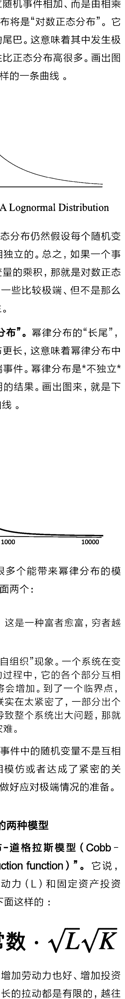


### —— 理解模型 ——

+   1. 模型是对真实世界的一种主观抽象描写，代表正规化的思考。模型通过严谨的定义和数学逻辑关系，允许我们做精致的推演，从而获得精确交流、解释、判断、设计、预测、探索和采取行动的能力。而选择什么样的模型、选择一个还是几个模型，则是智慧。

2. 模型必须符合的两个要求：
   模型中包含的各种实体——人也好、组织也好、物品也好——以及这些实体之间的相互关系，必须都有非常明确的定义。
   模型可以做逻辑推导。

3. 模型，不是数据，不是信息，而是一种高级知识，能解释一些事情，还能做预测。能用好模型，则是一种智慧。

### —— 21种思维模型 ——

#### 关于人的3种模型：

##### 第一种：“理性人模型”。理性人模型决定了人在发挥智识上限的情况下会怎么做。所谓的理性，就是你明确知道自己想要什么，并且为之采取行动。请注意理性不等于自私。利用这个模型也有风险，要注意两个非理性的偏差。

一个是“损失厌恶”，也就是人对失去的厌恶超过对得到的喜悦。

一个大约可以叫做“棉花糖谬误”，也就是人会过高地估计当前的价格，而不愿意等一段时间拿更高的价格。

##### 第二种：“固定规则模型”，代表了人的行为下限。它假设人没有那么多想法，只是根据习惯，按照一个固定的行为模式去行动。

##### 第三种：“适应性规则模型”。这种模型认为人会从几种行为模式中选择。具体怎么做，他可以跟别人学习，或者根据当前局面自己决定。

#### 关于统计的3种常用模型

##### 第一种：“正态分布”。画出图来，就是下面这样的一条钟形曲线。


图中标记了正态分布的两个重要概念：平均值（μ），和标准差（σ）。横轴上距离平均值越远的地方越是极端事件，而那些事件的纵坐标大小则代表它们发生的概率。

##### 第二种：“对数正态分布”。如果一个事件的结果不是由独立随机事件相加、而是由相乘决定的，它的分布将是“对数正态分布”。它有一个比较长的尾巴。这意味着其中发生极端事件的可能性比正态分布高很多。画出图来，就是下面这样的一条曲线。


Figure 5.2: A Lognormal Distribution

##### 第三种：“幂律分布”。幂律分布的“长尾”，比对数正态分布更长，这意味着幂律分布中会有大量的极端事件。幂律分布是*不独立*的随机变量作用的结果。画出图来，就是下面这样的一条曲线。


#### 关于经济增长的两种模型

##### 第一种：“柯布-道格拉斯模型（Cobb-Douglas production function）”。它说，产量（O）跟劳动力（L）和固定资产投资（K）的关系是下面这样的：

```
O = 常数 · √L √K
```

##### 第二种：“索洛模型（Solow Growth Model）”。它美国经济学家罗伯特·索洛提出的一个经济增长模型。用公式表示如下：

```
O = A² L s/d
```

#### 关于传播的3种模型

#### 关于股票（基本）走势的模型

写留言，与作者互动

随机行走。一般的股票在比较长的一段时间里，都会有一个上涨或者下降的总趋势。如果经济形势和股票的基本面都很好，它在长期一定会上涨，这不是随机的。如果我们把这长期的总涨幅拉成一条直线，然后把这条直线作为“大势”，从股价波动曲线中减掉，那么剩下的那些涨落，基本上就是随机行走。

#### 关于改变的两种模型

第一种：“马尔可夫 (Markov) 过程”，意思是想要一次性地采取一个行动去改变某件事，结果徒劳无功。不管你付出了多少努力，事情总会回到老样子，就好像冥冥之中有个无法摆脱的宿命一样。马尔可夫模型，真是“江山易改本性难移”、“授人以鱼不如授人以渔”这些话的数学原理。

第二种：路径依赖”，是个“不公平”的正反馈过程。它的意思是说一件事之所以是现在这个样子，很多情况下并不是因为它就*应该*是这样、不是它*注定*是这样，而是历史上的一些偶然的原因导致它是这样。路径是偶然选择的产品，而早期的选择尤为重要，依赖一旦形成，不是就不能变，但要想改变就会变得非常困难。

#### 关于阈值的3个模型

第一种：骚乱的模型。首先，骚乱是否发生，并不仅仅是由所有人的平均阈值决定的，而是由阈值的具体分布情况决定的。其次，骚乱具有偶然性，你很难预测一场骚乱是否会发生。领头的人非常重要。

第二种：双骚乱模型。平台型公司面临的最大困境，就是先有鸡还是先有蛋的问题，比如得到，就有先有作者还是先有读者这个问题，这就是一个双骚乱模型，必须两边都均衡，这个市场才能建立起来。这样的均衡特别难建立，但是一旦建立起来也特别难以被撼动。

第三种：隔离模型。为什么总是黑人和黑人一起住、白人和白人一起住。我们设想一开始大家都是混合居住的，并没有谁歧视谁。但是种族毕竟是个客观存在的现象，人们难免会对自己同种族的人有一种亲近感。计算机模拟表明，如果人们因为这么简单的原因而搬家，几轮之后，达到某个阈值就会形成黑人和黑人一起住，白人和白人一起住的局面，这就形成了隔离。

#### 有关市场定位的模型

属性的维度。产品的品质属性决定了定位空间的维度：一维就是一条线，二维是一个平面，三维是一个立方体，还可以有四维、五维。每一定位都是属性空间中的一点，各品牌根据定位划分地盘。维度越低，属性空间就越容易拥挤；空间越拥挤，各家就越容易打价格战……所以只有属性维度上的创新才能带来真正的蓝海。

#### 判断复杂系统的模型

“李雅普诺夫函数 (Lyapunov function)”。它是以俄国数学家亚历山大·李雅普诺夫命名的。它是研究复杂系统的均衡态。你有了李雅普诺夫函数这个眼光，你就能判断，哪怕社会再复杂，它也终将会达到一个*相当*均衡的状态。

这个道理反过来可不一定对：并不是所有均衡系统都有李雅普诺夫函数。

#### 有关高效学习的两个模型

第一种：“自增强学习法”，是个理性结合感性的方法。它有两个规律：

奖励比惩罚更有利于学习，奖励越多，它学得就越快。

要想学习速度更快，还必须让奖励超预期。

第二种：见贤思齐。从别人的经验中学习，比自增强学习法学习速度更快。我们看一个什么新鲜的好东西在大城市的流行速度会比小地方快得多，这大约就是因为人们在人员密集、交流充分的地方更容易互相学习。

> 是但是要注意，如果你使用自增强学习法从自己的经验中学习，你会变得越来越 Honorable；如果你采用第二个学习方法，向别人学习，你会变得越来越恶意。

—— 怎么样使用模型 ——

*想要取得更大的学习成就，你还需要掌握两个更高层次的思维模式 —— 一个是“一对多”，一个是“多对一”。

*所谓一对多，就是要举一反三，能把一个模型用于很多看似非常不一样的场景。

*所谓多对一，就是十八般兵器一起上，用多个模型分析一个问题。

*当你预测一件事的时候，你希望模型越复杂越好；当你要解释一件事的时候，你希望模型越简单越好。你需要用很多模型一起去解释和预测一个复杂的事情，你还需用一个模型解释很多很不一样的事情。

—— 神定时刻 ——

## 所有模型都是错的，其中一些是有用的。


## 日课精选

### 问答：为什么女演员比男演员机会少？
今天

进入详情 >

问答：为什么女演员比男演...
12:31 11.47 MB

[转帖：华沙]

#### 来自日课：十八般兵器和举一反三

读者 太西瓜西太：

BMI指数提出出的原理是什么呢？是它只考虑了正态分布里99.7%标准差的样本，而像NBA运动员，其实是标准差之外的吗？

万维钢

这个身高体重指数，BMI，是比利时统计学家凯特勒在十九世纪提出来的指标，BMI=体重/身高²。这个公式并不是对于统计结果的数据拟合，原理并不是正态分布和标准差，而是一个简单的数学理论。

直观地说，BMI描述了人体对外界造成的压强。比如一个人躺在床上，他的身体跟床的接触面积大小，是和身体的尺度——大致可以用身高代表——的平方成正比，而这个人的体重就是他给床的压力，所以BMI是压强。体重不等於肥胖，大个子本来就应该体重也高——压强大才是真肥胖。

当然，根据我们在文中的分析，BMI对身高很高的人来说仍然是不公平的，但是只要体重、或者用体重除以身高、或者用体重除以身高的立方，那些算法或者更不公平，或者根本看不出来腰腹。

BMI的优点在于它只用体重和身高这两个最容易测量的参数，就能大致上判断一个人是否超重，这实在太方便了，像保险公司直接拿来就可以用。不用BMI，你就得再加测腰围、体脂率这些参数才能综合判断，而且还得制定复杂的判断标准，结果对健康水平的预测还未必能比BMI好很多。

其实我们常用的指标往往都是这样的。体温并不代表病情严重程度，智商高能力不一定强，GDP不能描写全面的经济发展水平，销量不等於质量——完全依赖这些指标当然是愚蠢的判断，但是它们能提供很多信息，而且能快速提供信息，所以是我们做判断第一个要问的指标。

读者 孔彩灯：

女演员的收入普遍比男演员少是因为女演员比男演员机会少吗？每次好机会都会带来收入的提升。可为什么男演员机会多呢？

万维钢

女演员的机会的确是更少。我们在讲德里克·汤普森的《流行制造者》[1]这本书的时候说过，2010年-2013年期间各个国家的120部流行电影中，女性角色只占不到三分之一；美国更是只占29%。女演员不但可选的角色少，而且在影片中的扭钩地位也稍微低一些。电影中担当关键职位的角色更多的是男性，女性总是扮演从属的、弱势的、漂亮性感的、花瓶式角色，大事还是主要由男性去做。女主角，常常不是真正的女主角。

而汤姆森说，这还不是好莱坞故意歧视女性的结果，而是观众对女性的期待就是这样。当我们谈论一个英雄故事的时候，我们常常想象那是一个男性英雄。并不是说观众不喜欢女演员，观众只是喜欢看到女演员，但是并不认为女演员应该担任最重要的角色。在这种情况下，女演员对收入的谈判能力，恐怕就低于男演员。

这当然不是一个值得称赞的现象。不过我感觉现在局面正在好转，好莱坞拍了很多女英雄，中国拍了很多……宫斗剧。还有一个趋势是中国的很多男演员越来越像女演员，对我来说还不如直接看女演员。

#### 来自日课：止痛药的辣手问题

读者 我的头像很“萨”：

1%能接受，2.5%不能接受，FDA的界限在哪呢？是2%吗？

万维钢

我理解FDA批准新药并不是像中学生参加毕业考试一样，划个线通过就行，它是一种综合的、主观的、甚至可以说是人治的判断。

#### 来自日课：怎样使用智慧团

专家互相交锋，这就让他容易发现每个模型的不足之处。

而我认为更重要的一点，是这位领导非常谦逊：他没有说自己弄个先入为主的理论，不管别人说什么都用自己的东西去套，更没有搞意识形态——他不设禁区，愿意了解多个模型，他能容得下一切先进理论。

读者 伪装：

最后那位领导是不是有点和稀泥呢，也没有给一个相对确定的结果啊。

读者 李中杰：

所以，领导回去以后该怎么跟大领导汇报呢？

万维钢

这位领导召集智囊开会的目的只是想了解情况，所以他能够看出不同模型的适用范围和优缺点，对问题有个全面的了解，也就行了。具体的行动，必须是建立在这个全面的了解之上。

那么我们设想这位领导去向大领导汇报，大领导问他：“美国贫富差距的事儿，你了解的怎么样了？”

领导：“我已经基本了解了。我认为，贫富差距，是一个棘手的问题。”

大领导：“太笼统了！不要和稀泥，你就说，如果美国总统问你怎么办，你怎么回答。”

领导：“这要看美国总统是民主党还是共和党。”

大领导：“民主党怎么说，共和党又怎么说？”

领导：“如果是民主党总统，我就告诉他贫富差距扩大是个自然趋势，富人有太多手段增长自己的财富。首先 r > g，其次有家族的传承和强强联合，而且现在又赶上了胜者通吃的大时代，穷人参加的根本就不是一场公平的竞赛！更何况，富人还会用政治手段让比赛更加不公平。所以政府必须采取有效行动去帮助穷人，比如说征收更高的资本利得税，同时给穷人发基本收入保障。

而如果是共和党，我就告诉他美国的贫富差距状况的波动是由技术进步的不同阶段导致的。那么既然是发展带来的问题，就应该在发展中解决。政府应该加大力度推动大学教育，鼓励更多的美国人参加高科技工作，分享技术进步的成果。同时还要限制外来移民，保护美国人的工作。”

大领导：“行行行，你呀你，哈哈。那咱 们关起门来自己说，你看美国贫富差距加大跟咱中国有关系吗？”

领导：“美国过去几十年这一波贫富差距拉大，主要是因为产业升级，不再需要很多低素质的本国工人了。而美国之所以能这么干，跟全球化很有关系。所以中国 的工人，和美国的跨国公司，都是全球化的受益者。我看特朗普提出的某些条件，与其说代表了美国工人阶级的利益，还不如说是代表了跨国公司的利益……”

领导就这样不停地说不停地说，把大领导都给听烦了。

注释
[1] 为什么电影里的女强人必须有脆弱的一面？
[2] https://www.cnbc.com/2019/06/20/fda-proposes-tighter-opioid-rules-that-would-make-new-drugs-less-addictive.html
[3] P<0.05: 科学家的隐藏动机

### 未来预告

咱 们接下来会讲一本比较轻松的书，彼得·里森（Peter T. Leeson）的《怪异经济学》（WTF?!: An Economic Tour of the Weird）。彼得·里森是乔治·梅森大学的经济学教授，你有可能读过他 2009 年出的《海盗经济学》这本书。

这本《怪异经济学》列举了人类历史上发生过、甚至仍然在发生的一些怪异的行为，比如说封建迷信活动，而用经济学的眼光去分析，你会发现这些活动都是合理的。

掌握了这个分析方法，也许你更容易跟这个世界和平共处。


帮你和全球精英大脑同步

## 日课精选

默认 最新 只看作者回复

正在加载…

写留言，与作者互动


今天
进入课程 >

《怪异经济学》1: 迷信的细节
13:23 9.19 MB

| 转发：长沙 |

今天开始我们来讲一本2017年出版的书，叫《怪异经济学》（WTF?: An Economic Tour of the Weird），作者彼得·里森（Peter T. Leeson）是乔治·梅森大学的经济学教授。这个彼得·里森你可能听说过，罗辑思维节目讲过他2013年出的《海盗经济学》[1]，也很有值一读。

这本《怪异经济学》不是说“怪异的经济学”，而是用经济学解释人类社会的一些怪异的行为。这本书里的经济学很简单，行为很怪异。

我们专栏最近一直说要举一反三，要会“一对多”，我认为这本书能帮你训练这个能力。通过对书中这些怪事的经济分析，我希望你总结一个很“毒”的眼光，以后面对各种社会现象不但要见怪不怪，而且要能一针见血地发现其中的关窍。

这一讲我们来说说宗教迷信。

你听说过这样一个故事。在欧洲中世纪，有一个富人和穷人打官司，富人说穷人偷了他的东西，穷人说自己没偷。法庭也沒办法调查取证，就决定让上帝裁决。方法是烧一 大锅热水，锅下面还架着火，把一枚戒指扔到锅里，要求犯罪嫌疑人把手伸进锅里去，把戒指捞上来。

法官说，我们不知道你有没有罪，但是上帝知道。如果你是无罪的，上帝就会保佑你，你的手就不会受伤；而如果你被灼伤了，就说明你有罪，你还要接受进一步的惩罚。请问何敢不敢接受上帝的考验呢？


咱们想想这个局面。如果你真有罪，你知道自己的手肯定会被灼伤，灼伤之后还有别的惩罚，所以你还不如直接认罪。而如果你没有罪，出于对上帝的信仰，你会愿意接受这个热水考验。

那么这样一来，法官根本就不需要等到嫌疑人真的把手伸进热水中，只要态度，就已经能判断他有没有罪了！这个故事简单而又机智，应该讲给孩子听。

但是聪明的孩子听了这个故事，会有很多疑问。

如果愿意接受考验就说明是无辜的，连实验都不用做了，那围观群众能信服吗？如果每次都这样搞，下次岂不是人人都选择接受考验，那这一招还有用吗？如果真做实验，真把好人烫伤了，你怎么解释？

你可能会想，这个做法简直是儿戏，应该只是个传说吧。

那你就想错了。这是欧洲中世纪教会法庭的常规操作。这么怪异的事为何可行呢？魔鬼，在细节之中。

### 1.细节

这种让上帝帮着判断有没有罪的审判方法，有个专有的名词，叫“神判（Trial by Ordeal）”，历史上有详细的记录。神判的常用方法有三种，一种是我们刚才说的“热水考验”，第二种是“烙铁考验”，把一块烙铁烧红，让嫌疑人用手拿烙铁，无罪就不会被烙伤——


第三种是“冷水考验”，把嫌疑人绑好，浸到池塘里，如果他全身都能沉入水中，就证明他无罪，旁边的人会把他拉上来；如果没有完全下沉，就是有罪——


这些操作都是标准化的，有神圣的仪式和严格的步骤，必须当众进行，有正式的见证人。教会，可跟你玩真的。

但是，不管你信不信教，也不管你是有罪没罪，如果你面临神判的选项，我建议你选择接受考验。因为我有数据。

1194年到1219年，英国某地区一共举行了16次冷水考验，其中14次，嫌疑人通过了考验；还有3次烙铁考验，嫌疑人全部通过了。

1208年到1235年，匈牙利地区总共举行了208次烙铁考验，其中130次通过，通过率达到62.5%。

当然我不太相信这是上帝真的出手干预了，所以我认为这些数据只能说明一件事儿：法庭对实验做了手脚。显然法官也做了我们一开头说的那一番推理，他知道接受考验的人，大概率是无辜的。法庭通过某种方式操纵了实验，放了这些人一马。

那法庭是怎么做到的呢？我们可以从当时的操作流程和数据中发现秘密。彼得·里森做了详细的考证。

神判仪式有很多讲究。教会明文规定，要做热水考验，用火烧水的这个准备工作，必须由教会人员独自完成，犯罪嫌疑人和围观群众是不能看的。那我们想想，等水烧好了端出来，虽然下面还架着火，你知道那个水是真烧开了还是假烧开了吗？

再比如烙铁考验，仪式规定，嫌疑人抓烙铁之前，牧师必须先往他的手上撒“圣水”——那圣水是不是起到了降温和隔热的作用呢？

不但如此，教会还规定，出于对上帝的尊重，见证人和围观者都必须站在规定的距离以外。更重要的是，考验做完手一拿出来就得马上用布包起来——得等到第三天，再由教会人员单独判断，这个手到底有没有受伤。那这不是你说是什么就是什么吗？

冷水考验也有讲究。今天我们知道男性的体脂率比女性低，所以男性的身体密度更大。把男性放在水里，有80%的可能性会完全沉下去，而女性只有40%的可能性。那教会是怎么做的呢？

教会几乎就不让女性参加冷水考验。英国1194年到1208年对男性的84次神判中，有79次用了冷水考验；而对女性的7次神判，全都不是冷水考验。特别有一次，两对男女共同犯事，教会让两个男性去参加冷水考验，让两个女性参加烙铁考验。

我们今天能看到完整的数据，当时的老百姓可没有这个眼光。但要是教会做的太绝了，让每一次神判都过，老百姓肯定也能看出来——所以必须有一定的失败率才行。这就意味着，教会必须牺牲一些好人。

这就算维护信仰的代价吧。好人被冤枉了肯定会喊冤，但是喊冤也无用，教会并不在意。教会真正怕的是，万一神判一个人体有罪，比如说他杀人了，可是过了几天，那个据说被他杀死的人自己回来了，证明这人无罪，那教会的脸面就荡然无存了。所以教会必须避免这种情况发生。

这大概就是为什么教会对手使用神判的条件有非常严格的规定。必须是杀人、纵火这种特别重大的案件，而且必须是确确实实不可能用别的方法找到证据了，才可以使用神判方法。

教会的操控，滴水不漏。

### 2.道理

经济学认为人是理性的。所谓理性，就是知道自己想要什么，并且尽量为之争取最好的结果。一个人在一个不熟悉的局面中做一件傻事——但如果很多人、一直都这么做事儿，那就有可能是理性的计算。如果你没看明白这个计算，那也许说明是非常精巧的计算。

今天有些人认为教会是个搞迷信的、愚昧的机构，其实不是。在欧洲中世纪，教会代表先进文化和先进生产力，他们有最聪明的人，有最精巧的制度设计。

之所以要“神判”，是因为教会要维护社会公正的责任，而当时的犯罪侦查成本实在是太高了。神判是个低成本的、而且比较有效的方法。

理性的人会对激励做出反应。教会制定了考验规则，嫌疑人就会对这个规则做出反应——他们经过一番理性计算，会主动暴露自己。教会要做的，就是确保这个计算一直

自己。教会要做的，就是确保这个计算一直成立。

第一，当时的人是真的信仰上帝，这个社会背景，是最重要的条件。教会会把神判操作弄得非常有仪式感，充分利用人的信仰。

第二，教会把实验结果的解释权，牢牢掌握在自己手中。这个人到底应该接受哪种考验？手到底伤到什么程度才算受伤？在这些关键问题上，教会恰恰不给你明文规定。模糊的地方才是行使权力地方。

第三，教会绝不滥用这个手段。信仰是不能轻易花费的，教会设定严格的使用条件，而且不惜牺牲一定比例无辜的人。只有这么做，信仰才能只升值而不贬值。

第四，一旦有了更好的办法，教会就会立即放弃这种神神叨叨的东西。事实上到13世纪初，“神判”就被取消了。一方面是可能世俗的审判机制越来越完善，另一方面是有人提出质疑，说这个做法不符合《圣经》的精神，因为《圣经》说了，不要利用上帝给你制造奇迹。

教会完全明白，上帝，是不能轻易用来做实验的。

### 3.诅咒

不过教会要是不搞迷信活动就不叫教会了。在10到12世纪的时候，欧洲教会还时常干一种现在看起来简直匪夷所思的事：它会用一个严肃的宗教仪式，去诅咒一个人。

> “主啊，请诅咒他的眼睛，请诅咒他的耳朵，请诅咒他的头，……请诅咒他睡觉的时候和行走的时候，……请诅咒他在活着和死了以后……”

请注意你可是名门正派啊！上帝不是至善的吗？你利用上帝去诅咒别人，这样真的好吗？

其实我们作为现代人更想问的是，你这诅咒能有啥用啊？

答案是有用，而且必须得这么干。里森考察当时的历史记录，教会可不是随随便便为任何事都动用诅咒这种犯忌讳的武器。事实上，教会只为一种事诅咒，那就是为了自己的财产权。

当时的欧洲正处于所谓“封建无政府主义”的状态。大小小小的贵族、骑士和领主都有个人的地盘，有时候高兴了就会把一部分财产送给教会，下次不高兴了还可能把教会的财产给抢走。而当时的教会，并不掌握能够抗衡这些巨头的武装力量。教会就只能诅咒了。而且请注意，诅咒在《圣经》里还是有依据的，上帝真的诅咒过人。

考虑到当时的人真的很信仰上帝，诅咒还是有一定的约束作用的。但是诅咒不好使也不行。比如教会诅咒某个人明天下午两点之前一定死，结果人家到时候没死，那岂不是很没面子吗？

而正如我们前面讨论的那样，“模糊性”是教会权力的操作空间。教会根本就不会说可检验的诅咒！我们诅咒这个人身体的各个部分，但我们说的很模糊，既没说具体会出什么毛病，也没说什么时候会出毛病。说不定哪天他就病了，那就是我们诅咒的结果。

那万一这个人一辈子都无病无灾，幸福地过完了这一生呢？那也没关系，我们可以说他正在地狱里受刑，我们的诅咒仍然有效。

诅咒，必须是不可证伪的。教会依靠信仰而绝不滥用信仰，更不会考验信仰，总是掌握解释权和主动权。事实上等到 12 世纪以后，教会的财产权得到了有效保护，它就再也不诅咒任何人了。

这就叫有理、有利、有节。统治欧洲将近两千年，没点政治智慧行吗？

其实就在今天，非洲有些地区，还在使用神判。

甚至连美国的法庭都还在用这招，只不过换了一种形式而已——那就是“测谎”。美国很多州都承认测谎证据，但是所有心理学家都会告诉你，测谎这个事儿根本不靠谱，测谎仪并不能判断一个人说的是不是谎话。但是测谎仪给嫌疑人出了一道难题：你愿不愿意接受测谎考验？

测谎仪画出来的那一堆杂乱的、模糊的曲线，就是法庭的操作空间。

我看现代消费者对奢侈品牌的态度、粉丝对“爱豆”的态度，好像也不比宗教信徒对神判和诅咒的态度高级。

有些事儿听起来不可理喻，其实只要你仔细分析，可能都是合理的。如果你理解不了，可能别人没错，是你错了。认识到这一点，也许我们更容易跟世界和平共处。

注释
[1] 罗辑思维 97. 海盗的世界你懂吗


今天
## 《怪异经济学》2：买卖妻子...

12:12 11.16 MB

| 绘者：笑沙 |

古罗马哲学家西塞罗有名言，说“只有了解自己这一代的人，永远是个孩子。”这个世界特别有意思的一点是各个历史时期、各个国家的人做事方法都不一样，可是人性却是都一样的一——所以不管那些事儿听起来有多怪异，只要愿意下功夫深入了解，我们总是可以理解，当时、当地的...事。

在那样的条件之下，也许他们那样做是最好的选择。

咱们继续讲讲彼得·里森的《怪异经济学》。

### 1.拍卖

没错，就是世界最先进最文明的大英帝国。当时英国人拍卖妻子这个现象不仅存在，而且是公开的、而且基本上是合法的。彼得·里森就曾经亲自搜集了1735年到1889年间英国报纸上刊登的拍卖妻子的广告，总共找到222例。

拍卖流程非常正规。如果你愿意花钱，可以先在报纸上刊登广告。在拍卖当天，你还可以雇一个人，先帮你在集市上叫卖一番，吸引一些买主。到了约定的时间，会有专门的拍卖师帮你主持。有时候竞拍者可能有成百上千人。

### 2.真·女权

有些历史学家认为资本主义所以在英国发生，很大程度上是因为英国人的权利意识发达。特别是物权，法律非常重视保护个人财产，政府对侵权行为的执法是非常严的。

### 3.科斯定理

经济学上有一个“科斯定理（Coase Theorem）”，用大白话来说，就是一件物品最初的物权在谁手里并不重要：只要是自由交易，它终究会落到对其的价值评估最高的那个个人手里。

善女性权利。到1882年，女性终于获得了和男性完全平等的法律权利。结果在1890年以后，拍卖事件就基本绝迹了 —— 并不是政府禁止了拍卖妻子，而是没有这个必要了，现代人都用离婚的方法。

如果你觉得拍卖妻子很荒谬，难道现代的球星转会就不荒谬吗？我们经常听说某某球队“买了”某某球员 —— 难道球员是奴隶吗？这不是物化球员吗？

现行的转会制度，是如果球员和原俱乐部的合同还没有到期，想去别的俱乐部，那么新俱乐部必须为此向原俱乐部支付一笔转会费。在 1995 年欧盟通过“博斯曼法案”之前，就算球员跟俱乐部的合同已经到期了，就算俱乐部已经决定不再用他了 —— 他想转会，也得有人出转会费才行。

你难道不觉得这很别扭吗？为什么球员不能像一个普通的劳动者一样，不喜欢这个球队就直接辞职，加入另一个球队呢？为什么他要像十九世纪的英国妻子一样被俱乐部买来卖去呢？

这大约是因为正如英国女性是丈夫的财产，球星不仅仅是一个劳动者，而且还是俱乐部的财产。从青少年时期开始扛着风险培养一个球星，到用巨额工资合同签下一个球星，俱乐部的付出是巨大的，所以俱乐部必须想方设法保护自己的权益。转会制度能降低俱乐部承担的风险。

而既然你那么好，别 的俱乐部那么需要你，那根据科斯定理，它们可以买你啊。

所以彼得·里森总是说，怪异不怪异，这不是一个好的观察角度 —— 正确的观察方法是看其中的激励机制：如果有这么多人愿意参与这件事，那就一定是各方都得到了自己想要的东西。

帮你和全球精英大脑同步


今天
《怪异经济学》3: 吉普赛人...
12:36 11.54 MB

我记得以前媒体常说“中国是礼仪之邦”，号召大家讲文明讲礼貌。现在很少说了，可能我们自己也发现现代中国人并不比外国人更讲礼貌。事实上如果你较真的话，“礼仪之邦”的礼仪可不是女士优先那种“社交礼仪”，而是一套严格的等级规矩。

比如我家祖上是山东人，孔孟之乡，规矩就很大。我爷爷那一代就到了东北，可是我小的时候，我家还是有些规矩。像吃饭席都是男人人坐一桌，女人和孩子们坐一桌。我和我弟弟上中学以后被允许“上桌”，已经是礼崩乐坏时代的破格待遇。还有以前过年去亲友家拜年，人人都郑重其事，现在这个仪式感也没了。

那既然现代人可以自由自在地生活，古人为什么非得弄一套繁琐的礼仪呢？并不是人们对仪式感有什么审美需求，而是为了维护社会秩序。讲“尊卑”是为了达到“有序”。市场机制在农业时代的熟人社会里作用不大，但好东西总是稀缺的，“有序”才能解决分配问题。如果你的辈分——或者爵位、或者血统——比较低，那你千万别指望；而如果你的地位比较高，你会得到你应得的，但是也要有节制。

正所谓“礼之用，和为贵”。礼仪社会在理想状态下不需要用法律和警察去解决冲突。费孝通说，乡土中国大致上是“无讼”的，父老乡亲都会监督你，就算谁有冲突也是用宗族礼法解决——而如果谁要打官司、把自己的命运交给外人，那就太不像话了。

### 1.禁忌

吉普赛人，是神秘的。我们的印象中他们是个流浪民族，有时候表演节目，喜欢给人算命——他们一边流浪，一边还保持了自己的文化独特性，好像从不融入主流社会。

### 2.经济

美国的吉普赛人是个非常特殊的群体。他们拒绝任何上班拿工资的工作，都是自己做点小生意。男人一般经营一个小作坊，弄个小手艺，比如给人修个屋顶或者倒卖二手车之类；女人她们当然就是算命。

### 3.检验

所以吉普赛人的禁忌是减少社会冲突的手段。不过要接受这个结论，我们还需要更高级的思维——我们必须对这个解释进行检验。经济学家想到了三个检验。

与人有什么经济冲突，那么美国吉普赛人的禁忌对小孩和老人也应该是有所放松的。

确实如此。孩子虽然从小就被灌输污浊的概念，但是直到青春期之前，人们对他们的要求都不严格。吉普赛人对老人非常尊敬，认为老人是纯净的。

第三个检验是随着社会进步，吉普赛人如果越来越融入到主流社会之中，他们的禁忌观念会不会下降呢？

的确会下降。从1970年代以后，因为年轻人更愿意像普通美国人那样生活，吉普赛人就开始慢慢融入美国社会了。他们越和世俗社会融合，就越希望由政府出面来解决冲突；而越是这样，他们的禁忌观念就越弱；而禁忌越弱，内部的协调机制就越不好使；内部协调越不好使，就越需要和世俗社会融合——这是一个正反馈的过程。

1986年的时候，美国各地的吉普赛人曾经派出200名代表，专门开会讨论如何保持本民族的传统价值观……结果是徒劳的。现在的吉普赛人，禁忌观念已经非常弱了。

*

由此我们设想，其他民族的一些禁忌，是否也有经济基础呢？比如某些宗教主张不吃猪肉，有人就认为当初这个规定有贸易保护的考虑。

现代化不仅仅是经济条件和科学进步，也是生活方式和价值观。正如过去的问题要用过去的方式解决，现代的问题也应该用现代化的方式解决。而有些人主张要保留传统习俗，甚至还想让某些传统的价值观回归，比如要给孩子们灌输像《弟子规》这种东西，他们是不是刻舟求剑呢？

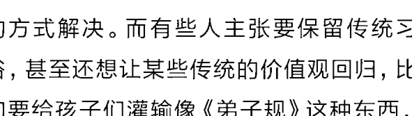

## 大部分工作不需要经验

今次

大部分工作不需要经验
09:52 18.07 MB

现在一般招聘广告都要要求应聘者有一定的相关领域工作经验，有的要两年、有的是甚至要求有五年经验。这个要求对新手是不公平的，刚毕业的大学生哪里有经验。还有人是跨行换工作，可能是自学了一些相关的技能，也没有经验。经验，把这些人挡在了门外。

那我们自然就会想，也许这些没有经验的人之中有很多能强的人，只要给他们机会入职，他们就能把工作做好，可惜他们没有机会。

答案是，一个应聘者以前的工作经验，和入职之后的工作表现，没关系。

## 第二个原因是大部分的工作经验并不能让人提高水平。

## 第三个原因是某些情况下，工作经验可能还有害。

能认为自己的工作很有意义、能帮助他人，可能就就就业一干就是几十年 —— 但那些都不等于刻意练习。大部分人只是想把事情做“对” —— 而不是做“好”。

重复劳动的经验，哪怕再苦再累再精彩再激动人心，也不能提高水平。

而如果你是个有心人，这个事实揭示了你的机会。如果大多数人根本都不动，你要超过他们简直太容易了。

## 注释

> [1] Chad H. Van Iddekinge, John D. Arnold, Rachel E. Frieder and Philip L. Roth, A meta - analysis of the criterion - related validity of prehire work experience, Personnel Psychology, 04 April 2019 https://doi.org/10.1111/peps.12335

[2] 平均的终结：不规则人才

> [3] Alison Beard, Experience Doesn’t Predict a New Hire’s Success, Harvard Business Review, SEPTEMBER - OCTOBER 2019.

[4] 《范围》1. 不赢起跑线的人

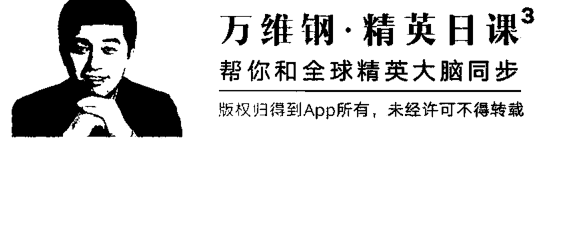

## 明星的零阶道理

今天

进入讲解 ›

明星的零阶道理
10:49  9.9 MB

世界上有一些道理因为太过明显了，反而不会被人们提及。比如说“有钱的生活更好”，因为人人都明白，所以谁也不可能专门写篇文章说它。咱们可以把这样的道理称为“零阶”道理。我们更喜欢说的是“一阶”、甚至“高阶”的道理，比如“没钱的生活也可以很好”就是一个一阶道理：它承袭零阶道理的一般正确性，但是提出一个特殊的、或者更细致的修正，就好像数学上的“一阶小量”。

可是如果我们平常听到的大都是一阶道理，就有可能低估零阶道理。所有的小说和励志鸡汤都爱描写穷家伙的正能量和有钱人的愚昧，读多了的人就可能会说“金钱不能让人幸福”。可是如果你真的去做一个一本正经的统计研究，考察人们的收入状况和幸福感的相关性，你会发现，钱多的人真的更幸福。

同样地，不管你听过多少一阶道理，我还是可以负责地说，美貌的人真的更受欢迎，聪明的真的学习成绩更好，强壮的人真的更能在比武中取胜。不过这些零阶道理没啥用，不能给人以希望。咱们这一讲要说的是一个有用的零阶道理——
明星真的很有用。

有人说中国反正什么都好，就算足球不行也没关系，我看这也不对。现在中国各行各业面临的问题，都是要从香菇青菜，怎么才能改成葱烧海参。这时候你最应该关心的不是怎么管理香菇、青菜和葱，而是去哪找海参。

## 注释

[1] 《文化密码》1. 精英团队的认同感

[2] Tom Gott, One-Man Teams? Ranking the Importance of the Star Player at Every Premier League Club, 90min.com, 15 AUG 2018.

[3] Travis Armideo, Next Man Up: How Important Is Your Team’s Star Player? gladiatorguards.com December 3, 2015.

[4] RYAN BAILEY, Star Players vs. Star Coach: Which Is More Important for Success? bleacherreport.com APRIL 8, 2014.

[5] Michael Meier, Sitting Near a High-Performer Can Make You Better at Your Job, insight.kellogg.northwestern.edu MAY 8, 2017.

[6] 《成功公式》5. 母鸡与GitHub上的程序员

[7] 徐根宝做客<杨澜访谈录> - 网易体育，2013。


## 问答：是不是所有问题都能用市场解决？
万维钢·精英日课³
今天
进入评论 >

问答：是不是所有问题都能...
12:15 11.22 MB
[绘图：夜纱]

## 来自日课：谎言的细节

## 读者 张平：

如果测谎过程中可以根据受试者的心率、排汗、眨眼甚至脑电波等被测数据，进行分析后判断其是否撒谎，那是不是就可区别于神判断而被视为一种科学手段了呢？

万维钢
测谎仪不是高科技。测谎仪并不检测人的大脑活动，它只测量几个非常平常的数据：心率、血压、呼吸和皮肤的导电性。我们设想，当人说谎的时候就会紧张，一紧张就会出现呼吸加快、血压升高、手心出汗的状况，而测谎仪能够探测到这一点。

但是，事实是并没有任何科学理论说如果一个人出现这些症状，他就是在说谎。人可能因为各种原因紧张，也可能说什么时候都不紧张。测谎仪测量的不是“说谎”，而是情绪波动。测谎仪应该叫“测害怕仪”、“测紧张仪”。

真实的测谎并不是简单地问一个问题，根据参数波动看他是否在说谎，而是使用两种更高级的操作 [1]。

一个办法是把“相关问题”和“控制问题”放在一起问，看嫌疑人对这两种问题的不同表现。比如嫌疑人所在的公司丢失了一个特别重要的设备，警方怀疑这是这个嫌疑人偷的。问“你是否拿走了那个设备？”这就是相关问题；而问“你是否曾躺过你的妻子？”这就是一个与本案无关的控制问题。

你可以设计若干个这样的控制问题，特点是涉及到个人隐私。通常情况下，如果其中一个控制问题说中了人的隐私，就应该能引起他的情绪波动。而隐私的事儿再大，也比犯罪的事儿小得多。

如果嫌疑人是无辜的，他面对相关问题产生的波动，就会比面对控制问题产生的波动小。而如果嫌疑人真的偷了那个东西，他对相关问题的波动就应该比控制问题大。

另一个办法则是让嫌疑人做 Associative test，跟杀提线索提线索。比如现在有一个人失踪了，警方怀疑这个人是被嫌疑人给杀死了。那么警方可以一个一个地问嫌疑人下面这些问题——
他在你家附近吗？
他在汽车里吗？
他在水里吗？
他在地下吗？
他穿着衣服吗？等等。

如果嫌疑人真的不知道这个人在哪里，他应该对所有这些问题都不会产生情绪波动。而如果其中一个问题让他产生了强烈波动，比如说“他在水里”——就给警方提供了寻找被害者尸体的方向。

那么这些方法的有效性如何呢？这取决于你是美国测谎学会（The American Polygraph Association）还是美国心理学会（American Psychological Association）。测谎学会的说法是测谎的准确度高达 90%，而心理学家对此并不买账 [2]。

如果嫌疑人没有反侦察能力，如果你把测谎的场景布置得很 好，我相信能测出一些东西来——但即使如此，也不应该把测谎结果作为犯罪证据。有的人动不动就紧张，有的人面对什么情况都不紧张，而紧张和不紧张都不犯法。你永远都不能确定这个人是不是仅仅随机地紧张了一下，也许一切都是巧合。

很多情况下你看到的只是一大堆波动曲线，根本看不出哪个问题的波动有什么特别之处。心理学家的确承认测谎结果会比随机的猜测要好，但是认为出错率是显著的 [1]。

而如果这个嫌疑人做一点面对测谎仪的准备，他完全可以骗过测谎。比如他可以控制情绪，甚至简单地抖动身体都可能影响测量结果；他还可以事先吃点降药之类的东西。有些苏联间谍就曾经两次通过了美国中央情报局的测谎，他的办法仅仅是事先睡个好觉、然后对测谎人员很
//有礼貌而已。

## 来自日课：买卖妻子的市场

## 读者 L.J：

本节课分析了英国买卖妻子的问题，这让我想到了买卖儿童的问题。有些人提出合法买卖儿童的主张……说可以将买卖儿童变为转移抚养权同时获得抚养金的说法，你对此有何评论？

万维钢
是不是所有问题都可以用市场解决呢？市场的特点是只要一个交易能够发生，那就一定是买卖双方都认为这个交易是值得的。那如果这两人的交易完全没有伤害到第三方，这样的交易是不是就应该合法化呢？

一对贫困父母，感到无力抚养自己的孩子，把孩子的抚养权转让给别人，同时领取一笔补偿，这件事情应该被允许吗？一个年轻人为了筹措学费，打算卖掉自己的一颗肾，政府应该阻止他吗？

## 来自日课：吉普赛人的禁忌

## 读者 戴嘉懿：

民族和国家被认为 djel...


呢？据我所知，现在真没有了。欧洲人基本没有这样的情感，人们只会在足球场上捍卫国旗的荣誉。但是这并不一定就是对的，也不一定就代表未来的方向。比如美国人也非常讲爱国主义，特朗普说要让美国再次伟大。欧洲的特殊情况是成立了欧盟，国家的意思真的不大了。

我们只知道人的观念、包括道德观念都会随着经济条件和地缘政治之类的外部限制而改变，但是我们很难预测这个改变的方向。经济越发达人肯定会越自由，但是自由不一定等于“安奈琪主义”——也就是无政府主义。

比如我们讲本·夏皮罗的《历史的正确一侧》这本书的时候说过，现在世界的一个趋势是越来越讲个人主义。但是这个趋势不一定是永恒的。我们专栏熟悉的作家戴维·布鲁克斯出了本新书叫《第二座山》，他就论证，个人主义不会是人类社会的最终归宿，将来的历史会在个人和群体之间不断摇摆。

布鲁克斯说如果仅仅是经济条件变好，并不能解决人的全部问题。你有再多钱，也会有一个“这意义何在”的问题。而你人生的意义不能单纯从自己身上找，必须从别人那里找，幸福包括归属感。

就算“经济基础达到匡夷所思的发达程度”，人恐怕也得是群居的动物。而既然要群居，要与人交往，就有道德、习俗和礼仪的问题。老王家就只有一个女儿我也看中了你也看中了，咱俩再有钱再有高科技也解决不了这个矛盾。那如果有些传统的道德观念已经提供了解决方案，我们为啥不用呢？

在 Mathematica 的发明人沃尔夫勒姆对未来的畅想 [3] 中，当经济无比发达的时候，人们不是彻底抛弃传统，而是开始尝试各种传统。有的人喜欢比如说宋朝的生活方式，他们就可以假装自己是宋朝人，就去过那样的生活。就好像现在书法明明没用，可是很多人还是喜欢练书法，那也挺好。等到要啥有啥，人们反而会觉得历史是宝贵的，会更愿意从历史中寻找认同感。如果一个人不知道自己是从哪来的，就算是要啥有啥，他可能都不知道该要啥，他可能看足球都不知道该支持谁。

所以传统提供了枷锁，但也提供了意义。我们只要不被传统压迫就行，让人自由选择他认同的传统，这样的世界更有意思。

## 注释

[1] https://www.apa.org/research/action/polygraph
[2] https://www.apmreports.org/story/2016/09/20/inconclusive-lie-detector-tests
[3] 一个神人的世界观


〈 前一篇

## 日课精选

默认    最新                    只看作者回复

正在加载...

写留言，与作者互动


今夫
进入课程 >

《怪异经济学》4：巫术的裁决
11:48 10.8 MB

| 转载：沉默 |

微个信里有两个重要的“聊天表情”，人们可能用的太少了：一个是“掷骰子”，一个是“石头剪刀布”。

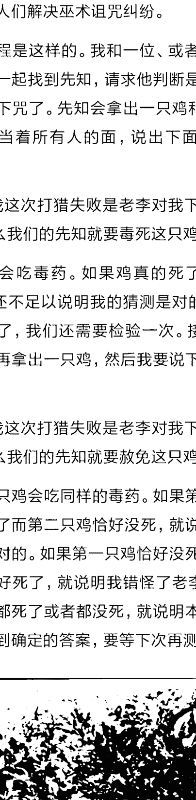

这两个表情不是表达情绪用的，是解决争端用的。你跟人对话的时候点击这两个表情，系统就会随机地输出一个结果，胜负立现，谁也不能作弊，非常公平。我们在生活中，比如只有一个玩具两个小孩都想玩，那谁先谁后呢？就常常是用石头剪刀布的方法解决。打网络游戏的时候，几个玩家手杀一个怪兽，掉落一件史诗级装备，给谁是好呢？大家都掷个骰子，谁点数大给谁。

我们没有理由不能在工作中也这么做。比如你是一个设计师，跟合作的甲方产生了一个冲突。你提出一个A方案，甲方非说A方案不行，非得用B方案。你认为你的观点最专业，可是甲方说他出钱就听他的。如果你俩各自坚守自己的意见，谁也说服不了谁，我建议大家打开微信，掷个骰子。如果甲方掷出三点，而你掷出五点，那就应该听你的。

可能你觉得这有点不靠谱，但我们这一讲要说的是，把裁决交给随机的命运，是解决分歧的先进方法。咱们继续讲彼得·里奇的《怪异经济学》这本书。

## 1.巫术

非洲中北部有个原始民族叫赞德（Zande，复数形式是Azande），分布在刚果、南苏丹和中非共和国境内，现今人口大约有一百万。在上世纪20年代的时候，英国人类学家E·E·伊凡-普理查（E. E. Evans-Pritchard），曾经深入到赞德人中去观察他们的生活。赞德，是一个盛行巫术的民族。


赞德人相信一个人可以用巫术诅咒另一个人，用咱们中国人的话说，就好像是下盅一样。这当然不是啥好风俗，但是我觉得他们这个巫术有一种美感。

## 2.仪式


## 3.“分歧终结机”

写留言，与作者互动

石头剪刀布也好，掷骰子也行，把裁决权交给随机性，既方便又公平。接受命运的安排，输了怪只怪自己运气不好，这种心态很健康。每个人每次都有 50%的可能性赢，时间长了，大数定律会确保谁也不会吃亏。而对比之下如果你一有冲突就让上级或者长辈裁决，就难免会有人觉得他偏向于某一 Ted

*

那为啥世界上这么多文明，偏偏是非洲的赞德人发明了这个巫术裁决法呢？肯定跟赞德人对巫术的这个“人人都可能有、而人人又都可能不知道自己在用”这个设定非常有关系。有，才会相信先知的判断；不知道自己在用，才会痛痛快快地承认错误然后和好。

那为啥赞德人有这么奇妙的设定呢？前面那位人类学家伊凡-普理查观察到，赞德人是个特别敏感的民族，已经敏感到了近乎病态的程度。比如在晚间聚会会上，别人跳了个什么舞，唱了个什么歌，甚至无意间说了一句话什么话，他都可能会过度解读，认为人家是不是专门针对他有什么恶意。

那如果每次感受到恶意就干一仗，赞德人日子就没法过了。可是心里有这个疙瘩不解决又不行，所以这个“巫术”系统就是最好的办法。

而且赞德这个系统还确保了公平。先知的判断仪式要求必须用两只鸡，这就是一个特别好的设定。如果只用一只鸡，先知只要把毒药的毒性弄得强一点或者弱一点，就可以轻易操纵判断结果。使用两只鸡，先知就不得不把毒药的剂量调到不强不弱，达到恰好有 50%的可能性毒死一只鸡的水平。

那你说这个操作是不是有点难呢？是的，但是赞德先知表现出了足够的专业水准。伊凡-普理查记录了49次这样的实验，其中22次鸡死了，27次鸡活了，准确率达到 45%。事实上先知配好毒药之后会自己先用几只鸡做实验测量药性，非常讲究。当然根据概率论，就算是毒死的概率恰好是 50%，也会有一半的可能性是两只鸡都死或者都活——不过这没关系，先知会说今天神灵没给明示，让你改天再来一次……估计他还可以再收一次费，反而是个增加收入的好事儿。

*

我们文明社会里只有小孩还在使用石头剪刀布的方法解决冲突，成年人不愿意轻易把裁决权交给命运。我们有时候让上级出面，有时候直接爆发冲突，有时候在心里默默给对方记上一笔账。其实那些方法不见得就更好。


控制感是一种幻觉。博弈论要求我们有时候就要主动增加随机性，采取“混合策略”[2]。如果说古人因为迷信而对随机性用得太多，那我们现代人就可能因为太过相信自己，而对随机性用得太少了。

## 注释

[1] 博弈论 3. 以和为贵

[2] 博弈论 11. 真正的“诡道”是随机性


〈前一篇

## 日课精选

默认 最新 只看作者回复

正在加载...

写留言，与作者互动

# 《怪异经济学》5： “信力” 的争夺

万维钢 · 精英日课³
今天

进入详情 >

《怪异经济学》5： “信力” 的...
11:58  27.38 MB

| 转载：弃沙 |

今年新年期间我曾经向你推荐过一部网络小说，八宝饭的《道门法则》。这本书现在还在连载中，写的越来越精彩，我再次强烈推荐。书中有一个非常有意思的设定，叫做“信力”。

书中大明朝的天下是被“道门”——也就是道士的官方组织——所统治的。道门要想法设法提高老百姓对道教的信仰。常规的办法是设立道观让百姓来祈福，包括在宗教仪式上弄个法术，把上界神仙的虚影请下来显个灵。道门还会使用宣传和教育的手段，比如要求知识分子都学习道门的理论。

这个信仰可不是虚的，是道门最核心的资源。道门收获的信仰都被精确量化统计，这就是“信力”。道士修练升级过程中要获得天庭的禄职，特别是修行圆满要飞升进入仙界，必须花费巨大的信力。没有信力的支持，道士们的修行成果就不被天庭承认。

而小说主人公赵杰然发现，提升信力最有效的方法，就是以道门的名义给老百姓办事、谋福利、搞基建、切实提升人民群众的生活水平，建设有道门特色的新大明。人民的生活好了，就会真心地依靠道门、护佑道门、相信道门，信力就上去了。道门的初心和使命都非常明确，那就是信力。

所以你看网络小说不一定都是瞎编的，有些作者就是喜欢借鉴现实。我看《道门法则》这个设定，明显就是在借鉴……欧洲历史上的天主教会。

咱们继续说彼得·里森的《怪异经济学》。这一讲的主题是天主教会如何争夺老百姓的信力。

## 1.对害虫的审判

公元15到17世纪，欧洲进入了文艺复兴时代，经济和社会发展水平显著增长，可以说是民智渐开。而就在这个期间，就在几个特别富裕的国家，比如法国、意大利和瑞士，却发生了一种非常奇怪的事情：教会法庭，搞了一些对害虫的审判（Vermin Trial）。

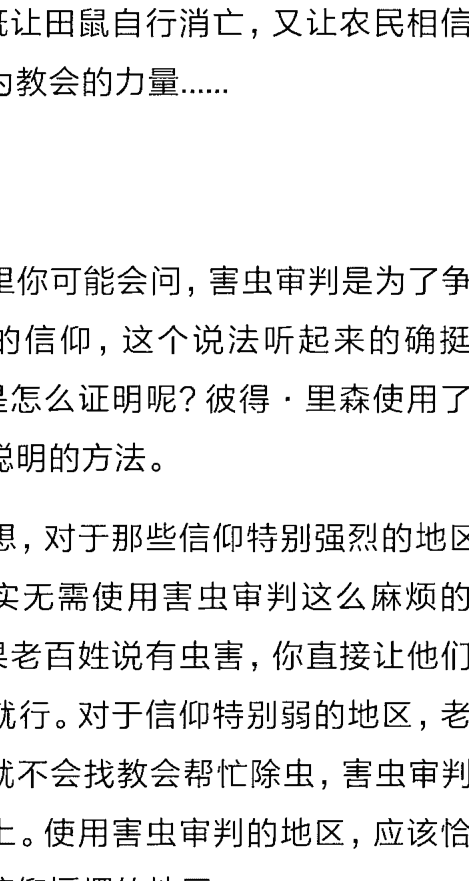

律师可以说，田鼠也是上帝创造的生物，它有生存权！田鼠不吃粮食还能吃什么呢？那么法庭就要派人评估田鼠对田地的破坏程度，看看是不是超出了正当的生存需求。有些时候法庭真的就会判断田鼠无罪，但是绝大多数情况下田鼠都是有罪的。

## 2.利益与威胁

害虫审判的第一个原因，是收税。

## 3.证据

说道这里你可能会问，害虫审判是为了争夺老百姓的信力，这个说法听起来的确合理，可是怎么证明呢？彼得·里森使用了一个特别聪明的方法。

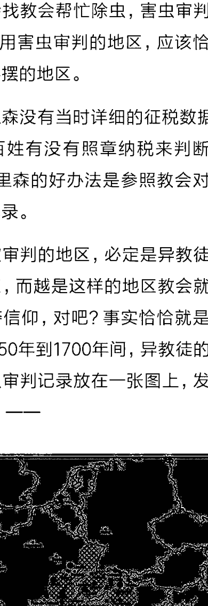

写留言，与作者互动

# 两者高度重合——

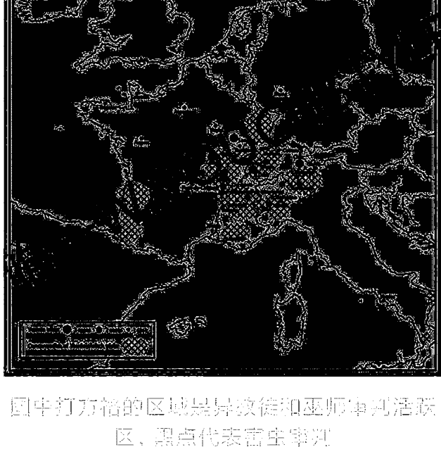

图中打方格的区域是异教徒和巫师审判区、黑点代表害虫审判

当然这个匹配关系并不完美,但是已经很能

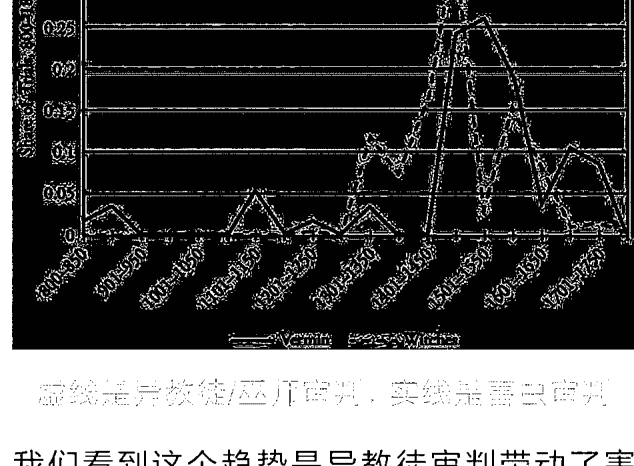

虚线是异教徒审判,实线是害虫审判

我们看到这个趋势是异教徒审判带动了害虫审判。

总而言之,哪里的人民出现了信仰的动摇,哪里就是教会和异教徒争夺信仰的主战场。

说到这里,你可能一直有一个问题,当时欧洲教会的神职人员们,他们自己真信教吗?

咱们前面说的那个用“神判”来判断犯罪的方法在操作上有很多主观的模糊性。就算一个神职人员对此深信不疑,只要他想到敢于接受神判的嫌疑人很可能是无辜的,他就可以有意识或者无意识地对嫌疑人网开一面。

但是在这个害虫审判中,我实在无法相信法庭真的相信田鼠会接受审判。教会的人再迷信,也不足以认为田鼠真的能听懂法庭公告、只是因为太老了行动不便才未能按时到达庭审现场……要知道法官可是当时最精明的人。

也许那些神职人员真的相信上帝,但是他们的“信”,肯定比老百姓的“信”要灵活得多。也许他们认为,暂时欺骗人民,哪怕是暂时拿上帝当个工具,都是为了在更高级的层面上维护上帝吧。

一般人谈论信仰,都是说自己信什么,会对自己产生了什么样的影响……而对那些操纵信仰的人来说,他关心的是你信什么对他有什么影响。

对他们来说,老百姓理解的那种信仰不可能真的用来作为工作的指导思想。信仰只是工作的结果,信仰是一种资源。


# 万维钢·精英日课³
帮你和全球精英大脑同步

## 日课精选

# 《怪异经济学》6：穿越者的经济学（完）

万维钢 · 精英日课³
今天
进入讲堂 >

《怪异经济学》6：穿越者的...
12:16 11.23 MB

[转述：孙竺]

今天咱们把彼得·里森的《怪异经济学》讲完。这本书说到这里，相信你已经总结出来了，书里说的这些所谓怪异的事情，其实并不怪。我们今天的人只要稍微考察一下当时的情况，也都能理解；把我们放在那个位置上，恐怕也会那么做。这就说明不论是非洲人、英国人、吉普赛人还是中国人，不论生活在哪个时代，本质上都是一样的人。

那既然人都是一样的人，为什么做法却如此不一样呢？这当然是因为限制条件不同。

我们今天以为是天经地义的条件，过去可能就没有。英国女性没有物权就不能离婚，可是问题总要解决，这才出现了拍卖妻子的市场。

而过去有一些条件，我们现在反而没有。我们现在破案有 DNA 证据这样的先进技术，过去没有；但过去的人有强烈的信仰，现在则没有。那表现出来就是各有各的方法：过去的人可以用信仰断案，现在依靠司法系统。

但不管限制条件和解决方案有多么千差万别，所有的人要解决的问题其实都是一样的：怎样减少冲突，怎样让各方都在交易中获利，怎样保护财产权，怎样维护公共秩序。当你面对一个怪异的风俗习惯的时候，抓住了这几个问题，你就抓住了本质。我希望你能通过这本书操练这么一个经济学家的眼光，识破现象背后的真问题，洞察它的解决机制。

最后这一讲咱们再说一个历史上真实的事情。为了让你有一个实战演练的机会，我先把它编排成一个小故事，你在听故事的过程中要调用自己的经济学敏感度，看着我这个故事里有哪些地方*不*符合经济学原理。

有一天你突然穿越到了十二世纪、诺曼底王朝时期的英国。你醒来一看四周，除了家人居然还有几个佃农，原来是穿越成了一个小庄园主，你叫戈弗雷。你算算家底，有几十英亩的土地，谈不上是贵族，但还算富裕。你效忠于一位领主，每年得给领主缴纳赋税，不过负担不算重。当然你自己不用劳动，土地都租给了佃农。在很大程度上，你是自由的。

作为穿越者，当然你有金手指。你不但知道一些现代化的农业技术，而且很有经营头脑。佃农们都非常维护你，你赚了不少钱，还打算开个工厂。你迫切需要把庄园的面积扩大。

正好你的庄园附近就有一家挺大的庄园，庄园主叫马修，六十多岁了，不善于经营手里很缺钱，而且还酗酒。有一天马修喝多了，说决定把庄园卖给你！你当场跟他签名字画押，并且给了他一大笔钱。

你把施工队开进了马修的庄园，准备大干一场。正在这时候，马修的儿子把你告上了法庭，说你非法占有了他家的庄园。其实你也有点心虚，毕竟老马修是喝醉了酒跟你签的合约。不过白纸黑字事实俱在，你倒要看看法庭会怎么判。

法官一看，小马修找到了几个证人，能证明他家世代都拥有那片土地。可是你拿出来的合约也是的确真的，而且老马修也的确收了你的钱……结果法官决定，你们两家都有道理，干脆来场比武决斗吧，谁打赢了庄园就是谁的。

你万万没想到诺曼底王朝居然是这么判案的！简直是野蛮和愚昧！你心想小马修身强力壮，我一个没经过训练的现代人也打不过他啊。这时候你的管家告诉你，别担心，这种比武都是找人代替的，哪有庄园主直接上场拼命的道理？

马修家在当地经营多年人脉很广，很容易就请到了一个高手出场。你刚刚穿越过来人生地不熟，不知道该去找谁。所幸的是，你家的佃农之中有个小伙子，以前当过兵打过仗，因为感念你救助过他的母亲，决心为你打这一场！

到了约定的日期，比武在专门的场地上下行。法官、戈弗雷家族和马修家族、当地的绅士都出席，还有成百上千的围观群众，弄得就像是节日表演。规则非常简单，比武从中午开始，如果一方把另一方杀死，或者一方主动求饶，就算分出胜负；如果到天黑还没有分出胜负，马修家作为原告就算输了，因为是他先对你发起了挑战。

马修家的高手果然身手不凡，不过你家那个佃农才是真正见过血的人……几个回合之后，小伙子一剑刺中对手喉咙，帮你取得了胜利……

你终于得到了，带血的地契。

这个故事讲了三件事情——
第一，在当时的英国，买卖土地居然还能不算数；
第二，法庭解决土地产权纠纷，居然是用比武决斗的方式；
第三，比武的过程。
那你认为，其中哪件事是最不合理的呢？

和所有好的穿越小说一样，我这个故事对历史细节的描写是相当精确的。

第一件事，当时的英国，买卖土地的确非常困难。这是因为在英国的封建制度之下，土地是层层转包的——国王把土地分封给贵族，贵族还可以再分给下面的小贵族，小贵族再分给庄园主，庄园主再分给佃农去种植。每一层都对自己的上一层负责，佃农给你交租金，你给领主交税，领主给国王交税。

在这种情况下，土地交易可就太难了。你其实并不真的拥有自己的土地！你想把土地卖出去，首先你的领主就可能不同意：比如万一你卖给教会，教会又不交租金，到时候我找谁去呢？

所以当时法律约定的规则是，要想卖出一块土地，你自己同意还不够，还必须最码要征得你的领主、以及你的继承人的同意才行——这就是为什么老马修的儿子有权反对这桩交易。因为交易手续如此麻烦，土地是谁的就几乎永远都是谁的，很难合法交易。

可是另一方面，总会有一些土地需要流转。马修家已经是经营不善了，土地在他手里沦为累赘。为了增加税收，政府其实也希望土地能够流转起来。可交易又这么困难，这怎么办呢？

这就引出了第二件事，比武。法庭用比武判决，是诺曼底王朝的常规操作。我们看电视剧《权力的游戏》里就有这样的剧情，而且也是双方各自请别人代替自己上场打。


官方的说法当然是上帝会保佑无罪的一方，所以只要你能取胜，你就是正义的。而在背后的利益计算之中，这个规则其实符合科斯定理。

我们前面讲了，根据科斯定理，只要市场交易成本足够低，就应该是谁对这块土地的估值高，谁就最终得到这块土地。其实政府也希望是这样的结果，如果你的经营能力比马修强，政府就把土地交给你。

花钱雇佣别人代替自己比武，其实就相当于双方在对土地竞标。谁对土地的估值更高，谁就会愿意花更多的钱，去请一位更好的武士出场。在理想情况下，比武取胜的一方，就应该是实力更强大、也更配得上这块土地的一方。

那你说既然是竞标，为啥非得用比武这么野蛮的方式呢？搞个土地拍卖不是更好吗？土地拍卖的问题是容易引起诉讼式的诉讼。

如果搞拍卖，拍卖所得的钱该给谁呢？给政府吗？这可是私人财产，再说如果法庭从中获利，法官就可能纵容这种土地纠纷，危害私人的产权。如果法庭不顾事实动不动就拍卖别人的土地，那谁还愿意搞长期投资呢？同样道理，如果纠纷双方像咱们在《生活黑客》里说的那种夫妻一样搞两人的拍卖，也会把打土地官司变成有利可图的事情。

而这个比武制度中，拍卖的受益者既不是法庭，也不是打官司输掉的一方，而是武士！双方都要花钱，所以谁也不会无缘无故打官司；法庭无利可图，所以还能大致上秉公办事，先证实双方对土地都有一定的权益，才会做出比武的判决。而雇佣武士的价格也不会像真的买块地那么贵，因为毕竟这里面有个不确定性，谁也不能说出手就稳赢。

这么一分析，比武反而不是解决土地转让最方便、最省钱的方法。

么写留言，与作者互动


而我那个故事的毛病其实是出在第三件事上，也就是比武的过程。咱们想想，如果比武解决纠纷都已经形成制度了，那就不必然都是走流程，怎么会弄得那么有戏剧性呢？

事实上，当时英国有专门帮人打官司比武的武士。这些武士的实力排名都是公开的，明码标价，只要你出钱足够多，就能请到最顶尖的高手，根本不用指望遇到什么深藏不露的特种兵。为了确保取胜，你甚至还可以多请几个高手，比如你可以把排名从第一到第七的高手全都请到自己这边来 —— 当然上场的还是只有一个人，但是现在对方最多只能请到第八名了。

所以武士的水平能大致反映双方实力的对比。那么在这种情况下，比武还需要真的进行吗？

事实上，有历史学家统计了1200到1250年间的598场比武判决，发现其中双方都接受比武的只有226场，而到了比武当天真的动手了的，只有123场。大多数情况下都是双方私下协商就解决了。聪明人一看实力对比就能做出明智决定，根本没必要真打，而且还能省钱。

就连这123场真打了的比武中，也是大多都中途就认输解决了 —— 真正战死的，只有一个人。事实上这种比武根本就不让上刀剑，都是用木棒。比武，其实是非常安全的活动。

你可能会担心这个制度会不会导致有钱人能赢得一切，去欺负没钱的人呢？这个可能还不至于。比武裁决的前提是双方真的有产权纠纷 —— 如果别人的地跟你本来没关系，你不能随便跟人约战。事实上英国地主都只是打官司的时候才临时雇用武士，并没有把武士养起来做自己的私人武装，说明英国还是讲法制的。

不过比武真的挺好看，的确会有贵族和围观群众出席，政府很喜欢搞这样的活动 —— 就算双方没打就已经和解了，两个武士也会比划几下，给群众表演一番，是难得的文体娱乐项目。

真实历史可能比小说还精彩，但是的确不容易发生《权力的游戏》那种戏剧性的场面。

这本书说到这里就给你讲完了。考察历史，总是限制条件决定了规则，规则决定了激励，激励决定了人的行动。

为什么这些话题叫“经济学”呢？因为经济学研究理性的人如何对激励做出反应。

（THE END）

## 注释

[1] 生活黑客6. 对浪漫关系的黑化


## 万维钢·精英日课³
帮你和全球精英大脑同步

版权归得到App所有，未经许可不得转载

‹ 前一篇

## 日课精选

默认 最新 只看作者回复

提交留言可与作者互动

写留言，与作者互动

## 排位稀缺：富足时代什么最贵？

万维钢 · 精英日课³
今天
进入课程 >

排位稀缺：富足时代什么最…
10:29 9.59 MB
| 作者：添沙 |

很多人都有一个梦想，说随着生产力的不断发展，我们会迎来一个“物质极大丰富”的时代，到时候必定是人人平等，形成“大同世界”。这个梦想很合理，我们看到经济发展的趋势好像就是这样的：像私家汽车和乘飞机旅行这些以前只有少数人能享受的东西，现在普通人都可以拥有。

以前稀缺的东西，将来会变得不那么稀缺。
经济学会完全能解释这个趋势：既然稀缺，想要的人就多，那么愿意生产的人也会多，而生产多了，当然就稀缺了。

而我们这一说要说的是，有一些东西，就算整个社会的物质再怎么丰富，也会一直是稀缺的。而且可能物质越丰富，它就越稀缺。

比如说，世界杯足球赛的冠军。不管有多少人踢球，冠军只有一个。比赛奖金也好，出场费也好，广告代言也好，冠军的价值只会越来越高。冠军这个位置，哪怕从理论上来说，也是不可能变富有的，它永远都是稀缺的。

这样的东西，才是我们这个富足时代最贵的东西。

一位供职于社会资本（Social Capital）公司的科技博客博主，Alex，最近提出一个有意思的概念，叫做“排位稀缺”[1]。

所谓排位稀缺，就是能让你在众人之中突出出来，把你的位置往前排的东西。社会越富足，排队的人越多，它就会越稀缺。排位稀缺不是什么可以批量生产的实体商品，它只存在于人们的头脑之中，但是它是可经营的，而且常常是可购买的。

Alex 提出，排位稀缺有三种。我们称之为“优越感（Prestige）”、“进入权（Access）”和“引导力（Curation）”。


> Jason Fried @jasonfried
When Google puts 4 paid ads ahead of the first organic result for your own brand name, you're forced to pay up if you want to be found. It's a shake down. It's ransom. But at least we can have fun with it. Search for Basecamp and you may see this attached ad.
Basecamp.com | We don't want to run this ad.

这是为啥呢？既然自己的官网已经排在第一位，何必再花钱买个广告位呢？答案是如果 Hulu 不买这个广告位，这个广告位就可能被别人买走，那么读者看到的第一个结果可就不是 Hulu 官网了。

这个内容得怎么写。外卖APP会要求饭店按它的规范制作食物。

如果强行做个类比，这就相当于咱们精英日课专栏命令美国那些知名学者，按照咱们读者的口味去写书。不接受我的绑架，我就让你不被大多数读者看到，你就等于不存在。而 Google 就做到了这一点！现在有人统计，大约有一半的Google 搜索，都没有带来用户对别的网站的点击：因为 Google 直接把用户问题的答案显示在了搜索结果之中。

那你说这不是作恶吗？我认为是的。这就是稀缺的力量。

那如果把优越感、进入权和引导力三项排位稀缺加起来，是个什么业务呢？

*

Alex 认为，这个业务就是“忠诚会员”。比如你是某个航空公司的忠诚会员，你看它是不是同时具备三种排位稀缺——

- *分出什么“金卡”、“银卡”，弄各种“尊贵”的称号彰显身份，这就是制造优越感；
- *比别的乘客提前登机，以优惠价格提供更好的座位，这就是进入权；
- *而你对航空公司的忠诚，只坐这一家的飞机、购买飞机上的商品，就是它的引导力。

高端信用卡公司是这么做的，高端商店是这么做的，亚马逊是这么做的，将来还会有很多公司这么做。他们想要的“忠诚”，我看跟天主教会要的“信仰”其实是一个意思。

希望这些概念能给你带来启发。因为排位稀缺的存在，我实在无法认同，物质极大丰富的时代就是人人平等、没有纠纷的美好时代。

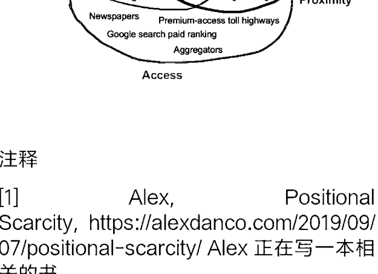

## 注释

[1] Alex, Positional Scarcity, https://alexdanco.com/2019/09/07/positional-scarcity/ Alex 正在写一本相关的书。

[2] 奢侈品的逻辑

[3] 谈资比名牌包贵的社会

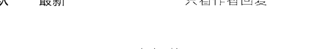

〈 前一篇

## 日课精选

默认 最新 只看作者回复

正在加载...

写留言，与作者互动

## 特别放送：别用“常识”理解复杂世界

万维钢·精英日课³
今天
进入课程 >

别用“常识”理解复杂世界
11:34 10.6 MB
| 转载：苏沙 |

万维钢

今天推荐这本《反常识》，作者是宾夕法尼亚大学教授邓肯·瓦茨，刚刚出了中文版，咱们得到也有电子版，我很荣幸为这本书做了序，今天就把这篇序言推送给你，希望能帮你更好地理解这本书。

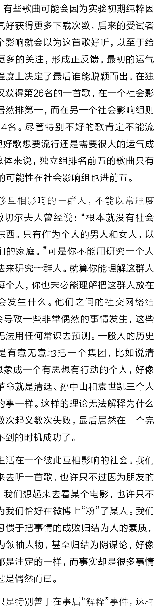

如果一个物理学家谈物理，哪怕他只是用大家都能听懂的语言做科普，外行一般也不太敢提出质疑。人们知道物理学是一个非常专业的前端科学，没经过多年训练的人胡乱说话只能闹笑话。但是当一个社会学家谈论社会问题的时候，哪怕他旁征博引了好多东西方先贤的经典理论，别 人还是可以毫无压力地批 评他。

这也许怪不得大众。实践表明，“专家”的实用程度很可能并不显著高于“砖家”。

但社会科学并非无路可走，它可能正处在一个大发展的前夜。宾夕法尼亚大学教授邓肯·瓦茨（Duncan J. Watts）的新书《反常识》（Everything Is Obvious* Once You Know the Answer）提出，社会科学的发展方向应该是像硬科学一样，依靠实验和数据。传统专家的预测之所以不行，是因为他们依赖的很多直观“常识”，其实是一幅情愿的想象然。事实上，哪怕一个简陋的统计模型，也能比专家预测得更好。

这本书的最大新意在于，因为瓦茨同时在雅虎研究院研究社交网络，他在书中描述了几个其本人参与的有趣研究。

谈起社交网络，中国读者会立即想到格拉德威尔（Malcolm Gladwell）的《引爆点》（The Tipping Point）。这本书指出，一件事情要想在人群中流行开来，需要某些特别有影响力的关键人物在其中推波助澜。根据这个理论，扩大知名度的最好办法是找名人做广告。名人在微博上说一句话，应该比普通人的“口碑”重要得多。

“关键人物”理论完美符合人们的思维常识。我们总是强调伟人对历史的推动，强调明星对时尚潮流的引领。问题是，这个理论没有获得大规模统计实验的支持。在现实生活中统计影响力非常困难，因为我们很难测量一个个人是被谁影响的。现在微博客Twitter的出现给这种测量提供了可能。

Twitter的一个特别有利于研究的特征是，如果用户分享一个网址，这个网址的URL会被缩短，自动形成一个唯一的代码。通过跟踪这些短代码，瓦茨与合作者就可以分析信息如何在Twitter上被扩散传播。具体来说，就是如果有人发布了这么一条代码，而他的一个“粉丝”如果转发这条代码的话，那么这次转发就可以被视为一次可观测的影响。广告商的愿望，是希望信息能够这样一层接一层的转发传播开来，形成所谓“Twitter瀑布”。

然而通过分析2009年两个月之内160万用户的七千四百万条信息链，研究人员发现98％的信息根本就没有被推广传播。在这千万条信息中只有几十条被转发超过千次，而转发次数达到万次以上的只有一两条！我们平时看到的那些被反复转发的消息其实是特例中的特例。由此可见，想要通过发一两条热门微博成名，就好像买彩票中头奖一样困难。

那么名人的影响力到底怎么样呢？瓦茨等人使用了个巧妙办法。他们使用统计模型，根据第一个月的数据把那些粉丝众多，并且成功引发了Twitter瀑布的“关键人物”挑出来，然后看他们在第二个月中的表现。结果相当出人意料：这些人在第二个月再次引发瀑布的可能性相当的随机。平均而言，“名人”的确比一般人更容易导致一条消息被广泛传播，但这个能力的实际效果却无比极大，一点都不可靠。也许最好的营销方式不是拿大价钱请少数名人，而是批量雇佣有一般影响力的人。

如果一个东西突然流行开来，我们的常识思维总是以为这个东西一定有特别出类拔萃之处，或者就是其幕后一定有推手。但Twitter上的研究表明，所谓幕后推手其实并没有那么厉害。那么为什么某些书能够畅销，某些电影能够卖座，某些音乐能够上榜呢？完全是因为它们出类拔萃吗？瓦茨参与的另一项研究表明，成功很可能主要是因为……运气。

这是一个相当有名的实验。实验者创办了一个叫作 Music Lab 的网站，在几周之内招募到一万四千名受试者来给48首歌曲评分，如果他们愿意，也 partially 可以下载其中的歌曲。有些受试者的评分是完全独立的，他们只能看到歌曲的名字。而其余受试者则被分为八组，他们可以看到每首歌被自己所在组的其他受试者下载的次数 —— 他们可能会想被下载次数越多的歌曲越好听，这样一来他们打分就会受到社会影响的左右。

实验表明那些好歌，也就是在独立组获得高分的歌曲，在社会影响组也是好歌，而且其流行程度比在独立组更高；而坏歌在社会影响组的表现也更差。所以当听众能够被彼此的选择影响的时候，流行的东西就会变得更加流行，出现胜者通吃的局面。

然而这个实验最重要的结果是，具体哪首歌能够登上排行榜的最前列，则是异常偶然的事件。有些歌曲可能会因为实验初期纯粹因为运气好获得更下下载次数，后来的受试者受这个影响就会以为这首歌好听，以至于给予它更多的关注，形成正反馈。最初的运气很大程度上决定了最后谁能脱颖而出。在独立组仅获第26名的一首歌，在一个社会影响组居然排名第一，而在另一个社会影响组则排第14名。尽管特别不好的歌肯定不能流行，但好歌想要流行还是需要很大的运气成分。总体来说，独立组排名前五的歌曲只有50％的可能性在社会影响组也进入前五。

对能够互相影响的一群人，不能以常理度之。撒切尔夫人曾经说：“根本就没有社会这种东西。只有作为个人的男人和女人，以及他们的家庭。”可是你不能用研究一个人的办法来研究一群人。就算你能理解这群人中的每个人，你也未必能理解这群人放在一起会发生什么。他们之间的社交网络结构，会导致一些非常偶然的事情发生，这些事情无法用任何常识去预测。一般人的历史观总是(ft...)

我们生活在一个彼此互相影响的社会。我们想起来去听一首歌，也许只不过因为朋友的推荐。我们想起来去看某个电影，也许只不过因为我恰好在微博上“粉”了某人。我们总是习惯于把事情的成败归结为人的素质，归结为领袖人物，甚至归结为阴谋论，好像什么都是注定的那样，而事实却是很多事情只不过是偶然而已。

常识只是特别善于在事后“解释”事件，这种解释根本谈不上真正的理解。中国女篮以三分优势击败韩国队取得2012年的奥运会赛栅，赛后总结自然全是成功经验，可是如果中国队最后两个球偶然没进，媒体上必然又全是失败的反思。我们看这些事后的经验总结或者反思，总是觉得它们说的都很有道理，简直是常识。专家们也正根据这些道理去预测未来。可是事先你怎么能知道这些完全相反的道理哪个会起作用呢？

再比如，如果有人说来自农村的士兵会比城市士兵更适合部队生活，读者很可能会以为这是显然后 —— 农村本来条件就比较艰苦，需要更多的体力劳动，所以农村士兵肯定更能适应部队。然而据社会学家Paul Lazarsfeld对二战期间美军的调查，事实恰恰相反。其实是城市士兵更适应部队生活，因为他们更习惯于拢搭、合作、命令、严格的衣着规定和社会礼仪。这两方面的常识看上去都有道理，在没有统计的情况下我们根本不知道哪个更重要。这就是为什么不做调查研究就没有发言权。

要想从复杂的随机事件中看到真正的规律，最好的办法是像搞自然科学一样进行大规模的重复实验。如果中国女篮跟韩国队在同样的条件下打100次能赢95次，我们就可以确信中国队强于韩国队。如果一首歌能在每一个社会影响组都进入前五名，我们就可以确信这首歌的确实出众。然而历史不能重复，我们不知道最后发生的结局是不是一个小概率事件，但我们却总能用“常识”给这个结局一个解释！像这样的解释如果用于预测未来，甚至制订计划，怎么可能不失败呢？

一个更实用的历史观是放弃“一切都是注定的”这个思想，把历史事件当成众多可能性

写留言，与作者互动

的”这个思想，把历史事件当成众多可能性中的一种，把未来当成一个概率分布，然后尽可能地使用统计方法，通过历史数据去计算未来事件的概率。与其追求用各种想当然的常识指导未来，不如把历史当做一个数据库，从中发掘统计规律。

搞自然科学的科学家经常认为社会科学更简单。如果你看那些社会科学的论文，会发现其中逻辑通俗易懂，结论往往也是显然的。物理学经常能得出一些违反直觉而又绝对正确的结论，然而社会科学中常识却总能大行其道。现在这种局面正在改观，自然科学的方法正在被引进到社会科学中去。

在没有互联网的年代想要找几万人做歌曲评分实验，或者分析成百上千万的社交网络和信息传播，都是根本不可能的事情。现在有了互联网，社会科学终于可以带给我们一些“不显然”的研究结果了。所以社会学家已经在使用新方法搞科研，遗憾的是实用专家们仍然停留在过去的理论上。一个原因也许是统计方法还没有来得及作出更多有实用价值的判断。但不论如何，正如瓦茨所说，现在社会科学已经有了自己的天文望远镜，就等开普勒出来总结行星运动三大定律了。

# 日课读者限时专享

原价62.99 特价27.99
(9.20-9.26)
截此查看

〈上一篇

## 日课精选

默认 最新
只看作者回复

正在加载...

写留言，与作者互动

## 问答：为什么还有人信“先知”？

万维钢 · 精英日课³
今天

进入详情 >

问答：为什么还有人信“先知...”
11:08 10.19 MB

[坐标：怀沙]

# 来自日课：巫术的裁决

读者 李半羽：

类似于赞颂先知这种人群，是如何掌握这种操控人心方法而且多少年都没有被发现呢？而当今信息如此发达的社会，又为何还会这种人群存在的土壤呢？

万维钢

先知本人完全可能也相信他操作的结果代表神明的意志。在这个测试里既是失败的一方，也无非就是口头上、甚至是在心里给人道个歉而已，并没有激烈的利益冲突，所以先知完全没必要造假。他要做的仅仅是把毒药剂量精确控制在有 50% 的可能性性死亡鸡而已。

# 来自日课：“信力”的争夺

读者 L.J：

对宗教信仰非常虔诚的人，是不是很难成为所谓操纵信仰的人，比如设计、演绎审判动物流程的人；是不是那些不坚信宗教的人更容易成为操纵的预袖？

万维钢

信仰有很多方式，有些人是机械化地信，有些人是灵活地信。中世纪天主教会聚集了社会精英，有很多非常聪明的人。他们中的某些人非常腐败，让人无法相信他是虔诚的信徒；而有些人虽然办事也很灵活，也会设计和操纵神判和动物审判这样的仪式，但是你很难说他就不信。也许他对上帝深信不疑，玩个小把戏摆弄民众只是为了更好地服务上帝。如果一个是灵活地信，你很难判断他的信仰是否虔诚——也许虔诚不虔诚已经不重要了。

- 1. 每天放学后直接到我这里来学习。
- 2. 学完之后直接回家。
- 3. 所有关于礼貌的规则，你都无需遵守。
- 4. 不要跟任何人讨论你的训练。
- 5. 从此之后，禁止你告诉别人你做过的梦。
- 6. 除非生病，你不要再喝别的药。
- 7. 你不能申请释放。
- 8. 你可以说谎。

# 来自日课：穿越者的经济学

读者 生活黑客个人观点：

老师可以分享一下看小说的视角吗？你的关注点是情感代入还是玄幻剧情，还是故事架构，或者是技术性。

万维钢

我读小说的品味相当低端，从来没有上升到严肃文学的高度，都是为了好看而读。我不太赞成那些为了写影评而去看电影的人，我认为应该好好享受剧情。我享受情感代入，我希望好人都能成功，坏人都被打死。我被书中的英雄人物所激励。不过读了这么多年小说之后，我的确有所成长。

现代科技带到宋朝，但是我要求你那个科技在宋朝真有可行性。我不能接受你虎躯一震就把当年宋朝的粮食产量提高了五倍。

这就是为什么我喜欢穿越小说胜过科幻小说。穿越小说除了主人公和他带来的扰动是虚构的，其他人物和历史背景都可以非常真实，相当于紧肃的思想实验，是戴着镣铐跳舞。而科幻小说，动不动就来自个什么超光速旅行，弄出什么“黑暗丛林法则”这种不合理的设定，我感到非常恼火。

第二，我希望作者有思想。比如像齐橙的《工业霸主》和《大国重工》，从小说艺术的角度来说可以说根本不合格，但是作者假借小说描写了很多中国工业发展过程中遇到过的真问题，并且提出了自己的见解，那我们就当个纪录片看，也不错。注意这并不等于“寓教于乐”——寓教于乐是居高临下地普及某个众所周知的知识，而现在这些小说家都是借着小说去抒发自己容易引起争议的思想，有一点跟读者较劲的意思，我对此非常欢迎。

第三，我喜欢看到小说的文字具有某种趣味性。我希望作者有点恰到好处的幽默感，语言最好能带一点机智，情节最好能有所创新，给我来点惊喜。好的作者会在这里埋个伏笔那里用个不常见的梗，读者看到会心一笑，大家在批注和评论区弄个弹幕讨论，这很有意思。


## 万维钢·精英日课³
帮你和全球精英大脑同步
版权归得到App所有，未经许可不得转载

〈上一篇

## 日课精选

默认 最新 只看作者回复

正在加载...

写留言，与作者互动


# 《与陌生人交谈》1：间谍故事

万维钢 · 精英日课³
今天
进入课程 ›

《与陌生人交谈》1：间谍故事
11:57 10.95 MB

| 往事 · 岁沙 |

今天开始我们来讲马尔科姆·格拉德威尔（Malcolm Gladwell）的《与陌生人交谈》（Talking to Strangers: What We Should Know About the People We Don’t Know）。格拉德威尔大概是现今最好的非虚构作者，他特别擅长把社会科学的研究成果变成畅销书，我非常佩服他。

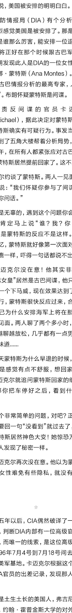

这本《与陌生人交谈》，是格拉德威尔在2013年的《逆转》之后六年才出的一本新书，9月10号刚刚出版，我们专栏第一时间解读。这本书的风格有点悬疑小说，都是真实的大事件，但是写得跌宕起伏非常好看。特别是有声版，书中几乎所有当事人的对话、包括历史人物，都用了原声，而且还有主题音乐，就好像纪录片一样。如果有时间的话，我强烈建议你听一下原书。

而咱们精英日课是知识服务的讲法，没时间讲太多故事，咱们直奔主题。

这本书中的主题是怎么在与人交流的过程中避免互相误解。你可能觉得自己很了解别人，其实你无法想象你有多少误解。这一讲咱们先说欺骗：我们非常、非常容易被骗。

咱们先听一个间谍故事。

*

美国是间谍大国，每年光是有间谍的文艺作品就有很多，经常总结经验吸取教训……可是我读了格拉德威尔这本书，感觉美国真不是间谍强国。

+ *23号，古巴军方和美国海军上将会面，当面提出警告；
*24号，古巴击落两架飞机；
*25号，海军上将上电视台说明情况。

么“亚洲最高的山叫什么”之类，但是你有一位搭档和你一起商量着做。测验刚开始不久，负责监督的老师接到一个电话，就出门打电话去了。这时候搭档就会提示受试者，说你看讲台上有个信封，也许答案就在那个信封里，咱们看看答案吧！

有些受试者为了拿奖金，同意了作弊。当然他不知道的是这一切都是演戏，搭档其实是个研究人员，那个监督老师接电话也是故意的。

接下来，实验人员会问受试者，说你刚才作弊了吗？有的作弊者说没有，实验人员就进一步逼迫他，说那我等会儿再问问你的搭档，你猜他会怎么说呢？有的作弊者表现非常慌张，有的却能自始至终都很镇定。

研究人员就这样拍摄了44份问话的录像，其中所有人都说自己没有作弊，但是只有22个人说的是实话，剩下22人说的是假话。

那好，单看录像，请问你有多大把握正确判断，谁说的是实话，谁说的是假话呢？

千万别过度自信。好几个心理学家，请了社会上各种人来看这些录像，有警察、法官、心理医生，有中央情报局的间谍网络负责人，结果是这些人的判断准确率都非常低，平均只有54%。

基本等于瞎蒙。

但是研究者发现，人们判断出错的比例不是对称的。如果录像里的人说的是真话，人们一般不会冤枉他，会认可他说的是真话；但如果录像里的人说的是假话，人们常常看不出来他说的是假话，总是以为他在说真话。

据此，心理学家蒂姆·莱文（Timothy R. Levine），提出了一个非常有说服力的解释，叫做“默认真话理论（Truth-default theory）”。

当有人跟你说话的时候，不管他说的是什么，你总是默认他说的是真话。

并不是你完全不怀疑他。你可能会觉得他表现得有点怪——就像卡迈克尔看蒙特斯一样——但是你会先帮他找理由解释。你太愿意相信他了。通常情况下，我们头脑里并没有“防骗”这根弦。

只有当疑点已经实在太多、太明显了，你才可能意识到这个人是不是在骗你。

相信，不等于没有怀疑。相信是默认的。相信是怀疑积累得还不够。

如果一个人一上来就表现得鬼鬼祟祟特别可疑，你当然不会相信他。可是大多数骗子并没有那么可疑，他们只要稍加掩饰，你就看不出来。等到他暴露之后，你才会想起他当初的各种疑点。我们想想生活中是不是经常发生这种事情。

为什么进化没有让我善于识破谎言呢？咱们下一讲再说。


# 万维钢·精英日课³
帮你和全球精英大脑同步
版权归得到App所有，未经许可不得转载

‹ 前一篇

## 日课精选

默认 最新 只看作者回复

正在加载...

写留言，与作者互动

# 《与陌生人交谈》2: 多疑是一种什么体验

万维钢·精英日课³
今天

进入连载 ›

《与陌生人交谈》2: 多疑是…
11:41 10.7 MB

[转载：怀沙]

咱们继续讲格拉德威尔的《与陌生人交谈》。上一讲我们说到一个“默认真理论”，说一般情况下，我们总是默认别人说的是真话——而这就是为什么人那么容易受骗上当。

那你可能会有一个疑问。容易受骗上当，这是一个明显的性格缺陷，那这样的人的生存能力应该很弱吧？那漫长的进化应该把这样的人都淘汰掉吧？轻信，怎么会是普通人都有一个特点呢？

想要理解这一点，我们必须从“受骗上当”这个“局”里跳出来才能看清楚。你不能只考虑骗局的情况，必须考虑生活中一般情况。

发现自己被人骗了，这是一种很难受的体验。你可能会懊恼不已，恨自己太单纯、太容易信任别人。你可能会想，不行！我决不允许自己再被人骗！我想从此做个机警的人！
……不，你不想。

格拉德威尔这本书里有很多精彩的故事，我们不可能每个都讲，如果你感兴趣还是建议你去读一遍原书。不过其中有一个可能很多人都已经知道的故事，我们还是值得专门说说。

你可能听说过“麦道夫骗局”。如果我们是在2007年谈论伯纳德·麦道夫（Bernard Madoff），可能会把他当成巴菲特一样的人物。他曾经被认为是华尔街最厉害的投资专家，管理超过500亿美元的资产。可是到了2008年金融危机中，麦道夫向两个儿子承认，自己二十多年来所干的事情，其实是一个庞氏骗局。

庞氏骗局是美国人在上世纪初发明的东西，现在通常见于中国农村的非法集资事件。你说你有一个特别厉害的投资项目，许诺一个很高的利率，就有人会把钱借给你。你用后面借来的钱还前面的利息，别人一看真有利息就会更信任你，然后你就能借到更多的钱。如果一切顺利，你的集资事业可以越做越大甚至持续很长时间，而你实际上什么投资项目都没有。直到有一天，当你再也借不到更多新钱的时候，这个骗局才会玩不下去。

而麦道夫居然在最现代化、有最多数据、被最多人盯着、监管最严的华尔街，玩成了庞氏骗局。而且玩了20年。而且是一直到全球金融危机，当大鳄都倒下的时候，他才倒下。
这不荒唐吗？

格拉德威尔考察历史，发现麦道夫做的并非天衣无缝。

现在华尔街最成功的避险基金公司，叫“文艺复兴技术”，我们专栏以前提到过好几次这个公司。2003年的時候，文艺复兴的几个投资组合经理，就感觉到麦道夫不对劲儿。当时市场上传言麦道夫要垮掉，文艺复兴这几个人专门分析了麦道夫声称的投资策略，认为他那些策略非常不靠谱。

那你说文艺复兴公司是不是应该立即向美国证交会（SEC）汇报呢？没有。他们至少也应该立即把自己放在麦道夫的投资撤资吧？也没有。他们仅仅是把自己放在麦道夫的投资减少了一半。

不过证交会听到了这个风声。麦道夫这个人平时有点孤僻，一般人都了不了解他，证交会的确感觉到了可疑。最可疑的是，别的基础的业绩都跟股市有很强的相关性，股市好的时候你表现也好，股市不好你就拿得特别优秀也很難表现好——但是麦道夫的基金却一直都表现得那么好，好像跟股市根本就没有关系一样！

证交会为此特别召见了麦道夫，要求他做出解释。麦道夫说这是因为他能看到普通投资者看不到的地方。他成功的秘密就是他有超凡的直觉，总能让他在别人贪婪的时候恐惧，在别人恐惧的时候贪婪。

证交会，对此表示了认可。

看来如果麦道夫不出事儿，今天的江湖哪有巴菲特的位置？麦道夫才是真股神啊。不过麦道夫总有些说不清道不明的地方，而且他从来不像巴菲特这样到处给人讲投资哲学，所以有几个公司对他保持了警惕。

但是，人们基本上都相信麦道夫。没人能想象今日的华尔街居然会有庞氏骗局。连证交会都没说什么，你还能说什么呢？

只有一个例外。

早在2000年，一个普通基金公司的一位普通量化分析师，哈利·马科波洛斯（Harry Markopolos），就向证交会举报了麦道夫。他提供了充足的证据，说麦道夫在搞庞氏骗局。但是证交会没有采取任何行动。那时侯麦道夫的基金才只有70亿美元。

2001年，马科波洛斯再次向证交会提出举报，证交会再次忽略了他。

然后马科波洛斯在2005年再次举报。然后是2007年。然后是2008年。他都被忽略了。

2009年，麦道夫自首了。美国国会搞了个听证会，特意邀请马科波洛斯发言。马科波洛斯回顾了自己的举报历史，他说他无法相信，一个到2008年已经是500亿美元的庞氏骗局，竟然没有被证交会优先调查！

一位国会议员听了之后怒不可遏，当场对证交会发飙，他对马科波洛斯说，请问你有没有兴趣接管证交会？

好，现在咱们先想想，如果你是证交会，你会怎么处理马科波洛斯的举报。马科波洛斯不是个普通人。他是一个特别爱较真儿的人。

上商学院的时候有一门课程，马科波洛斯得了个A。但是他仔细研究了一下教授评分的算法，认为自己的成绩应该是A-……然后他找到教授，提出了投诉。

第一份工作，他在一个小股票公司上班，公司的业务是在营业窗口帮客户买卖股票。当时市场有个规定是任何股票交易都必须在90秒之内上报。马科波洛斯发现他们公司有些交易没有在90秒之内及时上报……然后就向有关部门举报了自己的公司。

你喜欢这样的人吗？事实上如果你跟马科波洛斯聊，你会发现他何止是较真儿，简直是偏执。他认为美国的整个保险业，都已经彻底腐败了。他说20%到25%的上市公司都在财报里造假。他最近出了一本书，然后他认为出版社玷污了他的版权，他说出版社给他看的销售记录都是假的，他必须亲自审查。

你愿意跟这样的人合作吗？如果是锦一个相信整个系统都腐败了的人向你举报某个公司，你会严肃对待吗？

八十年代末，麦道夫如巨星刚刚升起的时候，马科波洛斯在一家基金当量化分析师。上级让他研究一下麦道夫的交易方法，看看能不能模仿。马科波洛斯一研究就发现麦道夫这个方法有问题。麦道夫声称自己在黄金衍生品交易赚钱，可是马科波洛斯就做衍生品交易的一他给业内最大的五家衍生品公司打电话询问，得到的消息是这些公司都没有跟麦道夫有过交易。

据此，马科波洛斯私下开始了对麦道夫的调查。这绝对是一场英雄之旅，因为没人理解也没人理会他。马科波洛斯非常担心自己已经被麦道夫盯上了，他偏执地认为自己的人身安全已经受到威胁。他每天下班都走不通的路线回家，他永远都随身带着一把枪。

多疑，并不是一种很好的体验。

为什么大多数人都不像马科波洛斯那样机警？为什么我们会轻信别人？这并不是什么进化缺陷，这是合理的社交规范。

同事送你两张电影票，你会怀疑他是在设计陷害你吗？你到一个陌生的地方出差，点了个外卖，你会怀疑菜里有毒吗？孟女士今天比往常提前下班了，你会怀疑她是跟外情报机去头了吗？

马科波洛斯如果面对这些场合，他也許会怀疑的。他的生活并不愉快。

格拉德威尔在书中给出了两个案例分析。一个大学美式足球教练性侵了多名男孩，一个医生在治疗和检查的过程中性侵了多名女子。这些案例的细节我实在不忍心讲，咱们就只说说它们的特點。

它们的特点是从最初始有人发现疑点，到这两两个犯罪分子被绳之以法，都经过了很长很长的时间。在此期间他们的同事和上级领导都坚决认为他们没问题，竭力为他们担保和开脱。而更重要的是，连受害人的家长，都不相信他们会做这样的事情。

这两个人平时的风范都特別好。他们好像真的很爱孩子和患者，总是彬彬有礼，让人放心——有一个受害的男孩，居然在长大以后，结婚的时候，还邀请那个性侵了他的教练。

写留言，与作者互动

后，结婚的时候，还邀请那个性侵了他的教练来参加婚礼！

那在这种情况下，你能相信这俩人是在犯罪吗？有一个画面特别有代表性。女儿进入医务室接受检查，父亲就在门外等待。第二天女儿跟妈妈说昨天的检查让她很不舒服，因为医生触碰了她的隐私部位……可是她的妈妈怎么反应的呢？妈妈说这都是正常的，你要相信医生。

是的，你要相信医生。如果每个人都不相信别人，动不动就投诉动不动就举报，这个社会就无法有效运行。可是正因为我们默认相信别人，犯罪分子才有机可乘。

我看这个“默认真话理论”，本质上说的是一个怀疑阈值。大多数人的阈值都是正常的，只有当疑点积累到一定程度才会真正产生怀疑，否则就当别人是在说真话。而马科波洛斯，则是一个阈值很低的人，他是动不动就怀疑。

我猜，怀疑阈值就跟身高一样，在人群中成正态分布。进化自动调节了我们的阈值，大多数人阈值不高，社会才能正常运行。如果人人多疑，那一定是社会出了大问题，搞不好就是战乱时期。但是进化保留了马科波洛斯这样的人，他们是社会的监控者。

我还特意调研了一下，马科波洛斯现在是一个专职的金融欺诈调查者，专门针对大公司，算是人尽其才了。

那你说作为阈值不高的普通人，我们应该怎样防止被骗呢？我们应该在哪些情况下手动调高自己的怀疑阈值呢？

我认为你永远都不可能做一个既不会轻易被骗，又特别合群的人。这是基因的矛盾，此事古难全。长期存在的缺点必定有优点的一面，都是两难的选择。偶尔被骗，是合理的代价。

进化让我们并不善于跟陌生人交谈，而我们现在是不不得不跟陌生人交谈。但这也不是说我们就只能认命了。也许有些方法就能提高你防止被骗的本领。比如以前很多人说我们可以通过一个人的“微表情”判断他是不是在撒谎，比测谎仪都好使……

微表情真的这么神奇吗？格拉德威尔知道最新的研究结果。


‹ 前一篇

## 日课精选

默认 最新 只看作者回复

正在加载...

写留言，与作者互动

# 《与陌生人交谈》3：“微表情”靠谱吗？

万维钢 · 精英日课³
今天
进入课程 >

《与陌生人交谈》3：“微表情..
12:14 11.21 MB

[转述：梓宸]
今天我们继续讲格拉威尔的《与陌生人交谈》这本书。没有没有什么办法，能让我们更好地识别假话呢？你可能听过一个说法叫“微表情”，说可以通过一个人的表情来判断他是否在说谎。微表情真的这么有用吗？

这是一个大反转的故事。

你也许记得，2009年有个美剧叫《千谎百计》（Lie to Me）特别流行，这个片讲的就是如何通过微表情判断谎言。电视剧告诉我们，人的心理活动都会写在脸上，想掩饰也掩饰不了，只是有时稍纵即逝 —— 只要你能捕捉到那个表情，你就能看出他想什么。

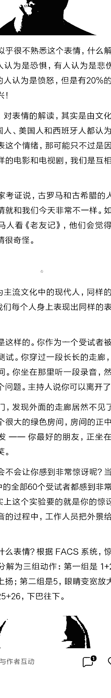


这个笑容很勉强，只有“两个嘴角上翘”这个动作，它usik

这个说法不是电视剧瞎编的。微表情理论的创始人是心理学家保罗·艾克曼（Paul Ekman）。他在1978年出了一本非常厚的书，提出一套“面部动作编码系统（Facial Action Coding System，简写为FACS）”，把人面部肌肉的运动分成了43种，这就是微表情。而人的每一个表情，都可以分解成这43种微表情的组合 [1]。


图片来自网络

艾克曼有两个非常强的论断。第一，人的表情是全世界都一样的，不管你是哪里人，看到同样的表情就能领会同样的意思；第二，表情和内心活动是一致的，只要你有这个情绪，就一定会反映在脸上。

正因为这两个论断，微表情才能被用于判断说谎，对吧？

格拉德威尔曾经对这两个论断深信不疑。在他2005年出的《眨眼之间》（Blink）这本书中，格拉德威尔用了整整一章的篇幅讲艾克曼的微表情理论。正是格拉德威尔帮着把微表情变成流行文化......

但是，在现在这本《与陌生人交谈》中，格拉德威尔把微表情学说叫做“民间心理学”。格拉德威尔“以今日之我打倒昨日之我”，推翻了自己十四年前鼓吹过的说法。他在这本书中专门写了一个很长的注记，综述了近年来人们对微表情的最新研究，认为艾克曼的两个论断全是错的。


而当地人似乎很不熟悉这个表情，什么解读都有，有人认为是恐惧，有人认为是悲伤，只有7%的人认为是愤怒，但是有20%的人认为是高兴！

这个场景会不会让你感到非常惊讶呢？当然会。被选中全部60个受试者都感到非常惊讶，而事实上这个实验要的就是你的惊讶。在你听录音的过程中，工作人员把外景切换了。

那么惊讶是什么表情？根据FACS系统，惊讶表情可以分解为三组动作：第一组是1+2，代表眉眼上扬；第二组是5，眼睛变宽大；第三组是25+26，下巴往下。

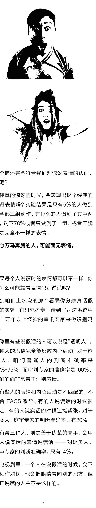

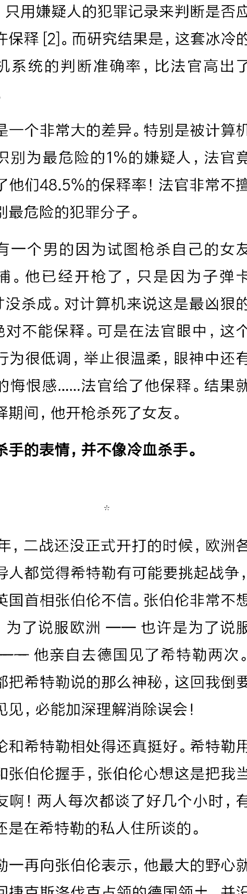

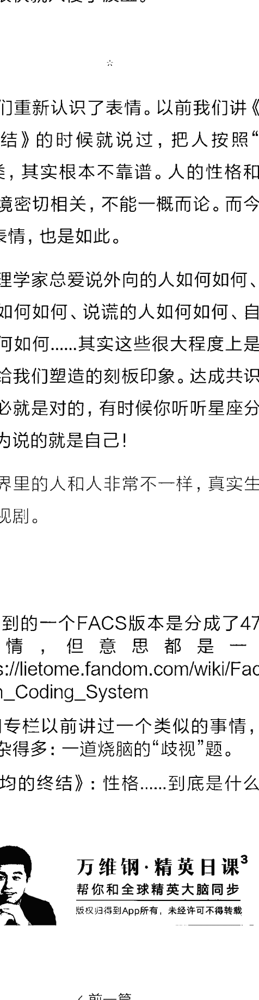

这个描述完全符合我们对惊讶表情的认识，对吧？

那你真惊讶的时候，会表现出这个经典的惊讶表情吗？实验结果是只有5%的人做到了全部三组动作，有17%的人做到了其中两组，剩下78%或者只做到了 一组，或者干脆就是完全不一样的表情。

# 内心万马奔腾的人，可能面无表情。

如果每个人说谎时的表情都可以不一样，你又怎么可能靠着表情识别说谎呢？

回到咱们上次说的那个看录像分辨真话假话的实验。有研究者专门请到了司法系统中有十五年以上经验的审讯专家来做识别测试。

录像里有些说假话的人可以说是“透明人”，这种人的表情完全能反应内心活动。对于透明人，咱们普通人的判断准确率是70%-75%，而审判专家的准确率是100%，他们的确非常善于识别表情。

但有些人的表情和内心活动是不匹配的，不符合 FACS 系统。有的人说谎的时候很镇定，有的人说实话的时候反廷紧张。对于这类人，庭审专家的判断准确率只有20%。

还有第三种人，则是善于伪装的高手，会用别人说实话的表情说谎话 —— 对这类人，庭审专家的判断准确率，只有14%。

在电视剧里，一个人在说假话的时候，会不敢和你对视，他会把眼睛看向别的地方！但真正说谎的人并不是这样的。

格拉德威尔特别举了一个事实。我们知道按照美国的法律，一个犯罪嫌疑人在被捕之后、正式上法庭之前，是可以被暂时保释出来的，回家等待审判。是否允许保释，由法官决定。法官最担心的是嫌疑人在保释期间跑了，或者再犯别的罪。而法官要做这个判断，总会把犯罪嫌疑人叫到眼前来，当面聊一聊。法官，需要看这个人的表情。

但是有人做了一套计算机系统，不看表情不对话，只用嫌疑人的犯罪记录来判断是否应该允许保释 [2]。而研究结果是，这套冰冷的计算机系统的判断准确率，比法官高出了25%。

# 冷血杀手的表情，并不像冷血杀手。

1938年，二战还没正式开打的时候，欧洲各国领导人都觉得希特勒有可能要挑起战争，唯独英国首相张伯伦不信。张伯伦非常不想开战，为了说服欧洲 —— 也许是为了说服自己 —— 他亲自去德国见了希特勒两次。

今天我们重新认识了表情。以前我们讲《平均的终结》的时候就说过，把人按照“性格”分类，其实根本靠谱。人的性格和具体的情境密切相关，不能一概而论。而今天看来，表情，也是如此。

真实世界里的人和人非常不一样，真实生活不是电视剧。

## 注释

[1] 我看到的一个FACS版本是分成了47种微表情，但意思都是一样的 https://lietome.fandom.com/wiki/Facial_Action_Coding_System

[2] 我们专栏以前讲过一个类似的事情，比这个复杂得多：一道烧脑的“玻视”题。

[3] 《平均的终结》：性格……到底是什么意思？


# 不要被小事击垮

万维钢·精英日课³
今天
进入详情 >

不要被小事击垮
11:28 10.49 MB

[纯读：怪沙]

据说是伏尔泰有句话说，“使人疲惫的不是远方的高山，而是鞋子里的鹅卵沙子”，意思是... 一对恋人爱情炽烈，好不容易冲破... 最后因为鸡毛蒜皮离婚了。

幼稚的人爱说自己到了关键时刻就会如何如何，其实哪有那么多关键时刻，真实生活... 有些鸡汤文，说我们应该用心做好每一件小事——我看这个说法没有抓住重点。

小学生... 这都是成长的烦恼，不会把你击垮。能击垮你的，是一些更可怕的事情。

## 1.慢性日常麻烦

老张所在的公司最近有个技术难题正在攻关，老张有个好想法，但是领导不支持，他就打算利用下班时间自己钻研一下试试。... 点了。

而就是这个点，医院仍然要排很长的队，老张掏出手机，想抓紧时间先看点儿技术资料......结果手机没电了。老张就只好这么干等着，排队系统开始说一个小时就能等到，后来两... 他和插队的人吵了起来.....

幸运的是孩子啥事儿没有，不幸的是老张熬了一晚上啥也没干成。第二天上班老张情绪一点都不饱满，领导也没有再给他机会。晚上妻子终于回来了，正好看见老张对孩子发脾气......

英雄就是这么被生活击垮的。这些事儿的特点是你无法掌控。你想干的不是这样的事儿！你的计划里没有这种项目，可是它们就这样一波未平息一波又来侵袭。它... 老张心想，如果生活是电子游戏，我能不能先退出一会儿。

俄勒冈州立大学健康老年研究中心的主任卡洛琳·奥尔德温（Carolyn Aldwin），把这种说大不大、说小又折磨人的事儿，称为“慢性日常麻烦（Chronic daily hassles）”[1]。

“慢性”这个词似乎有一点医学的味道——是的，这些小麻烦不但影响人的情绪和工作表现，而且还会影响人的健康，甚至会缩短人的寿命。

飞机晚点、手机没电、上下班路上堵车，这些事儿会让人恼火。人恼火的时候血压会升高，血压经常升高就会增加得心脏病的风险。慢性日常麻烦会让人有压力感，压力感会让人体内一种叫做皮质醇的荷尔蒙浓度升高，而这会破坏免疫系统。免疫系统不好使，身体就容易出现慢性炎症，这些慢性炎症又会进一步导致其他更严重的疾病，甚至会增大得癌症的风险。

我们早就知道，重大压力事件，比如失业、失去亲人、长期照顾病人，这些大事，对健康会有很大的危害[2]。而奥尔德温的研究表明，慢性日常麻烦对健康的危害，几乎就和大事一样。

## 2.对麻烦的感知和反应

坏消息是小麻烦永远都会存在。好消息是和以前讲过的重大压力事件一样，真正影响你健康的不 是麻烦本身，而是你对麻烦的反应。

奥尔德温在2016年做了一项研究，她找来900个受试者，统计他们平时都遇到多少个小麻烦，他们对这些小麻烦有什么反应，然后测量他们的“心率变异性（heart rate variability, HRV）”。心率变异性好，就意味着心跳跳动可快可慢，这样的心跳就是健康的；心率变异性差，就容易得心脏病。

奥尔德温发现，这些受试者的心率变异性跟他们遇到的小麻烦的*数量*关系不大，但是跟他们面对小麻烦如何反应很有关系。

比如说，同样是你... 这个小麻烦就不会影响你的健康。但是如果一堵车你就非常恼火，一个劲儿地埋怨前面这帮人是怎么开车的，你的健康就很可能受到影响。

这个关键是麻烦怎样影响你的情绪。奥尔德温2014年对1300名男性做了一项研究，让他们对自己面对小麻烦时的情绪打分，分数越高代表情绪强度越大——结果发现，那些经常对小事有激烈反应的男性，他们的健康状况和死亡率，就和那些面对重大人生压力的人一样。特别是反应最为激烈的哪一组，他们在同样时间段内的死亡率，竟然是正常人的三倍。

那为什么同样面对堵车，有的人就能心平气和，有的人就非得反应过度呢？我理解医学界可能也还完全搞清楚其中的相关和因果，但是有研究认为，情绪反应是一种生理现象。有些人就是神经过敏，遇到事情就容易被激怒。他会把任何小麻烦都视为威胁，他总觉得别人针对他，他需要花很长的时间才能让情绪恢复过来。

也许是不善于调控情绪导致身体不好，也许是身体本来就有问题所以才不善于调控情绪，也许这个效应是双向的。

最可怕的是小麻烦还有个积累效应。如果你最近心情都挺好，那就就算个小事儿也没关系。如果你已经到了焦头烂额的程度，那每个小麻烦都可能是压垮你这匹骆驼的最后一根稻草。

人 不应该长期处于感到威胁的战斗状态之中。草原上的斑马之所以不得胃溃疡，是因为它们只有在野兽追赶的时候才奔命狂跑，平时非常放松[3]。你需要主动从压力模式切换到放松模式。

## 3.怎样忽略麻烦

记住，真正的问题不是麻烦本身，而是你对麻烦的反应。如果是重大压力，你把它想象成挑战，把压力变成动力；或者你可以把这件事放在更大的时空尺度下去看，把它“看小”。那么麻烦怎么办呢？

有些鸡汤文说什么“认真面对每一件小事”，别听他们的。你应该听（据说是）爱因斯坦说的：“弱者报复，强者原谅，智者忽略”——答案是忽略。

那么怎么忽略呢？难道孩子病了还能不管吗？当然不是。我们要忽略的是自己的情绪。第一，你要善于观察自己的情绪。奥尔德温建议，如果你感觉自己正在紧握双拳、脸红、心跳加快，那就是你要发怒了——这时候你要提醒自己把情绪平复下来！来几个深呼吸。第二，开心的小事儿可以中和烦恼的小事儿。台湾人有个说法叫“小确幸”，小而确定的幸福，而研究表明，小确幸可以中和小恼火。

有一个研究想看看慢性日常麻烦对大学生完成学习目标有什么影响。研究者找了100个大学生，让他们在六天之内，每天记录遇到了哪些小恼火，以及遇到了哪些小确幸，比如和朋友聚会、自己弹弹琴之类。研究发现，如果一个人有很多小恼火而没什么小确幸，他的学习目标会大受影响。但如果他有很多小恼火的同时，也有很少小确幸，那么小确幸就会中和掉小恼火，这个人的心情就会还不错，他的学习目标就不会受到影响。那小确幸从哪来呢？当然你需要主动制造一些，这就是为什么人得有点爱好，有点社交[4]。但是你还需要一双能从生活中发现小确幸的眼睛。我们上课以前讲过中年的大彻，说人到中年的一个好处就是善于看到生活中小好的地方，不在于那些不好的地方，你会更容易跟世界和解，原来这对健康也有好处。

第三，更强的功夫，是使用斯多葛哲学和阿德勒“课题分离”的思想。关键在于，不要把小麻烦给“个人化”。这件事只是一个客观的存在，并不是世界在针对你，更没有那么多人与你为敌！客观的存在是你控制不了的东西。人真正能控制的，只有自己的行动和自己的态度。你控制不了堵车但是你可以控制自己在堵车的时候做什么。你控制不了麻烦但是你可以控制自己对麻烦的反应。“认真做好每一件小事”这个观点为什么是错的呢？因为你这是想要控制。能控制的，才谈得上要认真做好，而小麻烦往往是我们不能控制的。不能控制想强行控制，情绪就会上来，健康就会下去。

写留言，与作者互动

就会上来，健康就会下去。

*

关于慢性日常麻烦，咱们中国人有很多民间的说法。有的说要“难得糊涂”，意思似乎就是要忽略这些小麻烦；可有的又说“诸葛一生惟谨慎，吕端大事不糊涂”，那到底什么使用应该谨慎，什么时候应该糊涂呢？不糊涂又能如何呢？

那当然是对控制不了的小麻烦要忽略，对能控制、而且有必要做好的事、大事，要谨慎——因为不这么干，不但事情做不好，而且影响健康。我们作为现代人，得有点成体系的、逻辑自洽的认识。斯多葛哲学结合现代心理学和医学研究，能给我们更好的答案。

*

最后我想分享一点个人心得。我认为把一切小麻烦都忽略的态度也不对。永远处在战斗状态固然不好，但偶尔战斗一下，也是锻炼身体。根据反脆弱养生法，我主张如果遇到不公平的对待，可以偶尔跟人发生一点，*急性的*，冲突。

不要找熟人，最好是全是陌生人的公共场合。比如排队的时候遇到有人插队，你完全可以站出来跟他干一仗。我在中国的火车站、在美国的机场、在大学校园和儿童游乐场，都曾经跟人冲突过。我有一次把机场管理员都给惊动了，还有一次差点被警察抓起来。只要不动手，基本不会有太大的事儿。我平时非常老实，每次遇到这种事儿都会满脸通红、心跳加快，当时感觉并不好。

但是事后想起来，都是美好的回忆。

## 注释

[1] Jennifer Breheny Wallace, Even the small stresses of daily life can hurt your health, but attitude can make a difference, Washington Post, March 3, 2018.

[2] 《端粒效应》：压力的一念之间

[3] 有点“模式”意识

[4] 我有个大胆的猜测，因为手机能随时带给我们快乐，这一带人的情绪实际上比上一代人更好……但我没有证据。

[5] 中年的大脑更厉害


〈上一篇

## 日课精选

默认 最新 只看作者回复

正在加载...

写留言，与作者互动

# 特别放送：非理性的合理性

万维钢 · 精英日课³
今天

特别放送：非理性的合理性
00:40 628.82 KB
[转帖：怀沙]

万维钢
《怪异经济学》这本书告诉我们一个道理：很多看似不合理的行为，你研究之后，背后都有合理性；很多非理性的选择，其实都是当下的最理性决策。今天的特别放送我们就把日课里提到过的相似情形，做一个简单的总结，希望你缔成一个很“毒”的眼光，以后面对各种社会现象不但要见怪不怪，而且要能一针见血地发现其中的关窍。你还是可以通过看文稿的方式学习，并且可以通过链接回顾原文。祝你每天都有收获。

## 1.及时行乐

# 非理性：为什么有的NBA球星赚了很多人钱，居然能在退休几年之内把万贯家财全部败光？这些人天生就傻吗？为什么我们通常认为细水长流才是安身立命之本，而有人追求的就是那短暂的炫耀？

# 合理性：从进化心理学角度分析，人的很多行为看似非理性，其实是理性的，自有一番道理。

进化心理学有个“生命史”理论，简单地说，每个动物一辈子其实就干两件事：积累和花费。生命史理论说，动物们的积累和花费有两种不同的策略。

像大象这样的动物，食物充足而且没有天敌，可以无忧无虑地生活好几十年，所以它的策略就是“慢策略”。

而绝大多数动物没有这么幸运，一般都是很早就性成熟，然后马上就大量生育，然后可能很快就被杀死，寿命很短也就死了。这就是“快策略”。

这两种策略都是对的。环境好当然可以慢慢享受生活；如果环境险恶寿命短，不用快策略基因根本传不下去。

人就是这样。如果生活在一个这样的家庭，有个单亲妈妈和若干个不同父亲的兄弟姐妹，生活很不稳定，今朝有酒今朝醉，快策略才是一种理性。像某些NBA球星环境很好了还是退休几年就破产，我们只能说他未能战胜自己的基因。

> 截此复习：今朝有酒今朝醉，也是一种理性

## 2.主要看气质

# 非理性：传统智慧要求我们看人要看内心，谨防上了“金玉其外败絮其中”的当。但现在看气质却越来越流行。不是不要以貌取人吗？外表，为什么这么重要？

# 合理性：现代社会是个陌生人社会，传统智慧就太不实用了——我们每天要接触很多人，怎么可能一一了解别人的内心？你就得通过观察外表，迅速判断。随便是给你一个人，你马上就能对这个人产生一个第一印象，这是人人都有本能。而有个研究，说的就是这个本能其实非常强大。

普林斯顿大学心理学教授亚历山大·托多罗夫，发表在 Aeon 上的 一篇文章，“第一印象很重要”（First impressions count）。这篇文章说的是包括托多罗夫本人在内，各国心理学家在过去几十年的一系列研究。这些研究的结论用一句话总结，就是——我们只需要0.1秒，就能只凭照片判断一个政客的能力是否胜任，而这个判断结果又能在很大程度上左右选举结果。

所以，如果你要经常跟陌生人打交道，那可真是得重现外表啊。我就看过一些研究，说参加找工作面试，你给人的第一印象，不但能决定自己是否会被录用，而且还能决定自己进入这个公司以后，相当长一段时间内受到的待遇！

> 截此复习：主要看气质

## 3.爆冷门的足球比赛

# 非理性：为什么在足球比赛中强队会输给弱队？足球的球场太大、球门太小、守门员的手太长、禁区里后卫的腿太多，一支球队哪怕是面对比自己弱的对手，九十分钟内也只有大约十几次射门机会，整场比赛下来双方总共只有两三个进球。想要让足球比赛结果更公平，办法非常简单——只要把球门加大就可以了。大幅增加每场比赛的进球数，强队就更容易表现实力。为什么不这么做？

# 合理性：足球不是高考，足球界最想要的不是每场结果都公平，而是每场能吸引多少观众。有悬念才有观众，有随机性才有悬念。

欧洲联赛中有些超级豪门俱乐部，他们花最多的钱买了最好的球星。而他们之所以能稳稳当当地做豪门，恰恰是因为他们有可能 会输给非豪门！

所以随机性并不是一个 bug，它是一个 feature。乒乓球从每局21分改成11分，排球从有发球权才能得分改成每球得分，都是在增加比赛随机性。观众喜欢公平，但观众也喜欢意外。公平 + 随机 = 熟悉 + 意外。

随机性是给穷人的礼物。你是富人靠科技，但是你也得允许穷人靠变异——这个项目才能长久地玩下去。

> 截此复习：一半是技艺，一半是运气

## 4.财务漏洞

# 非理性：我们可以想象一般公司的报销制度都是有漏洞的。有的员工可能会钻空子，让公司蒙受损失。那请问，公司的财务人员是不是应该设计一个天衣无缝的制度，确保公司完全不受损失呢？

# 合理性：答案是不应该。 一个天衣无缝的制度必定是非常繁琐的制度。公司不可能打电话核实每一笔花费的真实情况，那就要消耗大量的时间和人员，成本太高，员工也麻烦。一般公司的做法都是差 not 多就行，只要损失不大就可以接受。没有漏洞的系统不见得是最好的系统。最好的系统应该在减少的损失已经比不上付出的成本的时候停止优化。

正如1982年的诺贝尔奖得主，经济学家乔治·斯蒂格勒（George Stigler）的名言：任何“好成绩”都是有代价的。

> 截此复习：如果土豆从未结过翅膀，你在机场等的时间太长了

## 5.QWERTY键盘

# 非理性：现在都在用QWERTY键盘，有个说法认为这种键盘的字母排列布局其实是不合理的，当初的人之所以把键盘设计成这个样子，是为了降低人们的打字速度，防止老式打字机的键杆绊在一起卡壳。那现在的键盘都没有键杆了，打字速度再快都能承受，为什么还要用这个不合理的QWERTY布局呢？

# 合理性：因为路径依赖。最早的打字机，不管是出于什么原因，使用QWERTY布局，当时的用户就不得不学习这种布局。用户已经适应了，再出新的键盘也只好使用这个布局。因为谁也不愿意重新学一套打字技能，现在有人发明了更有合理键位布局的键盘也无法流行开来。由此一代一代的新用户适应键盘，新键盘适应用户，我们就被锁定在了QWERTY布局之中。历史上的小事件，彻底改变了后世路径的概率。

路径依赖给我们的教训是一个东西能流行可能并不是因为它的品质好，而是因为它的运气好——或者说，它早期的运营比较成功。

> 截此复习：《模型思考者》12:路径依赖

## 6.拍卖妻子

# 非理性：在19世纪工业革命时期，英国人拍卖妻子这一现象不仅存在，而且是公开的、而且基本上是合法的，而且拍卖流程非常正规。这难道不是把女性当成货物吗？

# 合理性：拍卖妻子这件事，有一个非常关键的规定，那就是妻子本人，必须同意见这个交易。而通常情况下，妻子是同意的。事实上，从历史记录来看，拍卖交易的结果的确是妻子表示满意，甚至可以说很高兴。

在当时的社会环境下，没有多少工作是适合女性的。成年女性很难通过工作来养活自己，所以女性一旦结婚，基本上可以说就不是独立的人了，而是她丈夫的财产。

那时候的英国打离婚官司非常困难。整个法律费用得几百英镑，在当时一个人一周都挣不了几英镑的情况下，离婚基本上是一个贵族行为，对普通家庭根本就不是一个选项。

所以如果一个英国妻子想要离开她的丈夫，离婚，对她并不可行。分居、离家出走或者和私人苟合，法律在这些事上的设置也统统都是有利于男性的，而且社会习俗也不允许。在这种女权环境之下，被拍卖大概是女性最好的出路。

> 截此复习：《怪异经济学》2:买卖妻子的市场

## 7.巫术诅咒

# 非理性：非洲中北部的原始民族赞德，在上个世纪20年代的时候，还会相信一个人可以 用巫术诅咒另一个人，用咱中国人的话 说，就好像是下咒一样。每个赞德社区都会有一个先知，也会通过巫术解决冤咒纠纷。

有一个先知，也会通过巫术解决诅咒纠纷。
他们为什么用这套流程？这样的方法有什么意义呢？

# 合理性：

人类学家观察到，赞德人是个特别敏感的民族，已经敏感到了近乎病态的程度。那如果每次感受到恶意就干一仗，赞德人日子就没法过了。可是心里有这个疙瘩不解决又不行，所以这个“巫术”系统就是最好的办法。

石头剪刀布也好，掷骰子也行，把裁决权交给随机性，既方便又公平。接受命运的安排，输了怪只怪自己运气不好，这种心态很健康。每个人每次都有 50%的可能性赢，时间长了，大数定律会确保谁也不会吃亏。而对比之下如果你一有冲突就让上级或者长辈裁决，就难免会有人觉得他偏向于某一方。

那这个方法到底有什么意义呢？因为把裁决交给随机的命运，有时也是解决分歧的先进方法。如果说古人因为迷信而对随机性用得太多，那我们现代人就可能因为太过相信自己，而对随机性用得太少了。

戳此复习：《怪异经济学》4:巫术的裁决

## 8.比武决斗

# 非理性：

十二世纪、诺曼底王朝时期的英国，土地是层层转包的，交易手续也非常麻烦，很难合法交易。为了增加税收，政府其实希望土地能够流转起来。可交易又这么困难，这怎么办呢？法庭用比武判决，是诺曼底王朝的常规操作。官方的说法当然是上帝会保佑无罪的一方，所以只要你能取胜，你就是正义的。比武决斗难道是最公平合法的吗？拍卖不是更好的办法吗？

# 合理性：

根据科斯定理，只要市场交易成本足够低，就应该是谁对这块土地的估值高，谁就最终能得到这块土地。花钱雇佣别人代替自己比武，其实就相当于双方在对土地竞标。谁对土地的估值更高，谁就会愿意花更多的钱，去请一位更好的武士出场。

如果搞拍卖，拍卖所得的钱该给谁呢？给政府吗？这可是私人财产，再说如果法庭能从中获利，法官就可能纵容这种土地纠纷，危害私人的产权。

而这个比武制度中，拍卖的受益者既不是法庭，也不是打官司输掉的一方，而是武士！双方都要花钱，所以谁也不会无缘无故打官司；法庭无利可图，所以还能大致上秉公办事，而且雇佣武士的价格也不会像真的买块地那么贵，因为毕竟这里面有个不确定性，谁也不能说出手就稳赢。这样一分析，比武反而是解决土地转让最方便、最省钱的方法。

戳此复习：《怪异经济学》6:穿越者的经济学


# 万维钢·精英日课³
帮你和全球精英大脑同步

版权归得到App所有，未经许可不得转载

‹ 前一篇

## 日课精选

默认 最新 只看作者回复

正在加载...

写留言，与作者互动


# 问答：跟科学一起进步

万维钢·精英日课³
今天
进入课程 ›

问答：跟科学一起进步
12:01 11.01 MB
| 综述: 怀疑 |

# 来自日课：间谍故事

读者 熊凯：

今天日课的内容感觉比美国拍摄的悬疑侦探剧更富戏剧性。难以想象，作为一名非专业的间谍，怎么会坚守自己最初信念的同时，又做到与信念相冲突的工作的高层？

读者 David Tam：

我的关注点有点怪：为什么很多看上去对于从业人员要求很高的职位，在这些职业的从业人员，却并没有表现出很高的水平呢？比如像文中所说的间谍，我们以为他们是孤胆英雄式的王者，但其实却是青铜？

万维钢
优秀的职业是球运动员每年至少要打30场正式比赛，他的所有表现都会被人看在眼里，他对球队的贡献充分体现在进球、助攻、传球成功率、跑动、拦截等等这些数据上，他的位置有多个竞争者，他时刻都在被跟别人比较，他的价值能直接反映为身价。

# 来自日课：多疑是一种什么体验

读者 唐门：
多疑用在思考学术问题上会不会变成一种利器呢？

# 来自日课：“微表情”靠谱吗？

读者 周晓川：
我们传统文化中有“相人术”这种说法，据说曾国藩就是位“相人”高手，今天我们也常说一个人相由心生，这种预测方法是不是一种封建迷信呢？

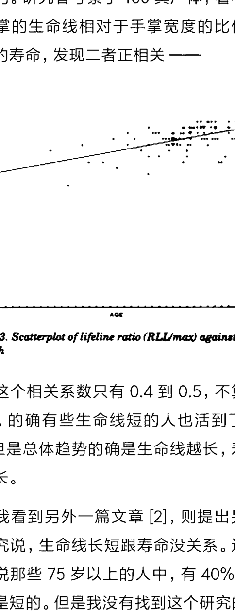

写留言，与作者互动

# 读者 David Tam:

万老师，你是否也有“昨日之我打倒今日之我”的经历？比如，你发现自己以前写的某些文章，错得离谱，甚至说得难听点，有误人子弟的嫌疑？你怎么看待这种状况？

万维钢

有过。在现在的我看来，五年前我的有些说法是不对的。我以前喜欢说“理工科思维”，认为什么事情都应该用数据和算法判断对错，对所谓“文科”比较鄙视，经常表现出一种优越感，这是不好的。我们专栏解读过《意会》，讲过“自由技艺”，谈论过科学和艺术的关系，这些内容对我也是学习和提高。我现在认为人文学科的东西还是非常重要的。事实上我自从不当物理学家以来就再也没鼓吹过“理工科思维”……

我在《万万没想到》这本书里说过一个重要知识是“意志力是一种有限的资源”，我特别强调了集中注意力这种能力的好处。但是后来的研究表明，“意志力是一种有限的资源”这个说法可能是错的——原始的研究者还没有服输，但是现在争议很大。后来我在咱们精英日课第一季专门写了一篇《不可重复的心理学套路》，其中列举了很多个曾经特别流行，但是现在被证明不可靠的心理学研究，其中就包括这个关于意志力的研究。我们专栏还多次提出，有时候不集中注意力，反而能增加创造性。

所以，有时候是我的认识提高了，有时候是科学进步了，我文章中内容有出错的风险。

# 但我并不认为这些内容是误人子弟，也不认为应该把它们从读者的记忆中抹掉。

我作为科学作家，所写的所有重要内容，背后都有严肃的科研结果支持。这种写法是非常安全的。包括我鼓吹“理工科思维”的时候，提到的所有论据也都有据可查。你可以反对我的观点和态度，但是你要想反对我的论据，就必须拿出更新的研究才行。

而如果有新的研究真的推翻了之前的研究，也很难说之前的研究就一无是处。以前我们说棉花糖实验说明没有意志力的人将来没啥出息，现在我们说那只不过是因为他有不一样的生存策略——这是认识上的进步，但这个进步并不能说以前的结论毫无价值。微表情并不像艾克曼说的那么神，不能用于审讯这种严肃场合，但是对电视剧很有用。

格拉德威尔犯过的错误比我多得多——这是因为他对心理学的新研究的敏感度比我高得多。就通俗写作而言，他说的事情，常常是他第一个说的。你越在前沿就越容易出错，这就如同你越在前线就越危险。

# 但我认为这没问题，因为科学作家，甚至包括科学家，都具有“反脆弱”的性质。先当众犯个错误再当众改正错误，这比从来就没说过话要好得多。

我们跟科学一起进步，我们跟读者共同成长。能够参与“当前科学理解”，我们深以为荣。

# 参考文献

[1] P G Newrick, E Affie, and R J Corrall, Relationship between longevity and lifeline: a manual study of 100 patients, J R Soc Med. 1990 Aug; 83(8): 499 - 501.

[2] https://www.yourchineseastrology.com/palmistry/can-lifeline-predict-longevity.htm

万维钢·精英日课³
帮你和全球精英大脑同步
版权归得到App所有，未经许可不得转载

〈 前一篇

## 日课精选

默认 最新 只看作者回复

正在加载...

写留言，与作者互动

# 《与陌生人交谈》4：“增强审讯技术”

万维钢·精英文摘³
今天

进入详情 ›

《与陌生人交谈》4：“增强审讯技术”
11:43 10.74 MB

| 投稿：乔汐 |

我们继续讲格拉德威尔的《与陌生人交谈》。咱咱们先说明一下，这一讲中含有暴力内容，可能会引起强烈不适，请你谨慎阅读和收听。本讲所有内容和图片都来自格拉德威尔的这本书和互联网的公开信息。

前面我们讲了，想要从一个人身上获得真相是非常困难的。我们很容易就会被误导，像微表情这些东西也不一定管用。那这一讲我们考虑一个最极端的获取信息方法：刑讯逼供。如果把一个人交到你手里，随便你怎么处置，你有没有办法让他开口说真话？

逼供犯人是一门技术。关于这一行有很多传说和错误认知，比如有人说美国人发明了一种能让人说真话的药，其实都不靠谱。真正的逼供，并不是你馒得出就好。我非常佩服格拉德威尔的调查水平，他采访到了最核心的人物。这个故事让人不胜唏嘘。

*

美国中央情报局在逼供犯人方面做了大量研究，可以说是已经达到了科学的水平。中情局有专门的心理学家，做了各种实验，得到了精确量化的成果。当然至少按照这本书来说，中情局做事还是有一定底线的，不是像古代那种搞血淋淋的刑罚拷打，因为法律不允许。

而心理学家的认识是逼供并不需要流血。如果不流血也能让人开口，那逼供就成了一个斗智斗勇的项目。

而逼供和反逼供水平，也许还可以通过训练提高。


第三个方法叫“坐水筏（waterboarding）”。找一张木板床，把犯人绑在床上，把床倾斜起来，让犯人头向下45度斜躺。然后在他头上蒙一块布，把眼睛、鼻子和嘴都蒙上。然后透过这块布，往犯人的鼻子和嘴里灌水。这是最有效的一招。

恐怖分子哈立德·谢赫·穆罕默德，英文缩写为 KSM，是911事件的核心策划者，是基地组织领导人之一。这个KSM曾经亲手斩首了华尔街日报记者丹尼尔·珀尔（Daniel Pearl）——这个丹尼尔·珀尔是谁呢？就是我们专门讲解过的《为什么：因果关系的科学》那本书的作者朱迪亚·珀尔的亲生儿子。据KSM本人描述，他还甚喜欢丹尼尔·珀尔！他斩首珀尔的过程简直就是一个变态的行为艺术。

专家叫查尔斯·摩根（Charles Morgan），
专程到空军反逼供训练营中做了实地研究。
摩根发现，经历了极端逼供手段之后的士兵，会出现和PTSD一样的症状。

摩根喜欢做的一个测试是这样的。你先看看下面这张图——

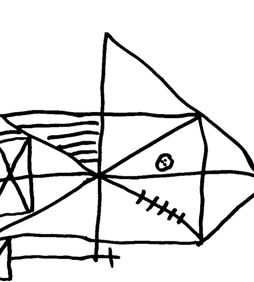

这个图形稍微有点复杂，但线条都是简单的。现在让你对照这张图，画一个一模一样的图，这很容易吧？

好，接下来把原图拿走，看你能不能完全凭回忆，再把这张图画出来。一般成年人都完成得很好，下面这张是美军士兵的重现水平——

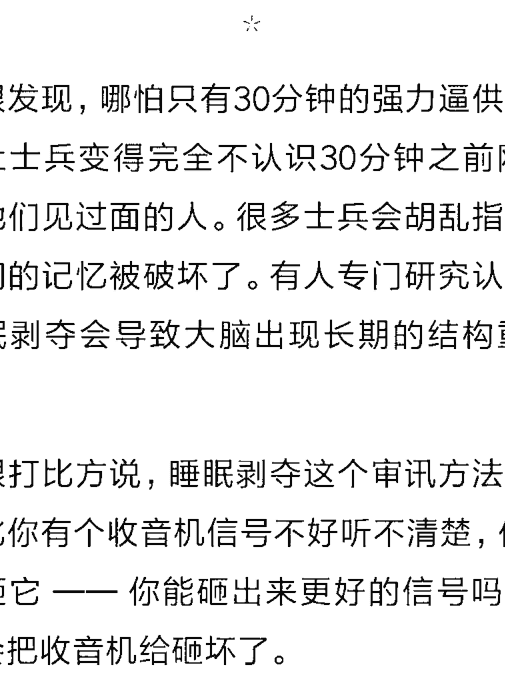

可以说该有的元素都记住了。成年人一般的做法都是先把主要轮廓画出来，再填充细节。而小孩并不具备这种逻辑思维能力，常常是从图中某个角落开始画，就不容易画全。

而摩根发现，如果让士兵先经历一番“有压力的问话”——大约相当于刑讯逼供——再做这个测试，那么80%的人画出来的，就是孩子的水平——

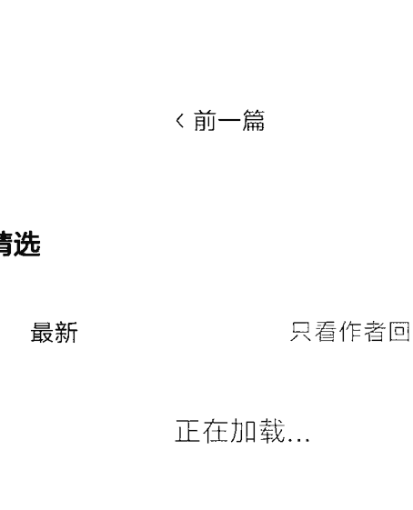

他们大脑负责理性思维的前额叶皮质会暂时失灵。逼供，把大人变成了小孩。

*

摩根发现，哪怕只有30分钟的强力逼供，都能让士兵变得完全不认识30分钟之前刚刚跟他们见过面的人。很多士兵会胡乱指认！他们的记忆被破坏了。有人专门研究认为，睡眠剥夺会导致大脑出现长期的结构重组[1]。

摩根打比方说，睡眠剥夺这个审讯方法，就好比你有个收音机信号不好听不清楚，你就去砸它——你能砸出来更好的信号吗？你只会把收音机给砸坏了。

也许KSM到最后已经不知道自己做过什么和没做过什么。

*

格拉德威尔说，一个人掌握的所谓关键信息，并不是土里埋着的一块金子，你只要使劲挖就能挖出来。关键信息是个很脆弱的东西，你用力过猛，就可能把它给破坏了。

这是一个悖论。可能我们越努力从陌生人身上得到真相，就越得不到真相。跟希特勒见面还不如不见，对犯人用刑还不如不用。

我们只能接受这样一个事实，那就是你能从一个陌生人那里得到的信息是有限的。你永远也不可能掌握关于他的全部真相。

## 注释

[1] 关于这一点专门有本书，叫《为什么酷刑不好使》（Shane O’Mara, Why Torture Doesn’t Work: The Neuroscience of Interrogation, 2015）。


万维钢·精英日课³
帮你和全球精英大脑同步
版权归得到App所有，未经许可不得转载

〈上一篇

## 日课精选

默认 最新
只看作者回复

正在加载…

写留言，与作者互动

# 《与陌生人交谈》5：人与环境的耦合

万维钢 · 精英日课³
今天
进入详情 >

《与陌生人交谈》5：人与环…
12:32 11.48 MB

转载：沉沙

咱们继续讲格拉德威尔的《与陌生人交谈》。这一讲的内容仍然可能引起不适，希望你在精神强大的时候阅读和收听。

这本书讲到现在我们一直在做假设：想要了解一个陌生人，这样也不行，那样也不行，连审讯都不行。你肯定早就想问，那到底怎样才行呢？我们应该如何了解陌生人？

我必须遗憾地说，格拉德威尔这本书里并没有提供一套算法式、菜谱式的一揽子解决方案。这是一本关于怎样做“不行”，而不是关于怎样做“行”的书——但我认为格拉德威尔仍然交付了重要知识。

如果你知道怎样“不能”了解陌生人，你就能减少与他人之间的误解，你就能少犯错误。而能对陌生人少犯错误，这就已经足够有用了——比如说，它能救命。咱们从自杀说起。

*

旧金山有个著名地标是金门大桥。提起金门大桥，很多人都知道，那是一个“自杀胜地”。


会“触发”种种特定的行为。

耦合是个普遍现象。

我们知道美国的大城市里都有富人区和穷人区，而穷人区给人印象常常是犯罪高发区。但穷人区，并不等于犯罪高发区。

那什么样的“区”犯罪率特别高？不是像朝阳区海淀区这种级别的大区。而是街区。

犯罪学家发现，犯罪行为总是只发生在几条街围成的小区域内 —— 哪怕你过个马路，就没有犯罪了。所以警察在穷人区的大街小巷全面巡逻其实没用，应该集中在那几个容易犯罪的街区巡逻。

比如说，纽约市50%的犯罪是发生在3.3%的街区内。波士顿50%的犯罪发生在3.6%的街区内。包括外国，比如以色列，所有城市都是这样。犯罪学家把这个规律叫做“犯罪集中定律”。

这是一个很奇怪的现象。难道犯罪分子没有腿吗？他们为啥不去别的地方犯罪呢？格拉德威尔没有深入报道关于犯罪分子的研究，但是他讲了一个关于妓女的研究。

下面这张地图位于新泽西州的泽西市 ——


图中最暗的那个由六条很短的街道组成的三角形区域，是当地妓女集中的地方。警察加强对这个区域的巡逻之后，那里的卖淫活动就大大减少了。

那请问，这时候妓女们会怎么办呢？她们会不会转向其他地方，比如说邻近的那些浅灰色的区域工作呢？并没有。警方调查表明，多数妓女们继续留在了这个区域，她们改行了。

她们说自己不想换地方。这里是她们的家，她们也有老人和孩子要照顾。她们对这里非常熟悉，很有安全感。换个地方，她们无法判断会不会有人报警，也不sent想再跟新的“同事”相处。

换句话说，她们跟我们一样。

人做什么事情，不仅仅是由这个人本身决定，而是跟他所处的环境相耦合。我们专栏以前讲过托德·罗斯的《平均的终结》，我们知道所谓“性格”其实是一个不靠谱的说法。并不是说外向的人就一直外向内向的人就永远内向：一个人可能在家里很爱说话，但到了工作场合却很内向；一个人可以在陌生人面前滔滔不绝，在熟悉的人面前反而很内向。谈论人的性格，必须考察现在他处在哪个环境。

现在格拉德威尔说的这个“耦合”，相当于把这个思想给推广了。何止是性格，一个人想不想自杀、会不会犯罪，也和他所处的环境很有关系。

理解这一点，最直接的应用就是我们可以通过改变环境来改变人的行为。如果你遇到有人要自杀千万要救，因为你救下这一次，他过后很可能就不想自杀了。如果你不幸想要自杀，千万要挺住！挺过这一关，你很可能就不会自杀了。

但是这个认识的重要性远远不止于此，明天咱们还有《与陌生人交谈》这本书的最后一讲。

有一位诗人曾经写道，“黑夜给了我黑色的眼睛，我却用它寻找光明。”

这位诗人跟很多诗人一样死于自杀……但是我们仍然应该读他们的诗句，了解他们的故事。

我们必须理解黑暗，才能找到光明。

注释
[1] 蝴蝶无效应，安全有小事

## 日课精选

默认 最新 只看作者回复

正在加载...

# 《与陌生人交谈》6：防止机器思维（完）

万维钢 · 精英日课³
今天

进入课程 ›

《与陌生人交谈》6：防止机…
11:23 10.42 MB

| 朗读：苏沙 |

今天咱们把讲格拉德威尔的《与陌生人交谈》这本书讲完。只看标题的话，人们可能会以为这是一本讲“谈话技巧”、“影响力”的书，其实不是。书读到一半儿的时候，我们还以为格拉德威尔想告诉我们理解一个陌生人有多困难，我们期待他能提供一箇解决方案，其实没有。

格拉德威尔想说的是更微妙的道理。这本书讲了三个规律——

- 第一，“默认真话理论”。
- 第二，人不是透明的。
- 第三，人与环境的耦合。

以我之见，这三个规律都是关于“度”的规律——可以正用也可以反用，但想要用好，你必须把握一个微妙的“度”才行，过犹不及。用咱们中国话来说，格拉德威尔说的有点“辩证法”的意思。所以《与陌生人交谈》这本书背后的真正的道理是——

你应该防止自己陷入机器思维[1]。

而这本书揭示的最大秘密则是，人实在太容易陷入机器思维了。

咱们从一个震动美国的真实事件说起。

*

桑德拉·布兰德（Sandra Bland）是一位28岁的黑人女教师。她很爱孩子，她有自己的YouTube频道，经常给孩子们讲做人的道理，其中包括种族平等的道理。她在节目里总是把孩子们叫做“我的国王和女王们”。


2015年七月，原本住在芝加哥的布兰德前住得克萨斯州的一所学校，开始自己新的工作。七月10日这天，布兰德从学校办完事离开。她上了高速公路之后发现后面有辆警车在跟着自己。布兰德变道，想把警车让过去。但是她变道之前没有先打转向灯示意。后面警车中的州警察布莱恩·恩西尼亚（Brian Encinia）立即截停了布兰德女士。

以下发生的事情，警方和布兰德女士各自都做了视频记录，你可以在YouTube上看到[2]；格拉德威尔也在书中有详细的文字叙述。我们这里只要要点。


警察按惯例把车停在布兰德的车后面，走过去，从布兰德的副驾驶窗户跟布兰德说话，告诉她她刚刚换道没打灯，要求她出示驾照。布兰德照办了。

回警车查过记录之后，警察从布兰德的车窗边跟她说话。

警察说：“你没事儿吧？”
布兰德说：“我在等你呢。这是你的工作。我等你呢。你什么时候让我走？”
警察说：“你怎么有点生气呢。”
布兰德说：“是啊，我很生气。你开那么快追我，我就让你，然后你就把我截停了，还要给我罚单……我很生气。”

警察其实并没有打算真给布兰德开罚单，但是警察很不喜欢布兰德有情绪。

这时候布兰德点了一颗烟抽。

警察：“能不能请你把烟掐了？如果你不介意的话？”
布兰德：“我在自己的车里，我为什么非得把烟掐了？”
警察：“那你现在可以下车了。”
布兰德：“我没必要下车。”
警察：“下车。”
布兰德：“我为什么……”
警察：“下车！”

……警察强行把布兰德拉下车，给她戴上手铐，带回了警局。

三天后，布兰德在警局，用一个塑料袋，上吊自杀身亡。

*

美国人民愤怒了。这个警察有毛病吗？就为一个变道没打灯？这是不是虐待黑人？这是不是政府欺压人民？又难道说，这只是一个“不会与陌生人交谈”的事件？

可能都不是。这是一个机器思维事件。

咱们先说一个明显著的问题：美国警察为啥总爱在公路上把车截停呢？在咱们中国，一般超速之类的违章事件都是用电子交警记录的，然后给人寄罚单就行，不是吗？

美国警察截停汽车，并不一定是为了抓交通违章。

*

密苏里州的堪萨斯城，在上世纪70年代到90年代，是个犯罪热点地区，这里的凶杀率是全国水平的三倍。堪萨斯城警方曾经在70年代尝试过加强巡逻的警力，结果一点用都没有。1990年，警方专门聘请了一位犯罪专家，叫劳伦斯·谢尔曼（Lawrence Sherman），来帮着想办法。

谢尔曼的洞见是想要控制凶杀案，就必须控制枪。他选择了城中一个面积不到1.7平方公里的凶杀高发小区做实验，他想了三个办法。

- 第一个办法是让警察挨家挨户访问当地居民收集线索，说你如果知道谁有枪请给我们打电话。结果一个有用的电话都没收到——因为守法居民根本不敢离开自己家，他们不知道谁有枪。

- 第二个办法是请专家教警察如何从人的走路姿势上判断谁有枪，结果也没用。

- 第三个办法，是让四个警察，分乘两辆警车，每天晚上在实验区巡逻。这不是一般的巡逻，谢尔曼的要求是你们要找各种理由把可疑车辆拦下来，检查车里的情况，发现有枪就没收。

结果这第三个办法起作用了。就靠这四个警察的力量，七个月之内，实验区的凶杀率下降了一半。

*

美国宪法第四修正案禁止政府在没有正当理由的情况下对公民进行搜查。警察不能无缘无故地进入公民家里，也不能在路上随便把人叫住查证件。但是，美国交通法规允许警察在发现违规的情况下把车辆截停。

而开车，实在太容易违规了。你可能一不留神就忘了打信号灯，而就算是你没有真的违规，只要警察“感觉”你的车比如何车灯不够亮，他也可以让你停车接受检查。

所以在公路上把汽车截停，是警方查人最方便的方法。“堪萨斯城经验”迅速就被全国各地的警局学会了，警察用这个方法查枪、查毒品、查非法移民。

堪萨斯城的那两辆警车，平均每年每晚发出5.45份罚单，抓捕2.23人，200天总共没收了29把枪。这个成绩比以前一般警察一辈子的业绩都好。

于是拦车就成了警察赖以破案、赖以减少犯罪、赖以改善社会治安、赖以立功的最重要方法。警察想的是我出去拦辆这一天，非得查到一把枪不可！警察是带着明确目的在拦车。

可是这就418有问题了。

*

我们上一讲说了，犯罪是个跟地点高度耦合的事情。犯罪总是集中发生在少数几个地方。这样说的话，堪萨斯城经验的一个关键之处是只在犯罪高发区截停车辆检查。犯罪专家谢尔曼非常明白这一点；这就是为什么他并没有要求*增加*警力，他的做法是*集中*警力。

但是这一条，在推广过程中失传了。别处的警察局无法理解、也拒绝相信应该只查犯罪高发区。他们认为犯罪分子会到处跑，所以警方应该全面地查车。

比如北卡罗来纳州，很快就把高速公路上截停车辆的次数从每年40万次提高到了80万次。现在全美国每天会有55,000辆车被警察截停。

试问有多少人会像周立波那样在车里放着枪和毒品，然后还一边开车一边打手机？这种查法不是大海捞针吗？

*

美国交通安全局曾经做过一次检验。他们把枪和假的炸弹藏在行李里在美国各个机场过安检，发现在95%的情况下，这些危险品都没有被查出来。

而你只要看看数字，就会明白这绝非偶然。全美国的机场每年要检查17万件行李……

原。全美国的机场每年要检查 17 亿件行李，而其中有枪的，只有几千件 —— 这个概率是 0.0001%。一个安检员工作五十年，可能都碰不到一把枪。

那么根据“默认真话理论”，安检员就算看到一个疑似是枪的东西，也会把它*解释成*正常物品，对吧？

可是堪萨斯城经验对警察的要求，却是恰恰不能陷入默认真话理论的陷阱。警察局要求警察必须做那个多疑的马科波洛斯。

为此，警察都受过专门的“犯罪巡逻战术”培训。他们必须怀疑一切可疑的东西。

*

布兰德女士的第一个可疑之处是她的车牌是伊利诺伊州的，她为什么出现在得克萨斯州的这个小地方？警察恩西尼亚那天在拦布兰德之前已经拦了几辆车，但是没什么大的收获。他一看车牌就盯上了布兰德。布兰德变道没打灯，正好给了警察截停她的理由。

为什么警察第一次先从副驾驶的窗户过去说话？那是为了方便查看车内的情况。布兰德车里有食品袋，而警察的手册说这可能是犯罪分子藏毒品的东西。

警察起了疑心，第二次就从布兰德这边的车窗跟她说话，这是因为手册说犯罪分子如果想开枪，更方便往右边窗户射击。

布兰德的愤怒情绪加重了警察的疑心 —— 因为警察相信“肢体语言”理论，他把布兰德当做了透明人。好人谁会对警察发火？警察认为好人应该敢于看警察，可是布兰德总是避免跟他眼光接触。

但布兰德不是透明人。布兰德之所以发火，是因为她此前多次因为小事儿违规，收到的罚单已经让她背上了八千美元的债务！她有抑郁症！她不久前刚刚失去了一个孩子，她尝试过自杀！

然后现在又有警察抓她？为了啥？就因为她变道没打灯？

但是警察这边，理解成了这是犯罪分子在示威。警察非常担心布兰德下一秒就拔出枪来。

那一刻，布兰德女士的愤怒让恩西尼亚警官产生的情绪不是同样的愤怒，而是害怕。

*

堪萨斯经验是在犯罪集中地区，在不增加警力的情况下，对可疑车辆进行截停检查。美国其他地区的警察把这条经验推广成了加大警力，在所有地区截查车辆。

堪萨斯城的两辆警车在实验区，两百天总共拦截了 948 辆车，就查到了 29 把枪。而北卡罗来纳州把每年的截停数字从 40 万增加到 80 万，取得了什么成果呢？仅仅多查出来了 17 把枪。

别人说的是我是在这个条件、这个条件和这个条件都满足的情况下，这么这么做的 —— 他从中学到的是这么做好，那我就这么做。

别人说的是不要默认真话，要严查 —— 他执行的是每天出去非得查出点什么东西不可，见到手册里的可疑情况必须做出相应反应。

别人说的是“肢体语言”和“微表情”这些东西也许对办案有帮助 —— 他就一看对方神色异常就要逮捕人家，哪怕对方只是一位 20 多岁的女性。

这就是机器思维。机器思维是二愣子式的举一反三，是不知变通的体制化，是运动式的推广。机器思维把人的智慧，变成机器式的执行。

机器思维把陌生人当做机器……与此同时就这样有意无意地，先把自己变成了机器。

人不应该是机器。

至此格拉德威尔的《与陌生人交谈》这本书就算讲完了。这本书没告诉你什么一二三式的算法，但是我认为我们学到的东西比算法高级。

(THE END)

## 注释

[1] 请允许我多说一句，“机器思维”这个概念不是格拉德威尔提出的，是我这个解读者发明的。

[2] 完整版 在 https://www.youtube.com/watch?v=2kl7mzowxus 简洁版和新闻报道 在 https://www.youtube.com/watch?v=noE46vyhy8M


万维钢·精英日课³ 帮你和全球精英大脑同步

## 日课精选

# 中国的受控核聚变

万维钢 · 精英日课³
今天
进入详情 ›

中国的受控核聚变
12:21 11.31 MB

【编辑：尘沙】

这几天是国庆假期，咱们借助这个情结来讲一个国家大事： 中国搞受控核聚变的前景。

说这个话题我必须非常小心才行。我曾经在磁约束核聚变的物理方面参与过一些研究，也跟国内的同行有过交流，但是我离开这个领域已经好几年了， 似乎现代科研分工越来越细，我参与的是很小的一部分，所以我说的不可能完全准确。

这一讲我只想跟你说受控核聚变研究的一个特点。而以我之见，这个特点决定了它的宿命。

这个宿命就是受控核聚变的商业运行，将首先在中国实现。这将是现代中国为人类作出的一项重要贡献。
但是你先别乐观，咱们先说基本的。

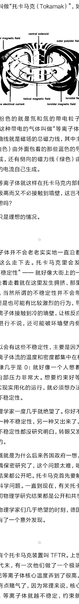

图中灰色的小球代表中子，橙色的小球代表质子。 一般的氢原子，都是原子核是一个质子，外面有个电子。 “氘”和“氚”，跟氢元素的化学性质完全一样，唯一区别是它们的原子核里除了质子之外还各自包含一个和两个中子，也就是图中上面那两堆小球。

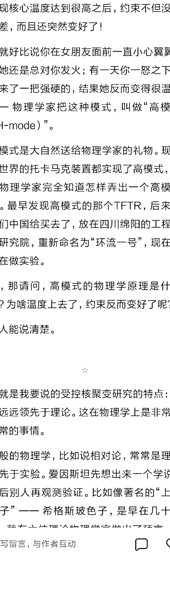

图中粉色的就是氘和氚的带电粒子气体——这种带电的气体叫做“等离子体”。黑色的曲线就是磁场的总磁力线，其中主磁力线（白色）由外面包着的那些蓝色的导线圈生成，还有侧向的磁力线（绿色）由等离子体的电流自己生成。

粒子”——希格斯玻色子，是早在几十年前，就有六位理论物理学家做出了预言，然后才用实验验证。从这个意义上来说大型强子对撞机(LHC)发现希格斯玻色子根本谈不上是“发现了新物理”，应该算“验证了旧物理”。

可是磁约束等离子体不是这样的。面对托卡马克，理论家几乎是无能为力。

托卡马克物理学并不是特别“神奇”，以至于需要爱因斯坦；也不是特别“繁杂”，用计算机就行；而是特别“复杂”。它的复杂之处在于磁场和等离子体的轮廓都是不规则的形状，而物理性质又对形状特别敏感。你稍微变换一下形状，不稳定性可能就不一样了。

这就使得人脑根本就无法直接计算托卡马克的物理学，必须使用计算机模拟。

我们知道现代计算机已经能模拟一个很大的区域很多天的天气情况。但是等离子体气体比地球大气复杂得多。你必须使用非常小的近似尺度才可能重现实验中的不稳定性，可是这也意味着你只能模拟一小部分托卡马克——而很多不稳定性是全局性的现象！

至今为止，没有任何一个程序、没有任何一个超级计算机，能在不损失物理学[2]的情况下模拟整个托卡马克。

我以前干的事儿就是用计算机模拟方法研究托卡马克的不稳定性。我的感言是，整天被动追逐别人做的实验，并不是一种很愉快的体验。

现在情况是实验中频频有新发现。磁场形状变一变，约束能不能更好？往等离子体里加入一些杂质，会不会更稳定？这些思路你可以想一出是一出，常常收获惊喜。

可是理论和模拟完全跟不上。我的感觉是美国和欧洲的物理学家似乎并不是很想让受控核聚变做成。他们沉浸在理论能研究的简单的 小问题之中，完全出于学术兴趣做研究。

但是中国非常着急。

在当前层出不穷的实验新成果中，中国合肥的 EAST（东方超环，也就是所谓的“人造太阳”）表现很出色。比如前面说的那个高模式，EAST 实现了最长时间的稳态运行。

高模式本身还可能自带不稳定性，有一种发生在边缘的不稳定性是致命的，各国都在想法避免。而中国这个EAST，就发现了属于自己的避免致命不稳定性的方法。现在美国政府都专门设立了资金帮中国的实验装置做模拟。

现在物理学家对托卡马克的可行性是越来越有信心了。各国已经共同出资在法国联合建设一个大型托卡马克实验装置，叫 ITER，预算 200 亿欧元，大概是史上最贵实验装置。本来说 2020 年就能建成开始做实验，后来改成 2026 年，现在大概又改到了 2030 年。中国表示等不了。

中国目前正在筹划建设一个叫做 CFETR 的大型托卡马克，算是工程验证机，打算在 ITER 之前，先看看商用托卡马克的各种工程问题怎么解决。

其实以前所有的托卡马克，几乎都没有发生过核聚变，一般都是只用氘做点物理研究。那氘怎么办？我们的设想是现场制备，可是怎么个制备法？中国打算先验证一下。再比如说一旦达到聚变点火温度，托卡马克内壁的各种材料能不能承受得了？也得中国先验证。

总而言之，我认为受控核聚变是个实验远远大于理论，工程像科学一样重要，不一定需要爱因斯坦但是需要投入很多人力物力的研究，而这恰恰是中国的强项。

如果一切顺利，我认为商业化受控核聚变将在三十年以后，首先在中国实现。

[1] 关于聚变更具体的细节，我多年以前写过 一个 小 科 普：https://www.geekonomics10000.com/124

[2] “不损失物理学”就是把所有相关的效应都带上。现在情况是一个程序只能模拟某一个尺度的效应。你研究流体力学效应，就得损失动力学效应。


# 特别放送：第三季日课十大概念复盘

万维钢 · 精英日课³
今天
进入评论 ›

特别放送：第三季日课十大...
00:42 985.19 KB
| 转载：蒋沙 |

万维钢

今天还在国庆假期，我们来帮你把精英日课第三季提到的重要概念做一个复习。我筛选出了这一季日课中的10大概念，包括文化自覚、余闲、最佳意外率、机器思维、对小区别的自恋、player、外推误差、排位稀缺、零阶推理、内隐学习和近故。这些思想有些是最新的研究，有些是日课的提炼，总之非常值得你学习和使用。祝你每天都有收获。

# ——。文化自觉。——

"cultural awareness"——我们借用费孝通先生发明的一个名词，把它称为"文化自觉"。文化自觉不是"品味"。品味是你自己喜欢什么东西；而文化自觉，是你知道现在别人都喜欢什么东西。品味能提升你的生活质量，而文化自觉能允许你从事一门创造性的事业。

泰德说当年那个录像带出租店对他来说既是电影学院又是MBA课程。他理解电影、理解导演和演员，而且他理解观众。他看一眼就知道什么东西是观众熟悉的，什么东西好，什么东西老套，什么东西是新的。他知道每个影视剧中的每个元素在潮流的位置。

文化自觉有两个用处。第一个用处是"模式识别"，第二个用处是给你发挥创造力积累资源。

为了建立和保持文化自觉，你必须每天用20%的醒着的时间吸收自己领域的東西。我们可以借用"刻意练习"这个词，把文化自觉的修炼称为"刻意吸收"。

截此复习：修炼你的文化自觉

# ——。余闲。——

《稀缺》这本书里有个概念叫"余闲"，英文是"slack"。这个概念听起来非常新颖，因为此前人们完全不重视余闲。Slack 这个词在英文中带有贬义。一个游手好闲的人，穿个拖鞋听着随身听，谁跟他说个什么事儿他都心不在焉，用东吴话叫"混吃等死"的人，就被称为"slacker"。但是 slack，在《稀缺》这本书中是个褒义词。

# ——。最佳意外率。——

当你训练一个东西的时候，你给它的内容中应该有大约85%是它熟悉的，有15%是它感到意外的。研究者把这个结论称为"85%规则"，我们干脆就把15.87%叫做"最佳意外率"。这个数值就是学习的"甜蜜点"。

# ——。机器思维。——

# ——。对小区别的自恋。——

# ——。player。——

博弈的首要精神是做个"player"。这个词没有特别传神的对应中文，一般翻译成参与者、玩家或者运动员，我们干脆就叫player。所谓 player，是能独立自主地参与博弈的人。一个合格的 player，应该拥有四个作风——有限、务实、慎重、客观。

博弈论不是研究把不可能变成可能，而是怎么实现最可能。真实世界里的高手都需要给合作者正确的预期，哪有刻意隐藏高手身份的？

谨慎：任何争论中，情感的强烈程度和所涉及到利益的价格成反比。作为 player，你不能轻易挑起争端，不能轻易表态，不能轻易透露相关信息。你要是有影响，就得注意影响。而且你最好时刻都注意言行，平时也把谨慎做成一个习惯。

客见：参加博弈，其实就是老老实实地考虑下面这些因素-1.这个博弈是什么，我想要什么；2.我现在有什么，我可以放弃什么；3.对手的情况。具体问题具体分析，其实是个非常高的要求，而一般人总是从自己的“人设”出发做事。

截此复习：Player作风

# —— 外推谬误 ——

你观察到一个趋势，你做了一个简单的推想。你认为这个趋势一直持续下去，接下来会发生一个特别不好或者特别好的后果。你非常担心，或者非常乐观。

预测未来是非常困难的事情。也许我们好不容易才可能看到一两个趋势，可是那个趋势常常是不可持续的。

有时候，咱们你不是简单地外推，你考虑到了趋势的变化，你用了一个非线性、不是指数的增长模型，你还是会预测失败。

“外推谬误”的中国版叫“杞人忧天”。这个世界的确面临各种风险，但总体来说，那是相当抗腾的。

变，是正常的；不变，是奇迹。

截此复习：“外推谬误”

# —— 排位稀缺 ——

有些东西，就算整个社会的物质再怎么丰富，也会一直是稀缺的。而且可能物质越丰富，它就越稀缺。这样的东西，才是我们这个富足时代最贵的东西。一位供职于社会资本（Social Capital）公司的科技博客博主，Alex，最近提出一个有意思的概念，叫做“排位稀缺”。

所谓排位稀缺，就是能让你在众人之中突出出来，把你的位置往前排的东西。社会越富足，排队的人越多，它只会越稀缺。排位稀缺不是什么可以批量生产的实体商品，它只存在于人们的头脑之中，但是它是可经营的，而且常常是可购买的。

排位稀缺有三种。我们称之为“优越感（Prestige）”、“进入权（Access）”和“引导力（Curation）”。

优越感，代表能让你彰显比别人更高的“地位”的东西。进入权，则是能在熙熙攘攘的人群之中给你某种特权的东西。引导力，是给别人推荐什么东西，别人真能买账的能力。

更厉害的东西，则是这三种排位稀缺两两结合的产物：

+   优越感 + 进入权 = 圈子（Proximity）；
引导力 + 优越感 = 正统（Legitimacy）
引导力 + 进入权 = 勒索（Extortion）
优越感 + 进入权 + 引导力 = 忠诚会员。

截此复习：排位稀缺：富足时代什么最贵？

# —— 零阶道理 ·——

世界上有些道理因为太过明显了，反而不会被人提及。比如“有钱的生活更好”，人人都明白，咱们可以把这样的道理称为“零阶”道理。我们更喜欢说的是“一阶”、甚至“高阶”的道理，比如“没钱的生活也可以很好”就是一个一阶道理：它承认零阶道理的一般正确性，但是提出一个特殊的、或者更细致的修正，就好像数学上的“一阶小量”。

可是如果我们平时听到的都是一阶道理，就有可能低估零阶道理。

截此复习：明星的零阶道理

# —— 内隐学习 ·——

“内隐学习”，英文是 implicit learning。内隐学习是“当前科学理解”现在尚未理解的一种学习方式。其实你一直在用这个方式学习，但是你不一定知道。

小孩都是在潜移默化中学习语言。她根本说不清桌子的定义是什么，但是当她看见桌子的时候，她知道那是一个桌子。她不懂什么语法规则，但是她能把话说得符合语法；而且如果你故意说一句不符合语法的话，她能听出来这句话有毛病。

这种学习就叫内隐学习。内隐学习是必不可少的学习方式。我们长大以后在学校学外语用的基本上是外显学习法，又是背单词又是记语法，中英对照，学得很生硬。你非得到一个真正的外语环境之中，跟当地人打成一片，慢慢说溜了，才知道各路地道的说法，才会识别不地道的说法，才能体会到那个说不清道不明的“语感”。

内隐学习，适合没有明确规则的复杂领域。语言是非常复杂的，这就是为什么让人工智能掌握人的语言那么难。不过复杂并不完全等于困难，只要方法得当，连小孩都能应对一些复杂问题。

内隐学习学的是一种“感”，似乎都是在实践中学。足球教练会阅读比赛，官场老油条善于判断形势，他们不再是孩子了，但是仍然在使用内隐学习。

对外显学习来说，分心会降低学习水平——可是对内隐学习来说，分心反而还能提高学习水平。这也就是说，集中注意力，有可能会妨碍内隐学习。

我们想想自己会的一些东西，是不是其中有一些就是不经意学会的。你是什么时候学会处理复杂人际关系的呢？你是跟谁学的讲笑话呢？可能都是潜移默化的内隐学习。

截此复习：内隐学习和外显学习

# ——· 近敌 ·——

这个词来自佛学，英文是“near enemy”。

美德的“远敌”是各种坏的情绪，你很容易识别。而美德的“近敌”，则是各种跟美德非常相似的情绪，容易让你混淆。必须学会识别近敌，你才能掌握真正的美德。

慈的远敌（far enemy），也可以说是反义词，是恨。慈的近敌，是贪。意思是特别的爱、有条件的爱、自私的爱。

悲（karuna, Compassion），意思是对别人的苦难的同情。悲的远敌是残忍。残忍的人看到别人受苦不但不同情，反而还以此为乐，这种人离美德太远了。悲的近敌，是可怜（pity）。可怜是一种居高临下的姿态。悲的另一个近敌是绝望（despair）。绝望是对别人的痛苦已经感同身受到了让自己产生不良情绪的程度。

喜（mudita, Sympathetic joy, Appreciation），是看到别人快乐，自己也快乐。喜的远敌是嫉妒。而喜的近敌，恰恰是只为自己感到快乐。

舍（upekkha, Equanimity），是平和。舍的远敌是焦虑和贪婪。如果你强烈地喜欢或者害怕某些东西，那当然就不是舍。舍的近敌，则是冷漠。

+   *没有优先级的效率是效能的近敌
*财富是满足感的近敌
*数量上的极少是极简主义的近敌
*自我量化是自我知识的近敌
*引诱是关系的近敌
*工具化的哲学是智慧的近敌

一念成佛一念成魔，想要做个真正的好人，那是真不容易啊。

截此复习：美德的“近敌”

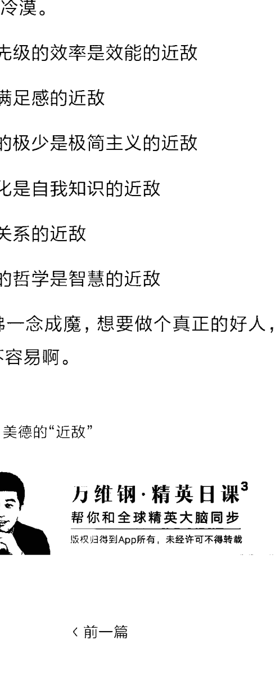

〈上一篇〉

## 日课精选

默认 最新 只看作者回复

正在加载...

写留言，与作者互动

# 问答：怎样判断自己不是机器思维？

万维钢·精英日课³
今天
进入详情 ›

问答：怎么判断自己不是机...
10:26 9.55 MB
| 转载：泽沙 |

# 来自日课：“增强审讯技术”

# 读者 空竹：

万老师，电影里往往会有这么一个场景，就是在一开始犯人什么也不说，然后审讯者开始用一些比较狠的手段（比如浇汽油，假装把他扔下楼什么的），然后犯人往往就供 bris 了，而且供出的还是事实，如果是一些可以验证的事还好说，但有一些事是即使是假话敌我也暂时发现不了的，那么为什么犯人在这种情况下还会把事实说出来呢，是因为PTSD吗？还是仅仅是电影的剧情需要？

# 读者 颜韵椰骨：

学完这一节课我有两个疑问：1、在审讯逼供的时候会不会出现被迫编造谎言解脱刑罚的可能呢？比如被审讯者不能忍受刑罚被迫编造谎言从而造成冤假错案。2、如果第一个问题成立，那么如何区别一个人招供是真的招了还是不堪刑罚被迫编谎呢？

万维钢
首先策略性地说谎对犯人来说没有太大意义，因为就算什么都说了也不会获得自由，别一 anthropology 验证之后还得回来拷打。当然理论上犯人可以先说一个低级的谎言；被证伪之后一番拷打，再说一个高级的谎言；再次被证伪了又是一番拷打，才说实话……这样做也许能够给组织争取一些时间，可是通常意义不大，还把自己弄得像个小丑一样。

更重要的是，审讯人员首先想到的就是犯人会不会说谎，他们不会相信犯人随便说出来的话。有研究表明审讯人员比普通人更多疑。我理解通常是犯人被捕之后非常害怕、或者是面对证据，心理防线已经崩溃了，进入问啥说啥的状态，才会被人相信。不太可能出现犯人心平气和地要个花招，刑讯人员老老实实去验证的情况。

肖恩·奥玛拉（Shane O’Mara）的《为什么酷刑不好使》（Why Torture Doesn’t Work）是一本非常好的书，我并没有通读但是是从各处了解到书中的一些信息。科学家不可能专门为了做实验研究而去对真人进行严刑拷打，但是正是美军训练营里发生的那样，被迫的研究还是做了很多的。

这些研究的核心结论是严禁拷打会让人丧失理智。如果说犯人在被拷打之前就已经没有必要说谎，那么在拷打之后就更不容易说谎了，因为他们根本就没有那个理性去编造有用的谎言。研究发现，极端的疼痛、寒冷、睡眠剥夺和对酷刑的恐惧，会破坏大脑的记忆力、情绪和认知能力[1]。严刑拷打带来的不是理性合作，而是恐慌、心智分离、无意识和长期的神经损伤。

# 来自日课：人与环境的耦合

# 读者 cq：

万老师，我看到一个数据说每年美国枪击案有一万多起，而其中大部分是自杀，因为用枪自杀简直太容易了，一狠心扣下扳机就 ряде了，而且枪支在美国也太容易获得了。从今天的课程，我们是不是可以推导出这样的结论——严格管理枪支包括枪支交易在内就可以大幅度降低自杀率呢？


# 来自日课：防止机器思维

# 读者：北京四期四班 王伟嘉：

万老师你好，当我们掉进一个机器思维之后，经过认知升级很可能掉进一个新的机器思维。再度升级之后也可能是一个机器思维。那这样掉来掉去，怎么判断自己不是机器思维呢？

关键在于你做决策的时候脑子里有没有至少两种不同的声音。你不能从多个角度去看一个问题，能不能使用几个不一样的思维模型。有权衡、有犹豫、能想一下再决定，这就不是机器了。

比如朱迪亚·珀尔在《为什么：因果关系的新科学》这本书中就提出[7]，如果一个人...它就可以说是有自由意志了。


不增加警力的情况下大范围查车是件很费力的事。最后这个错误没有正反馈，每个到处暗查的警察基本都出力不讨好，没查到啥有用的东西。那么这种看起来莫名其妙的错误是怎么推广扩散的呢？我觉得这种传达过程中莫名其妙的变形应该不单是警察系统中。一般的公司政策在执行时也有类似的变形。那么这背后的机制是什么呢？

万维钢

古代中国自从定都北京之后，因为北方粮食产量不足以自给自足，每年都必须由官方组织，系统性地从南方往北京运粮，这就是著名的“漕运”。而在明清两朝，漕运一直都是走运河，要消耗大量的人力物力，外加地方官的贪墨，可以说是成本极高。对比之下，元朝的漕运是从现在江苏省的刘家港装船走海运，到天津上岸，省时省力省钱。那为啥明清就不走海运了呢？

一开始的借口可能是因为海运不稳定，容易出大事故，运河更可控。但是这个理由不足以支持漕运那么高的成本。现在人们分析，根本原因在于官僚和漕运工人利益集团需要运河漕运。他们形成了自己的势力，已经不允许国家采用更高效的方法了。

美国警察这个例子来说，像北卡罗来纳州把每年截停汽车的次数增加了整整一倍，我觉得不增加警力是不太可能的。那么这里面也许就有编制和经费上的利益。就算没有这些，警察也有想要有所作为、有所表现的意愿，他们需要有行动才能证明自己的价值。

## 注释

[1] https://www.newscientist.com/article/mg22830471-200-torture-doesnt-work-says-science-why-are-we-still-doing-it/

[2] http://www.humanrightsfirst.org/resource/statement-national-security-intelligence-and-interrogation-professionals

[3] https://www.humanrightsfirst.org/campaigns/never-torture/facts-torture

[4] https://www.scientificamerican.com/article/we-rsquo-ve-known-for-400-years-that-torture-doesn-rsquo-t-work/

[5] https://www.hsph.harvard.edu/news/magazine/guns-and-suicide/

[6] https://www.citylab.com/life/2019/01/ten-suicide-guns-in-america-mass-shootings-data/581335/

[7] 《为什么》8. AI 的自由意志

万维钢·精英日课³
帮你和全球精英大脑同步
版权归得到App所有，未经许可不得转载

〈 前一篇

## 日课精选

默认      最新                只看作者回复

正在加载...

写留言，与作者互动

## 《搜索的喜悦》1: 调研是一种什么体验

万维钢·精英日课³
今天

进入详情 ›

《搜索的喜悦》1: 调研是一种...
10:29 9.59 MB

| 转载: 泽沙 |

今天开始咱俩来讲一个关于怎样使用搜索引擎的小专题。我们要借助一本 2019 年 9 月 24 日刚刚出版的新书，叫《搜索的喜悦》（The Joy of Search: A Google Insider's Guide to Going Beyond the Basics），作者是 Google 公司负责搜索质量和用户体验的研究者丹尼尔·罗素 (Daniel Russell)。同时我还会结合一些自己的经验。

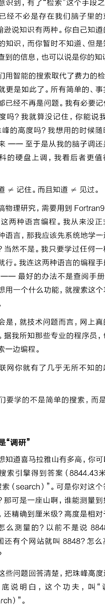

如果你是个有心人，我想这个时代给了你一个神奇的力量。一种以前的人连做梦都想不到的力量。我还是先给你讲个故事。

### 1. 戏法

小张和小李在同一所大学念研究生，两人专业不一样，但是宿舍挨着，是好朋友。小张是学生物的，对计算机并不太精通，平時遇到编程之类的问題就经常问小李。小李是学经济学 的，其实他也不是专门研究计算机，但是小李好像非常擅长计算机。有时候小张在办公室遇到问题给小李发个邮件，小李很快就回复答案。

有一次小张办公室的计算机出了毛病，一启动不过几分钟就自己关机了，小张赶紧找小李。小李过来看了看，说“你这可能是CPU 过热，我想想办法”就走了。没过多久小李回来，带了一个很小的小包。小李一边把CPU 的散热片拆下来一边对小张说，CPU过热很可能是因为散热膏不好用了，我涂点新的散热膏试试。小李把散热片擦干净，从小包里挤出一点白色的膏状物质抹在上面，又重新装好。一开机，计算机正常了。

这件事完全超出了小张的认知。他从来没听说过还有 CPU 散热膏这种东西！可是小李是怎么知道的呢？也没见他专门学过修电脑啊？

又有一次，小张遇到一个很怪的现象，他的计算机显示某些图形会出现乱码，就又问小李。这一次小李发给他一个链接，说这是硬件质量问题，你看看新闻都报道了。可是小李传来的那篇所谓的新闻，根本就不是来自常见的新闻网站，是个非常偏门的地方。小张心想，这小李搜猎也太广了吧？谁会整天看着这种新闻啊？

小李的秘密，当然是搜索引擎。

你身边有没有小李这样的“业余技术达人”呢？他们从未正式学过什么日常修理技术，但是好像都会修。他们不一定是因为有天赋。

我虽然是个学理工的，但是动手能力相当差。我小时候家里有什么需要穿门的活儿，都是我爸和我弟弟疼磨，我从不插手。但是这么多年来，我也曾独立干过一些不一般 的活儿：我用了三个小时，给厨房下水道换了一个电动搅拌机；我自己买零件给汽车换过一个门把手；我治好了自己被晒伤的膀子；我把几台不是苹果出的计算机，非法安装上了Mac操作系统。

像我对对象这种人生大事，你得自己摸索；但是生活中能遇到的绝大多数所谓“技术问题”，其实都能从网上找到答案。不但有答案，而且很多都有视频教程。你只要会搜索就行。

但是很多人没有这个搜索意识。如果你不告诉他们你是搜索到的答案，他们会 Croatian 对你产生崇敬之情，就好像你会变魔法一样。

有些人是乐此不疲。我以前在物理系有个同事，是个年轻的教授，别的都挺好就是有点好为人师，非得让人以为他什么都知道。有一次我们在 一起讨论，我突然想到一个问题，问他知不知道——他不说知道也不说不知道，他说“我能找到答案”。然后我就问他你怎么找答案，我心想你要上网搜索这我也会，你要是能请教哪位大牛还行——但是他不说，他说你等着吧。当天下午他到我办公室给我一份打印好的论文，说他找到了！

我一看那个答案不是我想要的……论文很偏门，明显搜索出来的。

现在搜索已经不是戏法了，但是你未必善于搜索。

### 2. 什么是“知道”

搜索引擎谁都会用，但是要用到好，还是需要功夫的。丹尼尔·罗素在 Google 的后台观察了很多用户的搜索，他的感觉是如果搜索引擎是一辆一级方程式赛车，那么大多数人开车从来没超出过一档。

有些人在搜索引擎输入的话是这样的：“我急需这个数据，你能不能在下五点之前告诉我？”

有人说的是“我猜你肯定不知道……”

他们连搜索这个动作是跟计算机、而不是跟人打交道都不知道。你需要输入的是关键词，而不是礼貌的求助问话！要这么说的话搜索的确是需要学的。但搜索是个非常基本 的功夫。

搜索这个功夫，要求我们重新认识“知识”。

早在两百多年前，第一部英文词典的编撰者，塞缪尔·约翰逊 (Samuel Johnson)，就已经意识到，有了“检索”这个手段之后，知识就已经不必是存在我们脑子里的东西了。约翰逊说知识有两种。你自己知道的东西是你的知识，而你暂时不知道、但是知道去哪能查到的信息，也可以说 是你的知识。

现在我们在智能的搜索取代了费力的检索，可以说就更是如此了。所有简单的、事实性的问题都已经不再是问题。我有必要记住珠峰的高度吗？我就算没记住，你能说我*不知道*珠峰的高度吗？我想要的时候随时可以调出来——至于 是从我的脑子调还是从维基百科的硬盘上调，我看后者更值得信赖。

所以知道 ≠ 记住。而且知道 ≠ 见过。

我以前搞物理研究，需要用到 Fortran90 和 Matlab 这两种语言编程。我从来没正式学过这两种语言，那我应该先系统地学一遍再工作吗？当然不是。我只要学会任一种编程语言就行。我连这两种语言的编程手册都不需要——最好的办法不是查询手册，而是临时要用一个什么功能，就搜索这个功能的例子。

我的体会是，就技术问题而言，网上真的是啥都有。据我所知那些专业的程序员，也是 一边搜索一边编程。

有了互联网你就有了一种几乎无所不知的超能力。

不过我们要学 的不是简单的搜索，而是“调研”。

### 3. 什么是“调研”

比如你想知道喜马拉雅山有多高，你可以直接输入搜索引擎得到答案（8844.43米），这是“搜索（search）”。可是你对这个答案满意吗？那可是一座山啊，谁能测量到如此的高度，还精确到厘米级？高度是相对于谁 的？是怎么测量的？以前不是说 8848 米吗？中国还有个网站就叫 8848？怎么高度变了呢？

把所有这些问题回答清楚，把珠峰高度这件事彻底说明白，这个功夫，叫“调研（research）”。

美国基础教育界，传统上讲人应该从小掌握三个能力，分别用三个“R”代表——阅读（reading）、写作（writing）和数学（arithmetic）。而现在很多人认为应该再加一个 R——讲编程的书说应该加编程（programming），这本讲搜索的书说应该加调研（research）。

酷刑效果的评价。根据这个评价，我们完全可以说犯人在酷刑之下连撒谎的能力都已经没有了。

可是奥马拉如果只是一家之言呢？有没有事实证据证明酷刑不好使呢？我找到一个专门列举酷刑相关材料的页面，其中提到，有25位审讯人员发表的联合声明，说明酷刑真的没用。那就算平时不用，极端情况下可以用吗？其中列举的研究说极端情况也没用。

这个问题至此已经算回答了，但是我们肯定会接着问一句，如果酷刑没用，那什么审讯方法有用呢？我又找到《科学美国人》上的一篇文章，列举了两项研究，说与犯人建立亲密关系是更好的审讯办法。到这一步，调研才算完成。

丹尼尔·罗素提出，好的调研必须满足三个要求——

# 第一，要高质量。你必须圆满回答一个问题，形成认知闭环。

# 第二，要可信。你的资料必须有来源，来源必须具有权威性，最好是科学论文。

# 第三，要表达好。你得把调研结果交付给读者，让人一看就明白。

这是相当高的要求。高水平的调研要求你有提问的意识，搜索的技巧和科学探索的精神。

其中这个提问，是你成为高水平调研者的最重要一步。大多数人就算有不明白的地方，也想不起来问。大多数人就算想问，也不知道怎样提出正确的问题。而相比之下，想知道珠峰有多高这种答案，是这个时代最简单的事情。

这是一个问题比答案值钱的时代。下次看到什么怪异的新闻，你是随便留下一个质疑的评论呢，是上“知乎”之类的地方发起一次提问呢，还是自己深入调研一番呢？

丹尼尔·罗素分享了很多技巧，咱们明天再说。

### 划重点

好的调研必须满足三个要求——

第一，要高质量。你必须圆满回答一个问题，形成认知闭环。

第二，要可信。你的资料必须有来源，来源必须具有权威性，最好是科学论文。

第三，要表达好。你得把调研结果交付给读者，让人一看就明白。

这是相当高的要求。高水平的调研要求你有提问的意识，搜索的技巧和科学探索的精神。


## 万维钢·精英日课³

帮你和全球精英大脑同步

版权归得到App所有，未经许可不得转载

〈前一篇

## 日课精选

默认 最新 只看作者回复

正在加载...

写留言，与作者互动

## 《搜索的喜悦》2：基本技巧

万维钢·精英日课³
今天

进入课程 ›

## 《搜索的喜悦》2：基本技巧
12:11 11.16 MB

| 作者：沉默 |

咱们继续讲丹尼尔·罗素的《搜索的喜悦》这本书。我们这些极客青年有时候为了解决一个什么问题，会进入“心流”的状态。打游戏打到一关怎么也过不去，想要用电脑实现一个功能怎么也装不好，你就会尝试各种方法去拆腾，忘记周围的环境，忘记时间的流动，忘记自己我的存在。拆腾过程中突然感到又累又饿，一抬头发现天都亮了，心想我睡觉觉吧——结果刚牙的时候又产生一个想法，于是继续拆腾.....

搜索，也会让人陷入这样的状态。其实很多情况下搜索就是我们拆腾各种问题的手段。搜索是思维的必要流动，搜索是自己和世界的对话，断网就等于断电。社会主义新青年，应该一有什么想法就立即掏出手机来搜索。

咱们先说基本的。所谓搜索，无非就是在搜索引擎的对话框里输入一些词，然后按回车——但是这件事是有技巧的，而有些最基本的技巧，很多人们都不知道。有几个常用的技巧，我们统一列举在这里。

### 1. 关键词和疑问句

我们使用中括号 [] 代表搜索输入 [1]。

我们的第一个问题是输入什么。在我看来，因为搜索这个动作是在跟计算机这么一种机器——而不是跟人——打交道，所以你应该输入的是“关键词”，而不是一句“疑问句”。

比如我想知道日本有多少人，那我应该输入的是两个关键词：日本 和 人口，中间用空格分开——

[日本 人口]

Google 非常理解我想什么，它会直接在首页给我显示一张日本人口的历史变化图，然后第一个搜索结果就是维基百科关于日本人口的说法，我甚至不需要点击就能看到答案。

但是新兴一代搜索者喜欢直接往搜索框里输入一句完整的“人话”——

[日本有多少人？]

十年前我会认为这样搜索太不专业了，这是根本不估计计算机思维——但是现在情况变了。现在搜索引擎变智能了，它能听懂你的简单问句！而且这样的搜索还成了一种特别的风格，能得到不一样的结果。输入这个疑问句，Google 仍然会首先给你显示一张日本人口的历史变化图，但是，这时候第一个搜索结果，就不是维基百科的冰冷答案了，而是一篇有温度的、更人性化的讨论日本人口的文章。

......但是，即使是这样，也请不要使用下面这样的语句——

[请问你能告诉我日本有多少人吗？]

这样的搜索。据我亲测，Google 还没有聪明到能读出来到底是出于礼貌在对它说“请问”，还是你想搜索“请问”这个关键词的程度。

搜索输入要干净利索，只列举关键词是最清晰准确的做法。

### 2. AND 和 OR

搜索引擎并不是只会根据你输入的关键词去寻找包含这些词的文章页面。Google 允许你对关键词做一些设定，比如你可以设定各个关键词之间的关系。

Google 默认的关系，是 AND，也就是“与”。如果你输入

[北京 上海 平均工资]

它会返回既包括“北京”，又包括“上海”，又包括“平均工资”这三个关键词的结果，你得到的是同时提到北京和上海的文章。但是如果你想问的问题是中国这两个超一线大城市都是什么工资水平，你并不在乎它们之间的互相比较，那么想找的其实是谈论北京*或者*上海的平均工资的文章，你可以使用“OR”：

[北京 OR 上海 平均工资]

这时候返回的前两个结果都是只谈论北京平均工资的报告和文章，第三个结果则谈论了上海的平均工资。

### 3. 双引号

Google 的智能化给我们提供方便同时也可能带来麻烦，有时候你需要精确告诉 Google 你想要的东西。

比如你输入的英文关键词中如果存在拼写错误，Google 会自动改正过来，并且返回正确拼写的搜索结果。这个功能很好，我如果想不起来一个单词的准确拼法就大致地拼一下输入 Google，就能得到正确的拼法。

但有时候你输入的是一个中国人的英文名字，也被 Google 给当做拼写错误改正了，怎么办呢？或者你就是想知道那个被判断为错误的拼法，在网上有没有人用过，怎么办呢？答案是给那个词加一个双引号——

[Yang "zhenning"]

而对中文来说，双引号的最重要作用在于避免被分词。比如我们专栏前一段讲了谢得·里森的《怪异经济学》，这本书还没有中文版，“怪异经济学”这个书名是我翻译的。在确定这个译法之前，我很想知道中文世界是否已经有一本别的书叫“怪异经济学”。而如果我搜索

[怪异经济学]

智能的 Google 会自动把它拆成“怪异”和“经济学”两个词，给我返回一些诸如：法律经济学中的“理性选择”在吸收经济学中理性选择理论的基础……这样即使是令人无法理喻的怪异行为也可以通过对行为本身的观察而得出……

这样我不感兴趣的结果。所以我的做法是直接带双引号输入

["怪异经济学"]

这样返回的就是都是五个字一字不差按顺序出现的結果了。

### 4. 减号

在一个关键词前面加上减号（-），作用是让搜索结果*不包括*这个词。在关键词有多含义的时候，这个方法能帮我们过滤掉不想需要的结果。比如现在在 Google 搜索

[火箭]

第一页几乎全都是 NBA 火箭队的消息。而如果你想搜索的是真正的、能发射的那种火箭的相关知识，你希望把火箭队的消息全部过滤掉，那么你可以搜索

[火箭 -队 -俱乐部 -NBA]

这时候返回结果就大多是关于“运载火箭”的了。那你说为什么不一开始就搜索“运载火箭呢？可能我们一开始并不知道有这么一个专有名词，现在通过搜索才知道。如果一个特含含义有特定的语境，我们的确可以加入相关的词来找到那个含义，比如搜索

[王刚] 厨师

能确保你找到最近在网上特别火的那个拍炒菜视频的厨师王刚，而不是以前最火的那个演员王朔。但有些情况是你只知道你想要的那个含义*不是什么*，而很难说清那个含义是什么，这就很难加词，而必须用减号了。

比如说，有一天你偶然看到别人转载的一篇文章感觉挺好，作者留了个网名叫“咸阳游侠”，你想知道他还写过别的什么文章。如果直接搜索

[咸阳游侠]

返回的结果几乎全都是王维《少年行》里的那两句诗，“新丰美酒斗十千，咸阳游侠多少年。”

但是如果你搜索[咸阳游侠 网名] 或者 [咸阳游侠 文章] 似乎也不行，因为他写文章的时候不会专程出现“网名”和“文章”这两个词。而使用

[咸阳游侠 -多少年]

就会把最普遍的结果给过滤掉，露出你可能感兴趣的内容。

我们体会一下这个对信息的过滤操作。这就好比说你要在一个开着强光灯的房间里寻找一个只会发出微光的小东西，那你最好的办法就是先把强光灯关掉。“关灯”，是获取信息的关键动作。

请允许我再举个例子。比如我有个同学叫“王刚”，多年不见我很想知道他现在怎么样了，可是我对他在做什么、生活在哪里都一无所知。我搜索

[王刚]

返回的首页全都是最新走红的那个美食家和厨师王刚。于是我搜索

[王刚 -美食 -厨师]

返回的则几乎都是演员王刚。看来演员王刚的网红度不如厨师王刚……但是演员王刚的涉猎范围十分广泛，我发现跟他经常一起出现的关键词就有“故事”、“演技”、“老师”等等，于是我搜索

[王刚 -美食 -厨师 -演员 -演技 -故事 -电视剧 -女儿 -老师]

这回我找到了足球运动员王刚、CEO王刚、官晶王刚、牧师王刚、牧师于刚、臣牛于...

官员王刚、教授王刚、教师王刚、医生王刚……等等，他们都没有单独霸占搜索页面，跟前两个王刚相比可以说算是普通人了。你得把大灯关了才能看到他们。这时候我再点击“图片”就能看到很多普通人王刚的照片。

但是我仍然没找到我同学王刚，叫王刚的人实在太多了。对此我想说，以后大家给孩子起名能不能有点搜索引擎优化的意识。

## 5. 站内搜索

有时候你想搜索某个特定网站的内容，那么你可以使用“站内搜索”的功能，方法是在关键词之前加入“site:网站”，注意冒号是英文的，前后都没有空格。

比如说，我记得几天前听人说《自然》杂志发表了一篇指责中国的沙漠绿化的文章，引起了很大的争议。当时我没在意，现在突然想起来，我就想把这篇文章找来看看看，可是我不记得我是听谁说的这个事儿了。那么我可以直接搜索《自然》杂志的网站——

```
[site:nature.com china desert]
```

返回的第一个结果就是我想要看的文章。有些网站提供站内搜索功能，但是给的结果不一定全，有些内容可能还被改动位置或者故意删除了。而 Google 常常记得。

如果你知道某一类信息的权威网站，站内搜索能让你只找这个网站的内容，这就保证了信息的可靠性。

## 6. 特殊搜索

打开 Google 搜索的返回页面，我们可以看到多个搜索选项——


Google 允许我们只搜索正规媒体的新闻报道，只搜索图片或者视频，还可以设定只搜索某一时间段的内容。比如现在输入“阅兵”你得到的全都是国庆七十周年阅兵的消息，但如果你想对比一下国庆六十周年的阅兵跟这次有什么不同，你可以点击“工具”，选择 2009 年代时间段，专门看那次阅兵的相关文章。

对研究者来说，“学术搜索（https://scholar.google.com/）”是个特别重要的功能，它返回的结果全都是正规学术论文。对于一般的信息调研，学术搜索能带给你最新和最权威的研究结果，是锦上添花。而对于一线科学家来说，学术搜索能让你知道别人对相关课题都做了什么，是必不可少。

不过工具再好也得看是谁用。下一讲，我们看看丹尼尔·罗素这位高手是怎么搜索的。

## 注释

[1] 当然你实际操作的时候只需输入中括号里面的东西，不用文中括号。另外请注意, Google 可能会针对不同的人返回不同的搜索结果，所以你输入后得到的结果可能跟我的不一样。

划重点

+   六个常用的搜索技巧：
1. 关键词和疑问句 [日本 人口][日本有多少人？]
2. AND 和 OR [北京 上海 平均工资][北京 OR 上海 平均工资]
3. 双引号 [Yang "zhenning"]
4. 减号 [火箭 -队 -俱乐部 -NBA]
5. 站内搜索 [site:nature.com china desert]
6. 特殊搜索 返回页面和学术搜索


〈上一篇

## 日课精选

默认 最新 只看作者回复

正在加载...

写留言，与作者互动

## 《搜索的喜悦》3: 搜索者心流

万维钢 · 精英日课³
今天

《搜索的喜悦》3: 搜索者心流
10:33 9.66 MB

| 转载：浮沙 |

咱们继续讲丹尼尔·罗素的《搜索的喜悦》。作为搜索者，我们遇到问题的本能反应是上网搜索答案，但是我们也知道并不是所有问题都能在网上找到答案。

什么样的问题适合搜索呢？如果一个问题现在还是未解之谜，根本就没人知道答案，网上自然也没有答案。如果一个问题涉及到个人隐私或者国家机密，你也不会在网上找到答案。我们只能搜索到网上的公开信息，也就是所谓的“公共知识”。

而作为一个高水平地搜索者，第一，你应该对自己有这样的信心：只要是网上有的，我就能搜索到答案。

第二，你还应该对互联网有信心：只要是公共知识，网上就有。

咱们说几个例子，看看罗素是怎么搜索的。

## 1.这是哪里

有一天，罗素的一个朋友给他发了下面这张照片 [1] ——


朋友的问题是：拍摄这张照片的人，当时站在哪里？

## 2.会爆炸的湖

罗素曾经读过一篇写得很不专业的、纯属猎奇的文章，说有一个湖爆炸了，杀死了很多人。后来他想起来，就想,这就想检查一下这个事情——毕竟湖居然杀人，这太离奇了。罗素已经不记得那篇文章的任何细节，他就简单搜索了“杀手湖”——

## 3.这个花有毒吗？

有一天罗素的女儿从外面带回家一朵花，而且还把花给吃了——半儿！那朵花是像下面这个样子 [2] ——


罗素非常担心这花有没有毒！不过女儿看起来好像还挺正常，罗素没有贸然给有关部门打电话，他决定先搜索一番。这种户外随便能找到的野花有没有毒，肯定早有人研究过了，肯定是个公共知识。

但是罗素不知道这花叫什么名！他有限的植物学知识告诉他这花应该是属于菊科（Compositae family），可是菊科的花多了，不知这是哪一种。

但我们关心的是它有没有毒，所以罗素先看看有毒的菊科植物都有哪些——

[poisonous compositae]

搜索结果中，Google 自动用了一个更专业的英文单词，Asteraceae，代替了罗素输入的“菊科”，看来那个是更正规的说法。罗素找到美国食品药物监督局的有毒植物数据库，发现其中对有毒菊科植物的毒性描述都是“接触导致过敏”——这下他放心了，过敏不是啥大事，而且网站说大多数菊科植物都没有毒。

可是女儿吃的这个到底是什么花呢？罗素想到另一个线索，他家住在旧金山湾区，于是他搜索“旧金山湾区的野花”的图片——

[wildflowers San Francisco Bay Area]

罗素挨个看了这些野花图片，发现其中有一种花，中文大概叫“海菲尔德焦油草（hayfield tarweed）”很像是他要找的。

搜索这个花的学名，罗素发现前三个结果都来自一个叫做 Calflora.org 的网站，是加州大学伯克利分校的植物学家和美国森林管理局共同创办的一个有关加州的各种植物的数据库。这个来源显然是非常可信的……而在这个数据库里，植物学家说这种花不但没有毒，而且本来就是能吃的。

进一步的搜索发现，原来以前印第安人还专门种这种花来吃。

在这场搜索中罗素没有完全依赖搜索引擎的自动化处理。因为一开始不知道精确的关键词，搜索引擎返回的结果是一个很大的范围，罗素不得不ham肉眼扫描所有的搜索结果，一个个判断是不是自己找的东西——不过好在他可以只搜索图形，看图总比看文字描述快得多。

这种穷举法是搜索者常做的事情……搜索有时候也是体力活儿。

罗素随时都在搜索。其实我们也可以这样。出去旅游也好，平时路过哪个地方也好，看到不寻常的建筑物，拿出手机地图来就能知道那是什么。参观什么文物展览，你只要知道一个名字，就完全应该掌握比导游多的信息。

只要是公共知识，哪怕网上各处的专家都只知道它的一部分，我们也有信心通过调研，得到完整答案。

## 注释

[1] 我幸运地搜索到了这张照片的原图，来自 罗 素 本 人 的 博 客 ： http://searchresearch1.blogspot.com/2012/02/wednesday-search-challenge-feb-1-2011.html

[2] 这个搜索的博客原文我也找到了， http://searchresearch1.blogspot.com/2013/08/answer-quickly-poisonous-or-not.html


‹ 前一篇

## 日课精选

默认   最新                     只看作者回复

正在加载...

‹ 写留言，与作者互动

## 重新理解“知识”

万维钢 · 精英日课³
今天

进入课程 ›

重新理解“知识”
10:29 9.6 MB

最近我们正在讲使用搜索引擎获取知识和做调研的方法，我想借这个机会分析一有个有点哲学味道的话题：“知识”，到底是什么样的。通过观察现代人创造和使用知识的方法，我们大概可以说互联网不但改变了我们获取知识的方法，而且改变了知识本身——“知识”这个东西，现在已经变得支离破碎了。

而如果我们深入思考一下，也许现在这个支离破碎的样子，才是知识本来该有的面目。

普林斯顿大学哲学教授戴维·温伯格（David Weinberger），在2012年出了一本书叫《知识的边界》（Too Big to Know），描写了一个有点学院派风格的知识观。这本书已经出版七年了，互联网已经更加深刻地改变了世界。我相信到今天，你肯定不会对这个知识观感到震惊，但是你应该也能得到一些启发。

什么是“知识”呢？可能大多数人是这么想的——我们在生活和工作中会遇到各种问题，我们通过理论推导和实验研究，解决了这些问题，并且总结出各种规律。我们把这些规律写成书，这就是知识。一个个人通过努力学习这些书上的知识，就成了专家。以后再遇到类似的问题，就应该由相应的专家来解决。

## 1.知识都在书里吗？

我们在解读丹尼尔·罗素的《搜索的喜悦》这本书的第二讲，我列举了使用搜索引擎的六个常用技巧。使用搜索引擎的技巧并不止是这些，我们有好几位读者，立即在留言区补充了更多的技巧。特别是百度的用法跟Google还不一样，有读者专门列举了百度的对应使用方法。

我讲的跟罗素原书已经是不一样了，然后读者补充的内容又比我讲的丰富得多，现在你再去读那篇文章和读作者评论，你会收获比原书多很多的使用技巧。那请问，“书”这个东西，在这个过程中是起到一个什么作用呢？我们是不是应该弃一本更完整的书，比如出一本《搜索引擎技巧大全》呢？

## 2.知识反映客观事实吗？

相信知识应该反映客观事实，这是近代科学革命之后人们才有的信念。古代的书很少顾及客观事实，古代的书，都是以“原则”为根本。

## 3.知识都掌握在专家那里面吗？

以前哪怕再厉害的皇帝也得尊重读书人，那是因为读书人垄断了知识。但是现在就垄断不了了。

## 4.决策应该听专家的吗？

如果专家意见已经不足以代表正确，那难道应该听领导独断吗？当然也不是。温伯格推崇的决策方式是群体决策。温伯格考察了西点军校总结的美军特种部队经验和维基百科的编辑故事，认为新时期的权力结构应该

那既然书本也不全面，专家也不可靠，适客观都不可求，我们应该如何应对现在的知识局面呢？难道我们应该放弃学习知识，什么都指望搜索引擎吗？

引擎也帮不了你。这样知识必须努力学习。

但我们要学的更是思维方式和方法论。我们得学习各种模型。知识可以随时更新，而方法只会慢慢演化。真正的专家是拥有专业眼光，能立即发现事物的关键所在，掌握一系列方法和手段的人。专家不必掌握所有知识，但是得知道新知识该往哪放。就算有时候他们需要从别人那里获得帮助，也得先知道怎么跟人对接才行。

你可能会面临先决定做什么，再决定怎么做，再决定用哪些事实和知识的局面。你可能会遇到必须用知识为立场和价值观服务，而不是以知识为本的局面。

到那个时候，你应该告诫自己，要避免陷入单一的视角和思维模式，警惕自己认识的局限。

### 划重点

+   1. 从事实到知识，从知识到书，从书到专家，从专家到解决问题 —— 在今天这个时代，都已经被推翻了——书本不全面，专家不可靠，连客观都不可求。 2. 我们要学的是思维方式和方法论，我们得学习各种模型。我们应该告诫自己，要避免陷入单一的视角和思维模式，警惕自己认识的局限。

万维钢·精英日课³
帮你和全球精英大脑同步
版权归得到App所有，未经许可不得转载

〈 前一篇

## 日课精选

默认 最新 只看作者回复

正在加载…

写留言，与作者互动

## 失败预兆者

万维钢 · 精英日课³
今天

进入课程 ›

失败预兆者
10:06  9.25 MB
| 转载：许弋 |

很早以前，我曾经听到一个辽宁省锦州人是这么夸锦州的。说锦州人特别有品位，中国拍个电视剧就不能火，最好现锦州这个地方做个播出测试——如果是锦州观众欢迎的，那就一定能在全国流行。

对此我们可以提出各种解释，比如说许全国很多地方的观众都有类似的效果，毕业大家都是差不多的 人。但是我最近听说一个有点离奇的研究结果，说世界上上有这么一种人，可以称之为“失败预兆者（Harbingers of Failure）”：他们越欢迎什么东西，就越预示着这个东西将会失败。

请注意我说的这个失败预兆者跟“小众”可是两码事，这里有个先后顺序问题。小众的人，是现在越流行什么他们越不喜欢什么，他们特立独行，故意买一些品位独特的东西。而失败预兆者，则是在一个新产品刚出来的时候，谁也不知道这个产品能不能成功的情况下，他们买了这个东西，就预示着这个东西将要必定失败。

你不希望这样的观念喜欢你的产品。

但是这样的人很多！这可能是产品营销界最近几年最重要的发现之一，咱们从头说起。

我们知道市场上每时每刻都有新产品出现。商家必须不断创新才能保住自己的位置，但创新总是实验性质的，总有失败的可能。像可口可乐公司，我们通常印象中它就那么几种产品，但实际上它经常出新东西——比如曾经推出过一种咖啡口味的可乐，但是看市场反应不好没多久就消了。再比如奥利奥饼干，曾经出过一种西瓜味的，现在也没有了。

好，现在问题是，这些后来被证明失败的产品，刚推出出来的时候也是有人买的——那都是哪些人在买呢？

西北大学和麻省理工学院的研究者2015年发表的一项研究 [1,2] 发现，这些人是一群非常独特的人，他们购买你的新产品，说明你这个新产品即将失败。

咱们先定义一下什么叫失败：所谓失败，就是一个新产品推出之后，在市场上停留超过三年就被下架了。根据这个定义，大约60%的新产品都是失败的。挺过三年很不容易。

研究者使用了两个大数据库，调查了从2003到2005年77,744个消费者对8,809个新产品的购买记录，再持续跟踪几年去判断其中哪些新产品失败了，然后回过头来再看当初是哪些消费者购买了那些失败的新产品，就发现了这么一批“失败预兆者”。

失败预兆者占全部消费者的比例是35%，每三个人中就有 一个。这些人对新产品的品位可以说是正好跟别人反着来。

统计发现，如果一款新产品被失败预兆者购买走的数量比例从25%提高到50%，那么这个产品成功的可能性就会降低31%。如果失败预兆者特别喜欢一款新产品，以至于居然买了三次，那么这款产品成功的可能性就会降低56%。

那你可能会说，研究者为啥非得把这些人单独列出来呢？产品出来有人喜欢有人不喜欢这不是很正常吗？也许对每一类产品，都有自己的失败预兆者。但恰恰不是这样。

这个研究最惊人的一点就在于，这些失败预兆者并不是只对某种产品的口味独特，他们是对所有产品的品位都不对。

买西瓜味奥利奥的是他们，买黄色指甲油的也是他们[3]。买咖啡味可乐的是他们，买高露洁这个牙膏品牌出的冷冻快餐食品的也是他们。

不管你是卖啥的，他们看上你的产品，那就说明你这个产品肯定不对。他们不是只在某一方面与众不同，他们是整个眼光都有问题。

我之所以想起来写这篇文章，是因为就在今年9月29日，麻省理工学院的研究者又发表了一篇新的关于这些失败预兆者的论文[4]，其中有更惊人的结论，我读了感觉真是哭笑不得。

首先在过去这几年之中，又有至少两项研究，使用不同的数据库重复验证了前面的结论，说明“失败预兆者”这个现象的确是存在的。

而这个新研究就想看看这些失败预兆者都住在哪里。他们之中没有住在农村的，大部分也不是住在城市里的楼房，而是美国称为“市郊（suburb）”的那种居民区里，一般都是一家一个房子。而研究发现，失败预兆者似乎喜欢跟别的失败预兆者住在一起。他们扎堆住在一些特定的地区，以至于研究者能把这些人爱住的地区的邮政编码列举出来。

那我们设想，这些人买新产品的品位不行，他们买房子的水平是不是也不行呢？还真是这样。研究者使用邮政编码统计发现，失败预兆者居住地区的房价，涨的就是比别的地方慢。

我们知道美国政治竞选都需要支持者捐款，大多都是来自普通老百姓，一般每人也就捐个几十块钱到一两百，所以捐款在一定程度上看出人人心所向。这些失败预兆者给政治家捐款，那他们选择政客的眼光行不行呢？也不行。统计表明，被大多数人看好的、后来竞选成功 的政客，他们不给捐款；失败预兆者给捐款的都是注定要竞选失败的人。

你说委屈不委屈。

那么这些失败预兆者到底都是什么样的人呢？他们为啥这样呢？是决策能力不行吗？是物质条件落后吗？是口味就是这么特立独行吗？能不能给他们来个用户画像呢？的确有研究者在做这件事，但遗憾的是目前这项工作还没有完成。我只听到一些猜测性的说法。

2015 年最早提出“失败预兆者”这个概念的研究者之一，西北大学的埃里克·安德森（Eric T. Anderson），在2018年初做过一次报告[5]，其中提到初步的统计，认为失败预兆者比一般人更富有一点、更年轻一点、拥有的孩子也更多。

安德森认为这些人的购买之所以预示着失败，是因为他们买东西比较随意，喜欢冒险买新的但又不重视反馈。如果你家就你一个人或者只有一两个孩子，你买一袋西瓜味奥利奥饼干回去了，一吃感觉不好吃，你能知道——可能那袋饼干放在哪里好几个周都 没人动，很显眼。但是如果你家有五个孩子，你就会各种饼干随便买一些回去扔给孩子们吃，孩子们明显觉得不好吃，但是人多一抢都吃光了。

安德森说这些人更喜欢去“好市多（Costco）”那种一买就论大包买很多的商店买东西，而不是去那种小的便利店。他们对价格很不敏感，同时又很讲究多样性，喜欢各种品牌换着买。他们不愿意为买个东西做调研。

要这么说的话，失败预兆者很可能是那些买东西比较大条，比较不在乎的人。我认为安德森这个说法比较有道理。

可是2019年这个新研究又说，根据邮政编码，失败预兆者所居住的地点住的那些人——这些人可能包括失败预兆者之外、其他的人——又具有下面这些特征：收入水平和受教育程度偏低、户主年龄偏大、更多地是白人，喜欢使用优惠券，买比较贵的东西。

这跟安德森说的就好像有点对不上啦。也许住在那些地区的人并不能代表失败预兆者，也许失败预兆者只是碰巧对房子也不上心，稀里糊涂就跟这些人住在一起了。也许失败预兆者中就是什么人都有。

我们只能等待进一步的研究。

但新研究证实的一点是，失败预兆者的确是一群特性特别稳定的人。这表现在如果他们中的某些人因为偶然原因搬离了失败预兆者聚集的地区，搬到一个正常的地方，他们还是会继续保持本色——他们稳定地买注定失败的新产品，给注定失败的政客捐款。

不管他们到底是什么人，“失败预兆者”这个概念提醒我们的是，一个新产品推向市场的时候，你不能光看有没有人买——你得看是哪些人在买。如果你的产品大多卖给了失败预兆者，那可是有坏消息。

既然有失败预兆者，当然就肯定有成功预兆者。安德森等人的估计是，成功预兆者占消费者的比例大约是54%，的确体现了大众：这些人买什么，就预示着什么能成功。另外还有12%的消费者，他们的购买记录对产品成功没有预测价值。

那么既然可以用特定的消费者来预测商品，我们也应该也可以用特定的商品去预测消费者。安德森在报告中也提到了这方面的研究。

比如你经营一家书店。如果有一位消费者，

写留言，与作者互动


比如你经营一家书店。如果有一位消费者，进店之后径直买了一本日历然后就交钱走人，那么研究者就可以判断，这个人未来五年内对你来说是一位低价值消费者。说白了就是他不是买书的人。

据我所知，股民之中早就有失败预兆者这个概念，只不过有个更技术性的称号，叫“反指”——反向指数。这些人的特点是买啥啥跌，卖啥啥涨，反正你只要跟他们反着干就对了。而且股民也不知道他们为啥是这样的。

很遗憾这一讲没能给你完成认知闭环，我们留下一大堆疑问。认识世界就是这样的。但是我想，仅仅知道这么一个现象的存在，也是有意思的。

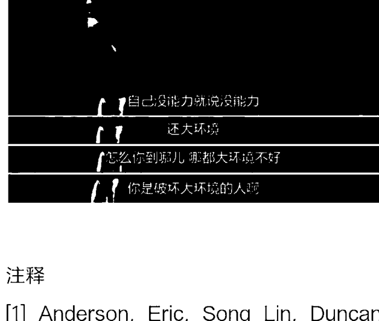

## 注释

[1] Anderson, Eric, Song Lin, Duncan Simester, and Catherine Tucker (2015), “Harbingers of Failure,” Journal of Marketing Research, 52 (5), 580 - 92.

[2] http://news.mit.edu/2015/harbinger-failure-consumers-unpopular-products-1223

[3] https://www.nbcnews.com/business/consumer/craving-watermelon-oreos-you-may-be-harbinger-failure-shopper-n485326

[4] Duncan I. Simester, Catherine E. Tucker, Clair Yang, The Surprising Breadth of Harbingers of Failure, Journal of Marketing Research, First Published September 29, 2019.

[5] 这个报告的视频在 https://www.youtube.com/watch?v=5WygmuXIQfw

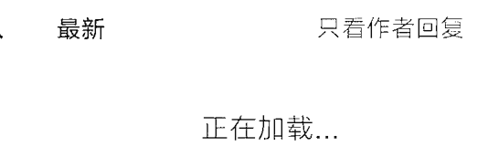

〈上一篇

## 日课精选

默认  最新  只看作者回复

正在加载...

写留言，与作者互动

## 问答：如何提出一个好问题？

万维钢 · 精英日课³
今天
进入课程 ›

问答：如何提出一个好问题？
09:33 8.75 MB

| 标签：许杉 |

# 来自日课：调研是一种什么体验

# 读者 大糖糖Nathaniel、DJANGO.XU、张希言：

如何提出好问题？

万维钢
同样是读一篇文字、了解一个理论，为什么有的人就能提出关键的问题，有的人就不能呢？我认为这取决于你脑袋中是否有思维模型。

比如你听一个人介绍他家乡的情景，说我家乡特别好，春天有什么什么，夏天有什么什么，秋天如何如何，然后他就说，我说完了。那你肯定感到非常别扭，说“那冬天呢？”
这是因为你知道一年四季春夏秋冬，他没有理由说了春夏秋不讲冬。那么同样道理，如果我讲了一个经济学家发现的统计规律，说这个和这个之间有个强相关，然后“这就是今天的全部内容，精英日课祝你每天都有收获”——你肯定也不干，因为你知道“相关不等于因果”，你肯定要问一句“那这里面有没有因果呢？这个理论能不能回答‘为什么’呢？”
真实的文章和理论中，作者通常不会留下特别明显的漏洞，但是因为每个人的思维模型不一样，就总能找到需要补充的地方。

# 来自日课：基本技巧

# 读者 徐焱：

还有很多搜索引擎没法找到的东西，国内百度与很多的内容平台（如得到）并没有打通，像这类情况该如何处理？

# 读者 廖志光：

淘宝、微信等这些应该有很多相关内容的平台，都不允许 Google 的搜索引擎连接上它们了。互联网一开始倡导公开、共享，但是现在大公司们都开始把自己的信息留在自己的圈子里，连搜索都要在自己的站内自建。这是不是说原来那个连接一切的互联网，现在正在被切分成一个一个的大公司的势力范围呢？

万维钢
是的，我感觉这的确是一个大趋势：大的平台正在和搜索引擎脱钩。

# 来自日课：搜索者心流

# 读者 水七七发：

老师说到了有时候搜索也是个体力活，但是，我们应该怎么区分什么时候是体力活，什么时候是个技术活呢？

万维钢
我儿子今天做的一道数学题是这样的：在算式 AB × C = AAA 中，请问A、B、C各代表哪个数字。

这道题的技术流解法是首先注意到 AAA 一定能被 111 整除，而 111 = 37 × 3，那么算式左边一定包含 37 这个因子，这意味着 AB 或者是 37，或者是 74……
但是如果一个人对数学技巧没有这么敏感，他完全可以把这道题当做一个体力活——这个 AAA，无非就是从 111 到 999 这么九种可能性，哪怕穷举法一个一个试，也用不了多少时间。

# 《搜索的喜悦》4: 让数据为你所用

万维钢·精英日课³
今天

进入课程 ›

《搜索的喜悦》4: 让数据为...
09:56 9.09 MB

[标签: 许沙]

咱们继续讲丹尼尔·罗素的《搜索的喜悦》。
我们平时关心的大一部分问题都是关于自己、或者是关于某个特定的人的。比如当一个人搜索“2019 年高校毕业生就业情况”的时候，他通常不是出于关心国家大事，想要评估一下中国的宏观经济形势——他真正想问的是他自己、或者他身边的某个大学生好不好找工作。

### 1.基础比率

比如你今年大三，打算明年毕业就参加工作。想要预测你找工作的前景如何，全国的数据其实意义不大——你更应该关心的是你所在的大学，上一年毕业生的就业情况。如果能找到你所在的专业的就业情况，那可能更能说明问题。

我随便搜索了一下斯坦福大学的MBA课程项目，发现他们每年都会公布毕业生的就业情况报告[1]。比如在它2018年的报告里就说，一个当年毕业的斯坦福MBA能拿到的基本年薪中位数是14万2千美元，外加2万5千美元的签字费和3万5千美元的预期奖金。

### 2.死亡原因

有一次罗素路过一片墓地，他突然有个想法：现在的人主要都是因为什么原因而死的呢？为了确保学习印象深刻，他先自己估计了一番各种死亡原因所占的比例，比如死于交通事故，死于各种疾病之类。他写下自己的估计，然后展开了搜索。


排在前五位的死亡原因是心脏病、癌症、慢性下呼吸道疾病、意外受伤和中风。其中心脏病和癌症是两个最大的杀手，各自占据了超过20%的死亡比率。不过总体来说，绝大多数人都可以说是寿终正寝，死于各种意外加在一起的可能性也只有5.4%而已。


### 3.你的预期寿命

2019年7月，国家卫健委发布，中国2018年人均预期寿命是77岁。这个数据代表了国家的进步，但是是一个特别宏观的数字，对个人的意义不算太大。


所以这才是我们预测自己寿命的正确方式：首先你得看自己已经成功活到了多少岁，然后你还得分区男女。保险业对此非常明白而且非常关心。

2.5 年。

但是成绩只属于过去。现在杨振宁必须跟那些已经活到了 97 岁的人们比较，这些人应该都有良好的基因和很好的生活水平。不过我们仍然可以让这个预测更精确一点！美国男性的预期寿命是 76 岁，但是其中亚裔男性的预期寿命则是 77 岁 [6]—— 这说明亚裔的寿命会略高于美国平均水平。再考虑到杨振宁目前的身体状况和他所能享受到的第一流医疗条件，我们对他超过 100 岁非常乐观。

总而言之，我们需要尽可能接近自身情况的数据。北京市职工平均工资对你来说意义不大，你想判断自己应该拿多少钱，需要的数据是所在地区的相同行业中、跟你职位相近的人们的工资数据。

数据丰富，我们就更容易做出明智的决策。但我不得不说，咱们中国的数据水平还很落后。中国直到最近几年，才提供居民收入“中位数”这个数据，以前都是直接给个平均值了事。

我们知道人的收入水平并不是正态分布的，高收入者会大大拉高平均值，平均值高估了普通人的收入。中位数—— 也就是一半人的收入比这个数字高，一半人的收入比这个数字低 —— 更能说明问题，但是以前为啥不给中位数数据呢？

因为计算平均值，各单位只要向统计部门报“总人数”和“总收入”这两个数字就可以了；而要知道中位数，统计部门就必须了解所在地区的每一个人的收入，把所有人放在一起排队才能行。统计中位数的成本要高得多。

数据很贵，但是数据有用。那如果这么贵的数据现在都已经有了，你不用岂不可惜吗？

## 注释

[1] https://www.gsb.stanford.edu/organizations/recruit/employment-reports

[2] 用别人 预测自己

[3] 数据来自美国 CDC 官网 https://www.cdc.gov/injury/wisqars/pdf/leading_causes_of_death_by_age_group_2016-508.pdf

[4] https://www.ssa.gov/oact/STATS/table4c6.html

[5] 杨振宁：我有很好的基因要活到108岁，2010年03月13日，中国新闻网。

[6] https://minorityhealth.hhs.gov/omh/browse.aspx?lvl=3&lvlid=63

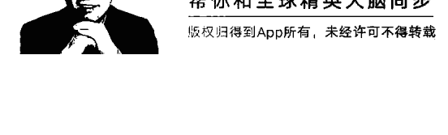

‹ 前一篇

## 日课精选

默认 最新 只看作者回复

正在加载…

写留言，与作者互动

# 《搜索的喜悦》5: 想到规律, 确认规律, 发现规律

万维钢 · 精英日课³ 今天 进入课程 ›

《搜索的喜悦》5: 想到规律... 10:30 9.61 MB

|转载: 怀沙|

咱们继续讲丹尼尔·罗素的《搜索的喜悦》。想到一个问题，通过一番调研、排除各种困难，最终找到答案，这是搜索者简单的快乐。这一讲咱们说一个可能更高级的快乐。搜索，并非得是得到别人已经写好的知识，也可以是自己发现新知识的过程。

先说一段我自己的......错过发现的心路历程。

### 1.牛的朝向问题

我常年住在美国科罗拉多州，这个州的一个地理特点是没有多少树，野外到处都是低平的草原。有时候你在高速公路上开车能看到路边的牧场，里面养着很多牛。我注意到这些牛们一点都不活泼，大多数时候只是默默地、稀稀拉拉地站着，跟同伴没有什么交流，好好像也不怎么吃草。

我还注意到，牛站立的头尾朝向，好像挺一致：大多数牛好像都是顺着同一个方向站着。对此我完全没有多想，我觉得那肯定是风的作用，可能牛喜欢迎着风或者逆着风站，不管怎么样这都跟我没关系，我是学物理的不是学畜牧的。


但我喜欢看各种学科的科学新闻。有个中文网站叫 Solidot，号称是“奇客的资讯，重要的东西”，专门把一些国内外科技新闻用简短的语言概括出来，我经常读。2008 年的一天，我读到 Solidot 上的另一篇报道叫《牛也能感知地磁场》[1]，当场愣住了。

用现在的话来说，我感觉我错过了一个亿。

### 2.海岸线的差异

借助 Google Earth 和各种手机地图APP，我们现在能非常方便地、免费地看到各个地方的高清卫星照片，这是一个重大福利。我觉得我只看卫星地图就能看一整天。我听说业余爱好者曾经在卫星地图上找到过矿藏，发现过大漠中神秘的军事基地，还帮助破获过失踪案件。


罗素输入 [Assateague geography] 加入“地理”这个词，可以限定专门搜索那些谈论阿萨泰格岛的地理特点的文章。这个搜索很快让罗素知道，原来海岸线外侧那些并行着的小岛，叫做“屏障岛（barrier islands）”。

篇文章，他在一篇博客文章的读者评论里看到有人对这个现象做过评价，然后他找到那个人的文章……就这样不停地找，罗素终于找到了最初问题的答案。

原来这是地球板块运动的结果。整个美国的土地都属于“北美板块”，它是从东往西运动。西海岸是北美板块的前沿，在这里北美板块和太平洋板块相遇，形成一个俯冲区。北美板块在这里比较低的部分直接就被太平洋板块给碾压了，所以海岸线看起来很界限分明。而东海岸则是北美板块的后缘，就好像一个尾巴一样，拖着一些东西，经过泥沙积累，就形成了各个屏障岛。

换句话说，罗素看到的是板块运动的证据。罗素想到一个规律，然后他在地图上找到多个地点去证实这个规律，然后他搜索到了这个规律的解释。

想到、确认、发现，中间历经磨难。虽然不是独家发现，这也是搜索的喜悦。

### 3.“计算历史学”

想到一个规律是容易的，证实一项规律常常是体力活儿。有时候你得观察几千头牛，有时候你得观察 70 只狗的几千次大小便……但是现在卫星地图和搜索引擎给我们提供了方便，使得有时候你足不出户也能调研一些小规律。

Google公司扫描了人类出版过的几乎所有图书。我们以前讲《人人说谎》这本书的时候介绍过 [3] 一个工具叫 Google Ngrams，专门帮你统计任何一个词汇在过去两百年间出版的书中出现的频率。

你可以用它来观测文化的变迁。比如说，互联网是什么时候变得比电视更重要的呢？为此你可以看看在书籍中，“互联网”和“电视”这两个词出现的频率变化一


答案是差不多在 1995 年。

有个非常懂现代哲学的“职业读书人和业余投资者”叫尼克，经常在《上海书评》发表有意思的文章。尼克把这个 Ngrams 的玩法戏称为“计算历史学”[4]，还用来给鲁迅、茅盾、郭沫若、老舍等中国作家排了个座次——


结论是以在英文书籍中出现的频率而论，“鲁爷江湖地位不可动摇，八十年代末九十年代初有点技术性下滑，随后又呈上升态势。但貌似三四十年代，鲁略输郭……”

不过他这篇文章激起了很多反对的声音，人们不太认同这样简单粗暴的技术手段。

但是现在使用类似方法的人很多，有些还是严肃的研究。我就听说有一位美国学者，专门研究各种词汇在《人民日报》中出现的频率变化，以期找到中国政治的走向……

类似的一个工具是 Google Trends，专门显示某个关键词在历史上被人搜索的趋势。比如我们看“罗振宇”，就在每一次跨年的時候都成为搜索热点——


可见罗胖的跨年演讲有多厉害……而且近年来，“罗振宇”反超了“吴晓波”。

想到规律，确认规律，发现规律，这样的乐趣你可以拥有。

## 注释

[1] 牛也能感知地磁场，matrix (791)发表于 2008 年 08 月 26 日，https://science.solidot.org/article.pl?sid=08/08/26/0748256

[2] 犬类动物对地磁场变化敏感，WinterIsComing (31822)发表于 2014年01月 02 日，https://www.solidot.org/story?sid=37870

[3] 如果你知道看什么……

[4] 尼克，计算历史学：大数据时代的读书，《上海书评》2014 年6 月。


〈上一篇

## 日课精选

默认 最新 只看作者回复

正在加载...

写留言，与作者互动

# 《搜索的喜悦》6：民间见识和学术标杆

万维钢 · 精英日课³
今天

《搜索的喜悦》6：民间见识...
10:23 9.5 MB

｜传送：菠沙｜

咱们继续讲丹尼尔·罗素的《搜索的喜悦》。如果你能把搜索这个技能用好，你不但自己可以获得智识上的喜悦，而且还可以用来服务社会。一个高水平搜索者应该是什么人呢？我想要借助咱们中国的一个传统观念，叫做“士”。

也就是“士农工商”的士。在春秋战国时代，士是一个明确的阶层，是贵族的最下一层和平民的最上一层。相对于贵族，士没有什么特权；相对于平民，士有自由，有资格读书做官。

士往往有一技之长，这一技不是什么打铁种地之类能直接谋生的技能，而是超越日常生产生活的高度技能。士的专业分工一听就很不一般：战士、侯士、骑士、谋士、修士、儒士、道士……

当然我们今天说的是什么“博士、硕士、学者”也是这么来的。而我认为，今天真正的读书人，就应该把自己当成一个“士”。

士，是被社会尊重，而且自身充满荣誉感的人。作为一个士，你就不是任何人的奴仆，你不仅仅是个挣钱养家的工具，你得有自由的思想和独立的精神，你做事得符合一定的原则和道德规范，你对自己得有比一般老百姓更高的要求，你得有社会责任感。

你得掌握一些不纯粹是为了谋生的技能。


图中有是一只苍蝇，它的两个透明的翅膀上各自有一个蚂蚁的图案。那个图案简直已经不能说是“很像”，可以说是非常逼真，有头有眼睛有尾有腿，就好像苍蝇的翅膀上有两只大蚂蚁一样。发推特的人说，这是“三合一”昆虫。


可能罗素做这个调研的时候（2013年）网上还没有这些图片，他找起来更麻烦一些，但是他找得非常严谨。

罗素首先确认了这张照片的摄影师是确有其人，并且得知照片是2010年在“迪拜沙漠保护区”拍摄的。他找到一篇讨论这种苍蝇的博客文章，并且顺着其中的链接找到一篇《纽约时报》的科学专栏文章。

这就非常靠谱了，写专栏的科学作家有一定的声望，而且那篇专栏还被修订更新过一次，指向了另一篇博客文章。那篇博客是一个叫摩根·杰克逊（Morgan D. Jackson）的昆虫学研究生写的，专门讨论的就是这种苍蝇翅膀上为何有蚂蚁的图像。

杰克逊的文章说，这个现象纯属巧合。你看那个图案像蚂蚁，那是因为你作为一个人，总爱在任何东西上寻找意义和规律。其实那个图案根本没有意义。

我们专栏以前有篇文章叫《广义迷信》[1]，专门说过这个认知偏误，是在没有意义的地方找到意义，在没有规律的地方发现规律，我们天生不相信世界上有些事是无线缘故发生的。

罗素接受了杰克逊的论断，但是他并不满意。有没有更直接、更明显的证据能说明那些翅膀上的图案是随机的呢？

说到这里我想起了以前特别流行的一部电视剧《潜伏》里的一段故事。主人公余则成是潜伏在国民党保密局里的地下党，他的妻子翠平有一次被敌人假装是自己同志给骗了。翠平与对方的对话被录音，形成了余则成是潜伏者的关键证据。余则成现在必须想办法证明那个证据不可信。

剪切和拼接，形成一份和翠平的录音非常像的录音证据。

等到保密局事发，对手拿出翠平的录音证据的时候，余则成说你别着急，我这里也有一份证据......我这个证据是谁谁谁卖给我的，那个人为了钱什么证据都能给你做出出来。结果领导信了。

从纯逻辑角度来说，一份录音是假的并不能证明另一份录音也是假的。但是有这个确信是假的的第二份录音，就能让人类*更加自然地*相信，第一份录音*可以*是假的。

那有什么东西，能让我们更加自然地相信，苍蝇翅膀上的蚂蚁图案是随机的呢？

当然是其他苍蝇的翅膀。

*

罗素决定看看这种苍蝇的近亲们都长什么样。他搜索到这种苍蝇所属的大类——也就是家族往上一支——的拉丁文名称是“Tephritidae”，这是一种分布在美国南部的果蝇。网上可能没有这个大类果蝇的详细介绍，罗素又从 Google Books 中找到一本专业书籍，又在书内搜索，找到了这个大类中各种苍蝇的翅膀的图片——


这些果蝇翅膀的形状和结构非常相似，都是透明的，上面有深色的图案——只不过这些图案各不相同：有的像枯萎的树叶、有的像蜘蛛、有的像丛林中地上的光影，.....有的，像蚂蚁。

为了进一步对比，罗素又特意把前面那个有蚂蚁图案的苍蝇翅膀裁剪下来，变成黑白的，与书中像蜘蛛的那个翅膀放在一起——


这么看，两者真的没有什么重大差别。

再进一步，他又找到一些开头那种苍蝇的近亲的图片，这回看得就更明显了——


图中的翅膀从“很像蚂蚁”，到“有点像”，到“不太像”，各种过渡图案都有。所以这哪里神秘了？如果蚂蚁图案是上帝的杰作，那上帝这些不太成功的手稿又该怎么算呢？

这就好比说，余则成给保密局领导提供了一大堆各种版本的录音带——那个最初的证据放在这里面真是一点都不特殊。

然后罗素又发现这种果蝇的一个变体就叫“花翅膀苍蝇 (picture wing flies)”，在英国和美国都有，而花翅膀苍蝇的翅膀图案简直五花八门，什么样的都有——


余则成给保密局领导打开了一扇认知的大门......

*

面对一个令人吃惊的、甚至带有一点神秘主义色彩的事情，当广大吃瓜群众随意猜测的时候，搜索者罗素找到了权威的解释和令人信服的周边证据。他的调研让我们从理性和感性上都欣然接受。

> “当前科学理解”，并不是一堆冷冰冰的数字和结论。科学家并不强迫你接受这些事实，科学家相信这些结论是因为其中有道理。

古代的士作为最低层的贵族和最高层的平民，是贵族和平民之间的枢纽。而今天你作为一个搜索方面的士，就要一头连接民间的见识，一头连接当前科学理解的学术标杆，做平民和学术之间的枢纽。

你不能说“你们都是迷信！你们得听我的，因为这是权威科学家说的！”正如余则成不能只靠表忠心去说服保密局。你得像罗素这样，找到科学解释还不算，还要让人能从感性上接受才算成功。

注释

[1] 广义迷信


万维钢·精英日课³
帮你和全球精英大脑同步
版权均得到App所有，未经允许不得转载

〈 前一篇

## 日课精选

默认 最新 只看作者回复

正在加载...

写留言，与作者互动

## 《搜索的喜悦》7：始于好奇，陷于细节，忠于问题，痴于学习

万维钢 · 精英日课³
今天
进入课程 ›

《搜索的喜悦》7：始于好奇...
10:49 9.9 MB

| 译注：茶沙 |

咱们继续讲丹尼尔·罗素的《搜索的喜悦》这本书。明天我们会专门总结一套从一个问题出发一直到完成调研报告的高级搜索心法，这一讲先说说搜索者的自我修养。

人们经常说人工智能时代到来之后世界就会如何如何，其实你看看那些可以预见的短期内能够实现的新功能，什么语音识别语音分析、什么智能家居、什么 5G 和物联网，本质上解决的只不过是一个操作界面问题。2000 年以后计算机技术的主要进步是体现,在让没受过专业训练的普通人也能用上计算机。

对高手来说，搜索引擎这种东西 2000 年以前就已经有了。高级编程语言上世纪七、八十年代就已经成熟了。上世纪六、七十年代就有的 Unix 词法分析与语法分析工具今天仍然在用。而那些来自于数学原理的编程思想和哲学，永远都不会过时。

### 1.好奇

如果你对“好奇”的定义是看到什么有意思的东西就很感兴趣，表达一番惊奇的赞叹，那我认为好奇心被高估了。人们热衷于赞美好奇心——但是仅限于赞美。人们希望自己的孩子能有好奇心，有些说打算向孩子学习好奇心，但是很少有哪个成年人真的会刻意让自己更好奇。

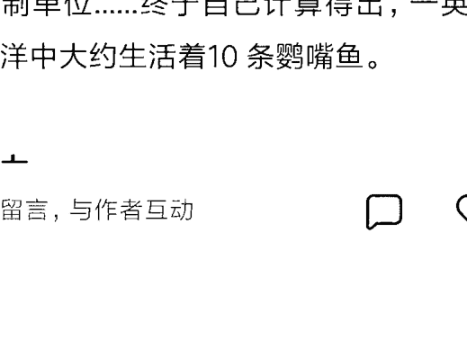

你能发现哪里有点古怪，然后敢于只身前往探索，这可不是什么儿童式的爱好奇心，这种行为非常高级。


这个鱼游着游着就会突然往体外喷射一股白色的细沙，我找了张动图你体会一下——


### 2.较真

《新闻周刊》的文章指向了一篇 2010 年的学术论文，罗素自己也找到一篇分析鹦鹉鱼进食行为的论文，但是这些论文中列举的是对鹦鹉鱼制造白沙能力的争议：有个说法是一条鹦鹉鱼一年能制造 200 磅沙子，有个说法是每条鱼每年制造差不多一吨、也就是 2000 磅沙子。

的海洋中大约生活着10 条鹭嘴鱼。

### 3.耐力

我们说搜索是个体力活儿。为了澄清鹭嘴鱼每年能制造多少沙子，罗素总共花了 10 个小时，列举了六篇论文和两本书作为参考文献。而这还得益于现在方便的互联网基础设施和罗素家所在地有那么厉害的公共图书馆。

而罗素表示，这件事其实比他想象的还容易了一点。

可是你说这值得吗？值得。这不仅仅是一个外行纠正了主流媒体和学术论文的错误的事儿。罗素在调研的过程中学到了很多东西。

他熟悉了相关的学术论文，他演练了从多个信息来源交叉验证一个事实的操作，他见证了哪些来源可靠哪些来源不可靠，他不忘初心牢记使命完成了认知闭环……他还顺便了解了一种鱼的性生活。

*

罗素认为，卓越的搜索者和一般的搜索者有态度上的区别。

一个态度是有恢复力（Resilience），也就是我们以前说的“抗打击能力”。你在搜索中会遇到各种挫折。可能一条线索跟着跟着就断了，一篇文献网上没有，一般的搜索者就放弃了。

而卓越的搜索者会再想别的办法，比如实在不行我在线下搜索！也许图书馆里有。卓越的搜索者总是乐观的，能把失望最小化，能把失败看做反馈，非常积极。

一个态度是能坚持。普通的搜索者一看遇到数学公式就打住了，卓越的搜索者如果在论文里发现不懂的东西，他就再去搜索那个东西的关键词，一直到弄懂为止。

卓越的搜索者从不畏惧文本知识，他们对自己有信心。

一个态度是抽象思维。普通的搜索者把一个东西弄明白就行了，卓越的搜索者会同时了解跟这个东西类似的其他东西——就好像我们上一讲说的了解各种果蝇的翅膀一样。

这是因为卓越的搜索者看到的不仅仅是这一个东西，而是它背后的规律。他会使用类比思维把这个规律推广，想看看能推广到什么程度。

还有一个态度是学习。卓越的搜索者永远都在学习，他们能跟着公共知识一起进步。他们学的越多，头脑里的知识框架和思维模型就越多，就越容易发现值得好奇的东西，就越容易搜索——当然也就越善于搜索。

拥有了搜索这个功夫，你就会难以容忍自己对什么感到好奇的公共知识不知道——数学家希尔伯特不说了吗？我们必须知道，我们必将知道。

## 注释

[1] 尤里卡, Eureka, 好像是希腊语，意思是“ 我发现了！”……传说阿基米德洗澡的时候悟出了测量王冠比重的方法，大喊了一声尤里卡。

[2] 到底是“简断截说”还是“简短截说”？请看一个搜索的例子— http://www.jiaodui.com/bbs/read.php?tid=50144


万维钢·精英日课³
帮你和全球精英大脑同步
版权归得到App所有，未经许可不得转载

‹ 前一篇

## 日课精选

默认 最新 只看作者回复

提交留言可与作者互动

↳ 写留言，与作者互动

## 《搜索的喜悦》8：调研的心法

万维钢·精英日课³
今天
进入评论 >

《搜索的喜悦》8：调研的心法
11:42 10.71 MB

| 曾经：<|start|>杉|

今天咱们把丹尼尔·罗素的《搜索的喜悦》这本书讲完。最后这一讲，我们说说搜索这门功夫的最高境界，那就是“调研”。普通的日常搜索都是获取一个信息、回答一个提问或者澄清一个事实；而调研，则是用综合手段，从公开信息中寻找一切我们需要的东西，形成一个完整的图像，把一个问题说明白。

比如企业打算生产某种产品，你能不能全面分析它的市场需求、销售渠道、原材料来源、生产成本、相关的法律法规等等情况。有个亲友得了疑难杂症，你能不能帮着看看当前医学界对这个病的看法是什么，一般采集什么治疗方法，治愈率怎么样，哪个医院甚至哪个医生最好疗。最近有个明星出了个八卦，在你去采访他之前，能不能先好好了解他。

### 1.提问

好的调研必须从好的提问开始。我们首先得区分一下“问题（problem）”和“提问（question）”。比如你有一段程序总是运行不过，或是有个产品卖不出去，或者你感觉这个地方哪里不对，这都只能叫有问题——或者说有毛病。仅仅有问题，还不能展开调研。你得把问题变成一个可调研的提问才行。

### 2.逻辑脉络

卓越的搜索者调研一个问题可能要花很长时间，但是你在任何时候打断他，然后问他“你现在这个动作是什么意思？”他都恰好告诉你自己正在做哪一步。他脑子里面有个逻辑脉络清晰的调研路线图。

### 3.信息的可靠性

不过对于大多数提问来说，搜索者的烦恼恐怕不是信息太少，而是太多了。负责任的调研必须判断信息的可靠性。比如对中文世界来说，可能网上绝大多数有关医疗健康的信息都不靠谱。

### 4.组织

如果你认为已经把这个问题搞清楚了，就可 以停止调研，把调研结果用自己的语言组织成一份报告。你按照逻辑顺序也行，按照这件事情在历史上演变的时间顺序也行，说一个自治而又完备的故事。

菜，这个信息也会帮助我们。

我经常在“虎扑”论坛看体育评论，我发现虎扑的人很喜欢问“什么水平”：朱芳雨这个传球什么水平？菲律宾这球场什么水平？布朗尼的这个身体天赋什么水平？这其实也是要情境化。你知道这孩子考多少分还不行，你必须知道他这个分数在全班、全校乃至全省是什么水平才行。

情境化要求我们不能只调研发到直接的答案，还要调研周边的情境。

以我之见，最好的调研中，你不能只提供信息，你还需要提供对信息的解读。甚至有时候你还应该有自己的判断。

在没有搜索引擎的时代，钱锺书先生，可能是中国在文学理论界最厉害的调研者。他写文章总是炫技般地旁征博引，简直是无所不知。他堪称是一位活着的搜索引擎。你问他一个问题，他能给你列举若干位学者对这个问题的看法。

但是我听说人们对钱锺书先生的一个批评，就在于他提供的信息太多，而观点太少。比如李泽厚说 [1]——

互联网出现以后钱钟书的学问(意义)就减半了。比如说一个杯子，钱钟书能从古罗马时期一直讲到现在，但现在上网搜索“杯子”，钱钟书说的，有很多在电脑里可能就找得到。严复说过，东学以博雅为主，西学以创新为高。大家对钱钟书的喜欢，出发点可能就是博雅，而不是他提出了多少重大的创见。在这一点上，我感到钱钟书不如陈寅恪，陈寅恪不如王国维。王国维更是天才。

这番话值得每个搜索者思考。搜索引擎把调研这件事变容易了，这给搜索者提出了新的挑战。

（THE END）

# 参考文献

[1] 李泽厚：哲学家只提供视角，《新民周刊》2005年10月5日。注意文中“钱钟书”这个写法不太规范。据我所知“钱锺书”的这个“锺”字是简化汉字中专门为钱锺书先生而保留的。


# 万维钢·精英日课³
帮你和全球精英大脑同步
版权归得到App所有，未经许可不得转载

〈 前一篇

## 日课精选

默认 最新 只看作者回复

正在加载...

写留言，与作者互动

## 问答：“量子速读”靠谱吗？

万维钢 · 精英日读³
今天

进入订阅 ›

问答：“量子速读”靠谱吗？
08:43 7.98 MB

[转载：怀沙]

读者 Chin:

万老师，能否解读一下“量子速读”这个事件？个人觉得简直是匪夷所思。

万维钢

“量子速读”是最最近发生的一个魔幻现实主义的事件。一个日本女性发明了号称能在1分钟之内读完一本十万字的书的方法，而这个方法是快速地翻书——

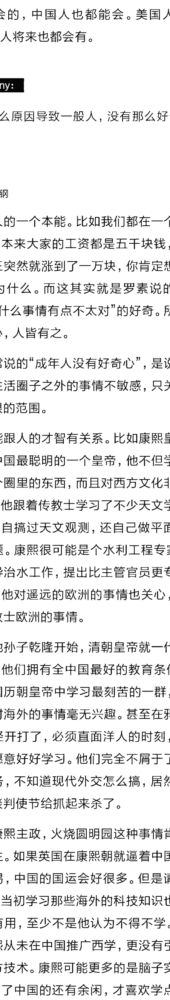

现在中国的好几个城市都开设了“量子波动速读”培训班，针对10到16岁的儿童，收费在1万元以上，有正规的教学场地、有大钊、有理论、有网站、有师资、有宣传、有推广、有连锁、有合作，形式上一本正经，实际上全是胡说八道。


小说家都不敢这么编故事，但是它就这么发生了。量子速读的主办机构无疑是利用家长的焦虑和无知，但是真正让他们从众多的骗子中脱颖而出的可能还是组织能力——当他们把这个“事业”一旦做起来，从众心理就能给他们带来源源不断的顾客……由此我们不得不承认，现代化的商业运作手段确实有用，什么东西都能给你卖出去。

如果你为这些家长的智商感到悲哀，我觉得大可不必。量子速读是无用的，那“弟子规”有用吗？“女德班”有用吗？老年人上的那么多养生课有用吗？其实都没用，而且很多不但没用，而且有害。

再进一步，“右脑开发”、“全脑培训”、“超强记忆力”、包括现在流行的“思维导图”课程，我估计很多人都认为这些东西有用，而我可以非常负责地Assert，这些也是一点用都没有。它们可能会对你产生一些“效果”，比如你如果下功夫的话真的能记住所有联系人的电话号码，但是本质上来说，第一，那个技能毫无意义；第二你不用花钱上课，自己用任何方法训练也有同样的效果。所以它们跟量子速读的本质区别仅仅是这些概念不够新、运作手段不够激进。

这种事情并不仅仅发生在中国的日本。美国以前流行给小孩子听莫扎特的音乐、还有什么“小小爱因斯坦”胎教，也都被心理学家证明完全没用。

现在还有人再搞什么能增强大脑注意力和反应速度的训练程序，号称比如说能减缓老年痴呆症的发病——其实也没用。心理学家的研究结果是你玩那个游戏只能提高你玩那个游戏的水平，对大脑并没有什么全局性的疗效。

那什么有用呢？比如说，统计表明，从事一种像大学教授这样的脑力工作，的确可以推迟老年痴呆症的发病时间。但是那意味着长期的努力，不是 prüfen 什么三个月的培训班、玩个什么小游戏可以相比的。长期的努力容易有用——但是作用也非常有限。

量子速读这种培训班的本质是人们想用旁门左道的方法、简单的努力、收获一个巨大的疗效。这也是一个刚需。不过我们没必要太悲观，我感觉互联网正在加快社会进步。

读者 VIN C:

万老师，我想问一下，如果罗素是一个用不了google不懂英文的中国人，还能通过搜索得到那些知识和结论吗？

万维钢

中国的互联网应用非常发达，互联网接入人数是世界第一，但是我们不得不承认，从知识的角度，网上的中文信息少、浅、而且质量很差。高质量的、可靠的、最新的信息，是英文的。几乎所有值得参考的学术论文都是英文的。所以答案是不能。

事实上，哪怕你研究的是中国历史和中国哲学，你也应该学会阅读英文，因为国外那些汉学家的水平高于国内学者。这不是说中文这种语言不行，也不是现代中国人不够聪明——纯粹是因为一百年以前科学和文化高速跨国境发展的那个时候中国很落后没有参与，中国错过了那个窗口期。

最近我看到一个对比尔·盖茨的采访，人问盖茨你有什么遗憾的事情，盖茨说很遗憾自己没有好好看掌握一门外语。他上高中的时候学过一点拉丁文，可能还学过一点法语，但是不具备交流能力。他很羡慕马克伯格会用中文跟人交流。

但也只是羡慕而已。盖茨不会外语也没阻碍他现在以本书评人自诩，动不动就点评天下新书。这对中国人来说肯定是不公平的。我们不得不比那些以英语为母语的人多花那么多时间学外语。

但是如果连盖茨这个基本用不上外语的人都说想学外语，我们这些需要英语的人为啥就不能学好英语呢？毛泽东晚年都在学英语，而且好像学的还挺不错。

美国人会的，中国人也都能会。美国人有的，中国人将来也都会有。

读者 Kenny:

是什么原因导致一般人，没有那么好奇呢？

万维钢

好奇是人类的一个本能。比如我们都在一个公司上班，本来大家的工资都是五千块钱，有一天小王突然就涨到了一万块，你肯定想知道这是为什么。而这其实就是罗素说的那个“感觉什么事情有点不太对”的好奇。所以好奇之心，人皆有之。

我们通常说的“成年人没有好奇心”，是说他对自己生活圈子之外的事情不敏感，只关心非常有限的范围。

这有可能跟人的才智有关系。比如康熙皇帝可能是中国最聪明的之一皇帝，他不但学习中国这个圈子里的东西，而且对西方文化非常感兴趣。他跟着传教士学习了不少天文学的知识，亲自搞过天文观测，还自己做平面几何证明题。康熙很可能是个水利工程专家，亲自指导治水工作，提出比主管官员更专业的意见。他对遥远的欧洲的事情也关心，经常问传教士欧洲的事情。

可是从他孙子乾隆开始，清朝皇帝就一代不如一代。他们拥有全中国最好的教育条件，也是中国科举考试学习最刻苦的一群，可是他们对海外的情事情毫无兴趣。甚至在鸦片战争已经打开了，必须直面洋人的时刻，他们都不愿意好好学习。他们完全不屑于了解国际事务，不知道现代外交怎么搞，居然把人家大谈判使节给抓起来杀了。

如果是康熙主政，火烧圆明园这种事情肯定不会发生。如果英国在康熙朝就提出中国搞自由贸易，中国的国运会好很多。但是请注意，康熙当初学那些海外的科技知识也不是为了有用，至少不是他认为不得不学。事实上康熙从未在中国推广西学，更没有引进什么西方技术。康熙可能更多的是脑子实在够用，学了中国的还有余暇，才喜欢学点西学。

知识的一个悖论在于，有些看似无用的东西，也许恰恰是将来能有大用的东西；可是如果你仅仅出于为了有用才去学习，你就已经晚了。

这也是专注和探索的矛盾，也是策略和运气的矛盾。你策略性地选择专注于最重要的领域，虽然效率很高，却可能错过颠覆式的创新；你东一下西一下什么都感兴趣，可能有时候运气会很好，可是更有可能一事无成。

那你说到底应该如何把握这个度呢？世界上没有什什么固定的算术。

如果一个人像康熙一样学有余力，那就应该多探索，扩张学习的边界；如果一个精体力都不能，一看书就困了一思考就累了，那就专注于把自己分内事情做好。如果现在是大变革时期，各种新东西正在不断冲击过来，那我们就应该多探索；如果现在是非常稳定的时期每天发生的事儿都差不多，那好奇心真没用处不大。

而我们完全能看出来，现在并不是非常稳定每天发生的事儿都差不多的时期。好奇心很可能有占田 成年人 也该沉... 写留言，与作者互动

可能有点用。成年人也应该在有余力的情况下积极探索世界。

如果一个成年人说我心已死！我这辈子是不打算探索什么新事物了，请把我的好奇心留给孩子们吧 —— 我的建议是那你至少可以读读小说啊。什么小说都可以。小说能让我们了解别人的视角，知道不一样的生活，想象其他可能性。也许你能唤醒自己对世界的好奇。


# 万维钢·精英日课³

帮你和全球精英大脑同步

版权归得到App所有，未经许可不得转载

‹ 前一篇

## 日课精选

写留言，与作者互动

# 《行为》1: 怎样理解人的行为

万维钢·精英日课³ 今天 进入详情 ›

《行为》1: 怎样理解人的行为 12:32 11.48 MB

【转载：萨沙】

我们从今天开始讲罗伯特·萨波斯基（Robert M. Sapolsky）的《行为》（Behave: The Biology of Humans at Our Best and Worst）这本书。萨波斯基是斯坦福大学的教授，他是一位研究人脑的神经科学家，同时还是一名灵长类动物专家。我们专栏以前提到过他的另外一本书，叫《为什么猕猴不得胃溃疡》[1]。

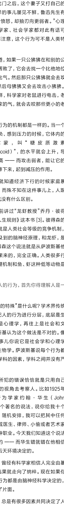

这本《行为》是2017年出版的，两年以来受到很多好评，但是在我看来，它仍然是被低估了。这不是“又一本”什么讲述人类行为科学原理的“科普书”——这不是“a book”，这是 *the* book。这本书代表了当前科学理解对人类行为认识的最高水平，是科学进展的重大成就。我可以这么说，相关的课题，你以前可能听过多少种说法，那些都是不系统、甚至可能是不对的，以后咱们都应该以萨波斯基为基准。

萨波斯基的写法很高妙，但是他没打算把这本书写成畅销书。我看他想的是穷尽平生所学，穷天人之际，通古今之变，成一家之言。你很快就会看到，也只有这位在第一线既研究人脑、又研究动物的萨波斯基，才配得上写这本书。这是一本严肃的科学著作，完全可以用作大学的教材。我认为此书的历史地位不会低于丹尼尔·卡尼曼的《思考，快与慢》，在未来很长的日子里，它将会被人一再地提起。

而这不是一本很好读的书。萨波斯基假定读者是聪明人，他毫不顾忌地以快节奏展开思路，书中充满过山车式的推理。这本书的斐波那契数列难度系数 [2] 应该是13，而且足足有800页。

但是咱们精英日课的读者选书从来都不是因为这本书容易，而是因为这本书难。像《行为》这样的书，你下多大功夫都是值得的。如果你能把萨波斯基的思路彻底想清楚，融会贯通，你就能更好地理解人的行为，可以在一定程度上预测人的行为，甚至想办法去调动人的行为。你的困惑、思辨和顿悟，会换来思维水平不可逆的提高。

不过也别太担心困难，咱们先说两个故事。

# 1.两个故事

有一次萨波斯基一家出门，妻子开车，萨波斯基坐副驾驶，孩子坐在后座。他们一家正常行驶的途中，后面有一辆车用非常野蛮的方式超车。萨波斯基的妻子脾气也不好，当即就按喇叭表示抗议！然后前面那辆车上的人竟然对他们竖了中指！萨波斯基觉得孩子在车上没有必要听会这种人，但是妻子已经怒了，决意跟着这辆车。

到了一个路口遇到红灯，前面那辆车不得不停下来。萨波斯基妻子开车过去，从储物箱里拿了个东西，下车径直走过去就敲对方的车窗。对方一看是个女的可能也不敢造次，就把车窗放下来了。萨波斯基的妻子把东西扔进车里，说了一句话，“这种行为你都能做出，你肯定需要这个！”

妻子回到车里，绿灯亮了。前面那辆车以非常慢的速度，很委靡地开走了。萨波斯基就问妻子你给他扔了一个什么东西？原来一颗棒棒糖……妻子说，这种行为野蛮的人一定是从小缺爱，我想给他治愈。

第二个故事发生在1965年的印尼。苏哈托政变上台，立即对印尼的共产党人、左翼人士、知识分子、工会成员，特别是华人，展开了残酷的大屠杀，有50万人遇难。屠杀中有一个细节。苏哈托派军队一个村一个村地杀过去，他们去的时候都带着一支乐队。军队一边屠杀，乐队一边演奏印尼的传统音乐……你问他们为啥要这样，他们说这样感觉好。

同样是人，为什么萨波斯基的妻子展现了人性的光辉，而苏哈托的军队能做出这种禽兽不如的事情？然后屠杀的事情很快就过去了，苏哈托摇身一变成了文明人——他的家族贪污腐败，但是作为国家元首，他受到很多人的尊敬。而原来那些参与屠杀的军队，也都一个个跟正常人一样生活。

像这样的事儿应该如何解释呢？文人喜欢对此发表意见，但是“善良”和“邪恶”这样的说法只能带给我们更多的困惑。以前很多人认为科学也不能完全解释人性——以前确实不行，以前的很多所谓科学解释确实是片面的。但现在不一样了。

现在，科学，基本上把人看明白了。

# 2.人是一种动物

那么从科学家的角度说，人是什么呢？人首先是一种动物。

你肯定会说人是一种特殊的动物——没错，不要要说特殊，每种动物都是特殊的动物。当然人的确和其他动物不太一样，别的动物做不出来一边奏乐一边屠杀这样的事情。人，是一种以特殊的方式特殊的动物。

但是人仍然是动物。我给你举个例子，一个男人在外面对着不顺心，回家就打了自己的妻子。男人出门之后，这个妻子又打自己的孩子！像这样的事儿屡见不鲜，鲁迅先生有一句话说“怯者贼怯，却独巧向弱者。”心理学家、伦理学家、社会学家都对此有话可说，但是，请注意，这个行为可不是人类特有的。

动物学家知道，如果一只公狒狒在和别的公狒狒打架中落败了，它会去找一个比他地位低的公狒狒出气。然后那个公狒狒就会去攻击母狒狒。然后母狒狒又会去攻击小狒狒。老鼠也是这样，科学家对老鼠进行电击，老鼠受了科学家的气，就会去咬那些更小的老鼠……

而所有这些行为的机制都是一样的。当一个动物受到挫败、感到压力的时候，它体内的一种荷尔蒙，叫“糖皮质激素（Glucocorticoid）”，的水平就会上升，导致它血压升高——而攻击弱者，能让它的糖皮质激素降下来，起到减压的作用。

# 3.怎样学习这本书

怎么写留言，与作者互动

主导了这个行为。

可是他的大脑为什么会产生这样的化学反应？这是因为今天早些时候，他的身体产生了这种荷尔蒙。

那为什么别人面对同样的情况，没有产生那么多这个荷尔蒙，唯独他是这样呢？这和他小时候的成长环境和出生时的基因有关系。

那他的基因又是怎么来的呢？这是动物亿万年演化的产物……

用我们中国人熟悉的一句话来讲，就是“国际大气候和国内小气候”共同决定了这件事的发生。萨波斯基这本书的组织方式就是把决定一个行为的一秒钟之前、几分钟之前、几个月、数十年一直到远古时代的各种因素一一列举出来。

但是如果你按照他这个写书的思路去读这本书，你可能会陷入迷茫——你一看，啊，一个行为背后原来有那么多的因素……可是你记不住这么多因素！可能你只记住一句“人的行为是由很多因素共同导致的，人很复杂”——可这不是废话吗？

所以我先告诉你一个心法。我们读这本书，必须把萨波斯基写书的思路给反过来。萨波斯基是以一般行为为出发点，对应各个特殊因素——我们学的时候应该以特殊因素为本，学一个因素，看看对应哪些行为。

比如讲脑神经科学的时候我们会讲到“杏仁核”这个东西。杏仁核影响人的什么行为？你记住这一个机制，就能解释很多现象——有些事儿它就是主导因素。当然别的因素也会对那个现象有影响，可能你没考虑周全——但是你现在至少收获了一把锤子，而这一把锤子，就能帮你解决掉很多钉子。

所以我们应该把《行为》这本书当成一本兵器谱去学习。这样你学一点就有一点收获。等全学完了，回过头来再按照萨波斯基的思路来个通盘考虑，看看一个行为背后到底有哪些机制，融会贯通。

我读此书的一个感慨是，以前我们熟悉的一些概念，现在必须用科学家的视角重新理解。什么叫“暴力”，什么叫“利他行为”？什么叫“同情心”，什么又叫“同理心”？我希望从现在开始，你要忘掉以前听过的对这些概念的种种解释，咱们放下所有成见，听听萨波斯基怎么说。

比如此书中说了很多有关“暴力”的事情，而萨波斯基告诉我们，抽象地谈暴力是没有意义的，因为暴力有很多种，它们的生物学机制都可能不一样。而另一方面，你觉得完全不同的两个事情，却可能有一样的生物机制。

咱们考虑一个场景。你进入一个房间，看见房间里躺着一个受伤的人正在流血，你的第一反应肯定是赶紧过去给他包扎伤口。这个行为完全没争议，对吧？

而在第二个场景中，你进入一个房间，看见房间里有一个好像是外星来的怪兽，张牙舞爪地要攻击你，正好你身上有枪，你就开枪打死了怪兽。这个行为，有些人可能就看不惯了。你为什么不考虑一下怪兽的权利？你为什么如此轻率地对待生命呢？

心理学家和文学家肯定会对这两个决定有不同的说法——但是，在脑神经科学家看来，救助受伤者和向怪兽开枪这两事儿，在大脑前额叶皮质里的反应回路，是完全一样的。

没有科学的视角，人们就根本不知道自己是在说什么。

咱们明天接着讲。得到“每天听本书”栏目中，苗炜已经对《行为》做了一个25分钟的讲解，我建议你先听一下，快速了解全书的内容。

## 注释

+   [1] 有点“模式”意识
[2] 一本*难度系数=21*的物理书
[3] 父爱式鸡汤


# 万维钢·精英日课³
帮你和全球精英大脑同步

## 日课精选

默认   最新                    只看作者回复

正在加载...

写留言，与作者互动

# 《行为》2：大脑这台硬件

万维钢·精读日课³
今天
进入译程 >

《行为》2: 大脑这台硬件
12:40 11.59 MB
|转载：柠沙|

咱们继续讲萨波斯基的《行为》。有一位读者问我說这本书 800 页你要花多少時間读，我沒有统计花多少時間，但是我可以告訴你，这本書讓我读到了每天晚上做噩梦的程度。书中有些暴力、怪异的事件，还有一些受创和解剖的事情，这些内容会一直占据你的思想......

1966 年，有个美国人叫查尔斯·惠特曼（Charles Whitman），先杀死了自己的妻子和母亲，然后跑到德克萨斯大学奥斯汀分校的一座大楼上，开枪向下扫射，当场打死了 16 个人，打伤 12 人。他为啥要这么干呢？他是恐怖分子吗？他受到了不公正的对待吗？不是。

惠特曼在他妻子和母亲的尸体旁边留下了一张字条，说他自己也不知道自己为什么要杀害她们——他说他非常爱她们，但就是控制不了自己，想要杀人。他希望人们能研究一下他的大脑。

解剖表明，惠特曼大脑中的杏仁核，因为受到肿瘤的压迫，而不能正常运行。惠特曼的大脑出了硬件故障。

我们不需要等到出故障了才想起来大脑是个硬件。正常人的行为也受到硬件的限制。人不是一个完美的逻辑系统，我们是时刻被硬件控制的动物。

# 1.硬件

神经科学可能除了物理学之外最玄妙的科学，大脑是一个神奇的东西。借助了像惠特曼这样的案例，再加上一些对猴子和老鼠的实验，科学家现在已经能非常精细地给你指出出来，大脑的哪个部分有哪些功能。可是如果你据此就把大脑想象成一台个人电脑，说这是CPU这是显卡这是内存条，你会发现也不是那么回事儿。很多功能是多个硬件共同实现的，而且有时候一个硬件被破坏了，大脑又可以绕过这个硬件，再次实现它那个功能。大脑，是个*活的*硬件。

# 第一层大约可以叫“自动控制层”。

# 第二层叫“边缘系统”，负责情绪。

# 第三层叫“新皮质”，是大脑在演化中最晚出现的部分。

# 2.杏仁核

杏仁核属于第二层，它负责产生恐惧、焦虑、攻击冲动和憎恨这些情绪。

# 3.多巴胺

# 4.额叶皮质

杏仁核带给我们负面情绪，多巴胺带给我们正面情绪，而额叶皮质则能让我们不被情绪完全控制，提供理性思维。萨波斯基用一句话概括："额叶皮质让你选择虽然困难、但是是对的事情去做。"

额叶皮质能让我们短期记住一个复杂的规则并且严格执行，同时排除不相干的信息。额叶皮质的前端，叫做“前额叶皮质”的这个区域，是大脑中的决策者。我们以前说过大脑是个多元政体，而决策就是从大脑中的多个声音中选择一个选项，这就是前额叶皮质做的事情。前额叶皮质还能给物品按照抽象的规则分类，还能提醒我们要自律。额叶皮质，很像是卡尼曼说的“系统2”。

为什么很多小孩缺乏这些能力？因为额叶皮质要等到20多岁的时候才能完全长成！

而且额叶皮质的运行特别消耗能量。这就是为什么我们做很多选择会感到疲劳，我们无法真正同时做多个任务，我们做一天复杂的事情之后回到家里就不愿意再特别理性地跟家人相处，我们面对高强度认知负荷的时候，会变得没耐心和不愿意帮助别人……

所以你看，大脑直接控制人的行为，完全都是在硬件层面实现的。而且这些区域之间的互动也能决定行为。

为什么有的人就能推迟满足，有的人就非得马上就吃那个棉花糖？这是因为腹侧被盖区产生的多巴胺有两个通道，如果那些多巴胺更容易通往负责情绪的边缘系统层，这个人就会对短期诱惑投降；而如果那些多巴胺更多地是走通往额叶皮层这个第三层的通道，这个人就能从长远打算。

你说这个人怎么没有意志力呢？可是他有什么办法呢？他大脑的硬件结构就不是很合理！

所以想要改变人的行为，最直接的办法就是改变他的大脑。毒品可以直接产生大量多巴胺，能让人立即收获极度的快乐——也就严禁更换正...有医生做过这样的手术，割掉暴力倾向特别强的犯人的杏仁核，他就不会再有暴力冲动了。

但是这种直接的干预，现在来说，都是破坏容易建设难。杏仁核没了有可能就不暴力冲动了，但是这个人可能也不会害怕了，这真的是你想要的吗？我们并不知道怎样微调大脑。

面对这么多硬件限制，我的感慨是大脑虽然是思维的工具，也更是枷锁啊。

那为什么有的人的杏仁核就这么容易受刺激，有的人就不这样呢？咱俩必须再往前追溯……

[1] 现代视角下的“烦恼”和“苦”

# 划重点

+   1. 大脑可以分为三层：自动控制层、边缘系统、新皮质。 2. 杏仁核属于第二层，它负责产生恐惧、焦虑、愤怒这些情绪。演化已经把最可怕的东西编码写进了我们的中央杏仁核之中。 3. 多巴胺是大脑对我们从事各种行为取得成功的奖励。大脑不但奖励你得到的报酬本身，而且更要奖励你对报酬的预期。 4. 额叶皮质让你选择虽然困难、但是是对的事情去做。它要等到20多岁的时候才能完全长成。 5. 我们并不知道怎样微调大脑。

万维钢·精英日课 帮你和全球精英大脑同步 版权归约到App所有，未经许可不得转载

## 日课精选

默认 最新 只看作者回复

正在加载...

写留言，与作者互动

# 《行为》3：下意识、潜意识和“不过脑子”

万维钢·精英日课³
今天

进入课程 >

《行为》3：下意识、潜意识和… 12:52 11.78 MB

|转述：泽沙|

咱们继续讲讲波斯基的《行为》。这几讲我们说的是关于行为的生物学、底层的逻辑。掌握底层逻辑的好处是你可以用它解释各种各样、看似不相关的高层的事情。

我们上一讲说进了人脑的三元模型，其中包括负责情绪的边缘系统和负责理性思维的新皮质。这供应咱们把这几个东西的关系搞清楚，然后你就可以解释像潜意识、下意识、安慰剂效应、行为经济学之类的事情，你还可以学会控制情绪的方法。

你是否曾经为自己急怒之下的一举动、脱口而出的一句话而懊悔不已呢？你是否觉得当时那个你好像不是你自己呢？

你的确不是你自己。你是你的大脑。

# 1.绕过皮质的命令

我们一直说大脑是个“多元政体”，差不多相当于一个委员会。边缘系统（包括杏仁核和多巴胺等东西）和新皮质层（包括额叶皮质等）都是委员会的成员。常规来说，新皮质这一层的额叶皮质是这个委员会的主席，重心决定应当由他在听取各方的意见的基础上做出。但是在具体操作之中，有时候边缘系统会不经主席批准，直接对执行机构下命令。

比如你看到一个人正在做一个什么动作，这在你的视网膜中形成一个视觉信号。符合“组织程序”的路线，是这个信号先进入“视觉皮质”，然后皮质层会做一个判断：这人是谁？他在干什么？皮质会把判断的结果通知杏仁核。杏仁核如果判断这人正在掏枪，这件事有危险，它就再把它的判断反馈给皮质。皮质如果同意这个判断，就可以下命令，让身体对此做出反应。

这个次序是 信号 → 皮质 → 杏仁核 → 皮质 → 行动。

可是如果事情都经过领导审批，有时候就太慢了。皮质层是演化后期才出现的器官，它的吧理速度本来就慢。而演化早就给我们准备了一条更古老也更高效的反应程序：边缘系统一直都可以直接接收外界信号并且直接指挥行动。

# 2.情绪与决策

那有皮质参与的决策，是怎样的呢？你仍然得考虑感觉——或者说情绪。边缘层的反应速度比皮质层快得多，这对我们做决策非常重要。

# 3.直觉和“非理性”

格拉德威尔在2005年出版的《眨眼之间》（Blink）这本书里描写过一种直觉的判断。给专家一个文物，在他意识到、想明白这个东西是怎么回事之前，往往就已经有一个强烈的感觉，知道它是好是坏是真是假，这样的直觉，其实就是大脑中的某种情绪。

# 4.理性和感性的较量

上一讲我们说了，人天生就怕蛇，这是因为怕蛇是写入中央杏仁核里的硬件编码。实验人员把一只从来没见过蛇的小猴子跟蛇放在一起，猴子表现出极大的恐惧。那为什么有些人就不怕蛇呢？

因为在蛇这个问题上，他们的额叶皮质驯化了杏仁核。他们玩过蛇，他们的理性告诉杏仁核蛇并不可怕，杏仁核慢慢地接受了。

有个实验是这样的。科学家对老鼠实行电击，老鼠感到疼痛和恐惧，所以中央杏仁核被激发。然后科学家在每次电击之前都先播放一个声音，这样几次之后老鼠找到规律了，一听到那个声音它们的基底外侧杏仁核就会活跃，表示已经学会了对这个声音的恐惧感。

接下来，实验者只播放声音，而不再电击老鼠。一开始老鼠听到声音还是很害怕，但是慢慢地，它们对声音的恐惧感就消失了——怎么消失的呢？并不是基底外侧杏仁核的神经元减少了，而是额叶皮质给基底外侧杏仁核发信号，告诉它这个声音不可怕，它又长出来一些代表“不怕那个声音”的神经元！

为什么有些长得很丑的人，我们乍看之下很不喜欢，看时间长了也就习惯了呢？也许就是这个机制。

额叶皮质对边缘系统的影响力还体现在有时候我们会刻意提高某种情绪的敏感度。我们肚子饿的时候就会对食物的气味特别敏感，我们处于紧急压力状态的时候会特别警觉，就如同狗在警戒状态竖起耳朵。

那有没有什么办法能更主动地控制情绪呢？比如看恐怖电影的时候，我们的理性完全知道现在非常安全，可是杏仁核仍然在报警，把我们吓得出冷汗，怎样控制这样的情绪？我们专栏讲《为什么佛学是真的》的时候说过一个“正念自控法”[1]，萨波斯基介绍的方法跟我们说的非常一致。

这个关键在于，如果你一直聚焦于自己的反应，对自己说“你怎么发抖呢？别害怕别害怕”，那没什么用。你应该做的是跟这个情绪分离，把它放在那里不管、换个视角看电影，比如你可以从演技的角度评估这个电影。这种超然态度会激发你充满理性的背外侧前额叶，让它抑制杏仁核的作用。

额叶皮质受损是比较可怕的事情。有些案例中一个好人因为大脑受伤，救过来之后表面上一切正常，但是失去了对情绪的控制能力。他可能满口脏话，身体不由自主地抖动，社交行为怪异……比如一位八十多岁的老人无法克制地想要性骚扰女性。

不过别担心，大脑是活的。特别额叶皮质具有高度的可塑性，有些额叶皮质受伤失去自控能力的人，经过锻炼再次获得了自控。

但是萨波斯基警告我们，当你想要为某个行为做决定的时候千万别忘了，你的所谓理性和自控能力，比你想象的要低很多。

## 注释

[1] 正念 自控法


# 万维钢·精英日课³ 帮你和全球精英大脑同步 版权归得到App所有，未经许可不得转载


# 《行为》4: 英雄与爱情

万维钢·精英日课³
今天

进入课程 >

《行为》4: 英雄与爱情
12:17  11.24 MB

| 译者: 辛沙 |

咱们继续讲萨波斯基的《行为》。在下面这两种说法中，你觉得哪种更好听一点呢？

+   1. 人是动物
2. 人是机器

在我们今天这个号称是即将迎来人工智能时代的时代，“机器”可能更好听一点。现在很多机器在很多方面都比人厉害，如果你说一个人工作特别努力就像机器一样，他大概不会生气；可是他也不愿意被称为“动物”。

但是人能做的很多事情，恰恰是今天的机器所不会做的。比如说下面这些事情......

## 1.人性

李大国是一个足球俱乐部的U15青年队主教练。他曾经是一名球星，技战术水平都很高，但最大的特点是作风勇猛，他让对方后卫害怕。他头上绕着渗血的绷带拼杀的画面至今被老球迷津津乐道。现在的李大国是…

## 2.荷尔蒙

## 3.睾酮和催产素的其他作用

写留言，与作者互动

条件的，那就是仅限于“自己人”。你得首先已经把这个人当成是可信赖的人，催产素才能让你更加信赖他 —— 这也可以说是一种放大效应。可是如果你本来就不信任这个人，催产素可能会让你对他产生敌意。这就是为什么女性刚生下小孩子的期间，会为了保护孩子而不惜对外有攻击行为。

催产素能让我们更加区分敌我。萨波斯基甚至说，催产素会让人产生排外情绪，乃至于加强种族主义倾向。

*

如此说来，英雄主义和爱情，毕竟也是生理现象。人毕竟也是一种动物。我们额前皮质会让我们学会一些别的动物都不会、只有智能机器才会做的事情，所以更复杂的人也许 = 动物 + 机器……

但不论如何，我们受动物性的支配要容易得多。那你说既然睾酮和催产素有这么多好处，我们是不是都应该每天上班之前打点睾酮，下班之后打点催产素呢？那当然不行！首先激素的作用非常复杂，不仅仅影响人的行为而且直接影响身体，你不希望让体内有超出正常水平的激素。而另一方面，我们也看到了睾酮和催产素对行为影响的负作用。

同样上场比赛，为什么李大国就能这么拼，有的球员就精神萎靡呢？也许他们的睾酮水平不一样。大脑神经系统直接决定人的行为；视觉声觉和嗅觉刺激这些环境因素在一秒到几分钟之前影响人的神经系统；而荷尔蒙则在几小时和更长的时间之前发挥影响。

那人与人的荷尔蒙的水平又为啥不一样呢？咱下周还得继续往前追溯。

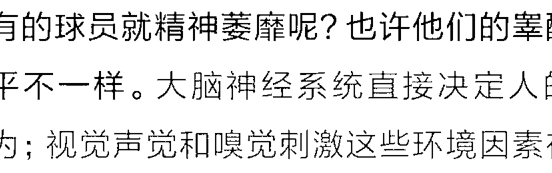

〈 前一篇

写留言，与作者互动

## 特别放送：演化的视角

万维钢 · 精英日课³
今天

进入课程 >

特别放送：演化的视角
00:40 630.86 KB
| 纪念：萨沙 |

万维钢

精英日课有一个高频率出现的概念，叫做“演化”，今天我就 来帮你把关于“演化”的各种知识、疑问和前沿研究总结一下。演化有没有方向？它到底是不是随机的？演化的目标是什么？演化是由什么决定的？演化思维对于我们理解社会、商业、人生，提供什么样的模型和视角？你可以从今天的总结里复习这些知识。祝你每天都有收获。

## 1.什么是演化？演化有方向吗？人类整体总是在进步吗？

进化 (evolution) 这个词，现在有很多人士号召翻译成“演化”，因为进化的“进”字似乎暗示它有一个从低级到高级的方向。长时间大尺度来看，的确有这样的趋势，但具体到演化的每一步，其实都是没有方向的。

几十万年前地球上至少有六种不同的人种，之前还有更多，我们这一支最后统治地球，纯属偶然。

## 2.演化有目的吗？

## 3.演化为什么很厉害？

## 4.怎么证明人是演化而来，而不是被“设计”出来的？

## 5.接受演化的价值观，最该干什么？

## 6.演化论最近有新发现吗？

截此复习：历史学的教训

截此复习：用进化论修心养性

截此复习：问道：人类有没有可能是被设计出来的？

体的冲击，这就给其他海洋生物提供了一个非常优越的生存环境。很多物种都依靠珊瑚礁生存，而它们同时又给珊瑚虫提供了食物和安全保护。

各个物种互利共存，也许是比“斗争”更大的常态。

## 4.有些生物会因为和别的生物共生，而放弃自己 的一些能力。

有个现象叫做“基因剥落（gene shedding）”——以前有这个基因，后来很长时间不需要，干脆就没有了。

这就好比说马尔代夫这个国家不需要有自己的工业、农业和国防，它只要把自己的地方管理好，单纯靠外国人来旅游的收入就足以让国民过上好日子。

各个物种互利共存，也许是比“斗争”更大的常态。

## 5.比独立自主更高级的生存策略，是解放自我。

独立自主，是很贵的一种生存方式。在生物学家看来，保留所有基因是不经济的，非常不利于发展和演化，基因剥落其实是常见的生物现象。生物的合理策略是在与多个物种共存的环境中给自己谋求一个独特的定位，而不是总想脱离别人自己单干。

类比到市场经济，就是再厉害的公司也不应该什么都做。哪怕你丰田汽车，也应该把像轮胎、汽车玻璃、包括各种零部件，都交给别的公司做。专业化的分工最有利于调整和创新，最能适应快速多变的新环境。

所以生物正确的价值观，不是总想着在一个严酷的环境里搞独立自主，而是设法放松自己的环境，让自己探索新的可能性，也就是解放自我。

人类恰恰就是这么干的。演化发展到人类这一步，就成了文化和基因共同演化的局面。自然选择不再仅仅由外部环境决定。现代人不再终日从事体力劳动，解放了自己的天性。

人类早就不是独立自主的生物了。世界上根本就没有什么是独立自主的生物。

共存，也是天道——共存至少和斗争一样重要，很可能更重要。演化不是军备竞赛，而是和平协议。

截止复写：演化是军备竞赛，还是和平协议？

## 7.一个演化思维的更高版本...

爱德华·威尔逊的《生命视角》讲的演化思维，跟一般教科书里说的进化论不太一样。他有两个关键思想：

+   一是群体演化。

生物个体之间不仅仅是互相竞争的关系，甚至都不一定以竞争关系为主——群体演化要求个体之间要合作。哪个群体内部有良好的合作，哪个群体作为一个整体就有更大的发展，哪个群体的基因就能更广泛地流传。

合作，要求群体内部有某种协调，至少要能够压制像癌细胞那样的个体。人类社会的协调方法就有社会规范、公共道德，和个人与生俱来的羞耻感能力。

群体演化还要求我们对群体内部事务有适当的干预。现在连生态学家都不再认为我们应该对大自然袖手旁观任其自由发展，他们认为适当干预可以避免生态系统的灾难。把这个思想应用到经济学上，威尔逊的经济学立场就是比较偏左的——他不相信完全自由的市场经济，他相信一定程度的政府协调。

+   二是文化和基因共同演化。

一方面是表现基因的遗传。比如在物质匮乏环境中成长的孩子会有特定的行为模式，而这个模式是可通过基因表达遗传的。但恰恰因为决定行为的不仅仅是基因，个体就可以主动适应环境，而不被基因枷锁所限制。

文化与基因共同演化是一个经典例子是乳糖耐受性。本来成年人不能消化奶制品，但有些游牧民族因为掌控了充足的奶类供应，他们经过多少代的选择之后，就拥有了能消化奶类的基因。文化，能影响对基因的突变的选择。

那么这就引出了一个非常激进的概念，叫做“有意识的演化（conscious evolution）”。它的意思是说我们可以有意识地选择自己的演化方向。

对经典进化论来说这是一个禁忌话题，一般认为演化就是没有方向的。但现在威尔逊对这个问题持开放的态度，认为现在结合了文化，我们至少可以在一定程度上，能干预自身的演化。

比如说，我们可以主动制造创新的机会。

截止复写：演化的教训

演化思维给了我们一个宏大视角。你再看那些大人物和小人物的成败，那些创新公司和传统公司的兴亡，是不是就像看蚂蚁、蜜蜂和大肠杆菌一样……这是一个奇特的趣味。


万维钢·精英日课³ 帮你和全球精英大脑同步

# 用户留言

默认 最新 只看作者回复

正在加载...

写留言，与作者互动

## 问答：酒精对大脑的影响是怎样的？

万维钢 · 精英日课³ 今天 进入详情 ›

问答：酒精对大脑的影响是... 11:57 10.94 MB | 译者：深沙 |

# 读者 潘洁：

老师文中说，如果游戏遇到危险的时候，杏仁核也会被刺激，还有很多情况，比如坐过山车，蹦极，看恐怖片，相信在极度恐惧的过程中，杏仁核也是被调动的，但是我们却会感到一种开心。是可以这么说，恐惧并不一定会产生焦虑，甚至恐惧有可能还会分泌多巴胺？

# 读者 小贝：

这位同学要拉我去玩一种幽暗迷宫，在需要走出迷宫的同时，还会遇到很多惊悚的场景和可怕的东西，这次游戏会不会改变我的杏仁核呢？

# 读者 Dacy：

我们在遇到一些压力的时候，比如准备面试，或者上台演讲时，也会心跳加速，这个反应按理会帮我们应付眼前的情势才对，但是大脑却会一片空白，有时候什么都记不得了，难道身体做出的反应也是让我们在这种场合下逃跑么？

万维钢
像看恐怖电影、坐过山车、玩幽暗迷宫这样的经历，为什么虽然吓人，还让我们很开心呢？俄亥俄州立大学的神经科学和精神病学家 凯瑟琳·布朗洛（Katherine Brownlowe）去年正好对此有过一个详细的介绍 [1]，我们正好可以顺便捎一括急性压力对大脑都有哪些作用。

大脑中负责感到害怕的区域是杏仁核，而我们知道，杏仁核在没有额叶皮质的帮助的时候是不能准确判断真假的，而且杏仁核的反应速度还比额叶皮质快——所以我们看恐怖电影时候感受到的那个恐惧，是真的恐惧。但是，因为额叶皮质总能够反应过来，告诉我们电影是假的，你现在其实很安全，所以我们能比较快地战胜那个恐惧。具体来说，大脑的反应过程是这样的——

恐怖画面出现，杏仁核感到害怕，会立即劫持全身各部位的行动，让身体进入“战斗或逃跑”的状态。不过是战是逃还不一定，可能需要进一步的信息，所以人也许是先站在那里不动，相当于“被吓呆了”。但是这个状态是一样的。

人的心跳和呼吸会加速，以至于会感到有点喘不上气来。这么做是为了增加血液给四肢肌肉的供氧量，增大四肢的力量。
那么作为必要的取舍，流向胃部和消化系统的血液就会减少。这就有可能导致呕吐和大小便失禁，当然呕吐和失禁也可能是因为相关部位的肌肉被放松了，也可能是为了减轻身体的负担。胃部在压力之下的供血不够，这也是为什么长期的慢性压力会让人容易得胃溃疡。

负责压力反应的荷尔蒙，包括皮质醇和肾上腺素，会上升。这有利于这个人保持“战斗或逃跑”的状态。比如在战场上人们常常受伤了也感觉不到疼痛，就是肾上腺素的作用。

人的视觉和听觉会更加敏锐，人的注意力会集中在眼前。这大概就是为什么人初次公开演讲的时候会有四肢僵硬、大脑一片空白的感觉——这种一个人面对一大群人的局面，可不是原始人所擅长的，肯定会感到害怕，他想不起来自己要讲啥，只顾着眼前面这么多人在了。

那么为什么恐怖片能带给人愉悦感呢？当额叶皮质终于意识到这一切都是假的时候，我们会解除警报，身体放松下来，胃部重新开始消化食物——这个过程，会分泌多巴胺。就好像那个著名的苏联笑话说的那样，说说幸福的事情就是警察半夜敲门，你惊恐地打开门，结果警察说的是“伊万，你被捕了”，然后你说“你弄错了，伊万在隔壁”……

那看恐怖片能改变杏仁核吗？可以——或者至少可以改变杏仁核和额叶皮质之间的连接。我们讲电击老鼠那个实验的时候就说过，电击之前先播放一个声音，老鼠的基底外侧杏仁核就会记住那个声音，下次就算只播放声音不电击，老鼠也会害怕那个声音——这个效果就如同老鼠在看恐怖片。但是如此几次之后，老鼠就学会了，这个声音从此不再带来真的电击了——它的杏仁核也许没变，但是是额叶皮质增加了一些通往杏仁核的神经元连接。

所以看恐怖片也许有一种“反脆弱养生法”的作用。而布朗洛则说，看恐怖片可以让我们变得更大胆，能立即就临時提高我们害怕的阈值。她说先看两个小时恐怖片再去演讲，你演讲的时候就不那么害怕了。

# 读者 opp1：

万老师，人喝酒之后行为会变的怪异，有时候看起来像变了一个人一样，做出很多平常不会做的行为为，酒精对大脑的影响是如何的呢？

万维钢
这是一个经典的问题，而我可以告诉你一个非常新的答案。因为人有时候喝醉酒会做出出格的、甚至疯狂的行为，人们就经常说“酒精乱性”；可是另一方面，更多的人喝多了也没有任何不当举动，只是享受那种晕乎乎的感觉。酒精对人的影响到底是什么呢？格拉德威尔在《与陌生人交谈》这本书里写了一段小插曲，介绍了两个心理学家的新理论 [2]。

酒精的作用是让我们在思想上和情绪上都变得“短视”。不过这个短视可不见得就是坏事，也可以叫“活在当下”。比如说你有一个重要项目过两天要参加验收，在单位还有一大堆人事方面的事情，家里小孩子上小学的学校还没找好……而就是这样，今天晚上，你妻子给你假假，允许你跟几个老同学去酒吧收看一场中国队的比赛。那请问在这个时刻，你还希望琐碎白天那些烦恼吗？

酒精可以让你专注于此时此刻。三杯过后，你只注意到朋友的笑脸、酒吧的音乐和球赛的快乐，这是多么美好的一个晚上——如果中国队真的赢的话。这种情况下喝点酒不是很好吗？

但是，如果是在充满忧虑的情况下一个人喝酒，你专注的就会只是忧虑，你就更不容易看到事情光明的一面。
所以“今朝有酒今朝醉”和“举杯消愁更愁”都是对的——你喝酒的那个情境是什么情绪，酒就能让你排除别的干扰，只会那那个情绪。

但是请注意，酒精的作用并不是像掮客和催产素那样放大我们的情绪，而是让我们在互相矛盾的两个情绪之中，选择近在眼前的那个。比如你又想看足球、又担心耽误了准备后天的考试，酒精会让你选择看足球——因为比赛就在眼前。你又想答应朋友的要求，又担心影响公司的长远发展，酒精会让你答应朋友的要求，因为朋友就在眼前。而如果你根本就没拿这个人当朋友，那他劝你喝再多也没用。

这就是为什么有时候喝酒会误事，有时候喝酒就是享受。格拉德威尔举的是这么一个例子。比如说你喜欢讲笑话。你以为自己的笑话很好，可是你的朋友们说你讲得很差我们都嫌弃了以后能不能再别讲了。如果是平时，你会顾及到别人的反馈，担心讲不好；但是如果喝酒了，你就会只想到自己讲得有意思这一面，而不顾别人的反馈。但是，酒精并不能让你对你自己的发挥有更高的评价——酒精只是让你听不到“远处”的评价。

本来就有暴力倾向的人，酒精会让他因忽略别的顾虑而更容易被自己的暴力倾向战胜——但是并不会放大他的暴力倾向。没有暴力倾向的人，怎么样都不会有。

# 读者 小贝：

额叶皮质具有高度的可塑性，那我们是不是可以根据自己的需要，制定详细的计划，把自己的大脑塑造成想要的样子？

万维钢
大脑的可塑性并不是《行为》这本书的重点，不过它确实可以影响人的行为，所以萨波斯基也说了一些。

大脑是硬件的，但是是个活的硬件，是“可塑”的——它的各个部分可以改变大小，各部分之间的神经元连接可以加强或者减弱。上世纪七十年代以前的研究者曾经认为人在成年以后就不会再长出新的神经元了，但是过去这几十年脑科学界最激动人心的发现就是人一直到老都可以长新神经元，而且长得还挺多——成年大脑每个月都会长出3%的新神经元，去替代旧的。

具体的底层机制，我理解，现在科学家还没有完全搞清楚，但是有些现象可能你已经听说过了。
比如说一个人的眼睛突然失明了，那么他大脑中负责处理视觉信号的视觉皮质就暂时没用了，对吧？于是他开始学习盲文。我们知道盲文的写法是在硬纸板上弄一些小孔，小孔的排列组合代表文字。让一个正常视力的人去摸盲文，他很难摸出来这个字都叫什么。可是失明的…

的人去摸盲文，他很难摸出来这个字都由哪些小孔组成 —— 你的触觉没有那么敏感。可是盲人，却能在一段时间的训练之后，准确而又快速地摸读盲文。这是为啥呢？

如果你扫描他的大脑，你会发现他的视觉皮质，现在被用来处理盲文的触觉信息了。大脑没有抛弃视觉皮质，而是给它安排了一项新任务！现在负责手指的触觉神经元，跟视觉皮质发生了连接。那这个连接是怎么安排的呢？那些触觉神经元是怎么知道视觉皮质现在闲着、又怎么跟它联系上的呢？科学家目前还没搞明白。

但是这个现象非常普遍。很多盲人的听力会变得更敏锐，那是因为他们视觉皮质用于加强听觉处理。很多中风患者，本来已经偏瘫了，但是刻苦练习，几个月的时间就又恢复了正常行动的能力 —— 那是他们大脑中中风的区域被修复了吗？没有。我听说的是中风的部分坏了就坏了，但是大脑可以在别的区域，重新长出来一套行动指挥系统。

当然大脑的可塑性也不都是好事儿。PTSD 患者因为经过剧烈的惊吓，他们的杏仁核就可能变大，而负责记忆的海马体还可能萎缩，使得他们更容易害怕，更不容易回忆好的事情……

你可能马上就想到，一个大脑没受过伤的人，能不能也经过练习，获得像盲人那样厉害的新技能呢？当然可以，而且人们一直都是这么做的：这就是练习的作用。练习，最主要的就是练大脑，也就是让大脑内长出新的神经元回路。而且练习的神经效应非常明显。

萨波斯基引用哈佛大学的一项研究说，一个从来没弹过钢琴的人，每天练习弹琴两个小时，几天时间就能让大脑中负责手指动作的运动皮质发生可见的变化。不过练习时间短的话这个变化只能持续一天，一天不练就没有了。如果你能连续练习四个星期，运动皮质的改变就能持续很多天。那我们可以想见，专业选手的运动皮质必定能持续更长时间，也许是一生。

不过大脑的可塑性是有限的。并不是所有破坏都能用神经重组的方式修复，而且练习需要时间。大脑毕竟不是可以快速读写的硬盘，你不可能像《黑客帝国》里那样想学一个技能就往大脑里下载一个技能，你有时候得练一万个小时……

## 注释

[1] https://wexnermedical.osu.edu/blog/scary-movie

[2] 这两个心理学家是 Claude Steele 和 Robert Josephs，你可以自己搜索他们的相关研究论文。


## 日课精选

默认 最新 只看作者回复

正在加载…

写留言，与作者互动

## 《行为》5：青春攻略

万维钢 · 精英日课³
今天
进入课程 ›

《行为》5：青春攻略
12:37  11.56 MB
| <|start|>system | 深沙 |

咱们继续讲萨波斯基的《行为》。大家同样是被大脑和荷尔蒙控制的人，为什么有的人情绪高昂，有的人就故作深沉，有的人就敢当，有的人就一身油腻，有的人对新事物充满好奇，有的人就处处逾规蹈矩呢？人和人最大的差距是年龄。

人生大部分关键节点和有意思的剧情都发生在三十岁之前。我们在青春期犯过很多错误，但是也是经历过无数美好的事情，此后的日子大多不值一提。

我们讲高昂尼克的《冈丁与木匣》这本书的时候谈论过青春期[1]，这一讲是升级版。咱们进一步从脑科学的角度，看看“青春”到底是怎么回事儿，应该如何度过……而且我保证，虽然研究脑科学的科学家一般都是中年人，但是他们给的答案绝不油腻。

什么是青春呢？从脑科学角度来说，就是你大脑的其他部分都已经发育好了，只有额叶皮质还没成熟的那个个人生阶段。我们知道额叶皮质负责理性、控制和决策，它要等到你20多岁的时候才能完全成熟。说白了，青春期中的你是个判断力跟不上感情的动物。

你可能以为随着大脑慢慢变成熟，神经元的数量应该不断增加——其实不是。这里面有个很高妙的机制：人脑中神经元的数量，刚出生就已经比成年人还多，大约到两岁左右达到巅峰。青春期，是个神经元数量和神经元的连接都在“减少”的过程。我们的脑就像一棵树，一上来就长出好多好多树枝，后来发现有些有用有些没用，有用的就留着越长越粗壮，没用的就被修剪掉了。

而青春期就是修剪额叶皮质的过程。额叶中越是古老的区域修剪得越快，而最新、也代表最理性的背外侧前额叶，一直选择到青春期晚期，其中的灰质都没有开始减少。

前面说了成年人大脑中负责调节情绪的是颞内侧前额叶，而在青春期的额叶皮质还没长好的这个阶段，有个叫做“腹侧纹状体”的区域会暂时做一些管情绪的工作。腹侧纹状体的管控能力本来就比较弱，而我们在青春期阶段的情绪还特别充沛，而且血液不动就流向某个被认为“更重要”的器官，导致额叶皮质缺氧，那你就可以想象，青春期的大脑是非常混乱的。

混乱体现在三个方面。

## 1.冒险

有句话叫“淹死的都是会水的”，其实这是统计上的认知偏差——会水的中年人不会被淹死，真实情况是淹死的都是年轻的。我们有时候在微博看一段什么高空跑酷之类不戴安全措施的冒险视频，有人就会评论说“外国人少是有原因的”，这其实也是认知偏差，现在在中国也有人模仿这些玩法——真实情况是青少年喜欢玩这些。

从脑科学的角度来说，青少年对风险的回报感跟成年人不一样。正常情况下，人脑对风险的判断应该是“贝叶斯”式的。比如说最近人们流行去某个地方爬山。小王去了之后回来说那里非常刺激，特别好玩，那么你听说之后就会调高对这项活动的评价，让自己也更想去——在这一点上，青少年和成年人是一样的。过了几天，你又听说有个小李，上周末去了之后就没回来，他出事死在了那里！成年人会因此调低对这项活动的评价——但是青少年不会。

青少年会说，我去就肯定不会死。因为前额叶皮质没发育好，青春的大脑，会只在于风险的正面。


儿童不太在乎得什么奖，只要得奖他就高兴。成年人的高兴程度正好跟奖励成正比，得大奖就大高兴，小奖也有小高兴。可是我们看看图中青少年的表现，可就不一样了。

## 2.社交

人说成年人的社会复杂，其实青春期的社交更复杂。成年人其实没有多少朋友，特别是没有多少新朋友，平时交往的就那么几个人而已。而青少年不但朋友多，而且重感情。

## 3.心智化

怎么学呢？有个概念叫“心智化（mentalization）”，意思是你能不能从别人的行为之中，合情推理测别人想法的。


因为缺乏这种换视角的能力，青少年有时候会因为感受不到对方的痛苦而随意伤害一个人，有时候又因为强烈感受到别人的苦难而愿意做一些极端的事情去拯救他们。暴力犯罪的是青少年，参加革命的也是青少年。强烈要求种族平等、愿意为别的受压迫民族抗争的是青少年，参加种族清洗的也是青少年。

他们的睾酮水平正处在人生巅峰，他们的边缘系统正空前活跃，而就在这个最需要前额叶皮质的时刻，他们的前额叶皮质还没有长好！

那你可能会说，既然青春期这么危险，青少年是不是应该尽早参加严格的规矩训练，加速大脑生长，让自己的额叶皮质尽快成熟起来呢？

## 不是。萨波斯基提出一个有意思的问题：为什么人的额叶皮质长这么慢呢？

你要知道，额叶皮质虽然在演化中出现最晚，但是它的结构并不比大脑别的区域更复杂。按理说长额叶皮质并不难——萨波斯基认为，额叶皮质之所以长得慢，是因为长得慢有好处。

人的成长，有些是由环境决定，有些是由基因决定的。比如一个人聪明不聪明，大概基因和环境因素各占一半。而额叶皮质，是大脑中最不受基因影响，最能被环境和经验影响的区域！

额叶皮质的成长，给了你一个自己通过后天因素决定自己是个什么人的机会。你要做的不是让它赶紧急长好，而是用各种经验去塑造它。你经历的每一次情绪波动，每一个高兴或者悲伤的时刻，做出的每一个正确或者错误决定，都在训练你的额叶皮质。它需要成功的鼓励，也需要失败的反馈。它需要丰富的经历。

我们不是说了大脑的成熟是个修剪的过程吗？这个过程高妙在哪呢？越晚开始修剪，修剪的时间越长，成年后大脑的智力水平就越高。

从小背诵什么《弟子规》，一路循规蹈矩长大的人，通常不会是什么领导材料。反倒是那些从小积极探索各种可能性，做过特别好也做过特别错的事，被人伤害过也伤害过别人，有过后悔也有过骄傲的人，更可能成为气度恢弘的大人物。

所以度过青春期的最好方式，就是有个青春的样子。二十岁的数学家伽罗华用三天时间不眠不休地写下关于“群论”的开创理论，然后就去跟人为爱情决斗去了。

人说伽罗华死于决斗。我们会为青春的混乱付出代价，但有些事情值得这么高的代价。别忘了这个世界的进步基本上都是年轻人推动的！

注释

[1] 青春的较量


万维钢·精英日课³
帮你和全球精英大脑同步
版权归得到App所有，未经许可不得转载

‹ 前一篇

## 日课精选

默认 最新 只看作者回复

正在加载...

写留言，与作者互动

## 《行为》6：童年的阶级

万维钢·精英日课³
今天

进入课程 ›

《行为》6：童年的阶级
12:23 11.34 MB

【martial: <|start|>style?】咱继续讲萨波斯基的《行为》，这一讲是个沉重的话题。咱俩中国人有个叫词“主观能动性”，意思是你要积极主动地把事情做好，积极主动地选择做个好人。任何一本讲人生应该如何度过的书，最终肯定会鼓励你发挥自己的主观能动性，要相信“我命由我不由天”。如果一个成年人整天回忆什么“原生家庭”带给他的苦难，一个青少年整天抱怨父母，我们肯定鄙视他，这样的人没有主观能动性。可是我们这一讲要说的是儿童。

你不能跟儿童谈主观能动性。儿童是无辜的。他们无法选择自己的命运，因为他们选择不了自己的基因和成长环境。他们的大脑刚刚开始被修剪，他们在根本意识不到“家庭环境”这个因素的时候，只能被动地接受家庭环境的塑造。

童年会怎样影响人的一生呢？这读萨波斯基介绍的这些研究结果的感觉是，童年问题的本质，是压力问题。具体来讲，童年的关键是家庭，家庭的关键是阶层，阶层决定生物学压力。

这个事实非常残酷，你可能都会幸幸自己在童年的时候没听说这些理论……

上世纪 90 年代，美国各地的犯罪率都奇迹般地下降了。这是一个惊喜，人们一时时间都不知道怎么解释，成了一个著名的争议话题。有些学者——比如我们专长熟悉的马尔科姆·格拉德威尔（Malcolm Gladwell），在畅销书《异类》中提出——这可能是因为警方实施了更有力的安全措施，比如说把社区的环境弄得很好，让人不那么想犯罪。但也有一些学者——包括我们专长熟悉的“魔鬼经济学家”史蒂芬·列维特（Steven Levitt）——提出，要说环境改善，其实只有像纽约市这样少数几个地方做到了，你怎么解释全国的犯罪率都下降了呢？

列维特等人提出一个非常符合调查数据，但是非常令人无语的解释：因为堕胎合法化。

六七十年代，美国各个州陆续通过了允许堕胎的法案。二十年后，美国的犯罪率就下降了。为啥呢？因为那些生在错误家庭、出生就意味着将来可能走上犯罪道路的孩子，因为堕胎的合法化，而没有出生。

有些人不该生孩子。

小时候营养不良大脑就发育不好，长大以后智力水平肯定也不行，这显然是个生物学现象。而很多儿童从小没有得到足够家庭关爱，甚至受到父母的虐待，这其实也是个生物学现象，孩子的大脑发育也会受到影响。

## 低要求、低响应，叫做“忽视型”。

## 高要求，低响应，叫做“专制型”。

## 低要求，高响应，叫做“放纵型”。

## 高要求，高响应，叫做“权威型”。

那你说肯定是权威型家教最好啊！为什么别的家长不学呢？

现实是教养方式跟社会经济地位高度相关。地位较高的家长倾向于使用权威型和放纵型教养，地位低的家长倾向于专制型和忽视型。

有人专门研究了纽约市三个社区的家教方式，发现他们真管孩子 —— 不是放纵和忽视的时候 —— 用的词汇有明显区别。

贫困社区父母管孩子是教孩子以防御为主。别出去乱跑啊！这是你的东西不要让人抢了！如果有人欺负你你就跟他干！为啥这样？因为他们生活在危险之中，周围充斥着吸毒和犯罪。如果孩子不听话，他们还会嘲笑自己的孩子。

蓝领社区的父母管孩子则是以进攻为主。他们对孩子充满希望，希望孩子出人头地：你要努力进步！你要拿第一名！

这两种方法都是比较专制的，因为他们面临的外部环境不是很好。有危险你不小心行吗？有明确目标你不严格执行规则行吗？

是住在曼哈顿区的那些中上阶层父母，才更多地使用权威型方法。他们知道孩子将来肯定不会差，他们更关心的是孩子能不能充分地达到马斯洛金字塔上的“自我实现”那一层 —— 而且他们知道那一层不仅仅是金钱和工作上成功的事儿。如果听说谁谁谁为了追求艺术放弃了高薪工作，这些家长会表示赞赏。他们对孩子说的都是“成长”、“探索”之类的词。

有的孩子生活在威胁之中，有的孩子生活在机会之中。

好消息是父母对孩子的直接影响非常有限。孩子上学以后，受同龄人的影响会更大。他们会在游戏玩耍中演练社交技能。我觉得学校的集体生活会让孩子们学的更加平等，毕竟现在没有母驹驹跟着了。公共教育是人类的伟大发明。

而坏消息是越是坏父母，对孩子的影响就越大。一个可悲的生物学现象是越是受到父母虐待的孩子，就越依赖父母！如果从小就被父母虐待，儿童在父母面前反而不会分泌糖皮质激素，他们以为父母的虐待都是应该的……然后他们将来也会虐待自己的孩子。

人们通常会用当初父母养育自己的方式去养育自己的孩子。这个事实对咱中国人来说尤其值得警醒。中国几十年来经历了一次经济腾飞，适用于旧环境的养育方式并不适用于新环境。那么如果你明明有条件采用权威型的方法，能不能就不要太专制了。


〈 前一篇

# 用户留言

默认 最新 只看作者回复

正在加载...

写留言，与作者互动

## 《行为》7：怎样理解基因和环境

万维钢·精英日课³
今天
进入详情 >

《行为》7：怎样理解基因和..
11:45 10.75 MB
| 转载：泽沙 |

我们继续讲波斯基的《行为》。前面几句话说到青春期和童年家庭环境对人的影响，话题有点过于沉重，这一讲会轻松很多，咱们就说基因对人的影响。为啥说基因会感到轻松呢？因为你对基因做不了什么，担心也没用。

所以这一讲我们就不“输出焦虑”了。咱们从智识的角度谈谈有关基因的最新认识，看看能不能收获一点学问的乐趣。

我们想知道，人和人的不同之处，到底有哪些是基因决定的，哪些是环境决定的。

其实这个问题的方法本身就有点病，咱们等会儿重新说。

现在你可能已经信服了，人是一种动物。这表现在不但是人的身体是血肉组成的，而且连人的各种行为，也是由硬件决定的。否则核大一点或者小一点，催产素多一点或者少一点，直接影响一个人的行为。而组成杏仁核和催产素的每一个细胞，都是极其严格地按照基因的图纸制造出来的。所以基因当然对人的行为有重大影响。

但是基因的影响又很微妙。我们讲亚当·卢瑟福的《我们人类的基因》的时候说过[1]，人的一个特征，往往是很多个基因共同决定的，所以你没法说到底是哪个基因决定了人的这个特征。我们讲戴维·威尔逊的《生命视角》的时候说过[2]，同一个基因，在不同环境中又会表现出不同的功能，所以你甚至没法说这个基因到底是干什么的。非常复杂。

## 环境信号→转录因子→开启基因→完成复制

我们首先要弄清楚两个概念。一个是“基因的表达”，一个是“基因的版本”。

## 人和人的不同之处，到底有哪些是基因的版本决定的，哪些是基因的表达决定的？

## 遗传力 (heritability)。

遗传力这个词容易引起误解。比如我们每个人的每只手上跟跟都有五根手指头，这当然是遗传决定的，但是跟“遗传力”没关系。遗传力说的是人与人之间的*差异*，在大多数程度上，是由基因*版本*不同，决定的。

为 ERROR 的研究人的遗传力，科学家们想尽了办法。有个学科叫“行为遗传学”，专门研究人在不同环境成长带来的行为特点。

所有这些研究的结果，遗传因素对人的影响，差不多都在40%到60%之间。

关于有些热门基因的作用的论文，竟然动不动就能有一两千篇。

这些研究告诉我们一个道理是，同一个基因版本到底是好是坏，跟环境非常有关系。

比如我们说过的MAOA这个“战士基因”[1]，它的一个版本能让人对威胁更敏感、对恐惧更容易记住，这好像很不好，是吧？但是请注意，那个效应在一般人身上非常非常小，临床根本看不出来——可是对于从小生活在困难环境中，遭受过虐待，经常面临威胁的人来说，这个基因版本就可能加强他的暴力倾向，让他在成年以后表现出更多的攻击行为。

再比如说DRD4基因有个版本叫 7R。对于那些从小生活在充满不安全感的环境中，特别依赖父母的孩子来说，7R 会让他们性格比较自私，不愿意分享，对社会公益事业和集体行动没兴趣。可是对那些从小生活在良好家庭环境中的孩子，7R 又会让他们更慷慨大方！

基因总是跟环境交互发生作用，我们不能脱离环境谈基因。

说了这么多，也许你只记住一句“基因跟环境都有作用，这很复杂”……那我希望你至少还能记住下面这个道理。

遗传力研究发现的一个大趋势是，社会经济地位越高的家庭里的孩子，基因的影响就越大；社会经济地位越低的家庭里的孩子，环境的影响就越大。

说白了就是富人家的孩子将来有没有出息，取决于他的基因。富人家小孩的智商，70%是由基因决定的。为啥呢？因为他的家庭有足够条件，让他充分发挥自己的天赋。他的天赋上限不管有多大都能施展出来。

而对比之下，穷人家小孩的智商，只有 10% 是基因决定的。他可能有数学家的潜在天赋，但是家里条件有限他根本没有时间也没有机会学习最高水平的数学，他的天赋根本发挥不出来。他能发挥多少，取决于环境允许他发挥多少。

人说漫画里的超级英雄都是“富人靠科技穷人靠变异”，其实真正的穷人必须有个什么奇遇，才可能用自己的“变异”去跟人家的“科技”竞争。

这个可悲的事实是以很多穷人家孩子的环境之差，根本轮不到拼天赋。

## 注释

[1] 基因不能决定什么
[2] 你来自传承（上）
[3] 过去几十年的研究表明DNA中的转录因子的行为习惯也是可以遗传的，这就是“表现遗传学”，这个我们以前讲过，不是本文的重点。另外还有一些别的机制，给遗传带来另外的不确定因素，我们也暂时略过。

万维钢·精英日课³
帮你和全球精英大脑同步
版权归得到App所有，未经许可不得转载

## 一个简单有效的说服技巧

万维钢·精英日课³
今天

进入详情 >

一个简单有效的说服技巧
09:15 8.47 MB

【编辑：怀沙】

这一讲咱们说个真正轻松的东西。“说服力”是老话题，你肯定已经听说过很多种说服方法了，比如怎么讲个故事动之以情啊之类，有的好使有的不好使。我最近听到了一个简单有效的方法，号称能迅速让一个人改变自己的观点。这个方法构思奇特，独辟蹊径，可以说是心理学的一项技术进步。

跟别的学科相比，心理学的一个有点尴尬的特点是它很缺乏“技术积累”。别的学科比如数学和工程学，都能从简单的事实出发，通过逐步的积累，发展出高级的东西来，那个高级的东西往往是你一开始怎么也想不到的。但是心理学研究出来的结论，却好像永远都是显而易的。比如一心理学家说“故事比统计数字更有说服力”，你一听阿 responsive.....可是这不是显然的吗？

而我们这次要说的这个说服力方法，可就不是那么显然的了。我估计一般人连想都想不到，这个方法体现了心理学的技术积累。

我先说说这个技术的起源。

2005年，几个瑞典研究者偶然发现了一个有意思的心理学效应，叫做“选择失明（choice blindness）” [1]，意思是人常常记不住自己的选择。

比如说在实验中，研究者给受试者看两张照片，让受试者选哪张照片上的人长得更好看，更有吸引力。受试者选好之后，研究者把两张照片收起来，就好像洗牌一样搓弄搓弄，然后把其中一张照片再拿出来摆在受试者前面，说：“你能不能给我解释一下，你为什么觉得这个人更有吸引力呢？”

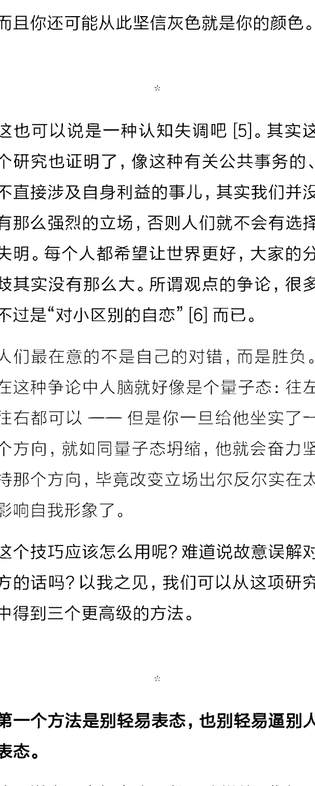

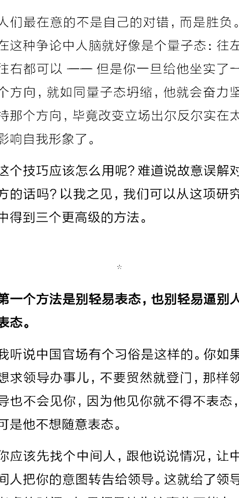

## 第一个方法是别轻易表态，也别轻易逼别人表态。

我听说中国官场有个习俗是这样的。你如果想求领导办事，不要贸然就登门，那么领导也不会见你，因为他见你就不得不表态，可是他不想随意表态。

## 第二个方法就是特朗普擅长的“先同步再领导” [7]，这个咱们以前说过。

## 第三个方法是直接调用对方的自我认同。

说到这里，我又想起一个悲伤的故事。我最近为什么总是想起悲伤的故事。

写留言，与作者互动

清......他就是洪承畴！

然后夏完淳被洪承畴杀死。这个故事告诉我们说服力是有限的，你不可能只用语言就说服洪承畴这样的人。

## 参考文献

[1] Petter Johansson et al., Failure to Detect Mismatches Between Intention and Outcome in a Simple Decision Task, Science 07 Oct 2005: Vol. 310, Issue 5745, pp. 116-119.

[2] http://journal.sjdm.org/13/13804/jdm13804.html

[3] Philip Pärnamets and Jay Van Bavel, How Political Opinions Change, Scientific American November 20, 2018.

[4] Thomas Strandberg et al., False Beliefs and Confabulation Can Lead to Lasting Changes in Political Attitudes, Journal of Experimental Psychology: General, Vol. 1, No. 999, 2018. http://dx.doi.org/10.1037/xge0000489

[5] 人心比事实重要

[6] 对小区别的自恋

[7] 武器级的说服力

## 聚焦错觉

万维钢・精读日课³
今天
进入课程 >

聚焦错觉
08:03 7.37 MB
| 译注：萨沙 |

这一讲咱们说一个非常常见，但是很少引起人们注意的认知偏误，叫“聚焦错觉（focusing illusion）”。我先说几个简单的例子，然后你会慢慢意识到这个错觉的应用有多广泛，我们犯的错误有多普遍。

我们想象一下，如果你买彩票中了一亿的大奖，你的生活会发生什么样的改变，你的幸福感会提升多少。那个感觉肯定是非常好的，我非常欢迎中一亿元的可能性。

我们再想象一下，如果你因交通事故，必须把一条腿截肢，你从此之后的幸福感会降低多少。那个感觉肯定是非常不好的，我宁可少中一亿元也不想截肢。

而所谓“聚焦错觉”，就是你把上面那两件事带来的幸福感的变化，都给大大高估了。


[图片来自 https://www.conversationagent.com/2015/11/illusions-in-decision-making.html]

> "Nothing in life is as important as you think it is when you're thinking about it"
- Daniel Kahneman

聚焦错觉是丹尼尔·卡尼曼最喜欢的一个认知偏误，他举的一个例子是“要不要搬到加州去”[1,2]。

这个道理是思想只要一聚焦，重要性马上就放大。比如你的朋友有一辆很好的车，你考虑自己要不要也买一辆这样的车，你就问朋友下面这个问题—— “这辆车给你带来了多大的快乐？”

"当我*想到这辆车的时候*，这辆车带给我多大的快乐。"

卡尼曼对此说过一句格言式的警告：“当你正在想一个东西时候，生活<|start|>中就没有别的东西像这个东西一样重要了。”

我理解聚焦错觉对人的最重要影响，是在我们对未来的预期和相关的决策方面。

所以你说聚焦错觉重不重要？它是不是特别值得我们注意的一个认知偏误？
不是。是我们现在在讲聚焦错觉，你才觉得

写留言，与作者互动

不是。我们现在在讲聚焦错觉，你才觉得聚焦错觉很重要。其实别的认知偏误也很重要。

## 参考文献

+   [1] https://www.youtube.com/watch?v=DMi9g4mkY04
[2] https://www.wiseinsights.net/focusing-illusion-distorts-daily-life/
[3] https://www.edge.org/response-detail/11984
[4] 【美】杰尔姆·格罗普曼；帕米拉·哈茨班德，《最好的抉择：关于看病就医你要知道的常识》，浙江人民出版社·湛庐文化，2016年7月（得到电子书有，会员免费）
[5] Rick Brenner, The Focusing Illusion in Organizations, ChacoCanyon.com, August 8, 2018.


# 问答：积极心理学能改变人的行为吗？

万维钢 · 精英日课³
今天

进入详情 >

问答：积极心理学能改变人...
11:41 10.7 MB

|传媒：苍沙|

# 读者 王煜全：

请教万老师，积极心理学的创始人塞利格曼认为，我们儿时受到的挫折甚至创伤都没那么大影响，现在时髦的认知行为法也认为一切只是认知问题，换个认知角度，自己对自己负责，问题就解决了。但我觉得人不是不自知的问题，知道要改变也是非常困难的，自己想对自己负责也很難做到，你正在讲的这本《行为》似乎也印证了这一点。请问积极心理学和认知行为疗法到底对不对呢？人真的是想要求为自己负责就能负责的吗？原生家庭和童年塑造对人的影响是可轻易克服的吗？换句话说，动物的自由意志似乎足够小，那么人呢？真有加强我们的自由意志的方法吗，能加强多少呢？

万维钢
我完全赞同王煜全老师的观点。人的行为归根结底是由大脑控制的，而大脑是一台硬件设备，虽然是活的、可改变，但真正的改变需要时间、需要刻苦的锻炼。大脑就像肌肉一样，我们不能指望一个四肢力量很弱的人突然顿悟了，就能负重前行。

# 来自日课：青春攻略

# 来自日课：童年的阶段

# 来自日课：怎样理解基因和环境

# 来自日课：怎样理解基因和环境

读者 一RU既往、一诗阳光、林彩霞、晓添才：

现在我们大部分人都不用担心温饱问题，普通人也可以通过上专门的课程挖掘自己的天赋所在，那么，社会经济地位高低的分界线在哪里？怎么判断高低？

万维钢

现在物质条件好了，的确几乎不存在什么辍学或者买不起课本之类的事情，各阶层教育的差距主要是体现在文化上。我们讲纽约市那项研究，穷人家庭对孩子强调防卫、蓝领家庭强调进攻，中上层强调个人的自我实现，这就是文化差异。

其实学校教育也是这样，我在《知识分子》这本书里介绍过以前的一项调查研究，都是学校教育，但美国各个阶层的教学方法和培养目标截然不同：

- 底层强调死记硬背，要求严格按照流程操作，连数学都要背诵解题步骤；
中层强调只要能做对就行，不管你用什么巧妙解法；
专业人士孩子上的学校，强调创造性和独立性。鼓励孩子独立思考、自我表达，比如几个同学一起拍摄一部电影；
而精英阶层强调的是决策和选择。老师不再要求孩子弄特别漂亮的 PPT 之类，更在于的是分析问题的能力。

类比到咱们中国，如果有的学校只知道为高考做准备，认为分数就是一切、考试大纲就是圣经；有的学校却能教点别的，你有什么看法。

你看咱们《精英日课》专栏最像哪种教学。而在中国这个特定时期，有很多经济状况并不好的家庭，眼界很好，知道好的教育应该什么样，敢于让孩子有所发挥，我们应该给这样的家庭鼓掌。

# 参考文献

[1] Carl Cederström, Why we should think critically about positive psychology in our universities, The Guardian Feb 7 2017.


万维钢·精英日课³
帮你和全球精英大脑同步
版权归得到App所有，未经许可不得转载

〈 前一篇

## 日课精选

默认      最新                 只看作者回复

正在加载...

写留言，与作者互动

# 《行为》8: 文化宿命论

万维钢·精英日课³
今天
进入详情 >

《行为》8: 文化宿命论
12:29 11.42 MB

今天我们继续讲萨波斯基的《行为》这本书。前面讲了个人与个人的行为差异主要是由年龄、基因和生长环境决定的，家庭和家庭的行为差异主要是阶级决定的，这一讲要说的是一大群人与一大群人的行为差异。比如说，中国人和美国人做事的风格似乎有一些不同的地方，那是怎么个不同，又是什么决定的呢？

人群和人群的不同，我们称之为“文化”。人说东南亚国家的人有个集体主义的文化，西方国家的 人则是个个人主义的文化，这两种文化就代表了不同的行为风格。那文化是从哪里来的呢？是基因决定的吗？

这个问题可是太重要了。如果文化是基因决定的，就意味着我们中国人就应该、也只能用中国的方式去做事，永远也别学美国那一套，中国文化几乎就是不可改变的。如果文化不是由基因决定的，是可以改变的，那就是说中国人也可以学习美国的文化，美国人也可以学习中国的文化，大家可以看哪个好使就用哪个。

萨波斯基是生物学家，他这本书主旋律就是人本质上是动物，一切行为归根到底是生理原因决定的，基因对人的影响非常重 要……所以文化是基因决定的吗？
不是。

两个人的基因版本可以千差万别，但是你要说一大群人与另一大群人、甚至一个国家的人和另一个国家的人的基因版本有什么系统性的差异，那可以说的确有，但是对行为的影响非常微小。


我们看到所有国家的女生的阅读成绩都比男生好，这也许是基因决定的，女性大脑的语言能力可能就是好。但数学并不是这样。
在土耳其、韩国和意大利这些两性分工有明显区别的国家，女生数学成绩确实不如男生。可是在挪威、瑞典和冰岛这些两性特别平等的北欧国家，女生的数学成绩跟男生相差无几——特别是冰岛，是女生比男生数学好。

所以你能说基因决定了数学吗？也许文化传统更重要。同样是女性，在沙特就只能作为男性一种财产，在别的国家就能当家做主，这个跟基因没关系。

萨波斯基说，文化是在童年时期对人产生决定性影响的。那时候我们最不受基因控制的额叶皮质尚未成熟，最能接受社会习惯的注入。

而社会习惯，则由文明的硬环境决定。


这张照片总是能被难的
研究者找不同的人看这样的照片，同时一边追踪他的眼球运动，一边扫描他的大脑。研究发现东亚人看照片会特别关注背景中的周围环境，你要是要要求他要多看看中间那个 人，你会发现他的前额叶皮质被更大地激活，也就是说他得调用意志力强迫自己，才能特别注意中间的人而忽略环境。西方人正 好相反，一上来很自然地就关注中间那个 人，你必须强迫他才能关注环境。

而这可都是仪器测量出来的。类似的实验我们以前也说过[1]。这个原理是东亚人更注重个人与环境的关系，而西方人更注重个体本身。现在有一只猴子、一只熊和一根香蕉，请问应该如何把它们分类呢？西方人的直说更多地是猴子应该跟熊一组，因为它们都是动物；很多东亚人的直观想法是猴子应该跟香蕉一组，因为它们构成了食物关系。

一个球在地上运动，问你这个球为什么要这样运动呢？西方人的思路是先考虑这个球本身的特点，比如重量；东亚人则是一上来就想到球和地面的摩擦关系。

一个美国人取得了什么成就，他会说这是因为我就是一个什么什么人，我擅长这个技能，我做了这些事儿；问中国人，他更可能强调关系：我作为团队的一员，在谁谁谁的关怀和帮助下，因为正好赶上了客观的机会，才做了一点微小的工作。

其实咱们中国人还不算集体主义的最突出代表。据说在日本、韩国和朝鲜，你提出一个数学难题，有的同时明明自己会做也不会抢着说出来，因为他怕别的同学感到没面子。集体主义文化中的人特别善于体察和照顾别人的情绪，而这一点也能从大脑活动中看出来。让人谈谈自己跟别人的互动，美国人更容易想到的是自己如何影响别人，而东亚人更容易想到的是别人如何影响了自己。

写留言，与作者互动

亚人更容易想到的是别人如何影响了自己。

你要强迫他们换位思考，他们就会有压力。

总而言之，集体主义文化讲和谐共存，讲互相依赖，讲团体，讲从众；个人主义讲权利，讲自主，讲独特性，讲个人的成就。

那为什么会有这样的差异呢？

*

有些学者认为东亚的集体主义来自传统农业的耕种方式。水稻这个东西要求集体劳动，必须大家齐心合力才能种好，而且你还得安排合理用水，谁家多占都会直接伤害别人家。

劳动方式影响文化这个机制还体现在，在中国北方，因为种的是小麦，而小麦这个东西不需要那么多集体劳动，自己家就能种好，结果中国北方人的集体主义精神就没有那么强。你让一个中国北方人把小白兔、小狗和胡萝卜分成两类，他更可能像美国人一样把小白兔和小狗分成一类。

你再比如说土耳其，牧民、农民和渔民说同样的语言，有共同的宗教，但是他们的思维模式也不一样——牧民更讲个人主义，因为放牧是孤独的；而农民和渔民就更讲集体主义。你让他们把手套、围巾和手这三个东西分类，牧民把手套和围巾分成一类，农民和渔民喜欢把手套和手分成一类。

那美国人为啥讲个人主义呢？首先美国是个移民国家，人们都是背井离乡来到这片土地——什么人会选择背井离乡？都是那些本来就不怎么在乎集体主义的人。再者，美国往西部开拓这段冒险的历史，也正好适应了个人主义的行为模式。

所以文化是硬条件决定的。那文化可以变吗？

*

事实上文化都是在不断演变的。咱们中国人现在的文化，就正在越来越倾向于个人主义——现在不是家家种水稻那个年代了，中国人也是整天跟陌生人打交道，很多事都只能靠自己。

有研究发现，移民到美国的东亚人，第一代身上还能保留一些集体主义文化的因素，到第二代就基本跟美国人想法一样了。

甚至有研究证明，只要你在前面说的那个看照片实验之前用某一种文化渲染一下气氛、启发启发受试者，他就能使用那个文化的眼光去看照片。

而且我们还应该注意，文化是个非常笼统的说法，一个文化圈内部的差异是巨大的：很多西方人比中国人更讲集体主义，很多中国人比美国人更讲个人主义。特别是现在有些研究都表明，各国精英阶层的思维都是一样的。一个北京高科技公司的管理者的“文化”，可能更像他的硅谷同行，而不像他的小学同学。

## 注释

[1] 如何理解西方？（上）

[2] 新巨富的新文化


# 功夫钢·精英日课³

帮你和全球精英大脑同步

版权归得到App所有，未经许可不得转载

‹ 前一篇

## 日课精选

默认     最新                     只看作者回复

正在加载...

写留言，与作者互动

# 《行为》9: 黑夜给了我们黑色的眼睛

万维钢·精英日课³
今天

进入详情 >

《行为》9: 黑夜给了我们黑...
13:03 11.95 MB

|绘绘：华沙|

我们继续讲波斯基的《行为》。一个人为什么会有那么一个特定的行为，我们已经从大脑硬件活动一直追溯到了环境、基因和文化的原因，这一讲是往前追溯的最后一环，生命的演化。

研究演化对行为影响的学问有两门，一个是我们专栏经常提到的“演化心理学（Evolutionary Psychology）”，有时候叫“进化心理学”，研究演化对个人的小行为影响，我们今天不说这个。我要讲的是演化对人的社会行为 —— 也就是人与人之间如何互动 —— 的影响，这一门学问叫做“社会生物学（Sociobiology）”。

社会生物学是一门能让人打起来的学问。

二三十年前，你要是在一个学术会议上做社会生物学的报告，台下一定会有人不断地打断你的话，用非常粗鲁的方式质疑你。而且你可能真的挨打，社会生物学家如果要对学术圈以外的公众发表演讲，有时候需要警察保护。

为啥这么火爆呢？生物社会学研究的是现在我们在网上也经常争论的一些问题。比如我们知道瑞典是个很发达的国家，它给国民提供很好的福利，特别讲平等，但是现在生育率很低。近年以来，瑞典接收了一些来自中东地区的难民，这些难民的生育率很高，而且都得到了跟瑞典人一样的福利。有些难民有犯罪行为，包括强暴了瑞典的女性，而瑞典政府对难民相当宽容。那么就有人说，瑞典人现在是过度文明了，他们正在生物演化的战役中输给中东人。

这样的事应该发生吗？瑞典人应该怎么做？我们这一讲并不提供立场，我们提供的是怎么才配得上有立场。你得真懂点生物演化，才配得上说演化的立场。

我们专栏多次提到的两个“威尔逊”——戴维·威尔逊和爱德华·威尔逊——正是社会生物学的代表人物，所以你其实已经知道一些社会生物学的理论了。这一讲我们要说的核心问题是，人这种动物既是演化的产物，那么人，到底是、以及应该、在多大程度上像动物一样行事呢？

咱们先看看演化让动物如何行事。

# 1.动物凶猛

最近我经常看到有人转发下面这个场景的一段视频——


一群大猩猩过马路，其中最大的一只——看起来像是其中的王者——站在路的中间不动，保护其他猩猩安全通过他才走。这真是一只充满爱心的大猩猩。很多人被动物的行为所感动，动画片里的动物永远都是真真可爱的样子，好像动物就是那么可爱，人就是那么污浊不堪……

可是社会生物学家更了解动物，也更知道什么叫“可爱”。

在社会生物学家看来，那只王者大猩猩之所以要保护其他的大猩猩，是因为其他大猩猩都是他的家人。他真正保护的是他自己的基因。你之所以觉得小动物可爱，是因为它们的样子像小孩，而你身上有觉得小孩可爱的基因——否则你就不会保护自己的孩子，你的基因就传播不下去。

动物的有些行为不会被拍成动画片。比如说一只公猴战胜其他公猴、成为猴王、占有所有母猴之后，会杀死那些母猴所带的婴儿。这是由于哺乳期的母猴不会排卵，而猴王的平均任期只有 27 个月，他等不及母猴给孩子正常断奶，他必须尽快传播自己的基因。杀婴，是动物世界里一个常见现象。

这就是演化给动物的第一指令：个体选择。你要把自己的——而不是别人的——基因传播下去，为此你必须作为一个个体，去跟其他个体竞争交配权，你必须保护自己的——而不是别人的——后代。

演化的第二条指令是亲缘选择。你的直系后代有你的基因，但是你的亲戚——包括兄弟姐妹、堂兄弟、表兄弟，他们的身上也有很多跟你一样版本基因啊。从理论上来说，同样一个基因版本，通过你的儿子传下去和通过你的兄弟传下去没有本质区别。唯一的问题是根据基因混合的概率，你儿子身上有你一半的基因，你兄弟身上有你 1/4 的基因，你的堂兄弟或者表妹妹身上有你 1/8 的基因。

这就是道金斯所谓的“自私的基因”——演化的主角是基因，而不是个体。而事实证明动物们虽然不懂数学，但是也是知道照顾亲戚。遗传学家霍尔丹 (J. B. S. Haldane) 有句名言说“我很乐意为两个兄弟或者八位表亲牺牲我的生命。”

你可能听过诸如母羊给小狗哺乳的事情，但是一般来说，雌性哺乳动物很少会给不是自己亲生的小动物哺乳。母猴生下小猴之后，她的亲戚们，特别是她的妹妹，常常会帮着照顾。狒狒没有一夫一妻制，但是是公狒狒会稍微照顾一下自己的孩子，比如打架的时候帮一把。动物们能通过气味和声音判断亲缘关系。

那动物到底有没有那种无私的、纯粹为了集体利益而牺牲自己的利益行为？以前认为是没有，但是近年来越来越多的学者认为动物界存在“群体选择”这个机制，可以说是演化给动物的第三个指令。我们以前讲戴维·威尔逊的《生命视角》说过群体选择 [1]。事实上根据博弈论，哪怕每个个体就是纯粹自私的，也应该选择与他人合作。现在有越来越多的证据表明动物界存在广泛的合作现象。

个体选择、亲缘选择和群体选择，被萨波斯基称作动物行为演化的三条腿。作为人类我们喜欢歌颂利他行为和群体选择，但是个体选择和亲缘选择也是动物的本性，而且很可能是更深刻的本性。

那人又如何呢？

# 2.兽性和人性

如果一个人对他人做出残暴、无耻的行为，我们就会说他是“兽性大发”，如果一个人无私地帮助他人，我们就会说他“有着人性的光辉”。那人性和兽性到底有什么区别呢？

比如说，丈夫和妻子离婚，母亲不抚养自己的孩子，儿子向司法部门举报自己的父亲，这些事是兽性，还是人性呢？

一夫一妻制度并非是人类首创，很多动物也是一夫一妻白头到老，而且比人类还专一。专一还是不专一，这只不过是雌性传播基因的不同策略而已。你可以选择追求质量，跟妻子一起好好抚养和教导孩子，确保他们平安长大，然后继续传播你的基因；你也可以选择追求数量，只要我基因好，多生几个后代，不用精心抚养也会活下来的。

而一个物种使用哪种策略，可以从雄性身体的普遍特征看出来。如果雄性和雌性的体型普遍差不多大，外观、肌肉强度也很相似，那么这就说明这个物种的雄性之间没有很强烈的竞争，雄性没必要有“多余的”强大。而反过来，如果这个物种的雄性体形比雌性大了很多，雄性们一个比一个强壮一个比一个漂亮，那就说明它们之间有一场军备竞赛。而费这么大气力搞竞争，奖励必定是胜利者获得散群中所有的雌性，失败者没有机会传播基因。

那么人类是什么情况呢？人类中的男人比女人平均身高高 10%，体重高 20%，多需要 20% 的热量，寿命短 6% ——身体的证据表明人类的男性参与了男人之间的军备竞赛，但是这些指标比黑猩猩之类的灵长类动物低了很多。而纵观人类历史，我们的婚姻状况的确是以一夫一妻为主、但是很时候允许一夫多妻。

占有女性是历史上很多男性的奋斗动力，人类喜欢自己的孩子胜过别人的孩子，有时候会虐待家里非亲生的孩子，就差没有杀死别人的婴儿了……

人类也有亲缘选择。我们更愿意照顾自己的亲戚，搞裙带关系。有些少数民族实行一妻多夫——而所谓的多夫，其实都是亲兄弟或者堂兄弟、表兄弟关系。如果没有直系后代，我们就把财产留给亲戚。我们在道德上要求亲戚之间应该有比对外人更密切的关系。孔子说“为子子隐，为父父隐”，说父子之间不能为了所谓正义而互相举报，今美国很多州的法律都规定不能要求证人提供对自己的亲戚不利的证词。

# 所以难道这些不是“兽性”吗？

但是人类中也有很多人为了追求神学或者别的什么超越物质的原因而主动放弃生育权。人类中的两兄弟可以为了效忠不同的国家而成为战场上的敌人。我们可以完全匿名地给陌生人捐款。像印尼和柬埔寨，甚至发生了一群人为了某个完全不能让别的动物理解的意识形态，去大规模地屠杀自己国家的人。

那这些又怎么算呢？

# 3.社会生物学的争论

人相对于动物来说，似乎有更多的、超越基因的“群体选择”现象，而不像是纯粹按照“自私的基因”规则进行演化。对此社会生物学……

点写留言，与作者互动

照“自私的基因”规则进行演化。对此社会生物学家们有个非常好的比喻，我给你解释一下。

社会生物学的一个争论焦点是，演化中的自然选择，到底选择的是“基因的版本”呢，还是“基因的表达”。我们前面讲过这两个概念的区别。这个比喻是就好像是做蛋糕，基因的版本相当于于是蛋糕的配方，而基因的表达相当于于是蛋糕的味道。

道金斯认为演化选择的是基因的版本——而且还不包括基因开关、转录因子这些辅助性的 DNA 代码，纯粹就是负责蛋白质编码的基因，毕竟只有这个配方是严格可复制的。

但是因为有表现遗传学的各种发现，很多科学家认为就算选择的是基因的版本，也应该包括那些辅助性的 DNA 代码。

而有些科学家认为，大自然毕竟不是科学家，她根本感受不到蛋糕的配方，她只关心蛋糕的味道，所以自然选择选择ocus其实是基因的表达。那么这显然就给群体“文化”的传承，“模因”的传播，提供了空间，也就能够解释为什么有些人会做出完全利他、毫不自私的行为。

再进一步，有些学者认为，这个蛋糕能不能卖出去，也不一定仅仅是配方和味道的问题。推销也很重要啊？再比如说如果你能让大家相信，买这个蛋糕代表爱国，是中国人就应该吃中国人自己制作的蛋糕，这不也能卖出去吗？

这就解释了为什么宗教和意识形态对人类的行为有那么大的影响。它们的作用是把一个群体团结起来，而团结就是力量。正如两个威尔逊说的那句名言：“群体中的自私打败无私。无私的群体打败自私的群体。”

那要这么说的话，我们就不必说演化不适用于人类，而应该说人类重新定义了、或者是让我们重新认识了演化，演化是在多个层次上发生的。或者至少我们也应该说，人类偏离了动物那种演化模式。

但是，请注意，并不是所有学者都这么看。这里面的逻辑非常有意思。

有些学者，我们称之为 A 类学者，坚持认为人就是一种动物，人的种种利他行为根本就不是真正的利他，本质上还是变着法地利己。而另一些学者，我们称之为 B 类学者，则认为 A 类学者这么说，就是在给人的兽性行为找借口！你们是宣扬人就不应该做好事！

可是 A 类学者反驳说，不是啊，我们说的是事实是如何，而不是说*应该*如何。这就好比说我是个研究癌症的医生，也不等于我就提倡癌症啊？

萨波斯基说，美国第一代社会生物学家全都是南方白人，而批评他们的全都是北方大城市长大的左翼学者。我们上一讲刚说了美国南方人特别有荣誉感——用今天的话来说，他们“兽性”比较强……所以你可以体会一下这场争论多么让人容易动感情……

今天的情况是社会生物学已经进入了中年，学者们越来越理性，越来越多的证据显示我们人类肯定不是像动物那么极端，但是也肯定不是完全脱离了动物属性……而你作为看客，至少应该知道这场争论的存在，而不应该一上 来就告诉瑞典人应该如何如何。

至此，影响人的行为的因素已经讲完了。接下来我们换成横向的视角，说说作为人，到底“应该”怎么办。

## 注释

[1] 善恶的演化逻辑


〈前一篇

# 用户留言

默认 最新 只看作者回复

提交留言可与作者互动

写留言，与作者互动


# 《行为》10：高等“群”论

万维钢 · 精英日课³
今天
进入详情 >

《行为》10：高等“群”论
13:23  12.25 MB
[转述：杨沙]

今天咱们继续讲萨波斯基的《行为》这本书。从这一讲开始，我们从纵向视角改成横向视角，从几个侧面考察人的行为，看能不能从中得到什么道理。这一讲咱们从一个大胆的话题说起，“爱国”。

你要细想的话，爱国这件事儿，是可以讨论的。中国女排以十一连胜的战绩夺得世界冠军，举国欢腾，而有人会对这个欢腾的情绪，甚至背后的爱国主义热情，提出质疑。女排得了冠军那是人家女排的成绩，跟你有什么关系呢？

可能你是一个大腹便便的宅男，你平时从不看排球，你没为中国女排做过一点点的贡献，完了女排得了冠军你却跟着“与有荣焉”，女排要是输了你还会骂人——你凭啥呢？可能有人会说不对啊，我给国家交税了，而女排是国家训练的，所以我和女排是利益共同体——这个解释挺好，但是它不能从根本上解释“爱国”这个情怀。

为什么一个中国人在国外被人欺负，所有中国人都要愤怒？为什么中国女孩嫁给中国人就没问题，嫁给非洲黑人就让中国人看不惯？为什么有些人，自己过着很艰苦的日子，甚至有时候受到同胞的欺负，却有一种沮丧而生的民族自豪感、最恨的反而是日本人呢？

大多数人认为爱国是理所应当的，但有的人持批判的态度，认为别人爱国是因为他们没有自我，说“爱国是无赖最后的避难所”。爱国，有道理吗？

别激动呐，这一讲不是质疑爱国主义，咱们《精英日课》是个爱国专栏。我认为爱国是合理的而且是应当的，萨波斯基也从未质疑爱国。但是我们不应该停留在一般的“愤怒青年”、“废物青年”和“公共知识分子”那样的讨论层次上，我们需要科学的见识。

爱国，首先是一个生理反应。

这个生理反应，连动物都有。它是一种演化机制，它对我们有好处。

咱们想象这么一个场景。有​一天你一觉醒来，发现自己穿越成了一个新石器时代的原始人。你不得不以打猎为生，可是没有家人也没有朋友，有时候好不容易弄到一点猎物还会被人抢走，你感觉周围的人对你都充满敌意。有​一天你正在跟一只剑齿虎搏斗、感觉自己快要不行了的时候，突然有​两个原始人过来，帮你打死了老虎，还把肉做好给你吃。

你感到很诧异：为什么你们不但不跟我抢，还帮我？

那两个人大笑了，说你看看我们的胡子。你这才注意到他们都长着绿色的胡子——跟你一样​的、绿色的胡子。两个原始人解释说，咱们这片丛林里有三种人：绿胡子、红胡子和黄胡子，以前大家都是盲目地互相打，现在我们绿胡子决定联合起来了！绿胡子跟绿胡子合作，咱们要打就专打红胡子和黄胡子，你愿不愿意跟我们一起？

你当然愿意。从此你就有了组织、有了依靠！而且你合理地推断出，率先团结起来的绿胡子，一定能迅速成为这片丛林的霸主。你愿为绿胡子的荣誉而战。

“绿胡子”是道金斯最早提出的概念，后来被演化生物学家威廉·汉密尔顿（William Hamilton）形成正式的理论，称为“绿胡子效应（Green-beard effect）”。这个效应说只要一个生物族群演化出这么一种机制，它的基因能制造一个像“绿胡子”一样能被所有族内成员识别的独特信号，那么只要成员们愿意跟有这个特征信号的成员合作，这个族群就能发扬光大。

按理说绿胡子带来的这个凝聚力是一种亲缘选择，比如绿胡子其实是一种气味。但是现在长着绿胡子的那个人是不是你的亲戚已经不重要了：只要大家都团结在绿胡子这面旗帜之下，我们的群族就会变大变强。

绿胡子如此，显然红胡子和黄胡子也会相应地团结起来，各自成立组织。那这时候作为一个绿胡子，说我就不爱绿胡子！我就要跟红胡子合作！那可能吗？

种族主义就是人类的绿胡子效应。

大脑中有个专门负责识别面孔的区域，叫“梭状回”，能让你在大街上迅速识别自己认识的人，这就是为什么我们“认脸”的准确度那么高，比用颞叶皮质识别别的東西快多了。偶然遇到一个人，你的梭状回识别出他的脸来，大约需要几百毫秒。

而如果这个人跟你不是一个种族的，你的杏仁核，只需要50毫秒，就能产生警惕反应。

我们识别“非我族类”，比识别熟人还要快。我们还没等到认出一个外族人，就已经先害怕这个人了——更何谈开启颞叶皮质去了解这个人呢？种族主义是个潜意识中的本能反应。也许对原始人来说，敌我识别实在太重要了。

当然作为现代人，你的颞叶皮质最终会反应过来，比如在一秒钟之后，你会醒悟自己外族人不等于是坏人，你想起这位黑人朋友上周还热情地借给你一百块钱。但是心理学家有办法测量到你潜意识中对外族人的不信任感[1]。

这个反感外族的大脑效应连黑猩猩都有。连刚出生的小婴儿都有，他们会对不是自己种族的人的脸有更强烈的反应。三四岁的孩子就已经会把人按照种族分类。而且别忘了，我们前面讲过的那个催产素，还能让人更喜欢自己种族、更排斥外族的人。

但是你可别说科学家证明了种族主义的合理性！科学家发现的是绿胡子效应并不仅仅存在于种族。像文化、价值观、意识形态、支持的球队、甚至包括你认为豆腐脑应该是咸的还是甜的，任何标签都能把人分类，我们可能会为任何标签而战。我的理解是只要经过训练，杏仁核可以为任何标签快速反应。

有时候你颞叶皮质的理性能战胜杏仁核的感性，但是更多时候，你的理性是帮杏仁核辩护用的。为什么我不愿意看见中国女孩嫁给黑人？我不是说黑人都不​好，可是你看这个黑人他就是有问题啊[2]！

我可不是什么种族主义者，但是我喜欢跟“自己人”相亲相爱的感觉。有很多实验说哪怕你把人随机分成两组，人人们也会迅速认为自己组的人看著比别的组的人亲。萨波斯基爱说的一个例子是老版《星际迷球》拍摄期间，有些群众演员扮演大猩猩，有些群众演员扮演黑猩猩——结果剧组每次集体吃饭的时候大猩猩的演员就自动跟大猩猩坐一起，黑猩猩跟黑猩猩坐一起。

这个规律是人以群分。我们自信信任本群的人，反感外群的人。我们这个群，就是比别人那个群更有智慧、更有道德、更正确。如果我们群里有人犯了错误，那就是个别事件；如果对方群里有人犯同样的错误，那就说明他们本来就都是那样的人。

有人统计说从1902年以来，美国电影里的“外星人”角色，有80%都是邪恶的。外群的人甚至会激活我们的脑岛，让人产生恶心的感觉。我以前我说有进化心理学家认为这是因为人们本能地担心外人有可能带来传染病。

我们倾向于用一个刻板印象代表整个一群人。我们说日本人性格都是什么什么样，美国人性格都是什么什么样，只有中国人是各有各的性格。有些人看外国人的长相都是​​一样的。

这些思维习惯能加强本群内成员的合作。而且在跟外群竞争的时候，“绿胡子效应”能把我们迅速团结起来、产生同仇敌忾的正义情结。

其实现代社会中，人群看人群最常见的划分法还不是看种族，而是一种“二分法”。我们最喜欢用“温暖度”和“能力”这两个维度去把人群分类。温暖度代表这群人跟我们关系好不好，能力代表这群人本身行不行。

我们自己这个群，当然是高温暖度、高能力。第三世界人民跟我们关系好，但是经济不行，所以是高温暖度、低能力。有些发达国家是靠着侵略剥削别国富起来的，但毕竟是富起来了，就是低温暖度、高能力。而有些国家的人跟我们又不友好，经济又不行，那就是低温暖度、低能力。

这个划分能解释人群和人群的复杂互动关系。人们对不同的群的态度是不一样的。对高温暖度、高能力的我们自己，我们自豪；对低温暖度、高能力的群，我们忌妒；对高温暖度、低能力，我们怜悯；对低温暖度、低能力，我们鄙视。

人群地位变化的时候，最能看出人心的复杂。

比如说一个高温暖度、低能力的​小国，本来一直都听中国的，忽然自以为强大了，不听你的了，变成低温暖度、高能力了，我们是一种什么情绪？

再比如萨波斯基说美国看日本，最早以前是个低温暖度、低能力的国家，刚刚跟美国打完仗，只能生产一些廉价商品——等到八十年代突然成了低温暖度、高能力了，美国...

十年代突然成了低温暖度、高能力了，美国人是什么情绪？

最早是犹太人，后来是日本人，现在是中国人，在国外给人的刻板印象，就是低温暖度，高能力。那你说这些人自己，应该作何感想。

这就解释了为什么有些人搞“逆向种族主义”，表现出好像很不喜欢自己的种族的样子。现在如果你在美国的校园里公开说“中国人数学好”，在小组学习里专门让中国人负责解决数学问题，他有可能会告你搞种族主义。你觉得你是夸他，但是他不喜欢被人用一个标签区别对待。

这就是为什么前纽约市长鲁迪·朱利安尼当年做检察官的时候拼着命也要把意大利黑手党头目拿下。他是一个意大利裔美国人，他成长过程中身边都是意大利人，他爸爸就是黑手党……所以他最恨的就是美国人心目中“意大利人都是黑手党”这个刻板印象。

这也是为什么辛普森杀妻案的黑人检察官一心要置辛普森这个黑人于死地、负责审判犹太裔苏联间谍的犹太裔法官一定要判那个间谍死刑。他们想要对抗人们对他们族群的刻板印象。

可悲的是，这个对抗刻板印象心理有时候能变成对自己族群的憎恶。种族隔离时代有40%到50%的黑人小孩表示白人小孩最可爱，现在中国最爱讲什么“女德”的都是女性……以及，在美国最爱刁难和压迫中国学生的教授，都是华裔。

而更可悲的是，他们如此反感刻板印象的行为，本身也是他们自己的刻板印象导致的。

萨波斯基并不反对把人分群，因为你不分是不可能的，而且分群，比如爱国主义，常常常能带来好的效应。科学家也是人，萨波斯基也享受群体认同感。但是你必须避免被分群思想所误，导致极端的错误行为。

怎么才能不歧视别的群（以及不自恨自己的群）呢？靠额叶皮质说服的作用很有限。科学的办法是首先要意识到，每个人都不只属于一个群。

这人是个黑人不假，但他同时还是一个物理学家，是一个女性，还是一位老人。强调她不同的身份，你对她的印象会截然不同。心理学家做了大量研究，证明分群的优先顺序非常容易改变。比如同样是让美国的一群亚裔女生做数学题，你要事先强调她们都是女生，她们就考的不是那么好；你要事先强调她们是亚裔，她们就能考得更好。

另一个办法是从对方的角度考虑问题。如果你对老人有偏见，你能不能假设自己也是个老人，看看这时候怎么办。

一个办法是找到跟对方的共同点，强调大家其实是在一个群。比如泛太平洋国家派代表开个会，美国故意没来，那我们说啥？当然是先说说怎么对付美国。

大家多接触，最好一起去一件事，为了一个共同的目标努力过，是消除隔阂建立群关系的好办法。

而归根结底，最高水平的见识是不要用群去看个人。当这个人站在你面前的时候，一个人就是一个人，别想他是哪个群的人。

这一讲的主题其实不是说爱国，更不是说种族，而是说刻板印象。能带来好处的东西往往也能带来坏处。当一个人说中国人如何如何日本人如何如何、穷人如何如何富人如何如何的时候，我们必须非常小心才行。

## 注释

[1] 这个方法叫“内隐联想测验（Implicit-association test）”，我很早以前写文章说过，你如果感兴趣可以去哈佛大学网站测测自己的偏见（有中文版）：https://implicit.harvard.edu/implicit/china/

[2] “确认偏误（confirmation bias）”了解一下。


〈上一篇

# 用户留言

默认   最新        只看作者回复

正在加载…

写留言，与作者互动

## 外科式快乐

万维钢 · 精读日课³
今天
进入课程 >

外科式快乐
10:38 9.73 MB
| 转载·空沙 |

这一讲咱们说一点有关直接操控人的大脑的新进展和新想法。得到有个《脑机接口》课程，介绍了一些这方面的新进展，但是那个课程重点关注的是“非侵入式”的大脑操作界面，比如戴个头盔能不能帮人进入“心流”状态。我们这一讲要说的是“侵入式”的控制方法，效果很惊人，而你可能会为此感到有点不安。

在讲消息之前我想先讨论一点哲学。“中医”是个容易引起争议的话题，我不参与这个争论，但是为了思考大脑，请允许我拿中医打个比方。

比如现在有人身体出了一个毛病，长了个良性的肿瘤，表现出各种难受的症状。中医看到这些症状，对这个病肯定是有话说的：它是“寒”、“风”、“湿”还是“燥”呢？它是气血在哪儿运行不够呢？它的“表里虚实”是什么？特别是中医会强调病人主观能动性，说一些什么“正气存内，邪不可干”、“邪之所凑，其气必虚”、“勇者气行即已，怯者而苟成病”之类。

据我粗浅的印象，中医很喜欢强调病人的某种情绪、或者某种不良生活习惯，是得这个病的根本原因。那么为了治病治本，病人就应该反省自己的内心，审视自己的生活，做一个积极向上的人。

也许这一套很有道理……但是，事实是你只要做个手术，把那个肿瘤拿掉，病就好了。身体上的病，其实现是个硬件问题。

那心理上的病，难道就不是硬件问题吗？比如一个人经历过重大的惊吓和创伤，得了 PTSD，情绪很难受，无法正常生活。这时候如果有一位心理医生说是以前的痛苦导致了你现在情绪，让我来帮你调节情绪吧。他采用了对话、催眠、甚至召集患者的朋友们给他上演情景喜剧的方法，想要抚平患者的精神创伤，你觉得这有效吗？

我想说的是，这种治疗方法就如同中医看肿瘤。PTSD 是大脑中的杏仁核在剧烈的惊吓中受到创伤，患者的杏仁核比正常的大一些 —— 这是一个硬件问题。

并不是说软件方法就不能治疗硬件问题，毕竟你很难证明中医就不能治疗肿瘤。但是一旦你意识到 PTSD 是个硬件问题，用硬件方法治疗才是更直截了当的方法。

现在用药物治疗 PTSD 已经被人们广泛接受了，药物本质就是一种硬件方法。但是类似到肿瘤，我们更想要的是，有没有一种更直接的硬件方法。比如说，用什么仪器设备深深入到患者大脑之中去，直接操控一下杏仁核。

我不知道现在对 PTSD 的治疗有什么新进展，但是我知道，对抑郁症，现在已经有了最直接的治疗方法。

长期的、重度的抑郁，不只是“心情不好”、“悲伤难过”的问题，而是完全感觉不到快乐。普通人也会悲伤难过，但是总有些事情能让你感到高兴和快乐。而对重度抑郁症患者来说，不管什么事情，都不能让他快乐。他就如同掉入了一个深深的、黑黑的坑里，怎么都爬不出来。

那在这种情况下，你说什么你要发挥主观能动性啊，你要有积极向上的人生态度啊，我跟你好好聊聊吧，这些对患者来说，就等于 用中医治肿瘤。重度抑郁，是个硬件问题。

美国女神经科学家海伦·梅伯格（Helen Mayberg）研究抑郁症很多年，她借助核磁共振成像技术，第一次发现，抑郁症跟大脑额叶皮质中的一个异常小的区域，叫“布罗德曼 25 区（Brodmann area 25）”有关。这个脑区和负责情绪的边缘系统、以及负责决策的前额叶皮质区都有大量连接，抑郁症患者的这个脑区比普通人小，而且过度活跃。

梅伯格就想，我能不能直接干涉一下这个脑区呢？她发表了自己的发现，跟很多学者交流，找到一位加拿大的脑外科医生合作，招募了愿意第一个吃螃蟹的志愿患者。

2003 年，他们把一根电极，深入到了一位重度抑郁的女患者的大脑的布罗德曼 25 区之中。他们可以通过调节电极的电压来控制对那个脑区的刺激。过程中患者是清醒的，可以随时汇报自己的感受。

一开始医生没找准位置，电压一直加到 9 伏患者都没有反应。医生把电极移动了半个厘米，电压设到 6 伏，患者立即就有了反应。

患者说，那种喜悦感觉就好像是你一直都处在冬天之中，你早已经厌倦了冬天的寒冷，然后你出门一看，春天终于来了！
然后医生只要关闭电极，患者的“春天感觉”就会立即消失。

梅伯格找到了直接操控大脑治疗抑郁症的方法。抑郁不抑郁，现在只是一个电源开关的事儿。

这样的手术现在已标准迎来，它的后续流行，主要可能是因为手段比较激烈，费用也比较贵。手术会在患者头骨上开一个小洞，把一根微小的电极伸进去，并且长期留在患者大脑之中，用导线连接出来，由埋在肩胛结 近的皮肤之内的电池供电。手术本身要花费十万美金左右，然后每三到五年要换一次电池，电池的费用是五千美金 [1]……但我想说的不 是治病的事儿。

大脑侵入式治疗抑郁症，还有另外一派人马也在做。梅伯格这一派的思路是对布罗德曼 25 区下手，是去除大脑对正常情绪的干扰，是做减法。

另一派人马，以德国伯恩大学两个精神病医生（ Thomas Schläpfer 和 Volker Coenen）领衔，采用的方法是刺激大脑中能产生多巴胺、让人产生快乐情绪的区域，是做加法。这一派认为既然抑郁症的本质是不快乐，那我给你加点快乐不就行了吗？

科学作家隆·弗兰克（Lone Frank）在 2018 年出版的《快乐冲击》这本书中记录了这么一个 2012 年的案例。 有个 33 岁的德国男子，因为严重的强迫症和焦虑而接受手术，在大脑中负责提供快乐奖的伏隔核中植入了一个长期的电极。这个电极的电压可以在 1 伏到 5 伏之间任意调节。

患者带着这根电极一直感觉都不错，过了几年，换电池的时候，医生和神经科学家帮他重新调整了一下电压。这一次他们发现，患者对电压非常敏感。按照从 1 分到 10 分打分，电压是 1 伏，患者感觉快乐是 2 分，焦虑是 8 分；电压是 2 伏，患者快乐就是 3 分，焦虑是 6 分；电压调到 4 伏，患者立即感受到快乐达到了 10 分，焦虑是 0！

而如果电压到 5 伏，患者就感觉有点太“狂喜”了，引发焦虑感也随之上升……那么为了安全起见，医生们决定把电压设定在 3 伏。

这似乎很合理，但是患者提出了一个要求。

患者说，我以后能不能自己调节电压呢？
如果快乐如此容易，我以后每次想感受快乐的时候，调一下旋钮不就行了吗？

我们想想这个局面。本来人们以为情绪是个软件问题，现在我们知道情绪其实是个硬件问题 —— 而且非常容易调节！任何人只要做这个已经标准化的手术，就 可以想快乐就快乐。请注意这不是科幻小说，这是 2012 年的真实案例！

做的人多了以后，手术和电池的费用都会下来。你根本不需要在身上装什么开关，电池完全可以遥控。你只需要一个手机 APP，就 可以随时调控自己的情绪。

# 唯一的问题是，请问，这跟，吸毒，有什么区别。

区别是尚未发现明显的负作用。医生没有答应那个德国患者的要求。但是伯恩大学的那两位加法派的专家对这个做法相当乐观。患者从来没有出现过躁狂之类的症状，他们说，即使把刺激弄得比较大，患者的感觉也就是相当于喝了太多咖啡而已。

但是减法派的梅伯格提出了质疑。她认为刺激大脑快乐区域就等于是吸毒，而任何一个毒品专家都会告诉你，人脑对快乐是从不满 足的 —— 人会要求越来越高的刺激，以至于失控。

你是否担心，这种直接操控大脑的“外科式快乐”，会把人变成一台专门体验快乐的机器呢？

现在操控大脑的研究十分活跃，已经非常接近大规模应用了。马斯克搞了个做脑机接口的公司，最近有个中国公司还弄了个号称能提高注意力的头环。已经有实验证明用电极刺激海马就能强化学习，只要你把脉冲节奏控制好就行。

我看到最激进的方案，是在大脑之中植入一个永久性的、3D 的、深入到各个脑区的微型电极阵列。

个永久性的、3D 的、深入到各个脑区的微电子网格 [2]。有了这个网格你就可以用外部设备随时操控大脑而不必每次都做手术了。你可以非常精准地想刺激哪个脑区就刺激哪个脑区，你还可以按照一定的次序和组合，同时刺激多个区域。你可以给大脑建立额外的神经连接。

研究者并不打算据此把人脑变成“神脑”，这套设备的主要功能是作为操作界面，跟外部人工智能网络联网。从此之后你就可以下载任何信息，比如说下载技能，下载想法……你就想吧。

你喜欢这个前景吗？认识到人脑只不过是一台机器，人只不过是一台机器，所有情绪都只不过是化学反应，可以随意操控，我表示情绪稳定但是心情复杂。我预计将来这个领域会引发无数思考和争议。

多年以后，当我们回想起那个用中医的眼光看情绪、跟心理医生聊天的时代，会充满感慨。也许那时候你会觉得中医那个神神叨叨的世界观更人性化……而未必喜欢这个其实是机械的真实世界。

## 参考文献

[1] 这些事迹见于 Lone Frank, The Pleasure Shock (2018) 一书。Nautilus 杂志给了一段书摘：http://nautil.us//issue/60/searches/can-you-overdose-on-happiness

[2] Brian Gallagher, The Implant That Can Control Your Brain, Nautilus, October 17, 2019.

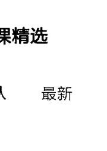

万维钢·精英日课³
帮你和全球精英大脑同步
版权归得到App所有，未经许可不得转载

‹ 前一篇

## 日课精选

默认   最新            只看作者回复

正在加载...

写留言，与作者互动


# 特别放送：你我的行为（上）

万维钢·精英日课³
今天

进入评论 ›

特别放送：你我的行为（上）
00:43 676.06 KB

|转译：薛汐|

万维钢

《行为》这本书的前半部分已经讲完了，我们来做一个总结复习：一个行为的发生，到底都有些什么因素在影响它？这个行为发生前的一秒钟，一直到几百万年前，都有哪些环节促使它最终发生，它们又是怎么样起作用的？作为总结这本书的“上集”，咱们先把这些因素按时间顺序由远到近梳理一下，也能帮你更好地理清解读本书的后半部分——作为人，我们到底应该该怎么做。祝你每天都有收获。

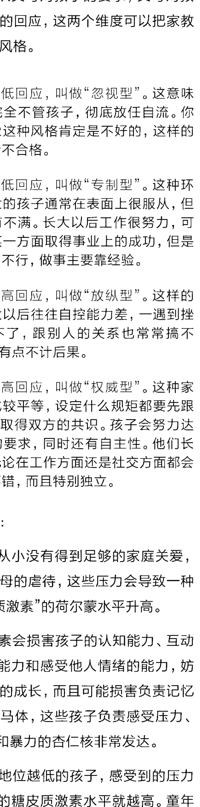

书名：《行为》（Behave: The Biology of Humans at Our Best and Worst）

作者：罗伯特·萨波斯基（Robert M. Sapolsky），斯坦福大学教授，研究人脑的神经科学家，灵长类动物专家。《为什么斑马不得胃溃疡》作者。

出版日期：2017年，暂无中文版。

## ★他为什么会这么做？简单说，是这样：

- 一秒前 大脑神经系统的活动，因为某种化学反应，主导了这个行为
- 一天前 今天有些时候，他的身体产生了这种荷尔蒙
- 几十年前 小时候的成长环境和出生时的基因
- 亿万年前 动物亿万年演化的产物

## ★影响他这么做的因素，有这些：

—— ☆大脑☆ ——

按照在动物演化历史中出现的先后顺序，大脑可以分为三层——

第一层：“自动控制层”。比如你体温低了就会发抖，血糖低了就产生饥饿感，受了伤就启动压力反应，都是自动控制层的作用。自动控制层是大脑中最古老的一层，连爬行动物都有。自动控制层只负责最底层的功能。

第二层：“边缘系统”，负责情绪，一定程度上是哺乳动物才有。看到恐怖的东西会感到害怕，这就是边缘系统的功能，然后它会把信息传递给第一层，让我们身体颤抖。渴望、沮丧、恐惧、愤怒……所有情绪都是边缘系统的事儿。

杏仁核：它负责产生恐惧、焦虑、攻击冲动和愤怒这些情绪。杏仁核又分为“中央杏仁核”和“基底外侧杏仁核”两部分。中央杏仁核，负责先天就会的恐惧。基底外侧杏仁核，负责后天习得的恐惧。

多巴胺：让人产生愉悦感，是大脑对我们从事各种行为取得成功的奖励。大脑中有很多区域都能合成多巴胺，多巴胺跟预期有关，达到预期，多巴胺给的少；超出预期，才会给很多。大脑不单奖励你得到的报酬本身，而且更要奖励你对报酬的预期。

第三层：“新皮质”，是大脑在演化中最晚出现的部分。新皮质负责高级功能，比如认知、记忆、抽象思维、决策等等。灵长类动物的新皮质最发达，灵长类动物中人的新皮质最发达——而人的新皮质，是直到 20 多岁的时候才完全成熟。

额叶皮质：能让我们不被情绪完全控制，提供理性思维。额叶皮质生长比较慢，要等到 20 多岁的时候才能完全长成，具有高度的可塑性，而且额叶皮质的运行特别消耗能量。

——前额叶皮质：额叶皮质的前端，叫做“前额叶皮质”的这个区域，是大脑中的决策者。前额叶皮质还能给物品按照抽象的规则分类，还能提醒我们要自律。前额叶皮质也是由两部分组成的：

——背外侧前额叶，讲究纯粹的理性，他做决策无比冷静，他统筹是利益计算。

——腹内侧前额叶，则专门聆听各种情绪的声音。

- 1.额叶皮质的运行特别消耗能量。
- 2.大脑直接控制人的行为，完全都是在硬件层实现。并且这些区域之间的互动也能决定行为。
- 3.想要改变人的行为，最直接的办法就是改变他的大脑。

—— ☆荷尔蒙☆ ——

中文有时候把荷尔蒙（hormone）翻译成“激素”，它和多巴胺都是在我们的身体里负责传递信息的物质，是“化学信使”。二者不同的是，多巴胺是一种“神经传导物质”，只对大脑神经元有效，信号传递速度非常快，是毫秒级的；荷尔蒙则对全身各处的细胞都可以有影响，但是荷尔蒙起作用的时间慢，需要几个小时甚至几天时间。

睾酮：就是所谓“雄性激素”的一种，主要由男性的睾丸分泌，肾上腺也会分泌比较少的量，所以男性体内的睾酮比女性多得多。在神经生物学家看来，睾酮的作用是加剧大脑对刺激的反应。睾酮让人更加积极地迎接挑战，参加竞争，也就是*放大*人在某些方面的行动力。

催产素、抗利尿激素：它们的分子式和功能差不多，都是大脑中的下视丘制造的，可以影响大脑的腹侧被盖区、伏隔核、海马体、杏仁核和额叶皮质等多个区域。特别是催产素，能抑制中央杏仁核的活动，让人减少恐惧和焦虑，降低攻击性，感到安全。能让我们更加区分彼此。催产素甚至会让人产生排外情绪，乃至于加强种族主义倾向。

- 1.大脑神经系统直接决定人的行为；
- 2.视觉声音和嗅觉刺激这些环境因素在一秒到几分钟之前影响人的神经系统；
- 3.而荷尔蒙则在几小时和更长的时间之前发挥影响。

—— ☆环境☆ ——

童年会怎样影响人的一生呢？童年问题的本质，是压力问题。具体说来，童年的关键是家庭，家庭的关键是阶层，阶层决定生物学压力。

有的孩子生活在威胁之中，有的小孩生活在机会之中。从父母对孩子的要求，父母对孩子各种诉求的回应，这两个维度可以把教养划分为四个风格。

低要求、低回应，叫做“忽视型”。这意味着父母完全不管孩子，彻底放任自流。你可以想象这种风格肯定是不好的，这样的父母完全不合格。

高要求，低回应，叫做“专制型”。这种环境中长大的孩子通常在表面上很服从，但是内心有不满。长大以后工作很努力，可能会在某方面取得事业上的成功，但是社交能力不行，做事主要靠经验。

低要求，高回应，叫做“放纵型”。这样的孩子长大以后往往自控能力差，一遇到挫折就受不了了，跟别人的关系也常常搞不好，做事有点不计后果。

高要求，高回应，叫做“权威型”。这种家庭关系比较平等，设定什么规则都要先跟孩子谈，取得双方的共识。孩子会努力达到家长的要求，同时还有自主性。他们长大之后无论在工作方面还是社交方面都会表现很不错，而且特别独立。

糖皮质激素：

- 1.很多儿童从小没有得到足够的家庭关爱，甚至受到父母的虐待，这些压力会导致一种叫做“糖皮质激素”的荷尔蒙水平升高。
- 2.糖皮质激素会损害孩子的认知能力、互动能力、自控能力和感受他人情绪的能力，妨碍额叶皮质的成长，而且可能损害负责记忆和学习的海马体，这些孩子负责感受压力、恐惧、愤怒和暴力的杏仁核非常发达。
- 3.社会经济地位越低的孩子，感受到的压力就越大，他的糖皮质激素水平就越高。童年的逆境还会损耗多巴胺系统，让人长大以后也会更 容易 对酒精上瘾，对药物形成依赖，而且容易得抑郁症。经历过的童年阴影因素越多，孩子长大后的精神状况也会有问题，想要战胜这些阴影就越不容易。
- 4.现实是教养方式跟社会经济地位高度相关。地位高的家长倾向于使用权威型和放纵型教育，地位低的家长倾向于专制型和忽视型。

—— ☆基因☆ ——

杏仁核多一点或者少一点，催产素多一点或者少一点，直接影响一个人的行为。而组成杏仁核和催产素的每一个细胞，都是极其严格地按照基因的图纸制造出来的。所以基因当然对人的行为有重大影响。我们首先要弄清楚三个概念。

写留言，与作者互动

当然对人的行为有重大影响。我们首先要弄清楚两个概念：

“基因的表达”：由环境决定

“基因的版本”：描写了人与人天生的差别。

遗传力：说的是人与人之间的*差异*，在多大程度上，是由基因*版本*不同，决定的。

“行为遗传学”，专门研究人在不同环境成长带来的行为特点。研究结果：遗传因素对人的影响，差不多都在 40%到 60%之间。

“分子遗传学”，专门研究某个特定基因的不同版本对行为的不同影响。研究结果：同一个基因版本到底是好是坏，跟环境非常有关系。

遗传力研究发现的一个大趋势是，社会经济地位越高的家庭里的孩子，基因的影响就越大；社会经济地位越低的家庭里的孩子，环境的影响就越大。

富人家小孩的智商，70%是由基因决定的。

穷人家小孩的智商，只有 10%是基因决定的。

## —— ☆文化☆ ——

人群和人群的不同，我们称之为“文化”。

文化是在童年时期对人产生决定性影响的。那时候我们最不受基因控制的额叶皮质尚未成熟，最能接受社会习俗的注入。社会习俗，则由文明的硬环境决定。

集体主义文化讲和谐共存，讲互相依赖，讲团体，讲从众；东亚的集体主义来自传统农业的耕种方式。

个人主义讲权利，讲自主，讲独特性，讲个人的成就。牧民更讲个人主义，因为放牧是孤独的；美国人讲个人主义，首先美国是个移民国家，人们都是背井离乡来到这片土地，选择背井离乡的都是那些本来就不怎么在家集体主义的人。再者，美国往西部开拓这段冒险的历史，也正好适应了个人主义的行为模式。

所以文化是硬条件决定的。而且文化都是在不断演变的。

## —— ☆演化☆ ——

- 1. 个体选择、亲缘选择和群体选择，被萨波斯基称为动物行为演化的三条腿。

个体选择：你要把自己的基因传播下去，为此你必须作为一个个体，去与其他个体竞争交配权，你必须保护自己的后代。

亲缘选择：从理论上来说，同样一个基因版本，通过你的儿子传下去和通过你的兄弟传下去没有本质区别，唯一的问题是根据基因混合的概率。

群体选择：现在有越来越多的证据表明动物界存在广泛的合作现象。

- 2. 人这种动物也是演化的产物，作为人类我们喜欢歌颂利他行为和群体选择，但是个体选择和亲缘选择也是动物的本性，而且很可能是更深刻的本性。

- 3. 越来越多的证据显示我们人类肯定不是像动物那么极端，但是也肯定不是完全脱离了动物属性。人相对于动物来说，似乎有更多的、超越基因的“群体选择”迹象，而不像是纯粹按照“自私的基因”规则进行演化。

- 4. 人类重新定义了、或者是让我们重新认识了演化，演化是在多个层次上发生的。人类偏离了动物那种演化模式。

> 现在，科学，基本上把人看明白了。要理解人的行为，首先你得理解人是一种动物，是一种以特殊的方式特殊，的动物。

上集完

———金句分割线———

- ☆你说这个人怎么没有意志力呢？可是他有什么办法呢？他大脑的硬件结构就不是很合理！

- ☆当你想要为某个行为做决定的时候千万别忘了，你的所谓理性和自控能力，比你想象的要低很多。

- ☆这个可悲的事实是以很多穷人家孩子的环境之差，根本轮不到拼天赋。

- ☆当一个经历了各种童年阴影的孩子终于长到五岁上了幼儿园，面对那块棉花糖的时候，他其实已经输了。

- ☆青春期中的你是個判断力跟不上感情的动物。


# 用户留言

## 万维钢·精英日课³

今天

进入评论 ›

问答：文化改变了我一部分...

11:59  10.97 MB

| 转发：祥沙 |

# 来自日课：文化宿命论

读者 穰虺：

文化可以影响基因吗？

读者 seifer-zzg：

最近我在国内的一家基因检测机构做了一套基本测试。结果是我除了80%以上 的中国北方汉族的基因外还有接近19% 的其他东亚国家 的基因，按照基因图谱 计算务椁中至少有一个人90%的基因是 这个东亚国家的人，家里调查过后可以 确定都是正宗中国人。因为我个人在 这个东亚国家待过11年左右，难道是这个 国家的环境，饮食习惯或者文化改变了 我一部分基因吗？

万维钢

文化可以影响基因的表达，可以影响基因版本的传播，可以选择基因版本，但是文化不能改变基因版本。

# 来自日课：黑夜给了我们黑色的眼睛

读者 晓添才：

最近有一部热播剧，讲的是六十年代中国造两弹一星的历史，也有纪录片讲述那些无名英雄，当时很多人确实不太考虑个人，只要是国家需求就会义无反顾的响应号召，而且积极性很高。我想问的是，人的各种行为随着环境的变化都是在不断变化的，有时候变得动物性强一点有时侯又特别体现人性的光辉，还是，所有的这一切行为都只有一个基因传递的目的决定的？

读者 十三先生：

万老师，人类偏离了动物那种演化方式，是怎么成的呢？我觉得可能是因为人类发明了语言？或者是大脑发育出了大脑皮层？

读者 茉莉云：

万老师，有些人不想生小孩，排除那些因为经济压力大而不生的，有些人很明确自己讨厌小孩，这种情况有解释吗？

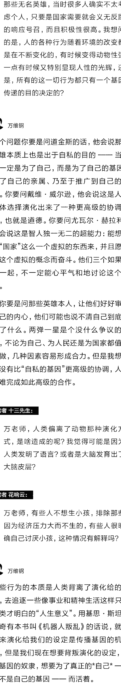

小李实在太想去火星建功立业，就告别了家人。那你说他俩谁自私、谁无私、谁卑微、谁伟大呢？

如果是一百年前的中国人那个样子，大多数人都是基因的奴隶只知道养家糊口，小李更值得我们学习；而在现在，很多人早就不是基因的奴隶了，我特别同情小张。

# 来自日课：高等“群”论

读者来函：

国家、民族、爱好、习惯等等，只要不一样就可以区别并形成共同体，不过强弱有别。老师的这一讲也印证了华杉老师讲品牌时超级符号影响力的观点。从绿胡子的身体特征到家族徽章，再到影响世界的品牌，每一个特征都是区别，区别的对面就是归属感的认知。老师，随着人类个体能力和科技能力增强，族群的演化是不是朝向分解或者重新建构，这种演化会不会带来战争？

万维钢

这种演化一定会带来身份上的冲突，但是未必会带来战争。萨波斯基讲的这个关于人群划分的理论，有两点特别值得我们注意：第一，每个人都属于很多个群；第二，这些群在一个人身上的排序优先级，是非常容易改变的。

理解这两点，我们就能理解为什么像艾克森、高拉特、洛国富这些以前的巴西球员可以加入中国国籍，为中国的荣誉而战。他们曾经是巴西人，但同时也是足球人，更是为中国的足球队奋斗的足球人。国籍这个标签，对他们来说不一定是最大的。

当然我可不是说号召大家加入外国国籍——再次说明，本人是中国国籍。我的意思是说，我们可以理解这些归化球员。在我眼中他们就是中国人。事实上巴西球迷非常理解巴西球员加入别国国籍这个事儿，都是送上祝福。

多年以前，托马斯·弗里德曼在《世界是平的》这本书里有个说法，说最早的世界讲国家，过去的世界讲公司，现在的世界讲个人。弗里德曼说没有两个属于同一条产业链的国家之间会发生战争。我觉得有一定的道理。这个世界的趋势是每个人都属于很多个群。其实过去人们也说过“工人没有祖国”这样的话——可是二战一打，我们发现还是国家这个群最重要。但是现在不是世界大战期间，那么特别是在欧洲，很多人有好几个国籍，这些人如果要跟谁冲突的话，就不一定是为了公司、为了个人、还是为了哪个国家群而战。

万维钢·精英日课³
帮你和全球精英大脑同步

版权归得到App所有，未经许可不得转载

‹ 前一篇

# 用户留言

默认   最新   只看作者回复

正在加载…

# 《行为》11: 丛林法则和人类社会

万维钢·精英日课³
今天

《行为》11: 丛林法则和人类...
12:23 11.33 MB

[注: 祥纱]

咱么继续讲萨波斯基的《行为》。如果说这本书的上半部分告诉我们人不过只是一种动物，那么下半部分要说的就是人是一种“以特殊的方式特殊”的动物。动物是什么样，不等于是人类是什么样。曾经是什么样，也不等于是就应该是什么样。

这一讲我们要说的也是人性在动物性边缘的一个试探：社会的阶层。我们在《童年的阶级》这一讲说了儿童都是被动受到家庭阶层的影响，那么成年人也是如此吗？

有些历经过坎坷的人说这个社会适用丛林法则, 讲究恃强凌弱, 每个人的社会经济地位决定了他的幸福度。是这些人太愤世嫉俗了吗？也有很多人认为真实社会没那么极端：也许某些人整天尔虞我诈你死我活, 咱 们普通老百姓可是都过着单纯美好的生活。是这些人太天真了吗？

社会等级到底有多重要呢？这首先是一个生物学问题。

对动物来说, 社会等级的本质是资源调配机制。食物、地盘和异性, 好东西就只有这么多, 大家每次都要抢一赛弄一身伤痛实在不好。建立一个比较稳定的等级, 有个“啃食顺序”, 该吃肉的放心吃肉, 该喝汤的老老实实喝汤, 对大家都有好处。

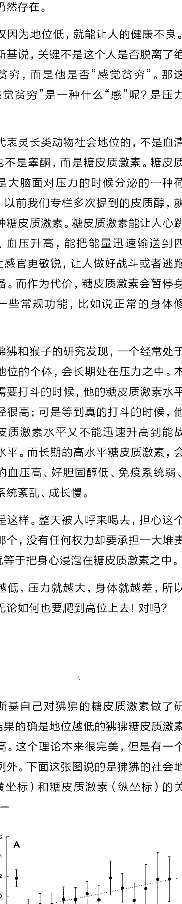

答案是 40 毫秒。只要观察脸部 40 毫秒, 你就能以相当的精确度看出来一个人在当前群体中是身处上层、可以对别人发号施令的“支配者”, 还是一个从属者——前者直视别人, 后者选择回避视线; 肢体语言还能带给你更多线索 ——


这个例外是, 社会地位最高的那只猕猴, 他的糖皮质激素就如同最底层的猕猴一样高。他也面临巨大压力! 他时刻都可能会被其他猕猴挑战, 他得担心那些母猕猴会不会被别人强抢。

所以真正的关键不是地位, 而是地位带来的压力。

人类社会的等级关系比猕猴要复杂一点。有时候地位高压力也大, 地位低反而没啥压力。那这个压力到底从哪来呢？

有研究者专门对政府公务员和军官做了一项调查，看看健康状况和地位的关系。结果发现，真正影响健康的并不是你直接指挥和监督多少人，而是你下面有多少人，以及你在工作中有多大的自主权。也就是说，最理想的地位是你受到很多人尊敬而你不用为这些人担心，你自己想怎么干就怎么干。

所以真正决定健康 的其实不是绝对的地位，而是我们专栏多次强调过的那个“控制感”。只要你对自己的生活有掌控感，你的压力就大大减小。如果你进一步还能控制别人，而且还不用担心为此承担责任，你的健康还会更好。

支配者，就是能控制别人的人；从属者，就是被人控制的人——这才是地位的本质。

那如此说来，哪怕你在公司只是一个最底层的人员，只要这个公司使用某种“自下而上”的组织形式，给一线人员很大的自主权，你的健康就不会受到地位的伤害。

所以人毕竟不是 * *。其实人类社会跟 * 社会还有一个本质区别。

在人类社会中，我们常常把“支配力”和“领导力”混为一谈。我们觉得组织的大头不但有能力支配别人，而且也应该支配别人——因为他知道组织正确的前进方向，大家听他的有好处。但 * 社会并不是这样的。

科学家曾经一度以为 * 群的头领会做一些对全体 * 都有好处的事儿，比如带领大家一起打猎、对外作战的时候主动保护幼小之类，但是进一步的研究发现根本不是这样。

* 的头领是群体中最能打的那只 * ——它是靠支配力，而不是靠领导力上位的。它能把其他 * 都打服，但是他太年轻了没有多少捕食的经验，根本不知道该把群体往哪领。真正有领导力的往往是一只年长的雌性 *，* 们出去捕食都是跟着她走——而她其实也不是主动领导群体，她自己反正也要出去捕食，她知道该去哪里，别人只是跟着她而已。

领导者首先应该是群体中的服务者，支配者却是群体中的掠夺者。可是 * 们排序的时候，总是把支配者排在前面。

* * *，真是野蛮的物种啊！

人类有时候也像 * 一样看谁拳头最硬让谁当首领，但是一般不这样。我们更愿意选一个有亲和力的、能够为整个群体的利益服务的人当领导。如果等级是按照领导力排序，也许我们就不用像 * 一样担心自己的地位。

但是社会等级毕竟存在，总有一些人比另一些人更能掌控自己和他人的命运。地位低的 * 有两个办法可以增强健康：一个是跟别的 * 抱团取暖，一个是攻击比自己地位更低的 * ……人类也常常如此。

如果你认为社会等级不重要，人和人就应该平等，你的父母一定把你保护得很好。而我希望你保持住这个立场——不管经历什么，不管认识到现在这个社会上人 and 人的关系*是*什么样的——你永远都有权提出，人和人的关系*应该*是什么样的。

## 注释

[1] 《头脑里的大象》6. 不想让别人知道我知道的知识

[2] Leonor Gonçalves, Psychologist Jordan Peterson says lobsters help to explain why human hierarchies exist - do they? theconversation.com January 24, 2018. 另外请注意，彼得森号称从萨波斯基那里学到的有关“红点斑马”的说法也是错的，参见精英日课第二季，《寓言和知识》。 


# 《行为》12：道德是直觉的，还是理性计算的？

万维钢 · 精英日课³
今天
进入课程 ›

《行为》12：道德是直觉的，…
12:52 11.78 MB

哈咱继续讲萨波斯基的《行为》，这一讲的主题是道德。我们小时候上“思想品德”课的时候可能觉得道德是个无需讨论的问题，拾金不昧尊老爱幼做好事不做坏事，这有啥可说的呢？其实不然。真实世界里的事情往往都是有“取舍”的：你要帮助这个人，就可能得对不起那个人，这时候你该怎么办，就值得讨论了。

比如说，最近一期《奇葩说》的辩论议题在微博上引发了热议：博物馆着火了，你必须在“抢救一幅名画”和“救一只猫”之间做出取舍，请问你救哪个？

这个问题和“如果你碰到一只猫有危险，你会不会救它”完全是两码事，这属于能好不好人吵起来的问题。你要说“我要做有道德的人，要帮助他人，要让世界更美好”，任何人都不反对；可是遇到这种两难问题，人们就会有巨大的分歧。

为什么好人跟好人不能在道德议题上达成一致呢？有些人会从直觉考虑，直接宣布生命是最宝贵的，我就是要救猫；有些人则会试图用理性说服你，搞“道德推理”——正所谓仁者见仁智者见智。我们这个时代的学者经常指责普通人的“非理性”，所以你可能觉得道德推理是对的，而且哲学家们也都是倾向于用道德推理判断对错。

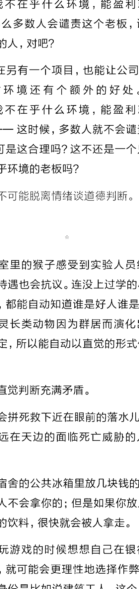

请问你会拉这个操纵杆，去以牺牲一个人的代价，救那五个人吗？

有很多研究找受试者做过这个测试题，结果是有 60%到 70%的人会选择操纵纵杆。我们很容易认可这个选择，毕竟 5 > 1，我们希望多挽回几个生命。这是一道道德推理，而核磁共振显示，决定拉操纵杆的这些人大脑中负责理性决策的背外侧前额叶这时候很活跃，所以是理性思维导致了理性的判断。


那么接下来我们把问题的情境变一下。这回电车是从一座桥上经过，冲向五个人；桥上站着一个胖子，你必须把胖子推下桥去挡住电车，那五个人才能得救。

神经营理学的开创者乔希·格林（Josh Greene）是这么分析的——关键在于这两个情境中你动作的意图不一样。

拉杆的情境中，你拉杆这个动作的目的是改变电车的轨道——至于说改变轨道之后会撞死一个人，那只是副作用：那一个人就算不在那里，这五个人还是能得救可是推胖子的情境中，你是把胖子当做了救人的工具！你的意图就是必须先杀死胖子——而这个意图是大多数人的大脑所不能接受的。

相信推理还是相信直觉，不是取决于推理不够严密，而是取决于直觉产生的情绪不够强。

论事不论心。

所有这一切不同都只不过是因为我们大脑中不同的区域被激活而已。

道德的另一个不能用纯粹理性推导的特点在于，它总是跟文化高度相关。有些文化认为焚烧国旗是绝对不可接受的，有些文化认为国旗只不过是一块布而已。如果有人做了一件特别慷慨大方的事，有的文化会诚心诚意地给他点赞，有的文化却会认为他这是伪善，他必定还有别的目的。

一个起源于上世纪六七十年代的有意思的理论说，集体主义文化是使用“羞耻感”来约束人的道德，而个人主义文化讲求的是“罪恶感”。这两个“感”有什么区别呢？

羞耻感，是别人对你的看法所引起的你的感觉。我做了这件事导致大家都看不起我，所以我感到羞耻。罪恶感，则是自己对自己的看法。我怎么做出了这样的事呢？这还是我吗？我的内心充满愧疚。

那既然羞耻感是众人对个人的约束，这就是一种比较被动的道德；而罪恶感是自己对自己的约束，似乎就更加积极主动，让人主动想要做一个更好的人。那要这么说的话，集体主义在道德约束方面就不如个人主义高级。

可是不同的文化在道德上真有高低之别吗？现在有些西方学者，恰恰认为集体主义那种羞耻感的约束力更有效——美国上层社会的道德败坏，也许就是缺少了羞耻感……

所以我们到底应该如何做出最好的道德判断呢？萨波斯基总结现在有三个主要的学派，提供了三个方法。

一个是“义务伦理学（deontology）”，认为一件事对就是对，错就是错，没什么可商量的。杀人就是不对，所以哪怕是为了救人也不应该杀人。

一个是“结果主义（consequentialism）”，说你做事得考虑后果，应该让众人的总福利最大化。如果牺牲一个人能救五个人，你何必在意是自己推的这个人还是仅仅拉了一下操纵杆呢？根本没区别！

还有一个则是“德性伦理学（virtue ethics）”，说你应该考虑的不是行动也不是结果，而是你自己是个什么人：作为一个好人，你该怎么做就怎么做。

义务伦理学讲直觉，结果主义讲推理，而德性伦理学讲整体判断。萨波斯基推崇德性伦理学。

单纯讲直觉固然有很多不合情理之处，单纯讲推理也是不行的。如果说为了救五个人就可以杀一个人，那要杀的那个是个小婴儿，你也会做吗？那医院强行杀死一个健康的人，获得他的器官去救五个病人，这也可以吗？

你的道德推理早晚都会达到一个单纯用推理无法证明对错的地方。那个地方就是直觉。把推理和直觉结合起来，我们才能做出更好的判断。

比如说，考虑到如果允许牺牲一个人去救五个人，那么长此以往，这个社会中的无辜者就可能随时都会被人牺牲掉——我不知道你们怎么想反正我的直觉不喜欢这样的社会——所以我们应该从这件事开始，就不能允许伤害无辜者。那五个人如果一定得死，那就死吧——他们的危境并不是我也不是那个无辜者造成的。

所以这一讲的结论是虽然道德直觉常常不靠谱，但是我们永远都不能脱离直觉、脱离情境、脱离文化习惯谈道德。

而直觉恰恰是维护道德最好的手段。那些能经得起各种诱惑而不作弊的人，并不是每一次都在那做艰苦的计算——研究发现他们都是毫不费力地就做出了一次次道德的选择：因为他们认为自己是好人。

注释
[1] 爱心和理性


# 活码长期有效

## 《行为》13：同理心迷思

万维钢·精英日课³
今天
进入课程 ›

《行为》13：同理心迷思
11:35 10.6 MB
[转载: 柠沙]

咱们继续讲萨波斯基的《行为》。你肯定早就听说过“同理心”这个词。有好多流行的书籍，什么《同理心：做个让人舒服的共情高手》《同理心文明》之类，把同理心说得简直就是当今最重要的能力，说能提高你的“情商”。我们这一讲以当代科学理解为准，告诉你什么是真正的同理心。

简单地说，同理心就是对他人的痛苦感同身受：看到你这么痛苦，我自己也感受到了同样的痛苦。同理心根本就不是一种“能力”，而是人作为一种动物的本能反应。同理心被高估了。

王小波有个外甥，是个摇滚青年，说为了艺术可去过痛苦的生活，因为“痛苦是灵感的源泉”。王小波说不对，你看那些了不起的艺术家哪有自己痛苦的，都是从别人的痛苦中找灵感：别人的痛苦才是你艺术的源泉 [1]。

同理心差不多就是从别人的痛苦中找灵感的机制。读了这一讲，你也可以像王小波一样教训那些拿“同理心”夸夸其谈的人。

要真正确理解同理心，咱们先辩析几个概念。我们专栏以前说过“近敌”和“远敌”的说法 [2]。同理心的远敌是对别人的痛苦幸灾乐祸或者是漠不关心，这些当然是完全不可取的，但是同理心还有几个近敌。

一个近敌是“同情心（sympathy）”，意思是 我承认你有痛苦，我为此感到遗憾，但是我没有什么感同身受，我不一定理解你的痛苦。比如你说你作为领导十分忙碌，整天一大帮人等着你发号施令，你觉得特别麻烦、很痛苦 —— 我对此只能表示同情，我没感受过这样的痛苦。

一个近敌是“可怜（pity）”，是一种居高临下的情绪，专门针对那些“温暖度”高、“能力”低的人。一只小狗出车祸受伤了，我们很可怜它，但是不至于为此痛哭。

一个近敌是“悲（compassion）”，或者叫“慈悲”，这是一个更高级的情感，咱们等一下再说。

这三个近敌的共同特点是让自己和对方保持一段距离：你的痛苦不是我的痛苦。真正的同理心则大大缩短、甚至是取消了这个距离：你的痛苦就如同发生在我身上一样。

同理心跟一些原始的感觉成分有关。一个是“感觉运动感染（sensorimotor contagion）”，你看到身边一个人的手被针扎了一下，然后你就感觉这个针是扎在了自己手上一样，甚至都能够体会到那种疼痛。一个是“模仿”，比如说我们看体育比赛，会忍不住把自己代入成电视里的运动员，随着他做出相应的动作。还有一个更高级的是“情绪感染”，你看到一个激动人心的场面，自己也跟着激动起来。

这些本能的感觉动物都有。你让一个黑猩猩看二十遍实验人员如何从一个打开方式非常复杂的箱子里拿出食物来，黑猩猩就能通过模仿学会那个打开方式。你让一只老鼠躲在一个安全的地方旁观别的老鼠被欺负，它自己的嗅皮质激素也会跟着居高不下。但是这些表现都不能说是真正的同理心。

真正的同理心是不但能感受到对方的痛苦，而且还能感受到那个痛苦的意义，会让你为了这个意义去采取行动。

有些科普读物认为“镜像神经元”能增加人的同理心，萨波斯基对这个看法持保留态度，镜像神经元的作用没有那么大。神经科学家眼中的同理心是一个情绪的成分加上一个认知的成分。

情绪的部分由前扣带回皮质、岛叶和杏仁核共同完成，其中起到关键作用、只要是同理心就必经的脑区，是前扣带回皮质，它有两个功能。

一个功能是接收来自你体内的感觉信息，形成直觉。比如说你的心跳突然加快了，你的肌肉正在酸痛，你的嘴唇有点发干，这些体验会被前扣带回皮质首先注意到。

另一个功能是前扣带回皮质能发现那些不符合预期的状况。比如你一边看书一边喝水，你以为杯子就在自己的右手边上，你抬手去拿杯子结果不在那里，你的前扣带回皮质会感受到这个意外。特别是，如果你在游戏中完成一项任务本来应该得到两个金币的奖励，可是系统居然只给了你一个，你的前扣带回皮质会非常非常激动。

把这两个功能联系起来，那就意味着前扣带回皮质注意到你的痛苦的时候，它会特别注意这个突如其来的感觉是怎么发生的，它会刺激你去寻找这个感觉的来源和意义。

所以同理心的脑神经过程差不多是这样的 ——

**别人的痛苦 → 你的感觉运动感染、模仿和情绪感染开启，自己也感受到痛苦 → 前扣带回皮质体会到你因此产生的自身感受 → 你对这个突如其来的感觉表示关注 → 寻找痛苦的意义。**

为了寻找这个痛苦的来源，你的背外侧前额叶和心智理论回路会开启，进入同理心的认知成分。你会尝试破解这个痛苦的因果关系，想要弄清楚事情到底是怎么回事儿。

这样你不但对别人的痛苦感同身受，而且还能理解这个痛苦。他这个疼痛正常吗？是有人在欺负他吗？他受到了不公正的对待吗？

那么以此出发，我们就会想要帮助别人解除痛苦，“当自无衣？与子同袍！”同理心能激发我们去做好事，所以同理心难道不是一种伟大的人性吗？
不一定。

首先同理心并不可靠。能不能产生同理心，跟具体的情境非常有关系。

我们对自己所在群体的人的痛苦容易产生同理心，对陌生人不会；对本阶层的人容易产生同理心，对其他阶层不会。

这就是为什么富人对穷人不太有同理心。有些研究甚至证明富人不擅长感受他人的情绪，他们在实验中会尽可能拿走自己该拿的东西，完全不在乎别人怎么想。不过这个因果关系你可别搞错了：**不是缺乏同理心能让人类致富，而是当你感觉你是富人的时候，你会缺乏同理心。**

这是因为同理心总是同时启动情绪成分和认知成分，这就消耗能量，是一种认知负担。对不亲近的人，你必须花费更大的力气才能感受他的痛苦，而你不愿意费力气。这也是为什么抽象数字不会激发我们的同理心，因为你得花更大的力气，才能从抽象事实中想象具体的痛苦场景 —— 所以斯大林有句诗说“死一个人是悲剧，死一百万个人只是统计数字。”

你要做大事，就不能靠同理心指导。

更重要的是，你注意到没有，前扣带回皮质真正关心的不只是别人的痛苦，而是你自己的痛苦。

比如你看一个悲剧电影。剧中人的命运十分凄惨，全程泪点满满，让人特别有代入感。你时而义愤填膺时而伤心欲绝，在影片的结尾你痛痛快快地哭了一场，你的同理心爆发。然后呢？

然后就没有然后了。你已经哭痛快了，这就可以 了。

同理心的本质不是感受他人的痛苦 —— 而是感受他人的痛苦让自己也很痛苦。

是，同理心常常会激发我们去设法解除别人的痛苦，但是这个关系可不是我们越感到痛苦，就越想去帮助别人。事实上，当你因为别人的痛苦而感到自己特别痛苦的时候，你反而不想去帮助别人了 —— 你想的是赶紧先解除自己的痛苦吧！

在实验中，同理心刺激下，一个人的心跳速度越快，他的焦虑感就越强，他的杏仁核就越活跃 —— 而研究者发现，这时候他帮助别人的意愿就越低，而不是越强。因为他自己先受不了了！就像郭德纲相声里说的，于谦的爸爸是个大善人，最见不得别人受穷 —— 所以就把自己家附近的穷人都赶走了。

自己正饿着的人，自己正处于压力之中的人，不会有太多心思去做什么慈善。强烈的同理心会让你自顾不暇。

这就是为什么医生必须克制自己的同理心。病人是来看病的，不是想让你陪着他哭。

2016年，耶鲁大学心理学家保罗·布鲁姆（Paul Bloom）专门写了本书，就叫《反对同理心》（Against Empathy: The Case for Rational Compassion）。布鲁姆说同理心不是给人赋能，而是让人失能。

孩子怕打针，他一哭你同理心上来就决定不给他打疫苗了。熟人的痛苦会让你不公正地对待陌生人。专注于一个人的苦难，你会理解不了一百万人的统计数字。

医生必须接受的一项训练，就是学会跟痛苦保持距离。

什么样的情绪能让你合理地帮助别人接触痛苦呢？这就是我们开头说的那个同理心的近敌，“悲”，英文是compassion。你要查字典的话这个词通常被翻译成“同情”和“怜悯”，而我们已经辨析了，那完全是不同的概念。

悲，或者说慈悲，是一种特别高级的情感。悲的意思是我理解你的痛苦，但是我不跟你一起感受那个痛苦，因为我有一个更积极的姿态：我要帮你解除痛苦。

这是医生看病人应有的情绪。而且这也是佛教修行者致力于修炼的情绪。萨波斯基曾经遇到过一位僧人，那个僧人经常长时间地打坐。萨波斯基就问他，你打坐时间长了膝盖受得了吗？你会不会因为感到膝盖太疼了而提前终止打坐呢？

僧人的回答特别值得寻味。僧人说，是，我有时候会为了膝盖提早结束打坐——但是那并不是因为我感到痛，而是出于对膝盖的慈悲。

你找到这个感觉没有？我们讲《为什么佛学是真的》的时候说过“无我”[3]，这位僧人已经把自己和自己的膝盖给分开了：他体察到膝盖的疼痛感，但是他并不受制于这个情绪，他感觉那就好像是膝盖自己的感觉而不是他的感觉一样，然后他选择解除膝盖的、而不是解除自己的痛苦。

慈悲，意味着你要和痛苦保持距离，有一种超然感，然后设法帮助别人。

核磁共振显示，慈悲的情绪会让你的杏仁核安静下来，但是会给你提供多巴胺！这就是为什么善行使人快乐。

欣赏悲剧不会把你变成好人。为他人的苦难共鸣并不代表善行。同理心是善行的起点，慈悲心才能带来真正的善行。

不过我们也没必要太过严苛了。同理心毕竟有可能触发善行，这对很多人来说就已经不错了。就算是你学了脑神经科学，就算是你知道同理心在乎的其实是自己的感受，就算是你合理推测人们行善也许是为了获得多巴胺，你也没必要每次都给人指出来。

## 注释

+   [1] 王小波：《我怎样做青年的思想工作》
[2] 美德的“近敌”
[3] “无我”的科学：因缘动力学


## 万维钢·精英日课³
今天

进入详情 ›

## 《行为》14：人类才分对错，...

12:20 11.29 MB

【编辑：陈汐】

咱们继续讲讲萨波斯基的《行为》。这本书讲到这里已经接近尾声了，我们从人类行为的动物性说起，慢慢过渡到了人性。这一讲我们要说的是一个只有人类才有、其他物种一律没有的行为特点。

有一句谚语出自韩寒电影的话，叫做“小孩子才分对错，成年人只看利弊”。每当网上出现一类争议话题，你就能听见有人把这充满油腻感的句话搬出来，摆一个冷静姿态。说这句话的人可能自以为老谋深算，殊不知他才是最幼稚的那个。

当前科学理解是，人类才分对错，动物只看利弊。

别的动物只会为了争夺食物、地盘和异性而杀戮，只有人类才会为了某个理想而屠杀自己的同胞。

别的动物只会在意自己的排位顺序，只有人类才会为了 sett…

# 有什么生理功能，是只有人会，别的动物绝对不会的呢？

你看一看下面这张图，这是什麽？

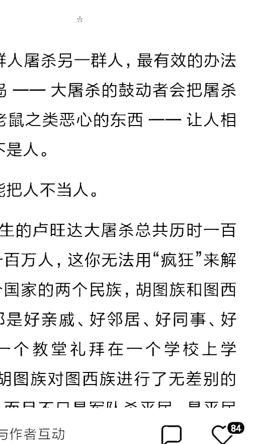

你很可能说这是 一匹马。但是严格说来，这不是马——这是一幅画，画的是 一匹马。这幅画是 17,000 年前的史前人类在岩洞里画的，它代表了人类特有 的一个能力。

只有人类，能从一个关于马的符号里，想到马的含义。

也杀平民。

萨波斯基特别讲到其中一件事。有个胡图族的天主教神父（他的名字应该留下，叫 Athanase Seromba），给图西族人开了一个避难所，收留了 1500 到 2000 人，其中很多是他自己的教民——但是他上演的可不是《辛德勒的名单》剧情。他安置好这些人，转过头来就把胡图族士兵请来，把这些人全部杀死。

动物可做不出来这样的事儿。

隐喻真是最可怕的武器啊。但隐喻也可以是最了不起的工具。正如赫拉利所说，真正能把最大规模的人群组织起来的，不是利益，而是某种想象的、虚构的东西，比如国家和宗教。萨波斯基这里引用一个概念叫“神圣的价值观（sacred values）”，一群人往往不是纯粹因为利益而组织起来，而是为了某个他们认为是神圣的价值观。价值观定义了“我们是谁”。

如果神圣价值观冲突，比如以色列人和巴勒斯坦人看耶路撒冷的价值，两拨人就能打起来。但是如果你能找到价值观的共同点，哪怕两拨人有利益冲突，你也可能让他们和平共处。

萨波斯基说了几个例子，其中最值得我们学习的就是南非黑人首任总统纳尔逊·曼德拉的故事。你肯定知道是曼德拉把南非从一个种族隔离国家变成了由黑人领导的国家，你可能还知道曼德拉搞经济其实搞得不怎么样。但是你想过没有，曼德拉毕竟是和平接管了南非！

动物绝对做不到这个。卢旺达做不到这个，很多文明国家也做不到这个。曼德拉怎么做到的呢？

曼德拉是神圣价值观的天才。

南非黑人说科萨语，南非白人说起源于荷兰语的“南非语”。曼德拉在监狱里自学了南非语和白人的文化。他掌权之后，把白人的军队将领请到自己家里来，给他安排专门软化设计的沙发，用南非语跟对方交谈，亲自给对方端茶倒水。他用对方的文化，把对方变成朋友。

我记得看过一个讲南非橄榄球队夺取世界杯冠军的电影，叫《成事在人》，专门描写了曼德拉是怎么让国家的文化融合的。橄榄球被认为是白人运动，但是曼德拉没有说现在我们黑人终于翻身了，让我们纠正一切白人的事儿吧——他反而一定要让南非举办橄榄球世界杯，然后让南非橄榄球队拿个冠军。

那是一部令人动容的电影。真实的历史中，世界杯现场，曼德拉安排白人组成的橄榄球队演唱了黑人的民族歌曲，黑人乐队演唱了白人的民族歌曲。

你要括空想象南非当时那个场景，可能会觉得这好像挺容易做到的，不就是领导人摆出一个姿态，双方唱两首歌吗？但是你要是想想咱现在面临的一些冲突局面，你就知道那几乎就是不可能做到的。

这是人类特有的能力也是人类特有的麻烦。《行为》这本书，咱下周还有两讲。


学习进步群


活码长期有效


# 晋升、失控和“扮演法”

万维钢·精英日课³
今天

进入评论 ›

晋升、失控和“扮演法”
12:24  11.35 MB

【译注：怀沙】

我最近在读一部网络小说，爱潜水的乌贼写的《诡秘之主》。我非常喜欢这个小说，但我们不是推荐小说的专栏，我想跟你分享一点读小说引发的思考。

读网络小说的一个乐趣是主人公会不断地“升级”。修仙也好，领兵也好，升官也好，开公司当工业霸主也好，都好像是打游戏一样，一开始很弱小，不断地成长，战胜利一个又一个对手，慢慢变得强大起来，同时探索一个越来越广阔的世界。当然你可以说这纯粹是宅男在满足自己的幻想，真实世界里哪有这样的好事情——那么我要说的就是，你读的那些励志鸡汤其实也是幻想。在真实世界里不是说你一门心思好好努力就能升上去的。

这可不是说真实世界有多么黑暗。我精英日课专栏眼中的世界是一个充满矛盾的地方：你总是要做一些不得已的取舍，并没有什么一定正确的方向。你眼中不成功的人，也许人家选择了别的价值；你眼中成功的人，你不知道他为此付出了什么代价。

《诡秘之主》这本书的一个创新之处在于，爱潜水的乌贼设计了一套非常不同于传统的晋升系统。而在我看来，这套系统更接近真实世界，可以说是一个寓言。

我认为中国网络作家已经得到了让小说好看的秘密，而这是现代中国人为世界做出的一个重大贡献。《诡秘之主》这本书，可以说是代表了现代作家和现代读者共同的认识升级。你要说艺术性，那是见仁见智的事儿；但你要从数据角度，说小说的世界观之宏大、人物和道具之多，剧情之复杂，《诡秘之主》比几十年前金庸写的那些小说高出至少两档，比现代西方的《哈利波特》《冰与火之歌》也高出了一个档。

这是一本作家必须借助计算机管理信息，读者必须借助百科档案标记知识点，才能写好和读好的小说。

这本书目前还在连载中，在起点排名第一，而且它的英文版也吸引了很多海外读者，有人正在呼吁 Netflix 把它拍成电视剧。

咱们单说它的晋升设定。

《诡秘之主》描写了一个蒸汽朋克背景下的魔法世界，其中大多数人都不具备魔法，只有占人口比例极小的“非凡者”才能学习魔法。要成为非凡者，你必须服用某种“魔药”，然后你每一次晋升都都需要魔药。

晋升的“途径”有 22 条，是来自上古的神的设计。你必须选择其中一条途径，从最低的 9 级“序列”往上升，最高是 0 级。比如主人公克莱恩·莫雷蒂的途径是“愚者”，他成为非凡者的第一个序列就是序列 9，“占卜家”。

对应到真实世界，你可以把途径想象成行业：官员、商人、演员、学者等等；而序列则是各个行业中个人的升迁路线图：官员途径就是科长、处长……

每个非凡者的奋斗目标都是拿到自己所在途径中的下一个序列的魔药，让自己晋升，从而获得更高级别的魔法和更厉害的身体素质，在职务上也能跟着升级。但是这里有个关键的问题。

做非凡者是有危险的。你随时都可能会“失控”。魔药其实是一把双刃剑，它带给你非凡的能力的同时，也带给你受伤的可能性。如果你控制不了体内的魔药，就会发狂、变形、成为怪物。那么别的非凡者为了维护公共秩序，就必须把你杀死。

大多数下层非凡者就这么战战兢兢地生活着，一方面想升级，一方面担心自己失控。他们总结了一些防止失控的心法，比如说要调整自己的内心，但是具体怎么调整，谁也说不好。

主人公克莱恩在机缘巧合之下，发现了能快速晋升和防止失控的秘密，叫做“扮演法”。

一般的非凡者都以为序列的名称代表的是能力：比如你服用魔药成了占卜家，那就意味着你会占卜术，可以算一算比如一个房间里有没有危险、一个失踪的人现在在哪里之类的事情。你可以用这个能力，但是也可以不用。

而“扮演法”则是说，序列名称不仅仅是能力，而且还代表了工作。你要想快速从占卜家这一关通关升级，就应该去扮演一个占卜家。你应该像真的占卜家一样，比如说摆个摊，经常给人提供占卜服务才行。

然后序列8是“小丑”，那么就去做小丑做的事情。扮演不是表演，不是给观众看，是按照这个序列的设定做事。

通过扮演法，你就可以快速“消化掉”魔药，从而彻底掌握这一序列的魔药，为晋升做好准备。

克莱恩从多个来源得知，扮演法有三个注意事项。

-   第一，扮演哪种职业，就遵守那种人的相应行为规则 —— 但是规则不是固定的，每个人可以根据自己的经验调整。换句话说就是你得演得像。
第二，你只是在扮演！不要混淆扮演的角色和自我的存在。
第三，克莱恩所在教会的 higher 人员特意叮嘱他说：“晋升是为了更好地为女神效劳，更好地守护善良的信众，记住这一点，就能抵抗失控的诱惑——记住，是诱惑。”

这跟现实社会中的职务晋升简直太像了。

大多数人没什么晋升的机会，能力不大权力不大，所以危险也不大。人们以为晋升代表的是能力和权力，殊不知晋升更代表责任，也代表危险。

决定你的晋升速度的，是你扮演的像不像。你要当官就得有个官员的样子，永远都得稳当当给人感觉特别胸有成竹，不轻易表态，不暴露自己的弱点，关键时刻有所担当，时刻盯住高层趋向。你有权力得经常用才行，你施展了权力，像个官员，你就容易升上去。

但是伴随权力的失控的危险，你可能会腐败，可能会站错队伍。企业家的业务越做越大是好事儿，但是他面临的风险因素也是越来越多。

而真正的危险来自诱惑——尤其是获得更大力量的诱惑。很多官员犯罪恰恰就是因为“太想进步了”。

那么怎么避免这种危险呢？答案就是牢记自己“只是在扮演！”

你的社会角色只是你的一部分。你还有作为自己的那一部分。不对角色太过投入，你就不会被角色所吞噬。我们专栏讲过二战时期两个德军将领的故事，一个拿战争当体育比赛打，一个把战争当做人生唯一的事——结果是前者打得又好，又不受伤害。

有一种情怀叫“有限”[1]。你得有点“Player”的作风[2]。

以运动员的心态升级，这大概就是“扮演法”的精髓。

可是既然扮演法这么好，为什么大多数非凡者不知道这个方法呢？

克莱恩所在的“黑夜女神教会”一直都把扮演法保密。你要是从自己领悟出来了，那我们欢迎，但是你不能把它透露给别人。那这是为什么呢？

有些读者曾经猜测，这是否教会有限制高层非凡者的想法。

我看这个设定也符合社会现实。现实社会有个排位稀缺[3]问题。中国再发展，省委书记的数量也只有这么多。技术再进步，国网注意力总时间和只有这么多，所以明星、明星产品和明星公司的高官也只有这么多。不管你是官员还是相声演员，顶层的行业都极其稀有的。

说白了，有时候你必须等前面的人退下来你才有机会上去。而小说里的设定是高级非凡者要晋升，有时得吃掉背弃的高级非凡者体内的残留物。

但是位置稀缺并不能解释为什么教会把扮演法保密。位置稀缺我可以限制魔药发放啊，我何必让人继续冒失控的危险呢？

真正的答案是，“你只能是你自己”。

这是小说进行到第五部第28章，一个叫赫温·兰比斯的人物说的。序列6之前都最好不要使用扮演法加速魔药消化，因为那样会影响非凡者的“自我意识”的养成：“这会让成员变得不像自己，有的甚至会被魔药内残留的影响同化。”

而克莱恩成为“无面人”之后，也多次有人对他提出忠告：“你能假扮成任何人，但你只能是你自己。”

写留言，与作者互动

他提出忠告：“你能假扮成任何人，但你只能是你自己。”

这个设定也很符合现实社会。这是一个只有当你身处高位才能体会到的忠告。

我们设想一下，如果每个基层官员都会扮演法，那是一种什么情形。

你的官僚系统会得到一大群高效率的、标准化的、做事绝对不犯错的、机器人式的官员。他们像运动员一样科学训练，所以他们能用最快的速度到达高位。可是这是你需要的人吗？做这样的人有意思吗？

我们在真实社会里摸爬滚打，会磨炼成各种独特的脾气和作风。有时候你明知道怎么做“对”，但是你就是不想那么做，因为你觉得那就不是你了。

从扮演法角度来说，这样的人是幼稚的。可是从系统的演化角度来说，我们需要能给高层带去个性，能让系统往新的方向发展的人。演化的特点是一个特性刚出来的时候你不知道它好不好，也许在这个环境里不好，可是保留下来了，然后换个环境它就是最有意思的特点。

系统需要你保留个性，而你也需要有自己的个性。做个机器人没意思。就算升上去了，你又能如何呢？如果每一件事都是“对”的，而不是“你”的，这样的生活有啥意思呢？这样的人到了高层仍然会失控——因为他做机器人时间长了终究会受不了。

就好像某些中年人一样，年轻的时候兢兢业业不敢越雷池一步，现在他一挥洒个性，往往就是最扯劣的姿势。

小说就只是小说而已，把小说当真是不对的。但是小说家有时候能做到社会学家做不到的事。扮演法真的适合真实世界吗？你很难搞科学实验研究。那么我们借助小说探讨一番，也是一个趣味。我们不妨借着这个设定，把人给分个等级——

最普通的人对工作没什么计较，谈不上心法，所以也没有晋升的意图。

初级“非凡者”的问题在于演技不行，出戏太多，一看就不像，所以晋升很慢。

中级非凡者很入戏，但是危险在于入戏太深，有时候会为了晋升不择手段，不知道怎么样控制自己、去打一个有限的比赛。

高级非凡者的弱点则是没有个人意识。这一路走来什么都做对了，也累了。他们可能执掌一方大权，但是注定不会在历史上留下名字，他们根本不知道什么才是真正的自己——稍微一放松，还是面临失控的风险。

幻想小说总能给人一点精神激励！那知道了这些，你还想当非凡者吗？

注释

[1] 有一种情怀叫“有限”

[2] Player作风

[3] 排位稀缺：富足时代什么最贵？

## 问答：现代人的压力是增加 了还是减少了？

万维钢 · 精英日课³
今天

进入详情 ›

问答：现代人的压力是增加…
11:54 10.89 MB

【转自：怀汐】

# 来自日课：丛林法则和人类社会

读者 自由生长：

和原始社会比，现代人的压力是增加了，还是减少了呢？

万维钢

这是一个能让学者们打起来的问题。原始社会的人以采集狩猎为生，一旦有了农业就不叫原始社会了。这个问题就是，原始社会的人的日子，在战争、平等和专制方面，跟后来的农业社会相比，是好还是不好。

# 来自日课：道德是直觉的，还是理性计算的？

读者 王烨全：

# 来自日课：同理心迷思

读者 你得写笔记：

# 来自日课：人类才分对错，动物只看利弊

读者 马贺、馥儿果：

的功能本来是保暖，后来给安排在飞行功能上了。

人作为一种群居动物，在群体互动的时候肯定会受到伤害，那么这个精神上的伤害如何用大脑体会呢？演化这个修补匠一看前扣带回皮质有个能体验痛苦和刺激寻找痛苦的意义的功能，那就安排它去处理吧。群体中有人做出不利于他人的、违反社会规范的事情，我们如何快速感受这个局面呢？脑岛是负责恶心的，那就交给它吧。

这很像是一个公司在发展壮大的过程中，原有的人员经常要负责跟自己有关系、但是又不在原有职责范围之内的新业务。

但是这个新能力也不是说有就能有的。从硬件角度来说，前扣带回皮质和脑岛之所以能承担新的任务，也跟它们拥有了一种近期才演化出来的一种新型的大脑神经元有关，叫“纺锤体神经元”。所以你要给员工加新的担子，也应该给人家配备新的工具才好。

请注意，萨波斯基把演化比喻成一个修补匠，说起来好像是有人格化的什么东西主动要给大脑增加功能一样，其实不是，演化是随机突变——这只是通俗地打个比喻，不是严格的学术语言。

严格地说，你不能讲“动物长羽毛是为了取暖”，你只能说“因为偶然突变长出羽毛的动物恰好比没长羽毛的同类的保暖性能，在恰好是寒冷的地区，是个优势”，但是我不这么说你也应该明白我是什么意思！我注意到有的老师喜欢拿这种解释演化的语言说事儿，那种吹毛求疵毫无意义，那不是真学问。

# 万维钢·精英日课³

帮你和全球精英大脑同步

版权归得到App所有，未经许可不得转载

学习进步群

活码长期有效


## 《行为》15：自由意志是 hom... 个难以接受的推论

万维钢 · 精英日课³ 今天 进入评论 >

《行为》15: 自由意志是... 12:24 11.36 MB

| 投稿：沉沙 |

咱们继续聊萨波斯基的《行为》。这本书讲到这里，关于行为的生物学知识已经差不多都讲完了，这一讲我们要从中得出一个推论。

福尔摩斯有句话说“排除一切不可能的，剩下的即使再令人难以置信，那也是真相”，意思是如果你能强硬地坚持理性与逻辑，你就得做好准备，去接受一般人接受不了的事 实。

《行为》这本书一直都在讲人只是一种动物。当然我们有更发达的额叶皮质，有能理 解聪窃的能力，但是我最多也只不过是一 种“以特殊的方式特殊”的动物。我们是血肉 组成的，血肉是原子组成的，我们没有神秘 的“灵魂”，本质上就 是一台机器—— 所以 你可以由此推出，“人没有自由意志”。

机器是不能自己决定什么事情的，机器的行 为只能被自身的编码、所处的环境和外来的 刺激信息所决定。

这句话说起来完全没毛病，但是如果你能意 识到这意味着什么，你的感情会受到强烈的 冲击。我们这一讲说的就是“没有自由意 志”意味着什么。

最近大连市发生了一起令人发指的案件：一 个13岁的“男孩”，以无差别残忍的方式杀害了 一名10岁的女孩。证据确凿、当事人承认， 但是司法机关因为“嫌疑人蔡某某未满14周 岁，未达到法定刑事责任年龄，依法不予追究 刑事责任。”国人群情激奋，我们都认为 现行法律已经不合理，应该修改。

法律对青少年嫌疑人给比成年人轻的惩罚， 这个做法本身似乎是有道理的。我们知道青 少年大脑的额叶皮质还没长好，他们的自控 能力不如成年人。可是从另一方面来说，自 控能力差就是可以犯罪的理由吗？杀人是作 恶这么简单的道理，难道还得等到十四岁才 能明白吗？

这就引出了一个大问题。假设有人做了一件 坏事，在下面这三个选项中，请问你选哪个 ——

-   A. 不论这个人自身是什么情况，他都应该 被惩罚；
B. 这里面有个“度”的问题，得看其中有多大的主观因素：如果嫌疑人的主观因素小， 不能控制自己，就应该减轻甚至免除惩罚；
C. 不论这个人自身是什么情况，他都不应该 被惩罚。

你可能觉得只有疯子才会选C，但是请你继 续听我分析。萨波斯基本人参与建设了一门 新学科，叫“神经法学 (neurolaw)”，其中 有些精彩的推理。

首先，选择A肯定是不对的。比如有人患 有癫痫病，他发病的时候控制不了自己的手 臂，捡起来来打到了别人，你会为此惩罚他 吗？你肯定不会的。他只有病而已，他不 是主观有恶意。

1843年，有个叫姆纳坦的人想要刺杀英国 首相，杀锁错了，杀死了首相的秘书。陪审团 最终判决姆纳坦无罪，因为有医生能够证 明，姆纳坦患有严重的妄想性精神病。他走 到哪里都觉得有人在跟踪纠缠自己，晚上连 觉都不能睡—— 医生认为姆纳坦没有控制 自己行为的能力，杀人不是他自己的主观意 志。

姆纳坦被终生关进了精神病院，这么做不能 算是惩罚，只是防止他再次杀人。事实上上 说那个精神病院条件还挺好，姆纳坦在里面 跟其他病人享受同等的待遇。这个判决后来 被各国法律效仿，就叫姆纳坦规则 (M’Naghten Rule)。

你可以不同意医生对姆纳坦的诊断，但是， 我们总可以假设，有这么一种精神病，能让 人完全丧失主观行为能力—— 而在这种情 况下，我想你会同意，这个人只应该进精神 病院，而不应该受到惩罚。

所以现在只剩下了选项B和C，问题变成 了，嫌疑人的行为有多大成分是“主观”的 呢？

极端的答案是根本就没有什么“主观”，脑神 经科学不承认大脑有做决定的主观成分。我 们讲《行为》这本书以来列举了各种影响行 为的因素，包括各种神经递质物质、激素、 基因、基因的表达、成长中家里的环境、是 否目睹过暴力、社会的文化等等—— 所有 这些因素都是“客观”的，都是你接受的，不 是你自己设计出来的。

我们还是那句话，机器影响不了自己，一切 都是设定而已。可是如果你仔细体会，你会 总觉得自己还是能做出一些选择的—— 最 起码如果让我深思熟虑的话，我相信就能做 出跟上面所有那些因素的影响都相反的选 择。

这一派思想，叫做“减轻的自由意志 (Mitigated Free Will) ”。它不是真的相信 人有自由意志，但是总觉得人脑中还是有 一些主观选择的成分，尽管可能大部分情况 下我们都是被其他因素裹挟着行事。

是，有他那样不幸的童年和糟糕的身体状况 的人很容易酗酒；但是，毕竟不是所有那样 的人都是酗酒者。所以这个酗酒者自己还是 有主观的责任。

再比如说现在有研究证明，“恋童癖”也许 不是主动的选择，而是一种生理的症状。首 先它跟基因有关，有些家族会遗传恋童癖这 种症状。其次它跟大脑有关，有相当比例的 恋童癖者，童年的时候都受过脑损伤。他们 不想做恋童癖，他们没办法。

那你能说我们就应该原谅那些性侵儿童的 罪犯吗？当然不能！是，他们无法选择不做 恋童癖；但是，他们可以选择不去侵犯儿童！

这个道理是大脑给了你一个行为趋势，不等 于你就应该按照那个去做，更不等于你就一 定会那么做。

减轻的自由意志这个立场可以说是有一定 依据的。

1980 年代，神经生理学家本杰明·李贝特 (Benjamin Libet) 做了一个被传诵至今的 经典实验。实验中受试者要做一个简单的动 作，比如选择打开还是关上一个开关。科学 家使用核磁共振同时观察大脑的活动，发现 在受试者意识到自己选择怎么做的几百毫 秒甚至几秒之前，他的大脑其实已经做出了 选择。这个实验我们在讲《未来简史》的时 候说过[1]。

这个实验似乎证明了人没有自由意志，你的 意识只是听大脑的。但是萨波斯基介绍，李 贝特本人对这个现象有更高的说法。李 贝特说，是，你没有决定往哪个拨下开关的 自由意志—— 但是，当你的大脑已经做出 选择之后，到你切实按下开关之前的那些秒 钟之内，你的意识可以决定不按那个开关。 你有最后 一刻的否决权。

对我来说这是非常惊人的知识，这叫“自由 非意志 (Free Won’t) ”。这是一个充满争议 的解释，有很多实验研究，有的是同意有的 反对。

但不论如何，我们姑且认为人真的有否决 权，那我们要问的是，这个否决权，又是啥 东西呢？

那个否决权只可能是生物因素，而你不能说 因为现在脑神经科学家还没有达成共识，所 以人还是有自由意志的。

萨波斯基承认，随着神经科学仍然在发展之 中，我们并不能完全解释人的所有行为。

比如说一个最简单的现象—— 同样是学习 好，有的孩子是因为聪明，有的孩子是因为 努力。你可能觉得聪明是天生的，就好像是 人的身高一样，不值得表扬；而努力则是人 的主观选择，我们应该表彰这样的人。

可是为啥这个人就会选择“努力”呢？他 的“主观能动性 (agency)” ，来自哪里呢？ 大家都有前额叶皮质，为啥他就愿意努力 呢？

生物学能做出一定的解释。比如说行使意志 力需要消耗能量，所以如果这个人早上没吃 饭，他就不一定能努力，再比如家庭成长环 境等等的影响—— 但是，生物学不能做出 彻底的解释。

这表现在，你没有办法通过给一个人做体 检，就以100%的准确度判断他爱不爱努 力。有的年生于单亲家庭从小没人管、然后 三天没吃饱饭、今天还照样努力。有的以 前不努力但是从现在开始就能努力。这些你 怎么办解释？

如果你说这个人犯罪是因为受到了这个、这 个、和这个，一系列生物学因素的影响，所 以我们应该原谅他。那么检察官就可以 说：“那请问，是不是所有受了这些影响的 人，在面子和他同样的局面的时候，都一定 会犯罪呢？”

作为一个诚实的医生，你只能回答“不是。 生物学现在还不能完全解释这个人的行

写留言，与作者互动


生物学现在还不能完全解释这个人的行为。”

那我们应该怎么判罚呢？

生物学不能预测人的行为，一个原因是我们已经看到了，影响行为的因素实在太多了。另一个原因是的确有些东西是我们现在还不知道的。

你可以把此时此刻的生物学还解释不了的东西都归结为“主观能动性”或者“减轻的自由意志”，但是萨波斯基认为那是非常不负责任的。

以前人们不知道癫痫是一种病，认为癫痫患者或者是被魔鬼附身了，或者是自己变成女巫了，都应该被无情地、但是不得已地杀死。以前人们不知道“阅读障碍”是一种病，以为读书慢的孩子是自身不努力，会去指责孩子……那将来的 人，有没有可能看我们今天对一些罪犯的惩罚，就好像我们现在看过去的人对癫痫患者的惩罚一样呢？

所以萨波斯基主张我们暂时搁置那些解释不了的因素，先假定将来都能解释，假定人的一切行为都是身不由己。毕竟从理论来说，人没有自由意志。

这样我们就排除了选项B。

那么现在排除了 一切不可能的，剩下的选项C——不论这个人自身是什么情况，他都不应该被惩罚——我们就只能接受。

这当然不是说以后杀人放火都没人管了，而是说我们应该都像对待精神病患者一样对待犯罪分子。我们会把有暴力犯罪倾向的人关起来——但这个目的不是为了惩罚他，而是为了不让他伤害别人。这就好像一辆汽车出问题了，不安全，我们就应该先修车，修好之前不能再让它上路了一样。

这个做法也可以威慑犯罪，毕竟谁也不愿意被关起来。但是这个做法的确就没有了“惩罚”的意味。惩罚是不但要关起来，而且要让他受苦。犯罪分子受到惩罚能大快人心，但是萨波斯基认为，这种原始的愉悦感也许不值得追求。

我挺赞成这个观点。其实这并不会改变太多，我们只要把所有的监狱都改名叫“精神病疗养院”就行了，而且未成年人犯了罪也应该被送去疗养，只不过死刑肯定是没有了。

但是有个关键问题，萨波斯基在这本书里没有讨论：如果有人被生物学诊断出有暴力犯罪的*倾向*，但是还没有犯过罪，那你是关他还是不关呢？毕竟汽车要是有问题，不用等到出事故就应该不让上路。

我不知道这个问题怎么办，……而我们还有个更难的问题。

如果你真的认同“人没有自由意志，所以犯罪分子不应该被惩罚”，那么你也应该认同，做好事的人也不应该被赞美。

你会称赞一个人长得高吗？那是基因决定的，他自己可没主观要长高。

那你会称赞演员古天乐把大部分收入都捐出去建设山区小学这个行为吗？那也不是他的主观能动性：生物学认为，归根结底，古天乐也没有自由意志！

注释

[1] 未来简史解读 5 - 我到底是谁？


〈上一篇

## 日课精选

默认   最新   只看作者回复

正在加载...

写留言，与作者互动

## 《行为》16：好行为的希望（完）

万维钢 · 精英日读³
今天
进入详情 ›

《行为》16：好行为的希望（...）
12:09  11.13 MB
[编辑：怀汐]

今天咱们把萨波斯基的《行为》这本书讲完。我首先想说的是“终于讲完了”。这本书有800多页，我读得十分费力。以前当年明月写《明朝那些事儿》，常常是从《明实录》里读取资料，自己把它上下连贯起来，变成好读的故事再现给读者……我有时候感觉萨波斯基就像是在写《明实录》。当然书中自带意思的故事，萨波斯基杳而也能展现很好的笔法，但是这本书真不太好读。

不论这本书的总销量如何，根据 Kindle 读者划线的规律，我可能是世界上为数不多的把这本书从头读到尾的几个人之一。而全面了解此书精髓的人中的绝大多数，都是咱们《精英日读》的读者。

但是那都不是什么，这本书真正的痛点在于它让我们直面一些我们真的不想面对的行为真相。你能想象吗？五岁儿童的大脑就已经刻上了强烈的阶级烙印！然后种族歧视、欺我冲突是写在杏仁核里的。人们以为同理心能让世界更好，结果同理心的本质是为了自己。我写这个系列过程中做了好几个噩梦。

但是我们也看到了希望。我们知道大脑一直到成年都是可塑的，你可以把好的判断变成习惯，把好习惯自动化，这样你就是一个纯天然的好人。我们知道童年逆境的坏影响是可以被反转过来的，而大脑中最厉害的区域——额叶皮质——也是最不受基因影响的区域。我们知道同情感是个硬件效应、道德出自直觉，但我们更知道这些东西都可以随着时间改变。

最后这一讲，咱们再讲三个故事，让你对人类有更多的信心。

### 1.杀戮机器

一说起战争来，我们想到的第一个词可能都是“残酷”想象一个人疯狂杀戮的画面。可是战争到底有多残酷呢？士兵在战场上到底是个什么状态呢？是不是变成了毫无人性的杀戮机器吗？

### 2.狒狒的文化

### 3.个人也是可以改变的

所以你说人有没有希望。变好常常并不需要花费太多的主观能动性，有几种很硬的机制就能让人做出好的行为。

能经常流动的群体和个人一般不会跟人发生激烈冲突，因为你不喜欢谁可以离开他们。然后你喜欢什么人还可以去找他们合作。绿胡子效应也好，亲缘关系也好，只要让人自由流动，合作是自发产生的。贸易是个办法。两个在贸易上有紧密联系的国家通常不会打起来，当然这也不是绝对的。文化和宗教能让人互相理解和合作，但是也有副作用。不同的群体互相接触常常是好的，但有时候关系也会恶化。而不管有多大的仇恨，人类都发明了道歉和解的办法，而且常常管用。

我觉得这本书带给我最大的希望是一群人的行为、道德和文化，要从坏变好，可以在极短的时间中发生。你要想为此出力，你是有机会看到结果的。

我在这个系列的开头说你不能读了《行为》这本书就记住一句“人的行为是由很多因素共同导致的，人很复杂”……但是“人很复杂”恰恰是萨波斯基总结全书，让我们记住的两句话中的一句。

他的第二句话是“科学和慈悲心可以并存”。

你可以明知人没有自由意志而假装人人都有自由意志，你可以明知人就是机器而不把人当做机器，选择对他人和自己充满慈悲之情。

(THE END)


万维钢·精英日课³
帮你和全球精英大脑同步
版权归得到App所有，未经许可不得转载


学习进步群


活码长期有效

## 庆祝无意识

万维钢 · 精英日课³
今天
进入评论 >

庆祝无意识
11:28 10.5 MB

[注解: 娇沙]

我们最近讲萨波斯基的《行为》这本书中，有关“人没有自由意志”这个话题引起了很多的讨论。我们当然绝大多数读者都能接受这个结论，但是我们的确很难从感情上接受人只是一台机器。我们最后采纳的立场是我同意人只是机器，但是我可以不把人当机器。

那既然如此，你可能会问，我们知道“人没有自由意志”这件事儿，又有什么用处呢？首先这是一个科学观念，我们作为求知的人*应该*知道。而我们这一讲要说的是，这个观念其实有用，而且可以对我们很有好处，能帮给我竞争力优势。只要你愿意深刻审视自己思维和观念。

咱们从一场足球比赛说起，看看有科学思维的球迷应该如何面对胜负。

上周的一场世界杯预选赛小组赛，中国队以1:2输给了叙利亚队，导致主教练里皮直接辞职。咱们回顾一下比赛中的两个细节，看看你有什么想说的。

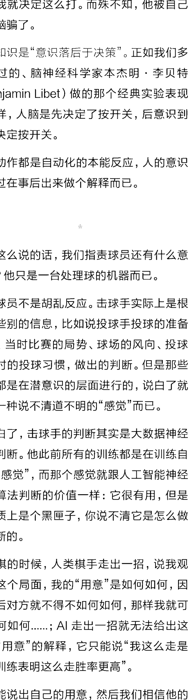

这是中国队丢的第二个球。这是一个乌龙球，叙利亚球员把球传入禁区，中国队后卫张琳芃想要头球解围，结果把球踢进了自家大门。

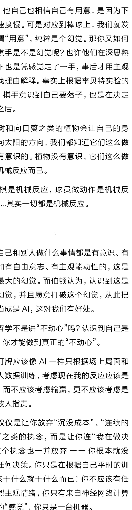

伪球迷会说这是中国队全场最耻辱的时刻，会强烈指责张琳芃。但是真正的球迷不会这样。真正的球迷知道乌龙球在足球比赛中、包括在高水平足球比赛中都非常常见。真正的中国队球迷更知道张琳芃是个好球员，他平素以作风硬朗打敢拼著称，这场比赛更是在带伤的情况下主动请战上场。这个丢球有张琳芃的责任，但是他当时看不到自己身后的情况，也许守门员应该大喊一声提醒他；而且其他两个后卫也有责任；而且还有偶然因素。要点在于，张琳芃不是故意的。他的主观意识是好的。对吧？

真正的球迷所不能忍的，其实是下面这个球——

王刚在中场拿球，艾克森在前场靠近禁区的位置跟对方后卫平齐站位，这时候只要王刚能把球传给艾克森，中国队立即就形成单刀机会。这个机会艾克森看出来了，回头举手要球。里面看出来了，站在场边教练手势。王刚的附近没有对方球员上前逼抢，他可以从容传出这个球。然后王刚的选择是把球往回传。还有比这更让人生气吗？张琳芃自摆乌龙不是故意的，王刚这个传球怎么算呢？这还能怪得了什么客观因素吗？这难道不是他自己的选择吗？这难道不是他的主观能动性出了问题吗？

我认为多看中国队比赛有利于我们对科学思维的修行。等你修炼到对王刚那个球也不生气，你就可以学习神经科学了。

神经科学要求我们必须明白：王刚这个动作，和张琳芃、和艾克森和里皮在场所有人和你和我，没有本质区别。也许他没有能力传那种好球，也许他被比赛吓坏了，也许他根本不会阅读比赛……那些都是客观原因，不是王刚自己想要的。我们的“主观”决定不了什么，我们所有的决定都是此刻之前一切客观因素的总和影响的结果，我们都只不过是机器而已。事实上，运动员在比赛中，根本就不能做任何主观选择。

神经学者和作家罗伯特·伯顿（Robert A. Burton）举了这么一个例子[1]。我们知道棒球比赛里最常见的一个场景是双方各自各就位，投球手投出一个球，打球手根据这个球的质量，判断要不要击球。一般人的想法是，打球手的判断力和决策水平很重要，对吧？不对。

球从离开投球手的手，到抵达击球地点，总共有380到460毫秒，这就是击球手的全部反应时间。从球的图像进入击球手的视网膜，到大脑感知到并且对全身肌肉发出击球指令，需要200毫秒。肌肉收到指令到完成击球动作，需要160到190毫秒。这样击球手的总反应时间是360到390毫秒。这也就是说，击球手必须从球一离开投球手的手就开始反应，而不能先观察一段球的运行线路再反应。换句话说，在投球手投出球的那一刹那，击球手真正接收到的信号仅仅是“他投球了！我现在开始反应！”——而不是这个球是怎么飞行的。他根本来不及根据球的飞行路线信息做判断。当然，他还是“看到了”球的飞行路线，但这个所谓的看到——也就是大脑意识到——其实是发生在他做出击球动作之后。可能在击球手的感觉上来说，他*以为*自己是根据球的运行路线做出的击球判断。你要是事后采访他，他会说，啊，我看这个球是这么这么一个球，有这么这么一个线路，往这里飞，所以我就决定这么打。而殊不知，他被自己的大脑骗了。

这个知识是“意识落后于决策”。正如我们多次说过的、脑神经科学家本杰明·李贝特（Benjamin Libet）做的那个经典实验表现的那样，人脑是先决定了按开关，后意识到自己决定按开关。击球动作都是自动化的本能反应，人的意识只不过在事后出来做个解释而已。

那要这么说的话，我们指责球员还有什么意义呢？他也只是一台处理球的机器而已。当然球并不是胡乱反应。击球手实际上是根据一些别的信息，比如说投球手投球的准备动作、当场比赛的局势、球场的风向、投球手平时投球习惯，做出的判断。但是那些判断都是在潜意识的层面进行的，说白了就只是一种说不清楚不明的“感觉”而已。再说白了，击球手的判断其实是大数埋神经网络判断。他此前所有的训练都是在训练自己的“感觉”，而那个感觉就跟人工神经网络算法判断的价值一样：它很有用，但是它本质上是个黑匣子，你说不清它是怎么做出判断的。

下围棋的时候，人类棋手走出一招，说我观察到这个局面，我的“用意”是如何如何，因为然后对手就不得不如何如何，那样我就可以如何如何……；AI走出一招就无法给出这种有“用意”的解释，它只能说“我这么走是因为训练表明这么走胜率更高”。棋手能说出自己的用意，然后我们相信他的用意，他自己也相信自己有用意，是因为下棋的速度慢。可对应到棒球上，我们就发现所谓“用意”，纯粹是个幻觉。那你又如何知道棋手不是幻觉呢？也许他们在深思熟虑之下也是凭感觉走了一手，事后才用主观意识找理由解释。事实上根据李贝特实验的精神，棋手意识到自己要落子，也是落子之后。

有些树和向日葵之类的植物会让自己的身体转向太阳的方向，我们都知道它们这么做不是有意识的。植物没有意识，它们这么做只是机械反应而已。AI下棋是机械反应，球员做动作是机械反应……其实一切都是机械反应。以为自己和别人做什么事情都是有意识、有目的和有自由意志、有主观能动性的，这是我们最大的幻觉。而伯顿认为，认识到这是一个幻觉，并且愿意打破这个幻觉，从此把人就当成是AI，这对我们有好处。中国哲学不是讲“不动心”吗？认识到自己是机器，你才能够做到真正的“不动心”。牌手打牌应该像AI一样只根据桌上局势和我的大数据训练，考虑现在我的反应应该是什么，而不应该考虑输赢，更不应该考虑是否会被人指责。这不仅仅是让你放弃“沉没成本”、“连续的故事”之类的执念，而是让你连“我正在做决策”这个概念也一并放弃——你根本就没有做任何决策。你只是在根据自己平时的训练，该干什么就干什么而已！你不应该有任何强烈主观情绪，你只有来自神经网络计算结果的“感觉”，你只是一台机器。事实上，几乎所有神经科学家都认为，主观的“意识”只是个副产品，对我们的学习和行动都没有什么真正的好处。我们学习语言靠的是试错，这跟AI没有本质区别，我们不需要有意识的学习。但是意识能让我们指责别人，有时候赞美别人……

但是意识能让我们指责别人，有时候赞美别人，有时候觉得自己了不起，有时候痛恨自己，而所有这些情绪对赢得比赛来说都没用。冷静面对局势，做出正确反应，这是你唯一该做的。

所以踢球的时候把自己当做机器，你的表现会更好。看球的时候把球员当机器，你的心情也会好很多。你不能一方面相信顶尖高手都到了“呆若木鸡”的境界，一方面却对别人的表现加以主观的评价。

如果你写的围棋程序跟别人的围棋程序比赛输了，你会指责你的程序在比赛中走的某一步太笨了吗？你会赞美它的某一步太妙了吗？你会在比赛之前给程序看电影《我和我的祖国》吗？你会在赛后要求程序深刻反省吗？

你要做的是好好训练自己的程序，别 Duncan The...

而有了当机器的这个心态，你就会发现所有输入数据都是平等的。世界杯小组赛中暴露的缺点，和跟天津天海队的内部训练赛中暴露的缺点，对你的球队来说是同等重要的。说什么这场比赛意义重大，那场比赛是国内练兵，那根本不是科学的态度。

导致丢球的犯错和幸运没有丢球的犯错，都应该努力纠正。带来进球的进攻组合和同样漂亮、只是不幸没有进球的进攻组合，都值得被增加权重。

最后咱们再进一步，伯顿认为，所谓“理性”，也应该重新定义。什么是理性？如果人根本没有主观能动性，没有选择的自由，那所谓理性，无非就是根据以往的训练，在这个具体局面中做出最好的选择而已。

如果你做得好，最理想的局面是你跟你家控制空调的那个调温器一样理性。

今天文章的标题模仿了米兰·昆德拉的小说《庆祝无意义》。那个小说不是很好懂，也不是很受欢迎，跟我们今天说有点相通之处：一旦你发现平常的观念是错的，你会感到非常别扭。这可能就是认知升级的生长痛吧。

## 参考文献

[1] Robert A. Burton, It’s time to accept the limits of how we think. Nautilus, October 17, 2019.


学习进步群


活码长期有效

## *小*生意人的经验

万维钢 · 精英日课³ 今天  插入书架 ›

*小*生意人的经验 10:57 10.03 MB

|纯享：符少|

今天咱们说个特别实感的话题：小生意。你注意到没有，各行讲商业的书也好，商学院的案例分析也好，一般都是说的大公司、至少也是中等公司的事情。如果要说到小公司，那也叫“创业公司”，立意高远，一般都是自己有个创新，别看现在小但是正在快速成长中，将来一定能变大变强。

我们这里说的小生意是那种真正的小生意，比如说开个餐馆、家具店、施工队之类。这种生意的老板不叫 CEO，员工没有期权，公司怎么说“愿景”，没有真正意义的创新，也基本用不上什么现代化的管理哲学，甚至可能都谈不上“品牌”。做小生意的老板们通常不会被公众媒体注意到，但是他们可能恰恰构成了“生意人”的主体。咱们想想改革开放初期那些企业家，恐怕都是做小生意起步，而不是一上来就以创业者的身份拿着商学院水平、号称要改变世界的计划书寻找天使投资。

你身边可能就有做小生意的人，也许是同学或者以前的同事。你可能注意到他们的气质都很接地气，他们对“现代商业思维”的了解可能还不如你，有_明明已经赚了很多钱，自己还要亲自在一线干一些日常的活儿。

那你是不是曾经问过自己：他为啥就能赚钱呢？

我们假设你是一个大公司的高级员工，掌握专业技术，收入是社会中上水平，算是中产阶级。你公司的 CEO 是个了不起的人物，你觉得跟他相比自己好像欠缺了一点什么，所以你更适合做个搞技术的员工。而你的一个小学同学，学历和技术水平都不如你，可是现在做小生意做得很成功 —— 当然跟你们 CEO 是不能比的，不过收入比你高得很多。

那我们要问的是，你这个做小生意的同学，和你们 CEO 之间，有没有什么共同点，是你这个员工所没有的呢？也许那个共同点就是企业家所必需的东西。也许对真正的企业家来说，那个东西，比什么“现代商业思维”、什么“现代企业管理”都更加*基本* —— 因为后者都是可以学习的，而“那个东西”似乎与学历无关，也许是人的个性决定的。

那到底是什么东西呢？

有个美国人叫基思·史密斯（Keith Smith），做小生意起家，感觉自己已经很成功了，又有一肚子心得，就写了本书。书名非常朴实，叫《百万富翁与中产阶级的十大区别》（The Top 10 Distinctions Between Millionaires and the Middle Class）。

注意美国人说的“中产阶级”其实就是日子过得去的普通人，不像咱们中国人说的那么高大上。史密斯原本是个上班拿工资的中产阶级，最初业余时间做点小生意，后来开了个家具店，慢慢做大。在众多的百万富翁之中，史密斯并不起眼。他没有什么学术背景，没有引用商学院教授们的科研结果，也没有提到最新商业趋势，说的都是最简单的话题。但是这本书几乎是一出来就成了畅销书，后来还被兰登书屋买走了版权。

史密斯提供了一个个人视角的观察。我们这一讲不是解读他这本书，但我先把他说的这十大区别给你列一下 ——

- 1. 百万富翁问给自己赋能的问题，中产阶级问让自己失能的问题。 2. 百万富翁专注于增加净财富，中产阶级专注于提高工资。 3. 百万富翁有多重收入来源，中产阶级只有一两个收入来源。 4. 百万富翁认为自己应该慷慨捐助社会，中产阶级认为自己没有能力做捐助。 5. 百万富翁为利润工作，中产阶级为工资工作。 6. 百万富翁持续学习和成长，中产阶级离开学校就不学习了。 7. 百万富翁在计算之后，敢于冒险，中产阶级惧怕风险。 8. 百万富翁拥抱变化，中产阶级被变化威胁。 9. 百万富翁谈论想法，中产阶级谈论事情和人。 10. 百万富翁考虑长期，中产阶级考虑短期。

我相信这些说法你肯定已经很熟悉了。其实按学者的标准来说，史密斯的有些说法可能混淆了因果关系 —— 人到底是先有了一定的钱才能有多个收入来源，还是先有多个收入来源才能有钱呢？严格说来你得拿数据证明才行。

但是，史密斯的直说仍然很有意义。特别 是他本人发家的经历，很值得你了解。也许史密斯身上就有生意人的“那个东西”。

史密斯出生在一个下层中产家庭，父亲以向修车铺兜售汽车配件为生，年收入才两万多美元。可 是史密斯从小就做生意的头脑。家里每天给他3美元买午饭，他会用这3美元买一大袋口香糖，总共30个，然后拿到学校25美分一个卖给同学 —— 午饭之前就能卖完。他会花1美元买点东西吃，放学带着6.5美元回家。

史密斯说，如果他还在那个高尔夫球场干，工资大概会以当年的每小时5美元涨到12美元。

史密斯的发家史，在中国、特别是在现在 肯定是不容易复制的。美国愿意做那些看起来很短期、很不靠谱的小生意的人不多，才 给史密斯留下了机会。但是我总结其中有三 个规律，也许对所有做小生意的人都适用。

第一，你总是在非常偶然的情况下发现生意机会。史密斯没搞什么特别正规的市场调研，他只不过喜欢观察，喜欢问，有些机会就这样问出来了。

第二，这些机会常常稍纵即逝。等到市场形势变了，或者别人也发现这种机会了，你再想做就没  有了。

第三，成功者总是果断行动。我认为第三条是关键。要做一个市场中的 player，你看到机会得取出手才行。

咱们想想，有多少人，是按照这三个规律做 事的。一般人都是按照固定流程办事，让干 瞎就干瞎，自己不用想。也许这就是生意人 的“那个东西”。

的“那个东西”。

上至大公司CEO，下至小生意人，没有一天到晚就盯着自己公司内部的，他们都是整天在外面跑，寻找下一个机会。这就是为什么这些人爱谈论想法，他们愿意花很多钱去得到关键的信息。

可是如果你不做出一下，你就无法知道那是不是真正的机会。

像我的毛病是我总是觉得市场是均衡的。你要跟我说现在有个倒卖氟利昂的机会，我肯定说那别人为啥不自己去批发，非得等着咱干？我总是假设能做的事儿都已经有人去做了。而也许那样的生意机会一直都存在，只不过别人就算证明它成立，也一般不会说出来，说出来就不灵了——当然“说出来就不灵了”这句话也是我这个均衡主义者认为的，而事实上卖沙发床那个生意机会就说出来了，还继续灵。

你只能自己去试试才知道。

但是你可千万别只听史密斯的，你也应该听听我的意见。下面这张图是美国公司从成立之日起，历经每一年的存活率曲线 [1]——


横坐标是年数，纵坐标是每一还剩下多少比例还活着。蓝色曲线代表经济萧条时期成立的公司，红色曲线代表经济增长时期成立的公司。

我们看到，不管你这个公司成立的时候的宏观经济形势如何，你的存活概率几乎是一样的。20%的公司会在第一年倒闭，能坚持两年的只有 60%多一些，而到第五年，就只剩下 48.8% 的公司还在。

开公司是容易的，坚持五年是困难的，做大做强更困难。所以史密斯的故事可能是个幸存者偏误，也许有很多生意人跟他一样的做法风格，但是没有他那么好的运气。做生意是有风险的，做生意并不一定是正确的事情。

可是史密斯自有他的道理：如果你不做，那你就永远都不会是一个生意人。

## 参考文献

[1] SCOTT A. SHANE, Failure Is a Constant in Entrepreneurship, boss.blogs.nytimes.com JULY 15, 2009.


## 特别放送：你我的行为（下）

万维钢 · 精英日课³
今天
进入释经 ›

特别放送：你我的行为（下）
00:27 414.62 KB
|作者：柠汐|

万维钢
《行为》这本书咱们已经讲完了，这一讲是这本书总结复习的下半部分：在了解了一个行为的发生，到底都有些因素在影响它之后，下集我们会帮你总结，理解了这些行为，作为人，我们到底应该怎么做。还是希望你能通过看文稿的方式进行复习。祝你每天都有收获。

## ★前情提要：影响一个人行为的因素，有这些：

大脑、荷尔蒙、环境、基因、文化、演化

——现在，科学，基本上已经把人看明白了。要理解一个人的行为，首先理解人是一种动物，是以特殊的方式特殊的动物。

戳此回顾《你我的行为（上）》

## ★动物是什么样，不等于人就是什么样。曾经是什么样，也不等于就应该是怎么样。

—— ☆社会等级☆ ——

## ☆提问：人类社会适用丛林法则吗？

首先，社会等级是个生物学问题：

- 1. 大脑识别一个人的社会等级，只需要40秒。
- 2. 一个物种的社会群体越大，它的大脑占身体的比例就越大，它的额上回和前额叶皮质就越发达。
- 3. 之所以有这么发达的前额叶皮质，就是为了处理社会等级关系用的。越是善于领导上级意图的人上升就越快。
- 4. 真正代表灵长类动物社会地位的，是糖皮质激素。长期的高水平糖皮质激素，会让他的血压高、好胆固醇低、免疫系统弱、生殖系统紊乱、成长慢。
- 5. 地位低、经常处于从属地位的个体，会长期处于压力之中。但是地位高，糖皮质激素也可能很高。所以真正影响健康的关键不是地位，而是地位带来的压力。

其次，社会等级不止是个生物学问题。人和其他动物有很多不同：

- 1. 对于人类来说，真正决定健康不是绝对的地位，而是“控制感”。只要你对自己的生活有掌控感，你的压力就大大减小。如果你进一步还能控制别人，而且还不用担心为此承担责任，你的健康还会更好。
- 2. 支配者，就是能控制别人的人；从属者，就是被人控制的人 —— 这才是地位的本质。
- 3. 人类会把“支配者”和“领导者”混为一谈，通常并不会像猕猴一样，谁拳头硬就让谁当首领。我们更愿意选一个有亲和力、能够为整个群体的利益服务的人当领导。

—— ☆道德☆ ——

## ☆提问：道德是理性计算的吗？

不是。道德是直觉的。
相信推理还是相信直觉，不是取决于推理不够严密，而是取决于直觉产生的情绪不够强。我们并不是反复对价推理和直觉的呼喊，再从中选择一个立场 —— 我们总是先因为直觉而有了 一个立场，然后运用理性推理给这个立场寻找解释。

- 1. 压制直觉，坚决使用理性判断，是一条非常艰难的路，你就算是钢筋般的意志力也未必能做到。
- 2. 你几乎不可能脱离情绪做道德判断。
- 3. 道德的另一个不能用纯粹理性推导的特点在于，它总是跟文化高度相关。

如何做出最好的道德判断呢？三个主要的学派提供了三个方法：

- 1. “义务伦理学（deontology）”，认为一件事情对就是对，错就是错，没什么可商量的。杀人就是不对，所以哪怕是为了救人也不应该杀人。
- 2. “结果主义（consequentialism）”，说你做事得考虑后果，应该让众人的总福利最大化。如果牺牲一个人能救五个 人，你何必在意是自己推的这个人还是仅仅拉了一下操纵杆呢？根本没有差别！
- 3. “德性伦理学（virtue ethics）”，说你应该考虑的不是行动也不是结果，而是你自己是个什么人：作为一个好人，你该怎么就怎么做。

义务伦理学讲直觉，结果主义讲推理，而德性伦理学讲整体判断。萨波斯基推崇德性伦理学。
把推理和直觉结合起来，我们才能做出更好的判断。

—— ☆同理心☆ ——

## ☆提问：同理心是一种伟大的人性吗？

不一定。同理心根本就不是一种“能力”，而是人作为一种动物的本能反应。同理心被高估了。

要真正理解同理心，先辨析几个概念。同理心的远敌是对别人的痛苦幸  乐祸或者漠不关心，但是同理心还有三个近敌。

- 1. 一个近敌是“同情心（sympathy）”，意思是 我承认你有痛苦，我为此感到遗憾，但是我没有什么感同身受，我不一定理解你的痛苦。
- 2. 一个近敌是“可怜（pity）”，是一种居高临下的情绪，专门针对那些“温暖度”高、“能力”低的人。
- 3. 一个近敌是“悲（compassion）”，或者叫“慈悲”，悲的意思是我理解你的痛苦，但是我不跟你一起感受那个痛苦，因为我有一个更积极的态度：我要帮你解除痛苦。

这三个近敌的共同特点是让自己和对方保持一段距离：你的痛苦不是我的痛苦。真正的同理心则大大缩短、甚至是取消了这个距离：你的痛苦就如同发生在我身上一样。

同理心的脑神经经过差不多是这样的 —— 别人的痛苦→你的感觉运动感染、模仿和情绪感染开启，自己也感受到痛苦→前扣带回皮质体会到你因此产生的自身感受→你对这个实实在在的感觉表示关注→寻找痛苦的意义。

同理心不但能感受到对方的痛苦，而且还能感受到那个痛苦的意义，会让你为了这个意义去采取行动。同理心能激发我们去做好事，所以同理心难道不是一种伟大的人性吗？不一定。

- 1. 同理心并不可靠。能不能产生同理心，跟具体的情境非常有关。
- 2. 同理心的本质不是感受他人的痛苦 —— 而是感受他人的痛苦让自己也痛苦。

什么样的情绪能让你合理地帮助别人解除痛苦呢？这就是“悲”。同理心是善行的起点，慈悲心才能够带来真正的善行。

慈悲，意味着你要和痛苦保持距离，有一种超然感，然后设法帮助别人。悲的情绪会让你的杏仁核安静下来，但是会给你提供更多钳制！

—— ☆隐喻☆ ——

## ☆提问：使用和制造工具，是人类区别于其它动物的能力吗？

不是。现在科学家有充分的证 明说明很多动物都会使用、甚至是制造工具。而隐喻——也就是把一个东西*当作*另一个东西表达，是动物绝对不会的，是人类区别于动物的超能力。

但是这是一个非常新的功能，我们的大脑还没有演化出专门处理隐喻的脑回路来。

- 1. 我们经常会把隐喻和真实给混淆。比如说，肉体上的疼痛，我们叫“痛”，精神上的痛苦，我们也叫“痛”，对吧？这两种痛是有本质区别的，是吧？但是，请注意，大脑在某一些层面上，分不清这两种痛。
- 2. 大脑的神经自动隐喻能力是可以被人利用的。比如说工作面试的时候，如果你那把简历拿在手里的“重量”比较重，递你简历的人会 自动觉得你这个人办事儿也比较“稳重”，能处理“重要”的任务，能应对“严重”的局面。
- 3. 隐喻也可以是最了不起的工具。正如赫拉克利所说，真正能把最大规模的人群组织起来的，不是利益，而是某种想象的、虚构的东西，比如国家和宗教。

隐喻是人类特有的能力，也是人类特有的麻烦。

—— ☆自由意志☆ ——

## ☆提问：人没有自由意志，这到底意味着什么？

脑神经科学不承认大脑有做决定的主观成分。但也有两派不同看法。
一派思想，叫做“减轻的自由意志”。它不是真的相信人有自由意志，但是总觉得人脑之中还是有一些主观选择的成分，尽管可能大部分情况下我们都是被其他因素裹挟着行事。这个道理是 大脑给你了一个行为趋势，不等于你就应该按照那个去做，更不等于你就一定会这么做。

不等于你就应该按照那个去做，更不等于你就一定会那么做。

另一个叫“自由非意志”。1980 年代，神经生理学家本杰明·李贝特（Benjamin Libet）做了一个被传播至今的经典实验。实验中受试者要做一个简单的动作，比如选择打开还是关上一个开关。科学家使用核磁共振同时观察大脑的活动，发现在受试者意识到自己选择怎么做 的几百毫秒甚至几秒之前，他的大脑其实已经做出了选择。李贝特说，是，你没有决定往哪边按下开关的自由意志——但是，当你的大脑已经做出选择之后，到你切实按下开关之前的 那半秒钟之内，你的意识可以决定不按那个开关。你有最后 一刻的否决权。

萨波斯基承认，脑神经科学仍然在发展之中，我们并不能完全解释人的所有行为。他主张我们暂时搁置那些解释不了的因素，先假定将来都能解释，假定人的一切行为都是身不由己。毕竟从理论来说，人没有自由意志。

福尔摩斯有句话说“排除一切不可能的，剩下的即使再令人难以置信，那也是真相”，意思是如果你能强硬地坚持理性和逻辑，你就得做好准备，去接受一般人接受不了的事实。

但如果你真的认同“人没有自由意志，所以犯罪分子不应该被惩罚”，那么你也应该认同，做好事的人也不应该被赞美。

——。最后一个问题。——

## ☆希望在哪里？

这本书真正的痛点在于它让我们直面一些我们真的不想面对的行为真相。但是我们也看到了希望。我们知道大脑一直到成年都是可塑的，你可以把好的判断变成习惯，把好习惯自动化，这样你就是一个纯天然的好人。

变好常常并不需要花费太多的主观能动性，有几种很硬的机制就能让人做出好的行为：

- 1. 能经常流动的群体和个人一般不会跟人发生激烈冲突，因为你不喜欢谁可以离开他们。然后你喜欢什么人还可以去找他们合作。只要让人自由流动，合作是自发产生的。
- 2. 贸易也是个办法。两个在贸易上有紧密联系的国家通常不会打起来，当然这也不是绝对的。
- 3. 文化和宗教能让人互相理解和合作，但是也有副作用。
- 4. 不同的群体互相接触常常是好的，但有时侯关系也会恶化。
- 5. 不管有多大的仇恨，人类都发明了道歉和解的办法，而且常常管用。

这本书带给我最大的希望是一群人的行为、道德和文化，要从坏变好，可以在极短的时间中发生。你要想为此出力，你是有机会看到结果的。

读完这本书要记住两句话：

> “人的行为是由很多因素共同导致的，人很复杂”。

> “科学和慈悲心可以并存”。

· 下集完 ·

----金句分割线----

☆不管经历什么，不管认识到现在这个社会上人和人的关系*是*什么样的 — 你永远都有权提出，人和人的关系*应该*是什么样的。

☆你的道德推理早晚都会达到一个单纯用推理无法证明对错的地方。那个地方就是直觉。

☆那些能经得起各种诱惑而不作弊的人，并不是每一次都在那做艰苦的计算— 他们都是毫不费力地就做出了一次次道德的选择：因为他们认为自己是好人。

☆欣赏悲剧不会把你变成好人。为他人的苦难共鸣并不代表善行。同理心是善行的起点，慈悲心才能带来真正的善行。

☆别的动物只会为了争夺食物、地盘和异性而杀戮，只有人类才会有为了某个理念而屠杀自己的同胞。

☆别的动物只会在意自己的排位顺序，只有 人类才为了 一面旗帜 —— 那只是一块布 —— 而牺牲自己的生命。

☆别的动物只会求生存求生育，只有 人类才会为求一句道歉而绝食抗议。

☆也只有人类，能以不必你死我活的方式、超越看似不可调和的利益之争，而和睦相处。

☆你可以明知人没有自由意志而假装人人都有自由意志，你可以明知人就是机器而不把人当做机器，选择对他人和自己充满慈悲之情。


万维钢·精英日课³ 帮你和全球精英大课同步

版权均归到App所有，未经许可不得转载


活码长期有效

## 问答：怎样才算“有自由意志”？

万维钢 · 精英日课³
今天

问答：怎样才算“有自由意志... 
11:43 10.72 MB

## 来自日课：自由意志是个难以接受的推论

## 读者 Chen82250043：

你说说什么偏不听，这叫自由意志吗？

## 读者 L.J：

万老师，您之前讲佛学是真的这本书时说大脑是个多元政体，会被不同脑区和情绪所劫持，而可以通过正念练习不被劫持的功夫，请问这种不被劫持的功夫可以算是自由意志吗？它是生物因素吗？

到底怎么样才算是“有自由意志”，这的确是一个需要仔细说明白的问题。咱们打一个简单的比方，比如你是一个受试者，你的面前有一个可以拨向左边或者右边的开关，我是实验人员。我向你发出拨动开关的指令，你决定如何拨动开关。我们看看你都有哪

## 来自日课：好行为的希望

## 读者 空竹：

万老师，当好人当成习惯最后变成好人，有点类似于现在有些说法说学生每天暗示自己喜欢学习，然后最终真的喜欢上了学习，这其中的生物学机制是什么？

萨波斯基提到有个实验是这样的：让受试者玩一个扔硬币猜正反面的游戏，每次猜对了就能拿到奖金。实验故意设计了一个漏洞，让受试者时而能有一个作弊的机会。实验发现有三分之一的人经常作弊，六分之一的人偶尔作弊，剩下一半的人从不作弊。

研究者发现，那些“惯犯”作弊者，每次作弊的时候，他们负责理性思维的背外侧前额叶会变得活跃，说明作弊是他们理性计算的结果。不过他们的腹内测前额叶和前扣带回皮质在作弊的时候都很平静，说明他们作弊是不需要动感情的，完全没有惧怕之心。反过来，当这些惯犯在面对能作弊的机会偶尔选择不作弊的时候，他们的前扣带回皮质反而会强烈反应，因为他觉得有机会作弊而不作弊，这太不寻常了。

但是那些从不作弊的好人呢？他们是不是在每次能作弊而选择不作弊的当口，都经过了一番内心的碰撞和挣扎呢？没有！他们的背外侧前额叶、腹内侧前额叶和前扣带回皮质自始至终都非常平静，他们根本就不用想，他们就是不作弊。

萨波斯基认为，这种全自动化的判断，应该是习惯养成的。这就如同儿童从小学会了控制大小便之后就每次都知道去厕所一样，不用再教也不用再想了。习惯的养成大约相当于在大脑中长成了固定的神经回路。而习惯是训练出来的。

那么要想让一个人喜欢学习，恐怕单凭自我暗示还是不行的，应该真的去多学习才行。学习形成习惯，才能真的爱学习。

这就好比说每个人做官之前看电视剧里有腐败官员，心里想的肯定都是我好人，我要是做官的话我才不会腐败呢——结果真的面临利益选择，内心立即充满波澜。

想象和暗示是一回事，真面对是另一回事，“叶公好龙”说的就是这个意思。不过我听说一个有意思的发现时，如果已经多次见识过真的场景，平时自己在脑子里回想其中的细节，模拟操作——比如运动员想象赛场的风、对手的情况、我第一步怎么跑……——这个做法也能强化大脑中的神经连接，就好像真的训练一样。


## 万维钢·精英日课³
帮你和全球精英大脑同步
版权归得到App所有，未经许可不得转载

〈 前一篇

## 日课精选

默认      最新                                    只看作者回复

正在加载...

写留言，与作者互动


学习进步群


## 活码长期有效

## 《第二座山》1：从幸福到喜悦

万维钢 · 精英日课³
今天
进入课程 >

《第二座山》1：从幸福到喜悦
10:56 10.01 MB

| 译注：空气沙 |

精英日课第三季还有一周围就要结束了，我们再讲最后一本书，戴维·布鲁克斯（David Brooks）2019 年四月出版的《第二座山》（The Second Mountain）。

> #1 New York Times bestselling author of The Road to Character

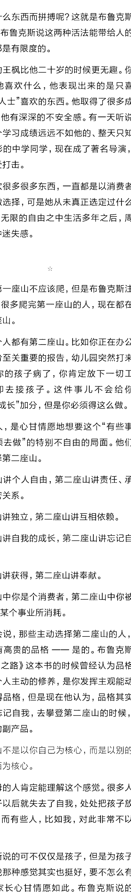

布鲁克斯是《纽约时报》的专栏作者，我们专栏多次提到他的书和文章。他的上一本书《品格之路》，我曾经在《上海书评》上写过介绍 [1]。布鲁克斯是个保守派，他非常非常重视传统价值，非常非常讲究个人的修行，我看他有古君子之风，简直不像个现代美国人。

我们专栏前面讲过介绍阿德勒哲学思想的《被讨厌的勇气》。《第二座山》的主题和《被讨厌的勇气》很像，两本书说的都是怎样摆脱世俗单薄的厌烦感，做一个自立于世间的“强人”。但是因为布鲁克斯作为现代人掌握更多的智力资源，《第二座山》可以说是强人哲学的现代升级版。

到底啥叫强人呢？我先说几个例子，你看看你想学习谁。

*

王枫从中学到大学一路上的都是最好的学校，而且他常常是全班成绩最好的学生。现在王枫供职于一家当然也是最好的公司。这几天他成了微博的热点，这倒不是因为他做出了什么突出成绩，而是他发布了一则征婚广告。王枫列举了自己的收入、职位、毕业院校等等各种硬指标，以及他对女方的种种硬性要求。微博与论认为王枫这个征婚太物 opted 了，王枫理直气壮：我是最好的，我当然要找个最好的。

周琪是一位美丽的青年女性，她家庭条件很好，大学毕业以后决定先看看世界再琢磨干什么。几年以来周琪走遍了各地的名胜，她发在社交网络的照片不是在阿尔卑斯滑雪就是在蒙古钓鱼。周琪认为人生的意义在于体验，她要趁着年轻多体验这个世界的美好。

马小武并不小，他今年四十岁了，因为种种原因日子过得不算成功，在一家医院当清洁工。五号病房的孩子似乎是得了不治之症，他陪床的父亲老王眼看着一天比一天绝望。这天马小武打扫病房的时候老王正好出去抽烟，马小武打扫完出来，在楼梯口碰见了老王。老王说：“你是怎么干活的？怎么到现在还没有打扫病房？”马小武没有反驳，他谦卑地说“对不起，我马上打扫。”然后当着老王的面又打扫了一遍。

林肯站在乔治·麦克莱伦将军家的屋檐下等人开门的那一年，他已经52岁了。他曾经狂热追求过名声和权力，现在他都得到了，他刚刚当选美国总统。现在他需要麦克莱伦出山帮他打赢内战。男仆说麦克莱伦不在，林肯说没关系我们就在客厅等。一小时之后，比林肯小17岁的麦克莱伦回来了，没理会林肯一行直接上楼了。林肯又等了半个小时。男仆出来说将军今天很累，决定今晚不见面了，改下次吧。随行人员都怒了，他怎么敢如此对待美国总统？！而林肯说，“礼节和我个人的尊严不重要，只要能请到一位愿意为联邦作战的将军，我可以一直等下去。”

王枫和周琪做的并没有任何不对，他们正在攀登人生的第一座山。但是马小武和林肯攀登的是第二座山。

*

“第二座山”是布鲁克斯发明的概念。他说人生要爬两座山，第一座山是关于“自我（ego）”的，你希望自己越来越成功、越来越厉害，要实现自我，获得幸福。第二座山，却是关于别人的，是关于“失去自我”的：你为了别人，或者为了某个使命，而宁可失去自我。

专注于第一座山的人未必能想明白为什么要爬第二座山，但是你终将明白。

第一座山有两种爬法。

一种是像王枫这样，把人生永远都当做上学一样过。他把每件事都看作是竞争，在每个阶段都能找到通关攻略，任何事情都要求自己做到最好。他非常注重声誉，他上学的时候以这个大学的学生为自豪，上班以后以自己在这个举世闻名的公司工作为自豪。为了保持这份自豪感他愿意付出一切代价。

一种是像周琪这样，把人生当做一系列的探险——当然不是真的冒险，而是像看惊险电影一样的探险。她积极探索世界提供的各种可能性，对所有可能都保持开放。也许她五年之后会在这个国家、但也许会在那个国家生活，也许她会做这个工作，但也许是另一个工作。她的态度就如同只拿钞票而不愿被股票套住，她认为最重要的是自由。

这两种生活理念是现代社会的典型。你大学毕业典礼上，演讲嘉宾说你们是最自由的一代，你们有无限的可能性，你们要遵从自己的内心，去放手去搏吧！

可是为什么东西要拼搏呢？这就是布鲁克斯的质疑。布鲁克斯说这两种活法能带给人的幸福感都是有限度的。

三十岁的王枫比他二十岁的时候更无趣。你不知道他喜欢什么，他表现出来的是只喜欢“成功人士”喜欢的东西。他取得了很多成绩，但是他有深深的不安全感。有一天听说当年那个学习成绩远远不如他的、整天只知道看电影的中学同学，现在成了著名导演，王枫深受打击。

周琪喜欢很多很多东西，一直都是以消费者的姿态做选择，可是她从未真正定过什么东西。在无限的自由之中生活多年之后，周琪有一种迷失感。

*

并不是第一座山不应该爬，但是布鲁克斯注意到，有很多爬完第一座山的人，现在都在爬第二座山。

其实每个人都有第二座山。比如你正在办公室写一份至关重要的报告，幼儿园突然热来电话说你的孩子病了，你肯定放下一切工作，立即去接孩子。这件事儿不会给你的人“个人成长”加分，但是你是必须得这么做。

而有些人，是心甘情愿地想要这个“有些事儿我必须去做”的特别不自由的局面。他们主动选择第二座山。

第一座山讲个人自由，第二座山讲责任、承诺和亲密关系。

第一座山讲独立，第二座山讲相互依赖。

第一座山讲自己的成长，第二座山讲忘却自己。

第一座山讲获得，第二座山讲奉献。

第一座山中你是消费者，第二座山中你被他人、被某个事业所消耗。

你肯定会说，那么主动选择第二座山的人，必定都有高贵的品格——是的。布鲁克斯写《品格之路》这本书的时候曾经认为品格是一种个人主动的修养，是你发挥主观能动性去获得品格，但是现在他认为，品格其实是当你忘记自我，去攀登第二座山的时候，所获得的副产品。

第二座山不是以你自己为核心，而是以别的某个东西为核心。

当上父母的人肯定能理解这个感觉。很多人有了孩子以后就失去了自我，处处把孩子放在首位，而有些人，比如我，对此非常不以为然。

布鲁克斯说的可不仅仅是孩子，但是为孩子忘记自我那种感觉其实也挺好，要不怎么有那么多家长心甘情愿如此。布鲁克斯说的是，忘记自我的那个状态，是值得我们去追求的。

第一座山追求的是幸福，第二座山得到的是喜悦。

*

啧啧必须重新定义这两个概念。这本书里说的“幸福（happiness）”，特指个人的幸福。比如你取得了成功，在竞争中获得胜利，实现目标，增长了能力，让世界的某一部分听你的，再加上各种感官的快乐，这些都叫“幸福”。

喜悦（joy），则是另一种东西。喜悦是你攀登第二座山得到的副产品。

布鲁克斯观察，人生的喜悦一共有六个层次。

## 第一层喜悦是心流。你非常投入地做一项工作，而且做得特别顺手特别漂亮，你进入忘我的状态，感觉自己已经和工作融为了一

写留言，与作者互动


我的状态，感觉自己已经和工作融为一体。特别是如果这项活动是跟他人配合进行的，大家进入集体心流，喜悦感会更加强烈。

## 第二层喜悦是与他人一起，随着音乐的旋律跳舞。

你在一个酒吧里坐着，音乐声响起，一个陌生人过来邀请你跳舞，你一看他感觉就合拍。你们两个的配合立即天衣无缝，你感觉自己可以做任何动作，而每个动作都恰好是对方想要的，你们完全融入到音乐之中，你的自我意识好像消失了一样。

## 第三层喜悦是亲密的情感。

比如一个妈妈第一次看到她的宝宝那种感觉，一个父亲看见孩子们快乐地玩耍，自己偷偷在旁边乐那种感觉。

## 第四层喜悦是在精神上的沟通。

有个诗人有一天在自家后院，发现一只鹰隼落在了树上。他赶紧叫女朋友出来看，两人就那么盯着鹰隼，鹰隼也盯着他们，人和动物之间的界限消失了，诗人希望那一刻永远都不要结束。

## 第五层喜悦是超越自我的感觉，是一种与万物融为一体的宗教般的体验。

我们讲《为什么佛学是真的》和《盗火》的时候说过这种体验。

## 第六层，也是最高级的喜悦，是道德喜悦。

布鲁克斯观察到，有些宗教领袖和社会活动家，那些身上背负着沉重负担、永远都被人们需要的人，他们并不是一天到晚长吁短叹的样子，而是整天都乐呵呵的。他们脸上永远都有喜悦之情。

喜悦都是来自忘我。你要是啥负担都没有，你不会一天到晚那么高兴，你会感到困惑，你会觉得快乐已经到上限了。世界上没人需要你，那其实是最不幸的感觉。你要是一身负担、而同时又不把那些当成是自己的负担，而是完全为了别人，你会充满喜悦。

幸福是变幻无常稍纵即逝的，喜悦却是深刻和持久的。幸福能让我们感到快乐，而喜悦却能改变我们。

*
你要想知道喜悦是什么样子，可以看看微博上的一段视频，说的是中日友好医院的王泰龄医生。她今年92岁了，仍然在第一线，而且每天工作十二个小时。

记者列举了王泰龄得过的各种荣誉，但是王泰龄说：“奖状以前我有一书包......现在最高兴的就是，一个年轻人，他突然告诉我他明白了。”

我建议你看看这段视频 [2]。你一眼就能看见王泰龄身上的光芒。


## 注释

[1] 万维钢，美国人说的圣贤之道，收入《知识分子》一书。

[2] @人民日报、@中国青年报的微博视频，或者微博搜索“王泰龄”。


# 万维钢·精英日课³
帮你和全球精英大脑同步

版权归得到App所有，未经许可不得转载

‹ 前一篇

## 日课精选

默认 最新 只看作者回复

正在加载...

写留言，与作者互动

## 《第二座山》2: 千金一诺

万维钢·精英日课³
今天
进入详情 >

《第二座山》2: 千金一诺
12:03 11.03 MB
| 转载：<|start|>绍 |

咱们继续讲布鲁克斯的《第二座山》这本书。这讲说的是攀登第二座山的方法。上讲很多读者问是不是一定要先攀登第一座山再攀登第二座山，其实不是的。第二座山没有多少先决条件。有些人受家庭教育影响，一出道就是以第二座山为目标，也有很多人同时攀登两座山，这两座山并不矛盾。

不过布鲁克斯调研发现，人们走上攀登第二座山的道路，的确有一些共同的规律。选择第二座山之前，人们通常会经历一段人生的低谷。

你肯定听说过这样的事情，一个人得了大病，他在病中重新思考人生，认为如果自己这一生就这么过了，实在太不值得了。痊愈之后，他立即选择投身一项比自身大的事业，也就是我们常说的那个 something bigger than yourself。

有的人是经历了人生最大的不幸而做出改变。布鲁克斯认识一位女性，三个儿子被她在一夜之间枪杀而死，她悲痛欲绝、终身再也回不到从前那种美好的生活的状态了，她选择把余生投入到为他人服务之中。

有的人是目睹了一个什么事件，反思人生。鲁迅和托尔斯泰都是因为旁观了一场死刑的执行而走上新的人生道路。托尔斯泰原本已经是个非常上进的人，一心想要完善自我；鲁迅想的是做个好医生。可是看到死刑，托尔斯泰就想，这个杀人的暴力做法肯定是不对的，你说怎么理论它也不对，世人怎么是这样的呢？鲁迅看到的是被杀的就是中国人，而中国人居然在旁边看着热闹玩，这都什么人？他们从此决心不再为自己，而是为了世人和国人写作。

也有的人是第一座山已经攀登成功了，接下来感觉没有什么可追求的了，感到倦怠了——这个状态有个专门的英文名词，叫做“acedia”。如果你发现自己对什么东西都没有热情了，你可能需要使命的召唤。

不管是什么原因，当一个人经历人生低谷的时候，一般的做法都是赶紧设法走出来。比如跟亲友聚一聚、喝点酒、安慰安慰。但是布鲁克斯说，正确的做法，是看看这段经历能教给你什么。

古往今来仁人志士的道路，是从自己的痛苦中学到智慧，然后运用这个智慧去服务别人。你的第二座山就此开启。

那么这个山应该怎么爬呢？这个方法是，你得提出一个“誓约”。

“誓约”的英文是“commitment”，一般翻译成“承诺”，我感觉这个词在现代汉语里用的不多。誓约的意思是你主动向别人提出，你要做到如何如何，然后你自己约束自己，拼命也要做到。

我们讲博弈论的时候说过承诺，那是一种可信的信号，能确保对方相信自己，而我们这样做本质上是为了自己的利益。我们今天常用的工具叫做“合约”、或者更直白的说法叫“合同”，是通过外界力量约束自己。我们今天有时候也发誓，但是人们发誓就好像是签合同一样，誓言中常常会有“有违此誓天打雷劈”之类的狠话——女主角听到这句话通常会制止男主角说这么不吉利的话，但是制止总是发生在男主角说完之后。

可是在秦始皇让中国普及实行郡县制之前，在那个分封制的年代，在国家权力不能领导一切的时候，中国人讲的承诺，是不需要附带什么违约责任的。因为承诺是自己对自己的约束，这样的约束最厉害。

李白说朱亥和侯嬴是“三杯吐然诺，五岳倒为轻”，人家一句“我答应了”就OK，根本无须再来一句“我要完不成任务你就把我如何如何”。曾子说君子都是“可以托六尺之孤，可以寄百里之命，临大节而不可夺也”，都是看似轻松地承诺，然后用生命去捍卫。

乔治·R·R·马丁的《冰与火之歌》时代背景模拟分封制的欧洲，所以书中结 Sausage 有誓词、被封为骑士有誓词，生活状态的正式改变总是伴随着誓约。咱们先看一段骑士誓词——

- 我发誓善待弱者
- 我发誓勇敢地对抗强暴
- 我发誓抗击一切错误
- 我发誓为手无寸铁的人战斗
- 我发誓帮助任何向我求助的人
- 我发誓不伤害任何如人
- 我发誓帮助我的兄弟骑士
- 我发誓真诚地对待我的朋友
- 我发誓将对所爱至死不渝

最后并没有一句“如果违反上述约定，我的骑士资格就会被取消”，更没有“如果我失去骑士待遇，上述约定自动无效”。
誓约是无条件的。

为什么有人愿意自己束缚自己呢？

我们专栏前面刚讲了萨波斯基的《行为》，你可能忍不住会琢磨“第二座山”的脑科学依据是什么。第二座山的思维大致对应三个脑神经活动来源：演化带给我们的渴望情绪、群居生活带给我们的道德设定，以及前额叶皮质的理性判断——布鲁克斯没使用这些科学语言，他提出的三个更直白的名称：心、灵魂和大脑。

心，代表你的渴望。你渴望很多东西，但是归根结底，你最大的渴望，是“被爱”——正如阿德勒说人的幸福和烦恼的根源都是人际关系。而要想被爱，你就得做个“值得爱”的人，你就得爱别人。

灵魂代表道德。如果一个人只是一堆原子，为何强暴女性是重罪呢？从物理学角度来说那个女性受到的伤害很小。因为人这一堆原子涌现出了“意识”这个东西。人的意识总觉得各种事情都是有意义的。灵魂代表一个人的道德价值——所以你不能侮辱他；灵魂还代表一个人的道德责任，所以他的举一动，会受到别人的评判。

灵魂决定了你有些事不能做，有些事必须做。世界上没有一个文明会赞美那些从战场上逃跑的人和出卖朋友的人，灵魂具有普遍的意义。

最近我听说赵忠祥老师再次出山了，在淘宝卖祝福：你只要花两千块钱，赵老师就可以给你录一段祝福视频。按理说把希望变成现实 哈哈不对，可我总觉得别扭....也许就是因为两千块钱的祝福没有灵魂吧。

好，布鲁克斯说，心和灵魂在人的意识中的排位顺序，都在代表理性思维的大脑之上。有心，你的生活才有目的；有灵魂，你才知道什么是对什么不对。

心的最高追求是爱，是自己与他人、或者与一项事业的融合。灵魂的要求是做正直的事。誓约就来自这里。

父母和子女之间，情侣之间，我们和朋友，人和事业之间，当你爱一个什么东西爱得特别深的时候，你会想要把自己生命的某一部分拿出来，无条件地奉献给他。不管发生什么事情，你都愿意付出时间和精力给他。你就提出了一个承诺。

我们考虑自己的时候，总想让自由度和独立性最大化，尽可能地保留退项，让自己永远都有选择权。但是当我们考虑他人，考虑自己和别人的关系的时候，一旦建立了誓约关系，你就是在取消选项，让自己依赖他人。

## 誓约是不求回报的承诺。

父母对孩子就是这样的，任何时候孩子有事你就得管，生孩子给你带来了无穷的责任和义务，可是没有对等的权利——可是我们从来没听说过有人后悔生孩子。

婚姻也是这样。两个人互相喜欢那就一起生活吧？为何非得弄个结婚程序呢？将来万一不喜欢了分开岂不麻烦吗？爱到一定深度，你就想弄这么正式的承诺。

学习和工作也是这样。你喜欢读书就读书，为何非得这个学位呢？这些都是对自己的约束。誓约是哪怕我将来某个时刻觉得这不好玩了，我也不能放弃。

戴笠的《悟空》这首歌里有两句「叫一声佛祖，回头无岸。跟一人为师，生死无关。」我进了这个门就不管发生什么也不能反悔了。这就是誓约。

## 誓约可能带给你痛苦。但是誓约也会带给你好处。

布鲁克斯说，誓约给了我们身份认同。别人问你是什么人，你能回答说我是一个喜欢吃爆米花的人吗？你可以说你是做什么事业的人，你是谁谁的丈夫或者妻子，你是一个信仰什么东西的人，你是哪个组织的人。

## 建立了誓约，你生活才是连贯和自洽的。我是专栏作家不是因为我擅长写专栏，而是因为我必须写专栏。

## 誓约给了我们目标感。布鲁克斯引用盖洛普2007年的调查，说世界上认为人生有意义的人口比例最小的国家是荷兰，因为他们日子太好了人们不知道还有什么可奋斗的；而认为人生有意义的人口比例最大的国家是西非的利比里亚——那里的人必须苦苦挣扎，他们对彼此有强烈的责任感。

## 誓约让我们得到更高级的自由。可以*不做*

## 誓约让我们得到更高的自由。

可以*不做*什么的自由 —— 比如“免于恐惧的自由” —— 是低层次的。你什么都可以不做，那你做啥呢？能去*做*什么的自由，是高级的自由。

你想表演钢琴，可是你没有那个水平，那你就没有那个自由。想要表演钢琴的自由，你必须首先限制自己的行动，逼着自己在该练琴的时候只能练琴才行。

自由不是没有限制，而是选择正确的限制。

## 誓约还能让我们建立品格。

现在一提“品格”人们首先想到的是自律、自控、坚毅力这些跟工作相关 的东西，可是别忘了品格更是道德的要求。真正高贵的品格不是吃饭时候遵守礼节那个自控力，而是仁义礼智信那些自古以来就被人推崇的东西。

建立和遵守一个誓约，你就能在攀登第二座山的过程中，慢慢改变自己。誓约总是你对一个别的东西建立的。布鲁克斯说最重要的誓约有四个，分别是使命、婚姻、哲学信仰和社区，咱们一个一个说。

最后我们听一段《冰与火之歌》里守夜人的誓词，我每次听到这个誓词都热血沸腾。你想想，如果你有一个这样的誓约，你是变得更卑微了，还是更强大了呢？——

长夜将至，我从今开始守望，至死方休。
我将不娶妻，不封地，不生子。
我将不戴宝冠，不争荣宠。
我将尽忠职守，生死于斯。
我是黑暗中的利剑，长城上的守卫，抵御寒冷的烈焰，破晓时分的光线，唤醒眠者的号角，守护王国的坚盾。
我将生命与荣耀献给守夜人，今夜如此，夜夜皆然。


万维钢·精英日课³
帮你和全球精英大脑同步
版权归得到App所有，未经许可不得转载

〈前一篇

学习进步群


活码长期有效

## 《第二座山》3: 使命召唤

万维钢 · 精英日课³
今天

进入课程 >

《第二座山》3: 使命召唤
11:09 10.21 MB

【转载：华汐】

咱俩继续讲布鲁克斯的《第二座山》这本书。上讲说到人生有四个最重要的誓约，这讲说其中第一个：使命。“使命”是个非常大的词，日常生活中好像不太能用上。但是如果你能用上，你是个非常幸运的人。

什么是使命呢？我们先辨析几个概念。很常用词都可以从不同的角度理解，就如同前面说的“幸福”和“喜悦”，我们不得不为了这本书而重新定义一下。现在咱俩重新定义这几个词——

“职业（job）”，是你谋生的手段。选择职业的时候你要看这个工作对你好不好，挣钱多不多、离家近不近、工作时间长不长等等。

“职业生涯（career）”，是你的职业成长道路。比如你是公务员，组织上突然要求你去艰苦地区支援一年。单从这一年来看这不是个好职业，但是从你的职业生涯来看，你有了这个经历就等于积累了一笔资本，将来会很有好处。考虑职业生涯的时候我们考虑的是长期的成长，但仍然是以自我为核心。

“工作（work）”，是需要你去做的一件事情。公司的网络突然断了，需要立即修复，这就是一项工作。这个工作对你的个人成长意味着什么不重要，重要的是现在必须马上有人去做它，而你正好会做，所以这个工作需要你。早上出门上班的时候你并没有主动选择今天要修网线，是网线正好断了，这个工作选择了你。

这就引出了“使命（vocation）”。使命是一项等待你去做的事业。这个事业是长期的“工作”，你可能要投入一生的力量。你得跟它立一个誓约。

你可以选择职业和职业生涯，但是你不选择使命——你是被使命选择。有时你突然强烈地感觉到一个召唤，你觉得这件事儿必须得做，而且必须由你去做，这就是你的使命召唤。

这听着有点神秘，但是很多时候这是非常平常的事情。比如现在是抗战时期，中国被人打得没有还手之力都快要亡国了，而你有文化又身强力壮，那你就会感受到召唤，抗日救国就是你的使命。马小武在医院当清洁工本来是作为一个职业，但是他感受到那些患者和家属需要人与人之间的帮助，他把职业做成了使命。

当你把一项事业当作使命的时候，你和那些一天到晚刷 LinkedIn、琢磨怎么完善简历的人可就不一样了。咱俩看看有使命感的人是怎么做事的。

你可能听说过一本反乌托邦小说叫《一九八四》，它的作者是英国作家乔治·奥威尔。奥威尔从小就知道自己有写作才能，写一直在召唤他，但是他一开始并不认为当作家是个靠谱的职业。

奥威尔先去印度当了一名英国警察，后来回到英国，宁可无所事事也不愿意写作。他知道自己*想要*写作，但是他认为不应该写，他甚至为自己的写作冲动而感到愧疚……最后他向命运屈服了，他决定安心写书。

这时候请注意，当奥威尔决心写作的时候，他的做法可不是先找几本“写作指南”阅读、报个什么作家班、做个市场调研看看现在人们喜欢读什么书、自己写出一本然后去找大 V 推荐。奥威尔决定，要写作，他必须做下面这三件事——

第一，他搬到穷人社区，跟穷人生活在了一起。奥威尔的政治立场是左翼，但是他有点看不起英国那帮社会主义者，认为他们都是只会夸夸其谈的知识分子。他们号称要解放穷人，可他们都没有直接接触过穷人，根本不了解穷人。

为了体验生活，奥威尔在一个餐馆找了个刷盘子的工作，每天要干十三 个小时。

第二，奥威尔要发明一种新的写法。他要用文学手法，写非虚构的作品。他成了一个写政治寓言的大师。

奥威尔从来没说过他有多享受写作，他认为写书是个可怕的斗争过程。这个过程会把你给净化，会压制——而不是表达——你的个性，你要尽可能把自我藏起来，让读者感觉是直接在接触你描写的东西。

第三，为了真正响应使命的召唤，奥威尔决心要做到“无情地诚实”。这意味着他不会偏向自己阵营的同志。自己这边有什么毛病，奥威尔也要写出来。

试问当今的作家，有几个人对自己提出了奥威尔这三个要求。那些被“职业生涯”的人做不出来这样的事儿。世界不在乎你多不多一个成功者，世界需要的是能做出改变的人。

布鲁克斯列举了非常多的例子，它们都有很相似的模式。一开始都有一个“召唤”。

我们专栏讲过爱因斯坦和指南针的故事。爱因斯坦五岁的时候就从一个指南针里看出来空间有问题！他想探索这个问题。

我们还讲过生物学家爱德华·威尔逊（E.O. Wilson），他的主业是研究蚂蚁。威尔逊为什么选择研究蚂蚁，一部分原因是他小时候钓鱼，鱼刺刺了他的一只眼睛，他从此只能用一只眼睛观察大自然，没有立体感，所以只能观察小的东西。那他为啥要去钓鱼、为啥非得观察大自然呢？因为七岁那一年，威尔逊父母离异，他不得已寄宿在一户陌生人家里，他没事干整天在海边玩耍……然后海洋生物的美妙召唤了他。

布鲁克斯说，“美”的希腊语是 kalon，这个词原本就与“召唤”有关：这个东西实在太美了，你感觉就好像它在召唤你去探索它，让你想要从此跟它生活。

还有的人是被历史事件所召唤。神经病学家维克多·弗兰克尔（Viktor Emil Frankl）从小就希望自己能做点什么，可是等到他被关进纳粹集中营的时候，他突然意识到，关键问题不是“我能从生活中期待什么”，而是“生活对我有什么期待”！集中营里的人需要他扮演一个精神治疗师去缓解他们的痛苦，精神病学需要他利用这个机会研究人的痛苦。

也有一些人是因更小的原 因。比如一位画家之所以画画，是因为他小时候好奇喜欢闻颜料的味道……

但多数情况下，人们感觉自己当时别无选择。他们感觉自己被选中了，不干不行。

职业是可以选择的。你看看自己擅长什么，市场需要什么，考察一下这个职业的经济激励，做出人生规划。对选择职业来说天赋比兴趣重要得多。你喜欢做这个可是你做不好，那就只能去一家比较差的公司，做分工底层的 事情，你会觉得很没意思。

可是对使命来说，这种理性的计较就不行了。

因为你会被使命所改变。改变之前的你，并不知道改变之后的你是个什么情形。咱俩还是拿生孩子打比方——升级做父母之前可能你感觉你自己还是个孩子，你根本无法想象你能去照顾小孩！但是当你真的有了孩子，不得不去照顾的时候，你发现原来自己做得还不错。

而更重要的是，使命关乎到你人生的意义和目标。要做一辈子的事儿，能力不足也许可 以培养，要是意愿不足，那就有点悲哀了。布鲁克斯主张根据自己的心和灵魂决定听从使命的召唤。这个世界上的知识都是现成的，真正稀缺的是你愿不愿意学习那些知识。

有些聪明孩子从小被父母要求学这个学那个，因为不热爱，到 20 岁居然抑郁了。你要不是真的的热爱这件事儿，你很难取得真正的成就。

不过热爱并不代表你就“被需要”。你还得看看社会需不需要这个工作，看看你所处的位 置是不是正好适合做这个工作。

确定了这个人确是你，接下来你需要一位导师。

如果你足够幸运，你能遇到导师。课本能告诉你生物学的知识，但导师能教你如何像生物学家一样思考。实践的智慧只能从经验中得来，你应该像学徒一样，跟着导师一起做些真正的工作，获得潜移默化的知识。

导师还能在你人生重大的关口给你提出建议。导师是你的榜样，他能让你看见这一行最好的 人是怎么工作的。导师能带你见识各种各 样东西；给你养成一个正确的品位。导师还 能通过严格的要求，帮你从失败中学到东西，让你体验学问的拷札。

我觉得最有意思的一点是导师能让你看到什么 是“炽烈的”爱。威尔逊有个导师在野外考察的时候被鳐鱼给蛰了，结果他伤还没好、绑着绷带就又采集标本去了。

我想，如果你身 这样的人，你就可以放心了：原来我对这件事的爱还不算最炽烈的，别担心，我离失控还远着呢……

我们之所以要对使命立一个誓约，是因为你总会遇到某一个阶段，那时候你的收获远远比不上你的付出，你感觉当初于...?

总会遇到某一个阶段，那时候你的收获远远比不上你的投入。你感觉自己已经下了那么多功夫，可是好像没什么进步。

计算性价比的人会在这一步放弃，但是你别无选择。被召唤的人，并不等于是什么“天选之人”，不是说你生来就该干这个，不是你一上手就比别人厉害。

也不是说我做出牺牲了，我都不考虑性价比了，我有这么了不起的道德，所以我注定应该成功——那是没有的事。

攀登第二座山，你必须改变自己才行。你的“初心”再好，不磨炼也不行。布鲁克斯特别还引用了一段孔子的话：

> 「恭而无礼则劳，慎而无礼则葸，勇而无礼则乱，直而无礼则绌。」

——没有章法的恭敬只会把你的能量耗散掉，没有章法的谨慎小心会让你胆小怕事，没有章法的勇敢是莽撞，没有章法的直率是粗鲁。

这个道理是人性必须经过打磨才能变成真正的好东西。

而打磨的过程并不是令人愉快的。刻意练习要求你反复做自己做不好的事。大学教授的工作不仅仅是寻找科研灵感和讲课，你得做很多杂活、脏活和累活。如果没有那个誓约，你根本坚持不下去。

而在这个过程中，你慢慢地就被使命给改变了。你不再是那个以自我为中心、整天心神不定的人了。你终于有了一点深度，像是一块好材料了。

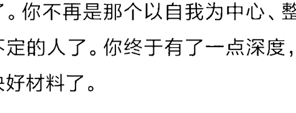

‹ 前一篇

# 用户留言

默认 最新

只看作者回复

正在加载…

‹ 写留言，与作者互动

# 《第二座山》4：婚姻是什么

万维钢·精英日课³
今天

进入课程 ›

《第二座山》4：婚姻是什么
11:14 10.28 MB

[转载：何沙]

咱们继续讲布鲁克斯的《第二座山》，这一讲的主题是婚姻。婚姻可能是你一生中最重要的一个决定。大多数人都会结婚，但是很多人做出的选择是错误的选择。

按美国的数据来说，40%的婚姻以离婚告终，10-15%的婚姻处于没有离婚但是分居的状态，7%的婚姻是两人还在一起，但是感觉强烈不幸福，也就是说幸福的婚姻还不到一半。如果是25岁之前就结婚，得到坏结局的概率更大。而如果你身处坏的婚姻之中，你得病的概率增加35%，你的预期寿命减少4年。

所以结婚这件事肯定需要理性判断！但是从另一方面来说，我们为什么结婚呢？结婚难道不是因为你对一个人爱到如此之深，以至于想要跟她融为一体，永远在一起，所以必须提出一个誓约吗？

这和使命召唤是一样的感觉；不是你的大脑想不想结婚的问题，而是你的心和灵魂觉得已经不得不结婚了。而维护婚姻，也和为某个使命献身一样，是改变自我的过程。

婚姻是二人的关系与每个人的自我之间的斗争。

谁要敢说布鲁克斯是婚恋专家我估计他肯定不干，但是他阅过一次婚姻两次婚，对婚姻的确有很多体会而且他调研了各路专家的话，咱们先看看布鲁克斯描述的一段典型的亲密关系是如何发展的。

# 亲密关系是一种层层递进发展的关系，大约分成七个阶段。

# 第一阶段是一见钟情。你一看见到这个人就被吸引住了。不是平常的那种眼前一亮，而是她身上有一种让你惊心动魄的新奇感，你从未见过这样的人。而与此同时，你又对她有一种莫名的熟悉感，好像多年前认识一样…..正所谓 喜悦 = 熟悉 + 意外。

# 第二阶段是想要了解对方。你对她非常非常好奇，想知道她到底是个什么样的人，你简直每时每刻都在想着她。

# 第三阶段，两人开始约会了，在对话中慢慢把自己暴露给对方。

# 第四阶段是燃烧。第一次亲密接触发生在这一阶段。

# 第五阶段是危机。每一个好故事里都有危机阶段。两个人不会永远都看着对方越理想，你的本性、你的各种缺点会暴露出来。

# 第六阶段是原谅。在浪漫关系中，你必须足够强大才敢于指责对方，而你必须更加强大才能原谅对方。

# 这是第七阶段，融合。当个人的自我能够让步于二人的关系的时候，你就可以进入婚姻了。

# 第一是道德。经过这么长时间交往你应该能看出来了，这人到底是不是好人？专家的意见是别的东西毛病将来都能忍，唯独一条：如果你的内心鄙视这个人，那么这个婚姻就无论如何也不能维持。

# 第二是性格。我们知道人的性格是可以变的，但是有些个性不易改变。而对结婚来说，你需要特别关注的是这个人的“情感依恋类型”（attachment）[1]。

# 第三个问题是你必须想好，你对这个人的爱到底是哪种爱。希腊人把爱分成三种——

+   1. philia，是朋友间的爱。你喜欢他是因为他是个有趣的人，跟他在你觉得很好玩；
2. eros，是男女之间的激情之爱。这个爱能让你深深迷恋对方。\
3. agape，是无私的爱，崇拜的爱。

自我实现的需求高于婚姻关系。很多婚姻是陪伴式的，没有什么戏剧性但是也没什么激情，好处是双方都比较自由。

但是我们还是应该追求完美婚姻。结婚不是为了凑合，是为了爱，是我们内心就想要跟另一个人融合。

事实是不管对方是个多么好的人，婚姻终究也会限制你的个人自由。最起码来说如果有了孩子，你想不管都不行。

更重要的是，结婚意味着你的生活被人给入侵了。婚姻是个人主义的最严重危机，你等于生活在一个连续不断的被监控状态之下。你身边一直都有个人在对你做各种评判。你的所有缺点都暴露在对方的火力之下。

而你以前根本都不知道你有缺点。结了婚你才知道，原来自己一早起就爱发脾气，别人跟你谈重要话题你总爱躲闪，从来不关心别人感受，你还喜欢扮演受害者，给人制造负罪感......你怎么是这样的人啊！

所以婚姻是对你的教育。婚姻能不能搞好，取决于你愿不愿意被改变。可能你明白改变一个人最好的方式是去爱她，通过爱把她可爱的一面激发出来，让她变得更可爱 ——可是如果对方要这么改变你，你能接受吗？

良好的婚姻中，两个人必须都失去一部分自我，让位给婚姻关系。关系比个人重要，这就是美满婚姻的秘密。

在这个意义上的婚姻是第二座山。你在实践誓约的过程中慢慢被改变，成了一个更好的人。

## 注释

[1] 我们专栏以前讲过一个“依附理论”：自由人和依附感。


‹ 前一篇

# 用户留言

默认 最新 只看作者回复

正在加载...

写留言，与作者互动

# 《第二座山》5：知识美德

万维钢 · 精英日课³
今天
进入课程 >

《第二座山》5：知识美德
11:32 10.56 MB

丨轮到：孙沙丨

咱们继续讲布鲁克斯的《第二座山》这本书。这一次讲说的是怎么攀登“哲学信仰”这座山。“信仰”是个非常重的词，布鲁克斯对宗教也的确有很深的思考，但我们专栏喜欢谈科学，所以我们就不讲宗教的内容了。我们重点说个人的知识——智慧和见识——的生活。

作为一个完整的人，你除了要有自己的使命、要好好照顾家庭、要奉献社会之外，还应该有一个知识生活。知识生活不是你的学历和专业技能，而是说你读到了什么程度、你对世界认识到了什么程度。你是只顾低头走路，还是常常仰望星空。

如果你打算有个明白，想认识世界，你需要一个知识誓约。这个誓约和使命、和婚姻一样，都需要你既坚持，又改变：坚持追求真理的理想，然后在这条路上愿意改变自己。当然这并不是说你非得去搞学术研究，也不用你为某个学说奉献一生，但是你的知识誓约也是一场修行。

*

我自己的一个感慨是很多人意识不到知识是需要修行的。理工科的学问，高低上下非常清楚，人人都明白中学生数学和博士生数学有本质差距，就好像电脑游戏里的武功一样，中间隔了很多级。但是对于社会科学的学问，你经常会听到初中小嘲博士生的事情。

我认为这是因为人们分不清“观点”和“立场”。

立场，是你在争论中支持哪一方；观点，是你能为这一方提供什么样的支持。每个球迷都支持自己的主队，这只是立场。立场是廉价的，“奇葩说”那样人都是抽签决定立场。你说出来的东西得能帮助队伍赢比赛，才配得上说你有观点，观点是有高低之分的。

人的认识常常是螺旋式上升，所以有时低水平的观点可能占据正确的立场，高水平的观点可能占据错误的立场。

比如说垃圾分类问题——
A 同学反对垃圾分类，因为他觉得垃圾分类给他生活带来了麻烦。
B 同学支持垃圾分类，因为他认为保护环境人人有责，分类对大家的长期利益有好处。
C 同学反对垃圾分类，因为他认为社会在垃圾分类中投入的成本，大大超过了在环境上收获的好处，垃圾分类是个行为艺术。

这里 A 同学和 C 同学的立场一样，但你能说他们俩的见识水平一样吗？C 同学有资格反对 B 同学，因为他的观点已经考虑到了 B 的观点。而 A 同学没有这个资格。如果是开听证会，A 同学立即就出局。如果辩论的结果是 B 输了，A 站出来嘲笑 B：哈！你这个大学生还不如我这个初中生！你一看就知道 A 非常无知。

我们的知识生活应该追求更高水平的观点，而不是赌立场。

*

这是一座艰难的山。你在知识修行的路上，可能要艰难地改变自己最初的立场。咱们还是说布鲁克斯的故事。

布鲁克斯在芝加哥大学念本科的时候，是在上世纪八十年代。当时美资资本主义正在对苏联取得节节胜利，但是布鲁克斯支持社会主义。布鲁克斯强烈向往中国革命，他非常推崇用革命的方式解决社会问题。

我们完全能理解他这个立场。如果你知道19世纪末20世纪初那个时代，苦苦大众过的都是什么日子，资本家对工人有多狠，你不可能不想革命。你会觉得那个世界太黑暗了，应该全部砸烂，重建一个理想的新世界。

当时芝加哥大学有个读书课程，老师规定的其中一本必读书是埃德蒙·伯克（Edmund Burke）1790年发表的《对法国大革命的反思》。我们专栏前面讲《历史的正确一侧》的时候说过法国大革命也说过埃德蒙·伯克[1]。用罗胖的话说，伯克是“保守主义”这个政治思想的祖师爷。伯克反对革命。

伯克认为革命式的变革太轻率了。世界非常复杂，凡是大的行动都会有意想不到的结果，而人的理性并不足以理解那个复杂，不足以做出准确的预测。社会传统的一些做法，你就算是觉得它不好，也不要轻易大改——因为那些都是已经经过了时间检验的东西。特别是各种社会规范，比如社交礼仪、骑士精神，都是生活的润滑剂，是好东西，不能说推翻就都给推翻了。

而年轻的布鲁克斯对伯克的观点非常不满。他写了好几篇讽刺伯克的文章……但是，因为《对法国大革命的反思》这本书是必读书，伯克的思想，已经在布鲁克斯身上留下了种子。

*

我真是非常羡慕布鲁克斯，他の運气太好了。他上大四那一年，美国著名保守主义政治评论家威廉·巴克利（William F. Buckley Jr.）到芝加哥大学演讲。布鲁克斯当时是校报的幽默专栏作家，他就专门写了一篇讽刺巴克利的文章。

巴克利来了之后，芝加哥大学校领导就把布鲁克斯这篇报文给巴克利看了，巴克利一看不但没生气，还发现布鲁克斯是个人才——他在演讲的时候说：“戴维·布鲁克斯来了没有？我给你一份工作！“

而当时布鲁克斯真不在演讲现场。他正在PBS 电视台录制一个电视节目。这是一个有好几集的经济思想电视辩论节目，左翼的代表是青年学生布鲁克斯，而他的对手，竟然是自由论派经济学家、芝加哥学派的领军人物，米尔顿·弗里德曼（Milton Friedman）。

布鲁克斯拿他学到的那些左翼经济理论出招，弗里德曼一一反驳。这根本就不是一个级别的对抗，布鲁克斯不断地挨处便宜。但是布鲁克斯发现，场下的弗里德曼是个非常温和的人，他们夫妻俩总是邀请他一起吃晚饭，耐心交流，布鲁克斯感觉受益很多。

布鲁克斯仍然坚持自己的左翼立场。但是他已经受到了大师的影响。

*

大学毕业几年之后，布鲁克斯作为记者参与报道了一个芝加哥市的城区改造项目。

本来那一片街区是脏乱差，大体相当于咱们中国城中村之类的地方。有几个社会学家搞了个改造项目，把原来的房屋全部拆除，政府出钱，给建设了一片新的房屋。新房又安全又好，这等于给老百姓办实事，对吧？

结果不是。布鲁克斯去报道的时候发现，那个社区现在几乎死掉了。原来的那个城中村虽然硬件质量很差，但是它是社会系统，它给老百姓提供了谋生地方。可能有人摆个摊有人开个小店，看着是脏乱差但是它什么都有，能运行起来，人们能在这里长期生活。改造之后，住房是好了，可是社会系统被破坏掉了。结果那些新房没几年也都破败了。

这件事对布鲁克斯刺激很大。这不恰恰就是伯克说的一番道理吗？全推倒重建看起来痛快，实际带来更大的问题。

布鲁克斯的思想转变了。他主动联系巴克利，说你当年给我那个工作还算不算数，巴克利说你来吧。于是布鲁克斯加入了保守主义的《国家评论》杂志。他这才意识到，自己是个伯克式的保守主义者。

*

事实上，现代保守主义运动的参与者，很多年年轻的时候都是革命主义者。你能说他们背叛了自己的知识誓约吗？

这是一个两难问题。一方面来说，你想要的是找到让世界变好的方法，你不应该在乎这个方法属于这个主义还是那个主义。你的观点变了，但是你的理想并没有变，你当初的激情没错！

但是另一方面来说，如果一个人的观点总是变来变去，那也不能算是誓约。巴克利和弗里德曼都非常坚持自己的思想。他们一开始宣扬那个思想的时候，几乎就没人赞成，但是他们却敢与主流社会为敌，也要坚持自己的思想，一直等到后来受到很多人赞同。那难道他们错了吗？

*

到底要坚持，还是要改变呢？以前布鲁克斯有篇专栏文章[2]，提到一本2007年出版的书《智识美德》（Intellectual Virtues by Robert C. Roberts and W. Jay Wood），其中提到一个概念叫“知识勇气”，我看它回答了这个问题。

首先你得有勇气坚持一个不受欢迎的观点。其次你得有谦卑的品质，知道那个观点可能是错的。但是观点的对错是由当时你能得到的信息、你的理论推导或者实验验证来判断的，跟它受不受欢迎没关系。你的观点可以随着事实和你的认识发生变化，但是不应该是因为别人的潮流改变。

什么时候尊重传统，什么时候大胆革命；什么时候向大师学习，什么时候坚持自己的看...

么写留言，与作者互动

什么时候向大师学习，什么时候坚持自己的看法，这可能是永恒的矛盾。这里面没有固定的算法 —— 你只能说我既要有智慧，又要有勇气。

那你可能会说，我不想搞学术，我就是一个普通人，那我直接听最厉害的大师的行不行呢？以前的大学教育的确是这样的。学校教的都是经典，你只要记住历史上那些最厉害的思想家是怎么说的就行了。

但是现代教育都改成了教研究方法、而不是教观点；教批判性思维，而不是让你直接听榜样的。这个做法好是好，但是布鲁克斯也提出了质疑：如果什么都怀疑，你到底相信什么呢？你崇敬什么？你忠于什么？

学术大牛都是非常狂热的人物，他们的立场特别坚定 —— 但是他们各有各的立场。知识的成长之路，很可能是一条从怀疑和摇摆到坚定的路，但是我估计，到最后你也不能完全肯定。

这条路难啊……

但我们可以看到的是，你的知识眼光会越来越越高。

攀登这座山，你就加入了一场旷世的对话，你会参与历史上那些智者尚未完成的争论。你会学会用多个模式去理解世界。你会摆脱那个以自我为中心的观察角度。你会体验到人类中最优秀的人物在面临各种局面时候的内心感受。你会欣赏到高级的美、真正的美、乃至于神性的美。

这是一条攀登之路。知识最大的喜悦不是满足你的求知渴望，而是让你有越来越高的渴望，让你学会渴望最好的东西。

布鲁克斯有个学生对他说，我听了你的课之后感觉有点更悲哀了。布鲁克斯说这是他收到一个最美好的夸奖 ——

当你知道人类最高的知识高度有多高的时候，你会对自己所在的位置非常不满意。但是只有这样，你才能成长。

## 注释

[1] 公共意志的幽灵

[2] David Brooks, The Mental Virtues, New York Times, Sept. 1, 2014.


〈 前一篇

学习进步群


活码长期有效

# 《第二座山》6: 社区里的大人物（完）

万维钢 · 精英日课³
今天    进入课程 >

《第二座山》6: 社区里的大人...
11:22 10.4 MB

今天咱们把布鲁克斯的《第二座山》这本书说完，这也是精英日课第三季的倒数第二篇文章。这一般讲的主题是第四个誓约：你在社会的立足。

前几天咱们有一位五十年代出生的读者，叫“晚霞”，在专栏分享了她的人生体会。她说当年那个时代所受的所有教育都是第二座山，都是为了国家为了集体，没有讲个人，人们都为第二座山奉献了所有。她现在想要第一座山。

年轻的读者应该感到特别幸运，你生活在一个个人可以充分追求自我实现的时代。现代社会要求你无偿奉献的东西，比以往任何一个时代都少；现代社会提供给你的机会，比以往任何一个时代都多。只要个人的能力足够强，就可以看到获得很多权利，而与此同时并不需要对他人承担太多义务。这是一个对“个人发展”空前友好的时代。

而布鲁克斯这本书的核心思想就是，即便是如此，你也不应该只顾攀登第一座山。我们应该怎样在这个个人主义社会立足呢？

社会规范一直都在变化。不但中国以前不是个人主义社会，美国也不是今天这样。五六十年代的美国也是一个特别讲集体的社会。

完成导师给的研究任务。终于有一天，你做成了一项有意思的工作，导师说你可以去学术会议上讲讲了。这件事听着很自然，其实意义特别大。

我看科研人员第一次出去作报告，就相当于贵族的“名媛成人礼晚会”。因为出去面向自己门派以外的人作报告，就说明你——

第一，做出了有个人特色的成果；

第二，从此以个人身份在社会立足，你有江湖名号了；

第三，你开始有了跟自己导师之外的学术关系。

如果你这个研究做得不好，你会丢自己的脸。如果你这个研究能启发别的研究团队，这就是你们的合作机会。如果你的结论跟别人正好相反，你就得参与江湖纷争，可能还会弄出一番豪门恩怨来。如果你的课题很热门，别人会强烈希望你得出对他们有利的结论。

那么你的研究就得非常负责任才行。你得讲学术道德。你得义务给别人审稿。你得敢于坚持自己的观点。你得在同行需要数据的时候提供数据，你得响应合作请求。你得主动提出合作，主动跟人交流，你得主动为学术共同体做贡献。只会上课和考试的学生用不着这些。

你独立了，但同时你也需要关系了。你开始被人依赖了。

依赖别人同时又被人依赖，才算在社会立足，才算是个人物。被跟你没有直接亲缘和组织关系的人依赖，才算是大人物。

世界上没有真正独立的人。超个人主义看谁都不可靠，和集体主义看谁都像自己，都不能让你真的“实现自我”。你不能没有自我也不能只有自我。你必须尊重所在的每一个社区，在主动为社区做贡献的过程中，在攀登第二座山的过程中，一边失去自我，一边找到自我。

(THE END)


万维钢·精英日课³
帮你和全球精英大脑同步
版权归得到App所有，未经许可不得转载

〈前一篇

学习进步群


# 活码长期有效


# 第三季结束语：“士”的日课

万维钢·精英日课³
今天

进入课程 >

第三季结束语：“士”的日课
12:49 11.74 MB

## 读者，你好

这是精英日课第三季的最后一讲。这一年来我们一起钻研了很多新思想，读了很多书，你不一定都记住了，但是我希望你至少记住三个人。我希望你从这三个人身上学到一点东西。

第一个人是费德勒。费德勒从小就表现出了一定的运动天赋。他刚会走路就喜欢踢着一个球玩，不过他的喜好并不仅限于踢球，只要是球他就喜欢。费德勒的妈妈是一位网球教练。如果

没有。费德勒的父母并不怎么在乎他玩什么。他的妈妈没有亲自训练他打网球，因为受不了他那怪异的击球动作。他的爸爸对费德勒唯一的要求是“别作弊”。费德勒的父母对他打球的影响是“别把网球太当回事儿”。

费德勒就这样玩着长大。他12岁才决定专攻网球，16岁才开始专业网球训练。他曾经为了能多跟朋友在一起而拒绝跳级进入高年级的网球队。在网球之外，费德勒还喜欢音乐、职业摔跤和足球，他从来没有像秀歌那样激动地说什么“我一定要打网球，网球就是我的生命”。

我们讲戴维·爱泼斯坦的《范围》这本书的时候说过费德勒的故事。费德勒没有充满焦虑感地去赢网球的起跑线和那个一个里程碑。但是费德勒是史上最伟大的网球选手。他霸占世界排名第一的时间最长，他打到38岁了还能打。

第二个人是曼德拉。

南非实行种族隔离制度，黑人受到白人的压迫，黑人对白人有深仇大恨。曼德拉本人因为领导黑人运动，累积在监狱里被关押了26年。那当黑人终于组织起来，有了力量的时侯，曼德拉是不是应该高喊一声“天下若白人统治久矣！”然后率领黑人血洗白人政权呢？

曼德拉没有那么做。他搞过武装斗争，但是他明白武力是手段而不是目的，他总是尽可能避免伤害别人的生命，他更倾向于非暴力抗争。

他的克制赢得了全世界的同情。

曼德拉在监狱里学习了南非白人的语言和文化，他当上总统之后把白人军队将领请到自己家里来交朋友。他穿上白人橄榄球队长的球衣给白人队员颁奖。他成立“真相与和解委员会”，用法律手段调查种族隔离时期政府和非国大所犯下的罪行，但目的不是为了报复，而是为了和解。连曼德拉的妻子都说他“更热衷于安抚白人，而不是帮助黑人。”

我们讲罗伯特·萨波斯基的《行为》这本书的时候说过曼德拉的故事。曼德拉让南非以相当和平的方式结束了种族隔离制度。这是一个奇迹，你要知道时至今日，种族大屠杀仍然是可以发生的。

第三个人是爱因斯坦。

有些小学老师为了鼓励同学，说爱因斯坦小时候也学习不好，后来经过努力，成了最伟大的物理学家——对此我想说的是，你给我努力一个试试？

爱因斯坦伟大不因为他努力，而是因为他有思想，他为了思想不惜跟体制对抗。爱因斯坦从小学成绩就特别突出，但他因为不喜欢德国高中的军事化管理而退学。提前上了欧洲最好的大学，爱因斯坦又因为看不起物理系的教学和教授而常常逃课。他的毕业成绩并不理想，没有拿到正规教职，曾经不得靠做家庭教师和专利局职员养家糊口。

爱因斯坦不跟体制妥协，总是质疑现状，是因为他有一个大心思。他想要以一己之力发现物理学最终极的理论。

我们讲柏拉图的时说过爱因斯坦的故事。爱因斯坦始终是这样的性格，而且他几乎就完成了那个心思。

这三个人的风格都跟大多数人很不一样。绝大多数人面临他们的情况下会认为应该那么做，但是他们选择了这么做。他们跟人不一样并不是因为他们故意要特立独行，而是因为大多数人错了，他们坚持了对的。

人们错就错在总是想象一个“线性”的世界。你想要做网球世界冠军，那你就要努力练习网球——所以你最好从小就拼命练习。你想要解放黑人，那你就要努力推翻支持种族隔离的势力——所以你最好一旦有了力量就无情打击白人。你想要解决终极物理问题，那你就要努力学习物理——所以你最好是个谦虚谨慎的人，恭恭敬敬地向每个教授学习……

那样你就会走向平庸。咱们精英日课的读者不一定都得要做不起的事情，但是我希望你能做一个“士”。

“士”在春秋时代是贵族的最后一层和平民的最高一层。而我说过，“士”在今天，应该就是那些有自由的思想和独立的精神，做事得符合一定的原则和道德规范，对自己得有比一般老百姓更高的要求，有点社会责任感的人。

“士”，得敢跟老百姓不一样。“士”眼中的世界不是线性的。

网球也好，音乐也好，普通的文化学习也好，我们专栏说现现在最新的研究表明，过早的专业训练的确能让人迅速获得一个优势，但是这个优势不会持久。那个优势会在中学阶段彻底消失，然后你眼睁睁地看着别人家从小就玩玩的孩子迅速超过过去。

写留言，与作者互动

的数学模型。

“士”也不能不过日子，我们讲了高观点下的各种生活智慧。我们研究过期权和怎样不做“必须做的事儿”，我们讲了“生活黑客”们的先进方法，我们甚至琢磨过一部网络小说的晋升系统。

孔子说“士不可以不弘毅，任重而道远”—— 但是“士”也不是那种整天就知道高喊“努力、奋斗”励志口号的人。“士”更不可以没有思想。

哪怕那个思想是相对论，你也没有理由不能理解。我总是唯恐没有把当今最好的思想介绍给你，我总是唯恐我们辜负这个时代。

难道这些思想就足够了吗？

1958 年，物理学家泡利到哥伦比亚大学做了一个报告。他讲的是自己和另一个物理学家，海森堡，联合在非线性量子场论方面提出的一个新理论。泡利和海森堡都是量子力学的关键创始人，量子场论是比普通量子力学更高级的理论。

当时，量子力学江湖中地位最高的人物，玻尔，也在报告现场。泡利讲了一个小时，玻尔站起来发表了评论。

玻尔说，“我们都同意你的这个理论是疯狂的，我们之间的分歧在于它是否疯狂到了足以是正确的地步。我的感觉是它疯狂的程度还不够。”


在普通人的观念看来，量子力学是个极为疯狂的学说。哪怕是 1958 年、量子理论已经成熟了、在物理学家看来，量子场论也是一个更为疯狂的理论。这个理论居然认为基本粒子之间的相互作用力，是靠粒子来传播的！普通人会认为只有疯子才会研究这种东西。而泡利和海森堡是最大的疯子。

但是他们疯狂得还不够。人类对世界的认识，才刚刚起步。这个世界永远没有让你觉得没意思的时候。

不能只有物理学家发疯。我们精英日课的第四季将会继续和你一起探索这个世界。明年春天回来，咱们先讲量子力学。

精英日课三年了。愿你在冲动的时候多一分自由意志，两难的时候多一个视角，思考的时候多一种模型，决断的时候多一个选项。如果我们的专栏能让你的智慧和勇气增加一些，我愿变老一些。

第四季将在 2020 年 3 月 1 号回归。不见不散。

万维钢

2019年12月2日

## 注释

[1] Freeman J. Dyson, Innovation in Physics, Scientific American, Vol. 199, No. 3 (September 1958), pp. 74-83.


学习进步群


活码长期有效
